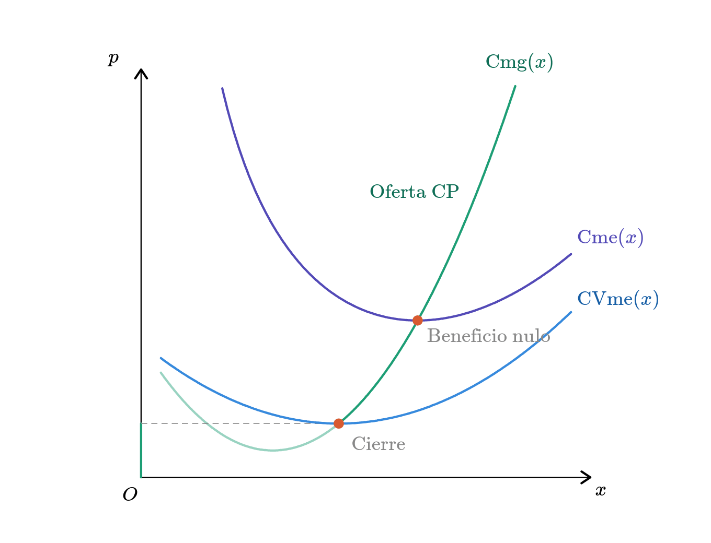
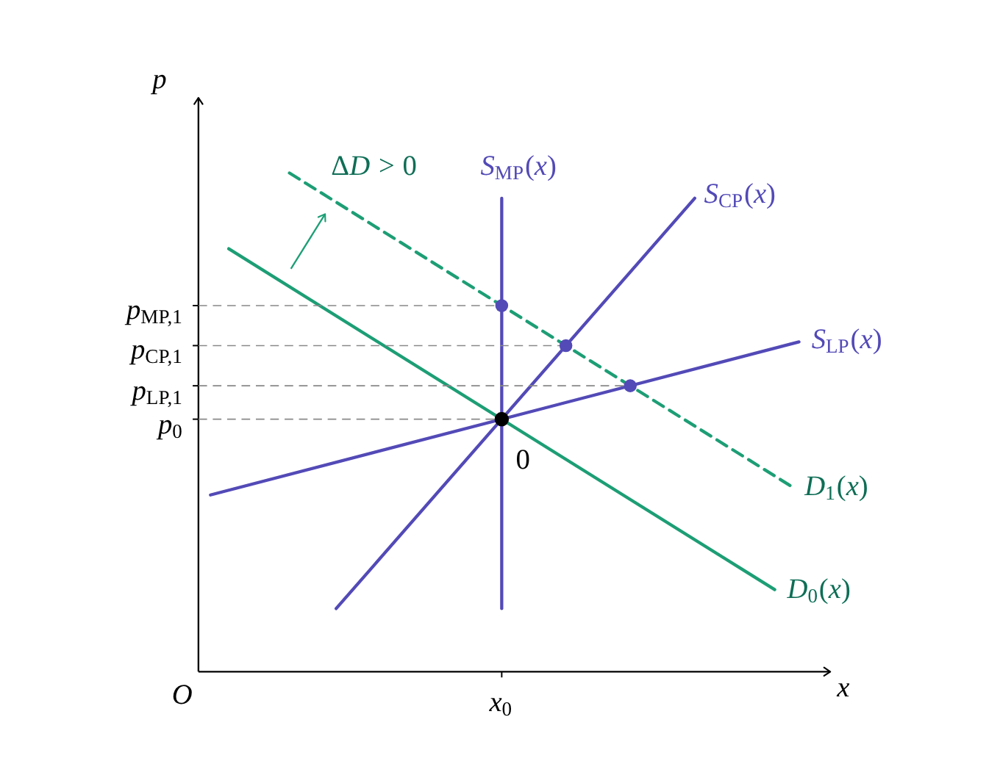
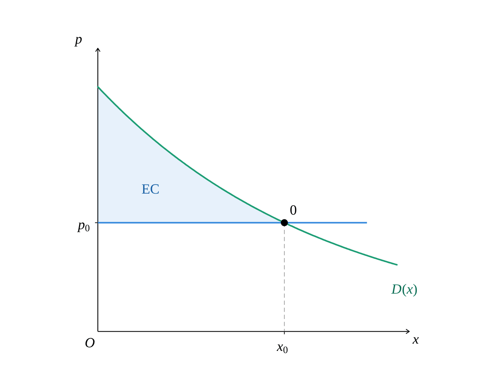

## Introducción

::: {.callout-note appearance="simple" icon=false}

:::

La **revolución marginalista** designa el cambio de paradigma que, entre 1871 y 1874, sustituye la teoría clásica del valor, fundada en el coste de producción y en el trabajo incorporado, por otra basada en la **utilidad marginal** (la utilidad de la última unidad consumida). El descubrimiento se produce de forma simultánea e independiente en tres medios académicos incomunicados entre sí (Menger en Viena, Jevons en Manchester y Walras en Lausana).

Con ella, el centro del análisis se desplaza de la producción y el reparto del excedente, la pregunta de los clásicos, a la asignación de recursos escasos entre fines alternativos, y se fija el método que la microeconomía conserva desde entonces, basado en agentes que optimizan en el margen y en precios que coordinan sus decisiones. De esa corriente proceden la teoría del consumidor y de la demanda (temas [A08](a08-consumidor.qmd) y [A09](a09-dualidad.qmd)), el equilibrio general (tema [A21](a21-equilibrio-general.qmd)) y la economía del bienestar de Pareto (tema [A22](a22-eb-i.qmd)). Su nombre se debe a Thorstein Veblen, que en 1900 llamó “neoclásica” a la economía de Marshall para subrayar su ascendencia clásica.

Este tema ordena el periodo (1871-1936) por esferas geográficas, porque en cada una de ellas el marginalismo adopta un método y un objeto distintos:

- *Austro-alemana*: subjetivismo y razonamiento verbal.

- *Anglosajona*: equilibrio parcial y aparato instrumental y, en Estados Unidos, extensión del principio marginal desde la utilidad hasta el producto (distribución y capital).

- *Franco-italiana*: equilibrio general y sistema de ecuaciones.

Dentro de cada esfera se sigue una misma secuencia, que va de los *antecedentes* (precursores que aplican el razonamiento marginal a problemas concretos sin formar escuela) a la *fundación* (el autor que convierte la utilidad marginal en el principio del que se deriva todo el sistema y funda una escuela), la *sistematización* (los autores que completan la teoría por el lado de la oferta y de la distribución) y la *evolución posterior* (los desarrollos que extienden o corrigen el sistema desde dentro). El corte entre precursor y fundador lo marca el alcance (la generalidad de la teoría y la continuidad institucional de la escuela), no la cronología.

Tres anexos recogen las diferencias entre clásicos y neoclásicos, las críticas al núcleo teórico y la escuela de Estocolmo. Los programas formales y las construcciones gráficas que aquí solo se enuncian se derivan en los temas de microeconomía a los que se remite en cada caso.

## 1. Esfera austro-alemana

La primera esfera es el mundo germanohablante, donde el pensamiento económico estaba dominado por la escuela historicista alemana, hostil a la teoría abstracta y partidaria del análisis inductivo e histórico. Ese ambiente adverso explica tanto la irrelevancia inicial de los precursores alemanes (von Thünen y, sobre todo, Gossen) como el carácter marcadamente metodológico que adopta la reacción de Carl Menger desde Viena en 1871.

La tradición que Menger inaugura se caracteriza por el subjetivismo del valor, el razonamiento deductivo verbal sin formalización matemática y la atención al tiempo, la incertidumbre y el empresario. Su desarrollo discurre por una línea de discipulado bien definida (Wieser y Böhm-Bawerk y, después, Mises y Hayek) y por dos controversias que fijan su identidad, la *Methodenstreit* con el historicismo y el debate sobre el cálculo económico socialista.

### 1.1. Antecedentes: proto-marginalistas en la esfera austro-alemana

Antes de Menger, dos autores alemanes habían aplicado el razonamiento marginal a problemas económicos concretos sin llegar a formar escuela. Su recuperación es póstuma y su influencia, indirecta. Von Thünen actúa sobre la teoría de la productividad marginal que después desarrollan Marshall y Clark, y Gossen sobre la teoría de la utilidad de la primera generación marginalista.

#### 1.1.1. Johann Heinrich von Thünen (1826; 1850)

Von Thünen aplicó el análisis marginal por medio del cálculo (optimización) y contribuyó a desarrollar la productividad marginal como base de la explicación de los salarios. Así, sostuvo que el empresario contrata trabajadores hasta que el producto del último iguala su salario, anticipando en medio siglo la teoría marginal de la distribución (apartado 2.5.1).

En su obra (1826; 1850), de influencia explícita sobre Marshall, formuló además el primer modelo espacial de la economía, donde los cultivos se ordenan en anillos concéntricos en torno al mercado según el coste de transporte. El modelo explica así la renta de la tierra por su localización y no solo por su fertilidad como en Ricardo.

#### 1.1.2. Hermann Heinrich Gossen (1854)

Gossen aplicó el análisis marginal en su obra de 1854, ignorada en su época y que Jevons rescató en el prefacio a la segunda edición de su libro (1879). De ese análisis derivó dos enunciados sobre la utilidad marginal, bautizados después como *leyes de Gossen*[^a03-1]:

1. *1.ª Ley (utilidad marginal decreciente)*: sostiene que el placer que proporciona cada nuevo acto de consumo es menor que el del anterior, hasta alcanzar la saciedad. La idea, sin embargo, no se debe originalmente a Gossen, ya que autores como Bernoulli o Bentham la habían planteado antes.

2. *2.ª Ley (principio de equimarginalidad)*[^a03-2]: para maximizar su utilidad total, los consumidores distribuyen sus compras de forma que la última unidad monetaria que gastan en cualquier bien les reporta la misma utilidad que la última unidad monetaria gastada en cualquier otro.

### 1.2. Carl Menger (*Principios de economía*, 1871)

**Formación**: estudió Derecho en Viena y Praga, se doctoró en Cracovia (1867) y fue periodista y funcionario de la oficina de prensa del Gobierno austriaco antes de incorporarse como profesor a la Universidad de Viena (1873).

**Importancia**: Menger, en 1871, convierte la utilidad marginal en el principio del que se deriva todo el sistema y funda una escuela que le da continuidad, dos cosas que von Thünen y Gossen no hicieron.

**Metodología**: Menger se apoya en la lógica deductiva para defender sus teorías, sin recurrir al formalismo matemático. Esta posición, sistematizada en sus *Investigaciones sobre el método de las ciencias sociales* (1883), le enfrentó a Gustav von Schmoller y a la joven escuela historicista alemana en la controversia conocida como *Methodenstreit* (tema [A01](a01-objeto-metodo.qmd), apartado 2.2.2).

#### 1.2.1. Teoría del valor: demanda, oferta y equilibrio

Entre quienes resolvieron la paradoja del agua y los diamantes que había planteado Smith ([A02](a02-clasicos-marx.qmd)), Menger fue de los más claros. El agua tiene más valor de uso que los diamantes y, sin embargo, menos valor de cambio.

El origen de la paradoja está en confundir dos magnitudes, la utilidad total de un bien, ligada a su valor de uso, y su utilidad marginal, la que aporta la última unidad consumida. La utilidad marginal, y no la total, fija el valor de cambio. Como la marginal decrece con la cantidad, la última unidad de un bien tan abundante como el agua aporta muy poca utilidad, mientras que la del diamante, escaso, sigue aportando mucha.

#### 1.2.2. Teoría de la producción y la distribución

En su obra, Menger también sentó las bases para el análisis marginal de los factores de oferta al realizar la siguiente clasificación de bienes:

1. *Bienes de orden inferior o de primer orden* (es decir, bienes finales): satisfacen necesidades humanas directamente (p. ej. pan).

2. *Bienes de orden superior (segundo, tercer orden y sucesivos)* (es decir, factores de producción): satisfacen necesidades humanas de forma indirecta, porque contribuyen a producir bienes de primer orden. En el caso del pan, la harina es de segundo orden, el trigo y los molinos son de tercero, y las tierras de cultivo y los aperos, de cuarto.

Menger atribuye a los bienes de orden superior dos propiedades, la complementariedad y la imputación:

- *Complementariedad*: un bien de orden superior solo es un “bien” cuando se combina con otros de orden superior, porque los factores únicamente producen juntos. Basta con que falte uno imprescindible para el proceso para que el resto no le sirva de nada al productor.

- *Imputación*: un bien de orden superior toma su valor del bien de primer orden a cuya producción contribuye. Por tanto, si este deja de ser un bien, los factores que lo producen corren la misma suerte.

Para Menger, en suma, el valor de un bien de primer orden lo fija su utilidad marginal, no el trabajo incorporado ni lo que cuestan los factores (los bienes de orden superior) empleados en producirlo. En ello Menger se separa de los clásicos. El elemento subjetivo pasa así a ser el determinante del valor, idea central de la escuela austriaca.

Menger incorpora además el tiempo y la incertidumbre a la valoración de los bienes. Pasar de los bienes de orden superior a los de primer orden requiere tiempo, y el tiempo obliga a tener en cuenta la incertidumbre sobre las condiciones futuras. Los bienes presentes valen, por tanto, más que los futuros, puesto que no requieren transformación (o ya la han sufrido) y no están sujetos a incertidumbre. Menger prefigura así el concepto de **preferencia temporal**, que desarrollaría explícitamente uno de sus discípulos, Eugen von Böhm-Bawerk.

Para Menger, que los individuos maximicen su utilidad no asegura que los mercados estén en equilibrio, porque, a diferencia de otros pioneros del marginalismo, tiene en cuenta la incertidumbre. Por ello concede un papel central al empresario, el agente que busca información y detecta oportunidades de beneficio, y en esto le sigue en general la escuela austriaca. Sobre esa base, los austriacos posteriores (Mises, 1949; Hayek, 1948; Kirzner, 1973) entenderán la competencia como un proceso dinámico de descubrimiento, frente a la noción estática de Jevons y Walras.

#### 1.2.3. Teoría monetaria y bancaria: el origen del dinero

Menger explica el dinero como una institución que surge de forma espontánea, sin acuerdo previo ni intervención del Estado (en sus *Principios* y en su artículo de 1892). En el trueque, cada agente acepta a cambio de lo que ofrece los bienes que pueden revenderse con más facilidad, aunque no los necesite. La práctica, imitada por los demás, acaba por convertir en medio general de cambio a la mercancía más vendible (*Absatzfähigkeit*), normalmente los metales preciosos. Mises partió de esta explicación para fundar el valor del dinero en su teorema de la regresión.

#### 1.2.4. Conclusiones

**Aspectos positivos**: su teoría subjetiva del valor y su clasificación de los bienes por órdenes, base de la imputación, fundan la escuela austriaca, que sus discípulos continúan desde la cátedra de Viena.

**Limitaciones**: Menger aplica tímidamente el análisis marginal al lado de la oferta, pero, como otros marginalistas de primera generación, se centra sobre todo en el lado de la demanda, lo que no permite determinar completamente los precios[^a03-26].

### 1.3. Sistematización: Wieser y Böhm-Bawerk

Menger había explicado el valor de los bienes finales por la utilidad marginal y mostrado que de él deriva el de los factores, pero no cómo repartirlo entre ellos ni de dónde procede el rendimiento del capital. Sus discípulos directos completan el sistema, Wieser con la imputación del valor a los factores y el coste de oportunidad, y Böhm-Bawerk con la teoría del capital y el interés.

#### 1.3.1. Teoría del coste de oportunidad y teoría de la imputación (Wieser, 1884; 1889)

Wieser utilizó el concepto de utilidad marginal[^a03-4] para prolongar un paso más la cadena causal de Menger, que va de la utilidad marginal al precio del bien de consumo final, e imputar ese valor a los bienes de orden superior (los factores) empleados en fabricarlo.

Wieser, en su estudio del precio de los factores, fue el primer autor en introducir explícitamente la noción de **coste de oportunidad**, el valor de la mejor alternativa a la que se renuncia al destinar un factor a un uso determinado. La idea había sido apuntada por autores anteriores (von Thünen, 1826; Mill, 1848), pero Wieser le dio un desarrollo riguroso y sistemático. De ahí que la determinación del valor de un factor por su mejor empleo alternativo se conozca como ley de Wieser[^a03-5].

#### 1.3.2. El problema del interés: las teorías del capital y el interés (Böhm-Bawerk, 1889)

<!-- historia -->

**Origen**: los austriacos, y en particular Böhm-Bawerk, conciben el capital no como un factor originario más (para Böhm-Bawerk los únicos factores originarios son la tierra y el trabajo), sino como trabajo y tierra acumulados que permiten *métodos de producción indirectos* o *roundabout*. El capital es, así, producción que toma tiempo, y su empleo más prolongado eleva el producto obtenido.

Esta concepción permite abordar el llamado *problema del interés*. Conforme a la teoría de la imputación, el valor de los medios de producción deriva íntegramente del valor del producto. ¿Por qué, entonces, el valor del producto supera de forma sistemática el de los medios de producción empleados y deja un excedente que percibe el capital en forma de interés?

**Idea**: Böhm-Bawerk (1889) explica que el tipo de interés es positivo porque los bienes presentes valen más que los bienes futuros de igual clase y cantidad.

**Razonamiento**: Böhm-Bawerk aduce tres razones (los “tres motivos”):

- *Circunstancias presentes y futuras*: quien espera estar mejor provisto en el futuro que hoy (p. ej. en una economía en crecimiento) valora más los bienes presentes, que para él son relativamente más escasos.

- *Miopía de los agentes* (falta de imaginación, incertidumbre): lleva a infravalorar sistemáticamente las necesidades futuras.

- *Superioridad técnica de los bienes presentes*: permiten iniciar de inmediato métodos de producción más indirectos (*roundabout*), que son más productivos (p. ej. pescar con red, fabricada renunciando a pescar hoy, frente a pescar con la mano). Sin una remuneración del capital, ningún empresario se decidiría por esos métodos indirectos.

El interés es, así, el *agio* o prima que iguala el valor de los bienes presentes y futuros. Böhm-Bawerk daba primacía al tercer motivo, que a su juicio bastaba por sí solo para que el interés fuese positivo.

**Extensiones**: Böhm-Bawerk empleó su teoría del interés y del capital (y, en general, el marginalismo) para criticar la teoría marxista del valor-trabajo y la idea de explotación (Anexo A.1), a lo que replicó Hilferding (Anexo A.2).

**Conclusiones**:

- *Aspectos positivos*: ofrece una explicación sistemática de por qué el tipo de interés es positivo, al combinar la preferencia temporal con la productividad de los métodos indirectos. Fisher la tomó como base de la teoría del interés aceptada hoy (apartado 2.5.2), y la concepción de Böhm-Bawerk del capital como producción que toma tiempo inspira la teoría austriaca del ciclo.

- *Limitaciones*: la pretensión de independencia del tercer motivo fue refutada por Irving Fisher, quien mostró que la productividad de los métodos *roundabout* no es independiente de las dos primeras razones.

### 1.4. Evolución posterior: Mises y Hayek

Con la tercera generación cambia el objeto. Mientras Menger, Wieser y Böhm-Bawerk trabajan sobre el valor, el precio y la distribución, Mises y Hayek desplazan el análisis hacia la moneda, el ciclo, la crítica de la planificación y, en último término, la metodología y la teoría del conocimiento.

#### 1.4.1. Teoría de ciclos, cálculo socialista y praxeología (Mises, 1912; 1920; 1949)

Entre las aportaciones de Ludwig von Mises destacan:

**Teoría monetaria y de los ciclos**: en su obra de 1912 estudia los orígenes y el funcionamiento del dinero. Mediante el “teorema de la regresión” resuelve la aparente circularidad en la determinación del valor del dinero, haciéndolo retroceder hasta el momento en que el bien-dinero tenía valor como mercancía ordinaria, lo que le permite extender al dinero la teoría de la utilidad marginal.

Además, sienta las bases de la teoría austriaca del ciclo, desarrollada después por Hayek, en la que se rompe la neutralidad monetaria clásica. La expansión del crédito sitúa el tipo de mercado por debajo del natural y orienta la inversión hacia procesos productivos demasiado largos (*malinvestment*), que la escasez de ahorro obliga después a liquidar.

::: {.callout-note appearance="simple" icon=false}
La teoría austriaca del ciclo (sobreinversión monetaria) se expone, junto con las demás teorías del ciclo anteriores a Keynes, en el tema [A42](a42-ciclos.qmd) (§1.2.2).
:::

**Cálculo económico socialista**: en 1920 Mises sostuvo que, en ausencia de propiedad privada de los medios de producción y, por tanto, de precios de mercado, el socialismo no podía realizar una asignación racional de los recursos. Esta tesis abrió el debate del cálculo socialista, en el que sus principales contradictores fueron los socialistas de mercado Oskar Lange y Abba Lerner (el planificador podía simular el mercado por ensayo y error), sobre la base teórica previa de Enrico Barone (1908).

**Praxeología**: en *La acción humana* (1949) sistematiza, a partir de su obra de 1933, la praxeología, es decir, el estudio de la acción humana a partir de axiomas *a priori*, como enfoque metodológico de la economía.

#### 1.4.2. Teoría del ciclo y conocimiento disperso (Hayek, 1931; 1935; 1945)

Friedrich von Hayek, discípulo de Mises, se incorpora en 1931 a la London School of Economics y convierte el aparato austriaco en la principal alternativa teórica al keynesianismo emergente. Dentro del marco temporal de este tema destacan dos aportaciones:

**Teoría austriaca del ciclo**: en su obra de 1931 formaliza la intuición de Mises mediante el llamado *triángulo hayekiano*, que representa la estructura intertemporal de la producción por etapas. Además, Hayek toma de Wicksell el concepto de tipo de interés natural (Anexo A.3). De esa teoría del ciclo proceden su oposición a las políticas de estímulo de la demanda, que a su juicio solo posponen la liquidación de las inversiones erróneas, y su polémica con Keynes en 1931-1932.

**Cálculo económico socialista**: en 1935 reformula la tesis de Mises y, en *The Use of Knowledge in Society* (1945), ya como respuesta a Lange (1936), la convierte en un problema de conocimiento. La información relevante para la asignación está dispersa entre los agentes, es en parte tácita y solo se revela en el propio proceso de mercado a través de los precios, de modo que ningún planificador puede reunirla de antemano.

#### 1.4.3. Otros autores de la esfera austriaca

En la Viena de entreguerras se forma además una generación que se integra en la corriente principal (Haberler, Machlup, Rosenstein-Rodan y Morgenstern, coautor con von Neumann de la teoría de juegos, [A14](a14-juegos.qmd)). En el coloquio matemático de Karl Menger, hijo de Carl, se obtienen las primeras demostraciones de existencia del equilibrio general (apartado 3.4).

### 1.5. Conclusiones

**Aspectos positivos**: la revolución marginalista austriaca introdujo el valor subjetivo y el análisis marginal como núcleo de la teoría del valor, desplazando definitivamente las teorías clásicas del coste de producción y del valor-trabajo. Sus aportaciones (utilidad marginal, imputación, coste de oportunidad, papel del tiempo y la incertidumbre, competencia como proceso dinámico) resultaron fundamentales para la microeconomía posterior.

**Limitaciones**:

- *Metodología*: el rechazo del formalismo matemático y de la contrastación empírica, que en Menger es una preferencia por la explicación causal y en Mises se convierte en apriorismo declarado, dejó a la escuela sin los dos instrumentos que la profesión adoptó durante el periodo. Además, la negativa a determinar los precios de forma simultánea la separó de Marshall y de Walras justo cuando ambos convergían. Por estas razones, aunque sus ideas se recuperaron en los años setenta (Kirzner, Rothbard y el Premio Nobel de Hayek en 1974), la escuela ha permanecido en la heterodoxia.

- *Imputación y precios de los factores*: la teoría de la imputación de Wieser solo resuelve el problema con coeficientes de producción fijos. En cambio, cuando los factores son sustituibles, el valor del producto no puede repartirse entre ellos sin recurrir a la productividad marginal, que los austriacos no llegaron a desarrollar. Por eso, la solución general vendría de Clark, Wicksteed y Wicksell (apartado 2.5.1).

- *Teoría del capital*: el periodo medio de producción de Böhm-Bawerk, sobre el que descansa su explicación del interés, resultó ser una magnitud mal definida, porque solo es calculable bajo supuestos muy restrictivos. Además, su medición exige conocer previamente el tipo de interés que Böhm-Bawerk pretende determinar (objeción de Fisher y Knight, nunca resuelta satisfactoriamente).

## 2. Esfera anglosajona

La esfera anglosajona, británica en su origen, acaba fijando el canon de la microeconomía moderna. Se distingue de las demás en que el marginalismo no aparece aquí sobre un vacío teórico, sino frente a la escuela clásica más sólida y mejor establecida de Europa, la de Ricardo y Mill.

La aportación de Jevons (1871) es paralela y simultánea a la de Menger, pero con una metodología opuesta, matemática y estadística. El desarrollo de la esfera lo asume Alfred Marshall, que reintroduce el lado de la oferta que Jevons y Menger habían relegado y funda la escuela de Cambridge (Pigou, Robertson, Robinson y el propio Keynes). En Estados Unidos, una generación posterior (Clark, que se había formado en Alemania, Fisher y Knight) extiende el principio marginal a la distribución y al capital, con un tono normativo que procede de la preocupación por la reforma social.

### 2.1. Antecedentes: el proto-marginalismo británico

Los antecedentes británicos son numerosos pero inertes. En un medio dominado por la teoría clásica del valor-trabajo y del coste de producción, varios autores formularon con claridad la relación entre el valor y la utilidad de la última unidad sin que ello alterase el paradigma vigente.

- *Precursores británicos*: Jeremy Bentham había fundamentado el utilitarismo en el cálculo del placer y el dolor. William F. Lloyd (1833), Mountifort Longfield (1834) y Nassau Senior (1836) enunciaron el principio de utilidad decreciente y su relación con el precio, en el caso de Senior dentro de una obra que seguía siendo clásica en lo demás.

- *Bernoulli*: precursor común a las tres esferas fundadoras, recurrió ya en 1738 a una utilidad marginal decreciente para resolver la paradoja de San Petersburgo e introdujo la utilidad esperada ([A10](a10-riesgo-incertidumbre.qmd)).

### 2.2. William Stanley Jevons (*The Theory of Political Economy*, 1871)

**Formación**: estudió química y matemáticas en el University College de Londres y trabajó como ensayador en la Casa de la Moneda de Sídney (1854-1859) antes de dedicarse a la economía. Fue profesor en el Owens College de Manchester y en el University College de Londres.

**Importancia**: Jevons, en 1871[^a03-27], parte de la utilidad marginal para reconstruir sobre ella el conjunto de la teoría del intercambio y de la distribución, con la pretensión explícita de desplazar a Ricardo y a Mill. Como Menger, aplica el análisis marginal sobre todo a la demanda.

**Metodología**: Jevons emplea un método matemático y estadístico, opuesto al de Menger, y sostiene que la economía, si ha de ser una ciencia, debe ser una ciencia matemática. Jevons aplica además la estadística al estudio de los precios (números índice) y del ciclo.

#### 2.2.1. Teoría del valor: demanda, oferta y equilibrio

Al igual que Menger, Jevons defiende que el valor depende del grado final de utilidad (*final degree of utility*), es decir, de la utilidad marginal. Entiende además que existe una relación causal secuencial y unidireccional, conocida como *cadena de Jevons*, según la cual el coste de producción determina la oferta, la oferta determina el grado final de utilidad y este determina el valor. En último término, por tanto, la utilidad (la demanda) fija el precio. Esta cadena fue criticada por Marshall, Edgeworth y la escuela de Lausana, que subrayaron la determinación simultánea (y no sucesiva) de los precios mediante el equilibrio de la oferta y la demanda.

En su teoría del intercambio, Jevons llegó a la conclusión de que, si dos partes o “cuerpos comerciales” (*trading bodies*) actúan como precio-aceptantes, alcanzan un equilibrio de mercado mediante un proceso de intercambio. Su análisis se basa en:

1. *Ley de la indiferencia*[^a03-8]: en un mercado libre y abierto, una misma mercancía no puede tener en un momento dado dos precios distintos. Aplicada al consumidor, la ley implica que, a efectos de su grado final de utilidad, cualquier unidad de un bien homogéneo que consuma puede sustituirse por otra.

2. *Condición de equilibrio*: dos partes solo intercambian si ambas ganan. El intercambio continúa, por tanto, mientras las relaciones marginales de sustitución (RMS) de las dos partes, cocientes de sus utilidades marginales, difieran entre sí o de la relación de intercambio, que la ley de la indiferencia hace única. En el equilibrio, todas coinciden: $$\text{RMS}^{A}_{YX}=u'^{A}_{X}/u'^{A}_{Y}=p_X/p_Y=u'^{B}_{X}/u'^{B}_{Y}=\text{RMS}^{B}_{YX}$$

#### 2.2.2. Teoría de la producción y la distribución: el trabajo, el capital y el interés

Jevons aplica también el razonamiento marginal a la oferta de trabajo. El trabajador prolonga su jornada hasta que la utilidad del producto de la última hora iguala la penosidad (*painfulness*) de ese esfuerzo. La cantidad de trabajo queda así determinada por la igualdad entre la utilidad marginal del producto y la desutilidad marginal del trabajo.

Jevons fue además uno de los primeros en concebir el capital como tiempo. Lo entiende como el adelanto de subsistencias a los trabajadores, que supone una renuncia temporal y cuyo fruto, el interés, solo aparece más tarde. Si $F(t)$ es el producto que se obtiene al mantener invertido el capital durante un periodo $t$, el tipo de interés es el incremento relativo del producto al prolongar la inversión, $F'(t)/F(t)$, idea que anticipa el periodo de producción de Böhm-Bawerk (apartado 1.3.2).

#### 2.2.3. Teoría del crecimiento (y de los ciclos): la cuestión del carbón y las manchas solares

En su libro de 1865, Jevons sostuvo que el crecimiento británico dependía de un carbón barato y agotable, y advirtió que las mejoras en la eficiencia de su uso no reducen el consumo, sino que lo aumentan, porque abaratan el servicio que presta. Esta tesis, conocida hoy como *paradoja de Jevons*, es el antecedente del efecto rebote que estudia la economía de la energía.

Jevons llevó a cabo además uno de los primeros estudios empíricos del ciclo con la **teoría de las manchas solares**, que atribuía las fluctuaciones de las cosechas y del crédito a la actividad solar ([A42](a42-ciclos.qmd)).

#### 2.2.4. Conclusiones

**Aspectos positivos**: el apoyo en técnicas matemáticas y estadísticas (números índice, estudio empírico del ciclo) contribuyó a establecer estas disciplinas en la economía, y su concepción del capital como tiempo anticipa la de Böhm-Bawerk.

**Limitaciones**:

- *Teoría del intercambio*: F. Edgeworth demostró que el modelo de intercambio de Jevons no explicaba el precio, pues al tratarse de un intercambio entre dos partes (monopolio bilateral) el equilibrio quedaba indeterminado, indeterminación que se reduce al crecer el número de agentes.

- *Teoría de las manchas solares*: sus contemporáneos la rechazaron, y la correlación entre la actividad solar y las cosechas no se sostuvo con datos posteriores.

### 2.3. Sistematización: Alfred Marshall (*Principios de economía*, 1890)

**Formación**: estudió matemáticas en el St John's College de Cambridge (segundo *wrangler* en 1865), llegó a la economía desde la filosofía moral y fue catedrático de Economía Política en Cambridge entre 1885 y 1908.

**Importancia**: en *Principios de economía* (1890) desarrolló el marco analítico que constituye la base histórica de la microeconomía moderna, generalizó el análisis gráfico y se constituyó en líder de la escuela de Cambridge.

Marshall no es un continuador de Jevons, pues llegó al análisis marginal por su cuenta, a partir de Cournot y von Thünen, y reconcilia el marginalismo con la tradición clásica en lugar de sustituirla. Con Marshall, por tanto, el marginalismo se convierte en escuela neoclásica.

**Metodología**: Marshall se apoya en el razonamiento matemático, verbal y gráfico para postular sus teorías, si bien dio especial prioridad a las dos últimas herramientas con fines didácticos, relegando la formalización a notas y apéndices[^a03-28].

#### 2.3.1. Teoría del valor: demanda, oferta y equilibrio

<!-- historia -->

**Idea**: para Marshall, oferta y demanda determinan conjuntamente el precio de equilibrio, con lo que concilia la postura clásica (de oferta) y la marginalista (de demanda). Lo resume con el ejemplo de las tijeras, según el cual tan razonable sería preguntarse si corta el papel la hoja de arriba o la de abajo como preguntarse si el valor depende de la utilidad o del coste de producción.

Marshall estudia por separado los dos lados del mercado y los confronta después en el equilibrio. En la demanda le interesan la forma de la curva y el bienestar del consumidor, y en la oferta, la forma de las curvas y el papel del tiempo. La oferta forma parte de la teoría del valor porque, como la demanda, se expresa en precios del bien, ya que el precio de oferta de cada cantidad es lo que cuesta producir la última unidad. La tecnología que está detrás de esos costes y la remuneración de los factores que se deriva de ella se estudian a continuación.

**Supuestos**:

- *Metodología*: equilibrio parcial. Marshall estudia un mercado aislado (*ceteris paribus*), con la renta y los precios de los demás bienes dados, a diferencia de Walras, que considera la interdependencia entre todos los mercados de la economía (apartado 3.2).

- *Agentes*:

    - *Utilidad cardinal*: la utilidad es medible en unidades absolutas, de modo que los cambios en el precio o en la cantidad ofrecen una medida directa de los cambios en el bienestar.

    - *Principio de marginalidad*: el valor se encuentra “en el margen” y procede de la escasez.

    - *Separabilidad y aditividad*: la utilidad de un bien no depende del consumo de los demás, por lo que el análisis deja fuera la sustituibilidad y la complementariedad. Formalmente, la función de utilidad es aditivamente separable y cuasilineal, con la renta (real) no gastada en bienes, $m>0$, como argumento lineal.

    - *Utilidad marginal de la renta*: es constante, aproximación que Marshall da por buena si el bien absorbe una fracción reducida del presupuesto del consumidor.

- *Mercado de bienes*: competencia perfecta. Compradores y vendedores son numerosos y precio-aceptantes, y cada empresa produce con costes en forma de U.

**Lado de la demanda**: con estos supuestos, Marshall liga directamente la demanda de cada bien a su utilidad marginal.

- *Planteamiento*: el consumidor maximiza su utilidad sujeto a la restricción presupuestaria:

    $$\max_{\mathbf{x},\,m} u(\mathbf{x}, m) = \sum_{i=1}^{n} u_i(x_i) + m \quad \text{s.a.: } \sum_{i=1}^{n} p_i x_i + m = M_0$$

    donde $x_i$ es la cantidad consumida del bien $i$, $u_i(x_i)$ la utilidad (separable y aditiva) que reporta, $m$ la renta real no gastada en bienes, $p_i$ el precio del bien $i$ y $M_0$ la renta monetaria del consumidor. El lagrangiano, con el multiplicador $\lambda$ asociado a la restricción presupuestaria, es $\mathcal{L} = \sum_{i=1}^{n} u_i(x_i) + m + \lambda\,\bigl(M_0 - \sum_{i=1}^{n} p_i x_i - m\bigr)$.

- *CPO*: con solución interior y la restricción agotada, se deriva el lagrangiano respecto a la cantidad de cada bien y a la renta no gastada. En el óptimo, la utilidad marginal de cada bien equivale a su precio multiplicado por la utilidad marginal de la renta, que es constante:

    $$\begin{aligned} \frac{\partial \mathcal{L}}{\partial x_i} &= \frac{du_i}{dx_i} - \lambda p_i = 0 &&\Rightarrow\; \frac{du_i}{dx_i} = \lambda p_i \\ \frac{\partial \mathcal{L}}{\partial m} &= 1 - \lambda = 0 &&\Rightarrow\; \lambda = 1 \end{aligned}$$

- *CSO*: con utilidad marginal decreciente en cada bien, $u_i''(x_i) < 0$, la función objetivo del consumidor es cóncava y la restricción es lineal, por lo que las condiciones de primer orden son suficientes para un máximo.

- *Solución*: de las CPO se sigue que la demanda inversa es la utilidad marginal, $p_i = du_i/dx_i$, y, al ser esta decreciente, la curva de demanda individual tiene pendiente negativa en el plano $(x_i, p_i)$. La demanda de mercado es la suma horizontal de las individuales (para cada precio se suman las cantidades demandadas) y hereda esa pendiente negativa, que es la ley general de la demanda. Sobre este aparato construye Marshall la elasticidad-precio y la distinción entre movimientos y desplazamientos de la curva.

**Lado de la oferta**: la empresa, precio-aceptante, decide cuánto produce de cada bien a partir de sus costes.

- *Planteamiento*: la empresa elige la cantidad que maximiza su beneficio:

    $$\max_{x_i} \pi(x_i) = p_i x_i - C(x_i)$$

    donde $\pi(x_i)$ es el beneficio, $p_i$ el precio de mercado, que la empresa toma como dado, y $C(x_i)$ el coste total de producir $x_i$, suma de un coste fijo y de otro variable.

- *CPO*: se deriva el beneficio respecto a la cantidad producida y se iguala a cero. La empresa amplía la producción hasta que el precio iguala el coste de la última unidad, es decir, su coste marginal:

    $$\frac{d\pi}{dx_i} = p_i - \frac{dC}{dx_i} = 0 \;\Rightarrow\; p_i = \text{Cmg}(x_i)$$

- *CSO*: basta con que el coste marginal sea creciente en el óptimo, $\text{Cmg}'(x_i) > 0$, de modo que el beneficio es cóncavo en ese punto y la condición de primer orden caracteriza un máximo.

- *Solución*: la oferta de la empresa es el tramo creciente de su coste marginal, siempre que el precio cubra el coste variable medio. A corto plazo, con un número dado de empresas, la oferta de la industria es la suma horizontal de las ofertas individuales. A largo plazo, la entrada y la salida de empresas llevan el precio al mínimo del coste medio, y la forma de la oferta de la industria depende de cómo varían los costes al crecer esta.

La forma de la oferta depende, por tanto, del periodo considerado. Marshall distingue cuatro periodos, entendidos como un recurso analítico para describir las condiciones de oferta y no como periodos cronológicos:

- *Periodo de mercado*: con la oferta fija (perfectamente inelástica), el precio depende solo de la demanda.

- *Corto plazo*: al menos un factor no puede ajustarse, así que el productor puede variar la cantidad producida pero no las dimensiones de la planta. De ahí surge la distinción entre costes fijos y variables.

- *Largo plazo*: todos los factores son ajustables y el productor escoge las dimensiones de su planta. En el plano $(x_i, p_i)$, la oferta de la industria es horizontal con costes constantes, tiene pendiente positiva con costes crecientes y pendiente negativa con costes decrecientes.

- *Periodo secular*: permite variar, además, la tecnología.

Gráficamente, los costes y la oferta de la empresa a corto plazo se representan en el plano cantidad-precio (figura -@fig-a033-oferta-cp-empresa):

1. *Coste variable medio*, $\text{CVme}(x)$: recoge el coste variable por unidad. Tiene forma de U por los rendimientos primero crecientes y después decrecientes del factor variable.

2. *Coste medio*, $\text{Cme}(x)$: añade el coste fijo medio al anterior, por lo que queda por encima de él y se le acerca al aumentar la producción.

3. *Coste marginal*, $\text{Cmg}(x)$: recoge el coste de la última unidad producida, tiene también forma de U y corta a los dos costes medios en su mínimo.

4. *Oferta a corto plazo*: tramo del coste marginal desde el punto de *cierre*, mínimo de $\text{CVme}(x)$. A precios inferiores la empresa no produce, y la oferta coincide con el eje de precios. Por encima del punto de *beneficio nulo*, mínimo de $\text{Cme}(x)$, la empresa obtiene beneficios.

::: {#fig-a033-oferta-cp-empresa}

::: {.content-visible when-format="html"}
```{=html}
<div class="graph-frame">
<iframe src="../graphs/a033_Oferta_CP_empresa.html" style="height:560px" loading="lazy" title="fig-a033-oferta-cp-empresa"></iframe>
</div>
```
:::

::: {.content-visible unless-format="html"}

:::

Oferta de la empresa a corto plazo. Coincide con el tramo del coste marginal situado por encima del mínimo del coste variable medio y, a precios inferiores a ese mínimo, con el eje de precios, porque la empresa no produce.
:::

Dos fuerzas determinan, en el largo plazo, el perfil de las curvas de oferta y de costes. Las *(des)economías internas* hacen que los costes medios bajen (suban) al crecer la producción de la empresa, y las *(des)economías externas*[^a03-11] provocan ese mismo efecto al crecer la producción agregada de la industria. En general, el coste de producción pesa más en el precio cuanto más largo es el periodo analizado, mientras que la demanda pesa más cuanto más corto es.

Obsérvese que los costes decrecientes internos a la empresa (economías internas) son incompatibles con el supuesto de competencia perfecta, ya que, con un coste marginal que decrece siempre, resulta imposible maximizar el beneficio y derivar la curva de oferta de la industria. Marshall trató de salvar la dificultad atribuyendo los rendimientos crecientes a las economías externas, compatibles con la competencia, y Sraffa (1926) convertirá esa incoherencia en el punto de partida de la competencia imperfecta.

::: {.callout-note appearance="simple" icon=false}
La oferta de la empresa y de la industria en cada periodo, con la regla de cierre a corto plazo y el equilibrio a largo plazo, se desarrolla en el tema [A16](a16-competencia-perfecta.qmd) (§2), y las economías y deseconomías externas, en el tema [A12](a12-costes.qmd) (§2.4.4) y, como externalidades pecuniarias, en el tema [A16](a16-competencia-perfecta.qmd) (§3.2).
:::

**Equilibrio**: Marshall toma la cantidad como variable independiente y el precio como dependiente. Así, para cada cantidad, la curva de demanda señala lo máximo que pagarían los compradores y la de oferta lo mínimo que aceptarían los vendedores por llevarla al mercado. Ambas curvas se cortan en el equilibrio, la llamada *cruz marshalliana*.

Gráficamente, el equilibrio del mercado se representa en el plano cantidad-precio (figura -@fig-a031-cruz-marshalliana):

1. *Curva de demanda*, $D(x)$: recoge el precio de demanda de cada cantidad, igual a la utilidad marginal, y es decreciente porque la utilidad marginal lo es.

2. *Curva de oferta*, $S(x)$: recoge el precio de oferta de cada cantidad, igual al coste marginal, y es creciente porque lo es el coste marginal.

3. *Equilibrio*: en el punto 0, con cantidad $x_0$ y precio $p_0$, el precio de demanda iguala al de oferta.

::: {#fig-a031-cruz-marshalliana}

::: {.content-visible when-format="html"}
```{=html}
<div class="graph-frame">
<iframe src="../graphs/a031_Cruz_marshalliana.html" style="height:560px" loading="lazy" title="fig-a031-cruz-marshalliana"></iframe>
</div>
```
:::

::: {.content-visible unless-format="html"}

:::

La cruz marshalliana. El precio de equilibrio resulta de la intersección de la demanda (utilidad marginal) y la oferta (coste marginal), las dos hojas de la tijera de Marshall. En $x_1$, el precio de demanda, $p^d(x_1)$, supera al de oferta, $p^s(x_1)$, y la cantidad aumenta hasta $x_0$.
:::

Con una demanda de mercado decreciente y una oferta creciente, el cruce, si existe, es único. Marshall admitía, sin embargo, que con rendimientos crecientes la oferta a largo plazo puede ser decreciente y cortar varias veces a la demanda, de modo que se alternan equilibrios estables e inestables.

**Estática comparativa**: en el plano cantidad-precio (figura -@fig-a034-periodos-marshall), el efecto de un aumento de la demanda, de $D_0(x)$ a $D_1(x)$, depende del periodo considerado. Desde el punto 0, en el periodo de mercado, con la oferta fija, $S_{\text{MP}}(x)$, solo sube el precio, hasta $p_{\text{MP},1}$. A corto plazo, la cantidad aumenta a lo largo del coste marginal, $S_{\text{CP}}(x)$, y el precio sube menos, hasta $p_{\text{CP},1}$. A largo plazo, la entrada de empresas amplía la oferta, $S_{\text{LP}}(x)$, y el precio sube aún menos, hasta $p_{\text{LP},1}$. Con costes constantes, volvería a su nivel inicial y todo el ajuste recaería en la cantidad.

::: {#fig-a034-periodos-marshall}

::: {.content-visible when-format="html"}
```{=html}
<div class="graph-frame">
<iframe src="../graphs/a034_Periodos_Marshall.html" style="height:560px" loading="lazy" title="fig-a034-periodos-marshall"></iframe>
</div>
```
:::

::: {.content-visible unless-format="html"}

:::

Los periodos de Marshall. Ante un aumento de la demanda, el precio se ajusta en el periodo de mercado, la cantidad, en el corto plazo, y el número de empresas, en el largo plazo.
:::

**Dinámica**: el equilibrio se alcanza ajustando cantidades, no tanteando precios, porque la variable independiente es la cantidad. Partiendo de $x_1$, donde el precio de demanda, $p^d(x_1)$, supera al de oferta, $p^s(x_1)$, los productores amplían la cantidad ofrecida hasta $x_0$, punto en el que ambos precios se igualan (figura -@fig-a031-cruz-marshalliana).

::: {.callout-note appearance="simple" icon=false}
El ajuste vía cantidades de Marshall y el ajuste vía precios del *tâtonnement* walrasiano, con sus condiciones de estabilidad, se desarrollan en el tema [A16](a16-competencia-perfecta.qmd) (§2.4), y el tanteo en equilibrio general, en el tema [A21](a21-equilibrio-general.qmd) (§1.2.3 y §2.1.3). La cruz marshalliana y el equilibrio de la industria a corto plazo se encuentran en el tema [A16](a16-competencia-perfecta.qmd) (§2.2.2).
:::

**Bienestar**: del lado normativo, Marshall construye sobre la curva de demanda el *excedente del consumidor*. Dado que el precio equivale a la utilidad marginal que proporciona la última unidad consumida, las unidades intramarginales se adquieren por menos de lo que el consumidor estaría dispuesto a pagar. Esa diferencia mide en dinero la ganancia del intercambio. Como Marshall consideró que las utilidades individuales sí eran agregables, pudo sumar los excedentes individuales e interpretar el excedente de mercado como medida del bienestar colectivo.

Gráficamente, en el plano cantidad-precio (figura -@fig-a032-excedente-consumidor), el excedente del consumidor, $\text{EC}$, es el área entre la curva de demanda, $D(x)$, y el precio de mercado, $p_0$, hasta la cantidad de equilibrio, $x_0$.

::: {#fig-a032-excedente-consumidor}

::: {.content-visible when-format="html"}
```{=html}
<div class="graph-frame">
<iframe src="../graphs/a032_Excedente_consumidor.html" style="height:560px" loading="lazy" title="fig-a032-excedente-consumidor"></iframe>
</div>
```
:::

::: {.content-visible unless-format="html"}

:::

Excedente del consumidor (Marshall). El área entre la curva de demanda y el precio de mercado mide en dinero la ganancia derivada del intercambio.
:::

::: {.callout-note appearance="simple" icon=false}
La derivación del equilibrio del consumidor y de la función de demanda marshalliana, con el teorema del bien compuesto y la estática comparativa (efectos renta y sustitución, bienes normales, inferiores y Giffen, elasticidades), se desarrolla en el tema [A08](a08-consumidor.qmd) (§1.3.3, §1.4 y §2), y el excedente del consumidor y su variación (VEC), junto con las medidas hicksianas de bienestar, en el tema [A09](a09-dualidad.qmd) (§3.3) y, como instrumento de la economía del bienestar, en el tema [A22](a22-eb-i.qmd) (§2.3).
:::

**Extensiones**: por el lado de la oferta, Marshall añade la organización (que incluye la función empresarial) como cuarto factor de producción que debe ser remunerado, los conceptos de *industria* (conjunto de empresas que producen un mismo bien) y de *empresa representativa* (la que se gestiona con capacidad normal y tiene acceso normal a las economías internas y externas de su industria), y el *excedente del productor*.

**Conclusiones**:

- *Aspectos positivos*: la aportación central de Marshall es haber reconciliado la teoría clásica del coste con la marginalista de la utilidad, mostrando que la determinación del precio es simultánea.

- *Limitaciones*: a partir de 1900, la aportación marshalliana a la teoría de la demanda fue cuestionada por tres motivos:

    - *Medición de la utilidad*: la utilidad cardinal es un supuesto muy exigente e innecesario para derivar la demanda.

    - *Utilidad marginal de la renta*: suponerla constante elimina el efecto renta, de modo que el excedente del consumidor solo mide con exactitud la variación del bienestar con preferencias cuasilineales. Por la misma razón, la teoría no puede acomodar la excepción de Giffen, que el propio Marshall recogió desde la tercera edición de los *Principios* (1895).

    - *Separabilidad*: la función de utilidad aditivamente separable no recoge las relaciones de complementariedad y sustituibilidad entre los bienes, que sí incorpora la función de utilidad general de Edgeworth, base de sus curvas de indiferencia.

#### 2.3.2. Teoría de la producción y la distribución

La oferta anterior se expresa en precios del bien y toma los costes como dados. Este apartado estudia lo que está detrás de esos costes, la relación técnica entre los factores y el producto, y la remuneración de los factores que resulta de valorar ese producto a precios de mercado.

**Teoría de la producción: productividad marginal**: Marshall elaboró su propia versión, el producto marginal neto, es decir, el incremento del producto total ante un incremento del factor en cuestión, una vez determinadas las cantidades óptimas del resto de factores. De las curvas de productividad marginal se obtienen curvas de demanda de factores, lo que generaliza la teoría de la distribución ricardiana, que pasa a ser un caso particular de la teoría de la productividad marginal.

**Teoría de la distribución: producto neto en el margen y precio de los factores**: Marshall aplicó a la distribución el mismo análisis basado en el tiempo, lo que le permitió responder a las dos controversias de la teoría marginalista de la distribución:

- *Medición de la productividad marginal de cada factor*: el producto neto en el margen le permite defender que la teoría marginalista de la distribución es una teoría de la demanda de factores.

- *Determinación de los precios de los factores*: frente a la tesis marginalista de que el precio del bien final determina el de los factores, Marshall muestra que, según el marco temporal, el pago de un factor determina ese precio o depende de él. El marco temporal importa porque influye en la elasticidad de la oferta de los factores.

Con este fin Marshall acuña la *cuasirrenta*, el exceso sobre su coste de producción que obtiene un factor mientras su oferta no puede ajustarse o mientras dura una circunstancia excepcional del mercado. La cuasirrenta es una noción de corto plazo, porque con tiempo suficiente la oferta responde y el exceso se disipa. Marshall la aplica por igual a la renta de la tierra, los salarios, los beneficios y los intereses, y siempre llega al mismo resultado[^a03-12]:

- *Corto plazo*: con la oferta del factor fija, su remuneración es consecuencia del precio del bien final.

- *Largo plazo*: con una oferta muy elástica, la causalidad se invierte y la remuneración del factor determina el precio del bien final.

#### 2.3.3. Teoría del crecimiento (y de los ciclos)

Marshall atribuye el crecimiento a la organización, que contrarresta los rendimientos decrecientes de la tierra. Según sus *Principios*, la parte que la naturaleza desempeña en la producción tiende a rendimientos decrecientes, mientras que la que desempeña el hombre tiende a rendimientos crecientes, gracias a la división del trabajo, la maquinaria y las economías externas.

En cuanto al ciclo, aceptó las ideas de Mill sobre la estabilidad de la economía (no cabe una superproducción general permanente) y atribuyó las fluctuaciones a factores psicológicos como la confianza empresarial, postura criticada por el subconsumismo de Hobson (Anexo A.2).

#### 2.3.4. Teoría del comercio

En su ensayo de 1879, Marshall determina gráficamente la relación real de intercambio de equilibrio (véase la figura del tema [B05](b05-tnc-comercio.qmd), apartado 2.1.2). Para ello traduce la demanda recíproca de Mill a curvas de oferta neta (*offer curves*), que muestran cuántas exportaciones ofrecería un país a cambio de importaciones según cuál sea la relación real de intercambio.

::: {.callout-note appearance="simple" icon=false}
Las curvas de oferta neta y la determinación de la relación real de intercambio se derivan en el tema [B05](b05-tnc-comercio.qmd) (§2.1).
:::

#### 2.3.5. Teoría monetaria y bancaria: la versión de Cambridge

Marshall analizó los determinantes del nivel general de precios mediante un análisis de oferta y demanda basado en saldos de caja. Lo expuso ante la Comisión del Oro y la Plata (1887-1888) y lo difundió en sus clases, pero el enfoque solo se publicó con Pigou (1917) y con el propio Marshall (1923).

Este enfoque dio fundamentos microeconómicos a la teoría cuantitativa clásica (Hume, 1752). Su ecuación es $M = kPY$, donde $k$ es la proporción de la renta monetaria $PY$ que hogares y empresas desean mantener en forma de dinero. Se supone que $k$ es estable y que la renta real está en su nivel de pleno empleo, independiente de $M$ (por la flexibilidad del salario real y la ley de Say). En ese caso, un aumento de la cantidad de dinero produce un aumento proporcional del nivel de precios y, con él, de la renta monetaria.

::: {.callout-note appearance="simple" icon=false}
El enfoque de los saldos de caja de Cambridge se deriva en el tema [A35](a35-demanda-dinero.qmd) (§1.1.2).
:::

#### 2.3.6. Conclusiones

**Aspectos positivos**: buena parte del utillaje microeconómico vigente es marshalliano (cruz de oferta y demanda, elasticidad, excedentes, corto y largo plazo, cuasirrenta, economías externas).

**Limitaciones**:

- *Teoría de la empresa y los mercados*: el enfoque marshalliano de los costes y el mercado (curvas de coste en forma de U y competencia perfecta) fue ampliamente superado por la teoría de la organización industrial (TOI).

- *Teoría de la distribución*: la división en periodos es un artificio analítico sin correlato nítido en la realidad, de modo que la doctrina de las cuasirrentas no permite establecer, en cada caso concreto, si la demanda o la oferta fija la remuneración de un factor.

- *Teoría monetaria*: la versión de Cambridge descansa en la estabilidad de $k$ y en la ley de Say, supuestos que la Gran Depresión desmintió. La *Teoría general* los sustituiría, respectivamente, por una demanda de dinero sensible al tipo de interés y por el principio de la demanda efectiva.

### 2.4. Evolución posterior: Edgeworth, Pigou, la escuela de Cambridge y la revolución ordinal

Los autores que siguen, sin discutir ya los fundamentos del sistema marshalliano, lo extienden o lo corrigen desde dentro. La corrección más profunda partió de la crítica de Piero Sraffa (1926) ya señalada, que condujo a la competencia imperfecta de los años treinta.

#### 2.4.1. Teoría del intercambio puro (Edgeworth, 1881)

La teoría del intercambio puro de Francis Edgeworth, anterior a los *Principios* (1890) pero fecunda solo en desarrollos posteriores, se apoya en herramientas gráficas para desarrollar una teoría de la negociación y el intercambio. Edgeworth (1881) parte de una función de utilidad general, no separable, e introduce las curvas de indiferencia y la curva de contratos[^a03-13], que recoge una multiplicidad de asignaciones eficientes en el sentido de Pareto (véase la figura del tema [A21](a21-equilibrio-general.qmd), apartado 3.1.2).

Anticipa además, mediante el mecanismo de *recontratación*, los conceptos de coalición de agentes y de **núcleo** (bautizado así en los años cincuenta), entendido este como el conjunto de asignaciones alcanzables no bloqueadas por ninguna coalición. Su conjetura de que el núcleo se reduce a las asignaciones competitivas cuando crece el número de agentes la demostraron Debreu y Scarf (1963), como se recoge en el tema [A21](a21-equilibrio-general.qmd), apartado 3.1.3.

#### 2.4.2. Economía del bienestar normativa: intervención y regulación (Pigou, 1920)

Arthur Pigou, alumno de Marshall y su sucesor como profesor en Cambridge, desarrolla la economía del bienestar basada en el equilibrio parcial. Sostenía que el bienestar, pese a ser un estado de ánimo subjetivo, era medible en su parte económica, la que admite medición monetaria[^a03-14].

Su trabajo principal es *The Economics of Welfare* (1920), punto de partida de la teoría de los fallos de mercado. En él generaliza las economías externas de Marshall como divergencia entre el producto neto marginal privado y el social, origen del concepto de externalidad, y propone corregirla con impuestos y subvenciones (los impuestos pigouvianos).

#### 2.4.3. Teoría de la competencia imperfecta (Robinson, 1933; Chamberlin, 1933)

En el marco del enfoque de equilibrio parcial, destacan las obras de Joan Robinson (1933) y de Edward Chamberlin (1933) en torno a la competencia imperfecta y la competencia monopolística, respectivamente. Ambos autores llegan a resultados en parte coincidentes por caminos independientes, la primera desde la crítica de Sraffa en Cambridge y el segundo desde Harvard.

**Robinson**: difundió el término *monopsonio* y analizó la relación entre las magnitudes medias y marginales del ingreso y del coste, y en qué casos cabe discriminar precios.

**Chamberlin**: acuñó el término *competencia monopolística* y su trabajo tuvo mayor alcance que el de Robinson, porque incorporó la diferenciación del producto y los costes de venta. Formula el teorema del exceso de capacidad, que, sin embargo, descansa en una curva de costes medios neoclásica en forma de U.

Estas aportaciones, todavía basadas en el paradigma neoclásico, fueron superadas por el desarrollo de la TOI, que “entró” en la “caja negra” de la empresa neoclásica. La competencia monopolística resurgió, no obstante, con el modelo de Dixit y Stiglitz (1977), base de la nueva teoría del comercio ([A18](a18-competencia-monopolistica.qmd), apartado 2.2).

#### 2.4.4. Teoría ordinal de la demanda y medición del bienestar (Hicks y Allen, 1934; Hicks, 1939b)

Las objeciones a la teoría marshalliana de la demanda (medición cardinal y separabilidad) se resuelven primero en Yale, Lausana y Kiev y definitivamente en la London School of Economics.

**Teoría neoclásica de la demanda del consumidor** (Hicks y Allen, 1934): Fisher (1892), Pareto (1906), Slutsky (1915) y Hicks y Allen (1934) concluyen que la medición cardinal de la utilidad es innecesaria para derivar la demanda, porque basta con que los individuos ordenen las cestas. Nace así la teoría ordinal de la utilidad. Desde entonces se usan curvas de indiferencia para representar las preferencias, y su pendiente mide la relación marginal de sustitución ([A08](a08-consumidor.qmd)).

**Cuantificación del bienestar: variación equivalente y compensatoria** (Hicks, 1939b, 1941 y 1942): John Hicks emplea la variación compensatoria de la renta en su obra de 1939 y define ambas medidas de bienestar en sus artículos sobre el excedente del consumidor (1941 y 1942). Estas medidas sirvieron de apoyo a la defensa de los principios de compensación potencial ([A09](a09-dualidad.qmd), [A22](a22-eb-i.qmd)).

### 2.5. Evolución posterior en Estados Unidos: Clark, Fisher y Knight

La extensión norteamericana gira en torno al problema del **agotamiento del producto**, que ocupa a Clark, Wicksteed, Flux y Wicksell entre 1888 y 1901. Además, la extensión norteamericana reformula la teoría del capital y el interés.

#### 2.5.1. John Bates Clark (*La distribución de la riqueza*, 1899)

**El autor**:

- *Formación*: estudió en el Amherst College y, entre 1872 y 1875, en Zúrich y en Heidelberg, donde fue alumno del historicista Karl Knies. Desde 1895 enseñó en la Universidad de Columbia.

- *Importancia*: es el principal representante estadounidense del marginalismo y uno de los fundadores de la American Economic Association (1885), que desde 1947 concede la medalla que lleva el nombre de Clark.

- *Metodología*: separa la *estática*, el estudio de una economía competitiva en la que no cambian la población, el capital, la técnica, la organización de la industria ni los gustos, de la *dinámica*, y formula sus leyes para la primera.

**Principales aportaciones**:

- *Teoría del capital y el interés*: en 1888 plantea una teoría alternativa del interés. Separa el fondo abstracto de capital o *capital social*, permanente y móvil entre empleos, de los bienes de capital concretos y perecederos en que se va encarnando. Ese tránsito es la *transmigración del capital*, por la que, según Clark, la vida del capital es interminable. Los bienes concretos obtienen rentas, en cantidades absolutas, y el fondo, un interés expresado como porcentaje sobre su valor, que en estado estacionario iguala la productividad marginal del capital.

- *Teoría de la distribución*: en 1899 formula la teoría marginal de la distribución, según la cual, en competencia, cada factor cobra su productividad marginal.

- *Agotamiento del producto*: con una teoría residual como la de Ricardo, el reparto agota el producto por construcción, porque una de las rentas recoge lo que dejan las demás y los pagos a los factores suman el producto total[^a03-20]. Si, en cambio, cada factor cobra según su productividad marginal, ese resultado no está garantizado[^a03-21], y hay que probar que la suma de las remuneraciones (es decir, los costes totales) iguala al ingreso total[^a03-24]. La demostración llega en tres etapas:

    1. *Clark* (1891; 1899): el primer intento de demostración es del propio Clark, pero, al razonar verbalmente, no ofrece una demostración formal. En realidad, buscaba rebatir al crítico social Henry George y defender el sistema capitalista frente al marxismo.

    2. *Wicksteed y Flux* (1894): prueban que el agotamiento del producto se cumple con competencia perfecta y funciones de producción homogéneas de grado uno (rendimientos constantes a escala). Aplicando el teorema de Euler, el producto total coincide entonces con la suma de las participaciones de los factores ([A11](a11-produccion.qmd)). Por ello, en un principio se creía que la existencia de rendimientos constantes a escala para cualquier nivel de producción, junto con la competencia perfecta, era necesaria para que la ganancia económica (ingresos menos costes) fuese nula y, así, se agotara el producto.

    3. *Wicksell* (1900; 1901): el sueco Knut Wicksell cierra la cuestión. Al estudiar las etapas de la producción, advirtió que los rendimientos constantes a escala para cualquier nivel de producción (la homogeneidad de grado uno) son una condición suficiente, pero no necesaria. La condición necesaria y suficiente es que haya competencia perfecta y que la empresa produzca en el punto mínimo de su curva en forma de U de costes medios a largo plazo, es decir, que se den rendimientos constantes en la dimensión óptima.

**Conclusiones**:

- *Aspectos positivos*: la teoría de la productividad marginal extiende a la distribución el principio que los marginalistas habían aplicado al valor y explica con una sola regla la remuneración de todos los factores.

- *Limitaciones*: Clark no llegó a demostrar el agotamiento del producto, y su lectura normativa, según la cual cada factor recibe lo que crea, no se sigue de la teoría (apartado 2.6).

#### 2.5.2. Irving Fisher (*La teoría del interés*, 1930)

**El autor**:

- *Formación*: estudió matemáticas en Yale, donde obtuvo en 1891 el primer doctorado en economía de esa universidad, bajo la dirección del físico Josiah Willard Gibbs y del sociólogo William Graham Sumner.

- *Importancia*: Fisher recibe ideas dispersas y en parte incompatibles (la preferencia temporal de Böhm-Bawerk, la productividad del capital de Clark, la teoría cuantitativa clásica) y las integra en un sistema. Ya en su tesis (1892) había representado el equilibrio general con un modelo hidráulico.

- *Metodología*: combina la formalización matemática con la medición estadística (desarrolló la teoría de los números índice) y fue el primer presidente de la Econometric Society, fundada en 1930.

**Principales aportaciones**:

- *Teoría del capital y el interés*: en 1907 y 1930, Fisher toma las ideas fundamentales de Böhm-Bawerk, descarta los elementos confusos y formula la teoría del interés aceptada en la actualidad. Frente a la clasificación clásica de la renta en salarios, rentas, beneficios e intereses, sostiene desde 1906 que el valor del capital es el valor descontado de sus flujos de renta futuros. El tipo de interés, el tipo de descuento que vincula ambos, deja así de ser una porción residual de la renta para convertirse en el precio que relaciona flujos situados en distintos momentos del tiempo. Su explicación integra además dos fuerzas que sus predecesores trataban por separado, la preferencia temporal (la *impaciencia*) y la productividad del capital (las *oportunidades de inversión*), de las que salen su teoría del consumo y su teoría de la inversión.

- *Teoría del consumo intertemporal*: la impaciencia se formaliza en un modelo de dos periodos. El consumidor reparte su renta entre consumo presente y futuro, prestando o tomando prestado al tipo de interés, hasta que su relación marginal de sustitución entre ambos iguala $1 + r$. El consumo depende así del valor actual de toda su renta, y no solo de la del periodo. De este modelo parten las teorías de la renta normal (tema [A33](a33-demanda-consumo.qmd), apartado 2.1).

- *Teoría de la inversión*: las oportunidades de inversión permiten transformar consumo presente en futuro, pero el tipo de interés solo será positivo si los individuos prefieren los bienes presentes. El agente invierte mientras la *tasa de retorno sobre el coste* de un proyecto supera el tipo de interés, regla que Keynes recogerá con el nombre de eficiencia marginal del capital (tema [A34](a34-demanda-inversion.qmd), apartados 1.1 y 1.2).

- *Teoría monetaria y de la inflación*: Fisher añade cuatro resultados:

    - *Hipótesis de expectativas puras o insesgadas* (1896): el tipo de interés a largo plazo es la media de los tipos a corto esperados (tema [B24](b24-renta-fija.qmd), apartado 2.3.1).

    - *Ecuación de Fisher* (1896; 1930): distingue el tipo de interés nominal del real. Partiendo de $(1+i) = (1+r)(1+\pi^e)$ y despreciando el término cruzado, se aproxima como $r \approx i - \pi^e$, donde $r$ es el tipo de interés real, $i$ el tipo de interés nominal y $\pi^e$ la tasa de inflación esperada.

    - *Teoría cuantitativa* (1911): la versión transacciones se debe a Fisher. Esta versión reinterpreta en sentido causal la identidad contable del gasto (ecuación de cambio, formulada por Newcomb en 1885), $MV = PT$, donde $V$ y $T$ se consideran independientes de $M$ (salvo en los periodos de transición). Por ello, la relación entre cantidad de dinero y precios es directa y proporcional y el dinero resulta neutral (tema [A35](a35-demanda-dinero.qmd), apartado 1.1.1).

    - *Deflación por deudas* (1933): rompe con esa neutralidad. Ante una situación de sobreendeudamiento, la liquidación masiva de activos contrae precios y crédito. Como las deudas están fijadas en términos nominales, la deflación eleva su valor real, de manera que el esfuerzo colectivo por desapalancarse aumenta la carga real de la deuda en lugar de reducirla.

**Conclusiones**:

- *Aspectos positivos*: su formulación del interés es la que ha llegado a la teoría actual y microfundamenta el mercado de fondos prestables y los modelos intertemporales de consumo e inversión. De ella procede además el *teorema de separación de Fisher*, según el cual, con mercados de capitales perfectos, la empresa maximiza su valor presente con independencia de las preferencias temporales de sus propietarios, base de la teoría financiera de la inversión.

- *Limitaciones*: la hipótesis de expectativas puras es rechazada de forma sistemática por los datos, que documentan primas por plazo no nulas y variables. La estabilidad de $V$ y de $T$, por su parte, es un supuesto exigente, que la propia Depresión desmintió y que el mismo Fisher hubo de matizar en 1933.

::: {.callout-note appearance="simple" icon=false}
El modelo de elección intertemporal de Fisher (consumo y ahorro con tipo de interés) y el teorema de separación se desarrollan en el tema [A29](a29-mhi-mgs.qmd) (§1.4 y §2.4.2).
:::

#### 2.5.3. Frank Knight (*Riesgo, incertidumbre y beneficio*, 1921)

**El autor**:

- *Formación*: se doctoró en Cornell en 1916, con la tesis de la que procede su libro de 1921. Enseñó en la Universidad de Iowa (1919-1927) y, desde 1927, en la de Chicago.

- *Importancia*: es, con Jacob Viner, una de las figuras fundadoras de la escuela de Chicago, y entre sus alumnos figuran Milton Friedman, George Stigler y James Buchanan.

- *Metodología*: hace de la teoría de los precios el núcleo de la disciplina, pero advierte de los límites del método científico en economía, frente al empirismo de los institucionalistas.

**Principales aportaciones**:

- *Riesgo e incertidumbre*: distingue el *riesgo*, cuyas probabilidades son medibles y que, por tanto, puede asegurarse, de la *incertidumbre*, que no admite medición ni seguro (tema [A10](a10-riesgo-incertidumbre.qmd)).

- *Teoría del beneficio*: sostiene que los beneficios existen porque hay incertidumbre. El beneficio remunera, por tanto, a quien asume la incertidumbre genuina, mientras que el riesgo, que el seguro convierte en un coste más, no lo explica.

**Conclusiones**:

- *Aspectos positivos*: la teoría da al beneficio un fundamento propio, distinto del interés del capital y del salario de dirección, y sitúa al empresario en el centro de la explicación.

- *Limitaciones*: la frontera entre riesgo e incertidumbre es difícil de trazar. Con probabilidades subjetivas, toda incertidumbre puede tratarse como riesgo, y la distinción solo recupera contenido con la evidencia de aversión a la ambigüedad (tema [A10](a10-riesgo-incertidumbre.qmd)).

### 2.6. Conclusiones

**Aspectos positivos**: la esfera anglosajona fija el canon instrumental de la microeconomía, y el recurso a herramientas gráficas se ha mantenido en la disciplina hasta hoy. Su rama norteamericana aporta, además, la teoría de la distribución basada en la productividad marginal, con la que el sistema neoclásico adquiere el carácter cerrado del que carecía, y la teoría del interés de Fisher.

**Limitaciones**:

- *Gran Depresión*: provocó el colapso de muchas de las ideas clásicas subyacentes a estas teorías (señaladamente la ley de Say y el ajuste automático al pleno empleo). El colapso obligó a introducir elementos teóricos adicionales, como la demanda efectiva de Keynes y, más tarde, las rigideces o la información imperfecta.

- *Equilibrio parcial*: el enfoque presenta importantes limitaciones, que hicieron que los modelos de equilibrio general, basados en las aportaciones de Léon Walras, lo superasen progresivamente.

- *Productividad marginal*: la teoría arrastra desde el principio la objeción de la medición, dado que el producto resulta de un esfuerzo conjunto de los factores. Además, su uso como justificación normativa de la distribución existente, explícito en Clark, excede lo que el aparato analítico permite sostener.

## 3. Esfera franco-italiana

La tercera esfera es la que menos se parece a las dos anteriores, puesto que nace en la tradición francesa de las matemáticas y la ingeniería aplicadas a los problemas económicos (Cournot y Dupuit), y no en las facultades de economía. Su rasgo distintivo es el uso sistemático de las matemáticas.

Sobre esa base, Léon Walras, desde la cátedra de Lausana, define la utilidad marginal como *rareté* e incorpora el lado de la oferta. Ante todo, sustituye la determinación causal y unidireccional del precio por un sistema de ecuaciones simultáneas que recoge la interdependencia de todos los mercados (la teoría del equilibrio general). La continuidad en Lausana la asegura su sucesor, Vilfredo Pareto.

### 3.1. Antecedentes: el proto-marginalismo francés

Los precursores franceses, matemáticos e ingenieros de formación, llegan a la economía desde problemas prácticos de fijación de precios y de evaluación de obras públicas. Ninguno de los dos formuló una teoría completa del valor.

#### 3.1.1. Antoine Augustin Cournot (1838)

En su obra de 1838, Cournot no presentó una teoría de la utilidad marginal. Fue, sin embargo, el primero en expresar la demanda como una función decreciente del precio (*loi du débit*) y en emplear instrumentos marginales para analizar la empresa. Resolvió así el problema del monopolista, que iguala ingreso marginal y coste marginal, y el del duopolio con producto homogéneo, cuyo equilibrio lleva hoy su nombre ([A19](a19-oligopolio.qmd), apartado 1.1).

#### 3.1.2. Jules Dupuit (1844)

La relación inversa entre precio y cantidad demandada aparece también en Jules Dupuit, que además la vincula con la utilidad. Sostiene que la curva de demanda es la propia curva de utilidad marginal, expresada en dinero, y que su pendiente es negativa porque la utilidad marginal decrece. De ahí deriva la medición del bienestar del consumidor mediante el excedente (su *utilité relative*), que Marshall retomará (apartado 2.3.1), y la tarificación discriminatoria de puentes y ferrocarriles (1849).

### 3.2. Léon Walras (*Elementos de economía política pura*, 1874)

**Formación**: estudió ingeniería en la Escuela de Minas de París, sin concluirla, y fue periodista, empleado de ferrocarril y gestor bancario antes de obtener en 1870 la cátedra de Economía Política de Lausana.

**Importancia**: de sus ideas nació la teoría del equilibrio general, recogida en *Elementos de economía política pura* (1874), que integra no solo el papel de la demanda (utilidad marginal), sino también el de la oferta (coeficientes de producción y, desde la tercera edición, productividad marginal).

Cournot y Dupuit manejaban el cálculo diferencial, pero resolvían problemas parciales sin salir del mercado que estudiaban. Walras, en cambio, convierte en objeto del análisis la interdependencia de todos los mercados, resuelta simultáneamente mediante un sistema de ecuaciones[^a03-18], y pasar del problema al sistema lo hace fundador.

**Metodología**: Walras hace un uso intensivo de las matemáticas, como antes Cournot, y encabeza la escuela de Lausana, de la que forma parte también Pareto.

#### 3.2.1. Teoría del valor: demanda, oferta y equilibrio

<!-- historia -->

**Idea**: Walras llama *rareté*[^a03-29] a la utilidad marginal y, a diferencia de Jevons y Menger, en quienes esta establece una relación causal unidireccional con el valor, la inserta en un sistema de interrelaciones entre todos los mercados.

Como Marshall, Walras plantea un programa para cada lado del mercado, pero los resuelve a la vez para todos los mercados. La oferta pertenece aquí a la teoría del valor por la misma razón que en Marshall, porque se expresa en precios. La tecnología y el papel del empresario que están detrás de ella se estudian a continuación.

**Supuestos**:

- *Metodología*: equilibrio general. A diferencia de Marshall, que estudia un mercado aislado (apartado 2.3.1), Walras considera la interdependencia entre todos los mercados de la economía y los resuelve a la vez.

- *Agentes*: en la aportación inicial de Walras, los consumidores tienen una función de utilidad cardinal y aditiva, al igual que en Marshall, y son propietarios de los servicios productivos, que ofrecen en función de los precios.

- *Tecnología*: en el modelo con producción, cada bien se obtiene con *coeficientes de producción* fijos, de modo que una unidad del bien $i$ requiere $a_{ji}$ unidades del servicio productivo $j$ (de la tierra, del trabajo o del capital).

- *Mercados*: competencia perfecta. Consumidores y empresas toman como dados los precios de los productos y de los servicios.

**Lado de la demanda**: el modelo parte del intercambio puro, en el que cada uno de los $h=1,2,\ldots,H$ consumidores decide su cesta de consumo.

- *Planteamiento*: cada consumidor maximiza su utilidad, sujeto a su restricción presupuestaria:

    $$\max_{\mathbf{x}^h} u^h(\mathbf{x}^h) = \sum_{i=1}^{n} u_i^h(x_i^h) \quad \text{s.a.: } \sum_{i=1}^{n} p_i x_i^h = M_0^h$$

    donde $\mathbf{x}^h$ es la cesta de consumo del consumidor $h$, $x_i^h$ la cantidad del bien $i$ en dicha cesta, $u_i^h(x_i^h)$ la utilidad (cardinal) que le reporta, cuya derivada es la *rareté* del bien, $p_i$ el precio del bien $i$ y $M_0^h$ su renta. El lagrangiano, con el multiplicador $\lambda^h$ asociado a la restricción presupuestaria, es $\mathcal{L}^h = \sum_{i=1}^{n} u_i^h(x_i^h) + \lambda^h\,\bigl(M_0^h - \sum_{i=1}^{n} p_i x_i^h\bigr)$.

- *CPO*: con solución interior y la restricción agotada, se deriva el lagrangiano respecto a la cantidad de cada bien y se elimina el multiplicador. Para cada uno de los consumidores, la tasa de valoración subjetiva de cada par de bienes (la relación marginal de sustitución, cociente de sus *raretés*) debe coincidir con la tasa de valoración objetiva que ofrece el mercado (el precio relativo):

    $$\frac{\partial \mathcal{L}^h}{\partial x_i^h} = \frac{du_i^h}{dx_i^h} - \lambda^h p_i = 0 \;\Rightarrow\; \text{RMS}_{ji}^h = \frac{du_i^h/dx_i^h}{du_j^h/dx_j^h} = \frac{p_i}{p_j} \quad \text{para todo par de bienes } i,\, j$$

- *CSO*: con utilidad aditiva y *rareté* decreciente en la cantidad consumida de cada bien, la función de utilidad es cóncava y la condición de tangencia caracteriza un máximo.

- *Solución*: las CPO y la restricción presupuestaria dan las demandas individuales $x_i^h(\mathbf{p}, M_0^h)$, que dependen de todos los precios. Su suma es la demanda de mercado de cada bien, de modo que la interdependencia entre mercados está presente desde el propio comportamiento del consumidor.

**Lado de la oferta**: el modelo se amplía después a la producción, en la que cada empresa toma como dados los precios de los productos y de los servicios productivos.

- *Planteamiento*: la empresa maximiza su beneficio:

    $$\max_{x_i} \pi_i = \Bigl(p_i - \sum_{j=1}^{m} a_{ji}\, p_j^z\Bigr)\, x_i$$

    donde $x_i$ es la producción del bien $i$, $a_{ji}$ el coeficiente de producción del servicio $j$ en el bien $i$ y $p_j^z$ el precio de ese servicio, de modo que $\sum_{j} a_{ji}\, p_j^z$ es el coste unitario de producción.

- *CPO*: el beneficio es lineal en la producción, de manera que su derivada no depende de la cantidad producida. Por ello, solo cabe una producción positiva y finita si el precio iguala el coste unitario, y el empresario no obtiene así ni beneficio ni pérdida:

    $$\frac{d\pi_i}{dx_i} = p_i - \sum_{j=1}^{m} a_{ji}\, p_j^z = 0 \;\Rightarrow\; p_i = \sum_{j=1}^{m} a_{ji}\, p_j^z$$

- *CSO*: con precio igual al coste unitario, cualquier escala de producción es óptima y la producción de cada bien queda determinada por la demanda.

- *Solución*: la oferta de cada bien es horizontal al nivel de su coste unitario, y la demanda de cada servicio productivo, $\sum_{i} a_{ji}\, x_i$, se deriva de la producción de todos los bienes.

**Equilibrio**: el equilibrio general es un vector de precios que vacía a la vez todos los mercados. Si $Z_i(\mathbf{p})$ es el exceso de demanda del bien $i$, la diferencia entre su demanda y su oferta de mercado a los precios $\mathbf{p}$, el equilibrio exige $Z_i(\mathbf{p}^*) = 0$ para todo $i$. En el modelo con producción, el sistema reúne cuatro grupos de ecuaciones: las demandas de los productos, la igualdad entre el precio y el coste unitario de cada uno, las ofertas de servicios productivos y la igualdad entre cada oferta y su demanda derivada. Walras amplía después el modelo a la capitalización y al dinero. Su sistema permite enunciar cuatro resultados, de desigual solidez:

- *Ley de Walras*: sean cuales sean los precios, los excesos de demanda valorados a esos precios suman cero en el conjunto de mercados, $\sum_i p_i Z_i(\mathbf{p}) = 0$.

- *Existencia*: con un bien como numerario y descontando la ecuación que la ley de Walras hace redundante, el número de ecuaciones e incógnitas coincide. El recuento sugiere la existencia de un vector de precios que vacía simultáneamente todos los mercados, pero no la demuestra.

- *Unicidad*: Walras no la garantiza, pues pueden existir varios vectores de precios de equilibrio en ausencia de condiciones como la sustituibilidad bruta.

- *Estabilidad*: Walras sostiene que el tanteo de precios (*tâtonnement*) converge, con un argumento heurístico según el cual el efecto directo de cada revisión de precio sobre su propio mercado domina a los efectos indirectos sobre los demás. Sin embargo, la convergencia solo se demostró después bajo condiciones como la sustituibilidad bruta, y Scarf (1960) mostró que en general no está garantizada.

Gráficamente, en el plano precio-exceso de demanda del bien $i$, con los demás precios dados (figura -@fig-a035-walras-exceso), $Z_i(p_i)$ es decreciente y se anula en $p_i^*$. A un precio mayor hay exceso de oferta y el tanteo lo baja, y a uno menor, exceso de demanda y lo sube, hasta $p_i^*$.

::: {#fig-a035-walras-exceso}

::: {.content-visible when-format="html"}
```{=html}
<div class="graph-frame">
<iframe src="../graphs/a035_Walras_exceso.html" style="height:530px" loading="lazy" title="fig-a035-walras-exceso"></iframe>
</div>
```
:::

::: {.content-visible unless-format="html"}

:::

Equilibrio de Walras con la función de exceso de demanda. Con los demás precios dados, el exceso de demanda del bien $i$, $Z_i(p_i)$, es decreciente y se anula en el precio de equilibrio, $p_i^*$. A un precio mayor, $p_i^1$, hay exceso de oferta y el tanteo lo baja, y a uno menor, $p_i^2$, exceso de demanda y lo sube.
:::

**Dinámica**: Walras estudia además el modo en que se alcanza el equilibrio, el *proceso de tâtonnement*[^a03-25]. Se anuncian unos precios para todos los mercados. Si, a esos precios, hay exceso de oferta o de demanda en alguno de los mercados, no se realiza ninguna transacción y los precios se revisan. Suben en los mercados con exceso de demanda y bajan en los de exceso de oferta, $\Delta p_i = \lambda_i Z_i(\mathbf{p})$, donde $\lambda_i > 0$ es la velocidad de ajuste del precio, hasta que todos se vacían (figura -@fig-a035-walras-exceso). Este tanteo por prueba y error, con información completa y sin costes de transacción, hace del precio la variable de ajuste, mientras que en Marshall lo es la cantidad. La tradición posterior lo personificó en un agente ficticio, el *subastador walrasiano*.

**Extensiones**: el planteamiento en términos de demandas netas, con consumidores que parten de una dotación inicial de bienes cuyo valor es su renta $M_0^h$, procede ya del propio Walras.

::: {.callout-note appearance="simple" icon=false}
La derivación del modelo walrasiano (consumidores, empresas, ley de Walras, numerario y *tâtonnement*) se desarrolla en el tema [A21](a21-equilibrio-general.qmd) (§1.2), y la existencia (teorema del punto fijo de Brouwer), la unicidad y la estabilidad del equilibrio general, en el mismo tema (§2.1).
:::

**Conclusiones**:

- *Aspectos positivos*: Walras convierte la determinación de los precios en un problema matemático bien planteado, un sistema de ecuaciones simultáneas con su recuento de ecuaciones e incógnitas y la ley de Walras, que la teoría del equilibrio general conserva.

- *Limitaciones*: el recuento de ecuaciones no asegura precios y cantidades no negativos, y la existencia y la estabilidad del equilibrio quedan como problemas abiertos para la teoría posterior.

#### 3.2.2. Teoría de la producción y la distribución

El lado de la oferta ya expuesto se expresa en precios y toma como dados los coeficientes de producción. Este apartado estudia lo que está detrás, el papel del empresario y la tecnología, y la remuneración de los servicios productivos:

**Agente-productor**: Walras no trata la actividad empresarial como un factor aparte con remuneración propia, al modo de Marshall, sino como un papel que cualquier agente-consumidor puede desempeñar. En equilibrio, el empresario walrasiano no obtiene beneficio ni pérdida (*ni bénéfice ni perte*), porque los precios de los productos igualan sus costes de producción.

**Coeficientes de producción**: en sus primeras ediciones, Walras considera coeficientes de producción fijos, es decir, una tecnología sin sustituibilidad entre factores, lo cual presentaba evidentes limitaciones. Por ello, a partir de la tercera edición (1896) y, sobre todo, en la cuarta (1900), incorpora coeficientes variables y los fundamentos de la teoría de la productividad marginal[^a03-19].

**Distribución**: la remuneración de los factores no requiere una teoría aparte. Los precios de los servicios productivos (la renta de la tierra, el salario y el interés) se determinan en el mismo sistema de ecuaciones, a la vez que los de los productos.

#### 3.2.3. Implicaciones de política económica

Walras veía su economía pura como instrumento de política económica y defendía que el Estado crease por ley mercados perfectamente competitivos, por lo que no era un defensor convencido del *laissez faire*. En su economía social propuso además la nacionalización de la tierra, cuya renta financiaría al Estado y permitiría suprimir los impuestos (1896).

#### 3.2.4. Conclusiones

**Aspectos positivos**:

- *Interdependencia*: la teoría del equilibrio general supera el enfoque de equilibrio parcial de Marshall.

- *Economía del bienestar*: la teoría del equilibrio general sentó las bases del desarrollo teórico de la economía del bienestar.

- *Vigencia*: el enfoque de Lausana resulta especialmente fértil en macroeconomía (modelos de equilibrio general aplicado o computable y modelos dinámicos estocásticos de equilibrio general, DSGE).

**Limitaciones**: el proceso de ajuste, el *tâtonnement*, exige supuestos muy restrictivos (centralización de las ofertas y demandas, información completa, ausencia de costes de transacción y de intercambios fuera del equilibrio).

### 3.3. Sistematización: el sistema paretiano (Pareto, 1906)

**Formación**: Vilfredo Pareto se graduó como ingeniero en Turín (1870), dirigió empresas ferroviarias y siderúrgicas italianas y sucedió a Walras en la cátedra de Lausana en 1893.

Pareto depura el sistema de Walras del supuesto de utilidad cardinal que lo lastraba y le añade un criterio de evaluación normativa de las asignaciones. Con ello, el equilibrio general se convierte en el fundamento de la economía del bienestar. Pareto hace aportaciones de tres órdenes:

1. *Utilidad ordinal*: sustituye la utilidad cardinal por la ordinal (apartado 2.4.4), porque el bienestar individual no es medible en unidades absolutas ni comparable entre personas. Ya en su obra de 1896 había acuñado el término *ofelimidad* para designar la aptitud de un bien para satisfacer un deseo, legítimo o no, y distinguirla del sentido corriente de “utilidad”.

2. *Criterios de Pareto*: los formula en su obra de 1906, en su intento de desarrollar una teoría del bienestar con un mínimo de juicios de valor (sin comparaciones interpersonales de utilidad). Según estos criterios, una asignación es eficiente en el sentido de Pareto cuando no es posible mejorar la situación de un agente sin empeorar la de algún otro. Se desarrollan en [A21](a21-equilibrio-general.qmd) y [A22](a22-eb-i.qmd).

3. *Distribución de la renta*: en el terreno empírico, formula la ley que también lleva su nombre (1896). Según esta ley, el número de perceptores con una renta superior a un nivel dado disminuye de forma potencial con ese nivel, con un exponente parecido en distintos países y épocas.

### 3.4. Evolución posterior: difusión y formalización

A diferencia de las demás esferas, la evolución posterior de la escuela de Lausana no aporta nuevas tesis. Consiste en difundir el sistema de Walras y Pareto y en darle el rigor formal que le faltaba, en cinco aportaciones:

1. *Extensión a la economía planificada* (Barone, 1908): Enrico Barone, seguidor de Pareto, aplica las ecuaciones del equilibrio general a una economía colectivista. Muestra que un ministerio de la producción que quisiera maximizar el bienestar tendría que resolver el mismo sistema que el mercado competitivo, con precios iguales al coste mínimo de producción. Su trabajo es el punto de partida formal del debate sobre el cálculo económico en el socialismo (apartado 1.4.1).

2. *Simplificación y difusión* (Cassel, 1918b): la obra de Walras, escrita en francés y en un lenguaje matemático poco frecuentado, resultaba inaccesible. Gustav Cassel la rescata y simplifica su presentación, prescindiendo de la utilidad y partiendo directamente de las funciones de demanda. De ahí que el modelo se conozca a veces como modelo Walras-Cassel.

3. *Existencia del equilibrio* (Schlesinger y Wald, 1933-1936): contar ecuaciones e incógnitas no garantiza que el sistema tenga una solución con precios y cantidades no negativos. En el coloquio matemático de Viena, Karl Schlesinger reformula el sistema con desigualdades, de modo que un factor sobrante tenga precio nulo, y Abraham Wald ofrece la primera demostración rigurosa de existencia.

4. *Demostración general* (Arrow y Debreu, 1954; McKenzie, 1954): ya fuera del periodo, la existencia se demuestra de forma general. El desarrollo del equilibrio general corresponde al tema [A21](a21-equilibrio-general.qmd).

5. *Formalización de la demanda y del bienestar*: en la estela del método de Lausana, Ragnar Frisch axiomatiza la teoría de la demanda (1926; 1932), y Abram Bergson (1938) y Paul Samuelson (1947) responden con la función de bienestar social a la indeterminación de los criterios paretianos ([A22](a22-eb-i.qmd)). La formalización llega también al análisis dual, con el lema de Hotelling (1932), la identidad de Roy (1942) y el lema de Shephard (1953) ([A09](a09-dualidad.qmd)).

### 3.5. Conclusiones

La esfera franco-italiana da el paso del equilibrio parcial al general. Cournot había expresado la demanda como función decreciente del precio y Dupuit la había ligado a la utilidad marginal, pero ambos resolvían problemas de un solo mercado. Walras, en cambio, convierte la interdependencia de todos los mercados en el objeto del análisis y determina los precios con un sistema de ecuaciones simultáneas, que se equilibra por tanteo de precios y no, como en Marshall, de cantidades. Su recuento de ecuaciones e incógnitas sugiere la existencia del equilibrio sin demostrarla.

Pareto libera el sistema de la utilidad cardinal y le añade un criterio de eficiencia sin comparaciones interpersonales, con lo que el equilibrio general sirve también para juzgar asignaciones. No obstante, por su lenguaje y por la falta de una demostración de existencia, la obra de Lausana tardó en difundirse, y la microeconomía de entreguerras se construyó sobre el aparato marshalliano.

## Conclusiones

La escuela neoclásica consolida la ciencia económica que habían fundado los clásicos. Somete el valor y la distribución a un mismo principio, el marginal, y crea los instrumentos que la disciplina todavía emplea. El desenlace del periodo (1871-1936) es, sin embargo, desigual según la esfera. La esfera austriaca acaba fuera de la ortodoxia por razones metodológicas, aunque lega el subjetivismo del valor y el coste de oportunidad. La anglosajona proporciona el aparato instrumental y, con su rama norteamericana, cierra el sistema por el lado de la distribución y del capital, y la franco-italiana aporta el armazón lógico del equilibrio general, que tardará medio siglo en imponerse. Desde los años treinta, lo que la corriente principal toma de las tres esferas forma ya un cuerpo teórico unificado, contra el que se dirigirá la crítica de Keynes.

Los instrumentos nacidos en este periodo sostienen buena parte del análisis actual. El principio marginal, aplicado al consumidor, da la demanda marshalliana y, con la utilidad ordinal de Hicks y Allen, la teoría moderna de la demanda (temas [A08](a08-consumidor.qmd) y [A09](a09-dualidad.qmd)). Aplicado a la empresa, da la oferta competitiva de Marshall y, con la diferenciación del producto, la competencia monopolística de Chamberlin (temas [A16](a16-competencia-perfecta.qmd) y [A18](a18-competencia-monopolistica.qmd)). La interdependencia de todos los mercados que planteó Walras y el criterio de eficiencia de Pareto se convierten después en las teorías del equilibrio general y del bienestar (temas [A21](a21-equilibrio-general.qmd) y [A22](a22-eb-i.qmd)). En macroeconomía, la teoría cuantitativa de Fisher y de Cambridge es el antecedente de la demanda de dinero (tema [A35](a35-demanda-dinero.qmd)), y la teoría austriaca, el de las explicaciones monetarias del ciclo (tema [A42](a42-ciclos.qmd)). Por último, la Gran Depresión, que desmiente el ajuste automático al pleno empleo, abre el periodo keynesiano (tema [A04](a04-keynes.qmd)).

El tipo de interés natural de Wicksell ha vuelto a la política monetaria como tipo neutral no observable, cuya caída en las principales economías avanzadas durante las últimas décadas estiman Holston, Laubach y Williams (2017). Asimismo, la deflación por deudas de Fisher inspira los modelos de desapalancamiento con trampa de liquidez que siguieron a la crisis financiera de 2008 (Eggertsson y Krugman, 2012). La ley de Pareto, por su parte, sirve de base para estimar la concentración de las rentas más altas a partir de datos fiscales (Atkinson, Piketty y Saez, 2011).

## Anexos

### A.1. Diferencias entre la escuela clásica y la neoclásica

Aunque la continuidad entre ambas escuelas es notable (de ahí el término “neoclásico”), conviene fijar los puntos en que el marginalismo rompe con el esquema clásico, casi todos ellos relativos a la teoría de la distribución:

1. *Capital como factor*: en materia de distribución, clásicos y marginalistas difieren notablemente. Para los clásicos el capital no es un factor originario, sino trabajo acumulado (un medio de producción fabricado con trabajo anterior), y su remuneración, el beneficio, se explica como un excedente sobre los salarios y no por una contribución productiva propia. Para los marginalistas, en cambio (salvo Böhm-Bawerk, que explica el interés por el agio), el capital es un factor productivo más y recibe una remuneración determinada, como la de los demás factores, por su productividad marginal.

2. *Capitalista y empresario*: frente a los clásicos, los marginalistas separan la figura del capitalista de la del empresario, de modo que el pago al primero (tipo de interés) es distinto del que corresponde al segundo (beneficios). Así, en Marshall el empresario (la organización) pasa a concebirse como un cuarto factor de producción.

3. *Remuneración de los factores y explotación*: cada factor percibe una retribución acorde con su productividad marginal (incluso por debajo de la subsistencia), lo que, para sus defensores, daba respaldo al sistema capitalista y descartaba la noción marxista de explotación (apartado 1.3.2).

En la teoría del valor, Jevons y Menger sustituyeron el énfasis clásico en la oferta por un énfasis igualmente unilateral en la demanda, que Marshall y Walras corrigieron con la determinación simultánea (apartados 2.3.1 y 3.2.1).

### A.2. Críticas al núcleo teórico: institucionalismo americano y keynesianismo

A diferencia del historicismo alemán, que discutía el método (tema [A01](a01-objeto-metodo.qmd), apartado 2.2.2), las corrientes de este anexo discuten el contenido, es decir, el supuesto de racionalidad individual, la estabilidad de las instituciones y, en el caso de Keynes, el corolario macroeconómico del sistema.

#### A.2.1. Institucionalismo americano: Veblen, Commons y Mitchell

Thorstein Veblen inicia la rama heterodoxa estadounidense que se suele denominar **institucionalismo**. Su crítica es doble:

- *Plano metodológico*: reprocha a la teoría ortodoxa su carácter estático y su concepción del individuo como maximizador aislado, y reclama una economía evolutiva, apoyada en la antropología y la psicología, que estudie el cambio de las instituciones.

- *Plano sustantivo*: en la *Teoría de la clase ociosa* (1899) muestra que buena parte del consumo es ostentoso (*conspicuous consumption*) y depende de la comparación social, idea que sobrevive en el análisis microeconómico actual bajo la denominación de bienes Veblen (véase el tema [A08](a08-consumidor.qmd)).

Veblen acuñó además el término “neoclásico” (1900) para poner énfasis en la ascendencia clásica de la economía marshalliana, a pesar de que era contrario a ambos paradigmas. Junto a él, otros institucionalistas ponen énfasis en aspectos no tratados por los llamados neoclásicos. John R. Commons estudia la transacción como unidad elemental de análisis y el papel del derecho y de la negociación colectiva, y anticipa así la economía de los costes de transacción ([A15](a15-toi.qmd)). Wesley C. Mitchell, por su parte, cofunda en 1920 el National Bureau of Economic Research (NBER) e impulsa el estudio empírico y estadístico del ciclo económico ([A42](a42-ciclos.qmd)).

#### A.2.2. Pensamiento keynesiano

El crítico decisivo del pensamiento neoclásico fue John Maynard Keynes, discípulo de Marshall en Cambridge. Keynes amplió el término “clásicos”, acuñado por Marx para Ricardo y sus predecesores, para englobar en él también a sus seguidores (Mill, Marshall, Edgeworth, Pigou), es decir, prácticamente todas las aportaciones anteriores a la *Teoría general* (1936). Su crítica no se dirige a la microeconomía marginalista, que en buena medida acepta, sino a su corolario macroeconómico, la vigencia de la ley de Say y la tendencia automática al pleno empleo. La *Teoría general* cierra el periodo examinado en este tema y se estudia en el tema [A04](a04-keynes.qmd).

#### A.2.3. Institucionalismo en sentido amplio: Galbraith, Myrdal y Schumpeter

Tres autores que desbordan el marco temporal del tema suelen agruparse como *cuasiinstitucionalistas* (Landreth y Colander, 2002):

- *John Kenneth Galbraith*: centra el análisis en el poder y las instituciones (poder compensatorio, tecnoestructura) antes que en el mecanismo de precios.

- *Gunnar Myrdal*: miembro de la escuela de Estocolmo (Anexo A.3), critica los juicios de valor implícitos en la teoría y formula el principio de causación circular acumulativa ([B28](b28-desarrollo.qmd)).

- *Joseph Schumpeter*: formado con Böhm-Bawerk y admirador de Walras, objeta que el análisis de equilibrio no puede dar cuenta del cambio. Schumpeter sitúa además al empresario innovador y la destrucción creativa en el centro del crecimiento ([A42](a42-ciclos.qmd), [A44](a44-crecimiento-ii.qmd)).

#### A.2.4. Otros críticos del periodo

El tema deja planteadas además tres críticas puntuales al pensamiento neoclásico:

- *Henry George* (1879): partidario de un impuesto único sobre la renta de la tierra, fue el blanco de la demostración de Clark del agotamiento del producto (apartado 2.5.1).

- *John A. Hobson*: principal representante del subconsumismo británico, cuya tesis rechazó Marshall, influyó en Keynes ([A42](a42-ciclos.qmd)).

- *Rudolf Hilferding* (1904): su réplica marxista sostiene que la teoría marginalista, al partir de valoraciones subjetivas, renuncia a explicar las relaciones sociales de producción (apartado 1.3.2).

### A.3. La escuela de Estocolmo (Wicksell, 1898; Lindahl, Myrdal, Ohlin, Lundberg)

Knut Wicksell llega a la economía desde las matemáticas y se forma leyendo a Böhm-Bawerk y a Walras, de modo que la escuela sueca nace ya como síntesis de ambas tradiciones. La contribución de Wicksell a la distribución se recoge en el apartado 2.5.1.

*Interés y precios* (1898) es el punto de partida de la principal tradición macroeconómica que se desarrolla dentro del periodo al margen de Cambridge y de Viena. Wicksell contrapone dos tipos de interés. El **tipo monetario** es el que cobra el sistema bancario por sus préstamos, mientras el **tipo de interés natural** refleja el rendimiento marginal del capital y es el que equilibra ahorro e inversión. Si los bancos prestan por debajo de ese rendimiento, la inversión desborda al ahorro y el exceso de demanda hace subir los precios en un proceso acumulativo, que no se detiene mientras se mantenga la diferencia. De aquí toma Hayek el armazón de la teoría austriaca del ciclo, y de aquí procede la idea de un tipo de interés de referencia no observable.

Sobre esa base, la escuela de Estocolmo (Lindahl, Myrdal, Ohlin y Lundberg) desarrolla en los años treinta dos instrumentos que anticipan el aparato keynesiano. La distinción entre magnitudes *ex ante* y *ex post* separa los planes de los agentes de los resultados realizados, y el análisis de secuencias sustituye la comparación de equilibrios por el seguimiento del ajuste en el tiempo. Ambos son anteriores e independientes respecto de la *Teoría general* (1936), lo que ha llevado a discutir la prioridad de Keynes en algunos de sus resultados.

La escuela quedó eclipsada por el éxito editorial de la *Teoría general* y por la barrera lingüística.

[^a03-1]: La tercera (la escasez como prerrequisito del valor económico) se formula con posterioridad. Gossen no habla explícitamente de renta, sino de tiempo.

[^a03-2]: Formalmente, $\frac{\partial u/\partial x_i}{p_i} = \frac{\partial u/\partial x_j}{p_j},\ \forall i, j$. Gossen la formula con utilidad cardinal, pero la condición solo depende de cocientes de utilidades marginales y se mantiene con utilidad ordinal.

[^a03-4]: De hecho, fue quien acuñó el término, ya que Menger no había empleado la expresión utilidad marginal.

[^a03-5]: El término inglés *opportunity cost* se debe, no obstante, a David I. Green (1894).

[^a03-8]: Hoy se conoce como *ley del precio único*.

[^a03-11]: Marshall las asocia a la concentración de empresas en un mismo lugar, que difunde las ideas y atrae industrias auxiliares y trabajo cualificado.

[^a03-12]: En la renta de la tierra matiza a Ricardo. Para la economía en su conjunto (oferta fija de tierra) la renta está determinada por el precio de los bienes, pero para una empresa o un uso concreto es un coste que entra en el precio.

[^a03-13]: La llamada *caja de Edgeworth-Bowley* no aparece en Edgeworth (1881), que solo dibuja la curva de contratos. El diagrama en forma de caja lo introduce Pareto (1906) y lo populariza Bowley (1924).

[^a03-14]: Su criterio es el dividendo nacional (la renta nacional), que debe ser (i) suficientemente amplio, (ii) repartido de forma más igualitaria y (iii) estable.

[^a03-18]: Habían advertido antes la interdependencia entre sectores, sin expresarla en un sistema de ecuaciones, Quesnay (*Tableau économique*), Cournot, von Thünen (interdependencia espacial) y Smith (interrelación de los procesos de mercado).

[^a03-19]: Con coeficientes variables la frontera de posibilidades de producción es suave y, si las intensidades factoriales difieren entre sectores, estrictamente cóncava (con coeficientes fijos es cóncava, pero quebrada).

[^a03-20]: En la teoría ricardiana, la masa salarial es el producto del salario de subsistencia por la cantidad de trabajo, y la renta es diferencial (el excedente de las tierras más fértiles sobre la tierra marginal, que no paga renta). El beneficio es lo que resta del producto total una vez deducidas ambas ([A02](a02-clasicos-marx.qmd)).

[^a03-21]: La teoría ricardiana es un caso particular de la teoría de la productividad marginal en la que se consideran coeficientes fijos entre capital y trabajo (la “dosis”), rendimientos decrecientes de la dosis aplicada a la tierra y la tierra como factor de producción exógeno.

[^a03-24]: Si el producto se agota, queda por explicar el interés, y, si no se agota, cuándo existe un beneficio positivo. Esta cuestión motivó las teorías del capital, el interés y el beneficio.

[^a03-26]: En el intercambio aislado, Menger solo fija un intervalo de precios posibles, entre las valoraciones de las dos partes. Böhm-Bawerk (1889) lo estrecha con su mercado de caballos, en el que el precio queda acotado por dos *parejas marginales*, la del último comprador que adquiere y el primer vendedor excluido, y la del último vendedor que vende y el primer comprador excluido.

[^a03-27]: Jevons había expuesto ya la teoría en 1862, en una comunicación a la Asociación Británica para el Progreso de la Ciencia que se publicó en 1866 y pasó inadvertida.

[^a03-28]: Marshall resumió su criterio en una carta a Bowley (1906). Las matemáticas deben usarse como lenguaje abreviado y no como instrumento de investigación, traducirse después a palabras e ilustrarse con ejemplos importantes de la vida real, y solo entonces cabe “quemar las matemáticas”.

[^a03-29]: El término procede de su padre, Auguste Walras, que en *De la naturaleza de la riqueza y del origen del valor* (1831) explicaba el valor por la escasez.

[^a03-25]: Walras describe el tanteo a partir del funcionamiento de las bolsas y, desde la cuarta edición (1900), con “bonos” (*bons*) que impiden producir fuera del equilibrio (Walker, 1987).
