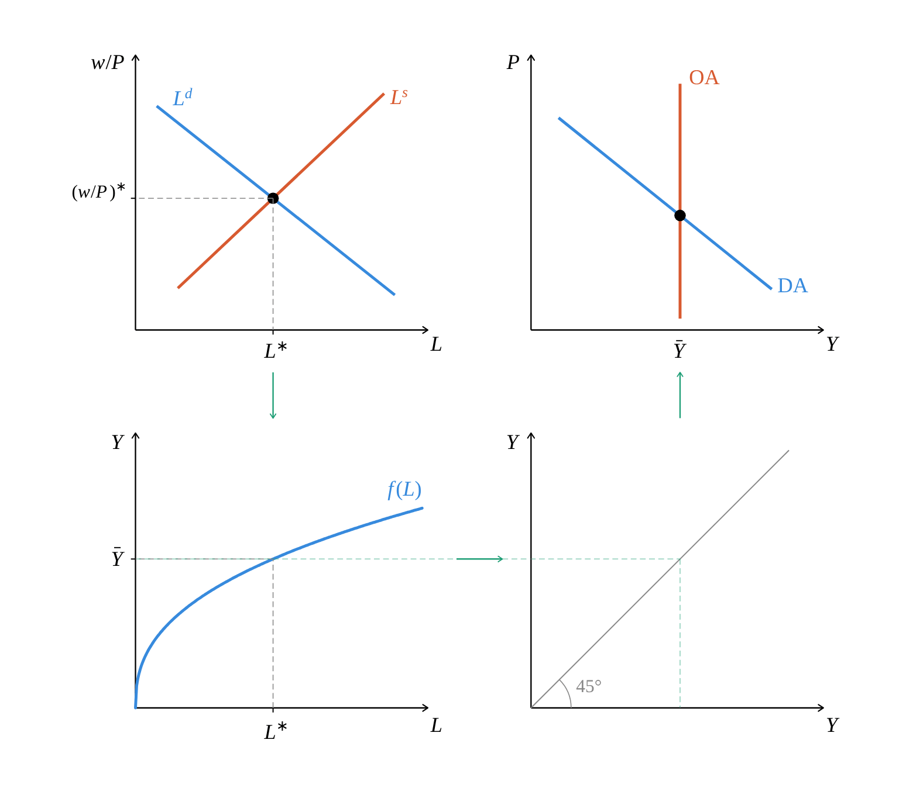

## Introducción

::: {.callout-note appearance="simple" icon=false}

:::

La Gran Depresión (1929-1933) mantuvo durante años un desempleo masivo en las economías industrializadas, algo que la teoría dominante no podía explicar. Para el **macromodelo neoclásico**, que reunía la ley de Say, la flexibilidad de precios y salarios y la teoría cuantitativa del dinero, el desempleo solo podía ser voluntario o friccional, y la economía volvía por sí sola al pleno empleo.

John Maynard Keynes respondió con la *Teoría general de la ocupación, el interés y el dinero* (1936), que rompe con ese marco. En ella, la **demanda efectiva** determina el nivel de producción y de empleo, y la economía puede quedar en un equilibrio con **desempleo involuntario**. El tipo de interés deja de ser el precio que iguala el ahorro y la inversión y pasa a depender de la **preferencia por la liquidez**, mientras que la incertidumbre que rodea a la inversión impide que la economía tienda por sí sola al pleno empleo. Un aumento del ahorro puede incluso reducir la renta (la **paradoja del ahorro**), y de ahí la defensa de una política pública que sostenga la demanda.

La recepción de la obra dio lugar a lecturas muy distintas. Hicks (1937) la tradujo al modelo IS-LM, que la síntesis neoclásica convirtió en el núcleo de la macroeconomía de posguerra, mientras que los poskeynesianos y los keynesianos del desequilibrio sostuvieron que esa traducción perdía lo esencial del mensaje, la incertidumbre y el ajuste por cantidades. El **efecto Pigou** (1943) planteó, por su parte, si la caída de los precios bastaba, a través de los saldos reales, para devolver la economía al pleno empleo. El debate sobre lo que Keynes dijo realmente, que reabrió Leijonhufvud (1968), sigue vivo, y la Gran Recesión y la pandemia devolvieron a primer plano las políticas de demanda de inspiración keynesiana.

Este tema estudia la aportación de John Maynard Keynes mediante la comparación de su macromodelo con el macromodelo neoclásico al que se opuso. Para ello, el tema se organiza en tres partes:

- *Macromodelo neoclásico*: el mercado de trabajo, el mercado de bienes con la ley de Say, el mercado de dinero con la teoría cuantitativa y el modelo de oferta y demanda agregadas.

- *Pensamiento de Keynes*, formalizado en el macromodelo keynesiano: la sustitución de paradigmas, el mercado de trabajo, el modelo IS-LM y el modelo de oferta y demanda agregadas.

- *Reacciones y desarrollos posteriores*: desde el debate sobre los saldos reales hasta la síntesis neoclásica, el poskeynesianismo y los keynesianos del desequilibrio.

## 1. Macromodelo neoclásico: una reconstrucción (Cassel, 1918b; Marshall, 1923; Fisher, 1930; Hicks, 1932; Pigou, 1933)

Los autores neoclásicos se centraron sobre todo en microfundamentar el pensamiento clásico, pero su teoría macroeconómica (teorías del ciclo, del crecimiento y monetarias) no estaba unificada antes de los años veinte. A partir de entonces, autores como John Hicks, Irving Fisher y Arthur Pigou se esforzaron por poner en contacto las teorías del ciclo con otras teorías económicas[^a04-59].

### 1.1. Principales rasgos

**Metodología**: la microfundamentación permitía aplicar modelos de equilibrio general al funcionamiento de la economía en su conjunto.

**Supuestos**:

- *Entorno*: los autores neoclásicos siguen la concepción clásica, “utópica”, de las condiciones en que se desarrolla la actividad económica:

    - *Cumplimiento de la ley de Say*: toda oferta genera su propia demanda[^a04-1].

    - *Ausencia de fallos de mercado*: la información es perfecta y no existen poder de mercado, bienes públicos ni rigideces, de ahí que los precios y salarios sean perfectamente flexibles y todos los agentes, precio-aceptantes.

    - *Dicotomía clásica*: la economía real (oferta y demanda de bienes y servicios) puede modelizarse y tratarse por separado de la economía monetaria (oferta y demanda de dinero)[^a04-5].

- *Agentes*: son perfectamente racionales, en línea con la idea clásica del *homo economicus*.

**Ajuste**: de las características institucionales y la racionalidad de los agentes se deriva un mecanismo de ajuste walrasiano, vía precios plenamente flexibles (el salario real y el tipo de interés real).

**Política económica**: apoyan el no intervencionismo, porque las políticas de demanda no alteran la renta real ni el empleo (§1.5.2).

### 1.2. Mercado de trabajo

El modelo macroeconómico neoclásico es un **modelo de oferta**, porque, según la ley de Say, la causalidad de la actividad económica nace en la oferta de bienes y servicios. La oferta agregada se obtiene del mercado de trabajo, que determina el nivel de empleo, y de la función de producción agregada, que lo convierte en producto ofrecido (§1.5.1). Las dos curvas del mercado de trabajo, la oferta y la demanda, proceden de la extensión del análisis marginal a los salarios y el empleo, sobre todo en John Hicks (1932) y Arthur Pigou (1933).

#### 1.2.1. Oferta de trabajo

El punto de partida es la decisión del consumidor-trabajador, que reparte su dotación de tiempo entre trabajo y ocio para maximizar su utilidad. En el óptimo iguala la tasa subjetiva a la que está dispuesto a intercambiar consumo y ocio (su relación marginal de sustitución) con el salario real, precio relativo de ambos bienes (el programa se recoge en el anexo, apartado A.1).

Si el efecto sustitución domina al efecto renta, la agregación, en sentido amplio, de las ofertas individuales de trabajadores homogéneos y con plena movilidad da una oferta de trabajo agregada creciente con el salario real:

$$L^{s} = L^{s}\left(\frac{w}{P}\right), \quad \frac{\partial L^{s}}{\partial (w/P)} > 0$$

#### 1.2.2. Demanda de trabajo

Las empresas contratan trabajo solo como medio para producir bienes, de ahí que su demanda sea *derivada*. Con el *stock* de capital fijo del corto plazo, cada empresa competitiva maximiza su beneficio ampliando la plantilla mientras la productividad marginal del trabajo supere el salario real, hasta que ambos se igualan, $\partial f/\partial L = w/P$ (el programa se recoge en el anexo, apartado A.2).

De la agregación de las demandas individuales se obtiene una demanda de trabajo agregada decreciente con el salario real, de acuerdo con el principio de productividad marginal decreciente:

$$L^{d} = L^{d}\left(\frac{w}{P}\right), \quad \frac{\partial L^{d}}{\partial (w/P)} < 0$$

Como las empresas son salario-aceptantes, la causalidad va desde el salario hasta el empleo demandado. Esta dirección causal será uno de los puntos de ruptura de Keynes (§2.2.2).

::: {.callout-note appearance="simple" icon=false}
Los programas de elección consumo-ocio y de maximización del beneficio, con sus CPO y CSO, la estática comparativa y la evidencia empírica sobre las funciones de oferta y demanda de trabajo se desarrollan en el tema [A25](a25-oferta-trabajo.qmd), apartados 1.2 y 1.3. La visión neoclásica del desempleo, en contraste con la keynesiana, se narra en el tema [A28](a28-tnp-nairu.qmd), apartado 1.1.
:::

#### 1.2.3. Equilibrio en el mercado de trabajo: el pleno empleo

**Equilibrio**: del cruce entre las curvas de oferta y demanda de trabajo agregadas (figura -@fig-a041-macromodelo-neoclasico, panel del mercado de trabajo) se obtiene un equilibrio único, estable y eficiente (en el sentido paretiano), en el que la cantidad de trabajo de equilibrio equivale al nivel de pleno empleo de recursos de la economía. El salario real, que todos toman como dado, es un indicador perfecto de la escasez de trabajo.

Cuando se cumplen todos los supuestos neoclásicos, nadie está parado contra su voluntad. Solo quedan el paro friccional de búsqueda y los “no participantes”, que dedican todo su tiempo al ocio. El *desempleo involuntario* (desempleo clásico), en cambio, requiere alguna rigidez que impida el ajuste salarial. Su causa es siempre un salario real demasiado alto, con el que la oferta de trabajo supera a la demanda.

**Estática comparativa**:

- *Políticas de demanda*: si la política fiscal o la monetaria mueven los precios, los salarios nominales varían en la misma proporción, así que las empresas mantienen sus planes de producción.

- *Perturbación de oferta*: un aumento de la productividad marginal del trabajo (progreso técnico o mayor *stock* de capital) desplaza la demanda de trabajo hacia la derecha y eleva el salario real y el empleo de equilibrio.

**Dinámica**: con salario nominal y precios perfectamente flexibles, cualquier perturbación se corrige automáticamente. Por ejemplo, un exceso de oferta de trabajo reduce el salario real hasta volver al equilibrio, y viceversa. La flexibilidad del salario real es así la primera línea de defensa de la no intervención (§1.5.2).

### 1.3. Mercado de bienes y servicios

La demanda real de bienes, o **gasto agregado**, está compuesta por el gasto privado en consumo, el gasto privado en inversión y el gasto público, todos ellos en términos reales y agregados:

$$Y^d = C(Y, r) + I(r) + G_0$$

donde $C(Y,r)$ denota la demanda de consumo, $I(r)$ la de inversión privada y $G_0$ el gasto público, exógeno como los ingresos públicos netos de transferencias, $T_0$.

Con la dicotomía clásica, este gasto real no fija ni la producción ni los precios. La producción la fijan el mercado de trabajo y la función de producción (§1.2 y §1.5.1), y el tipo de interés real se ajusta en el mercado de fondos prestables para que el gasto iguale esa producción a cualquier nivel de precios (§1.3.3 y §1.3.4). Por tanto, el gasto solo decide cómo se reparte la producción entre consumo, inversión y gasto público.

#### 1.3.1. Demanda de consumo

Para los neoclásicos, el consumo no tiene más papel que cubrir las necesidades del momento y se considera poco más que un residuo del ahorro. Existen dos formas de construir la función de consumo agregada:

**Fisher** (1930): es la forma original, derivada del modelo de consumo intertemporal en dos periodos. El consumo real agregado es una función creciente de la renta y, si el efecto sustitución domina al efecto renta, decreciente del tipo de interés real, $C = C(Y^{+}, r^{-})$. Correlativamente, el ahorro es creciente en el tipo de interés real, $S_F = S_F(r^{+})$. Con esta formulación se cumplen la dicotomía clásica y la neutralidad del dinero (el agregado monetario no forma parte de la riqueza).

**Pigou** (1943): si se considera, además, el efecto saldos reales o *efecto Pigou* (§3.1.2), el consumo depende también de la riqueza real neta, $C = C(Y^{+}, r^{-}, W^{+})$.

#### 1.3.2. Demanda de inversión

Nadie atesora dinero, así que todo el ahorro acaba convertido en inversión. En la “segunda aproximación” de Irving Fisher, la tasa de retorno marginal sobre el coste se iguala al tipo de interés real, de modo que, con productividad marginal del capital decreciente, cuanto mayor es el tipo de interés, menor es la inversión que resulta rentable. De aquí se obtiene una función de demanda de inversión agregada decreciente en el tipo de interés real:

$$I = I(r), \quad \frac{\partial I}{\partial r} < 0$$

::: {.callout-note appearance="simple" icon=false}
La derivación de la función de consumo neoclásica a partir del modelo intertemporal de Fisher se desarrolla en el tema [A33](a33-demanda-consumo.qmd), apartados 1.1 y 2.1. La de la demanda de inversión (tasa de retorno sobre el coste) y el mercado de fondos prestables, con los efectos de las políticas fiscal y monetaria, se encuentra en el tema [A34](a34-demanda-inversion.qmd), apartado 1.1.
:::

#### 1.3.3. Equilibrio: la ley de Say

Con base en estas consideraciones se puede obtener el equilibrio en el mercado de bienes y servicios finales[^a04-10]:

$$Y^d = C(Y, r) + I(r) + G_0 \tag{1}$$

$$Y = C(Y, r) + S_F(r) + T_0 \tag{2}$$

$$Y^d = Y \;\rightarrow\; I = S_F + (T_0 - G_0) = S_F + S_G \tag{3}$$

$$S = I \tag{4}$$

La ecuación (1) recoge el comportamiento del gasto y (2) es la identidad que reparte la renta entre consumo, ahorro e impuestos. La condición de equilibrio es (3). Si la demanda de bienes coincide con la oferta de pleno empleo, el mercado se vacía y la inversión se financia con el ahorro privado y el público, $S_G = T_0 - G_0$. Por último, (4) reescribe (3) como igualdad entre ahorro nacional e inversión nacional.

Las características institucionales del mercado de trabajo garantizan el pleno empleo, y la ley de Say, el vaciado del mercado de bienes. Por ello, clásicos y neoclásicos sostenían que la renta de equilibrio, a corto y a largo plazo, era la de pleno empleo.

#### 1.3.4. Ajuste en el mercado de bienes (teoría no monetaria del interés): la flexibilidad del tipo de interés natural

Si la flexibilidad del salario real era la primera línea de defensa de la tesis del pleno empleo, la segunda es la **flexibilidad del tipo de interés real**, que garantiza que cambios exógenos en el gasto agregado no perturban el mercado de bienes y servicios.

**Origen**: para explicar cómo se determina el tipo de interés real, varios autores, de Mill (1848) a Fisher (1907), plantean una teoría no monetaria del interés basada en el mercado de fondos prestables[^a04-11].

**Idea**: en ese mercado concurren el ahorro de los consumidores, la inversión de las empresas y el déficit del sector público, y el tipo de interés real[^a04-12] equilibra ese intercambio, que se canaliza mediante bonos o promesas de pago futuras.

**Planteamiento**: el modelo consta de dos funciones:

- *Oferta de fondos prestables (demanda de bonos)*: es el ahorro privado, $S_F(r^{+})$. El tipo de interés real remunera, por tanto, la espera, es decir, el aplazamiento del consumo.

- *Demanda de fondos prestables (oferta de bonos)*: es la inversión privada, $I(r^{-})$, más el déficit público exógeno, $(G_0 - T_0)$, que el sector público financia mediante la emisión de deuda.

**Equilibrio**: de la interacción de ambas se obtiene el tipo de interés real de equilibrio, que reescribe la condición (3) en términos del déficit público:

$$S_F(\bar{r}) = I(\bar{r}) + (G_0 - T_0)$$

El equilibrio es único y estable. El tipo de interés de equilibrio, $\bar{r}$, es el *tipo de interés natural*, término acuñado por Knut Wicksell (1898). Se determina por fuerzas reales (el ahorro y la productividad marginal del capital), es compatible con la estabilidad de precios y es el valor hacia el que gravita a largo plazo el tipo de interés monetario, $i$, que se determina en los mercados monetarios.

**Estática comparativa**: el tipo de interés natural solo varía con las perturbaciones reales que desplazan la oferta o la demanda de fondos prestables (véase la figura del tema [A34](a34-demanda-inversion.qmd), apartado 1.1.2):

- *Política fiscal*: un aumento del déficit público eleva la demanda de fondos prestables y el tipo de interés natural, y expulsa inversión privada y consumo (§1.5.2).

- *Perturbaciones reales*: un aumento de la propensión al ahorro reduce el tipo de interés natural y eleva la inversión, mientras que una mejora de la productividad marginal del capital lo eleva, junto con el ahorro y la inversión.

**Conclusiones**:

- *Aspectos positivos*: ofrece una explicación real del tipo de interés, ligada al ahorro y a la productividad del capital, y su concepto de tipo de interés natural pervive como referencia de la política monetaria en la nueva economía keynesiana.

- *Limitaciones*: Keynes le objetó que el ahorro depende sobre todo de la renta, de modo que su igualdad con la inversión se alcanza mediante variaciones de la renta y no del tipo de interés. Le objetó también que el tipo de interés es un fenómeno monetario, la recompensa por renunciar a la liquidez (§2.3.3).

### 1.4. Mercado de dinero: la teoría cuantitativa (Fisher y Cambridge)

Por la dicotomía clásica, el análisis anterior se refiere solo a la economía real, mientras que la economía monetaria se explica a través de la teoría cuantitativa del dinero.

**Origen**: la relación proporcional entre dinero y precios había sido ya anunciada por M. de Azpilcueta y la escuela de Salamanca (1556)[^a04-20], J. Bodin (1568) y, con mayor difusión, D. Hume (1752). Su análisis formal corresponde a dos corrientes independientes, el enfoque de Fisher (1911), macroeconómico y centrado en los factores institucionales, y el de Cambridge (1917), microeconómico y centrado en las decisiones individuales.

**Idea**: la teoría cuantitativa es una teoría sobre las causas de los cambios del valor del dinero, cuya conclusión es que, a largo plazo, el nivel general de precios guarda una relación proporcional con la cantidad de dinero. En ambos enfoques la oferta de dinero es exógena y determinada por las autoridades monetarias.

**Razonamiento**: Fisher reinterpreta causalmente, de izquierda a derecha, la identidad contable del gasto (la “ecuación de cambio”), y deja el nivel de precios como única incógnita del modelo. La escuela de Cambridge, por su parte, llega a la “ecuación de Cambridge” a partir de la idea de que los agentes desean mantener una fracción $k$ de su renta en forma de saldos de caja:

$$MV = PY \qquad \Longleftrightarrow \qquad M^d = kPY, \quad k = \frac{1}{V}$$

La demanda de dinero es “mecanicista” y muy estable, ya que el dinero solo se usa como medio de cambio. Así, $V$ (o la $k$ de Cambridge) queda determinada por factores institucionales y no por el tipo de interés, si bien el enfoque de saldos de caja admite que este pueda afectar a la demanda de dinero.

Se cumple, por tanto, la *neutralidad del dinero*. Como la renta se determina en el mercado de trabajo y $V$ es estable, el dinero es un velo, y sus variaciones solo mueven en la misma proporción los precios y los salarios nominales.

::: {.callout-note appearance="simple" icon=false}
La derivación de los enfoques de las transacciones (Newcomb-Fisher) y de los saldos de caja (Cambridge) se desarrolla en el tema [A35](a35-demanda-dinero.qmd), apartado 1.1, y su lectura como teoría neoclásica de la inflación, en el tema [A41](a41-inflacion.qmd), apartado 2.1.1.
:::

**Conclusiones**:

- *Aspectos positivos*: explica la relación de largo plazo entre la cantidad de dinero y el nivel de precios, que la evidencia confirma sobre todo en los países con inflación elevada (De Grauwe y Polan, 2005), y es la base de la reformulación monetarista de Friedman.

- *Limitaciones*: trata la velocidad de circulación como un dato institucional, cuando la demanda de dinero depende también del tipo de interés, como mostrará la preferencia por la liquidez de Keynes (§2.3.3), y en la práctica la velocidad ha resultado inestable.

### 1.5. Macromodelo neoclásico OA-DA

La aportación neoclásica se resume en un modelo de oferta y demanda agregada con precios flexibles. La oferta agregada, derivada del mercado de trabajo, fija la producción, y la demanda agregada, derivada de la teoría cuantitativa, solo el nivel de precios. Esta demanda agregada no es el gasto real del §1.3. Como, con la dicotomía clásica, el tipo de interés iguala ese gasto con $\bar{Y}$ a cualquier nivel de precios, lo único que liga el gasto con los precios es el dinero. La DA recoge así las combinaciones de renta y precios compatibles con la ecuación de cambio, $PY = MV$, para $M$ y $V$ dados.

#### 1.5.1. Oferta y demanda agregada

**Oferta agregada**: al sustituir el nivel de empleo de equilibrio, $L^*$ (§1.2.3), en la función de producción agregada, con el *stock* de capital $\bar{K}$ dado en el corto plazo, se obtiene la oferta agregada de bienes[^a04-8]:

$$Y = f(\bar{K}, L) \;\rightarrow\; Y^{s} = f(\bar{K}, L^*)$$

La oferta agregada neoclásica es así totalmente rígida al tipo de interés real y a los precios, y vertical en los planos renta-tipo de interés y renta-precios.

**Desarrollo gráfico**: el macromodelo neoclásico se representa en el plano renta real-precios, con los paneles auxiliares del mercado de trabajo, la función de producción y la recta de 45° (figura -@fig-a041-macromodelo-neoclasico):

1. *Mercado de trabajo*: en el plano empleo-salario real, el cruce de la demanda de trabajo, $L^d$, y la oferta, $L^s$, fija el pleno empleo, $L^*$, y el salario real $(w/P)^*$.

2. *Función de producción*, $f(L)$: traslada $L^*$ a la producción de pleno empleo, $\bar{Y}$.

3. *Recta de 45°*: lleva $\bar{Y}$ al eje horizontal del plano renta real-precios.

4. *Oferta agregada*, $\text{OA}$: vertical en $\bar{Y}$, porque la producción no depende de los precios.

5. *Demanda agregada*, $\text{DA}$: procede de la ecuación de cambio (§1.4), $Y = MV/P$, y es decreciente porque, con $MV$ dado, un nivel de precios más alto compra menos producción.

6. *Equilibrio*: en el corte de la OA y la DA, la renta es $\bar{Y}$ y la demanda agregada solo fija el nivel de precios.

::: {#fig-a041-macromodelo-neoclasico}

::: {.content-visible when-format="html"}
```{=html}
<div class="graph-frame wide">
<iframe src="../graphs/a041_macromodelo_neoclasico.html" style="--r:1.147" loading="lazy" title="fig-a041-macromodelo-neoclasico"></iframe>
</div>
```
:::

::: {.content-visible unless-format="html"}

:::

Macromodelo neoclásico. El mercado de trabajo determina el empleo y la producción de pleno empleo. La oferta agregada es vertical y la demanda agregada (teoría cuantitativa) solo fija el nivel de precios.
:::

#### 1.5.2. Implicaciones de política económica

En el paradigma neoclásico, las políticas de demanda (fiscales o monetarias) no influyen en la renta real ni en el empleo, y las de oferta sí pueden hacerlo:

- *Política monetaria*: una expansión monetaria puede reducir transitoriamente el tipo de interés de mercado por debajo del natural (el proceso acumulativo de Wicksell). Sin embargo, el exceso de demanda de bienes resultante se corrige con una subida proporcional de precios y salarios nominales, sin efectos reales (neutralidad del dinero) y sin alterar el tipo de interés natural (§1.3.4). Su papel debe ceñirse, por tanto, a dar liquidez a la economía y contener la inflación.

- *Política fiscal*: una expansión fiscal obliga a captar más recursos en el mercado de fondos prestables, eleva así el tipo de interés real y expulsa consumo e inversión privados por un importe idéntico al aumento del gasto público, con un efecto expulsión (*crowding out*) total[^a04-60]. No afecta a la renta real ni al empleo, solo al tipo de interés real y a la composición del gasto, y, con la velocidad de circulación fijada por factores institucionales (§1.4), tampoco al nivel de precios. Por ello debe cumplirse la regla del presupuesto equilibrado en todo momento[^a04-19].

- *Políticas de oferta*: la intervención solo se justifica para eliminar los obstáculos institucionales que impidan cumplir los supuestos del modelo (p. ej. rigideces salariales). En cambio, los tributos sobre el trabajo, las subvenciones o los programas de formación sí afectan a la renta real y al empleo.

### 1.6. Conclusiones

**Aspectos positivos**: los esfuerzos de autores neoclásicos como Cassel, Marshall, Pigou o Fisher permitieron integrar muchas de las relaciones en un primer intento de modelar el ámbito agregado de la economía.

**Limitaciones**:

- *Ley de Say*: es un eslabón débil del modelo. Solo resulta plenamente válida en una economía de trueque, porque en una economía monetaria exige suponer que el dinero sirve únicamente como medio de pago y que nadie lo atesora.

- *Dicotomía*: es poco plausible considerar una independencia estricta (es decir, a corto y largo plazo) entre el sector real y el monetario.

- *Política económica*: la defensa del *laissez faire* (p. ej. la regla del presupuesto equilibrado) puede no ser aconsejable.

## 2. Pensamiento de Keynes: macromodelo keynesiano (Keynes, 1936; Hicks, 1937; Modigliani, 1944; Hansen, 1953)

Las predicciones neoclásicas no se ajustaron a la evidencia de la Gran Depresión (1929-1933) y su elevado desempleo involuntario, que está en el origen de la obra de Keynes. Su *Teoría general de la ocupación, el interés y el dinero* (1936) supone una sustitución de paradigmas, en términos de Kuhn, y sienta las bases de la escuela keynesiana. En su *Tratado sobre el dinero* (1930), los desequilibrios entre ahorro e inversión, originados por la divergencia entre el tipo de interés de mercado y el natural, se ajustaban vía nivel de precios y beneficios extraordinarios. En la *Teoría general*, en cambio, la principal variable de ajuste es la producción y, con ella, la renta.

Keynes no presentó su teoría como un modelo formal. Por eso se expone con el modelo renta-gasto con mercado de trabajo (IS-LM con mercado de trabajo), en su versión con microfundamentación puramente keynesiana, que resume con sencillez la interacción entre la economía real y la monetaria.

El modelo de la síntesis neoclásica, cuya formación se narra en el tema [A05](a05-monetaristas-snc.qmd), apartado 1.1, reúne el diagrama IS-LM de Hicks (*Mr. Keynes and the Classics*, 1937)[^a04-61], que Alvin Hansen (1953) difundió en Estados Unidos, el mercado de trabajo con salario nominal rígido de Modigliani (1944) y el aspa keynesiana de Samuelson (1948a). El modelo de la síntesis perseguía formalizar las ideas de Keynes y aunarlas con las neoclásicas (§2.4.3).

Los supuestos iniciales son corto plazo, economía cerrada y cuatro mercados (trabajo, bienes, dinero y bonos), de los que el de bonos queda implícito por la ley de Walras (§2.3.3). Como primera aproximación se suponen precios fijos, un supuesto que se levanta en el §2.4. Con ellos, la oferta agregada se adapta pasivamente a la demanda y el tipo de interés real coincide con el nominal, $r = i$.

### 2.1. Principales rasgos: la sustitución de paradigmas

**Metodología**: Keynes combina el razonamiento inductivo con el deductivo en una teoría “realítica” (realista y analítica), en la expresión de Landreth y Colander.

**Supuestos**:

- *Entorno*: presenta importantes diferencias con la concepción clásica:

    - *Ley de Say*: Keynes invierte la relación causal clásica entre oferta y demanda, y la *demanda efectiva*, es decir, los ingresos que los empresarios esperan obtener de sus ventas, pasa a determinar la producción y el empleo. Una insuficiencia de demanda efectiva restringe así la producción a corto plazo y puede dar lugar a desempleo involuntario.

    - *Incertidumbre radical*: la imposibilidad de reducir el futuro a un riesgo cuantificable probabilísticamente hace que las expectativas desempeñen un papel central (si bien Keynes no ofrece un modelo de formación de estas).

    - *Rigidez salarial nominal a la baja*: convive con precios flexibles (competencia perfecta en el mercado de bienes), y Keynes la atribuye a la preocupación de los trabajadores por su salario relativo (§2.2.1). Además, sostiene que, aunque los salarios fueran flexibles, su bajada no garantizaría el pleno empleo (§3.1.1).

    - *No dicotomía*: Keynes no distingue de forma explícita entre economía monetaria y economía real.

- *Agentes*: como los neoclásicos, Keynes cree que los individuos se mueven por el interés personal, pero deciden bajo incertidumbre radical y se apoyan en convenciones y en los *animal spirits*. La lectura habitual de su mercado de trabajo añade la *ilusión monetaria* de los trabajadores (§2.2.1)[^a04-22].

**Ajuste**: a diferencia del modelo neoclásico, Keynes se inspira en Malthus y Marshall y considera un *mecanismo marshalliano*, es decir, de ajuste vía cantidades. Las variables de ajuste son las existencias empresariales (la inversión no planeada) y, a través de ellas, la producción y la renta.

**Política económica**: aboga por un mayor intervencionismo, sobre todo por el lado de la demanda (§2.4.2).

### 2.2. Mercado de alquiler de trabajo

Keynes se opone al modelo neoclásico del mercado de trabajo, siempre en pleno empleo, y concibe la posibilidad de desempleo involuntario[^a04-62] incluso cuando existe competencia perfecta en el mercado de bienes y servicios[^a04-24]. Para Keynes, los salarios no solo son un coste para las empresas, sino renta de los trabajadores, de modo que la demanda agregada desempeña un papel esencial en el mercado de trabajo.

#### 2.2.1. Oferta de trabajo

**Idea**: la *Teoría general* prescinde de una curva de oferta de trabajo. Su argumento suele leerse en clave de ilusión monetaria, según la cual los trabajadores fijan sus exigencias en salario nominal y no en salario real, es decir, maximizan su utilidad sin atender al nivel de precios[^a04-26].

**Razonamiento**: la ilusión monetaria tiene dos implicaciones en función de si suben o bajan los precios:

- *Bajada de precios*: los trabajadores ven en cualquier rebaja del salario nominal una merma de su poder adquisitivo y de su posición relativa, y se oponen a ella. Por ello, el salario nominal presenta rigidez a la baja y en el tiempo, con un mínimo, $w_m$, fijado por factores institucionales.

- *Subida de precios*: los trabajadores negocian sin reparar en el alza de precios, así que aceptan un salario real menor y se avienen a trabajar más horas[^a04-28]. Esta conducta asimétrica solo es irracional en apariencia, pues se explica por el salario relativo. Cada trabajador vigila su lugar en la escala salarial, y una subida generalizada de los precios, al afectar a todos por igual, deja intacto su salario real relativo.

Por ello, aunque precios y tipo de interés sean flexibles y haya competencia perfecta, el pleno empleo no está garantizado, y puede alcanzarse sin esas condiciones[^a04-29]. Con todo, tampoco la rigidez salarial nominal es condición necesaria ni suficiente para la existencia de desempleo involuntario:

1. *No necesaria*: también puede existir desempleo involuntario por causa de los dos eslabones débiles de Keynes (apartados 2.3.2 y 2.3.3) u otras rigideces.

2. *No suficiente*: con demanda agregada suficiente, el desempleo es voluntario (§2.2.3).

Formalmente, la oferta de trabajo agregada se puede definir como una función a trozos del salario ofrecido:

$$
L^{s}=L^{s}(w), \qquad
\begin{cases} L^{s}=0 \qquad \forall w<w_m \\ L^{s}>0 \qquad \forall w\geq w_m \end{cases}
$$
donde $w$ es el salario de mercado y $w_m$ el suelo del salario nominal por debajo del cual los agentes no ofrecen trabajo. No debe confundirse con un salario de reserva, porque no refleja la valoración individual del ocio, sino una norma institucional sobre el salario nominal.

**Desarrollo gráfico**: en el plano empleo-salario nominal[^a04-31] (figura -@fig-a045-oferta-trabajo-keynesiana), la oferta de trabajo agregada presenta tres tramos:

1. *Tramo horizontal*: es perfectamente elástico en el nivel de salario mínimo, porque el desempleo involuntario es tan alto que los trabajadores están dispuestos a trabajar a ese salario (aunque no a menos).

2. *Tramo creciente*: aparece conforme la economía se reactiva y los sindicatos ganan fuerza.

3. *Tramo rígido*: corresponde al momento en que se alcanza el pleno empleo de recursos.

Si el equilibrio en el mercado de trabajo se da en el tramo horizontal (punto 0), el desempleo involuntario, $U_I$, es la diferencia entre el empleo de equilibrio al salario mínimo, $L^*$, y el nivel de empleo a partir del cual la oferta de trabajo es creciente, $L_1$. Entre $L_1$ y $\bar{L}$, en cambio, el paro es voluntario, $U_V$, porque esos trabajadores solo ofrecerían su trabajo a un salario mayor.

::: {#fig-a045-oferta-trabajo-keynesiana}

::: {.content-visible when-format="html"}
```{=html}
<div class="graph-frame">
<iframe src="../graphs/a045_Oferta_trabajo_keynesiana.html" style="height:580px" loading="lazy" title="fig-a045-oferta-trabajo-keynesiana"></iframe>
</div>
```
:::

::: {.content-visible unless-format="html"}

:::

Oferta de trabajo keynesiana. Con el salario nominal rígido a la baja en $w_m$, la oferta es horizontal hasta $L_1$, creciente hasta el pleno empleo y vertical en $\bar{L}$. En el equilibrio 0 hay desempleo involuntario, $U_I$, y, entre $L_1$ y $\bar{L}$, voluntario, $U_V$.
:::

**Conclusiones**:

- *Aspectos positivos*: al impedir que el salario nominal baje, hace depender el empleo de la demanda agregada, y fundamenta esa rigidez en la preocupación por el salario relativo, sin atribuir a los trabajadores una conducta irracional.

- *Limitaciones*: justifica la rigidez del salario nominal de forma informal, sin un modelo de la conducta de trabajadores y empresas que la explique. Además, la lectura habitual de esta oferta de trabajo en términos de ilusión monetaria no resiste la incorporación de las expectativas de inflación, como mostrará la crítica de Friedman y Phelps (tema [A05](a05-monetaristas-snc.qmd), apartado 2.3.2).

#### 2.2.2. Demanda de trabajo

En la demanda de trabajo Keynes sigue a los neoclásicos, con la condición de contratar hasta que $\partial f/\partial L = w/P$, que en el plano $(L, w)$ da una curva decreciente. La única diferencia es que la causalidad va ahora desde el empleo hasta el salario, de modo que una demanda insuficiente de bienes y servicios puede originar desempleo involuntario.

#### 2.2.3. Equilibrio

El equilibrio se obtiene de la intersección de ambas curvas en el plano empleo-salario nominal (figura -@fig-a045-oferta-trabajo-keynesiana). A diferencia del mercado de trabajo neoclásico, caben dos situaciones:

1. *Insuficiencia de demanda agregada*: el equilibrio en el mercado de trabajo se da en el tramo horizontal y hay desempleo involuntario.

2. *Suficiencia de la demanda agregada*: el equilibrio se da en el tramo creciente y el desempleo es voluntario, aunque todavía existen recursos ociosos (§2.4.1).

#### 2.2.4. Implicaciones de política económica

1. *Políticas de demanda*: las expansivas son fundamentales frente a la insuficiencia de demanda agregada y el desempleo involuntario, siempre que existan recursos ociosos.

2. *Políticas de oferta*: Keynes no apoya las reducciones del salario nominal, pues a su juicio solo elevarían el empleo de forma indirecta, a través del efecto Keynes (§3.1.1), al igual que una expansión monetaria.

### 2.3. Mercado de bienes, servicios y dinero: modelo IS-LM

Como la existencia de desempleo involuntario depende de la demanda agregada, el modelo keynesiano está dominado por el lado de la demanda. Además, como Keynes rompe la dicotomía clásica, el mercado de bienes y servicios se trata conjuntamente con el de dinero.

#### 2.3.1. Oferta agregada de bienes y servicios. Oferta agregada de dinero

1. *Oferta de bienes*: como inicialmente se suponen precios fijos, el análisis se centra por ahora en el lado de la demanda.

2. *Oferta de dinero*: Keynes la considera exógena, al igual que los neoclásicos (excepto Wicksell).

#### 2.3.2. Demanda agregada: equilibrio en el mercado de bienes y servicios. Curva IS

La demanda agregada se obtiene de dos relaciones, la IS, con tres componentes (consumo, inversión y gasto público reales), y la LM, que recoge el mercado de dinero.

**Consumo**: frente a su tratamiento residual en el paradigma clásico, el consumo es para Keynes el fin último de la actividad económica y la base del proceso multiplicador. Depende de la renta corriente, y no del tipo de interés, y su relación con ella obedece a una “ley psicológica fundamental”, según la cual, ante una unidad adicional de renta, los consumidores aumentan su consumo, pero en una cantidad menor.

La demanda agregada de consumo es así una función lineal y estable de la renta real absoluta corriente, con un componente autónomo (consumo de subsistencia) y un componente endógeno gobernado por la *propensión marginal a consumir*[^a04-33]:

$$C = C_0 + cY, \quad C_0 > 0, \; c \in (0, 1)$$

El ahorro es entonces un excedente de ingreso, muy poco influido por el tipo de interés. De aquí se deducen dos implicaciones:

- *Multiplicador*: un aumento del gasto autónomo eleva la renta en un múltiplo, $1/(1-c) > 1$, de dicho aumento. El multiplicador keynesiano[^a04-34] muestra que la causalidad va desde la demanda hacia la oferta. Por ello, la política fiscal será muy eficaz sobre la renta, tanto más cuanto mayor sea $c$, y las políticas redistributivas estimularán el consumo, ya que los hogares de menor renta tienen mayor propensión marginal a consumir.

- *Paradoja del ahorro*: un aumento del ahorro autónomo, *ceteris paribus*, reduce la demanda agregada y, vía multiplicador, la renta, de modo que no eleva necesariamente el ahorro agregado y puede obstaculizar el pleno empleo. La paradoja ataca así la defensa clásica del ahorro como fuente del crecimiento.

Las primeras contrastaciones empíricas parecían corroborar la función de consumo keynesiana, pero la evidencia de Simon Kuznets, según la cual la propensión media al consumo es constante a largo plazo[^a04-35], obligó a considerar la renta a largo plazo y la riqueza. De ello se ocuparon la renta relativa y el ciclo vital de la síntesis neoclásica (§3.2) y la renta permanente de Friedman (tema [A05](a05-monetaristas-snc.qmd), apartado 2.2.1).

**Inversión**: Keynes distingue la inversión *planeada*, componente de la demanda agregada, de la *efectiva*, que se integra en la renta nacional y difiere de la primera en la variación no planeada de existencias (§2.3.5). Para invertir la ley de Say, Keynes invierte también la relación entre ahorro e inversión, de modo que la inversión, movida por las expectativas de los empresarios, determina el ahorro.

Quien invierte compra un derecho sobre un flujo de retornos esperados, de modo que, a diferencia del enfoque fisheriano, las expectativas pesan en la decisión. Se invierte mientras la *eficiencia marginal del capital* (EMK), tasa de descuento que iguala el valor actual de los rendimientos esperados con el coste de reemplazo del bien, supere al tipo de interés, coste de oportunidad de la inversión. Como la EMK decrece con el volumen de inversión (caen los rendimientos esperados y sube el coste de reemplazo de los bienes de capital), el óptimo se alcanza cuando $\text{EMK} = r$. De aquí se obtiene una función de demanda de inversión agregada[^a04-37]:

$$I = I(r) = I_0 - vr, \quad v > 0$$

donde $I_0$ es el componente exógeno, que refleja el peso de las expectativas o *animal spirits* y toma un valor elevado, y $v$ mide la sensibilidad de la inversión al tipo de interés, que se considera baja. Esa baja sensibilidad, primer eslabón débil de Keynes, es, junto con la trampa de liquidez (segundo eslabón débil) y la ilusión monetaria, una de las causas del desempleo involuntario.

**Expectativas a largo plazo**: Keynes (1936) distingue las expectativas a corto plazo, sobre los ingresos de la producción en curso, que guían las decisiones de producción y empleo, de las expectativas a largo plazo, sobre los rendimientos futuros de los bienes de capital, que guían la inversión. Como apenas se sabe nada de los rendimientos lejanos, estas últimas dependen del *estado de la confianza* y descansan en una *convención*, la de suponer que la situación presente continuará salvo que haya razones concretas para esperar un cambio. La bolsa, que revalúa a diario las inversiones, hace frágil esa convención, porque el especulador no estima el rendimiento de los activos, sino lo que la opinión media espera que espere la opinión media, como en un *concurso de belleza*. De ahí que la EMK sea inestable y que $I_0$ se desplace con el ánimo de los inversores. La misma raíz convencional tiene el tipo de interés “normal” de la demanda especulativa de dinero (§2.3.3), de modo que la inversión y la preferencia por la liquidez comparten el origen de la inestabilidad keynesiana.

**Gasto público**: Keynes lo considera una variable exógena, $G_0$, al igual que los clásicos, si bien con un papel muy diferente (§2.4.2).

**Curva IS**: agrupando todos los componentes del gasto, la relación IS muestra las combinaciones renta-tipo de interés que mantienen el equilibrio en el mercado de bienes, $Y = C + I + G_0$:

$$Y = \frac{1}{1 - c}\,[C_0 + I_0 + G_0 - vr] = \frac{1}{1 - c}\,[A_0 - vr]$$

donde el primer término es el multiplicador y $A_0$ agrupa los componentes autónomos del gasto. Gráficamente, en el plano renta-tipo de interés, la IS es una recta decreciente (véase la figura del tema [A05](a05-monetaristas-snc.qmd), apartado 1.2.1), ya que al disminuir el tipo de interés aumenta la inversión y, por el multiplicador, la renta de equilibrio. Cuanto menor sea $v$, más inclinada será la IS, y lo es más para los keynesianos que para los monetaristas. Por su parte, los componentes autónomos desplazan la curva.

::: {.callout-note appearance="simple" icon=false}
La función de consumo keynesiana con impuestos, los multiplicadores fiscales, la paradoja del ahorro y la evidencia de Kuznets se desarrollan en el tema [A33](a33-demanda-consumo.qmd), apartado 1.2.1, y la eficiencia marginal del capital y su desarrollo gráfico, en el tema [A34](a34-demanda-inversion.qmd), apartado 1.2. La derivación de la relación IS, su estática comparativa y su análisis gráfico se encuentran en el tema [A05](a05-monetaristas-snc.qmd), apartado 1.2.1, y los efectos de la política fiscal en el IS-LM, en el tema [A38](a38-politica-fiscal.qmd), apartado 1.1.
:::

#### 2.3.3. Demanda agregada: teoría de la preferencia por la liquidez y el equilibrio monetario. Curva LM

**Teoría de la preferencia por la liquidez**: en su teoría monetaria, Keynes solo acepta la teoría cuantitativa como caso límite, pues, bajo supuestos simplificadores, mientras haya desempleo una variación de la cantidad de dinero altera sobre todo el empleo. Solo en pleno empleo los precios varían en la misma proporción que la cantidad de dinero. Keynes enfatiza, además, el papel de la incertidumbre y las expectativas en el corto plazo, y define tres motivos por los que se demanda dinero:

1. *Transacción*: para gastos planeados, por la función del dinero como medio de cambio. Keynes acepta aquí el enfoque de Cambridge, con una demanda real proporcional a la renta real, $M_T^d = M_T^d(Y^{+})$.

2. *Precaución*: para gastos no planeados, debidos a la incertidumbre. *A priori* dependería de la renta y del tipo de interés, $M_P^d = M_P^d(Y^{+}, i^{-})$, pero por simplicidad se asimila al motivo transacción.

3. *Especulación*: deriva de las expectativas sobre la evolución futura del tipo de interés (y, por tanto, del precio de los bonos) y se debe a la función del dinero como depósito de valor, $M_E^d = M_E^d(i^{-})$.

La demanda por motivo especulación es la aportación novedosa de Keynes, pues los otros motivos ya los habían contemplado los neoclásicos, y es la que liga la demanda de dinero al tipo de interés. Para explicar por qué se mantiene riqueza en dinero, activo “estéril”, y no en bonos, que rinden un interés, Keynes se apoya en dos premisas:

1. *Relación inversa*: entre la tasa de rentabilidad de un bono y su precio de mercado[^a04-40][^a04-41].

2. *Valor crítico*: cada individuo piensa que el tipo de interés tiende hacia un valor crítico o tasa normal esperada, $i^e$[^a04-43].

De aquí resulta una demanda especulativa individual discontinua[^a04-44] (figura -@fig-a047-demanda-keynesiana, panel a):

- *Tipo alto* ($i > i^e$): el individuo espera que el tipo caiga y que el precio de los bonos suba, y mantiene toda su riqueza en bonos ($M_E^d/P = 0$).

- *Tipo bajo* ($i < i^e$): espera que el tipo suba y que el precio de los bonos caiga, y mantiene toda su riqueza en dinero ($M_E^d/P = W$).

Al agregar individuos con valores críticos dispares, la demanda especulativa agregada resulta una función continua, decreciente y convexa del tipo de interés.

**Función de demanda de dinero**: de la suma de los tres motivos se obtiene la demanda real de dinero agregada keynesiana, que en su versión lineal es:

$$\frac{M^d}{P} = L(Y^{+}, i^{-}) = kY - hi$$

donde $k > 0$ recoge la demanda por transacción y precaución como fracción de la renta real y $h > 0$ la sensibilidad de la demanda especulativa al tipo de interés, coste de oportunidad de mantener saldos monetarios. Keynes supone que $h$ es elevada y que el componente especulativo, gobernado por expectativas volátiles, hace muy inestable la demanda de dinero, a diferencia del término $kY$. Lo esencial es que la demanda de dinero ya no solo depende de la renta, sino también del tipo de interés, entendido no como una recompensa a la abstinencia del consumo, sino como una retribución por renunciar a la liquidez[^a04-47].

**El otro eslabón débil: la trampa de liquidez**: es un estado de la economía en el cual los agentes estiman que el tipo de interés ha alcanzado un suelo y ha de subir. Cada agente cuyo valor crítico supere el tipo efectivo guarda toda su riqueza en dinero, y cuanto más baja el tipo, más agentes se encuentran en ese caso. Por ello, si el tipo es lo suficientemente bajo (figura -@fig-a047-demanda-keynesiana, panel b), la demanda de dinero se vuelve perfectamente elástica al tipo de interés ($h \rightarrow \infty$). Cualquier aumento de la cantidad de dinero se mantiene entonces en efectivo, sin destinarse a bonos ni rebajar el tipo de interés, por lo que la política monetaria es totalmente inefectiva y la fiscal, especialmente potente. Sin embargo, Keynes presentó la trampa de liquidez como un caso límite del que no conocía ejemplos[^a04-63].

::: {#fig-a047-demanda-keynesiana}

::: {.content-visible when-format="html"}
```{=html}
<div class="graph-frame wide">
<iframe src="../graphs/a047_Demanda_keynesiana.html" style="--r:1.447" loading="lazy" title="fig-a047-demanda-keynesiana"></iframe>
</div>
```
:::

::: {.content-visible unless-format="html"}

:::

Demanda de dinero keynesiana. La demanda especulativa individual, $M_E^d/P$, es nula si $i > i^e$ y igual a la riqueza, $W$, si $i < i^e$, de modo que es discontinua en el tipo crítico $i^e$ (a). La demanda agregada, $L(Y_0, i)$, tiende a $kY_0$ con tipos altos, es decreciente y convexa y se vuelve horizontal en $i_{\min}$, la trampa de liquidez (b). La curva discontinua, $L(Y_0, i)'$, es su desplazamiento ante un cambio de expectativas.
:::

**Curva LM**: dado que la oferta real de dinero es exógena, $M^s/P$, la relación LM recoge los pares renta-tipo de interés que mantienen el mercado de dinero (y, por la ley de Walras, el de bonos) en equilibrio, $M^s/P = kY - hi$[^a04-48]:

$$i = \frac{1}{h}\left[kY - \frac{M^s}{P}\right]$$

Gráficamente, en el plano renta-tipo de interés, la LM es una recta creciente, de pendiente $k/h$, porque al aumentar la renta aumenta la demanda de dinero por motivo transacción y el tipo de interés sube para racionarla. Para Keynes, por tanto, el tipo de interés se determina por fuerzas monetarias, en el mercado de dinero, y no por fuerzas reales en el mercado de fondos prestables como para los neoclásicos. Cuanto mayor es $h$, más plana es la LM, que es horizontal en la trampa de liquidez. El debate con los monetaristas, para quienes $h \approx 0$ y la LM es casi vertical, se recoge en el tema [A05](a05-monetaristas-snc.qmd), apartado 2.2.4.

::: {.callout-note appearance="simple" icon=false}
La teoría de la preferencia por la liquidez (supuestos, modelo, desarrollo gráfico y valoración) se desarrolla en el tema [A35](a35-demanda-dinero.qmd), apartado 1.2, y la derivación de la relación LM, su estática comparativa y su análisis gráfico, en el tema [A05](a05-monetaristas-snc.qmd), apartado 1.2.1.
:::

#### 2.3.4. Equilibrio en el mercado de bienes y dinero

**Equilibrio**: en el plano renta real-tipo de interés (figura -@fig-a048-pm-expansiva), el cruce de las curvas IS y LM da el equilibrio de la economía por el lado de la demanda agregada.

**Estática comparativa**:

- *Política monetaria*: un aumento de la oferta monetaria desplaza la LM hacia la derecha, de $\text{LM}_0$ a $\text{LM}_1$, reduce el tipo de interés y eleva la renta, tanto más cuanto más inclinada sea la LM (menor $h$) y más plana la IS (mayor $v$).

::: {#fig-a048-pm-expansiva}

::: {.content-visible when-format="html"}
```{=html}
<div class="graph-frame">
<iframe src="../graphs/a048_PM_expansiva.html" style="height:580px" loading="lazy" title="fig-a048-pm-expansiva"></iframe>
</div>
```
:::

::: {.content-visible unless-format="html"}

:::

Equilibrio IS-LM y política monetaria expansiva. El cruce de la IS y la $\text{LM}_0$ da el equilibrio inicial, punto 0, con renta $Y_0$ y tipo de interés $i_0$. Un aumento de la oferta monetaria ($\Delta M^s > 0$) desplaza la LM a la derecha, hasta $\text{LM}_1$, y en el nuevo equilibrio, punto 1, el tipo de interés baja a $i_1$ y la renta sube a $Y_1$.
:::

- *Política fiscal*: un aumento del gasto público desplaza la IS hacia la derecha y eleva la renta y el tipo de interés. Sin embargo, la subida del tipo de interés expulsa inversión privada, de modo que, salvo en la trampa de liquidez, el efecto sobre la renta es menor que el del multiplicador simple, $1/(1-c)$. El efecto sobre la renta es tanto mayor cuanto más plana sea la LM (mayor $h$) y más inclinada la IS (menor $v$).

#### 2.3.5. Ajuste en el mercado keynesiano: la inversión no planeada y la preferencia por la liquidez

**Ajuste en el mercado de bienes y servicios: el aspa keynesiana y la determinación de la renta**: la proposición fundamental de Keynes es que los excesos de demanda en el mercado de bienes y servicios no los equilibran los precios, sino las cantidades. En esta interpretación, el consumo planeado siempre coincide con el efectivo y la variable de ajuste no es el tipo de interés real, como en los clásicos, sino la diferencia entre la inversión planeada y la efectiva. Los cambios de expectativas se materializan, por tanto, en la acumulación o desacumulación de existencias.

Gráficamente, la idea se ilustra en el plano renta-demanda agregada con la llamada *aspa keynesiana* (figura -@fig-a046-aspa-keynesiana):

1. *Línea de 45°*: recoge los puntos en los que el gasto planeado equivale al gasto efectivo.

2. *Demanda agregada*: recoge el gasto planeado. Su pendiente es $\partial \text{DA} / \partial Y = c$, y la ordenada en el origen es el gasto autónomo para un tipo de interés dado, $A_0 - vr$, con $A_0 = C_0 + I_0 + G_0$.

3. *Equilibrio*: en la intersección de ambas curvas, la inversión planeada coincide con la efectiva y la demanda agregada, con la renta. Este equilibrio es único y estable.

    - *Equilibrio sin pleno empleo*: nada garantiza que el equilibrio se alcance en el nivel de renta de pleno empleo, $Y_{\text{PE}}$, lo que solo sucederá si la demanda agregada es suficiente.

    - *Estabilidad*: fuera del equilibrio, el ajuste es vía existencias. A la derecha del equilibrio, el producto (gasto efectivo) es superior a la demanda agregada (gasto planeado), se acumulan existencias no deseadas en cuantía $Y_1 - \text{DA}(Y_1) = (1-c)(Y_1 - Y^*)$ y las empresas reducen su producción hasta $Y^*$. A la izquierda ocurre lo contrario.

::: {#fig-a046-aspa-keynesiana}

::: {.content-visible when-format="html"}
```{=html}
<div class="graph-frame">
<iframe src="../graphs/a046_Aspa_keynesiana.html" style="height:560px" loading="lazy" title="fig-a046-aspa-keynesiana"></iframe>
</div>
```
:::

::: {.content-visible unless-format="html"}

:::

Aspa keynesiana. La renta de equilibrio, $Y^*$, iguala la demanda agregada y la producción. A su derecha se acumulan existencias no deseadas y la producción se reduce. Nada garantiza, sin embargo, que $Y^*$ alcance la renta de pleno empleo, $Y_{\text{PE}}$.
:::

**Ajuste en el mercado de dinero: el tipo de interés**: a diferencia del mercado de bienes y servicios, aquí el precio (el tipo de interés) sí desempeña un papel central, debido a la teoría de la preferencia por la liquidez. El tipo de interés actúa, con todo, en conjunción con las expectativas.

### 2.4. Macromodelo keynesiano OA-DA

El modelo se completa al levantar el supuesto de precios fijos. La oferta agregada, derivada del mercado de trabajo, y la demanda agregada, derivada del IS-LM, determinan entonces conjuntamente la producción y el nivel de precios.

#### 2.4.1. Oferta y demanda agregada

**Oferta agregada**: como en el pensamiento neoclásico, se obtiene al sustituir el nivel de empleo de equilibrio en la función de producción agregada, aunque la relación causal es inversa (las empresas ajustan su producción a la demanda agregada). En este caso presenta tres tramos, debido a la forma de la curva de oferta de trabajo:

1. *Primer tramo*: los aumentos de precios elevan la demanda de trabajo y el empleo, pero no el salario nominal, pues la ilusión monetaria impide indexarlo a la inflación.

2. *Segundo tramo*: la ilusión monetaria “se diluye” y los aumentos de precios y de la demanda de trabajo sí elevan el salario nominal.

3. *Tercer tramo*: es vertical en el nivel de pleno empleo, como la oferta agregada neoclásica (apartado 1.5.1).

El desempleo involuntario surge de una demanda agregada insuficiente, con el equilibrio del mercado de trabajo en el primer tramo (§2.2.3). Para Keynes, por ello, la principal cuestión de la teoría económica no era la asignación de recursos, sino explicar por qué una economía puede tener persistentemente un ingreso inferior al de pleno empleo y cómo emplear los recursos ociosos. Según la lectura posterior de la síntesis, la OA acabaría siendo vertical a largo plazo en el plano $(Y, P)$. Keynes, sin embargo, desconfiaba de los razonamientos que remiten al ajuste a largo plazo. En *A Tract on Monetary Reform* (1923), al discutir la teoría cuantitativa, ya había advertido que el largo plazo es una guía engañosa para los asuntos corrientes, porque “a largo plazo todos estaremos muertos”.

**Demanda agregada**: se obtiene de la proyección en el plano renta real-precios de cada uno de los equilibrios en el mercado de bienes, servicios y dinero.

**Equilibrio**: el corte de la OA y la DA fija la producción y el nivel de precios, y puede darse en un punto en el que existen recursos ociosos.

**Desarrollo gráfico**: el macromodelo keynesiano se representa en el plano renta real-precios, con los paneles auxiliares del mercado de trabajo, la función de producción y la recta de 45° (figura -@fig-a042-macromodelo-keynesiano):

1. *Mercado de trabajo*: en el plano empleo-salario nominal, la oferta de trabajo, $L^s$, es horizontal en el salario mínimo $w_m$, después creciente y vertical en el pleno empleo, $\bar{L}$. La demanda de trabajo, $L^d$, es decreciente.

2. *Función de producción*, $f(L)$: relaciona el empleo con la producción, de modo que producir $Y^*$ requiere el empleo $L^*$, con $Y^* = f(L^*)$, y al pleno empleo le corresponde $\bar{Y} = f(\bar{L})$.

3. *Recta de 45°*: traslada la producción que fija el plano renta real-precios al eje vertical de la función de producción.

4. *Oferta agregada*, $\text{OA}$: creciente hasta $\bar{Y}$, porque una subida de precios abarata el salario real y eleva el empleo, y vertical a partir de ese nivel. No es plana ni siquiera frente al tramo horizontal de $L^s$, porque, con el salario nominal fijo en $w_m$, contratar más exige que la productividad marginal, decreciente, iguale un salario real menor, $w_m/P = f'(L)$, es decir, un precio mayor. A partir de $L_1$ sube además el salario nominal y la OA se empina.

5. *Demanda agregada*, $\text{DA}$: proyecta los equilibrios IS-LM para cada nivel de precios y es decreciente, porque un nivel de precios más alto reduce la oferta real de dinero y desplaza la LM hacia la izquierda.

6. *Equilibrio*: en el corte de la OA y la DA, con producción $Y^*$ y precios $P^*$. En el mercado de trabajo, la demanda corta a la oferta en su tramo horizontal, con empleo $L^* < \bar{L}$, paro involuntario $U_I$ y paro voluntario $U_V$. Las flechas verdes recogen el sentido de la causalidad, inverso al del macromodelo neoclásico. La demanda determina la producción, $Y^*$, la recta de 45° la lleva a la función de producción y esta da el empleo necesario para obtenerla, $L^*$, que es el que se observa en el mercado de trabajo.

::: {#fig-a042-macromodelo-keynesiano}

::: {.content-visible when-format="html"}
```{=html}
<div class="graph-frame wide">
<iframe src="../graphs/a042_macromodelo_keynesiano.html" style="--r:1.049" loading="lazy" title="fig-a042-macromodelo-keynesiano"></iframe>
</div>
```
:::

::: {.content-visible unless-format="html"}
![Macromodelo keynesiano OA-DA. Con el salario nominal rígido a la baja en $w_m$, la oferta agregada tiene pendiente positiva hasta el pleno empleo y, junto con la demanda agregada, derivada del IS-LM, determina la producción, $Y^*$, y el nivel de precios, $P^*$. En el equilibrio representado, la demanda de trabajo corta la oferta en su tramo horizontal, de modo que el empleo es $L^* < \bar{L}$, con paro involuntario $U_I$ y voluntario $U_V$. El nivel de pleno empleo es $\bar{L}$ y la producción de pleno empleo, $\bar{Y} = f(\bar{L})$.](../graphs/static/a042_macromodelo_keynesiano.png)
:::

Macromodelo keynesiano OA-DA. Con el salario nominal rígido a la baja en $w_m$, la oferta agregada tiene pendiente positiva hasta el pleno empleo y, junto con la demanda agregada, derivada del IS-LM, determina la producción, $Y^*$, y el nivel de precios, $P^*$. En el equilibrio representado, la demanda de trabajo corta la oferta en su tramo horizontal, de modo que el empleo es $L^* < \bar{L}$, con paro involuntario $U_I$ y voluntario $U_V$. El nivel de pleno empleo es $\bar{L}$ y la producción de pleno empleo, $\bar{Y} = f(\bar{L})$.
:::

**Estática comparativa**:

- *Políticas de demanda*: una expansión fiscal o monetaria desplaza la DA hacia la derecha. Mientras existan recursos ociosos, eleva la producción, el empleo y los precios, tanto más la producción y menos los precios cuanto más plana sea la OA, y en el tramo vertical de pleno empleo solo eleva los precios. La magnitud del desplazamiento de la DA depende de las pendientes de la IS y la LM (§2.3.4).

- *Perturbación de oferta*: una subida del salario nominal mínimo, $w_m$, o una caída de la productividad del trabajo desplaza la OA hacia la izquierda, con lo que suben los precios y caen la producción y el empleo.

#### 2.4.2. La política económica en Keynes

Para Keynes, evitar el paro involuntario exige un uso activo del presupuesto, que supla la demanda que falte, y unos tipos de interés bajos que animen la inversión productiva. Algunas de sus recomendaciones concretas aparecen en la *Teoría general*:

1. *Tipos de interés*: deben seguir bajos mientras el capital sea escaso, para que su acumulación continúe hasta que deje de serlo. Cuando el capital dejara de ser escaso llegaría la “eutanasia del rentista”, es decir, el fin del poder del capitalista para obtener una renta de la mera escasez del capital.

2. *Consumo*: Keynes aboga por dirigir la propensión a consumir, en parte a través del sistema impositivo.

3. *Inversiones*: Keynes aboga por una “socialización bastante completa de la inversión”, es decir, por que el Estado asuma un papel rector en el volumen de inversión. Con todo, rechaza explícitamente el socialismo de Estado, porque lo importante no es la propiedad pública de los medios de producción, sino el volumen total de la inversión.

#### 2.4.3. La política económica de la síntesis

La síntesis neoclásica (SNC), dominante hasta su quiebra en los años setenta (§3.2), da la razón a Keynes en el corto plazo y a los neoclásicos en el largo:

1. *Corto plazo*: mientras precios y salarios no se ajustan, la política de demanda discrecional suple la falta de demanda agregada, y la fiscal es la más eficaz, por los dos eslabones débiles.

2. *Largo plazo*: el ajuste de precios y salarios devuelve la economía al pleno empleo. Basta entonces con un presupuesto reducido y en equilibrio, y con una política monetaria que provea liquidez y mantenga la inflación bajo control.

### 2.5. Conclusiones

**Aspectos positivos**: la aportación de Keynes transformó la teoría económica:

- *Desempleo involuntario*: explica por qué fue tan elevado en muchos países durante los años treinta.

- *Efectos reales de las variables monetarias*: explica cómo se producen, con lo que rompe con la dicotomía clásica.

- *Intervención pública*: ofrece una justificación fundamentada de la actuación del sector público en la economía.

- *SNC*: en la reinterpretación de la síntesis, de gran utilidad pedagógica por su simplicidad, Keynes explica el corto plazo, en el que la política económica es efectiva.

**Limitaciones**:

- *Metodológicas*: Keynes no formalizó muchas de sus ideas, lo que dio lugar a múltiples debates sobre “qué es lo que quería decir Keynes exactamente” (sección 3).

- *Núcleo teórico*: deja fuera los retardos con que actúa la política económica.

## 3. Reacciones y desarrollos posteriores

La obra de Keynes y su difusión por los primeros autores de la SNC situaron la macroeconomía en el centro de la teoría económica y suscitaron varias reacciones.

### 3.1. El debate sobre los saldos reales

El debate de los saldos reales versó sobre los efectos de las variaciones del nivel de precios (en particular, de la deflación) sobre la demanda agregada y la capacidad de la economía para volver por sí sola al pleno empleo.

#### 3.1.1. La postura de Keynes: efecto Keynes (1936)

**Origen**: en la *Teoría general* (1936), Keynes examina si una bajada de los salarios nominales y de los precios puede devolver por sí sola la economía al pleno empleo, como sostenía la tesis neoclásica.

**Idea**: la deflación solo estimula la demanda de forma indirecta, a través del tipo de interés, como lo haría una expansión monetaria.

**Razonamiento**: si la cantidad nominal de dinero no cambia, la deflación eleva los saldos reales en manos del público. Con más dinero real, el tipo de interés real baja, la inversión sube y el multiplicador traslada ese impulso a la renta (*efecto Keynes*), lo que en el plano renta-tipo de interés equivale a desplazar la LM hacia la derecha (figura -@fig-a049-efecto-pigou).

Como el canal de transmisión es el tipo de interés, la deflación puede no estimular la demanda en una trampa de liquidez o con una inversión insensible al tipo de interés, y tiene además efectos adversos sobre las deudas y las expectativas (§2.2.1). Por ello, Keynes defendía la estabilidad de los salarios nominales, prefería la expansión monetaria a la bajada de salarios y abogaba por estímulos fiscales en un contexto deflacionario.

**Conclusiones**:

- *Aspectos positivos*: muestra que la flexibilidad salarial no ofrece nada que la política monetaria no pueda lograr con menos costes.

- *Limitaciones*: su eficacia depende de las pendientes de la IS y de la LM, y deja fuera el efecto de la riqueza real sobre el gasto que señalaría Pigou (§3.1.2).

#### 3.1.2. La postura neoclásica: efecto Pigou (1943) y efecto Metzler (1951)

**Origen**: Pigou (1943) consideraba que Keynes no tenía en cuenta el efecto de los saldos monetarios reales en el consumo corriente, que depende de la riqueza real y no solo de la renta (§1.3.1). La función de consumo es entonces $C = C(Y^{+}, r^{-}, W^{+})$, donde $W = M^s/P + B/P$ es la “riqueza real neta”, suma de la oferta monetaria y las tenencias de bonos, en términos reales.

**Idea**: la deflación revaloriza la riqueza real de los agentes, que pueden gastar más, de modo que un canal de riqueza lleva el impulso al consumo y a la demanda.

**Razonamiento**: con este efecto Pigou[^a04-52] o efecto riqueza, el tipo de interés pierde su condición de único puente entre el mercado financiero y el de bienes. Por ello, los dos eslabones débiles (la trampa de liquidez y la escasa sensibilidad de la inversión al tipo de interés) ya no impiden el retorno automático al pleno empleo. En términos gráficos (figura -@fig-a049-efecto-pigou), el efecto Pigou supone un desplazamiento hacia la derecha de la curva IS, junto con el desplazamiento de la curva LM provocado por el efecto Keynes. Así, aunque en la trampa de liquidez o con una IS muy inclinada el efecto Keynes apenas eleve la renta (de 0 a 0′), el desplazamiento de la IS lleva la economía al pleno empleo, $\bar{Y}$ (punto 1).

::: {#fig-a049-efecto-pigou}

::: {.content-visible when-format="html"}
```{=html}
<div class="graph-frame">
<iframe src="../graphs/a049_Efecto_Pigou.html" style="height:560px" loading="lazy" title="fig-a049-efecto-pigou"></iframe>
</div>
```
:::

::: {.content-visible unless-format="html"}

:::

Efectos Keynes y Pigou en el IS-LM. Con la IS muy inclinada y la LM cerca de la trampa de liquidez, la deflación desplaza la LM de $\text{LM}_0$ a $\text{LM}_1$ (efecto Keynes) y la renta apenas varía (de 0 a 0′). El efecto Pigou desplaza además la IS de $\text{IS}_0$ a $\text{IS}_1$ y lleva la economía a la renta de pleno empleo, $\bar{Y}$ (punto 1).
:::

El efecto riqueza hace a la economía más estable de lo que sugería Keynes. Para el paradigma neoclásico era a la vez una oportunidad, porque reforzaba el retorno automático al pleno empleo, y un reto, porque rompía la dicotomía clásica.

**Extensiones**:

- *Efecto Metzler*: Lloyd Metzler (1951) incluye en la riqueza real el *stock* de capital, $K$, en forma de títulos cuyo valor depende del tipo de interés. Como el ahorro depende de la riqueza, importa también su composición (*efecto Metzler*). Por ejemplo, una compra de títulos en mercado abierto por el banco central reduce la riqueza privada real, eleva el ahorro y rebaja permanentemente el tipo de interés real de equilibrio. La compra no es, por tanto, neutral, y el tipo de interés deja de depender solo de factores reales.

- *Controversia Patinkin*: Don Patinkin (1956) intenta reconciliar el efecto Pigou con la neutralidad monetaria. Demuestra que, para mantener ambos a largo plazo, es lógicamente necesario violar la dicotomía clásica, lo que dio lugar a la llamada *controversia Patinkin*.

- *Equivalencia ricardiana*: Robert Barro (1974) debilita el efecto Pigou con su revitalización de la equivalencia ricardiana, ya que, si los bonos públicos no constituyen riqueza neta de los individuos, el efecto riqueza queda reducido a los saldos monetarios reales.

**Conclusiones**:

- *Aspectos positivos*: al ligar el gasto a la riqueza, muestra que, en el plano teórico, el equilibrio con desempleo de Keynes exige alguna rigidez de precios o salarios. Además, el efecto Pigou deja a la síntesis neoclásica el canal riqueza que esta incorporó al modelo IS-LM.

- *Limitaciones*: la bajada de precios debe ser muy elevada para que el efecto actúe, y el análisis no tiene en cuenta los efectos de la deflación sobre las expectativas. Además, como objetó Kalecki (1944)[^a04-58], el efecto Pigou solo opera sobre el dinero externo, porque la deflación eleva la carga real de las deudas privadas y lo que ganan los acreedores lo pierden los deudores, con el riesgo de quiebras generalizadas.

### 3.2. La síntesis neoclásica

Keynes había roto la dicotomía clásica y abierto varios canales de transmisión de las perturbaciones por el lado de la demanda agregada, pero su microfundamentación era escasa y, en el caso del consumo, la evidencia de Kuznets contradecía la teoría a largo plazo.

::: {.callout-note appearance="simple" icon=false}
La síntesis neoclásica se desarrolla en el tema [A05](a05-monetaristas-snc.qmd), apartados 1.1 a 1.3, y cada uno de sus componentes, en su tema propio. La renta relativa y el ciclo vital se estudian en el tema [A33](a33-demanda-consumo.qmd), apartados 1.2.2 y 2.2, y el acelerador y la *q* de Tobin, en el tema [A34](a34-demanda-inversion.qmd), apartados 1.3 y 2.2.2. Los modelos de Baumol-Tobin, de costes de ruptura y de carteras mixtas se encuentran en el tema [A35](a35-demanda-dinero.qmd), apartado 1.3. La curva de Phillips y la ley de Okun, por último, se estudian en el tema [A28](a28-tnp-nairu.qmd), apartado 1.2, y, como teoría de la inflación, en el tema [A41](a41-inflacion.qmd), apartado 2.2.1.
:::

Por ello, los seguidores de la SNC microfundamentaron cada componente de la demanda agregada (consumo, inversión y demanda de dinero) y ampliaron los canales de transmisión del IS-LM con un canal riqueza (del que el efecto Pigou es un caso) que desplaza la IS.

Por el lado de la oferta, la **curva de Phillips** (Phillips, 1958; Lipsey, 1960), interpretada por Samuelson y Solow (1960) como un **menú de política económica**, y la **ley de Okun** (1962) parecían permitir el ajuste fino (*fine-tuning*) de la economía. Sin embargo, la curva solo funcionaba en cualquier horizonte si los trabajadores padecían ilusión monetaria y no incorporaban sus expectativas de inflación[^a04-55], y la estanflación de los años setenta[^a04-51] la deshizo y dio paso a la crítica monetarista.

### 3.3. Poskeynesianismo

**Origen**: la escuela reúne a discípulos y colaboradores de Keynes en Cambridge (Joan Robinson, Nicholas Kaldor, Piero Sraffa y, después, Luigi Pasinetti), a Michał Kalecki, que llegó por su cuenta al principio de la demanda efectiva, y a una vertiente norteamericana (Sidney Weintraub, Paul Davidson, Hyman Minsky). Todos rechazan la lectura de la *Teoría general* que hizo la síntesis neoclásica, el “keynesianismo bastardo” de Robinson.

**Idea**: la demanda efectiva determina la producción y el empleo también a largo plazo, y la economía capitalista es inestable y opera en tiempo histórico irreversible, bajo incertidumbre no probabilizable. De ahí el rechazo de la síntesis, que reduce a Keynes a un caso particular de rigideces, y del equilibrio general walrasiano.

**Razonamiento**:

- *Vertiente británica*: pone el acento en la distribución, el crecimiento y el valor. Kaldor (1956) y Pasinetti (1962) hicieron depender el ahorro, y con él el crecimiento, del reparto entre salarios y beneficios (tema [A43](a43-crecimiento-i.qmd), apartado 1.2). Robinson y Sraffa sostuvieron frente a Samuelson y Solow la *controversia del capital*, sobre la coherencia de la función de producción agregada, y Sraffa (1960) formuló una teoría del valor neorricardiana.

    Kalecki (1954) añadió los precios fijados con un margen sobre los costes, que depende del *grado de monopolio*, de modo que el reparto de la renta entre salarios y beneficios lo fija el poder de mercado de las empresas y no la productividad marginal. Su ecuación de beneficios, $\Pi = I + C_c$, donde $C_c$ es el consumo de los capitalistas, se obtiene de la contabilidad nacional en una economía cerrada, sin sector público y en la que los trabajadores no ahorran. Resume la idea de que los capitalistas ganan lo que gastan, porque es la inversión, decidida de forma autónoma, la que determina los beneficios, y no al revés.

- *Vertiente norteamericana*: pone el acento en el dinero, la incertidumbre y las finanzas. Para Davidson, la irreversibilidad del tiempo y la incertidumbre hacen del dinero y de la preferencia por la liquidez el centro del análisis. Según la *hipótesis de inestabilidad financiera* de Minsky, en el auge la financiación pasa de posiciones cubiertas a especulativas y Ponzi, y la estabilidad genera su propia fragilidad (tema [B26](b26-crisis-financieras.qmd), apartado 1.2.1). Weintraub explicó la inflación por los costes salariales.

- *Dinero endógeno*: Kaldor (1970, 1982) y Moore (1988) sostienen que la cantidad de dinero no la fija el banco central, sino que la crea la banca al conceder préstamos, que generan a su vez depósitos. El banco central fija el tipo de interés y suministra las reservas que la banca le pide a ese tipo, de modo que la oferta monetaria es horizontal en el plano cantidad de dinero-tipo de interés (*horizontalismo*) y la cantidad la determina la demanda de crédito. Se invierte así la causalidad de la teoría cuantitativa, porque es la renta nominal la que arrastra al dinero, y pierde fundamento la LM con oferta exógena, y con ella el multiplicador monetario del tema [A36](a36-politica-monetaria-i.qmd), apartado 1.4, como explicación del proceso. Que los bancos centrales instrumenten hoy su política con el tipo de interés ha dado peso a esta descripción (McLeay, Radia y Thomas, 2014).

- *Un autor próximo*: Abba Lerner, keynesiano más que poskeynesiano, formuló las *finanzas funcionales* (1943), que juzgan la política fiscal por sus efectos sobre el empleo y la inflación, no por el saldo presupuestario.

**Conclusiones**:

- *Aspectos positivos*: su atención a la incertidumbre, a la fragilidad financiera y a la distribución recupera aspectos de la *Teoría general* que la síntesis dejó de lado, y la escuela explica de forma endógena la inestabilidad del capitalismo. Su descripción del dinero endógeno se acerca, además, a la forma en que hoy se instrumenta la política monetaria.

- *Limitaciones*: la principal es la ausencia de un modelo canónico compartido, que explica su escasa influencia en la corriente principal, pese al interés que despertó la hipótesis de Minsky tras la crisis *subprime* (2007-2009).

### 3.4. Keynesianos del desequilibrio

Junto al monetarismo, el propio keynesianismo produjo en los años sesenta y setenta una segunda crítica a la SNC, la de los **neokeynesianos del desequilibrio**. Sus figuras principales fueron Robert Clower y Axel Leijonhufvud, y la escuela rompió con el marco IS-LM para dar a Keynes otros cimientos microeconómicos. A su juicio, la teoría renta-gasto nada tiene que ver con lo que Keynes escribió, y comprenderlo exige dejar a Walras y regresar a Marshall.

#### 3.4.1. Rechazo de la ley de Walras en un marco keynesiano (Clower, 1965)

**Origen**: Robert Clower (1965) abrió la escuela al rechazar que la ley de Walras rija para las demandas efectivas y microfundamentar así a Keynes.

**Idea**: Clower defiende que los modelos de equilibrio general walrasiano son el caso particular, sin racionamiento (demandas efectivas iguales a las nocionales), de modelos de equilibrio general no walrasianos que admiten transacciones a precios de no vaciado.

**Razonamiento**:

- *Demandas efectivas y nocionales*: la ley de Walras, identidad que se cumple para las demandas nocionales a cualquier vector de precios, solo se extiende a las demandas efectivas si existe un subastador walrasiano que coordina todos los planes. El subastador garantiza que los intercambios se realicen únicamente a precios de vaciado. Para Clower, Keynes pensaba en términos de decisiones efectivas. Si se admiten transacciones a precios de no vaciado, las decisiones *planeadas* o *nocionales*, en las que cada agente supone que toda su oferta (demanda) será atendida, no tienen por qué coincidir con las efectivas.

- *Hipótesis de decisión dual*: el subastador walrasiano implica, además, simultaneidad en las decisiones de oferta y demanda de un mismo agente y entre distintos agentes, el supuesto de la teoría walrasiana que, por contraste con la propuesta de Clower, suele denominarse *hipótesis de decisión unitaria*. Para microfundamentar el ajuste hasta el equilibrio no walrasiano, Clower la sustituye por la hipótesis de decisión dual, según la cual las decisiones son secuenciales, en dos etapas:

    1. *Decisiones nocionales*: primero, los agentes toman sus decisiones walrasianas de oferta y demanda de bienes y trabajo, que a precios de no vaciado revelan los lados cortos y largos de los excesos.

    2. *Decisiones efectivas*: después, deciden teniendo en cuenta no solo las restricciones presupuestaria y tecnológica, sino también las restricciones de cantidades.

Así, lo que cada agente llega a intercambiar depende de la renta que efectivamente ha obtenido, no solo de los precios. Los intercambios efectivos son, además, las únicas señales fiables que emiten los mercados.

**Equilibrio**: con rigideces de precios o en un horizonte de corto plazo, se pueden producir equilibrios con racionamiento o equilibrios no walrasianos, que formalizaron después Barro y Grossman (1971) y Malinvaud (1977), con tres características principales:

1. *Principio de intercambio voluntario*: no cabe obligar a ningún agente a demandar u ofrecer más de lo que desea.

2. *Fallos de coordinación*: las decisiones de los agentes son incompatibles entre sí, porque algunos agentes están racionados en algún mercado y no pueden llevar a cabo sus decisiones.

3. *Dominancia del lado corto*: formalmente, $x_i^* = \min\{x_i^d, x_i^s\}$, es decir, el “lado corto” de los excesos determina los intercambios efectivos y el “lado largo”, el grado de racionamiento.

*Corolario*: los *spillovers* entre bienes y trabajo hacen que el desempleo involuntario no se deba solo al mercado de trabajo, y los equilibrios son persistentes y subóptimos.

**Desarrollo gráfico**: la hipótesis de decisión dual se representa en el plano trabajo-consumo (figura -@fig-a043-clower), partiendo de una situación de desequilibrio walrasiano:

1. *Función de producción*, $f(L)$: es la restricción tecnológica de las empresas.

2. *Restricción presupuestaria*: recoge las combinaciones de consumo y trabajo al alcance de los hogares, con pendiente $w/P$.

3. *Curvas de indiferencia*, $u$ y $u'$: recogen las preferencias de los hogares entre consumo y trabajo.

4. *Equilibrio*: difiere según exista o no el subastador walrasiano.

    - *Mundo walrasiano* (punto 0): con precios de no vaciado (salarios nominales elevados y precios bajos), la decisión de consumo-trabajo de los hogares, que solo atiende a su restricción presupuestaria, no coincide con la de producción de las empresas, que solo atiende a la tecnológica. Hay un exceso de oferta de trabajo, de $L^d$ a $L^s$, y otro de demanda de bienes, de $Y^s$ a $Y^d$, que por la ley de Walras se compensan en valor y que el subastador elimina.

    - *Mundo no walrasiano* (punto 1): con decisión dual, el lado corto de los excesos (la demanda de trabajo efectiva y la oferta de bienes efectiva) determina un equilibrio con racionamiento. En él, los hogares, racionados en el mercado de trabajo, ajustan su demanda efectiva de bienes a la renta realmente obtenida, de modo que solo el mercado de trabajo queda en desequilibrio. Este equilibrio es estable porque falta el subastador y porque, en una economía monetaria, el trabajo que no se vende no aporta renta con la que comprar bienes (Clower, 1967). El paro involuntario convive así con agentes que optimizan.

5. *Mercado de trabajo* (panel inferior): al salario real dado, la demanda de trabajo de las empresas, $L^d$, queda por debajo de la oferta de los hogares, $L^s$, y la diferencia es el paro. El salario real que vaciaría el mercado, $(w/P)_{\text{W}}$, en el corte W de ambas curvas, es menor.

::: {#fig-a043-clower}

::: {.content-visible when-format="html"}
```{=html}
<div class="graph-frame">
<iframe src="../graphs/a043_Clower.html" style="height:960px" loading="lazy" title="fig-a043-clower"></iframe>
</div>
```
:::

::: {.content-visible unless-format="html"}

:::

Hipótesis de la decisión dual (Clower, 1965). La demanda efectiva de bienes depende de la renta realmente obtenida en el mercado de trabajo, no de la renta nocional walrasiana. En el panel inferior, al salario real dado, la demanda de trabajo, $L^d$, queda por debajo de la oferta, $L^s$, y la diferencia es el paro.
:::

**Conclusiones**:

- *Aspectos positivos*: microfundamenta la dependencia del consumo respecto de la renta efectivamente obtenida y, con ella, el multiplicador, y muestra que el desempleo involuntario es compatible con agentes racionales, sin ilusión monetaria.

- *Limitaciones*: toma como dados los precios de no vaciado sin explicar por qué no se ajustan, y deja sin fundamentar la rigidez que sostiene el resultado.

#### 3.4.2. Amplificación de los desequilibrios: la retroalimentación de las recesiones (Leijonhufvud, 1967; 1968)

**Origen**: a raíz de las aportaciones de Clower, Axel Leijonhufvud (*On Keynesian Economics and the Economics of Keynes*, 1968) distingue la economía de Keynes de la “economía keynesiana” de la síntesis. Además, profundiza en el estudio del proceso de ajuste dinámico en un contexto de rigideces.

**Idea**: la aportación esencial de Keynes es haber invertido el orden habitual de las velocidades de ajuste, de modo que, sin subastador y con información imperfecta, las cantidades se ajustan antes que los precios. Esa lentitud del ajuste de los precios da lugar a un *efecto retroalimentación* que amplifica las perturbaciones.

**Razonamiento**: las transacciones a precios de no vaciado y la hipótesis de decisión dual permiten microfundamentar cómo una perturbación negativa de demanda tiene, partiendo del pleno empleo, un efecto contractivo amplificado sobre la producción y el empleo. Sirva de ejemplo una caída autónoma de la inversión debida al pesimismo empresarial:

- *Contexto walrasiano*: la caída de la inversión solo genera un desempleo friccional, igual a la diferencia entre la oferta y la demanda de trabajo walrasianas, que el subastador elimina de forma instantánea.

- *Contexto no walrasiano*: si precios, salarios y tipos de interés son rígidos y la información es imperfecta, el ajuste recae en las cantidades y se amplifica. Al no poder vender toda su producción, las empresas contratan menos trabajo. Los hogares que no encuentran empleo ingresan menos y recortan su demanda efectiva de bienes, lo que vuelve a restringir las ventas. El proceso se repite hasta un equilibrio no walrasiano con un paro mayor que el del ajuste walrasiano, y persistente por la lentitud del ajuste.

*Corolario*: los *shocks* de demanda se agrandan también por la vía financiera. La caída de la inversión genera incertidumbre, de modo que los agentes prefieren más liquidez y exigen más rentabilidad a los activos financieros (en particular, sube el tipo de interés a largo plazo), justo lo contrario de lo que haría falta para reactivar la economía.

Leijonhufvud defendía así el multiplicador keynesiano y la efectividad de las políticas de demanda frente a los equilibrios con racionamiento, cuyas posibilidades de política económica estudió después Edmond Malinvaud.

**Conclusiones**:

- *Aspectos positivos*: desplaza la explicación del desempleo keynesiano de la rigidez de los salarios a los fallos de información y de coordinación de una economía sin subastador, y separa la economía de Keynes de su lectura IS-LM.

- *Limitaciones*: es una reinterpretación eminentemente verbal, que no llegó a un modelo formal manejable, y su lectura de la *Teoría general* fue discutida por otros intérpretes de Keynes.

#### 3.4.3. Política económica en el mercado de trabajo (Malinvaud, 1977)

**Origen**: Edmond Malinvaud (1977) se pregunta si una subida del salario real crea o destruye empleo, pues la subida del salario real actúa por dos lados:

- *Efecto oferta*: eleva los costes marginales de las empresas y puede desincentivar el empleo.

- *Efecto demanda*: puede estimular la demanda y, con ella, el empleo.

**Idea**: los efectos sobre el empleo de un cambio del salario real dependen de la naturaleza del paro. Malinvaud estudia tres equilibrios no walrasianos, el paro clásico, el paro keynesiano y la inflación reprimida, y trata el subconsumo como un cuarto caso límite.

**Razonamiento**:

- *Paro clásico*: el primer equilibrio no walrasiano se caracteriza por:

    - *Precios*: un salario real superior al salario real de vaciado ($(w/P)_{\text{NW}} > (w/P)_{\text{W}}$).

    - *Cantidades*: un exceso de demanda de bienes y un exceso de oferta de trabajo.

    - *Causa*: p. ej. un sindicato con poder negociador que fija un salario por encima del de vaciado. El lado corto del mercado de bienes es la oferta y el del mercado de trabajo es la demanda, de modo que tanto los consumidores (en el mercado de bienes) como los trabajadores (en el de trabajo) están racionados.

    - *Solución*: una bajada del salario real eleva el empleo, al aumentar la demanda de trabajo y la oferta de bienes de las empresas, mientras que un estímulo de demanda es ineficaz en este régimen.

- *Paro keynesiano*: se caracteriza por:

    - *Precios*: el salario real puede ser inferior, igual o superior al salario real de vaciado.

    - *Cantidades*: un exceso de oferta de bienes y un exceso de oferta de trabajo.

    - *Causa*: típicamente, una insuficiencia de demanda de bienes en una fase depresiva del ciclo. El lado corto de ambos mercados es la demanda, por lo que tanto las empresas (en el mercado de bienes) como los trabajadores (en el de trabajo) están racionados.

    - *Solución*: una subida limitada del salario real puede elevar el empleo, al estimular la demanda, y también lo hace la eliminación de la restricción de demanda efectiva (p. ej. impulso fiscal).

- *Otros resultados*: la tipología se completa con la *inflación reprimida* (excesos de demanda en ambos mercados, típicamente por controles de precios y salarios) y el *subconsumo* (exceso de demanda de trabajo y de oferta de bienes), un caso infrecuente.

**Desarrollo gráfico**: los equilibrios no walrasianos de Malinvaud se ilustran en el plano trabajo-producción de una economía de tipo Robinson Crusoe (figura -@fig-a044-crusoe-racionamiento), que permite representar ambos tipos de paro:

1. *Función de producción*, $f(L)$: recoge la tecnología de la empresa y es cóncava por la productividad marginal decreciente del trabajo.

2. *Curvas de indiferencia*, $u_{\text{W}}$ y $u_1$: los hogares eligen entre consumo y trabajo según unas curvas convexas y crecientes, porque el trabajo es un “mal”.

3. *Equilibrio*: el equilibrio walrasiano W se da en la tangencia entre ambas. En él, el salario real de vaciado, $(w/P)_{\text{W}}$, iguala la productividad marginal del trabajo y la relación marginal de sustitución entre consumo y trabajo.

    - *Paro keynesiano* (punto 1): la restricción de demanda efectiva limita las ventas a $Y_1 < Y_{\text{W}}$ y el empleo a $L_1 < L_{\text{W}}$. Los hogares, racionados en el mercado de trabajo, quedan en una curva de indiferencia más baja, $u_1$.

    - *Paro clásico* (punto 2): con un salario real $(w/P)_{\text{NW}}$ superior al de vaciado, la empresa produce donde $f'(L_2) = (w/P)_{\text{NW}}$, con $L_2 < L_{\text{W}}$, y los hogares están racionados en ambos mercados.

4. *Mercado de trabajo* (panel inferior): la demanda nocional de trabajo, $L^d$, iguala la productividad marginal al salario real, y la oferta, $L^s$, la relación marginal de sustitución, y ambas se cortan en W. Con paro keynesiano, al salario real de vaciado la empresa solo contrata $L_1$, el empleo que permite la demanda efectiva, y el paro es $L_{\text{W}} - L_1$. Con paro clásico, al salario $(w/P)_{\text{NW}}$ la demanda cae a $L_2$ y la oferta sube a $L^s_{\text{NW}}$.

::: {#fig-a044-crusoe-racionamiento}

::: {.content-visible when-format="html"}
```{=html}
<div class="graph-frame">
<iframe src="../graphs/a044_Crusoe_racionamiento.html" style="height:900px" loading="lazy" title="fig-a044-crusoe-racionamiento"></iframe>
</div>
```
:::

::: {.content-visible unless-format="html"}
![Paro keynesiano y paro clásico en una economía de Robinson Crusoe, en el plano trabajo-producción. El equilibrio walrasiano W se da en la tangencia entre la función de producción $f(L)$ y la curva de indiferencia $u_{\text{W}}$. En el punto 1 (paro keynesiano), la restricción de demanda efectiva limita la producción a $Y_1$ y el empleo a $L_1 < L_{\text{W}}$. En el punto 2 (paro clásico), un salario real $(w/P)_{\text{NW}}$ superior al de vaciado lleva a la empresa a producir donde $f'(L_2) = (w/P)_{\text{NW}}$, con $L_2 < L_{\text{W}}$. En el panel inferior se representa el mercado de trabajo, con el paro keynesiano, $L_{\text{W}} - L_1$, y el clásico, $L^s_{\text{NW}} - L_2$.](../graphs/static/a044_Crusoe_racionamiento.png)
:::

Paro keynesiano y paro clásico en una economía de Robinson Crusoe, en el plano trabajo-producción. El equilibrio walrasiano W se da en la tangencia entre la función de producción $f(L)$ y la curva de indiferencia $u_{\text{W}}$. En el punto 1 (paro keynesiano), la restricción de demanda efectiva limita la producción a $Y_1$ y el empleo a $L_1 < L_{\text{W}}$. En el punto 2 (paro clásico), un salario real $(w/P)_{\text{NW}}$ superior al de vaciado lleva a la empresa a producir donde $f'(L_2) = (w/P)_{\text{NW}}$, con $L_2 < L_{\text{W}}$. En el panel inferior se representa el mercado de trabajo, con el paro keynesiano, $L_{\text{W}} - L_1$, y el clásico, $L^s_{\text{NW}} - L_2$.
:::

::: {.callout-note appearance="simple" icon=false}
La tipología de Malinvaud, con la causa y la solución de cada régimen, se recoge también en el marco de la teoría del desempleo en el tema [A28](a28-tnp-nairu.qmd), apartado 1.4.
:::

**Conclusiones**:

- *Aspectos positivos*: distinguir los regímenes de paro ayuda a diseñar la política económica, porque muestra que no hay políticas válidas para todos los casos (*one-size-fits-all*).

- *Limitaciones*: la prescripción depende de identificar correctamente la naturaleza del paro, es decir, qué lado es el corto en cada mercado, algo difícil de conocer cuando los precios de desequilibrio no son señales fiables. Además, la tipología es estática y no explica cómo se pasa de un régimen a otro.

#### 3.4.4. Conclusiones

**Aspectos positivos**: la escuela analizó, a partir de una microfundamentación de Keynes, los mercados que no se vacían. De ese análisis salieron herramientas útiles para estudiar las rigideces, como la decisión dual o los fallos de coordinación. Explicar desde la microeconomía la rigidez de precios fue después el eje del programa de la nueva economía keynesiana, que tomó así el relevo.

**Limitaciones**: la escuela también recibió objeciones, de método y de fondo:

- *Metodología*: comparado con el IS-LM, su aparato gráfico pierde elegancia y alcance analítico. Además, la escuela desatiende la relación entre beneficios e inversión.

- *Núcleo teórico*: en cuanto a la reinterpretación de Keynes, cabe distinguir cuatro objeciones:

    - *Oposición a Walras*: el blanco de la *Teoría general* eran autores de su tiempo, como Arthur Pigou, que dejaban sin explicar la formación de los precios. Keynes no dirige expresamente su crítica contra Walras y su subastador.

    - *Rigidez a la baja*: a corto plazo, Keynes tampoco da por fijos los precios. Los considera flexibles y la rigidez a la baja la reserva para los salarios nominales (§2.1).

    - *Duración de la rigidez*: sin saber cuánto duran los precios rígidos no hay base para intervenir, y la escuela no lo aclara.

    - *Política económica*: las objeciones de los nuevos clásicos (inconsistencia dinámica, equivalencia ricardiana) alcanzaban a buena parte de sus recetas, por su carácter intervencionista.

## Conclusiones

El tema contrapone dos maneras de entender el funcionamiento agregado de la economía. El macromodelo neoclásico descansa en dos líneas de defensa del pleno empleo, la flexibilidad del salario real, que vacía el mercado de trabajo, y la del tipo de interés real, que garantiza la ley de Say. Descansa también en la dicotomía clásica, que hace del dinero un velo. Sin embargo, la Gran Depresión mostró los límites de esos supuestos. Frente a ellos, Keynes invirtió la causalidad entre oferta y demanda, de modo que la demanda efectiva determina la producción y el empleo. A su vez, la inversión, gobernada por expectativas inciertas, determina el ahorro a través del multiplicador, y el tipo de interés se fija en el mercado de dinero como precio de la liquidez. De ahí la posibilidad de un equilibrio con desempleo involuntario que el mercado no corrige por sí solo.

Las reacciones a la *Teoría general* fijaron buena parte de la agenda de la macroeconomía. El debate sobre los saldos reales mostró que el equilibrio con desempleo exige alguna rigidez, y la síntesis neoclásica hizo de Keynes el caso de corto plazo de un modelo neoclásico. El monetarismo criticó después esa síntesis (tema [A05](a05-monetaristas-snc.qmd)). Los keynesianos del desequilibrio buscaron otra microfundamentación, en mercados que no se vacían, y su tipología de regímenes de desempleo reaparece en la teoría del mercado de trabajo (tema [A28](a28-tnp-nairu.qmd)). Más tarde, la nueva economía keynesiana microfundamentó las rigideces nominales y reales (tema [A07](a07-nek.qmd)). Por su parte, las funciones keynesianas de consumo, inversión y demanda de dinero son el punto de partida de las teorías modernas de cada componente de la demanda (temas [A33](a33-demanda-consumo.qmd), [A34](a34-demanda-inversion.qmd) y [A35](a35-demanda-dinero.qmd)).

La crisis financiera de 2008 devolvió actualidad a varias ideas de la *Teoría general*. Krugman (1998) y Eggertsson y Krugman (2012) reinterpretaron la trampa de liquidez como el límite inferior de los tipos de interés (*zero lower bound*), en el que la política monetaria convencional pierde eficacia y la fiscal la gana. Blanchard y Leigh (2013) concluyeron que los multiplicadores fiscales de la consolidación europea posterior a la crisis fueron mayores que los supuestos en las previsiones, y Summers (2014) recuperó el estancamiento secular de Hansen ante un tipo de interés natural persistentemente bajo. Por su parte, los modelos con hogares heterogéneos (Kaplan, Moll y Violante, 2018) devuelven a la propensión marginal a consumir un papel central en la transmisión de la política económica.

## Anexo. Programas del macromodelo neoclásico

### A.1. Oferta de trabajo

**Planteamiento**: formalmente, el problema de elección del consumidor-trabajador (§1.2.1) consiste en alcanzar la máxima utilidad posible dada su restricción de tiempo:

$$\max_{o, x} \; u = u(o, x) \quad \text{s.a.: } Px \leq w(l_0 - o) + M_0$$

donde $x$ denota las unidades obtenidas de consumo, $P$ su precio, $w$ el salario nominal (precio del ocio), $M_0$ la renta monetaria exógena del agente y $l_0 = l + o$[^a04-57] refleja el reparto de la dotación de tiempo, $l_0$, entre la cantidad de horas destinada a trabajar, $l$, y la cantidad de horas destinada al ocio, $o$. El lagrangiano del problema es:

$$\mathcal{L} = u(o, x) + \lambda\,[w(l_0 - o) + M_0 - Px]$$

**CPO**: con solución interior y la restricción agotada, por el método de Lagrange:

$$\begin{aligned} \frac{\partial \mathcal{L}}{\partial \lambda} &= w(l_0 - o) + M_0 - Px = 0 &&\Rightarrow\; Px = w(l_0 - o) + M_0 \\ \frac{\partial \mathcal{L}}{\partial x} &= \frac{\partial u}{\partial x} - \lambda P = 0 &&\Rightarrow\; \frac{\partial u}{\partial x} = \lambda P \\ \frac{\partial \mathcal{L}}{\partial o} &= \frac{\partial u}{\partial o} - \lambda w = 0 &&\Rightarrow\; \frac{\partial u}{\partial o} = \lambda w \\ & &&\Rightarrow\; \text{RMS}_{xo} \equiv \frac{\partial u/\partial o}{\partial u/\partial x} = \frac{w}{P} \end{aligned}$$

Por tanto, en el óptimo el consumidor-trabajador gasta toda su renta e iguala su relación marginal de sustitución (RMS) consumo-ocio al salario real.

**CSO**: la tangencia es un máximo si las curvas de indiferencia consumo-ocio son estrictamente convexas (utilidad estrictamente cuasicóncava), pues la restricción presupuestaria es lineal. Bajo ese supuesto, la CPO es necesaria y suficiente.

**Solución**: a partir de la CPO se obtiene la función de oferta de trabajo individual, que, si el efecto sustitución domina al efecto renta, depende positivamente del salario nominal y negativamente del índice de precios de la economía:

$$l^s=l^s(w^{+},P^{-})$$

Por agregación, en sentido amplio, se obtiene la oferta de trabajo agregada, $L^{s}=\bigodot_{i=1}^n l^s_i$, creciente con el salario real (§1.2.1). El operador $\bigodot$ indica que se agregan las funciones individuales sin explicitar el mecanismo, generalmente una suma.

### A.2. Demanda de trabajo

**Planteamiento**: el problema de las empresas competitivas consiste en maximizar su beneficio sujetas a sus restricciones tecnológicas y económicas. Se considera el corto plazo:

$$\max_{L} \; \Pi = Pf(\bar{K}, L) - wL - r_K\bar{K}$$

donde $\Pi$ es el beneficio de la empresa, $L$ la cantidad de trabajo contratada, $\bar{K}$ el *stock* de capital, fijo en el corto plazo, $f(\bar{K}, L)$ la función de producción, $P$ el precio del producto, $w$ el salario nominal y $r_K$ el precio del capital.

**CPO**:

$$\frac{\partial \Pi}{\partial L} = P\frac{\partial f}{\partial L} - w = 0 \;\Rightarrow\; \underbrace{\frac{\partial f}{\partial L}}_{\text{Pmg}_{L}} = \underbrace{\frac{w}{P}}_{\text{salario real}}$$

Es decir, cada empresa contratará trabajadores hasta que el valor de su producto marginal, $P\partial f/\partial L$, se iguale a su salario nominal o, dicho de otro modo, hasta que su productividad marginal, $\partial f/\partial L$, sea igual a su salario real, $w/P$.

**CSO**: la condición es suficiente porque, con rendimientos marginales decrecientes del trabajo ($f''_{LL} < 0$), el beneficio es estrictamente cóncavo en $L$ y el punto crítico es un máximo.

**Solución**: de la CPO se obtiene la función de demanda de trabajo individual:

$$l^d=l^d(w^{-},P^{+})$$

Por agregación se obtiene la demanda de trabajo agregada, $L^{d}=\bigodot_{i=1}^n l^d_i$, decreciente con el salario real (§1.2.2).

[^a04-59]: El modelo, tal como se expone en esta sección, es una reconstrucción posterior que ninguno de los autores citados formuló completa. Keynes lo sistematizó en el capítulo 2 de la *Teoría general* (1936) como la teoría “clásica” que pretendía refutar, y Modigliani (1944) y Patinkin (1956) lo formalizaron después. Pigou (1933), por ejemplo, no negaba el paro, sino que lo atribuía a las resistencias que impiden ajustar los salarios al instante a los cambios de la demanda.

[^a04-1]: La ley de Say no es la ley de Walras. Siguiendo a Lange (1942a), la ley de Say implica que la oferta es igual a la demanda en el conjunto de los mercados que no son monetarios (caben excesos parciales, no una sobreproducción general). La ley de Walras, por el contrario, es *a priori* aplicable a cualquier tipo de mercado. Por ello, la ley de Walras podría admitir un exceso de demanda u oferta en el sector monetario con un exceso compensador en el sector real. Sin embargo, esto no puede suceder bajo la ley de Say. Esa diferencia está en la base de la controversia Patinkin.

[^a04-5]: De este modo, variables nominales (es decir, no solo el dinero, sino variables como los precios o los salarios nominales) se tratan por separado de las reales.

[^a04-8]: A diferencia de la oferta de mercado microeconómica, que suma las ofertas individuales de empresas que maximizan el beneficio a precios dados, la oferta agregada neoclásica se obtiene del equilibrio del mercado de trabajo.

[^a04-10]: La igualdad entre ahorro e inversión de las ecuaciones (3) y (4) se cumple siempre *ex post*, como identidad contable, pero aquí se lee como condición de equilibrio entre magnitudes planeadas (*ex ante*), de ahí el signo $=$ y no $\equiv$.

[^a04-11]: A menudo, la expresión “teoría de los fondos prestables” designa indistintamente dos teorías. Una es la teoría no monetaria sobre el tipo de interés debida, principalmente, a las aportaciones de John Stuart Mill (1848) e Irving Fisher (1907), en la que $S = I$. La otra es la teoría de los fondos prestables en sí misma, formulada por Dennis Robertson (1926) y Bertil Ohlin (1937), con antecedentes en Knut Wicksell (1898), en la que entra en juego el crédito y no necesariamente $S = I$.

[^a04-12]: El tipo de interés real que reciben los ahorradores es $r = i - \pi^e$, donde $i$ es el tipo de interés nominal de los bonos y $\pi^e$ es la tasa de inflación esperada.

[^a04-60]: Esta conclusión tuvo su versión práctica en la *Treasury view* británica, que el ministro de Hacienda, Winston Churchill, expuso en su discurso presupuestario de abril de 1929. Según ella, el gasto público financiado con deuda compite con la industria por los mismos recursos y apenas crea empleo adicional. Keynes y Hubert Henderson la rebatieron ese mismo año en *Can Lloyd George Do It?*, y el multiplicador de Kahn (1931) dio después base teórica a su réplica.

[^a04-19]: A lo sumo, se admitiría el endeudamiento para financiar inversiones autoliquidables, que es lo que hoy suele denominarse “regla de oro” de las finanzas públicas.

[^a04-20]: M. de Azpilcueta desarrolló una teoría del valor-escasez precursora de la teoría cuantitativa del dinero en su *Comentario resolutorio de cambios* (1556).

[^a04-61]: Hicks llamó LL a la curva de equilibrio monetario, y el nombre LM se generalizó después. Su artículo procede de la ponencia que presentó en la reunión de la Econometric Society celebrada en Oxford en septiembre de 1936, en la que Roy Harrod y James Meade expusieron sistemas de ecuaciones parecidos para interpretar la *Teoría general*.

[^a04-22]: Fisher dedicó al concepto de ilusión monetaria su libro *The Money Illusion* (1928). Su relación con la visión keynesiana del mercado de trabajo se estudia en el tema [A28](a28-tnp-nairu.qmd), apartado 1.1.2.

[^a04-62]: Keynes define el desempleo involuntario en el capítulo 2 de la *Teoría general* con un criterio operativo. Hay paro involuntario si, ante una pequeña subida del precio de los bienes que consumen los asalariados en relación con el salario nominal, tanto el número de trabajadores dispuestos a trabajar por el salario nominal vigente como la demanda de trabajo a ese salario superan el empleo existente. Los trabajadores aceptarían, por tanto, una bajada del salario real que llegara por la vía de los precios, aunque se resistan a la de su salario nominal (§2.2.1).

[^a04-24]: Robinson ya había criticado la teoría neoclásica al mostrar que, en monopsonio, el empleo y el salario quedan por debajo de los competitivos.

[^a04-26]: Keynes rechaza así el segundo postulado clásico: el salario real no tiene por qué igualar la desutilidad marginal del trabajo.

[^a04-28]: Esto se debe a que, en el plano empleo-salario nominal, el aumento de precios desplaza hacia la derecha la demanda de trabajo y provoca un movimiento a lo largo de la oferta de trabajo.

[^a04-29]: Keynes va más allá y sostiene que bajar precios y salarios podría incluso agravar la situación. Con la deflación crece el peso real de las deudas, la situación financiera de las empresas se deteriora y la inversión cae (efecto distribución). Además, cada caída de precios y salarios alimenta la creencia de que vendrán otras, lo que lleva a hogares y empresas a aplazar su gasto (efecto expectativas).

[^a04-31]: Existen representaciones alternativas con el salario real, y la elección depende de la especificación de la oferta agregada. Se sigue aquí la exposición de Bajo y Monés (2000).

[^a04-33]: Keynes (1936), en traducción propia: “la propensión a consumir es una función razonablemente estable, de modo que, por regla general, la cuantía del consumo agregado depende sobre todo de la cuantía de la renta agregada”.

[^a04-34]: Se le llama keynesiano, pero, en realidad, la idea se debe al colega de Keynes en Cambridge, Richard Kahn (1931).

[^a04-35]: Kuznets (1946), con series de renta y consumo de EE. UU. de 1869 a 1938. La función keynesiana implica una propensión media decreciente, $C_t/Y_t = C_0/Y_t + c$, con $\frac{d}{dY_t}(C_t/Y_t) = -C_0/Y_t^2 < 0$, mientras que a largo plazo se observa una propensión media constante, $C_t/Y_t = \bar{c}$, mayor que la propensión marginal de corto plazo, $c$.

[^a04-37]: La inversión es un gasto independiente del nivel de ingreso, ya que las decisiones de inversión, aunque generan una serie de compromisos a corto plazo, se toman a largo plazo. Por ello, dependen de las expectativas psicológicas a largo plazo y quedan al margen de las condiciones de ingreso.

[^a04-40]: Hay una relación inversa y convexa entre el precio de mercado de un bono sin opción y su rentabilidad al vencimiento siempre y cuando el valor nominal, el cupón y el vencimiento no cambien (es decir, el bono es un bono emitido).

[^a04-41]: Keynes consideró el caso más sencillo de bonos perpetuos: $P_B = \text{cup}/r_B$.

[^a04-43]: Keynes subrayó que ese valor crítico o tasa “normal” es en gran medida convencional, fruto de la psicología y las expectativas del mercado (Keynes, 1936), y en la *Teoría general* renunció expresamente al tipo de interés natural wickselliano como referencia útil. Por simplicidad, se identifica aquí el tipo crítico con la tasa normal esperada. En rigor, como el cupón compensa parte de la pérdida de capital esperada, el tipo crítico es $i_c = i^e/(1+i^e) < i^e$.

[^a04-44]: ¿Qué ocurre cuando $i = i^e$? En este caso el individuo es indiferente entre ambos activos financieros y podría mantener cualquier combinación de ellos. Por tanto, la función de demanda (real) de dinero (individual) se volvería perfectamente elástica. No obstante, Keynes no contempla esta situación.

[^a04-47]: “The rate of interest at any time, being the reward for parting with liquidity, is a measure of the unwillingness of those who possess money to part with their liquid control over it” (Keynes, 1936).

[^a04-63]: Keynes habla en el capítulo 15 de una preferencia por la liquidez que puede volverse “virtualmente absoluta”, pero no usa la expresión *trampa de liquidez*, que se debe a Robertson (*Essays in Monetary Theory*, 1940).

[^a04-48]: Una formulación posterior, ajena a Keynes, sustituye la LM por una regla de tipo de interés del banco central y deja que la cantidad de dinero, $M^s$, se ajuste (Romer, 2000).

[^a04-51]: La estanflación, coexistencia de inflación y desempleo elevados, empezó a observarse en el Reino Unido a mediados de los sesenta y se generalizó con las crisis del petróleo de los setenta.

[^a04-52]: El efecto fue denominado así por Don Patinkin en un artículo de 1948. No confundir con el efecto riqueza directo.

[^a04-55]: Si el Gobierno expande la demanda para reducir el desempleo, las empresas ofrecen salarios nominales más altos ($g_w > 0$) y, con productividad constante, los trasladan a los precios ($g_w = g_P > 0$), de modo que el salario real no varía, aunque los trabajadores con ilusión monetaria perciben que sí.

[^a04-57]: Se puede expresar también en términos de la renta potencial: $Px + wo \leq wl_0 + M_0$.

[^a04-58]: Kalecki, M. (1944), “Professor Pigou on ‘The Classical Stationary State’: A Comment”, *The Economic Journal*, 54(213), pp. 131-132.
