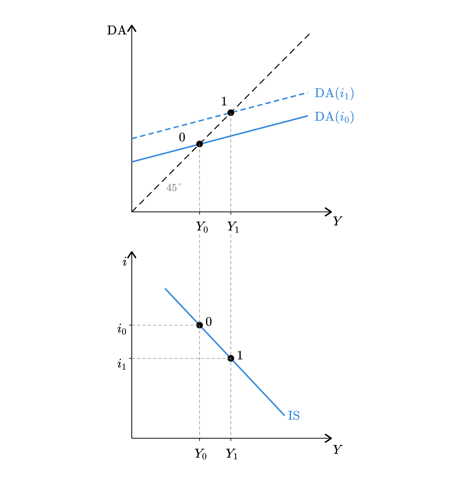
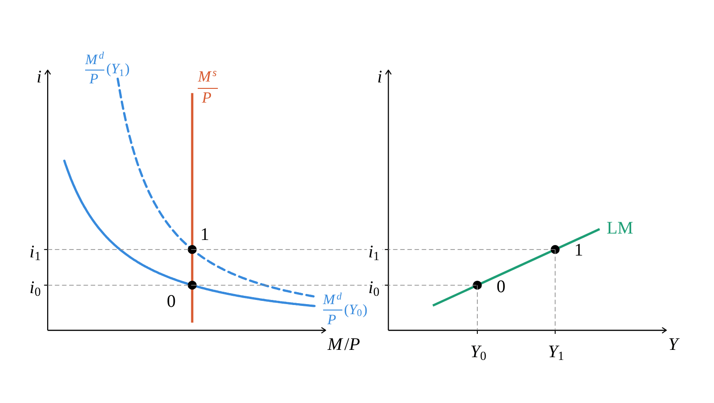
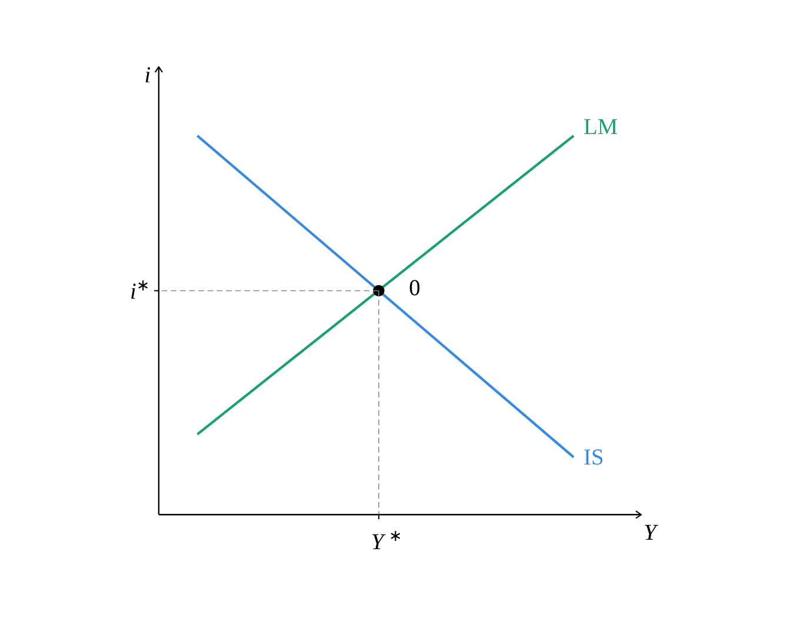
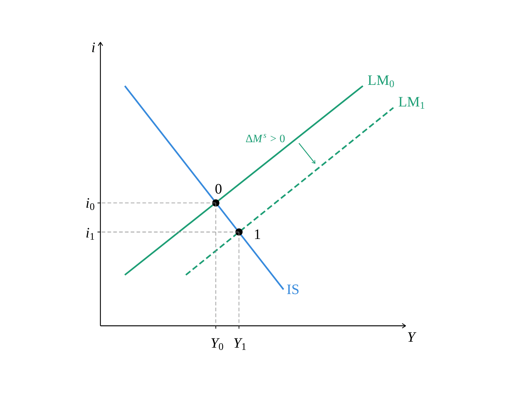
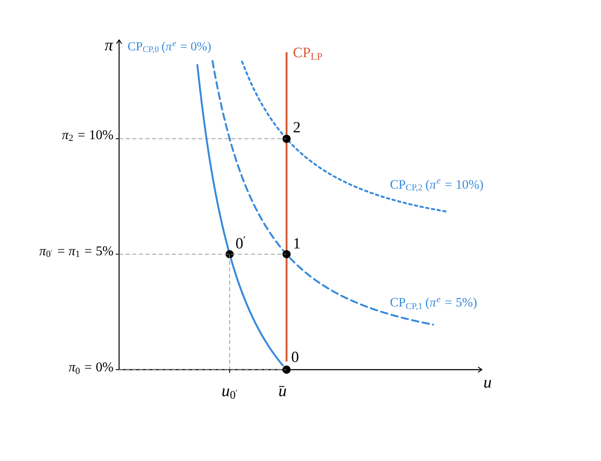

## Introducción

::: {.callout-note appearance="simple" icon=false}

:::

“Los objetivos básicos a largo plazo, compartidos, estoy seguro, por la mayoría de los economistas, son la libertad política, la eficiencia económica y una igualdad sustancial del poder económico […]. Creo que los tres objetivos pueden alcanzarse mejor si se confía, en la medida de lo posible, en un mecanismo de mercado dentro de un ‘orden competitivo’ para organizar la utilización de los recursos económicos”.

Con estas palabras, Milton Friedman, en *A Monetary and Fiscal Framework for Economic Stability* (1948), defendía su postura de política económica frente al intervencionismo que había impulsado el keynesianismo de posguerra. Sin embargo, hubo que esperar al menos dos décadas para que el monetarismo, término acuñado por Karl Brunner en 1968, se materializase en recetas de política económica aplicables a los problemas de la economía real. Su postulado distintivo no era la confianza en los mercados, sino la estabilidad de la demanda de dinero y, como contrapartida, la inestabilidad que la política discrecional inducía en una economía privada que, dejada a sí misma, tendía al equilibrio.

A partir de mediados de los cincuenta, un círculo de economistas con base principal en la Universidad de Chicago y marcado por la figura de Friedman (premio Nobel en 1976) combatió con firmeza muchas tesis keynesianas. Su doctrina, el monetarismo[^a05-1], conserva buena parte del legado neoclásico y solo rompe con él en el papel del dinero, neutral a largo plazo pero no a corto (apartado 2.1).

El núcleo del **monetarismo** es la teoría cuantitativa del dinero, que Friedman (1956) reformuló como una teoría de la demanda de dinero estable en la tradición de los saldos de caja de Cambridge, si bien la escuela recoge también la herencia de las teorías monetarias del ciclo anteriores, como las de Wicksell o Keynes. Los monetaristas combaten la síntesis neoclásica en el terreno de esta y con su mismo instrumental[^a05-2] (IS-LM, curva de Phillips, demanda de dinero y demanda agregada), pese a presentarse como continuadores de los neoclásicos.

En paralelo a esta disputa, y en gran medida ajena a ella, discurrió la controversia del capital entre las dos Cambridge (Joan Robinson y Piero Sraffa frente a Paul Samuelson y Robert Solow), un debate sobre los fundamentos de la función de producción agregada y de la teoría marginal de la distribución (tema [A04](a04-keynes.qmd), apartado 3.3).

El tema se organiza en tres partes:

- *Síntesis neoclásica*: sus principales rasgos y su análisis del lado de la demanda y del lado de la oferta.

- *Monetarismo*: sus principales rasgos y su crítica a la síntesis por el lado de la demanda y por el de la oferta.

- *Desarrollos posteriores*: la nueva macroeconomía clásica y las dos generaciones de la nueva economía keynesiana, que se estudian en sus temas propios.

## 1. La síntesis neoclásica

La exposición de la síntesis neoclásica recorre sus principales rasgos, el análisis del lado de la demanda y el de la oferta.

### 1.1. Principales rasgos

La **síntesis neoclásica** (SNC) es la corriente que, entre los años cuarenta y sesenta, se convirtió en la macroeconomía dominante al reconciliar la *Teoría general* de Keynes (1936) con la tradición neoclásica. La denominación se debe a Paul Samuelson, que la introdujo en la tercera edición de su manual (1955), y entre sus primeros arquitectos destacan tres[^a05-36]:

- *John Hicks*: formaliza las ideas de Keynes en el modelo IS-LM (*Mr. Keynes and the Classics*, 1937).

- *Alvin Hansen*: lo difunde y populariza, de ahí el nombre de modelo de Hicks-Hansen.

- *Franco Modigliani*: en 1944 lo dota de un mercado de trabajo y muestra que, salvo en el caso de la trampa de liquidez, el desempleo involuntario descansa, en última instancia, en la rigidez de los salarios nominales.

La idea que da nombre a la escuela es esa síntesis de dos visiones según el horizonte temporal. A corto plazo, la economía se comporta de forma keynesiana (rigideces, fallos de mercado y posibilidad de desempleo), y a largo plazo, de forma neoclásica (flexibilidad, vaciado de los mercados y pleno empleo). Sus fundamentos pueden ordenarse en cinco dimensiones, las mismas que cuestionará el monetarismo (apartado 2).

**Metodología**: la SNC formaliza matemáticamente las ideas de Keynes, cuya obra era esencialmente verbal[^a05-4], traduciéndolas a modelos manejables. Su núcleo es el modelo renta-gasto con mercado de trabajo (o IS-LM con mercado de trabajo), sobre el que se articulan después el modelo OA-DA y la curva de Phillips. La SNC combina, además, inducción y deducción, ya que impulsa la estimación econométrica de las grandes funciones de comportamiento (consumo, inversión, demanda de dinero) y los primeros grandes modelos macroeconométricos (p. ej. Klein), y hereda el método optimizador neoclásico para microfundamentarlas.

**Supuestos**:

- *Entorno*: el rasgo distintivo de la SNC es su carácter dual:

    - *A corto plazo* admite fallos de mercado, por lo que la economía no tiende automáticamente al pleno empleo. Entre ellos figuran la información imperfecta y la incertidumbre, que otorgan un papel central a las expectativas, aunque la SNC no ofrece un modelo explícito de su formación. El principal es la rigidez de los salarios nominales a la baja, que impide el vaciado del mercado de trabajo y hace posible el desempleo involuntario. Por ello, en este horizonte se rompe la dicotomía clásica y el dinero no es neutral.

    - *A largo plazo*, en cambio, la SNC mantiene el marco neoclásico de precios y salarios flexibles, vaciado de los mercados, pleno empleo y neutralidad del dinero. El mecanismo que reconcilia ambos planos es el efecto saldos reales (efecto Pigou-Patinkin), que devuelve la economía al pleno empleo una vez que precios y salarios se ajustan.

- *Agentes*: como en el marco neoclásico, son optimizadores que persiguen su interés personal, pero a corto plazo no ajustan plenamente sus decisiones a las variables reales. En particular, los trabajadores padecen *ilusión monetaria*, un sesgo cognitivo por el que atienden al salario nominal y no al real[^a05-5]. Ello sustenta la rigidez salarial a la baja, pues se resisten a recortes nominales, pero aceptan caídas del salario real vía inflación.

**Ajuste**: es igualmente dual:

- *A corto plazo, ajuste por cantidades (mecanismo marshalliano)*: ante una caída de la demanda, los mercados responden con la producción y el empleo, y no con los precios. La variable de ajuste es la inversión no planeada, es decir, la acumulación o desacumulación de existencias. En coherencia con ello, la SNC niega (e invierte) la ley de Say[^a05-6]. Así, la demanda efectiva determina la oferta agregada, de modo que la economía puede estabilizarse en un equilibrio por debajo del pleno empleo (es decir, un equilibrio de subempleo).

- *A largo plazo, ajuste por precios*: la flexibilidad de precios y salarios restablece el pleno empleo, donde vuelven a regir los resultados neoclásicos (y se recupera la ley de Say).

**Política económica**: dado que a corto plazo los mercados no garantizan el pleno empleo, la SNC defiende un intervencionismo activo de gestión de la demanda (políticas fiscal y monetaria) para estabilizar el ciclo y cerrar la brecha de producción (*output gap*). Esta confianza en la sintonía fina de la demanda, y en la curva de Phillips como disyuntiva explotable, será el blanco principal de la crítica monetarista.

### 1.2. Análisis del lado de la demanda

Sobre estas bases, el modelo de la SNC parte de unos supuestos sencillos: corto plazo, economía cerrada y tres mercados (de bienes, de dinero y de bonos). El corto plazo implica precios fijos, de modo que la oferta agregada es perfectamente elástica al nivel de precios dado y se adapta pasivamente a la demanda, y el tipo de interés real coincide con el nominal. Su estudio se ordena en dos bloques. En primer lugar, el lado de la demanda determina el *output* (aspa keynesiana) y el tipo de interés (mercado de dinero). En segundo lugar, el lado de la oferta introduce el mercado de trabajo y la relación inflación-desempleo y relaja el supuesto de precios fijos.

#### 1.2.1. Modelo IS-LM

**Planteamiento**: para la síntesis neoclásica, el comportamiento de la demanda se resume en el modelo IS-LM, un modelo de equilibrio general que condensa en dos ecuaciones el comportamiento de una economía cerrada (figura -@fig-a053-islm).

**Curva IS**: la primera de ellas es la *ecuación IS* (*Investment-Savings*), que viene dada por la siguiente fórmula:

$$ \text{IS}: Y = C_0 + cY^d + I_0 - vr + G_0, \qquad c \in (0, 1)$$

donde:

- $Y$ es la producción (o *output*) agregada de la economía.

- $C_0 + cY^d$ es la demanda de consumo agregada de la economía, que tiene un componente autónomo, $C_0$, y un componente inducido que depende de la renta, $cY^d$. En el componente inducido, $c\in (0, 1)$ es la propensión marginal a consumir de los hogares y $Y^d=Y-T_0$, su renta disponible después de impuestos de suma fija.

- $I_0 -vr$ es la demanda de inversión agregada de la economía, que tiene un componente autónomo, $I_0$, que recoge los *animal spirits* de los inversores, y un componente inducido, $-vr$, que recoge el efecto del tipo de interés real sobre la demanda de inversión.

- $G_0$ es un componente exógeno que recoge el gasto público (no productivo) realizado por el sector público.

La ecuación IS, que incorpora las funciones de comportamiento del gasto (consumo e inversión), es la condición de equilibrio en el mercado de bienes y servicios. La producción agregada (término de la izquierda) es igual al gasto agregado (término de la derecha).

Gráficamente, la derivación de la curva IS se representa en el plano renta-tipo de interés, con el aspa keynesiana en el panel superior (figura -@fig-a051-is):

1. *Aspa keynesiana*: en el plano renta-demanda agregada, la demanda agregada para el tipo de interés $i_0$, $\text{DA}(i_0)$, corta a la recta de 45° en el punto 0, con renta $Y_0$. Con un tipo más bajo, $i_1$, la inversión es mayor y la demanda agregada, $\text{DA}(i_1)$, corta a la recta de 45° en el punto 1, con renta $Y_1$.

2. *Curva IS*: lleva los pares $(Y_0, i_0)$ y $(Y_1, i_1)$ al panel inferior. Es decreciente porque un tipo de interés más bajo eleva la inversión y, por el multiplicador, la renta de equilibrio.

::: {#fig-a051-is}

::: {.content-visible when-format="html"}
```{=html}
<div class="graph-frame">
<iframe src="../graphs/a051_IS.html" style="height:760px" loading="lazy" title="fig-a051-is"></iframe>
</div>
```
:::

::: {.content-visible unless-format="html"}

:::

Derivación de la curva IS. La curva reúne las combinaciones de tipo de interés y renta que equilibran el mercado de bienes.
:::

**Curva LM**: a la IS la acompaña una segunda ecuación de comportamiento conocida como *ecuación LM* (*Liquidity-preference-Money-supply*): 

$$ \text{LM}: \frac{M^s}{P}=L(Y^{+},i^{-})\rightarrow i=i(Y^{+},\frac{M^s}{P}^{-})$$

donde:

- $M^s/P$ es la oferta monetaria real de la economía, la cual depende de las decisiones del banco central y la evolución de los precios de la economía (en el modelo IS-LM considerados constantes por ser un modelo de corto plazo).

- $Y$ es la renta de los hogares.

- $i$ es el tipo de interés nominal, que coincide con el real, $r = i - \pi^e$, cuando $\pi^e = 0$.

La ecuación LM, que incorpora la función de comportamiento de la demanda de dinero, es la condición de equilibrio en el mercado de dinero y bonos (mercado monetario). La oferta monetaria real, es decir, deflactada por el índice de precios (término de la izquierda), es igual a la demanda de dinero real (término de la derecha), que depende de la renta real de los hogares y del tipo de interés.

Respecto a la LM, es habitual presentar la ecuación en su forma lineal:

$$ \text{LM}: \frac{M^s}{P}=kY-hi\rightarrow i=\frac{1}{h}(kY-\frac{M^s}{P})$$

Sin embargo, esta modelización no permitiría graficarla recogiendo el carácter asintótico horizontal de la curva en el plano $(Y, i)$, que es la forma habitual en la que aparece en la mayoría de gráficos.

Gráficamente, la derivación de la curva LM se representa en el plano renta-tipo de interés, con el mercado de dinero en el panel izquierdo (figura -@fig-a052-lm):

1. *Mercado de dinero*: en el plano saldos reales-tipo de interés, la oferta monetaria real, $M^s/P$, es vertical y la demanda de dinero, decreciente en el tipo de interés. Con renta $Y_0$, la demanda $\frac{M^d}{P}(Y_0)$ fija el tipo $i_0$ (punto 0). Con una renta mayor, $Y_1$, la demanda se sitúa más a la derecha, $\frac{M^d}{P}(Y_1)$, y el tipo sube a $i_1$ (punto 1).

2. *Curva LM*: lleva los pares $(Y_0, i_0)$ y $(Y_1, i_1)$ al panel derecho. Es creciente porque una renta mayor eleva la demanda de dinero por motivo transacción y el tipo de interés sube para equilibrar el mercado.

::: {#fig-a052-lm}

::: {.content-visible when-format="html"}
```{=html}
<div class="graph-frame wide">
<iframe src="../graphs/a052_LM.html" style="--r:1.773" loading="lazy" title="fig-a052-lm"></iframe>
</div>
```
:::

::: {.content-visible unless-format="html"}

:::

Derivación de la curva LM. La curva reúne las combinaciones de tipo de interés y renta que equilibran el mercado de dinero para una oferta monetaria real dada.
:::

**Equilibrio**: de la intersección de ambas curvas se puede obtener la producción de equilibrio de la economía y el tipo de interés de equilibrio.

**Desarrollo gráfico**: el equilibrio del modelo IS-LM se representa en el plano renta-tipo de interés (figura -@fig-a053-islm):

1. *Curva IS*: recoge los pares de renta y tipo de interés que equilibran el mercado de bienes. Es decreciente porque un tipo de interés más bajo eleva la inversión y, por el multiplicador, la renta (figura -@fig-a051-is).

2. *Curva LM*: recoge los pares que equilibran el mercado de dinero. Es creciente porque una renta mayor eleva la demanda de dinero y el tipo de interés que vacía el mercado (figura -@fig-a052-lm).

3. *Equilibrio*: en el punto 0, con renta $Y^*$ y tipo de interés $i^*$, los dos mercados están a la vez en equilibrio.

::: {#fig-a053-islm}

::: {.content-visible when-format="html"}
```{=html}
<div class="graph-frame">
<iframe src="../graphs/a053_ISLM.html" style="height:580px" loading="lazy" title="fig-a053-islm"></iframe>
</div>
```
:::

::: {.content-visible unless-format="html"}

:::

Equilibrio simultáneo en los mercados de bienes y de dinero en el modelo IS-LM.
:::

**Estática comparativa**: con la IS y la LM en su forma lineal, y con $i = r$ (pues $\pi^e = 0$), la renta de equilibrio es

$$Y^* = \frac{h\,A_0 + v\,M^s/P}{h(1-c) + v\,k}, \qquad A_0 \equiv C_0 - cT_0 + I_0 + G_0$$

De esta expresión se deducen cuatro resultados:

- *Política monetaria*: un aumento de $M^s/P$ desplaza la LM a la derecha, eleva la renta y reduce el tipo de interés, con un multiplicador $\partial Y/\partial (M^s/P) = v/[h(1-c) + vk]$.

- *Política fiscal*: un aumento de $G_0$ desplaza la IS a la derecha y eleva la renta y el tipo de interés. El multiplicador, $\partial Y/\partial G_0 = h/[h(1-c) + vk]$, es menor que el del aspa keynesiana, $1/(1-c)$, porque la subida del tipo de interés expulsa inversión privada, lo que se conoce como *efecto expulsión* (*crowding out*).

- *Pendientes*: en el plano $(Y, i)$, la IS, de pendiente $-(1-c)/v$, es más vertical cuanto menor es $v$, y la LM, de pendiente $k/h$, es más plana cuanto mayor es $h$. La política fiscal gana eficacia cuanto más vertical es la IS y más plana la LM, y la monetaria en el caso contrario. Para la SNC, con una inversión poco sensible al tipo de interés ($v$ bajo) y una demanda de dinero muy sensible a él ($h$ alto), la política fiscal es la más eficaz[^a05-37] (anexo).

- *Casos extremos*: con una inversión insensible al tipo de interés ($v = 0$, IS vertical) o en la trampa de liquidez ($h \to \infty$, LM horizontal), el multiplicador fiscal alcanza el del aspa keynesiana, $1/(1-c)$, y la política monetaria no afecta a la renta.

#### 1.2.2. Demanda de consumo

::: {.callout-note appearance="simple" icon=false}
La función de consumo keynesiana se expone en el tema [A04](a04-keynes.qmd), apartado 2.3.2, y se desarrolla, con los multiplicadores fiscales, la renta relativa y el ciclo vital, en el tema [A33](a33-demanda-consumo.qmd), apartados 1.2 y 2.2. Aquí se recoge lo que la síntesis tomó de estas teorías.
:::

**Teoría de la renta absoluta** (Keynes, 1936): las premisas de Keynes son el consumo como fin último de la actividad económica, su dependencia de la renta corriente y una propensión marginal a consumir estable y menor que la unidad. Sobre ellas, los autores de la SNC construyen una función agregada de consumo lineal y estable en la renta real absoluta disponible del periodo:

$$C = C_0 + c\,(Y - T_0), \qquad C_0 > 0, \; c \in (0, 1)$$

donde $C_0$ es el consumo autónomo, $c$ la propensión marginal a consumir y $T_0$ un impuesto de suma fija. A diferencia de la visión clásica, el consumo depende sobre todo de la renta disponible del periodo y no del tipo de interés, y el ahorro es un residuo de la renta no consumida.

En una economía cerrada con impuestos de suma fija y tipo de interés dado (aspa keynesiana), los multiplicadores del gasto público y de los impuestos son $\partial Y/\partial G_0 = 1/(1-c) > 1$ y $\partial Y/\partial T_0 = -c/(1-c) < 0$. De ellos se siguen sus implicaciones de política económica:

- *Política monetaria*: es efectiva sobre el tipo de interés, pero, debido a los *animal spirits* y a la baja sensibilidad de la inversión al tipo de interés (es decir, el *eslabón débil*), apenas afecta a la renta y, por ello, al consumo.

- *Política fiscal*: será muy efectiva sobre el consumo, pues afecta a la renta del periodo y, a través del multiplicador, al consumo. Un aumento del gasto público es siempre más efectivo que una rebaja impositiva equivalente, porque la rebaja eleva la renta disponible, que los hogares reparten entre consumo y ahorro ($c < 1$). Por la misma razón, las políticas redistributivas estimulan el consumo, ya que los hogares de menor renta tienen una mayor propensión marginal a consumir.

**Teoría de la renta relativa** (Duesenberry, 1949): la utilidad de los hogares depende también del consumo de su entorno social (renta relativa, efecto demostración) y de sus niveles de consumo pasados (hábitos, efecto trinquete). Como el efecto trinquete hace el consumo rígido a la baja, en una recesión el consumo cae menos que la renta y la propensión media al consumo sube, lo que amortigua la caída de la demanda.

**Hipótesis del ciclo vital** (Modigliani y Brumberg, 1954; Ando y Modigliani, 1963): la hipótesis del ciclo vital (HCV), hoy ampliamente aceptada, gira en torno al papel que cumple el ahorro en el plan óptimo de consumo. Frente a una renta con un perfil previsible en forma de joroba, el consumo se mantiene estable, o crece ligeramente, durante toda la vida. Los hogares desplazan recursos de los años de ingresos altos a los de ingresos bajos (p. ej. la jubilación) y así suavizan su consumo.

Con la riqueza constante, la propensión media al consumo (PMeC) depende del horizonte:

- *Corto plazo*: baja en las fases alcistas y sube en las bajistas, pues el aumento de renta se reparte entre varios periodos.

- *Largo plazo*: es estable, en línea con la evidencia de Kuznets.

Por la misma razón, una variación transitoria de la renta disponible se reparte entre los años de vida restantes y apenas altera el consumo corriente, de modo que la política fiscal transitoria es menos eficaz que en la función keynesiana (tema [A33](a33-demanda-consumo.qmd), apartado 2.2).

#### 1.2.3. Demanda de inversión

::: {.callout-note appearance="simple" icon=false}
La eficiencia marginal del capital se desarrolla en el tema [A34](a34-demanda-inversion.qmd), apartado 1.2, y la teoría de la *q* de Tobin, en el apartado 2.2.2 del mismo tema. Aquí se recoge su papel en la síntesis.
:::

**Teoría de la eficiencia marginal del capital** (Keynes, 1936): Keynes define la eficiencia marginal del capital (EMK) como la tasa de descuento que iguala el valor actual de los rendimientos esperados de un activo de capital con su precio de oferta (coste de reposición). Se invierte mientras la EMK supere al tipo de interés, de modo que la inversión es una función decreciente de este, $I = I_0 - v\,r$. Ahora bien, como la EMK depende de las expectativas sobre rendimientos futuros en un entorno de incertidumbre (los *animal spirits*), la inversión es muy volátil y poco sensible al tipo de interés (el eslabón débil). Por eso, para la SNC, la curva IS es muy inelástica al tipo de interés (casi vertical en el plano $(Y, r)$).

**Teoría de la $q$** (Tobin, 1969): ofrece una microfundamentación distinta de la demanda de inversión. La inversión óptima es función de la ratio $q$, entendida como el precio sombra relativo del capital ($q$ marginal), que en la práctica se aproxima por la $q$ media (el valor de mercado del capital instalado respecto de su coste de reposición). Se invierte cuando $q > 1$, de modo que la inversión (real) es una función creciente de $q$:

$$I_t = f(q_t), \qquad \partial I / \partial q > 0$$

donde $I_t$ es la inversión y $q_t$ la ratio $q$ del periodo $t$. La teoría formaliza así la importancia de la estabilidad de los mercados financieros, ya apuntada por Keynes, al ligar la inversión real a las valoraciones de los activos.

#### 1.2.4. Demanda de dinero

La teoría de la preferencia por la liquidez de Keynes distingue tres motivos para demandar dinero, transacción, precaución y especulación (tema [A04](a04-keynes.qmd), apartado 2.3.3), y la SNC desarrolló un modelo para microfundamentar cada uno de ellos.

::: {.callout-note appearance="simple" icon=false}
Los tres modelos (supuestos, programa de optimización, demanda de dinero y estática comparativa) se desarrollan en el tema [A35](a35-demanda-dinero.qmd), apartados 1.3.1 a 1.3.3. Aquí se recogen sus resultados.
:::

**Motivo transacción: modelo de inventarios** (Baumol, 1952; Tobin, 1956): el dinero se mantiene como un inventario para transacciones del que se dispone de forma gradual. La gestión de ese inventario plantea una disyuntiva entre el coste de transacción (de convertir otros activos en dinero) y el coste de oportunidad de mantenerlo. La regla de la raíz cuadrada resultante hace que la demanda real de dinero dependa positivamente del coste de transacción $b$, negativamente del tipo de interés nominal $i$ y positivamente de la renta elevada a un medio:

$$M^d / P = k(b^{+}, i^{-}) \cdot Y^{1/2}$$

donde $M^d/P$ es la demanda real de dinero e $Y$ la renta real. La demanda de dinero es, por tanto, menos que proporcional a la renta (su elasticidad-renta es ½, lo que refleja economías de escala en la gestión de tesorería). Por ello, un aumento de la cantidad de dinero desplaza la LM más que si la demanda fuera proporcional a la renta, pues, a tipo de interés dado, la renta que equilibra el mercado de dinero responde de forma amplificada (en términos del modelo, $Y \propto (M^s/P)^2$), aunque su efecto final sobre la renta depende de la pendiente de la IS (apartado 1.2.1).

**Motivo precaución: modelos de ruptura** (Whalen, 1966): el dinero se mantiene como inventario frente a la incertidumbre sobre el flujo de entradas y salidas de caja y los gastos fortuitos (el riesgo de quedarse sin liquidez, es decir, la *ruptura*). El saldo precautorio óptimo equilibra el coste de oportunidad de mantenerlo con el coste esperado de las rupturas y sigue una regla de la raíz cúbica:

$$M^d = \left(\frac{2\sigma^2 b}{i}\right)^{1/3}$$

donde $\sigma^2$ es la varianza de los pagos netos, $b$ el coste de cada ruptura e $i$ el tipo de interés nominal. Como la varianza de los pagos netos crece con el volumen de transacciones y este, con la renta, el efecto de la renta es positivo (si la varianza es proporcional a la renta, la elasticidad-renta es 1/3), de modo que $M^d = f(b^{+}, i^{-}, Y^{+})$.

**Motivo especulación: modelo de cartera** (Tobin, 1958): aplica la selección de cartera a la demanda especulativa y supone que los agentes diversifican entre dinero y bonos. Por ello, la demanda de dinero depende positivamente de la riqueza $W$ y del riesgo de los bonos $\sigma_B$, y de forma ambigua de su rentabilidad $r_B$:

$$M^d = f(W^{+}, \sigma_B^{+}, r_B^{\pm})$$

donde $M^d$ es la demanda de dinero. En consecuencia, la política monetaria actúa alterando la rentabilidad relativa de los bonos y, con ella, la composición de las carteras. Su efecto sobre la renta es menor cuanto más sensible sea la demanda de dinero al tipo de interés.

#### 1.2.5. Conclusiones

El análisis de la demanda muestra cómo la SNC fue más allá de las funciones de comportamiento de Keynes, microfundamentándolas sobre el comportamiento optimizador de los agentes.

**Aspectos positivos**:

- *Microfundamentación*: dota a los componentes de la demanda de una base optimizadora de la que carecía Keynes. Por ejemplo, el consumo se orienta a los recursos vitales (HCV), la inversión se liga a las valoraciones de los activos (teoría de la $q$) y la demanda de dinero gana rigor (inventarios y carteras).

- *Capacidad explicativa*: resuelve regularidades empíricas como la paradoja de Kuznets (la divergencia entre la PMeC de corto y de largo plazo), mediante la renta relativa y la HCV, y conecta la inversión con los mercados financieros.

- *Marco para la política*: ofrece un cuadro coherente de gestión de la demanda (multiplicadores y componentes del IS-LM), acorde con la defensa de la estabilización a corto plazo propia de la síntesis.

**Limitaciones**:

- *Ausencia de una teoría de las expectativas*: las funciones de demanda no explican cómo se forman las expectativas, laguna que el monetarismo (con la hipótesis de expectativas adaptativas, HEA) y la nueva macroeconomía clásica (NMC, con la hipótesis de expectativas racionales, HER) tratarán de cubrir.

- *Fragilidad del “eslabón débil”*: hacer descansar la transmisión en una inversión poco sensible al tipo de interés (dominada por los *animal spirits*) y en un consumo guiado por la renta corriente debilita la política monetaria. Los monetaristas rebatirán ese supuesto (inversión sensible al tipo de interés y demanda de dinero estable).

- *Segmentación de la demanda de dinero*: la división en tres motivos resulta en parte *ad hoc*, y Friedman tratará el dinero como un activo más, con una demanda unificada.

- *Separación de decisiones*: el consumo-ahorro y la inversión se analizan por separado (apartado 2.1).

### 1.3. Análisis del lado de la oferta

En términos de política económica, el paradigma keynesiano buscaba dar con un nivel adecuado de demanda agregada, pues su falta provocaba desempleo involuntario y su exceso, inflación. Sin embargo, hasta los años cincuenta los estudios para fijar ese nivel estaban dispersos, y la determinación de la inflación y su relación con el mercado de trabajo era el punto débil del keynesianismo.

#### 1.3.1. Relación entre inflación y desempleo: modelo de la curva de Phillips (Phillips, 1958; Lipsey, 1960)

**Origen**: durante la década de 1950, el economista neozelandés Alban Phillips estudiaba en la London School of Economics (LSE) el marco keynesiano y cómo, según Keynes, en las recesiones coincidían un desempleo involuntario alto y unas presiones inflacionistas bajas. Con datos del Reino Unido entre 1861 y 1957, Phillips comprobó que los salarios nominales crecían más despacio (menor inflación salarial) cuanto mayor era la tasa de desempleo, y que esa relación no era lineal[^a05-8]. El buen ajuste sugería, además, que el vínculo era estable y duradero[^a05-38]. A raíz de su obra surgieron dos líneas de investigación, una empírica, que buscaba confirmar la estabilidad de la relación, y otra teórica, que buscaba explicarla a partir del funcionamiento del mercado de trabajo.

**Idea**: inflación y paro varían en sentido opuesto, siguiendo una curva estable y no lineal, de modo que la política económica puede elegir entre más inflación y menos paro, o a la inversa.

::: {.callout-note appearance="simple" icon=false}
El fundamento teórico de Lipsey (sus tres supuestos y la derivación de la curva) se desarrolla en el tema [A28](a28-tnp-nairu.qmd), apartado 1.2.1. Aquí se recoge su papel en la síntesis neoclásica.
:::

**Razonamiento**: Richard Lipsey (1960) dio a la relación su fundamento teórico[^a05-9]. Cuanto más alto es el paro, más pequeña es, de forma no lineal, la demanda excedente de trabajo y más despacio suben los salarios nominales. A su vez, con productividad constante, los precios suben al mismo ritmo que los salarios (Samuelson y Solow, 1960). El resultado es la *curva de Phillips*, que liga de forma inversa y convexa la inflación con el desempleo:

$$\pi_t = f(u_t), \qquad f' < 0, \; f'' > 0$$

donde $\pi_t$ es la tasa de inflación y $u_t$ la tasa de desempleo. Dicho de otro modo, existe una disyuntiva (*trade-off*) entre inflación y desempleo.

**Desarrollo gráfico**: en el plano desempleo-inflación (figura -@fig-a058-curva-phillips), la curva original es decreciente y convexa, y puede adoptar distintas formas según su pendiente, entre dos casos polares:

1. *Curva vertical*, $\text{CP}_{\text{polar clásica}}$: a un mismo nivel de desempleo (el natural, $\bar{u}$) puede corresponder cualquier inflación, que es así un fenómeno de demanda (monetario), caso que suele asociarse a la visión clásica.

2. *Curva horizontal*, $\text{CP}_{\text{polar keynesiana}}$: a cualquier nivel de desempleo corresponde una única inflación, $\bar{\pi}$, determinada por los costes, que es así un fenómeno de oferta, caso que suele asociarse a la visión keynesiana más estricta.

Ninguna de las dos escuelas sostuvo, sin embargo, una forma exactamente polar, y ambos casos son simplificaciones que sirven para ordenar el debate.

::: {#fig-a058-curva-phillips}

::: {.content-visible when-format="html"}
```{=html}
<div class="graph-frame">
<iframe src="../graphs/a058_Curva_Phillips.html" style="height:560px" loading="lazy" title="fig-a058-curva-phillips"></iframe>
</div>
```
:::

::: {.content-visible unless-format="html"}

:::

Formas de la curva de Phillips. La curva original es decreciente y convexa. Sus dos casos polares son la vertical en el desempleo natural, $\bar{u}$, que suele asociarse a la visión clásica, y la horizontal en la inflación de costes, $\bar{\pi}$, que suele asociarse a la keynesiana.
:::

**Extensiones**: Samuelson y Solow (1960) dedujeron, además, que, si la curva de Phillips era empíricamente estable, los responsables de la política económica (*policy-makers*) podían elegir una tasa de desempleo concreta a cambio de una determinada inflación. Ambos autores concibieron así la curva como un *menú* de política económica que permitía un “ajuste fino” del mercado laboral, es decir, mantener el desempleo bajo a cambio de una inflación continuada mediante políticas monetarias expansivas sostenidas. Advirtieron, con todo, de que ese menú podía no mantener su forma a más largo plazo[^a05-13].

**Conclusiones**:

- *Aspectos positivos*: la curva condensaba en una única relación el nexo entre el mercado de trabajo y la inflación, sin necesidad de microfundamentar las rigideces laborales y su traslado a los precios. Por ello fue, durante los años sesenta, el instrumento central de la síntesis neoclásica en el análisis del mercado de trabajo y, por extensión, de la oferta agregada.

- *Limitaciones*: la relación no resultó estable, porque con la estanflación de los años setenta subieron a la vez la inflación y el desempleo. Además, el razonamiento de Lipsey no partía de agentes que optimizan, de modo que la curva carecía de microfundamentos en sentido estricto y exigía ilusión monetaria permanente (apartado 2.3.1).

#### 1.3.2. Relación entre producción y desempleo: la ley de Okun (Okun, 1962)

**Origen**: casi en paralelo al desarrollo de la curva de Phillips, el economista estadounidense Arthur Okun detectó empíricamente que la tasa de paro y la tasa de crecimiento de la producción estaban relacionadas.

**Idea**: sus estimaciones con las series de Estados Unidos entre 1947 y 1960 apuntaban a que un aumento de un punto en la tasa de paro se asociaba a una pérdida de producción de en torno al 3 %. Esta respuesta es mucho mayor que la que predice una función de producción con productividad marginal del trabajo decreciente, porque al empleo se suman los cambios en las horas trabajadas, en la participación laboral y en la productividad (atesoramiento de mano de obra).

**Razonamiento**: la relación, bautizada después como *ley de Okun*, es, pese a su simplicidad, una herramienta útil de política económica. En una de sus versiones originales, en primeras diferencias, plantea una relación de proporcionalidad (inversa) entre la desviación del crecimiento del *output* respecto de su tasa tendencial y la variación de la tasa de desempleo:

$$u_t - u_{t-1} = -\frac{1}{\phi}\,(g_{Y, t} - \bar{g}_Y), \qquad \phi > 0$$

donde $\phi$ es el coeficiente de Okun (en torno a 3 en sus estimaciones) y $\bar{g}_Y$ es la tasa de crecimiento tendencial del *output*. La producción debe crecer a ese ritmo solo para mantener el desempleo constante, y un crecimiento superior lo reduce.

La ley admite también una formulación en brechas, que relaciona el desempleo cíclico con la brecha de producción:

$$y_t - \bar{y}_t = -\phi\,(u_t - \bar{u})$$

donde $y_t \equiv \ln Y_t$ y $\bar{y}_t$ es la producción potencial. Si la tasa natural $\bar{u}$ es constante, la diferencia de un periodo a otro devuelve la versión anterior, de modo que ambas recogen la misma regularidad. La formulación en brechas es, además, la que traslada la curva de Phillips al plano producción-inflación. En su versión lineal, $\pi_t = -\kappa_u(u_t - \bar{u})$, basta sustituir el desempleo cíclico para obtener $\pi_t = \kappa\,(y_t - \bar{y}_t)$, con $\kappa = \kappa_u/\phi > 0$, una oferta agregada con pendiente positiva que cierra el modelo IS-LM por el lado de la oferta (tema [A28](a28-tnp-nairu.qmd), apartado 1.2.2).

**Conclusiones**:

- *Aspectos positivos*: la ley tuvo gran impacto en EE. UU., donde las estimaciones oficiales de la producción potencial y del superávit presupuestario asociado se convirtieron en indicadores esenciales para graduar las políticas de estabilización. Pese a su naturaleza “a-teórica” y al debate sobre su estabilidad, se considera una de las regularidades empíricas más sólidas.

- *Limitaciones*: Okun era consciente de que sus ecuaciones eran representaciones muy simples de interacciones complejas, con riesgo de sobreestimación. En cuanto al coeficiente de Okun, se observa una notable disparidad entre países y una ruptura estructural en torno a 1973-1974, si bien la ley parecía resistir mejor que la curva de Phillips tradicional.

#### 1.3.3. Conclusiones

**Aspectos positivos**: las dos relaciones cubrieron el punto débil del keynesianismo, la determinación de la inflación y su relación con el mercado de trabajo, y completaron así el modelo IS-LM con un análisis de la oferta.

**Limitaciones**: a finales de los años sesenta ese análisis entra en crisis por razones teóricas y empíricas. Durante Bretton Woods (1944-1971), y en especial desde los años sesenta, el paro era bajo en las economías desarrolladas. A partir de 1970 esa tendencia se revierte y aparece la *estanflación*, es decir, la coincidencia de alto desempleo e inflación, de modo que la curva de Phillips deja de ser estable. La curva original no podía recoger esta inflación de oferta, en la que el aumento de la inflación se acompaña de más desempleo, y no de menos.

Según Michael Bruno y Jeffrey Sachs (1985), la estanflación se debió a la conjunción de cuatro elementos que dificultaban el ajuste en un contexto de inflación elevada:

- *Perturbaciones de oferta*: el encarecimiento de las materias primas y, sobre todo, del petróleo (1973-1974 y 1979).

- *Productividad*: la caída del crecimiento de la productividad total de los factores.

- *Rigidez del salario real*: los salarios reales no se ajustaron a la baja tras el encarecimiento de los insumos, lo que abrió una *brecha salarial*, sobre todo en Europa.

- *Respuesta de la política económica*: la contracción de la demanda con la que los Gobiernos y los bancos centrales combatieron la inflación.

### 1.4. Conclusiones

**Aspectos positivos**: la síntesis neoclásica dio a la macroeconomía un instrumental común que hizo posible tanto la enseñanza sistemática de la disciplina como la estimación econométrica de sus grandes funciones de comportamiento. Su carácter dual, con precios rígidos a corto plazo y flexibles a largo, permitió además reconciliar la intervención keynesiana con el equilibrio neoclásico sin renunciar a ninguno de los dos.

**Limitaciones**: esa misma dualidad era su punto débil, pues la rigidez de precios y salarios se postulaba sin microfundamentar. La ausencia de una teoría de la formación de expectativas dejó también el modelo expuesto a la crítica. Cuando la estanflación de los años setenta desmintió la estabilidad empírica de la curva de Phillips, la síntesis carecía de recursos internos para explicar la coexistencia de inflación y desempleo elevados. Ese doble fallo, empírico y teórico, propició la contrarrevolución monetarista y, más tarde, la nueva macroeconomía clásica.

## 2. Monetaristas

Estas limitaciones dieron paso a la crítica monetarista[^a05-39], en la que se aprecian dos etapas. La primera (de mediados de los cincuenta a finales de los sesenta) se centró en el lado de la demanda, y la segunda (desde finales de los sesenta), en el lado de la oferta. Su prolongación en la economía abierta es el enfoque monetario de la balanza de pagos (Johnson, 1958, 1972), que traslada la misma lógica al sector exterior. Con tipo de cambio fijo, el saldo de la balanza de pagos refleja el exceso de oferta o de demanda de dinero, el ajuste es automático y la política monetaria pierde autonomía (tema [B12](b12-ajuste-bp.qmd), apartado 2.1).

### 2.1. Principales rasgos

Los rasgos del monetarismo se ordenan en las mismas dimensiones que los de la síntesis neoclásica (apartado 1.1).

**Metodología**: los monetaristas se apoyan en las herramientas del marco IS-LM. No obstante, Friedman se separa de Keynes y de muchos keynesianos, que reprochaban a los neoclásicos lo poco realistas que eran sus supuestos. Para Friedman ese realismo es irrelevante, porque una teoría se juzga por sus predicciones. En esta *tesis de irrelevancia de los supuestos* (Friedman, 1953)[^a05-40] se apoya en gran parte el pensamiento monetarista.

**Supuestos**:

- *Entorno*: parten de muchos de los postulados (neo)clásicos originales (p. ej. racionalidad y flexibilidad de precios y salarios). Sin embargo, no defienden la dicotomía clásica, porque para ellos el dinero es neutral a largo plazo, pero no a corto. Esta idea se resume en el lema monetarista *money matters* (“el dinero importa”). Por tanto, la política monetaria altera las variables reales durante el corto plazo. En ese horizonte, los ciclos económicos se deben sobre todo a las oscilaciones de la oferta monetaria, motor de la demanda (la causalidad va del dinero a la demanda, no al revés).

- *Agentes*: una de las principales limitaciones de la SNC era la ausencia de una teoría sobre la formación de expectativas. Para suplirla, la escuela monetarista popularizó la *hipótesis de expectativas adaptativas* (HEA) anticipada por Irving Fisher (1911) y formalizada por Cagan (1956) y Nerlove (1958). La HEA fue fundamental en la crítica a la curva de Phillips y para estimar la renta permanente en la teoría del consumo de Friedman (hipótesis de la renta permanente, HRP). Formalmente, la HEA admite distintas especificaciones, si bien generalmente se utiliza la versión de retardos distribuidos con pesos geométricos, $X_{t+1}^e = \lambda \sum_{j=0}^{\infty} (1-\lambda)^j X_{t-j}$. En ella, $X_{t+1}^e$ es el valor esperado de la variable para el periodo siguiente, $X_{t-j}$ sus valores pasados observados y $\lambda \in (0, 1]$ el parámetro de ajuste, que pondera los valores pasados con pesos geométricamente decrecientes. Así, cada periodo la expectativa se revisa en una fracción $\lambda$ del último error de previsión.

**Ajuste**: el pensamiento keynesiano había dado lugar a dos variables de ajuste, las existencias o inversión no planeada en el mercado de bienes y servicios, y el tipo de interés (real) en el mercado monetario. En consecuencia, existía una separación entre las decisiones de consumo y ahorro y las decisiones de inversión. Friedman rompe esta separación e introduce el mecanismo de transmisión monetarista, que abre un canal directo de ajuste a través de la riqueza de los individuos, vía consumo y demanda de dinero.

**Política económica**: sus recomendaciones chocan, por lo general, con las de la SNC prácticamente punto por punto. La política fiscal es mucho menos eficaz que la monetaria, porque el consumo, que depende de la renta permanente, es estable y la demanda de dinero, al tener el dinero muchos sustitutivos imperfectos, es estable y poco sensible al tipo de interés. De ahí que el gasto público expulse gasto privado (efecto expulsión). Para estabilizar la economía, en cambio, ningún instrumento iguala a la política monetaria, aunque debe aplicarse con reglas y no a discreción. Por ello, Friedman recomienda una regla de crecimiento constante de un agregado monetario, la *regla del k %* (1960).

### 2.2. La crítica por el lado de la demanda

En este primer frente, Friedman y sus seguidores reconstruyen tres funciones de la síntesis (consumo, inversión y demanda de dinero) y deducen de ellas sus consecuencias para la política económica.

#### 2.2.1. Demanda de consumo monetarista: hipótesis de la renta permanente (Friedman, 1957)

**Origen**: Friedman (1957) construye una teoría de la demanda de consumo influida por las obras de Arthur Pigou e Irving Fisher.

**Idea**: el consumo privado no depende de la renta del periodo como tal, sino de la *renta permanente*, es decir, del rendimiento de la riqueza total (humana y no humana).

::: {.callout-note appearance="simple" icon=false}
La hipótesis de la renta permanente (supuestos, programa del consumidor, funciones de consumo y estática comparativa) se desarrolla en el tema [A33](a33-demanda-consumo.qmd), apartado 2.3. Aquí se recogen los resultados en que se apoya la crítica monetarista.
:::

**Planteamiento**: el modelo consta de dos bloques, la renta y el consumo, cada uno con un componente permanente y otro transitorio:

- *Renta*: la renta corriente se divide en dos componentes no correlacionados, $Y_t = Y_t^P + Y_t^T$. Lo máximo que el consumidor puede gastar en cada periodo sin reducir su riqueza real neta total, humana y no humana, es su *renta permanente*, $Y_t^P$, que se obtiene al multiplicar esa riqueza por $r$, un tipo real de interés a largo plazo:

    $$Y_t^P = r W_t, \qquad W_t = \frac{B_t}{r} + M_t + K_t + A_t + W_H, \qquad W_H = \sum_{s=t}^{\infty} \frac{1}{(1+r)^{s-t}} y_s^e$$

    donde $B_t/r$ es el valor real de los bonos (perpetuos), $M_t$ los saldos monetarios reales, $K_t$ los activos físicos (p. ej. la vivienda), $A_t$ las acciones y $W_H$ la riqueza humana, valor descontado de las rentas laborales esperadas $y_s^e$. Como la renta permanente no es observable, los consumidores, previsores (*forward looking*), la estiman con expectativas adaptativas (apartado 2.1). La *renta transitoria*, $Y_t^T$, es la desviación aleatoria (positiva o negativa)[^a05-17] de la renta corriente respecto a la permanente (p. ej. lotería).

- *Consumo*: se descompone del mismo modo en dos partes sin correlación entre sí. El *consumo permanente* guarda una relación proporcional[^a05-18] con la renta permanente, $C_t^P = k_P Y_t^P$, con $k_P = f(r^{-}, (W_H/W)^{-}, z^{\pm}) \in (0, 1)$. Reducen $k_P$ tanto un tipo de interés más alto, que encarece el consumo presente, como un mayor peso de la riqueza humana, más arriesgada y peor aval ante un prestamista. Otros factores, $z$ (gustos, demografía, incertidumbre), lo mueven en uno u otro sentido, y en cambio no le afecta cuánta renta permanente se tenga. El *consumo transitorio* es un componente aleatorio (p. ej. un gasto por enfermedad) que tampoco guarda correlación con la renta transitoria:

    $$\rho(C_t^T, Y_t^T) = 0$$

    La propensión marginal a consumir la renta transitoria es, por tanto, nula, de modo que un *shock* de renta transitoria positivo se ahorra íntegramente y uno negativo (p. ej. un despido por la COVID) se absorbe con desahorro.

**Solución**: la función de consumo agregada depende del horizonte:

- *Largo plazo*: los *shocks* transitorios de consumo se cancelan en el agregado y la renta transitoria ahorrada pasa a formar parte de la permanente[^a05-19], de modo que $C_t = k_P Y_t^P$ y la propensión media al consumo es constante, en línea con la evidencia de Kuznets.

- *Corto plazo*: como la renta permanente se estima como un retardo distribuido de la renta corriente, la función de consumo se aproxima con una keynesiana, $C_t = C_0 + c\,Y_t$, aunque los agentes consumen según su renta permanente y ajustan el ahorro.

Ello explica que la propensión media al consumo de los hogares de renta baja sea, a corto plazo, mayor que $k_P$ (y que la de los hogares de renta alta) y que la PMeC sea anticíclica (tema [A33](a33-demanda-consumo.qmd), anexo). La renta permanente fundamenta, además, el mecanismo de transmisión monetarista.

**Extensiones**: el fenómeno del alisamiento o suavización del consumo derivado de la consideración de la riqueza en las decisiones de consumo hace que el comportamiento del consumo privado sea, en general, más estable que en Keynes. De ello se siguen sus implicaciones de política económica:

- *Política monetaria*: un aumento no anticipado transitorio de la oferta monetaria tiene un efecto expansivo sobre el consumo, pues provoca un efecto riqueza directo vía saldos monetarios e indirecto vía tipo de interés[^a05-21]. Sin embargo, si el aumento es permanente (es decir, se mantiene a largo plazo), termina siendo neutral sobre el consumo y provoca inflación, porque se cumple la teoría cuantitativa del dinero.

- *Política fiscal*: sus efectos dependen de la naturaleza del cambio:

    - *No anticipado y transitorio*: afecta a la renta transitoria, pero no a la renta permanente. Por tanto, el ingreso adicional será plenamente ahorrado por los consumidores y no tendrá efecto sobre el consumo.

    - *No anticipado y permanente*: el *shock* de renta sí se incorpora a la renta permanente y eleva el consumo. Que lo compense la anticipación de los impuestos futuros necesarios para financiarlo no es un resultado de Friedman, sino de Barro (1974), que lo formaliza como equivalencia ricardiana (tema [A06](a06-nmc.qmd), apartado 3.2.1).

**Conclusiones**:

- *Aspectos positivos*:

    - *Compatibilidad*: encaja plenamente con la teoría del ciclo vital, y ambas llegan a predicciones similares.

    - *Evidencia empírica*: explica, junto con la HCV, las regularidades observadas por Kuznets.

- *Limitaciones*:

    - *Entorno*: supone mercados de capitales perfectos, en los que los hogares pueden endeudarse sin restricciones de liquidez contra su renta futura para suavizar el consumo, y que los hogares son capaces de estimar con fiabilidad su renta permanente.

    - *Agentes*: resulta contradictorio que el consumidor intente suavizar el consumo durante todo su horizonte vital con una mirada hacia el futuro (*forward looking*) y que, en cambio, estime su $Y^P$ mirando hacia atrás con expectativas adaptativas, que conducen a errores sistemáticos.

    - *Contraste de hipótesis*: resulta difícil en la medida en que la renta permanente y el consumo permanente no son observables.

#### 2.2.2. Demanda de inversión: diferentes sensibilidades

En cuanto a la demanda de inversión, en lo esencial Friedman acepta la teoría sobre la eficiencia marginal del capital de Keynes, en la medida en que esta, a su vez, se basaba en la “segunda aproximación” de Fisher. El debate giraba, por tanto, no tanto en torno a la forma funcional de la demanda de inversión como en torno a su sensibilidad al tipo de interés, es decir, al valor de $v$ en la función de inversión de la síntesis, $I = I_0 - vr$.

**Keynesianismo**: para la síntesis neoclásica, ningún componente de la demanda agregada es tan volátil como la inversión, que se mueve al compás de los *animal spirits* y apenas reacciona al tipo de interés (el eslabón débil, apartado 1.2.3). Como, además, el consumo depende principalmente de la renta disponible y no del tipo de interés real, la curva IS es rígida al tipo de interés real, casi vertical en el plano renta-tipo de interés.

**Monetarismo**: los monetaristas conservan la función de inversión de la SNC, pero no su lectura. Los agentes reparten su riqueza entre muchos activos y se guían por su rentabilidad, de modo que la inversión oscila mucho menos, reacciona con fuerza a $r$ y desaparece el eslabón débil. El consumo refuerza el resultado, pues depende de la riqueza (vía renta permanente), cuyo valor cambia con el tipo de interés. Por ambas vías, la IS va a ser elástica al tipo de interés (real).

#### 2.2.3. Demanda de dinero monetarista: el dinero como bien (Friedman, 1956)

**Origen**: Milton Friedman (1956) reformula la teoría cuantitativa como una teoría de la demanda de dinero, que amplía la aportación de la SNC al tratar el dinero como un activo más.

**Idea**: los agentes económicos van a demandar una mayor variedad de activos financieros, no solo bonos, y el dinero es un bien más[^a05-23].

::: {.callout-note appearance="simple" icon=false}
La demanda de dinero de Friedman (supuestos, función, estática comparativa y valoración) se desarrolla en el tema [A35](a35-demanda-dinero.qmd), apartado 1.4.1. Aquí se recoge lo que sostiene la crítica monetarista.
:::

**Supuestos**:

- *Entorno*: Keynes atribuía al dinero pocos sustitutos, aunque muy próximos. Friedman, en cambio, le reconoce muchos, todos imperfectos (p. ej. bonos y acciones, bienes de consumo duradero e incluso activos inmobiliarios[^a05-24]).

- *Agentes*: el dinero es un bien de capital más, factor de producción para las empresas y fuente de poder adquisitivo general para los consumidores, que rinde servicios y, en su caso, el interés de los depósitos. Frente a la separación de Keynes y la SNC, en Friedman la naturaleza del dinero como bien permite tratar de manera conjunta las decisiones de consumo-ahorro y las de inversión o cartera (Froyen, 2013, cap. 9). Friedman acepta que puedan existir distintos motivos para demandar dinero, pero no segmenta su demanda en componentes.

**Razonamiento**: al igual que Tobin, Friedman obtiene una función de demanda (real) de dinero mediante un enfoque de decisión de cartera[^a05-25]:

$$M^d / P = f((Y^P)^{+}, (W_H/W)^{+}, r_B^{-}, r_E^{-}, \pi^{e-})$$

$$M^d / P = k(r^{-}, \pi^{e-}) \cdot (Y^P)^{+} \tag{1}$$

donde $Y^P$ es la renta permanente, $W_H/W$ es el peso de la riqueza humana (renta salarial capitalizada) en la riqueza total, $r_B$ es la tasa de rentabilidad (nominal) de los bonos, $r_E$ es la tasa de rentabilidad (nominal) de las acciones y $\pi^e$ es la tasa de inflación esperada.

Agrupando las tasas de rentabilidad de los distintos activos y la riqueza se obtiene la ecuación (1). Esta expresión muestra que la teoría de la demanda de dinero es una reformulación de la ecuación de Cambridge en la que $k$ depende de la tasa de rentabilidad de los activos financieros y reales. De ahí se siguen los dos resultados principales de la teoría monetarista:

- *Demanda de dinero estable*: como el dinero tiene un alto número de sustitutivos y su demanda depende de la renta permanente, la sensibilidad de esa demanda al tipo de interés es baja ($h \approx 0$).

- *Mecanismo de transmisión*: la transmisión monetarista descansa en el reajuste de las carteras. Un exceso de saldos monetarios se gasta en una gama amplia de activos financieros y reales, cuyos precios suben y cuyos rendimientos bajan, hasta alcanzar el gasto corriente. La inflación esperada interviene como el rendimiento de los bienes frente al dinero, es decir, como un coste de mantener saldos, y liga así la demanda (real) de dinero con la de activos reales.

**Conclusiones**:

- *Aspectos positivos*: recupera la estabilidad de la función de demanda de dinero con un fundamento microeconómico, la elección de cartera, y hace de esa función el pilar de la teoría cuantitativa revisada y del mecanismo de transmisión monetarista.

- *Limitaciones*: no deriva la función de un programa de optimización explícito, sino que postula sus argumentos, y la estabilidad que le atribuye, tesis central del monetarismo, se quebró con la innovación financiera de los años ochenta.

#### 2.2.4. Implicaciones de la microfundamentación monetarista de la demanda

**Equilibrio** (Friedman, 1956): a partir de su teoría de la demanda de dinero, Friedman lleva a cabo una reformulación de la teoría cuantitativa del dinero que algunos autores denominan *teoría cuantitativa revisada*.

La teoría parte de la ecuación de cambio, $MV = PY$, una identidad contable, y de su lectura causal neoclásica (de izquierda a derecha). Aunque Friedman cuestiona que la oferta monetaria sea exógena debido a la amplitud del agregado, acepta este supuesto como simplificación.

Combinando esta identidad con su demanda de dinero, deduce que la velocidad de circulación del dinero es muy estable, aunque no plenamente constante. La estabilidad viene de que, por la ecuación (1), $V = Y/(k\,Y^P)$, la inversa de $k$ cuando $Y = Y^P$, es una función estable de pocas variables (los rendimientos relativos de los activos y la ratio $Y/Y^P$), lo que la hace predecible. Friedman considera, además, la condición de equilibrio instantánea por la cual la oferta de dinero es igual a la demanda de dinero ($M^s = M^d$).

Finalmente, construye una versión dinámica de la teoría cuantitativa del dinero que rompe la dicotomía clásica en el corto plazo. Tomando logaritmos en la ecuación de cambio y derivando respecto al tiempo, se obtiene la relación entre las tasas de crecimiento de sus cuatro variables:

$$g_M + g_V = g_P + g_Y \tag{2}$$

donde $g_X \equiv \dot{X}/X$ es la tasa de crecimiento de la variable $X$. La ecuación (2) permite estudiar el efecto del crecimiento de la masa monetaria sobre la inflación y sobre el crecimiento de la actividad económica. A corto plazo el dinero no es neutral y la política monetaria influye en el empleo y la renta, y no solo en los precios. Qué parte del impulso monetario acaba en precios y qué parte en renta real no puede fijarse, sin embargo, *a priori*. Determinarlo sería la tarea de la llamada *ecuación perdida del monetarismo*.

A largo plazo, en cambio, la ecuación (2) se simplifica, dado que $g_V \approx 0$ (la velocidad del dinero se mantiene estable) y $g_Y = \bar{g}_Y$ (la renta crece a su tasa tendencial, determinada por factores reales e independiente del dinero):

$$g_P = g_M - \bar{g}_Y \;\rightarrow\; \Delta g_P = \Delta g_M$$

Es decir, a largo plazo, cualquier aumento en la tasa de crecimiento de la cantidad de dinero (agregados monetarios) conlleva un aumento equivalente en la tasa de inflación, sin efecto sobre el crecimiento del *output* real (superneutralidad del dinero respecto del *output*). El dinero es, por tanto, neutral a largo plazo, puesto que el *output* real lo fijan factores reales y la demanda de saldos reales, tal como la especifica la ecuación (1), depende de forma estable de la renta permanente, sometida igualmente a factores reales.

**Estática comparativa**: queda por explicar cómo se traducen las variaciones de la oferta monetaria en variaciones del *output* real a corto plazo. La respuesta está en el mecanismo de transmisión monetarista, que se deduce de las relaciones anteriores. El mecanismo se refiere a la relación directa entre el mercado de bienes y servicios y el mercado monetario que surge al incluir los saldos monetarios (reales) en la demanda de consumo y en la de dinero[^a05-28].

- *Consumo*: de la hipótesis de la renta permanente se deriva que el consumo (real) depende de la riqueza real de los individuos a lo largo de su vida ($C = k_P Y^P$), y no solo de su renta real. Ello abre un canal riqueza en la transmisión de ciclos a través del consumo de los hogares. A través de este canal aparecen dos tipos de efectos riqueza:

    - *Efecto riqueza directo*: derivado de cambios en la cantidad de dinero y deuda pública que tienen los individuos. Formalmente, $\partial C / \partial W \cdot \partial W / \partial M^s$ o $\partial C / \partial W \cdot \partial W / \partial B$. Este tipo de efectos provocan desplazamientos adicionales de la curva IS.

    - *Efecto riqueza indirecto*: derivado de cambios en el valor real de los activos que componen la riqueza, inducidos por otras variables. Este efecto opera por dos vías:

        - *Vía variaciones en el tipo de interés*: con bonos perpetuos, cualquier movimiento del tipo de interés (real) altera su valor y, a través de la riqueza, el consumo (real). Este canal hace la curva IS más elástica al tipo de interés.
        - *Vía variaciones en los precios*: la variación del nivel de precios altera el valor real del dinero y de la deuda pública en manos de los individuos (efecto Pigou). De nuevo, se producirán desplazamientos adicionales en la curva IS.

- *Dinero*: como en las carteras mixtas de Tobin, y con más razón al ser el dinero un bien más, dinero y bonos no son sustitutivos perfectos. Así, la emisión de deuda pública para financiar el déficit puede provocar un efecto reajuste de cartera que desplace la curva LM hacia la izquierda.

De la microfundamentación anterior se deduce la efectividad relativa de las políticas de demanda:

- *Política monetaria*: en el plano renta-tipo de interés (figura -@fig-a055-pm-expansiva), un aumento de la oferta monetaria desplaza la LM a la derecha, de $\text{LM}_0$ a $\text{LM}_1$, y la economía pasa del punto 0 al 1, con más renta y un tipo de interés más bajo. Para los monetaristas, la política monetaria supera con mucho a la fiscal en eficacia.

::: {#fig-a055-pm-expansiva}

::: {.content-visible when-format="html"}
```{=html}
<div class="graph-frame">
<iframe src="../graphs/a055_PM_expansiva.html" style="height:580px" loading="lazy" title="fig-a055-pm-expansiva"></iframe>
</div>
```
:::

::: {.content-visible unless-format="html"}

:::

Política monetaria expansiva en el IS-LM. La LM se desplaza a la derecha, la renta aumenta y el tipo de interés desciende.
:::

- *Política fiscal*: es muy poco efectiva:

    - *IS elástica*: un consumo guiado por la renta permanente y una inversión que responde con fuerza al tipo de interés hacen que pequeñas variaciones del tipo (real) muevan mucho la renta de equilibrio. Por eso, en el plano $(Y, r)$, la IS es casi horizontal.

    - *LM rígida*: el dinero, como bien más, tiene muchos sustitutivos y su demanda se apoya en la renta permanente, así que la LM es muy rígida al tipo de interés (real). En el plano $(Y, r)$, la LM es casi vertical.

Por ello, en el plano renta-tipo de interés (figura -@fig-a054-pf-expansiva), un aumento del gasto público desplaza la IS de $\text{IS}_0$ a $\text{IS}_1$. El efecto multiplicador de la política fiscal (0-0′) es menor que en la SNC, pues el consumo depende de la renta permanente, y el efecto expulsión (0′-1) sobre la inversión y el consumo privados es elevado. Si, además, la demanda de dinero es insensible al tipo de interés ($h = 0$), la LM es vertical y la expulsión es total, es decir, el aumento del gasto público desplaza uno a uno al gasto privado sin efecto alguno sobre la renta.

::: {#fig-a054-pf-expansiva}

::: {.content-visible when-format="html"}
```{=html}
<div class="graph-frame">
<iframe src="../graphs/a054_PF_expansiva.html" style="height:580px" loading="lazy" title="fig-a054-pf-expansiva"></iframe>
</div>
```
:::

::: {.content-visible unless-format="html"}

:::

Política fiscal expansiva en el IS-LM con supuestos monetaristas (IS muy elástica y LM muy rígida). A tipo de interés constante la renta pasaría de 0 a 0′ (efecto multiplicador), pero la subida del tipo de interés expulsa gasto privado (0′-1), de modo que la renta apenas aumenta.
:::

- *Pendientes*: con los multiplicadores del apartado 1.2.1, una IS plana ($v$ elevado) y una LM casi vertical ($h \approx 0$) acercan el multiplicador fiscal a cero y el monetario a $1/k$, justo el caso opuesto al de la síntesis neoclásica (anexo).

**Extensiones**:

- *Gran Depresión*: entre 1929 y 1933, la cantidad de dinero llegó a caer más de un tercio. Para M. Friedman y A. Schwartz, en su *A Monetary History of the United States, 1867-1960* (1963), ese desplome de la liquidez fue el origen principal de la depresión, y la Reserva Federal fue su principal responsable. No frenó las oleadas de quiebras bancarias que lo provocaron e incluso endureció la política monetaria en octubre de 1931, al subir el tipo de descuento tras el abandono del patrón oro por el Reino Unido[^a05-41]. El proteccionismo generalizado agravó la crisis al hundir el comercio mundial, pero la tesis de ambos autores, estrictamente monetaria, deja fuera el proteccionismo.

- *Diseño e instrumentación*: los monetaristas fijan su objetivo en la cantidad de dinero, no en el tipo de interés, y como instrumento la controlan mediante operaciones de mercado abierto.

- *Desinflación*: Friedman recomendó con carácter general una reducción gradual y preanunciada de la tasa de crecimiento de la cantidad de dinero, que diera tiempo a los agentes a revisar sus expectativas y limitara el coste en producción y empleo. Admitía, no obstante, que la transición implicaría un periodo de menor actividad y mayor desempleo. Ante inflaciones muy elevadas, en cambio, llegó a aconsejar un “tratamiento de choque” (así lo hizo en Chile, en 1975). Lo que se buscaba, en última instancia, era una inflación baja y estable sobre la que asentar un crecimiento duradero.

- *El problema de los retardos*: los monetaristas desaconsejan, en general, la estabilización activa, por dos motivos:

    - *Retardos*: las medidas tardan en surtir efecto, con plazos largos y variables, sobre todo en la política fiscal pero también en la monetaria, de modo que una intervención activa puede acabar siendo procíclica. De hecho, Friedman (1960) estimó que los máximos de la tasa de crecimiento del dinero se adelantaban en promedio unos 16 meses a los del ciclo y los mínimos unos 12 meses. Los adelantos iban de 6 a 29 meses en los máximos y de 4 a 22 en los mínimos.

    - *Teoría aceleracionista*: un paro por debajo de su tasa natural solo se mantiene con una inflación creciente.

- *Política reglada*: los monetaristas quieren una política monetaria a salvo de presiones políticas, precisamente porque la consideran muy poderosa. La autoridad monetaria debe, pues, atenerse a reglas, tener la inflación como meta y renunciar a la discrecionalidad, por dos razones:

    - *Corto plazo*: conviene ahorrar a la economía sacudidas monetarias, porque nadie puede anticipar qué parte de su efecto irá a precios y qué parte a renta real (ecuación perdida del monetarismo).

    - *Largo plazo*: existe una tasa natural de paro y la economía tiende al pleno empleo, de modo que la política monetaria solo afecta al nivel de precios, que es lo único que puede estabilizar.

- *Reglas*: así, Friedman propone:

    - *Regla de política monetaria* (Friedman, 1960): la tasa de crecimiento de la masa monetaria debe ser constante y ajustada a las necesidades de liquidez de la economía (regla del k %).

    - *Regla de inflación óptima* (Friedman, 1969): el óptimo de Pareto exige igualar el coste privado de mantener dinero, el tipo de interés nominal, a su coste social de producción, prácticamente nulo en el dinero fiduciario. La autoridad monetaria puede reducir ese coste a cero con una deflación igual al tipo de interés real:

$$\pi = i - r \;\rightarrow\; \pi = 0 - r \;\rightarrow\; \pi = -r$$

#### 2.2.5. La ecuación perdida del monetarismo y evidencia empírica

La teoría cuantitativa determina la renta nominal, pero no cómo se reparte entre precios y renta real, indeterminación que se conoce como la **ecuación perdida del monetarismo**. Friedman la suple con la hipótesis de la tasa natural de paro y las expectativas adaptativas, que, con la ley de Okun, dan una oferta agregada ampliada por las expectativas (apartado 2.3.2). Así, a corto plazo el reparto depende del error de previsión de los agentes, y a largo plazo la producción retorna a su nivel natural y todo el efecto recae sobre los precios.

La evidencia empírica en que se apoyó el monetarismo procede, sobre todo, del análisis histórico de Friedman y Schwartz (1963), según el cual los impulsos monetarios nacen en el propio sector monetario y van seguidos de ciclos reales, del contraste de Friedman y Meiselman (1963), que halló la velocidad del dinero más estable que el multiplicador de la inversión, y de la ecuación de St. Louis (Andersen y Jordan, 1968), que halla un efecto del dinero sobre la renta nominal mayor, más rápido y más predecible que el de la política fiscal. Sin embargo, sus críticos objetaron que la correlación entre dinero y renta podía reflejar una causalidad inversa.

**Conclusiones**:

- *Aspectos positivos*: el monetarismo devolvió al dinero un papel central en la explicación de la inflación y del ciclo, con el respaldo de una amplia evidencia histórica. Además, la defensa monetarista de las reglas frente a la discrecionalidad contribuyó a que la estabilidad de precios se convirtiera en el objetivo principal de la política monetaria.

- *Limitaciones*: a partir de los años ochenta, la innovación financiera y la desregulación quebraron la estabilidad de la velocidad de circulación, sobre la que descansaba la regla de crecimiento constante. Por ello, los bancos centrales abandonaron los agregados monetarios como objetivo intermedio en favor de los tipos de interés y, más tarde, de los objetivos directos de inflación.

### 2.3. La crítica por el lado de la oferta

Por el lado de la oferta, la controversia giraba en torno a la curva de Phillips (Phillips, 1958). Anticipándose a la inestabilidad que la curva mostraría durante los años setenta, Milton Friedman plantea en *The Role of Monetary Policy* (1968) que existe una **tasa natural de paro**, la única compatible con una inflación estable (no aceleradora)[^a05-29]. La tesis da un gran peso al lado de la oferta y al funcionamiento estructural del mercado de trabajo, e implica una curva de Phillips vertical a largo plazo en el plano $(u, \pi)$, en la tasa natural.

Una inflación persistente tiene, por tanto, un origen de demanda (monetario) y nunca de costes. Friedman lo resumió al afirmar que la inflación es “siempre y en todas partes un fenómeno monetario”, es decir, que solo surge cuando el dinero crece más deprisa que la producción. La frase aparece por primera vez en *Inflation: Causes and Consequences* (1963), y Friedman la repitió en *The Counter-Revolution in Monetary Theory* (1970).

#### 2.3.1. Inestabilidad de la curva de Phillips

Para Friedman, la curva de Phillips carece de estabilidad porque su formulación original deja fuera las expectativas, al suponer ilusión monetaria y expectativas estáticas sobre los precios. Lo que a los agentes les importa, al final, es lo que su salario permite comprar, así que, al pactar una cifra nominal, la ajustan a los precios que prevén.

Friedman modela esas expectativas con la HEA. Cada periodo, la inflación esperada incorpora una parte $\lambda \in (0, 1]$ del último error de previsión, $\pi_{t+1}^e = \pi_t^e + \lambda(\pi_t - \pi_t^e)$, y ese parámetro mide lo rápido que aprenden los agentes. Al incorporar las expectativas a la relación de Phillips, la curva se desplaza conforme se alteran las expectativas.

Friedman consideraba, además, que las variables nominales (en particular, la tasa de inflación) no podían alterar permanentemente el comportamiento de las variables reales (como el desempleo), porque la ilusión monetaria podía ser plausible, pero no para siempre.

#### 2.3.2. La curva de Phillips ampliada por las expectativas y la tasa natural de paro (Friedman, 1968; Phelps, 1967)

**Origen**: esta idea llevó a Milton Friedman (1968) y, de forma independiente, a Edmund Phelps (1967) a formular el concepto de tasa natural de paro. La tasa natural es la tasa de desempleo a la que finalmente llega la economía por el comportamiento optimizador de los agentes. Se trata, por tanto, de la tasa de desempleo de equilibrio a largo plazo, que incluye el paro friccional y el estructural y está determinada por factores reales.

**Idea**: la inflación observada depende de la inflación esperada y del desempleo cíclico ($u_t - \bar{u}$), de modo que la disyuntiva entre inflación y desempleo solo existe mientras las expectativas no se cumplen. La relación es la *curva de Phillips ampliada por las expectativas*[^a05-32]:

$$\pi_t = \pi_t^e - \kappa_u(u_t - \bar{u}), \quad \kappa_u > 0$$

donde $\kappa_u > 0$ refleja la sensibilidad de la inflación al desempleo cíclico, $u_t - \bar{u}$, y $\bar{u}$ la tasa natural de paro. Su análoga en el modelo de salarios y precios, la tasa de paro que no acelera la inflación (NAIRU), crece con el margen de las empresas y con los factores institucionales que presionan al alza los salarios (tema [A28](a28-tnp-nairu.qmd), apartado 2.2).

::: {.callout-note appearance="simple" icon=false}
La curva de Phillips ampliada por las expectativas, con la HEA y los casos en que las expectativas se cumplen o no, se desarrolla en el tema [A28](a28-tnp-nairu.qmd), apartado 1.3.1, y la teoría aceleracionista de la inflación, en el apartado 1.3.2. Aquí se recoge su papel en la crítica monetarista.
:::

**Razonamiento**: esta nueva modelización tenía dos consecuencias:

- *A corto plazo*: la inflación esperada hacía que existieran varias curvas de Phillips, cada una asociada a una expectativa diferente.

- *A largo plazo*: las expectativas acababan por recoger la inflación efectiva, de modo que precios y salarios crecían al ritmo esperado. La curva de Phillips se hacía entonces vertical y el desempleo quedaba en su nivel natural.

A partir de estas aportaciones, Friedman introdujo la *teoría aceleracionista de la inflación* (1968), que cuestionaba seriamente la concepción de la curva de Phillips original como un menú de política económica que permitía un “ajuste fino”.

**Desarrollo gráfico**: la teoría se ilustra en el plano tasa de desempleo-inflación (figura -@fig-a056-tnp):

1. *Curvas de Phillips a corto plazo*, $\text{CP}_{\text{CP},0}$, $\text{CP}_{\text{CP},1}$ y $\text{CP}_{\text{CP},2}$: cada una corresponde a una inflación esperada, del 0 %, el 5 % y el 10 %. Tienen pendiente negativa debido a la relación inversa entre $\pi_t$ y $u_t$.

2. *Curva de Phillips a largo plazo*, $\text{CP}_{\text{LP}}$: vertical en la tasa natural de paro, $\bar{u}$, donde la inflación observada iguala a la esperada.

3. *Equilibrio*: la economía parte del punto 0, con expectativas de inflación nulas, sobre $\text{CP}_{\text{CP},0}$ y en la tasa natural de paro.

::: {#fig-a056-tnp}

::: {.content-visible when-format="html"}
```{=html}
<div class="graph-frame">
<iframe src="../graphs/a056_TNP.html" style="height:580px" loading="lazy" title="fig-a056-tnp"></iframe>
</div>
```
:::

::: {.content-visible unless-format="html"}

:::

Curva de Phillips ampliada por las expectativas (Friedman, 1968; Phelps, 1967). El intercambio inflación-desempleo solo existe a corto plazo, mientras que a largo plazo la curva es vertical en la tasa natural de paro.
:::

**Dinámica**: el proceso aceleracionista se desarrolla en tres etapas:

1. *Estímulo de demanda*: el Gobierno estimula la demanda agregada para reducir el paro y llevar la economía a 0′.

2. *Error de expectativas*: en primera instancia, los agentes no revisan sus expectativas (padecen una ilusión monetaria transitoria) y, efectivamente, la tasa de desempleo se sitúa en $u_{0'} < \bar{u}$, en el punto 0′, debido al estímulo de demanda agregada.

3. *Revisión de expectativas*: no obstante, los agentes corregirán sus previsiones un periodo más tarde. Se darán cuenta de que su salario real ha empeorado y quienes entraron en el mercado de trabajo creyendo que su salario había aumentado saldrán de él.

Así, la revisión de expectativas desplazará la curva de Phillips hacia arriba (a $\text{CP}_{\text{CP},1}$) y el aumento del desempleo llevará la economía al punto 1. El Gobierno intentará entonces acelerar la tasa de crecimiento de la demanda agregada, de modo que el proceso se repetirá (punto 2) y se desatará una espiral inflacionista capaz, en el extremo, de privar al dinero de su función de medio de cambio. Con todo, el intento será infructuoso a largo plazo, dado que, cuando los agentes acaben anticipando también la aceleración, la economía volverá a su tasa natural de desempleo.

**Extensiones**:

- *Política monetaria*: si se quiere que el desempleo permanezca bajo su tasa natural, los agentes deben seguir equivocándose en sus previsiones. Eso solo se consigue si la oferta monetaria crece cada periodo más deprisa que en el anterior.

- *Oferta agregada y cierre del modelo*: como en la síntesis, la ley de Okun en brechas (apartado 1.3.2) traslada la curva al plano producción-inflación. Al sustituir $u_t - \bar{u} = -(y_t - \bar{y}_t)/\phi$ se obtiene la oferta agregada ampliada por las expectativas:

    $$\pi_t = \pi_t^e + \kappa\,(y_t - \bar{y}_t), \qquad \kappa = \kappa_u/\phi > 0$$

    A diferencia de la de la síntesis, esta oferta tiene pendiente positiva solo a corto plazo y se desplaza al alza cada vez que sube la inflación esperada. A largo plazo, cuando $\pi_t = \pi_t^e$, es vertical en la producción potencial. Junto con la teoría cuantitativa en tasas de crecimiento, que fija el crecimiento de la renta nominal (ecuación (2)), y con la HEA, esta oferta reparte ese crecimiento entre inflación y crecimiento real. Aporta así la ecuación perdida del monetarismo (apartado 2.2.5).

- *Políticas de oferta*: a largo plazo, solo ellas podrían bajar el desempleo. Entre estas políticas figuran las que corrigen la información asimétrica en el mercado, estimulan la innovación tecnológica, forman capital humano o ajustan la fiscalidad.

**Conclusiones**:

- *Aspectos positivos*: explica, antes de que la estanflación lo hiciera evidente, por qué la disyuntiva entre inflación y desempleo solo es transitoria, y separa los determinantes reales del desempleo, resumidos en la tasa natural, de los monetarios de la inflación. Asimismo, el concepto de tasa natural sigue siendo la referencia para medir el paro cíclico.

- *Limitaciones*: el resultado de corto plazo descansa en expectativas adaptativas, que permiten a la autoridad engañar sistemáticamente a los agentes. En cambio, con expectativas racionales, una política monetaria anticipada no tiene efectos reales ni siquiera a corto plazo (tema [A06](a06-nmc.qmd), apartado 3.1.1). Además, la tasa natural no es observable y su estimación es imprecisa (tema [A28](a28-tnp-nairu.qmd), apartado 3.3).

### 2.4. Conclusiones

**Aspectos positivos**: hoy el monetarismo apenas cuenta en el debate económico, pero tiene el mérito de haber devuelto al centro del análisis tanto la oferta agregada, en especial el mercado laboral, como el mercado monetario.

La aportación monetarista es especialmente relevante por tres motivos:

- *Tasa natural de paro*: el concepto ha permanecido en la literatura económica como guía para medir el paro cíclico.

- *Expectativas*: el monetarismo las puso en primer plano, y las escuelas posteriores las convirtieron en un elemento central de todo modelo macroeconómico.

- *Retardos*: la insistencia del monetarismo en los de la política económica los ha hecho parte habitual de muchos modelos macroeconómicos actuales.

**Limitaciones**: son tanto empíricas como teóricas:

- *Recomendaciones de política económica*: en la práctica, reciben las principales críticas:

    - *Medidas adoptadas*: aplicar las recetas monetaristas tuvo un coste muy alto en renta y empleo. Así lo comprobaron, en el tramo final de los años setenta y durante una parte de los ochenta, EE. UU., R. U. y otros países europeos y anglosajones, que adoptaron buena parte de ellas. El monetarismo alcanzó su máxima influencia práctica con los experimentos de control de agregados monetarios de la Reserva Federal (1979-1982) y del Banco de Inglaterra. Ambos experimentos lograron la desinflación, pero con una volatilidad de los tipos de interés muy superior a la prevista. En EE. UU., la recesión de 1981-1982 llevó el paro al 10,8 % a finales de 1982, la tasa más alta desde la Segunda Guerra Mundial hasta entonces, aunque no conviene olvidar el telón de fondo de las crisis del petróleo.

    - *Objetivo intermedio*: según el modelo de Poole (1970; tema [A36](a36-politica-monetaria-i.qmd), apartado 2.2.1), si predominan los *shocks* monetarios (una demanda de dinero inestable), fijar como objetivo el tipo de interés estabiliza mejor la economía real que fijar el agregado. Con una demanda de dinero inestable, convertir la cantidad de dinero en objetivo intermedio acarrea serias desventajas añadidas.

    - *Regla de crecimiento constante*: tampoco prosperó en la práctica la regla del k %, que pedía un ritmo fijo de crecimiento monetario. Para conducir la política monetaria, los bancos centrales optaron, en cambio, por reglas un poco más sofisticadas, como la de Taylor (1993).

- *Plano teórico*: también aquí la aportación monetarista presenta limitaciones:

    - *HRP*: entre las muchas críticas que ha recibido destacan la falta de observabilidad de la renta permanente y el exceso de sensibilidad del consumo a la renta corriente (Flavin, 1981; tema [A33](a33-demanda-consumo.qmd), apartado 3.1.1). Aun así, su núcleo, compartido con la HCV, sigue siendo la base de la teoría moderna del consumo.

    - *Ciclos*: Tobin (1970) advirtió que la correlación entre oferta monetaria y renta nominal podía deberse a una causalidad en sentido contrario. Si la renta y los precios cambian por motivos reales, la oferta monetaria puede adaptarse a ellos (dinero endógeno, vía demanda de crédito bancario y acomodación del banco central), en lugar de ser su causa.

    - *Expectativas*: que las autoridades pudieran confundir una y otra vez a los agentes, como permite la HEA, resultaba inadmisible para Robert Lucas y otros autores. Esta objeción, la de más peso, surgió dentro del propio pensamiento neoclásico (tema [A06](a06-nmc.qmd)).

## 3. Otros desarrollos posteriores

La controversia entre la síntesis neoclásica y el monetarismo dio paso a tres desarrollos posteriores, que se exponen en sus temas propios.

### 3.1. La nueva macroeconomía clásica

La crítica de Lucas a las expectativas adaptativas, con la que se cierra el apartado 2, enlaza con la nueva macroeconomía clásica (NMC), que sustituye la HEA por la hipótesis de expectativas racionales y explica el ciclo con mercados que se vacían continuamente.

::: {.callout-note appearance="simple" icon=false}
La nueva macroeconomía clásica se desarrolla en el tema [A06](a06-nmc.qmd), y la crítica de Lucas, en su apartado 1.3.
:::

### 3.2. La nueva economía keynesiana de primera generación

La nueva economía keynesiana de primera generación (NEK1G) responde a la NMC microfundamentando las rigideces reales y nominales que la síntesis neoclásica postulaba sin justificar.

::: {.callout-note appearance="simple" icon=false}
Las teorías de las rigideces de la NEK1G se desarrollan en el tema [A07](a07-nek.qmd), apartados 1.2 y 1.3, y el modelo de la NAIRU de Layard y Nickell, en el tema [A28](a28-tnp-nairu.qmd), apartado 2.2.
:::

### 3.3. La nueva economía keynesiana de segunda generación

La nueva economía keynesiana de segunda generación (NEK2G) completa la secuencia al combinar las rigideces nominales con el método de equilibrio general dinámico de la NMC, en lo que se conoce como *nueva síntesis neoclásica*.

::: {.callout-note appearance="simple" icon=false}
El modelo de la NEK2G se desarrolla en el tema [A07](a07-nek.qmd), apartado 2.1, y la nueva síntesis neoclásica, en el tema [A06](a06-nmc.qmd), apartado 3.4.
:::

## Conclusiones

El tema recorre el desplazamiento del centro de gravedad de la macroeconomía en la segunda mitad del s. XX. La síntesis neoclásica formalizó a Keynes en el modelo IS-LM, completó el modelo con la curva de Phillips y dominó la disciplina durante tres décadas con un supuesto dual, precios rígidos a corto plazo y flexibles a largo, que no llegó a microfundamentar. El monetarismo la criticó en su propio terreno. Por el lado de la demanda, la renta permanente y una demanda de dinero estable hacen la IS elástica y la LM rígida, de modo que la política monetaria domina a la fiscal, aunque debe ser reglada. Por el lado de la oferta, si los agentes forman expectativas, la disyuntiva entre inflación y desempleo solo es transitoria y la discrecionalidad monetaria acaba generando inflación sin ganancia real duradera.

La aportación duradera de la controversia no fue tanto la victoria de una escuela como el desplazamiento del terreno de discusión. Desde entonces, ninguna propuesta macroeconómica se considera completa si no especifica cómo se forman las expectativas y se microfundamentan sus rigideces, exigencias que la nueva macroeconomía clásica y la nueva economía keynesiana asumen como punto de partida (temas [A06](a06-nmc.qmd) y [A07](a07-nek.qmd)). Por su parte, la renta permanente se integra en las teorías del consumo intertemporal (tema [A33](a33-demanda-consumo.qmd)), la demanda de dinero como activo en las de la demanda de saldos reales (tema [A35](a35-demanda-dinero.qmd)) y la tasa natural en las del desempleo de equilibrio (tema [A28](a28-tnp-nairu.qmd)). Por último, la disputa entre reglas y discrecionalidad sigue abierta en el diseño de la política monetaria (tema [A36](a36-politica-monetaria-i.qmd)).

La inflación pospandemia ha devuelto al primer plano el papel del dinero. Los bancos centrales habían abandonado los agregados monetarios, y en los modelos neokeynesianos el dinero carece de papel propio (Woodford, 2008). Sin embargo, Borio, Hofmann y Zakrajšek (2023) muestran que la relación entre crecimiento monetario e inflación, casi nula cuando la inflación es baja, se acerca a la proporcionalidad cuando es alta, y que el crecimiento del dinero habría mejorado las previsiones de la inflación pospandemia. Sigue abierto, además, el debate sobre la curva de Phillips. Con las expectativas ancladas, la curva volvió a parecerse a la de los años sesenta, más plana y con una relación entre el nivel de inflación y el desempleo (Blanchard, 2016). El cambio sugiere que el alcance de la crítica de Friedman y Phelps depende del régimen de política monetaria.

## Anexo. Síntesis por parámetros

| Resumen del debate sobre los parámetros IS-LM | Parámetro | Keynesianos | Monetaristas |
|------------------|------------------|------------------|------------------|
| Sensibilidad de la inversión al tipo de interés | $v > 0$ | Baja. La inversión está dominada por los *animal spirits*. | Alta. La inversión está dominada por la rentabilidad. |
| Sensibilidad de la demanda de dinero al tipo de interés[^a05-35] | $h \geq 0$ | Alta. La demanda de dinero está dominada por la especulación. Solo los bonos son sustitutivos del dinero: pocas posibilidades de diversificación. Todo lleva a una alta dependencia del tipo de interés. | Baja. Múltiples activos son sustitutivos del dinero: muchas posibilidades de diversificación. |
| Sensibilidad de la demanda de dinero a la renta | $k > 0$ | Baja. La demanda de dinero depende sobre todo del tipo de interés. | Alta. La demanda de dinero está dominada por la renta permanente. |

: Debate sobre los parámetros del modelo IS-LM entre keynesianos y monetaristas. {#tbl-a05-parametros-is-lm}

[^a05-1]: Una caracterización habitual define el monetarismo como la corriente de pensamiento convencida de que la demanda agregada, medida en términos nominales, depende ante todo del dinero y, más en concreto, del ritmo al que varía su cantidad.

[^a05-2]: El rechazo de la mayoría de las herramientas keynesianas y de la síntesis neoclásica llegará después, con la nueva macroeconomía clásica, heredera del monetarismo.

[^a05-4]: El diagrama renta-gasto (la cruz o aspa keynesiana) se debe a Samuelson (1948a).

[^a05-5]: Fisher (1928) dedicó a la ilusión monetaria su libro *The Money Illusion*, y es habitual asociarla al análisis keynesiano del mercado de trabajo, aunque el propio Keynes apela a la preocupación por los salarios relativos (tema [A28](a28-tnp-nairu.qmd), apartado 1.1.2).

[^a05-6]: La SNC invierte la relación causal entre ahorro e inversión, es decir, la inversión determina el ahorro, y no al revés. Greenlaw y Shapiro (2017) llaman *ley de Keynes* al principio de que la demanda crea su propia oferta, inverso de la ley de Say.

[^a05-8]: Phillips añade que la relación es muy convexa (los salarios nominales apenas bajan aunque el paro sea alto) y que también influye la velocidad de variación del paro, de modo que, si el desempleo cae deprisa, la inflación salarial se acelera.

[^a05-9]: Lipsey obtenía primero curvas de Phillips por industria y las agregaba después, de modo que la inflación no solo depende del nivel de desempleo de la economía, sino también de su distribución entre industrias.

[^a05-13]: A corto plazo, cualquier medida de política de demanda produce movimientos a lo largo de la curva en el plano desempleo-inflación, y no desplazamientos de esta, ya que las variables que se alteran (p. ej. masa monetaria, gasto público, renta…) no aparecen explícitamente en ella. Lo que sí producen es un desplazamiento de la curva de DA y, con él, un movimiento a lo largo de la curva de OA en el plano renta-precios.

[^a05-17]: En el agregado, las rentas positivas y negativas no se cancelan en su totalidad. Por ello, siempre alguna parte de la renta agregada es transitoria (Argandoña, Gámez y Mochón, 1996).

[^a05-18]: Siempre y cuando la función de utilidad intertemporal sea homotética (Argandoña, Gámez y Mochón, 1996).

[^a05-19]: Friedman estimó que la renta permanente solo acababa absorbiendo un cambio de la renta transitoria si este se mantenía durante tres años.

[^a05-21]: Hay que tener en cuenta que el efecto riqueza indirecto sobre el consumo de una caída del tipo de interés en la HRP es siempre positivo, dado que $k_P = f(r^{-}, \cdot)$.

[^a05-23]: Keynes ya había puesto énfasis en el papel del dinero como activo.

[^a05-24]: En estos bienes, el rendimiento está implícito y es en especie.

[^a05-25]: La especificación puede incluir además la rentabilidad (nominal) del dinero, $r_m$ (como los intereses de los depósitos), con $\partial M^d / \partial r_m > 0$, y un parámetro $z$ de preferencias. A veces se expresa en rentabilidades (nominales) esperadas.

[^a05-28]: Esto se entiende al comparar la ley de Walras del IS-LM con la que plantea Friedman. De acuerdo con la aportación de Keynes, los agentes solo mantienen dinero y bonos, de manera que el cumplimiento de la ley de Walras en ambos mercados permite determinar el tipo de interés de la economía: $M^s - M^d + B^s - B^d = 0$. Si en un mercado hay un exceso, en el otro habrá un exceso compensatorio y viceversa. Así, el ajuste de las carteras solo se relaciona de forma indirecta con el mercado de bienes, ya que ni el dinero ni los bonos guardan un vínculo directo con este último. Posteriormente, autores como Metzler o Tobin amplían esta condición al considerar más activos, si bien mantienen la separación de las decisiones de inversión y las de ahorro y consumo. Friedman rompe esta relación indirecta al considerar una ley de Walras del tipo: $M^s - M^d + B^s - B^d + (Y^s - Y^d) = 0$. En consecuencia, se puede dar un exceso en el mercado monetario ($M^s - M^d$) sin que necesariamente se produzca un exceso compensatorio en el de bonos, pues puede producirse en el sector real.

[^a05-29]: Friedman eligió el nombre por analogía con el tipo de interés natural de Wicksell. La definió como el paro que resultaría del sistema walrasiano de ecuaciones de equilibrio general si se incorporaran en él las características estructurales de los mercados de trabajo y de bienes, como sus imperfecciones, la variabilidad aleatoria de la oferta y la demanda, el coste de informarse sobre vacantes y trabajadores disponibles y los costes de movilidad.

[^a05-32]: Equivalentemente, $u_t = \bar{u} - \frac{1}{\kappa_u}(\pi_t - \pi_t^e)$.

[^a05-35]: Con $h = 0$ se recupera el supuesto clásico. El dinero solo se demanda para hacer transacciones, en una proporción fija de la renta, así que $M^d$ es insensible a cualquier movimiento del tipo de interés.

[^a05-36]: La desarrollaron después, en los años cincuenta y sesenta, el propio Samuelson y Robert Solow, en el MIT, James Tobin, en Yale, y Lawrence Klein, con los primeros grandes modelos macroeconométricos (Klein y Goldberger, 1955).

[^a05-37]: Esa primacía de la política fiscal corresponde sobre todo a la primera síntesis, la de Hansen, y, en el Reino Unido, al Informe Radcliffe (1959), muy escéptico sobre la eficacia de la política monetaria. En los años sesenta, Tobin, Modigliani y Samuelson ya concedían a la política monetaria una eficacia considerable, de modo que el debate con los monetaristas pasó a ser una cuestión de grado, la del valor de los parámetros.

[^a05-38]: La relación tenía precedentes. Irving Fisher (1926) ya había hallado, con datos de Estados Unidos, una relación inversa entre las variaciones de los precios y el desempleo, aunque para él la causalidad iba de los precios al empleo. Su artículo se reeditó en 1973 con el título *I Discovered the Phillips Curve*.

[^a05-39]: Además de Milton Friedman y Anna Schwartz, la escuela tuvo otra pareja de referencia en Karl Brunner, que le dio nombre, y Allan Meltzer, y en el Reino Unido destacaron David Laidler y Michael Parkin.

[^a05-40]: Samuelson (1963) la llamó *F-twist* y objetó que unos supuestos irreales no se vuelven aceptables porque algunas de sus predicciones se cumplan.

[^a05-41]: En 2002, en el homenaje a Friedman por su 90.º cumpleaños, Ben Bernanke, entonces miembro de la Junta de Gobernadores de la Reserva Federal, lo reconoció en nombre de la institución: “Regarding the Great Depression. You're right, we did it. We're very sorry”.
