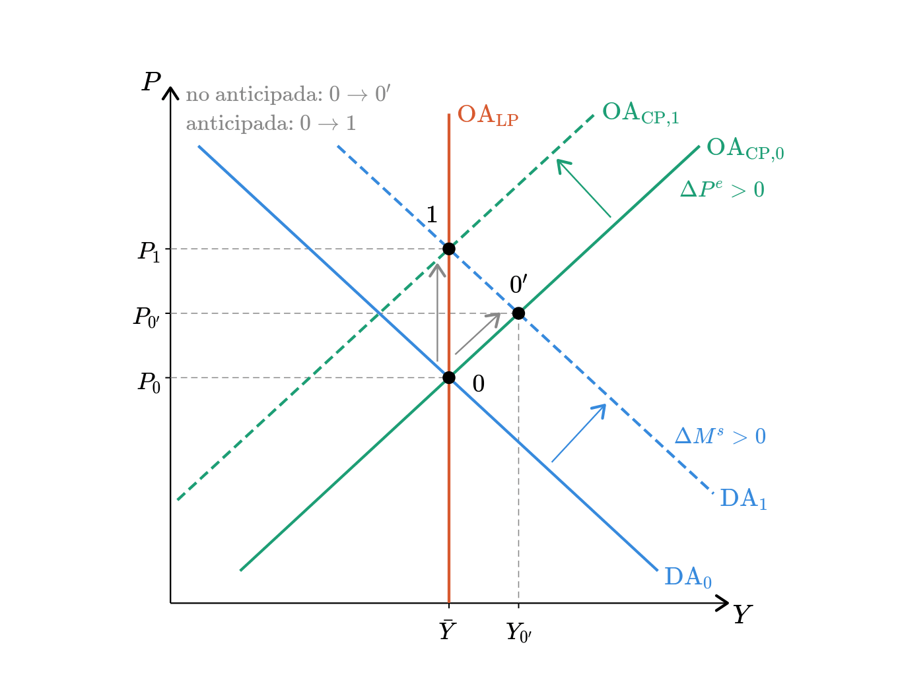
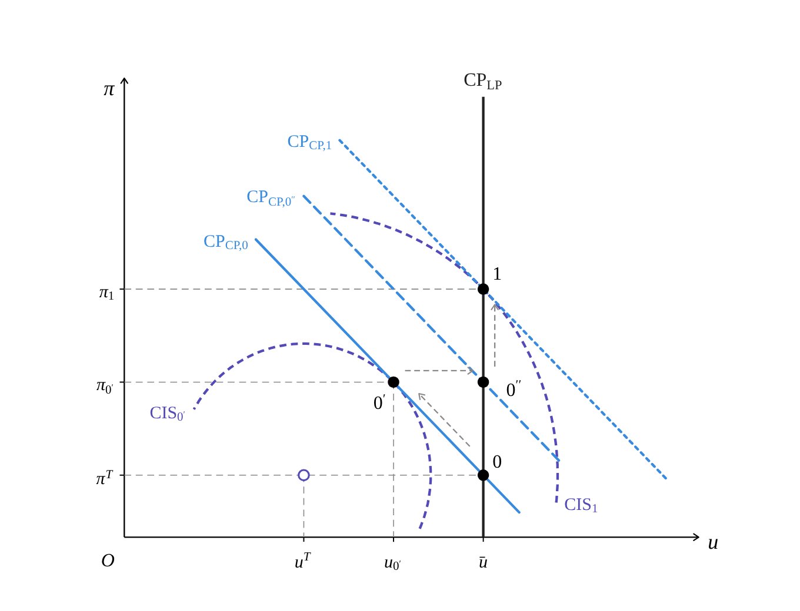
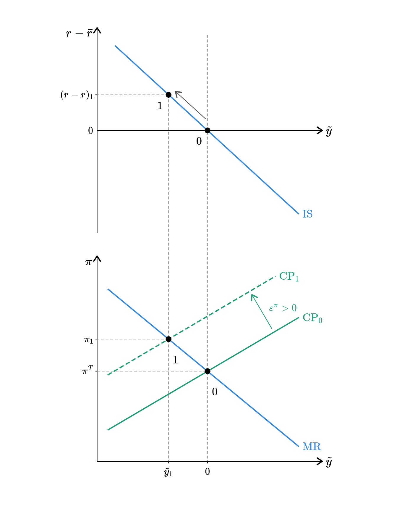

## Introducción

::: {.callout-note appearance="simple" icon=false}

:::

La estanflación de los años setenta, con inflación y desempleo altos a la vez, y el fracaso de los modelos macroeconométricos keynesianos para anticiparla abrieron el camino a la **nueva macroeconomía clásica** (NMC). La escuela radicalizó la crítica monetarista a la síntesis neoclásica (tema [A05](a05-monetaristas-snc.qmd)). Friedman admitía efectos reales transitorios de la política monetaria porque los agentes forman sus expectativas de forma adaptativa, mientras que la NMC los limitó a las perturbaciones que los agentes no anticipan.

Robert Lucas, Thomas Sargent, Neil Wallace y Robert Barro llevaron a la macroeconomía las **expectativas racionales** de Muth (1961) y la exigencia de **microfundamentos**, según la cual las relaciones agregadas deben derivarse del comportamiento optimizador de agentes que miran al futuro y vacían los mercados de forma continua. En los modelos de Lucas (1972), los agentes confunden las variaciones del nivel general de precios con cambios de precios relativos, y solo esa confusión da efectos reales a las perturbaciones monetarias. La **crítica de Lucas** (1976) dio a esa exigencia su forma más conocida, al mostrar que los parámetros de los modelos estimados cambian cuando cambia la política económica y que esos modelos no sirven, por tanto, para evaluarla.

En política económica, si los agentes anticipan las medidas sistemáticas, la política monetaria anticipada no altera la producción (Sargent y Wallace, 1975), la discrecionalidad genera un sesgo inflacionista que corrigen las reglas creíbles (Kydland y Prescott, 1977), y Barro (1974) devolvió actualidad a la equivalencia ricardiana. La escuela recibió críticas por el vaciado continuo de los mercados y por las exigencias informativas de las expectativas racionales, pero su método, con los modelos del ciclo real de Kydland y Prescott (1982), está en la base de los modelos de equilibrio general dinámico y estocástico que hoy utilizan los bancos centrales. Lucas (1995), Kydland y Prescott (2004) y Sargent (2011) recibieron el Premio Nobel por estas aportaciones.

El tema presenta las aportaciones de la NMC en tres partes:

- *Fundamentos*: los principales rasgos de la escuela, la hipótesis de las expectativas racionales y la crítica de Lucas, que exige microfundamentar los modelos macroeconómicos.

- *Aplicaciones*: el estudio del ciclo, con la teoría de los ciclos monetarios (Lucas) y la teoría del ciclo real (Kydland-Prescott y Long-Plosser), de cuyo método surgen los modelos de equilibrio general dinámico y estocástico.

- *Implicaciones*: las de política monetaria y fiscal, las críticas recibidas y la convergencia de la escuela hacia la nueva síntesis neoclásica.

## 1. Fundamentos del pensamiento de la NMC

La aportación de la NMC supuso un cambio metodológico que se asienta en dos ideas, la crítica de Lucas y la microfundamentación de los modelos macroeconómicos, y en un supuesto sobre los agentes, la hipótesis de las expectativas racionales[^a06-43].

### 1.1. Principales rasgos

**Metodología**: en gran parte a raíz de la crítica de Lucas, la NMC enfatiza la necesidad de *microfundamentar* los modelos macroeconómicos, es decir, de derivar las relaciones agregadas del comportamiento optimizador de los agentes (el nexo microeconomía-macroeconomía).

**Supuestos**:

- *Entorno*: los autores de la NMC se mueven en un mundo neoclásico, con competencia perfecta en los mercados de bienes, factores y financieros, y plena flexibilidad de precios, salarios y tipo de interés. No obstante, destacan la importancia de la información imperfecta, por la que las perturbaciones nominales no anticipadas pueden tener efectos reales transitorios sin rigideces nominales (apartado 2.1).

- *Agentes*: junto con la metodología, es el ámbito en el que la aportación de la NMC resulta más novedosa. Destacan dos ideas:

    - *Racionalidad dinámica*: al desarrollar sus modelos en un entorno dinámico, los autores de la NMC consideran que los agentes optimizan su comportamiento en el tiempo, lo que les lleva a tomar decisiones de sustitución intertemporal (p. ej. del trabajo y el ocio entre periodos, como en Lucas y Rapping, 1969)[^a06-3]. Además, los agentes tienen una conducta previsora (*forward-looking*).

    - *Hipótesis de expectativas racionales (HER)* (Muth, 1961): los agentes usan de forma eficiente la información disponible y no cometen errores sistemáticos.

**Ajuste**: todos estos elementos llevan más allá el pensamiento clásico y garantizan el vaciado continuo de los mercados[^a06-6].

**Política económica**: del paradigma anterior se deduce la defensa del no intervencionismo (apartado 3).

### 1.2. La hipótesis de las expectativas racionales (Muth, 1961)

Según la HER[^a06-4], a la hora de formar sus expectativas, los agentes no las ajustan gradualmente, sino que utilizan la información disponible en cada momento de la mejor manera posible y no cometen errores sistemáticos[^a06-5]:

$$X_{t+i}^e \equiv \mathbb{E}_t\!\left[X_{t+i} \mid \Omega_t\right], \qquad X_{t+i} - X_{t+i}^e = \varepsilon_{t+i}, \quad \mathbb{E}_t[\varepsilon_{t+i}] = 0$$

Es decir, la expectativa subjetiva sobre la variable $X$ para el periodo $t+i$, formada en $t$, es la esperanza matemática condicionada a la información disponible, $\Omega_t$. El error de predicción es ortogonal a dicha información (de media cero y no anticipable a partir de ella). Así, la HER admite errores, pero no sistemáticos, y no debe confundirse con las expectativas adaptativas, en las que los agentes corrigen su previsión a partir de los errores pasados.

Las principales características de la HER son:

1. *Información*: no exige información completa ni que los agentes conozcan la estructura de la economía. Si la información es completa, actúan como si conocieran el modelo, mientras que, si es incompleta, utilizan de forma óptima la disponible, cuya base no pueden ampliar por sí mismos.

2. *Posibilidad de error*: la HER admite errores, y estos pueden ser grandes cuando falta mucha información o surgen perturbaciones imprevisibles. El error se reduce a medida que aumenta la información disponible y solo desaparece cuando los agentes conocen todas las ecuaciones de un modelo determinista o realizan una previsión perfecta ($X_t = X_t^e$). Lo que la HER sí exige es que el error no se refiera a aspectos deducibles con la información disponible (de lo contrario, no la estarían utilizando de forma óptima).

3. *Conocimiento de reglas*: no es preciso conocer las reglas de política futura. Los agentes pueden tener creencias sobre ellas, que no pueden diferir de las reglas reales en aspectos deducibles con la información disponible.

4. *Ley de expectativas iteradas*: la predicción hoy de la predicción futura coincide con la predicción actual de la variable, $\mathbb{E}_t\!\left[\mathbb{E}_{t+1}(X_{t+2})\right] = \mathbb{E}_t(X_{t+2})$. Si se esperara que la predicción fuera a cambiar en el futuro, sería porque se dispone de información no incorporada a la actual.

Además, la HER tiene una serie de exigencias sobre el término error. Concretamente, exige que este sea ortogonal a la información disponible, lo que implica dos propiedades desde el punto de vista estadístico:

1. *Esperanza nula*: al cabo de un número grande de periodos, los errores tienen media cero, $\mathbb{E}[\varepsilon_t] = 0$.

2. *No autocorrelación*: los errores son ortogonales a la información pasada y, en particular, entre sí: $\mathbb{E}\!\left[(X_t - X_t^e)(X_{t-1} - X_{t-1}^e)\right] = 0$.

Por el contrario, la varianza constante (homocedasticidad) y la normalidad no son requisitos de la HER, sino supuestos simplificadores que a veces se añaden (p. ej. la normalidad permite la extracción de señal lineal en el modelo de Lucas).

### 1.3. La crítica de Lucas (1976)

**Origen**: Robert Lucas, en *Econometric Policy Evaluation: A Critique* (1976)[^a06-44], cuestiona la práctica, entonces habitual, de evaluar políticas simulándolas en grandes modelos macroeconométricos de inspiración keynesiana, construidos sobre el IS-LM de la síntesis neoclásica y estimados con datos históricos.

**Idea**: la estructura de esos modelos está formada por las reglas de decisión óptimas de los agentes, y estas cambian sistemáticamente cuando cambia el comportamiento de las variables relevantes para sus decisiones, entre ellas la propia política. De ello se sigue que cualquier cambio de política altera sistemáticamente la estructura del modelo.

**Razonamiento**: conviene, por tanto, distinguir dos tipos de parámetros:

- *Parámetros profundos o estructurales*: las preferencias (p. ej. la impaciencia o la aversión al riesgo), la tecnología y las restricciones de los agentes. Son invariantes ante las medidas de política económica.

- *Parámetros de las reglas de decisión*: los que los modelos estiman en forma reducida (p. ej. los coeficientes de una función de consumo o de una curva de Phillips). No son invariantes, pues incorporan las expectativas de los agentes sobre la política y, por tanto, varían cuando cambia el régimen de política económica.

Los modelos que tratan los coeficientes de forma reducida como si fueran estructurales son, así, inadecuados para predecir los efectos de un cambio de política[^a06-2], porque la relación estimada bajo un régimen deja de valer justo cuando se adopta otro. Lucas ilustra el argumento con la función de consumo, la de inversión y la curva de Phillips, el caso más conocido.

**Extensiones**: de la crítica se derivan tres consecuencias metodológicas:

- *Evaluación de reglas*: lo que puede evaluarse no son medidas aisladas, sino reglas de política estables y conocidas por los agentes, comparando el comportamiento de la economía bajo cada una. De ahí procede el énfasis posterior en las reglas y la credibilidad (apartado 3.1.2).

- *Expectativas endógenas*: para que las expectativas respondan al régimen, los agentes han de formarlas con la información disponible sobre la política, lo que consagró la hipótesis de expectativas racionales como supuesto de referencia.

- *Modelos estructurales*: solo sirven para evaluar políticas los modelos formulados en términos de parámetros profundos, que desembocaron en los modelos de equilibrio general dinámico y estocástico (DSGE, por sus siglas en inglés), objeto del apartado 2.3.

La inefectividad de la política monetaria anticipada de Sargent y Wallace (apartado 3.1.1) aplica la misma lógica. Si la regla es conocida, su parte sistemática ya está descontada en las expectativas.

**Conclusiones**:

- *Aspectos positivos*: la crítica de Lucas supuso un cambio en la investigación macroeconómica, a menudo descrito como una sustitución de paradigmas (*paradigm shift*, en términos de Kuhn).

- *Limitaciones*: su relevancia empírica ha resultado, sin embargo, menor de lo que se temía. Los contrastes de superexogeneidad (Favero y Hendry, 1992) comprueban si los coeficientes de una ecuación se mantienen estables cuando cambia el proceso que siguen las variables de política, y en sus aplicaciones (p. ej. a la demanda de dinero) apenas encuentran la inestabilidad que predice la crítica.

### 1.4. Conclusiones

La NMC conserva el mundo neoclásico de competencia perfecta y precios flexibles, y su novedad está en el modo de modelizar a los agentes. Estos optimizan a lo largo del tiempo, sustituyen trabajo y ocio entre periodos y forman expectativas racionales, que admiten errores, pero no sistemáticos. Con esos supuestos los mercados se vacían de forma continua, y las perturbaciones nominales no anticipadas pueden tener efectos reales transitorios por falta de información, sin necesidad de rigideces nominales.

La crítica de Lucas convierte esos supuestos en una exigencia de método. Si las reglas de decisión de los agentes cambian con la política, los coeficientes estimados en forma reducida no sirven para evaluarla, y solo permanecen estables los parámetros profundos de preferencias, tecnología y restricciones. De ahí que se evalúen reglas conocidas y no medidas aisladas, y que los modelos se formulen con esos parámetros. La sección 2 aplica este método al ciclo, primero con sorpresas monetarias y después con perturbaciones tecnológicas.

## 2. Aplicaciones y desarrollos: estudio del ciclo walrasiano

Sentados los fundamentos de la escuela, sus aportaciones más características se encuentran en la modelización del **ciclo** económico. Para Lucas, un ciclo es un movimiento autocorrelacionado de las principales variables (producción, consumo, inversión, horas trabajadas, precios o tipos de interés) alrededor de una tendencia, que puede describirse mediante una ecuación con perturbaciones estocásticas. La NMC ofrece dos explicaciones del ciclo, ambas como respuesta óptima de agentes racionales a las perturbaciones en un marco de mercados que se vacían:

1. *Teorías del ciclo nominal*: los ciclos por *shocks* monetarios no anticipados (Lucas), donde el impulso es nominal y opera a través de un problema de información imperfecta.

2. *Teoría del ciclo real*: los ciclos por *shocks* reales no anticipados (la teoría del ciclo real o TCR), donde el impulso es tecnológico y no requiere fricciones informativas.

::: {.callout-note appearance="simple" icon=false}
Ambos modelos se presentan aquí en su versión esencial, como pilares del pensamiento de la NMC sobre los que descansan sus implicaciones de política económica (apartado 3). Su lectura como teorías del ciclo (análisis gráfico, dinámica y extensiones) se desarrolla en el tema [A42](a42-ciclos.qmd), apartados 2.1 y 2.2, y su contraste con los hechos estilizados, en el apartado 3.3 de ese tema.
:::

### 2.1. Modelo OA-DA con información imperfecta (Lucas, 1972; 1973; 1975)

**Origen**: Robert Lucas, en una serie de artículos durante los años setenta, elabora un modelo de oferta y demanda agregada, conocido como *modelo de las islas de Lucas*, que reelabora con matices el macromodelo neoclásico. Se apoya en dos trabajos previos:

- *Economía de la información*: el de Edmund Phelps (1968) y, sobre todo, su artículo de 1969, recogido en el libro de 1970. De este trabajo nace la *parábola de las islas*, base del *problema de extracción de señales* (trabajadores y productores dispersos en “islas” que carecen de información sobre las variables agregadas).

- *Mercado de trabajo*: el de Lucas con Leonard Rapping (1969), del que toma la importancia de la *elasticidad de sustitución intertemporal* (ESI) en las decisiones de trabajo. Así, cuando el salario presente es alto en relación con el esperado, los agentes reducen su ocio y aumentan su oferta de trabajo[^a06-8].

**Idea**: la diferencia fundamental con el modelo clásico está en la modelización de la oferta. La oferta agregada a corto plazo ($\text{OA}_{\text{CP}}$) y la de largo plazo ($\text{OA}_{\text{LP}}$) difieren por las percepciones transitorias erróneas sobre los precios. De ahí surge una relación positiva entre precios y producción a corto plazo, en la que la producción responde a la diferencia entre los precios observados y los esperados.

#### 2.1.1. Supuestos

**Entorno**: el modelo supone un mundo neoclásico (competencia perfecta y plena flexibilidad de precios, salarios y tipo de interés), pero con información imperfecta. 

La economía se compone de múltiples mercados o “islas”. Cada productor observa el precio de su mercado, $p_{it}$, pero no el nivel general de precios, $p_t$. No puede distinguir, por tanto, si una variación de su precio responde a un *shock* específico de su mercado (cambio de preferencias, ante el que lo racional es alterar la producción) o a un *shock* general de demanda agregada (ante el que conviene no alterarla). Todas las variables se expresan en logaritmos.

**Agentes**: cada productor produce y vende un único bien en su mercado local, al precio observado, y compra bienes en otros mercados sobre los que forma un precio esperado. Forma sus expectativas según la HER, por lo que $p_t^e \equiv \mathbb{E}_{t-1}[p_t]$ es el nivel general de precios esperado con la información previa a observar el precio local. Optimiza intertemporalmente, de modo que un precio relativo alto lleva a aumentar la producción, lo que implica más demanda de trabajo por parte de las empresas y más oferta de trabajo por parte de los hogares, en virtud de la sustitución intertemporal del ocio. En cuanto a la autoridad monetaria, la cantidad de dinero nominal se desagrega en un componente previsible o sistemático y un componente no previsible:

$$m_t = \mathbb{E}_{t-1}[m_t \mid \Omega_{t-1}] + \varepsilon_t, \qquad \varepsilon_t \sim N(0, \sigma_m^2)$$

El término $\varepsilon_t$ recoge las sorpresas monetarias. Agrupa lo que los agentes no pueden anticipar de la política monetaria (su parte aleatoria, no sistemática) y los errores de control monetario.

#### 2.1.2. Modelo

**Planteamiento**: el modelo se resume en una función de oferta agregada, derivada del problema de extracción de señales, y una función de demanda agregada, derivada de la teoría cuantitativa:

1. *Oferta agregada*: la oferta de cada mercado se compone de un componente normal o tendencial, común a todos los mercados ($\bar{y}_t$, el *output* asociado a la tasa natural de paro), y un componente cíclico que depende de los precios relativos. En este último opera la extracción de señales. 

Ante un *shock* de precios, el productor pondera la información con un coeficiente $\vartheta \in [0, 1]$, el peso de los *shocks* relativos o específicos en la varianza total de los precios. Puede leerse como la probabilidad que el productor asigna a que la perturbación afecte solo a su mercado:

$$\vartheta = \frac{\sigma_i^2}{\sigma_i^2 + \sigma_p^2}$$

En una economía con inflación alta y volátil ($\sigma_p^2$ grande) los *shocks* generales son más probables ($\vartheta \rightarrow 0$) y el productor apenas reacciona a un cambio de precios, mientras que en una economía con precios estables ocurre lo contrario ($\vartheta \rightarrow 1$). 

La función de oferta de cada mercado es entonces $y_{it} = \bar{y}_t + \zeta\,(p_{it} - p_t^e)$, con $\zeta \equiv \vartheta\eta > 0$, donde $\eta$ es la sensibilidad (elasticidad) de la producción a los *shocks* de precios en su mercado[^a06-11]. Así, el productor solo responde a la parte del diferencial de precios que atribuye a un *shock* relativo. 

Si todos los mercados son iguales y se añade un término $\varepsilon_t^s \sim (0,\sigma_s^2)$ que recoge los *shocks* exógenos de oferta (productividad, clima, precio de los insumos), agregando las ofertas individuales (el componente específico promedia a cero) se obtiene la *oferta agregada de Lucas*[^a06-12]:

$$\text{OA: } y_t = \bar{y}_t + \zeta\,(p_t - p_t^e) + \varepsilon_t^s$$

La producción agregada depende positivamente del componente tendencial, de la *sorpresa* de precios ($p_t - p_t^e$) y de los *shocks* de oferta. En consecuencia, salvo por los *shocks* de oferta, no hay desviación respecto del nivel natural cuando $\vartheta = 0$ (p. ej. hiperinflación), cuando $\eta = 0$ o cuando la variación de precios está completamente anticipada ($p_t = p_t^e$).

2. *Demanda agregada*: de forma simplificada, se parte de la teoría cuantitativa del dinero, $m_t + v_t = p_t + y_t$, donde $m_t$ es la cantidad de dinero nominal[^a06-13] y $v_t$ una perturbación de la velocidad de circulación (de esperanza nula) que recoge los *shocks* exógenos de demanda. La demanda agregada es, así, una función de los saldos monetarios reales:

$$\text{DA: } y_t = m_t - p_t + v_t$$

**Equilibrio**: igualando oferta y demanda agregadas, imponiendo la HER y despejando el precio, se obtiene la producción como función de los *shocks* de la economía[^a06-14]:

$$y_t = \bar{y}_t + \frac{\zeta}{1+\zeta}(\varepsilon_t + v_t - \varepsilon_t^s) + \varepsilon_t^s \;\rightarrow\; \tilde{y}_t = \frac{\zeta}{1+\zeta}(\varepsilon_t + v_t - \varepsilon_t^s) + \varepsilon_t^s$$

Es decir, la brecha de producción (*output gap*), $\tilde{y}_t$, es una función de los *shocks* de política monetaria, $\varepsilon_t$, de los *shocks* sobre la velocidad de circulación del dinero, $v_t$, y de los *shocks* de oferta, $\varepsilon_t^s$.

**Desarrollo gráfico**: los efectos de una expansión monetaria anticipada y no anticipada en el plano renta-precios se representan en el apartado 3.1.1 (figura -@fig-a364-modelo-nmc), y la lectura del modelo como teoría del ciclo, en el tema [A42](a42-ciclos.qmd), apartado 2.1.

**Estática comparativa**:

$$\frac{\partial y_t}{\partial \varepsilon_t} = \frac{\partial y_t}{\partial v_t} = \frac{\zeta}{1+\zeta} > 0, \qquad \frac{\partial y_t}{\partial \varepsilon_t^s} = \frac{1}{1+\zeta} > 0$$

Lo que mueve la producción es, por tanto, la naturaleza sorpresiva de los *shocks* monetarios y de demanda, que sin sorpresa no tienen efectos reales, y esta es la lectura principal del modelo.

- *Política monetaria y perturbaciones de demanda*: un cambio monetario o de demanda anticipado se traslada íntegramente a los precios y es neutral. Solo su parte no anticipada ($\varepsilon_t$, $v_t$) altera transitoriamente la producción, hasta que los agentes infieren el verdadero nivel agregado de precios.

- *Perturbación de oferta*: los *shocks* de oferta ($\varepsilon_t^s$), en cambio, son perturbaciones reales, no nominales, que mueven la producción directamente. La sorpresa de precios de signo contrario que provocan solo amortigua su efecto, que se reduce a $1/(1+\zeta) < 1$.

- *Volatilidad de la demanda agregada*: la dependencia de $\vartheta$ respecto de $\sigma_p^2$ añade una implicación empírica contrastable (Lucas, 1973). En concreto, en países con una demanda agregada más volátil, la producción responde menos a las sorpresas nominales, de modo que la disyuntiva producción-inflación es menos favorable (la curva de Phillips a corto plazo es más vertical en el plano $(u, \pi)$). No existe, pues, una disyuntiva explotable de forma sistemática por la política económica.

**Extensiones**: la curva de Phillips con expectativas racionales que se deriva de la OA de Lucas se recoge en el Anexo A.2 y, en el marco de la teoría del desempleo, en el tema [A28](a28-tnp-nairu.qmd).

#### 2.1.3. Conclusiones

La parábola de las islas de Phelps, la modelización del mercado de trabajo de Lucas y Rapping y el modelo de OA-DA sentaron los cimientos del pensamiento de la NMC y de su instrumental metodológico.

**Aspectos positivos**:

- *Microfundamentación rigurosa*: la oferta agregada se deriva del comportamiento optimizador de agentes racionales, en coherencia con la crítica de Lucas, y constituye la primera explicación microfundamentada de la no neutralidad del dinero.

- *No neutralidad sin rigideces*: obtiene efectos reales de los *shocks* monetarios a corto plazo con precios plenamente flexibles y vaciado continuo, sin recurrir a rigideces nominales. Concilia así la evidencia de corto plazo (relación positiva precios-producción) con la hipótesis de la tasa natural y la neutralidad de largo plazo ($\text{OA}_{\text{LP}}$ vertical en el plano $(y, p)$).

- *Predicción nítida y contrastable*: distingue dinero anticipado (neutral) de no anticipado (real), y su predicción empírica (Lucas, 1973) recibió inicialmente respaldo.

**Limitaciones**:

- *Plausibilidad de la fricción informativa*: dada la difusión rápida y barata de las estadísticas de precios, es difícil sostener que los agentes confundan de forma persistente las variaciones relativas y agregadas hasta el punto de generar ciclos.

- *Magnitud y persistencia*: las sorpresas monetarias explican solo una pequeña parte de la variabilidad del producto y del empleo. Sobre todo, el modelo carece de un mecanismo de propagación (el *output* no hereda sus valores pasados), por lo que no reproduce la persistencia del ciclo.

- *Elasticidad de la oferta de trabajo*: para que las sorpresas generen fluctuaciones de empleo apreciables se requiere una elevada elasticidad de sustitución intertemporal del trabajo, contraria a la evidencia microeconómica.

- *Vaciado continuo*: el supuesto excluye el desempleo involuntario, en tensión con los hechos estilizados, pues la mayor parte del ajuste del empleo se produce por flujos entre empleo y desempleo, no por las horas de los ocupados.

A estas limitaciones se sumó, a finales de los años setenta y comienzos de los ochenta, la evidencia econométrica directa. Barro (1977; 1978) halló que solo el crecimiento monetario no anticipado afectaba al desempleo y a la producción. Sus estimaciones, sin embargo, atribuían a esas sorpresas efectos que se prolongaban unos dos años, difíciles de explicar por una confusión informativa cuando en EE. UU. los agregados monetarios se publicaban cada semana. Mishkin (1982) encontró, además, que el dinero anticipado también tenía efectos reales, no menores que los del no anticipado, con lo que el modelo perdía su predicción distintiva. La respuesta dentro de la propia escuela fue conservar el método y cambiar el impulso.

### 2.2. Ciclos debidos a *shocks* reales no anticipados (Kydland y Prescott, 1982; Long y Plosser, 1983)

**Origen**: Kydland y Prescott (1982) y Long y Plosser (1983) sientan las bases de la teoría del ciclo real (TCR) intentando replicar la dinámica observada en la economía estadounidense entre 1950 y 1979. El modelo de Kydland y Prescott incorporaba un plazo de construcción de varios periodos (*time to build*) como mecanismo de propagación y se calibraba y resolvía numéricamente, mientras que Long y Plosser obtuvieron una versión con solución analítica.

**Idea**: los ciclos se generan no por un problema de extracción de señales, sino por el comportamiento optimizador de los agentes ante perturbaciones reales, de carácter tecnológico, estocásticas y autocorrelacionadas.

#### 2.2.1. Supuestos

**Entorno**: la economía es cerrada, con información perfecta, tiempo discreto y horizonte infinito, competencia perfecta, mercados completos y plena flexibilidad de precios, salarios y tipo de interés[^a06-18].

**Agentes**: se cumple la HER y existe un número elevado de agentes idénticos (simultáneamente consumidores, productores y oferentes de trabajo), con vida infinita (altruismo intergeneracional perfecto). Su único activo es el capital, $k_t$, por lo que sus rentas son salariales y del capital, y sus preferencias se recogen en una función de utilidad aditivamente separable en el tiempo[^a06-19] que considera consumo y ocio. Se considera que no participa el sector público, lo que permite aislar los efectos de las perturbaciones tecnológicas.

**Tecnología**: la producción sigue una función Cobb-Douglas con tecnología neutral en el sentido de Harrod y rendimientos constantes a escala, afectada por perturbaciones tecnológicas autocorrelacionadas. El capital se deprecia a una tasa constante $\delta \in (0, 1]$. El caso de depreciación completa ($\delta = 1$), el de Long y Plosser, es el que permite resolver el modelo analíticamente[^a06-20].

#### 2.2.2. Modelo

El modelo se resume en cuatro ecuaciones de comportamiento de hogares y empresas, tres ecuaciones que describen la tecnología y una condición de equilibrio competitivo, lo que permite estudiar la dinámica del *output* (el ciclo).

**Hogares**: el hogar representativo consume, trabaja y ahorra.

- *Planteamiento*: maximiza el valor actual esperado de su utilidad a lo largo del tiempo, sujeto a su restricción presupuestaria intertemporal (RPI), en la que el capital $k_t$ es el único activo[^a06-21]:

    $$\begin{aligned} &\max_{c_t,\, l_t,\, k_{t+1}} U = \mathbb{E}_0 \sum_{t=0}^{\infty} \beta^t u(c_t, 1-l_t), \qquad \beta \in (0, 1) \\ &\text{s.a.:} \begin{cases} c_t + k_{t+1} - (1-\delta)k_t = w_t l_t + (r_t + \delta) k_t \\ k_0 \text{ dado} \end{cases} \end{aligned}$$

    donde $c_t$ es el consumo, $l_t$ el trabajo ofrecido (y $1-l_t$ el ocio), $k_t$ el capital, único activo del hogar, $u(\cdot)$ la utilidad instantánea en consumo y ocio, $\beta$ el factor de descuento, $k_0$ el capital inicial, $\mathbb{E}_0$ la expectativa condicionada a la información del periodo inicial, $w_t$ el salario, $r_t$ la remuneración neta del capital y $\delta$ la tasa de depreciación. El lado izquierdo es el consumo más la inversión bruta, $i_t = k_{t+1} - (1-\delta)k_t$, y el lado derecho la renta del hogar, con el capital remunerado a su coste de uso bruto, $r_t + \delta$. La restricción equivale a $c_t + k_{t+1} = w_t l_t + (1 + r_t)k_t$.

- *CPO*: con solución interior y la restricción agotada, derivando el lagrangiano respecto a $c_t$, $l_t$ y $k_{t+1}$, las CPO son la condición intratemporal entre ocio y consumo y la ecuación de Euler estocástica, a las que se suma la condición de transversalidad, que anula el valor actual esperado del capital que queda al final del horizonte. La condición intratemporal es la misma condición de oferta de trabajo que en un contexto estático, puesto que se refiere a un mismo periodo. Según la ecuación de Euler, en el óptimo la utilidad que aporta una unidad más de consumo presente coincide con la utilidad marginal esperada y descontada que esa misma unidad, ahorrada, reportaría un periodo después. En caso contrario, al agente le compensaría desplazar consumo entre periodos para elevar su utilidad[^a06-22]:

    $$\begin{aligned} &\text{RMS}_{c_t\,(1-l_t)} = \frac{\partial u/\partial (1-l_t)}{\partial u/\partial c_t} = w_t, \qquad \frac{\partial u}{\partial c_t} = \beta\, \mathbb{E}_t\!\left[\frac{\partial u}{\partial c_{t+1}}\,(1+r_{t+1})\right] \\ &\lim_{t\to\infty}\mathbb{E}_0\!\left[\beta^t \frac{\partial u}{\partial c_t}\,k_{t+1}\right]=0 \end{aligned}$$

- *CSO*: la concavidad estricta de $u$ en consumo y ocio y la de la tecnología garantizan que las CPO, con la condición de transversalidad, son necesarias y suficientes.

**Empresas**: producen con trabajo y capital.

- *Planteamiento*: maximizan su beneficio[^a06-23], $\max_{l_t, k_t} \Pi_t = y_t - w_t l_t - (r_t + \delta) k_t$.

- *CPO*: el trabajo se remunera al salario y el capital a su coste de uso (tipo de interés más depreciación), cada factor según su productividad marginal. A pesar del contexto dinámico, se llega a condiciones análogas a las del contexto estático:

    $$\underbrace{\frac{\partial f}{\partial l_t}}_{\text{Pmg}_{l}} = w_t, \qquad \underbrace{\frac{\partial f}{\partial k_t}}_{\text{Pmg}_{k}} = \underbrace{r_t + \delta}_{\text{coste de uso}}$$

- *CSO*: la tecnología Cobb-Douglas es cóncava en $(k, l)$ y estrictamente cóncava en cada factor, luego las CPO caracterizan el máximo.

**Tecnología**: la producción es Cobb-Douglas y la tecnología crece en torno a un nivel tendencial, $\bar{A}$, a un ritmo exógeno y constante, $g_A$. Está afectada, además, por un componente aleatorio, $a_t$, que sigue un proceso AR(1) (depende de las perturbaciones previas, $\rho_A a_{t-1}$, y de un ruido blanco, $\phi_t$):

$$\begin{aligned} &y_t = k_t^{\alpha} (A_t l_t)^{1-\alpha}, \qquad \alpha \in (0, 1) \\ &\ln A_t = \ln\bar{A} + g_A\,t + a_t, \qquad a_t = \rho_A a_{t-1} + \phi_t, \quad \rho_A \in (-1, 1) \end{aligned}$$

**Equilibrio**: con vaciado de los mercados de trabajo y capital, el gasto en consumo e inversión coincide con la renta de los hogares:

$$c_t + i_t = y_t, \qquad i_t = k_{t+1} - (1-\delta)k_t$$

En el caso analíticamente resoluble ($\delta = 1$ y utilidad logarítmica, $u(c_t, 1-l_t) = \ln c_t + b\ln(1-l_t)$, donde $b$ es el peso del ocio), se obtienen los valores solución de las variables relevantes en función de los parámetros y variables del modelo:

$$k_{t+1}^* = h_k(A_t, \alpha, k_t, l_t, \beta), \qquad c_t^* = h_c(A_t, \alpha, k_t, l_t, \beta), \qquad l^* = h_l(\alpha, \beta, b)$$

El empleo se mantiene constante, ya que solo depende de parámetros estructurales constantes y exógenos ($\alpha$, $\beta$ y $b$): $l^* = \frac{1-\alpha}{(1-\alpha)+b(1-\alpha\beta)}$. El ahorro (el capital acumulado al final de cada periodo, con una tasa de ahorro constante $s = \alpha\beta$) y el consumo, en cambio, sí se ven afectados por los *shocks* tecnológicos. La constancia del empleo no es una propiedad general de los modelos del ciclo real, sino de esta versión (utilidad logarítmica y depreciación completa).

**Dinámica**: a partir de los valores solución se obtienen las ecuaciones dinámicas y estocásticas de cada variable endógena[^a06-24], expresadas como desviación respecto de su trayectoria determinista[^a06-25]. En el caso del *output*, la ecuación dinámica estocástica de la desviación del *output* respecto de su tendencia determinista es:

$$\tilde{y}_t = (\alpha + \rho_A)\,\tilde{y}_{t-1} - \alpha\rho_A\,\tilde{y}_{t-2} + (1-\alpha)\,\phi_t$$

Es decir, el ciclo sigue un proceso autorregresivo de orden 2, de modo que, cuando se produce un *shock* tecnológico, el PIB se desvía de su tendencia en función de los ciclos de los dos periodos anteriores y de la persistencia de la perturbación. La duración del ciclo será mayor cuanto mayor sea la autocorrelación de la perturbación, $\rho_A$, que depende de la calibración del modelo[^a06-26]. Si, además, los *shocks* de productividad son frecuentes y permanentes (el caso límite de persistencia, con raíz unitaria, $\rho_A = 1$), alteran la propia tendencia (Nelson y Plosser, 1982) y explicarían así tanto el ciclo a corto plazo como el crecimiento a largo plazo.

**Bienestar**: como la economía es walrasiana, el ciclo es la respuesta óptima de los agentes a los *shocks*. Por tanto, las fluctuaciones no constituyen un fracaso de los mercados, sino la respuesta eficiente (Pareto-óptima) de la economía a las perturbaciones, y toda intervención pública para mitigarlas reduce el bienestar.

::: {.callout-note appearance="simple" icon=false}
Los efectos de un *shock* tecnológico sobre cada variable, el análisis gráfico del ciclo y las extensiones del modelo (indivisibilidades del trabajo, depreciación incompleta, sector público) se desarrollan en el tema [A42](a42-ciclos.qmd), apartado 2.2. El modelo de crecimiento sobre el que se construye la TCR, el de Ramsey-Cass-Koopmans, se estudia en el tema [A43](a43-crecimiento-i.qmd), apartado 3.
:::

#### 2.2.3. Conclusiones

**Aspectos positivos**: con modelos relativamente sencillos se reproducía gran parte de los hechos estilizados del ciclo de EE. UU.:

- *PIB*: los autores concluían que los *shocks* tecnológicos (de productividad) podían explicar en torno al 70 % de la volatilidad del PIB de posguerra en EE. UU. (Kydland y Prescott, 1991)[^a06-45]. Los modelos del ciclo real aportaron, además, un método que después adoptó también la nueva economía keynesiana (NEK).

- *Consumo e inversión*: en sus versiones calibradas (con depreciación incompleta), el modelo recoge la suavización del consumo y el exceso de volatilidad de la inversión.

**Limitaciones**: no obstante, el modelo presenta problemas tanto en su mecanismo de impulso y propagación como en el comportamiento de variables distintas del PIB:

- *Impulso y propagación*: el impulso descansa en *shocks* tecnológicos, cuando en el corto plazo el ritmo del progreso técnico apenas cambia. Con un impulso tan estable es difícil generar ciclos, y menos aún recesiones (¿una regresión tecnológica explica realmente una recesión?). Además, el mecanismo de propagación del modelo básico (la acumulación de capital) es débil, de modo que una perturbación tecnológica transitoria no se traduce en una variación significativa y duradera de la producción.

- *Tasa de ahorro y oferta de trabajo constantes*: en la versión básica ello implica que inversión y consumo serían igualmente volátiles, cuando en los datos de EE. UU. la inversión es unas tres veces más volátil que la producción y el consumo de bienes no duraderos lo es menos (Rebelo, 2005).

- *Mercado de trabajo*: en el modelo, el salario real acompaña al ciclo con mucha más fuerza que en los datos, donde solo lo hace de forma moderada. Además, reproducir la amplitud de las fluctuaciones agregadas exige una oferta de trabajo muy elástica, y las elasticidades de sustitución intertemporal estimadas con microdatos son un orden de magnitud menores que las necesarias (Chetty, Guren, Manoli y Weber, 2011).

- *Neutralidad del dinero*: es una implicación central de la TCR y se mantiene incluso en versiones con dinero (p. ej. modelos *cash-in-advance*). Sin embargo, aunque hay consenso teórico sobre la neutralidad a largo plazo, la evidencia empírica muestra que no siempre se cumple a corto plazo (p. ej. la ecuación de St. Louis de Andersen y Jordan, 1968, o los modelos de vectores autorregresivos, VAR, de Christiano, Eichenbaum y Evans, 1999).

### 2.3. Comparación y legado: los modelos DSGE

Los dos modelos comparten el núcleo del pensamiento de la NMC: agentes racionales que optimizan intertemporalmente, expectativas racionales y mercados que se vacían de forma continua. Por ello, en ambos el ciclo es la respuesta óptima de los agentes a las perturbaciones y no un fallo del sistema.

Difieren en el impulso y, con ello, en el papel del dinero:

- *Lucas*: el impulso es una sorpresa nominal, y la política monetaria no anticipada tiene efectos reales transitorios.

- *TCR*: el impulso es una perturbación tecnológica, y el dinero es neutral incluso a corto plazo.

La TCR aborda, además, la principal carencia empírica del modelo de Lucas, la falta de persistencia, ya que la acumulación de capital actúa como mecanismo de propagación y la autocorrelación de los *shocks* traslada su persistencia al ciclo. La propagación interna del modelo básico es, con todo, débil.

El legado más duradero de la TCR no fue su explicación del ciclo, sino su método. De él surgen los **modelos DSGE**, modelos de equilibrio general en los que hogares y empresas optimizan intertemporalmente con expectativas racionales, la economía está sometida a perturbaciones aleatorias y el comportamiento se describe con parámetros profundos de preferencias y tecnología. Ello los hace, en principio, robustos a la crítica de Lucas (apartado 1.3). Kydland y Prescott (1982) no estimaban esos parámetros, sino que los calibraban. La calibración consiste en asignarles valores tomados de estudios microeconómicos o de promedios de largo plazo de los datos y en juzgar el modelo por su capacidad para reproducir las volatilidades y correlaciones del ciclo.

::: {.callout-note appearance="simple" icon=false}
El modelo canónico de la NEK se desarrolla en el tema [A07](a07-nek.qmd), apartado 2.1, y como teoría del ciclo en el tema [A42](a42-ciclos.qmd), apartado 2.4. La ausencia del sistema financiero en el modelo básico y la agenda posterior a la crisis se estudian en el tema [A07](a07-nek.qmd), apartados 3.4.2 y 3.5, y el acelerador financiero, en el tema [A42](a42-ciclos.qmd), apartado 2.3.2. Aquí se recoge cómo surgieron los modelos DSGE a partir de la TCR.
:::

Desde los años noventa, el programa evolucionó en dos direcciones que acabaron fundiéndose. La primera fue la incorporación de las rigideces de la NEK. Así, la competencia monopolística y los precios *à la* Calvo dieron lugar al modelo canónico de tres ecuaciones. Christiano, Eichenbaum y Evans (2005) mostraron, además, que un modelo de tamaño medio con rigideces nominales de precios y salarios y con rigideces reales reproduce la inercia de la inflación y la persistencia del producto tras una perturbación monetaria. Las rigideces reales del modelo son los hábitos de consumo, los costes de ajuste de la inversión y la utilización variable del capital.

La segunda dirección fue el paso de la calibración a la estimación. Smets y Wouters estimaron modelos de este tipo para la zona del euro (2003) y para EE. UU. (2007) con técnicas bayesianas, que combinan la información previa sobre los parámetros con la que contienen los datos, y el de EE. UU. obtuvo previsiones fuera de la muestra comparables a las de los modelos VAR bayesianos.

Desde mediados de los años dos mil, los bancos centrales emplean modelos DSGE estimados en sus previsiones y en el análisis de políticas, junto a modelos semiestructurales y estadísticos:

- *Reserva Federal*: el FRB/EDO (*Estimated, Dynamic, Optimization-based model*), desde 2006.

- *Banco Central Europeo (BCE)*: el *New Area-Wide Model* (NAWM), ampliado con un sector financiero en el NAWM II.

- *Banco de Inglaterra*: COMPASS (*Central Organising Model for Projection Analysis and Scenario Simulation*), desde finales de 2011.

La Gran Recesión expuso los límites de los modelos DSGE, porque los modelos dominantes en su mayoría carecían de fricciones financieras, descansaban en un agente representativo y en aproximaciones lineales en torno al estado estacionario, y trataban mal el límite inferior de los tipos de interés (*zero lower bound*, ZLB). Sin embargo, la respuesta mayoritaria ha sido ampliar el marco antes que abandonarlo. En concreto, se han añadido fricciones financieras, cuyo antecedente es el acelerador financiero, y agentes heterogéneos (modelos HANK, *Heterogeneous Agent New Keynesian*, de Kaplan, Moll y Violante, 2018). En los modelos HANK, la política monetaria actúa sobre el consumo sobre todo a través de efectos indirectos sobre la renta.

### 2.4. Conclusiones

Los dos modelos de la sección leen el ciclo como la respuesta óptima de agentes racionales a perturbaciones en mercados que se vacían, y difieren en el origen de esas perturbaciones. En el de Lucas, el productor que no distingue si la subida de su precio es relativa o general responde a las sorpresas monetarias, de modo que solo el dinero no anticipado altera, y de forma transitoria, la producción. La falta de persistencia y la evidencia de Barro y de Mishkin llevaron a sustituir ese impulso por uno tecnológico, cuya autocorrelación, unida a la acumulación de capital, da persistencia al ciclo de la TCR.

El método de la TCR duró más que su explicación del ciclo y dio lugar a los modelos DSGE, que incorporaron después las rigideces de la NEK y la estimación bayesiana. De ese marco se derivan las implicaciones de política de la sección 3. Si el ciclo es óptimo y solo las sorpresas tienen efectos reales, la política de estabilización es, en el mejor de los casos, inútil y, en el peor, perjudicial.

## 3. Implicaciones del pensamiento de la NMC

Del marco anterior se derivan implicaciones de política monetaria y de política fiscal. Se exponen primero los principales resultados y, después, las críticas a la escuela y su posterior convergencia hacia la nueva síntesis.

### 3.1. Implicaciones de política monetaria

En materia de política monetaria, la NMC obtiene dos resultados, la inefectividad de la política anticipada y la inconsistencia dinámica de la política discrecional.

#### 3.1.1. Inefectividad de la política monetaria (Sargent y Wallace, 1975; 1976)

**Origen**: el primer resultado en materia de política monetaria se debe a Sargent y Wallace (1975; 1976).

**Idea**: las políticas que respondan a información de conocimiento público (como los principales indicadores macroeconómicos) serán ineficaces para estabilizar la producción.

**Razonamiento**:

1. *Política reglada y creíble*: cuando la política monetaria sigue una regla (es fácilmente anticipable) y goza de credibilidad, no tiene efectos reales y todo su impacto recae sobre los precios: $\partial \mathbb{E}_{t-1}[p_t] / \partial \mathbb{E}_{t-1}[m_t] = 1$. La razón es que los agentes aprenden a anticipar las posibles reglas de estabilización contracíclica, siempre que los bancos centrales las utilicen de forma sistemática.

2. *Política no creíble*: sin credibilidad, incluso el componente “anticipado” puede tener efectos reales. Supóngase que la autoridad monetaria comunica una subida de $m_t$ que eleve la inflación, p. ej. del 0 % al 5 %. Si el público desconfía del anuncio, preverá una expansión monetaria por encima o por debajo de la anunciada, y la ejecución de la política acabará afectando a las variables reales.

Con todo, la NMC no recomienda recurrir a sorpresas monetarias, porque reducen la credibilidad futura de la política monetaria y aumentan la incertidumbre.

**Desarrollo gráfico**: los efectos de una expansión monetaria se representan en el plano renta-precios (figura -@fig-a364-modelo-nmc):

1. *Oferta agregada a largo plazo*, $\text{OA}_{\text{LP}}$: recoge la producción cuando los precios se anticipan ($p_t = p_t^e$). Es vertical en la producción natural, $\bar{Y}$, porque sin sorpresa de precios la producción no se desvía de su nivel natural.

2. *Oferta agregada a corto plazo*, $\text{OA}_{\text{CP},0}$: es la oferta de Lucas para unos precios esperados dados. Es creciente porque cada productor atribuye parte de la subida de su precio a un *shock* relativo y eleva su producción.

3. *Demanda agregada*, $\text{DA}_0$: recoge la teoría cuantitativa para una cantidad de dinero dada. Es decreciente porque una subida de los precios reduce los saldos monetarios reales.

4. *Equilibrio*: en el punto 0, donde se cortan las tres curvas, con producción $\bar{Y}$ y precios $P_0$ iguales a los esperados.

::: {#fig-a364-modelo-nmc}

::: {.content-visible when-format="html"}
```{=html}
<div class="graph-frame">
<iframe src="../graphs/a364_Modelo_NMC.html" style="height:560px" loading="lazy" title="fig-a364-modelo-nmc"></iframe>
</div>
```
:::

::: {.content-visible unless-format="html"}

:::

Modelo de la NMC. Con expectativas racionales solo la política monetaria no anticipada afecta a la producción. El gráfico representa las variables en niveles ($P$, $Y$, $\bar{Y}$), mientras que el texto las expresa en logaritmos.
:::

**Estática comparativa**: una expansión monetaria ($\Delta M^s > 0$) desplaza la demanda agregada de $\text{DA}_0$ a $\text{DA}_1$:

- *No anticipada*: los precios esperados no cambian y la economía pasa del punto 0 al 0′, con más producción, $Y_{0'}$, y precios $P_{0'}$.

- *Anticipada*: los precios esperados suben ($\Delta P^e > 0$), la oferta a corto plazo se desplaza a $\text{OA}_{\text{CP},1}$ y la economía pasa directamente del punto 0 al 1, con la misma producción, $\bar{Y}$, y precios $P_1$.

**Conclusiones**:

- *Aspectos positivos*: introduce la distinción entre política anticipada y no anticipada y muestra que las conclusiones de política dependen de cómo se modelicen las expectativas. Refuerza, además, el argumento a favor de reglas sencillas y predecibles frente a la política activa de estabilización. Sargent (1982) halló, por su parte, que en Austria, Hungría, Polonia y Alemania las hiperinflaciones de los años veinte terminaron con un cambio de régimen creíble, con reformas fiscales e institucionales, casi sin coste en producción.

- *Limitaciones*: el resultado exige, además de expectativas racionales, precios y salarios plenamente flexibles. Con contratos nominales plurianuales o escalonados, la política anticipada tiene efectos reales aunque las expectativas sean racionales (tema [A07](a07-nek.qmd), apartado 1.4.1), y los contrastes empíricos no confirman que solo la política no anticipada tenga efectos reales.

#### 3.1.2. Inconsistencia dinámica de la política monetaria (Kydland y Prescott, 1977; Barro y Gordon, 1983a)

**Origen**: el segundo resultado en materia de política monetaria se relaciona con la sostenibilidad de las políticas monetarias sorpresivas. Se debe a las aportaciones de Kydland y Prescott, *Rules Rather than Discretion: The Inconsistency of Optimal Plans* (1977), en el marco de la tasa natural de paro[^a06-29], y de Barro y Gordon (1983a), en el de la teoría de juegos.

**Idea**: estos autores plantean si mantener en el tiempo una política monetaria sorpresiva es coherente con la HER. La respuesta se apoya en la noción de *inconsistencia dinámica*, origen del problema de la credibilidad:

1. *Teoría de juegos*: un plan es dinámicamente inconsistente si, aun sin cambiar las preferencias del decisor ni llegar nueva información, el plan que era óptimo en un momento dado deja de serlo en un periodo posterior, cuando llega el momento de ejecutarlo.

2. *Teoría económica*: una política (anunciada) es dinámicamente inconsistente si los agentes anticipan que las autoridades romperán el compromiso planteado en su anuncio, porque mantener dicha política no es óptimo a lo largo del tiempo. Por ello, la política económica (anunciada) no es creíble.

El incentivo a romper el compromiso nace de la HER, dado que los agentes económicos incorporan los anuncios de política a sus decisiones en el momento en el que se producen.

Además, la autoridad monetaria es consciente de cómo forman sus expectativas los agentes y de que puede influir en la inflación a través de sus políticas. Sabe también que existe a corto plazo una relación estadística positiva entre el *output* real (o el empleo) y la inflación. Por ello, tiene incentivos para romper sus compromisos en el corto plazo, con el fin de alcanzar diferentes objetivos cortoplacistas[^a06-30].

No obstante, los agentes, conscientes de estos incentivos, los anticipan. En consecuencia, una política monetaria *discrecional*, es decir, no basada en reglas, no logra efectos reales ni siquiera a corto plazo, porque los agentes anticipan la inflación que elegirá, y da lugar a una pérdida de bienestar (el sesgo inflacionista). Kydland y Prescott introducen así la importancia de la credibilidad.

**Supuestos**:

- *Entorno*: información completa, juego único (modelo estático) y mundo neoclásico, con precios y salarios flexibles, aunque los contratos nominales se fijan antes de que la autoridad decida la inflación.

- *Agentes*: intervienen dos:

    - *Sociedad*: forma sus expectativas de inflación según la HER, $\pi_t^e = \mathbb{E}_{t-1}[\pi_t]$, y sobre ellas fija sus contratos de precios y salarios.

    - *Gobierno*: intenta minimizar la pérdida social derivada de las desviaciones del desempleo y de la inflación respecto de sus objetivos. Elige un objetivo de inflación, $\pi^T$, y un objetivo de desempleo, $u^T$, inferior a la tasa natural (un objetivo de producción superior a su nivel natural).

Las preferencias del Gobierno reflejan las preferencias sociales y se recogen en una función de pérdida social: $L_t = (u_t - u^T)^2 + b(\pi_t - \pi^T)^2$. En ella, $u_t$ es la tasa de paro y $u^T < \bar{u}$, el objetivo de desempleo del Gobierno (inferior a la tasa natural). El parámetro $b > 0$ refleja la importancia relativa de los dos objetivos, es decir, el grado de aversión a la inflación (el peso de la inflación en la función de pérdida en relación con el del desempleo):

1. *$b$ alto*: la autoridad monetaria pondrá más énfasis en las desviaciones de inflación que en las desviaciones del desempleo. El Gobierno es duro (*hard-nosed*)[^a06-46], como ilustra el mandato único de estabilidad de precios del BCE.

2. *$b$ bajo*: la autoridad monetaria pondrá más énfasis en la estabilización del ciclo. El Gobierno es blando (*wet*), como ilustra el mandato dual de la Reserva Federal (Fed), que suma el máximo empleo a la estabilidad de precios. Los dos mandatos solo ejemplifican el peso de cada objetivo, porque el modelo no clasifica bancos centrales reales.

La restricción del Gobierno vendrá dada por la curva de Phillips a corto plazo, según la cual la tasa de inflación y la tasa de desempleo están inversamente relacionadas: $\pi_t = \pi_t^e - \kappa_u(u_t - \bar{u}), \quad \kappa_u > 0$. Esta relación desaparece en el largo plazo, donde $\pi_t = \pi_t^e$.

**Planteamiento**: la resolución del programa dará lugar a una ecuación de comportamiento discrecional de la autoridad monetaria:

$$\min_{\pi_t} L_t = (u_t - u^T)^2 + b(\pi_t - \pi^T)^2 \quad \text{s.a.:} \; u_t = \bar{u} - \gamma(\pi_t - \pi_t^e), \; \gamma = 1/\kappa_u$$

donde $\pi_t$ es la tasa de inflación que elige la autoridad monetaria, $L_t$ la pérdida social, $u_t$ la tasa de paro, $u^T$ y $\pi^T$ los objetivos de desempleo e inflación del Gobierno, $b$ el grado de aversión a la inflación, $\bar{u}$ la tasa natural de paro, $\pi_t^e$ la inflación esperada por la sociedad y $\gamma = 1/\kappa_u$ la inversa del valor absoluto de la pendiente de la curva de Phillips en el plano $(u, \pi)$.

**CPO**: la condición iguala el coste marginal de desviar la inflación de su objetivo, $2b(\pi_t - \pi^T)$, con el beneficio marginal de reducir el desempleo por debajo de la tasa natural a lo largo de la curva de Phillips. Como el Gobierno persigue un desempleo inferior al natural ($u^T < \bar{u}$), le compensa generar inflación por encima de $\pi^T$, tanto más cuanto menor sea su aversión a la inflación, $b$:

$$\begin{aligned} \frac{dL}{d\pi_t} = 0 \;&\Rightarrow\; -2\gamma(\bar{u} - \gamma(\pi_t - \pi_t^e) - u^T) + 2b(\pi_t - \pi^T) = 0 \\ &\xrightarrow{\;\pi_t^e = \pi_t\;}\; \pi_1 = \pi^T + \frac{\gamma}{b}(\bar{u} - u^T) > \pi^T \end{aligned}$$

**CSO**: la función de pérdida es una suma de términos cuadráticos convexos y la restricción (curva de Phillips) es lineal en $\pi_t$, por lo que $L_t$ es estrictamente convexa en $\pi_t$ y la CPO es suficiente para un mínimo.

**Equilibrio**: por tanto, en un entorno de agentes racionales ($\pi_t^e = \pi_t$), el nivel de inflación de equilibrio, $\pi_1$, estará por encima del objetivo, $\pi^T$. Este exceso, $\frac{\gamma}{b}(\bar{u} - u^T)$, constituye el *sesgo inflacionista* de la política discrecional. Además, dado que $\pi_t^e = \pi_t$, el desempleo se situará en su nivel natural, $\bar{u}$, lo cual anulará cualquier ganancia de bienestar derivada del sesgo inflacionista.

**Desarrollo gráfico**: el sesgo inflacionista de la política discrecional se representa en el plano tasa de desempleo-inflación (figura -@fig-a365-modelo-barro-gordon):

1. *Curvas de Phillips a corto plazo*, $\text{CP}_{\text{CP},0}$, $\text{CP}_{\text{CP},0''}$ y $\text{CP}_{\text{CP},1}$: son la restricción del Gobierno, una para cada inflación esperada, con pendiente $-\kappa_u$.

2. *Curva de Phillips a largo plazo*, $\text{CP}_{\text{LP}}$: vertical en la tasa natural de paro, $\bar{u}$, donde $\pi_t = \pi_t^e$.

3. *Curvas de indiferencia social*, $\text{CIS}_{0'}$ y $\text{CIS}_1$: son curvas de nivel de la función de pérdida, en torno al punto de máximo bienestar ($u^T$, $\pi^T$). La pérdida es mayor cuanto más alejadas están de él.

4. *Equilibrio*: el punto 1 ($\bar{u}$, $\pi_1$) es un equilibrio de Nash, puesto que en él $\text{CP}_{\text{CP},1}$ es tangente a $\text{CIS}_1$, de modo que el Gobierno no tiene incentivos a desviarse, y la inflación coincide con la esperada ($\pi_t = \pi_t^e$). El punto 1 resulta peor que el inicial, porque le corresponde una curva de indiferencia social más distante del punto de máximo bienestar ($u^T$, $\pi^T$). El desempleo es el mismo que al principio, pero la inflación es más alta.

**Estática comparativa**: el sesgo inflacionista, $\pi_1 - \pi^T = \frac{\gamma}{b}(\bar{u} - u^T)$, depende de tres parámetros del modelo, que solo alteran la inflación (el desempleo de equilibrio sigue siendo $\bar{u}$):

- *Aversión a la inflación*, $b$: el sesgo disminuye con $b$ y tiende a cero si $b \to \infty$. En ello se funda la delegación en una autoridad más aversa a la inflación que la sociedad (Extensiones).

- *Ambición del objetivo de empleo*, $\bar{u} - u^T$: el sesgo crece con la distancia entre la tasa natural y el objetivo del Gobierno y desaparece si $u^T = \bar{u}$.

- *Pendiente de la curva de Phillips*, $\gamma = 1/\kappa_u$: cuanto más plana es la curva en el plano $(u, \pi)$ (menor $\kappa_u$), más desempleo reduce cada punto de inflación sorpresa, mayor es la tentación de generarla y mayor el sesgo.

**Dinámica**: la secuencia hipotética que lleva al punto 1 es la siguiente:

1. *Compromiso*: la economía parte del punto 0 ($\pi = \pi^T$, $u = \bar{u}$). La autoridad monetaria anuncia su compromiso de mantener la inflación en su objetivo. Sobre la base de este compromiso, los agentes económicos fijan sus expectativas y firman sus contratos de precios y salarios nominales.

2. *Incentivo a incumplir*: en esta coyuntura, a la autoridad monetaria le conviene romper su promesa a corto plazo, porque, para esos salarios nominales fijos, una inflación mayor que la prevista reduce el salario real, lo cual reducirá el desempleo. Si la autoridad monetaria rompiera su promesa, la economía se situaría en el punto 0′ ($u_{0'}$, $\pi_{0'}$), donde $\text{CP}_{\text{CP},0}$ es tangente a $\text{CIS}_{0'}$.

3. *Revisión de expectativas*: no obstante, la sociedad incorpora las nuevas expectativas de inflación y exige un salario mayor. Esto provoca un desplazamiento de la curva de Phillips a corto plazo hacia la derecha, a $\text{CP}_{\text{CP},0''}$, hasta el punto 0″.

4. *Equilibrio de Nash*: el proceso se repetiría hasta llegar al punto 1. La secuencia por etapas es solo expositiva, ya que en el juego único los agentes anticipan el incentivo del Gobierno y la economía se sitúa directamente en ese punto.

::: {#fig-a365-modelo-barro-gordon}

::: {.content-visible when-format="html"}
```{=html}
<div class="graph-frame">
<iframe src="../graphs/a365_Modelo_Barro_Gordon.html" style="height:560px" loading="lazy" title="fig-a365-modelo-barro-gordon"></iframe>
</div>
```
:::

::: {.content-visible unless-format="html"}

:::

Modelo de Barro y Gordon (1983a). Desde el compromiso anunciado (0), el incentivo a incumplir (0′) y la revisión de expectativas (0″) llevan al equilibrio discrecional (1), con sesgo inflacionista y sin ganancia de empleo.
:::

**Extensiones**: para la NMC, por tanto, las autoridades monetarias deberían limitarse a controlar la inflación, y se proponen cuatro soluciones al problema de la credibilidad:

1. *Reglas* (Kydland y Prescott, 1977): el banco central queda sujeto a reglas vinculantes (p. ej. un ritmo fijo de expansión monetaria o una tasa de inflación invariable). La regla de Taylor (1993)[^a06-32] es una de ellas: $i_t = \bar{i}_t + \alpha_\pi\,\tilde{\pi}_t + \alpha_y\,\tilde{y}_t$, con $\bar{i}_t = \bar{r}_t + \pi^T$ y $\tilde{\pi}_t = \pi_t - \pi^T$.

2. *Prácticas reputacionales* (Barro y Gordon, 1983b): si se considera que el juego se repite indefinidamente, la creación de reputación teniendo en cuenta estrategias de castigo puede resolver el problema de la inconsistencia dinámica. Los agentes privados harán demandas de salarios contenidas (bajas expectativas de inflación) si y solo si las autoridades mantienen una inflación baja. Las autoridades monetarias, sabedoras de este comportamiento, pueden estar dispuestas a sacrificar el corto plazo para forjarse una reputación de halcón (actitud dura contra la inflación)[^a06-33] y obtener así ganancias en el futuro. En el marco de una economía abierta, esto se puede conseguir a través de, p. ej., un régimen de cambio fijo o una caja de conversión (*currency board*).

3. *Delegación* (Rogoff, 1985): Rogoff defiende delegar la política monetaria en una autoridad independiente con mayor credibilidad. El agente nombrado puede dar un mayor peso al objetivo de estabilidad de precios que el asignado por la sociedad. La mayoría de los países de la OCDE ha seguido esta vía. Desde finales de la década de los ochenta, la evidencia empírica ha mostrado, en las economías avanzadas, una correlación negativa entre inflación e independencia de los bancos centrales, medida por el grado de atribución de responsabilidades a la entidad independiente. En las economías en desarrollo, en cambio, la independencia legal no guarda esa relación[^a06-34].

    No obstante, Posen (1993) apunta que correlación no significa causalidad, ya que la independencia y la baja inflación pueden responder a una misma causa, la oposición a la inflación de los grupos con peso político, sobre todo del sector financiero[^a06-35]. Además, la delegación introduce costes adicionales ante la existencia de perturbaciones económicas, pues la respuesta estabilizadora de las autoridades puede no ser óptima de acuerdo con las preferencias sociales.

4. *Contratos* (Walsh, 1995): un contrato entre el Gobierno y el banco central puede eliminar el sesgo inflacionista sin renunciar a la respuesta estabilizadora ante las perturbaciones (lo que equivale a replicar la política óptima con compromiso). Para ello, el contrato modifica la función de pérdida de las autoridades monetarias, añadiendo un término de coste adicional, determinado por el contrato entre las dos partes. La cuantificación óptima del coste asociado al contrato vendrá determinada por el sesgo inflacionista que existía en el caso de las políticas discrecionales. Aportaciones posteriores (Svensson, 1997) demuestran que el contrato óptimo de inflación puede implementarse exigiendo a la autoridad monetaria un objetivo de inflación inferior a la tasa socialmente óptima.

**Conclusiones**:

- *Aspectos positivos*: explica el sesgo inflacionista como resultado de la falta de compromiso, sin suponer agentes ni autoridades irracionales. Asimismo, ofrece el fundamento teórico de las reglas, la independencia del banco central y los objetivos de inflación, y está en la base de la literatura sobre la credibilidad.

- *Limitaciones*: el sesgo descansa en que la autoridad persigue un desempleo inferior al natural, supuesto discutible en un banco central independiente con mandato de estabilidad de precios. El marco es, además, estático y de información completa.

### 3.2. Implicaciones de política fiscal

En materia de política fiscal, la NMC revitaliza la equivalencia ricardiana, propone la suavización impositiva y advierte de los riesgos de la dominancia fiscal.

#### 3.2.1. La irrelevancia de la financiación del gasto público: revitalización de la equivalencia ricardiana (Barro, 1974)

**Origen**: Robert Barro, en *Are Government Bonds Net Wealth?* (1974), recupera una tesis que David Ricardo había planteado en el s. XIX, la equivalencia ricardiana[^a06-47].

**Idea**: la aportación de Barro permite ilustrar que los bonos no constituyen riqueza neta de los individuos y, por tanto, la elección entre impuestos y deuda para financiar un gasto público dado es irrelevante.

**Supuestos**:

- *Entorno*: mercados de capitales completos y perfectos. Esto supone que el tipo de interés es idéntico para todos los agentes de la economía (p. ej. sector público y agentes privados) y que no existen restricciones de crédito o liquidez.

- *Agentes*: intervienen dos:

    - *Sector privado*: forma sus expectativas con base en la HER y presenta altruismo intergeneracional perfecto.

    - *Sector público*: figuras impositivas neutrales que no distorsionan las decisiones de consumo y ocio (p. ej. impuestos de suma fija), cuyo cambio de calendario no redistribuye renta entre agentes. La senda de gasto público está dada.

**Razonamiento**: en el modelo walrasiano del ciclo real, al combinar la RPI de los consumidores-productores con la del Gobierno, los bonos desaparecen de la primera[^a06-36]. Por ello, para decidir cuánto consumen e invierten, a los hogares solo les importa el valor actual del gasto, que en su cálculo equivale a lo que valen hoy los impuestos.

Los individuos no padecen ilusión de deuda y saben que, tarde o temprano, el Gobierno tendrá que financiar el déficit público de alguna forma. Por tanto, una rebaja de impuestos financiada con deuda (dado el gasto) solo cambiará la composición del ahorro, porque el desahorro público se traducirá en ahorro privado.

La política fiscal no deja por ello de tener efectos reales. Sigue influyendo en el ahorro y, a través de él, en el consumo, en el empleo y en el crecimiento, pero esos efectos no cambian con el modo de financiar el gasto, lo único que la equivalencia ricardiana declara irrelevante.

**Extensiones**: la consolidación fiscal (política fiscal contractiva) puede tener efectos expansivos o efectos fiscales no keynesianos (Giavazzi y Pagano, 1990), dado que la política fiscal sí tiene efectos reales.

1. *Efecto atracción* (*crowding in*): si los agentes creen que el recorte del gasto público es permanente, anticipan una carga tributaria futura más baja. Su riqueza en valor presente crece y su incertidumbre disminuye, lo que estimula el consumo y la inversión.

2. *Primas de riesgo*: la consolidación también reduce las de la deuda pública.

La equivalencia ricardiana sigue valiendo en una economía abierta. Si se bajan los impuestos y el gasto público se mantiene, la deuda que emite el Estado la absorbe el ahorro adicional de los hogares, sin que varíe el saldo por cuenta corriente.

**Conclusiones**:

- *Aspectos positivos*: la hipótesis de equivalencia ricardiana entre deuda e impuestos es un valioso punto de partida teórico.

- *Limitaciones*: sin embargo, hay pocos motivos para esperar que sea una buena primera aproximación al comportamiento real de la economía, dado que sus supuestos rara vez se cumplen:

    - *Mercados de capitales*: generalmente existen restricciones de liquidez e imperfecciones. Por ejemplo, el Gobierno ofrece más garantías que los prestatarios privados y por eso suele endeudarse a un tipo de interés más bajo. En esas condiciones, la deuda pública sí es riqueza.

    - *Agentes*: por un lado, su racionalidad es limitada. La teoría de la ilusión fiscal de Buchanan y Wagner (1977) sostiene que los agentes pueden subestimar los impuestos que pagan. El sector público puede entonces crecer sin que noten que la presión fiscal sube en la misma medida. Por otro, cada individuo vive menos que la economía y su altruismo hacia las generaciones siguientes puede faltar o ser incompleto, de modo que la carga impositiva puede trasladarse a generaciones futuras.

    - *Estado*: los impuestos rara vez son de suma fija, sino distorsionantes (afectan a las decisiones intertemporales).

#### 3.2.2. Suavización impositiva (Barro, 1979)

**Origen**: si los impuestos son distorsionantes, la forma de financiación del gasto deja de ser irrelevante y queda por determinar cuál es la senda óptima de impuestos y deuda. Robert Barro (1979) argumenta que la determinación de la política fiscal óptima se puede plantear como un programa de optimización intertemporal.

**Idea**: lo óptimo es mantener constante el tipo impositivo esperado (*tax smoothing*), recomendación central de la aportación de Barro en materia de política fiscal. Con incertidumbre, el tipo sigue un paseo aleatorio y solo cambia con la información nueva sobre el gasto[^a06-48].

**Razonamiento**: en ese programa, dada la senda de gasto público, el sector público elige la senda de impuestos (y, con ella, de deuda) que hace mínima la pérdida de bienestar y cumple su restricción presupuestaria intertemporal, así como las condiciones de optimalidad del sector privado.

Dado que el coste marginal de la distorsión aumenta con el tipo impositivo, mantener un tipo uniforme reduce al mínimo el exceso de gravamen. De ello se sigue que es preferible:

1. *Impuestos bajos*: mantenerlos durante muchos años antes que impuestos altos durante uno solo.

2. *Estabilizadores automáticos*: dejar fijo el tipo impositivo y que los estabilizadores automáticos generen déficit en las recesiones y superávit en las expansiones. El déficit resulta así contracíclico y el ahorro público, procíclico. Al absorber los *shocks*, la deuda permite suavizar los impuestos a lo largo del tiempo.

**Conclusiones**:

- *Aspectos positivos*: ofrece una teoría de la deuda pública óptima, según la cual los déficits y superávits cíclicos pueden responder a una política óptima y no a falta de disciplina. Justifica así que actúen los estabilizadores automáticos y que los aumentos transitorios del gasto se financien con deuda.

- *Limitaciones*: supone un Gobierno benevolente, con horizonte largo y una senda de gasto dada, por lo que no explica la acumulación persistente de deuda observada en muchos países, que responde a factores políticos ajenos al modelo.

#### 3.2.3. Dominancia fiscal: la aritmética monetarista desagradable (Sargent y Wallace, 1981)

**Origen**: un último resultado, en la frontera entre la política fiscal y la monetaria, se debe a Sargent y Wallace, en *Some Unpleasant Monetarist Arithmetic* (1981).

**Idea**: se habla de *aritmética monetarista desagradable* cuando la política monetaria resulta incapaz de controlar la inflación a causa de una política fiscal sistemáticamente expansiva, financiada mediante deuda, que acaba siendo más inflacionista que su monetización.

**Razonamiento**: estos autores parten de la restricción presupuestaria intertemporal del sector público, según la cual un déficit primario persistente ha de financiarse con deuda o con creación de dinero (señoraje). Si la autoridad monetaria decide ser restrictiva hoy (no monetizar), el déficit se financia íntegramente con deuda, lo que pone en marcha un efecto bola de nieve:

1. *$r > g_Y$*: si el tipo de interés real de la deuda supera la tasa de crecimiento de la economía ($r > g_Y$), la ratio deuda/PIB crece de forma explosiva, pues los intereses han de financiarse con nuevas emisiones.

2. *Límite de endeudamiento*: llegado un punto, el mercado se niega a seguir absorbiendo deuda pública, dados los riesgos de impago, o exige primas crecientes que aceleran el proceso.

3. *Dominancia fiscal*: alcanzado ese límite, y si la política fiscal no se corrige (dominancia fiscal), la autoridad monetaria no tiene más remedio que monetizar el déficit y el servicio de la deuda acumulada. La inflación futura será, así, mayor que la que habría resultado de monetizar desde el principio.

Bajo la HER, los agentes racionales anticiparán la monetización futura. En consecuencia, la inflación se acelerará ya hoy (p. ej. vía reivindicaciones salariales y demanda de dinero), de modo que una política monetaria restrictiva puede resultar, paradójicamente, más inflacionista que una acomodaticia, y de ahí lo desagradable de la aritmética.

Por ello, existe un círculo vicioso entre la política fiscal sistemáticamente expansiva financiada vía deuda y la inflación, con lo que esta pasa a tener un origen más fiscal que monetario.

**Conclusiones**:

- *Aspectos positivos*: muestra que la política monetaria y la fiscal están ligadas por la restricción presupuestaria intertemporal del sector público, de modo que el control de la inflación exige disciplina fiscal. Asimismo, la teoría fiscal del nivel de precios generaliza su razonamiento (tema [A39](a39-deficit.qmd), apartado 3.2.2), y el modelo ofrece un argumento a favor de las reglas fiscales.

- *Limitaciones*: el resultado depende de supuestos concretos, como que el tipo de interés real supere al crecimiento, que exista un límite a la deuda que el público está dispuesto a absorber y, sobre todo, que la autoridad fiscal no ajuste. Además, el modelo supone, en lugar de explicar, cuál de las dos autoridades cede.

### 3.3. Críticas al pensamiento de la NMC

Las críticas a la NMC se dirigen, sobre todo, a la HER y al vaciado continuo de los mercados.

#### 3.3.1. Críticas a la HER

A pesar de su capacidad explicativa y rigor conceptual, la hipótesis de expectativas racionales no ha estado exenta de críticas. Destacan tres:

- *Asimetrías de información*: la formulación canónica de la HER pasa por alto que unos agentes están mejor informados que otros.

- *Costes de información*: la HER supone gratuita la información, pues solo así compensaría a los agentes aprovecharla toda, y el supuesto es poco realista[^a06-39].

- *Riesgo frente a incertidumbre*: la HER atribuye a los agentes el conocimiento de la distribución de probabilidad de cada variable relevante, sobre la que calculan una esperanza condicionada. El supuesto corresponde a una situación de *riesgo* y excluye la *incertidumbre* en sentido de Knight. La diferencia importa porque, según muchos autores, lo que dominó la crisis financiera global (2008-2014) fue la incertidumbre y no el riesgo. Por eso la NMC no ha logrado explicar la crisis de forma plenamente satisfactoria[^a06-49].

#### 3.3.2. Crítica al vaciado continuo de los mercados

El pensamiento de la NMC descansa en el vaciado continuo gracias a la plena flexibilidad de precios (apartado 1.1), pero en la realidad existen rigideces de precios y salarios. Por ello, escuelas de pensamiento posteriores han incorporado este tipo de fricciones.

En concreto, a comienzos de los años ochenta un nuevo grupo de economistas[^a06-40] dio forma a la **nueva economía keynesiana**, que introdujo en el estudio del mercado laboral y del de bienes la competencia imperfecta, junto con fricciones y rigideces tanto nominales como reales[^a06-41].

### 3.4. La nueva síntesis neoclásica

Las escuelas acabaron convergiendo en un nuevo consenso cuyos principios se recogen después.

#### 3.4.1. La convergencia del pensamiento económico

Según el economista estadounidense Michael Woodford (2009), desde finales de la década de 1990 comienza a observarse una mayor convergencia entre las opiniones de los diferentes macroeconomistas.

Si bien todavía existen problemas que están lejos de ser resueltos, ya no existen las diferencias tan fundamentales que existían en épocas anteriores del pensamiento económico (p. ej. en cuanto a la metodología[^a06-42]). Además, la línea que tradicionalmente separaba la microeconomía y la macroeconomía es cada vez más difusa.

El principal motivo de la convergencia es que ha sido necesario realizar concesiones de un lado y de otro en vista de la mera observación empírica y la experiencia, así como la mayor profundidad de las propias ideas que forman parte del pensamiento económico.

#### 3.4.2. Los principios del nuevo consenso (Woodford, 2009)

Siguiendo a Marvin Goodfriend y Robert King (1997), se puede hablar de una **nueva síntesis neoclásica** o, según otros autores, de un “nuevo consenso”. El nuevo consenso descansa en varios principios: tres relativos a la metodología, uno al impulso del ciclo y uno en materia de política económica.

**Metodología**:

- *Equilibrio general estocástico*: existe consenso en que el análisis macroeconómico debe apoyarse en modelos de equilibrio general estocástico intertemporal, que permiten entender tanto las fluctuaciones a corto plazo como el crecimiento a largo plazo en un marco integrado. Este tipo de modelos ha fusionado las aportaciones de la nueva macroeconomía clásica (uso de modelos del ciclo real) con las de la nueva economía keynesiana (rigideces en los mercados de bienes y de trabajo).

- *Validez estructural*: existe consenso en cuanto a la conveniencia de basar los análisis cuantitativos de política económica en modelos econométricos robustos a la crítica de Lucas.

- *Expectativas endógenas*: existe consenso en que las expectativas deben determinarse dentro del propio modelo. En concreto, los modelos adoptan la HER como teoría razonable de formación de expectativas, sin que ello lleve necesariamente a las implicaciones de política que inicialmente se derivaron de ella (la inefectividad de la política económica anticipada).

**Impulso del ciclo**: la nueva síntesis acepta que los *shocks* reales (p. ej. tecnología, oferta, preferencias o *shocks* fiscales) son una fuente importante de fluctuaciones económicas. En cambio, se estima que los *shocks* de política monetaria explican solo una pequeña parte de la varianza de las fluctuaciones del PIB.

**Política económica**:

- *Política monetaria*: se considera efectiva, en general, y en especial como medio para controlar la inflación, dado que tiene efectos reales. Se abandona así la dicotomía clásica y la neutralidad monetaria a corto plazo.

- *Política fiscal*: no figura entre esos principios, pero tras la Gran Recesión se le reconoce un papel como estabilizador, sobre todo cuando los tipos de interés están en el ZLB.

Gráficamente, en los planos brecha de producción-desviación del tipo de interés real respecto del natural y brecha de producción-inflación (figuras -@fig-a063-ispcmr-tech y -@fig-a064-ispcmr-costpush), la curva IS refleja la demanda agregada. Tiene pendiente negativa porque un tipo de interés real superior al natural reduce el gasto y abre una brecha de producción negativa. La curva de Phillips, $\text{CP}$, recoge la inflación que genera cada brecha y es creciente, porque más actividad eleva los costes y los precios. La curva de regla monetaria (MR) resume la respuesta del banco central y es decreciente, porque, ante más inflación, el banco central sube el tipo de interés real y reduce la producción.

La economía parte del punto 0, con la inflación en el objetivo, $\pi^T$, y brecha de producción nula. Ante un *shock* tecnológico positivo ($\Delta a > 0$), si el tipo de interés no sigue la caída del natural, la MR se desplaza de $\text{MR}_0$ a $\text{MR}_1$ y la economía pasa del punto 0 al 1. Ante un *shock* de costes ($\varepsilon^\pi > 0$), la curva de Phillips se desplaza de $\text{CP}_0$ a $\text{CP}_1$ y el banco central acepta una brecha de producción negativa (del punto 0 al 1) para devolver la inflación al objetivo.

::: {#fig-a063-ispcmr-tech}

::: {.content-visible when-format="html"}
```{=html}
<div class="graph-frame">
<iframe src="../graphs/a063_ISPCMR_tech.html" style="height:860px" loading="lazy" title="fig-a063-ispcmr-tech"></iframe>
</div>
```
:::

::: {.content-visible unless-format="html"}

:::

Modelo IS-PC-MR ante un *shock* tecnológico positivo ($\Delta a > 0$). Si la regla de Taylor no sigue la caída del tipo de interés natural, el tipo real queda por encima del natural, la MR se desplaza a la izquierda y la economía pasa de 0 a 1, con brechas de producción e inflación negativas. Con acomodación plena, la brecha no se abre y la economía permanece en 0.
:::

::: {#fig-a064-ispcmr-costpush}

::: {.content-visible when-format="html"}
```{=html}
<div class="graph-frame">
<iframe src="../graphs/a064_ISPCMR_costpush.html" style="height:860px" loading="lazy" title="fig-a064-ispcmr-costpush"></iframe>
</div>
```
:::

::: {.content-visible unless-format="html"}

:::

Modelo IS-PC-MR ante un *shock* de costes. El banco central acepta transitoriamente una brecha de producción negativa para devolver la inflación al objetivo.
:::

::: {.callout-note appearance="simple" icon=false}
El modelo canónico de la nueva síntesis (IS-PC-MR) y su análisis gráfico se desarrollan en el tema [A07](a07-nek.qmd), apartado 2.1, y las extensiones que responden a la carencia de sector financiero de estos modelos (apartado 2.3 de este tema), en el apartado 3.4.2 de ese tema.
:::

## Conclusiones

La nueva macroeconomía clásica cambió el método de la disciplina. La crítica de Lucas obligó a derivar las relaciones agregadas de agentes que optimizan con expectativas racionales. Con ese método y el supuesto de mercados que se vacían, la escuela explicó el ciclo como respuesta óptima a sorpresas monetarias (Lucas) o a perturbaciones tecnológicas (ciclo real). Extrajo, además, conclusiones de política radicales, como la inefectividad de la política monetaria anticipada, el sesgo inflacionista de la discrecional, la irrelevancia de la financiación del gasto público y la suavización de los impuestos. Sus críticos cuestionaron el vaciado continuo de los mercados y la HER, pero aceptaron su método, y el debate posterior se libró con sus reglas.

El tema se sitúa entre dos escuelas. Parte de la curva de Phillips ampliada por las expectativas, en la que la NMC sustituye las expectativas adaptativas por las racionales (tema [A05](a05-monetaristas-snc.qmd)), y desemboca en la nueva economía keynesiana, que introdujo rigideces y competencia imperfecta en el marco de la NMC y, con la nueva síntesis, devolvió a la política monetaria sus efectos reales a corto plazo (tema [A07](a07-nek.qmd)). Sus resultados tienen, además, largo recorrido. La teoría del ciclo real es una de las explicaciones de equilibrio de las fluctuaciones (tema [A42](a42-ciclos.qmd)). La inconsistencia dinámica fundamenta el debate entre reglas y discrecionalidad y la independencia de los bancos centrales (tema [A36](a36-politica-monetaria-i.qmd)), y la aritmética monetarista desagradable muestra que la política monetaria no controla la inflación si la fiscal no garantiza la solvencia (tema [A39](a39-deficit.qmd)).

La Gran Recesión abrió el debate sobre los modelos DSGE. Sus defensores los consideran la herramienta principal para evaluar políticas de forma transparente, ampliable con fricciones financieras y agentes heterogéneos (Christiano, Eichenbaum y Trabandt, 2018). Los críticos replican que la microfundamentación de estos modelos omitía la información imperfecta, el sistema financiero y la distribución de la renta (Stiglitz, 2018). Entre ambas posturas, Blanchard (2018) defiende la convivencia de varias clases de modelos (tema [A01](a01-objeto-metodo.qmd), apartado 3.4.3). Sigue abierta, además, la discusión sobre la propia HER. Las encuestas de previsiones muestran errores predecibles, compatibles con rigideces de información en las previsiones medias (Coibion y Gorodnichenko, 2015) y con sobrerreacción en las individuales (Bordalo, Gennaioli, Ma y Shleifer, 2020). El repunte inflacionista posterior a la pandemia ha llevado la cuestión a la política monetaria, porque, si las expectativas se desanclan, solo una recesión profunda devuelve la inflación al objetivo (Reis, 2021; tema [A37](a37-politica-monetaria-ii.qmd), apartado 2.4.2).

## Anexos

### A.1. La parábola de las islas de Phelps y la curva de oferta de Lucas

La curva de oferta de Lucas del apartado 2.1 entronca con la parábola de las islas de Phelps, metáfora de la información incompleta.

Los agentes se distribuyen aleatoriamente en islas (mercados). Cada oferente produce un único bien, consume muchos y decide su producción con base en los precios relativos. Cada productor conoce solo el precio de su producto, $p_{it}$, pero no el nivel general de precios, $p_t$, por lo que tiende a confundir lo que ocurre en su mercado con lo que ocurre en la economía. Su oferta es creciente en el precio relativo (todo en logaritmos):

$$y_{it} = \bar{y} + \eta\,(p_{it} - p_t), \qquad \eta > 0$$

Como no conoce $p_t$, lo estima según la HER mediante $\mathbb{E}[p_t \mid p_{it}]$. Al observar una subida de $p_{it}$, no sabe si responde a un *shock* específico (de su mercado) o general (agregado), por lo que realiza una extracción de señal asignando una probabilidad $\vartheta$ a que sea específico (apartado 2.1.2). Con los *shocks* distribuidos como

$$\text{específico: } z_{it} \sim N(0, \sigma_i^2), \qquad \text{general: } p_t \sim N(\bar{p}, \sigma_p^2), \qquad p_{it} = p_t + z_{it},$$

su expectativa sobre el nivel general es una media ponderada del *a priori* y de la señal que aporta su propio precio:

$$\mathbb{E}[p_t \mid p_{it}] = \vartheta\, \mathbb{E}[p_t] + (1-\vartheta)\, p_{it}, \qquad \vartheta = \frac{\sigma_i^2}{\sigma_i^2 + \sigma_p^2}$$

Sustituyendo la estimación en la oferta individual, esta responde al precio relativo percibido:

$$y_{it} = \bar{y} + \eta\,(p_{it} - \mathbb{E}[p_t \mid p_{it}]) = \bar{y} + \vartheta\eta\,(p_{it} - \bar{p}) \equiv \bar{y} + \zeta\,(p_{it} - \bar{p})$$

Agregando islas idénticas (el componente específico $z_{it}$ promedia a cero), con $p_t^e \equiv \mathbb{E}[p_t] = \bar{p}$, se recupera la oferta agregada de Lucas del cuerpo del tema:

$$y_t = \bar{y} + \zeta\,(p_t - p_t^e)$$

### A.2. La curva de Phillips con HER

A partir de la oferta agregada de Lucas puede obtenerse una curva de Phillips ampliada por las expectativas, aquí racionales (su tratamiento en el marco de la teoría del desempleo se encuentra en el tema [A28](a28-tnp-nairu.qmd)). Reordenando la OA, la brecha de producción depende de la sorpresa de precios. Después, expresando esta en tasas ($\pi_t = p_t - p_{t-1}$) y traduciendo la brecha de producción a brecha de desempleo mediante la ley de Okun (1962), $\tilde{y}_t = -\phi\,(u_t - \bar{u})$, con $\phi > 0$ el coeficiente de Okun, se llega a:

$$\pi_t = \pi_t^e - \kappa_u\,(u_t - \bar{u}) - \frac{\varepsilon_t^s}{\zeta}, \qquad \kappa_u = \phi/\zeta > 0$$

Es decir, la inflación depende de la inflación esperada, de la desviación del desempleo respecto de su tasa natural y de las perturbaciones de oferta. En el largo plazo, cuando $\pi_t = \pi_t^e$, el desempleo se sitúa en su tasa natural $\bar{u}$ (curva de Phillips vertical en el plano $(u, \pi)$).

[^a06-2]: *Ejemplo*: que un banco con guardias de seguridad nunca haya sido atracado no justifica despedirlos, pues la ausencia de robos depende precisamente de su presencia. Con otra política, los potenciales ladrones reconsiderarían su conducta.

[^a06-3]: La elevada elasticidad intertemporal de la oferta de trabajo es la base de la justificación del vaciado continuo, ya que las horas trabajadas fluctúan con el salario presente en relación con el esperado.

[^a06-4]: Muth introduce la HER en *Rational Expectations and the Theory of Price Movements* (1961), referida a los mercados agrícolas (como alternativa a las expectativas del modelo de la telaraña).

[^a06-5]: La HER supone implícitamente que las variables económicas no son puramente aleatorias, sino que obedecen a un patrón de comportamiento que los agentes pueden (y necesitan) identificar para formar sus expectativas.

[^a06-6]: Frente a la mera tendencia hacia el equilibrio de la teoría neoclásica, el vaciado continuo implica que el equilibrio se alcanza en cada instante.

[^a06-8]: En el artículo original, no obstante, todavía se considera que la formación de expectativas se realiza de forma adaptativa.

[^a06-11]: Con $y = l^{\alpha}$, $\eta = \alpha/(1-\alpha)$.

[^a06-12]: Nótese que la OA de Lucas se obtiene del comportamiento optimizador intertemporal, mientras que la OA de Layard-Nickell proviene del proceso de negociación.

[^a06-13]: En sentido amplio, $m_t$ puede interpretarse como cualquier variable nominal de política que desplace la demanda agregada (en las versiones modernas, el tipo de interés fijado por el banco central).

[^a06-14]: Derivación. (i) En equilibrio, $\text{OA}=\text{DA}$: $\bar{y}_t + \zeta(p_t - \mathbb{E}_{t-1}p_t) + \varepsilon_t^s = m_t - p_t + v_t$. (ii) Desagregando el dinero ($m_t = \mathbb{E}_{t-1}m_t + \varepsilon_t$) y tomando expectativas con la HER, todo lo anticipable se cancela, de modo que la sorpresa de precios depende únicamente de los componentes no anticipados: $p_t - \mathbb{E}_{t-1}p_t = \tfrac{1}{1+\zeta}(\varepsilon_t + v_t - \varepsilon_t^s)$. (iii) Sustituyendo esta expresión en la OA se obtiene la producción de equilibrio como función de los *shocks* de la economía.

[^a06-18]: Por tanto, los agentes pueden mover fondos libremente entre periodos al tipo de interés de mercado, $r_t$.

[^a06-19]: Supuesto cómodo analíticamente pero restrictivo, porque ignora la inercia y los hábitos de consumo que revelan los estudios empíricos, así como las decisiones de formación.

[^a06-20]: Romer (2012, p. 201) resuelve este caso particular, sin sector público y con $\delta = 1$.

[^a06-21]: Los autores de la NMC se apoyan en el modelo de Ramsey-Cass-Koopmans con dos diferencias fundamentales: la consideración del ocio en la función de utilidad y la aleatoriedad de los valores de la rentabilidad y del salario debido a la aleatoriedad de la tecnología (esto introduce la esperanza en la función).

[^a06-22]: El tipo $r_{t+1}$ no es independiente de $c_{t+1}$ (a diferencia del modelo de Hall), ya que $r_t$ no es constante y depende de los *shocks* tecnológicos del modelo.

[^a06-23]: Se considera que el *shock* se realiza antes de que las empresas tomen sus decisiones de empleo y capital, por lo que no hace falta el operador esperanza.

[^a06-24]: Como el objeto de estudio es el ciclo, la exposición se centra en el *output*, pero puede demostrarse que el ahorro y el consumo, en este modelo, también siguen un AR(2).

[^a06-25]: Esquema de la derivación (variables en logaritmos, desviaciones respecto de la tendencia). (i) Log-linealizando la función de producción: $\ln y_t = \alpha \ln k_t + (1-\alpha)\ln A_t + (1-\alpha)\ln l_t$, con $\ln l_t = \ln l$ constante. (ii) Con depreciación total y utilidad logarítmica, la tasa de ahorro es constante, $k_{t+1} = s\,y_t$, de modo que $\ln k_t = \ln s + \ln y_{t-1}$. (iii) Sustituyendo y restando la tendencia se llega a $\tilde{y}_t = \alpha\,\tilde{y}_{t-1} + (1-\alpha)\,a_t$ y, introduciendo el proceso AR(1) de la tecnología $a_t = \rho_A a_{t-1} + \phi_t$, se obtiene el AR(2) del cuerpo del tema.

[^a06-26]: *Ejemplo* (con $\alpha = 1/3$): si $\rho_A = 0$, bastan dos periodos para que desaparezca casi el 90 % del efecto inicial. Incluso con $\rho_A = 0{,}5$, dos tercios del efecto inicial desaparecen en tres periodos.

[^a06-29]: La evidencia empírica mostraba que las autoridades monetarias llevaban a cabo aumentos de la oferta monetaria tras incrementos en la tasa de desempleo (Barro, 1977).

[^a06-30]: Ello supone cierta miopía de la autoridad. Objetivos de este tipo son elevar puntualmente la producción, reducir temporalmente el desempleo o reducir el valor real de la deuda pública mediante una inflación sorpresiva.

[^a06-32]: En su calibración original para EE. UU., Taylor (1993) proponía $i_t = \bar{r}_t + \pi_t + 0{,}5\,\tilde{y}_t + 0{,}5\,(\pi_t - \pi^T)$, con $\bar{r}_t = 2\,\text{\%}$ y $\pi^T = 2\,\text{\%}$, es decir, $\alpha_\pi = 1{,}5$ y $\alpha_y = 0{,}5$. Aunque estas reglas describen razonablemente la conducta de los bancos centrales, la política monetaria óptima rara vez adopta esa forma, pues depende de un estado más complejo de las variables.

[^a06-33]: Uno de los ejemplos que suele citarse en este contexto es la actuación de la Fed entre 1979 y 1987, durante el mandato de Paul Volcker, que mostró un compromiso ineludible con la estabilidad de precios.

[^a06-34]: Suele criticarse también la propia construcción de los indicadores de independencia, que conceden cierto peso a la presencia de la contención de la inflación como objetivo constitutivo de la institución monetaria. Ello conlleva un sesgo en la relación entre las tasas bajas de inflación y la independencia de los bancos centrales.

[^a06-35]: Una explicación complementaria apela a las preferencias sociales. En Alemania, por ejemplo, la hiperinflación que siguió a la Primera Guerra Mundial generó entre la ciudadanía una aversión muy elevada a la inflación.

[^a06-36]: Esquema. (i) Ecuación de estado de los hogares con sector público: $c_t + (k_{t+1}-k_t) + (b_{t+1}-b_t) = y_t - T_t + r_t b_t$. (ii) Aplicando recursividad hacia delante y la condición de no Ponzi se obtiene la restricción presupuestaria intertemporal de los hogares en valor presente. (iii) Haciendo lo propio con la restricción del sector público, $\,(1+r)b_t = \sum_{j\geq 0}(1+r)^{-j}(T_{t+j} - G_{t+j})$. (iv) Sustituyendo esta en aquella, los bonos públicos $b_t$ desaparecen de la restricción de los hogares, por lo que no son riqueza neta.

[^a06-39]: Como alternativa, Feige y Pearce (1976) proponen las expectativas *económicamente racionales*, que tienen en cuenta el coste de la información, de forma que los agentes hacen uso de la información mientras el Bmg sea mayor que el Cmg.

[^a06-40]: Entre los más destacados se encuentran George Akerlof, Ben Bernanke, Janet Yellen, Olivier Blanchard, Gregory Mankiw, Lawrence Summers o Stanley Fischer.

[^a06-41]: La NEK aceptó, con matices, varios supuestos de la NMC. Sus agentes tienen expectativas racionales y no sufren ilusión monetaria, hay una tasa natural de paro y el marco es de equilibrio general dinámico, estocástico y microfundamentado. Rechazó, en cambio, la competencia perfecta y el vaciado continuo de los mercados, y con frecuencia las hipótesis sobre la información.

[^a06-43]: Lucas y Sargent resumieron el programa de la escuela en *After Keynesian Macroeconomics* (1979), que presentaron en un congreso de la Reserva Federal de Boston en 1978 y que suele leerse como su manifiesto.

[^a06-44]: La idea tenía precedentes en las relaciones autónomas de Frisch (1938) y en Marschak (1953). La ley de Goodhart (1975), según la cual una regularidad estadística tiende a romperse en cuanto se usa como objetivo de control, expresa una intuición parecida.

[^a06-45]: Los *shocks* tecnológicos se miden con el residuo de Solow, la parte del crecimiento del producto que no explican el capital y el trabajo. Summers (1986), en su réplica a Prescott (1986), objetó que ese residuo recoge errores de medida y el atesoramiento de mano de obra, de modo que no puede tomarse como una perturbación exógena.

[^a06-46]: La terminología procede de Backus y Driffill (1985). En su modelo de reputación, el público no sabe si el Gobierno es *wet*, que minimiza la función de pérdida, o *hard-nosed*, comprometido irrevocablemente con una inflación nula, de modo que incluso un Gobierno *wet* puede renunciar a inflar para ganarse esa reputación.

[^a06-47]: Ricardo estudió en su *Essay on the Funding System* (1820) si daba igual financiar una guerra con impuestos o con deuda perpetua, pero dudó de que la equivalencia tuviera consecuencias prácticas, porque creía que los contribuyentes no razonan así. El nombre se generalizó a partir del comentario de Buchanan (1976) al artículo de Barro.

[^a06-48]: Lucas y Stokey (1983) muestran que, si el Gobierno puede emitir deuda contingente al estado de la economía, el tipo óptimo hereda la autocorrelación del gasto y no sigue un paseo aleatorio, aunque sigue siendo más estable que con un presupuesto equilibrado en cada periodo.

[^a06-49]: Las respuestas posteriores mantienen la optimización, pero relajan la información que se atribuye a los agentes. En el aprendizaje adaptativo, los agentes estiman el modelo con los datos y pueden converger a las expectativas racionales (Evans y Honkapohja, 2001), y en la inatención racional procesar la información tiene un coste (Sims, 2003).

[^a06-42]: Por supuesto, se refiere al pensamiento ortodoxo, en la medida en que muchas escuelas heterodoxas (p. ej. austriacos) no comparten el formalismo matemático que existe hoy en día en la economía.
