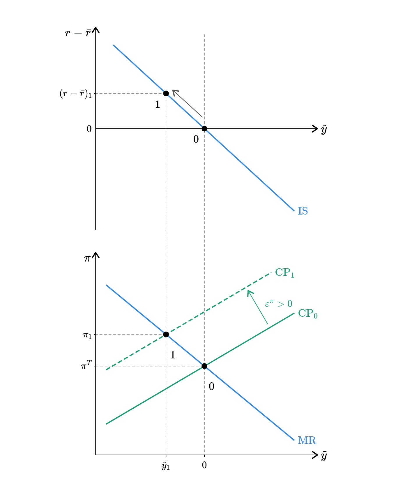

## Introducción

::: {.callout-note appearance="simple" icon=false}

:::

La nueva macroeconomía clásica (tema [A06](a06-nmc.qmd)) dejó a los keynesianos una pregunta difícil de eludir, la de por qué no se ajustan los precios y los salarios hasta vaciar los mercados si los agentes son racionales y optimizan. La **nueva economía keynesiana** (NEK) nació en los años ochenta para responderla sin renunciar al método de sus rivales.

Sus autores, entre ellos Mankiw, Akerlof, Yellen, Blanchard, Stiglitz, Fischer, Taylor y Calvo, aceptan las expectativas racionales y la optimización, pero introducen **competencia monopolística**, información imperfecta y **rigideces nominales y reales** que explican por qué los precios se ajustan con lentitud. Los contratos escalonados de Fischer (1977) y Taylor (1980) mostraron que, aun con expectativas racionales, la política monetaria puede estabilizar la economía. Por su parte, los costes de menú de Mankiw (1985) y la cuasirracionalidad de Akerlof y Yellen (1985) probaron que fricciones privadas pequeñas pueden tener grandes efectos agregados, que las rigideces reales amplifican. Con precios rígidos, el ajuste se produce por cantidades, la política monetaria tiene efectos reales y la economía puede quedar atrapada en **fallos de coordinación**. De ahí que la NEK justifique la intervención para corregir los fallos de mercado y una política de estabilización basada en reglas.

La primera generación injertó esas fricciones en el análisis de equilibrio parcial heredado del modelo IS-LM. La segunda, desde los años noventa, las integró en modelos de equilibrio general dinámico con la fijación escalonada de precios de Calvo (1983). El resultado es el **modelo de tres ecuaciones**, con una curva IS dinámica, una curva de Phillips neokeynesiana y una regla de política monetaria como la de Taylor (1993), que con la nueva síntesis neoclásica (Woodford, 2003; Galí, 2008) es el marco de referencia de los bancos centrales. El repunte inflacionista de 2021-2023 ha puesto a prueba ese marco y ha reavivado el debate sobre el papel de las expectativas y de las perturbaciones de oferta.

Las aportaciones de la NEK se exponen en este orden:

- *Fundamentos*: los rasgos de la NEK y las teorías de la primera generación sobre las rigideces reales y nominales, cuyo análisis dinámico desemboca en la fijación de precios de Calvo que adopta la segunda generación.

- *Desarrollos posteriores*: el modelo canónico de la segunda generación (IS-PC-MR), que permite estudiar el ciclo, y sus extensiones.

- *Debate*: las implicaciones de política monetaria, fiscal y de empleo del pensamiento de la NEK, sus críticas y la nueva síntesis neoclásica.

## 1. Fundamentos del pensamiento neokeynesiano

Los autores neokeynesianos son heterogéneos, pero sus modelos coinciden en justificar la posible existencia de equilibrios subóptimos a corto plazo que requieren la intervención de las autoridades.

### 1.1. Principales rasgos

**Metodología**: depende de la generación de autores. La primera y la segunda generación adoptan, en general, la hipótesis de expectativas racionales (HER), lo que las separa de la tradición poskeynesiana. La primera generación (Fischer, 1977; Taylor, 1980; Mankiw, 1985) se apoya todavía en el análisis de equilibrio parcial y en herramientas heredadas del paradigma IS-LM, injertando las fricciones sobre dicho marco. Sin embargo, la crítica de Lucas (1976) impulsó el programa hacia la microfundamentación en equilibrio general. La segunda generación completa ese movimiento con la adopción de modelos de equilibrio general dinámico y estocástico (DSGE), en el marco de la nueva síntesis neoclásica (Woodford, 2003; Galí, 2008).

**Supuestos**:

- *Entorno*: la NEK enfatiza el papel de las características institucionales en la conducta de los agentes. Si bien sus autores apoyan la microfundamentación de la macroeconomía, también insisten en la macrofundamentación de la microeconomía.

    Las instituciones restringen la conducta individual, porque muchos intercambios nacen de contratos que deben respetarse en el tiempo (p. ej. relaciones de agencia).

    Todo esto lleva, a diferencia del pensamiento de corte clásico, a la consideración de fallos de mercado o imperfecciones. Generalmente, estas incluyen:

    - *Poder de mercado*: en el mercado de bienes y servicios y de factores. Generalmente se supone competencia monopolística[^a07-1], si bien también existen modelos basados en la teoría de oligopolios y de monopolio.

    - *Información imperfecta*: especialmente, información asimétrica en diferentes industrias (p. ej. mercados financieros o, en general, las relaciones contractuales).

    - *Rigideces de precios*: a diferencia del mundo clásico, en el que existe plena flexibilidad de precios (ya sean de bienes, salarios o tipos de interés), en el mundo neokeynesiano habitualmente existen rigideces, que pueden ser nominales o reales:
        - *Rigideces nominales*: resistencia al ajuste de los precios y salarios nominales. Su fundamento son fricciones nominales (costes de menú, contratos escalonados…) que, pese a implicar pérdidas privadas de segundo orden para la empresa, generan efectos agregados de primer orden.
        - *Rigideces reales*: baja sensibilidad del precio (o salario) *real deseado* (el óptimo de la empresa) ante variaciones de la actividad agregada. Surgen de factores estructurales como la aversión al riesgo vía contratos implícitos, los salarios de eficiencia o la curvatura de la demanda derivada de las preferencias. Su papel es amplificar la rigidez nominal (Ball y Romer, 1990). Como el óptimo apenas se desplaza, la pérdida de no ajustar el precio nominal es pequeña, lo que ensancha el intervalo de inacción.

    Una de las implicaciones de este tipo de rigideces es la existencia de *fallos de coordinación*. Como no existe plena flexibilidad de precios y salarios, pueden darse situaciones de equilibrios múltiples subóptimos, en las que un grupo de agentes podría conseguir una mejor solución, pero no lo consigue porque no se coordina[^a07-3]. El mecanismo subyacente es la complementariedad estratégica en la fijación de precios (Cooper y John, 1988), la misma que origina las rigideces reales. De ahí pueden surgir “profecías autocumplidas”, en las que el optimismo o el pesimismo individual produce, por agregación, el resultado esperado[^a07-4].

- *Agentes*: el grueso de la NEK mantiene la racionalidad plena y la formación de expectativas con base en la HER. Una parte de la literatura admite, sin embargo, desviaciones menores de la optimización (la *near-rationality* de Akerlof y Yellen, 1985) o sesgos cognitivos que limitan la racionalidad de los agentes[^a07-5].

**Ajuste**: de todo lo anterior se deriva que no hay un ajuste instantáneo ni un vaciado continuo de los mercados, sino lentitud en el ajuste, que se realiza preferentemente vía cantidades. Con los precios rígidos, la producción y el empleo absorben las perturbaciones, mecanismo heredado de los modelos de desequilibrio o *fix-price* (Clower, 1965; Barro y Grossman, 1971; Malinvaud, 1977).

**Política económica**: se aboga por la intervención para corregir los fallos de mercado. Además, como las rigideces nominales rompen la neutralidad monetaria, la política monetaria sistemática tiene efectos reales, lo que explica el énfasis posterior en las reglas de tipos de interés y en los objetivos de inflación (principio de Taylor, 1993).

### 1.2. Teorías sobre rigideces reales

Una línea de investigación de la NEK de primera generación, paralela a la de las rigideces nominales, estudió las rigideces e imperfecciones reales. Estas teorías explican por qué el salario o el precio real deseado apenas responde a la actividad, primero en el mercado de trabajo y después en el de bienes y servicios.

#### 1.2.1. Rigideces reales en el mercado de trabajo

En el mercado de trabajo, cuatro teorías explican por qué el salario real puede diferir del de vaciado.

##### 1.2.1.1. Teoría de los contratos implícitos (Baily, 1974; Gordon, 1974; Azariadis, 1975)

**Origen**: en un mercado de trabajo walrasiano las empresas contratarían personal nuevo en cada periodo, pero la evidencia revela relaciones laborales duraderas, casi vitalicias para una fracción importante de los trabajadores de EE. UU. (Hall, 1982), algo que ese modelo no contempla. Las teorías de los contratos implícitos se apoyan en este hecho para explicar por qué los salarios pueden diferir de los de vaciado ante determinados fallos de mercado como la información imperfecta.

**Idea**: dentro de una relación laboral a largo plazo, la renta salarial actúa como un seguro para el trabajador, por lo que no se ajusta a las fluctuaciones de la demanda de trabajo.

**Razonamiento**: bajo incertidumbre, con trabajadores aversos al riesgo y empresas neutrales al riesgo, los contratos de largo plazo fijan rentas salariales estables que aseguran al trabajador frente a una demanda de trabajo fluctuante. Así, la renta salarial no obedece a las fuerzas de mercado del periodo (se desvincula de la productividad corriente), si bien el empleo puede seguir fijándose de forma eficiente. El reparto óptimo del riesgo fija una renta menor en los estados favorables que el valor de lo producido por el trabajo[^a07-7].

**Conclusiones**:

- *Aspectos positivos*: explica la escasa sensibilidad de la renta salarial real al ciclo por el reparto óptimo del riesgo, sin recurrir a rigideces nominales ni a la irracionalidad de los agentes.

- *Limitaciones*: la teoría explica mejor la estabilidad de la renta salarial que el desempleo involuntario, porque el empleo puede seguir siendo eficiente.

##### 1.2.1.2. Teoría de los salarios de eficiencia (Solow, 1979; Shapiro y Stiglitz, 1984)

**Origen**: el concepto de *salario de eficiencia* fue introducido ya por Marshall (1890) para reflejar el salario pagado por la eficiencia de cada unidad de trabajo[^a07-8]. Las teorías modernas de la NEK explican por qué los salarios pueden superar los de competencia perfecta.

**Idea**: el salario afecta a la productividad (esfuerzo) del trabajador, por lo que a las empresas les interesa pagar salarios superiores a los de vaciado.

**Razonamiento**: en el modelo de Shapiro y Stiglitz[^a07-9], hay información asimétrica poscontractual en la relación laboral, porque el esfuerzo del trabajador no es observable. Las empresas lo incentivan, por ello, con salarios superiores a los de vaciado.

**Conclusiones**:

- *Aspectos positivos*: explica el desempleo involuntario como un equilibrio en el que empresas que maximizan beneficios no bajan el salario aunque haya trabajadores dispuestos a trabajar por menos, y aporta una fuente de rigidez del salario real.

- *Limitaciones*: supone que las empresas no disponen de otros mecanismos de incentivo (p. ej. salarios diferidos que crecen con la antigüedad) que harían innecesario pagar un salario superior al de vaciado.

##### 1.2.1.3. Teoría de los *insiders* y *outsiders* (Lindbeck y Snower, 1988)

**Origen**: la teoría de los trabajadores internos y externos se debe a Assar Lindbeck y Dennis Snower, que la desarrollan a lo largo de los años ochenta.

**Idea**: los trabajadores empleados (*insiders*) negocian los salarios en su propio interés, sin tener en cuenta a los desempleados (*outsiders*), por lo que el salario se sitúa por encima del de vaciado.

**Razonamiento**: estos modelos consideran trabajadores heterogéneos en sus preferencias y en su peso en las negociaciones salariales. Las empresas mantienen así relaciones con dos grupos, los *insiders* (con los que tienen relaciones específicas y cuyos intereses suelen recogerse en convenios) y los *outsiders* (trabajadores no contratados que pueden serlo tras la firma del convenio). Ello genera una asimetría de poder de negociación en favor de los *insiders* (especialmente con sindicatos fuertes)[^a07-10].

El resultado es triple:

- *Dualidad* (marginación de los *outsiders*): existe un porcentaje considerable de desempleados (es decir, *outsiders*) sin influencia sobre la fijación de salarios.

- *Rigidez salarial (anticíclica bajo ciertas condiciones)*: en fases recesivas se despide a parte de la plantilla y los *insiders* que permanecen fijan el salario atendiendo a su propio empleo y no al de la economía. De ahí que el salario real apenas caiga pese al aumento del paro e incluso, bajo ciertas condiciones, suba.

- *Histéresis*: perturbaciones transitorias pueden tener efectos permanentes sobre el desempleo (véase el tema [A28](a28-tnp-nairu.qmd), apartado 2.3).

**Conclusiones**:

- *Aspectos positivos*: explica el desempleo involuntario y la rigidez del salario real por el poder de negociación de los trabajadores empleados, sin recurrir a rigideces nominales. Aporta, además, uno de los mecanismos de persistencia del desempleo en que se apoya la hipótesis de histéresis.

- *Limitaciones*: el resultado descansa en que los costes de rotación laboral (despido, contratación y formación) sean elevados, pues solo así las empresas no sustituyen a los *insiders* por *outsiders* dispuestos a trabajar por un salario menor. Su alcance es, por ello, mayor en mercados con sindicatos fuertes y alta protección del empleo.

##### 1.2.1.4. Modelo macroeconómico de negociación en el mercado de trabajo (Layard y Nickell, 1985)

**Origen**: Richard Layard y Stephen Nickell (1985) presentan su macromodelo de negociación colectiva[^a07-54], y Wendy Carlin y David Soskice lo completan. Esta vertiente de la NEK europea tuvo como principal objeto de estudio el desempleo involuntario y el poder de negociación, característico del mercado laboral europeo de los años setenta.

**Idea**: dos agentes con poder de mercado, los sindicatos en el mercado de trabajo y las empresas en el de bienes[^a07-11], se reparten la renta nacional negociando en términos reales[^a07-12], y el reparto del poder depende de factores institucionales[^a07-13].

**Planteamiento**: con rendimientos constantes y el trabajo como único factor variable ($Y=A_L L$), el modelo se resume en dos relaciones:

- *Salario real negociado* (SRN): lo fijan los sindicatos al comienzo del periodo en términos nominales, a partir del nivel de precios esperado, pues no conocen los precios efectivos. Depende negativamente del desempleo y positivamente de los factores institucionales[^a07-16], y presenta inercia nominal.

- *Salario real pagado* (SRP): resulta del margen que las empresas aplican sobre el coste laboral unitario, $w/P = A_L/(1+\mu)$. El SRP es independiente del nivel de empleo y disminuye con el poder de mercado[^a07-18] y las cotizaciones a cargo de la empresa.

Dado el salario nominal, las variaciones de demanda agregada no alteran los precios (la productividad aparente es constante), sino las existencias o la producción, lo que respalda el argumento keynesiano del ajuste vía cantidades.

**Equilibrio**: en el plano empleo-salario real (figura -@fig-a076-nairu), en el punto en que SRN = SRP y $P = P^e$ se determinan el salario real, el empleo y un desempleo de equilibrio único y estable, la tasa de paro que no acelera la inflación (NAIRU). La NAIRU es compatible con el desempleo involuntario (el salario se fija por encima del de vaciado) y con el desempleo estructural y friccional[^a07-20].

::: {#fig-a076-nairu}

::: {.content-visible when-format="html"}
```{=html}
<div class="graph-frame">
<iframe src="../graphs/a076_NAIRU.html" style="height:620px" loading="lazy" title="fig-a076-nairu"></iframe>
</div>
```
:::

::: {.content-visible unless-format="html"}

:::

Determinación de la NAIRU (Layard y Nickell, 1985). En el plano empleo-salario real, el salario real negociado (SRN), creciente con el empleo y, por tanto, decreciente con el desempleo, corta al salario real pagado (SRP), horizontal en $A_L/(1+\mu)$, en el punto 0, con el empleo $L^*$. La distancia hasta la población activa (PA) es el desempleo correspondiente a la NAIRU, $\bar{u}$.
:::

**Estática comparativa**: la NAIRU se desplaza con los factores institucionales ($z$) y el poder de mercado ($\mu$):

- *Factores institucionales*: un aumento de $z$ (p. ej. un mayor poder de negociación de los sindicatos) eleva el salario negociado para cada tasa de desempleo, desplaza la SRN hacia arriba y eleva la NAIRU.

- *Poder de mercado*: un aumento de $\mu$ (o de las cotizaciones a cargo de la empresa) reduce el salario real pagado, desplaza la SRP hacia abajo y eleva también la NAIRU.

- *Pendientes y elasticidades*: como la SRP no depende del empleo, cualquier desplazamiento mueve más la NAIRU cuanto más plana sea la SRN (cuanto menos responda el salario negociado al desempleo). Asimismo, una mayor elasticidad de la demanda de trabajo reduce el salario negociado y la NAIRU.

**Extensiones**: sin imponer $P = P^e$ se obtienen, además, una curva de Phillips de la NEK de primera generación (NEK1G) y una función de oferta agregada creciente en el nivel de precios, de las que se derivan las implicaciones de política del apartado 3.3. Esa curva es la tradicional ampliada por las expectativas, aquí adaptativas, $\pi_t = \pi_t^e - \kappa_u(u_t - \bar{u})$.

**Conclusiones**:

- *Aspectos positivos*: fundamenta el desempleo de equilibrio en factores institucionales y en el poder de mercado de sindicatos y empresas, lo que lo hace más rico que la tasa natural friedmaniana y permite analizar las políticas estructurales.

- *Limitaciones*: la NAIRU no es observable y sus estimaciones son inestables. Además, el modelo es estático y no explica por sí solo la persistencia del desempleo europeo tras las perturbaciones de los años setenta, que motiva la hipótesis de histéresis.

::: {.callout-note appearance="simple" icon=false}
El desarrollo completo del modelo (planteamiento, equilibrio, estática comparativa y derivación de la curva de Phillips) se encuentra en el tema [A28](a28-tnp-nairu.qmd), apartado 2.2, y la oferta agregada, en el tema [A32](a32-precios-output.qmd), apartado 2.2.3.
:::

#### 1.2.2. Rigideces reales en el mercado de bienes y servicios

La fundamentación microeconómica de las rigideces reales en el mercado de bienes se apoya en la información y la competencia imperfectas. En condiciones normales los costes marginales caen mucho en las recesiones, por lo que las empresas tendrían incentivos a bajar precios. Para que no lo hagan ha de concurrir alguno de dos factores reales, bien que los costes marginales no caigan, bien que la elasticidad de la demanda caiga mucho ante una perturbación negativa.

##### 1.2.2.1. Mercados de clientela: contratos implícitos en el mercado de bienes (Okun, 1981)

**Origen**: Arthur Okun (1981) traslada al mercado de bienes la lógica de los contratos implícitos. Como buscar y cambiar de proveedor tiene un coste para el cliente, en numerosos mercados se forma entre este y la empresa un vínculo de confianza.

**Idea**: las empresas no suben su precio en las expansiones para conservar a sus clientes, de modo que el margen en competencia monopolística resulta anticíclico.

**Razonamiento**: los costes de cambio y de búsqueda fidelizan al cliente y hacen que la elasticidad-precio de la demanda sea menor (más rígida) a corto plazo. Además, la elasticidad es procíclica, pues en fases de auge esos costes disminuyen al aumentar la actividad y el número de intercambios. Como a largo plazo las relaciones se difuminan y la elasticidad aumenta, las decisiones de precios adquieren un carácter intertemporal, y las empresas sacrifican beneficios a corto plazo con tal de mantener la relación con sus clientes.

**Conclusiones**:

- *Aspectos positivos*: explica la estabilidad de los precios en mercados con relaciones duraderas entre empresa y cliente a partir de la reputación y de los costes de cambio, un rasgo que los modelos de vaciado instantáneo ignoran.

- *Limitaciones*: el argumento es sobre todo verbal. La relación de confianza no se formaliza y es difícil de observar, por lo que la teoría resulta difícil de contrastar.

##### 1.2.2.2. Economías de aglomeración o *thick market externalities* (Diamond, 1982)

**Origen**: Peter Diamond (1982) estudia una economía con fricciones de búsqueda en la que cuantos más agentes participan en el mercado más fácil resulta encontrar con quién intercambiar.

**Idea**: estas externalidades de mercado denso hacen que el coste marginal tienda a caer en los auges (*booms*) y a subir en las recesiones, de modo que las empresas no bajan sus precios en las recesiones.

**Razonamiento**: pueden existir equilibrios de alta y baja actividad. En los auges caen los costes de adquisición de *inputs* (y los costes medios), y a la inversa en las recesiones. Por ello, dadas la competencia imperfecta y los fallos de coordinación, el precio deseado apenas cae cuando lo hace la demanda y se producen rigideces.

**Conclusiones**:

- *Aspectos positivos*: muestra que los fallos de coordinación pueden dejar a la economía atrapada en un equilibrio de baja actividad, lo que ofrece un fundamento a las políticas de demanda.

- *Limitaciones*: no determina cuál de los equilibrios se alcanza, que depende de las expectativas, y la relación entre la densidad del mercado y los costes es difícil de cuantificar.

##### 1.2.2.3. Guerras de precios durante los *booms* (Rotemberg y Saloner, 1986)

**Origen**: Julio Rotemberg y Garth Saloner (1986) estudian un oligopolio que sostiene la colusión tácita con la amenaza de castigar las desviaciones, en un juego repetido con demanda fluctuante pero observable (tema [A19](a19-oligopolio.qmd), apartado 2.2).

**Idea**: en los auges aumentan los incentivos a romper la colusión, por lo que el precio colusivo sostenible y el *mark-up* son anticíclicos.

**Razonamiento**: en los auges (demanda corriente elevada) la ganancia inmediata de desviarse crece respecto del castigo futuro, que depende de la demanda esperada. Aumentan así los incentivos a romper la colusión y entrar en guerras de precios, y el precio colusivo sostenible ha de ser más bajo. Como el margen cae cuando aumenta la actividad, el precio deseado responde poco a la demanda, lo que constituye una rigidez real.

**Extensiones**: Rotemberg y Woodford (1992) llevan el mecanismo a un modelo de equilibrio general dinámico calibrado. En ese modelo, la respuesta de la economía a una perturbación de demanda (un aumento del gasto militar) se aproxima más a la estimada con datos de posguerra de EE. UU. que la de un modelo competitivo.

**Conclusiones**:

- *Aspectos positivos*: da un fundamento estratégico, basado en los juegos repetidos, al carácter anticíclico del margen.

- *Limitaciones*: el resultado exige que las perturbaciones de demanda sean observables y transitorias (si fueran persistentes, el castigo futuro también crecería en los auges). Con información imperfecta, Green y Porter (1984) obtienen el resultado contrario, y la evidencia sobre la ciclicidad del margen no es concluyente.

##### 1.2.2.4. Costes marginales constantes o decrecientes (Stigler, 1939)

**Origen**: otra causa de rigidez de precios es que los costes marginales sean constantes o decrecientes en la producción, lo que puede deberse a la capacidad ociosa que las empresas mantienen como reserva (Stigler, 1939) para afrontar las vicisitudes económicas.

**Idea**: si el coste marginal apenas cae en las recesiones, tampoco lo hace el precio deseado, que es un margen sobre ese coste.

**Razonamiento**: las perturbaciones de demanda se absorben vía cantidades. Con un coste marginal plano, además, la ganancia de ajustar el precio nominal es pequeña, por lo que esta rigidez real amplifica la de los costes de menú.

**Conclusiones**:

- *Aspectos positivos*: es la explicación más sencilla de la rigidez del precio real y encaja con la capacidad ociosa que las empresas mantienen en las recesiones.

- *Limitaciones*: traslada la explicación a la forma de la función de costes, que se supone en lugar de derivarse, y no explica por qué las empresas mantienen esa capacidad.

#### 1.2.3. Conclusiones

**Aspectos positivos**: estas primeras aportaciones ofrecieron una fundamentación microeconómica de la rigidez de salarios y precios reales a partir de la información asimétrica y la competencia imperfecta, sin recurrir a la irracionalidad de los agentes.

**Limitaciones**: como señalan Laurence Ball y David Romer (1990), la rigidez real no implica rigidez nominal. Sin una fuente independiente de rigidez nominal, los precios se ajustan por completo a los *shocks* nominales pese a existir rigideces reales, porque la rigidez real amplifica la rigidez nominal, pero no la genera. Los modelos de rigideces reales no bastaban, pues, para romper la dicotomía clásica, lo que situó en el centro del programa el estudio de las rigideces o fricciones nominales de salarios y precios.

### 1.3. Teorías sobre rigideces nominales

Tres aportaciones fundamentan la rigidez nominal: la cuasirracionalidad, los costes de menú y las externalidades de demanda agregada.

#### 1.3.1. Rigidez por racionalidad incompleta o cuasirracionalidad (Akerlof y Yellen, 1985)

**Origen**: George Akerlof y Janet Yellen (1985) parten del concepto de racionalidad incompleta o *cuasirracionalidad* en un marco macroeconómico de competencia imperfecta, en el que una proporción de empresas actúa de forma limitadamente racional.

**Idea**: esta cuasirracionalidad lleva a las conocidas reglas prácticas (*rules of thumb*), según las cuales las empresas no ajustan sus precios, porque la pérdida de no hacerlo es de segundo orden (pequeña).

**Razonamiento**: la existencia de un pequeño número de empresas cuasirracionales que asumen pérdidas de segundo orden da lugar a una pérdida de primer orden en el agregado.

**Conclusiones**:

- *Aspectos positivos*: ofrece una explicación sencilla de la rigidez nominal que solo exige desviaciones mínimas de la racionalidad, y su argumento sirve también de base al modelo de costes de menú.

- *Limitaciones*: muchas otras políticas de precios (y no solo mantenerlos fijos) producen pérdidas pequeñas, de modo que la cuasirracionalidad no es condición suficiente para la rigidez nominal.

#### 1.3.2. Rigidez por costes tecnológicos: los costes de menú (Mankiw, 1985)

**Origen**: Gregory Mankiw (1985) se apoya en los costes de menú y completa la aportación de Akerlof y Yellen.

**Idea**: a la empresa no le compensa cambiar el precio cuando la pérdida prevista por mantenerlo, ya de por sí pequeña, es menor que los costes de menú.

**Razonamiento**: por *costes de menú* se entiende cualquier coste, por lo común reducido, que soporta la empresa cuando cambia su precio:

1. *Costes administrativos*: físicos (p. ej. reimprimir las tarifas y repartirlas[^a07-22]) y de información (p. ej. reunir y analizar los datos con los que fijar el nuevo precio óptimo).

2. *Costes no administrativos o exógenos*: p. ej. daño a la imagen, marcha de clientes fieles o estallido de una guerra de precios.

Mankiw llega así a la conclusión de Akerlof y Yellen sin renunciar a la racionalidad de los agentes, pues la empresa maximiza beneficios dentro del margen que le dejan los costes de menú.

**Desarrollo gráfico**: el modelo de costes de menú se representa en el plano producción-precio (figura -@fig-a075-costes-menu):

1. *Curvas de demanda*, $D_0(x)$ y $D_1(x)$: son las demandas del competidor monopolista antes y después de la perturbación, decrecientes porque la empresa solo vende más si baja su precio.

2. *Curvas de ingreso marginal*, $\text{Img}_0(x)$ e $\text{Img}_1(x)$: quedan por debajo de la demanda correspondiente, porque vender una unidad más exige bajar el precio de todas.

3. *Coste marginal*, $\text{Cmg}(x)$: es creciente (rendimientos decrecientes).

4. *Equilibrio*: el del competidor monopolista, en el punto 0 ($x_0, p_0$). La producción $x_0$ iguala $\text{Img}_0(x)$ y $\text{Cmg}(x)$, y el precio $p_0$ se lee sobre $D_0(x)$.

::: {#fig-a075-costes-menu}

::: {.content-visible when-format="html"}
```{=html}
<div class="graph-frame">
<iframe src="../graphs/a075_Costes_menu.html" style="height:520px" loading="lazy" title="fig-a075-costes-menu"></iframe>
</div>
```
:::

::: {.content-visible unless-format="html"}

:::

Costes de menú (Mankiw, 1985). Ante una caída de la demanda de $D_0$ a $D_1$, la empresa puede mantener el precio (punto 0′) o ajustarlo (punto 1). Solo lo cambia si el triángulo de beneficios del ajuste supera los costes de menú. Si no lo hace, la producción queda por debajo de la óptima y se produce una pérdida de bienestar.
:::

**Estática comparativa**: una perturbación negativa ($\Delta D < 0$) reduce la demanda de $D_0(x)$ a $D_1(x)$. La empresa puede:

- *No cambiar el precio* (punto 0′, $x_{0'}, p_0$): ajuste íntegro vía cantidades, con ingreso marginal superior al coste marginal.

- *Cambiar el precio* (punto 1, $x_1, p_1$): ajuste vía precios y cantidades, igualando ingreso y coste marginal y optimizando.

El triángulo de beneficios de cambiar el precio (la *ganancia de ajustar*) determina la decisión, ya que la empresa solo lo modifica si ese beneficio supera los costes de menú. Si los precios permanecen estáticos, se produce una pérdida de bienestar social, pues la cantidad es menor que la óptima.

**Extensiones** (factores que afectan a la decisión):

1. *Estructura de costes* (tecnología): cuanto más inclinada sea la curva de coste marginal en el plano $(x, p)$, mayor es el triángulo de beneficios y mayores los incentivos a cambiar el precio, mientras que una curva más plana (mayor rigidez del salario real) reduce esos incentivos.

2. *Estructura del ingreso* (poder de mercado): la pendiente de la curva de ingreso marginal, reflejo del poder de mercado de la empresa, condiciona también el tamaño del triángulo de beneficios y, con él, el incentivo a cambiar el precio.

Así, factores estructurales o reales (tecnología, estructura de mercado, horizonte temporal) pueden acentuar o atenuar la rigidez nominal que generan unas fricciones nominales dadas.

**Conclusiones**:

- *Aspectos positivos*: obtiene la rigidez nominal con empresas plenamente racionales, de modo que fricciones pequeñas bastan para que las perturbaciones de demanda tengan efectos reales y pérdidas de bienestar. Ball, Mankiw y Romer (1988) aportaron, además, un contraste frente a Lucas (1973). En los países con más inflación media, las empresas revisan sus precios más a menudo y la curva de Phillips a corto plazo es más vertical, como predicen los costes de menú, mientras que la varianza de la demanda, que destaca Lucas, explica menos.

- *Limitaciones*:

    1. *Análisis dinámico*: el modelo es estático. Los costes de menú se pagan una sola vez, pero, si la perturbación es permanente, las pérdidas por no ajustarse se acumulan. Las empresas tendrán entonces más incentivos a cambiar el precio y el ajuste será más rápido (tanto más cuanto más largo sea el horizonte temporal).

    2. *Equilibrios múltiples*: la teoría admite varios equilibrios estables, que antes no eran posibles.

    3. *Costes de ajuste de la producción*: el modelo no considera los de las cantidades, que pueden ser mayores que los de los precios.

#### 1.3.3. Externalidades de las fricciones nominales (Blanchard y Kiyotaki, 1987)

**Origen**: Blanchard y Kiyotaki (1987) aceptan tanto la cuasirracionalidad como los costes de menú y amplían el análisis al equilibrio general con competencia monopolística, enfatizando las externalidades de demanda.

**Idea**: parten de una función de demanda de la empresa que depende del *stock* real de dinero y del precio relativo de su bien[^a07-25], de modo que cambios en el *stock* real de dinero desplazan dicha demanda.

**Razonamiento**: el precio de cada empresa afecta, vía el nivel de precios y el *stock* real de dinero, a la demanda de las demás (externalidad de demanda agregada que ninguna internaliza). Así, las rigideces nominales individuales se acumulan y producen una inercia nominal de precios que hace fluctuar la producción mientras el nivel de precios permanece constante.

**Conclusiones**:

- *Aspectos positivos*: muestra que, en competencia monopolística, la producción de equilibrio es inferior a la eficiente y que, por la externalidad de demanda agregada, una expansión monetaria con precios rígidos puede mejorar el bienestar de todos los agentes. Da así a la política de demanda un fundamento microeconómico.

- *Limitaciones*: las mismas que las de la cuasirracionalidad y los costes de menú (apartados 1.3.1 y 1.3.2).

#### 1.3.4. Conclusiones

**Aspectos positivos**: el estudio de las fricciones nominales dio un fundamento microeconómico a la rigidez nominal y justificó la no neutralidad, yendo un paso más allá del modelo de la síntesis neoclásica (SNC).

**Limitaciones**: las fricciones nominales en competencia imperfecta no bastan para explicar el tamaño y la persistencia de los efectos reales de los *shocks* monetarios. La duda sobre si podían ser lo bastante importantes para justificar el no ajuste de precios abrió un programa de investigación paralelo sobre cómo se fijan los precios.

### 1.4. Análisis dinámico de las rigideces

El estudio dinámico de cómo se fijan los precios combina las rigideces nominales con el poder de mercado y se plantea dos preguntas, cada cuánto se revisan los precios y si las empresas los revisan a la vez o en momentos distintos.

1. *Sincronía*: cuando todas revisan al mismo tiempo, los *shocks* solo tienen efectos transitorios, y fricciones nominales como los costes de menú no explican por qué sus efectos reales persisten.

2. *Solapamiento*: cuando las revisiones se escalonan, los efectos reales duran mucho más. Este solapamiento puede obedecer a que las empresas son heterogéneas o a ventajas informacionales[^a07-26].

Los modelos de fijación de precios se clasifican en dos tipos, la fijación *en función del tiempo* (la revisión se realiza con una frecuencia dada) y la *dependiente del estado* (la revisión se desencadena por un suceso).

#### 1.4.1. Reglas de ajuste en función del tiempo (Fischer, 1977; Taylor, 1980; Calvo, 1983)

**Origen**: la fijación escalonada de precios en función del tiempo parte de dos trabajos previos:

- *Fijación escalonada basada en la información disponible* (Fischer, 1977): Stanley Fischer (1977) considera agentes que deciden en $t-j$ sobre precios o salarios de $t$ con la información disponible. Si no aciertan, el mercado no se vacía (a diferencia de Lucas, que supone vaciado) y la demanda determina las transacciones. Incluso la política monetaria sistemática tiene así efectos reales a muy corto plazo, pues puede reaccionar a información posterior a la firma de los contratos. El modelo no explica, sin embargo, la persistencia.

- *Contratos escalonados* (Taylor, 1980): John Taylor (1980) da el paso siguiente con los contratos escalonados, en los que los salarios se fijan por periodos fijos y solapados entre empresas. De este modo, el nivel de precios hereda inercia y las perturbaciones nominales tienen efectos reales persistentes, lo que convierte al modelo de Taylor en el antecedente directo del de Calvo.

Sobre esa base, Guillermo Calvo (1983)[^a07-27] formaliza la fijación escalonada de precios sobre la que se microfundamenta el modelo canónico de la NEK.

**Idea**: en cada periodo solo una fracción de las empresas puede revisar su precio, de modo que el nivel de precios se ajusta gradualmente y las perturbaciones nominales tienen efectos reales persistentes. La curva de Phillips de la NEK se deriva de este mecanismo.

**Supuestos**:

- *Entorno*: marco dinámico y estocástico con horizonte infinito y competencia monopolística en el mercado de bienes. En cada periodo, cada empresa recibe “luz roja” con probabilidad $\xi$ (mantiene el precio) o “luz verde” con probabilidad $1-\xi$ (lo revisa), y $\xi$ (constante y exógeno) mide así el grado de rigidez nominal[^a07-55]. La revisión es independiente del tiempo transcurrido y de la desviación respecto del precio óptimo, lo que le confiere naturaleza estocástica[^a07-28]. El índice general de precios es un promedio ponderado por la rigidez de los precios no revisados, $P_{t-1}$, y de los revisados, $P_t^*$:
    $$P_t = P_{t-1}^{\xi}\, P_t^{*\,(1-\xi)} \;\rightarrow\; p_t = \xi\, p_{t-1} + (1-\xi)\, p_t^*$$

- *Agentes*: numerosas empresas y consumidores que forman expectativas según la HER y aplican un factor de descuento constante y exógeno $\beta\in (0, 1)$. Los costes marginales son simétricos entre empresas y los consumidores tienen preferencia por la variedad.

- *Tecnología*: el coste marginal es procíclico con el PIB, es decir, se mueve con las desviaciones cíclicas del *output* respecto de su nivel natural[^a07-30], por lo que, con precios rígidos, el margen es contracíclico. La prociclicidad del coste marginal puede deberse a la escasez de *inputs* en las expansiones, a rendimientos decrecientes o a la desutilidad marginal creciente del trabajo.

**Planteamiento** (fijación de precios): sin rigideces, en un contexto estático y de competencia monopolística, la empresa fijaría un margen constante sobre el coste marginal[^a07-31], $P_{i,t}=(1+\mu)\, \text{Cmg}_t$. En un marco estocástico y dinámico, además tiene en cuenta la rigidez y el descuento, maximizando el valor actual esperado de sus beneficios, dado el índice de rigidez $\xi$, un factor de descuento estocástico $\gamma_{t,t+j}$ y su restricción de demanda[^a07-32]:
$$\begin{aligned} &\max_{P_t^*} V_t^e = \sum_{j=0}^{\infty} \xi^j\, \mathbb{E}_t\!\left[\gamma_{t, t+j}\big(P_t^*\, Y_{t+j} - \text{CT}_{t+j}(Y_{t+j})\big)\right], \qquad \xi \in [0, 1) \\ &\text{s.a.:} \; Y_{t+j} = (P_t^*/P_{t+j})^{-\sigma} C_{t+j} \end{aligned}$$

**CPO**: simplificada, $p_t^* = f(\xi, \gamma, \mu^{+}, (\mathbb{E}_t[\pi_{t+j}])^{+}, (\mathbb{E}_t[\text{Cmg}_{t+j}])^{+})$, donde el efecto de $\xi$ es ambiguo (con inflación esperada positiva, una mayor rigidez eleva el precio de reajuste). El grado de rigidez $\xi$ aparece elevado a $j$ porque la empresa contempla la posibilidad de seguir sin revisar el precio en el futuro, de modo que el efecto del descuento y de la rigidez se diluye en el tiempo[^a07-33]. La intuición es que las empresas fijan su margen deseado (sin rigideces) sobre un promedio ponderado de su coste marginal corriente y esperado, teniendo en cuenta la inflación esperada, la rigidez y su impaciencia.

**CSO**: el valor esperado es estrictamente cuasicóncavo en $P_t^*$ (y cóncavo en un entorno del óptimo) porque la demanda es isoelástica con $\sigma>1$ y el coste marginal es no decreciente, de modo que la CPO caracteriza el máximo.

**Solución**: con elevada rigidez de precios, estos tardan en moverse hacia su nuevo nivel deseado. Al igual que el de Layard-Nickell, el modelo de Calvo permite construir la curva de Phillips de la NEK *à la* Calvo, que admite tres especificaciones:

- *En función del coste marginal*: se obtiene[^a07-34] una primera especificación en la que la inflación depende de la inflación esperada (HER) y de la desviación del coste marginal real respecto de su nivel sin fricciones[^a07-35]:
    $$\begin{aligned} &\pi_t = \beta\, \mathbb{E}_t[\pi_{t+1}] + \kappa_{\text{cm}}\, \widehat{\text{cmg}}_t \\ &\kappa_{\text{cm}} = \frac{(1-\xi)(1-\beta\xi)}{\xi}\cdot\frac{1-\alpha}{1-\alpha+\alpha\sigma} \;\rightarrow\; \kappa_{\text{cm}} = f(\xi^{-}, \alpha^{-}, \sigma^{-}, \beta^{-}) \end{aligned}$$
    El parámetro $\kappa_{\text{cm}}>0$ (la pendiente de la curva) decrece con el grado de rigidez, la participación del capital, la elasticidad de sustitución entre variedades y el factor de descuento:

    1. *Rigidez* ($\xi$): a mayor rigidez, menor respuesta de la inflación al coste marginal, pues menos empresas ajustan sus precios respecto del promedio anterior (ajustan márgenes en lugar de precios).

    2. *Sustituibilidad entre variedades* ($\sigma$): con rendimientos decrecientes ($\alpha>0$), a mayor sustituibilidad, más responde la producción de cada empresa (y, con ella, su coste marginal) a su precio relativo, lo que frena el reajuste y reduce la respuesta de la inflación al coste marginal. En cambio, con $\alpha=0$, $\sigma$ no afecta a la pendiente.

    3. *Participación del capital* ($\alpha$, que en el modelo mide los rendimientos decrecientes del trabajo): el coste marginal de cada empresa crece con su propia producción. En consecuencia, la empresa que eleva su precio vende menos y reduce su coste marginal, lo que modera el reajuste y la respuesta de la inflación al coste marginal medio.

- *En función de la brecha de producción*: el problema de la especificación anterior es que el coste marginal no es observable[^a07-36], por lo que suele usarse una basada en la brecha de producción (*output gap*). Dado que el coste es procíclico, existe proporcionalidad entre la brecha de producción y la desviación del coste marginal ($\widehat{\text{cmg}}_t = \eta\,\tilde{y}_t$), de modo que:
    $$\pi_t = \beta\, \mathbb{E}_t[\pi_{t+1}] + \kappa\, \tilde{y}_t, \quad \kappa = \eta\,\kappa_{\text{cm}} = \kappa_{\text{cm}}\left(\theta + \frac{\varphi+\alpha}{1-\alpha}\right) > 0, \qquad \kappa > 0,\; \beta \in (0, 1)$$
    Aquí $\theta$ es el coeficiente de aversión relativa al riesgo y $\varphi$, la inversa de la elasticidad de Frisch (Anexo, (8)). Cuando la producción supera su nivel potencial ($\tilde{y}_t = y_t - \bar{y}_t > 0$, es decir, brecha positiva), se genera inflación[^a07-37].

- *En función del desempleo cíclico*: tomando la desviación del desempleo respecto de la NAIRU:
    $$\pi_t = \beta\, \mathbb{E}_t[\pi_{t+1}] - \kappa_u\,(u_t - \bar{u}), \qquad \kappa_u > 0,\; \beta \in (0, 1)$$
    Cuando el desempleo cae por debajo de la NAIRU ($u_t - \bar{u} < 0$), la inflación corriente se sitúa por encima de la esperada descontada ($\pi_t > \beta\,\mathbb{E}_t[\pi_{t+1}]$).

**Conclusiones**:

- *Aspectos positivos*: en los tres casos, la curva de Phillips neokeynesiana de segunda generación (CP-NEK 2G) se diferencia de la de primera generación por su naturaleza *forward-looking*, al incorporar el operador de expectativas en el término de inflación futura.

- *Limitaciones*: precisamente por ello, la CP-NEK 2G no logra explicar la persistencia de la inflación, lo que le ha valido críticas (apartado 3.4.1).

#### 1.4.2. Reglas de ajuste en función del estado (Caplin y Spulber, 1987; Blanchard y Fischer, 1989)

**Origen**: Andrew Caplin y Daniel Spulber (1987) consideran reglas dependientes del estado, en las que la revisión de precios no sigue una frecuencia definida, sino que se produce cuando la desviación entre el precio vigente y el óptimo rebasa ciertos umbrales o bandas (modelos *Ss*).

**Idea**: la decisión de revisar el precio sigue una lógica de coste-beneficio explícita, en la que la empresa paga el coste de menú solo cuando la pérdida acumulada por no ajustar lo justifica.

**Razonamiento**: Caplin y Spulber muestran que, si la distribución de precios dentro de la banda es uniforme y la inflación es positiva, las empresas que ajustan en cada momento son exactamente las necesarias para que el nivel general de precios se mueva uno a uno con el dinero. Así, la rigidez individual no genera rigidez agregada y el dinero es neutral.

**Conclusiones**:

- *Aspectos positivos*: advierte de que la rigidez individual no implica por sí sola rigidez agregada, porque el resultado depende de qué empresas ajustan y cuándo. Además, el modelo hace endógena la frecuencia de ajuste, que en las reglas en función del tiempo es exógena.

- *Limitaciones*: Blanchard y Fischer (1989) matizan que la neutralidad depende de supuestos muy restrictivos (perturbaciones solo positivas y distribución uniforme inicial). Con *shocks* de ambos signos, las reglas dependientes del estado recuperan efectos reales del dinero, si bien menores que las reglas en función del tiempo[^a07-56].

### 1.5. Conclusiones

**Aspectos positivos**: Laurence Ball y David Romer (1990)[^a07-38] demostraron que la interacción entre rigideces reales y fricciones nominales en los mercados de bienes y de trabajo puede generar rigideces importantes para entender los ciclos. En presencia de estas características, los *shocks* nominales pueden tener efectos reales tanto mayores cuanto mayor sea el grado de rigidez, lo que permite romper la dicotomía clásica.

**Limitaciones**: la primera oleada de neokeynesianos no logró frenar el desarrollo de la nueva macroeconomía clásica (NMC). Michel De Vroey (2016) atribuye esto a la postura defensiva de la NEK1G, anclada en una metodología que se estaba quedando obsoleta. Por ello, una segunda generación aceptará las reglas de juego de la teoría del ciclo real, pero cambiará la esencia del modelo incorporando las aportaciones de sus compañeros de primera generación.

## 2. Aplicaciones y desarrollos: el estudio del ciclo con rigideces

Actualmente, las aportaciones de la NEK se condensan en un modelo DSGE que permite estudiar los ciclos económicos, la política económica y la interrelación entre múltiples variables en un marco de rigideces.

### 2.1. Modelo de la NEK en economía cerrada: IS-PC-MR

**Origen**: a finales de los años noventa, Richard Clarida, Jordi Galí, Mark Gertler y Michael Woodford publican una serie de trabajos[^a07-39] que dan lugar a lo que hoy se denomina *modelo canónico de la NEK*. Aquí se presenta una versión simplificada, con la exposición gráfica de Carlin y Soskice (2005), que dieron al modelo el nombre de IS-PC-MR.

**Idea**: el modelo busca sintetizar el comportamiento de la economía en tres ecuaciones. Sobre la metodología del ciclo real, esas ecuaciones incorporan la competencia monopolística y la rigidez de precios *à la* Calvo. Así, la política monetaria tiene efectos reales a corto plazo, pero no a largo plazo.

#### 2.1.1. Supuestos

**Entorno**: existe competencia monopolística en el mercado de bienes y servicios (por lo que las empresas son precio-determinantes) y rigideces nominales en el mercado de bienes finales (precios *à la* Calvo), mientras que el mercado de trabajo es competitivo.

**Agentes**: se acepta la HER y hay cuatro agentes: hogares (consumidores y oferentes de trabajo, aversos al riesgo), empresas (productoras en competencia monopolística), sector público y banco central.

**Tecnología**: por simplicidad, se prescinde del capital como factor productivo y, con ello, de la inversión privada.

#### 2.1.2. Modelo

**Planteamiento**: el modelo consta de tres ecuaciones: la curva IS dinámica (mercado de bienes y servicios), la curva de Phillips de la NEK 2G (fijación de precios) y la regla de política monetaria (autoridad monetaria).

**Curva IS dinámica**: se obtiene a partir de las decisiones intertemporales de ahorro y consumo de los hogares (en concreto, de la ecuación de Euler y de la condición de equilibrio en el mercado de bienes) tras log-linealizar en torno al estado estacionario.

En niveles (con las variables en logaritmos, en minúsculas), la curva IS dinámica puede expresarse como:

$$\begin{aligned} &y_t = \mathbb{E}_t[c_{t+1}] - \frac{1}{\theta}(i_t - \mathbb{E}_t[\pi_{t+1}] - \rho) + g_t \\ &\;\rightarrow\; y_t = f((\mathbb{E}_t[c_{t+1}])^{+}, (\mathbb{E}_t[y_{t+1}])^{+}, g_t^{+}, r_t^{-}) \end{aligned}$$

donde:

- $y_t$ es el *output* de la economía y $g_t$ el gasto público no productivo.

- $\mathbb{E}_t[c_{t+1}] = \mathbb{E}_t[y_{t+1}-g_{t+1}]$ es el consumo esperado (expectativa formada según la HER).

- $\theta>0$ es el coeficiente de aversión relativa al riesgo de los hogares (inversa de la elasticidad de sustitución intertemporal), constante y exógeno.

- $i_t = -\ln P_B$ es el tipo de interés nominal a corto plazo, relacionado con el precio de los bonos.

- $\mathbb{E}_t[\pi_{t+1}]$ es la inflación esperada (HER), con $\mathbb{E}_t[\cdot]$ la esperanza condicionada a la información disponible en $t$.

- $\rho > 0$ es la tasa de descuento intertemporal de los hogares (constante y exógena), que refleja la impaciencia en el consumo.

La demanda agregada depende positivamente del consumo esperado (y, desglosándolo, del *output* esperado) y del gasto público corriente, y negativamente del tipo de interés real, $r_t = i_t - \mathbb{E}_t[\pi_{t+1}]$. La aversión al riesgo modula la sensibilidad de la demanda al tipo de interés ($1/\theta$), y cuanto mayor es el deseo de alisar el consumo, menos reacciona el gasto a los tipos. A diferencia de la IS estática, la IS dinámica recoge la naturaleza previsora de los agentes, con incidencia directa sobre la demanda agregada a través del efecto riqueza, la impaciencia y el alisamiento del consumo.

Alternativamente, la ecuación puede presentarse en términos de la brecha de producción, $\tilde{y}_t = y_t - \bar{y}_t$, de modo que el tipo de interés real efectivo aparezca en desviación respecto del tipo de interés real natural de la economía, $\bar{r}_t$.

En línea con la concepción wickselliana, el *tipo de interés real natural* es el determinado por factores reales que, en ausencia de *shocks* de costes, garantiza la estabilidad de precios. Es compatible con la neutralidad monetaria a largo plazo y con el *output* de precios flexibles y, en ausencia de *shocks* de costes y de rigidez salarial real, es eficiente desde el punto de vista normativo. Depende positivamente de la impaciencia y negativamente de los *shocks* tecnológicos transitorios, que reducen el crecimiento esperado del *output* natural. La aversión relativa al riesgo amplifica el efecto de ese crecimiento esperado, $\bar{r}_t = \rho + \theta\,\mathbb{E}_t[\Delta\bar{y}_{t+1}]$, por lo que solo eleva el tipo natural cuando se espera crecimiento: $\bar{r}_t = f(\rho^{+}, \theta, a^{-})$.

Intuitivamente, si aumenta la impaciencia, los hogares consumen más y ahorran menos hoy, y la menor oferta de fondos prestables eleva el tipo de interés. Lo mismo ocurre, con crecimiento esperado, si aumenta la aversión al riesgo, que refuerza el deseo de alisar el consumo adelantándolo. Con los *shocks* tecnológicos ocurre lo contrario. Si aumenta la producción potencial, aumentan tanto el consumo como el ahorro, y el mayor volumen de fondos prestables hace caer el tipo de interés.

Formalmente, para el caso sin sector público, la IS dinámica en términos de la brecha de producción es[^a07-41]:

$$\tilde{y}_t = \mathbb{E}_t[\tilde{y}_{t+1}] - \frac{1}{\theta}(r_t - \bar{r}_t) \;\rightarrow\; \tilde{y}_t = f((\mathbb{E}_t[\tilde{y}_{t+1}])^{+}, r_t^{-}, \bar{r}_t^{+})$$

Esta forma añade dos intuiciones:

1. *Brecha esperada*: a igualdad de tipo de interés, la expectativa de una brecha de producción mayor eleva ya hoy el consumo y el gasto agregado, y con ellos la brecha corriente.

2. *Desviación del tipo de interés real*: cuando el tipo de interés real efectivo se sitúa por encima del natural ($r_t > \bar{r}_t$), la brecha de producción se vuelve negativa (la actividad cae por debajo de su potencial), y a la inversa. La política monetaria afecta a la actividad real por este canal.

**Curva de Phillips de la NEK 2G**: se obtiene del mecanismo de fijación de precios *à la* Calvo (apartado 1.4.1). Relaciona la inflación con la inflación esperada y la brecha de producción, de modo que determina la inflación dada una senda de la brecha, que queda determinada a su vez por la senda de tipos y de gasto público:

$$\pi_t = \beta\, \mathbb{E}_t[\pi_{t+1}] + \kappa\, \tilde{y}_t \;\rightarrow\; \pi_t = f((\mathbb{E}_t[\pi_{t+1}])^{+}, \tilde{y}_t^{+})$$

donde $\beta \in (0, 1)$ es el factor de descuento de los hogares, $\mathbb{E}_t[\pi_{t+1}]$ es la inflación esperada (HER), $\kappa$ recoge la velocidad de ajuste de la inflación y $\tilde{y}_t$ es la brecha de producción. La inflación depende positivamente de ambas variables, por las razones de ese mecanismo.

La curva recoge también el efecto del gasto público sobre la inflación, que pasa por la brecha de producción. El gasto mueve los dos términos de esa diferencia. Por un lado, altera la producción a través de la IS dinámica y, por otro, la producción potencial, porque, en el equilibrio con precios flexibles, su efecto riqueza cambia la oferta de trabajo.

**Regla de política monetaria**: la conducta del banco central puede resumirse en una regla de Taylor[^a07-42]:

$$i_t = \bar{i}_t + \alpha_\pi \tilde{\pi}_t + \alpha_y \tilde{y}_t \quad\text{o, en desviaciones,}\quad \tilde{i}_t = \alpha_\pi \tilde{\pi}_t + \alpha_y \tilde{y}_t, \qquad \alpha_\pi > 1,\; \alpha_y \geq 0$$

donde $\bar{i}_t = \bar{r}_t + \pi^T$ es el tipo de interés nominal neutral, $\tilde{\pi}_t = \pi_t - \pi^T$ la desviación de la inflación respecto del objetivo y $\tilde{i}_t = i_t - \bar{i}_t$. La intuición es que, si la inflación supera su objetivo, el tipo de interés nominal debe aumentar más que la inflación (es decir, $\alpha_\pi > 1$, el *principio de Taylor*)[^a07-43] para que suba el tipo real y se estabilice la economía, y a la inversa.

Con el intercepto $\bar{i}_t$, la regla traslada al tipo de interés cualquier cambio del tipo natural, de modo que las perturbaciones que solo mueven $\bar{r}_t$ quedan plenamente acomodadas. En la práctica, el banco central no observa $\bar{r}_t$ y usa una estimación que revisa con retraso o un intercepto constante, $\rho + \pi^T$ (Galí, 2008). En ese caso, un cambio del tipo natural abre una diferencia entre el tipo real y el natural que desplaza la MR, como muestran las perturbaciones analizadas a continuación y en el apartado 3.1.2.

Al sustituir esta regla en la IS dinámica se obtiene una relación negativa entre la brecha de producción y la desviación de la inflación respecto del objetivo, que desempeña el papel de la curva MR (regla monetaria). La versión óptima de la MR bajo discrecionalidad se deriva en el tema [A36](a36-politica-monetaria-i.qmd), apartado 2.4. La idea es que el compromiso del banco central con la estabilidad de precios se traduce, ante mayor inflación, en un menor *output*.

**Desarrollo gráfico**: el equilibrio del modelo se representa en los planos brecha de producción-desviación del tipo de interés real respecto del natural, arriba, y brecha de producción-inflación, abajo (figura -@fig-a072-ispcmr-eq):

1. *Curva IS dinámica*, $\text{IS}$: en el diagrama superior, recoge la relación negativa entre la brecha de producción, $\tilde{y}$, y la desviación del tipo de interés real respecto del natural, $r - \bar{r}$, porque un tipo real superior al natural frena el gasto.

2. *Curva de Phillips de la NEK 2G*, $\text{CP}$: en el diagrama inferior, refleja la fijación de precios *à la* Calvo y crece con la brecha de producción, que eleva el coste marginal.

3. *Curva MR*, $\text{MR}$: en el diagrama inferior, recoge la relación negativa entre la brecha de producción y la inflación que resulta de la regla de política, porque ante más inflación el banco central sube el tipo real.

4. *Equilibrio*: en el punto 0, la inflación está en el objetivo, $\pi^T$, y la producción en su nivel natural, con el tipo de interés real igual al natural.

::: {#fig-a072-ispcmr-eq}

::: {.content-visible when-format="html"}
```{=html}
<div class="graph-frame">
<iframe src="../graphs/a072_ISPCMR_eq.html" style="height:860px" loading="lazy" title="fig-a072-ispcmr-eq"></iframe>
</div>
```
:::

::: {.content-visible unless-format="html"}

:::

Equilibrio del modelo IS-PC-MR. La inflación está en el objetivo y la producción en su nivel natural (punto 0). Arriba, la IS dinámica en el plano brecha de producción-desviación del tipo de interés real respecto del natural, y abajo, la curva de Phillips de la NEK y la MR en el plano brecha de producción-inflación.
:::

**Estática comparativa**: se consideran los desplazamientos de la CP (*shocks* de costes) y de la MR (*shocks* que alteran el tipo de interés natural y se transmiten a través de la IS dinámica) y el ajuste a lo largo de ellas:

- *Perturbación tecnológica*: un *shock* tecnológico positivo eleva el *output* natural y reduce el tipo de interés natural. Si el banco central traslada plenamente esa caída a su tipo, la brecha de producción se cierra sin conflicto entre objetivos. Si no lo hace, p. ej. porque su regla usa una estimación del tipo natural que aún no recoge la caída, el tipo real queda por encima del natural y la MR se desplaza de $\text{MR}_0$ a $\text{MR}_1$. La economía pasa así del punto 0 al 1, con brechas negativas de producción e inflación (figura -@fig-a063-ispcmr-tech-a07).

::: {#fig-a063-ispcmr-tech-a07}

::: {.content-visible when-format="html"}
```{=html}
<div class="graph-frame">
<iframe src="../graphs/a063_ISPCMR_tech.html" style="height:860px" loading="lazy" title="fig-a063-ispcmr-tech-a07"></iframe>
</div>
```
:::

::: {.content-visible unless-format="html"}

:::

Modelo IS-PC-MR ante un *shock* tecnológico positivo ($\Delta a > 0$). Si la regla de Taylor no sigue la caída del tipo de interés natural, el tipo real queda por encima del natural, la MR se desplaza a la izquierda y la economía pasa de 0 a 1, con brechas de producción e inflación negativas. Con acomodación plena, la brecha no se abre y la economía permanece en 0.
:::

- *Perturbación de costes*: un *shock* de costes ($\varepsilon^\pi > 0$) desplaza la CP hacia arriba, de $\text{CP}_0$ a $\text{CP}_1$ (figura -@fig-a064-ispcmr-costpush-a07). El *shock* obliga al banco central a aceptar transitoriamente una brecha negativa para devolver la inflación al objetivo. La economía se mueve así a lo largo de la MR del punto 0 al 1.

::: {#fig-a064-ispcmr-costpush-a07}

::: {.content-visible when-format="html"}
```{=html}
<div class="graph-frame">
<iframe src="../graphs/a064_ISPCMR_costpush.html" style="height:860px" loading="lazy" title="fig-a064-ispcmr-costpush-a07"></iframe>
</div>
```
:::

::: {.content-visible unless-format="html"}

:::

Modelo IS-PC-MR ante un *shock* de costes. El banco central acepta transitoriamente una brecha de producción negativa para devolver la inflación al objetivo.
:::

#### 2.1.3. Conclusiones

**Aspectos positivos**:

- *Microfundamentación*: el modelo dota a la macroeconomía keynesiana de una fundamentación microeconómica rigurosa (agentes optimizadores, ecuación de Euler), de modo que resulta, en principio, robusto a la crítica de Lucas.

- *Forma sintética*: sus tres ecuaciones (IS dinámica, CP-NEK y regla de política) son analíticamente tratables y permiten el análisis del bienestar. Por ello, el modelo se ha convertido en el de referencia (*workhorse*) para el estudio de la política monetaria y para los bancos centrales.

- *Estabilidad de precios*: ofrece un marco coherente para fundamentar ese objetivo y las reglas de tipos de interés (p. ej. la regla de Taylor y los objetivos directos de inflación o *inflation targeting*).

**Limitaciones**:

- *Persistencia de la inflación*: por su naturaleza *forward-looking*, la CP-NEK 2G no explica bien la persistencia o inercia de la inflación, lo que ha obligado a recurrir a versiones híbridas con indexación al pasado (apartado 3.4.1).

- *Agente representativo*: el modelo básico se apoya en un agente representativo y prescinde del capital, la inversión y el sector financiero, omisiones especialmente expuestas tras la crisis de 2008; tampoco recoge la heterogeneidad de los agentes ni el desempleo involuntario.

- *Supuestos exigentes*: las expectativas racionales y la log-linealización en torno al estado estacionario limitan su capacidad para tratar no linealidades, grandes perturbaciones o situaciones como el límite inferior de los tipos de interés (*zero lower bound*, ZLB).

### 2.2. Extensiones al modelo

El modelo base de tres ecuaciones admite extensiones que corrigen parte de las limitaciones anteriores.

#### 2.2.1. Modelo de la NEK en economía abierta (Galí y Monacelli, 2005)

**Origen**: Jordi Galí y Tommaso Monacelli (2005) extienden el modelo a una economía abierta.

**Idea**: se mantiene la estructura de tres ecuaciones del modelo cerrado, pero cada una se modifica para recoger la apertura, y se añaden la paridad de intereses y la noción de tipo de cambio natural.

**Supuestos**: se mantienen los supuestos neokeynesianos de economía cerrada (competencia monopolística, rigideces nominales, HER, etc.) y se añade la apertura, en concreto, la de un país pequeño que interactúa con un único resto del mundo, sobre cuyas variables no influye. Se cumple la condición de Marshall-Lerner (las depreciaciones reales mejoran la balanza comercial) y los mercados financieros y de divisas son completos.

**Planteamiento**: con $p_{o,t}$ el precio relativo de los bienes importados, $\tilde{E}_t$ la desviación del tipo de cambio nominal respecto de su nivel natural y $\varepsilon_t^d$, $\varepsilon_t^\pi$ y $\varepsilon_t^m$ las perturbaciones de demanda, de costes y de política monetaria, las tres ecuaciones del modelo abierto son:

$$\begin{aligned} \text{IS: } \, & \tilde{y}_t = \mathbb{E}_t[\tilde{y}_{t+1}] - \frac{1}{\theta_\alpha}(r_t - \bar{r}_t) + \Gamma_y\,p_{o,t} + \varepsilon_t^d, \qquad \Gamma_y \gtrless 0 \\ \text{CP: } \, & \pi_t = \beta\,\mathbb{E}_t[\pi_{t+1}] + \kappa_\alpha\,\tilde{y}_t + \Gamma_\pi\,p_{o,t} + \varepsilon_t^\pi, \qquad \Gamma_\pi > 0,\; \beta \in (0, 1) \\ \text{Regla: } \, & i_t = \bar{i}_t + \alpha_\pi\,\tilde{\pi}_t + \alpha_y\,\tilde{y}_t + \alpha_E\,\tilde{E}_t + \varepsilon_t^m, \qquad \alpha_E \geq 0 \end{aligned}$$

1. *IS dinámica*: la sensibilidad al tipo de interés, $1/\theta_\alpha$, depende del grado de apertura $\alpha\in[0, 1]$, el peso de los bienes importados en el consumo, porque los consumidores sustituyen entre bienes nacionales y extranjeros, no solo entre presente y futuro. Con $\alpha=0$ se recupera el caso cerrado (no debe confundirse con la participación del capital del apartado 1.4.1). Al tratarse de un país pequeño, el tipo de interés real natural $\bar{r}_t$ depende también de la renta exterior, por lo que la economía responde a los *shocks* de productividad extranjeros. El signo de $\Gamma_y$ es indeterminado *a priori*, porque un encarecimiento de los importados desvía demanda hacia los bienes nacionales (efecto sustitución) y, a la vez, reduce la renta real disponible (efecto renta).

2. *Curva de Phillips*: la inflación relevante es la del IPC, que incluye los bienes importados[^a07-58]. La apertura cambia la pendiente de la curva, $\kappa_\alpha$, y el término $\Gamma_\pi\,p_{o,t}$ es el canal de la *inflación importada*, por el que una depreciación o una subida de los precios exteriores eleva la inflación aunque la brecha de producción no varíe.

3. *Regla de política*: el banco central puede responder, además, a la desviación del tipo de cambio respecto de su nivel natural, con flotación pura si $\alpha_E = 0$, flotación dirigida si $\alpha_E > 0$ y tipo fijo en el límite, $\alpha_E \rightarrow \infty$. Ante perturbaciones de demanda, oferta o inflación, parte del ajuste se canaliza a través del tipo de cambio real, de modo que el peso de la estabilización no recae ya exclusivamente en la autoridad monetaria y el tipo de interés.

**Conclusiones**:

- *Aspectos positivos*: el modelo ordena por su bienestar los regímenes monetarios de una economía abierta y muestra que, en un caso particular, estabilizar la inflación nacional es óptimo y la paridad fija, subóptima (apartado 3.1.4).

- *Limitaciones*: el supuesto de país pequeño excluye el efecto de la política nacional sobre el resto del mundo. Los mercados completos suponen, además, un reparto perfecto del riesgo entre países, que deja fuera las primas de riesgo y la dinámica de la deuda externa.

::: {.callout-note appearance="simple" icon=false}
El modelo de economía abierta, su equilibrio y los regímenes cambiarios se desarrollan en el tema [A32](a32-precios-output.qmd), apartado 3.3.
:::

#### 2.2.2. Rigideces salariales reales y fricciones de búsqueda (Blanchard y Galí, 2007; 2010)

Olivier Blanchard y Jordi Galí completan el modelo en dos direcciones complementarias:

1. *Rigidez salarial real* (2007): los salarios reales se ajustan lentamente a las condiciones del mercado de trabajo. Esa rigidez genera en la CP-NEK un término de costes endógeno y, con él, una verdadera disyuntiva entre estabilizar la inflación y estabilizar la actividad (la ruptura de la “divina coincidencia”, apartado 3.1.2).

2. *Fricciones de búsqueda* (2010): los autores incorporan fricciones de emparejamiento en el mercado de trabajo (*à la* Diamond-Mortensen-Pissarides), lo que dota al modelo de desempleo de equilibrio. Así, el marco neokeynesiano pasa a poder hablar explícitamente de las fluctuaciones del desempleo (ausentes en el modelo canónico, construido sobre un mercado de trabajo walrasiano).

::: {.callout-note appearance="simple" icon=false}
El modelo de búsqueda y emparejamiento se desarrolla en el tema [A26](a26-desempleo-friccional.qmd), apartado 2, y su lugar en la teoría del desempleo de equilibrio, en el tema [A28](a28-tnp-nairu.qmd), apartado 3.1.
:::

#### 2.2.3. La curva de Phillips salarial y la NAWRU (Galí, 2011)

Jordi Galí (2011) recupera la curva de Phillips salarial dentro del marco neokeynesiano. Expresa la inflación salarial en función de la brecha de desempleo (la desviación del desempleo respecto de su tasa natural o NAWRU, *Non-Accelerating Wage Rate of Unemployment*):
$$\pi_t^w = \beta\, \mathbb{E}_t[\pi_{t+1}^w] - \kappa_w\,(u_t - \bar{u}_t)$$
Con ello reintroduce el desempleo como variable central y reconecta el modelo moderno con la relación de Phillips original entre salarios y desempleo.

::: {.callout-note appearance="simple" icon=false}
La curva de Phillips neokeynesiana, con la versión salarial de Galí (2011), y la estimación de la NAIRU se desarrollan en el tema [A28](a28-tnp-nairu.qmd), apartados 3.2 y 3.3.
:::

### 2.3. Conclusiones

El modelo canónico condensa la aportación de la segunda generación neokeynesiana. Recupera la no neutralidad monetaria a corto plazo de la tradición keynesiana sin renunciar al rigor de los nuevos clásicos, y es por ello el punto de encuentro de la nueva síntesis neoclásica (apartado 3.5).

El modelo admite, además, extensiones como la economía abierta, las fricciones del mercado de trabajo, la heterogeneidad de los agentes o las fricciones financieras, que se incorporan a él, al menos en versiones simplificadas, sin alterar la estructura de tres ecuaciones.

## 3. Implicaciones del pensamiento de la NEK

Las implicaciones de la NEK se agrupan por ámbitos de política, y la sección se cierra con las críticas a la escuela y la nueva síntesis neoclásica.

### 3.1. Implicaciones de política monetaria

La principal conclusión de la NEK en materia de política monetaria es que esta puede tener efectos importantes y persistentes tanto sobre las variables reales como sobre las nominales de la economía.

#### 3.1.1. La importancia de los niveles naturales de *output* y de tipo de interés

Los niveles naturales de *output* y de tipo de interés (los correspondientes al equilibrio con precios flexibles, es decir, sin rigideces nominales) desempeñan un papel central en el diseño de la política monetaria, pues constituyen un punto de referencia para los decisores. La política monetaria no puede mantener desviaciones persistentes respecto de ellos sin generar presiones inflacionarias o deflacionarias.

No obstante, como los niveles naturales no son observables, resulta complejo utilizarlos en la práctica. Por ello, tradicionalmente se aproximaban mediante tendencias estadísticas suaves (p. ej. filtros de series temporales), mientras que en los modelos actuales son los valores que se generarían en un modelo del ciclo real sin fricciones.

#### 3.1.2. La divina coincidencia y la “no tan divina” coincidencia (Blanchard y Galí, 2007)

Olivier Blanchard y Jordi Galí (2007) acuñan el concepto de **“divina coincidencia”**, la posibilidad de estabilizar simultáneamente la inflación y la brecha del *output* respecto de su nivel eficiente con la política monetaria. En ausencia de imperfecciones reales no triviales (en concreto, de rigidez salarial real) no existe conflicto entre el objetivo de inflación y el de actividad, de modo que el banco central podría centrarse únicamente en la inflación y, con ello, estabilizar también la economía real.

Ahora bien, los propios autores reconocen que la inexistencia de una disyuntiva (*trade-off*) es poco verosímil empíricamente. Al ampliar el modelo con rigidez salarial real, la divina coincidencia se rompe y surge una disyuntiva entre ambos objetivos. La política monetaria óptima pasa entonces por tolerar algo más de inflación, ya que, de lo contrario, ciertos *shocks* adversos provocarían una caída del *output* ineficientemente elevada.

Otros autores rompen la divina coincidencia introduciendo una perturbación de costes (*cost-push*) en la CP-NEK, que recoge *shocks* exógenos por impuestos distorsionantes, salarios deseados o *mark-ups*:
$$\pi_t = \beta\,\mathbb{E}_t[\pi_{t+1}] + \kappa\,\tilde{y}_t + \varepsilon_t^\pi, \qquad \kappa > 0,\; \beta \in (0, 1)$$
donde $\varepsilon_t^\pi$ es el *shock* de oferta o de costes.

El componente de demanda de la COVID-19 se representa como una caída de la tasa de preferencia temporal ($\Delta\rho < 0$), en los planos brecha de producción-desviación del tipo de interés real respecto del natural y brecha de producción-inflación (figura -@fig-a074-ispcmr-covid). La caída recoge el mayor ahorro por precaución de los hogares y equivale a un mayor factor de descuento, $\beta = 1/(1+\rho)$, de modo que el tipo de interés natural cae. Como la regla de Taylor no sigue esa caída, el tipo real queda por encima del natural y la MR se desplaza a la izquierda, de $\text{MR}_0$ a $\text{MR}_1$, y la economía pasa de 0 a 1, con brecha de producción e inflación negativas.

::: {#fig-a074-ispcmr-covid}

::: {.content-visible when-format="html"}
```{=html}
<div class="graph-frame">
<iframe src="../graphs/a074_ISPCMR_covid.html" style="height:860px" loading="lazy" title="fig-a074-ispcmr-covid"></iframe>
</div>
```
:::

::: {.content-visible unless-format="html"}

:::

Modelo IS-PC-MR ante el componente de demanda del *shock* de la COVID-19. La caída de la tasa de preferencia temporal ($\Delta\rho < 0$), es decir, el mayor ahorro por precaución, reduce el tipo de interés natural. Como la regla de Taylor no sigue esa caída, la MR se desplaza a la izquierda, de $\text{MR}_0$ a $\text{MR}_1$, y la economía pasa de 0 a 1, con brecha de producción e inflación negativas.
:::

#### 3.1.3. La gestión de las expectativas: el *forward guidance* (Campbell et al., 2012)

Del modelo base se desprende la importancia de las expectativas en la transmisión de la política monetaria, ya que la inflación no solo es función de la actividad real (la brecha de producción), sino también de la senda anticipada de tipos de interés[^a07-44]. Por ello, la gestión de las expectativas del sector privado (y, en particular, la comunicación de las intenciones del banco central sobre los tipos) es determinante de la eficacia de la política monetaria.

A raíz de la Gran Recesión ha crecido el interés por el *forward guidance* (orientación prospectiva), práctica por la que el banco central comunica la senda futura de su política, como previsión (délfica) o como compromiso (odiseica, p. ej. estado-contingente). Esa comunicación ayuda a anclar las expectativas.

#### 3.1.4. Estabilización de la inflación y *overshooting* (Dornbusch, 1976)

Del modelo de economía abierta se desprende que, bajo ciertas condiciones, la política monetaria óptima es la que estabiliza la inflación nacional y es, a la vez, acomodaticia con las fluctuaciones del tipo de cambio. Un problema asociado es la posibilidad de sobrerreacción del tipo de cambio (*overshooting*) a corto plazo.

**Origen**: el término lo acuña Rudiger Dornbusch (1976) en un modelo que combina el marco Mundell-Fleming con expectativas racionales y que anticipa la lógica neokeynesiana de precios rígidos y activos flexibles.

**Idea**: con precios de los bienes rígidos a corto plazo y un tipo de cambio flexible que se ajusta instantáneamente bajo expectativas racionales, el tipo de cambio sobrerreacciona ante una expansión monetaria. A corto plazo se deprecia más de lo que exige su nuevo equilibrio a largo plazo.

**Razonamiento**: una expansión monetaria no anticipada reduce el tipo de interés nacional porque los precios no se ajustan. Por la paridad descubierta de intereses, un tipo inferior al exterior exige que los agentes esperen una apreciación futura. Para que esa apreciación sea posible, el tipo de cambio debe depreciarse hoy por encima de su nivel de largo plazo (el que dicta la paridad del poder adquisitivo). Después, a medida que los precios se ajustan al alza, el tipo de interés recupera su nivel y el tipo de cambio se aprecia gradualmente hacia su equilibrio. El modelo se desarrolla en el tema [B14](b14-tipo-cambio.qmd), apartado 2.2.2.

**Conclusiones**:

- *Aspectos positivos*: la rigidez de precios, combinada con la flexibilidad de los mercados financieros, explica la elevada volatilidad del tipo de cambio sin recurrir a la irracionalidad de los agentes.

- *Limitaciones*: el tamaño de la sobrerreacción depende de parámetros difíciles de estimar, como la velocidad de ajuste de los precios, y la evidencia apunta a que la máxima depreciación llega con retraso respecto del *shock* monetario (*delayed overshooting*). Además, la sustituibilidad perfecta entre activos que exige la paridad descubierta de intereses excluye la prima de riesgo cambiario.

### 3.2. Implicaciones de política fiscal

Tres aportaciones analizan la eficacia y el diseño de la política fiscal en el marco neokeynesiano: las restricciones de liquidez, la respuesta de la política monetaria y la unión monetaria.

#### 3.2.1. Efectos sobre el consumo: restricciones de liquidez (Galí, López-Salido y Vallés, 2007)

Jordi Galí, David López-Salido y Javier Vallés plantean las restricciones de liquidez como mecanismo que amplifica los efectos expansivos de la política fiscal. Parten del modelo canónico de la NEK con dos tipos de agentes:

1. *Agentes ricardianos*: no sufren restricciones de liquidez, participan en los mercados financieros y suavizan su consumo intertemporalmente (comportamiento racional estándar).

2. *Agentes no ricardianos* (*rule of thumb* o de “vivir al día”): están restringidos financieramente y consumen íntegramente su renta disponible corriente.

Dado que los agentes no ricardianos[^a07-57] no participan en los mercados financieros, no experimentan el efecto riqueza negativo asociado al aumento del gasto público (la anticipación de mayores impuestos futuros), lo que amplifica la eficacia de la política fiscal. De hecho, los autores muestran que, si existe una proporción suficiente de agentes no ricardianos, el multiplicador del gasto público puede ser superior a la unidad.

#### 3.2.2. Relación con la política monetaria (Woodford, 2011; Eggertsson, 2011)

La respuesta de la política monetaria ante un *shock* fiscal altera el valor del multiplicador. Se distinguen tres escenarios:

1. *Tipo de interés real constante*: si el banco central mantiene constante el tipo de interés real, el multiplicador es igual a la unidad.

2. *Objetivo de inflación o regla de Taylor*: si la política monetaria persigue un objetivo estricto de inflación, el multiplicador es inferior a la unidad (la subida de tipos desplaza parcialmente al gasto privado).

3. *ZLB*: el multiplicador es mayor que la unidad cuando los tipos nominales están en cero, siempre que el banco central deje pasar el estímulo fiscal sin subirlos. La intuición es que, con el tipo nominal anclado en cero, el aumento del gasto eleva las expectativas de inflación y reduce el tipo de interés real.

Gráficamente, en los planos brecha de producción-desviación del tipo de interés real respecto del natural y brecha de producción-inflación (figura -@fig-a073-ispcmr-fiscal), la expansión ($\Delta g > 0$) eleva el tipo de interés natural y desplaza la MR de $\text{MR}_0$ a $\text{MR}_1$. A tipo real constante (primer escenario), la economía iría por la IS y la CP hasta 0′. En cambio, con la regla de Taylor (segundo escenario), el banco central sube el tipo real ($\Delta r > 0$) y la economía queda en 1, con menos producción que en 0′.

::: {#fig-a073-ispcmr-fiscal}

::: {.content-visible when-format="html"}
```{=html}
<div class="graph-frame">
<iframe src="../graphs/a073_ISPCMR_fiscal.html" style="height:860px" loading="lazy" title="fig-a073-ispcmr-fiscal"></iframe>
</div>
```
:::

::: {.content-visible unless-format="html"}

:::

Modelo IS-PC-MR ante una expansión fiscal ($\Delta g > 0$). La expansión eleva el tipo de interés natural. A tipo real constante, la economía pasaría de 0 a 0′ (multiplicador unitario), pero la respuesta del banco central según su regla ($\Delta r > 0$) la sitúa en 1, sobre la MR desplazada, con un multiplicador inferior a la unidad.
:::

Por su parte, Eggertsson (2011) amplía el análisis incorporando perturbaciones en el factor de descuento de los hogares y los efectos de la política impositiva. Una perturbación en dicho factor lleva a los hogares a aumentar su ahorro precautorio, de modo que la restricción de tipos nominales nulos se vuelve vinculante. Con el *output* cayendo en un contexto recesivo y de rigideces, las expectativas de deflación elevan el tipo de interés real (el nominal no puede bajar de cero), lo que genera nuevos incentivos a ahorrar. La espiral de ahorro precautorio se traduce en una gran pérdida de *output*, y precisamente en ese contexto el multiplicador del gasto público resulta elevado.

#### 3.2.3. Política fiscal y monetaria en una unión monetaria (Galí y Monacelli, 2008)

Jordi Galí y Tommaso Monacelli (2008) parten del modelo canónico de la NEK en economía abierta para analizar el diseño de la política fiscal y monetaria en una unión monetaria. En ella, cada país conserva el control de su política fiscal (vía consumo público, es decir, gasto no productivo), mientras que la política monetaria es común[^a07-45].

La conclusión principal es que la política monetaria común debe estabilizar la inflación del conjunto de la unión. En cambio, la renuncia a una política monetaria propia, unida a la rigidez de precios, otorga a la política fiscal nacional un papel estabilizador ante perturbaciones específicas de cada país, más allá de la provisión eficiente de bienes públicos. Como el banco central común no responde a la inflación generada en un país pequeño concreto, sino a la del conjunto de la unión, el efecto del gasto público nacional no depende de la acomodación monetaria.

### 3.3. Implicaciones de política de empleo: políticas de demanda y estructurales (Layard y Nickell, 1985)

La política de empleo de la escuela se apoya en el modelo de negociación de Layard y Nickell (apartado 1.2.1.4). Ese modelo muestra que, al menos a corto plazo, las políticas de demanda recuperan cierto margen de actuación, si bien a costa de mayor inflación. Por ello, la escuela subraya las políticas estructurales y de rentas, orientadas a reducir la NAIRU desplazando las curvas SRN y SRP. Entre ellas destacan:

- *Cuña fiscal*: su reducción[^a07-46].

- *Formación*: el gasto público en formación, que eleva la productividad y reduce el poder de negociación de los trabajadores cualificados[^a07-47].

- *Subsidio de desempleo*: su reforma.

::: {.callout-note appearance="simple" icon=false}
Las políticas para reducir la NAIRU se analizan en detalle en el tema [A28](a28-tnp-nairu.qmd), apartado 2.2, y las políticas de empleo en general en el anexo del tema [A27](a27-salarios.qmd).
:::

### 3.4. Críticas al pensamiento de la NEK

Las críticas a la NEK se dirigen a su curva de Phillips, a la ausencia del sistema financiero, al descuido de la política fiscal y a su metodología.

#### 3.4.1. Críticas a la CP-NEK

La CP-NEK se enfrenta a tres críticas, todas relacionadas con su carácter prospectivo (*forward-looking*):

1. *Inmediatez del ajuste*: su carácter prospectivo predice un ajuste inmediato, cuando la evidencia muestra que el ajuste (y en especial la desinflación) es gradual (Mankiw, 2001).

2. *Ausencia de persistencia*: por el mismo motivo, no reproduce la inercia de la inflación.

3. *Evidencia empírica*: en encuestas a más de 11.000 empresas de la zona del euro, la mayoría tiene en cuenta al fijar sus precios tanto la evolución económica pasada como la esperada (Fabiani et al., 2006), mientras que la CP-NEK solo atiende a la segunda.

Por ello, diversos desarrollos han reformulado la CP-NEK para incorporar inercias, y se agrupan en dos familias:

- *Curvas híbridas con inercia de precios*: Gordon (1982) introduce retardos de la inflación en su “modelo del triángulo”[^a07-49], que combina, en la terminología posterior, la persistencia *extrínseca* (heredada de los determinantes de demanda y de oferta) y la *intrínseca* (procedente de la propia inflación). Por su parte, Galí y Gertler (1999) obtienen, a partir de Calvo con una fracción de empresas que siguen reglas sencillas, una CP-NEK híbrida con un retardo de la inflación junto a la inflación esperada y el coste marginal real. Por último, Christiano, Eichenbaum y Evans (2005) introducen la indexación generalizada de los precios no reoptimizados a la inflación pasada.

- *Inercia de información* (Mankiw y Reis, 2002): sustituye la rigidez de precios por la rigidez de información (*sticky information*), según la cual los agentes actualizan sus expectativas solo de forma intermitente. De ahí que, si los precios cambian con rapidez, únicamente una fracción de los agentes reaccione con información al día.

::: {.callout-note appearance="simple" icon=false}
Las curvas de Phillips híbridas, con el modelo del triángulo de Gordon, y las fuentes de la persistencia de la inflación se desarrollan en el tema [A41](a41-inflacion.qmd), apartados 2.4.3 y 1.2.3, respectivamente.
:::

#### 3.4.2. Ausencia del sistema financiero (Cúrdia y Woodford, 2010)

Vasco Cúrdia y Michael Woodford reconocen como una deficiencia el no haber incorporado el sistema financiero al diseño de la política monetaria, y proponen un nuevo diseño de los modelos neokeynesianos que recoja las fricciones crediticias. En esta línea, los modelos con *acelerador financiero* (Bernanke, Gertler y Gilchrist, 1999) muestran cómo las imperfecciones del crédito amplifican las perturbaciones reales.

#### 3.4.3. Desconsideración de la política fiscal (Solow, 2004)

Robert Solow (2004) señala que las discusiones sobre política fiscal habían quedado fuera del debate macroeconómico, dominado por el consenso (vigente hasta la Gran Recesión) de aplicar políticas fiscales neutrales que no interfiriesen con la política monetaria y evitasen la dominancia fiscal. Solow defiende que se subestimó el papel de la política fiscal como instrumento anticíclico, salvo ante grandes *shocks* que desembocasen en una trampa de liquidez, con los tipos nominales en el ZLB.

#### 3.4.4. Recomendaciones metodológicas (Blanchard, 2008)

Olivier Blanchard (2008) aboga por cierta simplificación metodológica y por un mayor contacto de los modelos con los datos. En línea con Solow, observa que se ha prestado más atención a los estudios de política monetaria que a los de política fiscal. Como consecuencia, los debates posteriores a la crisis se han alejado en cierta medida de los planteamientos de la NEK.

### 3.5. La nueva síntesis neoclásica

El recorrido de la escuela desemboca en la convergencia que Goodfriend y King (1997) bautizaron como **nueva síntesis neoclásica**. Woodford (2009) la describe como un consenso en tres planos:

- *Metodología*: modelos de equilibrio general dinámico y estocástico, con expectativas racionales y validez estructural frente a la crítica de Lucas.

- *Impulso del ciclo*: los *shocks* reales son una fuente importante de fluctuaciones, sin que ello excluya los nominales.

- *Política económica*: la política monetaria es efectiva, sobre todo para controlar la inflación.

Las críticas anteriores marcan la agenda posterior a la Gran Recesión, con fricciones financieras, heterogeneidad de agentes y un papel mayor de la política fiscal.

::: {.callout-note appearance="simple" icon=false}
Los principios del nuevo consenso y su génesis desde la nueva macroeconomía clásica se desarrollan en el tema [A06](a06-nmc.qmd), apartado 3.4.
:::

## Conclusiones

La nueva economía keynesiana nace como respuesta a la nueva macroeconomía clásica y acaba compartiendo con ella el método. Su primera generación microfundamentó dos tipos de rigideces. Las reales explican por qué el salario o el precio deseado apenas responde a la actividad, y las nominales, por qué no se ajusta el precio efectivo. La lección de Ball y Romer es que ambas se necesitan, porque sin rigidez nominal el dinero no tiene efectos reales y sin rigidez real la nominal es demasiado pequeña para importar. La segunda generación adoptó el marco del ciclo real y le añadió la competencia monopolística y la fijación escalonada de precios *à la* Calvo, de donde surge el modelo canónico de tres ecuaciones. En él la política monetaria tiene efectos reales, toma como referencia el *output* y el tipo de interés naturales y se guía por una regla que respeta el principio de Taylor, y la gestión de las expectativas forma parte de la política monetaria. La divina coincidencia se rompe con rigideces salariales reales o *shocks* de costes, y la política fiscal recupera eficacia en el límite inferior de los tipos.

Junto con la nueva macroeconomía clásica, la NEK forma la nueva síntesis neoclásica, que toma el método de la primera y las rigideces de la segunda (tema [A06](a06-nmc.qmd)). Sus modelos de fijación de salarios y precios sustentan las teorías del desempleo de equilibrio y de la inflación, en las que la NAIRU resulta de la pugna por el reparto de la renta (tema [A28](a28-tnp-nairu.qmd)). A su vez, el modelo de tres ecuaciones es el marco de referencia de la política monetaria. Explica por qué el dinero no es neutral a corto plazo (tema [A37](a37-politica-monetaria-ii.qmd)), qué regla minimiza la pérdida del banco central (tema [A36](a36-politica-monetaria-i.qmd)), cómo interactúan la política monetaria y la fiscal (tema [A40](a40-interrelacion.qmd)) y cómo se propagan las perturbaciones a lo largo del ciclo (tema [A42](a42-ciclos.qmd)).

Las críticas al modelo básico, como la escasa persistencia de la CP-NEK o la ausencia del sistema financiero, han marcado la agenda de la escuela sin desplazarla. En los modelos neokeynesianos con agentes heterogéneos (HANK) de Kaplan, Moll y Violante (2018), la política monetaria afecta al consumo sobre todo a través de efectos indirectos, vía la renta del trabajo, más que por la sustitución intertemporal. Con datos regionales de EE. UU., Hazell, Herreño, Nakamura y Steinsson (2022) estiman una curva de Phillips de pendiente pequeña y atribuyen la estabilidad de la inflación sobre todo al anclaje de las expectativas.

## Anexo. Microfundamentación del modelo de la NEK 2G

Las tres ecuaciones del modelo canónico expuestas en el tema proceden de la optimización de hogares y empresas. Lo que sigue, de carácter opcional, esboza los pasos de esa derivación y numera (1)–(8) las ecuaciones a las que esta remite.

### A.1. Agentes y equilibrio

**Hogares**: el hogar representativo elige consumo, oferta de trabajo y demanda de bonos.

- *Planteamiento*: maximiza su utilidad intertemporal esperada:

    $$U = \mathbb{E}_0 \sum_{t=0}^{\infty} \beta^t\, u(c_t, l_t), \qquad \beta \in (0, 1)$$

    La utilidad instantánea es isoelástica (a partir de ahora se omiten los subíndices temporales):

    $$u = \frac{c^{1-\theta}}{1-\theta} - \frac{l^{1+\varphi}}{1+\varphi}, \qquad \theta > 0$$

    Esta función es continua y dos veces diferenciable, con $u'_c > 0$, $u''_c \leq 0$, $u'_l \leq 0$ y $u''_l \leq 0$. Sus variables y parámetros son:

    - *Consumo*: es un agregador de Dixit-Stiglitz sobre un continuo de bienes diferenciados:

        $$c = \left[\int_0^1 c(i)^{1-1/\sigma}\, di\right]^{\sigma/(\sigma-1)} \tag{1}$$

        donde $c(i)$ es la cantidad del bien $i\in[0, 1]$ consumida en el periodo y $\sigma$ la elasticidad de sustitución entre bienes diferenciados.

    - $l$ son las horas de trabajo ofrecidas por el consumidor.

    - $\theta \equiv -\varepsilon_{u'_c c}$ es el coeficiente de aversión relativa al riesgo (elasticidad de la utilidad marginal del consumo respecto del consumo).

    - $\varphi \equiv \varepsilon_{u'_l l}$ es la elasticidad de la desutilidad marginal del trabajo respecto del trabajo (inversa de la elasticidad de Frisch).

    El consumidor está sujeto a su restricción presupuestaria, en la que precios y salarios se toman como dados:

    $$P\, c + P_B\, b \leq b_{-1} + w\, l + Z$$

    donde $P = \left[\int_0^1 p(i)^{1-\sigma}\, di\right]^{1/(1-\sigma)}$ es el índice de precios del consumo (dual del agregador de Dixit-Stiglitz), $P_B$ el precio de los bonos, $b$ un *stock* de bonos de riesgo nominal nulo y $b_{-1}$ el heredado del periodo anterior, $w$ el salario nominal, $l$ las horas trabajadas y $Z$ las transferencias netas del Gobierno y otras rentas. En suma, el gasto en consumo y bonos no debe superar a los ingresos. Se añade, además, una condición de *no-Ponzi* que impide endeudarse indefinidamente: $\lim_{T\rightarrow\infty} \mathbb{E}_t[\gamma_{t,T}\, b_T] \geq 0$, donde $\gamma_{t,T}$ es el factor de descuento estocástico entre $t$ y $T$.

- *CPO*: con solución interior y la restricción agotada, derivando el lagrangiano respecto a $c$, $l$ y $b$, se obtienen las dos condiciones de primer orden habituales, la oferta intratemporal de trabajo (2) y la ecuación de Euler de los bonos (3):

    $$\underbrace{\frac{-\partial u/\partial l}{\partial u/\partial c}}_{\text{RMS}} = c^{\theta}\, l^{\varphi} = \underbrace{\frac{w}{P}}_{\text{salario real}} \tag{2}$$

    $$P_B = \beta\, \mathbb{E}\!\left[\frac{\partial u/\partial c_{+1}}{\partial u/\partial c} \cdot \frac{P}{P_{+1}}\right] \tag{3}$$

- *CSO*: la utilidad es estrictamente cóncava en el consumo y en el trabajo (la desutilidad del trabajo es estrictamente convexa, con $\theta,\varphi>0$) y la restricción presupuestaria es lineal. Por ello, con la condición de transversalidad (la de no-Ponzi satisfecha con igualdad), (2) y (3) son necesarias y suficientes.

**Empresas**: existe un continuo de empresas, cada una de las cuales produce un bien diferenciado (quedan indexadas igual que los bienes, $i\in[0, 1]$) y comparte la misma tecnología:

$$y_i = A\, l_i^{1-\alpha}$$

Cada empresa se enfrenta a la demanda de tipo Dixit-Stiglitz del hogar representativo, derivada del agregador de consumo (1):

$$c_i = \left[\frac{p(i)}{P}\right]^{-\sigma} c$$

- *Planteamiento, CPO y CSO*: el programa de fijación de precios *à la* Calvo, del que se obtiene la ecuación dinámica de los precios, se desarrolla en el apartado 1.4.1.

**Sector público**: en Galí (2008) no aparece el sector público, pero puede incluirse como una variable exógena.

- *Planteamiento*: como los bienes están diferenciados, el gasto público se agrega análogamente al consumo: $G = \left[\int_0^1 G(i)^{1-1/\sigma}\, di\right]^{\sigma/(\sigma-1)}$. A partir de aquí puede añadirse la restricción presupuestaria intertemporal del Gobierno y una regla de ajuste fiscal (p. ej. que recoja las desviaciones de impuestos y deuda respecto de sus valores naturales u objetivo).

**Equilibrio**: para obtener las tres ecuaciones se parte de las condiciones de vaciado en los mercados de bienes y de factores:

$$y = c + g \tag{4}$$

$$l = \int_0^1 l_i^d\, di \tag{5}$$

La condición (4) establece que la renta de la economía se destina íntegramente a sus usos posibles (aquí, consumo y gasto público). (5) establece que la oferta de trabajo del hogar representativo coincide con la demanda de trabajo agregada de las empresas que producen cada bien diferenciado.

Log-linealizando, se llega a una relación entre el *output* agregado, el empleo y la tecnología, que es la base para obtener la CP-NEK:

$$y = a + (1-\alpha)\, l \tag{6}$$

### A.2. Obtención de la IS dinámica

Se parte de la ecuación de Euler del consumidor (3), particularizada con la utilidad isoelástica:
$$P_B = \beta\, \mathbb{E}\!\left[\frac{c_{+1}^{-\theta}}{c^{-\theta}} \cdot \frac{P}{P_{+1}}\right]$$

Log-linealizando en torno al estado estacionario[^a07-53], es decir, sustituyendo la expresión, originalmente no lineal, por una lineal mediante una aproximación de Taylor de primer orden en logaritmos, se obtiene la ecuación de Euler en consumo y, usando (4), en términos de renta:
$$c = \mathbb{E}[c_{+1}] - \frac{1}{\theta}(i - \mathbb{E}[\pi_{+1}] - \rho)$$
$$y = \mathbb{E}[y_{+1} - g_{+1}] - \frac{1}{\theta}(i - \mathbb{E}[\pi_{+1}] - \rho) + g$$

Expresada en desviaciones (brecha de producción) y definiendo el tipo de interés real natural $\bar{r}$, resulta la IS dinámica:
$$\tilde{y} = \mathbb{E}[\tilde{y}_{+1}] - \frac{1}{\theta}(i - \mathbb{E}[\pi_{+1}] - \bar{r})$$

### A.3. Obtención de la CP-NEK

Partiendo de (6) se construyen dos relaciones que conectan el coste marginal de las empresas con el *output* agregado, para enlazar después *output*, desempleo e inflación. La ecuación (7) expresa el coste marginal real en función del salario real, la tecnología y el *output*, y la (8) relaciona el coste marginal medio con la producción agregada.

Para (7), el coste marginal real (en logaritmos) equivale al coste laboral marginal menos la productividad marginal del trabajo, que se obtiene de (6). Como $\text{Pmg}_L = (1-\alpha)A\,l^{-\alpha}$, en logaritmos $\text{pmg}_l = a - \alpha l + \ln(1-\alpha)$, de modo que:
$$\text{cmg} = (w-p) - \text{pmg}_l = (w-p) - a + \alpha l - \ln(1-\alpha) = (w-p) - \frac{1}{1-\alpha}a + \frac{\alpha}{1-\alpha}y - \ln(1-\alpha) \tag{7}$$
donde la última igualdad usa $l = (y-a)/(1-\alpha)$, despejado de (6).

Para (8), combinando el coste marginal real con las condiciones de equilibrio (oferta de trabajo y vaciado de mercados), la desviación del coste marginal medio respecto de su estado estacionario resulta proporcional a la brecha de producción:
$$\widehat{\text{cmg}}_t = \eta\, \tilde{y}_t, \quad \eta = \theta + \frac{\varphi+\alpha}{1-\alpha} > 0 \tag{8}$$
donde el gorro denota desviaciones respecto del estado estacionario. El coste marginal es, por tanto, procíclico, y lo es más cuanto menos elástica es la oferta de trabajo (mayor $\varphi$) y más acusados son los rendimientos decrecientes (mayor $\alpha$).

Sustituyendo (8) en la curva de Phillips en función del coste marginal, obtenida de la fijación de precios *à la* Calvo (apartado 1.4.1), resulta la curva de Phillips de la NEK en función de la brecha de producción:
$$\pi_t = \beta\, \mathbb{E}_t[\pi_{t+1}] + \kappa\, \tilde{y}_t, \quad \kappa = \kappa_{\text{cm}}\,\eta, \qquad \kappa > 0,\; \beta \in (0, 1)$$

[^a07-1]: En un trabajo de 1986, Hall resumió de forma estilizada lo que había observado en cincuenta industrias. Las empresas fijaban precios superiores a su coste marginal (aplicaban, por tanto, un *mark-up*) y producían donde su coste medio todavía decrecía, pero apenas obtenían beneficios económicos, como en el equilibrio de Chamberlin con libre entrada. Esos resultados encajan con un mercado de competencia monopolística.

[^a07-3]: En teoría de juegos, los juegos de coordinación como la caza del ciervo (*stag hunt*) ilustran este fenómeno, porque tienen equilibrios múltiples ordenados en el sentido de Pareto y los agentes pueden quedar atrapados en el inferior. No así el dilema del prisionero, cuyo equilibrio (ineficiente) es único.

[^a07-4]: Por ejemplo, si una empresa anticipa una recesión y despide empleados, reduce la demanda de otras empresas y desencadena una reacción en cadena que confirma la recesión.

[^a07-5]: El concepto de racionalidad limitada (*bounded rationality*) procede de H. A. Simon (1957). Por los costes de recoger y procesar información, los agentes aplican heurísticas (reglas simples e intuitivas) en lugar de reglas estrictas de optimización.

[^a07-7]: Que la renta salarial quede por debajo de lo producido en los estados favorables es la prima del seguro. El trabajador averso al riesgo lo acepta a cambio de estabilidad, y la empresa neutral al riesgo solo ha de cubrir la utilidad de reserva del trabajador.

[^a07-8]: Para Marshall, cada trabajador se remunera según su eficiencia, de modo que el salario por unidad de eficiencia se iguala y el empleador es indiferente entre trabajadores más y menos eficientes.

[^a07-9]: Esta es una de las teorías que explican la existencia de salarios de eficiencia: nutrición, rotación (si no pagan bien, los trabajadores se van), selección (mayores salarios atraen mejores trabajadores), evitar la elusión del esfuerzo (*shirking*, es decir, el riesgo moral) y motivos sociológicos (mejora de la moral).

[^a07-10]: Entre las causas de esta asimetría de poder se encuentran: 1. el escaso atractivo de los desempleados de larga duración para las empresas (por su descapitalización); 2. los elevados costes de rotación o de ajuste, que merman la capacidad de los *outsiders* de competir por los puestos cubiertos; 3. las rentas situacionales (los *insiders* pueden contar con un elevado *know-how* o capital humano específico de la empresa); y 4. los factores institucionales (p. ej. la pertenencia a un sindicato o la legislación de protección del empleo de los *insiders*).

[^a07-11]: La participación respectiva de cada parte en la renta será $w/(P\cdot A_L) = 1/(1+\mu)$ en el caso de los trabajadores y $\mu\,w/(P\cdot A_L) = \mu/(1+\mu)$ en el de las empresas.

[^a07-12]: En una economía abierta se negocia el salario real de consumo, deflactado por el IPC.

[^a07-13]: Además, el reparto del poder varía según la clase de trabajo (p. ej. cualificado o no) y según el estado del mercado laboral (p. ej. en un auge hay poco paro y una huelga le cuesta más a la empresa, lo que refuerza la posición del sindicato).

[^a07-16]: Formalmente, $\text{SRN} = w/P^e = f(u^{-},\, \varepsilon_{L^d w}^{-},\, z^{+})$. La relación inversa respecto de $\varepsilon_{L^d w}$ se debe a que una mayor elasticidad facilita a la empresa la sustitución de trabajadores.

[^a07-18]: El grado de competencia depende en gran medida de la regulación. Por ejemplo, la culminación del mercado interior europeo (Acta Única Europea, 1986; mercado interior en vigor desde el 1 de enero de 1993) eliminó barreras no arancelarias, elevó la competencia y obligó a las empresas a reducir sus márgenes.

[^a07-20]: A partir del nivel de desempleo de equilibrio pueden deducirse otras dos variables. La primera es el nivel de empleo de la economía. Teniendo en cuenta que $\text{PA} = N_o + U$, donde $\text{PA}$ es la población activa, $N_o$ la ocupada y $U$ los parados, el empleo será $N_o = (1-u)\,\text{PA}$, con $u = U/\text{PA}$ la tasa de desempleo. La segunda, a partir de la relación entre empleo y desempleo, es la relación entre producción y desempleo. Para una función de producción $Y = A_L\,L$ y considerando $L \equiv N_o$, se tiene $u = 1 - Y/(A_L\cdot \text{PA})$.

[^a07-22]: En hiperinflación o con gran volatilidad de precios, reajustarlos constantemente puede suponer un coste muy importante.

[^a07-25]: Formalmente, se apoyan en una función del tipo $y_i^d = (M/P)\,(p_i/P)^{-\sigma}$, donde $\sigma$ refleja el grado de sustituibilidad del bien.

[^a07-26]: Intuitivamente, las empresas tienen incentivos a esperar a que sus competidores fijen precios para recopilar información, de modo que se rompe la sincronización.

[^a07-27]: Con todo, una vez agregado y linealizado, el modelo de costes cuadráticos de ajuste de Julio Rotemberg (1982) desemboca en la misma relación, y el de contratos escalonados de John Taylor (1980), en una de forma parecida, con más inercia (Roberts, 1995).

[^a07-28]: Esto se diferencia del modelo de contratos escalonados de Taylor (1980), en el que las empresas que revisan sus precios en el periodo $t$ están influidas por las que no los revisan (pero los revisaron en $t-1$) y esperan revisarlos en $t+1$. El precio de contrato mira así hacia atrás y hacia delante, $p_t^* = \tfrac{1}{2}\left(p_{t-1}^* + \mathbb{E}_t[p_{t+1}^*]\right) + \psi\,\tilde{y}_t$, con $\psi > 0$, donde $\tilde{y}_t$ recoge la presión de la demanda (brecha de producción).

[^a07-30]: Formalmente, $\widehat{\text{cmg}}_t = \eta\,\tilde{y}_t$, con $\eta > 0$. La derivación y la lectura de la prociclicidad se encuentran en el Anexo, (8).

[^a07-31]: Con una demanda de variedades con elasticidad de sustitución constante (CES), $\sigma > 1$, el margen bruto es $1+\mu = \sigma/(\sigma - 1)$ (véase la demanda de cada variedad en el Anexo, A.1).

[^a07-32]: Proviene de la condición de equilibrio en el mercado de bienes y servicios y del programa de maximización de los hogares.

[^a07-33]: En $j=0$ la empresa acaba de revisar el precio ($\xi^0\,\gamma_{t,t} = 1$). Para $j>0$, pondera cada periodo por la probabilidad $\xi^j$ de seguir con el mismo precio. Con un factor de descuento constante $\beta$, $\gamma_{t,t+j} = \beta^j$ y el peso de cada periodo futuro es $(\beta\xi)^j$.

[^a07-34]: Que la inflación no aparezca en desviaciones y el coste marginal sí se debe a una normalización según la cual el valor de estado estacionario de la inflación, correspondiente a la NAIRU o a la tasa natural de paro, es nulo.

[^a07-35]: Intuitivamente, el coste marginal real (en logaritmos) sería $\ln \text{Cmg}_t - p_t$ (el coste marginal nominal deflactado), y el coste marginal real sin fricciones, $-\mu \approx \ln \text{Cmg}_t - p_t^*$.

[^a07-36]: Las cuentas nacionales informan de los costes (p. ej. los salarios), pero no del coste marginal. Por ello, los costes laborales suelen emplearse como aproximación del coste marginal.

[^a07-37]: La magnitud de la incidencia de la brecha de producción sobre la inflación dependerá, de nuevo, de la calibración del modelo. Siguiendo a Jordi Galí (2008), una especificación típica para datos trimestrales sería: 1. $\xi = 2/3$, que implica que los precios se mantienen, en promedio, tres trimestres; 2. $\beta = 0{,}99$, que implica una tasa de retorno de los activos del 4 %; 3. $\theta = 1$, que implica una función de utilidad intertemporal logarítmica; 4. $\varphi = 1$, que implica una elasticidad de Frisch unitaria; y 5. $\sigma = 6$, que implica un *mark-up* del 20 % ($1+\mu = \sigma/(\sigma-1)$).

[^a07-38]: De hecho, Mankiw y Romer (1991) identifican la interacción entre las imperfecciones nominales y reales como uno de los rasgos distintivos de la NEK.

[^a07-39]: El modelo canónico se recoge en el monográfico de Jordi Galí (2008). Este se apoya en Richard Clarida, Jordi Galí y Mark Gertler (2000) y en Tack Yun (1996), además de las aportaciones de la NEK1G.

[^a07-41]: Aplicando recursividad hacia delante puede mostrarse que la brecha de producción es proporcional a la suma de las desviaciones corrientes y anticipadas del tipo de interés real efectivo respecto del natural: $\tilde{y}_t = -(1/\theta)\sum_{k=0}^{\infty} \mathbb{E}_t[r_{t+k} - \bar{r}_{t+k}]$.

[^a07-42]: Esta no es la única especificación de la regla de Taylor. Existen formulaciones en función del desempleo cíclico ($i_t = \bar{i}_t + \alpha_\pi \tilde{\pi}_t - \alpha_u\,(u_t - \bar{u})$) y otras, como la de Clarida, Galí y Gertler (2000), que incluyen las expectativas de inflación en lugar de la inflación contemporánea.

[^a07-43]: Formalmente, esto se relaciona con la condición de Blanchard-Kahn, que garantiza que el equilibrio sea estable y único.

[^a07-44]: Esto se deduce del hecho de que la brecha de producción depende de las expectativas sobre los tipos de interés.

[^a07-45]: En términos del modelo canónico, supone que el tipo de interés de la IS dinámica de cada país es el fijado por el banco central común a todos los Estados miembros.

[^a07-46]: Un aumento de los impuestos directos o de las cotizaciones sociales de los empleados reduce el salario neto que perciben los trabajadores, por lo que los sindicatos buscarán elevar el SRN para no perder poder adquisitivo, y la curva SRN se desplazará hacia arriba (una reducción tendría el efecto contrario). De forma análoga, una disminución de los impuestos indirectos o de las cotizaciones a cargo de los empleadores aumenta el SRP.

[^a07-47]: Si las empresas tienen problemas para expandirse por falta de trabajadores cualificados, estos podrán elevar el SRN. La formación resuelve ese cuello de botella.

[^a07-49]: Se llama “del triángulo” porque la inflación depende de tres elementos: la inercia (la base del triángulo), la demanda (a través de la brecha de producción y el desempleo) y la oferta.

[^a07-54]: La exposición canónica del modelo es la de Layard, Nickell y Jackman, *Unemployment: Macroeconomic Performance and the Labour Market* (1991), que lo contrasta con datos de los países de la OCDE.

[^a07-55]: Los microdatos permiten calibrar $\xi$. Bils y Klenow (2004) hallaron que la frecuencia mediana de cambio de los precios de consumo de EE. UU. (un 21 % al mes) implicaba una duración mediana de 4,3 meses, pero, sin las rebajas temporales, la duración mediana sube a entre 8 y 11 meses (Nakamura y Steinsson, 2008). En la zona del euro, los precios duran de cuatro a cinco trimestres de media (Dhyne et al., 2006).

[^a07-56]: Golosov y Lucas (2007) reavivaron el resultado de neutralidad. En su modelo de costes de menú, calibrado con microdatos, ajustan las empresas cuyo precio está más alejado del óptimo (*efecto selección*), y el dinero resulta casi neutral. Los trabajos posteriores que debilitan ese efecto recuperan efectos reales apreciables.

[^a07-57]: Esta figura procede de Campbell y Mankiw (1989), que estimaron que en torno a la mitad de la renta de EE. UU. la reciben hogares que consumen su renta corriente.

[^a07-53]: Para una exposición de la técnica de log-linealización en torno al estado estacionario, habitual en los modelos del ciclo real (RBC) y DSGE, véase Galí (2008).

[^a07-58]: En Galí y Monacelli (2005), la IS y la curva de Phillips se escriben en términos de la inflación interna (de los bienes nacionales) y no contienen términos en el precio de los importados. La inflación del IPC se obtiene después a partir de la interna y de la variación de la relación real de intercambio. Los términos en $p_{o,t}$ son una extensión estilizada, la misma del tema [A32](a32-precios-output.qmd), apartado 3.3.1, para analizar perturbaciones en el precio de las importaciones, como las energéticas. Que estabilizar la inflación interna sea óptimo en el caso particular del apartado 3.1.4 se debe, precisamente, a que en el original la curva de Phillips está en esa inflación.
