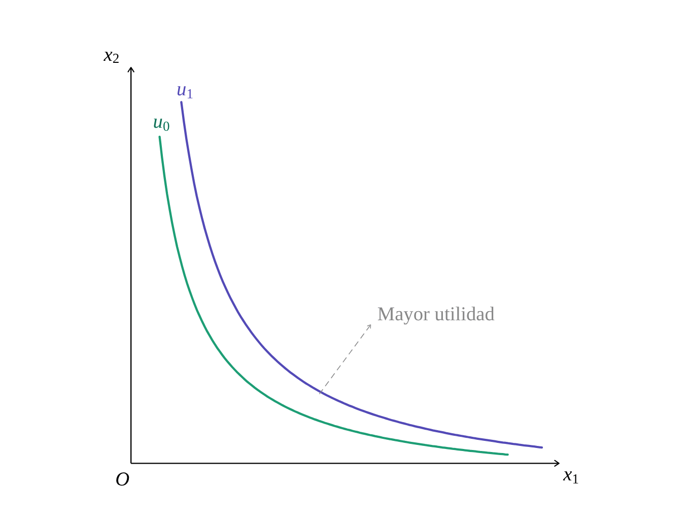
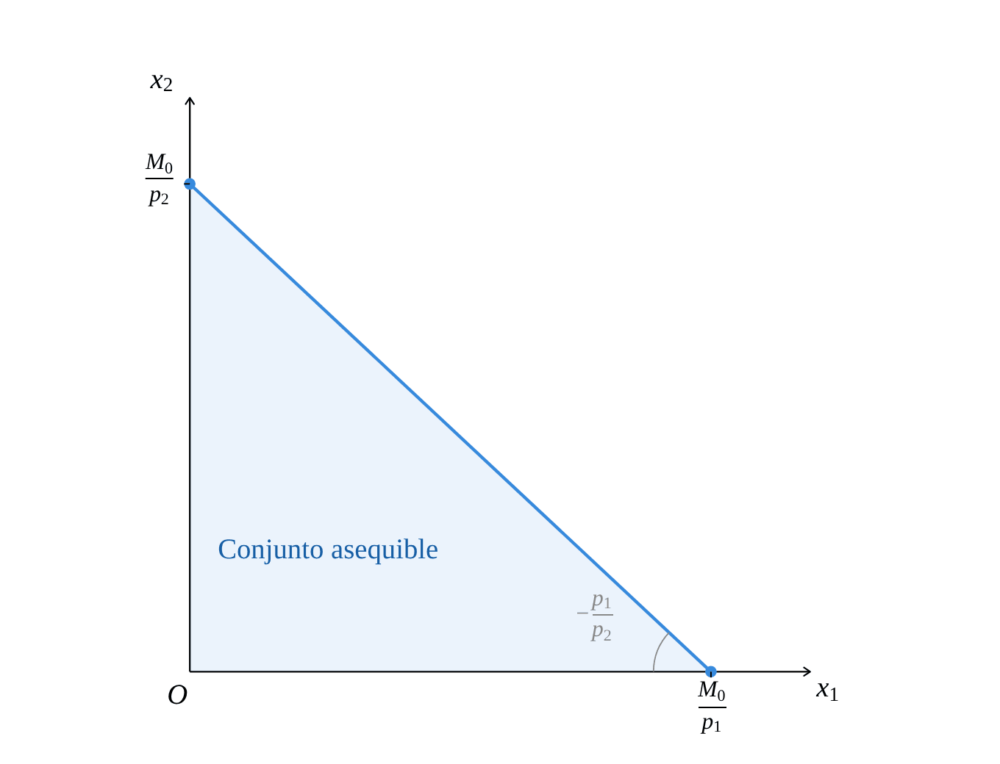
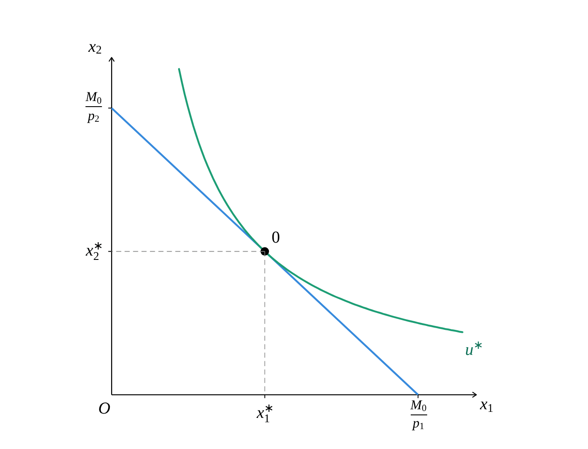
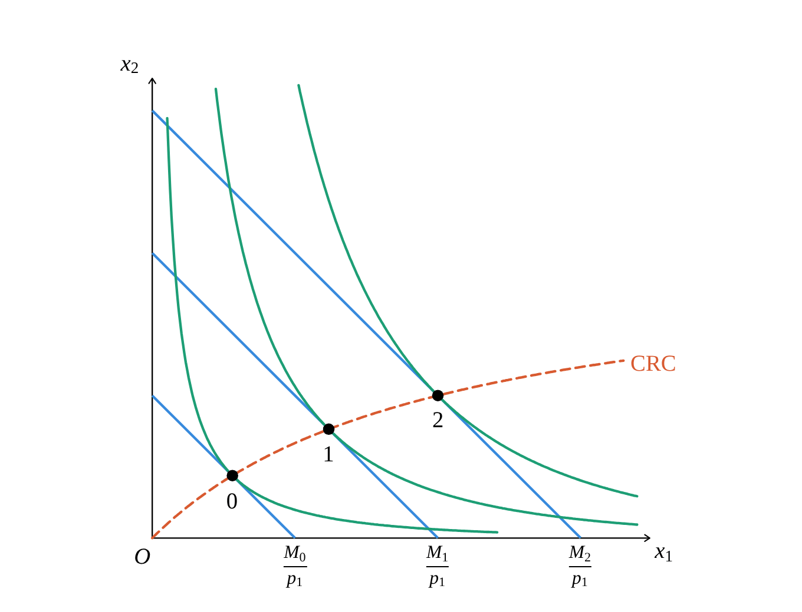
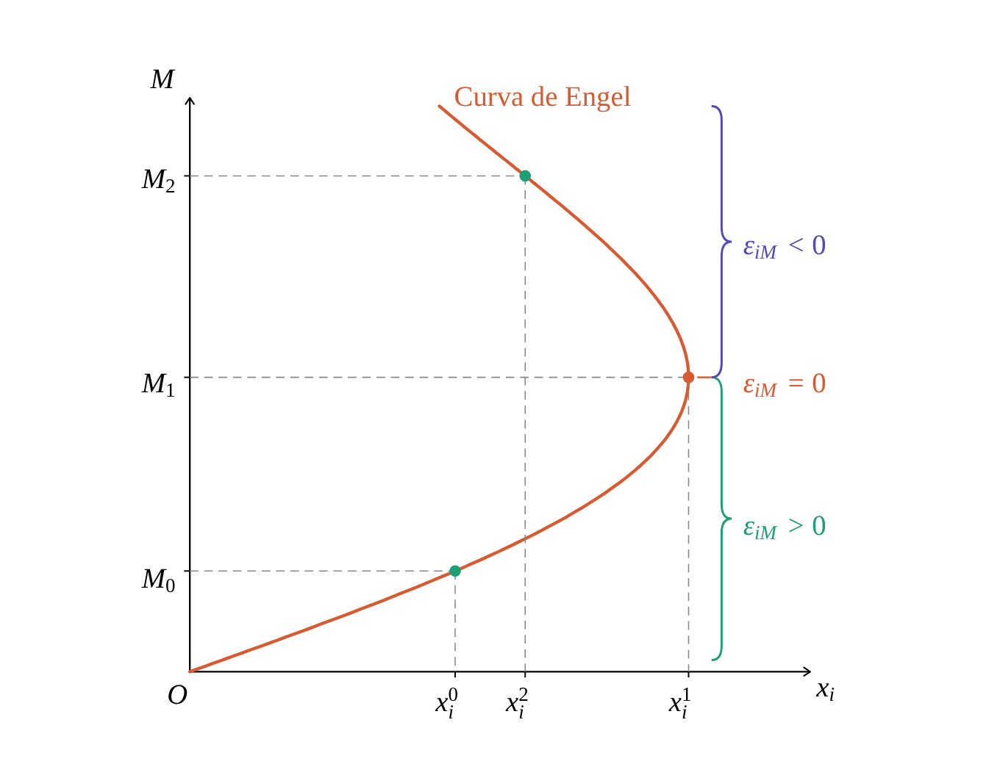
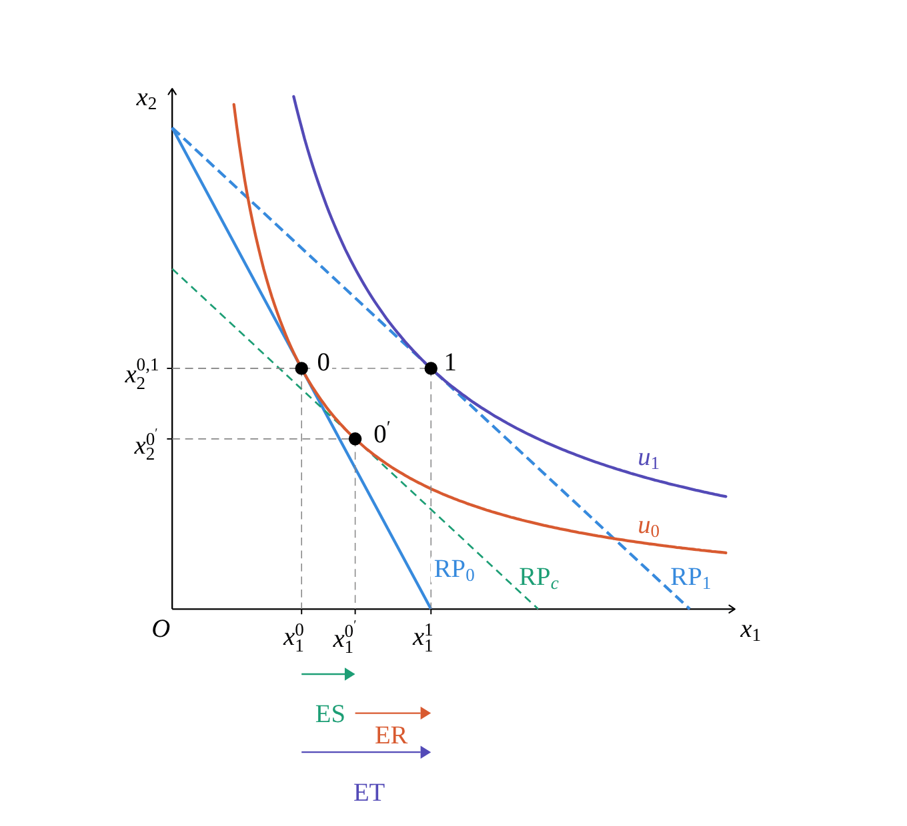
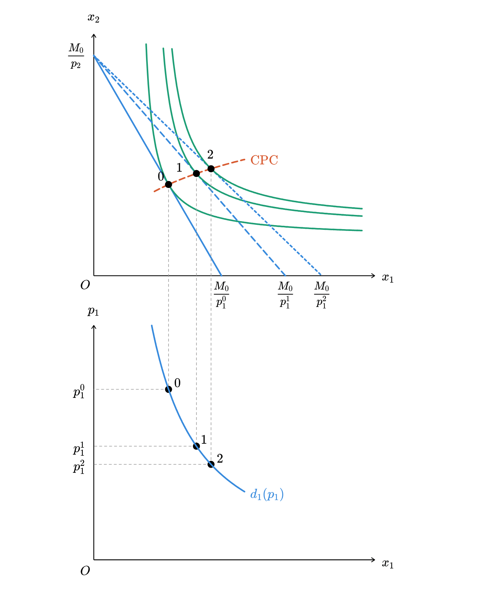
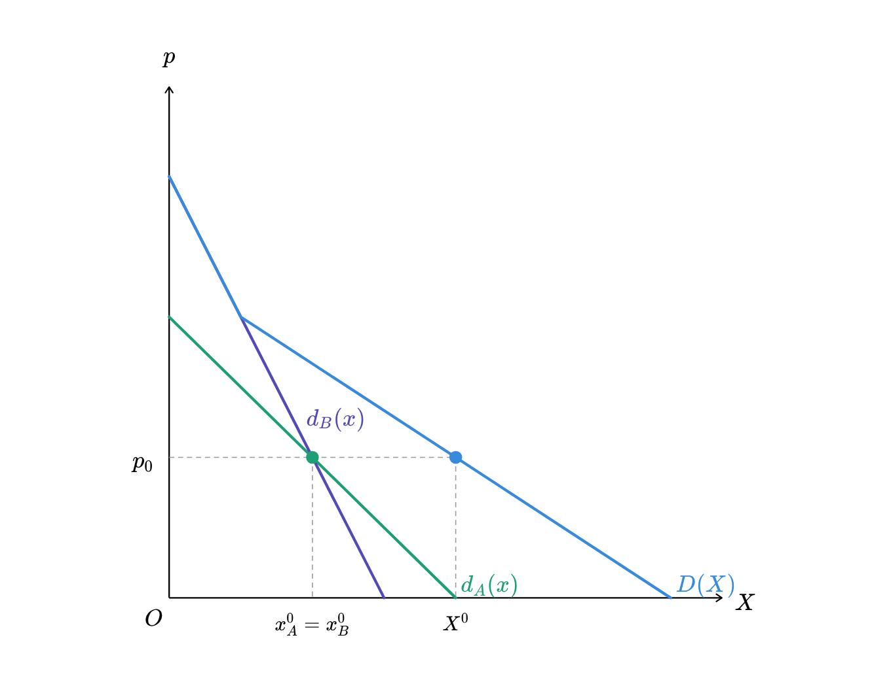
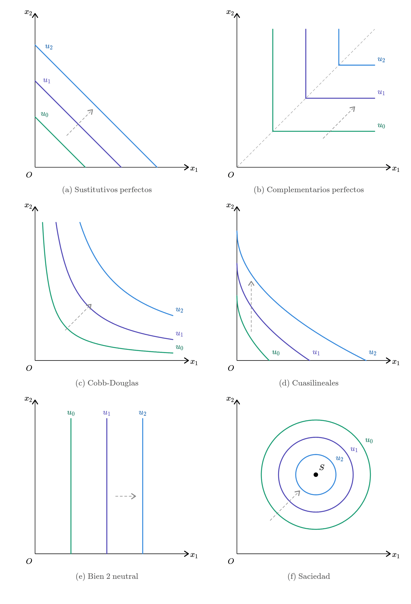
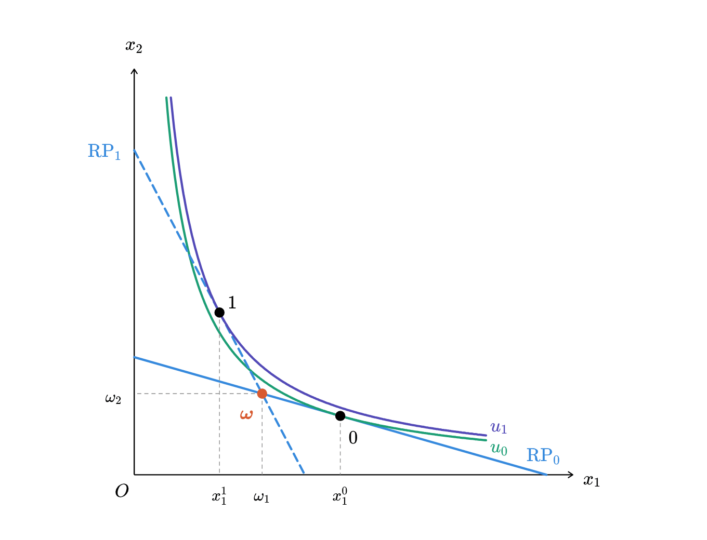

## Introducción



La elección del consumidor es el problema de optimización con restricciones más sencillo de la microeconomía, y su esquema reaparece en la teoría de la empresa (temas [A11](a11-produccion.qmd) y [A12](a12-costes.qmd)), en la oferta de trabajo (tema [A25](a25-oferta-trabajo.qmd)) y en las decisiones intertemporales (tema [A29](a29-mhi-mgs.qmd)). De la demanda individual se obtiene, por agregación, la demanda de mercado, una de las dos piezas del equilibrio parcial.

El tema estudia la teoría neoclásica de la demanda del consumidor en tres partes:

- *Fundamentos*: se enuncian los axiomas que caracterizan a un consumidor racional, se representan sus preferencias con una utilidad ordinal y se determina la cesta que la maximiza con la renta disponible.

- *Estática comparativa*: se analiza cómo afectan a su comportamiento los cambios en la renta y en los precios.

- *Otros desarrollos*: se presentan las extensiones que complementan la teoría ordinal, es decir, las condiciones de agregación; la preferencia revelada (de enfoque inductivo); las teorías de Lancaster (demanda de características) y de Becker (producción de los hogares), y la teoría de los precios hedónicos.

## 1. Fundamentos de la teoría neoclásica de la demanda del consumidor

La teoría neoclásica trata al consumidor como un agente racional que persigue la mayor utilidad que le permite su renta disponible, una variable exógena. El marco es estático y de certidumbre, y la utilidad nace de comprar bienes de consumo final[^a08-1].

### 1.1. El conjunto de elección y la ordenación de las preferencias

El punto de partida es el conjunto de cestas entre las que elige el consumidor y los axiomas que ordenan sus preferencias sobre él.

#### 1.1.1. El conjunto de elección, sus propiedades y las relaciones binarias

**Definición**: el consumidor ordena los elementos de un *conjunto de elección*, CE, no vacío, cerrado y acotado inferiormente[^a08-2]:

$$\text{CE} = \{\mathbf{x}^j \in \mathbb{R}^n : \mathbf{x}^j = (x_1^j, x_2^j, \ldots, x_n^j), \quad x_i^j \geq 0, \quad i = 1, 2, \ldots, n\}$$
Cada elemento del conjunto constituye una *cesta* de bienes físicamente consumibles (un vector de bienes no negativos y divisibles). Entre ellas se establecen *relaciones binarias*[^a08-3], que permiten ordenar las cestas según las preferencias y son tres: la relación de indiferencia, $\sim$, de estricta preferencia, $\succ$, y de preferencia débil, $\succsim$, o de preferencia-indiferencia, que se lee “al menos tan preferido como”[^a08-4].

Las relaciones binarias no bastan, sin embargo, para una teoría de la elección con significado económico (p. ej. podrían ser circulares o incompletas). Por ello, hay que exigirles axiomas, de orden y de regularidad, que acoten las ordenaciones admitidas y permitan representarlas con una función de utilidad.

#### 1.1.2. Axiomas de orden: la racionalidad de las preferencias

**Completitud o comparabilidad**: dadas dos cestas del conjunto de elección, el consumidor siempre puede expresar su preferencia entre ellas.
Formalmente, para dos cestas cualesquiera: $\mathbf{x}^0 \succsim \mathbf{x}^1$ o $\mathbf{x}^1 \succsim \mathbf{x}^0$ (o ambas, en cuyo caso $\mathbf{x}^0 \sim \mathbf{x}^1$).

**Reflexividad**: cada cesta es comparable consigo misma, $\mathbf{x}^0 \succsim \mathbf{x}^0$.

**Transitividad**: existe una coherencia lógica entre las comparativas. Si una cesta es al menos tan buena como otra, y esta como una tercera, la primera es al menos tan buena como la tercera.
Formalmente, para tres cestas cualesquiera: $\mathbf{x}^0 \succsim \mathbf{x}^1 \; \text{y} \; \mathbf{x}^1 \succsim \mathbf{x}^2 \rightarrow \mathbf{x}^0 \succsim \mathbf{x}^2$.

Estos tres axiomas garantizan dos cuestiones relevantes:

- *Matemáticamente*: que la ordenación de las cestas es un *preorden completo débil*. Todas las cestas pueden compararse y ponerse en orden, con empates posibles (indiferencia), pero eso no basta para asociar a cada una un número real (las preferencias lexicográficas son el contraejemplo clásico).

- *Económicamente*: que las preferencias del consumidor garantizan una *elección racional*.

#### 1.1.3. Axiomas de regularidad

**Continuidad**: dada una cesta $\mathbf{x}^0$, pequeños cambios en las cantidades de los bienes no provocan saltos abruptos en las preferencias.
Formalmente, los conjuntos de contorno superior $\{\mathbf{x} \in \text{CE} : \mathbf{x} \succsim \mathbf{x}^0\}$ e inferior $\{\mathbf{x} \in \text{CE} : \mathbf{x}^0 \succsim \mathbf{x}\}$ son cerrados.

**No saturación local**: en cualquier entorno de una cesta $\mathbf{x}^0$, por pequeño que sea, siempre existe otra cesta $\mathbf{x}^1$ estrictamente preferida.

La no saturación local implica que no existen “zonas de saciedad” y que el óptimo del consumidor se sitúa en la frontera del conjunto asequible (se agota toda la renta).

**Monotonía**: si una cesta $\mathbf{x}^1$ tiene al menos tanto de todos los bienes como $\mathbf{x}^0$ y estrictamente más de al menos uno, entonces $\mathbf{x}^1 \succ \mathbf{x}^0$.
Es decir, “más es mejor”.

La monotonía es más fuerte que la no saturación local, porque exige utilidades marginales positivas y excluye así los males.

**Convexidad**: dadas dos cestas indiferentes $\mathbf{x}^0 \sim \mathbf{x}^1$, cualquier combinación convexa $\mathbf{x}^\theta = \theta\mathbf{x}^0 + (1-\theta)\mathbf{x}^1$, con $\theta \in (0, 1)$, es al menos tan preferida: $\mathbf{x}^\theta \succsim \mathbf{x}^0$.

Este axioma refleja una preferencia por la variedad, es decir, el consumidor prefiere cestas equilibradas a cestas extremas. La convexidad garantiza que la función de utilidad es cuasicóncava. Con convexidad estricta ($\mathbf{x}^\theta \succ \mathbf{x}^0$ para $\mathbf{x}^0 \neq \mathbf{x}^1$), la función de utilidad es estrictamente cuasicóncava, la relación marginal de sustitución es estrictamente decreciente y la cesta óptima es única.

**Diferenciabilidad**: la función de utilidad es diferenciable (al menos dos veces).

La diferenciabilidad excluye puntos angulares en las curvas de indiferencia y permite el uso del cálculo diferencial (condiciones de Kuhn-Tucker) para resolver el problema de optimización.

### 1.2. La función de utilidad y las curvas de indiferencia

Las preferencias que cumplen los axiomas se representan mediante una función de utilidad, cuyos cortes a utilidad constante son las curvas de indiferencia.

#### 1.2.1. La función de utilidad y sus propiedades

**Definición**: una *función de utilidad* es una aplicación $u: \text{CE} \rightarrow \mathbb{R}$ tal que $\mathbf{x}^0 \succsim \mathbf{x}^1 \leftrightarrow u(\mathbf{x}^0) \geq u(\mathbf{x}^1)$. Es decir, asigna a cada cesta un índice de utilidad que preserva el orden de preferencias.

Los axiomas de orden junto con el de continuidad garantizan la existencia de una función de utilidad continua que representa las preferencias (teorema de representación de Debreu). Los restantes axiomas de regularidad (no saturación local, monotonía, convexidad y diferenciabilidad) dotan a dicha función de propiedades analíticas convenientes.

**Propiedades**:

1. *Continuidad y diferenciabilidad*: es continua en las cantidades de los bienes (por el axioma de continuidad) y dos veces diferenciable (por el axioma de diferenciabilidad).

2. *Transformaciones*: la función de utilidad es puramente ordinal, es decir, solo importa el orden que establece entre cestas, no la magnitud de los valores asignados. Por tanto, cualquier transformación $v = f(u)$, con $f' > 0$, representa las mismas preferencias.

3. *Inclinación*: es estrictamente creciente en la cantidad de cada bien, pues, por el axioma de monotonía, las utilidades marginales son positivas ($\frac{\partial u}{\partial x_i} \equiv u_i' > 0$).

4. *Forma*: por el axioma de convexidad estricta de las preferencias, la función de utilidad es estrictamente cuasicóncava[^a08-6], es decir, sus conjuntos de contorno superior $\{\mathbf{x} \in \text{CE} : u(\mathbf{x}) \geq k\}$ son estrictamente convexos.

5. *Otras propiedades*:

    - *Agotamiento de la renta*: por la no saturación local (implícita en la monotonía), la cesta óptima está sobre la recta de balance y la demanda cumple la ley de Walras.

    - *Observabilidad*: no es observable, pues solo lo son las elecciones. Por ello, la preferencia revelada recupera las preferencias a partir de ellas (apartado 3.2).

#### 1.2.2. Las curvas de indiferencia y sus propiedades

**Definición**: una *curva de indiferencia* es el lugar geométrico de todas las cestas de bienes que proporcionan un mismo nivel de utilidad[^a08-7].

**Propiedades**: se derivan de los axiomas:

1. *De los axiomas de orden*: la transitividad, y no la monotonía, garantiza que las curvas de indiferencia no se cortan. La demostración clásica procede por contradicción. Si dos curvas se cortasen en un punto, existirían cestas en curvas distintas que, por transitividad, deberían ser indiferentes entre sí, contradiciendo que pertenecen a niveles de utilidad diferentes.

2. *Del axioma de monotonía*: las curvas de indiferencia tienen pendiente negativa en el plano $(x_1, x_2)$, pues obtener más de un bien exige renunciar a parte del otro para mantener la utilidad constante, y las más alejadas del origen llevan asociado un mayor índice de utilidad.

3. *Del axioma de convexidad*: las curvas de indiferencia son convexas respecto al origen, con un grado de convexidad que depende de la sustituibilidad entre bienes. Solo lo son en sentido débil si tienen tramos rectos, como las lineales (sustitutivos perfectos) o las angulares (complementarios perfectos, tipo Leontief), y en sentido estricto si no los tienen (p. ej. Cobb-Douglas), casos que el apartado 1.2.4 clasifica por su elasticidad de sustitución y que el Anexo, apartado A.1, representa junto con los males y las preferencias no convexas.

Con diferenciabilidad son, además, suaves. Su pendiente y su curvatura se miden con la relación marginal de sustitución y la elasticidad de sustitución.

Gráficamente, en el plano de bienes, $(x_1, x_2)$ (figura -@fig-a081-ci-consumo), las curvas de indiferencia son los cortes horizontales (a utilidad constante) de la función de utilidad, una superficie en $\mathbb{R}^3$. Las curvas $u_0$ y $u_1$ son decrecientes y convexas, y la utilidad aumenta al alejarse del origen, de modo que $u_1$ representa una utilidad mayor que $u_0$.

::: {#fig-a081-ci-consumo}

::: {.content-visible when-format="html"}
```{=html}
<div class="graph-frame">
<iframe src="../graphs/a081_CI_consumo.html" style="height:560px" loading="lazy" title="fig-a081-ci-consumo"></iframe>
</div>
```
:::

::: {.content-visible unless-format="html"}

:::

Curvas de indiferencia. Cada curva reúne las cestas entre las que el consumidor es indiferente. La utilidad aumenta al alejarse del origen.
:::

#### 1.2.3. Pendiente de las curvas de indiferencia: la relación marginal de sustitución

La **relación marginal de sustitución** (RMS) del bien $j$ por el bien $i$ mide la tasa subjetiva a la que un consumidor está dispuesto a renunciar a unidades del bien $j$ a cambio de una unidad adicional del bien $i$, manteniendo constantes la utilidad y el consumo de los demás bienes. La RMS es, por tanto, el precio relativo subjetivo de los dos bienes para un consumidor dado.

Formalmente, se obtiene de la diferencial total de la función de utilidad igualada a cero cuando solo varían $x_i$ y $x_j$:

$$du = \frac{\partial u}{\partial x_i}dx_i + \frac{\partial u}{\partial x_j}dx_j = 0 \;\Rightarrow\; \text{RMS}_{ji} = -\frac{dx_j}{dx_i}\bigg|_{du=0} = \frac{\partial u / \partial x_i}{\partial u / \partial x_j} \geq 0$$

La expresión $\text{RMS}_{ji}$ se lee “la relación marginal de sustitución del bien $j$ por el bien $i$”, es decir, la valoración subjetiva del bien $i$ en términos del bien $j$. Al depender únicamente del cociente de utilidades marginales, la RMS es independiente de cómo se mida la utilidad[^a08-9].

En lo que sigue, para poder representarla en el plano, se consideran dos bienes, 1 y 2, de modo que la relación relevante es la $\text{RMS}_{21}$. Gráficamente, en el plano de bienes, $(x_1, x_2)$ (figura -@fig-a088-rms-pendiente), la RMS es el valor absoluto de la pendiente de la curva de indiferencia en cada punto, es decir, de su tangente.

Bajo convexidad estricta, la RMS es decreciente a lo largo de la curva de indiferencia. Conforme el consumidor acumula más del bien 1, está dispuesto a renunciar a cada vez menos unidades del bien 2 por una unidad adicional del bien 1. En la figura, la tangente a la curva de indiferencia $u_0$ es más inclinada en la cesta A que en la B ($\text{RMS}_{21}^A > \text{RMS}_{21}^B$).

::: {#fig-a088-rms-pendiente}

::: {.content-visible when-format="html"}
```{=html}
<div class="graph-frame">
<iframe src="../graphs/a088_RMS_pendiente.html" style="height:560px" loading="lazy" title="fig-a088-rms-pendiente"></iframe>
</div>
```
:::

::: {.content-visible unless-format="html"}

:::

Pendiente de la curva de indiferencia. La $\text{RMS}_{21}$ es el valor absoluto de la pendiente de la tangente a $u_0$ en cada cesta. Es mayor en A que en B, por lo que, a cambio de un mismo $\Delta x_1$, el consumidor está dispuesto a renunciar en A a más unidades del bien 2 ($\Delta x_2$) que en B (RMS decreciente).
:::

Si, por el contrario, no se cumpliera el axioma de convexidad y las preferencias fueran “todo o nada” (preferencia por cestas extremas), las curvas de indiferencia serían cóncavas respecto al origen y la RMS, creciente. El óptimo sería entonces una solución de esquina (consumo exclusivo de un solo bien).

#### 1.2.4. Forma de las curvas de indiferencia: la elasticidad de sustitución

Mientras que la RMS indica a qué tasa se intercambian los bienes en cada punto, la **elasticidad de sustitución** ($\sigma$) mide la facilidad de ese intercambio. Para ello, recoge cuánto responden las proporciones consumidas a los cambios en la RMS a lo largo de una curva de indiferencia[^a08-11].

Formalmente, la elasticidad de sustitución entre los bienes $i$ y $j$ en el sentido de Hicks (1932), con el consumo de los demás bienes constante, es:

$$\sigma_{ji} \equiv \frac{d(x_j/x_i)}{d\,\text{RMS}_{ji}} \cdot \frac{\text{RMS}_{ji}}{x_j/x_i} = \frac{\partial \ln(x_j/x_i)}{\partial \ln \text{RMS}_{ji}} \geq 0$$

Gráficamente, con dos bienes, en el plano de bienes, $(x_1, x_2)$ (figura -@fig-a089-elasticidad-sustitucion), al desplazarse a lo largo de la curva de indiferencia $u_0$ de la cesta A a la B, disminuyen tanto la proporción $x_2/x_1$ como la $\text{RMS}_{21}$. La proporción es la pendiente del radio-vector que une cada cesta con el origen, y la RMS, el valor absoluto de la pendiente de la tangente. La elasticidad de sustitución es el cociente entre la variación porcentual de la primera y la de la segunda.

::: {#fig-a089-elasticidad-sustitucion}

::: {.content-visible when-format="html"}
```{=html}
<div class="graph-frame">
<iframe src="../graphs/a089_Elasticidad_sustitucion.html" style="height:560px" loading="lazy" title="fig-a089-elasticidad-sustitucion"></iframe>
</div>
```
:::

::: {.content-visible unless-format="html"}

:::

Elasticidad de sustitución. Al pasar de la cesta A a la B a lo largo de $u_0$, disminuyen la proporción $x_2/x_1$ (pendiente del radio-vector) y la $\text{RMS}_{21}$ (pendiente de la tangente, en valor absoluto). La elasticidad $\sigma_{21}$ es el cociente entre sus variaciones porcentuales.
:::

Según su elasticidad de sustitución, los bienes se clasifican en:

1. *Sustitutivos perfectos* ($\sigma_{ji} = \infty$): la RMS es constante, las curvas de indiferencia son lineales y las proporciones de consumo son extremadamente sensibles a cambios en los precios relativos, como ocurre con la gasolina de distintas marcas con idénticas características.

2. *Sustitutivos imperfectos* ($\sigma_{ji} \in (0, \infty)$): caso intermedio. Por ejemplo, la función Cobb-Douglas presenta una elasticidad de sustitución unitaria ($\sigma_{ji} = 1$), independientemente de su grado de homogeneidad[^a08-12][^a08-13].

3. *Complementarios perfectos* ($\sigma_{ji} = 0$): no existe posibilidad de sustitución, las curvas de indiferencia son angulares (tipo Leontief) y las proporciones de consumo son fijas.

Gráficamente, la elasticidad de sustitución refleja la curvatura de la curva de indiferencia respecto al origen. Cuanto mayor es $\sigma$, más aplanada es la curva y, cuanto menor, más curvada[^a08-14]. La elasticidad no tiene por qué ser constante a lo largo de una curva de indiferencia[^a08-15].

**Otras nociones de elasticidad de sustitución**: cuando la cesta contiene más de dos bienes, la elasticidad de Hicks deja fijo el consumo de los demás. En cambio, la *elasticidad de sustitución de Allen* (1938), $\sigma_{ij}^{\text{Allen}}$, permite que se ajuste y se calcula con la matriz hessiana orlada de la función de utilidad. Conecta, además, las preferencias con la demanda observable mediante la ecuación de Slutsky en elasticidades (apartado 2.2.2).

### 1.3. El conjunto asequible: la restricción presupuestaria

Las preferencias dicen qué cestas desea el consumidor y la restricción presupuestaria, cuáles puede adquirir con su renta a los precios vigentes.

#### 1.3.1. Del conjunto de elección al conjunto asequible

El conjunto de elección, CE, solo delimita qué cestas son físicamente consumibles. Cuáles puede pagar el consumidor depende además de dos variables, que introducen una restricción económica:

1. *Precios*: un vector de precios, estrictamente positivos y conocidos por el consumidor: $\mathbf{p} = (p_1, p_2, \ldots, p_n)$, con $p_i > 0$.

2. *Renta*: una cantidad fija de renta monetaria (contexto estático) de la que dispone: $M_0 > 0$.

**Definición**: con ellas se define la *restricción presupuestaria*, $\sum_i p_i x_i \leq M_0$ (con dos bienes, $p_1 x_1 + p_2 x_2 \leq M_0$), que convierte el problema en genuinamente económico. El *conjunto asequible*, CA, es el subconjunto del conjunto de elección formado por las cestas que el consumidor puede adquirir con su renta a los precios vigentes:

$$\text{CA} = \{\mathbf{x} \in \text{CE} : \mathbf{p} \cdot \mathbf{x} \leq M_0\}$$

**Propiedades**: el conjunto asequible es no vacío, cerrado, acotado (los precios positivos y la renta finita limitan el consumo de cada bien) y convexo (intersección de un semiespacio con el ortante no negativo $\mathbb{R}^n_+$).

#### 1.3.2. La recta de balance

Por el axioma de monotonía, el consumidor debe agotar toda su renta. De este modo, la restricción presupuestaria, satisfecha con igualdad, es la **recta de balance**.

**Recta de balance en términos nominales**: vendrá dada por $\sum_i p_i x_i = M_0$ y, con dos bienes, por $p_1 x_1 + p_2 x_2 = M_0$. 

Gráficamente, en el plano de bienes, $(x_1, x_2)$ (figura -@fig-a082-rp-consumo), constituye la frontera superior del conjunto asequible, corta a los ejes en $M_0/p_1$ y $M_0/p_2$ y tiene pendiente negativa:

$$x_2 = \frac{M_0}{p_2} - \frac{p_1}{p_2}x_1 \quad \rightarrow \quad \frac{dx_2}{dx_1}\bigg|_{M_0} = -\frac{p_1}{p_2}$$

Esa pendiente, $-p_1/p_2$, recoge el precio relativo objetivo del bien 1 expresado en unidades del bien 2, es decir, cuántas unidades del bien 2 hay que ceder en el mercado por cada unidad adicional del bien 1.

::: {#fig-a082-rp-consumo}

::: {.content-visible when-format="html"}
```{=html}
<div class="graph-frame">
<iframe src="../graphs/a082_RP_consumo.html" style="height:560px" loading="lazy" title="fig-a082-rp-consumo"></iframe>
</div>
```
:::

::: {.content-visible unless-format="html"}

:::

Restricción presupuestaria. La recta de balance delimita el conjunto asequible y su pendiente es el precio relativo $-p_1/p_2$.
:::

**Recta de balance en términos reales**: con dos bienes y renta exógena, la recta de balance se define con dos precios y una renta nominal, pero una de estas tres variables es redundante. Por tanto, puede establecerse un precio numerario (fijando el precio de uno de los bienes como unidad de cuenta) o una renta numeraria (expresando los precios como fracción de la renta):

$$\frac{p_1}{p_2} x_1 + x_2 = \frac{M_0}{p_2}$$

$$\frac{p_1}{M_0} x_1 + \frac{p_2}{M_0} x_2 = 1$$

#### 1.3.3. Restricción presupuestaria en presencia de un bien compuesto

Cuando un grupo de bienes cuyos precios se mueven proporcionalmente puede tratarse como un único bien (bien compuesto), la restricción presupuestaria se simplifica:

$$p_i x_i + G \leq M_0$$

donde $G \geq 0$ representa el gasto en todos los bienes distintos de $x_i$. Esta formulación permite reducir un problema de $n$ bienes a un análisis bidimensional entre el bien de interés, $x_i$, y el gasto en el resto de bienes.

### 1.4. La decisión de consumo y la demanda marshalliana

La decisión de consumo combina las preferencias con la restricción presupuestaria, y de esa decisión se obtienen la función de demanda marshalliana y la función indirecta de utilidad.

#### 1.4.1. La decisión de consumo: el equilibrio del consumidor

**Planteamiento**: el consumidor busca la cesta que maximiza su utilidad sujeto a su restricción presupuestaria y a la no negatividad de los bienes:

$$\max_{\mathbf{x}} \; u(\mathbf{x}) \quad \text{s.a.:} \begin{cases} \sum_{i=1}^{n} p_i x_i \leq M_0 \\ x_i \geq 0 \; \forall i \end{cases}$$

donde $\mathbf{x} = (x_1, \ldots, x_n)$ es la cesta de consumo, $p_i$ el precio del bien $i$ y $M_0$ la renta monetaria.

El lagrangiano es[^a08-16]:

$$\mathcal{L} = u(\mathbf{x}) + \lambda \left(M_0 - \sum_{i=1}^{n} p_i x_i \right)$$

El multiplicador de Lagrange, $\lambda$, es el precio sombra de la renta, es decir, la valoración subjetiva que el consumidor hace de una unidad adicional de renta en el óptimo:

$$\lambda = \frac{\partial u^*}{\partial M} \equiv u_M'$$

**CPO**: las condiciones de Kuhn-Tucker establecen, para cada bien $i$, tres condiciones sobre la cantidad, (1) a (3), y tres sobre el multiplicador, (4) a (6):

$$\frac{\partial \mathcal{L}}{\partial x_i} = \frac{\partial u}{\partial x_i} - \lambda p_i \leq 0 \tag{1}$$

$$x_i \geq 0 \tag{2}$$

$$x_i \left(\frac{\partial u}{\partial x_i} - \lambda p_i\right) = 0 \tag{3}$$

$$\frac{\partial \mathcal{L}}{\partial \lambda} = M_0 - \sum p_i x_i \geq 0 \tag{4}$$

$$\lambda \geq 0 \tag{5}$$

$$\lambda \left(M_0 - \sum p_i x_i\right) = 0 \tag{6}$$

La condición (1) exige que la utilidad marginal por euro gastado en un bien no supere la utilidad marginal de la renta, $\lambda$, y la (2), que la cantidad consumida no sea negativa. La (3), llamada de *holgura complementaria*[^a08-17], obliga a que al menos una de las dos se cumpla con igualdad, así que, si el bien se consume ($x_i > 0$), su utilidad marginal por euro iguala a $\lambda$, y si queda por debajo, el bien no se consume y la solución es de esquina.

Para la renta, las condiciones (4) a (6) aplican el mismo esquema, con la restricción presupuestaria en lugar de (1) y el multiplicador en lugar de la cantidad, y exigen que el consumidor gaste toda su renta o que $\lambda$ sea nulo. Con preferencias monótonas, un euro más siempre aumenta la utilidad, por lo que la renta se agota, $\lambda > 0$ y (4) se cumple con igualdad.

En el resto del libro, salvo aviso expreso, se supone una **solución interior** ($x_i^* > 0$ en todos los bienes) con la restricción agotada. En ese caso (1) y (4) se cumplen con igualdad, las otras cuatro condiciones se satisfacen solas y basta el método de Lagrange con la restricción en forma de igualdad. En cambio, cuando alguna restricción puede no agotarse, el tema lo advierte y resuelve el programa con Kuhn-Tucker (temas [A13](a13-informacion.qmd), [A15](a15-toi.qmd), [A37](a37-politica-monetaria-ii.qmd) y [B02](b02-inversion.qmd)).

**CSO**: las condiciones de Kuhn-Tucker son necesarias y, además, suficientes si la función de utilidad es cuasicóncava (preferencias convexas), pues la restricción es lineal, y el máximo es único si la cuasiconcavidad es estricta (curvas de indiferencia estrictamente convexas).

**Solución**:

1. *Solución interior* ($x_i^* > 0$ para todo $i$): en este caso, las CPO se cumplen con igualdad para todos los bienes. De aquí se derivan dos interpretaciones equivalentes del equilibrio.

    - *Interpretación en términos de utilidad*: en el óptimo, el consumidor iguala la tasa subjetiva de intercambio entre bienes (RMS) con la tasa objetiva de intercambio de mercado (precio relativo), para cada par de bienes $i$, $j$:
        $$\text{RMS}_{ji} \equiv \frac{\partial u / \partial x_i}{\partial u / \partial x_j} = \frac{p_i}{p_j}$$
        De no cumplirse esta igualdad, el consumidor podría reasignar su presupuesto entre bienes y alcanzar una utilidad mayor.

    - *Interpretación en términos de gasto (segunda ley de Gossen)*: en el óptimo, el consumidor distribuye su renta de modo que la utilidad marginal por unidad monetaria gastada es igual para todos los bienes, y dicha ratio coincide con la utilidad marginal de la renta:
        $$\frac{\partial u / \partial x_i}{p_i} = \lambda = \frac{\partial u^*}{\partial M} \quad \forall i$$

2. *Solución de esquina* ($x_i^* = 0$ para algún $i$): en este caso, la CPO del bien no consumido se cumple como desigualdad débil (en general, estricta), $\partial u/\partial x_i \leq \lambda p_i$. Con dos bienes, si $x_2^* = 0$, la valoración subjetiva del bien 1 es al menos igual a su precio relativo y el consumidor dedica toda su renta a $x_1$. Si $x_1^* = 0$, ocurre lo contrario:
    $$x_2^* = 0: \; \text{RMS}_{21} \geq \frac{p_1}{p_2} \qquad x_1^* = 0: \; \text{RMS}_{21} \leq \frac{p_1}{p_2}$$

**Desarrollo gráfico**: el equilibrio del consumidor se representa en el plano de bienes, $(x_1, x_2)$ (figura -@fig-a083-equilibrio-consumidor):

1. *Recta de balance*: recoge las cestas que agotan la renta y su pendiente, $-p_1/p_2$, es el precio relativo cambiado de signo.

2. *Curva de indiferencia*, $u^*$: es la más alejada del origen que el consumidor puede alcanzar con su renta, decreciente y convexa por los axiomas de monotonía y convexidad.

3. *Equilibrio*: la solución interior es el punto 0, de tangencia entre $u^*$ y la recta de balance, con la cesta $(x_1^*, x_2^*)$ y $\text{RMS}_{21} = p_1/p_2$.

::: {#fig-a083-equilibrio-consumidor}

::: {.content-visible when-format="html"}
```{=html}
<div class="graph-frame">
<iframe src="../graphs/a083_Equilibrio_consumidor.html" style="height:560px" loading="lazy" title="fig-a083-equilibrio-consumidor"></iframe>
</div>
```
:::

::: {.content-visible unless-format="html"}

:::

Equilibrio del consumidor. Se sitúa en la tangencia entre la curva de indiferencia más alta alcanzable y la recta de balance ($\text{RMS}_{21} = p_1/p_2$).
:::

#### 1.4.2. La función de demanda ordinaria o marshalliana

**Definición**: el teorema de la función implícita garantiza que el sistema de CPO puede resolverse, y la cantidad óptima de cada bien queda así determinada por los precios y la renta[^a08-23]. Las funciones que resultan son las demandas del consumidor.

Reciben el nombre de *funciones de demanda ordinarias, marshallianas o walrasianas*:

$$x_i^m \equiv x_i^* = d_i(\mathbf{p}, M), \quad i = 1, 2, \ldots, n$$

::: {.callout-note appearance="simple" icon=false}
La obtención de las demandas marshallianas para una función de utilidad Cobb-Douglas se desarrolla en el Anexo, apartado A.4.
:::

**Propiedades** de las funciones de demanda marshalliana:

1. *Continuidad y diferenciabilidad*: son continuas en precios y renta (por el teorema del máximo) y diferenciables si $u$ es de clase $C^2$ con curvas de indiferencia de curvatura estrictamente positiva (hessiano orlado no singular), lo que permite el análisis de estática comparativa.

2. *Transformaciones*: son homogéneas de grado cero en precios y renta, $d_i(k\mathbf{p}, kM) = d_i(\mathbf{p}, M)$. Un cambio equiproporcional en todos los precios y la renta no altera las cantidades demandadas, es decir, el consumidor no padece ilusión monetaria. Además, son invariantes ante transformaciones monótonas crecientes de la función de utilidad, porque la cesta óptima depende de las preferencias, no de su representación.

3. *Inclinación*: al recoger el efecto renta y el efecto sustitución, pueden tener cualquier pendiente respecto al precio propio (apartado 2.2.3). Respecto a la renta, en cambio, son crecientes para los normales y decrecientes para los inferiores.

4. *Forma*: la teoría no restringe la curvatura de la demanda de cada bien, que puede ser cóncava, lineal o convexa respecto a su precio. La restricción de segundo orden recae sobre la matriz de Slutsky, que reúne las pendientes compensadas de todas las demandas y es simétrica y semidefinida negativa (tema [A09](a09-dualidad.qmd), apartado 3.1.2).

5. *Otras propiedades*:

    - *Agotamiento de la renta*: por la no saturación local de las preferencias, la cesta óptima satisface $\mathbf{p} \cdot \mathbf{x}^* = M$, propiedad que, en términos agregados, enlaza con la ley de Walras (1874).

    - *Envolvente* (*identidad de Roy*): se obtienen de la función indirecta de utilidad, $d_i(\mathbf{p}, M) = -\dfrac{\partial v / \partial p_i}{\partial v / \partial M}$, como se demuestra en el tema [A09](a09-dualidad.qmd), apartado 1.3.

    - *Dualidad*: coinciden con las hicksianas (apartado 2.2.1) evaluadas en la utilidad máxima, $d_i(\mathbf{p}, M) = h_i(\mathbf{p}, v(\mathbf{p}, M))$ (tema [A09](a09-dualidad.qmd), apartado 2.4.2).

    - *Integrabilidad*: si cumplen ciertas condiciones (ley de Walras y matriz de Slutsky simétrica y semidefinida negativa), a partir de ellas pueden recuperarse las preferencias que las generan (tema [A09](a09-dualidad.qmd), apartado 3.1.3).

    - *Observabilidad*: las cantidades demandadas son directamente observables en los datos estadísticos, a diferencia de la utilidad.

#### 1.4.3. La función indirecta de utilidad

**Definición**: el problema primal permite obtener, además, la *función indirecta de utilidad* (FIU), que recoge la utilidad máxima alcanzable para cada combinación de precios y renta:

$$v(\mathbf{p}, M) = u(\mathbf{x}^*) = u\big(d_1(\mathbf{p}, M), \ldots, d_n(\mathbf{p}, M)\big)$$

::: {.callout-note appearance="simple" icon=false}
Las propiedades de la función indirecta de utilidad y la identidad de Roy se desarrollan en el tema [A09](a09-dualidad.qmd), apartado 1.3, y la función de gasto, el lema de Shephard y las relaciones de dualidad, en sus apartados 2.3 y 2.4.
:::

### 1.5. Conclusiones

**Aspectos positivos**: la teoría neoclásica de la demanda deriva de un conjunto reducido de axiomas sobre las preferencias una función de utilidad ordinal y, de su maximización sujeta a la restricción presupuestaria, funciones de demanda con propiedades contrastables.

**Limitaciones**:

- *Axiomas de regularidad* (convexidad, continuidad): son supuestos de conveniencia analítica más que descripciones del comportamiento.

- *Marco estático y con información perfecta*: las decisiones intertemporales y en riesgo requieren extensiones (temas [A10](a10-riesgo-incertidumbre.qmd) y [A29](a29-mhi-mgs.qmd)).

- *Utilidad no observable*: motiva tanto el enfoque de la preferencia revelada (apartado 3.2) como el análisis dual del tema [A09](a09-dualidad.qmd).

## 2. Análisis de estática comparativa

Identificada la función de demanda marshalliana, que da la cantidad demandada para unos parámetros dados, la estática comparativa estudia cómo responde la demanda ante cambios en la renta y en los precios[^a08-24]. El objetivo es determinar si la teoría permite identificar regularidades robustas, es decir, leyes de demanda, y construir con ellas la curva de demanda individual y, por agregación, la de mercado.

### 2.1. Cambios en la renta

Un cambio en la renta monetaria, manteniendo constantes los precios y las preferencias, altera la cesta óptima sin alterar la tasa de intercambio a la que el consumidor se enfrenta.

#### 2.1.1. Curva renta-consumo y curva de Engel

Analíticamente, el efecto sobre la cantidad demandada de cada bien es la derivada parcial de la función de demanda marshalliana respecto a la renta, $\partial d_i(\mathbf{p}, M)/\partial M$, que se obtiene diferenciando el sistema de CPO y cuyo signo no está determinado por los axiomas.

**Desarrollo gráfico**: con dos bienes, el cambio de renta produce un desplazamiento paralelo de la recta de balance, pues su pendiente, $-p_1/p_2$, no varía. El nuevo equilibrio es la tangencia de la nueva recta con una curva de indiferencia más alejada del origen (o más próxima a él), y la relación entre la renta y cada bien se resume en dos curvas:

1. *Curva renta-consumo* (CRC) o *senda de expansión de la renta*: en el plano de bienes, $(x_1, x_2)$ (figura -@fig-a084-crc-renta-consumo), es el lugar geométrico de las cestas óptimas que se obtiene al variar la renta monetaria, manteniendo precios y preferencias constantes. En la figura, los puntos 0, 1 y 2 corresponden a las rentas $M_0$, $M_1$ y $M_2$. Si ambos bienes son normales, la CRC tiene pendiente positiva, mientras que, si uno de ellos es inferior, se inclina hacia el eje del bien normal. Su forma puede ser irregular y no necesariamente monotónica, salvo con preferencias homotéticas, en cuyo caso es una recta que parte del origen y el consumidor adquiere la misma proporción de cada bien para cualquier nivel de renta.

::: {#fig-a084-crc-renta-consumo}

::: {.content-visible when-format="html"}
```{=html}
<div class="graph-frame">
<iframe src="../graphs/a084_CRC_renta_consumo.html" style="height:560px" loading="lazy" title="fig-a084-crc-renta-consumo"></iframe>
</div>
```
:::

::: {.content-visible unless-format="html"}

:::

Curva renta-consumo. La curva une los equilibrios del consumidor al variar la renta con precios constantes.
:::

2. *Curva de Engel*: proyectando una CRC sobre el plano cantidad-renta, $(x_i, M)$ (figura -@fig-a085-engel-curve, con otro bien), se obtiene la curva de Engel, $x_i^* = f_i(M)$, que muestra cómo varía la demanda de un bien con la renta, a precios constantes. Es creciente para un bien normal (y más que proporcional para un bien de lujo), decreciente para un bien inferior y una recta que parte del origen con preferencias homotéticas.

::: {#fig-a085-engel-curve}

::: {.content-visible when-format="html"}
```{=html}
<div class="graph-frame">
<iframe src="../graphs/a085_Engel_curve.html" style="height:560px" loading="lazy" title="fig-a085-engel-curve"></iframe>
</div>
```
:::

::: {.content-visible unless-format="html"}

:::

Curva de Engel. Relaciona la cantidad demandada de un bien con la renta. El bien es normal hasta $M_1$ e inferior a partir de ese nivel.
:::

#### 2.1.2. Elasticidad-renta

Los efectos de las variaciones de renta, *ceteris paribus*, se miden también con la **elasticidad-renta** de un bien:

$$\varepsilon_{iM} = \frac{\Delta\% \, x_i}{\Delta\% \, M} \bigg|_{\mathbf{p} = \mathbf{p}^0} = \frac{\partial x_i}{\partial M} \cdot \frac{M}{x_i} \bigg|_{\mathbf{p} = \mathbf{p}^0}$$

La segunda igualdad es su versión infinitesimal y, gráficamente, la elasticidad de la curva de Engel en cada punto.

#### 2.1.3. Clasificación de los bienes

Según la respuesta de la cantidad demandada a la renta, los bienes se clasifican en:

| Tipo de bien | Derivada / Elasticidad | Descripción |
|:--|:--|:--|
| Inferior | $\frac{\partial x_i}{\partial M} < 0 \rightarrow \varepsilon_{iM} < 0$ | La cantidad demandada se reduce si aumenta la renta (p. ej. marcas blancas). |
| Frontera | $\frac{\partial x_i}{\partial M} = 0 \rightarrow \varepsilon_{iM} = 0$ | No depende de las variaciones de renta (p. ej. pasta de dientes). |
| Normal | $\frac{\partial x_i}{\partial M} > 0 \rightarrow \varepsilon_{iM} > 0$ | La cantidad demandada aumenta si aumenta la renta. |
| De primera necesidad | $\varepsilon_{iM} \in (0, 1)$ | Aumenta en menor proporción que la renta (p. ej. pan). |
| De elasticidad unitaria | $\varepsilon_{iM} = 1$ | Aumenta en la misma proporción que la renta; su participación en el gasto no varía (si todos los bienes la tienen, las preferencias son homotéticas). |
| De lujo o superior | $\varepsilon_{iM} > 1$ | Aumenta en mayor proporción que la renta. |

: Clasificación de los bienes según la elasticidad-renta. {#tbl-a08-elasticidad-renta .table-sm}

La clasificación no es una propiedad intrínseca del bien sino de su relación con el consumidor. De hecho, un mismo bien puede ser normal para un nivel de renta e inferior para otro (p. ej. el transporte público), de modo que la elasticidad-renta varía a lo largo de la curva de Engel.

De la elasticidad-renta se derivan una regularidad empírica y una restricción teórica:

1. *Ley de Engel* (1857): la fracción de la renta dedicada a alimentos desciende conforme aumenta la renta, lo que hace de esa fracción un indicador de nivel de vida. 

2. *Condición de agregación de Engel*: como el consumidor agota su renta, la media ponderada de las elasticidades-renta es la unidad (apartado 3.1.3).

En política económica, la elasticidad-renta determina la incidencia del crecimiento sobre la estructura del consumo (terciarización, caída del peso de los alimentos) y la progresividad efectiva de los impuestos indirectos. Así, gravar bienes de primera necesidad es regresivo y gravar bienes de lujo, progresivo.

### 2.2. Cambios en los precios

Ante un cambio en los precios hay que distinguir dos casos:

1. *Variación equiproporcional*: si todos los precios varían en la misma proporción, solo cambia el poder adquisitivo, y la homogeneidad de grado cero de la demanda hace que el análisis sea idéntico al de una variación de la renta de signo contrario.

2. *Variación de un precio relativo*: si varía el precio de uno de los bienes, manteniendo el resto y la renta constantes, se producen dos fenómenos simultáneos:

    - *Cambio en los precios relativos*: altera la tasa de intercambio de mercado y, con ella, la composición de la cesta si existe sustituibilidad.

    - *Cambio en el valor real de la renta monetaria*: modifica el poder adquisitivo.

#### 2.2.1. Efecto sustitución y efecto renta: la ecuación de Slutsky

Analíticamente, el **efecto total** de una variación del precio $p_j$ sobre la cantidad demandada del bien $i$ es la derivada parcial de la demanda marshalliana, $\partial d_i(\mathbf{p}, M)/\partial p_j$. Para separar los dos fenómenos hay que fijar qué se entiende por *renta real constante*, y existen dos concepciones:

1. *Definición de Slutsky* (1915): la renta real es constante cuando, a los nuevos precios, basta para comprar la misma cesta que antes. Así, el poder adquisitivo se mide en cestas de bienes físicamente consumibles, y no hace falta conocer las preferencias.

2. *Definición de Hicks* (Hicks y Allen, 1934): la renta real es constante cuando, a los nuevos precios, basta para alcanzar el mismo nivel de utilidad que antes. Así, el poder adquisitivo se mide en bienestar. Su aplicación exige conocer las preferencias, pero a cambio la definición de Hicks aísla el efecto sustitución puro, un desplazamiento sobre la propia curva de indiferencia inicial, y por esa razón es la que adopta el desarrollo formal.

La definición de Slutsky es observable y la de Hicks, exacta, y ambas coinciden para cambios infinitesimales del precio. La definición de Hicks exige introducir la **función de demanda hicksiana o compensada**, $h_i(\mathbf{p}, u_0)$, que expresa la cantidad demandada del bien $i$ que minimiza el gasto necesario para alcanzar un nivel de utilidad dado $u_0$. Se denomina compensada porque, ante una variación de los precios, la renta se reajusta hipotéticamente para mantener la utilidad constante.

::: {.callout-note appearance="simple" icon=false}
El problema dual de minimización del gasto, la definición formal de la demanda hicksiana y sus propiedades se desarrollan en el tema [A09](a09-dualidad.qmd), apartados 2.1 y 2.2.
:::

**Ecuación de Slutsky**: con la demanda hicksiana, el efecto total se descompone en un efecto sustitución y un efecto renta:

$$\underbrace{\frac{\partial x_i^m}{\partial p_j}}_{\text{ET}} = \underbrace{\frac{\partial h_i}{\partial p_j}}_{\text{ES}} \; \underbrace{- \; \frac{\partial x_i^m}{\partial M} \cdot x_j}_{\text{ER}}$$

donde $x_j$, la cantidad consumida del bien cuyo precio varía, mide cuánto poder adquisitivo se pierde por cada unidad de subida de $p_j$. Si $i = j$ se habla de efectos *propios* y si $i \neq j$ de efectos *cruzados*. Su derivación formal a partir de la dualidad se desarrolla en el tema [A09](a09-dualidad.qmd), apartado 3.1. 

De la ecuación se definen los dos efectos:

1. *Efecto sustitución* (ES): primer término, $\partial h_i/\partial p_j$. Es la variación de la cantidad demandada derivada del cambio en los precios relativos, manteniendo la utilidad constante, es decir, un movimiento a lo largo de la curva de indiferencia inicial. Se desglosa en:

    - *ES propio* ($i = j$), $\partial h_i/\partial p_i$: es no positivo en todo caso, por la concavidad de la función de gasto en precios, y estrictamente negativo si existe alguna posibilidad de sustitución (nulo con complementarios perfectos). A igualdad de utilidad, un consumidor racional nunca aumenta la cantidad de un bien que se encarece relativamente, resultado conocido como *ley de la demanda compensada*.

    - *ES cruzado* ($i \neq j$), $\partial h_i/\partial p_j$: su signo es indeterminado y define las relaciones netas entre bienes, que se estudian en el apartado 2.2.3 con su simetría y el caso de dos bienes.

2. *Efecto renta* (ER): segundo término, $-(\partial x_i/\partial M)\, x_j$. Es la variación de la cantidad demandada derivada del cambio en el poder adquisitivo de la renta monetaria, es decir, el paso de la curva de indiferencia inicial a la final. Se desglosa en:

    - *ER propio* ($i = j$), $-(\partial x_i/\partial M)\, x_i$: es negativo si el bien es normal, en cuyo caso refuerza al ES, y nulo si es frontera. Si es inferior, en cambio, es positivo, por lo que lo contrarresta y puede llegar a dominarlo (bien Giffen).

    - *ER cruzado* ($i \neq j$), $-(\partial x_i/\partial M)\, x_j$: la subida del precio de $x_j$ reduce la renta real y, con ella, la demanda de $x_i$ si este es normal, o la aumenta si es inferior. Este efecto es la fuente de la asimetría de las relaciones brutas.

Cuando la renta es endógena porque procede de la venta de una dotación inicial, aparece además un *efecto renta-dotación*, de signo contrario al ordinario, que se desarrolla en el Anexo A.2.

Gráficamente, en el plano de bienes, $(x_1, x_2)$ (figura -@fig-a086-slutsky-decomposition), una variación del precio de un solo bien cambia la pendiente de la recta de balance (precios relativos) y el conjunto asequible (renta real). La figura ilustra la descomposición, con la definición de Hicks, para una reducción del precio de $x_1$ con dos bienes normales, sustitutivos netos entre sí (e independientes brutos, ya que la cantidad de $x_2$ no varía entre 0 y 1):

1. *Situación inicial*: el equilibrio 0 es la tangencia entre la curva de indiferencia $u_0$ y la recta de balance (restricción presupuestaria) inicial, $\text{RP}_0$.

2. *Cambio de precio*: la reducción de $p_1$ hace pivotar la recta sobre su intersección con el eje de $x_2$, de $\text{RP}_0$ a $\text{RP}_1$.

3. *Efecto sustitución*: la recta auxiliar $\text{RP}_c$, con la nueva pendiente y tangente a $u_0$, da la cesta 0′ que el consumidor elegiría si se le compensase la renta para mantener su utilidad. El paso de 0 a 0′ es el efecto sustitución, cuya componente horizontal es el ES propio y la vertical, el ES cruzado.

4. *Efecto renta*: el paso de 0′ al equilibrio final 1, en la curva de indiferencia superior $u_1$, refleja el aumento de la renta real, que, al ser ambos bienes normales, eleva la demanda de los dos.

5. *Efecto total*: el paso de 0 a 1, el único observable, es la suma de ambos, mientras que 0′ es una construcción teórica.

::: {#fig-a086-slutsky-decomposition}

::: {.content-visible when-format="html"}
```{=html}
<div class="graph-frame">
<iframe src="../graphs/a086_Slutsky_decomposition.html" style="height:660px" loading="lazy" title="fig-a086-slutsky-decomposition"></iframe>
</div>
```
:::

::: {.content-visible unless-format="html"}

:::

Ecuación de Slutsky. El efecto de una bajada del precio se descompone en efecto sustitución ($0 \rightarrow 0'$) y efecto renta ($0' \rightarrow 1$).
:::

#### 2.2.2. Elasticidad-precio

Los efectos de las variaciones de precios sobre la cantidad demandada se miden con dos tipos de elasticidad:

**Elasticidad-precio propia**: mide la sensibilidad de la cantidad demandada de un bien ante variaciones en su propio precio, *ceteris paribus*, y es la elasticidad de la curva de demanda precio-propio en cada punto:

$$\varepsilon_{ii} = \frac{\partial x_i}{\partial p_i} \cdot \frac{p_i}{x_i} \bigg|_{p_j, \, M}$$

**Elasticidad-precio cruzada**: mide la sensibilidad de la cantidad demandada de un bien ante variaciones en el precio de otro bien, *ceteris paribus*:

$$\varepsilon_{ij} = \frac{\partial x_i}{\partial p_j} \cdot \frac{p_j}{x_i} \bigg|_{p_i, \, M}, \quad i \neq j$$

Las elasticidades marshallianas recogen el efecto total y las compensadas o hicksianas, $\varepsilon^c_{ij}$, solo el efecto sustitución. Ambas se relacionan por la ecuación de Slutsky en elasticidades, $\varepsilon_{ij} = \varepsilon^c_{ij} - s_j \varepsilon_{iM}$, donde $s_j$ es la participación del bien $j$ en el gasto. Como la elasticidad cruzada compensada es $\varepsilon^c_{ij} = s_j \sigma_{ij}^{\text{Allen}}$, con $\sigma_{ij}^{\text{Allen}}$ la elasticidad de sustitución de Allen (apartado 1.2.4), la ecuación puede escribirse $\varepsilon_{ij} = s_j(\sigma_{ij}^{\text{Allen}} - \varepsilon_{iM})$.

#### 2.2.3. Clasificación de los bienes

La clasificación de los bienes según su respuesta a los precios puede hacerse con los efectos totales (relaciones **brutas**, observables) o solo con los efectos sustitución (relaciones **netas**, no observables pero simétricas).

**Relaciones brutas según el efecto propio** ($i = j$): la ecuación de Slutsky permite clasificar los bienes según el signo del efecto total propio, que depende de la naturaleza-renta del bien:

| Naturaleza-renta | ES propio | ER ordinario | Efecto total propio | Clasificación |
|:--|:--|:--|:--|:--|
| Normal ($\frac{\partial x_i}{\partial M} > 0$) | $< 0$ | $< 0$ | $\frac{\partial x_i}{\partial p_i} < 0$ | Ordinario |
| Frontera ($\frac{\partial x_i}{\partial M} = 0$) | $< 0$ | $= 0$ | $\frac{\partial x_i}{\partial p_i} < 0$ | Ordinario |
| Inferior, $\lvert \text{ES} \rvert > \lvert \text{ER} \rvert$ | $< 0$ | $> 0$ | $\frac{\partial x_i}{\partial p_i} < 0$ | Ordinario |
| Inferior, $\lvert \text{ES} \rvert = \lvert \text{ER} \rvert$ | $< 0$ | $> 0$ | $\frac{\partial x_i}{\partial p_i} = 0$ | Rígido |
| Inferior, $\lvert \text{ES} \rvert < \lvert \text{ER} \rvert$ | $< 0$ | $> 0$ | $\frac{\partial x_i}{\partial p_i} > 0$ | Giffen |

: Clasificación de los bienes según el efecto precio propio. {#tbl-a08-efecto-precio-propio .table-sm}

Los bienes normales son, por tanto, siempre ordinarios. El bien Giffen, en cambio, es un bien inferior cuyo efecto renta domina al efecto sustitución, y no debe confundirse con el bien Veblen, cuya demanda aumenta con el precio por razones de consumo ostentoso (señalización de estatus) y no por la mecánica renta-sustitución. La ley de la demanda no es, así, un axioma sino un teorema condicionado, ya que la excepción de Giffen es teóricamente posible, pero empíricamente rara.

Según el valor de la elasticidad-precio propia, la demanda se clasifica en:

| Tipo de demanda | Elasticidad | Descripción |
|:--|:--|:--|
| Perfectamente inelástica | $\varepsilon_{ii} = 0$ | La cantidad demandada no responde al precio. |
| Inelástica | $\varepsilon_{ii} \in (-1, 0)$ | Responde menos que proporcionalmente al precio. |
| Unitaria | $\varepsilon_{ii} = -1$ | Responde exactamente en la misma proporción. |
| Elástica | $\varepsilon_{ii} < -1$ | Responde más que proporcionalmente al precio. |
| Perfectamente elástica | $\varepsilon_{ii} \rightarrow -\infty$ | Responde infinitamente ante cualquier variación del precio. |
| Anormal (Giffen) | $\varepsilon_{ii} > 0$ | La cantidad demandada aumenta con el precio. |

: Clasificación de la demanda según la elasticidad-precio propia. {#tbl-a08-elasticidad-precio .table-sm}

**Relaciones brutas según el efecto cruzado** ($i \neq j$): según el signo del efecto total cruzado, dos bienes son *complementarios brutos* si $\partial x_i/\partial p_j < 0$ (un aumento del precio de $x_j$ reduce la demanda de $x_i$), *independientes* si $\partial x_i/\partial p_j = 0$ y *sustitutivos brutos* si $\partial x_i/\partial p_j > 0$. Estas relaciones tienen el inconveniente de no ser simétricas, pues los efectos renta difieren entre bienes, de modo que $x_i$ puede ser sustitutivo bruto de $x_j$ y, simultáneamente, $x_j$ complementario bruto de $x_i$.

**Relaciones netas**: para superar la asimetría se utiliza una definición alternativa[^a08-28] basada exclusivamente en los efectos sustitución. Dos bienes son *sustitutivos netos* si $\partial h_i/\partial p_j > 0$ y *complementarios netos* si $\partial h_i/\partial p_j < 0$. A diferencia de las brutas, la definición se fija solo en la forma de la curva de indiferencia y no es ambigua, pues los efectos sustitución cruzados hicksianos son simétricos, $\partial h_i/\partial p_j = \partial h_j/\partial p_i$.

En el caso de dos bienes con RMS decreciente, el ES propio negativo implica, por la homogeneidad de grado cero de la demanda hicksiana en precios ($p_1 \, \partial h_1/\partial p_1 + p_2 \, \partial h_1/\partial p_2 = 0$), un ES cruzado positivo. Por ello, los dos bienes son siempre sustitutivos netos, aunque puedan ser sustitutivos o complementarios brutos.

### 2.3. La curva de demanda

La **curva de demanda** es la relación entre el precio de un bien y su cantidad óptima demandada, manteniendo constantes los demás determinantes.

#### 2.3.1. Obtención de la curva de demanda: la curva precio-consumo

Analíticamente, la curva de demanda es la función de demanda marshalliana restringida a su propio precio, $x_i = d_i(p_i; \mathbf{p}_{-i}^0, M_0)$, es decir, una sección de la función de demanda general en la que los otros precios y la renta actúan como parámetros. 

**Desarrollo gráfico**: en el plano de bienes (figura -@fig-a0810-cpc-demanda, panel superior), haciendo pivotar la recta de balance para sucesivos niveles del precio de $x_1$, *ceteris paribus*, se obtiene la *curva precio-consumo* (CPC). La CPC es el lugar geométrico de las cestas óptimas al variar el precio de un bien, manteniendo constantes la renta monetaria y el precio del otro bien. 

La forma de la CPC depende de la elasticidad-precio. Si la demanda es inelástica, el gasto en $x_1$ aumenta al subir su precio y la CPC tiene pendiente positiva en el plano $(x_1, x_2)$. Si es unitaria, la CPC es horizontal y, si es elástica, tiene pendiente negativa (condición de Cournot, apartado 3.1.3). La figura recoge el primer caso. Proyectando los puntos 0, 1 y 2 de la CPC sobre el plano cantidad-precio (panel inferior) se obtiene la *curva de demanda precio-propio* del consumidor[^a08-29].

::: {#fig-a0810-cpc-demanda}

::: {.content-visible when-format="html"}
```{=html}
<div class="graph-frame">
<iframe src="../graphs/a0810_CPC_demanda.html" style="height:880px" loading="lazy" title="fig-a0810-cpc-demanda"></iframe>
</div>
```
:::

::: {.content-visible unless-format="html"}

:::

Curva precio-consumo y curva de demanda. Al bajar el precio del bien 1, la recta de balance gira sobre $M_0/p_2$ y las cestas óptimas 0, 1 y 2 trazan la CPC. Proyectadas sobre el plano cantidad-precio, dan la curva de demanda $d_1(p_1)$.
:::

#### 2.3.2. La demanda individual

**Definición**: la curva de demanda individual precio-propio es la sección de la demanda marshalliana que se acaba de describir, $x_i^* = d_i(p_i)$, o en su forma inversa $p_i(x_i) = d_i^{-1}(x_i^*)$, con los demás determinantes constantes (los otros precios, la renta nominal[^a08-30] y las preferencias).

Un cambio en el precio propio es un movimiento a lo largo de la curva, mientras que un cambio en cualquiera de los otros determinantes es un desplazamiento de la curva.

**Propiedades**: la curva hereda las de la función de demanda marshalliana de la que es una sección (apartado 1.4.2). Es continua, homogénea de grado cero en precios y renta y directamente estimable con datos de precios y cantidades. Sus rasgos propios son dos:

- *Inclinación*: su pendiente en el plano $(x_i, p_i)$ es el efecto total propio de la ecuación de Slutsky, con el signo y la elasticidad que clasifican las tablas -@tbl-a08-efecto-precio-propio y -@tbl-a08-elasticidad-precio.

- *Forma*: depende de las preferencias. Por ejemplo, con una función Cobb-Douglas es una hipérbola rectangular de elasticidad unitaria, pues el gasto en cada bien es una fracción constante de la renta.

Las curvas de demanda compensadas, que mantienen constante la utilidad (hicksiana) o la posibilidad de adquirir la cesta inicial (compensada de Slutsky), solo recogen el efecto sustitución, por lo que cumplen la ley de la demanda inequívocamente. La hicksiana no es observable, porque exige conocer la utilidad, mientras que la de Slutsky sí lo es, ya que equivale a la marshalliana evaluada en la renta que permite comprar la cesta inicial. Para un bien normal, la marshalliana es más elástica que la hicksiana.

::: {.callout-note appearance="simple" icon=false}
Las propiedades de la demanda hicksiana y la comparación formal y gráfica de las pendientes de ambas curvas se desarrollan en el tema [A09](a09-dualidad.qmd), apartados 2.2 y 2.4.4.
:::

#### 2.3.3. La demanda de mercado

**Definición**: la curva de demanda de mercado de un bien resulta de agregar las curvas de demanda individuales de los $H$ consumidores del mercado:

$$D_i(p_i) = \sum_{h=1}^{H} d_i^h(p_i, \mathbf{p}_{-i}^0, M_0^h)$$

**Propiedades**: la demanda de mercado hereda de las individuales algunas de sus propiedades, pero no todas:

1. *Continuidad y diferenciabilidad*: es continua si lo son las demandas individuales, aunque puede presentar quiebros en los precios a los que un consumidor entra en el mercado o sale de él.

2. *Transformaciones*: es homogénea de grado cero en precios y rentas.

3. *Inclinación*: tiene pendiente negativa siempre que la tengan las individuales. La condición es suficiente, no necesaria, ya que la demanda de mercado puede ser decreciente aunque algún consumidor tenga una demanda Giffen.

4. *Forma*: la teoría no restringe su curvatura, igual que ocurre con las demandas individuales.

5. *Otras propiedades*:

    - *Agotamiento de la renta*: como cada consumidor agota su renta, el gasto de todos ellos iguala la suma de sus rentas (ley de Walras agregada).

    - *Integrabilidad*: en general no hereda la simetría de los efectos sustitución ni la ley de la demanda compensada, por lo que no puede tratarse como la demanda de un consumidor representativo (apartado 3.1.2).

    - *Observabilidad*: es estimable con datos de mercado de precios y cantidades.

Gráficamente, en el plano cantidad-precio (figura -@fig-a0811-demanda-mercado), la demanda de mercado se obtiene por la suma horizontal de las curvas individuales. A cada precio, como $p_0$, la cantidad de mercado, $X^0$, es la suma de las cantidades individuales, y la curva tiene un vértice en el precio al que empieza a comprar el consumidor A. Por debajo de ese vértice, donde compran ambos, es más plana (de menor pendiente en valor absoluto) que cada una de ellas, y por encima coincide con la demanda de B. No es, sin embargo, necesariamente más elástica, porque a un precio dado su elasticidad es la media de las elasticidades individuales ponderada por la participación de cada consumidor en la cantidad total. Además, se desplaza con la renta y su distribución, los demás precios, las preferencias y el número de consumidores.

::: {#fig-a0811-demanda-mercado}

::: {.content-visible when-format="html"}
```{=html}
<div class="graph-frame">
<iframe src="../graphs/a0811_Demanda_mercado.html" style="height:560px" loading="lazy" title="fig-a0811-demanda-mercado"></iframe>
</div>
```
:::

::: {.content-visible unless-format="html"}

:::

Demanda de mercado. La curva de mercado, $D(X)$, es la suma horizontal de las demandas individuales, $d_A(x)$ y $d_B(x)$, y tiene un vértice en el precio al que el consumidor A empieza a comprar.
:::

### 2.4. Conclusiones

**Aspectos positivos**: de las preferencias, la teoría neoclásica deduce funciones de demanda sujetas a varias “leyes”:

1. *Ausencia de ilusión monetaria*: homogeneidad de grado cero en precios y renta, de modo que la inflación pura no altera las cantidades demandadas, en coherencia con la dicotomía clásica.

2. *Ley de Walras*: los consumidores agotan su renta, de donde se siguen las condiciones de agregación de Engel y de Cournot (apartado 3.1.3).

3. *Efecto sustitución propio negativo*: a renta real constante y con alguna sustituibilidad, la cantidad demandada responde a los precios relativos en dirección opuesta.

4. *Efecto sustitución cruzado simétrico*: las relaciones netas son inequívocas, aunque no observables, frente a la asimetría de las brutas.

5. *Los bienes normales son siempre ordinarios*: para ellos la curva de demanda marshalliana tiene pendiente negativa en el plano $(x_i, p_i)$.

**Limitaciones**: aunque las curvas de demanda marshallianas son observables, ni las preferencias ni la función de utilidad lo son, y la mayoría de los datos de mercado reflejan el comportamiento de muchos demandantes, cuya agregación plantea los problemas señalados. Por ello los resultados se utilizan sobre todo en el trabajo teórico y en la especificación de funciones de demanda que cumplen estas propiedades.

## 3. Extensiones

La teoría ordinal anterior se completa con varias extensiones. Unas atañen a la agregación y a las restricciones de los sistemas de demanda. Otras parten de la conducta observada (preferencia revelada), incorporan restricciones tecnológicas al problema del consumidor (Lancaster y Becker) o recuperan el precio implícito de las características de los bienes (precios hedónicos).

### 3.1. Agregación y restricciones de los sistemas de demanda

La demanda de mercado del apartado 2.3.3 es una suma de demandas individuales, y no está garantizado que pueda tratarse, a su vez, como una función de demanda de unos pocos precios y de la renta agregada, con las propiedades del apartado 1.4.2. Este apartado enuncia cuándo son exactas la agregación de bienes y la de consumidores, y qué restricciones impone la teoría a todo sistema de demanda.

#### 3.1.1. Agregación de bienes

**Condiciones**: para que un grupo de bienes (alimentación, vivienda, transporte) pueda tratarse como un único bien con un precio y una cantidad propios, hay dos vías:

1. *Teorema del bien compuesto* (Hicks, 1939b; Leontief, 1936): si los precios de los bienes del grupo varían siempre en la misma proporción, el gasto en el grupo valorado a precios iniciales se comporta como la demanda de un bien cuyo precio es ese factor común.

2. *Separabilidad débil de las preferencias*: los bienes se agrupan de modo que la relación marginal de sustitución entre dos bienes de un grupo no depende del consumo de los demás grupos. La utilidad es entonces $u = U\!\left[v_1(x_{G_1}), \dots, v_K(x_{G_K})\right]$, con una subutilidad $v_k$ por grupo, y el consumidor puede decidir en dos etapas. Primero reparte la renta entre los grupos y después distribuye el gasto de cada grupo entre sus bienes atendiendo solo a los precios del grupo. Sin embargo, que la primera etapa dependa solo de un índice de precios por grupo exige algo más, p. ej. que cada $v_k$ sea homotética.

**Consecuencias**: las dos condiciones justifican el uso de deflactores y de agregados (el “resto de bienes” como numerario de los modelos de dos bienes) y la estimación por etapas de los sistemas de demanda, mientras que su incumplimiento sesga las elasticidades estimadas para el grupo.

#### 3.1.2. Agregación de consumidores

**Condición**: para que la demanda de mercado $D_i(\mathbf{p}, M)$, con $M = \sum_h M^h$, no dependa de la distribución de la renta, las curvas de Engel de todos los consumidores han de ser rectas paralelas (Gorman, 1953). Ello equivale a funciones de gasto de la forma $e^h(\mathbf{p}, u^h) = a^h(\mathbf{p}) + b(\mathbf{p})\,u^h$, donde $a^h$ recoge la heterogeneidad individual y $b$ es común. Bajo esta condición, de la que son casos particulares las *preferencias homotéticas e idénticas* y las *preferencias cuasilineales*, el mercado se comporta como un *consumidor representativo*.

**Consecuencias**: la condición es el fundamento (frágil) del agente representativo de la macroeconomía. Sin ella, la demanda de mercado conserva la continuidad, la homogeneidad y la agregación, pero no la simetría ni la negatividad de Slutsky. De ahí que las restricciones que siguen sean las únicas que la teoría individual garantiza en los datos agregados.

::: {.callout-note appearance="simple" icon=false}
La forma polar de Gorman en los sistemas de demanda y su agregación exacta se desarrollan en el tema [A09](a09-dualidad.qmd), apartado 3.2. La preferencia revelada sobre la demanda agregada, como condición de unicidad del equilibrio general, se trata en el tema [A21](a21-equilibrio-general.qmd), apartado 2.1.2.
:::

#### 3.1.3. Restricciones sobre el sistema de demanda

Las propiedades de la función de demanda pueden leerse como restricciones que la teoría impone a la especificación empírica de los *sistemas completos de demanda*, es decir, del conjunto de las $n$ funciones $x_i^m(\mathbf{p}, M)$ estimadas simultáneamente.

Expresadas en elasticidades, la ausencia de ilusión monetaria da lugar a la *condición de homogeneidad* y la ley de Walras a las *condiciones de agregación de Engel y de Cournot*. Aquí *agregación* se refiere a la suma de los gastos en los bienes, que debe agotar la renta, y no a la agregación de consumidores del apartado anterior.

Estas propiedades constituyen condiciones necesarias pero no suficientes para que un sistema proceda de la maximización de una utilidad. La suficiencia exige además la simetría y la semidefinición negativa de la matriz de Slutsky, que es el problema de la integrabilidad (tema [A09](a09-dualidad.qmd), apartado 3.1). En lo que sigue, $s_i \equiv p_i x_i / M$ es la participación del bien $i$ en el gasto, con $\sum_i s_i = 1$.

1. *Condición de homogeneidad*: como las demandas son homogéneas de grado cero en precios y renta, los efectos de todos los precios y de la renta sobre la demanda de cada bien deben compensarse exactamente.

    - *Formulación*: para cada bien $i$, la suma de sus elasticidades-precio (propia y cruzadas) y de su elasticidad-renta es nula[^a08-31]:
        $$\sum_{j=1}^{n} \varepsilon_{ij} + \varepsilon_{iM} = 0 \qquad i = 1, \dots, n$$

    - *Consecuencias*: la suma de las elasticidades cruzadas de un bien queda determinada, $\sum_{j \neq i} \varepsilon_{ij} = -\varepsilon_{ii} - \varepsilon_{iM}$, y es positiva para un bien ordinario cuya elasticidad-precio propia supere en valor absoluto a su elasticidad-renta.

2. *Condición de agregación de Engel*: desde el punto de vista de la renta, la ley de Walras exige que toda variación de la renta sea absorbida íntegramente por las variaciones de las cantidades demandadas.

    - *Formulación*: la suma de las elasticidades-renta ponderadas por las participaciones en el gasto es igual a uno[^a08-32]:
        $$\sum_{i=1}^{n} s_i \, \varepsilon_{iM} = 1$$

    - *Consecuencias*: no todos los bienes pueden ser inferiores ($\varepsilon_{iM} < 0$) ni de frontera ($\varepsilon_{iM} = 0$). Al menos uno ha de ser normal, y los bienes de lujo ($\varepsilon_{iM} > 1$) deben coexistir con bienes de elasticidad-renta inferior a la unidad ($\varepsilon_{iM} < 1$, es decir, de primera necesidad, frontera o inferiores), pues la media ponderada es uno.

3. *Condición de agregación de Cournot*: desde el punto de vista de los precios, la subida de $p_j$ encarece la cesta inicial, y la ley de Walras exige que ese sobrecoste se compense con variaciones de las cantidades de todos los bienes, incluido el propio $j$.

    - *Formulación*: para cada precio $j$, la suma de las elasticidades respecto a $p_j$ ponderadas por las participaciones en el gasto es igual a la participación del bien $j$ cambiada de signo[^a08-33]:
        $$\sum_{i=1}^{n} s_i \, \varepsilon_{ij} = - s_j \qquad j = 1, \dots, n$$

    - *Consecuencias*: separando el bien $j$ del resto, $\sum_{i \neq j} s_i \, \varepsilon_{ij} = -s_j(1 + \varepsilon_{jj})$, de modo que el signo de los efectos cruzados depende de la elasticidad propia de $j$. Si su demanda es elástica ($\varepsilon_{jj} < -1$), una bajada de $p_j$ aumenta el gasto en $j$ y reduce el de los demás bienes, por lo que al menos uno de ellos ha de ser sustitutivo bruto de $j$ ($\varepsilon_{ij} > 0$). Si es inelástica, por el contrario, el gasto liberado se dirige a ellos y al menos uno ha de ser complementario bruto. En el caso de dos bienes, el bien 1 es sustitutivo bruto del 2 si y solo si la demanda del 2 es elástica.

**Uso empírico**: las tres condiciones, junto con la simetría de Slutsky, fijan unas elasticidades a partir de las demás.

::: {.callout-note appearance="simple" icon=false}
Su imposición o contraste en los sistemas completos de demanda, como el sistema lineal de gasto (SLG), el modelo de Rotterdam y el sistema casi ideal de demanda (AIDS), y el rechazo frecuente de la homogeneidad se desarrollan en el tema [A09](a09-dualidad.qmd), apartado 3.2.
:::

#### 3.1.4. Conclusiones

**Aspectos positivos**: las condiciones de agregación de bienes y de consumidores delimitan cuándo la demanda de mercado conserva las propiedades de la individual. Además, todo sistema de demanda estimado debe satisfacer las restricciones de homogeneidad, Engel y Cournot, lo que hace contrastable la teoría.

**Limitaciones**: las condiciones de agregación exacta (bien compuesto o separabilidad débil, curvas de Engel lineales y paralelas) son muy restrictivas, y las de homogeneidad, Engel y Cournot no bastan para la integrabilidad.

### 3.2. Teoría de la preferencia revelada

**Origen**: la teoría ordinal sigue un enfoque deductivo a partir de las preferencias y la utilidad, que no son observables.

**Idea**: la *teoría de la preferencia revelada* sigue el enfoque inverso, un *enfoque inductivo*. Parte de la conducta observada del consumidor (las cestas que efectivamente elige a unos precios y con una renta dados) y se pregunta qué revela esa elección sobre sus preferencias.

**Supuestos**: se parte de un consumidor que, a cada vector de precios $\mathbf{p}$ y renta $M$, elige una única cesta y agota su renta (ley de Walras).

#### 3.2.1. Axioma débil de la preferencia revelada (ADPR) (Samuelson, 1938)

**Razonamiento**: si a los precios $\mathbf{p}^0$ el consumidor elige la cesta $\mathbf{x}^0$ pudiendo haber elegido $\mathbf{x}^1$ (ambas dentro de su conjunto asequible), $\mathbf{x}^0$ se revela *directamente* preferida a $\mathbf{x}^1$, $\mathbf{x}^0 \succ_d \mathbf{x}^1$. 

El ADPR establece que, en ese caso, $\mathbf{x}^1$ nunca podrá revelarse directamente preferida a $\mathbf{x}^0$:

$$\forall \, \mathbf{x}^0, \mathbf{x}^1 \in \mathbb{R}_+^n, \; \mathbf{x}^0 \neq \mathbf{x}^1: \quad \mathbf{x}^0 \succ_d \mathbf{x}^1 \rightarrow \neg(\mathbf{x}^1 \succ_d \mathbf{x}^0)$$

En términos de gasto, si la cesta elegida $\mathbf{x}^0$ cuesta al menos tanto como la rechazada $\mathbf{x}^1$ a los precios $\mathbf{p}^0$, entonces a cualquier otro vector de precios $\mathbf{p}^1$ al que el consumidor elija $\mathbf{x}^1$, la cesta $\mathbf{x}^0$ debe haberse vuelto inasequible:

$$\mathbf{p}^0 \cdot \mathbf{x}^0 \geq \mathbf{p}^0 \cdot \mathbf{x}^1 \quad \rightarrow \quad \mathbf{p}^1 \cdot \mathbf{x}^1 < \mathbf{p}^1 \cdot \mathbf{x}^0$$

donde $\mathbf{p}^t \cdot \mathbf{x}^s$, con $s, t \in \{0, 1\}$, es lo que cuesta la cesta $\mathbf{x}^s$ a los precios $\mathbf{p}^t$. Del ADPR se siguen tres implicaciones:

1. *Estabilidad*: ante las mismas opciones, el consumidor elige siempre igual.

2. *Resultados sin función de utilidad*: del ADPR se deduce la no positividad del efecto sustitución propio (ley de la demanda compensada) y, para los bienes normales, la pendiente negativa de la curva de demanda marshalliana en el plano $(x_i, p_i)$.

3. *Alcance*: el ADPR no garantiza la transitividad de las preferencias reveladas con más de dos bienes y es condición necesaria pero no suficiente de racionalidad, de ahí el axioma fuerte. Con dos bienes, en cambio, basta el ADPR (Rose, 1958).

Gráficamente, en el plano $(x_1, x_2)$ (figura -@fig-a0813-adpr), a los precios $\mathbf{p}^0$ el consumidor elige $\mathbf{x}^0$ sobre la recta de balance $\text{RP}_0$, con $\mathbf{x}^1$ dentro del conjunto asequible. Si a los precios $\mathbf{p}^1$ elige $\mathbf{x}^1$ sobre la recta $\text{RP}_1$, el ADPR se cumple cuando $\mathbf{x}^0$ queda por encima de esa recta (panel a) y se viola cuando queda por debajo, porque entonces también $\mathbf{x}^1$ se revela directamente preferida a $\mathbf{x}^0$ (panel b).

::: {#fig-a0813-adpr}

::: {.content-visible when-format="html"}
```{=html}
<div class="graph-frame wide">
<iframe src="../graphs/a0813_ADPR.html" style="--r:1.619" loading="lazy" title="fig-a0813-adpr"></iframe>
</div>
```
:::

::: {.content-visible unless-format="html"}

:::

Axioma débil de la preferencia revelada. A los precios $\mathbf{p}^0$ (recta $\text{RP}_0$) se elige $\mathbf{x}^0$ pudiendo comprar $\mathbf{x}^1$. A los precios $\mathbf{p}^1$ (recta $\text{RP}_1$) se elige $\mathbf{x}^1$, y $\mathbf{x}^0$ es inasequible en el panel (a), como exige el ADPR, pero asequible en el panel (b), que viola el axioma.
:::

#### 3.2.2. Axioma fuerte de la preferencia revelada (AFPR) (Houthakker, 1950)

**Razonamiento**: dadas tres cestas ($\mathbf{x}^0$, $\mathbf{x}^1$, $\mathbf{x}^2$), puede que $\mathbf{x}^0$ y $\mathbf{x}^2$ no sean comparables directamente porque ninguna es asequible cuando el consumidor elige la otra. 

Se define entonces la preferencia revelada *indirecta* como una cadena de preferencias directas, y el AFPR establece que si $\mathbf{x}^0$ se revela (directa o indirectamente) preferida a $\mathbf{x}^2$, entonces $\mathbf{x}^2$ nunca podrá revelarse preferida a $\mathbf{x}^0$:

$$\mathbf{x}^0 \succ_d \mathbf{x}^1 \; \text{y} \; \mathbf{x}^1 \succ_d \mathbf{x}^2 \quad \rightarrow \quad \mathbf{x}^0 \succ_i \mathbf{x}^2 \quad \rightarrow \quad \neg(\mathbf{x}^2 \succ_d \mathbf{x}^0)$$

donde $\succ_d$ es una elección real observada y $\succ_i$ una inferencia lógica a partir de una cadena de elecciones. El AFPR añade así el requisito de transitividad o coherencia del comportamiento y, a diferencia del ADPR, es condición necesaria y suficiente de racionalidad.

**Extensiones**: el *teorema de Afriat* (1967) establece que, si un conjunto finito de observaciones de precios y cestas satisface el AFPR (en su versión generalizada, GARP), existe una función de utilidad continua, monótona y cóncava que las racionaliza, es decir, cuyas demandas coinciden con las cestas observadas. El teorema ofrece, además, un contraste no paramétrico de la teoría, sin especificar forma funcional alguna.

#### 3.2.3. Conclusiones

**Aspectos positivos**: los axiomas permiten obtener una representación de las preferencias coherente con la conducta observada, sin postular *a priori* una función de utilidad. Las principales aplicaciones son:

1. *Teoría de la demanda*: la ley de la demanda compensada y las curvas de indiferencia convexas se recuperan a partir de la conducta.

2. *Índices de precios*: con las cestas observadas, sin conocer la función de demanda, pueden construirse el índice de Laspeyres (cesta del periodo base), que sobreestima el aumento del coste de la vida porque ignora la sustitución, y el de Paasche (cesta corriente), que lo subestima.

3. *Contrastes empíricos*: el teorema de Afriat fundamenta los contrastes no paramétricos de racionalidad con datos de encuestas de presupuestos familiares y de experimentos.

::: {.callout-note appearance="simple" icon=false}
Los índices de Laspeyres, Paasche y Fisher y su relación con las variaciones compensatoria y equivalente se desarrollan en el tema [A09](a09-dualidad.qmd), apartado 3.3.3, y su uso como IPC y deflactor del PIB, en el tema [A30](a30-magnitudes-cn.qmd), apartado 3.3.2.
:::

**Limitaciones**: la teoría exige observar muchas elecciones de un mismo consumidor con preferencias estables, y sus contrastes tienen poca potencia cuando los conjuntos presupuestarios observados apenas se cortan. Además, por el teorema de Afriat, el enfoque basado en el AFPR no relaja la hipótesis de racionalidad, sino que la expresa en términos observables.

### 3.3. Teorías basadas en restricciones tecnológicas

Las dos aportaciones que siguen introducen funciones de producción o transformación entre las restricciones del problema del consumidor, de modo que la utilidad no se obtiene de los bienes en sí, sino de lo que el consumidor produce con ellos.

#### 3.3.1. Teoría de la demanda de características (Lancaster, 1966)

::: {.callout-note appearance="simple" icon=false}
El modelo completo se desarrolla en el tema [A18](a18-competencia-monopolistica.qmd), apartado 2.1.1, y aquí se recogen su idea y su representación gráfica.
:::

**Origen**: Kelvin Lancaster (1966) responde a la incapacidad de la teoría neoclásica, con bienes homogéneos, para explicar la aparición de variedades.

**Idea**: se demandan las características que incorporan los bienes, no los bienes en sí, que son *diferenciados* porque las combinan en proporciones distintas.

**Razonamiento**: el consumidor transforma los bienes en características con una tecnología lineal y objetiva, $a_j = \sum_i \beta_{ji} x_i$, donde $\beta_{ji}$ es la cantidad de la característica $j$ que aporta una unidad del bien $i$. Así, cada bien es un rayo en el plano de características, y los puntos que se alcanzan gastando toda la renta en cada uno, tanto más alejados cuanto menor es su precio, forman la *frontera eficiente de consumo*, cóncava. Los bienes que quedan dentro son *dominados* y no se consumen. El óptimo es la tangencia con la curva de indiferencia más alejada, en un tramo (dos bienes adyacentes) o en un vértice (uno solo).

**Desarrollo gráfico**: el modelo se representa en el plano de características, $(a_1, a_2)$ (figura -@fig-a087-lancaster):

1. *Rayos de los bienes*: los bienes $x_1$, $x_2$ y $x_3$ combinan las características $a_1$ y $a_2$ en proporciones fijas.

2. *Frontera eficiente de consumo*: une los puntos A, B y C, que se alcanzan gastando toda la renta en cada bien. Es cóncava y quebrada, con un vértice en cada bien, porque cada tramo combina dos bienes adyacentes.

3. *Curva de indiferencia*, $u_0$: recoge las preferencias del consumidor sobre las características.

4. *Equilibrio*: en el punto 0, $u_0$ es tangente al tramo AB de la frontera, con características $a_1^*$ y $a_2^*$, y el consumidor combina los bienes $x_1$ y $x_2$.

::: {#fig-a087-lancaster}

::: {.content-visible when-format="html"}
```{=html}
<div class="graph-frame">
<iframe src="../graphs/a087_Lancaster_caracteristicas.html" style="height:540px" loading="lazy" title="fig-a087-lancaster"></iframe>
</div>
```
:::

::: {.content-visible unless-format="html"}

:::

Teoría de la demanda de características (Lancaster, 1966). Cada bien ($x_1$, $x_2$, $x_3$) es un rayo desde el origen en el espacio de características $(a_1, a_2)$, y $A$, $B$ y $C$ son las combinaciones que se obtienen gastando toda la renta en él. La frontera eficiente que los une es cóncava respecto al origen, y el óptimo 0 se sitúa donde la curva de indiferencia $u_0$ es tangente al tramo $AB$, que combina los bienes $x_1$ y $x_2$.

:::

**Conclusiones**:

- *Aspectos positivos*: explica la diferenciación de producto y la entrada y salida de variedades como fenómenos de demanda y es la base del enfoque hedónico.

- *Limitaciones*: la tecnología lineal, las características objetivas y la falta de una teoría de los precios de las variedades.

#### 3.3.2. El hogar como unidad de consumo: teoría de la producción familiar (Becker, 1965)

**Origen**: la *new home economics* de la Universidad de Columbia[^a08-38] toma como unidad de decisión el hogar, y no el individuo, y tiene su aportación central en el artículo de Becker (1965).

**Idea**: como en Lancaster, la utilidad es indirecta, pero el hogar produce sus bienes finales con bienes de mercado y tiempo, cuyo coste de oportunidad es el salario.

**Supuestos**:

- *Agentes*: preferencias $u(\mathbf{a})$, definidas sobre actividades o *bienes finales* $\mathbf{a} = (a_1, \ldots, a_m)$ (comidas, cuidado de los hijos, ocio).

- *Tecnología*: $a_j = f_j(x_j, t_j)$, homogénea de grado uno en los bienes $x_j$ y el tiempo $t_j$ dedicados a la actividad $j$.

- *Restricciones*: temporal y presupuestaria, $\sum_j t_j + T_w = T_0$ y $\sum_j p_j x_j = M_0 + w T_w$, donde $T_0$ es la dotación de tiempo, $T_w$ el tiempo de trabajo asalariado, $w$ el salario y $M_0$ la renta no salarial.

**Planteamiento**: sustituyendo la restricción temporal en la presupuestaria se obtiene la de *renta completa* (*full income*):

$$\max_{\mathbf{a}} \; u(a_1, \ldots, a_m) \quad \text{s.a.:} \quad \sum_j \pi_j a_j = w T_0 + M_0$$

donde $\pi_j = p_j b_j + w \tau_j$ es el precio sombra de la actividad $j$, con $b_j = x_j / a_j$ y $\tau_j = t_j / a_j$ los bienes y el tiempo por unidad de actividad (independientes de su nivel por la homogeneidad de grado uno), y $w T_0 + M_0$ la renta completa.

**CPO**: con solución interior y la restricción agotada, se obtiene la condición habitual, con precios sombra en lugar de precios de mercado:

$$\frac{\partial u / \partial a_j}{\partial u / \partial a_k} = \frac{\pi_j}{\pi_k}$$

**CSO**: son las del apartado 1.4.1 (cuasiconcavidad de $u$), pues la restricción de renta completa es lineal.

**Estática comparativa**: una subida de $w$ encarece relativamente las actividades intensivas en tiempo (mayor peso de $w \tau_j$ en $\pi_j$), que se sustituyen por otras intensivas en bienes (comida preparada, guardería), y eleva la renta completa (efecto renta).

**Conclusiones**:

- *Aspectos positivos*: funda la economía de la familia, en la que el mayor coste de oportunidad del tiempo de las mujeres ayuda a explicar la caída de la natalidad, y el análisis de la oferta de trabajo (tema [A25](a25-oferta-trabajo.qmd)).

- *Limitaciones*: una visión muy racionalista del hogar, que ignora las relaciones de poder y las normas sociales que incorporan los modelos posteriores de negociación intrafamiliar.

### 3.4. Teoría de los precios hedónicos (Court, 1939; Griliches, 1961; Rosen, 1974)

**Origen**: el término *hedónico* se debe a Andrew Court (*Hedonic Price Indexes with Automotive Examples*, 1939), que valoró automóviles según sus atributos (potencia, peso y distancia entre ejes). Después, Zvi Griliches (1961) y Sherwin Rosen (1974) formalizaron el marco y le dieron fundamentos microeconómicos.

**Idea**: la teoría formaliza empíricamente la idea de Lancaster de que los bienes se valoran por sus características, pero desde la pregunta complementaria: dado que las variedades se intercambian en mercados con precios observables, ¿puede recuperarse el precio implícito de cada característica a partir de esos precios?

#### 3.4.1. Supuestos

**Entorno**: cada variedad $i$ se describe por un vector de $k$ características observables y cuantificables, $\mathbf{z}_i = (z_{i1}, \ldots, z_{ik})$ (el vector $\mathbf{a}$ de Lancaster).

**Agentes**: consumidores y productores son precio-aceptantes respecto a la función de precios hedónicos $p(\mathbf{z})$. Los consumidores eligen la variedad que maximiza su utilidad y los productores, la combinación de características que maximiza su beneficio.

**Mercado de bienes**: competitivo, con variedades diferenciadas cuyo precio refleja la valoración conjunta de sus características. Además, $p(\mathbf{z})$ resulta del equilibrio entre oferta y demanda de variedades y es, en general, no lineal en las características[^a08-40].

#### 3.4.2. Modelo

**Planteamiento**: el consumidor maximiza $u(\mathbf{z}, y)$, donde $y$ es el gasto en el resto de bienes, sujeto a $y + p(\mathbf{z}) = M_0$.

**CPO**: con solución interior, sustituyendo la restricción y derivando respecto a cada $z_j$, se iguala la relación marginal de sustitución entre cada característica y el resto de bienes al precio implícito de la característica:

$$\frac{\partial u / \partial z_j}{\partial u / \partial y} = \frac{\partial p(\mathbf{z})}{\partial z_j}$$

donde $\partial p(\mathbf{z})/\partial z_j$ es el *precio implícito* o *precio sombra* de la característica $j$, es decir, lo que el mercado cobra por una unidad adicional de $z_j$, que en el óptimo iguala la disposición marginal a pagar.

**CSO**: la CPO es suficiente si $u$ es cuasicóncava y $p(\mathbf{z})$ es convexa en las características. Si, en cambio, $p(\mathbf{z})$ es cóncava, la tangencia puede no ser un máximo y la elección se desplaza a los extremos.

**Equilibrio**: Rosen (1974) muestra que $p(\mathbf{z})$ es la envolvente de las tangencias entre las curvas de oferta (*offer curves*) de las empresas y las de puja (*bid curves*, valoración a utilidad constante) de los consumidores en el espacio características-precio. Esa envolvente, denominada *ecuación hedónica de precios*, relaciona el precio de cada variedad con sus características y recoge, en cada punto, la igualdad entre el precio implícito y la disposición marginal a pagar de quien compra esa variedad.

**Extensiones**: la estimación sigue las dos etapas propuestas por Rosen (1974):

1. *Ecuación hedónica de precios*: el precio observado se expresa como función de las características, $p_i = p(z_{i1}, \ldots, z_{ik}) + \eta_i$, donde $\eta_i$ es un término de error. La función $p(\cdot)$ se estima por mínimos cuadrados ordinarios (MCO) sobre transacciones observadas, con especificación lineal, semilogarítmica o doble logarítmica, en las que los coeficientes se interpretan como precios implícitos o elasticidades[^a08-41]. Sus derivadas, $\partial \hat{p}/\partial z_j$, dan el precio implícito de cada característica para cada comprador.

2. *Función de demanda de características*: los precios implícitos estimados se relacionan con las cantidades de características elegidas y con los rasgos de los compradores (renta, tamaño del hogar), $\partial p/\partial z_j = F_j(\mathbf{z}, M_0, \ldots)$, lo que da la demanda inversa de cada característica, es decir, la disposición marginal a pagar por ella. Como en un solo mercado precio implícito y cantidad se determinan a la vez, identificar esta función exige datos de varios mercados o restricciones adicionales (Brown y Rosen, 1982; Epple, 1987).

#### 3.4.3. Conclusiones

**Aspectos positivos**: la teoría tiene tres aplicaciones:

1. *Índices de precios ajustados por calidad*: la aplicación principal de Griliches. Por ejemplo, un ordenador que cuesta lo mismo que hace cinco años con el doble de capacidad no ha mantenido su precio, sino que ha bajado en términos ajustados por calidad. Los institutos estadísticos, como la Oficina de Estadísticas Laborales (BLS) de EE. UU. o Eurostat, recogen los métodos hedónicos entre sus técnicas de ajuste por calidad de los índices de precios de consumo (tema [A30](a30-magnitudes-cn.qmd), apartado 3.3.2), sobre todo para bienes tecnológicos, y los emplean también en los índices de precios de vivienda.

2. *Mercados inmobiliarios*: permite estimar el valor implícito de la superficie, la localización, la proximidad al transporte público o la calidad ambiental.

3. *Valoración de bienes ambientales*: al no existir mercado para la calidad del aire o el nivel de ruido, su valor se estima indirectamente a través de mercados donde sí hay transacciones (el inmobiliario), lo que conecta con la economía ambiental y el análisis coste-beneficio.

**Limitaciones**:

1. *Especificidad del mercado*: la función de precios hedónicos refleja el equilibrio de un mercado concreto, por lo que los precios implícitos no son transferibles entre mercados o periodos sin cautela.

2. *Identificación*: el segundo paso de Rosen (estimar funciones de demanda de características a partir de los precios implícitos) plantea problemas de endogeneidad, pues los precios implícitos los determinan simultáneamente oferta y demanda.

3. *Características observables*: el método exige que sean cuantificables, lo que excluye atributos subjetivos (p. ej. prestigio de marca).

### 3.5. Conclusiones

Las extensiones de la sección responden a las limitaciones que la teoría ordinal dejaba abiertas al cierre de la sección 2. La agregación de bienes es exacta si sus precios varían en la misma proporción o si las preferencias son débilmente separables con subutilidades homotéticas, y la de consumidores exige curvas de Engel lineales y paralelas. Sin esta última, la demanda de mercado pierde la simetría y la negatividad de Slutsky y solo conserva, como restricciones contrastables, la homogeneidad y las condiciones de Engel y de Cournot.

La preferencia revelada recorre el camino inverso y obtiene de las elecciones observadas lo que la teoría ordinal postulaba. El axioma débil basta para la ley de la demanda compensada, y el fuerte equivale a la racionalidad y, con el teorema de Afriat, permite contrastarla sin forma funcional. Por su parte, Lancaster y Becker trasladan la utilidad de los bienes a lo que el consumidor produce con ellos, características o actividades que combinan bienes y tiempo, y los precios hedónicos recuperan de los precios observados el valor implícito de cada característica.

## Conclusiones

El tema ha construido la demanda del consumidor a partir de muy pocos elementos. Unos axiomas sobre las preferencias permiten representarlas con una utilidad ordinal, y su maximización sujeta a la restricción presupuestaria da demandas marshallianas con propiedades contrastables (ausencia de ilusión monetaria, agotamiento de la renta, efecto sustitución propio no positivo). La estática comparativa separa después los efectos renta y sustitución y clasifica los bienes. La teoría es relevante porque el consumo es el principal componente del PIB por el lado del gasto y la demanda de mercado es la base del equilibrio de mercado, aunque la agregación solo conserva una parte de las propiedades individuales. Sus límites son una utilidad no observable, un marco estático y sin incertidumbre y una satisfacción que procede de los bienes y no de sus características ni del tiempo, y motivan la preferencia revelada, las teorías de Lancaster y Becker y los precios hedónicos.

El problema del consumidor es la plantilla de buena parte del análisis económico. Visto desde la minimización del gasto, ofrece la ecuación de Slutsky y las medidas monetarias del bienestar (tema [A09](a09-dualidad.qmd)). El mismo aparato de curvas de nivel, relaciones marginales de sustitución y elasticidades describe la tecnología y los costes de la empresa (temas [A11](a11-produccion.qmd) y [A12](a12-costes.qmd)), y la demanda de mercado es uno de los dos lados del equilibrio parcial (tema [A16](a16-competencia-perfecta.qmd)). Si el consumidor tiene dotaciones en lugar de una renta monetaria, la misma maximización explica el intercambio en equilibrio general (tema [A21](a21-equilibrio-general.qmd)), la oferta de trabajo como demanda de ocio (tema [A25](a25-oferta-trabajo.qmd)) y el consumo intertemporal (tema [A33](a33-demanda-consumo.qmd)). Por último, la elección con riesgo y con información asimétrica extiende el marco a la incertidumbre (temas [A10](a10-riesgo-incertidumbre.qmd) y [A13](a13-informacion.qmd)).

Las preferencias no homotéticas han devuelto las curvas de Engel a la explicación del cambio estructural. Comin, Lashkari y Mestieri (2021) estiman esas preferencias con datos de hogares y de países y atribuyen a los efectos renta la mayor parte del paso de la agricultura a la industria y de esta a los servicios. Las curvas de Engel sustentan también el estudio de la desigualdad en la inflación. Como las cestas de consumo varían con la renta, los hogares de renta baja pueden soportar una inflación distinta de la media (en Estados Unidos, más alta), con consecuencias para el análisis coste-beneficio, la imposición óptima y la política de estabilización (Jaravel, 2021).

## Anexos

### A.1. Tipos de preferencias y forma de las curvas de indiferencia

Los axiomas del apartado 1.1.3 dan curvas de indiferencia decrecientes, convexas respecto al origen y suaves. Basta con relajar uno de ellos para obtener otras formas, que aparecen en muchas aplicaciones.

#### A.1.1. Casos con dos bienes

En el plano de bienes, $(x_1, x_2)$ (figura -@fig-a0814-tipos-preferencias), cada panel representa tres curvas de indiferencia de una misma función de utilidad, con $u_0 < u_1 < u_2$, y la flecha gris señala el sentido en que aumenta la utilidad:

1. *Sustitutivos perfectos* (panel a): con $u = a x_1 + b x_2$, las curvas son rectas de pendiente $-a/b$ y la relación marginal de sustitución es constante, $\text{RMS}_{21} = a/b$. Las preferencias son convexas solo en sentido débil. El consumidor gasta toda la renta en el bien 1 si $p_1/p_2 < a/b$ y en el bien 2 si $p_1/p_2 > a/b$ (solución de esquina). Si $p_1/p_2 = a/b$, cualquier cesta de la recta de balance es óptima.

2. *Complementarios perfectos* (panel b): con $u = \min\{a x_1, b x_2\}$, las curvas tienen forma de L, con el vértice sobre el radio $x_2 = (a/b)\,x_1$ (en la figura, $a = b$). En el vértice, una unidad adicional de un solo bien no eleva la utilidad. La RMS es infinita en el tramo vertical (sobra bien 2), nula en el horizontal (sobra bien 1) y no está definida en el vértice, donde la curva no es diferenciable. El óptimo está siempre en el vértice y no hay efecto sustitución.

3. *Cobb-Douglas* (panel c): con $u = x_1^{\alpha} x_2^{1-\alpha}$, las curvas son estrictamente convexas y asintóticas a los ejes (en la figura, $\alpha = 1/2$). La $\text{RMS}_{21} = \frac{\alpha}{1-\alpha}\frac{x_2}{x_1}$ tiende a infinito cuando $x_1$ tiende a cero y a cero cuando $x_1$ tiende a infinito, de modo que el óptimo es siempre interior y el consumidor compra algo de ambos bienes.

4. *Cuasilineales* (panel d): con $u = v(x_1) + x_2$, donde $v' > 0$ y $v'' < 0$, la $\text{RMS}_{21} = v'(x_1)$ depende solo de $x_1$, y las curvas son traslaciones verticales unas de otras. Si el óptimo es interior, la demanda del bien 1 no depende de la renta (efecto renta nulo), y por eso la variación del excedente del consumidor es una medida exacta del bienestar (tema [A09](a09-dualidad.qmd)). Las curvas pueden cortar los ejes (en la figura, con $v(x_1) = 3\sqrt{x_1}$, cortan los dos), de modo que, con una renta baja, el óptimo puede ser de esquina, sin consumo del bien 2.

5. *Bien neutral* (panel e): con $u = x_1$, el bien 2 no afecta a la utilidad (su utilidad marginal es nula) y las curvas son verticales. Se incumple la monotonía estricta, la RMS es infinita y el consumidor gasta toda la renta en el bien 1.

6. *Saciedad* (panel f): con $u = -[(x_1 - \bar{x}_1)^2 + (x_2 - \bar{x}_2)^2]$, existe una cesta de saciedad, $S = (\bar{x}_1, \bar{x}_2)$, y las curvas son circunferencias en torno a ella, con la utilidad creciente hacia $S$. Se incumple la no saturación local en $S$, porque ninguna cesta próxima es mejor. Por eso, si $S$ queda dentro del conjunto asequible, el consumidor la elige sin agotar la renta. Fuera de $S$, el bien del que se tiene demasiado actúa como un mal (por encima de $S$, el bien 2, y a su derecha, el bien 1).

::: {#fig-a0814-tipos-preferencias}

::: {.content-visible when-format="html"}
```{=html}
<div class="graph-frame wide">
<iframe src="../graphs/a0814_Tipos_preferencias.html" style="--r:0.682" loading="lazy" title="fig-a0814-tipos-preferencias"></iframe>
</div>
```
:::

::: {.content-visible unless-format="html"}

:::

Tipos de preferencias con dos bienes: (a) sustitutivos perfectos, (b) complementarios perfectos, (c) Cobb-Douglas, (d) cuasilineales, (e) bien 2 neutral y (f) saciedad en la cesta $S$. La flecha gris indica el sentido en que aumenta la utilidad.
:::

#### A.1.2. Males y convexidad

Un *mal* es una mercancía con utilidad marginal negativa, de la que el consumidor prefiere tener menos, como la contaminación, el riesgo de una cartera o el trabajo. Su presencia cambia dos rasgos de las curvas de indiferencia:

1. *Pendiente*: con un bien, $x_1$, y un mal, $x_2$, mantener la utilidad cuando aumenta $x_1$ exige más del mal, de modo que las curvas son crecientes. La RMS del apartado 1.2.3 sería negativa, y por eso se trabaja con la pendiente de la curva, $dx_2/dx_1 = -(\partial u/\partial x_1)/(\partial u/\partial x_2) > 0$. Con dos males, las curvas vuelven a ser decrecientes.

2. *Sentido de la mejora*: la utilidad aumenta hacia abajo y a la derecha con un bien y un mal, y hacia el origen con dos males.

También cambia la lectura de la convexidad. Las preferencias son convexas cuando lo es el conjunto de cestas al menos tan preferidas como una dada (el contorno superior del apartado 1.1.3), es decir, cuando el segmento que une dos cestas indiferentes queda del lado de las cestas mejores. Con males, ese conjunto queda por debajo de la curva (un bien y un mal) o entre la curva y el origen (dos males). Una misma curva puede representar, por tanto, preferencias convexas o no convexas según el sentido en que aumente la utilidad, y la convexidad de las preferencias deja de equivaler a que las curvas sean convexas respecto al origen.

En el plano de bienes, $(x_1, x_2)$ (figura -@fig-a0815-males-convexidad), la columna izquierda representa preferencias convexas y la derecha, no convexas. Cada panel dibuja tres curvas de indiferencia, con $u_0 < u_1 < u_2$, y la flecha gris señala el sentido en que aumenta la utilidad:

1. *Un bien y un mal* (paneles a y b): con $u = v(x_1) - x_2$, las curvas son crecientes. Si la utilidad marginal del bien es decreciente ($v$ cóncava, panel a), cada unidad adicional del bien compensa cada vez menos unidades del mal, las curvas son cóncavas y las preferencias, convexas. Si es creciente ($v$ convexa, panel b), las curvas son convexas y las preferencias, no convexas. Cuando el mal se lleva al eje de abscisas, como el riesgo en el plano riesgo-rendimiento (tema [B23](b23-renta-variable.qmd)), las preferencias convexas dan curvas crecientes y convexas.

2. *Dos males* (paneles c y d): la utilidad aumenta hacia el origen. Con una desutilidad marginal creciente, como en $u = -(x_1^2 + x_2^2)$ (panel c), las curvas son cóncavas respecto al origen y las preferencias, convexas, porque el consumidor prefiere repartir los dos males a soportar mucho de uno solo. Con una desutilidad marginal decreciente, como en $u = -(\ln x_1 + \ln x_2)$ (panel d), las curvas son convexas respecto al origen, como las de dos bienes, pero las preferencias no son convexas, porque las cestas mejores quedan entre la curva y el origen.

3. *Dos bienes* (paneles e y f): son el caso de referencia. Con $u = \ln x_1 + \ln x_2$, una Cobb-Douglas en logaritmos (panel e), las preferencias son convexas. Con $u = x_1^2 + x_2^2$ (panel f), las curvas son cóncavas respecto al origen y las preferencias, no convexas, porque el consumidor prefiere las cestas extremas (apartado 1.2.3).

::: {#fig-a0815-males-convexidad}

::: {.content-visible when-format="html"}
```{=html}
<div class="graph-frame wide">
<iframe src="../graphs/a0815_Males_convexidad.html" style="--r:0.682" loading="lazy" title="fig-a0815-males-convexidad"></iframe>
</div>
```
:::

::: {.content-visible unless-format="html"}

:::

Males y convexidad. La columna izquierda recoge preferencias convexas y la derecha, no convexas, con un bien y un mal (paneles a y b), dos males (c y d) y dos bienes (e y f). Las curvas de (c) y (f) son las mismas, y también las de (d) y (e). Solo cambia el sentido en que aumenta la utilidad, que indica la flecha gris.
:::

Con utilidades aditivamente separables, como las de la figura, basta con que la utilidad marginal de los bienes no crezca y la desutilidad marginal de los males no decrezca para que las preferencias sean convexas (columna izquierda). Con preferencias no convexas (columna derecha), la tangencia con una restricción lineal deja de garantizar un máximo y el óptimo suele estar en una esquina. Por último, un mal puede tratarse como un bien si se mide su ausencia (aire limpio en lugar de contaminación, ocio en lugar de trabajo), y las curvas vuelven entonces a tener pendiente negativa. Así procede la oferta de trabajo, que se plantea en términos de ocio (tema [A25](a25-oferta-trabajo.qmd)).

### A.2. El consumidor con dotaciones iniciales

A lo largo del tema la renta $M_0$ era exógena. En muchos contextos, sin embargo, el consumidor dispone de una *dotación inicial* de bienes (tiempo, activos, bienes que él mismo produce), $\boldsymbol{\omega} = (\omega_1, \ldots, \omega_n)$, que puede consumir o vender en el mercado, de modo que su renta depende de los precios. Este caso es la base de la oferta de trabajo, del consumo intertemporal y de la economía de intercambio del equilibrio general.

#### A.2.1. Restricción presupuestaria

El valor de lo que el consumidor compra debe igualar el valor de lo que vende más, en su caso, la renta exógena $M_0$:

$$\sum_{i=1}^{n} p_i x_i = \sum_{i=1}^{n} p_i \omega_i + M_0 \quad \Longleftrightarrow \quad \sum_{i=1}^{n} p_i (x_i - \omega_i) = M_0$$

donde $\sum_i p_i \omega_i$ es el valor de mercado de la dotación y $x_i - \omega_i$ la compra (o venta, si es negativa) del bien $i$. Para dos bienes y sin renta exógena, $p_1 x_1 + p_2 x_2 = p_1 \omega_1 + p_2 \omega_2$.

**Planteamiento**: el problema del consumidor es el del apartado 1.4.1 con la nueva restricción:

$$\max_{\mathbf{x}} \; u(\mathbf{x}) \quad \text{s.a.:} \quad \sum_{i=1}^{n} p_i (x_i - \omega_i) \leq M_0$$

donde $\mathbf{x}$ es la cesta de consumo, $u(\mathbf{x})$ la función de utilidad, $p_i$ el precio del bien $i$, $\omega_i$ la dotación inicial de dicho bien y $M_0$ la renta exógena.

**CPO**: la condición de primer orden, $\text{RMS}_{ji} = p_i/p_j$, no cambia, porque la dotación afecta a la posición de la recta, no a la pendiente ni a la regla de decisión.

**CSO**: tampoco cambian (cuasiconcavidad de $u$ y restricción lineal).

**Desarrollo gráfico**: en el plano $(x_1, x_2)$ (figura -@fig-a0812-dotacion), la recta presupuestaria tiene la pendiente habitual, $-p_1/p_2$, pero difiere de la del apartado 1.3.2 en dos rasgos:

1. *Pasa siempre por la dotación* (si $M_0 = 0$): sean cuales sean los precios, el consumidor puede consumir $\boldsymbol{\omega}$ sin comprar ni vender, por lo que un cambio de precios gira la recta alrededor de $\boldsymbol{\omega}$ en lugar de pivotar sobre un eje.

2. *Homogeneidad*: un cambio equiproporcional de todos los precios (inflación pura) no desplaza la recta, pues multiplica por igual el valor de la dotación y el de las compras. Por ello, las demandas siguen siendo homogéneas de grado cero en precios. Si hay renta exógena $M_0$, la homogeneidad exige que esta varíe en la misma proporción.

#### A.2.2. Demandas brutas y netas

**Definición**: la solución del problema, $x_i^m(\mathbf{p}, \boldsymbol{\omega}, M_0)$, es la *demanda bruta* del bien $i$, es decir, lo que el consumidor acaba consumiendo. La *demanda neta* o exceso de demanda es la diferencia con la dotación:

$$z_i = x_i^m - \omega_i$$

donde $z_i > 0$ indica que el consumidor es *demandante* o comprador neto del bien $i$ y $z_i < 0$ que es *oferente* o vendedor neto. La restricción presupuestaria sin renta exógena se escribe entonces $\sum_i p_i z_i = 0$, de modo que el valor de las demandas netas es nulo (ley de Walras en términos de excesos de demanda).

Gráficamente, en el plano de bienes (figura -@fig-a0812-dotacion), la dotación divide la recta presupuestaria en dos tramos. Si el óptimo queda a la derecha de $\boldsymbol{\omega}$, el consumidor vende bien 2 para comprar bien 1 ($z_1 > 0$, $z_2 < 0$), y si queda a la izquierda, lo contrario. Un cambio de precios gira la recta alrededor de $\boldsymbol{\omega}$ y puede convertir a un comprador neto en vendedor neto. Por eso, si sube el precio del bien que vende y sigue siendo vendedor neto, el consumidor mejora (el tramo relevante de la recta se aleja del origen), mientras que si sube el precio del bien que compra y sigue siendo comprador neto, empeora. En la figura, con el precio $p_1^0$ el óptimo 0 queda a la derecha de $\boldsymbol{\omega}$ y el consumidor compra bien 1. Con $p_1^1$, más alto, el óptimo 1 queda a la izquierda, el consumidor pasa a vender bien 1 y alcanza una utilidad mayor, $u_1$.

::: {#fig-a0812-dotacion}

::: {.content-visible when-format="html"}
```{=html}
<div class="graph-frame">
<iframe src="../graphs/a0812_Dotacion.html" style="height:560px" loading="lazy" title="fig-a0812-dotacion"></iframe>
</div>
```
:::

::: {.content-visible unless-format="html"}

:::

Restricción presupuestaria con dotación. Al cambiar los precios, la recta gira alrededor de la dotación, $\boldsymbol{\omega}$. Con $p_1^0$ el consumidor compra bien 1 (punto 0) y con $p_1^1$ lo vende (punto 1) y alcanza una utilidad mayor.
:::

#### A.2.3. Ecuación de Slutsky con dotaciones

Con dotaciones, una variación de $p_j$ altera el poder de compra de la renta dada (efecto renta ordinario) y, además, el valor de la dotación (efecto renta-dotación). La ecuación de Slutsky del apartado 2.2.1 se amplía con un tercer término:

$$\frac{\partial x_i^m}{\partial p_j} = \underbrace{\frac{\partial h_i}{\partial p_j}}_{\text{ES}} \; \underbrace{- \, \frac{\partial x_i^m}{\partial M} \, x_j}_{\text{ERO}} \; \underbrace{+ \, \frac{\partial x_i^m}{\partial M} \, \omega_j}_{\text{ERD}}$$

donde ES es el efecto sustitución y ERO y ERD son los dos efectos renta:

- *Efecto renta ordinario* (ERO): la subida de $p_j$ reduce el poder de compra en proporción a lo que se consume, $x_j$, que por el lema de Shephard es $\partial e/\partial p_j$.

- *Efecto renta-dotación* (ERD): la subida de $p_j$ aumenta el valor de la dotación en proporción a lo que se posee, $\omega_j$.

Ambos efectos renta se expresan con $\partial x_i/\partial M$, pero su naturaleza es distinta, ya que el ordinario opera sobre el gasto y el de dotación, sobre el ingreso.

**Formulación reducida**: si se agrupan ambos efectos renta, se obtiene:

$$\frac{\partial x_i^m}{\partial p_j} = \frac{\partial h_i}{\partial p_j} + \frac{\partial x_i^m}{\partial M}\left(\omega_j - x_j\right) = \frac{\partial h_i}{\partial p_j} - \frac{\partial x_i^m}{\partial M} \, z_j$$

donde el signo del efecto renta total depende de la posición neta en el bien $j$. Para un bien normal, la subida de $p_j$ tiene un efecto renta negativo si el consumidor es comprador neto ($z_j > 0$) y positivo si es vendedor neto ($z_j < 0$). En este segundo caso el efecto renta se opone al efecto sustitución propio, y la demanda bruta del bien $j$ puede aumentar con su precio sin que el bien sea Giffen.

#### A.2.4. Aplicaciones

La ecuación de Slutsky con dotaciones es la base de tres desarrollos que se tratan en sus temas respectivos:

1. *Oferta de trabajo*: la dotación es el tiempo disponible y el precio el salario. El consumidor es vendedor neto de ocio, por lo que el efecto renta-dotación de una subida salarial se opone al efecto sustitución y explica la posible pendiente negativa de la curva de oferta de trabajo (tema [A25](a25-oferta-trabajo.qmd)).

2. *Consumo intertemporal*: la dotación es la corriente de rentas presente y futura y el precio el tipo de interés. El signo del efecto renta de una subida del tipo depende de que el individuo sea prestamista (vendedor neto de consumo presente) o prestatario. Sobre esta aplicación se construyen las hipótesis de la renta permanente y del ciclo vital (temas [A29](a29-mhi-mgs.qmd) y [A33](a33-demanda-consumo.qmd)).

3. *Equilibrio general de intercambio*: en una economía sin producción, las demandas netas de todos los consumidores deben sumar cero en cada mercado. La caja de Edgeworth-Bowley representa el caso de dos bienes y dos consumidores, y en ella se ilustran los teoremas del bienestar (tema [A21](a21-equilibrio-general.qmd)).

### A.3. Extensiones desarrolladas en otros temas

El modelo de este tema se extiende en varias direcciones que reciben tratamiento propio:

| Extensión | Idea | Tema |
|---|---|---|
| Enfoque dual | Minimizar el gasto para una utilidad dada: función de gasto, demandas hicksianas e identidades primal-dual | [A09](a09-dualidad.qmd) |
| Elección con incertidumbre | Utilidad esperada de von Neumann y Morgenstern (1944): $u^e(\mathbf{l}) = \mathbb{E}[u(\mathbf{l})]$; actitudes ante el riesgo | [A10](a10-riesgo-incertidumbre.qmd) |
| Consumidor con dotaciones | Oferta de trabajo y capital humano, consumo intertemporal y equilibrio general de intercambio (Anexo A.2.4) | [A21](a21-equilibrio-general.qmd), [A25](a25-oferta-trabajo.qmd), [A29](a29-mhi-mgs.qmd), [A33](a33-demanda-consumo.qmd) |

: Extensiones del modelo del consumidor tratadas en otros temas. {#tbl-a08-extensiones .table-sm}

### A.4. Ejemplos resueltos

**Ejemplo: demandas marshallianas con una función Cobb-Douglas**

Sea $u(x_1, x_2) = x_1^{\alpha} x_2^{1-\alpha}$, con $0 < \alpha < 1$. Como $u = 0$ si algún consumo es nulo, la solución es interior y las CPO se cumplen con igualdad: $\partial u/\partial x_1 = \alpha u/x_1 = \lambda p_1$ y $\partial u/\partial x_2 = (1-\alpha) u/x_2 = \lambda p_2$. Dividiendo ambas:

$$\text{RMS}_{21} = \frac{\alpha}{1-\alpha}\frac{x_2}{x_1} = \frac{p_1}{p_2} \;\Rightarrow\; p_2 x_2 = \frac{1-\alpha}{\alpha}\, p_1 x_1$$

Sustituyendo en la recta de balance, $p_1 x_1 + \frac{1-\alpha}{\alpha} p_1 x_1 = M_0$, y generalizando para cualesquiera precios y renta:

$$x_1^m = d_1(\mathbf{p}, M) = \frac{\alpha M}{p_1}, \qquad x_2^m = d_2(\mathbf{p}, M) = \frac{(1-\alpha) M}{p_2}$$

Cada bien absorbe una fracción constante del gasto ($p_1 x_1^m/M = \alpha$), y de ello se derivan la elasticidad-precio unitaria y la ausencia de efecto del precio cruzado propias de la Cobb-Douglas. Con $\alpha = 1/2$, la utilidad máxima es $u^* = M/(2p_1^{1/2}p_2^{1/2})$, la función indirecta de utilidad del apartado 1.4.3.

[^a08-1]: Se excluyen así los bienes intermedios. Los bienes duraderos exigirían además un marco intertemporal.

[^a08-2]: El CE es no vacío si existe al menos una cesta, acotado inferiormente si las cantidades no pueden ser negativas y cerrado si incluye su frontera (los casos límite).

[^a08-3]: En teoría del orden, una relación binaria es una relación entre dos elementos de un conjunto. Si es reflexiva y transitiva, es un preorden, que es además un orden si es antisimétrica y una equivalencia si es simétrica.

[^a08-4]: Realmente, de esta se derivan las otras dos relaciones: si $\mathbf{x}' \succsim \mathbf{x}''$ y $\mathbf{x}'' \succsim \mathbf{x}'$, entonces $\mathbf{x}' \sim \mathbf{x}''$, y si $\mathbf{x}' \succsim \mathbf{x}''$ pero no $\mathbf{x}'' \succsim \mathbf{x}'$, entonces $\mathbf{x}' \succ \mathbf{x}''$.

[^a08-6]: Esto no implica que las utilidades marginales sean decrecientes, a diferencia de las funciones cóncavas, que sí implican utilidades marginales no crecientes.

[^a08-7]: Analíticamente, una curva de indiferencia puede verse como una función en la que $x_2$ depende de $x_1$ para un nivel de utilidad constante: $u = f(x_1, x_2) \rightarrow x_2 = g(x_1, u)$.

[^a08-9]: Esto contrasta con el decrecimiento de la utilidad marginal, que sí depende de cómo se mida la utilidad. Por eso la utilidad marginal decreciente no garantiza por sí sola una RMS decreciente, mientras que esta, al ser una propiedad de la forma de las curvas de indiferencia, es invariante.

[^a08-11]: Esencialmente, un incremento porcentual se corresponde con la derivada de un logaritmo natural: $\Delta\% = d\ln$.

[^a08-12]: Para una función Cobb-Douglas $u = x_1^{\alpha} x_2^{\beta}$, la RMS es $\text{RMS}_{21} = \frac{\alpha}{\beta}\frac{x_2}{x_1}$. Tomando logaritmos, $\ln (x_2/x_1) = \ln \text{RMS}_{21} - \ln(\alpha/\beta)$, de modo que $\sigma_{21} = \frac{\partial \ln(x_2/x_1)}{\partial \ln \text{RMS}_{21}} = 1$.

[^a08-13]: Con todo, la Cobb-Douglas no es la única forma funcional con $\sigma_{21} = 1$, ya que cualquier transformación monótona positiva de una Cobb-Douglas (p. ej. $\alpha \ln x_1 + \beta \ln x_2$) representa las mismas preferencias y tiene también $\sigma_{21} = 1$, pues la elasticidad de sustitución solo depende de la forma de las curvas de indiferencia. En cambio, con preferencias extremistas (curvas cóncavas) la RMS aumenta mientras $x_2/x_1$ disminuye, por lo que $\sigma_{21}$ sería negativa.

[^a08-14]: El procedimiento general para calcular la elasticidad de sustitución, válido también para la elasticidad de sustitución técnica de una función de producción, tiene tres pasos. Primero se obtiene la RMS (o la relación marginal de sustitución técnica, RMST) y se despeja la ratio de bienes (o factores) en función de ella, p. ej. $K/L = \text{RMST}_{KL}^2/16$. Después se toman logaritmos a ambos lados, de modo que el logaritmo de la ratio quede como función lineal del logaritmo de la RMS, p. ej. $\ln(K/L) = 2\ln \text{RMST}_{KL} - \ln 16$. Por último, se deriva el logaritmo de la ratio respecto al logaritmo de la RMS, que en el ejemplo da $\sigma = \partial \ln(K/L) / \partial \ln \text{RMST}_{KL} = 2$.

[^a08-15]: En el trabajo empírico se suelen usar funciones con elasticidad de sustitución constante (CES), por su tratabilidad.

[^a08-16]: El multiplicador puede entrar con signo positivo o negativo según cómo se escriba la restricción. $u(\mathbf{x}) + \lambda(M_0 - \sum p_i x_i)$ y $u(\mathbf{x}) - \lambda(\sum p_i x_i - M_0)$ son la misma expresión y dan el mismo $\lambda \geq 0$. En cambio, con $+\lambda(\sum p_i x_i - M_0)$ el multiplicador sale no positivo y es su valor absoluto el que mide el precio sombra. Este libro sigue a Chiang y Wainwright (2005, cap. 12), con signo positivo y la restricción escrita como recursos menos empleos, de modo que $\lambda$ es no negativo y se lee directamente como precio sombra.

[^a08-17]: La *holgura* de una restricción de desigualdad es la distancia entre sus dos lados, $\lambda p_i - \partial u/\partial x_i$ en (1) y $M_0 - \sum p_i x_i$ en (4). La holgura complementaria exige que el producto de cada holgura por su variable asociada ($x_i$ o $\lambda$) sea nulo, por lo que, si una restricción no se agota, su variable vale cero, y si la variable es positiva, la restricción se cumple con igualdad (Chiang y Wainwright, 2005, cap. 13).

[^a08-23]: La solución existe por el teorema de Weierstrass (conjunto asequible compacto y utilidad continua).

[^a08-24]: Se comparan dos equilibrios sin estudiar la senda temporal por la que se pasa de uno a otro.

[^a08-28]: Esta definición es de Hicks y, por ello, también se les conoce como sustitutivos o complementarios “hicksianos”.

[^a08-29]: La teoría de la demanda moderna ha seguido a Walras al tomar el precio como variable independiente y, aunque esta suele situarse en abscisas, a Marshall al colocarlo en el eje de ordenadas.

[^a08-30]: A diferencia de lo que ocurre con la demanda compensada, la utilidad varía a lo largo de la curva, porque, con renta nominal constante, una bajada del precio aumenta el poder adquisitivo y el bienestar (tema [A09](a09-dualidad.qmd)).

[^a08-31]: La condición se deriva del teorema de Euler aplicado a una función homogénea de grado cero. Para $x_i^m(\mathbf{p}, M)$: $\sum_j p_j \frac{\partial x_i^m}{\partial p_j} + M \frac{\partial x_i^m}{\partial M} = 0 \cdot x_i^m = 0$, y basta dividir por $x_i$ para obtener la expresión en elasticidades.

[^a08-32]: Se diferencia la restricción presupuestaria $\sum_i p_i x_i^m = M$ respecto a $M$ y se multiplica y divide cada sumando por $x_i / M$: $\sum_i p_i \frac{\partial x_i^m}{\partial M} = 1 \quad \Rightarrow \quad \sum_i \frac{p_i x_i}{M} \cdot \underbrace{\frac{\partial x_i^m}{\partial M} \frac{M}{x_i}}_{\varepsilon_{iM}} = 1$.

[^a08-33]: Se diferencia la restricción presupuestaria respecto a $p_j$, lo que hace aparecer el término $x_j$ (el encarecimiento de la cesta inicial), y se multiplica todo por $p_j / M$: $x_j + \sum_i p_i \frac{\partial x_i^m}{\partial p_j} = 0 \quad \Rightarrow \quad s_j + \sum_i s_i \, \varepsilon_{ij} = 0$.

[^a08-38]: En torno a Jacob Mincer y Gary Becker.

[^a08-40]: La no linealidad se debe a que los paquetes de características no pueden desagregarse ni recombinarse entre variedades (no hay arbitraje), de modo que el precio implícito de una característica puede variar con su nivel y con el de las demás (Rosen, 1974). Por ejemplo, una habitación adicional no se paga igual en un piso de 50 m² que en uno de 200 m².

[^a08-41]: En la especificación semilogarítmica, $\ln p_i = \beta_0 + \sum_{j=1}^{k} \beta_j z_{ij} + \eta_i$, el coeficiente $\beta_j$ se interpreta como la variación porcentual del precio ante un cambio unitario en la característica $z_j$. En la doble logarítmica, $\beta_j$ es directamente la elasticidad del precio respecto a $z_j$.
