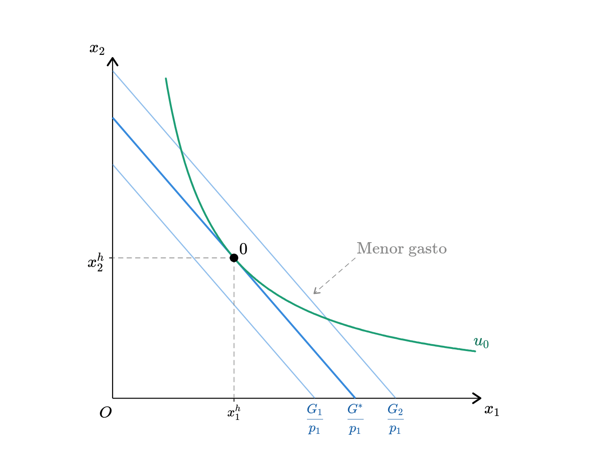
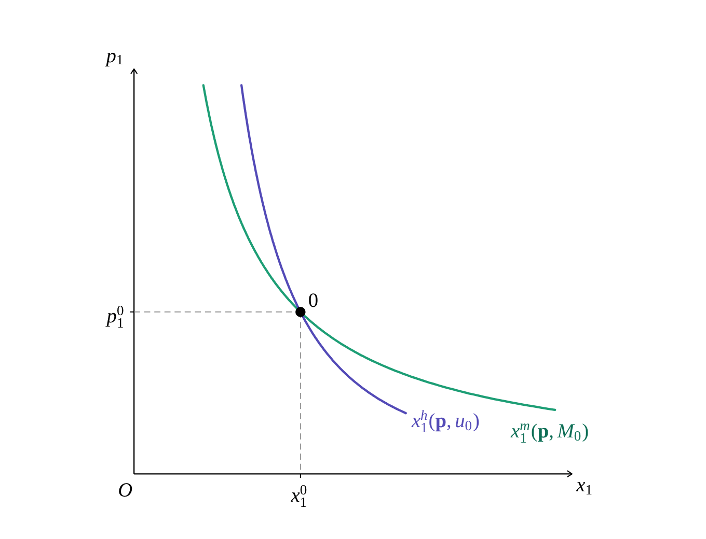
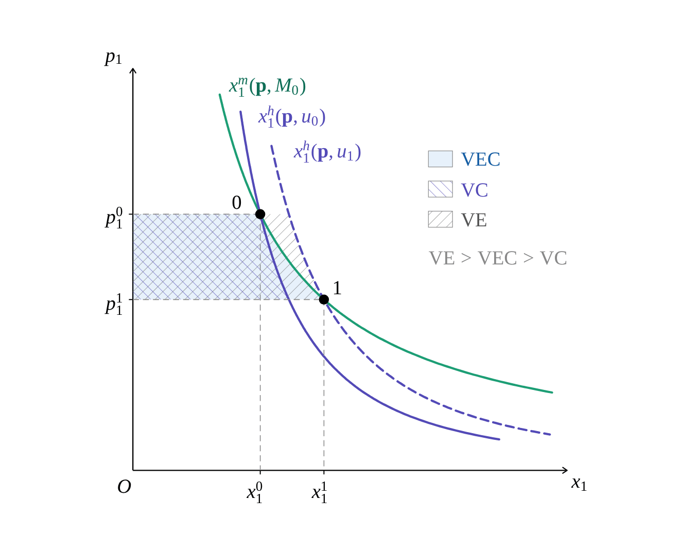

## Introducción

::: {.callout-note appearance="simple" icon=false}

:::

La teoría neoclásica de la demanda del consumidor (tema [A08](a08-consumidor.qmd)) plantea la elección como el **problema primal**, la maximización de la utilidad sujeta a la restricción presupuestaria. El mismo equilibrio puede alcanzarse también “dándole la vuelta” al problema, minimizando el gasto necesario para alcanzar un nivel de utilidad dado, lo que constituye el **problema dual**. La **dualidad** es el conjunto de relaciones entre ambos problemas, sus soluciones (demandas marshalliana y hicksiana) y sus funciones de valor (función indirecta de utilidad y función de gasto).

Su interés es doble. Analíticamente, basta con resolver uno de los dos problemas para obtener todas las funciones del otro, y el dual es a menudo más sencillo. Teóricamente, la dualidad proporciona la derivación formal de la ecuación de Slutsky y resuelve el problema de la **integrabilidad** (si de unas demandas observadas pueden recuperarse unas preferencias). Además, fundamenta los sistemas de demanda con los que se estima empíricamente la teoría y proporciona las medidas monetarias del bienestar (variaciones compensatoria y equivalente, números índice) con las que se evalúan los cambios de precios y las políticas.

La **identidad de Roy** permite obtener las demandas marshallianas a partir de la función indirecta de utilidad, y el **lema de Shephard**, las hicksianas a partir de la función de gasto, sin resolver de nuevo ningún problema de optimización. El mismo razonamiento se aplica a la empresa, cuya función de costes resume la tecnología (tema [A12](a12-costes.qmd)).

En la práctica, el sistema de demanda casi ideal de Deaton y Muellbauer (1980), que se deriva de una función de gasto, se estima con encuestas de presupuestos familiares para conocer cómo responden los hogares a los precios y a la renta. Las variaciones compensatoria y equivalente miden el coste de bienestar de una subida de precios o de impuestos, y los números índice de precios, con el índice de precios de consumo a la cabeza, aproximan el coste de la vida con el mismo aparato.

El tema estudia el análisis dual y sus aplicaciones en tres pasos:

- *Problema primal*: se desarrolla junto con sus dos productos, la función de demanda marshalliana y la función indirecta de utilidad.

- *Problema dual*: en paralelo, se desarrolla y se compara con el primal mediante las relaciones de dualidad.

- *Extensiones y aplicaciones*: se presentan las implicaciones teóricas, los sistemas de demanda empíricos y las medidas de cambio de bienestar.

## 1. Fundamentos del análisis dual: el problema primal

La teoría neoclásica trata al consumidor como un agente racional que persigue la mayor utilidad que le permite su renta disponible, una variable exógena. El marco es estático y de certidumbre, y la utilidad nace de comprar bienes de consumo final.

::: {.callout-note appearance="simple" icon=false}
Los axiomas de las preferencias, la función de utilidad, las curvas de indiferencia y la restricción presupuestaria se desarrollan en el tema [A08](a08-consumidor.qmd). Aquí se retoma el problema primal con el detalle necesario para que el problema dual de la sección 2 pueda presentarse como su imagen especular.
:::

### 1.1. El problema primal: maximización de la utilidad

Dados precios y renta, exógenos, el consumidor elige en el conjunto asequible $\text{CA} = \{\mathbf{x} \in \mathbb{R}^n_+ : \mathbf{p} \cdot \mathbf{x} \leq M_0\}$[^a09-1] la cesta de máxima utilidad.

**Planteamiento**: el consumidor maximiza su utilidad sujeto a la restricción presupuestaria:

$$\max_{\mathbf{x}} \; u(\mathbf{x}) \quad \text{s.a.:} \begin{cases} \sum p_i x_i \leq M_0 \\ x_i \geq 0 \; \forall i \end{cases}$$

donde $u$ es la función de utilidad, $\mathbf{x}$ la cesta, $p_i$ los precios y $M_0$ la renta. El lagrangiano es

$$\mathcal{L} = u(\mathbf{x}) + \lambda\left(M_0 - \sum p_i x_i\right)$$

**CPO**: con preferencias monótonas y solución interior, el consumidor agota su renta y la condición de primer orden es la tangencia entre curva de indiferencia y recta de balance, $\text{RMS}_{ji} \equiv \frac{\partial u/\partial x_i}{\partial u/\partial x_j} = \frac{p_i}{p_j}$ para cada par de bienes $i$, $j$. La tasa subjetiva de intercambio iguala así al precio relativo (o, lo que es lo mismo, $\frac{\partial u/\partial x_i}{p_i} = \lambda$ en todos los bienes, la utilidad marginal de la renta).

**CSO**: con utilidad estrictamente cuasicóncava (curvas de indiferencia estrictamente convexas), la tangencia es el máximo y la solución es única.

**Solución**: se obtienen las demandas marshallianas, $x_i^m = d_i(\mathbf{p}, M)$.

**Función de valor óptimo**: se obtiene la función indirecta de utilidad, $v(\mathbf{p}, M) = u(\mathbf{d}(\mathbf{p}, M))$.

::: {.callout-note appearance="simple" icon=false}
El lagrangiano y el precio sombra de la renta, las soluciones interior y de esquina (Kuhn-Tucker), la CSO y el desarrollo gráfico se encuentran en el tema [A08](a08-consumidor.qmd), apartado 1.4.1.
:::

### 1.2. Función de demanda del problema primal: función de demanda marshalliana

**Definición**: resolviendo las CPO y la restricción para cualesquiera precios y renta se obtienen las demandas ordinarias, marshallianas o walrasianas:

$$x_i^m \equiv x_i^* = d_i(\mathbf{p}, M)$$

donde $d_i$ es la función de demanda marshalliana del bien $i$. Las demandas marshallianas son funciones *ordinarias* o no compensadas, ya que, ante una variación de los precios, la renta monetaria permanece fija y la utilidad alcanzada cambia.

**Propiedades**:

1. *Continuidad y diferenciabilidad*: son continuas en precios y renta (teorema del máximo) y diferenciables si $u$ es $C^2$ con curvas de indiferencia de curvatura estrictamente positiva (hessiano orlado no singular), lo que permite el análisis de estática comparativa.

2. *Transformaciones*: son homogéneas de grado cero en precios y renta, $d_i(k\mathbf{p}, kM) = d_i(\mathbf{p}, M)$ (ausencia de ilusión monetaria), e invariantes ante transformaciones monótonas crecientes de $u$, pues dependen de las preferencias y no de su representación.

3. *Inclinación*: en el precio propio, pendiente indeterminada, pues recogen efecto renta y efecto sustitución (negativa salvo para bienes Giffen). En la renta, son crecientes para bienes normales y decrecientes para bienes inferiores.

4. *Forma*: la teoría no restringe su curvatura respecto al precio. La restricción de segundo orden recae sobre la matriz de Slutsky, que reúne sus pendientes compensadas y es simétrica y semidefinida negativa (apartado 3.1.2).

5. *Otras propiedades*:

    - *Agotamiento de la renta*: cumplen la ley de Walras, $\sum_i p_i d_i(\mathbf{p}, M) = M$.

    - *Envolvente* (*identidad de Roy*): son el cociente, cambiado de signo, de las derivadas de la función indirecta de utilidad respecto al precio y a la renta, $d_i = -(\partial v/\partial p_i)/(\partial v/\partial M)$.

    - *Dualidad*: coinciden con las hicksianas evaluadas en la utilidad máxima, $d_i(\mathbf{p}, M) = h_i(\mathbf{p}, v(\mathbf{p}, M))$ (apartado 2.4.2).

    - *Integrabilidad*: de ellas pueden recuperarse la función de gasto y las preferencias si cumplen las condiciones del teorema de la integrabilidad (apartado 3.1.3).

    - *Observabilidad*: son estimables a partir de datos de precios, rentas y cantidades.

::: {.callout-note appearance="simple" icon=false}
La derivación y las propiedades de la demanda marshalliana se encuentran en el tema [A08](a08-consumidor.qmd), apartado 1.4.2.
:::

### 1.3. Función de valor óptimo del problema primal: función indirecta de utilidad

**Definición**: la *función indirecta de utilidad* (FIU) es la utilidad máxima alcanzable para cada par de precios y renta. Se obtiene sustituyendo las demandas marshallianas en la función objetivo:

$$v(\mathbf{p}, M) = u(\mathbf{d}(\mathbf{p}, M)) = \max_{\mathbf{x}} \; u(\mathbf{x}) \quad \text{s.a.:} \; \mathbf{p} \cdot \mathbf{x} = M$$

donde $v$ es la FIU y $\mathbf{d}(\mathbf{p}, M)$ el vector de demandas marshallianas, de modo que la utilidad depende indirectamente de precios y renta.

**Propiedades**:

1. *Continuidad y diferenciabilidad*: es continua en precios y renta (teorema del máximo) y diferenciable cuando lo son las demandas, lo que permite aplicar el teorema de la envolvente.

2. *Transformaciones*: es homogénea de grado cero en precios y renta, $v(k\mathbf{p}, kM) = v(\mathbf{p}, M)$ (ausencia de ilusión monetaria). Además, como la utilidad es ordinal, toda transformación monótona creciente de $v$ es también una FIU de las mismas preferencias, lo que permite una representación monetaria (apartado 3.3.1).

3. *Inclinación*: estrictamente creciente en renta, $\partial v/\partial M = \lambda > 0$ (por la monotonía de las preferencias), y no creciente en precios, $\partial v/\partial p_i = -\lambda x_i \leq 0$.

4. *Forma*: cuasiconvexa en precios, es decir, un vector de precios promedio de dos situaciones no es mejor que al menos una de ellas.

5. *Otras propiedades*:

    - *Envolvente* (*identidad de Roy*): sus derivadas son $\partial v/\partial p_i = -\lambda x_i^*$ y $\partial v/\partial M = \lambda$, cuyo cociente recupera la demanda marshalliana (Roy, 1942), $d_i(\mathbf{p}, M) = -\dfrac{\partial v / \partial p_i}{\partial v / \partial M}$.

    - *Dualidad*: evaluada en el gasto mínimo, devuelve la utilidad exigida, $v(\mathbf{p}, e(\mathbf{p}, u_0)) = u_0$, de modo que invirtiendo $v$ respecto a la renta se obtiene la función de gasto (apartado 2.4.3).

    - *Observabilidad*: no es observable, pues la utilidad no lo es.

::: {.callout-note appearance="simple" icon=false}
La función indirecta de utilidad se introduce en el tema [A08](a08-consumidor.qmd), apartado 1.4.3. Sus propiedades se desarrollan aquí porque son el insumo de la dualidad de la sección 2.
:::

### 1.4. Conclusiones

El problema primal elige, con precios y renta dados, la cesta asequible de máxima utilidad. Con preferencias monótonas y solución interior, el consumidor agota su renta e iguala la relación marginal de sustitución al precio relativo, con una misma utilidad marginal por euro en todos los bienes, igual a $\lambda$, la utilidad marginal de la renta. La cuasiconcavidad estricta asegura que esa tangencia es un máximo único. Resuelta para cualesquiera precios y renta, la elección da las demandas marshallianas, observables y homogéneas de grado cero en precios y renta, cuya pendiente en el precio propio es indeterminada porque suma el efecto renta y el efecto sustitución.

La función indirecta de utilidad mide, en cambio, la utilidad máxima alcanzable, que no es observable. Sus derivadas respecto a un precio y a la renta devuelven las demandas marshallianas por la identidad de Roy, y su inversión respecto a la renta conduce a la función de gasto. Ese paso abre el problema dual de la sección 2, que intercambia los papeles de la renta y de la utilidad.

## 2. Análisis de dualidad

Esta sección desarrolla el problema dual con la misma estructura que el primal (problema, función de demanda y función de valor) y compara después ambos problemas.

### 2.1. El problema dual: minimización del gasto

El problema dual invierte los papeles de la función objetivo y de la restricción del primal. Dados los precios y un nivel de utilidad exigido, el consumidor busca la cesta que lo alcanza con el mínimo gasto. De este modo, la renta deja de ser un dato y pasa a ser el resultado del problema, y la utilidad deja de ser el resultado y pasa a ser el dato. El primer producto del problema dual es la misma cesta óptima que la del primal. Al generalizar para cualesquiera precios y utilidad, se obtienen además la función de demanda hicksiana y la función de gasto.

**Planteamiento**: suponiendo solución interior, el programa es:

$$\min_{\mathbf{x}} \; G = \mathbf{p} \cdot \mathbf{x} \quad \text{s.a.:} \begin{cases} u(\mathbf{x}) \geq u_0 \\ x_i \geq 0 \; \forall i \end{cases}$$

donde $G$ es el gasto, $\mathbf{p}$ el vector de precios, $\mathbf{x}$ la cesta y $u_0$ el nivel de utilidad exigido. El lagrangiano es:

$$\mathcal{L} = \mathbf{p} \cdot \mathbf{x} + \mu \left(u_0 - u(\mathbf{x}) \right)$$

donde el multiplicador $\mu = 1/\lambda$ es el coste marginal de la utilidad, $\mu = \partial G^*/\partial u$, es decir, el gasto adicional necesario para obtener una unidad más de utilidad. Este multiplicador es el precio sombra de la utilidad, simétrico del precio sombra de la renta del primal.

**CPO** (condiciones de primer orden), con solución interior y la restricción agotada:

$$\frac{\partial \mathcal{L}}{\partial \mu} = u_0 - u(\mathbf{x}^*) = 0 \;\Rightarrow\; u(\mathbf{x}^*) = u_0 \tag{1}$$

$$\frac{\partial \mathcal{L}}{\partial x_i} = p_i - \mu \frac{\partial u(\mathbf{x}^*)}{\partial x_i} = 0 \;\Rightarrow\; \frac{\partial u}{\partial x_i} = \frac{p_i}{\mu} \;\Rightarrow\; \text{RMS}_{ji} = \frac{\partial u/\partial x_i}{\partial u/\partial x_j} = \frac{p_i}{p_j} \tag{2}$$

La intuición es simétrica a la del primal, en el sentido de que (1) el consumidor alcanza exactamente la utilidad exigida, sin exceso, y (2) iguala el precio de cada bien a su utilidad marginal valorada al coste marginal de la utilidad. Del cumplimiento de las CPO se obtiene la misma condición de tangencia que en el primal, $\text{RMS}_{ji} = p_i/p_j$, propia de una solución interior[^a09-4].

**CSO** (condiciones de segundo orden): la tangencia es un mínimo si el conjunto de cestas que alcanzan $u_0$ es convexo, es decir, si la función de utilidad es cuasicóncava. La condición sobre las preferencias es la misma que en el primal, pues ahora el conjunto de contorno superior de $u$ actúa de restricción.

**Solución**: se obtienen las demandas hicksianas, $x_i^h = h_i(\mathbf{p}, u_0)$.

**Desarrollo gráfico**: la minimización del gasto se representa en el plano $(x_1, x_2)$ (figura -@fig-a091-equilibrio-dual):

1. *Curva de indiferencia objetivo* ($u_0$): es ahora la restricción. Permanece fija y el consumidor se desplaza sobre ella buscando la isogasto más cercana al origen.

2. *Rectas isogasto*: cada una es el lugar geométrico de las cestas que suponen un mismo gasto $G$ dados unos precios $\mathbf{p}$. Su pendiente es también $-p_1/p_2$ y cortan el eje horizontal en $G/p_1$, de modo que el gasto disminuye al acercarse al origen.

3. *Equilibrio*: en el punto 0, de tangencia entre la curva de indiferencia objetivo y la isogasto más baja compatible con ella, $G^*$, se elige la cesta $(x_1^h, x_2^h)$. En cambio, la isogasto $G_1$ no alcanza $u_0$, y la $G_2$ la alcanza con un gasto mayor.

::: {#fig-a091-equilibrio-dual}

::: {.content-visible when-format="html"}
```{=html}
<div class="graph-frame">
<iframe src="../graphs/a091_Equilibrio_dual.html" style="height:560px" loading="lazy" title="fig-a091-equilibrio-dual"></iframe>
</div>
```
:::

::: {.content-visible unless-format="html"}

:::

El problema dual. Consiste en minimizar el gasto necesario para alcanzar un nivel de utilidad dado. La solución se sitúa en la tangencia entre la curva $u_0$ y la recta isogasto más baja compatible con ella.
:::

**Función de valor óptimo**: se obtiene la función de gasto, $e(\mathbf{p}, u_0) = \mathbf{p} \cdot \mathbf{h}(\mathbf{p}, u_0)$.

### 2.2. Función de demanda del problema dual: función de demanda hicksiana

**Definición**: resolviendo el sistema formado por las CPO y la restricción de utilidad y generalizando para cualesquiera precios y utilidad, se obtienen las *funciones de demanda hicksianas*. Expresan la cantidad óptima demandada de cada bien como función de los precios y de la utilidad exigida, es decir, la cesta que permite alcanzar un nivel de utilidad dado con el mínimo gasto:

$$x_i^h \equiv x_i^* = h_i(\mathbf{p}, u_0)$$

donde $h_i$ es la función de demanda hicksiana del bien $i$. Las demandas hicksianas son funciones *compensadas*, ya que, para garantizar que se alcanza el nivel de utilidad exigido, ante una variación de los precios el gasto no permanece fijo, sino que se reajusta. Mantienen así constante la renta real en el sentido de Hicks mediante una compensación hipotética de renta.

**Propiedades**:

1. *Continuidad y diferenciabilidad*: son continuas en precios y utilidad (teorema del máximo) y diferenciables bajo los supuestos habituales, lo que permite el análisis de estática comparativa.

2. *Transformaciones*: son homogéneas de grado cero en precios, $h_i(k\mathbf{p}, u_0) = h_i(\mathbf{p}, u_0)$, de modo que, ante un aumento equiproporcional de los precios, el gasto monetario sube en la misma proporción, pero la cesta no cambia (ausencia de ilusión monetaria).

3. *Inclinación*: al ser compensadas solo recogen el efecto sustitución, por lo que son siempre no crecientes en el precio propio (ley de la demanda compensada) y no admiten bienes Giffen. Además, para un bien normal son más inclinadas (menos elásticas) que las marshallianas, pues no incorporan el efecto renta.

4. *Forma*: la teoría tampoco restringe su curvatura respecto al precio. La restricción de segundo orden recae sobre la función de gasto, cóncava en precios. Como las pendientes de las demandas hicksianas son las segundas derivadas de esa función, forman una matriz simétrica que la concavidad hace semidefinida negativa (apartado 3.1.2).

5. *Otras propiedades*:

    - *No exceso de utilidad*: se alcanza exactamente el nivel de utilidad exigido, $u(\mathbf{h}(\mathbf{p}, u_0)) = u_0$, y no más.

    - *Envolvente* (*lema de Shephard*): son el gradiente de la función de gasto, $h_i = \partial e/\partial p_i$.

    - *Dualidad*: coinciden con las marshallianas evaluadas en el gasto mínimo, $h_i(\mathbf{p}, u_0) = d_i(\mathbf{p}, e(\mathbf{p}, u_0))$.

    - *Integrabilidad*: la función de gasto se recupera integrándolas cuando la matriz de sustitución es simétrica y semidefinida negativa (apartado 3.1.3).

    - *Observabilidad*: no son directamente observables, pues la utilidad no lo es[^a09-6]. Son, por ello, una construcción teórica que solo puede recuperarse indirectamente a partir de las demandas marshallianas mediante la dualidad.

### 2.3. Función de valor óptimo del problema dual: función de gasto

**Definición**: la función de valor óptimo del problema dual se construye sustituyendo el vector de demandas hicksianas $\mathbf{x}^* = \mathbf{h}(\mathbf{p}, u_0)$ en la función objetivo $\mathbf{p} \cdot \mathbf{x}$, y se denomina *función de gasto* (FG):

$$G^* = e(\mathbf{p}, u_0) = \mathbf{p} \cdot \mathbf{h}(\mathbf{p}, u_0) = \min_{\mathbf{x}} \; \mathbf{p} \cdot \mathbf{x} \quad \text{s.a.:} \; u(\mathbf{x}) = u_0$$

donde $e$ es la función de gasto y $\mathbf{h}$ el vector de demandas hicksianas. Da el mínimo gasto necesario para cada vector de precios y nivel de utilidad exigido, sin necesidad de repetir el problema. Sus propiedades son análogas a las de la función de costes en la teoría de la producción (tema [A12](a12-costes.qmd)).

**Propiedades**:

1. *Continuidad y diferenciabilidad*: es continua en precios y utilidad y diferenciable en precios, lo que permite aplicar el teorema de la envolvente.

2. *Transformaciones*: es homogénea de grado uno en precios, $e(k\mathbf{p}, u_0) = k \cdot e(\mathbf{p}, u_0)$, es decir, un cambio equiproporcional en los precios deja inalterada la cesta elegida, pero multiplica el gasto en la misma proporción.

3. *Inclinación*: estrictamente creciente en utilidad, $\partial e/\partial u = \mu > 0$ (una mayor utilidad exige siempre más gasto), y no decreciente en precios, $\partial e/\partial p_i = h_i \geq 0$ (un aumento de los precios nunca reduce el gasto mínimo).

4. *Forma*: es cóncava en precios para un nivel de utilidad dado, $\partial^2 e/\partial p_i^2 \leq 0$, es decir, los aumentos de un precio elevan el gasto mínimo menos de lo que lo harían si la cesta se mantuviese fija, gracias a la posibilidad de sustituir entre bienes. De ahí que la matriz de Slutsky sea semidefinida negativa (apartado 3.1.2). La concavidad implica que el consumo compensado del bien encarecido no aumenta, pero no que aumente el de todos los demás, porque algunos pueden ser complementarios netos del bien encarecido y reducirse también, mientras la sustitución se dirige hacia otros. Si sube la electricidad, por ejemplo, se sustituye por gas, pero puede caer la compra de electrodomésticos eléctricos, complementarios netos de ella.

5. *Otras propiedades*:

    - *Envolvente* (*lema de Shephard*): la derivada de la función de gasto respecto a un precio es la demanda hicksiana (Shephard, 1953), $\dfrac{\partial e(\mathbf{p}, u_0)}{\partial p_i} = \dfrac{\partial \mathcal{L}}{\partial p_i} = x_i^h \equiv x_i^* = h_i(\mathbf{p}, u_0)$. Así, al subir marginalmente un precio, el gasto mínimo aumenta en la cantidad que se consumía de ese bien, porque el reajuste de la cesta es de segundo orden. El lema, con el que se deriva la ecuación de Slutsky (apartado 3.1.1), es el análogo de la identidad de Roy en el problema dual, pero más simple, porque la función objetivo ya está en dinero y no hay multiplicador que eliminar.

    - *Dualidad*: evaluada en la utilidad máxima que permite una renta, devuelve esa renta, $e(\mathbf{p}, v(\mathbf{p}, M)) = M$, de modo que es la inversa de la FIU respecto a su segundo argumento.

    - *Integrabilidad*: recíprocamente, toda función continua, homogénea de grado uno, no decreciente y cóncava en precios (y estrictamente creciente en la utilidad) es la función de gasto de unas preferencias de buen comportamiento, lo que permite resolver el problema de la integrabilidad (apartado 3.1.3).

    - *Observabilidad*: no es observable directamente, pero al estar medida en unidades monetarias es la base de las medidas del bienestar (apartado 3.3).

::: {.callout-tip collapse="true" appearance="simple" title="Ejemplo: función de gasto y lema de Shephard con una función Cobb-Douglas"}
Sea $u = x_1^{1/2} x_2^{1/2}$. La tangencia del dual, $\text{RMS}_{21} = x_2/x_1 = p_1/p_2$, implica $p_1 x_1 = p_2 x_2$, es decir, el gasto se reparte a partes iguales, $p_1 x_1 = p_2 x_2 = G^*/2$. Sustituyendo en la restricción de utilidad y despejando el gasto mínimo:

$$u_0 = \left(\frac{G^*}{2p_1}\right)^{1/2}\left(\frac{G^*}{2p_2}\right)^{1/2} = \frac{G^*}{2p_1^{1/2}p_2^{1/2}} \quad \rightarrow \quad e(\mathbf{p}, u_0) = 2u_0\, p_1^{1/2} p_2^{1/2}$$

Es homogénea de grado uno en precios, creciente en la utilidad ($\mu = \partial e/\partial u = 2p_1^{1/2}p_2^{1/2} = 1/\lambda$) y la inversa de la FIU $v = M/(2p_1^{1/2}p_2^{1/2})$ respecto a su segundo argumento. Por el lema de Shephard:

$$x_1^h = \frac{\partial e}{\partial p_1} = u_0\left(\frac{p_2}{p_1}\right)^{1/2}, \qquad x_2^h = \frac{\partial e}{\partial p_2} = u_0\left(\frac{p_1}{p_2}\right)^{1/2}$$

que coinciden con la hicksiana que se obtiene por otra vía en el apartado 2.4.2. Además, $\partial^2 e/\partial p_1^2 = \partial x_1^h/\partial p_1 = -\tfrac{1}{2}u_0\, p_2^{1/2} p_1^{-3/2} < 0$. La concavidad de $e$ en precios es, así, la pendiente negativa de la demanda compensada.
:::

### 2.4. Comparativa: relaciones de dualidad y pendientes

Entre los problemas de maximización de utilidad (PMU) y de minimización del gasto (PMG) se dan tres relaciones de dualidad, pues ambos problemas tienen los mismos componentes. A ellas se añade la comparación de las pendientes de las curvas de demanda que generan.

#### 2.4.1. Dualidad entre soluciones: teorema básico de la dualidad

Las soluciones numéricas o cestas de consumo óptimas de ambos problemas son idénticas, siempre que se realice el debido intercambio de información entre problemas:

1. *Del primal al dual*: si la cesta $\mathbf{x}^*$ es la solución óptima al primal con un nivel de renta fijo $M_0$, $\mathbf{x}^*$ también es solución óptima en el dual. La condición es que el nivel de utilidad requerida en el dual sea el obtenido en el primal, es decir, $u_0 = u(\mathbf{x}^*) = v(\mathbf{p}, M_0)$. Corolario: $G^* = M_0$.

2. *Del dual al primal*: si la cesta $\mathbf{x}^*$ es solución óptima del dual cuando la utilidad requerida es $u_0$, entonces $\mathbf{x}^*$ es solución óptima en el primal. La condición es que la renta sea el nivel de gasto incurrido en la solución del PMG, es decir, $M_0 = \mathbf{p} \cdot \mathbf{x}^* = e(\mathbf{p}, u_0)$. Corolario: $u^* = u_0$.

Este resultado se refiere exclusivamente a las cestas (cantidades) óptimas, pues las funciones de demanda marshallianas y las hicksianas son objetos distintos (dependen de distintas variables).

#### 2.4.2. Dualidad entre funciones de demanda

Hallada la función de demanda de uno de los problemas, la del otro se obtiene con la función de valor óptimo de este último:

$$d_i(\mathbf{p}, M) = h_i(\mathbf{p}, v(\mathbf{p}, M))$$

$$h_i(\mathbf{p}, u_0) = d_i(\mathbf{p}, e(\mathbf{p}, u_0))$$

donde la primera identidad evalúa la demanda hicksiana en la utilidad máxima del primal y la segunda la marshalliana en el gasto mínimo del dual. La demanda marshalliana se obtiene de la hicksiana y la FIU, y la hicksiana, de la marshalliana y la FG. Esta relación es la extensión natural del teorema básico de dualidad al ámbito de las funciones de demanda.

::: {.callout-tip collapse="true" appearance="simple" title="Ejemplo: de la demanda marshalliana a la hicksiana (Cobb-Douglas)"}
Con $u = x_1^{1/2} x_2^{1/2}$, si se parte de la FIU $v = \frac{M}{2 p_1^{1/2} p_2^{1/2}}$ y la demanda marshalliana $x_1^m = \frac{M}{2p_1}$, basta con despejar $M$ en la FIU y sustituir:

$$x_1^h = \frac{1}{2 p_1} \cdot 2 u_0 \, p_1^{1/2} p_2^{1/2} = u_0 \left( \frac{p_2}{p_1} \right)^{1/2}$$
:::

#### 2.4.3. Dualidad entre funciones de valor óptimo: inversión

Hallada la función de valor óptimo de uno de los problemas, la del otro se obtiene sin resolverlo, porque la FIU es la inversa de la FG respecto a su segundo argumento (o viceversa) bajo condiciones muy generales:

$$e(\mathbf{p}, v(\mathbf{p}, M)) = M \quad \rightarrow \quad v(\mathbf{p}, M) = e^{-1}(\mathbf{p}, M)$$

$$v(\mathbf{p}, e(\mathbf{p}, u_0)) = u_0 \quad \rightarrow \quad e(\mathbf{p}, u_0) = v^{-1}(\mathbf{p}, u_0)$$

#### 2.4.4. Comparativa de las pendientes de las curvas de demanda

La demanda marshalliana recoge el efecto total de una variación del precio, suma del efecto sustitución y del efecto renta, mientras que la hicksiana solo recoge el efecto sustitución. La diferencia entre ambas pendientes respecto al precio propio es, por tanto, el efecto renta, cuyo signo depende del tipo de bien. En elasticidades, que es la forma en que la comparación se lleva a los datos:

$$\varepsilon_{ii}^m = \varepsilon_{ii}^c - s_i \, \varepsilon_{iM}$$

donde $\varepsilon_{ii}^m$ es la elasticidad-precio marshalliana, $\varepsilon_{ii}^c$ la compensada, $s_i$ la participación del bien en el gasto y $\varepsilon_{iM}$ su elasticidad-renta. Para un bien normal ($\varepsilon_{iM} > 0$) la marshalliana es más elástica que la hicksiana, y para un bien inferior no Giffen, menos, mientras que para un bien frontera ($\varepsilon_{iM} = 0$) ambas coinciden. La expresión se deriva formalmente en el apartado 3.1.1.

**Desarrollo gráfico**: en el plano $(x_1, p_1)$ (figura -@fig-a092-demandas-marshall-hicks) se proyectan los equilibrios del plano de bienes, donde la recta de balance del primal se corresponde con la recta isogasto del dual y la curva de indiferencia es la misma en ambos problemas:

1. *Demanda marshalliana*, $x_1^m(\mathbf{p}, M_0)$: en el primal, la curva de indiferencia alcanzada se desplaza ante variaciones de precios y renta. Así, ante una bajada del precio, la demanda añade al movimiento a lo largo de la curva de indiferencia el salto a una curva superior, y recoge el efecto total del precio con la renta monetaria constante.

2. *Demanda hicksiana*, $x_1^h(\mathbf{p}, u_0)$: en el dual, la curva de indiferencia permanece fija y la demanda solo recoge el movimiento a lo largo de ella. Por eso, para un bien normal es más inclinada (menos elástica) que la marshalliana.

3. *Punto de corte*: ambas curvas se cortan en el punto 0, al precio inicial $p_1^0$, porque allí la utilidad exigida en el dual, $u_0$, es la máxima que permite la renta $M_0$ en el primal.

::: {#fig-a092-demandas-marshall-hicks}

::: {.content-visible when-format="html"}
```{=html}
<div class="graph-frame">
<iframe src="../graphs/a092_Demandas_Marshall_Hicks.html" style="height:560px" loading="lazy" title="fig-a092-demandas-marshall-hicks"></iframe>
</div>
```
:::

::: {.content-visible unless-format="html"}

:::

Demanda marshalliana y demanda hicksiana. Ante una bajada del precio, la demanda compensada recoge solo el efecto sustitución, por lo que es menos elástica para un bien normal.
:::

### 2.5. Conclusiones

El problema dual invierte los papeles del primal al fijar la utilidad y minimizar el gasto necesario para alcanzarla. Su multiplicador, $\mu = 1/\lambda$, es el coste marginal de la utilidad, y su solución coincide con la del primal cuando la utilidad exigida es la máxima de este. Las demandas hicksianas, compensadas, solo recogen el efecto sustitución, por lo que nunca crecen con el precio propio y excluyen los bienes Giffen, pero no son directamente observables. La función de gasto, homogénea de grado uno y cóncava en precios, reúne esa información, porque sus derivadas son las demandas hicksianas (lema de Shephard).

Las relaciones de dualidad enlazan los dos problemas en sus soluciones, sus demandas y sus funciones de valor, de modo que basta resolver uno para obtener todas las funciones del otro. La comparación de pendientes añade que las dos demandas difieren en el efecto renta. De esas identidades se deducen, en la sección 3, la ecuación de Slutsky y el teorema de la integrabilidad, y la función de gasto, medida en dinero, sirve allí de métrica del bienestar. La tabla -@tbl-a09-primal-dual resume las cuatro funciones y sus relaciones.

| | Problema primal (PMU) | Problema dual (PMG) |
|:--|:--|:--|
| Programa | $\max u(\mathbf{x})$ s.a.: $\mathbf{p} \cdot \mathbf{x} \leq M_0$ | $\min \mathbf{p} \cdot \mathbf{x}$ s.a.: $u(\mathbf{x}) \geq u_0$ |
| Dato / resultado | Renta dada, utilidad resultante | Utilidad dada, gasto resultante |
| Multiplicador | $\lambda = \partial v/\partial M$ (utilidad marginal de la renta) | $\mu = 1/\lambda = \partial e/\partial u$ (coste marginal de la utilidad) |
| Función de demanda | Marshalliana, $d_i(\mathbf{p}, M)$: observable, homogénea de grado 0 en $(\mathbf{p}, M)$, cualquier pendiente, agota la renta (ley de Walras) | Hicksiana, $h_i(\mathbf{p}, u_0)$: no observable, homogénea de grado 0 en $\mathbf{p}$, no creciente en el precio propio, alcanza exactamente $u_0$ |
| Función de valor | Indirecta de utilidad, $v(\mathbf{p}, M)$: cuasiconvexa en $\mathbf{p}$ | De gasto, $e(\mathbf{p}, u_0)$: cóncava y homogénea de grado 1 en $\mathbf{p}$ |
| Teorema de la envolvente | Identidad de Roy: $d_i = -(\partial v/\partial p_i)/(\partial v/\partial M)$ | Lema de Shephard: $h_i = \partial e/\partial p_i$ |
| Relaciones de dualidad | $d_i(\mathbf{p}, M) = h_i(\mathbf{p}, v(\mathbf{p}, M))$; $e(\mathbf{p}, v(\mathbf{p}, M)) = M$ | $h_i(\mathbf{p}, u_0) = d_i(\mathbf{p}, e(\mathbf{p}, u_0))$; $v(\mathbf{p}, e(\mathbf{p}, u_0)) = u_0$ |

: Problema primal y problema dual: funciones y relaciones. {#tbl-a09-primal-dual .table-sm}

## 3. Extensiones y aplicaciones

Conocidas las herramientas, puede pasarse a sus extensiones y aplicaciones: las implicaciones teóricas (la derivación formal de la ecuación de Slutsky y la resolución del problema de la integrabilidad), los sistemas de demanda que se estiman empíricamente y las medidas de cambio de bienestar.

### 3.1. Implicaciones teóricas: ecuación de Slutsky e integrabilidad

La dualidad tiene dos implicaciones teóricas en direcciones opuestas:

1. *Hacia delante* (de las preferencias a la conducta): la ecuación de Slutsky, que descompone formalmente el efecto de un precio sobre la demanda observable. 

2. *Hacia atrás* (de la conducta a las preferencias): el teorema de la integrabilidad, que dice qué condiciones debe cumplir una demanda observada para proceder de unas preferencias racionales.

#### 3.1.1. Ecuación de Slutsky: derivación formal

La **ecuación de Slutsky** descompone el efecto de una variación *ceteris paribus* del precio $p_j$ sobre la demanda marshalliana del bien $i$ en un efecto sustitución, a utilidad constante, y un efecto renta. La dualidad entre funciones de demanda permite derivarla en tres pasos:

1. *Dualidad entre funciones de demanda*: se parte de la identidad que iguala la demanda hicksiana y la marshalliana evaluada en el gasto mínimo, $h_i(\mathbf{p}, u_0) = d_i(\mathbf{p}, e(\mathbf{p}, u_0))$.

2. *Regla de la cadena*: derivando la función de demanda hicksiana respecto a uno de los precios se obtiene la ecuación de Slutsky expresada en términos del gasto:

    $$\frac{\partial h_i}{\partial p_j} = \frac{\partial x_i^m}{\partial p_j} + \frac{\partial x_i^m}{\partial e} \cdot \frac{\partial e}{\partial p_j}$$

3. *Lema de Shephard*: sustituyendo $\frac{\partial e}{\partial p_j} = h_j(\mathbf{p}, u_0) = x_j^*$ y, por dualidad, teniendo en cuenta que en el óptimo $M = G^*$, se llega a la formulación habitual:

    $$\frac{\partial x_i^m}{\partial p_j} = \frac{\partial h_i}{\partial p_j} - \frac{\partial x_i^m}{\partial M} \cdot x_j$$

    donde $x_i^m$ es la demanda marshalliana, $h_i$ la hicksiana y $x_j$ la cantidad del bien cuyo precio varía.

El primer término del lado derecho representa el efecto sustitución y el segundo (incluido el signo negativo) representa el efecto renta. Su suma es el efecto total de una variación en el precio sobre la cantidad demandada del bien $i$.

**Ecuación de Slutsky en elasticidades**: como corolario de la derivación anterior, multiplicando ambos miembros por $p_j / x_i$ se obtiene:

$$\varepsilon_{ij}^m = \varepsilon_{ij}^c - s_j \cdot \varepsilon_{iM}$$

donde $\varepsilon_{ij}^m$ es la elasticidad marshalliana (no compensada), $\varepsilon_{ij}^c$ la elasticidad hicksiana (compensada), $\varepsilon_{iM}$ la elasticidad-renta y $s_j = \frac{p_j x_j}{M}$ la participación del bien $j$ en el gasto. Para $i = j$ es la expresión del apartado 2.4.4.

**Consecuencias**: el efecto sustitución (ES) queda definido formalmente por derivadas parciales de la demanda hicksiana, y el ES propio (ESP) es no positivo en todo caso, por la concavidad de la función de gasto. Por el contrario, el ES cruzado (ESC) tiene signo indeterminado y permite clasificar los bienes en complementarios netos ($\text{ESC} < 0$), sustitutivos netos ($\text{ESC} > 0$) e independientes ($\text{ESC} = 0$). Las clasificaciones por efectos totales (ordinarios, Giffen, rígidos; sustitutivos y complementarios brutos) se desarrollan en el tema [A08](a08-consumidor.qmd), apartado 2.2.3.

#### 3.1.2. Matriz de Slutsky: caso general

Si se considera un cambio simultáneo en varios precios, las derivadas parciales se ordenan en forma matricial, en la **matriz de Slutsky** o **matriz de efectos sustitución**. Esta matriz es la hessiana de la función de gasto, es decir, la de sus segundas derivadas respecto de todos los precios. Se obtiene en tres pasos:

1. *Primera derivada*: por el lema de Shephard, derivar la función de gasto respecto a cada precio da la demanda hicksiana: $\partial e(\mathbf{p}, u_0)/\partial p_i = h_i(\mathbf{p}, u_0)$.

2. *Segunda derivada*: derivando de nuevo respecto a cada precio $p_j$ se obtiene el efecto sustitución de $p_j$ sobre el bien $i$:

    $$\frac{\partial^2 e(\mathbf{p}, u_0)}{\partial p_i \, \partial p_j} = \frac{\partial h_i(\mathbf{p}, u_0)}{\partial p_j} \equiv S_{ij}$$

    donde $S_{ij}$ es el efecto sustitución propio si $i = j$ y cruzado si $i \neq j$, es decir, la pendiente de la demanda hicksiana del bien $i$ respecto al precio del bien $j$.

3. *Ordenación matricial*: ordenando los $n^2$ efectos en una matriz $n \times n$, con los propios en la diagonal y los cruzados fuera de ella, se obtiene la matriz de Slutsky, que para dos y para $n$ bienes es:

    $$\mathbf{S}_2 = \begin{pmatrix} \dfrac{\partial h_1}{\partial p_1} & \dfrac{\partial h_1}{\partial p_2} \\[2ex] \dfrac{\partial h_2}{\partial p_1} & \dfrac{\partial h_2}{\partial p_2} \end{pmatrix} \qquad \mathbf{S}_n = \begin{pmatrix} \dfrac{\partial h_1}{\partial p_1} & \cdots & \dfrac{\partial h_1}{\partial p_n} \\ \vdots & \ddots & \vdots \\ \dfrac{\partial h_n}{\partial p_1} & \cdots & \dfrac{\partial h_n}{\partial p_n} \end{pmatrix}$$

    donde $\mathbf{S}_n$ es la matriz hessiana de $e(\mathbf{p}, u_0)$ respecto a los precios, de modo que el efecto de cualquier vector de variaciones de precios sobre las demandas compensadas es $d\mathbf{h} = \mathbf{S}_n \, d\mathbf{p}$.

Por la ecuación de Slutsky, cada elemento puede calcularse a partir de magnitudes observables, $S_{ij} = \partial x_i^m/\partial p_j + (\partial x_i^m/\partial M)\,x_j$, lo que hace la matriz contrastable.

**Propiedades**: la matriz de Slutsky tiene dos propiedades de gran alcance:

1. *Simétrica*: los efectos precio-cruzados en las demandas hicksianas son idénticos ($\frac{\partial h_i}{\partial p_j} = \frac{\partial h_j}{\partial p_i}$)[^a09-9]. Esto no ocurre, en general, con las demandas ordinarias (sí, p. ej. con preferencias homotéticas). La implicación es que la clasificación de bienes en sustitutivos/complementarios netos es simétrica, pero las relaciones brutas no lo son, porque el efecto renta introduce asimetría (p. ej. Coca-Cola puede ser sustitutivo bruto de Pepsi pero no al revés). Además, por la homogeneidad de grado cero de las hicksianas ($\sum_j p_j S_{ij} = 0$), no todos los bienes pueden ser complementarios netos simultáneamente.

2. *Semidefinida negativa* (por la concavidad en precios de la FG): los efectos precio propios en demandas hicksianas son no positivos[^a09-10]. De ahí que las hicksianas cumplan la ley de demanda compensada (pendiente nunca positiva).

#### 3.1.3. Teorema de la integrabilidad (Antonelli, 1886)

La integrabilidad plantea el camino inverso al de la ecuación de Slutsky, porque lo único que se observa en los datos son las demandas marshallianas, no las preferencias que supuestamente las generan. 

La cuestión es si un sistema completo de ecuaciones de demanda marshalliana, estimado a partir de la conducta, es compatible con la existencia de unas preferencias de buen comportamiento y, en caso afirmativo, si estas pueden reconstruirse. Giovanni Battista Antonelli[^a09-11] planteó y resolvió este problema en 1886, y Hurwicz y Uzawa (1971) le dieron su formulación moderna.

**Teorema**: la solución pasa por la función de gasto, que contiene toda la información sobre las preferencias y cuyas derivadas son observables a través de la ecuación de Slutsky. El razonamiento sigue tres pasos:

1. *De las demandas a la matriz de Slutsky*: a partir del sistema completo de ecuaciones de demanda marshalliana (SCEDM) se calcula la matriz de Slutsky con la ecuación de Slutsky, $S_{ij} = \partial x_i^m/\partial p_j + (\partial x_i^m/\partial M)\,x_j$, sin necesidad de conocer las demandas hicksianas.

2. *De la matriz de Slutsky a la función de gasto*: como $\partial e/\partial p_i = d_i(\mathbf{p}, e(\mathbf{p}, u_0))$ (lema de Shephard y dualidad), la FG se obtiene integrando este sistema, cuyas derivadas respecto a los precios, $S_{ij} = \partial^2 e/\partial p_i \partial p_j$, forman la matriz de Slutsky. Para que ese sistema de ecuaciones en derivadas parciales tenga solución, y para que la solución tenga las propiedades de una FG (apartado 2.3), el SCEDM debe cumplir tres condiciones:

    - *Ley de Walras*: las demandas agotan la renta, lo que, junto con la simetría, implica que son homogéneas de grado cero en precios y renta, de donde la FG recuperada es homogénea de grado uno en precios.

    - *Simetría*: $S_{ij} = S_{ji}$, que es la condición de integrabilidad propiamente dicha (teorema de Frobenius), es decir, que las derivadas cruzadas de una misma función deben coincidir.

    - *Semidefinición negativa*: $\mathbf{S}$ semidefinida negativa, que garantiza que la FG recuperada es cóncava en precios, es decir, que procede de una minimización del gasto.

3. *De la función de gasto a las preferencias*: obtenida la FG, la FIU se recupera por inversión (apartado 2.4.3) y, con ella, una representación de las preferencias.

Las tres condiciones son necesarias y suficientes, en el sentido de que toda demanda que procede de la maximización de una utilidad de buen comportamiento las cumple, y todo sistema completo de ecuaciones de demanda que las cumple procede de alguna utilidad de buen comportamiento.

**Relación con las condiciones de agregación**: las condiciones de homogeneidad, Engel y Cournot (tema [A08](a08-consumidor.qmd), apartado 3.1.3) son consecuencias de la ley de Walras y de la homogeneidad, y esta última se deduce a su vez de Walras y simetría. 

Estas condiciones son, por tanto, solo necesarias, ya que un sistema completo de ecuaciones de demanda puede cumplirlas todas y no proceder de ninguna utilidad. Lo que la dualidad añade son las dos condiciones que faltan, simetría y negatividad de la matriz de Slutsky, y con ellas el conjunto pasa a ser suficiente.

**Consecuencias**: el teorema cierra el círculo del análisis dual. Empíricamente, permite contrastar la teoría del consumidor sin especificar ninguna función de utilidad, porque basta comprobar, o imponer, las tres condiciones sobre las demandas estimadas, que es exactamente lo que hacen los sistemas de demanda que se presentan a continuación[^a09-13]. Normativamente, garantiza que de las demandas observadas puede recuperarse la función de gasto, que es la métrica con la que se mide después el bienestar.

### 3.2. Sistemas de demanda utilizados en estudios empíricos

Un **sistema completo de demanda** es la especificación conjunta de las $n$ ecuaciones de demanda (o de participaciones en el gasto, $s_i = p_i x_i / M$) de un consumidor o de un agregado de consumidores, estimadas simultáneamente con datos de precios, gasto y cantidades. 

El fundamento de estos sistemas es la dualidad. En lugar de postular una función de utilidad e intentar resolver el primal, se parte de una forma funcional para la función de gasto (o la FIU) y se obtienen las demandas por el lema de Shephard (o la identidad de Roy). De este modo, las restricciones teóricas (agregación, homogeneidad, simetría) se traducen en restricciones lineales sobre los parámetros, y la negatividad en desigualdades, que pueden imponerse o contrastarse[^a09-14]. Hay tres sistemas de referencia.

#### 3.2.1. Sistema lineal de gasto (Klein y Rubin, 1948; Geary, 1950; Stone, 1954)

**Origen**: el sistema lineal de gasto (SLG) es el resultado de la contribución de varios autores. Klein y Rubin propusieron la forma funcional, Geary derivó la función de utilidad que la genera y Stone estimó por primera vez el SLG como sistema completo con datos británicos. El SLG es el primer sistema no homotético estimado.

**Idea**: parte de la función de utilidad Stone-Geary, $u = \sum_i \gamma_i \ln(x_i - \bar{x}_i)$ con $\sum_i \gamma_i = 1$, que introduce consumos de *subsistencia* $\bar{x}_i$ cubiertos con independencia de precios y renta.

**Planteamiento**: su función de gasto es de la forma polar de Gorman, $e(\mathbf{p}, u) = a(\mathbf{p}) + b(\mathbf{p})\,u$, con $a(\mathbf{p}) = \sum_k p_k \bar{x}_k$ (el coste de la subsistencia) y $b(\mathbf{p}) = \prod_k (p_k/\gamma_k)^{\gamma_k}$ (tomando como índice de utilidad la transformación monótona $\prod_k (x_k - \bar{x}_k)^{\gamma_k}$), y los gastos resultantes, $p_i x_i$, son lineales en renta y precios:

$$p_i x_i = p_i \bar{x}_i + \gamma_i \left(M - \sum_k p_k \bar{x}_k\right)$$

donde $\bar{x}_i \geq 0$ es el consumo de subsistencia del bien $i$, $\gamma_i \in (0, 1)$ su proporción de la renta *supernumeraria* $M - \sum_k p_k \bar{x}_k$, y el gasto en cada bien es lineal en la renta, de ahí el nombre.

La agregación ($\sum_i \gamma_i = 1$), la homogeneidad, la simetría y la negatividad se cumplen por construcción, por lo que el sistema es integrable y sus parámetros son pocos ($2n - 1$). Además, las curvas de Engel son rectas que no pasan por el origen, lo que, si los parámetros son comunes a los consumidores, satisface la condición de agregación de Gorman y permite el consumidor representativo.

**Conclusiones**:

- *Aspectos positivos*: es parsimonioso y coherente con la teoría.

- *Limitaciones*: es rígido, pues todos los bienes son normales ($\varepsilon_{iM} = \gamma_i M / p_i x_i > 0$), sustitutivos netos y complementarios brutos, y la demanda propia es siempre inelástica si $\bar{x}_i > 0$, $\varepsilon_{ii}^m = -1 + (1 - \gamma_i)\bar{x}_i / x_i$. No admite bienes inferiores ni complementarios netos, por lo que impone la teoría en lugar de contrastarla.

#### 3.2.2. Modelo de Rotterdam (Barten, 1964; Theil, 1965)

**Origen**: Anton Barten y Henri Theil propusieron el modelo en la Escuela de Economía de Rotterdam.

**Idea**: adopta el enfoque opuesto al SLG. En lugar de partir de una utilidad concreta, especifica directamente el sistema de demanda en *diferenciales logarítmicas*, para que las restricciones de la teoría puedan imponerse y contrastarse una a una.

**Planteamiento**: diferenciando totalmente las demandas marshallianas y aplicando la ecuación de Slutsky, la variación de la cantidad de cada bien, ponderada por su participación, se descompone en un efecto renta real y efectos precio compensados:

$$s_i \, d\ln x_i = b_i \, d\ln Q + \sum_j c_{ij} \, d\ln p_j$$

donde $d\ln Q = \sum_k s_k \, d\ln x_k$ es el índice de volumen de Divisia (la variación de la renta real), $b_i = p_i \, \partial x_i / \partial M$ la participación marginal del bien $i$ en el gasto ($b_i > 0$ si el bien es normal y $b_i < 0$ si es inferior) y $c_{ij} = (p_i p_j / M)\, \partial h_i / \partial p_j$ los coeficientes de Slutsky ($c_{ii} < 0$, y $c_{ij} \gtrless 0$ según los bienes sean sustitutivos o complementarios netos), que el modelo trata como constantes.

La teoría se traduce en restricciones lineales sobre los coeficientes: agregación ($\sum_i b_i = 1$, $\sum_i c_{ij} = 0$), homogeneidad ($\sum_j c_{ij} = 0$) y simetría ($c_{ij} = c_{ji}$), a las que se añade la negatividad (la matriz $[c_{ij}]$ es semidefinida negativa), que no es lineal. Al ser lineales, las tres primeras pueden imponerse en la estimación o contrastarse con tests convencionales.

**Conclusiones**:

- *Aspectos positivos*: fue el primer sistema en el que homogeneidad y simetría se contrastaron sistemáticamente, con rechazos frecuentes de la homogeneidad que motivaron una larga literatura.

- *Limitaciones*: son de orden teórico. Unos coeficientes constantes solo son compatibles globalmente con la maximización de utilidad en un caso muy particular (utilidad Cobb-Douglas), por lo que el modelo es una aproximación local y no procede de una función de gasto global.

#### 3.2.3. Sistema casi ideal de demanda (Deaton y Muellbauer, 1980a)

**Origen**: Angus Deaton y John Muellbauer buscaron un sistema que reuniera las ventajas de los anteriores (derivado de una función de gasto, como el SLG, y con restricciones lineales contrastables, como Rotterdam). El sistema debía ser, además, una aproximación de primer orden a cualquier sistema de demanda y agregar exactamente sobre consumidores.

**Idea**: parte de una función de gasto de la clase PIGLOG (*price-independent generalized logarithmic*), logarítmicamente lineal en la utilidad, $\ln e(\mathbf{p}, u) = (1 - u) \ln a(\mathbf{p}) + u \ln b(\mathbf{p})$, con $\ln a(\mathbf{p})$ translogarítmica en los precios y $\ln b(\mathbf{p}) = \ln a(\mathbf{p}) + \beta_0 \prod_k p_k^{\beta_k}$.

**Planteamiento**: por el lema de Shephard, las participaciones en el gasto resultan:

$$s_i = \alpha_i + \sum_j \gamma_{ij} \ln p_j + \beta_i \ln\left(\frac{M}{P}\right)$$

donde $\alpha_i$ es la participación autónoma del bien $i$, $\gamma_{ij} \gtrless 0$ la sensibilidad de su participación al precio $j$, $\beta_i \gtrless 0$ la de la renta real, $\ln P = \alpha_0 + \sum_k \alpha_k \ln p_k + \tfrac{1}{2} \sum_k \sum_j \gamma_{kj} \ln p_k \ln p_j$ es un índice de precios y $M/P$ la renta real. En la práctica $P$ suele aproximarse por el índice de Stone, $\ln P^* = \sum_k s_k \ln p_k$, lo que hace el sistema lineal en los parámetros (LA-AIDS, *Linear Approximate Almost Ideal Demand System*).

Agregación ($\sum_i \alpha_i = 1$, $\sum_i \gamma_{ij} = 0$, $\sum_i \beta_i = 0$), homogeneidad ($\sum_j \gamma_{ij} = 0$) y simetría ($\gamma_{ij} = \gamma_{ji}$) son restricciones lineales, mientras que la negatividad no puede imponerse linealmente y se comprueba en la muestra. La elasticidad-renta es $\varepsilon_{iM} = 1 + \beta_i / s_i$, de modo que $\beta_i > 0$ identifica los bienes de lujo y $\beta_i < 0$ los de primera necesidad. Las curvas de Engel en participaciones en el gasto son lineales en el logaritmo de la renta (forma de Working-Leser), lo que preserva la agregación exacta (Muellbauer) con un índice de distribución de la renta.

**Extensiones**: la generalización cuadrática (QUAIDS, Banks, Blundell y Lewbel, 1997) permite curvas de Engel con forma de U invertida.

**Conclusiones**:

- *Aspectos positivos*: satisface los axiomas de elección, es compatible con la agregación, contrasta la teoría y se ajusta a los datos de presupuestos familiares, y a ello se debe su uso generalizado.

- *Limitaciones*: el gran número de parámetros con $n$ elevado y la aproximación de Stone, que sesga las elasticidades.

#### 3.2.4. Comparación y aplicaciones empíricas

**Aplicaciones**: los sistemas de demanda son el instrumento con el que la teoría del consumidor llega a los datos, en cuatro usos principales:

1. *Medición de elasticidades*: precio, cruzadas y renta por grupos de bienes, con datos de encuestas de presupuestos familiares o series temporales agregadas. Estas elasticidades son los parámetros que alimentan los modelos de equilibrio general aplicado y las previsiones de demanda.

2. *Contraste de la teoría*: los tests de homogeneidad y simetría sobre los parámetros. El rechazo frecuente de la homogeneidad en series temporales se atribuye a la agregación, la dinámica omitida y los errores de medida, más que a la irracionalidad.

3. *Evaluación de políticas*: con la función de gasto estimada se calculan las variaciones compensatoria y equivalente de una reforma de la imposición indirecta o de una subida de precios regulados, y su distribución por hogares.

4. *Índices del coste de la vida*: el sesgo de sustitución del IPC se cuantifica comparando el índice de Laspeyres con el índice verdadero implícito en el sistema estimado.

La tabla -@tbl-a09-sistemas-demanda compara los tres sistemas por su punto de partida, la variable explicada, las restricciones, la forma de las curvas de Engel, la agregación y su principal limitación.

| | SLG (Stone, 1954) | Rotterdam (Barten, 1964, y Theil, 1965) | AIDS (Deaton y Muellbauer, 1980a) |
|:--|:--|:--|:--|
| Punto de partida | Utilidad Stone-Geary; FG polar de Gorman | Diferencial total de las demandas | FG PIGLOG |
| Variable explicada | Gasto $p_i x_i$ | $s_i \, d\ln x_i$ | Participación $s_i$ |
| Restricciones | Impuestas por construcción | Lineales (salvo negatividad), contrastables | Lineales (salvo negatividad), contrastables |
| Curvas de Engel | Lineales, no por el origen | Locales | Lineales en $\ln M$ |
| Agregación | Gorman (exacta si parámetros comunes) | No garantizada | Muellbauer (exacta con índice de distribución) |
| Limitación | Rígido: sin inferiores ni complementarios netos | Sin FG global | Muchos parámetros; sesgo del índice de Stone |

: Sistemas completos de demanda: comparación. {#tbl-a09-sistemas-demanda .table-sm}

### 3.3. Análisis normativo: medidas de cambio de bienestar

Hasta ahora, los efectos de los cambios en los precios se han estudiado desde un punto de vista positivo. La pregunta normativa, en cambio, es cómo medir los cambios en el bienestar de un consumidor ante cambios en los precios. Considérese un consumidor con preferencias estables que adquiere dos bienes en dos situaciones, una inicial (precios $\mathbf{p}^0$, renta $M_0$, utilidad $u_0$) y una final ($\mathbf{p}^1$, renta $M_0$, utilidad $u_1$), tras un cambio de precios debido a inflación, poder de mercado o impuestos.

#### 3.3.1. Utilidad métrica monetaria (Samuelson, 1974)

**Definición**: dado que las funciones de utilidad son ordinales, el índice de utilidad es un número arbitrario cuya magnitud no tiene significado, aunque su ordenación permita jerarquizar las cestas. La función de gasto ofrece, sin embargo, la salida, que consiste en elegir, entre las representaciones de las preferencias, la que mide la utilidad en dinero. La *función de utilidad métrica monetaria* (FUMM) es el gasto mínimo necesario, a unos precios de referencia $\mathbf{q}$, para alcanzar la utilidad de una cesta $\mathbf{x}$:

$$m(\mathbf{q}, \mathbf{x}) = e(\mathbf{q}, u(\mathbf{x}))$$

donde $\mathbf{q}$ son los precios de referencia y $u(\mathbf{x})$ la utilidad de la cesta. Su versión indirecta (FIUMM) sustituye la cesta por la situación $(\mathbf{p}, M)$ que la genera:

$$\tilde{m}(\mathbf{q}; \mathbf{p}, M) = e(\mathbf{q}, v(\mathbf{p}, M))$$

donde $v(\mathbf{p}, M)$ es la FIU. La FIUMM mide así en dinero, a los precios de referencia $\mathbf{q}$, la utilidad máxima que permiten los precios $\mathbf{p}$ y la renta $M$.

::: {.callout-tip collapse="true" appearance="simple" title="Ejemplo: utilidad métrica monetaria con una función Cobb-Douglas"}
Sea $u = x_1^{1/2} x_2^{1/2}$, cuya función de gasto es $e(\mathbf{p}, u) = 2u\, p_1^{1/2} p_2^{1/2}$ y cuya FIU es $v = M/(2p_1^{1/2}p_2^{1/2})$ (apartado 2.3). Sustituyendo en la función de gasto, evaluada a los precios de referencia, la utilidad de la cesta, se obtiene la FUMM:

$$m(\mathbf{q}, \mathbf{x}) = e(\mathbf{q}, u(\mathbf{x})) = 2\,(q_1 q_2)^{1/2}\,(x_1 x_2)^{1/2}$$

Sustituyendo, en cambio, la FIU, se obtiene la FIUMM:

$$\tilde{m}(\mathbf{q}; \mathbf{p}, M) = e(\mathbf{q}, v(\mathbf{p}, M)) = M \left(\frac{q_1 q_2}{p_1 p_2}\right)^{1/2}$$

Con precios de referencia $\mathbf{q} = (4, 1)$, la cesta $\mathbf{x} = (12{,}5;\ 50)$ vale $m = 2 \cdot 2 \cdot 25 = 100$ unidades monetarias. Por su parte, un consumidor con renta $M = 100$ que afronta los precios $\mathbf{p} = (1, 1)$ alcanza una utilidad que, a los precios de referencia, costaría $\tilde{m} = 100 \cdot 4^{1/2} = 200$. Si los precios de referencia coinciden con los vigentes, $\tilde{m} = M$.
:::

**Propiedades** (con los precios de referencia $\mathbf{q}$ fijos):

1. *Continuidad y diferenciabilidad*: heredan las de la función de gasto y las de $u$ o de $v$.

2. *Transformaciones*: ambas son transformaciones monótonas crecientes de la utilidad y, por tanto, representaciones válidas de las preferencias, pero expresadas en unidades monetarias. Además, la FIUMM es, como la FIU, homogénea de grado cero en $(\mathbf{p}, M)$.

3. *Inclinación*: la FUMM es creciente en las cantidades de los bienes, y la FIUMM, creciente en la renta y no creciente en los precios $\mathbf{p}$.

4. *Forma*: la FUMM es cuasicóncava en $\mathbf{x}$ y la FIUMM, cuasiconvexa en $\mathbf{p}$, como $u$ y $v$.

5. *Otras propiedades*:

    - *Dualidad*: con precios de referencia iguales a los vigentes, la FIUMM es la renta, $\tilde{m}(\mathbf{p}; \mathbf{p}, M) = e(\mathbf{p}, v(\mathbf{p}, M)) = M$ (apartado 2.4.3).

    - *Observabilidad*: no son observables directamente, porque exigen conocer la función de gasto, pero, al medir la utilidad en dinero, son la base de las medidas exactas del bienestar.

#### 3.3.2. Medidas monetarias del bienestar: VC, VE y VEC

**Variación compensatoria (VC)** (Hicks, 1939b): es la diferencia entre la renta del consumidor y la renta que, a los precios finales, le permitiría alcanzar su utilidad inicial. Responde así a la pregunta ¿cuánto dinero hay que dar o quitar al consumidor después del cambio de precios para restaurar su bienestar inicial?

$$\text{VC} = e(\mathbf{p}^1, u_1) - e(\mathbf{p}^1, u_0) = M_0 - e(\mathbf{p}^1, u_0)$$

donde $e(\mathbf{p}^1, u_0)$ es lo que costaría la utilidad inicial a los precios finales. La VC es la diferencia de FIUMM con precios de referencia $\mathbf{p}^1$ y, en términos de la demanda hicksiana a la utilidad inicial, $\text{VC} = \int_{p_i^1}^{p_i^0} h_i(\mathbf{p}, u_0) \, dp_i$ para una bajada de $p_i$. Al valorar el cambio a la utilidad de partida, mide la compensación que habría que pagar (o cobrar) a los afectados para dejarlos como estaban, por lo que es la medida natural cuando se trata de compensar a quienes soportan un cambio[^a09-16].

**Variación equivalente (VE)**: es la diferencia entre la renta que, a los precios iniciales, permitiría al consumidor alcanzar su utilidad final y su renta. Responde así a la pregunta ¿cuánto dinero hay que dar o quitar al consumidor antes del cambio para alterar su bienestar en la misma cuantía que el cambio?

$$\text{VE} = e(\mathbf{p}^0, u_1) - e(\mathbf{p}^0, u_0) = e(\mathbf{p}^0, u_1) - M_0$$

donde $e(\mathbf{p}^0, u_1)$ es lo que costaría la utilidad final a los precios iniciales. La VE es la diferencia de FIUMM con referencia $\mathbf{p}^0$ y, en términos de la hicksiana a la utilidad final, $\text{VE} = \int_{p_i^1}^{p_i^0} h_i(\mathbf{p}, u_1) \, dp_i$. A diferencia de la VC, la VE usa como referencia unos precios fijos, los iniciales, cualesquiera que sean las alternativas evaluadas, por lo que es la medida adecuada para comparar y ordenar de forma coherente varios cambios o políticas alternativos.

**Variación del excedente del consumidor (VEC)** (Dupuit, 1844; Marshall, 1890): a diferencia de las dos anteriores, se basa en la demanda ordinaria. El excedente del consumidor es la diferencia entre la disposición máxima a pagar y el precio efectivamente pagado[^a09-17], y la VEC su cambio ante una variación del precio:

$$\text{VEC} = \int_{p_i^1}^{p_i^0} d_i(p_i, M_0) \, dp_i$$

donde $d_i$ es la demanda marshalliana y $p_i^0$, $p_i^1$ los precios inicial y final. Gráficamente, la VEC es el área entre la curva de demanda ordinaria y las cotas de precios.

**Comparación**: las tres medidas tienen el mismo signo que el cambio de bienestar, pero difieren en magnitud según el efecto renta. Cabe distinguir cuatro casos:

- *Bajada del precio de un bien normal*: $\text{VE} > \text{VEC} > \text{VC}$, porque la hicksiana a la utilidad final está a la derecha de la hicksiana a la utilidad inicial y la marshalliana entre ambas.

- *Subida del precio de un bien normal*: el orden se invierte en valor absoluto, $|\text{VC}| > |\text{VEC}| > |\text{VE}|$.

- *Bien inferior*: ocurre lo contrario en cada caso.

- *Bien sin efecto renta*: las tres medidas coinciden.

En la práctica, la diferencia entre las tres medidas suele ser pequeña. De hecho, Willig (1976) acota el error de usar la VEC en lugar de la VC o la VE, que es aproximadamente

$$\frac{|\text{VC} - \text{VEC}|}{|\text{VEC}|} \approx \frac{\varepsilon_{iM}\,|\text{VEC}|}{2M_0}$$

donde $\varepsilon_{iM}$ es la elasticidad-renta del bien $i$ y $M_0$ la renta inicial (lo mismo vale para la VE). Por ejemplo, con una elasticidad-renta unitaria y un excedente del 5 % de la renta, el error ronda el 2,5 %. El excedente del consumidor es así una buena aproximación cuando el gasto en el bien pesa poco en la renta o el efecto renta es débil.

Gráficamente, en el plano $(x_1, p_1)$ (figura -@fig-a093-medidas-bienestar), el primer caso es una bajada del precio de $p_1^0$ a $p_1^1$, que lleva al consumidor del punto 0 al 1. Cada medida es el área a la izquierda de una curva entre ambos precios:

1. *Demanda marshalliana*, $x_1^m(\mathbf{p}, M_0)$: recoge el efecto total del precio con la renta constante. Pasa por 0 y por 1, entre las dos hicksianas, y su área es la VEC.

2. *Demanda hicksiana a la utilidad inicial*, $x_1^h(\mathbf{p}, u_0)$: recoge solo el efecto sustitución a la utilidad de partida. Pasa por 0 y su área es la VC.

3. *Demanda hicksiana a la utilidad final*, $x_1^h(\mathbf{p}, u_1)$: recoge el efecto sustitución a la utilidad final. Pasa por 1 y queda a la derecha de la hicksiana inicial, porque, para un bien normal, una utilidad mayor exige más cantidad a cada precio. Su área es la VE.

El Anexo A.1 representa cada medida por separado en el plano de bienes y en el plano cantidad-precio.

::: {#fig-a093-medidas-bienestar}

::: {.content-visible when-format="html"}
```{=html}
<div class="graph-frame">
<iframe src="../graphs/a093_Medidas_bienestar.html" style="height:560px" loading="lazy" title="fig-a093-medidas-bienestar"></iframe>
</div>
```
:::

::: {.content-visible unless-format="html"}

:::

Medidas monetarias del bienestar ante un cambio de precio. El gráfico compara la variación compensatoria, la variación equivalente y la variación del excedente del consumidor.
:::

**Conclusiones**:

- *Aspectos positivos*: como VE y VC son diferencias de FIUMM, jerarquizan rigurosamente $\mathbf{p}^0$ y $\mathbf{p}^1$.

- *Limitaciones*: VE y VC requieren conocer la función de gasto, lo que en la práctica se resuelve estimando un sistema de demanda. Frente a ellas, la VEC solo es una medida exacta cuando la demanda carece de efecto renta (preferencias cuasilineales, bienes frontera), pues en otro caso el ER la distorsiona[^a09-18]. Por ello se usa como aproximación en equilibrio parcial, con el error acotado por Willig (1976).

#### 3.3.3. Indexación de precios: IVC, IVE y sus aproximaciones

Cuando no es posible construir las demandas hicksianas pero sí se conocen cestas y precios, las variaciones de bienestar pueden aproximarse mediante **números índice**, es decir, medidas de la evolución relativa del coste de la vida respecto a un periodo base.

**Índice de variación compensatoria** (IVC): factor de actualización de la renta que mantiene constante la utilidad inicial, $\text{IVC} = e(\mathbf{p}^1, u_0)/e(\mathbf{p}^0, u_0)$.

**Índice de variación equivalente** (IVE): factor de actualización que mantiene constante la utilidad final, $\text{IVE} = e(\mathbf{p}^1, u_1)/e(\mathbf{p}^0, u_1)$.

Ninguno de los dos es observable, porque exigen la función de gasto, y los índices de precios habituales los aproximan con cestas observadas:

**Índice de Laspeyres** (1871): valora la cesta del periodo base a los precios de ambos periodos.

$$P_L = \frac{\sum_i p_i^1 x_i^0}{\sum_i p_i^0 x_i^0} \geq \text{IVC}$$

Solo exige la cesta del periodo base, por lo que es sencillo y barato de elaborar, y es la fórmula de los IPC. Sin embargo, sobrestima el aumento del coste de la vida, porque la cesta inicial sigue siendo asequible con la renta $P_L \cdot M_0$, pero el consumidor puede sustituir hacia los bienes que se abaratan en términos relativos (*sesgo de sustitución*). Además, sus ponderaciones envejecen con el paso del tiempo y, aplicado a un conjunto de hogares con ponderaciones de gasto, el índice es *plutocrático*, porque pesan más los hogares que más gastan.

::: {.callout-tip collapse="true" appearance="simple" title="Ejemplo: sesgo del índice de Laspeyres"}
Sea $u = x_1 x_2^2$. La cesta $(10, 10)$ es óptima a precios $\mathbf{p}^0 = (10, 20)$, con $M_0 = 300$ y $u_0 = 1000$. A los precios $\mathbf{p}^1 = (15, 40)$, la cesta compensada es $(12{,}1;\ 9{,}1)$, aproximadamente, y $e(\mathbf{p}^1, u_0) \approx 545{,}1$. Índice verdadero: $\text{IVC} = 545{,}1/300 \approx 1{,}817$. Laspeyres: $P_L = (10 \cdot 15 + 10 \cdot 40)/300 = 550/300 \approx 1{,}833$. Sesgo al alza: $P_L > \text{IVC}$.
:::

**Índice de Paasche** (1874): valora la cesta del periodo corriente a los precios de ambos periodos.

$$P_P = \frac{\sum_i p_i^1 x_i^1}{\sum_i p_i^0 x_i^1} \leq \text{IVE}$$

Sus ponderaciones están siempre al día, pero el índice exige observar la cesta de cada periodo, lo que lo encarece, y, por el argumento simétrico, subestima el aumento del coste de la vida. Como la cesta cambia en cada periodo, tampoco permite comparar directamente dos periodos distintos del base. El Anexo A.2 representa los sesgos de ambos índices en el plano de bienes.

**Índice de Konüs** (1924): es el índice verdadero del coste de la vida, el cociente entre los gastos mínimos necesarios para alcanzar una misma utilidad de referencia a los precios de ambos periodos.

$$P_K(u) = \frac{e(\mathbf{p}^1, u)}{e(\mathbf{p}^0, u)}$$

Con $u = u_0$ es el IVC y con $u = u_1$, el IVE. Con preferencias homotéticas no depende del nivel de utilidad y queda acotado entre los índices de Paasche y de Laspeyres, $P_P \leq P_K \leq P_L$, y, en general, Konüs demostró que existe una utilidad intermedia entre $u_0$ y $u_1$ para la que el índice verdadero está comprendido entre ambos. El índice de Konüs es la referencia teórica exacta, pero no es observable.

**Índice de Fisher** (1922): es la media geométrica de los de Laspeyres y Paasche.

$$P_F = \sqrt{P_L \cdot P_P}$$

Compensa los sesgos de signo contrario de ambos y es exacto para preferencias homotéticas cuadráticas (Fisher lo llamó índice *ideal*). A cambio, exige las cestas de los dos periodos y no corresponde a ninguna cesta concreta.

::: {.callout-note appearance="simple" icon=false}
Los índices de Laspeyres y Paasche como IPC y deflactor del PIB, sus sesgos (Comisión Boskin, índice plutocrático) y los índices encadenados se desarrollan en el tema [A30](a30-magnitudes-cn.qmd), apartados 3.2.1 y 3.3.2.
:::

### 3.4. Conclusiones

Las extensiones comparten una misma lógica. La función de gasto y la demanda hicksiana, no observables, se conectan con las demandas marshallianas observables a través de la dualidad. Esa conexión se concreta en cuatro aplicaciones:

- *Hacia delante*: la ecuación de Slutsky descompone los efectos precio.

- *Hacia atrás*: la integrabilidad recupera las preferencias a partir de las demandas observadas.

- *Sistemas de demanda*: convierten las propiedades teóricas de las demandas en restricciones sobre parámetros estimables.

- *Medidas de bienestar*: utilizan la función de gasto, estimada o aproximada, como métrica monetaria de la utilidad.

Estas herramientas tienen, sin embargo, un alcance limitado, porque todas se refieren a un individuo aislado. Las comparaciones interpersonales no son posibles en general, dado que, con utilidad ordinal, la utilidad marginal de la renta no es comparable entre agentes. Por ello, el bienestar colectivo solo es medible en situaciones restringidas (preferencias idénticas, cuasilineales o agente representativo), y el análisis del bienestar social trata de cubrir estas lagunas con criterios de deseabilidad colectiva.

## Conclusiones

El tema ha mostrado que la elección del consumidor puede estudiarse desde dos problemas equivalentes. La maximización de la utilidad da la demanda marshalliana, observable, y la función indirecta de utilidad, mientras que la minimización del gasto da la demanda hicksiana, compensada, y la función de gasto, medida en dinero. Las relaciones de dualidad y los resultados de la envolvente (identidad de Roy, lema de Shephard) permiten pasar de unas funciones a otras resolviendo solo el problema más sencillo, con las mismas predicciones que el enfoque primal. De ahí proceden la derivación formal de la ecuación de Slutsky y de las propiedades de la matriz de sustitución, el teorema de la integrabilidad, los sistemas de demanda que llevan la teoría a los datos y las medidas monetarias del bienestar, exactas o aproximadas. Sin embargo, el alcance del enfoque dual tiene dos límites. La demanda hicksiana y la función de gasto deben recuperarse de las marshallianas, y las medidas son individuales.

La dualidad completa la teoría del consumidor, de la que toma los axiomas y la demanda marshalliana (tema [A08](a08-consumidor.qmd)), pero su lógica va más allá del consumidor. La misma estructura describe a la empresa, que minimiza costes para obtener las demandas condicionadas de factores y maximiza beneficios para obtener su oferta, con el lema de Hotelling como análogo del de Shephard (temas [A12](a12-costes.qmd) y [A16](a16-competencia-perfecta.qmd)). Por su parte, la agregación exacta de los sistemas de demanda justifica el agente representativo de la macroeconomía, y las medidas monetarias del bienestar fundamentan los excedentes con los que se evalúan mercados y políticas (tema [A22](a22-eb-i.qmd)) y los números índice de precios (tema [A30](a30-magnitudes-cn.qmd)). Fuera de este marco estático quedan la elección intertemporal y la elección con riesgo (temas [A33](a33-demanda-consumo.qmd) y [A10](a10-riesgo-incertidumbre.qmd)).

La dualidad se aplica hoy a la medición del bienestar cuando faltan precios fiables para una parte del consumo. Por ejemplo, Atkin, Faber, Fally y Gonzalez-Navarro (2024) recuperan las variaciones equivalente y compensatoria de cada nivel de renta, bajo ciertas condiciones sobre las preferencias, de los desplazamientos de las curvas de Engel en encuestas de gasto. Asimismo, los bienes digitales gratuitos, que el PIB apenas recoge, se valoran con experimentos de elección masivos en línea que miden la compensación que exige el usuario por renunciar a ellos durante un tiempo (Brynjolfsson, Collis y Eggers, 2019).

## Anexos

### A.1. Medidas del bienestar en el plano de bienes y en el plano cantidad-precio

Las tres medidas del apartado 3.3.2 pueden leerse en dos planos. En el plano de bienes, $(x_1, x_2)$, la VC y la VE son distancias entre rectas de balance paralelas. En el plano cantidad-precio, $(x_1, p_1)$, las tres medidas son áreas a la izquierda de una curva de demanda. Las figuras de este anexo representan en ambos planos un mismo cambio, la bajada del precio de un bien normal de $p_1^0$ a $p_1^1$, con la renta, $M_0$, y el precio del otro bien, $p_2$, constantes. El consumidor pasa de la cesta 0, sobre la curva de indiferencia $u_0$, a la cesta 1, sobre $u_1$. Los dos paneles de cada figura comparten el eje de $x_1$, de modo que cada cesta del panel superior se proyecta sobre su punto del panel inferior.

La ordenada en el origen de una recta de balance es la renta dividida por $p_2$. Por ello, la distancia vertical entre dos rectas de balance paralelas mide una diferencia de renta en unidades del bien 2 y, multiplicada por $p_2$, en dinero.

**Variación compensatoria**: en el plano de bienes y en el plano cantidad-precio (figura -@fig-a094-vc-dos-planos):

1. *Rectas de balance inicial y final* ($\text{RP}_0$ y $\text{RP}_1$): la bajada de $p_1$ hace girar la recta de balance sobre su ordenada en el origen, $M_0/p_2$, y el consumidor pasa de la cesta 0 a la cesta 1.

2. *Recta de balance compensada*, $\text{RP}_c$: es paralela a $\text{RP}_1$, porque tiene los precios finales, y tangente a $u_0$ en la cesta 0′. Su ordenada en el origen es $e(\mathbf{p}^1, u_0)/p_2$, la renta mínima que permite alcanzar la utilidad inicial a los precios finales.

3. *Variación compensatoria en el plano de bienes*: es la distancia entre las ordenadas en el origen de $\text{RP}_1$ y de $\text{RP}_c$, $\text{VC}/p_2 = [M_0 - e(\mathbf{p}^1, u_0)]/p_2$. Mide la renta que habría que retirar al consumidor después de la bajada para devolverlo a $u_0$.

4. *Variación compensatoria en el plano cantidad-precio*: el paso de la cesta 0 a la cesta 0′ es un movimiento a lo largo de $u_0$ y, por tanto, a lo largo de la demanda hicksiana $x_1^h(\mathbf{p}, u_0)$. La VC es el área a la izquierda de esa curva entre $p_1^1$ y $p_1^0$. La demanda marshalliana, $x_1^m(\mathbf{p}, M_0)$, que pasa por 0 y por 1, queda a su derecha entre ambos precios.

::: {#fig-a094-vc-dos-planos}

::: {.content-visible when-format="html"}
```{=html}
<div class="graph-frame">
<iframe src="../graphs/a094_VC_dos_planos.html" style="height:920px" loading="lazy" title="fig-a094-vc-dos-planos"></iframe>
</div>
```
:::

::: {.content-visible unless-format="html"}

:::

Variación compensatoria ante una bajada de $p_1$. En el plano de bienes (panel superior), la recta compensada $\text{RP}_c$, paralela a $\text{RP}_1$ y tangente a $u_0$ en 0′, corta el eje del bien 2 en $e(\mathbf{p}^1, u_0)/p_2$, y su distancia a $M_0/p_2$ es $\text{VC}/p_2$. En el plano cantidad-precio (panel inferior), la VC es el área a la izquierda de la demanda hicksiana $x_1^h(\mathbf{p}, u_0)$, que pasa por 0 y 0′, entre $p_1^1$ y $p_1^0$.
:::

**Variación equivalente**: en el plano de bienes y en el plano cantidad-precio (figura -@fig-a095-ve-dos-planos):

1. *Recta de balance equivalente*, $\text{RP}_e$: es paralela a $\text{RP}_0$, porque tiene los precios iniciales, y tangente a $u_1$ en la cesta 1′. Su ordenada en el origen es $e(\mathbf{p}^0, u_1)/p_2$, la renta mínima que permite alcanzar la utilidad final a los precios iniciales.

2. *Variación equivalente en el plano de bienes*: es la distancia entre las ordenadas en el origen de $\text{RP}_e$ y de $\text{RP}_0$, $\text{VE}/p_2 = [e(\mathbf{p}^0, u_1) - M_0]/p_2$. Mide la renta que habría que dar al consumidor antes de la bajada para llevarlo a $u_1$.

3. *Variación equivalente en el plano cantidad-precio*: el paso de la cesta 1′ a la cesta 1 es un movimiento a lo largo de $u_1$ y, por tanto, a lo largo de la demanda hicksiana $x_1^h(\mathbf{p}, u_1)$. La VE es el área a la izquierda de esa curva entre $p_1^1$ y $p_1^0$. La demanda marshalliana queda a su izquierda entre ambos precios.

::: {#fig-a095-ve-dos-planos}

::: {.content-visible when-format="html"}
```{=html}
<div class="graph-frame">
<iframe src="../graphs/a095_VE_dos_planos.html" style="height:920px" loading="lazy" title="fig-a095-ve-dos-planos"></iframe>
</div>
```
:::

::: {.content-visible unless-format="html"}

:::

Variación equivalente ante una bajada de $p_1$. En el plano de bienes (panel superior), la recta $\text{RP}_e$, paralela a $\text{RP}_0$ y tangente a $u_1$ en 1′, corta el eje del bien 2 en $e(\mathbf{p}^0, u_1)/p_2$, y su distancia a $M_0/p_2$ es $\text{VE}/p_2$. En el plano cantidad-precio (panel inferior), la VE es el área a la izquierda de la demanda hicksiana $x_1^h(\mathbf{p}, u_1)$, que pasa por 1′ y 1, entre $p_1^1$ y $p_1^0$.
:::

**Variación del excedente del consumidor**: en el plano de bienes y en el plano cantidad-precio (figura -@fig-a096-vec-dos-planos):

1. *Curva precio-consumo* (CPC): une las cestas óptimas que el consumidor elige al bajar $p_1$ con la renta constante, de la cesta 0 a la cesta 1 (tema [A08](a08-consumidor.qmd), apartado 2.3.1). Con las preferencias de la figura es horizontal, porque el gasto en el bien 2 no depende de $p_1$.

2. *Demanda marshalliana*, $x_1^m(\mathbf{p}, M_0)$: es la proyección de la CPC sobre el plano cantidad-precio y pasa por 0 y por 1.

3. *Variación del excedente del consumidor*: es el área a la izquierda de la demanda marshalliana entre $p_1^1$ y $p_1^0$. A diferencia de la VC y de la VE, la VEC no es una distancia entre dos rectas de balance paralelas, porque a lo largo de la CPC cambian a la vez los precios relativos y la utilidad.

::: {#fig-a096-vec-dos-planos}

::: {.content-visible when-format="html"}
```{=html}
<div class="graph-frame">
<iframe src="../graphs/a096_VEC_dos_planos.html" style="height:920px" loading="lazy" title="fig-a096-vec-dos-planos"></iframe>
</div>
```
:::

::: {.content-visible unless-format="html"}

:::

Variación del excedente del consumidor ante una bajada de $p_1$. En el plano de bienes (panel superior), la curva precio-consumo, CPC, une las cestas 0 y 1. En el plano cantidad-precio (panel inferior), la proyección de esas cestas da la demanda marshalliana $x_1^m(\mathbf{p}, M_0)$, y la VEC es el área a su izquierda entre $p_1^1$ y $p_1^0$.
:::

La comparación de los tres paneles inferiores reproduce el orden del apartado 3.3.2. Entre $p_1^1$ y $p_1^0$, la demanda hicksiana a la utilidad inicial queda a la izquierda de la marshalliana y la hicksiana a la utilidad final, a su derecha, de modo que $\text{VC} < \text{VEC} < \text{VE}$. Las tres curvas solo coinciden cuando no hay efecto renta, como en el ejemplo de preferencias cuasilineales del Anexo A.3.

### A.2. Índices de Laspeyres y de Paasche en el plano de bienes

Los sesgos de los índices de Laspeyres y de Paasche del apartado 3.3.3 se aprecian en el plano de bienes al comparar dos rectas de balance paralelas, la que pasa por la cesta observada y la que es tangente a la curva de indiferencia de referencia. La figura -@fig-a097-laspeyres-paasche representa una subida del precio del bien 1, de $p_1^0$ a $p_1^1$, con $p_2$ constante.

**Índice de Laspeyres**: en el plano de bienes (figura -@fig-a097-laspeyres-paasche, panel a):

1. *Situación inicial*: a los precios $\mathbf{p}^0$ y con la renta $M_0$, el consumidor elige la cesta 0, sobre $u_0$, en la recta de balance $\text{RP}_0$.

2. *Recta de Laspeyres*, $\text{RP}_L$: tiene los precios finales y pasa por la cesta 0. Le corresponde la renta $M_L = \sum_i p_i^1 x_i^0 = P_L \cdot M_0$, que resulta de actualizar la renta inicial con el índice de Laspeyres.

3. *Recta compensada*, $\text{RP}_c$: tiene los precios finales y es tangente a $u_0$ en la cesta 0′. Le corresponde la renta $M_c = e(\mathbf{p}^1, u_0) = \text{IVC} \cdot M_0$, la mínima que mantiene la utilidad inicial.

4. *Sesgo de sustitución*: $\text{RP}_L$ queda por encima de $\text{RP}_c$, porque la cesta 0 es asequible con la renta $M_L$, pero ya no es óptima a los precios finales. Con esa renta, el consumidor sustituye el bien 1, que se ha encarecido, por el bien 2 y elige la cesta L, sobre una curva de indiferencia más alta, $u_L > u_0$. Por tanto, $M_L \geq M_c$ y $P_L \geq \text{IVC}$.

**Índice de Paasche**: en el plano de bienes (figura -@fig-a097-laspeyres-paasche, panel b):

1. *Situación final*: a los precios $\mathbf{p}^1$ y con la renta $M_1$, el consumidor elige la cesta 1, sobre $u_1$, en la recta de balance $\text{RP}_1$.

2. *Recta de Paasche*, $\text{RP}_P$: tiene los precios iniciales y pasa por la cesta 1. Le corresponde la renta $M_P = \sum_i p_i^0 x_i^1 = M_1/P_P$, lo que habría costado la cesta final a los precios iniciales.

3. *Recta equivalente*, $\text{RP}_e$: tiene los precios iniciales y es tangente a $u_1$ en la cesta 1′. Le corresponde la renta $M_e = e(\mathbf{p}^0, u_1) = M_1/\text{IVE}$, la mínima que permite alcanzar la utilidad final a los precios iniciales.

4. *Sesgo de sustitución*: $\text{RP}_P$ queda por encima de $\text{RP}_e$, porque a los precios iniciales el consumidor habría alcanzado $u_1$ con la cesta 1′, más barata que la cesta 1. Por tanto, $M_P \geq M_e$, es decir, $M_1/P_P \geq M_1/\text{IVE}$ y $P_P \leq \text{IVE}$.

::: {#fig-a097-laspeyres-paasche}

::: {.content-visible when-format="html"}
```{=html}
<div class="graph-frame wide">
<iframe src="../graphs/a097_Laspeyres_Paasche.html" style="--r:1.800" loading="lazy" title="fig-a097-laspeyres-paasche"></iframe>
</div>
```
:::

::: {.content-visible unless-format="html"}
![Índices de Laspeyres y de Paasche ante una subida de $p_1$. En el panel (a), la recta $\text{RP}_L$, con los precios finales y que pasa por la cesta inicial 0, queda por encima de la recta $\text{RP}_c$, tangente a $u_0$ en 0′, de modo que $M_L \geq M_c$ y $P_L \geq \text{IVC}$. Con la renta $M_L$ el consumidor alcanza la cesta L, sobre $u_L > u_0$. En el panel (b), la recta $\text{RP}_P$, con los precios iniciales y que pasa por la cesta final 1, queda por encima de la recta $\text{RP}_e$, tangente a $u_1$ en 1′, por lo que $M_P \geq M_e$ y $P_P \leq \text{IVE}$.](../graphs/static/a097_Laspeyres_Paasche.png)
:::

Índices de Laspeyres y de Paasche ante una subida de $p_1$. En el panel (a), la recta $\text{RP}_L$, con los precios finales y que pasa por la cesta inicial 0, queda por encima de la recta $\text{RP}_c$, tangente a $u_0$ en 0′, de modo que $M_L \geq M_c$ y $P_L \geq \text{IVC}$. Con la renta $M_L$ el consumidor alcanza la cesta L, sobre $u_L > u_0$. En el panel (b), la recta $\text{RP}_P$, con los precios iniciales y que pasa por la cesta final 1, queda por encima de la recta $\text{RP}_e$, tangente a $u_1$ en 1′, por lo que $M_P \geq M_e$ y $P_P \leq \text{IVE}$.
:::

Los dos sesgos proceden de la sustitución entre bienes. Por ello, desaparecen con preferencias de Leontief, con las que la cesta observada es también la de mínimo coste a cualquier precio relativo.

### A.3. Ejemplos resueltos

**Ejemplo: demanda hicksiana y medidas del bienestar ante una bajada de precio**

Sean $u = x_1^{1/2} x_2^{1/2}$, $M_0 = 100$, $p_2 = 1$ y una bajada del precio del bien 1 de $p_1^0 = 4$ a $p_1^1 = 1$. Con la FIU y la función de gasto del apartado 2.3, $v = M/(2p_1^{1/2}p_2^{1/2})$ y $e = 2u\,p_1^{1/2}p_2^{1/2}$, las utilidades inicial y final son $u_0 = 100/4 = 25$ y $u_1 = 100/2 = 50$.

La demanda marshalliana, $x_1^m = M/(2p_1)$, pasa de $12{,}5$ a $50$ unidades. La hicksiana, $x_1^h = u\,(p_2/p_1)^{1/2}$, vale $12{,}5$ en el punto inicial, como la marshalliana, y $25$ a los precios finales con la utilidad inicial. El efecto sustitución es, por tanto, $25 - 12{,}5 = 12{,}5$ unidades, y el efecto renta, $50 - 25 = 25$.

La VC es lo que habría que quitar al consumidor tras la bajada para devolverlo a $u_0$, $\text{VC} = M_0 - e(\mathbf{p}^1, u_0) = 100 - 2 \cdot 25 = 50$. La VE es lo que habría que darle antes de la bajada para llevarlo a $u_1$, $\text{VE} = e(\mathbf{p}^0, u_1) - M_0 = 2 \cdot 50 \cdot 2 - 100 = 100$. La VEC es el área a la izquierda de la demanda marshalliana entre ambos precios:

$$\text{VEC} = \int_1^4 \frac{100}{2p_1}\,dp_1 = 50 \ln 4 \approx 69{,}3$$

Se cumple $\text{VE} > \text{VEC} > \text{VC}$, como corresponde a la bajada del precio de un bien normal (apartado 3.3.2). Las mismas cifras salen de integrar la hicksiana a cada utilidad, $\int_1^4 25\,p_1^{-1/2}\,dp_1 = 50$ y $\int_1^4 50\,p_1^{-1/2}\,dp_1 = 100$.

La utilidad métrica monetaria valora las dos situaciones a unos mismos precios de referencia (apartado 3.3.1). Con $\mathbf{q} = \mathbf{p}^0$, la FIUMM vale $e(\mathbf{p}^0, u_0) = 100$ antes y $e(\mathbf{p}^0, u_1) = 200$ después, y su diferencia es la VE. Con $\mathbf{q} = \mathbf{p}^1$, vale $50$ y $100$, y su diferencia es la VC.

**Ejemplo: preferencias cuasilineales, sin efecto renta**

Sean $u = 10 \ln x_1 + x_2$, $M_0 = 100$, $p_2 = 1$ y una bajada de $p_1$ de $2$ a $1$. La CPO, $10/x_1 = p_1$, da una demanda marshalliana que no depende de la renta, $x_1^m = 10/p_1$ (con $M \geq 10$, para que $x_2 = M - 10 \geq 0$). Sin efecto renta, la hicksiana coincide con ella, y la función de gasto es $e(p_1, u) = u + 10 - 10 \ln(10/p_1)$.

Las tres medidas coinciden, $\text{VC} = \text{VE} = \text{VEC} = \int_1^2 (10/p_1)\,dp_1 = 10 \ln 2 \approx 6{,}93$, porque las tres curvas de demanda son la misma. Este caso, en el que el excedente del consumidor mide el bienestar sin error, equivale al supuesto de Marshall de utilidad marginal de la renta constante (apartado 3.3.2).

[^a09-1]: El conjunto asequible es cerrado, acotado (con precios estrictamente positivos) y convexo, lo que, con una función de utilidad continua, garantiza la existencia de solución (teorema de Weierstrass) y, con preferencias estrictamente convexas, su unicidad.

[^a09-4]: Con dos bienes y solución de esquina en $x_2 = 0$: $\text{RMS}_{21} = \frac{\partial u/\partial x_1}{\partial u/\partial x_2} \geq p_1/p_2$, y el método sería Kuhn-Tucker (restricciones de desigualdad).

[^a09-6]: En el caso de demandas compensadas de factores, a pesar de su naturaleza similar, esto no ocurre porque el *output* es observable.

[^a09-9]: Por el teorema de Young-Schwarz-Clairaut, el orden de las derivadas parciales cruzadas no importa.

[^a09-10]: Si una matriz es semidefinida negativa, los elementos de la diagonal principal son no positivos.

[^a09-11]: Ingeniero italiano cuyo trabajo de 1886 pasó inadvertido hasta su traducción al inglés en Chipman, J. S., Hurwicz, L., Richter, M. K. y Sonnenschein, H. F. (eds.) (1971): *Preferences, Utility, and Demand*, Nueva York, Harcourt Brace Jovanovich.

[^a09-13]: Encontrar las preferencias concretas requiere resolver el sistema de ecuaciones en derivadas parciales (teorema de Frobenius), tarea enormemente difícil en la práctica.

[^a09-14]: La obra de Deaton y Muellbauer (1980b) es la referencia clásica, y en castellano lo es Segura (1986), cap. 5.

[^a09-16]: La VC es la compensación hipotética necesaria para aislar el ES del efecto renta (ER) en la descomposición de Slutsky según la definición de Hicks.

[^a09-17]: La curva de demanda puede entenderse también como la agregación de demandas unitarias de consumidores heterogéneos, ordenados de mayor a menor disposición a pagar, de modo que el excedente es la suma, para cada comprador, de la diferencia entre su disposición a pagar y el precio (Tirole, 1988, introducción).

[^a09-18]: Equivale al supuesto de Marshall (1890) de utilidad marginal de la renta constante.

