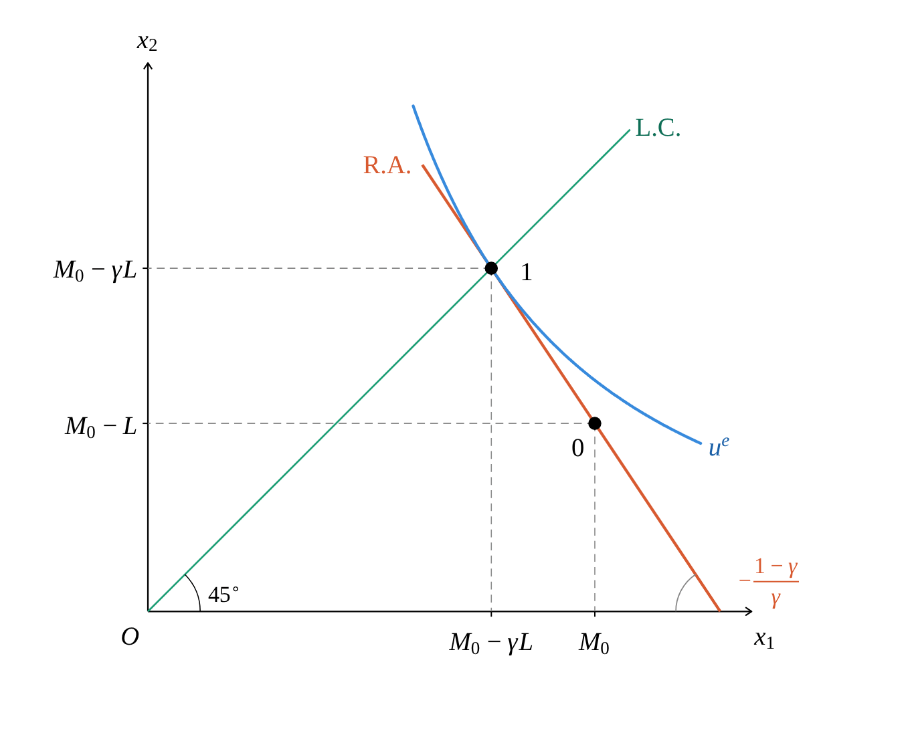
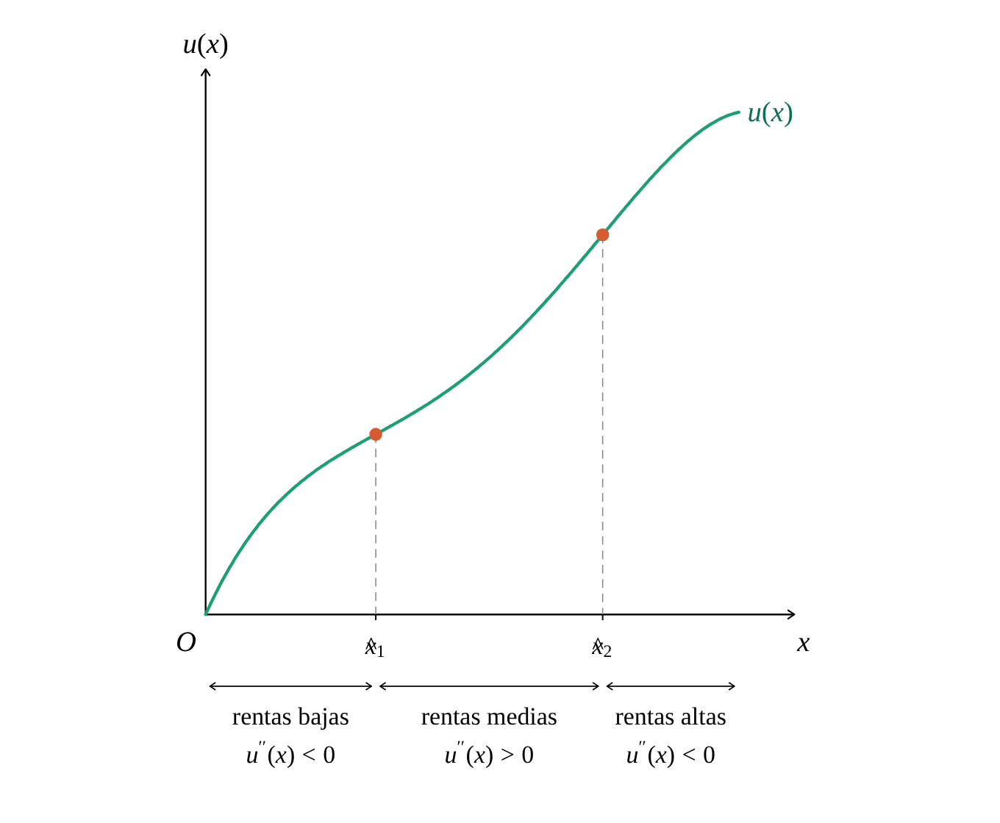
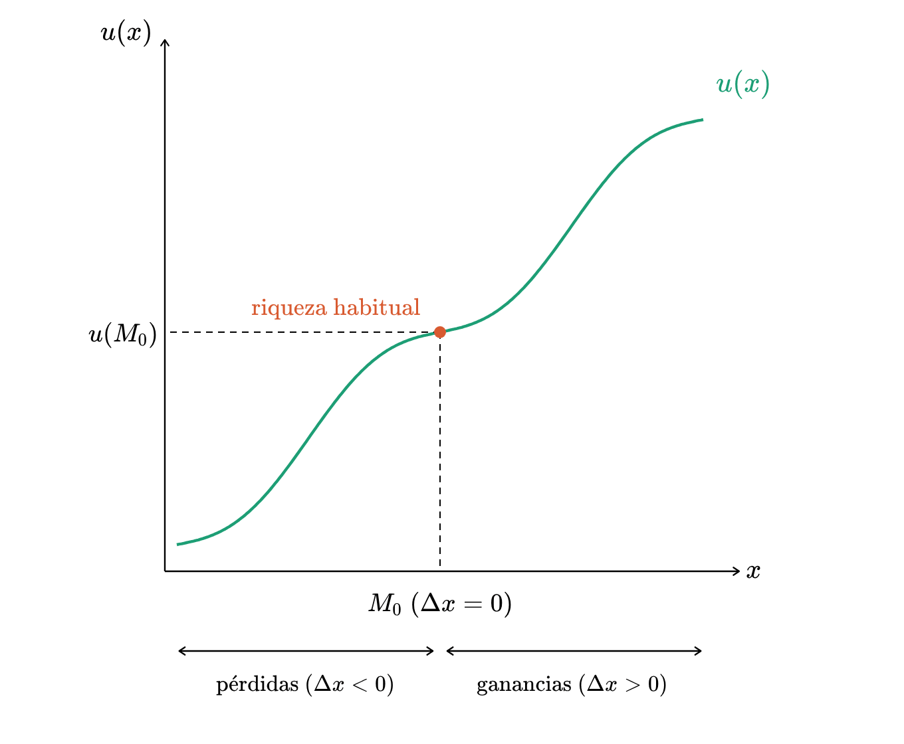
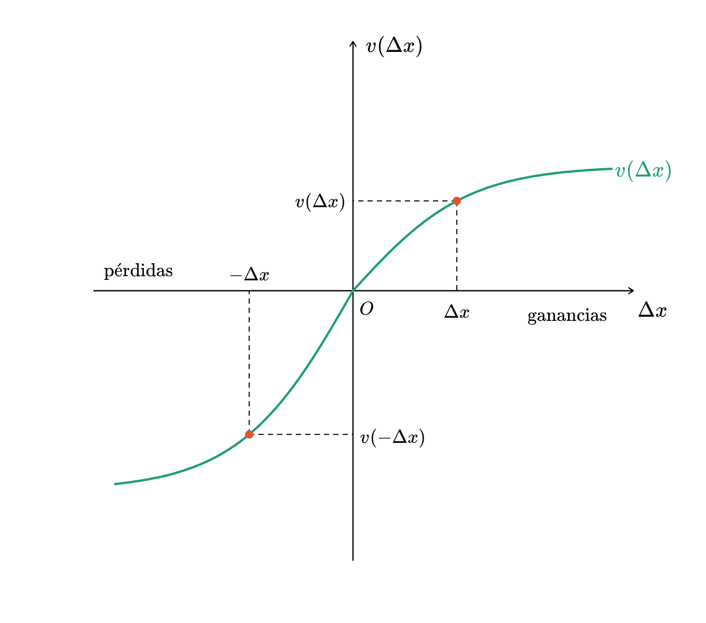

## Introducción



La teoría de la elección con riesgo es el fundamento del análisis de los seguros y de la teoría de carteras, y la de la información asimétrica (tema [A13](a13-informacion.qmd)) parte de ella. Sin embargo, su núcleo, la utilidad esperada, recibió pronto críticas empíricas. Las paradojas de Allais (1953) y de Ellsberg (1961) mostraron que los individuos violan de forma sistemática sus axiomas, y de esas críticas nacieron las teorías alternativas que el tema estudia en su segunda y tercera partes.

El tema estudia la elección en situaciones de riesgo e incertidumbre en tres bloques:

- *Riesgo*: teoría de la utilidad esperada (von Neumann-Morgenstern, 1944).

- *Riesgo*: teorías alternativas, en especial la teoría de la perspectiva (Kahneman y Tversky, 1979).

- *Incertidumbre*: teoría de la probabilidad subjetiva (Anscombe y Aumann, 1963), teoría de la perspectiva acumulativa (Tversky y Kahneman, 1992), análisis bayesiano y criterios de decisión.

## 1. Elección en situaciones de riesgo: teoría de la utilidad esperada

Siguiendo a Nicholson, el comportamiento en un contexto de incertidumbre y el estudio de la probabilidad tienen un origen común en el intento de comprender los juegos de azar. Ya en el siglo XVIII se planteó la **paradoja de San Petersburgo** (Nicolaus Bernoulli, 1713), que Daniel Bernoulli (1738) analizó y resolvió. Si se tira una moneda hasta que salga cara y el premio se duplica con cada lanzamiento, el valor esperado del juego es infinito, pero los jugadores no quieren pagar mucho por jugar. Daniel Bernoulli razonó que a los individuos no les importan directamente los premios, sino su utilidad (esperada).

### 1.1. El conjunto de elección y la ordenación de las preferencias

La **teoría de la utilidad esperada** (TUE), formulada axiomáticamente por von Neumann y Morgenstern (1944) y extendida al caso de probabilidades subjetivas por Savage (1954), es el desarrollo moderno de esta idea. Busca obtener una función de utilidad a partir de un conjunto de axiomas sobre las preferencias entre loterías.

Supone que no existe plena certeza sobre la ocurrencia de sucesos, pero que sí se conoce la distribución de probabilidades de los estados de la naturaleza[^a10-2]. Así, al igual que en la teoría de preferencia y consumo, el consumidor establece una ordenación sobre un **conjunto de elección**, $\mathcal{L}$, no vacío y compacto[^a10-4]:

$$\mathcal{L} = \left\{ \mathbf{l} = (p_1, p_2, \ldots, p_n) \in \mathbb{R}_+^n \;\middle|\; \sum_{i=1}^{n} p_i = 1 \right\}$$

De acuerdo con la premisa “consecuencialista” (axioma de reducción de loterías compuestas), cada elemento del conjunto constituye una **lotería simple** o alternativa de riesgo, es decir, una distribución de probabilidad objetiva sobre un conjunto de sucesos. Cada suceso lleva asociado un pago, $x_i$ (ganancia o pérdida).

Es decir, existe un vector fijo de resultados $(x_1, x_2, \ldots, x_n)$, y cada lotería asigna una probabilidad a cada uno de ellos. Una *lotería compuesta*, en cambio, es una distribución de probabilidad sobre otras loterías. Por el axioma de reducción, equivale a la lotería simple que asigna a cada resultado su probabilidad final, de modo que basta analizar $\mathcal{L}$.

Por lo tanto, a diferencia de la elección en certidumbre, el agente no decide sobre cestas que reportan utilidad cierta, sino sobre alternativas de riesgo que son útiles por los pagos monetarios que llevan asociados.

Entre las loterías, el agente puede establecer **relaciones binarias** que reflejan sus preferencias: indiferencia ($\sim$), estricta preferencia ($\succ$) y preferencia débil ($\succsim$).

#### 1.1.1. Axiomas de orden

**Completitud**: dadas dos loterías cualesquiera, el consumidor siempre puede expresar una preferencia: $\mathbf{l}_1 \succsim \mathbf{l}_2$, o $\mathbf{l}_2 \succsim \mathbf{l}_1$, o ambas (indiferencia, $\mathbf{l}_1 \sim \mathbf{l}_2$).

**Reflexividad**: una lotería es comparable consigo misma: $\mathbf{l}_0 \succsim \mathbf{l}_0$.

**Transitividad**: exige coherencia entre comparativas, de modo que $\mathbf{l}_1 \succsim \mathbf{l}_2 \; \text{y} \; \mathbf{l}_2 \succsim \mathbf{l}_3 \rightarrow \mathbf{l}_1 \succsim \mathbf{l}_3$.

#### 1.1.2. Axiomas de regularidad

**Monotonía** (estricta): la preferencia por la lotería aumenta cuando aumenta la probabilidad del suceso más favorable.

**Continuidad**: no existen saltos en las preferencias. Pequeños cambios en las probabilidades de ocurrencia no cambian la naturaleza de la ordenación entre dos loterías[^a10-6].

**Independencia**: dada una relación entre dos loterías, si cada una se mezcla con una tercera, la ordenación entre ambas combinaciones no depende de la tercera lotería utilizada:

$$\mathbf{l}_1 \succsim \mathbf{l}_2 \leftrightarrow \alpha \mathbf{l}_1 + (1 - \alpha) \mathbf{l}_3 \succsim \alpha \mathbf{l}_2 + (1 - \alpha) \mathbf{l}_3, \quad \alpha \in (0, 1]$$

El axioma de independencia está en el corazón de la teoría de la utilidad esperada y es el más controvertido. Implica que los pagos en estados distintos (bienes contingentes) no pueden ser sustitutivos ni complementarios entre sí en la utilidad (la utilidad marginal del pago en un estado no depende del pago en otro), porque solo uno de los estados llegará a ocurrir.

**Diferenciabilidad** (opcional): evita puntos angulares en la función de utilidad.

### 1.2. La función de utilidad esperada y los perfiles de riesgo

Los axiomas anteriores permiten representar las preferencias sobre loterías mediante una función de utilidad esperada, y la curvatura de la utilidad de Bernoulli caracteriza y mide la actitud del agente frente al riesgo.

#### 1.2.1. La función de utilidad esperada y sus propiedades

El *teorema de representación* (Debreu, 1954) establece que los axiomas de racionalidad (completitud, reflexividad, transitividad) junto con el de continuidad garantizan la existencia de una función de utilidad continua que preserva la ordenación:

$$U: \mathcal{L} \rightarrow \mathbb{R} \; | \; \mathbf{l}_0 \succsim \mathbf{l}_1 \leftrightarrow U(\mathbf{l}_0) \geq U(\mathbf{l}_1)$$

Sin embargo, en riesgo se necesita que la función adopte una forma específica para recoger el “valor moral” de la lotería (que a los individuos les importe la utilidad de los pagos, no los pagos directamente).

**Definición** (teorema de la utilidad esperada; von Neumann y Morgenstern, 1944): si a los axiomas de racionalidad y continuidad se une el axioma de independencia, la ordenación se puede representar mediante una función de utilidad esperada:

$$U(\mathbf{l}) \equiv u^e(\mathbf{l}) = \mathbb{E}[u(\mathbf{l})] = \sum_{i=1}^{n} p_i \cdot u(x_i)$$

Donde $u^e(\mathbf{l})$ es la utilidad esperada de la lotería, $u(x_i)$ es el índice de utilidad cierta de cada pago (utilidad de Bernoulli) y $p_i$ es la probabilidad objetiva de ocurrencia[^a10-10].

**Propiedades** (si se cumplen los axiomas):

1. *Continuidad y diferenciabilidad*: es continua en las probabilidades, por el axioma de continuidad de las preferencias, y la utilidad de Bernoulli es dos veces diferenciable en los pagos (supuesto adicional, necesario para el análisis de Arrow-Pratt).

2. *Transformaciones*: es única salvo transformaciones lineales (afines) positivas, las únicas admisibles. Toda transformación monótona preserva la ordenación, pero solo la afín preserva la forma de esperanza matemática (la utilidad esperada es cardinal).

3. *Inclinación*: estrictamente creciente en la probabilidad del suceso más favorable, por el axioma de monotonía, y en los pagos, porque se supone que la utilidad de Bernoulli es creciente, $u'(x) > 0$.

4. *Forma*: lineal en las probabilidades (es una esperanza matemática) y aditivamente separable en los estados. La curvatura de $u(x)$, en cambio, queda libre y es la que caracteriza la actitud ante el riesgo.

5. *Otras propiedades*:

    - *Observabilidad*: no es observable directamente, pero puede construirse a partir de elecciones entre loterías. Como es única salvo transformaciones afines positivas, basta fijar la utilidad del peor y del mejor pago, $u(x_1) = 0$ y $u(x_n) = 1$, con los pagos ordenados de menor a mayor. La utilidad de cualquier pago intermedio $x_i$ es entonces la probabilidad $p$ que hace al individuo indiferente entre recibir $x_i$ con certeza y una lotería que paga $x_n$ con probabilidad $p$ y $x_1$ con probabilidad $1 - p$, pues $u(x_i) = p \cdot u(x_n) + (1 - p) \cdot u(x_1) = p$.

La forma lineal en probabilidades de la función de utilidad esperada, combinada con una utilidad de Bernoulli suficientemente cóncava (logarítmica, en la propuesta de Bernoulli), resuelve la paradoja de San Petersburgo. Lo consigue porque, para los premios del juego original, la esperanza de $u(x)$ es finita aunque la de $x$ no lo sea. Ahora bien, la sola utilidad marginal decreciente no basta, porque con una utilidad no acotada siempre puede construirse una variante del juego con utilidad esperada infinita (Menger, 1934).

#### 1.2.2. Perfiles de riesgo

Si los individuos cumplen los axiomas de von Neumann-Morgenstern (es decir, tienen un comportamiento racional y sus preferencias son continuas e independientes), actuarán eligiendo la lotería que maximiza el valor esperado de su utilidad, dadas las restricciones a las que se enfrenten.

Su comportamiento dependerá de su **actitud frente al riesgo**. La intuición es que el efecto que la renta ganada y la renta perdida tienen sobre la utilidad es diferente para cada agente.

El comportamiento de cada perfil puede caracterizarse con tres claves, numeradas de (i) a (iii) en las expresiones que siguen:

1. *Relación entre loterías y utilidades*: entre una lotería degenerada $\mathbf{l}_d$ (suceso cierto con pago igual a la esperanza) y una lotería cualquiera $\mathbf{l}$, y entre $u(\mathbb{E}(\mathbf{l}))$ y $u^e(\mathbf{l}) = \mathbb{E}[u(\mathbf{l})]$.

2. *Forma de la utilidad de Bernoulli*: el signo de $u''(x)$ caracteriza los perfiles.

3. *Prima de riesgo* ($\rho$): la diferencia entre la esperanza de una lotería y el equivalente cierto[^a10-14]: $\rho = \mathbb{E}(\mathbf{l}) - x_c$. Intuitivamente, la prima de riesgo es el sobreprecio máximo que el agente estaría dispuesto a pagar, por encima de una prima actuarialmente justa, para eliminar el riesgo.

**Averso al riesgo**: el agente que prefiere el valor esperado cierto a la lotería. La prima de riesgo es positiva, es decir, el individuo paga por evitar el riesgo.

$$\text{(i)}\; \mathbf{l}_d \succ \mathbf{l} \leftrightarrow u(\mathbb{E}(\mathbf{l})) > \mathbb{E}[u(\mathbf{l})] \qquad \text{(ii)}\; u'(x) > 0, \; u''(x) < 0 \qquad \text{(iii)}\; \rho > 0$$

Su utilidad de Bernoulli, $u(x)$, es estrictamente cóncava. Conforme el agente gana renta, la utilidad crece a un ritmo cada vez menor (utilidad marginal decreciente). Por ello, ante variaciones equivalentes al alza y a la baja, la desutilidad de la renta perdida es mayor que la utilidad de la renta ganada.

**Neutral al riesgo**: el individuo es indiferente entre la lotería degenerada y cualquier lotería de igual esperanza. La prima de riesgo es nula y el individuo no paga por evitar el riesgo ni exige compensación por asumirlo.

$$\text{(i)}\; \mathbf{l}_d \sim \mathbf{l} \leftrightarrow u(\mathbb{E}(\mathbf{l})) = \mathbb{E}[u(\mathbf{l})] \qquad \text{(ii)}\; u'(x) > 0, \; u''(x) = 0 \qquad \text{(iii)}\; \rho = 0$$

Su utilidad de Bernoulli, $u(x)$, es una línea recta. La utilidad marginal es constante, por lo que la utilidad de la renta ganada y la desutilidad de la renta perdida se compensan exactamente.

**Propenso al riesgo**: prefiere la lotería a la lotería degenerada. La prima de riesgo es negativa, ya que el equivalente cierto supera al valor esperado de la lotería, de modo que el individuo exige una compensación por renunciar al riesgo, en lugar de pagar por evitarlo.

$$\text{(i)}\; \mathbf{l}_d \prec \mathbf{l} \leftrightarrow u(\mathbb{E}(\mathbf{l})) < \mathbb{E}[u(\mathbf{l})] \qquad \text{(ii)}\; u'(x) > 0, \; u''(x) > 0 \qquad \text{(iii)}\; \rho < 0$$

Su utilidad de Bernoulli, $u(x)$, es estrictamente convexa. Conforme el agente gana renta, la utilidad crece a un ritmo cada vez mayor (utilidad marginal creciente). Por ello, ante variaciones equivalentes al alza y a la baja, la utilidad de la renta ganada es mayor que la desutilidad de la renta perdida.

Gráficamente, en el plano pagos-utilidad (figura -@fig-a101-perfiles-riesgo), una lotería $\mathbf{l}$ con pagos $x_1$ y $x_2$ se representa con tres elementos:

1. *Utilidad de Bernoulli*, $u(x)$: estrictamente cóncava con aversión al riesgo (panel a) y estrictamente convexa con propensión (panel b).

2. *Cuerda entre $x_1$ y $x_2$*: su altura sobre $\mathbb{E}(\mathbf{l})$ es la utilidad esperada, $\mathbb{E}[u(\mathbf{l})]$, que queda por debajo de $u(\mathbb{E}(\mathbf{l}))$ con aversión y por encima con propensión.

3. *Equivalente cierto y prima de riesgo*: $x_c$ es el pago cierto que da la misma utilidad que la lotería, y la diferencia $\mathbb{E}(\mathbf{l}) - x_c$ es la prima de riesgo, positiva con aversión ($x_c < \mathbb{E}(\mathbf{l})$) y negativa con propensión ($x_c > \mathbb{E}(\mathbf{l})$).

::: {#fig-a101-perfiles-riesgo}

::: {.content-visible when-format="html"}
```{=html}
<div class="graph-frame">
<iframe src="../graphs/a101_perfiles_riesgo.html" style="height:1020px" loading="lazy" title="fig-a101-perfiles-riesgo"></iframe>
</div>
```
:::

::: {.content-visible unless-format="html"}
![Perfiles de riesgo. La función de utilidad es cóncava con aversión al riesgo (panel a) y convexa con propensión (panel b). La aversión implica $u(\mathbb{E}(\mathbf{l})) > \mathbb{E}[u(\mathbf{l})]$ y la propensión, $u(\mathbb{E}(\mathbf{l})) < \mathbb{E}[u(\mathbf{l})]$.](../graphs/static/a101_perfiles_riesgo.png)
:::

Perfiles de riesgo. La función de utilidad es cóncava con aversión al riesgo (panel a) y convexa con propensión (panel b). La aversión implica $u(\mathbb{E}(\mathbf{l})) > \mathbb{E}[u(\mathbf{l})]$ y la propensión, $u(\mathbb{E}(\mathbf{l})) < \mathbb{E}[u(\mathbf{l})]$.
:::

#### 1.2.3. Medida de la aversión: los coeficientes de Arrow-Pratt

En principio, bastaría estudiar la curvatura de la función de Bernoulli a través de $u''(x)$ para determinar el perfil de riesgo. No obstante, esta medida no es invariante ante transformaciones afines y no permite cuantificar u ordenar las distintas actitudes frente al riesgo. Por ello existen indicadores que tratan de medir esa actitud, los coeficientes de aversión absoluta y de aversión relativa.

**Supuestos**: para cuantificar la actitud frente al riesgo se parte de dos:

1. *Perfil base*: se toma el perfil averso, $u''(x) < 0$, como referencia. De este modo, los indicadores miden cuán averso es el agente en cuestión.

2. *Monotonía*: las preferencias son monótonas, lo que garantiza que la utilidad es creciente en los pagos.

**Coeficiente de aversión absoluta de Arrow-Pratt** (Pratt, 1964; Arrow, 1965): mide la variación de la utilidad marginal por unidad de utilidad marginal, es decir, la curvatura relativa[^a10-15] de la función de Bernoulli:

$$\text{CAA} = -\frac{u''(x)}{u'(x)} \in \mathbb{R}$$

El cambio de signo se introduce para tener una medida creciente con el grado de aversión, de modo que cuanto mayor es el coeficiente, mayor es la aversión al riesgo.

El coeficiente puede ser constante, creciente o decreciente en los pagos. Aunque cabría pensar que la disposición a jugar aumenta con la riqueza, *a priori* no tiene por qué ser así. Con todo, la evidencia empírica sugiere que el $\text{CAA}$ es decreciente (Guiso y Paiella, 2008), es decir, conforme aumenta la riqueza, hay mayor disposición a asumir un riesgo de cuantía absoluta dada.

El coeficiente de aversión absoluta es útil por tres motivos:

1. *Caracterización*: su signo indica la actitud de los agentes (averso si $\text{CAA} > 0$, neutral si $\text{CAA} = 0$ y propenso si $\text{CAA} < 0$).

2. *Comparaciones*: permite ordenar el grado de aversión entre individuos y entre niveles de renta para un mismo individuo[^a10-16].

3. *Prima de riesgo*: permite aproximarla mediante un desarrollo de Taylor de segundo orden, que muestra que la prima es proporcional al producto de la medida de aversión por la varianza de los pagos:

   $$\rho \approx \frac{1}{2} \cdot \text{CAA} \cdot \sigma_x^2$$

::: {.callout-tip collapse="true" appearance="simple" title="Ejemplo: equivalente cierto y prima de riesgo con utilidad raíz cuadrada"}
Sea $u(x) = x^{1/2}$ y la lotería $\mathbf{l}$ que paga $x_1 = 36$ o $x_2 = 100$ con probabilidad $1/2$ cada uno. Su esperanza es $\mathbb{E}(\mathbf{l}) = 68$ y su utilidad esperada,

$$u^e(\mathbf{l}) = \tfrac{1}{2} \cdot 6 + \tfrac{1}{2} \cdot 10 = 8 \;<\; u(68) \approx 8{,}25$$

El equivalente cierto resuelve $x_c^{1/2} = 8$, es decir, $x_c = 64$, y la prima de riesgo exacta es $\rho = 68 - 64 = 4 > 0$. Con $u'(x) = \tfrac{1}{2}x^{-1/2}$ y $u''(x) = -\tfrac{1}{4}x^{-3/2}$, el coeficiente es $\text{CAA} = 1/(2x)$, que en $x = 68$ vale $1/136$. Como $\sigma_x^2 = 32^2 = 1024$, la aproximación de Taylor da

$$\rho \approx \tfrac{1}{2} \cdot \tfrac{1}{136} \cdot 1024 \approx 3{,}76$$

muy próxima a la prima exacta. Con utilidad cóncava la prima es positiva y crece con la aversión y con la varianza de los pagos.
:::

**Coeficiente de aversión relativa de Arrow-Pratt** (Pratt, 1964; Arrow, 1965): corrige una de las principales limitaciones del coeficiente de aversión absoluta, que depende de las unidades de medida, pues se expresa en términos monetarios absolutos.

Para superar este problema, el coeficiente de aversión relativa tiene en cuenta el nivel de riqueza, de modo que ofrece una medida relativa, a menudo en términos porcentuales. El coeficiente relativo es la elasticidad de la utilidad marginal respecto a los pagos, cambiada de signo:

$$\text{CAR} = -\frac{u''(x)}{u'(x)} \cdot x \in \mathbb{R}$$

Intuitivamente, un $\text{CAR}$ constante implica que la proporción de la riqueza que se mantiene en activos con riesgo no varía con el nivel de riqueza.

En el caso de una función de aversión relativa al riesgo constante (CRRA, *constant relative risk aversion*) o isoelástica, el $\text{CAR}$ es constante y se denota $\theta$. En un contexto intertemporal, su inversa ($1/\theta$) es la elasticidad de sustitución intertemporal (ESI) entre consumo presente y futuro.

### 1.3. La decisión del individuo: aplicaciones financieras

Las herramientas anteriores tienen una aplicación importante en el análisis de las decisiones financieras en un contexto de riesgo. Las decisiones financieras son las elecciones sobre activos financieros:

- *Seguros*: cuyo pago monetario depende de la ocurrencia de una contingencia (p. ej. un accidente).

- *Acciones*: cuyo pago monetario depende de la marcha de la empresa.

- *Bonos*: cuyo pago monetario no depende de ningún evento en concreto más allá de la llegada de un momento del tiempo.

La teoría de la utilidad esperada puede aplicarse a dos tipos de decisiones financieras, simétricas entre sí:

- *Decisiones de aseguramiento*: el agente parte de una exposición al riesgo (fuera de la línea de certeza) y busca reducir dicha exposición mediante la adquisición de un contrato de seguro.

- *Decisiones de cartera*: el agente parte de una situación de certeza (sobre la línea de certeza) y busca aumentar su exposición al riesgo (y diversificarlo) mediante la adquisición de acciones.

#### 1.3.1. Decisión de aseguramiento: demanda de seguros

**Origen**: la demanda de seguros es la aplicación de la teoría de la utilidad esperada (von Neumann y Morgenstern, 1944) a la primera de las decisiones financieras, la de aseguramiento. Su tratamiento en el plano de rentas contingentes enlaza con el enfoque de preferencia por estados de Arrow (1953) y Debreu (1959).

**Idea**: el agente elige la cuantía asegurada igualando la tasa subjetiva a la que intercambia renta entre los dos estados de la naturaleza con la tasa objetiva que ofrece el mercado de seguros.

**Supuestos**:

- *Entorno*: información imperfecta (y simétrica) con dos posibles estados de la naturaleza:

    - *Escenario sin pérdida*: estado de la naturaleza sin contingencia, en el que se mantiene la riqueza inicial, $M_0$.

    - *Escenario con pérdida*: estado de la naturaleza con contingencia, en el que la riqueza inicial se minora en una pérdida $L$: $M_0 - L$.

- *Agentes*: un agente averso al riesgo, con riqueza inicial $M_0$. Sus preferencias se recogen, por tanto, en una función de utilidad esperada cuya utilidad de Bernoulli es continua, creciente y cóncava. El agente se enfrenta a una sola lotería, que asigna una probabilidad $p_1$ al resultado sin contingencia, $M_0$, y una probabilidad $p_2$ al resultado con contingencia, $M_0 - L$, con $p_1 + p_2 = 1$. Su decisión de aseguramiento consiste en:

    - *Cuantía asegurada*: elegir qué cuantía de su renta asegura, $M_s$, que puede ser igual, inferior o superior a la cuantía perdida, $L$. La cuantía asegurada es, por tanto, la variable de elección del problema.

    - *Prima*: pagar una prima de seguro (o precio de aseguramiento), $\gamma$, por unidad de renta asegurada. En consecuencia, si contrata el seguro, asumirá con independencia del resultado un coste de aseguramiento $\gamma M_s$.

- *Restricciones*: el pago en cada estado depende de la decisión de aseguramiento:

    - *Sin seguro*: si no se asegura, obtiene $x_1 = M_0$ en ausencia de contingencia y $x_2 = M_0 - L$ si esta se produce.

    - *Con seguro*: si se asegura, obtiene $x_1 = M_0 - \gamma M_s$ en ausencia de contingencia y $x_2 = x_1 - L + M_s$ si esta se produce.

Despejando $M_s$ de la primera expresión y sustituyendo en la segunda se obtiene la *recta de aseguramiento*:

$$x_2 = \frac{M_0}{\gamma} - L - \frac{1 - \gamma}{\gamma}\, x_1$$

cuya pendiente en el plano $(x_1, x_2)$, $-(1 - \gamma)/\gamma$, es la tasa objetiva a la que el mercado permite intercambiar renta entre los dos estados de la naturaleza.

**Planteamiento**: el agente maximiza su utilidad esperada dadas las restricciones:

$$\max_{M_s} \; u^e = p_1 \cdot u(x_1) + p_2 \cdot u(x_2) \quad \text{s.a.:} \begin{cases} x_1 = M_0 - \gamma M_s \\ x_2 = x_1 - L + M_s \\ M_s \geq 0 \end{cases}$$

donde $M_s$ es la cuantía asegurada (variable de elección), $u^e$ la utilidad esperada, $u(\cdot)$ la utilidad de Bernoulli, $x_1$ y $x_2$ la renta en el estado sin y con contingencia, $p_1$ y $p_2$ sus probabilidades respectivas, $M_0$ la riqueza inicial, $L$ la pérdida y $\gamma$ la prima por unidad de renta asegurada.

**CPO**: con solución interior, sustituyendo las restricciones en la función objetivo y derivando respecto a $M_s$ se obtiene la condición de equilibrio:

$$\begin{aligned} \frac{du^e}{dM_s} &= -\gamma\, p_1 \frac{du(x_1)}{dx_1} + (1 - \gamma)\, p_2 \frac{du(x_2)}{dx_2} = 0 \\ &\Rightarrow\; \text{RMSE}_{21} = \frac{p_1 \, du(x_1)/dx_1}{p_2 \, du(x_2)/dx_2} = \frac{1 - \gamma}{\gamma} \end{aligned}$$

La *relación marginal de sustitución estocástica* (RMSE) es la tasa subjetiva a la que el agente está dispuesto a intercambiar renta entre los dos estados. En el equilibrio, esta coincide con el precio relativo de la renta entre ambos estados, $(1-\gamma)/\gamma$ (indemnización neta por unidad de prima pagada), que refleja la tasa objetiva de intercambio que ofrece el mercado de seguros. De no cumplirse la igualdad, el agente podría trasladar renta de un estado a otro y aumentar su utilidad esperada.

**CSO**: la concavidad de la utilidad de Bernoulli (aversión al riesgo) hace negativa la segunda derivada de la función objetivo respecto a $M_s$[^a10-41]. La función objetivo es, por tanto, estrictamente cóncava en $M_s$, y la CPO caracteriza un máximo global.

**Solución**: el grado de aseguramiento depende de la relación entre la probabilidad de contingencia y la prima, y la prima, a su vez, de la estructura competitiva del mercado de seguros y de sus costes de gestión:

1. *Prima actuarialmente justa* ($\gamma = p_2$, competencia perfecta sin costes de gestión): el agente se asegura por la totalidad de la pérdida ($M_s^* = L$), de modo que $x_1 = x_2$ y, gráficamente, el óptimo está sobre la línea de certeza.

2. *Prima actuarialmente desfavorable* ($\gamma > p_2$, por costes de gestión o poder de mercado de la aseguradora): la recta de aseguramiento es menos inclinada que la curva de indiferencia sobre la línea de certeza, y el agente se infraasegura ($M_s^* < L$): $x_1 > x_2$.

3. *Prima actuarialmente favorable* ($\gamma < p_2$): la recta de aseguramiento es más inclinada que la curva de indiferencia sobre la línea de certeza, y el agente se sobreasegura ($M_s^* > L$): $x_1 < x_2$[^a10-22].

**Desarrollo gráfico**: la decisión de aseguramiento se representa en el plano de rentas contingentes $(x_1, x_2)$ (figura -@fig-a102-modelo-aseguramiento), con prima actuarialmente justa:

1. *Línea de certeza* (L.C.): recoge las combinaciones con la misma renta en ambos estados ($x_1 = x_2$) y forma un ángulo de 45° con los ejes.

2. *Recta de aseguramiento* (R.A.): parte del punto 0, la situación sin seguro $(M_0, M_0 - L)$, con pendiente $-(1-\gamma)/\gamma$.

3. *Curva de indiferencia* ($u^e$): recoge las combinaciones de rentas contingentes con la misma utilidad esperada, y su pendiente en valor absoluto es la RMSE.

4. *Equilibrio*: en el punto 1, la recta de aseguramiento es tangente a la mejor curva de indiferencia alcanzable. Con prima justa, el punto está sobre la línea de certeza y el agente obtiene $M_0 - \gamma L$ en ambos estados.

::: {#fig-a102-modelo-aseguramiento}

::: {.content-visible when-format="html"}
```{=html}
<div class="graph-frame">
<iframe src="../graphs/a102_modelo_aseguramiento.html" style="height:600px" loading="lazy" title="fig-a102-modelo-aseguramiento"></iframe>
</div>
```
:::

::: {.content-visible unless-format="html"}

:::

Demanda de seguro. Con prima actuarialmente justa, el individuo averso al riesgo se asegura completamente e iguala la riqueza en ambos estados de la naturaleza.
:::

**Estática comparativa**: a partir de la condición de equilibrio, y dado que se cumple el teorema de la función implícita, la cuantía asegurada óptima (función de demanda de aseguramiento) puede expresarse en función de los parámetros del modelo. Unos afectan a la utilidad de Bernoulli (el grado de aversión) y otros a la lotería (probabilidades, riqueza inicial, pérdida y prima)[^a10-23]:

$$M_s^* = d_s(\underset{+}{\text{CAA}}, \; \underset{-}{p_1}, \; \underset{+}{p_2}, \; \underset{\pm}{M_0}, \; \underset{+}{L}, \; \underset{\pm}{\gamma})$$

**Extensiones**: el modelo toma la prima como dada. Que la competencia pueda llevarla hasta la actuarialmente justa descansa en que la aseguradora se comporte de forma aproximadamente neutral al riesgo, gracias a dos mecanismos:

- *Agrupación de riesgos* (*risk pooling*): al reunir muchos riesgos independientes, la ley de los grandes números hace que la pérdida media por asegurado se aproxime a su valor esperado. Con $n$ riesgos independientes e idénticamente distribuidos, de varianza $\sigma^2$, la varianza de la pérdida media es $\sigma^2/n$. Sin embargo, la agrupación solo elimina el riesgo idiosincrásico, ya que los riesgos agregados o sistemáticos (catástrofes, pandemias) no se diluyen al agruparlos.

- *Reparto de riesgos* (*risk sharing*): un riesgo dado, repartido entre muchos agentes (accionistas de la aseguradora, mutualistas, reaseguradoras o contribuyentes), genera una prima de riesgo total menor, que tiende a cero al crecer el número de partícipes. La razón es que la prima de cada agente es aproximadamente proporcional a la varianza que soporta, y esta, al cuadrado de su participación. En este principio se basan el reaseguro, las mutualidades y el argumento de Arrow y Lind (1970), según el cual una inversión pública cuyo rendimiento sea independiente de la renta nacional puede evaluarse como si el Estado fuera neutral al riesgo.

**Conclusiones**:

- *Aspectos positivos*: el modelo ofrece los fundamentos de la demanda de aseguramiento, sus determinantes y su estática comparativa.

- *Limitaciones*: la simplicidad de sus supuestos lo hace susceptible de extensiones, la más relevante de las cuales es la información asimétrica, tanto *ex ante* (selección adversa) como *ex post* (riesgo moral), que se estudia en el tema [A13](a13-informacion.qmd).

#### 1.3.2. Decisión de cartera (Markowitz, 1952; Tobin, 1958; Sharpe, 1963)

**Origen**: la selección de carteras se formaliza con el enfoque media-varianza de Markowitz (1952), que Tobin (1958) extiende con un activo sin riesgo y Sharpe (1963) simplifica con el modelo de índice único (tema [B23](b23-renta-variable.qmd), §2). Aquí, en cambio, se expone la versión en utilidad esperada con dos estados, un activo seguro y otro arriesgado, en la línea de Pratt (1964) y Arrow (1965). Su modelización es similar a la de aseguramiento, con la diferencia de que el agente parte de una situación de certeza.

**Idea**: se trata de determinar las condiciones que empujan a un agente averso al riesgo a abandonar la línea de certeza, y sus efectos sobre los resultados finales.

**Supuestos**:

- *Entorno*: el agente parte de una riqueza $M_0$ invertida en un activo de rentabilidad cierta $r$, el bono[^a10-24]. Se le presenta la opción de invertir una proporción $\alpha \in [0, 1]$ de su riqueza en un activo con riesgo, la acción, cuyo rendimiento es alto, $r_a$, con probabilidad $1 - p$, y bajo, $r_b$, con probabilidad $p$, con $r_a > r > r_b$. En el resultado alto el agente gana, por tanto, respecto al bono, y en el bajo pierde. Los pagos en cada estado son $x_1 = M_0[1 + r + \alpha(r_a - r)]$ y $x_2 = M_0[1 + r - \alpha(r - r_b)]$.

- *Agentes*: sus preferencias vienen representadas por la misma función de utilidad esperada del problema de aseguramiento.

**Planteamiento**: la decisión consiste en elegir la proporción $\alpha$ que maximiza la utilidad esperada:

$$\max_{\alpha} \; u^e = (1 - p) \cdot u(x_1) + p \cdot u(x_2)$$

donde $\alpha$ es la proporción de la riqueza invertida en la acción, $u^e$ la utilidad esperada, $u(\cdot)$ la utilidad de Bernoulli, $x_1$ y $x_2$ los pagos en los estados de rendimiento alto y bajo, y $p$ la probabilidad del rendimiento bajo.

**CPO**: derivando respecto a $\alpha$ e igualando a cero se obtiene la condición de equilibrio:

$$\begin{aligned} \frac{du^e}{d\alpha} &= (1 - p) \frac{du(x_1)}{dx_1} M_0 (r_a - r) - p \frac{du(x_2)}{dx_2} M_0 (r - r_b) = 0 \\ &\Rightarrow\; \text{RMSE}_{21} = \frac{(1 - p) \, du(x_1)/dx_1}{p \, du(x_2)/dx_2} = \frac{r - r_b}{r_a - r} \end{aligned}$$

En el óptimo, la tasa subjetiva a la que el agente intercambia renta entre los dos estados (la RMSE) iguala la tasa objetiva a la que la cartera permite intercambiarla, el cociente entre la pérdida y la ganancia de la acción respecto al bono.

**CSO**: la aversión al riesgo ($u''<0$) hace estrictamente cóncava la utilidad esperada en $\alpha$, de modo que la CPO caracteriza un máximo, mientras que con neutralidad o propensión al riesgo la solución es de esquina, $\alpha^*\in\{0,1\}$.

**Solución**: como en toda demanda, el factor más interesante es el precio relativo, que aquí es una combinación de los tres rendimientos ($r_a$, $r_b$, $r$). En función de ellos caben tres equilibrios: cartera invertida por completo en el bono ($\alpha^* = 0$), cartera diversificada ($0 < \alpha^* < 1$) y cartera invertida por completo en la acción ($\alpha^* = 1$).

**Desarrollo gráfico**: en el plano de rentas contingentes $(x_1, x_2)$ (figura -@fig-a107-decision-cartera), la condición de equilibrio es la tangencia entre la curva de indiferencia más elevada posible y la recta de cartera (R.C.), cuyos puntos extremos son las carteras no diversificadas, B (solo bonos, $\alpha = 0$), sobre la línea de certeza en $M_0(1 + r)$, y A (solo acciones, $\alpha = 1$), con pagos $M_0(1 + r_a)$ y $M_0(1 + r_b)$. La pendiente de la recta, $-(r - r_b)/(r_a - r)$, es la tasa objetiva a la que la cartera permite intercambiar renta entre los dos estados. Si en B la recta es menos inclinada que la curva de indiferencia, es decir, si el rendimiento esperado de la acción supera a $r$, el agente abandona la línea de certeza (punto 0).

::: {#fig-a107-decision-cartera}

::: {.content-visible when-format="html"}
```{=html}
<div class="graph-frame">
<iframe src="../graphs/a107_Decision_cartera.html" style="height:580px" loading="lazy" title="fig-a107-decision-cartera"></iframe>
</div>
```
:::

::: {.content-visible unless-format="html"}

:::

Decisión de cartera. La recta de cartera (R.C.) une B (solo bonos, $\alpha = 0$), sobre la línea de certeza (L.C.), con A (solo acciones, $\alpha = 1$). Como en B es menos inclinada que la curva de indiferencia $u^e_B$, el inversor averso al riesgo abandona la certeza y elige la cartera diversificada 0 ($0 < \alpha^* < 1$), donde la recta es tangente a la curva más alta alcanzable, $u^e_0$.
:::

**Estática comparativa**: la demanda de activo con riesgo, $\alpha^*$, depende de cuatro factores:

- *Grado de aversión*: su aumento la reduce.

- *Probabilidad del resultado desfavorable*, $p$: su aumento reduce la demanda de la acción.

- *Riqueza*: su efecto es indeterminado, como en el modelo de seguro.

- *Niveles de ganancia ($r_a - r$) y de pérdida ($r - r_b$) respecto al rendimiento del bono*: la afectan, en general, positiva y negativamente, respectivamente.

Estos efectos se resumen en la función de demanda:

$$\alpha^* = d(\underset{-}{\text{CAA}}, \; \underset{-}{p}, \; \underset{\pm}{M_0}, \; \underset{+}{r_a}, \; \underset{+}{r_b}, \; \underset{-}{r})$$

El signo de $r_b$ es inequívoco, porque, al subir, reduce la pérdida en el estado desfavorable y los efectos sustitución y renta actúan en el mismo sentido. Los signos de $r_a$ y $r$, en cambio, son los del efecto sustitución y exigen supuestos adicionales. Por un lado, un aumento de $r_a$ tiene también un efecto renta de signo opuesto, y el signo positivo solo está garantizado si $\text{CAR} \leq 1$. Por otro lado, un aumento de $r$ eleva además la riqueza, y el signo negativo está garantizado con $\text{CAA}$ constante o creciente (con $\text{CAA}$ decreciente, el efecto riqueza empuja en sentido contrario).

**Conclusiones**:

- *Aspectos positivos*: explica la demanda de activos con riesgo, y la elección entre una cartera sin riesgo, diversificada o concentrada en la acción, a partir de la aversión al riesgo y la riqueza del inversor. Enlaza así la teoría de la utilidad esperada con la selección de carteras y la valoración de activos (tema [B23](b23-renta-variable.qmd)).

- *Limitaciones*: con dos estados y un solo activo arriesgado, el modelo no recoge la correlación entre rendimientos, de la que dependen las ganancias de la diversificación, y varios signos de la demanda exigen supuestos sobre la forma de la aversión al riesgo. Comparte, además, los límites empíricos de la utilidad esperada (apartado 2).

### 1.4. Extensiones: dominancia estocástica y preferencia por estados

La teoría admite dos extensiones. La dominancia estocástica ordena las loterías con independencia de las preferencias, y la preferencia por estados convierte la elección con riesgo en un problema ordinario de demanda.

#### 1.4.1. Dominancia estocástica

Los coeficientes de Arrow-Pratt caracterizan al individuo y constituyen el componente subjetivo de la función de utilidad esperada. La **dominancia estocástica**, en cambio, caracteriza a las loterías, es decir, establece cuáles son mejores que otras con independencia de las preferencias de los agentes. Permite ordenarlas parcialmente (no todo par de loterías es comparable) sin conocer la función de utilidad concreta. Sean $F$ y $G$ las funciones de distribución de dos loterías sobre los pagos:

1. *Dominancia estocástica de primer orden*: $F$ domina a $G$ en primer orden si $F(x) \leq G(x)$ para todo $x$. Es decir, para cualquier nivel de pago, la probabilidad de no alcanzarlo nunca es mayor con $F$ (y, si la dominancia es estricta, es menor para algún nivel). En consecuencia, todo agente con utilidad creciente (aversión al riesgo aparte) prefiere $F$.

2. *Dominancia estocástica de segundo orden*: $F$ domina a $G$ en segundo orden si $\int_{-\infty}^{x}[G(t) - F(t)]\,dt \geq 0$ para todo $x$. En este caso, todo agente averso al riesgo prefiere $F$. En particular, cuando ambas tienen la misma media, la condición significa que $G$ es una versión de $F$ con “más dispersión” (Rothschild y Stiglitz, 1970). 

La dominancia de segundo orden es la formalización rigurosa de la intuición de que, a igual rendimiento esperado, el averso al riesgo elige la lotería menos arriesgada. El criterio media-varianza de Markowitz es un caso particular válido cuando las distribuciones son normales o la utilidad es cuadrática.

#### 1.4.2. Preferencia por estados (Arrow, 1953; Debreu, 1959)

**Origen**: Arrow (1953) y Debreu (1959) reformulan el problema de la elección con riesgo en los términos de la teoría del consumidor.

**Idea**: el consumo en cada estado de la naturaleza se trata como un bien distinto.

**Planteamiento**: con dos estados $s = 1, 2$ de probabilidades $p_1, p_2$, el individuo elige el vector $(x_1, x_2)$ maximizando $p_1 u(x_1) + p_2 u(x_2)$ sujeto a $q_1 x_1 + q_2 x_2 = M_0$, donde $q_s$ es el precio de un activo contingente (*activo Arrow*) que paga una unidad si ocurre el estado $s$ y nada en caso contrario.

**CPO**: con solución interior y la restricción agotada, derivando el lagrangiano respecto al consumo de cada estado y eliminando el multiplicador, se obtiene la condición habitual del consumidor:

$$\frac{\partial \mathcal{L}}{\partial x_s} = p_s \frac{du(x_s)}{dx_s} - \lambda q_s = 0 \quad (s = 1, 2) \;\Rightarrow\; \frac{p_1 \, du(x_1)/dx_1}{p_2 \, du(x_2)/dx_2} = \frac{q_1}{q_2}$$

Es decir, la relación marginal de sustitución entre el consumo de los dos estados, ponderada por sus probabilidades, iguala al precio relativo de los activos contingentes. El individuo traslada consumo de un estado a otro hasta que la tasa subjetiva a la que está dispuesto a intercambiarlo coincide con la tasa objetiva que fija el mercado de activos Arrow.

**CSO**: la concavidad estricta de $u(x)$ (aversión al riesgo) hace estrictamente cuasicóncava la utilidad esperada en $(x_1,x_2)$ y la restricción es lineal, por lo que la CPO es suficiente.

**Solución**: si los precios de los activos contingentes son actuarialmente justos ($q_1/q_2 = p_1/p_2$), el averso al riesgo iguala el consumo en ambos estados ($x_1 = x_2$), es decir, se asegura plenamente, resultado idéntico al de la decisión de aseguramiento (figura -@fig-a102-modelo-aseguramiento).

**Conclusiones**:

- *Aspectos positivos*: el enfoque tiene dos ventajas. En primer lugar, convierte la elección bajo riesgo en un problema ordinario de demanda, con curvas de indiferencia en el plano $(x_1, x_2)$ y el mismo instrumental de los temas [A08](a08-consumidor.qmd) y [A09](a09-dualidad.qmd). En segundo lugar, muestra que un sistema completo de mercados contingentes permite asignar el riesgo de forma eficiente entre los agentes. El resultado es la base del tratamiento de la incertidumbre en el equilibrio general (tema [A21](a21-equilibrio-general.qmd)) y de la valoración de derivados por replicación (tema [B25](b25-derivados.qmd)).

- *Limitaciones*: la asignación eficiente del riesgo exige un sistema completo de mercados contingentes, que en la práctica no existe. La razón es que crear un mercado para cada estado es costoso y que los estados deben ser observables y verificables por todas las partes, lo que excluye la información asimétrica (tema [A13](a13-informacion.qmd)).

### 1.5. Conclusiones

**Aspectos positivos**: la teoría de la utilidad esperada extiende la teoría de la elección al riesgo con un aparato mínimo, porque los axiomas de racionalidad y continuidad más el de independencia bastan para representar las preferencias sobre loterías mediante una esperanza matemática de utilidades. Además, la curvatura de la utilidad de Bernoulli caracteriza y mide la actitud ante el riesgo (Arrow-Pratt), y el mismo instrumental del consumidor (curvas de indiferencia, restricción, tangencia) resuelve las decisiones de aseguramiento y de cartera y se generaliza a los mercados contingentes.

**Limitaciones**: destacan tres, que ordenan el resto del tema:

1. *Independencia*: el axioma que da a la función su forma lineal en probabilidades es también el más contestado empíricamente.

2. *Estabilidad de los perfiles*: la actitud ante el riesgo cambia con el nivel o el marco de referencia de la riqueza.

3. *Probabilidades objetivas*: la teoría las presupone, de modo que la incertidumbre en sentido de Knight exige un tratamiento propio.

## 2. Desarrollos posteriores: críticas y teoría de la perspectiva

La teoría de la utilidad esperada es la herramienta de referencia para el análisis de situaciones de riesgo. Sin embargo, los perfiles de riesgo pueden cambiar en función de distintas variables, lo que ha motivado diferentes críticas y desarrollos posteriores. Todos ellos mantienen el supuesto de riesgo, con probabilidades objetivas y conocidas. En cambio, la incertidumbre, en la que las probabilidades son subjetivas o no existen, se estudia en la sección 3, con sus propias críticas.

### 2.1. Críticas teóricas: forma de la función de utilidad

Dos trabajos, el de Friedman y Savage (1948) y el de Markowitz (1952), cuestionaron la forma de la utilidad de Bernoulli para explicar comportamientos observados.

#### 2.1.1. Paradoja de Friedman y Savage (1948)

**Origen**: según Friedman y Savage, existe incoherencia entre los perfiles de agentes tal y como se plantean en la teoría de la utilidad esperada. Por ejemplo, un mismo agente puede adquirir seguros (aversión al riesgo) y participar en juegos de azar desfavorables (propensión al riesgo).

**Idea**: la solución propuesta es una utilidad de Bernoulli con tres tramos (cóncavo-convexo-cóncavo) y dos puntos de inflexión, $\hat{x}_1$ y $\hat{x}_2$.

**Razonamiento**: la aversión se da en niveles altos y bajos de renta, la propensión en los intermedios. En consecuencia, un mismo consumidor podría presentar distinta aversión al riesgo en función de cómo evoluciona su nivel de renta.

**Desarrollo gráfico**: en el plano pagos-utilidad (figura -@fig-a104-friedman-savage), la utilidad de Bernoulli, $u(x)$, es cóncava en las rentas bajas, hasta $\hat{x}_1$, convexa en las rentas medias, entre $\hat{x}_1$ y $\hat{x}_2$, y de nuevo cóncava en las rentas altas, a partir de $\hat{x}_2$. Los tramos cóncavos reflejan aversión al riesgo y el convexo, propensión, por lo que la actitud del consumidor ante el riesgo depende de su nivel de renta.

::: {#fig-a104-friedman-savage}

::: {.content-visible when-format="html"}
```{=html}
<div class="graph-frame">
<iframe src="../graphs/a104_Friedman_Savage.html" style="height:600px" loading="lazy" title="fig-a104-friedman-savage"></iframe>
</div>
```
:::

::: {.content-visible unless-format="html"}

:::

Función de utilidad de Friedman y Savage (1948). Sus tramos cóncavos y convexos explican la coexistencia de seguros y loterías en un mismo individuo.
:::

**Conclusiones**:

- *Aspectos positivos*: la aportación fue relevante porque permitía entender comportamientos observados.

- *Limitaciones*: la principal, señalada por Markowitz (1952), es que sus implicaciones no son compatibles con la evidencia empírica. En particular, los individuos de renta alta, situados en el último tramo cóncavo, no aceptarían apuestas desfavorables, y los de renta intermedia desearían apuestas simétricas de gran cuantía. Si lo primero fuera cierto, no existirían los casinos de Montecarlo, porque los millonarios no apostarían.

#### 2.1.2. La utilidad de la riqueza (Markowitz, 1952)

**Origen**: Markowitz (1952) cuestionó que las loterías se evalúen según la renta final.

**Idea**: propuso que lo relevante son los cambios de renta respecto a la renta presente: $x = M_0 + \Delta x$, donde $\Delta x$ representa la ganancia o pérdida respecto a la riqueza actual $M_0$, que actúa como punto de referencia (la renta “habitual” del agente).

**Razonamiento**: la solución propuesta en este caso es una utilidad con tres puntos de inflexión, el central situado en la riqueza habitual, que refleja el nivel de renta (o consumo) habitual y actúa como “ancla” del comportamiento. Esta utilidad es convexa ante ganancias pequeñas y cóncava ante las grandes, cóncava ante pérdidas pequeñas y convexa ante las grandes.

**Desarrollo gráfico**: en el plano pagos-utilidad (figura -@fig-a105-markowitz), el punto de inflexión central de $u(x)$ está en la riqueza habitual, $M_0$ ($\Delta x = 0$). A su derecha, en las ganancias, la función es primero convexa y luego cóncava, y a su izquierda, en las pérdidas, primero cóncava y luego convexa. Refleja así propensión al riesgo ante ganancias pequeñas y aversión ante las grandes, y aversión ante pérdidas pequeñas y propensión ante las grandes.

::: {#fig-a105-markowitz}

::: {.content-visible when-format="html"}
```{=html}
<div class="graph-frame">
<iframe src="../graphs/a105_Markowitz.html" style="height:600px" loading="lazy" title="fig-a105-markowitz"></iframe>
</div>
```
:::

::: {.content-visible unless-format="html"}

:::

Función de utilidad de Markowitz (1952). La riqueza habitual $M_0$ ($\Delta x=0$) es el punto de referencia. La función es convexa ante ganancias pequeñas y cóncava ante ganancias grandes, cóncava ante pérdidas pequeñas y convexa ante pérdidas grandes.
:::

**Conclusiones**:

- *Aspectos positivos*: la teoría ofrece así más matices que la de Friedman y Savage, y su punto de referencia influyó en los trabajos de Kahneman y Tversky sobre la aversión a la pérdida.

- *Limitaciones*: la dificultad de postular funciones de este tipo y posibles incoherencias entre perfiles.

### 2.2. Críticas empíricas: violaciones de los axiomas

Junto a las críticas teóricas, la literatura sometió la teoría de la utilidad esperada a contraste experimental, observando las elecciones reales de los individuos ante situaciones de riesgo. Estos estudios descubrieron violaciones sistemáticas y recurrentes de sus hipótesis, que pueden ordenarse según el supuesto que incumplen.

**Violaciones del axioma de independencia** (Allais, 1953): la *paradoja de Allais* muestra que cambios en componentes comunes a dos loterías, que según el axioma de independencia no deberían alterar la elección entre ellas, sí la alteran. 

En su experimento, con dos pares de loterías $(\mathbf{l}_1^1, \mathbf{l}_2^1)$ y $(\mathbf{l}_1^2, \mathbf{l}_2^2)$ construidos sobre los mismos resultados, la mayoría de los individuos prefiere $\mathbf{l}_1^1$ en el primer par y $\mathbf{l}_2^2$ en el segundo, aunque ambos pares solo difieren en una consecuencia común a las dos loterías. 

La literatura posterior (MacCrimmon y Larsson, 1979) distinguió dos manifestaciones de este resultado:

- *Efecto consecuencia común*: la preferencia entre dos loterías cambia cuando se modifica un premio que ambas comparten con la misma probabilidad. Intuitivamente, cuanto mayor es el pago común, más averso se vuelve el agente respecto a la parte incierta.

- *Efecto razón común* (o *efecto certeza*, Kahneman y Tversky, 1979): la preferencia cambia cuando todas las probabilidades de ganar se reducen en la misma proporción. Los individuos sobrevaloran los resultados ciertos frente a los meramente probables.

**Violaciones de la invarianza**: la teoría supone que la elección depende de las loterías y no de cómo se presentan ni de cómo se pregunta por ellas. Sin embargo, dos resultados contradicen este supuesto:

- *Efecto marco* (Tversky y Kahneman, 1981): cambios en la forma de describir un mismo problema (en términos de ganancias o de pérdidas) conducen a elecciones diferentes, debido a sesgos cognitivos.

- *Inversiones de preferencia* (Lichtenstein y Slovic, 1971): al pedir a los individuos que elijan entre dos loterías y que valoren cada una por separado, la lotería elegida no es siempre la mejor valorada, lo que contradice la transitividad y la invarianza del procedimiento.

### 2.3. Teoría de la perspectiva (Kahneman y Tversky, 1979)

**Origen**: las regularidades empíricas anteriores, en especial las violaciones del axioma de independencia y de la invarianza, han guiado el desarrollo de enfoques alternativos[^a10-26] que rompen ese axioma. Estas teorías se basan en:

- *Dominancia estocástica*: debilitan la independencia preservando la dominancia estocástica de primer orden, como la utilidad dependiente del rango (Quiggin, 1982).

- *Ponderación de probabilidades*: abandonan la linealidad de las probabilidades e incorporan funciones que transforman las probabilidades objetivas en pesos de decisión, de modo que los agentes “incorporan” las probabilidades y las modifican o ponderan.

**Idea**: de estos enfoques se expone la *teoría de la perspectiva* de Daniel Kahneman (Nobel 2002) y Amos Tversky, formulada en 1979 para la elección con riesgo, es decir, con probabilidades objetivas conocidas. Su reformulación de 1992, la teoría de la perspectiva acumulativa, la extiende a la incertidumbre y se expone en el apartado 3.1.2. Según la versión de 1979, los agentes valoran las loterías como ganancias y pérdidas respecto a un punto de referencia. Para ello emplean una función de valor y una función de ponderación de las probabilidades, que sustituyen, respectivamente, a la utilidad de Bernoulli y a las probabilidades objetivas de la TUE.

#### 2.3.1. Supuestos

**Entorno**: como en la TUE, el agente elige entre loterías definidas sobre un conjunto finito de resultados con probabilidades objetivas conocidas. El modelo es, por tanto, de riesgo y no de incertidumbre. La función de ponderación no sustituye esas probabilidades por creencias propias del agente, como hará la probabilidad subjetiva del apartado 3.1.1, sino que las transforma en pesos de decisión que recogen cómo las percibe el agente.

La diferencia con la TUE está en que los resultados se codifican no como niveles de riqueza final, sino como ganancias y pérdidas respecto a un punto de referencia (habitualmente la riqueza actual, aunque puede ser una expectativa o una aspiración), $\Delta x_i$.

**Agentes**: el decisor evalúa la lotería en dos fases:

1. *Edición*: primero simplifica y codifica el problema (fija el punto de referencia, clasifica los resultados en ganancias y pérdidas, elimina componentes comunes), lo que hace posibles los efectos de marco. 

2. *Evaluación*: después valora cada lotería mediante una función de valor $v(\cdot)$ sobre ganancias y pérdidas y una función de ponderación $\pi(\cdot)$ sobre las probabilidades.

Finalmente, elige la lotería con mayor valor ponderado.

#### 2.3.2. Modelo

**Planteamiento**: para un caso discreto, las loterías se evalúan según:

$$V(\mathbf{l}) = \sum_{i=1}^{n} \pi(p_i) \cdot v(\Delta x_i)$$
donde $v(\cdot)$ es la **función de valor**, creciente y con $v(0) = 0$, definida sobre ganancias y pérdidas ($\Delta x_i=x_i-x_0$) respecto del punto de referencia $x_0$, y $\pi(\cdot)$ es la **función de ponderación**, no lineal, que transforma las probabilidades objetivas en pesos de decisión.
En esta versión los pesos se aplican a cada probabilidad por separado, lo que puede llevar a elegir loterías dominadas estocásticamente en primer orden. Kahneman y Tversky lo evitan suponiendo que, en la fase de edición, el agente detecta y descarta las alternativas dominadas. La versión acumulativa, en cambio, lo resuelve de forma general.

Los cuatro elementos esenciales del modelo se desprenden de cada función:

**Función de valor** ($v(\Delta x)$):

- *Dependencia del punto de referencia*: el valor se define sobre las ganancias y pérdidas $\Delta x_i$, porque el sistema perceptivo responde más a cambios que a magnitudes absolutas.

- *Aversión a la pérdida*: los agentes son más sensibles a las pérdidas que a ganancias de idéntica magnitud. Por ello, la función es asimétrica, con mayor pendiente en la región de pérdidas: $-v(-\Delta x) > v(\Delta x)$ para $\Delta x > 0$.

- *Sensibilidad decreciente*: la función $v(\cdot)$ es cóncava en ganancias y convexa en pérdidas, lo que implica aversión al riesgo en el dominio de las ganancias y propensión al riesgo en el de las pérdidas (para probabilidades moderadas).

Gráficamente, en el plano $(\Delta x, v)$ (figura -@fig-a106-perspectivas), la función de valor, $v(\Delta x)$, pasa por el origen, que es el punto de referencia. Es cóncava en las ganancias, convexa en las pérdidas y más inclinada en estas, de modo que una pérdida $-\Delta x$ resta más valor, $v(-\Delta x)$, del que suma una ganancia de igual cuantía, $v(\Delta x)$.

::: {#fig-a106-perspectivas}

::: {.content-visible when-format="html"}
```{=html}
<div class="graph-frame">
<iframe src="../graphs/a106_Perspectivas.html" style="height:640px" loading="lazy" title="fig-a106-perspectivas"></iframe>
</div>
```
:::

::: {.content-visible unless-format="html"}

:::

Función de valor de la teoría de la perspectiva (Kahneman y Tversky, 1979). Es cóncava en ganancias, convexa en pérdidas y más inclinada en el dominio de las pérdidas (aversión a las pérdidas).
:::

**Función de ponderación** ($\pi(p)$):

- *Ponderación de probabilidades*: en el plano $(p, \pi(p))$ (figura -@fig-a108-ponderacion), $\pi(\cdot)$ sobrepondera las probabilidades bajas e infrapondera las altas[^a10-30] (patrón de S invertida), de modo que el agente sobrepondera las colas de la distribución. Combinada con la función de valor, explica el patrón cuádruple de actitudes ante el riesgo: aversión ante ganancias probables y pérdidas improbables, propensión ante ganancias improbables (loterías) y pérdidas probables.

::: {#fig-a108-ponderacion}

::: {.content-visible when-format="html"}
```{=html}
<div class="graph-frame">
<iframe src="../graphs/a108_Ponderacion.html" style="height:580px" loading="lazy" title="fig-a108-ponderacion"></iframe>
</div>
```
:::

::: {.content-visible unless-format="html"}

:::

Función de ponderación de la teoría de la perspectiva, dibujada continua como en su versión acumulativa (Tversky y Kahneman, 1992). La curva $\pi(p)$, en S invertida, queda por encima de la diagonal $\pi(p) = p$ con probabilidades bajas, $p < p^*$ (sobreponderación), y por debajo con las moderadas y altas (infraponderación).
:::

#### 2.3.3. Conclusiones

**Aspectos positivos**: la teoría de la perspectiva recoge las violaciones sistemáticas del axioma de independencia y de la invarianza ya documentadas sin renunciar a un aparato formal comparable al de la TUE. Su versión acumulativa satisface, además, la dominancia estocástica de primer orden. 

Camerer (2000) reúne diez regularidades de datos de campo que contradicen la utilidad esperada y que se explican con la aversión a la pérdida, la forma de $v(\cdot)$, cóncava en ganancias y convexa en pérdidas, y la ponderación no lineal de las probabilidades. Asimismo, conceptos derivados como el efecto dotación o la contabilidad mental (Thaler) constituyen hoy el núcleo de la economía conductual.

**Limitaciones**: la principal es la dificultad de aplicación a problemas económicos concretos[^a10-31]. En un caso concreto (p. ej. una decisión de cartera) no es evidente cómo especificar el punto de referencia. ¿Ganancias y pérdidas de la riqueza total, del valor de mercado de la cartera o de cada activo por separado? 

A ello se añade que la fase de edición, que determina el punto de referencia, no está formalizada, y que la teoría es descriptiva y no normativa, es decir, explica cómo eligen los individuos, no cómo deberían elegir.

### 2.4. Conclusiones

La crítica teórica a la utilidad esperada cuestiona la forma de la utilidad de Bernoulli. Friedman y Savage (1948) combinan tramos cóncavos y convexos para que un mismo individuo compre seguros y participe en juegos de azar. Markowitz (1952) muestra que esa forma no casa con la evidencia y define la utilidad sobre las variaciones respecto a la riqueza habitual, su punto de referencia. La crítica empírica documenta, en cambio, violaciones sistemáticas de la independencia (Allais, 1953) y de la invarianza.

La teoría de la perspectiva reúne ambas críticas. Valora las loterías como ganancias y pérdidas respecto a un punto de referencia, como proponía Markowitz, y explica la paradoja de Allais y el efecto marco con la aversión a la pérdida, la sensibilidad decreciente y la ponderación no lineal de las probabilidades. Su versión de 1979 sigue limitada, sin embargo, a probabilidades objetivas y, sin la fase de edición, puede llevar a elegir loterías dominadas. La sección 3 abandona ese supuesto, y la versión acumulativa del apartado 3.1.2 resuelve ambos problemas.

## 3. Elección en incertidumbre

Rara vez los agentes se enfrentan a situaciones reducibles a distribuciones de probabilidad objetivas. Lo habitual es la incertidumbre en sentido de Knight (véase la introducción), en la que el término “probabilidad” se refiere a estimaciones subjetivas. Por ello existe toda una literatura dedicada a la toma de decisiones no en un contexto de riesgo, sino de incertidumbre.

La sección sigue el mismo orden que las dos anteriores. Primero extiende la utilidad esperada a las probabilidades subjetivas (Anscombe y Aumann, 1963) y expone su principal crítica, la paradoja de Ellsberg (1961), y después la teoría de la perspectiva. El análisis bayesiano muestra cómo se revisan esas creencias con nueva información, y los criterios de decisión cubren el caso en que el agente no asigna probabilidades, ni siquiera subjetivas.

### 3.1. Teoría de la probabilidad subjetiva y teoría de la perspectiva acumulativa

Las dos teorías de la elección con riesgo, la utilidad esperada y la teoría de la perspectiva, admiten extensiones a la incertidumbre, respectivamente la **teoría de la probabilidad subjetiva** y la teoría de la perspectiva acumulativa.

#### 3.1.1. Teoría de la probabilidad subjetiva (Anscombe y Aumann, 1963)

**Origen**: las distintas formulaciones[^a10-33] comparten el objetivo de determinar simultáneamente una función de utilidad (gustos) y una medida de probabilidad (creencias) a partir de las preferencias observadas. Se expone la de Anscombe y Aumann (1963), porque es la más próxima a la teoría de utilidad esperada.

**Idea**: el enfoque de probabilidad subjetiva utiliza el mismo aparato formal que la teoría de la utilidad esperada, pero el agente se comporta *como si* estableciera probabilidades subjetivas o creencias.

**Supuestos**:

- *Entorno*: existe un conjunto finito[^a10-34] de estados de la naturaleza, $j = 1, \ldots, s$, cuyas probabilidades no están dadas, sino que son establecidas subjetivamente por el agente. El planteamiento admite, además, valoraciones estado-dependientes[^a10-36]. Cada alternativa asigna a cada estado $j$ una lotería objetiva $F_j$ sobre los pagos. El caso particular en que cada $F_j$ es degenerada (paga una cantidad cierta) da el vector de pagos $\mathbf{x} = (x_1, \ldots, x_s) \in \mathbb{R}_+^s$. El conjunto de elección $\mathcal{L}$ es el conjunto de todas las loterías compuestas $(F_1, \ldots, F_s)$.

- *Agentes*: el agente establece sobre $\mathcal{L}$ las relaciones binarias $\sim$, $\succ$ y $\succsim$ (esta última es la base de la axiomática) y cumple los axiomas de completitud, reflexividad, transitividad, continuidad e independencia, ampliada esta última para preferencias estado-dependientes.

**Razonamiento**: la representación se obtiene en tres pasos:

1. *Teorema de la utilidad esperada ampliada*: existen funciones de valoración estado-dependientes $u_j(\cdot)$ tales que cualquier alternativa $(F_1, \ldots, F_s)$ puede evaluarse mediante $\sum_j \int u_j(x)\,dF_j(x)$, expresión que se reduce a $\sum_j u_j(x_j)$ en el caso de pagos ciertos.

2. *Preferencias estado-uniformes*: para separar las probabilidades subjetivas $\pi_j$ de la utilidad $u(\cdot)$, se impone que las preferencias sean estado-uniformes[^a10-37]: $\succsim_j = \succsim_{j'} \; \forall \, j, j'$.

3. *Teorema de la utilidad esperada subjetiva*: si se satisfacen los axiomas y las preferencias son estado-uniformes, existen $\pi_1, \ldots, \pi_s \gg 0$, con $\sum_j \pi_j = 1$, y $u(\cdot)$ tales que:

    $$(x_1, \ldots, x_s) \succsim (x_1', \ldots, x_s') \leftrightarrow \sum_{j} \pi_j \cdot u(x_j) \geq \sum_{j} \pi_j \cdot u(x_j')$$

La diferencia con la TUE está en $\pi_j$, que refleja probabilidades subjetivas reveladas por las elecciones del agente, no distribuciones objetivas.

**Conclusiones**:

- *Aspectos positivos*: su carácter unificador permite abordar riesgo e incertidumbre bajo el mismo aparato formal. Su carácter operativo también es relevante, pues las creencias del agente son objeto de análisis económico, al revelarse en sus elecciones, y pueden actualizarse con nueva información, que es lo que desarrolla el análisis bayesiano.

- *Limitaciones*: presenta los mismos problemas y críticas que la TUE y, además, problemas propios. En particular, la paradoja de Ellsberg (1961) muestra que, al combinar dos apuestas (una urna con probabilidades conocidas y otra con probabilidades desconocidas), las elecciones no son coherentes con la utilidad esperada subjetiva, porque incumplen el principio de la cosa segura de Savage, equivalente subjetivo del axioma de independencia. Los individuos tienden a preferir la apuesta de riesgo cuantificable aunque nada indique que la incierta sea menos ventajosa, un patrón que ninguna asignación de probabilidades subjetivas puede justificar, como si la incertidumbre generase desutilidad *per se*. Ello dio lugar al concepto de “aversión a la ambigüedad”[^a10-38]. Varios modelos posteriores lo incorporan al sustituir la probabilidad subjetiva única por un conjunto de probabilidades entre las que el agente evalúa el peor caso (utilidad esperada *maxmin*, Gilboa y Schmeidler, 1989) o por probabilidades no aditivas (Schmeidler, 1989).

#### 3.1.2. Teoría de la perspectiva acumulativa (Tversky y Kahneman, 1992)

**Origen**: Tversky y Kahneman (1992) reformulan la versión de 1979 (apartado 2.3), limitada al riesgo y expuesta a violar la dominancia estocástica de primer orden, con la ponderación dependiente del rango de Quiggin (1982) y las probabilidades no aditivas de Schmeidler (1989).

**Idea**: la función de valor no cambia, mientras que el peso de cada resultado depende de su posición en la ordenación y se obtiene de las probabilidades acumuladas, por separado para ganancias y pérdidas.

**Razonamiento**: con incertidumbre, el agente no asigna a los sucesos probabilidades subjetivas aditivas, como en la teoría de la probabilidad subjetiva, sino capacidades (pesos no aditivos). Al permitir que los pesos dependan de la fuente de la incertidumbre, la teoría acomoda la aversión a la ambigüedad de la paradoja de Ellsberg.

**Conclusiones**:

- *Aspectos positivos*: respeta la dominancia estocástica de primer orden, unifica riesgo e incertidumbre y, con pocos parámetros, reproduce el patrón cuádruple de actitudes ante el riesgo.

- *Limitaciones*: hereda de la versión de 1979 la dificultad de especificar el punto de referencia y su carácter descriptivo (apartado 2.3.3), y la mayor flexibilidad de los pesos exige estimar más parámetros.

### 3.2. Análisis bayesiano: árboles de decisión y teorema de Bayes (1763)

La teoría de la probabilidad subjetiva establece que el agente decide con creencias propias. El análisis bayesiano es su contrapartida operativa, pues muestra cómo formar esas creencias y cómo revisarlas cuando se dispone de información experimental adicional.

**Teorema de la probabilidad total**: permite calcular la probabilidad de un suceso $B$ a partir de las probabilidades condicionadas a los sucesos de una partición[^a10-40] sobre el espacio muestral $\Omega$:

$$P(B) = \sum_i P(B \mid A_i) \cdot P(A_i)$$

**Teorema de Bayes** (1763): establece la probabilidad de un suceso condicionada a la ocurrencia de otro, cuando la información disponible es la del condicionado inverso:

$$P(A_i \mid B) = \frac{P(B \mid A_i) \cdot P(A_i)}{P(B)}$$

::: {.callout-tip collapse="true" appearance="simple" title="Ejemplo: actualización bayesiana con un estudio de mercado"}
Una empresa estima que la demanda de un producto nuevo será alta ($A_1$) con probabilidad $P(A_1) = 0{,}4$ y baja ($A_2$) con $P(A_2) = 0{,}6$. Un estudio de mercado da un informe favorable ($B$) con probabilidad $P(B \mid A_1) = 0{,}8$ si la demanda es alta y $P(B \mid A_2) = 0{,}3$ si es baja.

1. *Probabilidad total del informe favorable*: $P(B) = 0{,}8 \cdot 0{,}4 + 0{,}3 \cdot 0{,}6 = 0{,}32 + 0{,}18 = 0{,}50$.

2. *Probabilidad a posteriori de demanda alta*: $P(A_1 \mid B) = 0{,}32/0{,}50 = 0{,}64$.

3. *Probabilidad a posteriori de demanda baja*: $P(A_2 \mid B) = 0{,}18/0{,}50 = 0{,}36$, y ambas suman uno.

El informe favorable eleva la probabilidad de demanda alta de 0,4 a 0,64, porque es más frecuente cuando la demanda es alta (0,8) que cuando es baja (0,3).
:::

**Árboles de decisión**: representan el problema como una sucesión de nodos de decisión (donde elige el agente) y nodos de azar (donde actúa la naturaleza), y se resuelven hacia atrás. En cada nodo de azar se calcula el valor esperado (o la utilidad esperada, si el agente no es neutral al riesgo) con las probabilidades vigentes, y en cada nodo de decisión se elige la rama de mayor valor. El teorema de Bayes permite actualizar esas probabilidades cuando se dispone de información experimental (un ensayo, una encuesta), lo que a su vez permite valorar la información misma, cuyo valor esperado es la diferencia entre el valor del problema con la información y sin ella.

### 3.3. Criterios de decisión en incertidumbre

Cuando el agente no está dispuesto a asignar probabilidades, ni siquiera subjetivas, la decisión ha de apoyarse en reglas definidas directamente sobre la matriz de resultados de cada acción en cada estado de la naturaleza:

1. *Criterio de Wald (pesimista)*: “el mejor de los peores resultados” (*maximin* en ganancias, *minimax* en costes). Asegura el mejor resultado posible en el peor escenario.

2. *Criterio optimista (maximax)*: “el mejor de los mejores resultados”.

3. *Criterio de Hurwicz*: combina los dos criterios anteriores mediante un índice de optimismo $\alpha \in [0, 1]$, valorando cada acción como $\alpha \cdot (\text{mejor resultado}) + (1 - \alpha) \cdot (\text{peor resultado})$ y eligiendo la de mayor valor. Los criterios de Wald y *maximax* son los casos $\alpha = 0$ y $\alpha = 1$.

4. *Criterio de Savage (coste de oportunidad)*: calcula el coste de oportunidad de cada acción en cada estado (mejor resultado en ese estado menos el resultado con esa acción). Después selecciona para cada acción el mayor coste de oportunidad y escoge la acción que minimiza dicho máximo (*minimax* del arrepentimiento).

5. *Criterio de Laplace*: sin motivo para creer un estado más probable que otro (principio de razón insuficiente), da a todos el peso $1/s$ y elige la acción de mayor resultado esperado, lo que devuelve el problema a la probabilidad subjetiva.

## Conclusiones

El tema ha estudiado la elección con resultados inciertos. Con riesgo, los axiomas de racionalidad, continuidad e independencia permiten representar las preferencias mediante la utilidad esperada, cuya curvatura mide la actitud ante el riesgo y explica las decisiones de aseguramiento y de cartera. Las paradojas de Allais y de Ellsberg y el efecto marco muestran, sin embargo, que la teoría es más una norma de racionalidad que una descripción de la conducta. La teoría de la perspectiva recoge esas regularidades con un punto de referencia, la aversión a la pérdida y la ponderación no lineal de las probabilidades. Con incertidumbre, el agente actúa como si tuviera creencias subjetivas, que revisa con el teorema de Bayes, o recurre a criterios definidos sobre la matriz de resultados. La teoría de la perspectiva acumulativa extiende también a ese caso sus regularidades.

La utilidad esperada extiende la teoría del consumidor al riesgo, con la independencia como axioma adicional (tema [A08](a08-consumidor.qmd)). Si los bienes se definen por el estado de la naturaleza en que se entregan, la elección con riesgo se convierte en elección entre bienes contingentes, y el equilibrio general abarca también los mercados de seguros (tema [A21](a21-equilibrio-general.qmd)). La curvatura de la utilidad determina, además, la composición de las carteras y la prima que exigen los activos arriesgados (tema [B23](b23-renta-variable.qmd)), así como el reparto óptimo del riesgo entre un principal y un agente con información asimétrica (tema [A13](a13-informacion.qmd)). A su vez, las creencias bayesianas sostienen los juegos con información incompleta (tema [A14](a14-juegos.qmd)), y los sesgos de la teoría de la perspectiva reaparecen en la economía conductual del consumo (tema [A33](a33-demanda-consumo.qmd)).

La solidez de la economía conductual se pone a prueba con metaanálisis. El de Brown, Imai, Vieider y Camerer (2024), con más de seiscientas estimaciones, confirma la aversión a la pérdida, con un coeficiente medio próximo a 2, inferior al 2,25 que estimaron Tversky y Kahneman en 1992. Aun así, sigue abierto si los sesgos se corrigen con el aprendizaje o revelan límites profundos de la racionalidad (Simon, 1955). La modelización de la ambigüedad también avanza. A la utilidad esperada *maxmin* (Gilboa y Schmeidler, 1989) se han sumado modelos que separan la ambigüedad percibida de la actitud ante ella (Klibanoff, Marinacci y Mukerji, 2005) y preferencias robustas ante la desconfianza en el propio modelo (Hansen y Sargent, 2001). Con datos de hogares, la aversión a la ambigüedad se asocia a menor participación en bolsa y menor diversificación (Dimmock, Kouwenberg, Mitchell y Peijnenburg, 2016).

[^a10-2]: Estados de la naturaleza: eventos futuros contingentes fuera del control del decisor, mutuamente excluyentes y colectivamente exhaustivos.

[^a10-4]: Con un número finito de resultados posibles, $\mathcal{L}$ es el símplex de probabilidades, cerrado y acotado y, por tanto, compacto. Es, además, convexo, porque toda combinación convexa de dos loterías es también una lotería.

[^a10-6]: Excluye preferencias lexicográficas, como las de quien rechaza cualquier lotería con una probabilidad positiva, por pequeña que sea, de un resultado catastrófico.

[^a10-10]: Los índices de utilidad son consecuencia del teorema, no un supuesto.

[^a10-14]: Pago monetario cuya utilidad iguala la utilidad esperada de la lotería: $x_c \; | \; u(x_c) = u^e(\mathbf{l})$.

[^a10-15]: Dividir por $u'(x)$ hace la medida invariante ante transformaciones afines positivas de $u(\cdot)$.

[^a10-16]: La aversión absoluta aumenta con la riqueza si la función es cuadrática, disminuye si es logarítmica (la relativa es constante) y es constante si es exponencial.

[^a10-22]: En la práctica los contratos de seguro impiden este caso, lo que equivale a añadir la restricción $M_s \leq L$ y convierte el óptimo en la solución de esquina $M_s^* = L$.

[^a10-23]: El efecto de la prima se descompone en un efecto sustitución negativo y un efecto renta. Con $\text{CAA}$ decreciente y prima actuarialmente desfavorable ($\gamma > p_2$) el seguro es un bien inferior (Mossin, 1968), el efecto renta es positivo y el signo total es ambiguo.

[^a10-24]: Rentabilidad asegurada no equivale a riesgo nulo en la realidad (riesgo de tipo de interés, insolvencia, etc.).

[^a10-26]: Generalmente llamadas teorías de utilidad no esperada: utilidad subjetivamente ponderada, utilidad esperada dual, optimismo-pesimismo, teoría del arrepentimiento, entre otras.

[^a10-30]: Los pesos de decisión no tienen por qué cumplir las reglas de la probabilidad (por ejemplo, $\pi(p) + \pi(1 - p) < 1$, subcerteza).

[^a10-31]: Se ha aplicado a finanzas (carteras), aseguramiento, efecto dotación, consumo-ahorro, oferta de trabajo y organización industrial. Campos de potencial aplicación: economía pública, economía de la salud, macroeconomía (Barberis, 2013).

[^a10-33]: Savage (1954); Anscombe y Aumann (1963).

[^a10-34]: Infinito en el planteamiento original de Savage (1954).

[^a10-36]: Estado-dependiente: la valoración de un pago puede depender del estado en que se obtiene ($u_j(\cdot)$ en el teorema de la utilidad esperada ampliada).

[^a10-37]: La valoración de una consecuencia no depende del estado en que se logre.

[^a10-38]: A diferencia del riesgo y la aversión al riesgo, no existe acuerdo unánime sobre lo que implica la aversión a la ambigüedad.

[^a10-40]: $B$ es un suceso cualquiera y $\{A_1, \ldots, A_n\}$ es una partición: $\cup A_i = \Omega$, $A_i \cap A_j = \emptyset \; \forall \, i \neq j$.

[^a10-41]: La segunda derivada es $\gamma^2 \, p_1 \, u''(x_1) + (1 - \gamma)^2 \, p_2 \, u''(x_2) < 0$.
