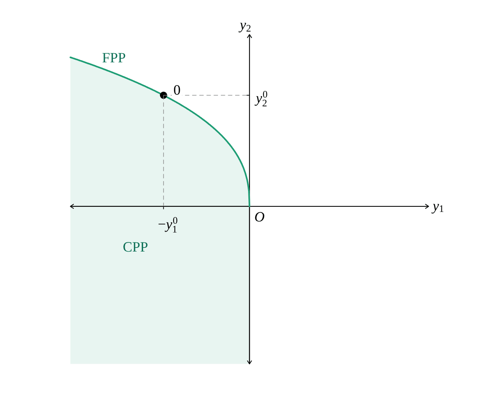
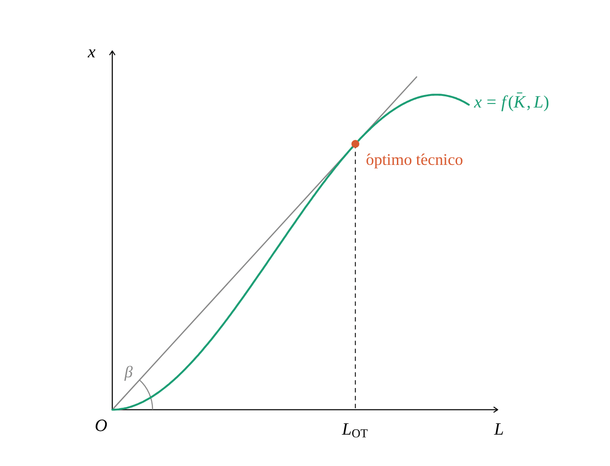
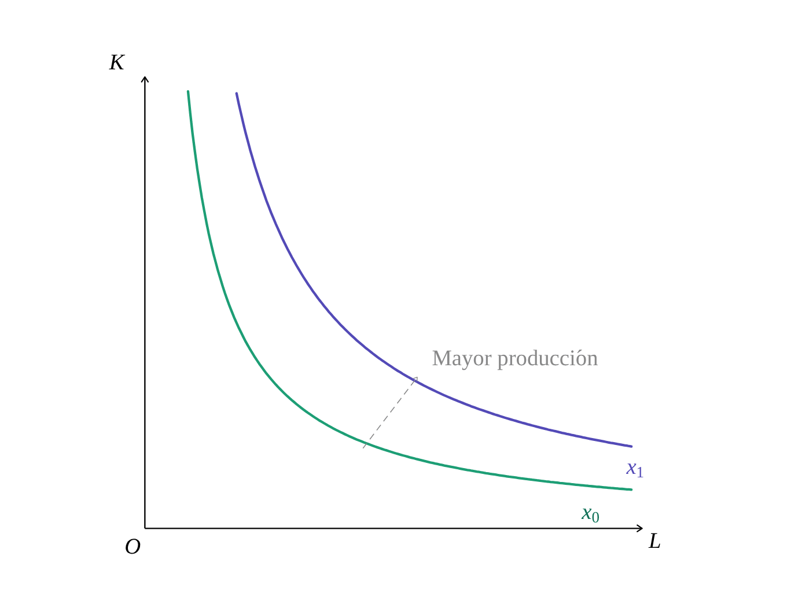

## Introducción



La **función de producción** es también la pieza con la que la macroeconomía explica el crecimiento y mide la contribución del progreso técnico (temas [A43](a43-crecimiento-i.qmd) y [A44](a44-crecimiento-ii.qmd)). Su estudio precede al de los costes (tema [A12](a12-costes.qmd)), porque la tecnología determina el coste mínimo de cada nivel de producción.

El tema desarrolla la teoría de la producción en los bloques siguientes:

- *Fundamentos*: conjunto de posibilidades de producción, función de producción, curvas isocuantas, relación marginal de sustitución técnica (RMST) y elasticidad de sustitución técnica (EST).

- *Leyes de producción*: corto plazo (ley de proporciones variables), largo plazo (rendimientos a escala) y muy largo plazo (progreso técnico).

- *Extensiones*: producción conjunta o multiproducto, paso previo al equilibrio general, y fronteras de eficiencia (medición empírica de la eficiencia productiva).

## 1. Fundamentos de la teoría de la producción

La teoría de la producción concibe la empresa como un agente racional que procura obtener, con una tecnología dada, el mayor *output* posible de los *inputs* que emplea. Por ello, la teoría excluye los precios y costes del análisis y se centra en las restricciones técnicas que condicionan físicamente la producción.

### 1.1. El conjunto de elección: planes de producción y tecnología

El conjunto de elección de la empresa se delimita en tres pasos, que van del espacio de todos los planes de producción al subconjunto de los técnicamente posibles y, dentro de este, a su frontera, formada por los técnicamente eficientes.

#### 1.1.1. El espacio de planes de producción

**Definición**: un *plan de producción* recoge las combinaciones de *output* e *inputs* a las que da lugar un proyecto de producción. En su actividad, la empresa crea productos (*outputs*) y utiliza insumos (*inputs*).

El conjunto de todos los planes se conoce como *espacio de planes de producción* (EPP)[^a11-1]:

$$\text{EPP} = \left\{ \mathbf{y} = (y_1, y_2, \ldots, y_n) \in \mathbb{R}^n \right\}, \qquad \begin{cases} y_i > 0: \; x_i \text{ (output)} \\ y_i < 0: \; z_i \text{ (input)} \end{cases}$$

Sin embargo, cualquier economía tiene recursos limitados y, por lo tanto, existen límites a lo que cada empresa puede producir. Así, si se quiere producir un bien, se deberá renunciar a la producción de otro bien. Estos límites a la actividad empresarial se determinan por la tecnología y la dotación de recursos de la que dispone la empresa.

Por eso, de todos los planes concebibles, la empresa solo tiene a su alcance los que permite el conocimiento técnico disponible y, de entre ellos, los que su dotación de recursos le permite ejecutar.

#### 1.1.2. El conjunto de posibilidades de producción: axiomas de delimitación

**Definición**: el *conjunto de posibilidades de producción* (CPP) agrupa todos los planes físicamente posibles:

$$\text{CPP} \subseteq \text{EPP}$$

**Propiedades**: el CPP se delimita dentro del EPP a partir de una serie de axiomas:

- *No vacío*: existe como mínimo un plan de producción a disposición de la empresa. Gráficamente, en el plano *input-output*, hay algún punto que pertenece al CPP.

- *Cerrado*: el límite de una secuencia de planes técnicamente posibles es también técnicamente posible. Gráficamente, el CPP incluye su propia frontera, y por eso los planes eficientes son técnicamente posibles.

- *Libre disposición*: dado un plan técnicamente posible $\mathbf{y}_0$, pertenece también al CPP cualquier otro que emplee los mismos *inputs* o más y obtenga el mismo *output* o menos, es decir, $\forall \, \mathbf{y}_0 \in \text{CPP}; \; \mathbf{y}_1 \leq \mathbf{y}_0 \Rightarrow \mathbf{y}_1 \in \text{CPP}$.

La libre disposición supone que la capacidad productiva puede derrocharse sin coste. Gráficamente, en el plano $(y_1, y_2)$, el axioma da a la frontera una pendiente no positiva (añadir *input* no reduce el *output*) y, unido a la inacción, deja dentro del CPP el ortante negativo (planes que gastan *inputs* sin producir nada).

- *Imposibilidad de producción gratuita* (*no free lunch*): no puede obtenerse una cantidad positiva de *output* si no se emplea algún *input* ($\text{CPP} \cap \mathbb{R}^n_+ \subseteq \{\mathbf{0}\}$). Gráficamente, el CPP no tiene ningún punto en el ortante positivo salvo, a lo sumo, el origen.

- *Posibilidad de inacción*: el plan nulo es posible, $\mathbf{0} \in \text{CPP}$, es decir, la empresa puede no producir. El axioma puede, sin embargo, incumplirse a corto plazo, cuando existen factores fijos o costes irrecuperables que la empresa soporta aunque no produzca. Gráficamente, el plan nulo es un punto del CPP y, con el axioma anterior, el origen queda sobre la frontera.

- *Irreversibilidad*: si un plan es técnicamente posible, el plan inverso no lo es. Formalmente, $\mathbf{y} \in \text{CPP}, \; \mathbf{y} \neq \mathbf{0} \Rightarrow -\mathbf{y} \notin \text{CPP}$.

La irreversibilidad implica que no es posible deshacer la producción y recuperar los *inputs* a partir del *output*. Gráficamente, en el caso de un *input* y un *output*, el axioma descarta el cuadrante en el que el *output* aparecería como *input* y el *input* como *output*.

Gráficamente, la tecnología se representa en el plano *input-output*, $(y_1, y_2)$ (figura -@fig-a111-cpp-fpp), con el *input* en negativo:

1. *Conjunto de posibilidades de producción* (CPP): la región sombreada, que reúne los planes con las propiedades anteriores.

2. *Frontera de posibilidades de producción* (FPP): el límite superior del conjunto, una curva que pasa por el origen.

3. *Plan eficiente*: un punto de la frontera, como el 0, que emplea $y_1^0$ unidades de *input* para obtener $y_2^0$ de *output*.

::::: {#fig-a111-cpp-fpp}
::: {.content-visible when-format="html"}
```{=html}
<div class="graph-frame">
<iframe src="../graphs/a111_CPP_FPP.html" style="height:580px" loading="lazy" title="fig-a111-cpp-fpp"></iframe>
</div>
```
:::

::: {.content-visible unless-format="html"}

:::

Conjunto y frontera de posibilidades de producción. El conjunto reúne los planes de producción técnicamente factibles y la frontera, los eficientes.
:::::

#### 1.1.3. La frontera de posibilidades de producción: eficiencia técnica, axiomas de regularidad y rendimientos de escala

**Definición**: los puntos de la frontera cumplen la *eficiencia técnica*, es decir, no es posible obtener más *output* con los mismos *inputs* o el mismo *output* con menos *inputs*. Por eso, la FPP representa la restricción tecnológica efectiva de la empresa.

**Propiedades**: la forma de la FPP depende de axiomas sobre la escala de la tecnología, que, en tecnologías de producción simple, se trasladan directamente a la función de producción:

- *Aditividad* (libre entrada): sumar dos planes técnicamente posibles da otro plan posible ($\forall \, \mathbf{y}_0, \mathbf{y}_1 \in \text{CPP}, \; \mathbf{y}_0 + \mathbf{y}_1 \in \text{CPP}$), lo que equivale a suponer que dos planes posibles cualesquiera pueden ejecutarse a la vez en unidades de producción independientes (en particular, cualquier plan puede replicarse).

La aditividad implica rendimientos no decrecientes (constantes o crecientes, por ejemplo por indivisibilidades), porque garantiza que duplicar un plan es posible, pero nada impide que existan planes más productivos que esa duplicación.

- *Proporcionalidad* (divisibilidad): todo plan posible puede reducirse a escala, en cualquier proporción, sin dejar de ser posible ($\forall \, \mathbf{y}_0 \in \text{CPP}, \; \lambda \mathbf{y}_0 \in \text{CPP}, \; \lambda \in [0, 1]$).

La proporcionalidad implica rendimientos no crecientes a escala (constantes o decrecientes).

- *Convexidad*: cualquier combinación de dos planes posibles es también posible, es decir, $\forall \, \mathbf{y}_0, \mathbf{y}_1 \in \text{CPP}; \; \mathbf{y}_2 = \alpha \mathbf{y}_0 + (1 - \alpha) \mathbf{y}_1 \in \text{CPP}; \; \forall \, \alpha \in [0, 1]$.

Económicamente, la convexidad supone que las combinaciones equilibradas de factores son al menos tan productivas como las extremas, lo que recoge la sustituibilidad decreciente entre factores. Si la convexidad es estricta, las combinaciones intermedias son estrictamente más productivas y los rendimientos a escala son decrecientes. Para tecnologías de producción simple, la convexidad del CPP equivale a la concavidad de la función de producción (y, por tanto, implica su cuasiconcavidad). La convexidad estricta lleva a funciones estrictamente cóncavas, que excluyen los rendimientos crecientes y, por tanto, los mixtos.

Solo con rendimientos constantes pueden cumplirse los tres axiomas a la vez, y la combinación que se cumple en cada caso decide qué rendimientos hay:

1. *Rendimientos constantes a escala*: si se dan a la vez proporcionalidad y aditividad, el CPP es un cono convexo, aunque no estrictamente convexo. Todo plan admite cualquier cambio de escala, los rendimientos son constantes y la frontera es una recta que sale del origen.

2. *Rendimientos decrecientes a escala*: un CPP estrictamente convexo admite reducciones proporcionales (dada la inacción), pero no la suma de planes. Con el doble de *inputs* se obtiene menos del doble de *output*, los rendimientos son decrecientes y la frontera es estrictamente cóncava.

3. *Rendimientos crecientes a escala*: con aditividad y sin proporcionalidad hacia abajo, el CPP deja de ser convexo. Un plan grande rinde más que varios pequeños combinados, los rendimientos son crecientes y la frontera es convexa. La teoría neoclásica excluye este caso, que la teoría de la organización industrial recupera (tema [A15](a15-toi.qmd)).

### 1.2. La función de producción

La función de producción resume la tecnología descrita por el conjunto de posibilidades de producción como relación cardinal entre los factores y el *output* máximo, y sus derivadas definen las productividades marginal y media.

#### 1.2.1. La función de producción y sus propiedades

**Definición**: la *función de producción* es una relación exclusivamente técnica que indica, para cada vector de *inputs* $\mathbf{z} = (z_1, \ldots, z_m) \in \mathbb{R}^m_+$, el *output* máximo que permite la tecnología dada:

$$x = f(\mathbf{z}), \qquad f: \mathbb{R}^m_+ \rightarrow \mathbb{R}_+$$

La función describe la frontera del conjunto de posibilidades de producción. Para cada $\mathbf{z}$, $f(\mathbf{z})$ es el *output* del único plan técnicamente eficiente que emplea esos *inputs*. 

Desde el punto de vista dual, la tecnología puede describirse también mediante el *conjunto de requerimientos de inputs*, $V(x) = \{\mathbf{z} \in \mathbb{R}^m_+ : f(\mathbf{z}) \geq x\}$, el conjunto de combinaciones de *inputs* con las que puede obtenerse al menos el *output* $x$. La frontera de ese conjunto es la isocuanta.

La función es *monoproducto* cuando existe un único *output*, $x = f(\mathbf{z})$, y *conjunta* o *multiproducto* cuando hay varios, en cuyo caso la tecnología se describe mediante una función de transformación implícita, $F(\mathbf{x}, \mathbf{z}) = 0$. La producción multiproducto se estudia en el apartado 3.1, y en lo que sigue el análisis se centra en la función monoproducto.

**Propiedades**:

1. *Continuidad y diferenciabilidad*: es continua en las cantidades de factores (perfecta divisibilidad de factores y producto) y dos veces diferenciable, lo que permite definir productividades marginales y relaciones de sustitución.

2. *Transformaciones*: es una función cardinal, pues sus variables son observables y medibles. Por ello, a diferencia de la utilidad, no admite transformaciones que alteren sus valores. 

La comparación de $f(\lambda \mathbf{z})$ con $\lambda f(\mathbf{z})$ ante un cambio equiproporcional de todos los factores define los *rendimientos a escala*: crecientes, constantes o decrecientes (si es homogénea de grado $h$, según $h > 1$, $h = 1$ o $h < 1$), que se estudian en el apartado 2.2.

3. *Inclinación*: al recoger solo planes técnicamente eficientes, es no decreciente en la cantidad de cada factor (libre disposición), y las productividades marginales son positivas en la región económica.

4. *Forma*: su curvatura depende de la tecnología. La cuasiconcavidad (isocuantas convexas) recoge la sustituibilidad decreciente entre factores, y los rendimientos de cada factor (apartado 2.1) recogen cómo varía el *output* al aumentar uno de ellos manteniendo fijos los demás.

5. *Otras propiedades*:

    - *Agotamiento del producto*: si es homogénea de grado $h$, por el teorema de Euler, $\sum_i z_i \, \partial f / \partial z_i = h \cdot f(\mathbf{z})$. Con rendimientos constantes ($h = 1$), remunerar cada factor según su productividad marginal agota exactamente el producto, mientras que con rendimientos crecientes los pagos lo superan y con decrecientes no lo agotan (tema [A03](a03-neoclasicos.qmd), apartado 2.5.1).

    - *Observabilidad*: no es directamente observable, porque las empresas no siempre producen sobre la frontera, pero puede estimarse con datos de cantidades de factores y de producto separando la tecnología de la ineficiencia de cada empresa (apartado 3.2).

En lo que sigue, por simplicidad, se considera un único *output* $x$, dos factores (trabajo, $L$, y capital, $K$) y una función estrictamente cuasicóncava con rendimientos de los factores primero crecientes y luego decrecientes (rendimientos mixtos).

Gráficamente, en $\mathbb{R}^3$, la función de producción es una superficie en forma de colina. Si se fija uno de los factores (p. ej. $\bar{K}$) y se varía el otro ($L$), se obtiene un corte de la superficie, la función de producción a corto plazo, que muestra la relación entre el factor variable y el *output*. Si en cambio se fija el nivel de *output*, el corte horizontal es la isocuanta.

Estos dos cortes permiten introducir los conceptos esenciales de la teoría de la producción, las productividades media y marginal a partir del primero y la relación marginal de sustitución técnica y la elasticidad de sustitución a partir del segundo.

En el plano $(L, x)$ (figura -@fig-a112-funcion-produccion-r2), el primer corte se representa con tres elementos:

1. *Función de producción a corto plazo*, $x = f(\bar{K}, L)$: con rendimientos mixtos, es primero convexa y luego cóncava.

2. *Radio-vector*: une el origen con un punto de la curva, y su pendiente, $\tan \beta$, es la productividad media.

3. *Óptimo técnico*: en el punto en que el radio-vector es tangente a la curva, con $L_{\text{OT}}$ unidades de trabajo, la productividad media es máxima.

::::: {#fig-a112-funcion-produccion-r2}
::: {.content-visible when-format="html"}
```{=html}
<div class="graph-frame">
<iframe src="../graphs/a112_Funcion_produccion_R2.html" style="height:560px" loading="lazy" title="fig-a112-funcion-produccion-r2"></iframe>
</div>
```
:::

::: {.content-visible unless-format="html"}

:::

Función de producción a corto plazo ($\bar{K}$ fijo) con rendimientos mixtos. En el óptimo técnico el radio-vector es tangente a la curva y la productividad media es máxima.
:::::

#### 1.2.2. Derivadas: el concepto de productividad

La **productividad** mide la contribución de los factores al proceso productivo. Se distingue entre productividad marginal y media, conceptos básicos de las leyes de producción a corto plazo.

**Productividad marginal**: el incremento en el producto total ante un incremento infinitesimal de un factor variable, *ceteris paribus*, si el factor es perfectamente divisible (si no lo es, $\text{Pmg}_L = \Delta x / \Delta L$):

$$\text{Pmg}_L \equiv f_L' = \frac{\partial f(K, L)}{\partial L}$$

Gráficamente, en el plano $(L, x)$ (figura -@fig-a112-funcion-produccion-r2), es la pendiente de la función de producción en cada punto, creciente en su tramo convexo (rendimientos marginales crecientes), decreciente en el cóncavo y nula en el máximo técnico (apartado 2.1.2).

**Productividad media**: el producto total obtenido por unidad de factor variable aplicado:

$$\text{Pme}_L \equiv \frac{f(K, L)}{L} = \frac{x}{L}$$

Gráficamente, es la pendiente del radio-vector trazado desde el origen ($\tan \beta$). La productividad media, $\tan \beta$, crece al aumentar $L$ hasta que el radio-vector es tangente a la función de producción (figura -@fig-a112-funcion-produccion-r2).

La relación entre productividad marginal y media tiene una lógica económica directa:

- Cuando la $\text{Pmg}_L$ es superior a la $\text{Pme}_L$, cada trabajador adicional produce más que la media, por lo que la media sube. 

- Cuando la $\text{Pmg}_L$ es inferior a la $\text{Pme}_L$, cada trabajador adicional produce menos que la media, por lo que la media cae. 

Por ello, ambas productividades coinciden necesariamente cuando la productividad media alcanza su máximo en lo que se denomina *óptimo técnico*, donde el radio-vector es tangente a la función de producción (figura -@fig-a112-funcion-produccion-r2).

### 1.3. Las curvas isocuantas

Las curvas de nivel de la superficie de la función de producción, trasladadas al plano de los factores productivos, componen el mapa de las que en economía se llaman **curvas isocuantas**.

**Definición**: una isocuanta recoge los distintos modos de combinar los factores que dan un mismo volumen de producto[^a11-7].

**Propiedades**:

- *Ordenación*: no se cortan, y las más alejadas del origen reflejan mayor nivel de producto.

- *Pendiente*: negativa en el plano $(L, K)$ (si se cumple la eficiencia técnica).

- *Forma*: lineales (sustituibilidad perfecta), angulares/Leontief (complementariedad perfecta), quebradas (sustituibilidad limitada, programación lineal) y continuas y convexas (sustituibilidad continua e imperfecta).

#### 1.3.1. Pendiente de la isocuanta: la relación marginal de sustitución técnica

Analíticamente, para dos factores cualesquiera, $i$ y $j$, con los demás constantes, la pendiente de la isocuanta es:

$$dx = \frac{\partial f}{\partial z_i} dz_i + \frac{\partial f}{\partial z_j} dz_j = 0 \;\Rightarrow\; \text{RMST}_{ji} = -\frac{dz_j}{dz_i}\bigg|_{x_0} = \frac{\partial f/\partial z_i}{\partial f/\partial z_j}$$

Con los dos factores de este tema, trabajo y capital, es $\text{RMST}_{KL} = -dK/dL\,|_{x_0} = (\partial f/\partial L)/(\partial f/\partial K)$. La RMST muestra la tasa a la que se puede sustituir un factor por otro manteniendo la producción constante. Económicamente, mide cuántas unidades de capital puede liberar la empresa al contratar una unidad adicional de trabajo, sin que cambie su nivel de *output*, y es una medida de la sustituibilidad en términos de contribución marginal relativa. 

Si la $\text{Pmg}_L$ es elevada en relación con la $\text{Pmg}_K$, una unidad de trabajo sustituye muchas unidades de capital, y la RMST es alta. A medida que se sustituye capital por trabajo, la $\text{Pmg}_L$ tiende a caer y la $\text{Pmg}_K$ a subir, y la cuasiconcavidad garantiza que su cociente, la RMST, sea decreciente.

La RMST equivale, en la producción, a la relación marginal de sustitución (RMS) del consumidor, pero, como la función de producción es cardinal, la magnitud de las contribuciones marginales sí tiene significado. La limitación de la RMST, con todo, es que depende de las unidades en que se mida cada factor, que pueden ser distintas.

Gráficamente, en el plano $(L, K)$ (figura -@fig-a113-isocuanta), cada isocuanta, $x_0$ o $x_1$, reúne las combinaciones de trabajo y capital que dan ese nivel de producción. Tiene pendiente negativa porque, con productividades marginales positivas, emplear más trabajo permite producir lo mismo con menos capital, y es convexa respecto al origen porque la RMST es decreciente. Su pendiente en cada punto, cambiada de signo, es la RMST, y las más alejadas del origen recogen una producción mayor ($x_1 > x_0$).

::::: {#fig-a113-isocuanta}
::: {.content-visible when-format="html"}
```{=html}
<div class="graph-frame">
<iframe src="../graphs/a113_Isocuanta.html" style="height:560px" loading="lazy" title="fig-a113-isocuanta"></iframe>
</div>
```
:::

::: {.content-visible unless-format="html"}

:::

Isocuanta. La curva reúne las combinaciones de factores que generan el mismo nivel de producción. Su pendiente, cambiada de signo, es la relación marginal de sustitución técnica.
:::::

#### 1.3.2. Forma de la isocuanta: la elasticidad de sustitución técnica (Hicks, 1932)

Medir la sustituibilidad con la RMST choca con el problema de las unidades. La EST lo evita porque relaciona dos variaciones porcentuales, la de la mezcla factorial y la de la RMST, cuyo cociente no depende de las unidades. Para dos factores cualesquiera, $i$ y $j$, y, en particular, para el capital y el trabajo:

$$\begin{aligned} \sigma_{ji} &= \frac{\partial \ln(z_j/z_i)}{\partial \ln \text{RMST}_{ji}}\bigg|_{x_0} \geq 0 \\ \sigma_{KL} &= \frac{\Delta\%(K/L)}{\Delta\%(\text{RMST}_{KL})}\bigg|_{x_0} = \frac{d(K/L)}{d\,\text{RMST}_{KL}} \cdot \frac{\text{RMST}_{KL}}{K/L} = \frac{\partial \ln(K/L)}{\partial \ln \text{RMST}_{KL}} \end{aligned}$$

Cuando la EST es alta, los factores se sustituyen con facilidad, y la RMST (el cociente de productividades marginales) apenas se mueve aunque cambie la mezcla factorial. Con dos factores y minimización de costes ($\text{RMST} = w/r$), la EST coincide con la respuesta de la mezcla factorial al precio relativo de los factores. Con más de dos factores, se generaliza mediante la elasticidad parcial de Allen (1938), que se estudia en el tema [A12](a12-costes.qmd).

Son casos especiales la función lineal ($\sigma = \infty$, sustituibilidad perfecta), la Leontief ($\sigma = 0$, complementariedad perfecta) y la Cobb-Douglas ($\sigma = 1$, sustituibilidad proporcional). En esta última, la ratio $K/L$ varía en la misma proporción que la RMST, de modo que, con minimización de costes, las participaciones relativas de los factores en el coste se mantienen constantes. Para funciones de elasticidad de sustitución constante (CES), $x = (\alpha K^\rho + \beta L^\rho)^{1/\rho}$ con $\alpha, \beta > 0$, la EST es constante e igual a $\sigma = \frac{1}{1 - \rho}$.

Gráficamente, en el plano $(L, K)$ (figura -@fig-a114-es), una EST alta corresponde a una isocuanta poco curvada, en la que un mismo cambio en la proporción de factores apenas altera la RMST y la sustitución resulta sencilla. Se ilustra con tres elementos:

1. *Radio-vectores* $(K/L)_1$, $(K/L)_2$ y $(K/L)_3$: representan tres procesos productivos independientes y mutuamente excluyentes, con diferentes proporciones relativas de factores. Los movimientos sobre un radio-vector son cambios en la escala de producción, y el paso de uno a otro, $\Delta(K/L)$, un cambio en las proporciones relativas de factores.

2. *Isocuantas de dos empresas*, $x_0^A$ y $x_0^B$: para un mismo nivel de producción, sus puntos de corte con los radio-vectores reflejan las combinaciones factoriales que cada empresa requiere para alcanzar ese nivel.

3. *Pendientes en los puntos de corte*: reflejan la RMST de cada empresa, de $\text{RMST}_1^A$ a $\text{RMST}_3^A$ y de $\text{RMST}_1^B$ a $\text{RMST}_3^B$. Cuanto más convexa la isocuanta respecto al origen, menor es la EST, ya que el cambio en la pendiente de la isocuanta (la RMST) es grande en comparación con el cambio en la pendiente de los radio-vectores (la proporción $K/L$). Por eso, para el mismo $\Delta(K/L)$, la RMST varía más a lo largo de $x_0^A$ que de $x_0^B$.

::::: {#fig-a114-es}
::: {.content-visible when-format="html"}
```{=html}
<div class="graph-frame">
<iframe src="../graphs/a114_ES.html" style="height:580px" loading="lazy" title="fig-a114-es"></iframe>
</div>
```
:::

::: {.content-visible unless-format="html"}

:::

Elasticidad de sustitución técnica. Para el mismo cambio en la proporción de factores, del radio-vector $(K/L)_1$ al $(K/L)_3$, la RMST varía más a lo largo de la isocuanta más convexa, $x_0^A$ ($\sigma^A$ baja), que a lo largo de la más recta, $x_0^B$ ($\sigma^B$ alta).
:::::

#### 1.3.3. Eficiencia técnica y región económica

Las herramientas anteriores permiten delimitar la parte del mapa de isocuantas que interesa al productor. Una empresa racional nunca emplea un factor en una cantidad tal que su productividad marginal sea negativa, porque reduciendo ese factor obtendría más *output* con menos *input* (el plan sería técnicamente ineficiente). Por eso solo es relevante el tramo de las isocuantas con pendiente negativa ($\text{RMST} \geq 0$), que forma la *región económica*, la zona del mapa de isocuantas en la que tiene sentido producir.

Dentro de la **región económica** (figura -@fig-a119-region-economica), ambos factores tienen $\text{Pmg}$ positiva, las isocuantas son decrecientes y hay eficiencia técnica. Fuera de ella, uno de los factores tiene $\text{Pmg}$ negativa y las isocuantas son crecientes, pero esa zona solo existe si se prescinde del axioma de libre disposición, porque este excluye cualquier productividad marginal negativa. Separan las dos zonas las líneas de contorno (*ridge lines*), sobre las que la $\text{Pmg}$ de uno de los dos factores vale cero. Las líneas de contorno son isoclinas rectas si la función es homotética e irregulares en otro caso.

Esta delimitación enlaza con las leyes de producción. En particular, con rendimientos constantes a escala, la región económica se corresponde con la etapa II del corto plazo, la región exterior superior (exceso de capital) con la etapa I y la región exterior inferior (exceso de trabajo) con la etapa III (apartado 2.1.2). Sin embargo, en general solo es exacta la correspondencia entre la región exterior inferior ($\text{Pmg}_L < 0$) y la etapa III.

::: {#fig-a119-region-economica}

::: {.content-visible when-format="html"}
```{=html}
<div class="graph-frame">
<iframe src="../graphs/a119_Region_economica.html" style="height:560px" loading="lazy" title="fig-a119-region-economica"></iframe>
</div>
```
:::

::: {.content-visible unless-format="html"}

:::

Región económica. Las líneas de contorno, rectas desde el origen porque la función es homotética, pasan por los puntos en que las isocuantas $x_0 < x_1 < x_2$ son verticales ($\text{Pmg}_K = 0$) u horizontales ($\text{Pmg}_L = 0$). Entre ellas queda la región económica (sombreada), con isocuantas decrecientes, y fuera, las zonas de exceso de capital y de exceso de trabajo, con isocuantas crecientes.
:::

### 1.4. De la tecnología a la decisión

En este tema la empresa se estudia solo como unidad técnica, y los apartados anteriores describen los elementos de su problema: el conjunto de elección (los planes técnicamente posibles) y su ordenación (la función de producción y sus isocuantas). Sin embargo, para llegar a una decisión el análisis debe incorporar después dos tipos de consideraciones.

Por un lado, las consideraciones económicas se introducen con el coste de los factores (tema [A12](a12-costes.qmd), apartado 1.4). Los precios de los factores y el presupuesto de la empresa definen entonces su restricción, que es la recta isocoste. Al combinar esa restricción con la tecnología se obtiene el equilibrio de la empresa, ya sea minimizando el coste de un nivel de producción dado, ya sea maximizando el *output* para un coste dado.

Por otro lado, las consideraciones de mercado se introducen con el precio del producto (tema [A16](a16-competencia-perfecta.qmd), apartado 1.3). En este caso, decidir cuánto producir y a qué precio exige conocer, además, el mercado en el que la empresa vende su producto.

### 1.5. Conclusiones

Al prescindir de precios y costes, la teoría caracteriza la empresa por sus restricciones técnicas. Los axiomas del conjunto de posibilidades de producción delimitan los planes técnicamente posibles, cuya frontera reúne los eficientes. Los axiomas de escala determinan los rendimientos, constantes con aditividad y proporcionalidad, decrecientes si el conjunto es estrictamente convexo y crecientes con aditividad sin proporcionalidad, un caso que la teoría neoclásica excluye. La función de producción describe esa frontera como una relación cardinal y, a factor fijo, sus productividades marginal y media coinciden en el óptimo técnico. Sobre la isocuanta, la RMST mide la sustitución en el margen, y la elasticidad de sustitución, su facilidad sin depender de las unidades. La región económica descarta, por último, las combinaciones con alguna productividad marginal negativa.

Este instrumental no basta para decidir cuánto producir, porque faltan los precios de los factores y del producto. Permite, en cambio, ordenar la respuesta del *output* cuando varían un factor, todos o la tecnología, objeto de las leyes de producción de la sección 2.

## 2. Leyes de producción

La empresa puede aumentar su producción alterando la combinación factorial. Sin embargo, si dispone de poco tiempo o existen costes de ajuste, puede ser difícil modificar la mezcla. Por ello se distinguen cuatro marcos temporales:

1. *Muy corto plazo*: la producción ya está realizada y la cantidad ofrecida es fija (el periodo de mercado de la teoría de mercados, tema [A16](a16-competencia-perfecta.qmd)).

2. *Corto plazo*: al menos un factor es fijo y solo puede variarse el otro, lo que da lugar a la ley de las proporciones variables.

3. *Largo plazo*: todos los factores son variables y la cuestión relevante son los rendimientos a escala.

4. *Muy largo plazo*: también la tecnología cambia, y el análisis pasa a ser el del progreso técnico.

### 2.1. Corto plazo: ley de proporciones variables

En el corto plazo, solo un factor es variable y la tecnología es fija. De ahí que la única forma de aumentar la producción sea aplicar más factor variable. Dado que la proporción entre factores varía, la ley de proporciones variables establece que, llegado cierto punto, la contribución marginal al *output* del factor variable será decreciente y, llevada al extremo, negativa.

#### 2.1.1. Elasticidad-producto

A corto plazo, con al menos un factor fijo, la respuesta del *output* solo puede medirse respecto al factor variable. La **elasticidad-producto** es esa medida y desempeña en el corto plazo el papel que la elasticidad de escala desempeña en el largo. Su valor indica en qué etapa de la producción se encuentra la empresa y, con el precio del factor dado, determina la forma de las curvas de costes a corto plazo (tema [A12](a12-costes.qmd), apartado 2.1).

La relación entre productividad marginal y media se expresa mediante la elasticidad-producto:

$$\varepsilon_{xL} = \frac{\Delta\% x}{\Delta\% L}\bigg|_{\bar{K}} = \frac{\partial x / x}{\partial L / L} = \frac{\partial x}{\partial L} \cdot \frac{L}{x} = \frac{\text{Pmg}_L}{\text{Pme}_L}$$

En la función Cobb-Douglas, la elasticidad-producto de cada factor es constante e igual a su exponente. Por la relación entre cualquier magnitud marginal y su media (apartado 1.2.2), la elasticidad-producto es mayor que uno mientras la productividad media crece, menor que uno cuando decrece e igual a uno en el óptimo técnico.

#### 2.1.2. Etapas de la producción

**Etapa I**: llega hasta el margen extensivo ($\varepsilon_{xL} > 1$, $\forall \, L \in (0, L_{\text{OT}})$, donde $L_{\text{OT}}$ es el óptimo técnico, máximo del producto medio). En ella sobra factor fijo respecto al variable, así que el capital no se aprovecha bien y, con rendimientos constantes a escala, su productividad marginal resulta incluso negativa en toda la etapa ($\text{Pmg}_K < 0$, fuera de la región económica). Por eso a la empresa le conviene seguir incorporando trabajadores. A lo largo de la etapa, la función de producción es primero creciente y convexa ($f_L' > 0$, $f_{LL}'' > 0$), con rendimientos marginales crecientes que, como los rendimientos crecientes a escala, pueden deberse a indivisibilidades, y después creciente y cóncava ($f_L' > 0$, $f_{LL}'' < 0$), con rendimientos marginales decrecientes a partir del punto de inflexión.

Ese paso a rendimientos marginales decrecientes es el objeto de la *ley de rendimientos marginales decrecientes* (ley de Turgot, 1767). Según la ley, si se aumenta la utilización de un factor variable manteniendo el resto constante, a partir de cierto punto el producto total crece ($f' > 0$) cada vez menos ($f'' < 0$). Este principio es esencial porque, observado en múltiples industrias, explica la forma de las curvas de costes ($\text{Cmg} = w/\text{Pmg}_L$, con $w$ el salario), las curvas de demanda de factores y las curvas de oferta a corto plazo.

**Etapa II**: va del margen extensivo al margen intensivo, situado en el máximo técnico ($\varepsilon_{xL} \in [0, 1]$, $\forall \, L \in [L_{\text{OT}}, L_{\text{MT}}]$), y en ella se altera la intensidad de uso. Con rendimientos constantes a escala coincide con la región económica, de modo que ambas productividades marginales son positivas. La empresa debería producir en esta etapa, aunque el punto exacto dentro de ella depende de la estructura de costes. Como la teoría de la producción no puede determinarlo por sí sola, se hace necesario el estudio de la teoría de costes.

**Etapa III**: es la de sobreexplotación ($\varepsilon_{xL} < 0$ para todo $L > L_{\text{MT}}$, donde $L_{\text{MT}}$ es el máximo técnico, con $\text{Pmg}_L = 0$). El factor variable es ya tan abundante frente al fijo que su productividad marginal pasa a ser negativa. Cada trabajador adicional reduce el producto total, así que ninguna empresa racional produce en esta etapa. La evidencia sobre las jornadas laborales ilustra la aproximación al máximo técnico. El producto crece en proporción a las horas hasta unas 49 horas semanales, a ritmo decreciente a partir de ahí y, por encima de unas 55 horas, prácticamente deja de aumentar (Pencavel, 2014).

A corto plazo, por tanto, la elasticidad-producto depende de la fase de aplicación del factor variable, cuya contribución marginal acaba siendo decreciente y, llevada al extremo, negativa. Este fenómeno parece independiente del tipo de rendimientos a escala. Sin embargo, si la función es homogénea de grado $h \leq 1$ y cuasicóncava, es cóncava y la productividad marginal es no creciente, mientras que con rendimientos crecientes puede ser creciente en algún tramo.

Gráficamente, con $\bar{K}$ fijo (figura -@fig-a1110-etapas-produccion), la función de producción a corto plazo, $x = f(\bar{K}, L)$ (panel superior), y las productividades media y marginal del trabajo (panel inferior) delimitan las tres etapas. La $\text{Pmg}_L$ alcanza su máximo en el punto de inflexión y corta a la $\text{Pme}_L$ en el máximo de esta, en $L_{\text{OT}}$, donde el radio-vector es tangente a la función de producción. La $\text{Pmg}_L$ se anula en $L_{\text{MT}}$, donde el producto total es máximo.

::: {#fig-a1110-etapas-produccion}

::: {.content-visible when-format="html"}
```{=html}
<div class="graph-frame">
<iframe src="../graphs/a1110_Etapas_produccion.html" style="height:920px" loading="lazy" title="fig-a1110-etapas-produccion"></iframe>
</div>
```
:::

::: {.content-visible unless-format="html"}

:::

Etapas de la producción a corto plazo ($\bar{K}$ fijo). El óptimo técnico, $L_{\text{OT}}$, donde el radio-vector es tangente a $x = f(\bar{K}, L)$ y la $\text{Pmg}_L$ corta a la $\text{Pme}_L$ en su máximo, y el máximo técnico, $L_{\text{MT}}$, donde la $\text{Pmg}_L$ se anula, separan las etapas I, II y III.
:::

### 2.2. Largo plazo: leyes de rendimientos a escala

En el largo plazo, todos los factores son variables. Los rendimientos a escala describen la variación en el *output* cuando la escala de producción varía.

#### 2.2.1. Elasticidad de escala

La elasticidad de escala mide la respuesta del *output* a un cambio de escala, con la proporción entre factores constante, y es la contrapartida a largo plazo de la elasticidad-producto.

**Definición**: variación porcentual en el *output* ante una variación porcentual de todos los factores:

$$\varepsilon_{x\lambda} = \frac{\Delta\% x}{\Delta\% \lambda} = \sum_{i=1}^{m} \varepsilon_{xz_i} \quad \xrightarrow{i = K, L} \quad \varepsilon_{x\lambda} = \varepsilon_{xK} + \varepsilon_{xL}$$

La elasticidad de escala es la suma de las elasticidades-producto de los factores. Los rendimientos se clasifican en:

1. *Rendimientos crecientes* ($\varepsilon_{x\lambda} > 1$): pueden deberse a las indivisibilidades en el proceso productivo (Wicksell, Edgeworth, Kaldor) y a la especialización y división del trabajo (Smith, 1776). Con la especialización, cada factor se dedica a una etapa concreta del proceso productivo, lo que aumenta la eficiencia global. Asimismo, cuestiones físicas pueden generar rendimientos crecientes. Así, duplicar el diámetro de un oleoducto cuadruplica el volumen, mientras que el material necesario solo se duplica.

2. *Rendimientos constantes* ($\varepsilon_{x\lambda} = 1$): se explican por la posibilidad de replicar los procesos productivos y de reducirlos a escala (aditividad y proporcionalidad, apartado 1.1.3).

3. *Rendimientos decrecientes* ($\varepsilon_{x\lambda} < 1$): se deben a restricciones de capacidad rígida y a problemas internos de organización (burocracia, fallos de coordinación, costes de transacción). Williamson (1967), por ejemplo, explica el límite al tamaño de la empresa por la pérdida de control que sufren la información y las órdenes al pasar por cada nivel de la jerarquía (tema [A15](a15-toi.qmd), apartado 1.2.3).

**Caso de funciones homogéneas**: una función es homogénea de grado $h$ si:

$$f(\lambda K, \lambda L) = \lambda^h f(K, L), \quad \lambda \geq 0$$

En una función homogénea de grado $h$ la elasticidad de escala es constante e igual al grado, $\varepsilon_{x\lambda} = h$. En el caso Cobb-Douglas, el grado es la suma de los exponentes, $h = \alpha + \beta$. La homogeneidad implica además la homoteticidad, es decir, que la RMST depende solo de las proporciones en que se combinan los factores y no de la escala. Las isocuantas son, por tanto, expansiones radiales unas de otras y la senda de expansión es una recta por el origen.

Según el valor del grado, la función presenta rendimientos constantes si $h = 1$ (función linealmente homogénea), crecientes si $h > 1$ y decrecientes si $h < 1$. Los rendimientos constantes (globales) equivalen a homogeneidad de grado uno, y con ellos las productividades marginales y medias dependen solo de la proporción entre factores y no de la escala. Con rendimientos crecientes o decrecientes, en cambio, la función no tiene por qué ser homogénea, pues la elasticidad de escala puede variar con el nivel de producción.

#### 2.2.2. Rendimientos locales y globales

**Rendimientos locales**: son los que presenta la tecnología *en un rango restringido de producción*, el entorno de una combinación concreta de factores, $\mathbf{z}$. Se miden con la elasticidad de escala, que se calcula en ese punto y solo informa de lo que ocurre cuando, a partir de él, todos los factores aumentan en la misma proporción en una cuantía infinitesimal:

$$\varepsilon_{x\lambda}(\mathbf{z}) = \frac{d f(\lambda \mathbf{z})}{d \lambda} \cdot \frac{\lambda}{f(\lambda \mathbf{z})}\bigg|_{\lambda = 1}$$

donde $\lambda$ es el factor de escala. Los rendimientos son localmente crecientes, constantes o decrecientes en $\mathbf{z}$ según $\varepsilon_{x\lambda}(\mathbf{z})$ sea mayor, igual o menor que uno. Intuitivamente, indican si, con el tamaño actual de la empresa, un aumento del 1 % de todos los factores eleva el *output*, aproximadamente, en más, en igual o en menos del 1 %.

Además, los rendimientos locales tienen una implicación directa en términos de eficiencia económica. Si la empresa, además de producir sobre la frontera, elige la combinación de factores que minimiza el coste de cada nivel de producción, la elasticidad-producto del coste en esa combinación es la inversa de la elasticidad de escala, $\varepsilon_{Cx} = 1/\varepsilon_{x\lambda}$. Con precios de los factores dados, los rendimientos localmente crecientes equivalen, por tanto, a economías de escala ($\varepsilon_{Cx} < 1$), los constantes a su ausencia ($\varepsilon_{Cx} = 1$) y los decrecientes a deseconomías de escala ($\varepsilon_{Cx} > 1$). La relación y sus consecuencias para la forma de las curvas de coste a largo plazo se desarrollan en el tema [A12](a12-costes.qmd), apartados 1.4.4 y 2.4.

**Rendimientos globales**: son los que presenta la tecnología *en todo el rango de producción*, es decir, para cualquier combinación de factores y cualquier cambio de escala. Son, por tanto, una propiedad de toda la tecnología, como los axiomas, y se comprueban comparando la producción de cualquier plan ampliado, $f(\lambda \mathbf{z})$, con la del plan inicial multiplicada por la escala, $\lambda f(\mathbf{z})$. Son crecientes si $f(\lambda \mathbf{z}) > \lambda f(\mathbf{z})$ para todo $\mathbf{z}$ con $f(\mathbf{z}) > 0$ y todo $\lambda > 1$, y constantes o decrecientes si se cumple la igualdad o la desigualdad contraria. Intuitivamente, multiplicar todos los factores por cualquier $\lambda > 1$ multiplica siempre el *output* por más de $\lambda$, por $\lambda$ o por menos de $\lambda$.

Las dos nociones se enlazan a lo largo de cada radio-vector, donde la elasticidad de escala es la tasa a la que crece el logaritmo del *output* con el de la escala, $d \ln f(\lambda \mathbf{z}) / d \ln \lambda = \varepsilon_{x\lambda}(\lambda \mathbf{z})$. Los rendimientos globales resultan, por tanto, de acumular los locales. Si la elasticidad de escala es mayor que uno en todos los puntos, al integrar se obtiene $f(\lambda \mathbf{z}) > \lambda f(\mathbf{z})$ para todo $\lambda > 1$, y lo mismo ocurre en los otros dos casos. En particular, en una función homogénea de grado $h$ la elasticidad vale $h$ en todos los puntos, de modo que los rendimientos locales y los globales coinciden.

En general, sin embargo, la elasticidad de escala cambia con el nivel de producción y la función puede no tener rendimientos globales de ningún tipo, como ocurre con los rendimientos mixtos. A lo largo de un radio-vector, en el plano $(\lambda, x)$, la producción tiene forma de S, con rendimientos localmente crecientes a pequeña escala y decrecientes a gran escala. Esa tecnología subyace a la curva de coste medio a largo plazo en forma de U en el plano $(x, C)$ (tema [A12](a12-costes.qmd), apartado 2.2).

::: {.callout-tip collapse="true" appearance="simple" title="Ejemplo: rendimientos que cambian a lo largo de un radio-vector"}
Sea $x = f(K, L) = KL/(1 + KL)$. Las elasticidades-producto de los factores son $\varepsilon_{xK} = f_K' \cdot K/x = 1/(1 + KL)$ y, por simetría, $\varepsilon_{xL} = 1/(1 + KL)$, de modo que la elasticidad de escala es

$$\varepsilon_{x\lambda} = \varepsilon_{xK} + \varepsilon_{xL} = \frac{2}{1 + KL} = 2(1 - x)$$

ya que $1 + KL = 1/(1 - x)$. Los rendimientos son localmente crecientes mientras $x < 1/2$, constantes sobre la isocuanta $x = 1/2$ y decrecientes para $x > 1/2$. A lo largo del radio-vector que pasa por $(K_0, L_0)$, la producción $x(\lambda) = \lambda^2 K_0 L_0 / (1 + \lambda^2 K_0 L_0)$ es, en el plano $(\lambda, x)$, convexa a pequeña escala y cóncava a gran escala, con una asíntota en $x = 1$.

La inflexión está en $x = 1/4$ ($\lambda^2 K_0 L_0 = 1/3$), pero los rendimientos cambian en $x = 1/2$ ($\lambda^2 K_0 L_0 = 1$), donde el radio-vector desde el origen es tangente a la curva y $x/\lambda$ es máxima, como en el óptimo técnico del apartado 1.2.2. Entre ambos puntos la curva ya es cóncava, pero los rendimientos siguen siendo crecientes. La función no presenta rendimientos globales de ningún tipo, ya que duplicar los factores más que duplica el *output* cerca del origen y no llega a duplicarlo lejos de él.
:::


#### 2.2.3. Análisis gráfico de los rendimientos a escala

Gráficamente, en el plano $(L, K)$ (figura -@fig-a115-rendimientos-escala), con una función homogénea (isoclinas rectas), los rendimientos a escala se leen en la separación, medida a lo largo de una isoclina, entre las isocuantas de un nivel de producción de referencia y de sus múltiplos ($x_0$, $2x_0$, $3x_0$…). Dependen así de dónde se sitúan las isocuantas, mientras que su forma la decide la elasticidad de sustitución entre factores. La figura representa los tres casos con una función homogénea de grado $h$, cuyas isocuantas $x_0$, $2x_0$ y $3x_0$ cortan el radio-vector en los puntos $A$, $B$ y $C$:

- *Rendimientos crecientes* ($h > 1$, panel a): si se duplican los factores se obtiene más del doble del nivel de producción, de modo que la isocuanta $2x_0$ se alcanza antes de duplicar la distancia al origen. La distancia entre isocuantas sucesivas es cada vez menor ($\overline{OA} > \overline{AB} > \overline{BC}$).

- *Rendimientos constantes* ($h = 1$, panel b): si se duplican los factores se obtiene el doble del nivel de producción, y las isocuantas están igualmente espaciadas a lo largo del radio-vector ($\overline{OA} = \overline{AB} = \overline{BC}$).

- *Rendimientos decrecientes* ($h < 1$, panel c): si se duplican los factores se obtiene menos del doble, de modo que para alcanzar la isocuanta $2x_0$ hace falta más del doble de la distancia al origen. La distancia entre isocuantas sucesivas es cada vez mayor ($\overline{OA} < \overline{AB} < \overline{BC}$).

::: {#fig-a115-rendimientos-escala}

::: {.content-visible when-format="html"}
```{=html}
<div class="graph-frame wide">
<iframe src="../graphs/a115_Rendimientos_escala.html" style="--r:1.943" loading="lazy" title="fig-a115-rendimientos-escala"></iframe>
</div>
```
:::

::: {.content-visible unless-format="html"}

:::

Rendimientos a escala con una función homogénea de grado $h$. Sobre el radio-vector, la distancia entre las isocuantas $x_0$, $2x_0$ y $3x_0$ se reduce con rendimientos crecientes ($h = 1{,}5$, panel a), se mantiene con rendimientos constantes ($h = 1$, panel b) y aumenta con rendimientos decrecientes ($h = 0{,}6$, panel c).
:::

### 2.3. Muy largo plazo: progreso tecnológico

Cuando el horizonte es muy largo, la tecnología puede cambiar. La función de producción admite entonces un factor que refleja la mejora de los métodos productivos y desplaza la función con el tiempo.

#### 2.3.1. Definición y efectos

La idea de que la tecnología se mueve en el tiempo da lugar al concepto de **progreso técnico** o progreso tecnológico, que ha sido un objeto de estudio importante en la literatura moderna y ha tenido amplias aplicaciones en la macroeconomía. El progreso técnico se manifiesta de varias formas. La innovación de producto crea variedades de bienes ya conocidos o bienes que antes no existían, la innovación de proceso permite producir más con los mismos *inputs*, o lo mismo con menos, y los productos existentes pueden ganar calidad.

Gráficamente, el progreso técnico se puede estudiar en tres planos (figura -@fig-a116-progreso-tecnico). En la figura, el progreso adopta la forma $x = A \cdot f(K, L)$, con un parámetro de eficiencia $A$ que pasa de $A_0$ a $A_1 > A_0$ (progreso neutral en el sentido de Hicks), y las curvas finales son las discontinuas:

1. *Productividad marginal* (panel a), en el plano $(L, \text{Pmg}_L)$: la curva se desplaza hacia afuera, de $\text{Pmg}_L(L; A_0)$ a $\text{Pmg}_L(L; A_1)$.

2. *Función de producción* (panel b), en el plano $(L, x)$: pivota hacia arriba, de $A_0 f(\bar{K}, L)$ a $A_1 f(\bar{K}, L)$.

3. *Isocuanta* (panel c), en el plano $(L, K)$: la isocuanta $x_0$ se desplaza hacia el origen, de $x_0\,(A_0)$ a $x_0\,(A_1)$.

Los tres paneles expresan la misma idea. Gracias al progreso técnico, un volumen de producto dado puede obtenerse con menos cantidad de factor y, si la cantidad de factor se mantiene, la producción que se obtiene con ella es mayor. El progreso técnico es *neutral* o *sesgado* según el criterio con el que se mida su efecto sobre los factores.

::: {#fig-a116-progreso-tecnico}

::: {.content-visible when-format="html"}
```{=html}
<div class="graph-frame wide">
<iframe src="../graphs/a116_Progreso_tecnico.html" style="--r:2.125" loading="lazy" title="fig-a116-progreso-tecnico"></iframe>
</div>
```
:::

::: {.content-visible unless-format="html"}

:::

Progreso técnico en $x = A \cdot f(K, L)$, de $A_0$ a $A_1 > A_0$ (curvas finales discontinuas). La curva de productividad marginal del trabajo se desplaza hacia afuera (panel a), la función de producción a corto plazo pivota hacia arriba (panel b) y la isocuanta $x_0$ se desplaza hacia el origen (panel c).
:::

#### 2.3.2. Clasificación del progreso tecnológico

La historia del pensamiento económico ha prestado mucha atención a la clasificación del progreso técnico, porque sus efectos no se quedan en la producción y alcanzan al reparto de la renta. Cuando el progreso técnico eleva la productividad marginal de un factor más que la del otro, con una ratio capital-trabajo dada ese factor gana remuneración relativa y peso en la renta. John Hicks (1932) y Roy Harrod (1937; 1948) propusieron los dos criterios que más se usan.

**Hicks** (1932): se apoya en la RMST ($= (\partial f/\partial L)/(\partial f/\partial K)$). En el plano $(L, K)$ (figura -@fig-a117-progreso-hicks), la RMST es la pendiente de la isocuanta $x_0$ sobre el radio-vector $(K/L)_0$, antes ($\text{RMST}_0$, en $t_0$) y después ($\text{RMST}_1$, en $t_1$) del progreso técnico:

1. *Neutral*: una innovación tecnológica es neutral respecto de ambos factores, capital y trabajo, cuando, dada una ratio capital-trabajo, el cociente entre sus productividades marginales no varía. La $\text{Pmg}$ de ambos factores aumenta, así, en la misma proporción, la RMST sobre el radio-vector permanece constante (panel a) y la isocuanta se desplaza hacia el origen de forma radial, conservando su pendiente sobre cada radio-vector. La función es $x_t = A(t) \cdot f(K_t, L_t)$, donde $A(t)$ refleja todos aquellos factores que influyen en la determinación de $x$ pero que no son ni $K$ ni $L$ (p. ej. saber empresarial, cualificación).

2. *Sesgado*: en el caso de que la productividad marginal de uno de los factores aumente en mayor proporción que la del otro, la RMST a lo largo del radio-vector cambia y la isocuanta se desplaza hacia el origen de forma sesgada:

    - *Intensificador del capital* (o ahorrador de trabajo): el progreso técnico eleva la productividad marginal del capital más que la del trabajo. Por ello, para una misma proporción de factores, la RMST disminuye (la isocuanta se hace más plana sobre el radio-vector, panel b), y la empresa sustituye trabajo por capital.

    - *Intensificador del trabajo* (o ahorrador de capital): el progreso eleva más la productividad marginal del trabajo, la RMST aumenta (la isocuanta se hace más inclinada sobre el radio-vector, panel c), y la empresa sustituye capital por trabajo.

::: {#fig-a117-progreso-hicks}

::: {.content-visible when-format="html"}
```{=html}
<div class="graph-frame wide">
<iframe src="../graphs/a117_Progreso_Hicks.html" style="--r:1.943" loading="lazy" title="fig-a117-progreso-hicks"></iframe>
</div>
```
:::

::: {.content-visible unless-format="html"}

:::

Clasificación de Hicks. Entre $t_0$ y $t_1$ la isocuanta $x_0$ se desplaza hacia el origen. Sobre el radio-vector $(K/L)_0$, la pendiente de la isocuanta (la RMST) se mantiene con progreso neutral (panel a), disminuye con progreso intensificador del capital o ahorrador de trabajo (panel b) y aumenta con progreso intensificador del trabajo o ahorrador de capital (panel c).
:::

**Harrod** (1937; 1948): se basa en la participación relativa de los factores en la renta. Una innovación tecnológica es neutral si las participaciones relativas del capital y del trabajo en la renta nacional permanecen inalteradas para una determinada ratio capital-producto.

Según demostraron Robinson (1938) y Uzawa (1961), esta condición exige que el progreso técnico adopte la forma de un aumento de la productividad del trabajo, $x_t = f(K_t, A(t) \cdot L_t)$. En consecuencia, el progreso tecnológico hará que, conforme pasa el tiempo, con una misma cantidad de capital se precise una cantidad de trabajo cada vez menor para obtener la misma producción. Uzawa (1961) demostró, además, que la condición necesaria y suficiente para la existencia de un estado estacionario es que el progreso sea Harrod-neutral. Por esta razón, la neutralidad en el sentido de Harrod es la hipótesis estándar en los modelos de crecimiento de tipo Solow, ya que es la única forma de progreso técnico compatible con una senda de crecimiento equilibrado.

**Solow** (1960): una innovación es neutral si las participaciones relativas de los factores productivos en la renta nacional permanecen inalteradas para una ratio trabajo-producto. Implica que $x_t = f(A(t) \cdot K_t, L_t)$. Para funciones Cobb-Douglas, los tres tipos de progreso neutro son equivalentes.

#### 2.3.3. Conclusiones

**Aspectos positivos**: el progreso técnico es uno de los determinantes fundamentales del crecimiento económico a largo plazo. Además, la clasificación de Hicks, Harrod y Solow permite distinguir los efectos distributivos del cambio tecnológico, con implicaciones relevantes de política económica. Por ejemplo, un progreso técnico ahorrador de trabajo puede generar desempleo tecnológico y exigir políticas de reconversión, mientras que un progreso neutral en el sentido de Harrod favorece un crecimiento equilibrado.

**Limitaciones**: para funciones de tipo Cobb-Douglas, los tres tipos de neutralidad son equivalentes, lo que simplifica el análisis pero limita la capacidad del modelo para capturar los efectos asimétricos del progreso técnico observados en la práctica.

### 2.4. Conclusiones

Cada horizonte tiene su medida de la respuesta del *output*. A corto plazo, la elasticidad-producto del factor variable sitúa a la empresa en una de las tres etapas. Solo la etapa II, entre el óptimo y el máximo técnicos, es compatible con una conducta racional, aunque el punto exacto dentro de ella dependa de los costes. A largo plazo, la elasticidad de escala, suma de las elasticidades-producto, clasifica los rendimientos. Los rendimientos globales resultan de acumular esa elasticidad, que es local, a lo largo de cada radio-vector y coinciden con los locales en las funciones homogéneas. A muy largo plazo, el progreso técnico desplaza la propia función, y su sesgo, según los criterios de Hicks, Harrod o Solow, altera el reparto de la renta entre los factores.

Las tres leyes suponen un único *output* y una empresa que produce sobre la frontera. La sección 3 relaja ambos supuestos con la producción de varios bienes y con la medición de la distancia de las empresas reales a la frontera.

## 3. Extensiones

El análisis anterior se extiende en dos direcciones. La primera considera la producción conjunta, la obtención de varios productos con unos recursos dados, paso previo al equilibrio general. La segunda contrasta la teoría con los datos y mide la distancia de las empresas reales a la frontera de producción.

### 3.1. Producción conjunta: el caso multiproducto

Hasta aquí se ha supuesto que la empresa obtiene un único producto. Con esa hipótesis, era técnicamente eficiente siempre que operase sobre el tramo decreciente de sus isocuantas, el que delimita la región económica de la producción. En cambio, si la empresa obtiene varios *outputs*, situarse en el tramo decreciente de una isocuanta deja de ser condición suficiente para la eficiencia técnica.

#### 3.1.1. Planteamiento

Se producen dos bienes, $x$ e $y$, con dos factores, $K$ y $L$, mediante funciones de producción $f_x$ y $f_y$. Equivale a situarse en una economía en la que existen dos productores, cada uno de los cuales produce un bien, aunque también podría interpretarse como un único productor que produce dos bienes. La producción conjunta está sujeta a una restricción de recursos, $L_0 = L_x + L_y$ y $K_0 = K_x + K_y$. Es decir, la cantidad de factor aplicado en la producción de cada bien está limitada por la dotación de factores productivos de los que dispone la economía.

Dados los supuestos, la empresa no solo tendrá que producir de forma técnicamente eficiente cada uno de los bienes, sino que deberá producir teniendo en cuenta la cantidad producida del otro bien y las dotaciones de los demás factores productivos. La eficiencia técnica exige que la RMST sea idéntica en ambas producciones:

$$\text{RMST}_{KL}^x = \text{RMST}_{KL}^y \rightarrow \frac{\text{Pmg}_L^x}{\text{Pmg}_K^x} = \frac{\text{Pmg}_L^y}{\text{Pmg}_K^y}$$

Con dos bienes, una asignación de factores es técnicamente eficiente cuando ningún cambio en el reparto de los factores permite producir más de uno de los bienes sin producir menos del otro, condición que define la curva de contratos. Nótese que esta es la misma condición de eficiencia en la producción que se estudia en la teoría del equilibrio general, la igualación de las RMST entre sectores productivos sin necesidad de precios. La diferencia es que, en equilibrio general, un vector de precios de factores común ($w/r$) actúa como mecanismo de coordinación que garantiza esta igualación de forma descentralizada.

::: {.callout-note appearance="simple" icon=false}
El estudio de la eficiencia en la producción en un contexto de equilibrio general se desarrolla en el tema [A21](a21-equilibrio-general.qmd), donde la condición $\text{RMST}^x = \text{RMST}^y$ aparece como componente de la eficiencia de Pareto y se conecta con los teoremas fundamentales del bienestar.
:::

#### 3.1.2. Caja de Edgeworth-Bowley y curva de contratos

En el diagrama de Edgeworth, las dimensiones de la caja son las dotaciones factoriales. Por eso, cualquier punto interior es una asignación de pleno empleo, aunque no se cumpla la eficiencia productiva. Las isocuantas de cada empresa muestran las combinaciones de factores para cada nivel de producción. Tienen mayor nivel cuanto más alejadas del origen, pendiente negativa en el plano $(L, K)$ y son convexas si hay sustituibilidad imperfecta.

**Superioridad de Pareto**: si se parte de un punto como $Z$ (figura -@fig-a118-edgeworth-fpp, panel a), los puntos en el interior de la lente definida por las isocuantas que pasan por dicho punto contendrán asignaciones superiores en el sentido de Pareto. Las asignaciones de la frontera de la lente, salvo sus dos vértices ($Z$ y el otro corte de ambas isocuantas), también son superiores en el sentido de Pareto a la asignación inicial. Maurice Allais denominó esta área encerrada “área del excedente distribuible” (1943).

**Eficiencia de Pareto**: si, además, estas asignaciones son tales que ninguna empresa puede aumentar su producción sin que la otra la disminuya, serán eficientes en el sentido de Pareto. El lugar geométrico de estas asignaciones nace de la tangencia de las isocuantas y se conoce como *curva de contratos*.

La curva de contratos no es necesariamente una isoclina. En todos los puntos se cumple la condición de tangencia entre las isocuantas de cada empresa, si bien no necesariamente todos tienen la misma pendiente. Asimismo, las asignaciones sobre la curva de contratos no son comparables entre sí en el sentido de Pareto, ya que pasar de una a otra aumenta la producción de un bien a costa de la del otro.

La curva de contratos incluye los vértices de la caja (en los que una empresa usa todos los factores y la otra nada). Su forma depende de la intensidad factorial. Así, es curvada por encima de la diagonal si $x$ es más capital-intensiva, por debajo si es menos, y recta si la intensidad es idéntica[^a11-28].

#### 3.1.3. Curva de posibilidades de producción o curva de transformación

Proyectando los puntos de la curva de contratos en el plano de bienes (figura -@fig-a118-edgeworth-fpp, panel b) se obtiene la **curva de transformación** (análoga a la FPP monoproducto). La curva de transformación refleja la máxima cantidad de $x$ producible para una determinada cantidad de $y$, dada la tecnología y la dotación factorial. Recoge, por ello, las nociones de optimalidad paretiana y coste de oportunidad en la producción. Intuitivamente, expresa el hecho económico básico de que no hay suficientes recursos disponibles (tecnológicos y dotacionales) para producir todo lo que se desea de cada bien. La plena divisibilidad de los bienes considerados garantiza que la curva de transformación es continua.

Cada punto de la curva es la imagen, en el plano de bienes, de una asignación situada sobre la curva de contratos, así que todos son óptimos de Pareto, y hay infinitos que no pueden ordenarse entre sí. Los puntos exteriores a la curva no pueden producirse con los recursos y la tecnología actuales, aunque el progreso tecnológico podría ponerlos a su alcance. Los interiores sí pueden producirse, pero son ineficientes, bien porque quedan recursos sin emplear, bien porque se reparten mal entre las dos producciones. Desde ellos cabría mantener el *output* de un bien y aumentar el del otro.

::: {#fig-a118-edgeworth-fpp}

::: {.content-visible when-format="html"}
```{=html}
<div class="graph-frame">
<iframe src="../graphs/a118_Edgeworth_FPP.html" style="height:1110px" loading="lazy" title="fig-a118-edgeworth-fpp"></iframe>
</div>
```
:::

::: {.content-visible unless-format="html"}
![Caja de Edgeworth-Bowley de la producción y curva de transformación. En la caja de dimensiones $L_0 \times K_0$ (a), las isocuantas $x(Z)$ e $y(Z)$ que pasan por la asignación ineficiente $Z$ encierran la lente de asignaciones Pareto-superiores. La curva de contratos (CC), por encima de la diagonal porque $x$ es más capital-intensiva, une las tangencias entre isocuantas, como $M$ y $N$. Proyectada en el plano de bienes (b), la curva de contratos da la curva de transformación (FPP), con $Z$ en su interior y la lente proyectada en la región sombreada.](../graphs/static/a118_Edgeworth_FPP.png)
:::

Caja de Edgeworth-Bowley de la producción y curva de transformación. En la caja de dimensiones $L_0 \times K_0$ (a), las isocuantas $x(Z)$ e $y(Z)$ que pasan por la asignación ineficiente $Z$ encierran la lente de asignaciones Pareto-superiores. La curva de contratos (CC), por encima de la diagonal porque $x$ es más capital-intensiva, une las tangencias entre isocuantas, como $M$ y $N$. Proyectada en el plano de bienes (b), la curva de contratos da la curva de transformación (FPP), con $Z$ en su interior y la lente proyectada en la región sombreada.
:::

**Pendiente**: su valor absoluto, con productividades marginales positivas de ambos factores en las dos producciones, es la relación marginal de transformación (RMT). Para dos bienes cualesquiera, $i$ y $j$, $\text{RMT}_{ji} = -dx_j/dx_i$ (con las dotaciones de factores dadas) mide cuántas unidades de $j$ hay que dejar de producir para obtener una más de $i$. Con los dos bienes del modelo, $x$ e $y$:

$$\text{RMT}_{yx} = -\frac{dy}{dx}\bigg|_{K_0, L_0} = \frac{\text{Pmg}_L^y}{\text{Pmg}_L^x} = \frac{\text{Pmg}_K^y}{\text{Pmg}_K^x}$$

Siempre que no existan externalidades y las productividades marginales de los factores sean positivas, existe una disyuntiva (*trade-off*) en la producción. Al aumentar la cantidad producida de un bien necesariamente ha de disminuir la cantidad producida de otro bien, lo que refleja la existencia de un coste de oportunidad a la hora de producir cualquiera de los dos bienes.

**Interpretación desde la teoría de costes**: la RMT se puede expresar como el cociente de costes marginales, $\text{RMT}_{yx} = \text{Cmg}_x / \text{Cmg}_y$. Cabe esperar, por tanto, que la RMT aumente con movimientos en el sentido de las agujas del reloj a lo largo de la curva de transformación. Al producir más de $x$ y menos de $y$, el $\text{Cmg}_x$ sube (rendimientos decrecientes) y el $\text{Cmg}_y$ baja, de modo que la ratio aumenta.

**Forma** (cóncava respecto al origen). La concavidad puede deberse a:

- *Rendimientos decrecientes a escala*.

- *Especialización de factores*: sustituibilidad imperfecta, pues algún factor es más adecuado para la producción de un bien que para la de otro.

- *Distinta intensidad factorial con rendimientos constantes*: aunque los factores productivos sean homogéneos y las funciones de producción tengan rendimientos constantes a escala, la curva es cóncava si la fabricación de cada bien requiere distintas proporciones de factores.

Como la curva de transformación y las curvas de indiferencia se representan en el mismo espacio de bienes, pueden superponerse. Si la tecnología es convexa (curva de transformación cóncava) y las preferencias son estrictamente convexas (curvas de indiferencia convexas), existe un único punto de tangencia entre la curva de transformación y la curva de indiferencia más alta alcanzable, en el que $\text{RMT}_{yx} = \text{RMS}_{yx}$. Ese punto constituye el equilibrio general de producción y consumo de una economía con un solo agente (tipo Robinson Crusoe) o representada por una curva de indiferencia social.

#### 3.1.4. Producción conjunta en sentido técnico: la empresa multiproducto

**Idea**: el análisis anterior trata los dos bienes como producciones separadas que solo compiten por los factores (tecnologías *separables*). En cambio, hay producción conjunta en sentido estricto cuando un mismo proceso da varios productos a la vez, como la lana y la carne del ganado ovino o la gasolina y el gasóleo de una refinería. La tecnología se describe entonces con la función de transformación del apartado 1.2.1, $F(x, y, \mathbf{z}) = 0$, que no puede separarse en una función de producción por bien.

**Planteamiento**: con unos factores dados, $\bar{\mathbf{z}}$, la empresa precio-aceptante elige la combinación de productos que maximiza sus ingresos sobre su curva de transformación:

$$\max_{x, y} \; p_x x + p_y y \qquad \text{s.a.:} \; F(x, y, \bar{\mathbf{z}}) = 0$$

**CPO**: con solución interior y la restricción agotada, eliminando el multiplicador entre las dos condiciones resulta

$$\text{RMT}_{yx} = \frac{\partial F/\partial x}{\partial F/\partial y} = \frac{p_x}{p_y}$$

La empresa se desplaza a lo largo de su curva de transformación hasta que el número de unidades de $y$ a las que renuncia por una más de $x$ iguala el precio relativo.

**CSO**: si la curva de transformación es cóncava (conjunto de producción convexo), la condición es suficiente, porque el objetivo es lineal.

**Extensiones**: dos casos completan el análisis.

- *Proporciones fijas*: si los productos salen en una proporción técnica fija, $y = \kappa x$, la empresa no elige la mezcla, sino solo la escala. Los dos productos tienen un coste conjunto que no puede repartirse entre ellos (oferta conjunta de Marshall, 1890), y la empresa produce hasta que el ingreso marginal del proceso, $p_x + \kappa\, p_y$, iguala su coste marginal.

- *Economías de alcance*: si producir los dos bienes en una sola empresa cuesta menos que hacerlo en dos, la producción conjunta tiene además una ventaja de costes (tema [A12](a12-costes.qmd), apartado 3.2.3).

**Conclusiones**:

- *Aspectos positivos*: la empresa multiproducto elige la mezcla de productos con la misma lógica marginal con la que la monoproducto elige la de factores, con la RMT frente al precio relativo de los productos en el papel de la RMST frente al de los factores.

- *Limitaciones*: con proporciones fijas, el coste conjunto impide atribuir un coste propio a cada producto, de modo que el precio de cada uno lo fija su demanda, dada la escala del proceso.

### 3.2. Análisis empírico: fronteras de eficiencia

La teoría supone que la empresa produce sobre la frontera (apartado 1.1.3), pero en la práctica empresas con acceso a la misma tecnología obtienen *outputs* distintos con los mismos *inputs*. De ahí que una de las principales líneas del análisis empírico de la producción sea la medición de la **eficiencia productiva**, que cuantifica la distancia de cada empresa a una frontera no observable, estimada a partir de la mejor práctica observada. Esa medición parte de la descomposición de Farrell (1957), y la frontera se estima después con el análisis envolvente de datos o con el análisis de fronteras estocásticas.

Los dos métodos de estimación se aplican a la evaluación de hospitales, centros educativos y bancos, y a la competencia por comparación (tema [A20](a20-regulacion.qmd), apartado 2.3.2). Además, con datos de panel, el índice de productividad de Malmquist descompone la variación de la productividad en cambio de eficiencia (acercamiento a la frontera) y cambio técnico (desplazamiento de la frontera). Por su parte, la ineficiencia-X (tema [A12](a12-costes.qmd), apartado 3.1.2) ofrece una explicación de la distancia a la frontera.

#### 3.2.1. Medición de la eficiencia (Farrell, 1957)

**Idea**: Farrell (1957) mide la eficiencia de una empresa por su distancia a la frontera y distingue en ella dos componentes:

- *Eficiencia técnica* (ET): mide la máxima reducción radial de los *inputs* compatible con el *output* observado. Si la empresa produce $x$ con $\mathbf{z}$, la ET es el menor $\theta \in (0, 1]$ tal que $\theta \mathbf{z} \in V(x)$, el conjunto de requerimientos de *inputs* del apartado 1.2.1. Vale uno sobre la isocuanta y no depende de las unidades de medida.

- *Eficiencia asignativa* (EA): mide si la mezcla de factores minimiza el coste a los precios vigentes y vale uno cuando la empresa emplea la proporción de factores del punto de tangencia entre la isocuanta y la recta isocoste (tema [A12](a12-costes.qmd)).

El producto de ambas es la *eficiencia económica* o en costes, cociente entre el coste mínimo y el coste observado, $\text{EE} = \text{ET} \cdot \text{EA}$. La medida de la eficiencia técnica puede orientarse también al *output* (máxima expansión radial del *output* con los *inputs* dados), y ambas orientaciones coinciden con rendimientos constantes a escala.

**Desarrollo gráfico**: con rendimientos constantes a escala la tecnología se resume en la isocuanta unitaria $SS'$ del plano de factores por unidad de producto, $(z_1/x, z_2/x)$ (figura -@fig-a1111-farrell). La empresa observada, $P$, queda por encima de ella, y el radio-vector $OP$ corta la isocuanta en $Q$ y la recta isocoste $AA'$, tangente a la isocuanta en $Q'$, en $R$. Así, $\text{ET} = OQ/OP$, $\text{EA} = OR/OQ$ y $\text{EE} = OR/OP$.

::: {#fig-a1111-farrell}

::: {.content-visible when-format="html"}
```{=html}
<div class="graph-frame">
<iframe src="../graphs/a1111_Farrell.html" style="height:580px" loading="lazy" title="fig-a1111-farrell"></iframe>
</div>
```
:::

::: {.content-visible unless-format="html"}

:::

Medición de la eficiencia (Farrell, 1957). La empresa $P$ produce por encima de la isocuanta unitaria $SS'$, y el radio-vector $OP$ corta la isocuanta en $Q$ y en $R$ la isocoste $AA'$, tangente en $Q'$, de modo que $\text{ET} = OQ/OP$, $\text{EA} = OR/OQ$ y $\text{EE} = OR/OP$.
:::

**Conclusiones**:

- *Aspectos positivos*: resume la eficiencia de cada empresa en un índice entre cero y uno, que no depende de las unidades de medida, y separa la ineficiencia técnica de la asignativa.

- *Limitaciones*: mide la eficiencia respecto a la mejor práctica observada y no respecto a la frontera verdadera, que no es observable, de modo que el resultado depende de la muestra y del método con el que se estime la frontera.

#### 3.2.2. Análisis envolvente de datos (Charnes, Cooper y Rhodes, 1978)

**Origen**: Charnes, Cooper y Rhodes (1978) propusieron el análisis envolvente de datos (DEA, *data envelopment analysis*) para calcular la medida de Farrell con programación lineal, sin especificar una función de producción.

**Idea**: es un método no paramétrico que toma como frontera la menor tecnología que contiene todas las observaciones y cumple libre disposición, convexidad y rendimientos constantes (apartados 1.1.2 y 1.1.3).

**Razonamiento**: la ET de cada empresa resulta de un programa lineal que busca la combinación de empresas observadas que obtiene al menos su *output* con la menor fracción $\theta$ de sus *inputs*.

**Extensiones**: si se exige además que los pesos de la combinación sumen uno, se admiten rendimientos variables (Banker, Charnes y Cooper, 1984), y el cociente entre ambas medidas aísla la eficiencia de escala.

**Conclusiones**:

- *Aspectos positivos*: no exige forma funcional y admite varios *outputs*.

- *Limitaciones*: es determinista, de modo que atribuye a ineficiencia cualquier desviación, incluidos el error de medida y los *shocks* aleatorios, y es sensible a los valores atípicos.

#### 3.2.3. Análisis de fronteras estocásticas (Aigner, Lovell y Schmidt, 1977)

**Origen**: Aigner, Lovell y Schmidt (1977) y Meeusen y van den Broeck (1977) propusieron de forma independiente el análisis de fronteras estocásticas (SFA, *stochastic frontier analysis*).

**Idea**: es un método paramétrico que especifica una función de producción (Cobb-Douglas o translog) con un error compuesto:

$$\ln x_i = \ln f(\mathbf{z}_i; \boldsymbol{\beta}) + v_i - u_i$$

donde $v_i$ es un ruido simétrico y $u_i \geq 0$ la ineficiencia técnica, con distribución asimétrica (seminormal o exponencial).

**Razonamiento**: el modelo se estima por máxima verosimilitud, y la eficiencia técnica de cada empresa, $\exp(-u_i)$, se infiere de la distribución de $u_i$ condicionada al residuo compuesto.

**Conclusiones**:

- *Aspectos positivos*: a diferencia del DEA, separa ruido e ineficiencia y permite la inferencia estadística.

- *Limitaciones*: impone una forma funcional y una distribución a la ineficiencia.


## Conclusiones

La teoría de la producción estudia la empresa como unidad técnica, sujeta solo a la restricción tecnológica. La tecnología se resume en el conjunto de posibilidades de producción y en la función de producción que describe su frontera, de las que se derivan las productividades, la RMST y la elasticidad de sustitución. A partir de ellas, las leyes de producción ordenan la respuesta del *output* según el horizonte temporal. Así, a corto plazo rigen los rendimientos marginales decrecientes; a largo plazo, los rendimientos a escala, y a muy largo plazo, el progreso técnico, neutral o sesgado. Por su parte, la producción multiproducto traslada la eficiencia técnica a la asignación de factores entre bienes, y las fronteras de eficiencia miden la distancia de cada empresa a la mejor práctica. Sin embargo, al prescindir de precios, costes y organización interna, la teoría no basta para determinar cuánto produce la empresa, y sus resultados dependen de la forma funcional.

Los conceptos de la producción sostienen buena parte del libro. En primer lugar, los rendimientos a escala determinan la forma de las curvas de coste, de las que parte la oferta competitiva (temas [A12](a12-costes.qmd) y [A16](a16-competencia-perfecta.qmd)), y, cuando son crecientes, dan lugar al monopolio natural y a la necesidad de regularlo (tema [A20](a20-regulacion.qmd)). En segundo lugar, en la teoría neoclásica, la productividad marginal fija la remuneración de los factores (tema [A03](a03-neoclasicos.qmd)), y producir sobre la curva de transformación es una de las condiciones de la eficiencia de Pareto en el equilibrio general (tema [A21](a21-equilibrio-general.qmd)). Por último, la función agregada con progreso técnico es el núcleo del modelo de Solow-Swan (tema [A43](a43-crecimiento-i.qmd)) y de la contabilidad del crecimiento, que separa la contribución de los factores de la de la tecnología (tema [A45](a45-crecimiento-empirica.qmd)).

La productividad es muy heterogénea entre empresas, incluso dentro de industrias definidas de forma estrecha, donde las empresas con los mismos *inputs* medidos obtienen *outputs* muy distintos de forma persistente (Syverson, 2011). En la misma línea, Hsieh y Klenow (2009) mostraron que la dispersión entre plantas de las productividades marginales en valor, mayor en China y la India que en Estados Unidos, refleja una mala asignación de recursos que reduce la productividad agregada. Por otro lado, la automatización se estudia con modelos basados en tareas (Acemoglu y Restrepo, 2018), que describen la producción como un conjunto de tareas que pueden realizar el capital o el trabajo. En ellos, la automatización desplaza al trabajo y reduce su participación en la renta, mientras que la creación de nuevas tareas la restituye.

## Anexo. Función de producción neoclásica de buen comportamiento

La función de producción se puede representar a través de muchas especificaciones, si bien en cualquier caso refleja la eficiencia de la tecnología, los rendimientos a escala, la intensidad factorial y la sustituibilidad de los factores. Se denomina función neoclásica de buen comportamiento a la que cumple una serie de criterios neoclásicos:

1. *Eficiencia técnica*: cumple con los axiomas del productor racional. Destaca el axioma de *no free lunch*, según el cual no se puede producir sin utilizar *inputs*, aunque se admite la inacción. Formalmente, $f(0, 0) = 0$ y $f(K, L) > 0$ para $K, L > 0$.

2. *Homogénea de grado uno*: presenta rendimientos constantes a escala, $f(\lambda K, \lambda L) = \lambda f(K, L)$. Esta propiedad es condición necesaria y suficiente para que, con cualquier combinación de factores, remunerar cada factor según su productividad marginal agote la producción (teorema de Euler y su recíproco) y para expresar la función de producción en forma intensiva[^a11-30].

3. *Productividades marginales positivas*: $f_K' > 0$, $f_L' > 0$. Incrementos en la cantidad aplicada de factores productivos, manteniendo la cantidad aplicada del otro factor constante, tienen un efecto positivo sobre el *output*, dado que se cumple el criterio de eficiencia técnica. Es condición suficiente para que las isocuantas tengan pendiente negativa en el plano $(L, K)$ (existe cierto grado de sustituibilidad o coste de oportunidad entre los factores).

4. *Productividades marginales decrecientes*: $f_{KK}'' < 0$, $f_{LL}'' < 0$. Es condición necesaria (pero no suficiente) para que la función sea estrictamente cóncava, propiedad útil en los programas de maximización del beneficio. La concavidad estricta exige además que $f_{KK}'' f_{LL}'' - (f_{KL}'')^2 > 0$, es decir, que la derivada cruzada segunda no sea demasiado grande, y solo es compatible con rendimientos decrecientes a escala. La función homogénea de grado uno de la propiedad 2 no la cumple, porque en ella esa expresión es nula (es cóncava, pero no estrictamente). En cambio, las productividades marginales decrecientes no son necesarias para la estricta cuasiconcavidad (RMST decreciente en $L$ a lo largo de cada isocuanta), que depende del signo de $2 f_K' f_L' f_{KL}'' - (f_K')^2 f_{LL}'' - (f_L')^2 f_{KK}''$. Sí lo son para que exista un equilibrio en la contratación de factores productivos y, en un contexto dinámico, para que exista un estado estacionario. La conjunción de las propiedades 3 y 4 implica que a corto plazo existen rendimientos marginales decrecientes para cualquier nivel de producción (ley de Turgot).

5. *Derivadas cruzadas positivas*: $f_{KL}'' > 0$. La productividad marginal de cada factor aumenta con la cantidad empleada del otro, de modo que se prefieren combinaciones equilibradas de factores. Junto con las propiedades 3 y 4, garantiza que la RMST es decreciente, es decir, que la función de producción es estrictamente cuasicóncava (lo cual es compatible con cualquier tipo de rendimientos)[^a11-31].

6. *Condiciones de Inada*: en productividad marginal, $\lim_{K \rightarrow 0} f_K' = \infty$ (cuando la cantidad de factor productivo es baja, su productividad marginal es muy elevada, lo que, junto con la condición siguiente, garantiza la existencia de un estado estacionario con capital positivo). En el otro extremo, $\lim_{K \rightarrow \infty} f_K' = 0$ (cuando la cantidad de factor productivo es alta, su productividad marginal es muy reducida, lo que elimina la posibilidad de crecimiento endógeno). En la función, $\lim_{K \rightarrow 0} f(K, L) = 0$ (cuando la cantidad de factor productivo tiende a cero, la producción se anula, es decir, el factor es esencial) y $\lim_{K \rightarrow \infty} f(K, L) = \infty$ (cuando la cantidad de factor productivo crece sin límite, también lo hace la producción). Análogamente para $L$.

**Ejemplo: la función Cobb-Douglas de rendimientos constantes**

La participación de los capitalistas y de los trabajadores en la renta nacional permanecía más o menos constante, hecho observado por Paul Douglas cuando todavía era profesor de economía, antes de ser senador de Illinois (1949-1967). Le preguntó a su colega Charles Cobb si había una función de producción que cumpliese esta propiedad, y Cobb demostró que esta función existía y tomaba la forma $x = K^\alpha L^\beta$ con $\alpha, \beta > 0$ y $\alpha + \beta = 1$. Se puede verificar que cumple con todas las propiedades: eficiencia técnica ($f(0,0) = 0$), rendimientos constantes ($f(\lambda K, \lambda L) = \lambda^{\alpha+\beta} f(K,L) = \lambda f(K,L)$), productividades marginales positivas ($f_K' = \alpha K^{\alpha-1} L^\beta > 0$) y decrecientes ($f_{KK}'' = \alpha(\alpha-1)K^{\alpha-2}L^\beta < 0$), derivada cruzada positiva ($f_{KL}'' = \alpha\beta K^{\alpha-1}L^{\beta-1} > 0$) y, con ello, estricta cuasiconcavidad (preferencia por mezclas factoriales equilibradas), y condiciones de Inada ($\lim_{K \rightarrow 0} f_K' = \infty$, $\lim_{K \rightarrow \infty} f_K' = 0$).

[^a11-1]: *Ejemplo*: $\mathbf{y} = (-5, 2, -6, 3, 0)$ significa que se producen 2 y 3 unidades de los bienes 2 y 4, se usan 5 y 6 unidades de los bienes 1 y 3, y del bien 5 no se produce nada.

[^a11-7]: Koutsoyiannis las restringe a combinaciones técnicamente eficientes (sin tramos de pendiente positiva), mientras que aquí se sigue la definición más general de Nicholson.

[^a11-28]: Siempre que $L$ esté en abscisas y $K$ en ordenadas. Si no, el razonamiento se invierte.

[^a11-30]: Función de producción intensiva: $f(\lambda K, \lambda AL) = \lambda f(K, AL) \rightarrow f(K/AL, 1) = f(k) \rightarrow y = f(k)$. El producto por unidad de trabajo efectivo solo depende del capital por unidad de trabajo efectivo.

[^a11-31]: Que $f_{KL}'' > 0$ no implica complementariedad en sentido estricto, porque, con producción dada, un cambio de precios relativos altera la mezcla factorial (sustitución), aunque al variar la escala ambos factores pueden moverse en el mismo sentido.
