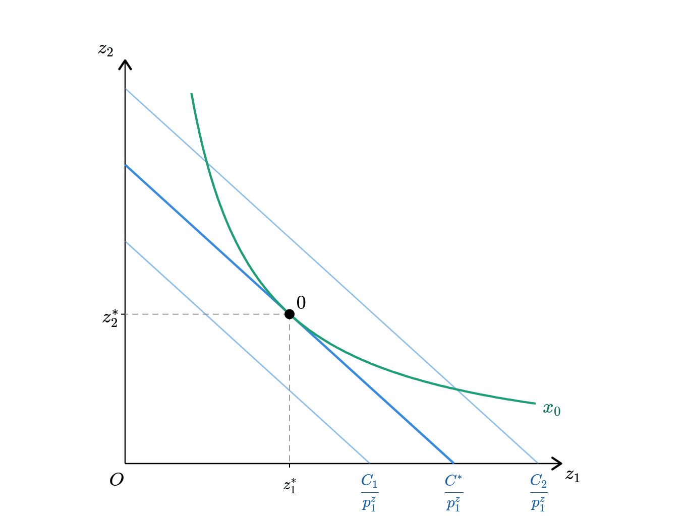
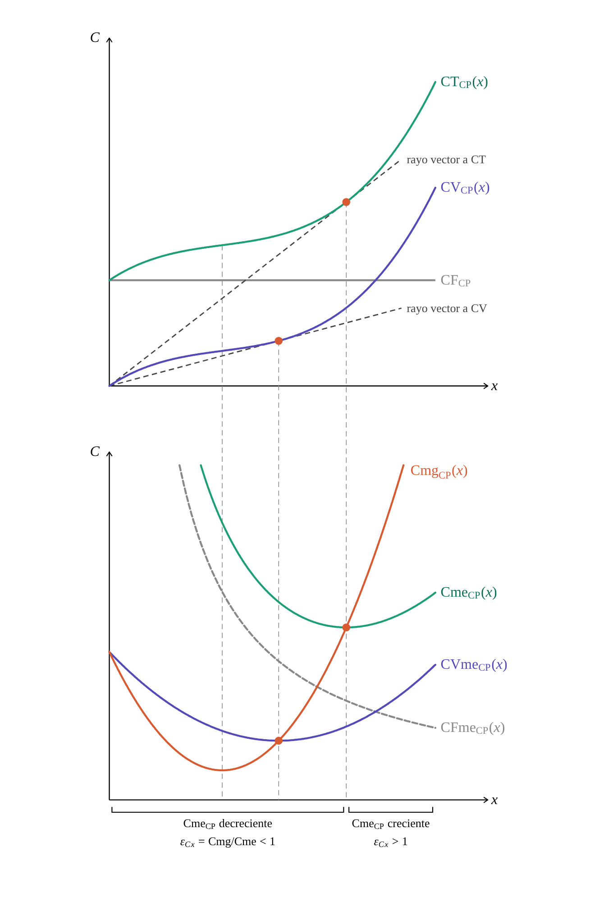
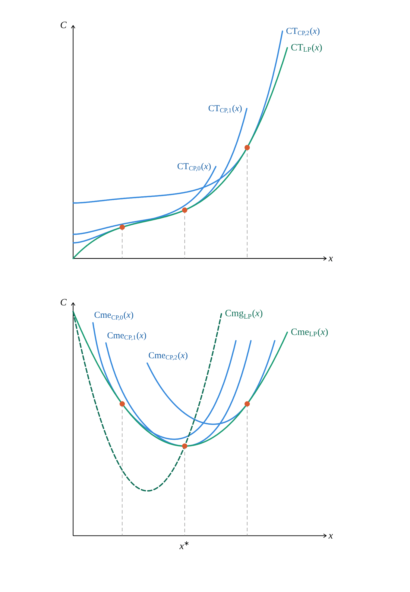
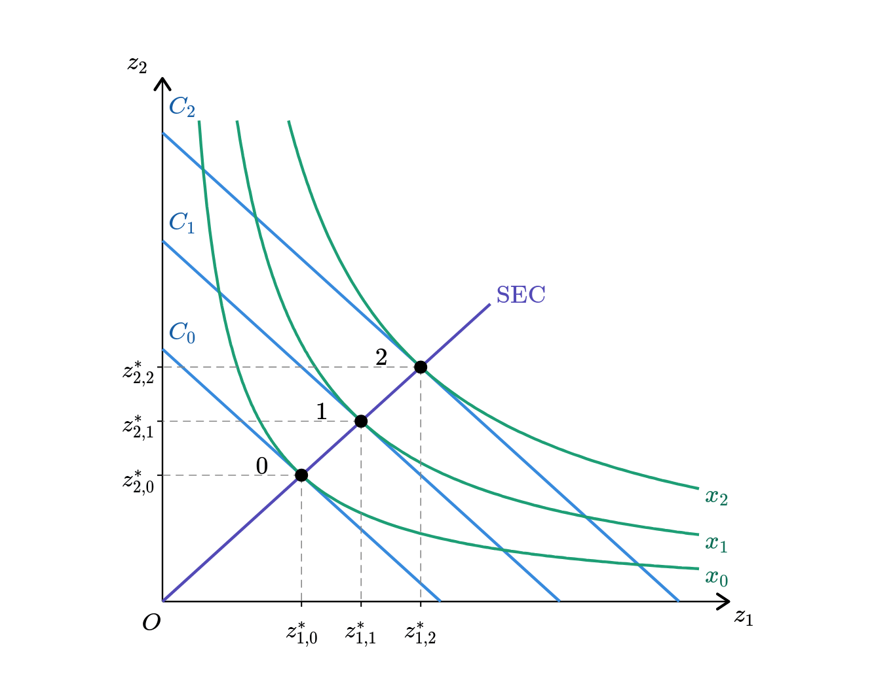
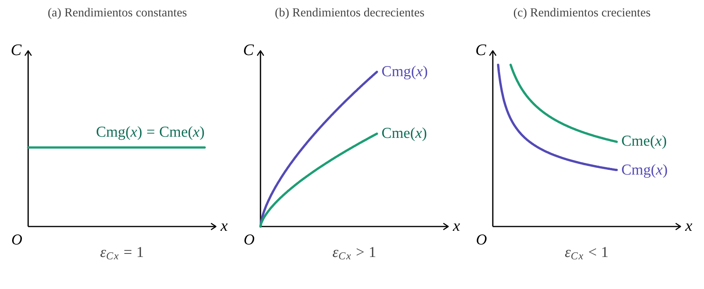
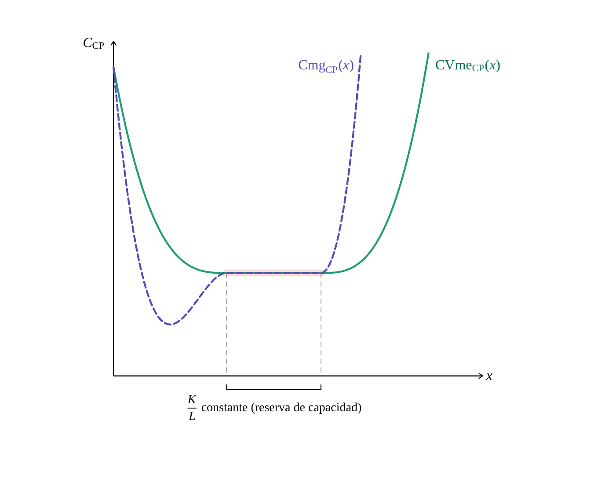
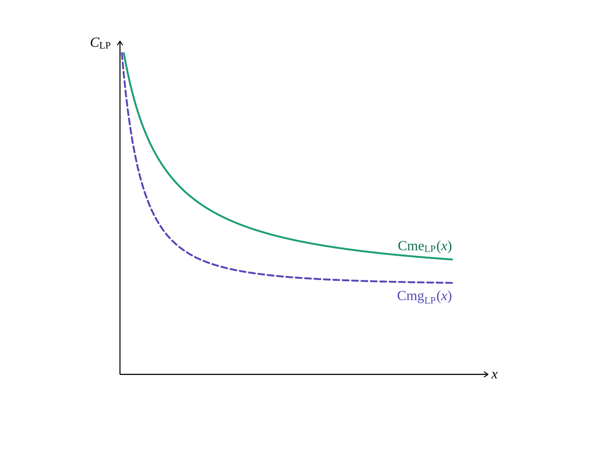
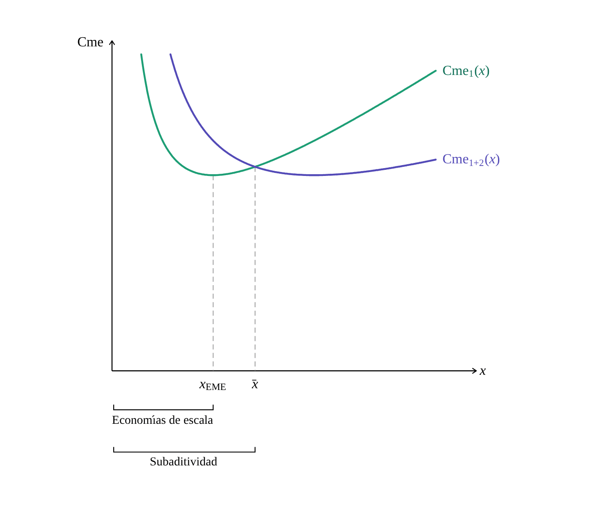
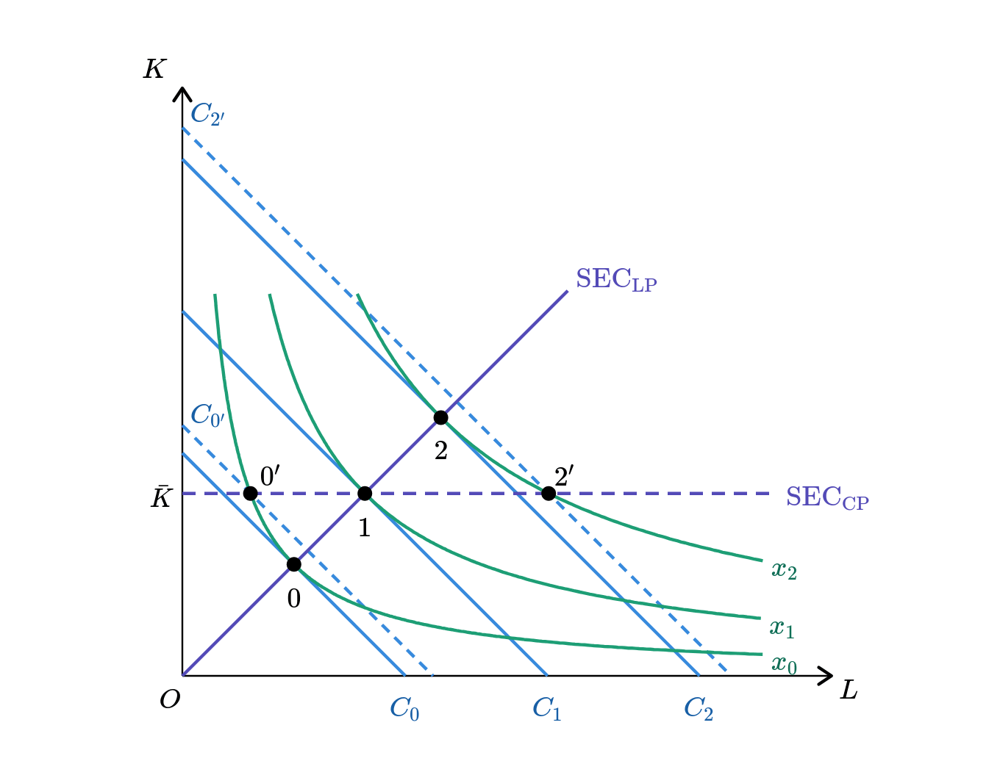

## Introducción

::: {.callout-note appearance="simple" icon=false}

:::

La teoría de costes traduce a términos monetarios la tecnología de la empresa (tema [A11](a11-produccion.qmd)). Para cada nivel de producción y cada conjunto de precios de los factores, la **función de costes** da el gasto mínimo necesario para producirlo. De ella se obtienen las **demandas condicionadas de factores** y las curvas de coste con las que se analiza la oferta de la empresa en cada estructura de mercado (temas [A16](a16-competencia-perfecta.qmd) a [A19](a19-oligopolio.qmd)).

El coste relevante es el **coste de oportunidad**, el valor de la mejor alternativa a la que se renuncia, y no el gasto contable. A corto plazo, con algún factor fijo, la ley de proporciones variables da forma de U a las curvas de coste medio y marginal. A largo plazo, en cambio, todos los factores son variables, y la forma del coste medio depende de los rendimientos a escala, que determinan la **dimensión óptima de planta** y, con ella, cuántas empresas caben en un mercado. El progreso técnico desplaza, por último, todas esas curvas hacia abajo. La distinción entre costes fijos, variables y **hundidos**, los que no se recuperan al abandonar la actividad, decide además cuándo conviene entrar en un mercado o salir de él y es la base de la teoría de los mercados impugnables (tema [A15](a15-toi.qmd)).

La curva en U ha recibido críticas desde dentro de la propia teoría. Stigler (1939) sostuvo que la empresa mantiene una reserva de capacidad que hace horizontal el coste en un amplio intervalo de producción, y Leibenstein (1966) mostró, con la ineficiencia X, que la empresa no siempre minimiza el coste. Otras aportaciones relacionan el coste con la organización de la empresa, con la estructura del mercado y con el aprendizaje acumulado en el tiempo. Los estudios aplicados estiman hoy funciones de costes flexibles, como la translog, para medir las economías de escala y de alcance de sectores como la banca, la energía o las telecomunicaciones.

El tema se organiza en tres partes:

- *Dualidad*: el tema plantea el problema primal y el dual del productor, de los que se obtienen las demandas de factores y la función de costes.

- *Costes a corto, largo y muy largo plazo*: la teoría neoclásica los analiza con su estática comparativa y sus extensiones.

- *Críticas y aplicaciones*: el tema termina con las críticas a esa teoría, las aportaciones que relacionan el coste con la empresa, el mercado y el tiempo, y la evidencia empírica.

## 1. Fundamentos de la teoría de costes

La **teoría de costes** es la parte de la teoría de la empresa que estudia cómo se traduce la tecnología en términos monetarios. Dados un nivel de producción y unos precios de los factores, analiza qué combinación de factores elige una empresa racional y cuánto le cuesta producir.

::: {.callout-note appearance="simple" icon=false}
Los apartados 1.1 a 1.3 presentan, con una finalidad conceptual, los elementos del problema de la empresa: el concepto de coste y los supuestos, el gasto en factores y la restricción tecnológica. En la exposición oral del tema puede partirse directamente del apartado 1.4, que plantea ese problema y obtiene de él la función de costes.
:::

### 1.1. El conjunto de elección y las premisas de la teoría de costes

La teoría de costes necesita precisar qué entiende por coste y entre qué combinaciones de factores elige la empresa, con qué supuestos.

#### 1.1.1. El concepto de coste

La economía entiende el coste de forma más amplia que la contabilidad:

- *Coste contable*: corresponde a los costes explícitos (gastos desembolsados, costes históricos, depreciación).

- *Coste implícito*: se refiere al coste de oportunidad de los recursos propios de la empresa, es decir, al valor de la mejor alternativa a la que se renuncia.

- *Coste económico*: suma ambos y valora cada factor por la remuneración que obtendría en su mejor uso alternativo[^a12-2].

#### 1.1.2. El conjunto de elección y los supuestos

**Definición**: el conjunto de elección de la teoría de costes es el mismo que el de la teoría de la producción. En el tema [A11](a11-produccion.qmd) la empresa elige planes de producción $\mathbf{y}$ dentro del conjunto de posibilidades de producción (CPP), delimitado por los axiomas de la tecnología. En el caso monoproducto, un plan se escribe $\mathbf{y} = (x, -\mathbf{z})$, con $x$ el *output* y $\mathbf{z} \in \mathbb{R}^m_+$ las cantidades de factores. 

Como la teoría de costes fija el nivel de producción, la elección se restringe a la sección del CPP correspondiente a ese *output*, el *conjunto de requerimientos de inputs*, $V(x)$,

$$V(x) = \left\{ \mathbf{z} \in \mathbb{R}^m_+ \;\middle|\; (x, -\mathbf{z}) \in \text{CPP} \right\} = \left\{ \mathbf{z} \in \mathbb{R}^m_+ \;\middle|\; f(\mathbf{z}) \geq x \right\}$$
es decir, las combinaciones de factores con las que puede obtenerse al menos $x$, cuya frontera es la isocuanta.

**Supuestos**: la teoría de costes descansa en supuestos que se pueden resumir en cuatro premisas:

- *Entorno*: la empresa obtiene un único producto y decide en un marco estático y con certidumbre sobre el nivel de producción.

- *Agentes*: la empresa minimiza el coste de cada nivel de producción, lo que es condición necesaria para maximizar el beneficio sea cual sea la estructura del mercado del producto.

- *Tecnología*: la función de producción cumple las propiedades del tema [A11](a11-produccion.qmd) (continuidad, doble diferenciabilidad, cuasiconcavidad estricta, rendimientos regulares), lo que garantiza isocuantas estrictamente convexas y, si los factores son esenciales, soluciones interiores.

- *Mercado de factores*: la empresa es precio-aceptante, con el vector de precios $\mathbf{p}^z = (p_1^z, \ldots, p_m^z)$ dado.

### 1.2. La función objetivo: el gasto en factores y las rectas isocoste

Delimitado el conjunto de elección, falta el criterio con el que la empresa ordena sus alternativas, el gasto en factores, cuyas curvas de nivel son las rectas isocoste.

#### 1.2.1. La función de gasto en factores y sus propiedades

**Definición**: la función objetivo de la empresa es el *gasto en factores*, que asigna a cada combinación de factores su coste a los precios vigentes:

$$C(\mathbf{z}) = \sum_{i=1}^{m} p_i^z z_i = \mathbf{p}^z \cdot \mathbf{z}, \qquad C: \mathbb{R}^m_+ \rightarrow \mathbb{R}_+$$

**Propiedades**:

1. *Continuidad y diferenciabilidad*: es continua y diferenciable en las cantidades de factores y en sus precios, por ser lineal.

2. *Transformaciones*: es homogénea de grado uno en las cantidades de factores, $C(\lambda \mathbf{z}) = \lambda C(\mathbf{z})$, y en sus precios, $C(\lambda \mathbf{p}^z, \mathbf{z}) = \lambda C(\mathbf{p}^z, \mathbf{z})$. Es una función cardinal, medida en unidades monetarias.

3. *Inclinación*: estrictamente creciente en la cantidad de cada factor, $\partial C / \partial z_i = p_i^z > 0$, y no decreciente en el precio de cada factor, $\partial C / \partial p_i^z = z_i \geq 0$.

4. *Forma*: lineal en las cantidades de factores (y, por separado, en sus precios), luego a la vez cóncava y convexa en ellas.

5. *Otras propiedades*:

    - *Observabilidad*: es observable, pues lo son los precios y las cantidades de los factores.

#### 1.2.2. Rectas isocoste

**Definición**: las curvas de nivel de la función de gasto son las *rectas isocoste*, lugar geométrico de las combinaciones de factores que suponen un mismo gasto, $\sum_i p_i^z z_i = C_0$.

**Propiedades**:

- *Pendiente*: en el caso de dos factores, la recta $p_1^z z_1 + p_2^z z_2 = C_0$ tiene ordenada en el origen $C_0 / p_2^z$ y abscisa $C_0 / p_1^z$, y su pendiente es
    $$\frac{dz_2}{dz_1}\bigg|_{C_0} = -\frac{p_1^z}{p_2^z}$$
    el precio relativo de los factores, es decir, la tasa externa u objetiva a la que el mercado permite sustituir un factor por otro sin alterar el gasto.

- *Forma y desplazamientos*: al ser lineal la función objetivo, la pendiente es constante a lo largo de la recta, y la sustituibilidad que ofrece el mercado no depende de las cantidades. Un aumento del gasto $C_0$ desplaza la recta paralelamente hacia fuera (figura -@fig-a121-equilibrio-coste), y un cambio en el precio relativo la gira en torno a la intersección con el eje del factor cuyo precio no varía.

### 1.3. La restricción: la tecnología y la eficiencia técnica

**Definición**: la restricción de la empresa es la tecnología, ya que para producir $x$ debe elegir una combinación de factores del conjunto de requerimientos de *inputs*, $f(\mathbf{z}) \geq x$.

**Propiedades**:

- *Eficiencia técnica*: no puede obtenerse más *output* con los mismos *inputs* ni el mismo *output* con menos *inputs*. Las isocuantas reúnen las combinaciones técnicamente eficientes que producen un mismo *output*.

- *Región económica*: la empresa se sitúa en el tramo decreciente de las isocuantas, delimitado por las líneas de contorno (*ridge lines*)[^a12-3], en el que la productividad marginal de ambos factores es positiva.

- *Eficiencia en costes*: la eficiencia técnica, por sí sola, deja abiertas dos elecciones. La teoría de costes determina, según lo que cuestan los factores, el punto concreto de la isocuanta, y la teoría de los mercados decide sobre qué isocuanta se sitúa la empresa. Aunque todos los puntos de la isocuanta son técnicamente eficientes, al productor le interesan los que usan más del factor relativamente barato (aquel cuyo precio relativo es menor que su productividad marginal relativa). La teoría de costes añade así la eficiencia en costes, que pide una asignación técnicamente eficiente y, además, de coste mínimo[^a12-5].

### 1.4. La decisión de la empresa: dualidad y función de costes

La decisión de la empresa puede plantearse como un problema primal (máxima producción con un gasto dado) o como su dual (mínimo coste de un nivel de producción dado). Sus soluciones, relacionadas por dualidad, dan las demandas de factores y la función de costes, cuya estática comparativa se estudia en el apartado 2. La dualidad en el ámbito de la empresa se completa con la función de máximo beneficio, $\Pi(p, \mathbf{p}^z)$, que da el mayor beneficio alcanzable para cada precio del producto y de los factores. Esta función es homogénea de grado uno y convexa en todos los precios, no decreciente en el del producto y no creciente en los de los factores. Por el lema de Hotelling, sus derivadas dan la oferta, $x^s = \partial \Pi / \partial p$, y las demandas incondicionadas de factores, $z_i^d = -\partial \Pi / \partial p_i^z$, que, a diferencia de las condicionadas, recogen también el ajuste de la producción. Su desarrollo y su aplicación a la oferta competitiva están en el tema [A16](a16-competencia-perfecta.qmd), apartado 1.3.4.

#### 1.4.1. Problema primal: maximización de la producción

**Planteamiento**: la empresa maximiza la producción con un gasto dado en factores:

$$\max_{\mathbf{z}} \; x = f(\mathbf{z}) \quad \text{s.a.:} \quad \sum p_i^z z_i = C_0$$

donde $\mathbf{z}$ es el vector de cantidades de factores, $f(\mathbf{z})$ la función de producción, $x$ el *output*, $p_i^z$ el precio del factor $i$ y $C_0$ el gasto dado en factores. El lagrangiano es

$$\mathcal{L} = f(\mathbf{z}) + \lambda \left(C_0 - \sum p_i^z z_i \right)$$
donde $\lambda$ es el multiplicador de Lagrange de la restricción de gasto. Por el teorema de la envolvente, $\lambda = \partial \mathcal{L}/\partial C_0 = df^*/dC = f_C'$ es el **producto marginal del coste**, la producción adicional que se obtiene al gastar un euro más en factores combinados de forma óptima. Cuando el problema dual fija como objetivo la producción máxima del primal ($x_0 = x^*$), ambos tienen la misma solución y $\lambda = 1/\text{Cmg}$, porque una unidad adicional de producto exige gastar $\text{Cmg}$ euros.

**CPO**: con solución interior y la restricción agotada, derivando el lagrangiano respecto a cada factor, $\partial \mathcal{L}/\partial z_i = \partial f/\partial z_i - \lambda p_i^z = 0$, y dividiendo las condiciones de dos factores cualesquiera, $i$ y $j$:

$$\text{RMST}_{ji} = \frac{\partial f/\partial z_i}{\partial f/\partial z_j} = \frac{p_i^z}{p_j^z} \tag{1}$$

$$\frac{\partial f/\partial z_i}{p_i^z} = \lambda \quad \forall i \tag{2}$$

La ecuación (1) iguala en el óptimo el precio relativo de los factores en el mercado, la tasa externa, y la tasa interna a la que la tecnología permite a la empresa intercambiarlos. La ecuación (2) se obtiene reordenando la (1) e iguala en todos los factores la productividad marginal por euro gastado al multiplicador $\lambda$[^a12-7].

**CSO**: la CPO es suficiente si las isocuantas son estrictamente convexas (función de producción estrictamente cuasicóncava), pues la restricción de coste es lineal.

**Solución** (demandas marshallianas de factores): cantidad óptima demandada de cada factor como función de los precios de los factores y del coste:

$$z_i^m \equiv z_i^* = d_i(\mathbf{p}^z, C)$$

Sus propiedades son las siguientes:

1. *Continuidad y diferenciabilidad*: son continuas en los precios de los factores y en el coste, y diferenciables si la función de producción es dos veces diferenciable y estrictamente cuasicóncava.

2. *Transformaciones*: son homogéneas de grado cero en los precios de los factores y el coste (ausencia de ilusión monetaria).

3. *Inclinación*: en el precio del propio factor, pendiente indeterminada, pues recogen el efecto producción y el efecto sustitución. En el coste, son crecientes para los factores normales y decrecientes para los inferiores, porque un coste mayor eleva la producción máxima (apartado 2.2.2).

4. *Forma*: la teoría no restringe su curvatura respecto a los precios. La restricción de segundo orden recae sobre la función indirecta de producción, cuasiconvexa en los precios de los factores.

5. *Otras propiedades*:

    - *Agotamiento del presupuesto*: cumplen la ley de Walras aplicada a la producción, $\sum_i p_i^z z_i^m = C$.

    - *Envolvente* (*identidad análoga a la de Roy*): se obtienen de la función indirecta de producción, como cociente, cambiado de signo, de sus derivadas respecto al precio del factor y al coste.

    - *Dualidad*: coinciden con las condicionadas evaluadas en la producción máxima, $d_i(\mathbf{p}^z, C) = d_i^c(\mathbf{p}^z, \phi(\mathbf{p}^z, C))$.

    - *Observabilidad*: son directamente observables.

**Función de valor óptimo** (función indirecta de producción): recoge el máximo *output* alcanzable para cada nivel de precios de factores y coste:

$$x^* = \phi(\mathbf{p}^z, C)$$

Sus propiedades son análogas a las de la función indirecta de utilidad del consumidor:

1. *Continuidad y diferenciabilidad*: es continua en los precios de los factores y en el coste, y diferenciable cuando lo son las demandas de factores.

2. *Transformaciones*: es homogénea de grado cero en los precios de los factores y el coste. A diferencia de la función indirecta de utilidad, es cardinal, pues mide unidades físicas de producto.

3. *Inclinación*: estrictamente creciente en el coste ($\partial \phi / \partial C = \lambda > 0$) y no creciente en los precios de los factores ($\partial \phi / \partial p_i^z \leq 0$).

4. *Forma*: cuasiconvexa en los precios de los factores.

5. *Otras propiedades*:

    - *Envolvente* (*identidad análoga a la de Roy*): sus derivadas respecto a los precios y al coste dan las demandas marshallianas de factores:
        $$z_i^m \equiv z_i^* = -\frac{\partial \phi(\mathbf{p}^z, C) / \partial p_i^z}{\partial \phi(\mathbf{p}^z, C) / \partial C}$$

    - *Dualidad*: evaluada en el coste mínimo, devuelve la producción fijada, $\phi(\mathbf{p}^z, c(\mathbf{p}^z, x_0)) = x_0$.

    - *Observabilidad*: es observable, porque su valor es una cantidad física de producto.

#### 1.4.2. Problema dual: minimización del coste

**Planteamiento**: la empresa minimiza el coste de obtener un nivel de producción dado:

$$\min_{\mathbf{z}} \; C = \sum p_i^z z_i \quad \text{s.a.:} \quad f(\mathbf{z}) = x_0$$

donde $C$ es el coste o gasto en factores y $x_0$ el nivel de *output* objetivo. El lagrangiano es

$$\mathcal{L} = \sum p_i^z z_i + \mu \left[ x_0 - f(\mathbf{z}) \right]$$
El multiplicador $\mu = 1/\lambda$ es el **coste marginal de producción**, $\mu = dC^*/dx = c_x'$[^a12-8], pues por el teorema de la envolvente $\partial c(\mathbf{p}^z, x_0)/\partial x_0 = \partial \mathcal{L}/\partial x_0 = \mu$.

**CPO**: con solución interior y la restricción agotada, las condiciones de primer orden son, para cada factor $i$ y cada par de factores $i$, $j$:

$$\begin{aligned} \frac{\partial \mathcal{L}}{\partial \mu} &= x_0 - f(\mathbf{z}^*) = 0 &&\Rightarrow\; f(\mathbf{z}^*) = x_0 \\ \frac{\partial \mathcal{L}}{\partial z_i} &= p_i^z - \mu \frac{\partial f}{\partial z_i} = 0 &&\Rightarrow\; \text{RMST}_{ji} = \frac{\partial f/\partial z_i}{\partial f/\partial z_j} = \frac{p_i^z}{p_j^z} \end{aligned}$$
En el óptimo, la relación marginal de sustitución técnica (RMST) iguala al precio relativo de los factores y la isocuanta $x_0$ es tangente a la recta isocoste más baja. Por tanto, cualquier otra combinación técnicamente eficiente sería más cara.

**CSO**: la misma convexidad de las isocuantas garantiza que la tangencia es un mínimo de coste, porque el conjunto de combinaciones de factores que alcanzan $x_0$ es convexo y la función objetivo es lineal.

**Solución** (demandas condicionadas de factores): cantidad óptima demandada de cada factor como función de los precios y del *output* objetivo[^a12-10]:

$$z_i^c \equiv z_i^* = d_i^c(\mathbf{p}^z, x_0)$$

Sus propiedades son las siguientes:

1. *Continuidad y diferenciabilidad*: son continuas en los precios de los factores y en el nivel de producción, y diferenciables en las mismas condiciones que las marshallianas.

2. *Transformaciones*: son homogéneas de grado cero en los precios de los factores, es decir, una subida equiproporcional de todos ellos no altera la combinación de mínimo coste.

3. *Inclinación*: efecto sustitución propio no positivo ($\partial z_i^c / \partial p_i^z \leq 0$, por la concavidad de la función de costes en precios y el lema de Shephard, y estrictamente negativo si los factores son sustituibles) y efecto precio cruzado indeterminado. Al ser condicionadas, no recogen el efecto producción. En el nivel de producción, son crecientes para los factores normales y decrecientes para los inferiores, aunque no todos pueden ser inferiores (apartado 2.2.2).

4. *Forma*: la teoría tampoco restringe su curvatura respecto a los precios. La restricción de segundo orden recae sobre la función de costes, cóncava en los precios de los factores. Como las pendientes de las demandas condicionadas son las segundas derivadas de esa función, forman una matriz de sustitución simétrica que la concavidad hace semidefinida negativa.

5. *Otras propiedades*:

    - *No exceso de producción*: se alcanza exactamente el nivel de producción fijado, $f(\mathbf{z}^c) = x_0$.

    - *Envolvente* (*lema de Shephard*): son el gradiente de la función de costes, $z_i^c = \partial c(\mathbf{p}^z, x_0) / \partial p_i^z$.

    - *Dualidad*: coinciden con las marshallianas de factores evaluadas en el coste mínimo, $d_i^c(\mathbf{p}^z, x_0) = d_i(\mathbf{p}^z, c(\mathbf{p}^z, x_0))$.

    - *Integrabilidad*: la función de costes se recupera integrándolas cuando la matriz de sustitución es simétrica y semidefinida negativa.

    - *Observabilidad*: son observables en principio, porque el nivel de producción que las condiciona es medible, a diferencia de la utilidad en las demandas hicksianas.

**Desarrollo gráfico**: la minimización del coste se representa en el plano $(z_1, z_2)$ (figura -@fig-a121-equilibrio-coste):

1. *Isocuanta objetivo* ($x_0$): es la restricción y permanece fija.

2. *Rectas isocoste*: de pendiente $-p_1^z/p_2^z$, con un coste menor cuanto más cerca están del origen.

3. *Equilibrio*: la isocuanta $x_0$ es tangente a la isocoste más baja compatible con ella, $C^*$, en el punto 0, que es la combinación $(z_1^*, z_2^*)$. La isocoste $C_1$ no alcanza $x_0$, y la $C_2$ la alcanza con un coste mayor.

::: {#fig-a121-equilibrio-coste}

::: {.content-visible when-format="html"}
```{=html}
<div class="graph-frame">
<iframe src="../graphs/a121_Equilibrio_Coste.html" style="height:560px" loading="lazy" title="fig-a121-equilibrio-coste"></iframe>
</div>
```
:::

::: {.content-visible unless-format="html"}

:::

Equilibrio de la empresa. El coste de producir $x_0$ se minimiza en la tangencia entre la isocuanta y la recta isocoste.
:::

**Función de valor óptimo**: se obtiene la función de costes, $c(\mathbf{p}^z, x_0)$.

#### 1.4.3. Relaciones de dualidad

**Dualidad entre soluciones**: los planes óptimos de ambos problemas son idénticos, con el debido intercambio de información ($C_0 = C^*$ o $x_0 = x^*$).

**Dualidad entre funciones de demanda**:

$$d_i(\mathbf{p}^z, C) = d_i^c(\mathbf{p}^z, \phi(\mathbf{p}^z, C)) \qquad d_i^c(\mathbf{p}^z, x_0) = d_i(\mathbf{p}^z, c(\mathbf{p}^z, x_0))$$

**Dualidad entre funciones de valor óptimo**:

$$\phi(\mathbf{p}^z, C) = c^{-1}(\mathbf{p}^z, C) \qquad c(\mathbf{p}^z, x_0) = \phi^{-1}(\mathbf{p}^z, x_0)$$

#### 1.4.4. La función de valor: la función de costes y sus curvas

**Definición**: el valor óptimo del problema dual es la *función de costes*, $c(\mathbf{p}^z, x)$, que da el coste mínimo de producir $x$ dados los precios de los factores. Análoga a la función de gasto del consumidor, es la fuente de las curvas de coste y resume toda la información relevante de la tecnología que minimiza el coste (ejemplo resuelto con una Cobb-Douglas en el Anexo, apartado A.1):

$$C^* = c(\mathbf{p}^z, x_0) = \sum_{i=1}^{m} p_i^z \cdot d_i^c(\mathbf{p}^z, x_0)$$

**Propiedades**:

1. *Continuidad y diferenciabilidad*: es continua en los precios de los factores y en el nivel de producción, y diferenciable en los precios.

2. *Transformaciones*: es homogénea de grado uno en los precios de los factores[^a12-11], $c(\lambda \mathbf{p}^z, x) = \lambda \cdot c(\mathbf{p}^z, x)$. Las funciones de Cmg y Cme son también homogéneas de grado uno en precios. Es una función cardinal, medida en unidades monetarias.

3. *Inclinación*: estrictamente creciente en el nivel de producción ($\partial c / \partial x > 0$) y no decreciente en los precios de los factores ($\partial c / \partial p_i^z \geq 0$).

4. *Forma*: cóncava en los precios de los factores ($\partial^2 c / \partial (p_i^z)^2 \leq 0$). Si el precio de un factor sube, el coste aumenta menos que con las cantidades de factores constantes, por la posibilidad de sustitución[^a12-14]. La concavidad implica que la matriz de sustitución (análoga a la de Slutsky) es semidefinida negativa (demandas condicionadas no crecientes en su precio) y simétrica (por el teorema de Schwarz).

5. *Otras propiedades*:

    - *Envolvente* (*lema de Shephard*): sus derivadas respecto a los precios son las demandas condicionadas, $z_i^c \equiv z_i^* = \frac{\partial c(\mathbf{p}^z, x)}{\partial p_i^z}$.

    - *Dualidad*: evaluada en la producción máxima que permite un coste, devuelve ese coste, $c(\mathbf{p}^z, \phi(\mathbf{p}^z, C)) = C$.

    - *Integrabilidad*: recíprocamente, toda función continua, homogénea de grado uno, no decreciente y cóncava en los precios de los factores es la función de costes de alguna tecnología. La función de costes permite recuperar esa tecnología si sus conjuntos de requerimientos son convexos y monótonos (en otro caso, su envolvente convexa).

    - *Observabilidad*: se miden sus argumentos (los precios de los factores y el nivel de producción) y su valor, el coste, a diferencia de la función de gasto del consumidor, que depende de un nivel de utilidad no observable.

**Coste marginal y coste medio**: de la función de costes se derivan sus dos medidas unitarias:

- *Coste marginal*: $\text{Cmg}(x) = \partial \text{CT}(x) / \partial x$ es el coste de la última unidad producida, la pendiente de la función de coste total.

- *Coste medio*: $\text{Cme}(x) = \text{CT}(x) / x$ es el coste por unidad, la pendiente del rayo desde el origen. La forma de ambas curvas depende de la tecnología, y el marginal corta al medio en su mínimo, como toda magnitud marginal a su media[^a12-16].

**Elasticidad-producto del coste**:

$$\varepsilon_{Cx} = \frac{\Delta\% \text{CT}}{\Delta\% x} = \frac{\partial \text{CT} / \text{CT}}{\partial x / x} = \frac{\text{Cmg}}{\text{Cme}}$$

**Economías de escala**: el Cme disminuye cuando aumenta la escala de producción[^a12-17][^a12-18]. Se clasifican (Marshall) en internas (Cme cae con el tamaño de la empresa) y externas (Cme cae con el tamaño de la industria). Las internas dan forma a la Cme$_{\text{LP}}$ de la empresa, y las externas la desplazan.

Las economías de escala pueden ser, además, estáticas, si dependen del volumen producido en cada periodo, o dinámicas, si dependen de la producción acumulada (el aprendizaje del apartado 3.3). Se distingue también entre economías reales, que reducen la cantidad física de factores por unidad de producto, y pecuniarias, que provienen de mejores precios de los factores.

**Relación entre elasticidad del coste y economías de escala internas**: el valor de la elasticidad respecto a la unidad indica el tramo de la curva de coste medio en que se encuentra la empresa:

- $\varepsilon_{Cx} < 1$: el marginal está por debajo del medio, este decrece y existen economías de escala.

- $\varepsilon_{Cx} = 1$: ambos coinciden en el mínimo del coste medio y no hay economías ni deseconomías.

- $\varepsilon_{Cx} > 1$: el marginal supera al medio, este crece y existen deseconomías de escala.

**Relación con los rendimientos a escala**: en la combinación que minimiza costes, $\varepsilon_{Cx} = 1 / \varepsilon_{x\lambda}$, la inversa de la elasticidad de escala. Por tanto, con precios de los factores dados, los rendimientos crecientes equivalen localmente a economías de escala, los constantes a su ausencia y los decrecientes a deseconomías.

Si la función no es homotética, sin embargo, la correspondencia deja de ser biunívoca cuando los rendimientos se miden sobre un radio-vector distinto de la senda de expansión. Puede haber economías de escala sin rendimientos crecientes en ese radio-vector, porque la empresa cambia la combinación de factores al crecer.

**Elasticidad-precio del coste**:

$$\varepsilon_{Cp_i} = \frac{\partial c}{\partial p_i^z} \cdot \frac{p_i^z}{c} = \frac{p_i^z z_i^c}{c}$$

La elasticidad equivale a la participación del factor $i$ en el coste total[^a12-24], de la que depende, junto con la posibilidad de sustitución, el desplazamiento de las curvas de coste[^a12-26].

**Elasticidad de sustitución técnica parcial** (ESTP, Allen, 1938):

$$\sigma_{ij}^P = \frac{c \cdot c_{ij}}{c_i \cdot c_j} = \frac{\varepsilon_{z_i p_j}}{s_j}, \qquad c_i \equiv \frac{\partial c(\mathbf{p}^z, x)}{\partial p_i^z} = z_i^c, \quad c_{ij} \equiv \frac{\partial^2 c(\mathbf{p}^z, x)}{\partial p_i^z \, \partial p_j^z}$$

donde $\varepsilon_{z_i p_j}$ es la elasticidad de la demanda condicionada del factor $i$ respecto al precio del factor $j$ y $s_j = p_j^z z_j^c / c$ la participación de $j$ en el coste. La ESTP de Allen (o de Allen-Uzawa) mide la respuesta de la demanda de un factor al precio de otro, con la producción y los demás precios constantes, relativa al peso de este en el coste. A diferencia de la elasticidad de sustitución técnica (EST) de Hicks, permite que varíe el empleo de los demás factores. Es simétrica ($\sigma_{ij}^P = \sigma_{ji}^P$) y su signo clasifica a los factores en sustitutivos ($\sigma_{ij}^P > 0$) y complementarios ($\sigma_{ij}^P < 0$), caso este último solo posible con más de dos factores.

En el caso de dos factores en equilibrio competitivo ($\text{RMST} = w/r$), la ESTP coincide con la EST de Hicks y es necesariamente no negativa:

$$\sigma_{KL}^P = \frac{\Delta\%(K/L)}{\Delta\%(w/r)}\bigg|_{x_0} \geq 0$$

### 1.5. Conclusiones

Los precios de los factores convierten la tecnología en costes y permiten elegir, dentro de cada isocuanta, la combinación más barata. La empresa precio-aceptante iguala la RMST al precio relativo de los factores, tanto si maximiza la producción con un gasto dado como si minimiza el coste de un *output* dado. Los dos problemas son duales y llevan a la misma combinación óptima. La función de costes, valor del problema dual, reúne la información de la tecnología que importa a la empresa. Sus derivadas respecto a los precios son las demandas condicionadas de factores, y su elasticidad respecto al *output*, inversa de la elasticidad de escala, mide las economías de escala. La sección 2 aplica este instrumental a los horizontes temporales, que difieren en los factores que la empresa puede ajustar.

## 2. Teoría neoclásica de los costes

La función de costes del apartado 1.4.4 supone que la empresa puede ajustar todos los factores. El horizonte temporal determina, sin embargo, qué factores pueden alterarse a corto plazo (algún factor fijo), a largo plazo (todos variables) y a muy largo plazo (también la tecnología). En los dos primeros horizontes, la estática comparativa separa los cambios en el objetivo de producción, que trazan la senda de expansión, de los cambios en los precios de los factores.

### 2.1. Corto plazo: ley de proporciones variables aplicada al coste

En el corto plazo, al menos un factor es fijo, lo que genera **costes fijos**[^a12-27] (independientes del volumen de producción y, si además son irrecuperables, hundidos) y **costes variables** (dependen del volumen).

#### 2.1.1. Análisis gráfico

Gráficamente, en el plano $(x, C)$ (figura -@fig-a123-equilibrio-coste-cp), con costes cúbicos (rendimientos mixtos), las curvas de costes a corto plazo son:

**Gráfico superior** (costes totales):

1. *CF$_{\text{CP}}$*: línea horizontal, porque no dependen del nivel de producción.

2. *CV$_{\text{CP}}$*: con costes cúbicos tiene forma de S tumbada e invertida. Crece primero a un ritmo decreciente (rendimientos marginales crecientes) y, a partir del punto de inflexión, en el que la productividad marginal es máxima, a un ritmo creciente (rendimientos marginales decrecientes).

3. *CT$_{\text{CP}}$*: suma vertical de las dos anteriores, es la curva de costes variables desplazada hacia arriba en el importe de los costes fijos.

**Gráfico inferior** (costes unitarios):

1. *CFme$_{\text{CP}}$*: representa el coste fijo unitario. Es decreciente y tiene una asíntota horizontal, porque los costes fijos se diluyen conforme aumenta la producción.

2. *Cmg$_{\text{CP}}$*: es inversamente proporcional a la productividad marginal del factor variable ($\text{Cmg} = w/\text{Pmg}_L$) y tiene forma de U, con dos tramos:

    - *Tramo decreciente*: mientras los rendimientos marginales del factor variable sean crecientes.

    - *Tramo creciente*: una vez que los rendimientos marginales se vuelven decrecientes. En él, el Cmg$_{\text{CP}}$ pasa por los mínimos del coste medio variable y del coste medio total, donde el rayo desde el origen es tangente a la curva de coste correspondiente del gráfico superior.

3. *CVme$_{\text{CP}}$*: representa el coste variable unitario. En el origen coincide con el coste marginal. Decrece hasta su mínimo, llamado *mínimo de explotación* o *de funcionamiento*, en el que se alcanza el óptimo técnico (la productividad media máxima), y a partir de él crece por debajo del coste marginal. En cambio, el óptimo de explotación es el mínimo del Cme$_{\text{CP}}$, que, por la dilución del coste fijo, sigue decreciendo cuando el CVme$_{\text{CP}}$ ya crece.

4. *Cme$_{\text{CP}}$*: representa el coste total unitario. Suma vertical del CVme$_{\text{CP}}$ y del CFme$_{\text{CP}}$, converge hacia el primero a medida que el coste fijo se diluye y tiene forma de U por el supuesto de rendimientos mixtos.

::: {#fig-a123-equilibrio-coste-cp}

::: {.content-visible when-format="html"}
```{=html}
<div class="graph-frame">
<iframe src="../graphs/a123_Equilibrio_coste_CP.html" style="height:1050px" loading="lazy" title="fig-a123-equilibrio-coste-cp"></iframe>
</div>
```
:::

::: {.content-visible unless-format="html"}

:::

Costes a corto plazo. El gráfico relaciona el coste total, el coste medio y el coste marginal bajo la ley de proporciones variables.
:::

#### 2.1.2. Limitaciones a la optimalidad a corto plazo

La restricción de capacidad (factor fijo) impide cumplir $\text{RMST}_{KL} = w/r$ salvo en el nivel de producción para el que la planta es óptima. Por ello, la empresa debe utilizar combinaciones subóptimas (exceso o insuficiencia de capital, representadas en el Anexo, apartado A.3), con efectos que dependen del formato de contrato:

- *Contrato de arrendamiento*: la empresa paga solo por las unidades que usa si el factor fijo es divisible. La planta fija entonces solo un máximo, $K \leq \bar{K}$, y la empresa minimiza $wL + rK$ sujeta a él, de modo que, mientras no agote la capacidad, elige la mezcla de factores como a largo plazo. Con arrendamiento solo cabe, por tanto, la insuficiencia de capital, cuando la producción exige más del disponible, mientras que el exceso de capital, la senda $K = \bar{K}$ y el sobrecoste corresponden al contrato de propiedad.

- *Contrato de propiedad*: la empresa ha adquirido un compromiso de pago independientemente de la cantidad utilizada, de modo que $r\bar{K}$ es un coste fijo y solo el trabajo varía con la producción.

#### 2.1.3. Estática comparativa a corto plazo

::: {.callout-note appearance="simple" icon=false}
Los efectos de los cambios de costes sobre el equilibrio de la empresa y de la industria se desarrollan en el tema [A16](a16-competencia-perfecta.qmd), apartados 2.2.2 (corto plazo) y 2.3.2 (largo plazo). Aquí se recogen, sin economías de escala externas, sus efectos sobre las curvas de coste y la demanda de factores.
:::

**Cambios en el objetivo de producción**: con el capital fijo en $\bar{K}$, la empresa solo puede ajustar el trabajo, cuya demanda, $L(x; \bar{K})$, es la que exige la isocuanta de cada nivel de producción. La *senda de expansión a corto plazo* es, por tanto, la recta horizontal $K = \bar{K}$ del plano $(L, K)$ (figura -@fig-a129-factor-fijo), y el coste a corto plazo es $\text{CT}_{\text{CP}}(x) = w L(x; \bar{K}) + r \bar{K}$. Esa recta solo corta a la senda de largo plazo en el nivel de producción para el que $\bar{K}$ es la planta óptima. En los demás, la combinación elegida no cumple la tangencia y está sobre una isocoste más alta, por lo que el coste a corto plazo supera al de largo.

En ambos horizontes, un cambio en el objetivo de producción es un movimiento a lo largo de las curvas de coste, no un desplazamiento de ellas.

**Cambios en los precios de los factores**: el efecto depende de que varíen todos los precios, el del factor fijo o el del variable:

- *Cambio en todos los precios* (inflación pura): las curvas de coste se desplazan proporcionalmente (por la homogeneidad de grado uno) y la mezcla factorial no cambia (demandas condicionadas homogéneas de grado cero).

- *Cambio en coste fijo* (p. ej. aumento del alquiler de oficinas o impuesto de suma fija): desplaza CFme$_{\text{CP}}$ y Cme$_{\text{CP}}$ hacia arriba, mientras que CVme$_{\text{CP}}$ y Cmg$_{\text{CP}}$, que determinan la cantidad producida y el umbral de cierre, no cambian. Por ello, un aumento del coste fijo no evitable no afecta a la oferta a corto plazo y solo reduce el beneficio[^a12-34].

- *Cambio en coste variable* (p. ej. aumento del salario, impuesto específico o *ad valorem* de la misma cuantía): desplaza CVme$_{\text{CP}}$ y Cme$_{\text{CP}}$ hacia arriba y, salvo que el factor encarecido sea inferior (caso solo posible con contrato de arrendamiento), también el Cmg$_{\text{CP}}$, de modo que la empresa produce menos. La magnitud del efecto y la respuesta de la demanda de factores dependen del tipo de contrato sobre el factor fijo:

    - *Contrato de arrendamiento*: si la capacidad no se agota, la empresa sustituye trabajo por capital como a largo plazo, de modo que las curvas de coste suben menos que en proporción a la subida del salario y la mezcla factorial cambia tanto más cuanto más fácil es la sustitución (curvatura de la isocuanta).

    - *Contrato de propiedad*: como $\text{CV}_{\text{CP}} = w L(x; \bar{K})$, una subida del salario de $w_0$ a $w_1$ multiplica CVme$_{\text{CP}}$ y Cmg$_{\text{CP}}$ por $w_1/w_0$ en cada nivel de producción, y la mezcla factorial no cambia, porque el trabajo que exige cada nivel lo fija la isocuanta.

### 2.2. Largo plazo: dimensión óptima de planta

Cuando el horizonte permite ajustar cualquier factor, la empresa decide la dimensión de la planta y escoge la de menor coste. Mientras no ha invertido, puede optar por cualquier planta que la tecnología haga posible, y los costes a largo plazo (LP) tienen carácter de planificación, *ex ante*. Sin costes fijos, solo hay costes totales y sus versiones unitarias, cuya estática comparativa es la de las demandas condicionadas y la función de costes del apartado 1.4.

#### 2.2.1. Análisis gráfico

Gráficamente, en el plano $(x, C)$ (figura -@fig-a124-equilibrio-coste-lp), en totales (gráfico superior) y en unitarios (gráfico inferior), los costes a largo plazo se representan con tres curvas y la dimensión óptima de planta:

1. *CT$_{\text{LP}}$*: asigna a cada nivel de *output* el menor coste total posible con todos los factores ajustables. Como los costes totales a corto plazo nunca son inferiores a los de largo plazo, es la envolvente de las CT$_{\text{CP}}$.

2. *Cme$_{\text{LP}}$*: da el coste unitario mínimo de cada volumen de *output* sin ningún factor fijo. Es también la envolvente de las Cme$_{\text{CP}}$, pero en general no pasa por sus mínimos, porque solo toca a cada una en un punto de tangencia. Su forma de U (rendimientos a escala primero crecientes y luego decrecientes) reparte esas tangencias en tres zonas:

    - *A la izquierda del mínimo de Cme$_{\text{LP}}$*: cada Cme$_{\text{CP}}$ la toca cuando todavía decrece.

    - *En el mínimo de Cme$_{\text{LP}}$*: la tangencia cae justo en el mínimo de una Cme$_{\text{CP}}$.

    - *A la derecha del mínimo de Cme$_{\text{LP}}$*: la Cme$_{\text{CP}}$ ya crece en el punto de tangencia.

3. *Cmg$_{\text{LP}}$*: pendiente de la CT$_{\text{LP}}$, tiene forma de U y no es envolvente, porque el Cmg$_{\text{CP}}$ puede ser mayor o menor que él. Se obtiene proyectando en vertical los puntos de tangencia entre cada Cme$_{\text{CP}}$ y la Cme$_{\text{LP}}$.

4. *Dimensión óptima de planta*: se alcanza en $x^*$, donde $\text{Cme}_{\text{CP}} = \text{Cmg}_{\text{CP}} = \text{Cmg}_{\text{LP}} = \text{Cme}_{\text{LP}}$. La dimensión óptima es el tamaño cuya dotación de factores lleva el coste medio a largo plazo a su mínimo, sin economías de escala por aprovechar ($\varepsilon_{Cx} = 1$). A su izquierda, las plantas menores tienen capacidad ociosa y economías de escala pendientes, mientras que a su derecha las mayores trabajan sobrecargadas (horas extra, velocidad antieconómica, averías) y presentan deseconomías de escala.

::: {#fig-a124-equilibrio-coste-lp}

::: {.content-visible when-format="html"}
```{=html}
<div class="graph-frame">
<iframe src="../graphs/a124_Equilibrio_Coste_LP.html" style="height:1020px" loading="lazy" title="fig-a124-equilibrio-coste-lp"></iframe>
</div>
```
:::

::: {.content-visible unless-format="html"}

:::

Costes a largo plazo. La curva de coste medio a largo plazo es la envolvente de las curvas de coste medio a corto plazo, y el gráfico señala la dimensión óptima de planta.
:::

#### 2.2.2. Estática comparativa a largo plazo

**Cambios en el objetivo de producción**: la *senda de expansión del coste* es el lugar geométrico de los planes de producción que minimizan el coste de cada nivel de producción a precios relativos constantes. Recoge los puntos de tangencia entre isocuantas e isocostes (soluciones del primal y del dual).

Gráficamente, con dos factores, en el plano $(z_1, z_2)$ (figura -@fig-a122-sec), al aumentar la producción de $x_0$ a $x_1$ y $x_2$, la tangencia con las isocostes $C_0$, $C_1$ y $C_2$ pasa del punto 0 al 1 y al 2, y la senda (SEC) une esos puntos. Su pendiente es positiva cuando la expansión de la producción aumenta el empleo de ambos factores, y negativa si alguno de ellos es regresivo (su empleo cae al crecer la producción). Si la función de producción es homotética, la senda es una recta por el origen, porque la RMST depende solo de las proporciones de factores, mientras que en otro caso la senda es una curva.

::: {#fig-a122-sec}

::: {.content-visible when-format="html"}
```{=html}
<div class="graph-frame">
<iframe src="../graphs/a122_SEC.html" style="height:560px" loading="lazy" title="fig-a122-sec"></iframe>
</div>
```
:::

::: {.content-visible unless-format="html"}

:::

Senda de expansión del coste. La senda une las combinaciones de factores de coste mínimo para cada nivel de producción.
:::

Recorrer la senda equivale a recorrer la función de costes a largo plazo, $\text{CT}_{\text{LP}}(x) = c(\mathbf{p}^z, x)$. La respuesta de cada factor a lo largo de la senda se mide con la *elasticidad-producto de su demanda condicionada*, $\varepsilon_{z_i x} = (\partial z_i^c / \partial x) \cdot (x / z_i^c)$. El factor es *normal* si $\varepsilon_{z_i x} > 0$ e *inferior* o regresivo si $\varepsilon_{z_i x} < 0$. Sin embargo, no todos los factores pueden ser inferiores, porque el coste mínimo es estrictamente creciente en la producción, $\sum_i p_i^z \, \partial z_i^c / \partial x = \text{Cmg} > 0$. Con tecnología homotética, todas estas elasticidades son iguales entre sí y a la elasticidad-producto del coste, $\varepsilon_{Cx}$ (apartado 1.4.4), porque la proporción entre factores no cambia con la escala.

**Cambios en los precios de los factores**: con el objetivo de producción dado, la combinación de mínimo coste cambia y las curvas de coste se desplazan.

- *Cambio en todos los precios*: como a corto plazo, las curvas se desplazan proporcionalmente y las demandas condicionadas no cambian.

- *Efecto sustitución*: si sube el precio del factor $i$, la recta isocoste gira y la tangencia se desplaza a lo largo de la isocuanta hacia combinaciones con menos factor $i$, ahora relativamente más caro. Su demanda condicionada no aumenta ni recoge efecto producción (apartado 1.4.2), y el coste mínimo sube con una elasticidad igual a la participación del factor en el coste. Estos efectos son los mismos que a corto plazo con contrato de arrendamiento y capacidad sin agotar.

- *Efectos cruzados*: son simétricos, $\partial z_i^c / \partial p_j^z = \partial z_j^c / \partial p_i^z$. Con dos factores, la homogeneidad de grado cero de las demandas condicionadas y el efecto propio no positivo hacen que el efecto cruzado sea no negativo (los factores son sustitutivos). Con más de dos, en cambio, puede haber factores complementarios, que la elasticidad de sustitución de Allen identifica.

- *Efectos sobre las curvas de coste* (los de la industria, en el tema [A16](a16-competencia-perfecta.qmd), apartado 2.3.2): dependen de que el factor encarecido genere un coste fijo o variable.

    - *Coste fijo* (en rigor, cuasifijo, es decir, independiente del volumen producido, como el alquiler de la planta): un aumento permanente desplaza hacia arriba la Cme$_{\text{LP}}$, más cuanto menor es la producción, y traslada su mínimo a la derecha.

    - *Coste variable*: un aumento desplaza hacia arriba la Cme$_{\text{LP}}$, con un efecto indeterminado sobre la posición de su mínimo y, por ello, sobre la producción de cada empresa y el número de empresas.

**Teorema de Le Châtelier-Samuelson** (1947): en el plano $(x, C)$ y en la producción para la que la planta es óptima, el coste marginal de corto plazo tiene más pendiente que el de largo. Por eso, en ese punto, la oferta a LP es más elástica que a corto plazo (CP), porque sin factores fijos la empresa se adapta mejor. La oferta es tanto más rígida cuantos más factores se mantengan fijos.

### 2.3. Muy largo plazo: progreso técnico y coste

Las mejoras tecnológicas desplazan las curvas de costes hacia abajo. Por ejemplo, sea una tecnología con rendimientos constantes a escala y progreso técnico neutral en el sentido de Hicks, $x = A(t)\, f(K, L)$. El coste total a largo plazo es:

$$\text{CT}_{\text{LP}}(x, t) = \frac{c(w, r)}{A(t)}\,x \qquad \text{Cme}_{\text{LP}}(t) = \text{Cmg}_{\text{LP}}(t) = \frac{c(w, r)}{A(t)}$$

donde $c(w, r)$ es el coste mínimo de obtener una unidad de $f(K, L)$ a los precios $w$ y $r$ (con rendimientos constantes no depende de la escala) y $A(t)$ el índice de progreso técnico. Como cada unidad de producto exige $1/A(t)$ unidades de $f(K, L)$, el coste medio cae con $w$ y $r$ dados al ritmo del progreso técnico, $g_{\text{Cme}} = -g_A$.

### 2.4. Extensiones neoclásicas

Frente a los rendimientos mixtos de los apartados anteriores, los casos polares de rendimientos a escala, con tecnología homogénea de grado $h$, para la que $c(\mathbf{p}^z, x) = x^{1/h} c(\mathbf{p}^z, 1)$, cambian el perfil del coste a largo plazo, y las economías externas lo trasladan.

::: {.callout-note appearance="simple" icon=false}
Las consecuencias de cada caso para el equilibrio competitivo a largo plazo (número de empresas y oferta de la industria) se desarrollan en el tema [A16](a16-competencia-perfecta.qmd), apartados 3.1 y 3.2.
:::

#### 2.4.1. Rendimientos constantes

Con rendimientos constantes a escala en todo el rango (tema [A11](a11-produccion.qmd)), la función de coste total a largo plazo es una recta por el origen, sin economías ni deseconomías de escala ($\varepsilon_{Cx} = 1$). Gráficamente, en el plano $(x, C)$ (figura -@fig-a125-rendimientos-costes, panel a), el coste medio y el coste marginal son una misma recta horizontal, $\text{Cmg}(x) = \text{Cme}(x)$.

#### 2.4.2. Rendimientos decrecientes

Con rendimientos decrecientes a escala en todo el rango, el coste total es convexo y creciente, y el coste medio y el marginal son crecientes, con el marginal siempre por encima del medio y deseconomías de escala ($\varepsilon_{Cx} > 1$).

#### 2.4.3. Rendimientos crecientes

Con rendimientos crecientes a escala en todo el rango, el caso que Sraffa (1926) opuso a la forma de U de las curvas de coste, el coste total es cóncavo y el coste medio y el marginal son decrecientes. El medio queda siempre por encima del marginal, y existen economías de escala ($\varepsilon_{Cx} < 1$). Por ello, la regla $p = \text{Cmg}$ genera pérdidas y no cumple la condición de segundo orden del problema competitivo[^a12-41]. Los rendimientos crecientes son así incompatibles con la competencia perfecta y conducen al monopolio natural (tema [A20](a20-regulacion.qmd)).

La figura -@fig-a125-rendimientos-costes compara los tres casos.

::: {#fig-a125-rendimientos-costes}

::: {.content-visible when-format="html"}
```{=html}
<div class="graph-frame wide">
<iframe src="../graphs/a125_Rendimientos_costes.html" style="--r:2.432" loading="lazy" title="fig-a125-rendimientos-costes"></iframe>
</div>
```
:::

::: {.content-visible unless-format="html"}

:::

Curvas de costes a largo plazo con rendimientos constantes (panel a), decrecientes (panel b) y crecientes (panel c). El coste marginal es igual al medio, mayor o menor, respectivamente.
:::

#### 2.4.4. Economías y deseconomías de escala externas

**Origen**: Alfred Marshall (1890) introduce las economías externas a la empresa e internas a la industria (apartado 1.4.4), y Viner (1931) separa las pecuniarias de las tecnológicas[^a12-42].

**Idea**: el coste de cada empresa depende también de la producción de la industria, que la empresa toma como dada. Las economías internas se recorren a lo largo de la Cme$_{\text{LP}}$ de la empresa, y las externas desplazan todas sus curvas, a corto y a largo plazo, sin quitarles la forma de U.

**Razonamiento**: al crecer la industria, las curvas de cada empresa se desplazan por dos vías:

- *Efecto pecuniario*: los precios de los factores suben si alguno es escaso (tierra, trabajo cualificado) o los proveedores ganan poder de negociación (deseconomías), y los precios bajan si los proveedores especializados explotan sus economías internas (economías). Si varían todos en igual proporción, el coste total, el medio y el marginal se desplazan en esa proporción y la dimensión óptima no cambia. Si varía uno solo, en cambio, el Cmg$_{\text{CP}}$ se mueve únicamente cuando el factor es variable, y la posición del mínimo de la Cme$_{\text{LP}}$ puede desplazarse en cualquier sentido.

- *Efecto tecnológico*: a precios de los factores dados, la congestión o la contaminación de un recurso común (deseconomías) exigen más factores por unidad de producto y elevan todas las curvas, y la difusión de conocimientos entre empresas próximas (economías) las rebaja, como un progreso técnico inducido por la escala de la industria.

Al entrar empresas, el mínimo de la Cme$_{\text{LP}}$, que fija el precio a largo plazo, sube con las deseconomías (industria de costes crecientes, con oferta a largo plazo creciente) y baja con las economías (costes y oferta decrecientes), como desarrolla el tema [A16](a16-competencia-perfecta.qmd), apartado 3.2.

**Extensiones**: las economías externas fundamentan la protección de la industria naciente (tema [B07](b07-politica-comercial-i.qmd)) y la promoción de clústeres.

**Conclusiones**:

- *Aspectos positivos*: la distinción de Marshall hace depender los costes de cada empresa del tamaño de la industria sin renunciar a curvas en U.

- *Limitaciones*: las economías externas son difíciles de medir y de separar de las internas, y Sraffa (1926) las consideró poco frecuentes.

### 2.5. Conclusiones

Con rendimientos mixtos, las curvas unitarias tienen forma de U, los costes a CP nunca son inferiores a los de LP y existe una dimensión óptima de planta en el mínimo de Cme$_{\text{LP}}$. Sin embargo, Sraffa (1926) señaló la incoherencia lógica del esquema con el equilibrio parcial en competencia perfecta, porque los rendimientos decrecientes suelen deberse a factores escasos que afectan también a otras industrias. Por su parte, las economías de escala internas, que no necesariamente se agotan, solo son compatibles con la competencia imperfecta, en la que la demanda, y no el coste, limita el tamaño de la empresa. La respuesta vino de Chamberlin (1933) y Robinson (1933), con la competencia monopolística e imperfecta y el teorema del exceso de capacidad.

## 3. Desarrollos posteriores

Los desarrollos posteriores a la teoría neoclásica se agrupan en cuatro bloques: las críticas a la forma de U y al supuesto de minimización, la relación del coste con la empresa y la estructura del mercado, la dimensión temporal del coste y las aplicaciones empíricas.

### 3.1. Críticas a la curva de costes neoclásica

Las dos críticas siguientes se dirigen a la forma de U de las curvas de coste a largo plazo (Stigler) y al supuesto de que la empresa minimiza el coste (Leibenstein).

#### 3.1.1. Stigler (1939): reserva de capacidad y dimensión óptima como horquilla

**Origen**: George Stigler (1939) cuestiona la existencia de una dimensión óptima de planta única y postula que la empresa mantiene un margen de flexibilidad ante eventualidades, la *reserva de capacidad*, por dos motivos:

1. *Razones económicas*: responder a imprevistos, como las oscilaciones cíclicas y estacionales de la demanda.

2. *Razones técnicas*: desde las indivisibilidades del proceso productivo hasta el margen que conviene dejar para ampliar edificios y plantas.

**Idea**: la reserva de capacidad altera las curvas de costes a corto y a largo plazo.

**Razonamiento**: en el análisis de corto plazo, la CVme$_{\text{CP}}$ tiene forma de U ampliada o “bañera” con tres tramos, que, al estar dada la planta, reflejan la productividad del factor variable y no economías o deseconomías de escala:

1. *Productividad media creciente del factor variable y exceso de capacidad* (elasticidad-producto del coste variable, $\varepsilon_{\text{CV}x} = \text{Cmg}_{\text{CP}}/\text{CVme}_{\text{CP}} < 1$): un primer tramo en el que el CVme$_{\text{CP}}$, mayor que el Cmg$_{\text{CP}}$, tiene pendiente negativa en el plano $(x, C)$[^a12-43]. En él aún no se ha alcanzado la reserva de capacidad.

2. *Productividad media constante y reserva de capacidad* ($\varepsilon_{\text{CV}x} = 1$): un segundo tramo en el que el CVme$_{\text{CP}}$ y el Cmg$_{\text{CP}}$ coinciden y son horizontales (las productividades media y marginal del factor variable son iguales y constantes). Este tramo es la zona de uso normal de la planta, y su extensión se fija mediante el *factor de carga de planta* o *coeficiente de aprovechamiento*, cociente entre la producción efectiva y la que se lograría a plena capacidad. 

3. *Productividad media decreciente y sobrecarga*: un tercer tramo en el que el CVme$_{\text{CP}}$ es menor que el Cmg$_{\text{CP}}$ ($\varepsilon_{\text{CV}x} > 1$) y ya no queda capacidad ociosa, porque el factor fijo está plenamente utilizado.

La Cme$_{\text{CP}}$, suma del CVme$_{\text{CP}}$ y del coste fijo medio, tiene forma de U ampliada y, por la dilución del coste fijo, sigue decreciendo a lo largo del tramo horizontal del CVme$_{\text{CP}}$.

Gráficamente, en el plano $(x, C_{\text{CP}})$ (figura -@fig-a126-stigler-i), la $\text{CVme}_{\text{CP}}(x)$ tiene forma de bañera, y el coste marginal queda por debajo del variable medio mientras este decrece y por encima cuando crece. Las dos curvas solo coinciden en el tramo horizontal, de ratio $K/L$ constante.

::: {#fig-a126-stigler-i}

::: {.content-visible when-format="html"}
```{=html}
<div class="graph-frame">
<iframe src="../graphs/a126_Stigler_i.html" style="height:600px" loading="lazy" title="fig-a126-stigler-i"></iframe>
</div>
```
:::

::: {.content-visible unless-format="html"}

:::

Costes a corto plazo con reserva de capacidad (Stigler, 1939). El CVme tiene forma de bañera y coincide con el Cmg en un tramo horizontal (K/L constante).
:::

Las mismas razones pesan sobre los costes a largo plazo, por lo que el Cme$_{\text{LP}}$ deja de ser la envolvente de las Cme$_{\text{CP}}$ y pierde su mínimo único. La teoría moderna de costes distingue en el coste medio dos componentes:

- *Costes de producción*: caen de forma continua con el *output*.

- *Costes administrativos*: se reducen hasta que la planta alcanza cierta dimensión y, en las muy grandes, pueden repuntar, aunque con mucha lentitud, porque la gestión dispone de técnicas adaptadas a cada nivel de producción.

La Cme$_{\text{LP}}$ une los costes unitarios de las distintas plantas cuando operan al grado de utilización habitual que fija el coeficiente de aprovechamiento. Caben dos perfiles de esa curva. En primer lugar, si las economías de escala nunca se agotan, la curva no deja de bajar al crecer la escala. En segundo lugar, si se agotan, como sostiene Joe Bain, la curva baja hasta la *escala mínima eficiente* (EME, o dimensión óptima mínima) y a partir de ahí se mantiene plana, con infinitos puntos de coste mínimo. Gráficamente, en el plano $(x, C_{\text{LP}})$ (figura -@fig-a127-stigler-ii), el primer perfil da una $\text{Cme}_{\text{LP}}(x)$ en forma de L, y la $\text{Cmg}_{\text{LP}}(x)$, inferior al coste medio mientras este decrece, converge a ella desde abajo.

::: {#fig-a127-stigler-ii}

::: {.content-visible when-format="html"}
```{=html}
<div class="graph-frame">
<iframe src="../graphs/a127_Stigler_ii.html" style="height:560px" loading="lazy" title="fig-a127-stigler-ii"></iframe>
</div>
```
:::

::: {.content-visible unless-format="html"}

:::

Costes a largo plazo (Stigler, 1939). Si las economías de escala no se agotan, el Cme tiene forma de L y el Cmg converge a él desde abajo, sin un mínimo único.
:::

**Conclusiones**:

- *Aspectos positivos*: las curvas de costes observadas se parecen más a estas formas que a la U de la teoría tradicional, y la reserva de capacidad es una decisión optimizadora de la empresa (eficiencia dinámica), no una ineficiencia del mercado.

- *Limitaciones*: sin un mínimo único, la dimensión de la empresa queda indeterminada dentro del tramo horizontal, y con ella el número de empresas que caben en el mercado.

#### 3.1.2. Leibenstein (1966): ineficiencia-X

::: {.callout-note appearance="simple" icon=false}
La hipótesis de la ineficiencia-X se recoge también en el tema [A15](a15-toi.qmd), apartado 1.1.2, como parte del enfoque gerencial de la empresa.
:::

**Origen**: Harvey Leibenstein (1966) cuestiona que la empresa produzca al mínimo coste.

**Idea**: si los agentes no están plenamente informados, los contratos no lo prevén todo, el trabajo resulta penoso y la competencia es imperfecta, unos mismos *inputs* pueden dar lugar a *outputs* distintos.

**Razonamiento**: cuando ni la competencia ni la supervisión los presionan, los trabajadores se esfuerzan menos de lo que podrían y se pierden recursos. Esa pérdida, la *ineficiencia-X*, aumenta cuanto más débil es la competencia.

**Conclusiones**:

- *Aspectos positivos*: explica por qué empresas con la misma tecnología y los mismos precios de los factores pueden operar con costes distintos. Además, a la pérdida de eficiencia asignativa del monopolio añade una pérdida en costes, lo que refuerza el argumento a favor de la competencia (tema [A17](a17-monopolio.qmd)).

- *Limitaciones*: se ha objetado que, si el control se lleva hasta que su coste marginal iguala su beneficio marginal, esa ineficiencia-X no existiría.

### 3.2. Coste, empresa y estructura de mercado

Las aportaciones siguientes relacionan la función de costes con la naturaleza de la empresa (qué transacciones se organizan dentro de ella) y con la estructura del mercado (cuántas empresas puede sostener y si la competencia potencial puede disciplinarlas).

#### 3.2.1. Coase (1937) y Williamson (1975): costes de transacción

::: {.callout-note appearance="simple" icon=false}
La empresa como estructura de contratos y los costes de transacción se desarrollan, con su representación gráfica, en el tema [A15](a15-toi.qmd), apartado 1.2.3.
:::

**Origen**: Ronald Coase (1937) concibe la empresa como estructura de contratos y explica su existencia porque recurrir al mercado tiene *costes de transacción*, que Oliver Williamson (1975) vincula a la racionalidad limitada y al oportunismo y, en trabajos posteriores, a la especificidad de los activos.

**Idea**: la empresa compara costes de organización interna, crecientes con la dimensión por las deseconomías gerenciales, con los de acudir al mercado, decrecientes con ella.

**Razonamiento**: la dimensión óptima minimiza la suma de ambos costes y se alcanza cuando el coste marginal de organizar internamente una transacción adicional iguala el de realizarla en el mercado.

**Conclusiones**:

- *Aspectos positivos*: explica los límites de la empresa y fundamenta el análisis de la integración vertical y de las estructuras de gobierno.

- *Limitaciones*: el concepto de coste de transacción es amplio y poco preciso, lo que dificulta su medición y expone la teoría a explicar *a posteriori* cualquier frontera de la empresa.

#### 3.2.2. Subaditividad de costes (Baumol, Panzar y Willig, 1982)

**Origen**: la teoría neoclásica identificaba el monopolio natural con las economías de escala. Sin embargo, William Baumol, John Panzar y Robert Willig mostraron que, en el caso monoproducto, las economías de escala son suficientes pero no necesarias y, en el multiproducto, ni siquiera suficientes, y propusieron como condición exacta la subaditividad.

**Idea**: una función de costes es *subaditiva* en un nivel de producción $x$ cuando ningún reparto de $x$ entre varias empresas de igual tecnología resulta más barato que dejar toda la producción a una sola:

$$\text{CT}(x) \leq \sum_{i=1}^{k} \text{CT}(x_i) \quad \text{para todo } k \geq 2 \text{ y todo } (x_1, \ldots, x_k) \text{ con } \sum_i x_i = x$$
La subaditividad es estricta si la desigualdad es estricta para todo reparto no trivial, en cuyo caso la empresa única es la única estructura eficiente, y débil si algún reparto puede igualar el coste de la empresa única. Un mercado es un *monopolio natural* en $x$ si su función de costes es estrictamente subaditiva en $x$. 

En el caso multiproducto la definición es la misma con vectores de *outputs*, $\text{CT}(\mathbf{x}) < \sum_i \text{CT}(\mathbf{x}_i)$ con $\sum_i \mathbf{x}_i = \mathbf{x}$, y la subaditividad recoge entonces tanto las economías de escala como las economías de alcance.

**Razonamiento**: la relación entre subaditividad y economías de escala es de implicación en un solo sentido:

1. *Economías de escala implican subaditividad*. Si el coste medio es decreciente hasta $x$ ($\text{Cme}(x') < \text{Cme}(x'')$ para $x'' < x' \leq x$), entonces $\text{CT}(x) = x \cdot \text{Cme}(x) < \sum_i x_i \cdot \text{Cme}(x_i) = \sum_i \text{CT}(x_i)$, porque cada $x_i < x$ tiene un coste medio mayor.

2. *Subaditividad no implica economías de escala*. La función de costes puede ser subaditiva en $x$ aunque el coste medio ya sea creciente en $x$, si la escala mínima eficiente es grande respecto al mercado. Repartir $x$ entre dos empresas las situaría muy por debajo de su escala eficiente, con un coste medio mayor que el de la empresa única, aunque esta esté ya en el tramo de deseconomías. La subaditividad es una propiedad global (depende de toda la función de costes hasta $x$ y del tamaño del mercado), mientras que las economías de escala son una propiedad local (la pendiente de $\text{Cme}(x)$ en un punto).

3. *Condición general: no convexidad*. Lo que la subaditividad estricta exige como condición necesaria es alguna no convexidad de la función de costes en el rango relevante (costes fijos o hundidos, indivisibilidades o economías de alcance). Sin ninguna de ellas, con una función de costes convexa y $\text{CT}(0) = 0$, la función es superaditiva ($\text{CT}(x) \geq \sum_i \text{CT}(x_i)$) y la producción se reparte eficientemente entre muchas empresas.

Gráficamente, en el plano $(x, \text{Cme})$ (figura -@fig-a128-subaditividad), el segundo caso se representa con dos curvas y su punto de corte:

1. *Coste medio de una sola empresa*, $\text{Cme}_{1}(x)$: tiene forma de U con mínimo en $x_{\text{EME}}$, y a su izquierda hay economías de escala.

2. *Coste medio de dos empresas que se reparten $x$ a partes iguales*, $\text{Cme}_{1+2}(x)$: queda por encima de $\text{Cme}_{1}(x)$ hasta $\bar{x}$, porque cada empresa produce $x/2$, por debajo de su escala eficiente.

3. *Punto de corte*: se sitúa en $\bar{x}$, y hasta él la función de costes es subaditiva, aunque entre $x_{\text{EME}}$ y $\bar{x}$ la empresa única esté ya en el tramo de deseconomías.

::: {#fig-a128-subaditividad}

::: {.content-visible when-format="html"}
```{=html}
<div class="graph-frame">
<iframe src="../graphs/a128_Subaditividad.html" style="height:640px" loading="lazy" title="fig-a128-subaditividad"></iframe>
</div>
```
:::

::: {.content-visible unless-format="html"}

:::

Subaditividad de costes (Baumol-Panzar-Willig). Una única empresa produce la cantidad total a menor coste que dos o más, incluso con tramos de costes medios crecientes.
:::

**Extensiones**: las dos consecuencias de la subaditividad organizan la política de competencia y la regulación:

- *Importancia del tamaño eficiente*: la prueba relevante no es la pendiente de $\text{Cme}(x)$, sino el tamaño de la escala eficiente respecto al mercado[^a12-49].

- *Regulación óptima*: con subaditividad estricta, la competencia en el mercado es ineficiente en costes, y la cuestión pasa a ser cómo regular al monopolista o hacer el mercado impugnable (temas [A15](a15-toi.qmd), [A17](a17-monopolio.qmd) y [A20](a20-regulacion.qmd)).

**Conclusiones**:

- *Aspectos positivos*: define el monopolio natural con una condición exacta, válida también para la empresa multiproducto, y da a la teoría de la regulación un criterio riguroso.

- *Limitaciones*: al ser una propiedad global, comprobarla exige conocer el coste de repartos de la producción que no se observan, lo que la hace difícil de contrastar empíricamente.

#### 3.2.3. Economías de alcance (Panzar y Willig, 1977; 1981)

**Origen**: la teoría neoclásica de costes, monoproducto, no explica por qué las empresas fabrican varios productos. John Panzar y Robert Willig extendieron el análisis a la empresa multiproducto.

**Idea**: existen *economías de alcance* (de gama o de variedad, *economies of scope*) cuando producir conjuntamente dos o más bienes en una misma empresa cuesta menos que producirlos por separado en empresas especializadas, y la eficiencia proviene de la variedad, no del volumen.

**Razonamiento**: estas economías nacen, entre otros motivos, de que unos productos dependan técnicamente de otros (docencia e investigación, lana y carne) y de factores que solo pueden comprarse en unidades indivisibles. Nacen también de *inputs* públicos internos (una marca, una red, una base de datos), que una vez disponibles atienden a todos los productos sin coste añadido, y de compartir la organización, la red comercial o la logística.

La condición y el grado de las economías de alcance se formalizan como sigue:

- *Condición*: para dos productos, existen economías de alcance en el vector $(x_1, x_2)$ si
    $$\text{CT}(x_1, x_2) < \text{CT}(x_1, 0) + \text{CT}(0, x_2)$$
    es decir, si la función de costes es subaditiva respecto de la separación por productos en empresas especializadas (la desigualdad de la subaditividad aplicada a *outputs* distintos). Con $n$ productos, la condición se exige para cualquier partición del vector de *outputs* en subconjuntos producidos por empresas distintas.

- *Grado*: su magnitud se mide con el *grado de economías de alcance*,
    $$S_C = \frac{\text{CT}(x_1, 0) + \text{CT}(0, x_2) - \text{CT}(x_1, x_2)}{\text{CT}(x_1, x_2)}$$
    que es el ahorro de coste de la producción conjunta expresado como proporción del coste conjunto. Así, $S_C = 0{,}25$ significa que producir por separado costaría un 25 % más. Su signo equivale a la condición ($S_C < 0$ indica deseconomías de alcance, cuando la producción conjunta genera congestión o costes de coordinación).

- *Relación con las economías de escala*: ninguna de las dos implica la otra. Producir juntos varios bienes puede no aportar nada a una empresa con economías de escala en cada uno, y puede abaratar la producción de otra cuyos costes medios crecen en todos ellos.

- *Relación con la subaditividad*: las economías de alcance son condición necesaria de subaditividad en el caso multiproducto (si separar productos abaratase, la empresa única no sería la estructura de menor coste), pero no suficiente. El resultado de Baumol, Panzar y Willig (1982) es que economías de alcance junto con costes incrementales medios decrecientes en cada producto implican subaditividad. Una condición más fácil de comprobar parte de la *complementariedad de costes*,
    $$\frac{\partial^2 \text{CT}(x_1, x_2)}{\partial x_1 \, \partial x_2} < 0$$
    es decir, que aumentar la producción de un bien reduzca el coste marginal del otro. Si se cumple para todos los niveles de *output*, implica economías de alcance y, si además hay costes fijos comunes y el coste marginal de cada bien no crece con su propia producción, subaditividad global.

**Extensiones**: junto con la subaditividad, las economías de alcance son el criterio con el que se juzga la estructura de una industria regulada. Así, si $S_C$ es alto, separar actividades (una red y sus servicios, la generación y la distribución) destruye eficiencia, y si es bajo o negativo, la separación es la vía para introducir competencia (tema [A20](a20-regulacion.qmd)).

**Conclusiones**:

- *Aspectos positivos*: extiende la teoría de costes a la empresa multiproducto, explica la diversificación por la variedad y no solo por el volumen, y ofrece en $S_C$ una medida con la que juzgar la estructura de las industrias reguladas.

- *Limitaciones*: medir las economías de alcance exige estimar el coste de empresas especializadas que a menudo no existen en la muestra. Además, por sí solas no explican la empresa multiproducto, pues el factor común podría compartirse mediante contratos entre empresas especializadas. Que se haga dentro de una misma empresa remite a los costes de transacción (tema [A15](a15-toi.qmd)).

#### 3.2.4. Costes hundidos (Baumol, Panzar y Willig, 1982)

**Origen**: Baumol, Panzar y Willig (1982) sistematizaron la distinción entre costes fijos y costes hundidos en la teoría de los mercados impugnables, para la que resulta decisiva, porque la teoría tradicional trataba ambos como “costes fijos”, pero solo los hundidos condicionan la entrada.

**Idea**: un coste es *hundido* (*sunk cost*) cuando, una vez incurrido, no puede recuperarse si la empresa abandona la actividad, como ocurre con las inversiones específicas sin uso ni valor de reventa alternativos (una vía férrea, una campaña publicitaria, la I+D). Se distingue del coste fijo recuperable, que no varía con la producción pero sí se recupera al salir (un local que puede revenderse o subarrendarse). En la función de costes, $\text{CT}_t = S + \text{CF}_t + \text{CV}(x_t)$, donde $S$ es el coste hundido, $\text{CF}_t$ el fijo recuperable y $\text{CV}(x_t)$ el variable. A efectos de decisión, $S$ es irrelevante una vez incurrido (*bygones are bygones*), pero es determinante antes de incurrir en él.

**Razonamiento**: la irreversibilidad tiene efectos distintos según el momento. Antes de entrar, el coste hundido, riesgo que asume el entrante, actúa como *barrera a la entrada*. Después de entrar, actúa como *barrera de salida*, porque la instalada sigue produciendo mientras cubra el coste evitable (tema [A15](a15-toi.qmd), apartado 2.2.1). Además, el coste hundido convierte en creíble el compromiso de permanecer y de luchar, que es la lógica de la inversión en capacidad como disuasión de la entrada (tema [A14](a14-juegos.qmd)).

Por ello, los costes hundidos son el concepto que separa el monopolio natural de la impugnabilidad. Un mercado con subaditividad de costes pero sin costes hundidos puede disciplinarse mediante la competencia potencial (entrada y salida sin coste). Con costes hundidos, en cambio, la amenaza de entrada pierde fuerza y la regulación recupera su papel (temas [A15](a15-toi.qmd) y [A20](a20-regulacion.qmd)).

**Conclusiones**:

- *Aspectos positivos*: precisa qué costes condicionan de verdad la entrada y la salida, y reúne en un concepto la barrera a la entrada, el compromiso creíble y la frontera entre monopolio natural e impugnabilidad.

- *Limitaciones*: la parte hundida de un coste depende del horizonte temporal y de la existencia de mercados de segunda mano, por lo que la distinción es de grado y difícil de medir.

### 3.3. Coste y tiempo

Las dos aportaciones siguientes estudian cómo evolucionan los costes con la producción acumulada y con la velocidad a la que la empresa altera sus factores.

#### 3.3.1. Economías de aprendizaje (Wright, 1936; Henderson, 1968)

**Origen**: Theodore P. Wright (1936) observó en la industria aeronáutica que el número de horas de trabajo por avión caía de forma regular a medida que se acumulaba la producción. Bruce Henderson y el Boston Consulting Group (1968) generalizaron la observación a cualquier industria bajo el nombre de *curva de experiencia*, y la convirtieron en un instrumento de estrategia empresarial[^a12-50].

**Idea**: las *economías de aprendizaje*, también llamadas *economías de escala dinámicas*, son caídas del coste medio ligadas a la producción acumulada, no al volumen de cada periodo[^a12-51].

**Razonamiento**: con la práctica, los trabajadores ganan velocidad, la dirección acierta más y los procesos se depuran. Formalmente, $\text{Cme}_t = a \cdot (x_t^{\text{ac}})^{-b}$, donde $x_t^{\text{ac}}$ es la producción acumulada y $b > 0$ la elasticidad de aprendizaje. Cada vez que se duplica la producción acumulada, el coste medio cae en la proporción $1 - 2^{-b}$ (la tasa de aprendizaje).

Producir hoy tiene así un valor adicional al beneficio presente, porque reduce los costes futuros. Por eso la empresa produce por encima del nivel que igualaría ingreso marginal y coste marginal actuales. El primero en entrar obtiene, además, una ventaja acumulativa, porque con más producción acumulada tiene menores costes, puede fijar precios más bajos, vende más y aprende más deprisa.

**Extensiones**: el concepto tiene tres aplicaciones principales:

- *Organización industrial*: explica los precios de penetración y las barreras a la entrada basadas en la experiencia (tema [A15](a15-toi.qmd)).

- *Crecimiento endógeno*: el aprendizaje por la práctica de Arrow (1962) es una de las primeras fuentes de rendimientos crecientes del crecimiento endógeno (tema [A44](a44-crecimiento-ii.qmd)).

- *Comercio internacional*: fundamenta el argumento de la industria naciente (tema [B07](b07-politica-comercial-i.qmd)).

**Conclusiones**:

- *Aspectos positivos*: incorpora a la teoría de costes una regularidad empírica bien documentada y explica conductas que el análisis estático no recoge.

- *Limitaciones*: es una relación empírica más que una teoría, pues no explica de qué depende la tasa de aprendizaje, y en los datos cuesta separar el aprendizaje de las economías de escala estáticas y del progreso técnico.

#### 3.3.2. Costes de ajuste (Eisner y Strotz, 1963; Lucas, 1967)

**Origen**: Robert Eisner y Robert Strotz (1963) introdujeron los *costes de ajuste internos*, que Lucas (1967) formalizó, y la literatura posterior añadió los *costes de ajuste externos*.

**Idea**: los costes de ajuste son los que soporta la empresa al alterar la velocidad a la que incorpora los factores al proceso productivo, $\psi(\Delta L_t, I_t)$, y suelen ser (aunque no siempre) tanto mayores cuanto mayor es esa velocidad[^a12-52].

**Razonamiento**: los costes de ajuste pueden ser de dos tipos:

1. *Internos*: pérdidas temporales de eficiencia dentro de la propia empresa mientras incorpora los nuevos factores. Son difíciles de medir y, generalmente, implícitos en términos contables, como las mermas de producción derivadas del reemplazo de máquinas antiguas por nuevas y el menor rendimiento de los trabajadores en formación[^a12-54].

2. *Externos*: asociados a la interacción entre la empresa y agentes externos a ella. Son más fáciles de medir y suelen ser explícitos en términos contables[^a12-55], como los honorarios de consultores para instalar las máquinas o los costes de rotación, indemnizaciones por despido y costes de selección de personal.

En ambos casos se modelan con una *función de costes de ajuste*, $\psi(\Delta z)$, donde $\Delta z$ es la variación del factor. Esta función puede adoptar distintas formas:

- *Convexa y simétrica*: $\psi(\Delta z) = \frac{\gamma}{2} (\Delta z)^2$, con ajuste gradual.

- *Convexa y asimétrica*: $\gamma_h \neq \gamma_f$ (coeficientes de contratación y de despido), p. ej. despido más caro que contratación.

- *Lineal*: $\psi(\Delta z) = \gamma \cdot |\Delta z|$, y el ajuste puede ser inmediato.

- *Fija*: $\psi = \bar{\psi}$ si $\Delta z \neq 0$, p. ej. el coste de un expediente de regulación de empleo (ERE) independiente del número de trabajadores.

En general, la función de costes de ajuste se considera no lineal, no negativa (la desinversión también tiene costes de ajuste), creciente en la magnitud del ajuste ($\psi'(\Delta z) \cdot \Delta z > 0$ para $\Delta z \neq 0$) y convexa ($\psi'' > 0$), con $\psi(0) = 0$. De esta especificación se siguen dos corolarios:

- *Costes fijos y variables*: los factores variables y fijos de la teoría tradicional corresponden a los casos polares de los costes de ajuste, nulos (factor variable) o infinitos (factor fijo).

- *Estabilización*: el ajuste del empleo o del capital se reparte entre varios periodos en lugar de hacerse de una vez. Sus variaciones son menores que sin costes de ajuste, y más pequeñas cuanto mayores son esos costes, aunque se pierda eficiencia.

**Desarrollo gráfico**: en el plano $(\Delta z, \psi)$ (figura -@fig-a1210-costes-ajuste), el eje horizontal mide la variación del factor, positiva si la empresa lo aumenta y negativa si lo reduce, y el eje vertical, el coste de ajuste. Cada panel representa una de las cuatro formas de la función:

1. *Convexa y simétrica* (panel a): la función es una parábola con el mínimo en el origen. Como el coste de cada unidad adicional de ajuste crece con el tamaño del ajuste, a la empresa le conviene repartirlo en el tiempo.

2. *Convexa y asimétrica* (panel b): en el caso representado, la rama izquierda es más inclinada que la derecha, porque reducir el factor cuesta más que aumentarlo en la misma cuantía. Por ello, la empresa ajusta más despacio a la baja que al alza.

3. *Lineal* (panel c): la función tiene forma de V, con el vértice en el origen. Como cada unidad de ajuste cuesta lo mismo, repartir el ajuste no ahorra nada. La empresa no ajusta si la perturbación es pequeña y, si es grande, ajusta de inmediato, pero solo hasta que la ganancia de la última unidad ajustada iguala su coste, $\gamma$.

4. *Fija* (panel d): la función salta de cero a $\bar{\psi}$ en cuanto hay ajuste y es horizontal a partir de ahí. La empresa no ajusta ante perturbaciones pequeñas y, cuando lo hace, ajusta de una vez y por completo, porque el coste no depende de la cuantía.

::: {#fig-a1210-costes-ajuste}

::: {.content-visible when-format="html"}
```{=html}
<div class="graph-frame wide">
<iframe src="../graphs/a1210_Costes_ajuste.html" style="--r:1.216" loading="lazy" title="fig-a1210-costes-ajuste"></iframe>
</div>
```
:::

::: {.content-visible unless-format="html"}

:::

Formas de la función de costes de ajuste. En el plano $(\Delta z, \psi)$, la función es convexa y simétrica (panel a), convexa y asimétrica, con un coste mayor al reducir el factor que al aumentarlo (panel b), lineal (panel c) y fija, con un coste $\bar{\psi}$ para cualquier ajuste no nulo (panel d).
:::

**Extensiones**: los costes de ajuste son la base de los modelos de inversión, con la teoría *q* (tema [A34](a34-demanda-inversion.qmd), apartados 2.2 y 2.3), y de los de demanda de trabajo con ajuste dinámico (tema [A26](a26-desempleo-friccional.qmd)).

**Conclusiones**:

- *Aspectos positivos*: explica el ajuste gradual del empleo y del capital, generaliza la distinción tradicional entre factores fijos y variables y da fundamento microeconómico a la teoría *q* de la inversión.

- *Limitaciones*: la forma convexa y simétrica suele elegirse por tratabilidad, y la evidencia de ajustes a saltos, con periodos de inactividad, apunta más bien a costes fijos o lineales y a irreversibilidades.

### 3.4. Aplicaciones empíricas

La forma de las curvas de coste es, en último término, una cuestión empírica, y de ella dependen el número de empresas que caben en un mercado, la existencia de monopolios naturales y el diseño de la regulación. La dualidad del apartado 1.4 permite estimarla a partir de la función de costes, y los métodos de frontera miden, además, cuánto se aleja cada empresa del coste mínimo.

::: {.callout-note appearance="simple" icon=false}
La medición de la eficiencia (Farrell, 1957) y los dos métodos que estiman una frontera, el análisis envolvente de datos (DEA) y el análisis de fronteras estocásticas (SFA), se desarrollan en el tema [A11](a11-produccion.qmd), apartado 3.2. Allí la frontera es la función de producción, y aquí, la función de costes.
:::

#### 3.4.1. La función de costes estimada (Nerlove, 1963)

**Origen**: Marc Nerlove (1963) fue pionero en estimar una función de costes deducida por dualidad, con los precios de los factores como variables explicativas, para medir los rendimientos a escala de una industria sin estimar su función de producción. Usó datos de 145 empresas eléctricas de EE. UU. en 1955. Christensen, Jorgenson y Lau (1973) propusieron después la forma translogarítmica (translog), que Christensen y Greene (1976) aplicaron a la misma industria.

**Idea**: si la empresa minimiza costes, la función de costes resume toda la información relevante de la tecnología (apartado 1.4.4). Además, en una industria regulada como la eléctrica, obligada a atender la demanda a las tarifas fijadas, la producción y los precios de los factores son exógenos para la empresa, y la variable que se explica es el coste. Con una tecnología Cobb-Douglas homogénea de grado $h$, el coeficiente de $\ln x$ en la función de costes, $1/h$, es la inversa del grado de rendimientos a escala.

**Razonamiento**: con toda la muestra, Nerlove obtuvo rendimientos crecientes, pero por grupos de tamaño los rendimientos caían con la escala, de modo que la Cobb-Douglas, que impone el mismo grado a cualquier escala, era demasiado rígida. En cambio, la translog deja libres los rendimientos y las elasticidades de sustitución (especificación en el Anexo, apartado A.2). Con ella, Christensen y Greene (1976) hallaron que en 1970 el grueso de la electricidad lo generaban empresas situadas en el tramo prácticamente horizontal de la curva de coste medio.

**Conclusiones**:

- *Aspectos positivos*: la dualidad permite estimar la tecnología a partir de la función de costes, con variables explicativas exógenas en las industrias reguladas, y la translog no impone los rendimientos a escala ni las elasticidades de sustitución.

- *Limitaciones*: el método supone que todas las empresas minimizan el coste, de modo que atribuye al azar cualquier desviación respecto a la función estimada, y descansa en la exogeneidad del *output* y de los precios, discutible fuera de las industrias reguladas. Además, la translog es una aproximación local, que lejos del punto de aproximación puede incumplir la concavidad en precios.

#### 3.4.2. Fronteras de costes: SFA y DEA

**Idea**: las fronteras de costes abandonan el supuesto de que todas las empresas minimizan el coste. La función de costes pasa a ser una frontera, el coste mínimo de cada nivel de producción, y cada empresa puede quedar por encima de ella. La distancia a la frontera es la eficiencia económica de Farrell, es decir, el cociente entre el coste mínimo y el observado, que reúne la eficiencia técnica y la asignativa y mide la ineficiencia-X.

**Razonamiento**: se distinguen dos métodos para obtener la frontera:

- *Frontera estocástica de costes* (Schmidt y Lovell, 1979): añade a la función de costes estimada, Cobb-Douglas o translog, el error compuesto del SFA:

    $$\ln C_i = \ln c(\mathbf{p}^z_i, x_i; \boldsymbol{\beta}) + v_i + u_i$$

    donde $C_i$ es el coste observado de la empresa $i$, $v_i$ un ruido simétrico y $u_i \geq 0$ la ineficiencia, que ahora suma porque encarece. La eficiencia en costes de cada empresa es $\exp(-u_i)$.

- *DEA de costes*: calcula con un programa lineal, para cada empresa, el coste mínimo de obtener su producción a los precios que paga por los factores, con la tecnología que envuelve a las empresas observadas. El cociente entre ese coste mínimo y el observado es su eficiencia en costes, que, dividida por la eficiencia técnica, da la asignativa.

**Conclusiones**:

- *Aspectos positivos*: miden cuánto coste podría ahorrar cada empresa, distinguen la que es cara por su escala de la que lo es por su gestión y sirven de base a la regulación por comparación (tema [A20](a20-regulacion.qmd), apartado 2.3.2).

- *Limitaciones*: heredan las de cada método, es decir, la forma funcional y la distribución de la ineficiencia en el SFA y el carácter determinista del DEA. Además, exigen precios de los factores comparables entre empresas, y los dos métodos no siempre ordenan igual a las mismas empresas (Berger y Humphrey, 1997).

#### 3.4.3. Evidencia y problemas de medición

Estos métodos apuntan a una misma regularidad. En la mayoría de las industrias, el coste medio a largo plazo cae con fuerza en las escalas pequeñas y se vuelve prácticamente horizontal a partir de cierto tamaño, sin un tramo creciente claro. Tiene, en el plano $(x, C)$, forma de L más que de U, como en el análisis de largo plazo de Stigler (figura -@fig-a127-stigler-ii). La escala mínima eficiente suele ser pequeña respecto al mercado, de modo que caben en él muchas empresas eficientes. Las excepciones son las industrias de red y de grandes costes fijos, en las que la escala mínima eficiente es grande respecto a la demanda y puede haber monopolio natural.

A la misma forma apuntaban ya los métodos anteriores a la estimación econométrica, que eran el cálculo, con datos de ingeniería, del coste de plantas hipotéticas (Bain, 1956) y la técnica del superviviente (Stigler, 1958b), que observa qué tamaños de empresa ganan cuota con el tiempo.

Las estimaciones exigen, con todo, cautela:

- *Falacia de la regresión* (Friedman, 1955): en un corte transversal las empresas se clasifican por su producción observada, que incluye desviaciones transitorias respecto a la planeada. Las que producen por encima de lo normal muestran costes medios bajos, y las que producen por debajo, altos, de modo que la curva estimada parece decreciente aunque no haya economías de escala.

- *Corto y largo plazo*: cada observación es un punto de la curva a corto plazo de la planta existente, y ese punto solo pertenece a la envolvente a largo plazo (apartado 2.2) si la planta está ajustada a esa producción.

- *Datos y heterogeneidad*: los costes contables omiten el coste de oportunidad del capital propio (apartado 1.1.1), y las diferencias de calidad, de tecnología o de gama de productos se confunden con la escala si no se controlan.

## Conclusiones

La teoría de costes completa la de producción, porque identifica, entre las combinaciones técnicamente eficientes, las que además minimizan el coste. Por dualidad, la función de costes resume la tecnología. Su estática comparativa distingue dos cambios. Por un lado, un aumento del objetivo de producción mueve a la empresa a lo largo de la senda de expansión, atada a corto plazo al factor fijo, por lo que el coste a corto plazo nunca es inferior al de largo. Por otro lado, un cambio en los precios de los factores desplaza la elección a lo largo de la isocuanta hacia el factor más barato. Frente a la U neoclásica, la reserva de capacidad de Stigler y la evidencia empírica apuntan a costes medios a largo plazo con forma de L, y la función de costes (subaditividad, alcance, costes hundidos) preconfigura la estructura del mercado.

La teoría de costes descansa en la tecnología (tema [A11](a11-produccion.qmd)) y reproduce la dualidad del consumidor, con la función de costes como análoga de la de gasto (tema [A09](a09-dualidad.qmd)). No basta, sin embargo, para caracterizar la oferta, porque es la estructura del mercado la que determina qué punto de la senda de expansión elige la empresa. En competencia perfecta, la oferta a corto plazo es el tramo del coste marginal por encima del mínimo de explotación (tema [A16](a16-competencia-perfecta.qmd)). La subaditividad, en cambio, convierte el monopolio en la estructura de menor coste y justifica su regulación (temas [A17](a17-monopolio.qmd) y [A20](a20-regulacion.qmd)), y los costes hundidos y de transacción explican las barreras a la entrada y los límites de la empresa (tema [A15](a15-toi.qmd)). Por último, los costes de ajuste del capital fundamentan la teoría *q* de la inversión (tema [A34](a34-demanda-inversion.qmd)).

La condición de mínimo coste sirve hoy para medir el poder de mercado. Según ella, el margen, cociente entre el precio y el coste marginal, es la elasticidad del *output* respecto a un factor variable dividida por la participación del gasto en ese factor en los ingresos. De Loecker, Eeckhout y Unger (2020) documentan así un aumento de los márgenes en EE. UU. desde 1980, cuya medición sigue en debate. La curva de aprendizaje de Wright (apartado 3.3.1) se aplica también a la transición energética. Way et al. (2022) proyectan con ella el coste de la energía solar, la eólica y las baterías, y concluyen que una transición rápida sería probablemente más barata que mantener los combustibles fósiles.

## Anexo. Ejemplos resueltos, función translog y factor fijo

Los ejemplos resueltos ilustran la función de costes del apartado 1.4.4, la especificación formal de la translog completa la estimación del apartado 3.4.1, donde se exponen sus lecturas, y el gráfico representa la limitación del corto plazo del apartado 2.1.2.

### A.1. Ejemplos resueltos

<!-- historia -->

El primer ejemplo obtiene la función de costes de una tecnología Cobb-Douglas resolviendo el problema dual del apartado 1.4.2 y comprueba las propiedades del apartado 1.4.4. El segundo obtiene las demandas condicionadas y los costes con rendimientos constantes.

**Ejemplo: función de costes de una Cobb-Douglas**

Sea $x = L^{1/4}K^{1/4}$ (rendimientos decrecientes a escala, grado $1/2$) con $\mathbf{p}^z = (w, r)$. En el dual, $\min\, wL + rK$ s.a.: $L^{1/4}K^{1/4} = x_0$, la tangencia $\text{RMST}_{KL} = (\partial f/\partial L)/(\partial f/\partial K) = K/L = w/r$ da $K = (w/r)L$. Sustituyendo en la restricción, $L^{1/2}(w/r)^{1/4} = x_0$, se obtienen las demandas condicionadas:

$$L^c = x_0^2 \left(\frac{r}{w}\right)^{1/2} \qquad K^c = x_0^2 \left(\frac{w}{r}\right)^{1/2}$$

Llevándolas a $wL^c + rK^c$ y siendo $x_0$ arbitrario, la función de costes y sus curvas unitarias son:

$$c(w, r, x) = 2\,w^{1/2} r^{1/2} x^2 \qquad \text{Cmg} = 4\,w^{1/2} r^{1/2} x \qquad \text{Cme} = 2\,w^{1/2} r^{1/2} x$$

Es homogénea de grado uno, creciente y cóncava en $(w, r)$, y el lema de Shephard devuelve las demandas ($\partial c/\partial w = x^2 r^{1/2} w^{-1/2} = L^c$). El Cmg, que coincide con el multiplicador $\mu$, es el doble del Cme, que es creciente. Los rendimientos decrecientes a escala se traducen así en un coste convexo en $x$.

**Ejemplo: demandas condicionadas y costes con rendimientos constantes**

Sea $x = L^{1/2}K^{1/2}$, con rendimientos constantes a escala. La tangencia del dual, $\text{RMST}_{KL} = K/L = w/r$, y la isocuanta dan las demandas condicionadas y, llevándolas a $wL + rK$, la función de costes:

$$L^c = x\left(\frac{r}{w}\right)^{1/2} \qquad K^c = x\left(\frac{w}{r}\right)^{1/2} \qquad c(w, r, x) = 2\,w^{1/2} r^{1/2} x$$

Con $w = 4$, $r = 1$ y $x = 10$, la empresa emplea $L^c = 5$ y $K^c = 20$ con un coste de $40$, y el trabajo absorbe la mitad del coste, la participación constante de la Cobb-Douglas. Si el salario sube a $w = 16$, la empresa sustituye trabajo por capital ($L^c = 2{,}5$, $K^c = 40$), y el coste solo se duplica, hasta $80$, aunque el salario se haya cuadruplicado. Con una tecnología de proporciones fijas, $x = \min\{L, K\}$, las demandas condicionadas no dependen de los precios ($L^c = K^c = x = 10$), y el coste, $c = (w + r)\,x$, pasa de $50$ a $170$. La sustitución entre factores amortigua así la subida del coste. En ambos casos el Cmg y el Cme son constantes e iguales, como corresponde a los rendimientos constantes a escala.

### A.2. La función de costes translog

<!-- historia -->

La función de costes translog es

$$\begin{aligned} \ln c(\mathbf{p}^z, x) = \; & \alpha_0 + \alpha_x \ln x + \tfrac{1}{2}\gamma_{xx} (\ln x)^2 + \sum_{i} \alpha_i \ln p_i^z \\ & + \tfrac{1}{2}\sum_{i}\sum_{j} \gamma_{ij} \ln p_i^z \ln p_j^z + \sum_{i} \gamma_{ix} \ln p_i^z \ln x \end{aligned}$$

donde $x$ es el *output*, $p_i^z$ el precio del factor $i$ (con $i, j = 1, \ldots, m$ factores) y $\alpha_0$, $\alpha_x$, $\alpha_i$, $\gamma_{xx}$, $\gamma_{ij}$ y $\gamma_{ix}$ los parámetros que se estiman. La homogeneidad de grado uno en precios exige $\sum_i \alpha_i = 1$, $\sum_i \gamma_{ij} = 0$ para cada $j$ y $\sum_i \gamma_{ix} = 0$, y la simetría de las derivadas cruzadas, $\gamma_{ij} = \gamma_{ji}$. Por el lema de Shephard, la derivada logarítmica respecto a cada precio es la participación del factor en el coste:

$$s_i = \frac{\partial \ln c(\mathbf{p}^z, x)}{\partial \ln p_i^z} = \alpha_i + \sum_{j} \gamma_{ij} \ln p_j^z + \gamma_{ix} \ln x$$

donde $s_i = p_i^z z_i^c / c(\mathbf{p}^z, x)$ es la participación del factor $i$ en el coste, con $z_i^c$ su demanda condicionada. Estas ecuaciones de participación (salvo una, porque las participaciones suman uno) se estiman conjuntamente con la función de costes, lo que añade información sin añadir parámetros.

La Cobb-Douglas es el caso particular $\gamma_{xx} = \gamma_{ij} = \gamma_{ix} = 0$, con $\alpha_x = 1/h$. En la translog, en cambio, la elasticidad-producto del coste, $\varepsilon_{Cx} = \partial \ln c / \partial \ln x = \alpha_x + \gamma_{xx} \ln x + \sum_i \gamma_{ix} \ln p_i^z$, varía con la escala, y la elasticidad de sustitución de Allen del apartado 1.4.4 se obtiene de los parámetros, $\sigma_{ij}^P = 1 + \gamma_{ij}/(s_i s_j)$ para $i \neq j$.

### A.3. Factor fijo y condición de tangencia

En el plano $(L, K)$ (figura -@fig-a129-factor-fijo), el gráfico representa la limitación del apartado 2.1.2 con el capital fijo en $\bar K$ y el trabajo como único factor variable:

1. *Isocuantas* $x_0$, $x_1$ y $x_2$: tres niveles de producción crecientes.

2. *Rectas isocoste a largo plazo* $C_0$, $C_1$ y $C_2$ (trazo continuo): las más bajas que alcanzan cada isocuanta, tangentes a ella, con pendiente $-w/r$.

3. *Senda de expansión a largo plazo*, $\text{SEC}_{\text{LP}}$: une los puntos de tangencia 0, 1 y 2, en los que $\text{RMST}_{KL} = w/r$.

4. *Senda de expansión a corto plazo*, $\text{SEC}_{\text{CP}}$ (trazo discontinuo): la recta horizontal $K = \bar K$, porque solo puede variar el trabajo.

5. *Equilibrio*: a corto plazo, cada nivel de producción se obtiene en el corte de su isocuanta con $\text{SEC}_{\text{CP}}$.

    - *En $x_1$*: el corte coincide con la tangencia (punto 1), porque $\bar K$ es la planta óptima para ese nivel, y el coste a corto plazo iguala al de largo.

    - *En $x_0$*: la empresa produce en el punto 0′, con más capital y menos trabajo que en el 0 (exceso de capital). Allí la isocuanta es más inclinada que la isocoste ($\text{RMST}_{KL} > w/r$), y la isocoste que pasa por 0′, $C_{0'}$ (discontinua), queda por encima de $C_0$.

    - *En $x_2$*: produce en el punto 2′, con menos capital y más trabajo que en el 2 (insuficiencia de capital), con $\text{RMST}_{KL} < w/r$ y una isocoste $C_{2'}$ por encima de $C_2$.

::: {#fig-a129-factor-fijo}

::: {.content-visible when-format="html"}
```{=html}
<div class="graph-frame">
<iframe src="../graphs/a129_Factor_fijo.html" style="height:560px" loading="lazy" title="fig-a129-factor-fijo"></iframe>
</div>
```
:::

::: {.content-visible unless-format="html"}

:::

Factor fijo y condición de tangencia. Con el capital fijo en $\bar K$, la empresa solo cumple la tangencia en $x_1$ (punto 1). Para $x_0$ y $x_2$ produce en 0′ y 2′, sobre isocostes más altas que las de largo plazo.
:::

La distancia entre cada isocoste discontinua y la continua de la misma isocuanta es el sobrecoste de no poder ajustar el capital, nulo solo en $x_1$ (apartados 2.1.3 y 2.2).

[^a12-2]: Los costes laborales son explícitos, mientras que el coste del capital propio es implícito (su precio sombra, no el histórico). El coste económico incluye los servicios empresariales (coste de oportunidad de los propietarios). Por eso se llama “normal” a un beneficio económico nulo.

[^a12-3]: Isoclinas en las que la productividad marginal de uno de los factores es nula.

[^a12-5]: Tanto en el problema primal como en el dual (apartado 1.4), el objetivo último es maximizar el beneficio, sea con coste dado (maximizar producción) o con producción dada (minimizar coste).

[^a12-7]: Supone que el coste marginal de oportunidad del factor equivale a su precio de mercado. Esto puede no ser válido con costes de transacción, ofertas no perfectamente elásticas, etc.

[^a12-8]: Contexto de LP al considerar ambos factores variables.

[^a12-10]: La demanda de factores es derivada, es decir, depende de la demanda de producto.

[^a12-11]: Se cumple para cualquier tecnología, con independencia de los rendimientos a escala, que determinan, en cambio, cómo varía el coste con el *output* (apartado 2.4).

[^a12-14]: El coste sube más cuanto más difícil es sustituir el factor. Con EST alta, es más cóncavo.

[^a12-16]: Si $\text{CT}(0) = 0$ (sin costes fijos), por la regla de L'Hôpital el Cmg y el Cme coinciden en el origen.

[^a12-17]: Pueden ser intraplanta o interplanta.

[^a12-18]: Las funciones de costes lineales con coste fijo, $\text{CT}(x) = a + bx$ con $a > 0$, presentan economías de escala internas, porque $\text{Cme}(x) = a/x + b$ es decreciente.

[^a12-24]: También la elasticidad-precio del Cme es igual a esa participación.

[^a12-26]: *Ejemplo*: una subida del precio del cobre apenas desplaza las curvas de coste de una eléctrica que pueda sustituirlo por aluminio en sus cables.

[^a12-27]: Que haya factor fijo no implica necesariamente coste fijo (depende del contrato).

[^a12-34]: Un impuesto sobre los beneficios tampoco altera la oferta a corto plazo, y solo si el coste fijo pudiera evitarse cerrando, su aumento podría adelantar el cierre.

[^a12-41]: En el caso no competitivo sí puede cumplirse, porque la CSO solo exige que la pendiente del Cmg sea superior a la del Img (el Cmg corta al Img desde abajo), lo que es compatible con un Cmg decreciente.

[^a12-42]: Solo las tecnológicas son externalidades en sentido estricto. Las pecuniarias se transmiten por los precios y, en competencia, redistribuyen renta entre empresas y propietarios de los factores sin causar ineficiencia.

[^a12-43]: Un CVme$_{\text{CP}}$ decreciente refleja una productividad media del factor variable creciente ($\text{CVme} = w/\text{Pme}_L$).

[^a12-49]: Explica por qué antes había más monopolios naturales, ya que conforme crece la demanda (comercio internacional), la EME se hace menor en relación con el mercado.

[^a12-50]: Ley de Henderson.

[^a12-51]: Requerimiento de trabajo por unidad de producto en función de la producción acumulada: $L_t = a_0 + a_1 \cdot (x_t^{\text{ac}})^{-b}$, donde $b > 0$ mide la capacidad de aprendizaje.

[^a12-52]: Internos: el ritmo acelera las mermas. Externos: la empresa paga precios crecientes a suministradores.

[^a12-54]: Coste implícito de la formación (producción perdida durante el aprendizaje), no el explícito (cursos pagados).

[^a12-55]: Se producen cuando la oferta del factor es creciente o cuando algo hace que el precio se ajuste.
