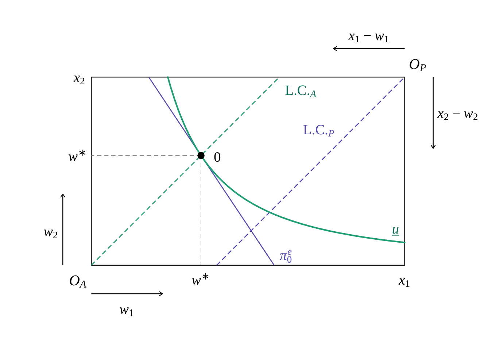

## Introducción

::: {.callout-note appearance="simple" icon=false}

:::

En un mercado de coches de segunda mano en el que solo el vendedor conoce la calidad del vehículo, los compradores ofrecen un precio que refleja la calidad media, los propietarios de los buenos coches se retiran y el mercado puede llegar a desaparecer. Con ese ejemplo, Akerlof (1970) mostró que la información asimétrica puede impedir el funcionamiento de mercados enteros, un fallo de mercado que la teoría de la elección con información perfecta no contemplaba. Pocos años antes, Arrow (1963) había analizado en el mercado de seguros el otro gran problema de la información asimétrica, el del asegurado que, una vez cubierto, tiene menos incentivos para evitar el siniestro.

La **economía de la información** estudia las situaciones en las que la información está repartida de forma asimétrica entre las partes de una relación económica, de modo que una de ellas conoce algo relevante que la otra no puede observar. De ella se ocupa este tema, que se organiza en tres partes:

- *Teoría de la agencia*: el problema del principal-agente es el marco general del diseño de contratos cuando el principal delega una tarea en un agente.

- *Riesgo moral* (Arrow, 1963; Pauly, 1968): la asimetría surge después de firmar el contrato, porque la acción del agente no es observable.

- *Selección adversa* (Akerlof, 1970): la asimetría existe antes del contrato, porque el tipo o la calidad no son observables. Se estudian también sus soluciones mediante señales y autoselección.

Ante una asimetría, la iniciativa puede tomarla cualquiera de las dos partes. La parte informada puede emitir una **señal** costosa que revele su tipo (Spence, 1973), y la no informada puede diseñar contratos que hagan que cada tipo se revele al elegir, lo que se llama **autoselección** o *screening* (Rothschild y Stiglitz, 1976).

Estas ideas explican instituciones tan dispares como las franquicias y los copagos de los seguros, las garantías de los productos, los títulos académicos como señal de productividad, la retribución variable de los directivos o la regulación prudencial de la banca. Su importancia la reflejan los premios Nobel de Akerlof, Spence y Stiglitz (2001), Tirole (2014) y Hart y Holmström (2016). El tema se apoya en la teoría de la utilidad esperada (tema [A10](a10-riesgo-incertidumbre.qmd)) y en la teoría de juegos (tema [A14](a14-juegos.qmd)), y sus resultados reaparecen en el mercado de trabajo (tema [A27](a27-salarios.qmd)), en la regulación (tema [A15](a15-toi.qmd)) y en los mercados financieros (tema [B23](b23-renta-variable.qmd)).

## 1. Teoría de la agencia: el problema del principal-agente (Ross, 1973; Jensen y Meckling, 1976)

La **teoría de la agencia** estudia las relaciones en las que una parte (el principal) encarga a otra (el agente) que actúe en su nombre, cuando sus intereses no coinciden. Su objeto es el diseño del **contrato óptimo**, es decir, el que mejor alinea ambos intereses. La teoría nace de la mano de varios autores (p. ej. Stephen Ross, 1973, o Michael Jensen y William Meckling, 1976) y presenta una serie de elementos comunes.

### 1.1. Concepto: elementos del problema principal-agente

Los elementos comunes de la relación de agencia son los siguientes:

**Agentes**: en general, existen dos partes y una de ellas, denominada *principal*, busca contratar a la otra, denominada *agente*. Ambos pueden ser individuos, instituciones o centros de decisión (p. ej. Estado-ciudadanía, accionista-directivo, empleador-empleado o paciente-médico). No obstante, pueden considerarse situaciones en las que existen múltiples agentes.

**Negociación**: se desarrolla con un determinado reparto del poder negociador entre las partes. Generalmente, la negociación es de la forma “lo tomas o lo dejas” (una de las partes tiene todo el poder negociador y no caben contraofertas) o de regateo (ambas partes tienen poder negociador y pueden hacer contraofertas).

**Contrato**: lo que se negocia es un contrato o un conjunto de contratos. Se trata de un compromiso que persigue que el agente actúe en nombre del principal. Para ello, determina, en cada estado de la naturaleza, qué corresponde hacer a cada parte y qué retribución recibe el agente del principal a cambio de su esfuerzo. 

El contrato solo se basa en variables verificables, que pueden ser revisadas por un árbitro independiente. De no ser verificables, no habría incentivos a firmar el contrato en sí mismo, ya que ambas partes sabrían que un árbitro independiente no podría comprobar su cumplimiento y, al anticipar la situación, no participarían en el contrato.

**Aceptación o rechazo**: el agente acepta el contrato si la utilidad de participar en él no es inferior a la de no firmarlo, es decir, a su *utilidad de reserva*. La utilidad de reserva puede definirse como la utilidad de oportunidades alternativas en el mercado. Si el agente no acepta las condiciones del contrato, no aparece ningún tipo de relación, pero si lo hace, nace una relación bilateral.

**Conflicto de interés**: los objetivos del agente se oponen a los del principal, dado que ambos se mueven por el interés propio. Así, el coste de uno es el ingreso del otro y viceversa (p. ej. salario). El conflicto de interés da lugar a una serie de *costes de agencia*, es decir, destrucción de valor en la relación contractual a falta de una alineación entre los intereses de las partes.

### 1.2. Modelo base: información imperfecta y simétrica

**Origen**: con base en lo anterior, puede desarrollarse un modelo canónico para estudiar el problema del principal y el agente (Ross, 1973; Holmström, 1979).

**Idea**: el pago del agente depende del reparto óptimo del riesgo y este aspecto se condensa en el contrato. Esta idea permite entender uno de los principales objetivos de la economía de la información, que es caracterizar el contrato óptimo.

#### 1.2.1. Supuestos

**Entorno**: la información es imperfecta, pero simétrica. Ninguna de las partes conoce de antemano el estado de la naturaleza, pero ambas observan lo mismo. El resultado de la relación es una variable aleatoria verificable, $x_i = f(e, s_i)$, que depende del esfuerzo del agente, $e$ (también verificable), y del estado de la naturaleza, $s_i$, que ocurre con probabilidad $p_i$. 

De forma equivalente, y esta es la formulación que se utiliza en adelante, puede tomarse como dado el conjunto de resultados posibles, $\{x_1, \dots, x_n\}$, y hacer que el esfuerzo actúe sobre sus probabilidades, $P(X = x_i \mid e) = p_i(e)$, con $\sum_i p_i(e) = 1$ y $p_i(e) > 0$. El esfuerzo mejora el resultado ($f_e' > 0$ en la primera formulación), de modo que un mayor esfuerzo desplaza la distribución hacia los resultados altos.

**Agentes**: un principal y un agente entran en contacto para establecer una relación bilateral:

- *Principal*: es el encargado del diseño del contrato (completo) y busca maximizar la utilidad esperada de su beneficio. El contrato abarca el salario ofrecido para cada resultado, $w(x_i)$, y el esfuerzo demandado del agente, $e$.

Las preferencias del principal se expresan en una función de utilidad esperada de tipo von Neumann-Morgenstern (VNM), $\pi^e(e) = \sum_i p_i(e) \cdot \pi[x_i - w(x_i)]$, con $\pi' > 0$ y $\pi'' \leq 0$. El caso $\pi'' = 0$ es el del principal neutral al riesgo, que servirá de referencia.

- *Agente*: observa el contrato y decide si participar o no. Si participa, aporta el esfuerzo que fija el contrato y obtiene una utilidad esperada VNM[^a13-4], $u^e = \sum_i p_i(e) \cdot u[w(x_i)] - v(e)$, donde $v$ es la desutilidad del esfuerzo, creciente y convexa ($v' > 0$, $v'' \geq 0$), y la utilidad del salario es creciente y cóncava ($u' > 0$, $u'' \leq 0$).

- *Conflicto de interés*: para el principal, el resultado es su ganancia y el salario es su coste, pero el esfuerzo no supone un coste en sí mismo. Para el agente, el salario es su ganancia y el esfuerzo es su coste, pero el resultado no supone ni coste ni ganancia en sí mismo. En todo caso, el esfuerzo mejora la probabilidad de un buen resultado. En estas circunstancias, el contrato se constituye como el medio que permite hacer compatibles los distintos intereses de las partes.

#### 1.2.2. Modelo

**Planteamiento**: el principal buscará maximizar la utilidad esperada de su beneficio mediante el diseño de un contrato que especifique el esfuerzo demandado y el salario ofrecido, restringido por la aceptación del contrato por parte del agente (la *condición de participación*). El problema puede resolverse mediante el método de Kuhn-Tucker[^a13-5]:

$$\max_{e, \{w(x_i)\}} \sum_{i=1}^{n} p_i(e) \cdot \pi[x_i - w(x_i)] \quad \text{s.a.:} \quad \sum_{i=1}^{n} p_i(e) \cdot u[w(x_i)] - v(e) \geq \underline{u}$$

donde $e$ es el esfuerzo exigido al agente, $w(x_i)$ el salario ofrecido cuando el resultado es $x_i$, $p_i(e)$ la probabilidad de ese resultado dado el esfuerzo, $\pi$ y $u$ las funciones de utilidad VNM del principal y del agente, $v(e)$ la desutilidad del esfuerzo, $\underline{u}$ la utilidad de reserva del agente y $\lambda$ el multiplicador de la restricción de participación. El lagrangiano es $\mathcal{L} = \sum_i p_i(e)\,\pi[x_i - w(x_i)] + \lambda\,\bigl[\sum_i p_i(e)\,u[w(x_i)] - v(e) - \underline{u}\bigr]$.

**CPO**: con la restricción de participación activa, se deriva el lagrangiano respecto al salario de cada estado, al esfuerzo y al multiplicador, y se obtienen tres condiciones:

$$\frac{\partial \mathcal{L}}{\partial w(x_i)} = -p_i(e)\,\frac{d\pi}{d(x_i - w_i)} + \lambda\,p_i(e)\,\frac{du}{dw_i} = 0 \;\Rightarrow\; \frac{d\pi/d(x_i - w_i)}{du/dw_i} = \lambda \tag{1}$$

$$\frac{\partial \mathcal{L}}{\partial e} = \sum_i \frac{dp_i}{de} \cdot \pi[x_i - w(x_i)] + \lambda \left[ \sum_i \frac{dp_i}{de} \cdot u[w(x_i)] - \frac{dv}{de} \right] = 0$$

$$\frac{\partial \mathcal{L}}{\partial \lambda} = \sum_i p_i(e) \cdot u[w(x_i)] - v(e) - \underline{u} = 0$$

Cada una de las tres condiciones tiene su lectura:

1. *Reparto del riesgo*: la condición (1), que resulta de derivar respecto al salario, se cumple en todos los estados de la naturaleza, de modo que, para dos estados cualesquiera $i$ y $j$:

$$
\frac{d\pi/d(x_i - w_i)}{du/dw_i} = \frac{d\pi/d(x_j - w_j)}{du/dw_j} = \lambda
\quad\Longrightarrow\quad
\underbrace{\frac{d\pi/d(x_i - w_i)}{d\pi/d(x_j - w_j)}}_{\text{RMS}^{P}_{j,i}}
=
\underbrace{\frac{du/dw_i}{du/dw_j}}_{\text{RMS}^{A}_{j,i}}
\tag{2}
$$

El contrato óptimo será tal que el cociente entre la utilidad marginal del principal y la del agente sea constante en todos los estados de la naturaleza e igual a $\lambda$, el multiplicador asociado a la restricción de participación. Dividiendo esta condición para dos estados cualesquiera $i$ y $j$, $\lambda$ se cancela y se obtiene que la relación marginal de sustitución entre resultados en esos dos estados para el principal coincide con la del agente.

Estrictamente, la relación marginal de sustitución (RMS) entre rentas contingentes incluye las probabilidades, $p_i\,(d\pi/d(x_i - w_i))/[p_j\,(d\pi/d(x_j - w_j))]$, pero estas se cancelan al suponer que ambos comparten las mismas creencias.

Esta condición se conoce como *condición de Borch* de reparto óptimo del riesgo y caracteriza las asignaciones Pareto-eficientes bajo incertidumbre. Gráficamente, en una caja de Edgeworth cuyos ejes son las rentas en los estados $i$ y $j$, corresponde a los puntos de tangencia entre las curvas de indiferencia de ambos (la curva de contratos).

2. *Esfuerzo*: la segunda condición, que resulta de derivar respecto al esfuerzo, determina el nivel que el contrato exige. El principal demanda esfuerzo hasta que su ganancia marginal en utilidad esperada iguala, a través de $\lambda$, la compensación adicional que el agente exige por la desutilidad marginal del esfuerzo. Como el esfuerzo es verificable, el principal puede exigirlo directamente en el contrato, sin necesidad de incentivarlo.

3. *Participación*: la tercera condición es la propia restricción, que se cumple con igualdad. En el óptimo, el agente recibe una “utilidad neta” exactamente equivalente a su utilidad de reserva. De lo contrario, el principal estaría pagando demasiado, ya que podría reducir los pagos y obtener mayor beneficio, y el agente todavía aceptaría el nuevo contrato.

**CSO**: se supone que el problema es de buen comportamiento (funciones de beneficio y utilidad cóncavas, con concavidad estricta en al menos una de ellas), de modo que el cumplimiento de las CPO garantiza una solución única e interior.

**Solución**: el contrato óptimo, $\{e^*, w^*(x_i)\}$, es un vector que recoge el nivel de esfuerzo exigido y el esquema de pagos asociado a cada resultado. Equivale, en el problema de agencia, a la función de demanda del consumidor, pues recoge cómo responde la decisión (aquí, el reparto de rentas entre estados) a los parámetros del problema. 

En este caso, el parámetro decisivo son las actitudes ante el riesgo de las partes. Cada caso de actitud frente al riesgo se caracteriza por tres elementos: la *condición* que impone (2) sobre las utilidades marginales, el *reparto del riesgo* que resulta y el *esquema de pagos* concreto.

- *Caso 1: principal neutral, agente averso*:

    - *Condición*: si el principal es neutral al riesgo, $\pi'$ es constante, y si el agente es averso, $u'$ es decreciente. Como el contrato óptimo exige $\pi'/u' = \lambda$ constante y $\pi'$ lo es, $u'$ ha de ser constante en todos los estados, lo que solo ocurre si el salario es el mismo con independencia del resultado, es decir, $w(x_i) = w(x_j)$ para todo $i, j$.

    - *Reparto del riesgo*: el principal asume todo el riesgo de la transacción y el agente queda totalmente asegurado.

    - *Esquema de pagos*: salario fijo, $w^* = u^{-1}[\underline{u} + v(e^*)]$, que compensa exactamente la utilidad de reserva y la desutilidad del esfuerzo exigido.

- *Caso 2: principal averso, agente neutral*:

    - *Condición*: es el caso opuesto. Como $u'$ es constante (agente neutral), $\pi'$ ha de ser constante para satisfacer la condición. Al ser $\pi'$ decreciente, ello solo ocurre si el beneficio del principal es el mismo en todos los estados ($x_i - w(x_i) = k$ para todo $i$).

    - *Reparto del riesgo*: el agente asume todo el riesgo de la transacción y el principal queda totalmente asegurado.

    - *Esquema de pagos*: contrato de franquicia, $w^* = x_i - k$, con $k > 0$ el canon. El principal recibe una cantidad fija con independencia del resultado y el agente se queda con el resultado neto. Intuitivamente, el principal cede su saber hacer, su imagen de marca y la comercialización de sus productos a un agente-franquiciado neutral al riesgo, a cambio de que este asuma los riesgos y pague un canon.

- *Caso 3: ambos aversos*:

    - *Condición*: con $\pi'$ y $u'$ decrecientes, ninguno de los dos puede ser constante y la condición (2) se cumple con pagos que varían con el resultado, en una proporción que depende de los grados de aversión:
      $$\frac{dw^*}{dx_i} = \frac{\text{CAA}_P}{\text{CAA}_P + \text{CAA}_A}$$
      donde $\text{CAA}_P$ y $\text{CAA}_A$ son los coeficientes de aversión absoluta al riesgo de cada parte, evaluados en el reparto óptimo, de modo que la regla vale localmente. El contrato es lineal (pendiente constante) cuando ambos coeficientes son constantes, es decir, con utilidades de aversión absoluta al riesgo constante (CARA, *constant absolute risk aversion*). Los dos casos anteriores son los casos particulares en que uno de los coeficientes es nulo (pendiente 0 en el salario fijo y 1 en la franquicia).

    - *Reparto del riesgo*: las dos partes soportan riesgo y ninguna queda del todo cubierta. La más aversa, que absorbe menos variación del resultado, es la mejor cubierta.

    - *Esquema de pagos*: salario variable con el resultado, $w^* = a + b \cdot x_i$ con $0 < b < 1$, asimilable a una *joint venture* o a una remuneración con parte fija y parte variable.

- *Corolario*: de los tres casos se deduce que la condición de tangencia se produce sobre la línea de certeza del individuo averso cuando el aseguramiento es completo (casos 1 y 2) y entre ambas líneas de certeza cuando es parcial (caso 3).

**Desarrollo gráfico**: la solución se ilustra en una caja de Edgeworth de estados de la naturaleza (figura -@fig-a131-ppal-agente), cuyos lados son los dos posibles resultados, $x_1$ (horizontal) y $x_2$ (vertical). El agente mide sus salarios, $w_1$ y $w_2$, desde $O_A$, y el principal sus rentas netas, $x_1 - w_1$ y $x_2 - w_2$, desde $O_P$:

1. *Líneas de certeza* (L.C.$_A$ y L.C.$_P$): los dos segmentos desde cada origen representan las combinaciones de rentas contingentes iguales en ambos estados, para el agente (desde $O_A$) y para el principal (desde $O_P$).

2. *Curvas de indiferencia*: las del principal ($\pi^e_0$) se dibujan desde $O_P$ hacia $O_A$ y las del agente desde $O_A$ hacia $O_P$. Su curvatura refleja la aversión al riesgo de cada parte (rectas si es neutral, convexas si es averso).

3. *Condición de participación*: los únicos contratos aceptables para el agente son los situados sobre o por encima de la curva de indiferencia correspondiente a su utilidad de reserva, $\underline{u}$.

4. *Equilibrio*: entre los contratos que el agente acepta, el principal elige el que le permite llegar a su curva de indiferencia más lejana de $O_P$. En ese punto, dicha curva es tangente a la de reserva del agente (condición de Borch). En el caso 1, que recoge la figura, el óptimo es el punto 0, con $w_1^* = w_2^* = w^*$.

::: {#fig-a131-ppal-agente}

::: {.content-visible when-format="html"}
```{=html}
<div class="graph-frame">
<iframe src="../graphs/a131_Ppal-agente.html" style="height:520px" loading="lazy" title="fig-a131-ppal-agente"></iframe>
</div>
```
:::

::: {.content-visible unless-format="html"}

:::

Modelo principal-agente con información simétrica. En el contrato óptimo, el principal neutral al riesgo asegura plenamente al agente averso al riesgo.
:::

El punto óptimo define un plan de pagos contingente, con $w_1^*$ si el resultado es $x_1$ y $w_2^*$ si es $x_2$, y la figura -@fig-a134-reparto-riesgo muestra su posición en los tres casos del corolario. La tangencia se sitúa sobre la línea de certeza del agente averso cuando el principal es neutral (panel a), sobre la del principal averso cuando el agente es neutral (panel b) y entre ambas líneas de certeza cuando los dos son aversos (panel c).

::: {#fig-a134-reparto-riesgo}

::: {.content-visible when-format="html"}
```{=html}
<div class="graph-frame wide">
<iframe src="../graphs/a134_Reparto_riesgo.html" style="--r:1.255" loading="lazy" title="fig-a134-reparto-riesgo"></iframe>
</div>
```
:::

::: {.content-visible unless-format="html"}

:::

Reparto óptimo del riesgo en la caja de Edgeworth de estados de la naturaleza. La curva de indiferencia de reserva del agente, $\underline{u}$, y la del principal, $\pi^e_0$, son tangentes en el punto 0. La tangencia se sitúa sobre la línea de certeza del agente averso cuando el principal es neutral (panel a, caso 1) y sobre la del principal averso cuando el agente es neutral (panel b, caso 2). Cuando los dos son aversos (panel c, caso 3), la tangencia queda entre ambas líneas de certeza.
:::

**Estática comparativa**: se distinguen dos perturbaciones:

- *Aumento de la utilidad de reserva $\underline{u}$*: desplaza la restricción de participación hacia $O_P$ y traslada el contrato a lo largo de la curva de contratos, mejorando al agente a costa del principal.

- *Aumento de la aversión al riesgo de una de las partes*: aumenta la curvatura de sus curvas de indiferencia y desplaza la tangencia hacia su línea de certeza, es decir, hacia un mayor aseguramiento de esa parte.

#### 1.2.3. Conclusiones

**Aspectos positivos**: el modelo base establece la referencia de eficiencia de la relación de agencia. Con información simétrica, el contrato óptimo reparte el riesgo según los perfiles de las partes (el principal neutral asegura plenamente al agente averso) y no existe pérdida de eficiencia. Cualquier ineficiencia observada en el resto del tema es, por tanto, imputable exclusivamente a la asimetría de información.

**Limitaciones**: la observabilidad del esfuerzo y de los tipos falla precisamente en las relaciones económicas relevantes (empleo, seguros, crédito, regulación), por lo que el modelo es un punto de partida y no una descripción. Los apartados 2 y 3 relajan, respectivamente, la observabilidad del esfuerzo y la de los tipos.

### 1.3. Aplicaciones

El marco principal-agente es transversal y aparece en el libro cada vez que una parte actúa por cuenta de otra con objetivos distintos y bajo incertidumbre. Sus aplicaciones principales son las siguientes:

- *Asegurador-asegurado*: los contratos de seguro, donde el asegurador desconoce el riesgo del asegurado y su comportamiento una vez asegurado (apartados 2.3 y 3.4.2; tema [A10](a10-riesgo-incertidumbre.qmd)).

- *Accionista-directivo*: la separación entre propiedad y control en la empresa moderna, origen de la teoría de la agencia (Jensen y Meckling, 1976) y de los mecanismos de gobierno corporativo (tema [A15](a15-toi.qmd)).

- *Regulador-empresa regulada*: la regulación de monopolios naturales cuando el regulador desconoce los costes de la empresa (apartado 3.4.3 y tema [A20](a20-regulacion.qmd)).

- *Empleador-empleado*: el diseño de los contratos de trabajo y de los sistemas de incentivos, y la teoría de los salarios de eficiencia (tema [A27](a27-salarios.qmd)).

- *Prestamista-prestatario*: el racionamiento del crédito (Stiglitz y Weiss, 1981; tema [A42](a42-ciclos.qmd), apartado 2.3.1) y los costes de agencia de la deuda (tema [B03](b03-financiacion.qmd), apartado 2.3.4).

- *Estado-ciudadano y organismos internacionales-Estados*: la condicionalidad de la ayuda y de los préstamos, y el diseño de las políticas públicas cuando el Estado no observa las características de los beneficiarios (temas [B22](b22-fmi.qmd) y [B29](b29-fod-aod.qmd)).

En todos los casos el problema tiene interés económico precisamente porque falla el supuesto de información simétrica del modelo base. Si el principal no observa lo que el agente hace (el esfuerzo del directivo, la prudencia del asegurado, el uso del crédito), hay riesgo moral (apartado 2). Si no observa lo que el agente es (la productividad del trabajador, el riesgo del asegurado, la eficiencia de la empresa regulada), hay selección adversa (apartado 3). Las aplicaciones son, por tanto, el desarrollo de esas dos desviaciones respecto de la simetría de información.

### 1.4. Conclusiones

**Aspectos positivos**: la teoría de la agencia proporciona el marco general de la economía de la información, porque toda relación de agencia puede formularse como un contrato con restricciones de participación y, cuando la información es asimétrica, de incentivos. El modelo base es la referencia de eficiencia frente a la que se miden los dos fallos de información.

**Limitaciones**: el marco supone que el contrato puede escribirse sobre variables verificables y hacerse cumplir sin coste, que las partes son racionales y que la relación es bilateral. La teoría de los contratos incompletos (Grossman-Hart-Moore, tema [A15](a15-toi.qmd), apartado 1.3.1) y la de los contratos relacionales relajan estos supuestos.

## 2. Riesgo moral (Arrow, 1963; Pauly, 1968)

La primera desviación respecto de la simetría de información del modelo base surge cuando el principal no observa lo que el agente hace una vez firmado el contrato. Tras precisar el concepto, se formaliza el modelo con esfuerzo no observable y se repasan sus aplicaciones y sus soluciones.

### 2.1. Concepto: riesgo moral

El término **riesgo moral** procede del sector asegurador, donde era de uso frecuente en el s. XIX. Sin embargo, su popularidad en la ciencia económica comienza tras la publicación del trabajo de Kenneth Arrow (1963).

El riesgo moral se produce cuando, después de la firma del contrato, el esfuerzo del agente no es observable ni verificable. El salario constante es óptimo con información simétrica cuando el agente es averso y el principal neutral (caso 1). No obstante, si el principal lo ofrece, el agente tiene incentivos a realizar un esfuerzo subóptimo ($e_L < e_H$), porque el esfuerzo le cuesta y el salario no depende de él. 

Por eso, cuando hay riesgo moral, el principal se ve obligado a replantear la estructura de pagos. El contrato ya no puede exigir el esfuerzo, sino que debe inducirlo, haciendo que el esfuerzo deseado por el principal coincida con el que el agente elige por su cuenta una vez firmado el contrato.

### 2.2. Modelo: esfuerzo no observable

**Origen**: Kenneth Arrow (1963) y Mark Pauly (1968) plantean el problema en el mercado de seguros. La formalización del contrato óptimo con esfuerzo no observable es de Bengt Holmström (1979).

**Idea**: el esfuerzo del agente no es observable, de modo que el contrato no puede exigirlo y debe inducirlo mediante el esquema de pagos.

#### 2.2.1. Supuestos

**Entorno**: se mantienen los supuestos del modelo base del apartado 1.2 (un principal y un agente, resultado $x_i$ aleatorio con probabilidades $p_i(e)$ que dependen del esfuerzo, contrato sobre variables verificables, utilidad de reserva $\underline{u}$). La única diferencia es que el principal ya no observa el esfuerzo $e$, solo el resultado. 

**Agentes**: el esfuerzo, para simplificar, toma dos valores, alto ($e_H$) y bajo ($e_L$). El principal desea inducir el alto mediante el esquema de pagos $w(x_i)$, lo que añade al problema una *restricción de incentivos*, según la cual el agente debe preferir el esfuerzo alto al bajo.

#### 2.2.2. Modelo

**Planteamiento**: se añade la restricción de incentivos y se construye el nuevo lagrangiano con un nuevo multiplicador, $\mu$:

$$\max_{\{w(x_i)\}} \sum_{i=1}^{n} p_i(e_H) \cdot \pi[x_i - w(x_i)]$$
$$\text{s.a.:} \begin{cases}  \; \sum_i p_i(e_H) \cdot u[w(x_i)] - v(e_H) \geq \underline{u} & \text{(participación)} \\ \; \sum_i [p_i(e_H) - p_i(e_L)] \cdot u[w(x_i)] \geq v(e_H) - v(e_L) & \text{(incentivos)} \end{cases}$$

donde $w(x_i)$ es el salario ofrecido cuando el resultado es $x_i$, $e_H$ y $e_L$ los niveles de esfuerzo alto y bajo, $p_i(e_H)$ y $p_i(e_L)$ las probabilidades de cada resultado con uno u otro esfuerzo, $\pi$ y $u$ las utilidades VNM del principal y del agente, $v(e)$ la desutilidad del esfuerzo, $\underline{u}$ la utilidad de reserva y $\lambda$ y $\mu$ los multiplicadores de las restricciones de participación e incentivos.

La restricción de incentivos recoge el problema de riesgo moral, pues exige que el esfuerzo alto rinda al agente una utilidad esperada no inferior a la del bajo.

**CPO**: se deriva el lagrangiano respecto al salario de cada estado y se obtiene la condición que sustituye a (1):

$$\begin{aligned} \frac{\partial \mathcal{L}}{\partial w(x_i)} &= -p_i(e_H)\,\frac{d\pi}{d(x_i - w_i)} + \lambda\,p_i(e_H)\,\frac{du}{dw_i} + \mu\,[p_i(e_H) - p_i(e_L)]\,\frac{du}{dw_i} = 0 \\ &\Rightarrow\; \frac{d\pi/d(x_i - w_i)}{du/dw_i} = \lambda + \mu \left( 1 - \frac{p_i(e_L)}{p_i(e_H)} \right) \end{aligned} \tag{3}$$

donde $\lambda$ es el multiplicador de la restricción de participación y $\mu$ el de la restricción de incentivos. Se obtiene así la *condición de Holmström* (1979), según la cual el salario en cada estado depende del cociente de verosimilitud, que informa sobre el esfuerzo a partir del resultado observado.

Esta condición se diferencia de la condición de Borch en dos elementos:

1. *Coste del riesgo moral* ($\mu > 0$): el multiplicador $\mu$ mide cuánto aumentaría el beneficio esperado del principal si se relajase marginalmente la restricción de incentivos, es decir, el coste que le impone el riesgo moral. 

Cuando el principal es neutral y el agente averso al riesgo (caso 1), $\mu$ es estrictamente positivo. Para verlo, supóngase que $\mu = 0$. En este caso, la condición (3) se reduciría a la de Borch y se recuperaría el contrato de información simétrica. Sin embargo, en el caso 1 ese contrato es un salario constante, que no ofrece ningún incentivo, induce el esfuerzo bajo y viola la restricción de incentivos. Por tanto, $\mu > 0$, de modo que la restricción de incentivos es activa y, debido a la asimetría de información, el principal obtiene un beneficio menor que con información simétrica.

2. *Cociente de verosimilitud* ($p_i(e_L)/p_i(e_H)$): mide cuán probable es el resultado $x_i$ con esfuerzo bajo en relación con el esfuerzo alto. 

Cuanto menor es el cociente, más indicativo es $x_i$ de esfuerzo alto, mayor es el lado derecho de (3) y, por tanto, mayor el salario en ese estado. En el caso 1 el efecto es inmediato, porque $\pi'$ es constante y un mayor lado derecho exige una menor $u'$. Cuando $\mu > 0$, el salario varía con el resultado siempre que el cociente varíe entre estados y el principal condiciona el pago a toda señal que contenga información sobre el esfuerzo. Además, en el caso 1, el salario será creciente en el resultado solo si el cociente es decreciente en $x_i$ (propiedad del cociente de verosimilitud monótono).

La restricción de participación sigue saturada. Como el contrato traslada riesgo al agente, el principal tiene que compensarlo con una prima de riesgo. Esta prima toma la forma de un salario esperado superior al de información simétrica que le deje justo en su utilidad de reserva. Ese salario más alto no mejora en nada al agente, pero el principal ve caer su beneficio esperado, y esa caída es justamente el coste del riesgo moral.

**CSO**: como en el modelo base, la concavidad de $\pi$ y $u$ garantiza que las CPO caracterizan el óptimo. Con dos niveles de esfuerzo, el principal compara además el beneficio de inducir $e_H$ con el de conformarse con $e_L$ a salario fijo, y elige el mayor.

**Solución**: es de nuevo el contrato óptimo $\{e^*, w^*(x_i)\}$, ahora con $e^* = e_H$ inducido en lugar de exigido. Si principal y agente persiguen lo mismo, el contrato de información simétrica ya cumple la restricción de incentivos y el riesgo moral no tiene coste. En cambio, con intereses enfrentados, los tres casos de perfil de riesgo se caracterizan como en el modelo base:

- *Caso 1: principal neutral, agente averso*:

    - *Condición*: con $d\pi/d(x_i - w_i)$ constante, (3) exige que $du/dw_i$ varíe con el cociente de verosimilitud, de modo que el salario ya no puede ser constante.

    - *Reparto del riesgo*: el agente soporta parte del riesgo aunque sea averso, porque solo así el salario transmite incentivos, y de ahí procede el conflicto entre aseguramiento e incentivos.

    - *Esquema de pagos*: salario variable, mayor en los estados más indicativos de esfuerzo alto, y creciente con el resultado si el cociente de verosimilitud es monótono (los resultados altos son relativamente más probables con esfuerzo alto).

- *Caso 2: principal averso, agente neutral*:

    - *Condición*: con $u'$ constante, (3) se cumple con $\pi'$ constante, como en el modelo base, y la restricción de incentivos no es activa.

    - *Reparto del riesgo*: el agente asume todo el riesgo, sin coste, pues es neutral.

    - *Esquema de pagos*: contrato de franquicia, $w^* = x_i - k$. No hay pérdida de eficiencia porque, al depender el salario del resultado, y este del esfuerzo, el agente internaliza plenamente los incentivos y el principal obtiene el mismo beneficio que con información simétrica. Para ello el agente no ha de tener responsabilidad limitada, de modo que pueda aceptar pagos negativos.

- *Caso 3: ambos aversos*:

    - *Condición*: si el contrato de información simétrica, ya variable, no cumple la restricción de incentivos, $\mu > 0$ y (3) se cumple con pagos variables que combinan el reparto del riesgo de la condición de Borch con la prima de incentivos del cociente de verosimilitud.

    - *Reparto del riesgo*: ambos comparten el riesgo, pero el agente soporta más que en el modelo base.

    - *Esquema de pagos*: salario variable con parte fija y parte ligada al resultado, más sensible al resultado que con información simétrica.

**Desarrollo gráfico**: el riesgo moral se representa en la caja de Edgeworth de estados de la naturaleza (figura -@fig-a103-moral-hazard):

1. *Líneas de certeza y curvas de indiferencia*: las del modelo base, con la curva de reserva del agente, $\underline{u}$, y las del principal, $\pi^e_0$ y $\pi^e_1$.

2. *Restricción de incentivos* (RI): excluye los contratos con salario igual en ambos estados. La región sombreada recoge los contratos que la cumplen.

3. *Equilibrio*: el riesgo moral se manifiesta en que el contrato ya no puede situarse en el punto 0, sobre la línea de certeza del agente averso (caso 1). El óptimo se desplaza, por tanto, a lo largo de la curva de indiferencia de reserva del agente hasta el punto 1, en la frontera de la restricción de incentivos, con $w_1^* \neq w_2^*$. En él, el principal renuncia a parte del reparto eficiente del riesgo a cambio de inducir el esfuerzo.

::: {#fig-a103-moral-hazard}

::: {.content-visible when-format="html"}
```{=html}
<div class="graph-frame">
<iframe src="../graphs/a103_moral_hazard.html" style="height:520px" loading="lazy" title="fig-a103-moral-hazard"></iframe>
</div>
```
:::

::: {.content-visible unless-format="html"}

:::

Riesgo moral en la caja de Edgeworth de estados de la naturaleza. Con esfuerzo observable, el contrato eficiente (0) asegura completamente al agente averso al riesgo. Con esfuerzo no observable, la restricción de incentivos (RI) lleva el contrato a lo largo de la curva de reserva del agente hasta 1, fuera de su línea de certeza y con menor beneficio esperado para el principal.
:::

#### 2.2.3. Conclusiones

**Aspectos positivos**: el modelo muestra con precisión que el origen de la ineficiencia del riesgo moral no está en la asimetría de información por sí misma, sino en la combinación de esfuerzo no observable, conflicto de interés y aversión al riesgo. 

El modelo proporciona, además, el principio general de todo contrato de incentivos, el uso de cualquier señal informativa sobre el esfuerzo (condición de Holmström). Si la restricción de incentivos es activa y el agente es averso al riesgo, su pago ha de ser variable, pues no puede quedar asegurado en la medida en que lo haría el reparto eficiente del riesgo, y se llega a una solución de *second best*.

**Limitaciones**: el coste del riesgo moral depende de supuestos sobre las actitudes ante el riesgo que no siempre son contrastables (caso 2). Además, el modelo es estático y con una única tarea. Sin embargo, con relaciones repetidas (reputación) o con varias tareas (Holmström y Milgrom, 1991), el contrato óptimo cambia sustancialmente.

### 2.3. Aplicaciones

La teoría del riesgo moral tiene múltiples aplicaciones, todas con la misma estructura. Una parte no observa la conducta de la otra tras la firma del contrato, y el remedio consiste en trasladarle parte del riesgo o en condicionar los pagos a resultados observables.

- *Mercados de seguros*: tras suscribir la póliza, el asegurado carece de incentivos para actuar con diligencia y prevenir el siniestro. Coherentemente con el modelo, la respuesta consiste en transferir al agente una parte del riesgo. Así, la póliza cubre solo una fracción del valor del bien, o el asegurado paga el primer tramo del daño (franquicias, copagos).

- *Gobierno corporativo*: cuando propiedad y gestión están separadas, los directivos pueden anteponer el tamaño o el prestigio al valor de la empresa. Para corregirlo, su retribución se vincula a los resultados (opciones sobre acciones, primas) y se establecen mecanismos de supervisión (tema [A15](a15-toi.qmd)).

- *Mercado de trabajo*: si el empleador solo detecta el escaqueo con cierta probabilidad, paga un salario superior al de vaciado del mercado para que el despido sea costoso para el trabajador y este tenga incentivos a no escaquearse. El modelo de salarios de eficiencia de Shapiro y Stiglitz (1984) explica así el desempleo involuntario como dispositivo de disciplina (tema [A27](a27-salarios.qmd)).

- *Mercado de crédito*: tras una subida del tipo de interés, el prestatario tiene incentivos a reorientar los fondos hacia proyectos más arriesgados, con mayor rendimiento en caso de éxito, con los que afrontar el mayor coste, lo que eleva la morosidad esperada. Por ello, el prestamista prefiere racionar el crédito antes que subir el tipo (Stiglitz y Weiss, 1981; temas [A42](a42-ciclos.qmd) y [B26](b26-crisis-financieras.qmd)).

- *Rescates macroeconómicos*: tras obtener la ayuda, el país carece de incentivos para corregir la política económica que lo condujo a la emergencia. La solución es la condicionalidad de las instituciones multilaterales (tema [B22](b22-fmi.qmd)).

### 2.4. Soluciones al problema del riesgo moral

Las soluciones al riesgo moral responden todas a la misma lógica del modelo, que consiste en reducir la asimetría de información o hacer que el agente soporte las consecuencias de su conducta.

- *Uso de toda la información disponible* (resultado de suficiencia estadística, Holmström, 1979): el riesgo moral es un coste adicional para la relación. Por ello, es valiosa cualquier señal que aporte, además de la del resultado, información sobre el esfuerzo (p. ej. sobre el estado de la naturaleza), y solo esa. El valor de esa señal está en que permite al principal estimar mejor el esfuerzo del agente y reducir el riesgo que este ha de soportar.

- *Competencia por comparación* (*yardstick competition*): los incentivos dependen de cómo rinde el agente frente al promedio del mercado, al de la propia empresa en otros periodos o al de otras empresas, lo que filtra las perturbaciones comunes que el agente no controla. También se construyen sobre la competencia intraempresa, mediante mecanismos de promoción y reconocimiento de méritos (torneos).

- *Supervisión y control*: las auditorías internas o externas y los indicadores de gestión reducen la asimetría de información y fomentan que el agente alinee su conducta con los intereses del principal. La contrapartida es el gasto en supervisión, que el principal lleva hasta que su coste marginal iguala la reducción marginal del coste de agencia.

- *Castigos*: el despido, la pérdida de reputación y las penalizaciones contractuales complementan a los incentivos positivos. Su eficacia depende de que sean creíbles y de que el agente tenga algo que perder, lo que conecta con los salarios de eficiencia.

- *Regulación*: tras la Gran Recesión (crisis financiera global y de deuda soberana, 2008-2014) se hizo evidente el riesgo moral asociado al *too big to fail*. Varias entidades financieras contaban con garantías implícitas de rescate público, lo que fomentaba la toma excesiva de riesgos. Por ello, los colchones de capital, las cláusulas de *bail-in* y los mecanismos de resolución tratan de devolver a la entidad y a sus acreedores las consecuencias de sus decisiones (tema [B27](b27-regulacion-financiera.qmd)).

- *Separación de responsabilidades y condicionalidad*: muchos problemas de riesgo moral derivan de la estructura de gobernanza (la monetización del déficit cuando la autoridad monetaria no es independiente del Gobierno) y se resuelven separando las funciones. En la ayuda oficial al desarrollo y en los rescates, la financiación en condiciones favorables a países con instituciones débiles genera riesgo moral, y la solución es la condicionalidad, es decir, subordinar los desembolsos al cumplimiento de reformas (temas [B22](b22-fmi.qmd) y [B29](b29-fod-aod.qmd)).

### 2.5. Conclusiones

**Aspectos positivos**: la teoría del riesgo moral explica la forma de los contratos reales (remuneraciones variables, franquicias y copagos en los seguros, condicionalidad de la ayuda) como respuestas a la no observabilidad de la conducta. Proporciona también el principio que guía el diseño de esos contratos, usar toda la información sobre el esfuerzo y solo esa. Sus resultados son la base de la economía de las organizaciones y de la regulación financiera moderna.

**Limitaciones**: el modelo canónico es bilateral y estático, con un solo agente y una sola tarea. Las extensiones muestran que los resultados cambian con terceros y con el tiempo:

- *Con terceros*: John Vickers (1985) muestra, en un contexto de información simétrica, que los accionistas (principales) pueden preferir remunerar a los directivos (agentes) no solo según el resultado, sino con el objetivo estratégico de que los competidores produzcan menos. Fershtman y Judd (1987) y Sklivas (1987) extienden el resultado a la competencia en precios, en la que el contrato lleva a los rivales a fijar precios más altos. El contrato de agencia se convierte así en un instrumento de competencia en el mercado (sobre el oligopolio, tema [A19](a19-oligopolio.qmd)).

- *Con el tiempo*: con relaciones repetidas, la reputación sustituye parcialmente a los incentivos explícitos.

## 3. Selección adversa (Akerlof, 1970)

Si lo que el principal no observa es lo que el agente es, y no lo que hace, la asimetría existe ya antes del contrato y da lugar a la selección adversa. A su concepto siguen el modelo de Akerlof, sus aplicaciones y las soluciones mediante señalización y autoselección.

### 3.1. Concepto: selección adversa

Hay **selección adversa** cuando el agente sabe, ya antes de firmar el contrato, algo que el principal ignora sobre algún rasgo propio o del bien intercambiado que pesa en el resultado final del intercambio[^a13-7].

Esta asimetría previa al contrato puede tener dos orígenes. Uno es que el mercado funciona mal porque no permite diferenciar unos bienes y servicios de otros, y el otro, que una de las partes oculte a propósito lo que sabe.

La consecuencia de esa asimetría es que la peor calidad desplaza a la mejor, hasta el punto de que pueden desaparecer algunos segmentos de un mercado o incluso el mercado entero.

### 3.2. Modelo de Akerlof (1970): el mercado de “limones”

**Origen**: George Akerlof (*The Market for “Lemons”*, 1970; Nobel 2001) toma como ejemplo la compraventa de coches usados. Una proporción $\alpha$ de ellos es de mala calidad y la restante, $1 - \alpha$, de buena calidad, con $\alpha \in (0, 1)$.

**Idea**: quien compra sin observar la calidad solo paga lo que vale un coche medio, y eso expulsa del mercado a los coches buenos hasta que solo se venden los malos (“limones”).

#### 3.2.1. Supuestos

**Entorno**: la información sobre la calidad de cada coche usado está repartida de forma asimétrica, porque solo la tiene quien vende y no quien compra. Hay dos calidades, coches buenos y limones, en proporciones conocidas, $1 - \alpha$ y $\alpha$.

**Agentes**: los dueños de coches usados, que conocen la calidad del suyo, y los compradores, numerosos y neutrales al riesgo. Cada coche vale más para el comprador que para su dueño, de modo que con información completa todos se venderían.

**Mercado de bienes**: competitivo y con un único precio para todos los coches, porque los compradores no distinguen calidades.

#### 3.2.2. Modelo

**Planteamiento**: con calidad observable, cada coche se vendería por lo que vale para el comprador, $p_A$ el bueno y $p_B$ el malo ($p_A > p_B$). Como en realidad el comprador no sabe cuál le venden, solo paga por lo que espera recibir. Si cree que los coches en venta se reparten como el conjunto de los coches usados, ofrece la media ponderada de ambos valores, $p_C = (1 - \alpha)p_A + \alpha p_B$.

Del lado de la oferta, quien tiene un coche bueno exige por él un precio mínimo, $p_A^V$, más alto que el que piden los dueños de coches malos.

**Equilibrio**: si el precio mínimo de los coches buenos supera lo que el comprador ofrece por un coche cualquiera ($p_A^V > p_C$), el mercado pasa de la situación inicial al equilibrio final en cuatro pasos:

1. *Situación inicial*: los compradores esperan la calidad media del conjunto de los coches usados y ofrecen $p_C$ por cualquiera de ellos.

2. *Retirada de los coches buenos*: a ese precio, al propietario de un coche bueno no le compensa venderlo y lo saca del mercado, mientras que los limones se siguen ofreciendo[^a13-8].

3. *Revisión de las expectativas*: los compradores pagan $p_C$ y comprueban que reciben limones, de modo que revisan a la baja la probabilidad que asignan a que un coche en venta sea bueno. Por la regla de Bayes, esa probabilidad es $(1-\alpha)s_A/[(1-\alpha)s_A + \alpha s_B]$, donde $s_A$ y $s_B$ son las fracciones de dueños de coches buenos y malos que venden al precio vigente. Como al precio $p_C$ ningún dueño de un coche bueno vende ($s_A = 0$), la probabilidad pasa de $1 - \alpha$ a cero.

4. *Equilibrio final*: los compradores ya solo ofrecen $p_B$, lo que vale un limón, y a ese precio solo se intercambian limones. Las expectativas se confirman, pero el mercado de coches buenos ha desaparecido.

**Desarrollo gráfico**: con un continuo de calidades, los mercados de coches buenos y de limones se condensan en uno solo, el de coches usados de calidad no observable, que se representa en el plano cantidad-precio (figura -@fig-a132-akerlof):

1. *Oferta*, $S(x)$: es creciente, porque cada vendedor solo ofrece su coche si el precio supera el valor que le atribuye, y los propietarios de coches mejores los valoran más. Por ello, al subir el precio entran en el mercado coches de mayor calidad y la calidad media de los coches en venta, $\theta$, aumenta. Al bajar el precio, en cambio, se retiran primero los mejores coches.

2. *Demanda*, $D(x)$: los compradores no observan la calidad de cada coche, pero anticipan que la calidad media depende del precio. Sobre la cantidad demandada actúan, por tanto, dos efectos de signo contrario:

    - *Efecto precio*: con la calidad dada, un precio más alto reduce la cantidad demandada, como en cualquier demanda ordinaria. Este efecto domina por encima de $\hat{p}$, y la demanda es decreciente en su tramo superior.

    - *Efecto calidad*: un precio más alto indica que se ofrecen coches de mejor calidad media, lo que hace más atractiva la compra. Este efecto domina por debajo de $\hat{p}$, y la cantidad demandada aumenta con el precio en el tramo inferior.

   La demanda tiene así dos pendientes y se “dobla” en $\hat{p}$, el precio al que la cantidad demandada es máxima.

3. *Equilibrios*: la oferta corta a la demanda en dos puntos. En el equilibrio 0, al precio $p_0$, se venden $x(\overline{\theta})$ coches con una calidad media alta, $\overline{\theta}$, porque aún se ofrecen coches buenos. En el equilibrio 1, al precio $p_1$, solo se venden $x(\underline{\theta})$ coches, de calidad media baja, $\underline{\theta}$, y el mercado queda reducido a los limones.

::: {#fig-a132-akerlof}

::: {.content-visible when-format="html"}
```{=html}
<div class="graph-frame">
<iframe src="../graphs/a132_Akerlof.html" style="height:620px" loading="lazy" title="fig-a132-akerlof"></iframe>
</div>
```
:::

::: {.content-visible unless-format="html"}
![Mercado de limones (Akerlof, 1970), representado como un único mercado de coches usados cuya calidad no observan los compradores. Como el precio determina la calidad media ofrecida, $\theta$, la demanda $D(x)$ crece con el precio hasta $\hat{p}$ y decrece después. Su corte con la oferta $S(x)$ da dos equilibrios. En 0, al precio $p_0$, se venden $x(\overline{\theta})$ coches, con calidad media alta, $\overline{\theta}$, porque se incluyen los de alta calidad. En 1, al precio $p_1$, solo $x(\underline{\theta})$, los de baja calidad ($\underline{\theta}$), y el mercado casi desaparece.](../graphs/static/a132_Akerlof.png)
:::

Mercado de limones (Akerlof, 1970), representado como un único mercado de coches usados cuya calidad no observan los compradores. Como el precio determina la calidad media ofrecida, $\theta$, la demanda $D(x)$ crece con el precio hasta $\hat{p}$ y decrece después. Su corte con la oferta $S(x)$ da dos equilibrios. En 0, al precio $p_0$, se venden $x(\overline{\theta})$ coches, con calidad media alta, $\overline{\theta}$, porque se incluyen los de alta calidad. En 1, al precio $p_1$, solo $x(\underline{\theta})$, los de baja calidad ($\underline{\theta}$), y el mercado casi desaparece.
:::

**Estática comparativa**: el resultado depende de la proporción de limones y de la distancia entre lo que vale un coche bueno para el comprador y para su dueño. Los coches buenos solo se venden si $p_C \geq p_A^V$, es decir, si la proporción de limones no supera $\alpha^* = (p_A - p_A^V)/(p_A - p_B)$. Cuanto mayor es $\alpha$, menor es el precio medio que ofrecen los compradores y más probable es la expulsión de los coches buenos.

**Dinámica**: con un continuo de calidades, los equilibrios 0 y 1 se sostienen por sí mismos, porque en cada uno la calidad media que se ofrece al precio vigente coincide con la que esperan los compradores (Wilson, 1980). Ninguna fuerza interna del modelo empuja el mercado de 0 a 1, y cuál de los dos se alcanza depende de las expectativas. Si una perturbación lleva a los compradores a esperar una calidad suficientemente menor, ofrecen un precio más bajo, los dueños de los mejores coches los retiran y la calidad media cae, lo que confirma la revisión. Una ola de pesimismo puede llevar así el mercado de 0 a 1, en el que solo se intercambian limones. La expulsión de los coches buenos de los cuatro pasos del equilibrio es, en cambio, endógena, porque con dos calidades y $p_A^V > p_C$ el precio $p_C$ no es un equilibrio.

**Bienestar**: con información simétrica, cada calidad tendría su mercado y su precio, y el resultado sería eficiente en el sentido de Pareto. Con información asimétrica, en cambio, el equilibrio no es un óptimo de Pareto, ya que existen intercambios mutuamente beneficiosos (los coches buenos a un precio intermedio entre $p_A^V$ y $p_A$) que no se realizan porque la asimetría impide que el precio los señale. La pérdida de eficiencia de la selección adversa se mide, así, por el excedente de los intercambios que desaparecen.

#### 3.2.3. Conclusiones

**Aspectos positivos**: las ideas del modelo son de alcance general y admiten múltiples aplicaciones y extensiones. De hecho, la selección adversa que Akerlof analizó con calidades heterogéneas en un mercado de segunda mano puede trasladarse igualmente al mercado de trabajo, con trabajadores heterogéneos, o al de seguros, con clientes heterogéneos.

**Limitaciones**: el modelo supone que la calidad es exógena y que los compradores solo conocen su distribución. Sin embargo, con garantías, reputación o inspección previa, la asimetría se reduce, y el colapso total que predice el modelo es un caso extremo del que muchos mercados escapan con las soluciones del apartado 3.4.

### 3.3. Aplicaciones

La teoría de la selección adversa tiene múltiples aplicaciones, y el propio Akerlof (1970) la extendió ya al seguro médico de los mayores de 65 años y al crédito en los países en desarrollo. Todas las aplicaciones tienen la estructura del mercado de limones, en la que un precio basado en la calidad media expulsa a los mejores tipos, y el remedio consiste en hacer observable el tipo o en lograr que el agente lo revele.

- *Mercados de seguros*: con una prima única, calculada para el riesgo medio, los asegurados de bajo riesgo abandonan el seguro, la prima sube y el proceso se repite (*espiral de selección adversa*). Por ejemplo, en la Universidad de Harvard, a mediados de los años noventa, los empleados pasaron a pagar íntegramente el sobrecoste del seguro médico más generoso. En respuesta, los empleados más jóvenes y de menor gasto abandonaron ese seguro, y en tres años dejó de ofrecerse (Cutler y Reber, 1998). La respuesta es el seguro obligatorio, que mantiene a todos los tipos en el mismo fondo (responsabilidad civil del automóvil, sanidad pública), o un menú de pólizas que los separa.

- *Mercado de crédito*: el prestamista no distingue los proyectos seguros de los arriesgados. Si sube el tipo de interés, abandonan primero los prestatarios con proyectos más seguros, cuyo beneficio esperado, con responsabilidad limitada, es menor, y empeora la calidad media de la cartera. Este efecto selección se suma al de incentivos del apartado 2.3 y completa el racionamiento del crédito de Stiglitz y Weiss (1981), desarrollado en el tema [A42](a42-ciclos.qmd), apartado 2.3.1. Las garantías sirven de instrumento de autoselección, pues el prestatario de bajo riesgo, que tiene menos probabilidad de perderlas, acepta aportar más colateral a cambio de un tipo menor (Bester, 1985).

- *Financiación de la empresa*: los directivos conocen mejor que los inversores el valor de la empresa y solo quieren emitir acciones si están sobrevaloradas. Por ello, el mercado recibe el anuncio de una ampliación de capital como una mala noticia, y las empresas prefieren la autofinanciación a la deuda, y esta a las acciones (jerarquía financiera de Myers y Majluf, 1984, tema [B03](b03-financiacion.qmd), apartado 2.4).

- *Mercado de trabajo*: el empleador no observa la productividad de los candidatos, cuyo salario de reserva crece con ella. Si baja el salario, se marchan primero los más productivos, por lo que el empleador puede preferir pagar por encima del salario de vaciado del mercado (salarios de eficiencia por selección adversa, tema [A27](a27-salarios.qmd), apartado 3.1). Los periodos de prueba y la educación como señal reducen la asimetría.

### 3.4. Soluciones al problema de selección adversa

Los estudios de Michael Spence (1973, 1974), sobre la señalización, y de Michael Rothschild y Joseph Stiglitz (1976), sobre la autoselección, dieron lugar a dos tipos de soluciones para los problemas de selección adversa. Las dos se apoyan en mejorar la circulación de la información para que ambas partes salgan ganando:

1. *Señalización* (*signaling*): el agente toma la iniciativa e intenta transmitir mediante acciones observables información sobre aquellas características suyas que no lo son. Funciona como señal cualquier rasgo visible que el agente elige y cuya adquisición le resulta costosa.

2. *Autoselección o filtro* (*screening*): el principal toma la iniciativa y diseña mecanismos que separan los distintos tipos de agentes, de manera que cada agente revela su tipo con su elección. Su análisis formal se apoya en el *principio de revelación* de Myerson (1979). Según este principio, al diseñar el contrato óptimo, el principal puede restringir sin pérdida de generalidad el menú de contratos a aquellos que incentivan a los agentes a revelar verazmente sus características. Los agentes revelarán la información correcta cuando decir la verdad sea su mejor estrategia. Este mecanismo se aplica después a la regulación de los monopolios naturales (Laffont y Tirole, 1986).

#### 3.4.1. Señalización en el mercado de trabajo (Spence, 1973)

**Origen**: Michael Spence (1973, 1974), Nobel 2001 junto con Akerlof y Stiglitz, formuló el primer modelo en el que la parte informada emite una señal costosa para revelar su tipo.

**Idea**: ¿cómo puede ser que en muchas ofertas de empleo se pida tener título universitario, pero no se especifique cuál? La educación demuestra la capacidad de aprendizaje de los individuos y, así, es señal de las cualidades del trabajador.

**Supuestos**:

- *Entorno*: el modelo describe un mercado de trabajo con información asimétrica previa al contrato. Cada trabajador es de tipo A, de alta productividad, o de tipo B, de baja productividad ($\text{Pmg}_{L,A} > \text{Pmg}_{L,B}$). Los dos tipos son igual de numerosos en la población. Las empresas no saben de antemano a qué tipo pertenece cada trabajador, pero sí observan su educación, $h$, que se aproxima con indicadores como los años de escolarización o los títulos obtenidos.

- *Tecnología*: Spence supone que educarse resulta más caro para los trabajadores menos productivos[^a13-9], aunque la educación no altera la productividad de nadie[^a13-10].

**Planteamiento**: sin señales, la empresa no sabe de qué tipo es cada trabajador. A diferencia de lo que ocurriría en un mercado competitivo con información simétrica, el de tipo A cobra entonces menos de lo que produce y el de tipo B, más[^a13-11].

Los agentes pueden elegir su nivel de educación, $h$, antes de ser contratados. Cada tipo de agente elige o bien educarse ($h = h^*$) o no educarse ($h = 0$). La elección se reduce a esas dos opciones porque el valor de la educación como señal es el mismo para cualquier nivel $h \geq h^*$ (y nulo por debajo), si bien el coste de la educación aumenta con el nivel de educación.

Las empresas parten de unas creencias previas que asocian el tipo de cada trabajador a su educación, con un umbral de referencia, $h^*$. A quien alcanza al menos ese umbral ($h \geq h^*$) lo tratan como tipo A y le pagan $w_A$, y a quien se queda por debajo ($h < h^*$), como tipo B, con un salario $w_B < w_A$.

Para que la señal separe deben cumplirse dos condiciones. Según la restricción de incentivos de A, el salario del trabajador productivo, neto del coste de educarse, no debe quedar por debajo del que obtendría sin educarse ($w_A - c_A(h^*) \geq w_B$). Según la de B, al trabajador poco productivo no educarse le ha de dejar estrictamente más que educarse ($w_B > w_A - c_B(h^*)$).

De las restricciones se desprenden varias implicaciones. La condición necesaria para la existencia del equilibrio separador es que el coste de educarse del agente A sea menor que el de B ($c_A(h^*) < c_B(h^*)$), lo cual se cumple por hipótesis. No obstante, el equilibrio no es único, porque las restricciones admiten varios equilibrios según el diferencial salarial y el umbral $h^*$ que fijen las creencias.

**Equilibrio**: de las restricciones de incentivos se desprenden tres equilibrios posibles:

1. *Equilibrio agrupador con educación* ($w_A - w_B \geq c_B(h^*)$): si el diferencial salarial es al menos equivalente al coste de educarse de B, ambos agentes elegirán educarse. Por tanto, la señal no distingue. En esta versión simplificada los salarios vienen dados por las creencias previas de las empresas, mientras que con creencias consistentes todos los trabajadores cobrarían en el equilibrio agrupador el salario medio.

2. *Equilibrio agrupador sin educación* ($w_A - w_B < c_A(h^*)$): si el diferencial salarial es menor que el coste de educarse de A, ningún agente elegirá educarse.

3. *Equilibrio separador* ($c_B(h^*) > w_A - w_B \geq c_A(h^*)$): si el diferencial salarial es menor que el coste de educarse de B, pero al menos equivale al coste de educarse de A, entonces solo A se educa. La señal funciona porque es costosa en su justa medida.

**Desarrollo gráfico**: los equilibrios de la señalización se representan en el plano educación-salarios (figura -@fig-a133-spence):

1. *Costes de educarse*, $c_A(h)$ y $c_B(h)$: los del agente B son mayores que los del agente A para cualquier nivel de educación.

2. *Diferencial salarial*, $w_A - w_B$: es una recta horizontal, pues no depende de la educación.

3. *Equilibrios*: los puntos de corte entre la recta del diferencial salarial y las funciones de costes, $\underline{h}$ con $c_B(h)$ y $\overline{h}$ con $c_A(h)$, determinan las tres zonas en las que se pueden producir los diferentes equilibrios. El equilibrio es agrupador con educación si $h^* \leq \underline{h}$, separador si $\underline{h} < h^* \leq \overline{h}$ y agrupador sin educación si $h^* > \overline{h}$.

::: {#fig-a133-spence}

::: {.content-visible when-format="html"}
```{=html}
<div class="graph-frame">
<iframe src="../graphs/a133_Spence.html" style="height:620px" loading="lazy" title="fig-a133-spence"></iframe>
</div>
```
:::

::: {.content-visible unless-format="html"}

:::

Señalización (Spence, 1973). El diferencial salarial $w_A - w_B$ corta las curvas de coste de educarse $c_B(h)$ y $c_A(h)$ en $\underline{h}$ y $\overline{h}$. Esos umbrales delimitan las zonas de equilibrio agrupador con educación ($h^* \leq \underline{h}$), separador ($\underline{h} < h^* \leq \overline{h}$), en el que solo los trabajadores de alta productividad se educan, y agrupador sin educación ($h^* > \overline{h}$).
:::

**Estática comparativa**: como los costes de educarse son crecientes en $h$, todo lo que eleva la recta del diferencial o baja las curvas de costes desplaza a la derecha los cortes $\underline{h}$ y $\overline{h}$:

- *Mayor diferencial salarial*, $w_A - w_B$: para un umbral $h^*$ dado, la economía puede pasar del agrupador sin educación al separador y, si el diferencial sigue creciendo, del separador al agrupador con educación, porque también al tipo B le compensa educarse.

- *Educación más barata* (menores $c_A(h)$ y $c_B(h)$): el efecto es el mismo. Si las empresas no elevan $h^*$, la señal puede dejar de separar, y para mantener la separación el umbral ha de subir.

- *Mayor diferencia de costes entre tipos*: amplía la zona separadora, $(\underline{h}, \overline{h}]$, y hace la señal más robusta.

**Bienestar**: el equilibrio agrupador sin educación es eficiente en el sentido de Pareto, pues nadie incurre en el coste de una señal que no aumenta la productividad, mientras que el agrupador con educación despilfarra recursos. Como la señal supone un coste, el equilibrio separador introduce una distorsión en términos de bienestar. Así, la solución descentralizada al problema de selección adversa basada en la señalización constituye una solución de *second best*. 

Ahora bien, si el umbral $h^*$ es el mínimo compatible con la separación (el más próximo a $\underline{h}$), se alcanza el equilibrio separador de menor coste (Riley, 1979), que es Pareto-superior a los demás equilibrios separadores. Alternativamente, también se podría alcanzar una solución Pareto-óptima si un planificador benevolente fija subsidios cruzados.

**Conclusiones**:

- *Aspectos positivos*: las ideas de Spence sostienen los argumentos a favor de una educación más exigente, que evite que las señales sean percibidas como poco costosas. El modelo explica, además, el *efecto diploma* (*sheepskin effect*), por el que los trabajadores con título perciben un salario mayor que los que carecen de él aunque el título no haya aumentado su productividad.

- *Limitaciones*: el supuesto de que la educación no altera en absoluto la productividad es, cuando menos, exigente, y en ello difieren Spence y Becker. Para Spence, la productividad alta causa más educación, que actúa como señal y permite obtener más salario, mientras que para Becker (capital humano), la educación causa más productividad, que causa más salario (tema [A25](a25-oferta-trabajo.qmd)).

#### 3.4.2. Autoselección y filtro (Rothschild y Stiglitz, 1976)

::: {.callout-note appearance="simple" icon=false}
El desarrollo analítico del modelo (programa, CPO, equilibrio, representación gráfica y extensiones) se recoge en el Anexo. Para la exposición basta con la idea y el razonamiento que siguen.
:::

**Origen**: Michael Rothschild y Joseph Stiglitz (1976) formularon el modelo canónico de criba en el mercado de seguros, con aseguradoras en competencia. En cambio, la versión con un único principal que se presenta aquí, el *cribado monopolístico*, procede de Mussa y Rosen (1978) y de Maskin y Riley (1984).

**Idea**: el principal ofrece un menú de contratos diseñado de modo que cada tipo esté mejor con el contrato pensado para él, y los agentes se autoseleccionan al elegir.

**Razonamiento**: en el mercado de trabajo, el principal no observa si el agente es de tipo A, más productivo, o de tipo B, al que el esfuerzo le pesa más. El principal ofrece un par esfuerzo-salario para cada uno. El tipo A tendría interés en hacerse pasar por B, cuyo contrato exige menos esfuerzo. Para impedirlo, el principal exige al tipo B menos esfuerzo del eficiente, lo que hace su contrato poco atractivo para A. Además, el principal deja al tipo A una *renta informacional*, una utilidad por encima de su utilidad de reserva. El resultado es un equilibrio separador de *second best*, eficiente en el contrato del tipo alto y distorsionado en el del tipo bajo.

Con aseguradoras en competencia, como en el modelo original, tampoco hay equilibrio agrupador y la distorsión recae en los asegurados de bajo riesgo, que solo obtienen cobertura parcial, aunque en ese caso nadie obtiene renta informacional.

**Conclusiones**:

- *Aspectos positivos*: el modelo muestra que la parte no informada puede inducir a la informada a revelar su tipo mediante un menú de contratos. En su versión original de seguros, el menú combina cobertura completa cara (elegida por los de alto riesgo) y cobertura parcial barata (elegida por los de bajo riesgo). El menú explica así la estructura real de las pólizas, con franquicias y límites de cobertura como instrumentos de autoselección.

- *Limitaciones*: el equilibrio separador impone un coste al tipo bajo, pues el asegurado de bajo riesgo queda infraasegurado y el trabajador poco productivo recibe un contrato distorsionado. Además, en el mercado de seguros el equilibrio separador puede no existir cuando la proporción de agentes de bajo riesgo es alta, de modo que el mercado carece de equilibrio de Nash. No obstante, los refinamientos posteriores restauran la existencia a costa de modificar el concepto de equilibrio.

#### 3.4.3. Aplicación a la regulación (Laffont y Tirole, 1986)

::: {.callout-note appearance="simple" icon=false}
El modelo de Laffont y Tirole (1986), con el programa del regulador, su CPO y su CSO, se desarrolla en el tema [A15](a15-toi.qmd), apartado 2.3.3, y sus implicaciones para la política regulatoria, en el tema [A20](a20-regulacion.qmd), apartado 2.2.2. Aquí se presenta como aplicación del mecanismo de autoselección.
:::

**Origen**: el mecanismo de autoselección del apartado anterior se aplica también a la regulación de los monopolios naturales. Jean-Jacques Laffont y Jean Tirole (1986) parten de un regulador que no conoce la eficiencia intrínseca de la empresa regulada (selección adversa) ni observa el esfuerzo con que la empresa reduce sus costes (riesgo moral).

**Idea**: la regulación óptima es un menú de contratos.

**Razonamiento**: la empresa eficiente se autoselecciona en un contrato de precio fijo, con incentivos plenos y una renta informacional. La ineficiente, en cambio, elige un contrato con mayor reembolso de costes, de menor potencia de incentivos y sin renta.

**Conclusiones**:

- *Aspectos positivos*: el modelo reúne en un solo marco los dos fallos de información de este tema y muestra que la respuesta a ambos es la misma, un menú diseñado mediante el principio de revelación. La contrapartida es una renta informacional que el regulador no puede evitar.

- *Limitaciones*: el modelo es estático y supone un regulador benevolente con capacidad de compromiso. Si el regulador usa la información revelada para endurecer la regulación futura (efecto trinquete), la empresa deja de revelar su tipo, y si la industria captura al regulador, la regulación deja de perseguir el bienestar social. Además, el diseño del menú exige que el regulador conozca la distribución de los tipos de empresa.

### 3.5. Conclusiones

**Aspectos positivos**: la selección adversa explica por qué mercados que deberían funcionar (seguros, crédito, bienes de segunda mano, trabajo) se contraen o desaparecen. Las soluciones al problema (señalización, autoselección, menús de contratos) son hoy el fundamento del diseño de contratos y de la regulación con información asimétrica. El principio de revelación unifica las soluciones de autoselección, ya que cualquier mecanismo puede replicarse con uno en el que a los agentes les interese decir la verdad.

**Limitaciones**: las soluciones descentralizadas son de *second best* (la señal y la autoselección tienen un coste real), y los equilibrios son a menudo múltiples, por lo que su selección exige refinamientos. Además, los modelos suponen que los tipos son fijos y los agentes racionales. En cambio, con tipos endógenos o racionalidad limitada, la información asimétrica puede ser menos o más grave de lo que predicen los modelos.

## Conclusiones

El tema ha estudiado las relaciones en que una parte sabe algo relevante que la otra no observa. El modelo principal-agente con información simétrica fija la referencia de eficiencia. Con riesgo moral, el principal no observa lo que el agente hace, y el pago ha de depender del resultado para inducir el esfuerzo, a costa de un peor reparto del riesgo. Con selección adversa, no observa lo que el agente es, y un precio basado en la calidad media puede expulsar del mercado a los mejores tipos. La señalización, la autoselección, la supervisión y la competencia por comparación mitigan estos problemas, siempre en un *second best*. La información asimétrica es, así, un fallo de mercado, condición necesaria pero no suficiente para intervenir, y varios premios Nobel reflejan su importancia (Akerlof, Spence y Stiglitz, 2001; Tirole, 2014; Hart y Holmström, 2016; Milgrom y Wilson, 2020).

Los modelos de información asimétrica combinan la utilidad esperada y la aversión al riesgo (tema [A10](a10-riesgo-incertidumbre.qmd)) con la teoría de juegos, que formaliza la señalización como equilibrio bayesiano perfecto (tema [A14](a14-juegos.qmd)). Su alcance es muy amplio. Dentro de la empresa, la agencia y los contratos incompletos explican su organización y sus límites (tema [A15](a15-toi.qmd)), y, frente a ella, el regulador que no conoce sus costes ha de diseñar contratos que revelen esa información (tema [A20](a20-regulacion.qmd)). En el análisis del bienestar, la información imperfecta es uno de los fallos de mercado que invalidan los teoremas fundamentales (tema [A23](a23-eb-ii.qmd)). En macroeconomía, por último, explica por qué las empresas pagan salarios superiores al de equilibrio (tema [A27](a27-salarios.qmd)) y por qué los bancos racionan el crédito en lugar de subir el tipo de interés, un canal de amplificación del ciclo (tema [A42](a42-ciclos.qmd)).

Los sistemas de valoraciones de las plataformas digitales generan la reputación que permite comerciar entre desconocidos, aunque sufren sesgos que limitan su información (Tadelis, 2016). Por su parte, la economía de los datos estudia la información como bien que se compra y se vende (Bergemann y Bonatti, 2019). Como los datos de un usuario revelan información sobre otros, su precio puede ser demasiado bajo y llevar a compartir más datos de lo eficiente (Acemoglu, Makhdoumi, Malekian y Ozdaglar, 2022). En el diseño de información, la persuasión bayesiana se distingue de la señalización porque el emisor no elige una acción costosa conociendo su tipo, sino que se compromete de antemano con la información que revelará al receptor (Kamenica y Gentzkow, 2011).

## Anexo. Modelo de autoselección con un único principal

El anexo desarrolla el modelo de autoselección del apartado 3.4.2, en la versión con un único principal aplicada al mercado de trabajo, y recoge sus extensiones.

**Supuestos**:

- *Entorno*: información asimétrica previa al contrato. El agente puede ser de tipo A (más productivo, al que se destina el contrato $(e_A, w_A)$) o de tipo B (menos productivo, contrato $(e_B, w_B)$), con probabilidad $p$ de que sea de tipo A. El esfuerzo es verificable *a posteriori*, pero el empresario no observa el tipo.

- *Agentes*: el principal es neutral al riesgo y su ingreso depende del esfuerzo, $x(e)$. Los dos tipos valoran el salario y sufren desutilidad por el esfuerzo, pero al tipo B este le pesa más, $\gamma \cdot v(e)$ con $\gamma > 1$.

**Planteamiento**: el mismo mecanismo se aplica aquí al mercado de trabajo, con un único principal en lugar de aseguradoras en competencia, para mantener el marco de los supuestos comunes. Aplicando el principio de revelación, el principal diseña un menú de dos contratos:

$$\begin{aligned} \max_{e_A, w_A, e_B, w_B} \; & p \cdot [x(e_A) - w_A] + (1 - p) \cdot [x(e_B) - w_B] \\ \text{s.a.:} \; & \begin{cases} w_A - v(e_A) \geq \underline{u} \\ w_B - \gamma \cdot v(e_B) \geq \underline{u} \\ w_A - v(e_A) \geq w_B - v(e_B) \\ w_B - \gamma \cdot v(e_B) \geq w_A - \gamma \cdot v(e_A) \end{cases} \end{aligned}$$

donde $(e_A, w_A)$ y $(e_B, w_B)$ son los pares esfuerzo-salario destinados a los tipos A y B, $p$ la probabilidad de que el agente sea de tipo A, $x(e)$ el ingreso del empresario en función del esfuerzo y $\underline{u}$ la utilidad de reserva, común a los dos tipos (en la figura, $\underline{u}_A$ y $\underline{u}_B$ son sus curvas de reserva). Las dos primeras restricciones son las de participación (cada tipo acepta su contrato), y las dos últimas, las de incentivos o autoselección (ninguno prefiere el contrato del otro al suyo). El principal busca el mayor beneficio esperado sujeto a que cada tipo, a la vista del menú, acepte participar y escoja el contrato pensado para él.

**CPO**: por el método de Kuhn-Tucker, en el óptimo se cumplen con igualdad la restricción de participación del tipo B, que queda sin renta, y la de incentivos del tipo A, y las otras dos se satisfacen solas. La de incentivos de A es activa porque el tipo productivo tendría interés en hacerse pasar por B, es decir, en elegir el contrato de B, de menor esfuerzo, y obtener con él una renta informacional, ya que a A el esfuerzo le cuesta menos. De esas dos restricciones salen los salarios, $w_B = \underline{u} + \gamma \cdot v(e_B)$ y $w_A = \underline{u} + v(e_A) + (\gamma - 1) \cdot v(e_B)$, y, sustituidos en el objetivo, $\Pi$, las condiciones para los esfuerzos son:

$$\begin{aligned} \frac{\partial \Pi}{\partial e_A} &= p \left[\frac{dx}{de}\Big|_{e_A} - \frac{dv}{de}\Big|_{e_A}\right] = 0 \\ &\Rightarrow\; \frac{dx}{de}\Big|_{e_A} = \frac{dv}{de}\Big|_{e_A} \\ \frac{\partial \Pi}{\partial e_B} &= (1-p)\left[\frac{dx}{de}\Big|_{e_B} - \gamma \frac{dv}{de}\Big|_{e_B}\right] - p\,(\gamma - 1)\frac{dv}{de}\Big|_{e_B} = 0 \\ &\Rightarrow\; \frac{dx}{de}\Big|_{e_B} = \left[\gamma + \frac{p\,(\gamma - 1)}{1-p}\right]\frac{dv}{de}\Big|_{e_B} \end{aligned}$$

El tipo A se esfuerza hasta que el ingreso marginal iguala su desutilidad marginal, como con información simétrica. En cambio, al tipo B se le pide menos, porque cada unidad de su esfuerzo eleva también la renta informacional del tipo A, $(\gamma - 1) \cdot v(e_B)$, que el principal paga con probabilidad $p$.

**CSO**: como en los modelos anteriores, se supone el problema de buen comportamiento ($x$ cóncava en el esfuerzo, desutilidad del esfuerzo convexa), de modo que el programa es cóncavo y las condiciones de Kuhn-Tucker (tema [A08](a08-consumidor.qmd), apartado 1.4.1) caracterizan el menú óptimo.

**Equilibrio**: para impedir que el tipo A se haga pasar por B, el principal distorsiona el contrato del tipo B, al que exige menos esfuerzo del eficiente, lo que lo hace poco atractivo para A. Además, deja al tipo A una *renta informacional*, una utilidad por encima de su utilidad de reserva. El resultado es un equilibrio separador de *second best*, eficiente en el contrato del tipo alto y distorsionado en el del tipo bajo.

**Desarrollo gráfico**: en el plano esfuerzo-salario $(e, w)$ (figura -@fig-a135-autoseleccion), las curvas de indiferencia del tipo B, $w - \gamma \cdot v(e)$, son más inclinadas que las del tipo A, $w - v(e)$, porque a B el esfuerzo le cuesta más. Los contratos de primer óptimo, $A^*$ y $B^*$, están donde la curva de reserva de cada tipo es tangente a una curva isobeneficio del principal. En el menú de *second best*, el contrato del tipo B (punto $B$) se sitúa sobre su curva de reserva, $\underline{u}_B$, con $e_B < e_B^*$, y el del tipo A (punto $A$) mantiene el esfuerzo eficiente, $e_A^*$, sobre la curva $u_A$ que pasa por $B$. La distancia vertical entre $u_A$ y la curva de reserva de A, $\underline{u}_A$, es la renta informacional.

::: {#fig-a135-autoseleccion}

::: {.content-visible when-format="html"}
```{=html}
<div class="graph-frame">
<iframe src="../graphs/a135_Autoseleccion.html" style="height:580px" loading="lazy" title="fig-a135-autoseleccion"></iframe>
</div>
```
:::

::: {.content-visible unless-format="html"}
![Autoselección en el mercado de trabajo (adaptación con un único principal del mecanismo de Rothschild y Stiglitz, 1976). Las curvas de indiferencia del tipo B, $w - \gamma \cdot v(e)$, son más inclinadas que las del tipo A, $w - v(e)$, y en los contratos de primer óptimo, $A^*$ y $B^*$, la curva de reserva de cada tipo es tangente a una isobeneficio del principal. En el menú de *second best*, el contrato de B, sobre su curva de reserva $\underline{u}_B$, exige un esfuerzo inferior al de primer óptimo, y el de A mantiene $e_A^*$ sobre la curva $u_A$ que pasa por B, con una renta informacional sobre $\underline{u}_A$.](../graphs/static/a135_Autoseleccion.png)
:::

Autoselección en el mercado de trabajo (adaptación con un único principal del mecanismo de Rothschild y Stiglitz, 1976). Las curvas de indiferencia del tipo B, $w - \gamma \cdot v(e)$, son más inclinadas que las del tipo A, $w - v(e)$, y en los contratos de primer óptimo, $A^*$ y $B^*$, la curva de reserva de cada tipo es tangente a una isobeneficio del principal. En el menú de *second best*, el contrato de B, sobre su curva de reserva $\underline{u}_B$, exige un esfuerzo inferior al de primer óptimo, y el de A mantiene $e_A^*$ sobre la curva $u_A$ que pasa por B, con una renta informacional sobre $\underline{u}_A$.
:::

**Extensiones**: los resultados cambian cuando compiten varios principales, como en el modelo original de seguros, y el mecanismo explica además dos regularidades del mercado de trabajo:

- *Competencia entre aseguradoras* (Rothschild y Stiglitz, 1976): con muchas aseguradoras neutrales al riesgo y libre entrada, cada contrato tiene beneficio esperado nulo. No hay equilibrio agrupador, porque frente a cualquier póliza común una aseguradora puede ofrecer otra con menos cobertura y menos prima que solo atrae a los de bajo riesgo. En el equilibrio separador, los de alto riesgo obtienen cobertura completa a su prima justa, sin distorsión, y los de bajo riesgo, la máxima cobertura parcial a su prima justa que no tienta a los de alto riesgo, cuya restricción de incentivos es la activa. Nadie obtiene renta informacional, a diferencia de lo que ocurre con un único principal, y la distorsión recae, como allí, en el tipo al que el otro querría imitar, aquí el de bajo riesgo. Además, el equilibrio puede no existir si hay muchos asegurados de bajo riesgo, porque entonces una póliza común a la prima media atraería a ambos tipos.

- *Grilletes dorados* (Salop y Salop, 1976): perder a un trabajador ya formado sale caro, así que la empresa retrasa la recompensa. Paga poco al principio y promete después subidas por encima de las del mercado, condiciones que solo convienen a quien piensa quedarse. El perfil temporal del salario sirve así para filtrar a los candidatos y para retenerlos.

- *Menú de salario fijo y variable* (Lazear, 1986): los trabajadores más productivos tienen mejores alternativas fuera, y por eso la empresa ofrece elegir entre una retribución fija y otra que crece con el rendimiento. El poco productivo se queda con la fija y el productivo con la variable, que mejora sus ofertas externas. Cada uno revela así su tipo sin que la empresa lo observe, aunque el productivo conserva una renta informacional.

[^a13-4]: Función aditivamente separable, de modo que la aversión al riesgo no varía con el esfuerzo.

[^a13-5]: Equivale a resolverlo en dos etapas, buscando primero, para cada esfuerzo, el contrato aceptable que da al principal mayor utilidad esperada (el más barato, si es neutral al riesgo) y, después, el esfuerzo que maximiza esa utilidad.

[^a13-7]: Requiere heterogeneidad de la contraparte y conflicto de interés.

[^a13-8]: La oferta de limones genera una externalidad negativa, porque sus vendedores rebajan la calidad media percibida y, con ella, el precio que se paga por todos los coches.

[^a13-9]: Coste en términos financieros, de oportunidad o desutilidad.

[^a13-10]: De lo contrario, un agente de tipo B podría pasar a ser un agente de tipo A.

[^a13-11]: La empresa, en incertidumbre, ofrece un salario medio.
