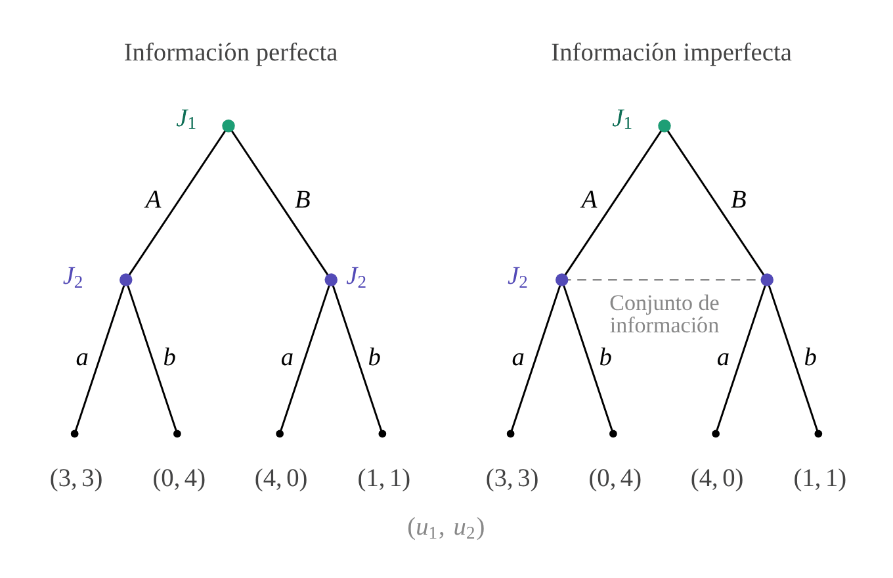
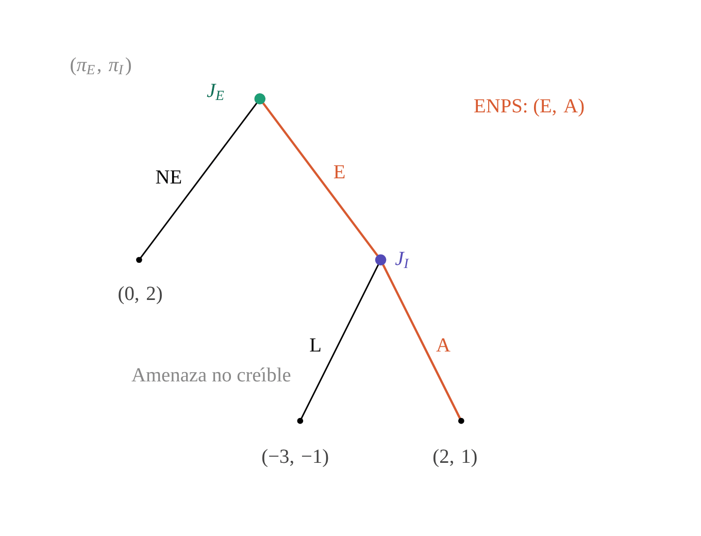
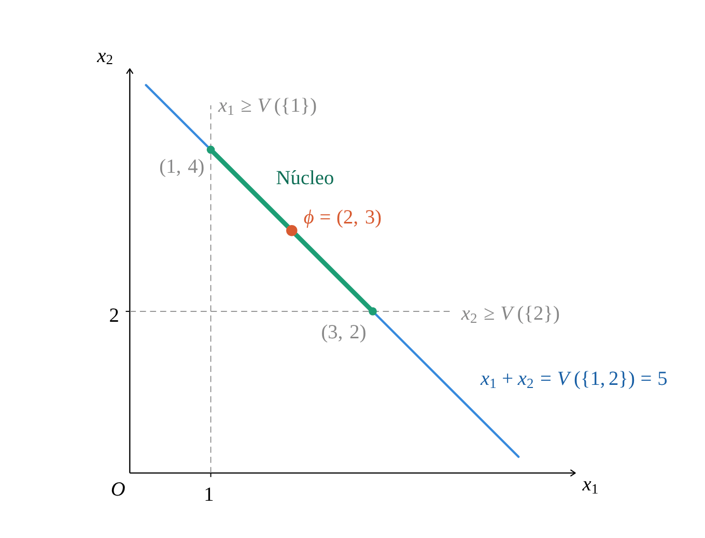

## Introducción



Este tema desarrolla la primera de esas dos herramientas, la teoría de juegos. En competencia perfecta los agentes toman el precio como dado, y en el monopolio hay un único decisor. La teoría de juegos se ocupa, en cambio, de la *interdependencia estratégica*[^a14-2]. Su ámbito va desde el oligopolio (tema [A19](a19-oligopolio.qmd)) y la economía de la información (tema [A13](a13-informacion.qmd)) hasta la negociación internacional y el diseño de subastas, que hoy se emplean para colocar deuda pública o adjudicar licencias de espectro radioeléctrico.

El tema expone las bases de la teoría de juegos, organizadas en los tres bloques que siguen:

- *Fundamentos*: qué es un juego y cómo se resuelve.

- *Aplicaciones*: los juegos representativos de cada entorno.

- *Subastas*: su teoría y sus aplicaciones.

## 1. Fundamentos de la teoría de juegos: elementos, estrategias y conceptos de solución

Antes de analizar juegos concretos (apartado 2) conviene fijar los elementos de un juego, sus tipos y representaciones, la noción de estrategia y los conceptos de solución.

### 1.1. Definición y elementos básicos de un juego

Un **juego** es la representación formal de una situación en la que un número determinado de individuos interactúa en un entorno de interdependencia estratégica. La *solución* al juego representa una predicción de cómo jugarán los agentes.

Todo juego queda definido por una serie de elementos que pueden agruparse en cuatro categorías principales:

1. *Conjunto de jugadores* ($N = \{1, 2, \ldots, n\}$): individuos, empresas o países, generalmente en número fijo.

2. *Reglas*:

    - *Conjunto de acciones* disponibles para cada jugador $i$: $A_i$.

    - *Temporalidad*: el juego puede ser simultáneo o secuencial.

    - *Información*: qué sabe cada jugador en cada momento, tanto sobre las características del juego (pagos, tipos de los rivales) como sobre las acciones ya tomadas.

    - *Compromisos vinculantes*: si los acuerdos entre jugadores son vinculantes, el juego es cooperativo, y si no lo son, no cooperativo. El caso extremo de conflicto de intereses son los juegos de suma cero, en los que lo que gana un jugador lo pierde el otro[^a14-5].

3. *Resultados*: para cada combinación de acciones, el desenlace del juego.

4. *Pagos*: las preferencias de los jugadores sobre los resultados, representadas como funciones de utilidad cardinal. La función de pagos $u_i(s_i, \mathbf{s}_{-i})$ asigna a cada perfil de estrategias un pago para el jugador $i$.

### 1.2. Tipos de juego y sus representaciones

Los juegos pueden clasificarse según varios criterios:

**Según el tratamiento del tiempo**:

- *Juegos estáticos*: los jugadores eligen sus acciones simultáneamente (o, de forma equivalente, sin observar las elecciones de los demás) y el juego se resuelve de una sola vez.

- *Juegos dinámicos*: las decisiones se toman secuencialmente, de modo que al menos un jugador observa alguna acción previa de otro antes de decidir. Son de dos clases:

    - *Secuenciales*: el juego se juega una sola vez, por turnos, como el juego de entrada (apartado 2.3.1) o la negociación de Rubinstein (apartado 2.4.3).

    - *Repetidos*: un mismo juego estático, el juego de etapa, se juega varias veces, en horizonte finito o infinito (apartados 2.3.2 y 2.3.3).

**Según el contexto informativo**: cabe distinguir el conocimiento sobre el juego en sí (información completa frente a incompleta) y sobre las acciones de los otros jugadores (información perfecta frente a imperfecta):

- *Juegos con información completa*: todos los jugadores conocen jugadores, estrategias y pagos, y se supone *conocimiento común* (Aumann, 1976), es decir, que cada uno sabe que los demás lo saben, y así *ad infinitum*.

- *Juegos con información incompleta*: algún jugador desconoce alguna característica relevante del juego, típicamente los pagos (o el “tipo”) de algún rival. Se modelizan con la transformación de Harsanyi.

- *Juegos con información perfecta*: al decidir, cada jugador conoce todas las acciones previas, de modo que cada conjunto de información tiene un solo nodo.

- *Juegos con información imperfecta*: algún jugador decide sin observar alguna acción previa, como en los juegos simultáneos (apartado 2.2.1).

**Según la posibilidad de acuerdos vinculantes**:

- *Juegos no cooperativos*: la unidad de análisis es el jugador individual y no existen mecanismos externos que hagan exigibles los acuerdos, de modo que cualquier cooperación debe sostenerse en los propios incentivos.

- *Juegos cooperativos*: la unidad de análisis es la coalición y los acuerdos son vinculantes. La pregunta relevante ya no es qué estrategia jugar, sino cómo repartir las ganancias de la cooperación.

Un juego admite, además, dos representaciones principales:

**Representación normal, matricial o estratégica**: una matriz de pagos que muestra las estrategias y los pagos de cada combinación. Por ejemplo, para dos jugadores con dos estrategias cada uno (donde el primer elemento de cada celda es el pago del jugador 1, que elige fila, y el segundo el del jugador 2, que elige columna):

|            | Izquierda | Derecha |
|------------|-----------|---------|
| **Arriba** | (3, 3)    | (0, 4)  |
| **Abajo**  | (4, 0)    | (1, 1)  |

: Representación normal de un juego de dos jugadores con dos estrategias. {#tbl-a14-forma-normal}

**Representación en forma extensiva**: un diagrama de árbol que muestra la secuencia de decisiones, los nodos de decisión de cada jugador, la información disponible en cada nodo y los pagos en los nodos terminales. Los nodos entre los que un jugador no puede distinguir se agrupan en *conjuntos de información*.

La representación normal es la natural para los juegos estáticos y la extensiva para los dinámicos, si bien todo juego en forma extensiva admite una representación normal (asociando a cada plan contingente completo una estrategia). La figura -@fig-a141-forma-extensiva representa en forma extensiva el juego de la matriz anterior, con información imperfecta (derecha), y su versión secuencial con los mismos pagos, con información perfecta (izquierda). En ella, A y B son Arriba y Abajo, y a y b, Izquierda y Derecha.

::: {#fig-a141-forma-extensiva}

::: {.content-visible when-format="html"}
```{=html}
<div class="graph-frame wide">
<iframe src="../graphs/a141_Forma_extensiva.html" style="--r:1.545" loading="lazy" title="fig-a141-forma-extensiva"></iframe>
</div>
```
:::

::: {.content-visible unless-format="html"}

:::

Forma extensiva del juego simultáneo de la matriz (derecha, con información imperfecta) y de su versión secuencial con los mismos pagos (izquierda, con información perfecta). El gráfico muestra los nodos de decisión, el conjunto de información y los pagos.
:::

### 1.3. Comportamiento de los jugadores: la estrategia

Entender el comportamiento de los agentes en un juego exige distinguir entre acción y estrategia, conceptos que coinciden en un juego estático con información completa, pero no en uno dinámico:

1. *Acción*: cada una de las alternativas disponibles en un nodo de decisión. 

2. *Estrategia*: un plan completo que indica qué acción tomar en cada nodo en el que al jugador pueda tocarle decidir (en cada uno de sus conjuntos de información), incluidos los nodos que, según ese mismo plan, nunca se alcanzarán. 

#### 1.3.1. Estrategias puras

Una **estrategia pura** ($s_i^j$) es un plan contingente completo, en el sentido anterior, que el jugador sigue con certeza. En un juego finito, cada jugador dispone de un conjunto finito de estrategias puras, $S_i = \{s_i^1, s_i^2, \ldots, s_i^m\}$, cuyo tamaño crece rápidamente con la estructura del juego, pues un jugador con $k$ conjuntos de información y dos acciones en cada uno dispone de $2^k$ estrategias puras. 

Un juego es *discreto* si cada jugador elige entre un número finito de estrategias (confesar o no en el dilema del prisionero) y *continuo* si elige en un intervalo (la cantidad en el duopolio de Cournot). En los discretos el equilibrio se busca en la matriz de pagos, y en los continuos, con las funciones de mejor respuesta que dan las condiciones de primer orden. En los juegos continuos existe un equilibrio en estrategias puras si los conjuntos de estrategias son compactos y convexos y los pagos, continuos y cuasicóncavos en la estrategia propia (Debreu, 1952).

Un **perfil de estrategias** es el vector formado por una estrategia de cada jugador, $\mathbf{s} = (s_1, s_2, \ldots, s_n)$, que suele escribirse como $\mathbf{s} = (s_i, \mathbf{s}_{-i})$ para separar la estrategia del jugador $i$ de las de todos los demás. 

#### 1.3.2. Estrategias mixtas

Una **estrategia mixta** ($\sigma_i$) es una distribución de probabilidad sobre las estrategias puras del jugador, $\sigma_i = (p_1, p_2, \ldots, p_m)$, con $p_j \geq 0$ y $\sum_j p_j = 1$.

Toda estrategia pura es una estrategia mixta degenerada, y el conjunto de estrategias mixtas de un jugador es el símplice construido sobre sus estrategias puras. Los pagos de un perfil mixto son pagos esperados, de modo que su uso presupone preferencias de von Neumann-Morgenstern (tema [A10](a10-riesgo-incertidumbre.qmd)).

Las estrategias mixtas requieren dos precisiones: 

- *Interpretación*: aleatorización deliberada para no ser previsible (juegos de suma cero, como el *matching pennies*), frecuencias de las distintas estrategias puras en una población de jugadores, o incertidumbre de los rivales sobre lo que hará el jugador (interpretación de Harsanyi). 

- *Comportamiento*: en los juegos dinámicos se utilizan también las *estrategias de comportamiento*, que aleatorizan nodo a nodo en lugar de sobre planes completos. Con memoria perfecta, ambas son equivalentes (Kuhn, 1953).

#### 1.3.3. Mejor respuesta y dominancia

Dos conceptos construidos sobre las estrategias permiten formular después los conceptos de solución:

**Mejor respuesta**: la estrategia $s_i^*$ es una mejor respuesta a $\mathbf{s}_{-i}$ si $u_i(s_i^*, \mathbf{s}_{-i}) \geq u_i(s_i, \mathbf{s}_{-i})$ para toda $s_i \in S_i$. La *función de mejor respuesta* (o de reacción), $s_i^* = R_i(\mathbf{s}_{-i})$, asigna a cada perfil de los rivales la respuesta óptima del jugador.

**Dominancia**: la estrategia $s_i$ está *estrictamente dominada* por $s_i'$ si $u_i(s_i', \mathbf{s}_{-i}) > u_i(s_i, \mathbf{s}_{-i})$ para todo $\mathbf{s}_{-i}$, y *débilmente dominada* si la desigualdad es débil para todo $\mathbf{s}_{-i}$ y estricta para alguno. Una estrategia *dominante* es la que domina a todas las demás. Un jugador racional nunca juega una estrategia estrictamente dominada, lo que, si la racionalidad es conocimiento común, justifica el proceso de eliminación iterativa. Con todo, la eliminación de estrategias débilmente dominadas es menos segura, pues su resultado puede depender del orden de eliminación.

### 1.4. Soluciones a los juegos

Los conceptos de solución se presentan por separado para los juegos no cooperativos, centrados en la estrategia de cada jugador, y para los cooperativos, centrados en el reparto entre coaliciones.

#### 1.4.1. Juegos no cooperativos

Los conceptos de solución de los juegos no cooperativos se corresponden con las distintas combinaciones de temporalidad e información. Todos responden a la misma pregunta, qué perfiles de estrategias cabe esperar de jugadores racionales, pero difieren en lo que exigen a los jugadores y en el tipo de juego al que se aplican. Las tablas -@tbl-a14-soluciones-completa y -@tbl-a14-soluciones-incompleta los recapitulan.

**Equilibrio en estrategias dominantes** (EED): si cada jugador dispone de una estrategia dominante, la juega con independencia de lo que espere que hagan los demás, y el perfil formado por esas estrategias es el EED. Este equilibrio es la predicción más robusta, porque solo exige racionalidad individual y ninguna hipótesis sobre las creencias, pero rara vez existe. La *eliminación iterativa de estrategias estrictamente dominadas* amplía su alcance. Suprimidas esas estrategias, en el juego reducido pueden aparecer otras dominadas, y si tras repetir el proceso sobrevive un único perfil, el juego es *resoluble por dominancia*.

**Equilibrio de Nash** (EN): es un perfil de estrategias $\mathbf{s}^* = (s_i^*, \mathbf{s}_{-i}^*)$ en el que la estrategia de cada jugador es mejor respuesta a las de los demás, $u_i(s_i^*, \mathbf{s}_{-i}^*) \geq u_i(s_i, \mathbf{s}_{-i}^*)$ para toda $s_i \in S_i$ y todo jugador $i$. Ningún jugador gana, por tanto, desviándose unilateralmente, y el perfil funciona como un acuerdo que se cumple por sí solo. El EN es más exigente que el EED, porque a la racionalidad añade que cada jugador acierte al prever qué estrategias van a seguir sus rivales. A cambio, se aplica a muchos más juegos, y todo EED es un EN, pero no a la inversa. Cabe distinguir dos casos:

- *En estrategias puras*: cada jugador elige con certeza una de sus estrategias. En este caso el EN puede no existir (*matching pennies*, apartado 2.1.4) o no ser único (batalla de los sexos, apartado 2.1.5).

- *En estrategias mixtas*: cada jugador aleatoriza entre sus estrategias puras y la condición de equilibrio se impone sobre los pagos esperados. Un jugador solo está dispuesto a mezclar entre estrategias puras que le dan el mismo pago esperado, de modo que, en equilibrio, las probabilidades de cada jugador dejan a los rivales indiferentes entre las estrategias que estos mezclan. El *teorema de Nash* (1950) garantiza que todo juego finito (número finito de jugadores, cada uno con un número finito de estrategias puras) tiene al menos un EN en estrategias mixtas. La demostración aplica el teorema de punto fijo de Kakutani a la correspondencia de mejor respuesta, que asigna a cada perfil las mejores respuestas de todos los jugadores, porque un EN es un punto fijo de esa correspondencia.

**Equilibrio de Nash perfecto en subjuegos** (ENPS): en un juego dinámico, el EN puede apoyarse en *amenazas no creíbles* (juego de entrada, apartado 2.3.1), acciones previstas para nodos que no se alcanzan en equilibrio y que el jugador no ejecutaría si llegara a ellos. Reinhard Selten (1965) propuso descartarlas exigiendo racionalidad también fuera de la senda de equilibrio. Un *subjuego* es la parte del árbol que empieza en un nodo que forma por sí solo un conjunto de información y comprende todos sus sucesores, sin partir ningún conjunto de información. Un ENPS es un perfil de estrategias que induce un EN en cada subjuego, se alcance este o no (*racionalidad secuencial*). En los juegos finitos con información perfecta se obtiene por *inducción hacia atrás*. Se resuelven primero las decisiones de los últimos nodos, se sustituye cada uno por el pago de la acción óptima y se retrocede hasta el nodo inicial. Todo ENPS es un EN, pero no a la inversa.

**Equilibrio de Bayes-Nash** (EBN): cuando algún jugador desconoce los pagos de los rivales, la *transformación de Harsanyi* (1967-1968) convierte el juego en otro de información completa pero imperfecta. La naturaleza elige primero el *tipo* de cada jugador (sus pagos o su información privada) según una distribución de probabilidad que es conocimiento común. Cada jugador observa solo su propio tipo, y una estrategia pasa a ser un plan que asigna una acción a cada tipo posible. El EBN es el EN de este juego ampliado, en el que cada tipo de cada jugador elige la acción que maximiza su pago esperado, dadas sus creencias sobre los tipos de los rivales y las estrategias de estos.

**Equilibrio bayesiano perfecto** (EBP): en los juegos dinámicos con información incompleta las acciones observadas transmiten información sobre el tipo de quien las toma, y el EBN, como el EN, puede descansar en amenazas no creíbles. Por ello, el EBP combina la racionalidad secuencial del ENPS con la actualización de las creencias. Consta de unas estrategias *secuencialmente racionales* (óptimas en cada conjunto de información dadas las creencias) y de unas *creencias* sobre los nodos de cada conjunto de información *consistentes* (obtenidas de las estrategias por Bayes siempre que sea posible). En los conjuntos de información alcanzados con probabilidad nula en equilibrio, la regla de Bayes no impone nada, y ese margen para fijar creencias explica la multiplicidad de equilibrios, que refinamientos como el criterio intuitivo intentan acotar (apartado 2.2.4).

|   | Equilibrio en estrategias dominantes (EED) | Equilibrio de Nash (EN) | Equilibrio de Nash perfecto en subjuegos (ENPS) |
|-------|------------|------------|------------|
| **Tiempo** | Estático | Estático | Dinámico |
| **Información** | Completa | Completa | Completa |
| **Criterio** | Dominancia estratégica | Mejor respuesta | Racionalidad secuencial |
| **Definición** | Cada jugador juega la estrategia que maximiza su pago haga lo que haga el rival | Cada estrategia es mejor respuesta a las demás, y nadie gana desviándose unilateralmente | EN que induce un EN en cada subjuego |
| **Método** | Elegir la estrategia estrictamente dominante o eliminar iterativamente las dominadas[^a14-8] | Marcar las mejores respuestas en la matriz o cortar las funciones de mejor respuesta | Inducción hacia atrás desde los nodos finales |
| **Usos** | Predicción robusta, pues solo exige racionalidad individual (dilema del prisionero, mecanismos de revelación) | Concepto central (oligopolio, bienes públicos, coordinación), que existe en mixtas en todo juego finito | Descarta las amenazas no creíbles (juego de entrada, Stackelberg, juegos repetidos) |
| **Limitaciones** | Rara vez existe y puede ser ineficiente | Puede no existir en puras, no ser único ni ser eficiente | Exige subjuegos identificables y falla en horizontes finitos largos (cadena de tiendas) |

: Soluciones de los juegos no cooperativos con información completa. {#tbl-a14-soluciones-completa}

|   | Equilibrio de Bayes-Nash (EBN) | Equilibrio bayesiano perfecto (EBP) |
|-------|-----------------|-----------------|
| **Tiempo** | Estático | Dinámico |
| **Información** | Incompleta | Incompleta |
| **Criterio** | Mejor respuesta condicional (en pagos esperados) | Racionalidad secuencial con creencias consistentes |
| **Definición** | Cada tipo maximiza su pago esperado dadas sus creencias sobre los tipos y las estrategias rivales | Estrategias secuencialmente racionales dadas unas creencias que siguen la regla de Bayes siempre que es posible |
| **Método** | Transformación de Harsanyi y maximización del pago esperado de cada tipo | Proponer un perfil (separador o agrupador), fijar las creencias por Bayes y comprobar que ningún tipo gana desviándose |
| **Usos** | Subastas (apartado 3), costes privados y mercado de “limones” (apartados 2.2.2 y 2.2.3) | Señalización y reputación (apartados 2.2.4 y 2.3.4) |
| **Limitaciones** | Depende de la distribución de tipos supuesta, que ha de ser conocimiento común | Multiplicidad por la libertad de creencias fuera de la senda, que el criterio intuitivo acota sin eliminar |

: Soluciones de los juegos no cooperativos con información incompleta. {#tbl-a14-soluciones-incompleta}

#### 1.4.2. Juegos cooperativos

En los juegos cooperativos, definidos por una **función característica** $V(S)$ que asigna a cada coalición $S \subseteq N$ el valor que puede garantizarse por sí misma, la pregunta es cómo repartir el valor de la gran coalición, $V(N)$. Un *reparto* es un vector $\mathbf{x} = (x_1, \ldots, x_n)$ que asigna a cada jugador una parte de ese valor. Los dos conceptos de solución fundamentales responden a criterios distintos, la estabilidad y la equidad, y la tabla -@tbl-a14-soluciones-cooperativos los recapitula.

**Núcleo** (Gillies, 1959): un reparto es estable si ninguna coalición puede garantizar a sus miembros más de lo que reciben, porque en caso contrario esa coalición abandonaría el acuerdo, es decir, lo *bloquearía*. El núcleo es el conjunto de repartos eficientes que ninguna coalición bloquea:

$$\mathcal{C}(V) = \left\{ \mathbf{x} \in \mathbb{R}^n : \sum_{i \in N} x_i = V(N), \;\; \sum_{i \in S} x_i \geq V(S) \;\; \text{para toda } S \subseteq N \right\}$$

donde $x_i$ es lo que recibe el jugador $i$, $V(N)$ el valor de la gran coalición y $V(S)$ el que la coalición $S$ obtiene por sí misma. Las coaliciones de un solo jugador imponen la *racionalidad individual*, $x_i \geq V(\{i\})$. El núcleo puede contener infinitos repartos cuando las coaliciones distintas de la gran coalición obtienen poco por sí solas (*joint venture*, apartado 2.4.1) y ser vacío cuando obtienen mucho. Así, si tres jugadores se reparten una unidad y basta una mayoría de dos para quedársela, cada pareja debe recibir en conjunto al menos la unidad. Sumando las tres condiciones, los pagos tendrían que sumar al menos $3/2$, más de lo que hay que repartir.

::: {.callout-tip collapse="true" appearance="simple" title="Ejemplo: cálculo del núcleo con tres jugadores"}
Un inventor (jugador 1) y dos fabricantes (jugadores 2 y 3) pueden explotar una patente. Nadie obtiene nada por sí solo, $V(\{i\}) = 0$. El inventor con cualquiera de los fabricantes obtiene $V(\{1,2\}) = V(\{1,3\}) = 60$, los dos fabricantes sin la patente, $V(\{2,3\}) = 30$, y los tres juntos, $V(N) = 90$. Como $x_1 + x_2 + x_3 = 90$, cada condición de coalición equivale a un tope para el jugador que queda fuera de ella:

$$x_1 + x_2 \geq 60 \Leftrightarrow x_3 \leq 30, \qquad x_1 + x_3 \geq 60 \Leftrightarrow x_2 \leq 30, \qquad x_2 + x_3 \geq 30 \Leftrightarrow x_1 \leq 60$$

El núcleo son los repartos no negativos que suman 90 con $x_1 \leq 60$ y $x_2, x_3 \leq 30$, como $(30, 30, 30)$ o $(60, 15, 15)$. Si un fabricante recibiera más de 30, el inventor y el otro fabricante, que juntos se garantizan 60, abandonarían el acuerdo.
:::

**Valor de Shapley** (Shapley, 1953): en lugar de describir todos los repartos estables, Lloyd Shapley busca una regla que asigne a cada juego un único reparto equitativo y la caracteriza por cuatro axiomas:

- *Eficiencia*: se reparte todo el valor de la gran coalición, $\sum_{i \in N} \phi_i(V) = V(N)$.

- *Simetría*: dos jugadores que aportan lo mismo a toda coalición que no incluye a ninguno de ellos reciben lo mismo.

- *Jugador nulo*: quien no aporta nada a ninguna coalición recibe cero.

- *Aditividad*: si los mismos jugadores participan en dos juegos, $V$ y $W$, el pago de cada uno en el juego suma es la suma de sus pagos en cada juego, $\phi_i(V + W) = \phi_i(V) + \phi_i(W)$.

La única regla que cumple los cuatro axiomas asigna a cada jugador la media de sus contribuciones marginales:

$$\phi_i(V) = \sum_{S \subseteq N \setminus \{i\}} \frac{s!\,(n-s-1)!}{n!}\,\left[V(S \cup \{i\}) - V(S)\right]$$

donde $\phi_i(V)$ es el pago del jugador $i$, $n$ el número de jugadores, $s$ el número de miembros de la coalición $S$, $V(S \cup \{i\}) - V(S)$ la *contribución marginal* de $i$ a $S$ y $s!\,(n-s-1)!/n!$ la probabilidad de que, si los jugadores se incorporan a la gran coalición en un orden aleatorio y todos los órdenes son igual de probables, $i$ encuentre formada exactamente la coalición $S$ al llegar. El valor de Shapley siempre existe y es único, pero no tiene por qué pertenecer al núcleo, porque la equidad no garantiza la estabilidad. Sí pertenece a él en los *juegos convexos*, en los que la contribución marginal de cada jugador no disminuye cuando se amplía la coalición a la que se une (Shapley, 1971).

::: {.callout-tip collapse="true" appearance="simple" title="Ejemplo: cálculo del valor de Shapley"}
En el juego del ejemplo anterior hay $3! = 6$ órdenes de llegada igual de probables. El inventor no aporta nada si llega el primero (dos órdenes) y aporta 60 en los otros cuatro, tanto si encuentra a un fabricante ($60 - 0$) como a los dos ($90 - 30$). Cada fabricante aporta 0 si llega el primero, 60 si encuentra solo al inventor, 30 si encuentra solo al otro fabricante y 30 si encuentra a ambos ($90 - 60$). Con los pesos de la fórmula ($2/6$ para la coalición vacía y para la de los otros dos, $1/6$ para cada coalición de uno):

$$\phi_1 = \tfrac{2}{6}\cdot 0 + \tfrac{1}{6}\cdot 60 + \tfrac{1}{6}\cdot 60 + \tfrac{2}{6}\cdot 60 = 40, \qquad \phi_2 = \phi_3 = \tfrac{2}{6}\cdot 0 + \tfrac{1}{6}\cdot 60 + \tfrac{1}{6}\cdot 30 + \tfrac{2}{6}\cdot 30 = 25$$

El reparto $(40, 25, 25)$ suma 90 (eficiencia), trata igual a los dos fabricantes (simetría) y está en el núcleo, pues $40 \leq 60$ y $25 \leq 30$. El inventor recibe más porque su contribución marginal es mayor.
:::

|   | Núcleo (*core*) | Valor de Shapley (1953) |
|-------|-----------------|-----------------|
| **Criterio** | Estabilidad coalicional | Equidad axiomática (eficiencia, simetría, jugador nulo, aditividad) |
| **Definición** | Repartos del valor total que ninguna coalición puede bloquear | Reparto que da a cada jugador su contribución marginal esperada |
| **Método** | Comprobar la racionalidad individual y la de cada coalición | Promediar las contribuciones marginales sobre todos los órdenes de llegada |
| **Usos** | Estabilidad de los acuerdos entre socios (*joint venture*, apartado 2.4.1) | Siempre existe y es único (reparto de costes, poder de voto, apartado 2.4.2) |
| **Limitaciones** | Puede ser vacío o muy grande | Puede quedar fuera del núcleo (lo “justo” puede no ser estable) |

: Soluciones de los juegos cooperativos. {#tbl-a14-soluciones-cooperativos}

### 1.5. Conclusiones

Un juego queda definido por sus jugadores, reglas, resultados y pagos, y las reglas sobre el tiempo, la información y los compromisos vinculantes determinan su representación y el concepto de solución aplicable. Los conceptos no cooperativos, construidos sobre la mejor respuesta y la dominancia, son cada vez más exigentes. Así, el equilibrio de Nash pide que cada jugador acierte al prever las estrategias rivales, y a cambio existe en estrategias mixtas en todo juego finito. El ENPS y el equilibrio bayesiano perfecto añaden racionalidad fuera de la senda de equilibrio. En los juegos cooperativos, en cambio, el núcleo y el valor de Shapley reparten por estabilidad y por equidad, y el reparto equitativo puede no ser estable. El apartado 2 aplica estos conceptos a juegos característicos de cada entorno.

## 2. Aplicaciones

Los juegos no cooperativos se presentan, en la medida en que cada caso lo permite, con una estructura común: planteamiento del juego, solución por dominancia, equilibrio de Nash, equilibrio de Nash perfecto en subjuegos (cuando el juego es dinámico), análisis de bienestar y conclusiones. Los modelos más formales (señalización, reputación y negociación) se exponen a partir de su origen, su idea y sus resultados, y los juegos cooperativos, mediante ejemplos.

### 2.1. Juegos estáticos con información completa

Cinco juegos simultáneos con información completa ilustran los casos característicos, desde el equilibrio en estrategias dominantes hasta la multiplicidad de equilibrios.

#### 2.1.1. El dilema del prisionero

**Planteamiento**: dos sospechosos de un crimen son arrestados e interrogados por separado, sin posibilidad de comunicarse, y pueden confesar (C) o no confesar (NC). Se les dan las siguientes opciones, cuyos pagos (en años de condena, con signo negativo) recoge la tabla -@tbl-a14-dilema-prisionero:

- *Ambos confiesan*: cada uno recibe cinco años de prisión.

- *Ninguno confiesa*: un año por un delito menor.

- *Solo uno confiesa*: queda libre y el otro recibe diez años.

|        | C        | NC       |
|--------|----------|----------|
| **C**  | (-5, -5) | (0, -10) |
| **NC** | (-10, 0) | (-1, -1) |

: Matriz de pagos del dilema del prisionero. {#tbl-a14-dilema-prisionero}

**Equilibrio en estrategias dominantes** (EED): confesar es estrictamente dominante para ambos, ya que, sea cual sea la elección del otro, da un pago mayor ($-5 > -10$ si el otro confiesa y $0 > -1$ si no lo hace). El EED es, por tanto, (C, C), con pagos $(-5, -5)$.

**Equilibrio de Nash** (EN): todo EED es un EN, y aquí (C, C) es el único, pues en cualquier otra celda al menos un jugador mejora desviándose unilateralmente.

**Bienestar**: el resultado es ineficiente en el sentido de Pareto. (NC, NC), con pagos $(-1, -1)$, es Pareto-superior al equilibrio, pero no es sostenible, porque cada jugador tiene incentivos a desviarse unilateralmente.

**Conclusiones**: el dilema ilustra la tensión fundamental entre racionalidad individual y eficiencia colectiva, que reaparece en el oligopolio (la colusión), la provisión de bienes públicos, la carrera de armamentos o las guerras arancelarias. 

Su lección es que la cooperación no puede descansar en el interés individual en un juego jugado una sola vez, sino que exige compromisos vinculantes (juegos cooperativos) o repetición con castigos creíbles.

#### 2.1.2. La batalla del mar de Bismarck

**Planteamiento**: la batalla del mar de Bismarck es un ejemplo histórico de juego de suma cero. En 1943, un convoy japonés debía elegir la ruta norte o sur de Nueva Bretaña, y la aviación aliada, en qué ruta concentrar su búsqueda.

Los pagos (días de bombardeo sobre el convoy) eran:

|              | J: Norte | J: Sur  |
|--------------|----------|---------|
| **A: Norte** | (2, -2)  | (2, -2) |
| **A: Sur**   | (1, -1)  | (3, -3) |

: Matriz de pagos de la batalla del mar de Bismarck. {#tbl-a14-bismarck}

**Equilibrio en estrategias dominantes**: para el convoy japonés, navegar por el norte domina débilmente al sur, pues garantiza como máximo dos días de bombardeo frente a los tres posibles en el sur. Para los aliados no existe estrategia dominante, pero, eliminada la ruta sur japonesa, su mejor respuesta es buscar en el norte. Por tanto, la eliminación iterada de estrategias dominadas conduce a (Norte, Norte).

**Equilibrio de Nash**: de nuevo, el único EN en estrategias puras es (Norte, Norte). Dado que Japón navega por el norte, los aliados buscan en el norte. Dado que los aliados buscan en el norte, Japón es indiferente entre ambas rutas y el norte es una mejor respuesta.

En estrategias mixtas existen además otros EN, en los que los aliados buscan en el norte y Japón elige el norte con probabilidad de al menos $1/2$, todos con el mismo pago de dos días de bombardeo. En un juego de suma cero, el EN coincide con la solución *maximin* de cada jugador.

**Bienestar**: en un juego de suma cero toda ganancia de un jugador es pérdida del otro, de modo que cualquier perfil es óptimo de Pareto.

**Conclusiones**: la predicción coincide con lo que hicieron ambos bandos. El ejemplo muestra a la vez la potencia y el límite de la dominancia, pues con dominancia débil el resultado de la eliminación iterada puede depender del orden (apartado 1.3.3).

#### 2.1.3. Juegos con un único equilibrio de Nash sin estrategias dominantes: el duopolio de Cournot

::: {.callout-note appearance="simple" icon=false}
El modelo de Cournot, con sus supuestos, las funciones de reacción y la comparación del equilibrio con el monopolio y la competencia perfecta, se desarrolla en el tema [A19](a19-oligopolio.qmd), apartado 1.1. Aquí sirve de ejemplo de juego con un único equilibrio de Nash sin estrategias dominantes.
:::

**Planteamiento**: dos empresas eligen simultáneamente cantidades de un bien homogéneo. El precio de mercado depende de la cantidad total y el beneficio de cada empresa de su propia cantidad y de la del rival. Como cada empresa puede elegir cualquier cantidad, no cabe una tabla de pagos y el juego se describe con funciones de beneficio.

**Equilibrio en estrategias dominantes**: no existe, porque la cantidad óptima de cada empresa depende de la del rival. En el duopolio lineal, no obstante, la eliminación iterativa de estrategias estrictamente dominadas converge al EN.

**Equilibrio de Nash**: se obtiene como intersección de las funciones de mejor respuesta (funciones de reacción) y, bajo los supuestos habituales, es único[^a14-13].

**Bienestar**: el equilibrio de Cournot se sitúa entre el monopolio y la competencia perfecta. La cantidad total es mayor y el precio menor que en el cártel, pero menor y mayor, respectivamente, que en competencia, con la consiguiente pérdida de eficiencia.

**Conclusiones**: es el ejemplo canónico de que el EN es el concepto de solución general para los juegos estáticos con información completa, ya que todo EED es un EN, pero muchos juegos sin estrategias dominantes tienen, no obstante, un único EN.

#### 2.1.4. Juegos sin equilibrio en estrategias puras: el *matching pennies*

**Planteamiento**: dos jugadores muestran simultáneamente una moneda por una de sus caras. Si coinciden, gana el jugador 1 y, si no, el jugador 2. Es un juego de suma cero, de nuevo:

|          | Cara    | Cruz    |
|----------|---------|---------|
| **Cara** | (1, -1) | (-1, 1) |
| **Cruz** | (-1, 1) | (1, -1) |

: Matriz de pagos del *matching pennies*. {#tbl-a14-matching-pennies}

**Equilibrio en estrategias dominantes**: no existe, porque la mejor elección de cada jugador depende por completo de la del rival.

**Equilibrio de Nash**: no existe EN en estrategias puras, ya que en toda celda algún jugador gana desviándose, de modo que las mejores respuestas nunca se cruzan. Sí existe en estrategias mixtas, y en él cada jugador elige cara con probabilidad $p = 1/2$ y cruz con $1 - p = 1/2$, lo que deja al rival indiferente entre sus dos opciones y le impide explotar patrón alguno. El pago esperado es cero para ambos. El juego ilustra así el teorema de Nash (1950), enunciado en el apartado 1.4.1.

**Bienestar**: como en todo juego de suma cero, no hay mejoras de Pareto posibles.

**Conclusiones**: el juego muestra por qué son necesarias las estrategias mixtas, ya que sin ellas la teoría no daría predicción alguna en los juegos de pura oposición.

#### 2.1.5. Juegos con múltiples equilibrios: la batalla de los sexos

**Planteamiento**: dos personas quieren pasar la tarde juntas, pero una prefiere el fútbol y la otra la ópera. Ambas prefieren coincidir antes que ir por separado:

|            | Fútbol | Ópera  |
|------------|--------|--------|
| **Fútbol** | (3, 2) | (0, 0) |
| **Ópera**  | (0, 0) | (2, 3) |

: Matriz de pagos de la batalla de los sexos. {#tbl-a14-batalla-sexos}

**Equilibrio en estrategias dominantes**: no existe, ya que cada jugador prefiere ir donde vaya el otro.

**Equilibrio de Nash**: existen dos EN en estrategias puras, (Fútbol, Fútbol) y (Ópera, Ópera), y uno adicional en estrategias mixtas en el que cada jugador elige su opción favorita con probabilidad $3/5$.

**Bienestar**: los dos equilibrios en puras son óptimos de Pareto, pero distribuyen de forma distinta las ganancias de la coordinación. En cambio, el equilibrio en mixtas es ineficiente, pues con probabilidad positiva los jugadores no se coordinan y ambos obtienen cero.

**Conclusiones**: el juego ilustra el problema de coordinación y el límite del EN como concepto de solución, pues la teoría no predice cuál de los equilibrios se alcanzará. 

Esta indeterminación ha motivado conceptos de selección de equilibrios, como el punto focal de Schelling (convenciones, precedentes) o la comunicación previa, y muestra que en los juegos de coordinación la historia y las instituciones importan tanto como los incentivos.

### 2.2. Juegos con incertidumbre

Hasta aquí se ha supuesto que los jugadores conocen toda la información sobre los pagos, los jugadores y las reglas. Se estudian ahora tres formas de incertidumbre: información imperfecta, información incompleta e información asimétrica. La última se extiende después a los juegos dinámicos de señalización.

#### 2.2.1. Información imperfecta: hundir la flota

**Planteamiento**: en los juegos con información *imperfecta*, los jugadores no observan alguna acción de los rivales, de modo que no conocen el estado del juego en el momento de decidir. Esta propiedad es distinta de la completitud, pues el propio dilema del prisionero es un juego de información completa (todos conocen los pagos) pero imperfecta (los jugadores deciden simultáneamente, sin observar la elección del otro)[^a14-14]. Un ejemplo es el juego de hundir la flota, en el que, en todo momento, cada jugador conoce el resultado de sus acciones, pero no la disposición de la flota del rival.

**Equilibrio**: la información imperfecta se representa en forma extensiva mediante conjuntos de información (apartado 1.2), y los conceptos de solución son los mismos (EN y, en los juegos dinámicos, ENPS aplicado a los subjuegos identificables). En juegos como hundir la flota, sin embargo, el espacio de estrategias es tan grande que el equilibrio no se calcula de forma cerrada, y los jugadores lo aproximan mediante reglas heurísticas de búsqueda.

**Conclusiones**: la distinción entre información perfecta e imperfecta permite representar la simultaneidad dentro de la forma extensiva y delimita dónde puede aplicarse la inducción hacia atrás (que exige subjuegos propios, que comienzan en nodos con información perfecta).

#### 2.2.2. Información incompleta: el equilibrio de Bayes-Nash

**Planteamiento**: la información incompleta se modeliza con un movimiento inicial de la naturaleza (transformación de Harsanyi, apartado 1.4.1). Como ejemplo, existen dos posibles estados de la naturaleza, crisis y no crisis, $\Omega = \{\omega_c, \omega_{nc}\}$, y en cada estado la matriz de pagos del juego es distinta. El jugador 1 observa el estado antes de decidir, de modo que el estado es su tipo (su información privada). El jugador 2, en cambio, no sabe en qué matriz juega y solo conoce la distribución de probabilidad (de conocimiento común) que asigna $P_c \in (0, 1)$ al estado de crisis y $1 - P_c$ al de no crisis.

**Equilibrio de Bayes-Nash**: la estrategia del jugador 1 asigna a cada estado la acción que mejor responde, con la matriz de ese estado, a la del jugador 2. El jugador 2 elige la acción de mayor pago esperado, ponderando por las probabilidades de los estados los pagos que obtiene frente a la acción del jugador 1 en cada uno. Según la estructura de pagos, el equilibrio puede coincidir con el de alguno de los estados o ser distinto de ambos, y puede existir en estrategias puras o requerir estrategias mixtas. Sin información privada bastaría con hallar el EN de la matriz de pagos esperados.

**Bienestar**: se evalúa en términos esperados. El equilibrio puede ser ineficiente *ex post* (una vez conocido el estado) aunque sea la mejor respuesta *ex ante* a las creencias.

**Conclusiones**: la transformación de Harsanyi permite aplicar el aparato del EN, a costa de que la predicción sea sensible a la distribución de probabilidad supuesta, que ha de ser conocimiento común.

#### 2.2.3. Información asimétrica: el mercado de coches usados (Akerlof, 1970)

::: {.callout-note appearance="simple" icon=false}
El modelo de Akerlof, con su formalización, se desarrolla en el tema [A13](a13-informacion.qmd), apartado 3.2, y las soluciones a la selección adversa (señalización y autoselección), en el apartado 3.4. Aquí se presenta como juego con información asimétrica, cuyo resultado es un equilibrio de Bayes-Nash.
:::

**Planteamiento**: la información incompleta es *asimétrica* cuando una de las partes posee información privada relevante que la otra desconoce. Los vendedores conocen la calidad de su coche, $\theta \in \{\theta_L, \theta_H\}$, y los compradores solo la distribución de calidades, de modo que ofrecen un precio basado en la calidad esperada, que actualizan por Bayes según qué vendedores acuden al mercado.

**Equilibrio de Bayes-Nash**: si la proporción de coches buenos no es lo bastante alta, al precio medio los vendedores de alta calidad se retiran. Su salida degrada la calidad esperada, reduce el precio y expulsa a más vendedores buenos, en una espiral de selección adversa que acaba en un EBN en el que solo se intercambian los coches malos (*lemons*).

**Bienestar**: el equilibrio no es un óptimo de Pareto, porque quedan sin realizar intercambios mutuamente beneficiosos, los de los coches buenos a un precio intermedio.

**Conclusiones**: es el modelo fundacional de la economía de la información y muestra que la información privada es por sí misma un fallo de mercado. Sus soluciones se estudian a continuación y en el tema [A13](a13-informacion.qmd).

#### 2.2.4. Juegos de señalización y equilibrio bayesiano perfecto (Spence, 1973; Cho y Kreps, 1987)

::: {.callout-note appearance="simple" icon=false}
La señalización en el mercado de trabajo se desarrolla en el tema [A13](a13-informacion.qmd), apartado 3.4.1, como solución a la selección adversa, con sus zonas de equilibrio y su análisis de bienestar. Aquí se formaliza como juego dinámico con información incompleta para introducir el equilibrio bayesiano perfecto y el criterio intuitivo.
:::

**Origen**: los juegos de señalización son la clase más simple de juegos dinámicos con información incompleta. El modelo de partida es el de Michael Spence (1973) sobre el mercado de trabajo, y el criterio intuitivo de Cho y Kreps (1987) selecciona entre sus equilibrios múltiples.

**Idea**: en un juego dinámico con información incompleta el EBN no basta, y el concepto de solución es el equilibrio bayesiano perfecto (EBP). En un juego de señalización, el jugador informado (emisor) elige primero una acción observable, la señal, y el no informado (receptor) responde tras actualizar sus creencias.

**Supuestos**:

- *Entorno*: la productividad $\theta \in \{\theta_L, \theta_H\}$, con $\theta_H > \theta_L$, es privada, y las empresas solo conocen la probabilidad *a priori* $\mu_0 = \Pr(\theta = \theta_H)$. Es decir, los trabajadores conocen su tipo, pero las empresas no, de modo que estas hacen conjeturas sobre el tipo de trabajador que contratan.

- *Agentes*: un trabajador (emisor) y varias empresas competitivas (receptores), de modo que el salario iguala la productividad esperada.

- *Tecnología*: la educación $h \geq 0$ no altera la productividad, pero su coste marginal es menor para el tipo productivo que para el improductivo (*cruce único* o *single crossing*). Concretamente, el coste de la educación viene dado por $c(h, \theta) = h/\theta$.

**Planteamiento**: un EBP es una educación por tipo, un salario $w(h) = \mu(h)\,\theta_H + (1 - \mu(h))\,\theta_L$ y unas creencias $\mu(h) = \Pr(\theta_H \mid h)$ obtenidas por Bayes en las educaciones de equilibrio, tales que cada tipo maximiza $w(h) - c(h, \theta)$. Caben dos clases de equilibrio:

1. *Equilibrio separador*: cada tipo elige una educación distinta, de modo que la señal revela el tipo. El tipo bajo no se educa ($h_L = 0$, $w = \theta_L$) y el alto elige $h^*$ ($w = \theta_H$), siempre que ningún tipo prefiera imitar al otro:

    $$\theta_H - \frac{h^*}{\theta_H} \;\geq\; \theta_L \qquad \text{y} \qquad \theta_L \;\geq\; \theta_H - \frac{h^*}{\theta_L}$$

    donde $\theta_H - h^*/\theta_H$ es la utilidad del tipo alto que se educa y es reconocido, $\theta_L$ la de cualquier tipo sin educarse y $\theta_H - h^*/\theta_L$ la del tipo bajo si imitase al alto. Estas *condiciones de compatibilidad de incentivos* acotan la señal, y el cruce único garantiza que el intervalo no sea vacío:

    $$\theta_L(\theta_H - \theta_L) \;\leq\; h^* \;\leq\; \theta_H(\theta_H - \theta_L)$$

2. *Equilibrio agrupador* (*pooling*): ambos tipos eligen la misma educación, $h_p$, de modo que la señal no revela nada, las empresas mantienen la creencia *a priori* y pagan el salario medio, $\bar{w} = \mu_0\,\theta_H + (1 - \mu_0)\,\theta_L$. Con creencias pesimistas fuera del equilibrio ($\mu(h) = 0$ para toda $h \neq h_p$), quien se desvía cobra $\theta_L$ y le conviene entonces no educarse. Basta, por tanto, con que no lo prefiera el tipo bajo, para el que educarse es más caro:

    $$\bar{w} - \frac{h_p}{\theta_L} \;\geq\; \theta_L \quad \Longrightarrow \quad h_p \;\leq\; \mu_0\,\theta_L(\theta_H - \theta_L)$$

**Equilibrio**: cualquier $h^*$ del primer intervalo, con la creencia $\mu(h) = 1$ si $h \geq h^*$ y $\mu(h) = 0$ en caso contrario, es un EBP separador, y cualquier $h_p$ entre cero y $\mu_0\,\theta_L(\theta_H - \theta_L)$, un EBP agrupador. Qué equilibrio surge depende, ante todo, del coste de la educación. La señal separa porque educarse es más caro para el tipo bajo, y cuanto mayor es esa diferencia, menos educación hace falta para separar (con el mismo coste para ambos, solo en un caso límite). El nivel del coste y la proporción de productivos deciden, a su vez, si al tipo alto le compensa separarse, pues la señal le cuesta $h^*/\theta_H$ y le reporta, frente al agrupador, $(1 - \mu_0)(\theta_H - \theta_L)$. Así, si los productivos son mayoría ($\mu_0$ alta), el tipo alto puede preferir el agrupador. La multiplicidad procede de la libertad de creencias fuera de la senda.

**Extensiones**: el *criterio intuitivo* de Cho y Kreps (1987) restringe esas creencias. Si una desviación $h'$ está *dominada en equilibrio* para el tipo bajo (ni con $w = \theta_H$ mejoraría su pago de equilibrio) pero no para el alto, el receptor debe atribuirla al tipo alto. Con ello todo agrupador se rompe y de los separadores solo sobrevive el de señal mínima, $h^* = \theta_L(\theta_H - \theta_L)$. La misma lógica explica el precio límite como señal de costes bajos (Milgrom y Roberts, 1982a; tema [A19](a19-oligopolio.qmd), apartado 3.2.1) o la garantía como señal de calidad.

**Conclusiones**:

- *Aspectos positivos*: el EBP es el concepto de solución general de los juegos dinámicos con información incompleta, y el modelo de Spence muestra que una actividad improductiva puede ser valiosa porque transmite información.

- *Limitaciones*: la libertad de creencias fuera de la senda genera una multiplicidad que ningún refinamiento elimina del todo, y el equilibrio separador es ineficiente respecto a la información simétrica, pues la educación es un coste puro.

### 2.3. Juegos dinámicos

En los juegos dinámicos el equilibrio de Nash puede apoyarse en amenazas no creíbles, y la repetición plantea si puede sostenerse la cooperación.

#### 2.3.1. El juego de entrada

**Planteamiento**: el juego de entrada ilustra a la vez la ventaja de mover primero, el problema de las amenazas no creíbles y el principio de racionalidad secuencial. La empresa entrante decide entrar (E) o no entrar (NE) en el mercado. Si entra, la empresa instalada o incumbente decide luchar (L, p. ej. una guerra de precios) o acomodar (A, repartir el mercado). Los pagos (entrante, incumbente) son $(0, 2)$ si no hay entrada, $(-3, -1)$ si hay entrada y lucha, y $(2, 1)$ si hay entrada y acomodación.

**Equilibrio en estrategias dominantes**: no existe, pues la mejor estrategia de la entrante depende de cómo reaccione la incumbente.

**Equilibrio de Nash**: la forma normal del juego tiene dos EN en estrategias puras, (E, A) y (NE, L). El segundo lo es porque ninguna de las dos gana desviándose unilateralmente y, mientras la entrante se queda fuera, luchar no llega a ejecutarse y resulta irrelevante. Ese equilibrio se apoya, sin embargo, en una amenaza no creíble, ya que ante una entrada real la incumbente acomodaría ($1 > -1$). Que el EN no permita eliminar equilibrios así es su principal debilidad en los juegos secuenciales.

**Equilibrio de Nash perfecto en subjuegos**: aplicando el principio de racionalidad secuencial, se resuelve el juego por inducción hacia atrás. En el nodo de la incumbente, si la entrante ha entrado, la mejor respuesta de la incumbente es acomodar ($1 > -1$). En el nodo de la entrante, si no entra obtiene $0$, y si entra, obtiene $2$, pues sabe que la incumbente acomodará. Por tanto, entra. El ENPS es (E, A), con pagos $(2, 1)$ (figura -@fig-a143-juego-entrada).

::::: {#fig-a143-juego-entrada}
::: {.content-visible when-format="html"}
```{=html}
<div class="graph-frame">
<iframe src="../graphs/a143_Juego_entrada.html" style="height:560px" loading="lazy" title="fig-a143-juego-entrada"></iframe>
</div>
```
:::

::: {.content-visible unless-format="html"}

:::

Juego de entrada en forma extensiva. La amenaza de lucha no es creíble y, por inducción hacia atrás, el ENPS es (E, A). El otro EN, (NE, L), no sobrevive.
:::::

Para comprometerse de forma creíble a luchar, la incumbente debe modificar sus propios pagos mediante costes hundidos (inversiones irreversibles en capacidad, por ejemplo) que hagan que, llegado el caso, luchar sea efectivamente su mejor respuesta (figura -@fig-a142-juego-entrada).

::::: {#fig-a142-juego-entrada}
::: {.content-visible when-format="html"}
```{=html}
<div class="graph-frame">
<iframe src="../graphs/a142_juego_entrada.html" style="height:580px" loading="lazy" title="fig-a142-juego-entrada"></iframe>
</div>
```
:::

::: {.content-visible unless-format="html"}

:::

Juego de entrada con compromiso previo. Si la inversión hundida $C_0$ hace creíble la lucha ($\pi^L > \pi^D - C_0$), la lucha causa pérdidas a la entrante ($\pi^L < 0$) y la inversión compensa ($\pi^M - C_0 > \pi^D$), la incumbente invierte y la entrada queda disuadida. ACT es invertir $C_0$ y PAS, no invertir. Los beneficios de monopolio, de duopolio y de lucha son $\pi^M$, $\pi^D$ y $\pi^L$.
:::::

**Bienestar**: el ENPS es eficiente para las dos empresas frente a la lucha, y la entrada aumenta la competencia y el bienestar de los consumidores, lo que explica el interés de la política de competencia por las conductas que la disuaden.

**Conclusiones**: dos lecciones se desprenden del juego. La primera es la *credibilidad*, pues la incumbente puede alterar el resultado comprometiéndose creíblemente a luchar. La paradoja es que reducir la propia libertad de acción futura puede aumentar el poder estratégico presente[^a14-15]. La segunda es la *ventaja de mover primero*, ya que quien mueve primero puede comprometerse con una acción que condiciona la respuesta del seguidor (el líder de Stackelberg obtiene más que en Cournot). Sin embargo, la ventaja no es universal, pues en la competencia secuencial en precios con productos diferenciados el seguidor gana más que el líder.

::: {.callout-note appearance="simple" icon=false}
Las barreras a la entrada se estudian en el tema [A15](a15-toi.qmd), apartado 2.2.1. Los modelos de oligopolio (Cournot, Bertrand, Stackelberg) se desarrollan en el tema [A19](a19-oligopolio.qmd), sección 1, y la disuasión estratégica de la entrada, en su apartado 3.2.
:::

#### 2.3.2. El dilema del prisionero repetido en horizonte finito

::: {.callout-note appearance="simple" icon=false}
La aplicación a la colusión en oligopolio, con competencia en precios a la Bertrand, se desarrolla en el tema [A19](a19-oligopolio.qmd), apartado 2.1.2, con el mismo razonamiento.
:::

La cuestión es si la amenaza de castigar mañana a quien no coopere hoy permite sostener la cooperación que el juego de una sola ronda no sostiene.

**Supuestos**:

- *Entorno*: el juego de etapa, el dilema del prisionero, se repite un número finito de veces, $T$, conocido por todos. La información es completa y de conocimiento común, cada jugador observa las acciones pasadas y el juego no varía de un periodo a otro.

- *Agentes*: dos jugadores racionales. En lo que sigue, cooperar ($c$) es no confesar (NC) y no cooperar ($nc$) es confesar (C).

**Razonamiento**: el juego se resuelve por inducción hacia atrás:

1. *Periodo $T$*: como ya no hay futuro, la historia es irrelevante y el juego se reduce a una sola jugada. No cooperar es la estrategia dominante, porque el castigo tendría que llegar en $T + 1$, que no existe, y ninguna amenaza es creíble. Todo ENPS prescribe, por tanto, el EN de etapa en el último periodo.

2. *Periodo $T - 1$ y anteriores*: ambos saben que en $T$ nadie cooperará pase lo que pase hoy, así que desviarse en $T - 1$ no tiene coste. El mismo argumento vale para $T - 2$ y, retrocediendo, para cada periodo hasta el primero.

**Equilibrio**: el único ENPS consiste en $T$ repeticiones del EN del juego de etapa, (C, C) en cada ronda. Ni siquiera hay otros EN que sostengan la cooperación en alguna ronda, porque el pago del EN de etapa, $(-5, -5)$, coincide con el pago *minimax* de cada jugador (lo máximo que obtiene cuando el rival lo castiga confesando), de modo que no hay castigo más severo con el que amenazar. La excepción son los juegos de etapa con varios EN, en los que la repetición finita sí puede sostener la cooperación en las primeras rondas, con la selección del equilibrio final como premio o castigo.

**Bienestar**: el resultado es tan ineficiente como el del juego de una ronda, repetido $T$ veces.

**Conclusiones**:

- *Aspectos positivos*: la lección, negativa y robusta, es que con horizonte finito y conocido e información completa la cooperación no se sostiene por los propios incentivos. Además, el modelo precisa qué haría falta, un horizonte sin final conocido o varios equilibrios en el juego de etapa.

- *Limitaciones*: el resultado depende de que el último periodo se conozca con certeza y de que la racionalidad sea conocimiento común. De hecho, basta una pequeña probabilidad de que el rival sea de un tipo cooperativo para que la cooperación se sostenga durante buena parte del juego (Kreps, Milgrom, Roberts y Wilson, 1982).

#### 2.3.3. Juegos repetidos en horizonte infinito: la colusión tácita

::: {.callout-note appearance="simple" icon=false}
La aplicación a la colusión tácita, con el umbral $\beta \geq 1/2$ del duopolio de Bertrand, su extensión a $n$ empresas y las guerras de precios en equilibrio, se desarrolla en el tema [A19](a19-oligopolio.qmd), apartado 2.2.
:::

James Friedman (1971) estudió si, cuando los jugadores prevén un número indeterminado de repeticiones (el “superjuego”), lo que ganan a largo plazo cumpliendo sus compromisos compensa la ganancia inmediata de incumplirlos.

**Supuestos**:

- *Entorno*: el juego de etapa se repite infinitamente o, de forma equivalente, con una probabilidad constante $p \in (0, 1)$ de que continúe tras cada periodo, que se incorpora al factor de descuento. La información es completa y cada jugador observa las acciones pasadas.

- *Agentes*: dos jugadores racionales que descuentan el futuro con un factor $\beta \in (0, 1)$.

**Planteamiento**: consta de tres elementos:

- *Historia del juego*: la historia hasta el periodo $t$ es la sucesión de acciones de ambos jugadores, $h^{t-1} = \{(s_1^\tau, s_2^\tau)\}_{\tau=1}^{t-1}$, con $s_i^\tau \in \{c, nc\}$, y la estrategia de cada jugador en cada periodo es una función de ella, $s_i^t(h^{t-1})$.

- *Estrategia del gatillo* (*trigger strategy*): $s_i^t(h^{t-1}) = c \Leftrightarrow (s_1^\tau, s_2^\tau) = (c, c) \;\; \forall \tau < t$. Cada jugador coopera mientras ambos hayan cooperado en todos los periodos anteriores y, ante una sola desviación, revierte para siempre al EN del juego de etapa.

- *Condición de cooperación*: cooperar debe valer al menos tanto como desviarse y sufrir después el castigo:

    $$\sum_{t=0}^{\infty} \beta^t\, \pi_{c,c} \;\geq\; \pi_{nc,c} + \sum_{t=1}^{\infty} \beta^t\, \pi_{nc,nc}, \qquad \beta \in (0, 1)$$

    donde $\pi_{c,c}$ es el pago de cooperación mutua, $\pi_{nc,c}$ el pago de traicionar cuando el otro coopera y $\pi_{nc,nc}$ el pago del EN no cooperativo.

Aplicando la serie geométrica, $\sum_{t=0}^{\infty} \beta^t = 1/(1-\beta)$, y operando, con $\pi_{nc,c} > \pi_{c,c} > \pi_{nc,nc}$:

$$\frac{\pi_{c,c}}{1-\beta} \;\geq\; \pi_{nc,c} + \frac{\beta}{1-\beta}\, \pi_{nc,nc} \quad \Longrightarrow \quad \beta \;\geq\; \frac{\pi_{nc,c} - \pi_{c,c}}{\pi_{nc,c} - \pi_{nc,nc}}$$

**Equilibrio**: la cooperación es un ENPS si se cumple la condición. El numerador del umbral es la ganancia inmediata de la traición, $\pi_{nc,c} - \pi_{c,c}$, y el denominador suma a esa ganancia la pérdida que el castigo inflige en cada periodo futuro, $\pi_{c,c} - \pi_{nc,nc}$. Si los jugadores son suficientemente pacientes, la pérdida futura supera la ganancia presente. El castigo es creíble porque revertir al EN del juego de etapa es, en cada subjuego, un equilibrio. En el dilema del prisionero, con $\pi_{c,c} = -1$, $\pi_{nc,c} = 0$ y $\pi_{nc,nc} = -5$, basta $\beta \geq 1/5$.

**Bienestar**: el resultado general es el *folk theorem*. Friedman (1971) mostró que, si el juego se repite sin fin y los jugadores son lo bastante pacientes, puede sostenerse como ENPS cualquier vector de pagos factible que mejore estrictamente para todos el pago del EN del juego de etapa. Fudenberg y Maskin (1986) lo generalizaron, con castigos más duros que la vuelta al EN, a todo vector factible que dé a cada jugador más que su pago *minimax*, con una condición de dimensión si hay más de dos jugadores. La cooperación eficiente es, por tanto, alcanzable, pero también lo son infinitos resultados intermedios, de modo que la repetición resuelve el problema de eficiencia a costa de un problema de multiplicidad.

**Extensiones**: además de la estrategia del gatillo, destacan otras dos:

- *Tit-for-tat* (Axelrod, 1984): coopera en la primera ronda y después imita la acción del rival en la anterior, de modo que permite restaurar la cooperación tras una desviación.

- *Castigo óptimo*: castiga durante un número finito de periodos y vuelve después a cooperar, maximizando los pagos cooperativos sujetos a la restricción de incentivos.

**Conclusiones**: la aplicación económica central es la *colusión tácita* en oligopolio. Si las empresas son suficientemente pacientes y existen castigos creíbles, la cooperación colusiva puede sostenerse sin acuerdos explícitos. Por eso la estabilidad de los cárteles depende del número de empresas, de la transparencia del mercado y del factor de descuento.

#### 2.3.4. Reputación y la paradoja de la cadena de tiendas (Selten, 1978; Kreps y Wilson, 1982)

**Origen**: Reinhard Selten (1978) planteó la paradoja como crítica a su propio concepto de perfección en subjuegos, y Kreps y Wilson (1982) y Milgrom y Roberts (1982b) la resolvieron con información incompleta.

**Idea**: una cadena de tiendas se enfrenta sucesivamente a $K$ entrantes en el juego de entrada. Por inducción hacia atrás nunca debe luchar, porque en el último mercado luchar no disuade a nadie, y así hasta el primero. La intuición dice, en cambio, que conviene luchar al principio para ganar una reputación de dureza.

**Razonamiento**: si, con una probabilidad $\varepsilon > 0$ que es conocimiento común, la cadena es un tipo duro que lucha siempre, la solución es un EBP. Acomodar revela que la cadena es racional, mientras que luchar mantiene la sospecha de que es dura, de modo que el tipo racional imita al duro mientras la reputación le ahorre entradas futuras. Con los pagos del juego de entrada, un entrante espera $2 - 5\Pr(\text{luchar})$ y solo entra si $\Pr(\text{luchar}) < 2/5$. Para $K$ grande, una $\varepsilon$ arbitrariamente pequeña sostiene la no entrada en casi todos los mercados. La reputación racionaliza así la predación (tema [A19](a19-oligopolio.qmd), apartado 3.2.3; tema [A15](a15-toi.qmd)).

**Conclusiones**:

- *Aspectos positivos*: resuelve la paradoja sin renunciar a la racionalidad de la cadena y muestra la fragilidad de la inducción hacia atrás, que cambia por completo con una perturbación mínima de la información.

- *Limitaciones*: la predicción depende del tipo “duro” que se postule y de que su probabilidad inicial sea conocimiento común, supuestos difíciles de contrastar.

### 2.4. Juegos cooperativos y negociación

La sección ilustra los conceptos de solución de los juegos cooperativos y termina con la negociación bilateral, que enlaza los enfoques cooperativo y no cooperativo. Los conceptos de núcleo y valor de Shapley del apartado 1.4.2 se ilustran con dos aplicaciones características, la *joint venture* de dos empresas y el reparto del poder en una votación.

#### 2.4.1. El núcleo: la *joint venture*

Dos empresas valoran cooperar en un proyecto conjunto. En solitario, la empresa 1 obtiene $V(\{1\}) = 1$ y la empresa 2, $V(\{2\}) = 2$. Si cooperan, las sinergias elevan el valor a $V(\{1,2\}) = 5$. El **núcleo** es el conjunto de repartos $(x_1, x_2)$ con $x_1 + x_2 = 5$, $x_1 \geq 1$ y $x_2 \geq 2$. Cualquier reparto que dé a cada socio al menos su alternativa exterior es estable, pues ninguna de las dos gana rompiendo el acuerdo. El núcleo no determina un reparto único, ya que cualquier punto del segmento entre $(1, 4)$ y $(3, 2)$ es estable.

#### 2.4.2. El valor de Shapley: reparto único y poder de voto

El **valor de Shapley** selecciona un reparto concreto, que en este juego pertenece al núcleo. Promediando las contribuciones marginales de cada empresa en los dos órdenes posibles de formación de la coalición, se obtienen $\phi_1 = (1 + 3)/2 = 2$ y $\phi_2 = (4 + 2)/2 = 3$.

Gráficamente, el núcleo y el valor de Shapley se representan en el plano $(x_1, x_2)$ (figura -@fig-a144-nucleo-shapley):

1. *Restricciones individuales*, $x_1 \geq V(\{1\})$ y $x_2 \geq V(\{2\})$: cada socio recibe al menos su alternativa exterior.

2. *Recta de repartos eficientes*, $x_1 + x_2 = V(\{1,2\}) = 5$: recoge los repartos que agotan el valor de la coalición.

3. *Núcleo y valor de Shapley*: el núcleo es el segmento de esa recta entre $(1, 4)$ y $(3, 2)$, y el valor de Shapley, $\phi = (2, 3)$, es uno de sus puntos.

::::: {#fig-a144-nucleo-shapley}
::: {.content-visible when-format="html"}
```{=html}
<div class="graph-frame">
<iframe src="../graphs/a144_Nucleo_Shapley.html" style="height:560px" loading="lazy" title="fig-a144-nucleo-shapley"></iframe>
</div>
```
:::

::: {.content-visible unless-format="html"}

:::

*Joint venture* de dos empresas. El núcleo es el conjunto de repartos eficientes no bloqueados y el valor de Shapley, el reparto único.
:::::

Aplicado a juegos de votación (donde $V(S) = 1$ si la coalición alcanza la mayoría y $0$ en caso contrario), el valor de Shapley da lugar al **índice de poder de Shapley-Shubik**, que mide el poder de cada partido como la proporción de ordenaciones en las que resulta *pivotal*. El resultado clásico es que el poder no es proporcional a los escaños. Por ejemplo, en un parlamento con tres partidos de 45, 35 y 20 escaños y mayoría de 51, cualquier pareja alcanza la mayoría, por lo que los tres son pivotales por igual y el índice asigna a cada uno un poder de $1/3$.

**Bienestar**: ambos conceptos son eficientes por construcción (reparten todo el valor de la gran coalición).

**Conclusiones**: los ejemplos muestran la diferencia de criterio entre el núcleo y el valor de Shapley. La teoría cooperativa es el fundamento de los modelos de negociación (tema [A27](a27-salarios.qmd)), de la teoría del equilibrio general (el núcleo converge al equilibrio competitivo cuando crece el número de agentes, tema [A21](a21-equilibrio-general.qmd)) y de la medición del poder en las decisiones colectivas (tema [A24](a24-eb-iii.qmd)).

#### 2.4.3. Negociación: la solución de Nash (1950) y el modelo de Rubinstein (1982)

::: {.callout-note appearance="simple" icon=false}
La solución de Nash es la base de los modelos de negociación salarial del tema [A27](a27-salarios.qmd): su versión generalizada, con distinto poder negociador (apartado 2.1.3), el modelo de *right to manage* (apartado 2.2) y los contratos eficientes (apartado 2.3).
:::

**Origen**: John Nash (1950) formuló la primera solución axiomática al reparto entre dos agentes, y Ariel Rubinstein (1982) le dio fundamento estratégico como ENPS de un juego de ofertas alternas.

**Idea**: dos agentes deben repartirse un excedente y, sin acuerdo, cada uno obtiene su pago de desacuerdo. Nash no modela el regateo, sino las propiedades que debe cumplir un reparto razonable, y demuestra que solo uno las cumple todas. Por su parte, Rubinstein muestra que ese reparto es, aproximadamente, lo que obtendrían dos negociadores impacientes con ofertas alternas.

**Supuestos**:

- *Entorno*: un conjunto factible de pares de utilidades $\mathcal{U}$, compacto y convexo, y un punto de desacuerdo $d = (d_1, d_2) \in \mathcal{U}$ dominado por algún $u \in \mathcal{U}$.

- *Agentes*: dos jugadores con utilidades de von Neumann-Morgenstern $u_1$ y $u_2$.

- *Axiomas*: la solución debe ser (a) *invariante* a transformaciones afines positivas de las utilidades, (b) *simétrica* (si $\mathcal{U}$ es simétrico y $d_1 = d_2$, ambos reciben lo mismo), (c) *independiente de alternativas irrelevantes* (sigue siendo la solución en todo subconjunto de $\mathcal{U}$ que la contenga junto con $d$) y (d) *eficiente* en el sentido de Pareto.

**Planteamiento**: la única solución que satisface los cuatro axiomas es la que resuelve

$$\max_{(u_1, u_2) \in \mathcal{U}} \; (u_1 - d_1)(u_2 - d_2) \qquad \text{s.a.:} \quad u_i \geq d_i, \; i = 1, 2$$

donde $u_i$ es la utilidad que el acuerdo proporciona al jugador $i$, $d_i$ su utilidad de desacuerdo (su *alternativa exterior*) y $u_i - d_i$ su ganancia neta. En el reparto de un excedente monetario $Y$ con utilidades lineales, $u_1 = x$ y $u_2 = Y - x$, el programa se reduce a $\max_x (x - d_1)(Y - x - d_2)$.

**CPO**: en el reparto monetario, la derivada del producto de Nash respecto a $x$ se anula:

$$(Y - x - d_2) - (x - d_1) = 0 \quad \Longrightarrow \quad x^* - d_1 = Y - x^* - d_2$$

En el caso general, la CPO iguala la pendiente de la frontera de $\mathcal{U}$, en valor absoluto, a la ratio de ganancias netas:

$$-\frac{du_2}{du_1} = \frac{u_2 - d_2}{u_1 - d_1}$$

En el plano $(u_1, u_2)$ (figura -@fig-a145-solucion-nash), las curvas de nivel del producto de Nash son hipérbolas con asíntotas $u_1 = d_1$ y $u_2 = d_2$, y la solución $N$ es el punto en que la más alta de ellas toca la frontera de $\mathcal{U}$.

::: {#fig-a145-solucion-nash}

::: {.content-visible when-format="html"}
```{=html}
<div class="graph-frame">
<iframe src="../graphs/a145_Solucion_Nash.html" style="height:560px" loading="lazy" title="fig-a145-solucion-nash"></iframe>
</div>
```
:::

::: {.content-visible unless-format="html"}

:::

Solución de negociación de Nash. Las curvas de nivel del producto de Nash, $(u_1 - d_1)(u_2 - d_2) = k$, son hipérbolas con asíntotas $u_1 = d_1$ y $u_2 = d_2$, y la solución $N$ está donde la más alta de ellas toca la frontera del conjunto factible $\mathcal{U}$. En $N$, la pendiente de la frontera, en valor absoluto, iguala la ratio de ganancias netas respecto al punto de desacuerdo, $(u_2 - d_2)/(u_1 - d_1)$.
:::

**CSO**: el objetivo es estrictamente cóncavo en $x$ (su segunda derivada es $-2$), lo que hace la CPO suficiente. En el caso general, la convexidad de $\mathcal{U}$ garantiza un máximo único.

**Solución**: el reparto iguala las ganancias netas de los dos jugadores:

$$x^* = d_1 + \frac{1}{2}\,(Y - d_1 - d_2)$$

Cada parte recibe su alternativa exterior más la mitad del excedente que la negociación genera respecto al desacuerdo, de modo que quien tiene mejor alternativa exterior obtiene más.

**Extensiones**: en el *modelo de Rubinstein* (1982), dos jugadores se reparten un excedente de tamaño uno con ofertas alternas sin límite de periodos, y ambos descuentan el futuro con un factor $\beta \in (0, 1)$. El jugador 1 propone en los periodos pares y el 2 en los impares. Quien recibe la oferta la acepta o la rechaza, y en este caso se pasa al periodo siguiente. El único ENPS tiene acuerdo inmediato, en el que el jugador 1 se queda con $x^* = 1/(1 + \beta)$ y el 2 acepta, porque quien propone ofrece al otro exactamente lo que este obtendría, descontado, si rechazase y propusiera él después ($1 - x^* = \beta x^*$). Por tanto, el proponente obtiene más de la mitad, tanto más cuanto más impacientes sean los jugadores. Cuando $\beta \to 1$, el reparto converge a la mitad, la solución de Nash simétrica, de modo que la ventaja del proponente nace de la impaciencia.

**Conclusiones**:

- *Aspectos positivos*: la solución de Nash es la herramienta estándar para todo reparto bilateral que el mercado no fija, como la negociación salarial o el monopolio bilateral, cuyo precio deja indeterminado el análisis de oferta y demanda (tema [A17](a17-monopolio.qmd)). Rubinstein le da un fundamento no cooperativo.

- *Limitaciones*: el axioma de independencia de alternativas irrelevantes es discutible (Kalai y Smorodinsky, 1975, lo sustituyen por una condición de monotonía), y el resultado depende de qué se tome como punto de desacuerdo. Además, ambos modelos suponen información completa, cuando con información privada aparecen retrasos e ineficiencias que ninguno predice.

### 2.5. Conclusiones

Los juegos estáticos recorren los casos del equilibrio de Nash, desde el que coincide con el de estrategias dominantes hasta el que solo existe en estrategias mixtas o se multiplica y deja la selección a las convenciones. Con incertidumbre, la información privada se traslada a las creencias y puede impedir intercambios beneficiosos, como en el mercado de coches usados. En los juegos dinámicos, la inducción hacia atrás descarta las amenazas que no conviene cumplir, y por eso la disuasión y la cooperación se apoyan en compromisos irreversibles, en la repetición indefinida o en la reputación. Por último, en la negociación de Rubinstein el reparto converge con jugadores pacientes a la solución simétrica de Nash. El apartado 3 aplica el equilibrio de Bayes-Nash a las subastas.

## 3. Teoría de las subastas

Tras describir los formatos de subasta, se derivan las pujas de equilibrio y el teorema de equivalencia de ingresos, con los casos en que deja de cumplirse, y se repasan sus aplicaciones al diseño de políticas públicas.

### 3.1. Concepto (Vickrey, 1961; Myerson, 1981; Milgrom y Wilson, Nobel 2020)

Las subastas son uno de los mecanismos de asignación de bienes y recursos más antiguos y extendidos. Ya Heródoto describe subastas de novias en Babilonia hacia el siglo V a. C.

Hoy siguen siendo centrales en la economía y se emplean para colocar deuda pública, adjudicar licencias de espectro radioeléctrico, vender electricidad en los mercados mayoristas o asignar los anuncios en buscadores y redes sociales.

La **teoría de subastas**, iniciada por William Vickrey (1961, Nobel en 1996), analiza el funcionamiento de los distintos mecanismos de venta en presencia de información asimétrica (cada pujador conoce su propia valoración, pero no la de los demás). Myerson (1981) la extendió al diseño de la subasta óptima para el vendedor. Por esa información asimétrica, las subastas son la principal aplicación de los juegos con información incompleta.

### 3.2. Formatos básicos de subasta

Se distinguen cuatro formatos básicos, en los que se subasta un único objeto:

1. *Subasta inglesa* (ascendente): el precio se anuncia abiertamente y sube hasta que queda un solo pujador, que obtiene el objeto y paga el precio al que abandonó el último rival.

2. *Subasta holandesa* (descendente): el precio también se anuncia públicamente, pero baja desde un nivel alto hasta que un pujador lo acepta y paga ese precio.

3. *Subasta en sobre cerrado de primer precio*: a diferencia de los dos casos anteriores, cada pujador presenta una oferta sellada, sin conocer las de los demás. El ganador es quien presenta la oferta más alta y paga su propia oferta.

4. *Subasta en sobre cerrado de segundo precio* (Vickrey): cada pujador presenta de nuevo una oferta sellada, y gana quien presenta la más alta, pero en este caso paga la segunda oferta más alta.

### 3.3. Pujas de equilibrio: la subasta de primer precio y la subasta de Vickrey (1961)

**Origen**: la derivación de las pujas de equilibrio con valores privados independientes se debe a Vickrey (1961), que resolvió el caso uniforme y propuso la subasta de segundo precio que lleva su nombre.

**Idea**: en la subasta de primer precio, pujar alto aumenta la probabilidad de ganar pero reduce la ganancia, y la puja óptima rebaja la valoración (*bid shading*) según el número de rivales. En cambio, en la de segundo precio el dilema desaparece, porque la puja solo decide si se gana, no cuánto se paga.

**Supuestos**:

- *Entorno*: cada pujador conoce su valoración $v_i$, extraída de forma independiente de una uniforme en $[0, 1]$ (valores privados independientes).

- *Agentes*: $n \geq 2$ pujadores neutrales al riesgo y un vendedor que valora el objeto en cero.

- *Reglas*: pujas simultáneas en sobre cerrado. Gana la más alta y paga su puja (primer precio) o la segunda más alta (Vickrey). Se busca un equilibrio simétrico en estrategias $b(v)$ crecientes.

**Planteamiento**: en la subasta de primer precio, el pujador de valoración $v$ elige su puja $b$ para maximizar el excedente esperado:

$$\max_{b} \; (v - b) \cdot \Pr(\text{ganar} \mid b), \qquad \Pr(\text{ganar} \mid b) = \left[b^{-1}(b)\right]^{n-1}$$

donde $v - b$ es la ganancia si vence, $b^{-1}(b) = \tilde{v}$ es la valoración del rival que, en equilibrio, pujaría exactamente $b$, y $\tilde{v}^{n-1}$ la probabilidad de que las $n - 1$ valoraciones rivales sean inferiores a $\tilde{v}$. Elegir la puja equivale a elegir la valoración $\tilde{v}$ que el pujador aparenta, $\max_{\tilde{v}}\, (v - b(\tilde{v}))\, \tilde{v}^{n-1}$.

**CPO**: derivando respecto a $b$ e imponiendo que en equilibrio el pujador no quiera desviarse de $b^* = b(v)$ (es decir, que no quiera aparentar una valoración distinta de la propia, $\tilde{v} = v$), el beneficio marginal de pujar un euro más debe igualar a su coste marginal[^a14-16]:

$$
\underbrace{\frac{(n - 1)\, v^{n-2}}{db/dv} \left[v - b(v)\right]}_{\text{Bmg}(b^*)} = \underbrace{v^{n-1}}_{\text{Cmg}(b^*)}
$$

El beneficio marginal es el aumento de la probabilidad de ganar multiplicado por el excedente obtenido al ganar, mientras que el coste marginal es la probabilidad de ganar, pues el euro adicional se paga en todos los casos en que se gana.

**CSO**: la derivada del objetivo respecto a $\tilde{v}$ tiene el signo de $v - \tilde{v}$, de modo que a quien aparenta menos de lo que valora le compensa subir la puja, y a quien aparenta más, bajarla. Por tanto, $\tilde{v} = v$ es el máximo global y $b(v)$ es mejor respuesta a sí misma (equilibrio de Bayes-Nash simétrico).

**Solución**: integrando con $b(0) = 0$ resulta $b(v) = \frac{n-1}{n}\, v$, es decir, la puja es una fracción constante de la valoración (la mitad con dos pujadores) que tiende a la valoración cuando $n \to \infty$, porque la competencia elimina la rebaja.

En la subasta de Vickrey, en cambio, pujar la propia valoración, $b(v) = v$, es débilmente dominante, pues pujar más solo añade victorias con pérdida y pujar menos solo hace perder victorias rentables. El ganador paga la segunda valoración, cuya esperanza es $\frac{n-1}{n}\, v$, lo mismo que puja el ganador en la de primer precio.

**Conclusiones**:

- *Aspectos positivos*: el modelo da una predicción cerrada y contrastable de las pujas y muestra que la rebaja estratégica es una respuesta racional a la información privada, no un fallo.

- *Limitaciones*: la solución cerrada depende de la simetría, la neutralidad al riesgo y la independencia de las valoraciones. Así, con aversión al riesgo, los pujadores rebajan menos (la de primer precio recauda más que la de Vickrey), y con valores comunes la puja debe corregir además la maldición del ganador.

::: {.callout-note appearance="simple" icon=false}
La subasta de Vickrey es el caso más sencillo del *mecanismo de Clarke-Groves-Vickrey* (VCG, por sus siglas en inglés), que el tema [A23](a23-eb-ii.qmd), apartado 2.1.4, estudia como solución a la provisión ineficiente de los bienes públicos. Con varios objetos, el mecanismo asigna los bienes de forma eficiente y cobra a cada pujador el coste que su presencia impone a los demás, de modo que pujar la verdadera valoración sigue siendo una estrategia dominante. En la práctica apenas se usa, porque puede recaudar poco y es vulnerable a la colusión y a los pujadores ficticios (Ausubel y Milgrom, 2006). Una excepción notable fue la venta de publicidad de Facebook (Varian y Harris, 2014).
:::

### 3.4. Teorema de equivalencia de ingresos (Vickrey, 1961; Riley y Samuelson, 1981; Myerson, 1981)

**Origen**: Vickrey (1961) observó que, con valores privados independientes y uniformes, las subastas de primer y de segundo precio generan el mismo ingreso esperado. Riley y Samuelson (1981) y Myerson (1981) lo generalizaron, de forma independiente, al analizar la subasta óptima para el vendedor.

**Idea**: el ingreso esperado del vendedor depende de quién obtiene el objeto y del excedente que se deja al pujador de menor valoración, no de las reglas de pago. Por ello, dos subastas que asignan el objeto del mismo modo recaudan, en promedio, lo mismo.

**Supuestos**:

- *Entorno*: valores privados independientes. Cada pujador conoce su propia valoración, independiente de las demás y extraída de la misma distribución continua.

- *Agentes*: $n \geq 2$ pujadores neutrales al riesgo y simétricos.

- *Reglas*: cualquier formato en el que gane el pujador de mayor valoración y el de valoración mínima obtenga excedente nulo.

**Razonamiento**: con estos supuestos, los cuatro formatos básicos de subasta generan el mismo ingreso esperado para el vendedor[^a14-17]. La intuición distingue dos grupos de formatos:

- *Vickrey e inglesa*: la estrategia débilmente dominante es pujar la verdadera valoración (revelación veraz) o, en la inglesa, permanecer en la puja hasta alcanzarla, pues el precio pagado no depende de la propia oferta.

- *Primer precio y holandesa*: los pujadores rebajan estratégicamente sus ofertas (*bid shading*), pero el equilibrio produce el mismo ingreso esperado.

**Extensiones**: el teorema sirve de referencia para analizar qué cambia cuando el vendedor fija un precio mínimo o cuando falla alguno de sus supuestos:

- *Precio de reserva óptimo* (Myerson, 1981): el vendedor aumenta su ingreso esperado fijando un *precio de reserva* $\underline{r}$ por debajo del cual no vende, aunque a veces se quede con el objeto. La condición de optimalidad es $\underline{r} - \frac{1 - F(\underline{r})}{f(\underline{r})} = 0$, donde $F$ y $f$ son la distribución y la densidad de las valoraciones. El vendedor se comporta como un monopolista frente al pujador de mayor valoración e iguala su coste (cero) al *valor virtual*, el ingreso marginal de vender al tipo $\underline{r}$ descontada la renta informacional que cede a los tipos superiores. En el caso uniforme, $\underline{r}^* = 1/2$ con independencia de $n$. Con dos pujadores, el ingreso esperado pasa de $1/3$ a $5/12$.

- *Aversión al riesgo*: la equivalencia se rompe a favor de la subasta de primer precio y de la holandesa. En ellas, pujar algo más reduce el riesgo de quedarse sin el objeto, de modo que los pujadores aversos al riesgo rebajan menos sus ofertas. En la de Vickrey y en la inglesa, en cambio, pujar la propia valoración sigue siendo débilmente dominante y la recaudación no cambia.

- *Valores comunes*: el valor del objeto es el mismo para todos los pujadores, pero desconocido (p. ej. una concesión petrolífera). Surge la *maldición del ganador*, porque el ganador tiende a ser quien más ha sobrestimado el valor, por lo que los pujadores racionales ajustan sus ofertas a la baja. La corrección consiste en pujar según el valor esperado *condicionado a ganar*, y como la señal del ganador es más optimista cuanto mayor es $n$, más competidores no siempre elevan las pujas. La subasta inglesa mitiga la maldición porque las retiradas sucesivas revelan las señales de los rivales.

- *Valores afiliados* (Milgrom y Weber, 1982): las señales de los pujadores están correlacionadas positivamente, de modo que una señal alta hace más probable que las de los rivales también lo sean. La subasta inglesa genera al menos tantos ingresos como las de sobre cerrado (y la de segundo precio, al menos tantos como la de primer precio), porque revela más información durante el proceso.

**Conclusiones**:

- *Aspectos positivos*: el teorema es la referencia con la que se comparan todos los formatos, y el razonamiento de su demostración se extiende al diseño de la subasta óptima.

- *Limitaciones*: sus supuestos (neutralidad al riesgo, simetría, valores privados independientes y un único objeto) rara vez se cumplen a la vez, y cuando falla alguno los formatos dejan de ser equivalentes. Tampoco contempla la colusión entre pujadores ni la venta de muchas unidades, que son habituales en las aplicaciones.

### 3.5. Aplicaciones

El Premio Nobel de 2020 a Paul Milgrom y Robert Wilson reconoció la mejora de la teoría de subastas y la invención de nuevos formatos, como las subastas de múltiples objetos y las combinatorias, que han llevado la teoría al diseño de políticas públicas. En la mayoría de estas aplicaciones se venden muchas unidades de un bien homogéneo a pujadores que demandan varias, y el teorema de equivalencia de ingresos deja de cumplirse.

En la subasta de *precio uniforme* todos los adjudicatarios pagan el precio marginal, lo que invita a rebajar la puja de las últimas unidades para abaratar las demás. En la *discriminatoria* (de precios múltiples) cada uno paga su puja, lo que invita a rebajarlas todas. Ningún formato domina al otro en general, ni en ingresos ni en eficiencia. Las principales aplicaciones son las siguientes:

- *Deuda pública*: el Tesoro Público usa un formato mixto, la subasta española u holandesa modificada. En ella, las ofertas competitivas aceptadas pagan su propio precio si queda entre el mínimo aceptado y el medio ponderado, y el medio ponderado si lo igualan o superan, igual que las no competitivas (Orden ECM/2/2026, art. 12.4). En cambio, el Tesoro de EE. UU. aplica precio uniforme a todas sus subastas desde 1998 (tema [B24](b24-renta-fija.qmd), apartado 1.1.1).

- *Política monetaria*: el Eurosistema adjudicó sus operaciones principales de financiación por subasta a tipo variable y de precios múltiples entre junio de 2000 y octubre de 2008, tras comprobar que el tipo fijo con prorrateo provocaba pujas infladas. Desde entonces aplica tipo fijo con adjudicación plena, confirmado en la revisión de su marco operativo de 2024, de modo que cada entidad obtiene lo que pide al tipo oficial y la subasta deja de ser un juego estratégico (tema [A36](a36-politica-monetaria-i.qmd), apartado 3.1.1).

- *Derechos de emisión*: el régimen de comercio de derechos de emisión de la Unión Europea (RCDE UE) subasta hasta el 57 % de sus derechos generales de 2021-2030 en la bolsa European Energy Exchange (EEX) de Leipzig. Las subastas son de ronda única, en sobre cerrado y a precio uniforme (Reglamento Delegado (UE) 2023/2830; tema [A23](a23-eb-ii.qmd), apartado 2.2.5).

- *Espectro radioeléctrico*: Milgrom y Wilson, en parte con Preston McAfee, diseñaron para la Comisión Federal de Comunicaciones de EE. UU. la subasta simultánea de rondas múltiples, que vende a la vez todas las licencias con pujas ascendentes para que cada operador ajuste sus pujas por licencias complementarias. En su estreno, en julio de 1994, la subasta vendió diez licencias por 617 M\$ (Real Academia Sueca de Ciencias, 2020).

- *Contratación pública*: en una licitación el comprador subasta un contrato a la baja, y el riesgo principal es la colusión entre licitadores (*bid rigging*), que la teoría de subastas ayuda a detectar (sobre los cárteles, tema [A19](a19-oligopolio.qmd), apartado 2.1.1). Por ejemplo, en las licitaciones de carreteras de Long Island, el orden de las ofertas de cobertura del cártel no respondía a sus costes (Porter y Zona, 1993). La Organización para la Cooperación y el Desarrollo Económicos (OCDE) recoge estos indicios en sus directrices de 2025.

## Conclusiones

La teoría de juegos es el marco formal de la interacción estratégica, y sus conceptos de solución se ordenan según el tiempo y la información del juego. Así, la dominancia y el equilibrio de Nash resuelven los juegos estáticos, el ENPS descarta las amenazas no creíbles de los dinámicos y los equilibrios bayesianos incorporan las creencias cuando hay información privada. Los ejemplos muestran que el equilibrio puede no existir en estrategias puras, como en el *matching pennies*, no ser único, como en la batalla de los sexos, o no ser eficiente, como en el dilema del prisionero, y que la repetición entre jugadores pacientes permite sostener la cooperación (*folk theorem*). Los juegos cooperativos, en cambio, se ocupan del reparto estable (el núcleo) y equitativo (el valor de Shapley) de las ganancias de cooperar, y las subastas aplican estas herramientas a un problema de diseño.

Estas herramientas recorren buena parte del libro, siempre que el resultado de cada agente dependa de lo que hagan los demás. En los mercados, el oligopolio, la colusión tácita y la disuasión de la entrada son juegos entre empresas (tema [A19](a19-oligopolio.qmd)), y la selección adversa y la señalización, juegos con información privada (tema [A13](a13-informacion.qmd)). En macroeconomía, la inconsistencia dinámica de la política monetaria (Kydland y Prescott, 1977; Barro y Gordon, 1983a) es un juego entre el banco central y el público, en el que el anuncio de una inflación baja no es creíble sin compromiso (tema [A06](a06-nmc.qmd)). En economía internacional, por último, la guerra arancelaria sigue la lógica del dilema del prisionero (tema [B07](b07-politica-comercial-i.qmd)), y la coordinación de políticas entre países se analiza con juegos no cooperativos y cooperativos (tema [B19](b19-coordinacion.qmd)).

Sobre la colusión algorítmica, Calvano, Calzolari, Denicolò y Pastorello (2020) muestran en simulaciones que algoritmos de precios basados en el aprendizaje por refuerzo (*Q-learning*) aprenden por sí solos a fijar precios supracompetitivos y a castigar las desviaciones sin comunicarse entre sí. Los algoritmos reproducen así la colusión tácita de los juegos repetidos con una coordinación que nadie ha acordado. El diseño de mercados, por su parte, emplea la teoría de juegos para construir instituciones de asignación. Al diseño de subastas de Milgrom y Wilson (Nobel 2020) se suma la teoría de las asignaciones estables de Roth y Shapley (Nobel 2012), cuyos mecanismos de emparejamiento asignan médicos residentes, plazas escolares o riñones de donantes vivos.

[^a14-2]: Las mejores acciones pueden depender de acciones ya tomadas, de acciones simultáneas esperadas o de futuras acciones que resulten de las presentes.

[^a14-5]: La interdependencia estratégica no se limita al conflicto, pues existen juegos de coordinación pura, con intereses plenamente alineados.

[^a14-8]: El orden de supresión no afecta al conjunto final de estrategias supervivientes (con dominancia estricta).

[^a14-13]: La concavidad estricta del beneficio en la cantidad propia da funciones de reacción continuas (existencia). Una pendiente de estas, respecto a la cantidad del rival, menor que uno en valor absoluto garantiza la unicidad, como ocurre con demanda lineal y costes marginales constantes (pendiente $-1/2$).

[^a14-14]: Véase Gravelle y Rees (2004).

[^a14-15]: Un ejemplo clásico es el de Hernán Cortés al hundir sus naves en 1519, episodio que la tradición recuerda como su “quema”.

[^a14-16]: Multiplicando por $b'(v)$ y reordenando, $v^{n-1} b'(v) + (n-1)\, v^{n-2}\, b(v) = (n-1)\, v^{n-1}$, cuyo lado izquierdo es la derivada de $v^{n-1} b(v)$. Por tanto, la CPO equivale a la ecuación diferencial $\frac{d}{dv}\left[v^{n-1} b(v)\right] = (n - 1)\, v^{n-1}$, que puede integrarse directamente para obtener la puja de equilibrio.

[^a14-17]: La demostración (Myerson, 1981) se apoya en el teorema de la envolvente. Por él, la utilidad de equilibrio del tipo $v$ es $U(v) = \int_0^v P(x)\,dx$, donde $P(x)$ es la probabilidad de ganar del tipo $x$. Como $P(\cdot)$ es la misma en todos los formatos, también lo son $U(v)$, el pago esperado de cada tipo, $v P(v) - U(v)$, y el ingreso del vendedor ($\frac{n-1}{n+1}$ en el caso uniforme).
