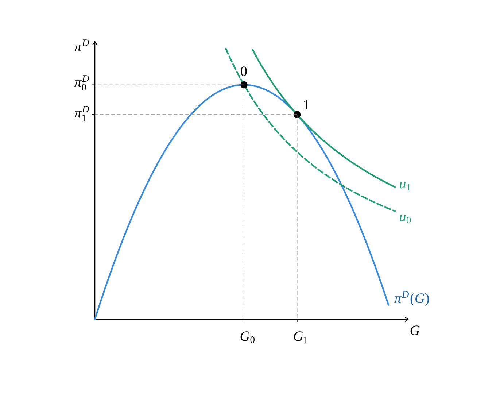

## Introducción



La **teoría de la organización industrial** (TOI) estudia tanto la empresa como agente económico como el funcionamiento de los mercados. La teoría de la producción trata la empresa como “caja negra” tecnológica, y la teoría de mercados se centra en las decisiones de precio y cantidad. La TOI abarca, en cambio, la estructura interna de la empresa, las barreras a la entrada, la conducta estratégica y los resultados del mercado.

La TOI tiene implicaciones directas para la política de defensa de la competencia y la regulación, lo que la convierte en una de las ramas más aplicadas de la microeconomía.

El tema se organiza en tres partes:

- *Teoría de la empresa*: el tema estudia la empresa de su existencia a su comportamiento, con su tamaño eficiente, sus límites y los costes de transacción.

- *Teoría del mercado*: se analizan las barreras a la entrada, los mercados impugnables y la regulación.

- *Organización industrial empírica*: el tema termina con la nueva teoría de la organización industrial empírica (NEIO).

## 1. Teoría de la empresa

La **teoría de la empresa** estudia cuatro ámbitos de la naturaleza de la empresa: la existencia y los objetivos (¿por qué nacen las empresas y qué persiguen?), los límites (¿qué determina su tamaño?), la organización (¿cómo se organiza internamente?) y el comportamiento (¿cómo se comporta en los mercados?).

### 1.1. Existencia y objetivos

Las teorías de este apartado se ocupan sobre todo del objetivo de la empresa, de qué persigue y de quién decide en ella. La pregunta de por qué existe, es decir, por qué ciertas transacciones se organizan dentro de la empresa y no en el mercado, la responde Coase (1937) con los costes de transacción, que fijan también sus límites.

#### 1.1.1. Enfoques tradicionales

**Teoría de la maximización de beneficios**: el enfoque tradicional considera que la empresa existe como unidad de decisión que combina factores para maximizar la diferencia entre ingresos y costes. Esta visión, aunque operativa y potente para la teoría de mercados, supone implícitamente que la empresa es una unidad de decisión monolítica (sin conflictos internos) y que dispone de la información necesaria para optimizar. Los enfoques posteriores cuestionan ambos supuestos.

**Mención a la escuela austriaca**: el pensamiento de Menger, Hayek y Kirzner ofrece una visión distinta. Los austriacos conciben el orden económico como un descubrimiento incesante y no como un equilibrio en reposo. Por eso, su empresario no optimiza mecánicamente, sino que está *alerta* a las ocasiones de obtener beneficio. Así, un beneficio extraordinario, que para el neoclásico delata la explotación de un monopolio, es para ellos el indicio de una oportunidad de mercado aún sin aprovechar. Competir es un proceso que transcurre en el tiempo, no un estado.

Hayek (1945) enfatizó, además, que el sistema de precios es un mecanismo descentralizado para transmitir información dispersa, una idea que inspiraría gran parte de la economía de la información posterior.

#### 1.1.2. Enfoque directivista o gerencial

**Origen**: la empresa moderna se caracteriza, desde Berle y Means (1932), por la separación entre la propiedad (accionistas) y la gestión (directivos). Si los directivos disponen de discrecionalidad, la empresa puede perseguir objetivos distintos de la maximización del beneficio[^a15-6]. Pasa entonces a entenderse como una coalición de intereses en la que el objetivo efectivo depende de quién controla las decisiones. El primer modelo formal de esta familia es el de maximización de las ventas de Baumol (1959; 1967).

**Idea**: los directivos maximizan los ingresos por ventas, de los que dependen su remuneración y prestigio, sujetos a un beneficio mínimo que satisfaga a los accionistas. El resultado es una producción superior a la que maximiza el beneficio, pues el directivo expande las ventas hasta agotar la restricción.

**Supuestos**:

- *Entorno*: una empresa con poder de mercado afronta una demanda inversa decreciente $p(x)$, con $p' < 0$, y el ingreso total $\text{IT}(x) = p(x)\,x$ se supone cóncavo ($2p' + p''x < 0$) y alcanza un máximo interior donde el ingreso marginal se anula. El coste total $\text{CT}(x)$ es creciente y convexo, con costes fijos $\text{CF}$.

- *Agentes*: los directivos controlan la empresa, deciden la producción y su utilidad crece con el ingreso total. Los accionistas no observan las decisiones, pero sí el beneficio.

- *Restricciones*: los accionistas exigen un beneficio mínimo $\pi_{\min} > 0$, inferior al máximo alcanzable, $\pi_{\min} < \max_x \pi(x)$. Si no se alcanza, el equipo directivo es sustituido.

**Planteamiento**: los directivos resuelven

$$\max_{x} \; \text{IT}(x) = p(x)\,x \quad \text{s.a.:} \quad \pi(x) = p(x)\,x - \text{CT}(x) \geq \pi_{\min}$$

donde $x$ es la producción, $p(x)$ la demanda inversa, $\text{IT}(x)$ el ingreso total, $\text{CT}(x)$ el coste total, $\pi(x)$ el beneficio y $\pi_{\min}$ el beneficio mínimo exigido por los accionistas. El lagrangiano es $\mathcal{L} = p(x)\,x + \lambda\,[\pi(x) - \pi_{\min}]$, con multiplicador $\lambda \geq 0$.

**CPO**: las condiciones de Kuhn-Tucker (tema [A08](a08-consumidor.qmd), apartado 1.4.1) son

$$\frac{\partial \mathcal{L}}{\partial x} = \text{Img}(x) + \lambda\,\frac{d\pi}{dx} = 0 \tag{1}$$

$$\lambda \geq 0, \qquad \lambda\,[\pi(x) - \pi_{\min}] = 0 \tag{2}$$

donde (2) es la condición de holgura complementaria, que deja dos casos:

- *Restricción no activa* ($\lambda = 0$): la empresa produce donde el ingreso marginal se anula, $\text{Img}(x_{\text{IT}}) = 0$ (elasticidad unitaria de la demanda), lo que solo es factible si en ese punto el beneficio cubre el mínimo.

- *Restricción activa* ($\lambda > 0$): la empresa produce donde $\pi(x_B) = \pi_{\min}$, y de (1) se sigue $\text{Img}(x_B) = -\lambda\,d\pi/dx_B > 0$, así que $d\pi/dx_B < 0$. La empresa opera, por tanto, en el tramo en que el beneficio decrece con la producción, a la derecha del máximo de beneficios.

**CSO**: con objetivo cóncavo y conjunto factible convexo, las condiciones de Kuhn-Tucker son necesarias y suficientes[^a15-7].

**Equilibrio**: sean $x_\pi$ la producción que maximiza el beneficio ($\text{Img}(x_\pi) = \text{Cmg}(x_\pi)$), $x_B$ la del maximizador de ventas y $x_{\text{IT}}$ la que anula el ingreso marginal. Con la restricción activa, el equilibrio tiene dos rasgos:

1. *Producción y precio*: se cumple $x_\pi < x_B < x_{\text{IT}}$ y, por la pendiente negativa de la demanda, $p_B < p_\pi$. El maximizador de ventas produce, por tanto, más y vende más barato que el maximizador de beneficios.

2. *Beneficio*: es exactamente igual a $\pi_{\min}$. Cuando $\pi_{\min}$ tiende al beneficio máximo, el modelo converge al tradicional.

**Estática comparativa**: la diferencia con el modelo tradicional se concentra en las perturbaciones que no alteran el coste marginal:

- *Impuesto de suma fija (o aumento de los costes fijos)*: para el maximizador de beneficios es irrelevante, pues no altera el ingreso ni el coste marginal y $x_\pi$ no varía. Para el maximizador de ventas, en cambio, desplaza hacia abajo la curva $\pi(x)$ y la intersección de la derecha con $\pi_{\min}$ se mueve hacia la izquierda, de modo que la producción cae y el precio sube. Esta predicción contrastable separa ambas hipótesis, y la observación de que las empresas trasladan a precios los costes fijos fue el principal apoyo empírico de Baumol.

- *Impuesto unitario o aumento de la demanda*: reduce (o eleva) la producción en ambos modelos, aunque en distinta magnitud, pues el maximizador de ventas ajusta solo hasta restablecer $\pi = \pi_{\min}$.

**Extensiones**: Baumol aplicó el modelo a la publicidad (el maximizador de ventas anuncia más que el de beneficios) y, en 1967, a la maximización de la tasa de crecimiento de las ventas. En la versión de 1967, el beneficio pasa de restricción externa a fuente de financiación del crecimiento. Las restantes hipótesis gerenciales sustituyen las ventas por otros argumentos de la función objetivo de los directivos:

- *Hipótesis de la maximización del crecimiento* (Marris, 1964): los directivos maximizan la tasa de crecimiento de la empresa (que determina su poder, estatus y remuneración), sujetos a una restricción de valoración bursátil. Si el precio de la acción cae demasiado, la empresa se convierte en objetivo de una adquisición hostil (*takeover*) que costaría el puesto al equipo directivo, y el mercado de control corporativo actúa así como mecanismo disciplinante externo.

- *Hipótesis de la ineficiencia-X* (Leibenstein, 1966): en ausencia de presión competitiva y con información asimétrica, trabajadores y directivos no se esfuerzan al máximo. En consecuencia, no existe una correspondencia unívoca entre *inputs* y *outputs*, y la empresa puede operar por debajo de su frontera técnica de producción. El grado de competencia determina el esfuerzo. Sin embargo, el concepto ha sido criticado porque, si el control se ejerce hasta que su coste marginal iguala a su beneficio marginal, la ineficiencia-X no es tal, sino el resultado óptimo dado el coste del control.

- *Hipótesis de la maximización de la utilidad gerencial* (Williamson, 1963; 1964): los directivos maximizan una función de utilidad que depende del gasto en plantilla, $G$, de los beneficios discrecionales, $\pi^D$, y de otros emolumentos. La maximización está sujeta a la obtención de un beneficio mínimo que satisfaga a los accionistas. El resultado es un exceso de gasto en personal y en gastos de representación respecto del óptimo de los propietarios, que da nombre a la hipótesis de la *preferencia por el gasto*.

Gráficamente, la elección del directivo en la hipótesis de Williamson se representa en el plano gasto en plantilla-beneficio discrecional (figura -@fig-a151-williamson):

1. *Frontera de beneficios*, $\pi^D(G)$: es el beneficio discrecional que permite cada gasto en plantilla, creciente mientras ese gasto es productivo y decreciente a partir de su máximo.

2. *Curvas de indiferencia del directivo*, $u_0$ y $u_1$: tienen pendiente negativa, porque el directivo valora el gasto y el beneficio.

3. *Equilibrio*: los propietarios preferirían el máximo de la frontera (punto 0), con gasto $G_0$ y beneficio $\pi^D_0$. El directivo, en cambio, elige la tangencia de la frontera con la curva de indiferencia más alta, $u_1$ (punto 1), con un gasto $G_1$ mayor y un beneficio $\pi^D_1$ menor.

::: {#fig-a151-williamson}

::: {.content-visible when-format="html"}
```{=html}
<div class="graph-frame">
<iframe src="../graphs/a151_Williamson.html" style="height:580px" loading="lazy" title="fig-a151-williamson"></iframe>
</div>
```
:::

::: {.content-visible unless-format="html"}

:::

Williamson (1964). El directivo maximiza su utilidad sobre la frontera de beneficios y elige un gasto en plantilla $G_1$ superior al que maximiza el beneficio, $G_0$ (preferencia por el gasto).
:::

**Conclusiones**:

- *Aspectos positivos*: el modelo de Baumol es el primero que deriva formalmente el comportamiento de la empresa de un objetivo distinto del beneficio y ofrece una predicción contrastable (la respuesta a los costes fijos). Los modelos gerenciales, en conjunto, sustituyen la maximización del beneficio por objetivos propios de los directivos y anticipan la teoría de la agencia.

- *Limitaciones*: el enfoque gerencial presenta tres debilidades:

    - *Objetivos postulados*: se dan por supuestos en lugar de derivarse de la estructura de incentivos, que es lo que hará el enfoque contractual.

    - *Beneficio mínimo exógeno*: se toma como dado, cuando resulta de la disciplina del mercado de capitales, del mercado de control corporativo y de los contratos de remuneración.

    - *Presión competitiva*: la competencia y la libre entrada tienden a expulsar a las empresas que no maximizan el beneficio, por lo que la discrecionalidad gerencial solo es sostenible con poder de mercado y barreras a la entrada.

#### 1.1.3. Conclusiones

**Aspectos positivos**: todas estas aportaciones deben entenderse como complementarias, no excluyentes, para explicar la razón de ser de la empresa. La maximización del beneficio sigue siendo la referencia normativa y el ancla del análisis de mercados, mientras que los enfoques austriaco y gerencial iluminan, respectivamente, la función empresarial en el desequilibrio y las desviaciones que introduce la separación entre propiedad y control.

**Limitaciones**: estos enfoques explican qué persigue la empresa, pero no por qué ciertas transacciones se organizan dentro de ella y no en el mercado, pues dan por supuesta su existencia y se centran en su objetivo o en la figura del empresario. Esa pregunta la aborda el enfoque contractual de Coase.

### 1.2. Límites

Las teorías de este apartado explican el tamaño de la empresa por sus costes de producción, en los enfoques neoclásico y tecnológico, o de transacción, en el contractual.

#### 1.2.1. El enfoque neoclásico: la caja negra y las economías de escala

El enfoque neoclásico se centra en el estudio de tres dimensiones:

- *Tecnología*: cómo sus distintos tipos dan lugar a diferentes rendimientos a corto y largo plazo que condicionan el *output* producido.

- *Costes*: cómo su estructura determina la eficiencia económica y, con ella, la dimensión viable de la empresa.

- *Mercado*: cómo su tamaño y el de la empresa se condicionan mutuamente, puesto que determinan los ingresos.

En esta visión, el tamaño de la empresa queda determinado por el mínimo de la curva de coste medio a largo plazo, en forma de U. La dimensión óptima es única y la empresa es, en lo demás, una caja negra tecnológica.

#### 1.2.2. Enfoque tecnológico de la TOI

::: {.callout-note appearance="simple" icon=false}
Los rendimientos a escala, de los que depende la forma del coste a largo plazo, se estudian en el tema [A11](a11-produccion.qmd), apartado 2.2. El tema [A12](a12-costes.qmd) desarrolla la curva de coste medio en U y sus casos polares (apartados 2.2 y 2.4), la horquilla de capacidad de Stigler (apartado 3.1.1), las definiciones, condiciones e índices de la subaditividad y de las economías de alcance (apartados 3.2.2 y 3.2.3) y la evidencia empírica sobre la forma de las curvas, en L más que en U (apartado 3.4).
:::

La TOI revitalizó el enfoque tecnológico refinando el análisis de la estructura de costes en tres direcciones:

**Horquilla de capacidad** (Stigler, 1939):

- *Definición*: las empresas mantienen una reserva de capacidad que les da flexibilidad ante la incertidumbre. La evidencia empírica sobre costes apunta a un coste medio a largo plazo en forma de L y no de U, es decir, alcanzada la escala mínima eficiente (EME), el coste medio se mantiene aproximadamente constante.

- *Implicación para el tamaño*: no existe una dimensión óptima única. El tamaño de las empresas de una industria puede variar en un rango amplio sin diferencias de coste, lo que explica la coexistencia de tamaños muy distintos.

**Subaditividad de costes** (Baumol, Panzar y Willig, 1982):

- *Definición*: una función de costes es subaditiva cuando una sola empresa produce el *output* total a menor coste que cualquier reparto de ese *output* entre varias empresas, lo que constituye la definición moderna de monopolio natural. En el caso uniproducto, las economías de escala en todo el tramo hasta ese *output* son condición suficiente pero no necesaria de la subaditividad[^a15-11].

- *Implicación para el tamaño*: el límite superior del tamaño eficiente lo fija la subaditividad y no la pendiente del coste medio. De ahí que una empresa pueda ser el único productor eficiente aunque opere con costes medios crecientes, siempre que su escala mínima eficiente sea grande respecto al mercado[^a15-12].

**Economías de alcance** (Panzar y Willig, 1981):

- *Definición*: producir varios bienes en una misma empresa cuesta menos que producirlos por separado, por la existencia de *inputs* públicos dentro de la empresa (marca, red, conocimiento), indivisibilidades y estructuras comunes.

- *Implicación para el tamaño*: la eficiencia se alcanza también por la variedad y no solo por el volumen, lo que explica la empresa multiproducto y los conglomerados y fija el límite horizontal del tamaño, del mismo modo que la subaditividad fija el límite en volumen.

#### 1.2.3. Costes de transacción: la empresa como estructura de contratos (Coase, 1937; Williamson, 1975)

**Origen**: Ronald Coase (*The Nature of the Firm*, 1937; Nobel en 1991) explica con un mismo argumento por qué existen las empresas y dónde termina cada una. Si el mecanismo de precios asigna eficientemente los recursos, cabe preguntarse por qué una parte de la producción se organiza dentro de la empresa y, a la inversa, por qué una sola empresa no organiza toda la producción.

**Idea**: la respuesta a las dos preguntas son los *costes de transacción*. Utilizar el mecanismo de precios tiene costes (búsqueda de contrapartes, negociación de cada contrato, supervisión del cumplimiento, previsión de contingencias), de modo que la empresa existe porque, para ciertas actividades, organizar la producción internamente resulta menos costoso que recurrir al mercado. Sin embargo, la organización interna también tiene costes, que crecen con el tamaño. Por ello, la empresa se amplía solo hasta que organizar internamente una transacción más cuesta lo mismo que realizarla en el mercado, y ese punto fija su límite.

**Razonamiento**: Oliver Williamson (1975; Nobel en 2009) profundizó en esta idea[^a15-15]. Los costes de transacción pueden ser *ex ante* (previsión de contingencias, redacción y negociación de los contratos) o *ex post* (regateo o *haggling costs*, ejecución, incumplimiento, litigios). La empresa compara los costes de la organización interna con los de acudir al mercado. Por tanto, la dimensión óptima de la empresa, $x^*$, es decir, su límite, minimiza el coste total $\text{CT}(x) = \text{CE}(x) + \text{CI}(x)$ y se alcanza cuando el coste marginal de organizar internamente una transacción adicional iguala el coste marginal de realizarla en el mercado:

$$\underbrace{\frac{d\text{CI}}{dx}\bigg|_{x^*}}_{\text{coste marginal interno}} = \underbrace{-\frac{d\text{CE}}{dx}\bigg|_{x^*}}_{\text{coste marginal externo}}$$

donde $\text{CI}(x)$ es el coste de organización interna, que crece con la dimensión $x$, y $\text{CE}(x)$ el coste de acudir al mercado, que decrece con ella, de modo que $-d\text{CE}/dx$ mide el coste de mercado que ahorra organizar internamente una transacción más.

**Desarrollo gráfico**: los costes de acudir al mercado y de organización interna se representan en el plano dimensión de la empresa-coste (figura -@fig-a152-coase):

1. *Coste de acudir al mercado*, $\text{CE}(x)$: decrece con la dimensión, porque son menos las transacciones que se realizan a través del mercado.

2. *Coste de organización interna*, $\text{CI}(x)$: crece con la dimensión, por las deseconomías gerenciales. Williamson (1967) las explica por la *pérdida de control*, ya que las órdenes y la información pierden parte de su contenido al cruzar cada nivel de la jerarquía. Crecer obliga a añadir niveles, lo que reduce la eficacia de la dirección y acota el tamaño. Por su parte, Penrose (1959) sitúa el límite en la capacidad del equipo directivo para absorber nuevas actividades, que acota más el ritmo de crecimiento que el tamaño, y Lucas (1978), en el talento directivo, que determina cuántos recursos puede gestionar con provecho cada directivo (*span of control*).

3. *Coste total*, $\text{CT}(x)$: es la suma vertical de las dos curvas anteriores y tiene forma de U.

4. *Equilibrio*: la dimensión óptima, $x^*$, corresponde al mínimo del coste total, $C^*$ (punto 0). En la representación estándar, con curvas simétricas, ese punto se sitúa sobre el corte de $\text{CE}(x)$ y $\text{CI}(x)$, donde $\text{CE}(x^*) = \text{CI}(x^*)$.

::: {#fig-a152-coase}

::: {.content-visible when-format="html"}
```{=html}
<div class="graph-frame">
<iframe src="../graphs/a152_Coase.html" style="height:540px" loading="lazy" title="fig-a152-coase"></iframe>
</div>
```
:::

::: {.content-visible unless-format="html"}

:::

Coase (1937). La dimensión óptima de la empresa, $x^*$, minimiza el coste total (punto 0), $\text{CT}(x) = \text{CE}(x) + \text{CI}(x)$, suma del coste de acudir al mercado y del de organización interna. En la representación estándar, con curvas simétricas, ese mínimo se sitúa sobre el corte de ambas curvas.
:::

**Conclusiones**:

- *Aspectos positivos*: plantea por qué existen las empresas y dónde están sus límites, y sitúa los costes de usar el mercado en el centro del análisis. La teoría es también el punto de partida del enfoque transaccional.

- *Limitaciones*: el concepto de coste de transacción es amplio y poco preciso, lo que expone la teoría al riesgo de explicar *a posteriori* cualquier frontera de la empresa. Además, la teoría no precisa qué permite a la organización interna evitar los costes que encarecen el mercado, cuestión que aborda el nuevo enfoque de los derechos de propiedad.

#### 1.2.4. Conclusiones

**Aspectos positivos**: el enfoque tecnológico explica el tamaño de la empresa por los costes de producción, y el enfoque contractual lo explica por los costes de transacción. Ambos convergen en la idea de que la empresa es la forma de organización que minimiza el coste total de producir e intercambiar.

**Limitaciones**: el enfoque tecnológico, con costes medios en forma de L, admite un rango amplio de tamaños igualmente eficientes y no determina el de cada empresa, mientras que el contractual descansa en costes de transacción difíciles de medir. Ambos dejan abierta, además, la organización interna de la empresa, que se analiza a continuación con los derechos de propiedad, los costes de transacción y los contratos.

### 1.3. Organización

Este ámbito responde a cómo se organiza la empresa, es decir, si lo hace de forma jerárquica o de manera más horizontal y descentralizada. Este ámbito busca entender también qué relaciones contractuales se establecen en el seno de la empresa. Lo abordan el enfoque de los derechos de propiedad, el transaccional y el de contratos completos.

#### 1.3.1. Enfoque de derechos de propiedad

**Origen**: el enfoque tiene dos generaciones. La primera la desarrollan Armen Alchian y Harold Demsetz en los años sesenta y setenta. La segunda, conocida como *nuevo enfoque de los derechos de propiedad*, la formalizan Sanford Grossman, Oliver Hart y John Moore entre 1986 y 1990 con la teoría de los contratos incompletos[^a15-16].

**Idea**: la propiedad de un bien no es el bien mismo sino un conjunto de derechos sobre él (usarlo, apropiarse de sus rendimientos y transferirlo), y quién los tiene determina los incentivos de quienes deciden. La empresa se explica por esa asignación, que en la primera generación recae en el perceptor residual del beneficio y en la segunda, en el titular de los derechos residuales de control sobre los activos.

**Razonamiento**:

1. *Perspectiva de primera generación (Alchian, 1965; Demsetz, 1967; Alchian y Demsetz, 1972)*: para Demsetz, los derechos de propiedad aparecen cuando la ganancia de internalizar una externalidad supera el coste de establecerlos y hacerlos cumplir. Así ocurrió con los territorios de caza de los *montagnais* del Labrador cuando el comercio de pieles con los europeos revalorizó el castor. Para Alchian, la conducta depende de la estructura de los derechos. Por ejemplo, en la empresa pública, cuya propiedad no puede venderse, quien decide no carga con las ganancias ni con las pérdidas de sus decisiones, y se debilita el incentivo a gestionar bien los recursos.

    Alchian y Demsetz aplican esta lógica a la organización interna. En la producción en equipo la contribución individual no es observable por separado y aparece el incentivo a escaquearse (*shirking*). La solución es nombrar un supervisor y, para que este tenga incentivos a supervisar, convertirlo en *perceptor residual* de los beneficios, con derecho a contratar y despedir a los miembros del equipo y a vender su posición. La figura del empresario capitalista clásico emerge así como respuesta eficiente a un problema de medición.

2. *Nuevo enfoque de los derechos de propiedad (Grossman y Hart, 1986; Hart y Moore, 1990)*: cuando los contratos son inevitablemente incompletos (no pueden prever todas las contingencias), la propiedad importa. La razón es que asigna los *derechos residuales de control*, es decir, el derecho a decidir sobre el activo en todo aquello que el contrato no especifica. Las partes hacen inversiones específicas antes de negociar y se reparten después el excedente, de modo que cada una solo se apropia de una parte del rendimiento de su inversión e invierte menos de lo eficiente (*hold-up*). La propiedad de un activo refuerza la posición negociadora de su titular y, con ella, sus incentivos a invertir, pero debilita los de la otra parte. Por ello, la asignación óptima de la propiedad, que fija los límites de la empresa, otorga el control a la parte cuya inversión específica es más importante para el valor de la relación y reúne bajo un mismo propietario los activos complementarios. A diferencia del enfoque transaccional, los costes de la integración nacen del mismo mecanismo que sus beneficios, porque la parte que pierde la propiedad invierte menos.

**Conclusiones**:

- *Aspectos positivos*: la primera generación da una razón de eficiencia a la propiedad privada y a la figura del empresario, y la segunda precisa qué es la propiedad y de dónde nacen los costes de la integración vertical.

- *Limitaciones*: la primera generación es verbal y no explica por qué el perceptor residual ha de ser también el propietario de los activos físicos. El nuevo enfoque descansa en contratos incompletos cuyos fundamentos discuten Maskin y Tirole (1999), atiende sobre todo a los activos físicos y a la inversión previa a la negociación, y dice poco de la organización interna una vez fijada la propiedad.

#### 1.3.2. Enfoque transaccional

**Origen**: el enfoque transaccional aplica a la organización interna de la empresa la teoría de los costes de transacción de Coase (1937) y Williamson (1975).

**Idea**: en el marco de Williamson, la *estructura de gobernanza* óptima de cada transacción (mercado, formas híbridas como los contratos de largo plazo, o jerarquía) depende, principalmente, de tres atributos:

1. *Frecuencia*: se refiere a la recurrencia de la actividad. Las transacciones frecuentes justifican amortizar los costes fijos de crear estructuras de gobernanza especializadas (departamentos internos, relaciones estables), mientras que las ocasionales se resuelven mejor en el mercado.

2. *Incertidumbre*: cuanto mayor es la incertidumbre del entorno, más contingencias quedan sin prever, más incompletos resultan los contratos y más frecuentes y costosas son las renegociaciones, lo que, en presencia de activos específicos, favorece la coordinación jerárquica frente al mercado.

3. *Especificidad de los activos*: las inversiones no reutilizables fuera de la relación generan cuasirrentas apropiables[^a15-17] y exponen a las partes al problema del *hold-up* (la renegociación oportunista una vez hundida la inversión), lo que favorece la integración vertical.

**Razonamiento**: el enfoque transaccional convierte la elección entre mercado y jerarquía en un problema económico de minimización de costes de transacción, y explica la integración vertical, las relaciones a largo plazo y las formas híbridas (franquicias, alianzas).

**Conclusiones**:

- *Aspectos positivos*: hace operativa la intuición de Coase al ligar la forma de gobierno a atributos concretos de cada transacción, y de ellos obtiene predicciones contrastables sobre la integración vertical, que han guiado buena parte del trabajo empírico sobre los límites de la empresa.

- *Limitaciones*: la racionalidad limitada y el oportunismo se introducen como supuestos de comportamiento sin formalizar, de modo que el enfoque es en gran medida verbal, y sus atributos, en especial la especificidad de los activos, son difíciles de medir con precisión.

#### 1.3.3. Enfoque de contratos completos

::: {.callout-note appearance="simple" icon=false}
Sobre la economía de la información y la relación de agencia (riesgo moral, selección adversa y señalización), véase el tema [A13](a13-informacion.qmd).
:::

**Origen**: el enfoque de contratos completos aplica a la empresa la teoría de la agencia (Ross, 1973; Jensen y Meckling, 1976), suponiendo que las partes pueden escribir contratos que contemplan todas las contingencias verificables.

**Idea**: las relaciones internas de la empresa pueden modelizarse como una relación de agencia entre un principal (el propietario) y un agente (el directivo o trabajador).

**Planteamiento**: como referencia, se parte del problema sin imperfecciones de información. El principal, neutral al riesgo, diseña un contrato salarial $w(x)$ que maximiza su beneficio esperado:

$$\max_{e,\,w(\cdot)} \; \mathbb{E}[\pi] = \sum_i p_i(e)\,\left[x_i - w(x_i)\right]$$

donde $e$ es el esfuerzo del agente, $x_i$ los posibles resultados y $p_i(e)$ la probabilidad de cada resultado, que el esfuerzo desplaza hacia los resultados altos (dominancia estocástica de primer orden). El programa está sujeto a la *restricción de participación* del agente (obtener al menos su utilidad de reserva).

**CPO**: el producto marginal esperado del esfuerzo iguala la compensación monetaria que el agente exige por su desutilidad marginal. Si el esfuerzo es observable y verificable, el contrato óptimo alcanza el *first best*, en el que el principal exige el nivel de esfuerzo eficiente. Si el agente es averso al riesgo, el principal le paga un salario fijo y asume todo el riesgo. El riesgo y el esfuerzo se asignan así eficientemente a la vez.

**CSO**: con resultado esperado cóncavo en el esfuerzo y utilidad del agente cóncava, el programa es cóncavo y la CPO es necesaria y suficiente.

**Conclusiones**:

- *Aspectos positivos*: este punto de referencia permite calibrar el coste de la información asimétrica. Cuando el esfuerzo no es observable (riesgo moral) y el agente es averso al riesgo, el contrato debe condicionar el pago al resultado para incentivar, sacrificando aseguramiento, lo que conduce a un *second best*.

- *Limitaciones*: la información asimétrica genera *costes de agencia*, que Jensen y Meckling (1976) definen como la suma de los costes de supervisión del principal, los costes de garantía del agente y la pérdida residual respecto del *first best*. El diseño de contratos de incentivos y los mecanismos de gobierno corporativo buscan minimizarlos, sin poder eliminarlos.

### 1.4. Comportamiento

El último ámbito estudia cómo se comporta la empresa en los mercados en los que existe interdependencia estratégica.

#### 1.4.1. Modelo de variaciones conjeturales (Bowley, 1924; Frisch, 1933)

**Origen**: la noción de *variación conjetural* se debe a Bowley (1924) y Frisch (1933). Fue el instrumento con el que la organización industrial anterior a la teoría de juegos comparaba las soluciones de oligopolio de Cournot, Bertrand y Stackelberg y la colusión (tema [A19](a19-oligopolio.qmd), apartados 1.1 a 1.3 y 2.1.1).

**Idea**: los modelos de oligopolio difieren en lo que cada empresa espera que haga la rival cuando ella altera su producción. Si esa expectativa se recoge en un parámetro, la variación conjetural, los equilibrios de esos modelos son casos particulares de una misma condición de primer orden.

**Supuestos**:

- *Entorno*: mercado de un bien homogéneo con demanda inversa $p(X)$, $p' < 0$, y dos empresas con costes $\text{CT}_i(x_i)$, $\text{CT}_i' > 0$.

- *Agentes*: cada empresa elige su cantidad, $x_i$, suponiendo que la rival responde según la variación conjetural $v_i \equiv \partial x_j / \partial x_i$, que toma como dada.

**Planteamiento**:

$$\max_{x_i} \; \pi_i = p(x_i + x_j) \cdot x_i - \text{CT}_i(x_i)$$

donde $x_i$ y $x_j$ son las cantidades de la empresa y de su rival, $X = x_i + x_j$ la producción total, $p(\cdot)$ la demanda inversa y $\text{CT}_i(x_i)$ el coste de la empresa $i$.

**CPO**: derivando y teniendo en cuenta que $dX/dx_i = 1 + v_i$:

$$p(X) + \frac{dp}{dX}\,(1 + v_i)\, x_i = \frac{d\text{CT}_i}{dx_i}$$

La empresa iguala su coste marginal a un ingreso marginal percibido, ya que, al aumentar su producción, anticipa que el precio caerá por su propia expansión y también por la reacción que conjetura en la rival. Por tanto, cuanto mayor es la conjetura, mayor es la caída de precio esperada, más se restringe la producción y mayor es el margen sobre el coste marginal.

**CSO**: con $p$ cóncava (o lineal) y $\text{CT}_i$ convexa, $\pi_i$ es estrictamente cóncava en $x_i$ para $v_i > -1$, por lo que la condición anterior caracteriza el máximo.

**Solución**: dividiendo la CPO por $p$, con la cuota $s_i = x_i/X$ y la elasticidad $|\varepsilon_{Xp}| = -p/(p'X)$, el margen de Lerner queda en función de la conjetura:

$$\frac{p - d\text{CT}_i/dx_i}{p} = \frac{(1 + v_i)\, s_i}{|\varepsilon_{Xp}|}$$

**Equilibrio**: el valor de $v_i$ selecciona el modelo:

| Conjetura | $v_i$ | Margen de Lerner | Equilibrio |
|---|---|---|---|
| La rival compensa exactamente mi variación | $-1$ | $0$ | Competencia perfecta o Bertrand con bien homogéneo |
| La rival no reacciona | $0$ | $s_i/\lvert\varepsilon_{Xp}\rvert$ | Cournot |
| La rival reacciona según su función de reacción | $\varphi_j'(x_i)$ | $(1 + \varphi_j') \, s_i/\lvert\varepsilon_{Xp}\rvert$ | Stackelberg (líder) |
| La rival replica mi variación | $1$ | $2 s_i/\lvert\varepsilon_{Xp}\rvert = 1/\lvert\varepsilon_{Xp}\rvert$ (simétrico) | Cártel (monopolio conjunto) |

: Variaciones conjeturales, margen de Lerner y modelo de oligopolio resultante. {#tbl-a15-conjeturas}

**Estática comparativa**: con $n$ empresas simétricas que conjeturan la misma respuesta $v$ de cada rival, la reacción conjunta esperada es $\partial X_{-i}/\partial x_i = (n - 1)v$, y la fórmula se generaliza a

$$\frac{p - d\text{CT}/dx_i}{p} = \frac{1 + (n - 1)v}{n\,|\varepsilon_{Xp}|}$$

El poder de mercado crece con la conjetura, decrece con la elasticidad y, salvo en el cártel ($v = 1$), decrece también con el número de empresas.

**Extensiones**:

- *Parámetro de conducta*: $\theta \equiv 1 + (n - 1)v \in [0, n]$, que la NEIO estima con datos de precios y cantidades para medir el grado de competencia de una industria sin observar su estructura (apartado 3).

- *Conjeturas consistentes* (Bresnahan, 1981): la reacción conjeturada debe coincidir con la pendiente efectiva de la función de reacción de la rival. Con demanda lineal, $p = a - X$, y coste marginal constante, $c$, la rival que conjetura $v$ responde con $x_j = (a - c - x_i)/(2 + v)$, de pendiente $-1/(2 + v)$, y la única conjetura consistente es $v = -1$, el resultado competitivo. En cambio, con costes marginales crecientes, la conjetura consistente queda entre $-1$ y $0$, y el equilibrio es más competitivo que el de Cournot.

**Conclusiones**:

- *Aspectos positivos*: ofrece una lectura común de los modelos estáticos de oligopolio y un índice continuo del poder de mercado, entre el resultado competitivo y el colusivo, que hace comparables industrias distintas.

- *Limitaciones*: carece de fundamento estratégico. El marco es pseudodinámico, porque describe una secuencia de reacciones dentro de un modelo de una sola jugada, y sus conjeturas son *ad hoc*, pues no se derivan de la racionalidad de los rivales. Además, la exigencia de consistencia restringe mucho los valores admisibles, y la teoría de juegos (tema [A14](a14-juegos.qmd)) sustituyó el planteamiento por modelos con estructura temporal explícita (Stackelberg, juegos repetidos), en los que la reacción se deriva del equilibrio.

#### 1.4.2. Modelo de diferenciación horizontal (Hotelling, 1929)

**Origen**: el comportamiento de la empresa incluye también las decisiones sobre las características del producto. El modelo canónico de diferenciación *horizontal* (variedades distintas sin ordenación común de calidad) es la ciudad lineal de Hotelling.

**Idea**: la diferenciación horizontal muestra que la localización en el espacio de características es una decisión estratégica, porque acercarse al rival capta demanda pero intensifica la competencia en precios (principio de diferenciación mínima frente a máxima).

**Razonamiento**: los consumidores se distribuyen uniformemente sobre un segmento $[0,1]$ (que representa el espacio geográfico o el espacio de características), soportan costes de transporte y las empresas eligen localización (variedad) y precio. El resultado depende de la variable de competencia:

- *Precios fijos*: las empresas tienden a aglomerarse en el centro (principio de mínima diferenciación).

- *Precios endógenos y costes de transporte cuadráticos*: el resultado se invierte y las empresas se separan al máximo (máxima diferenciación) para relajar la competencia en precios (d'Aspremont, Gabszewicz y Thisse, 1979).

::: {.callout-note appearance="simple" icon=false}
El modelo de la ciudad lineal y la competencia con productos diferenciados se desarrollan en el tema [A18](a18-competencia-monopolistica.qmd).
:::

**Conclusiones**:

- *Aspectos positivos*: explica con un solo marco tanto la aglomeración como la separación de las empresas, según cuál sea la variable de competencia.

- *Limitaciones*: el resultado es muy sensible a la forma de los costes de transporte. De hecho, con costes lineales puede no existir equilibrio en precios, como mostraron d'Aspremont, Gabszewicz y Thisse (1979).

#### 1.4.3. Innovación y estructura de mercado (Schumpeter, 1942; Arrow, 1962)

**Origen**: Joseph Schumpeter (*Capitalism, Socialism and Democracy*, 1942) sostuvo que la gran empresa con poder de mercado es el motor de la innovación. Kenneth Arrow (1962) comparó el incentivo a innovar bajo distintas estructuras de mercado y obtuvo la conclusión contraria.

**Idea**: las *hipótesis schumpeterianas* afirman que la innovación crece con el tamaño de la empresa y con el poder de mercado, porque solo la gran empresa puede financiar internamente la I+D y diversificar su riesgo, y solo el beneficio extraordinario permite recuperar la inversión. Arrow replica que el monopolista tiene menos incentivo que una empresa competitiva para innovar, por el *efecto reemplazo* (o sustitución).

**Razonamiento**: ante una innovación de proceso patentada y no drástica, la empresa competitiva, que parte de un beneficio nulo, cobra algo menos que el coste anterior, se queda con todo el mercado y gana el ahorro de coste sobre toda la demanda. En cambio, el monopolista gana solo la diferencia entre su beneficio después y antes de innovar, porque la innovación canibaliza el beneficio que ya obtiene. Como el excedente social de la innovación supera a ambas ganancias, el orden de incentivos es planificador, competencia y monopolio.

**Extensiones**: el *efecto eficiencia* actúa en sentido contrario, pues un monopolista amenazado por un entrante tiene más que perder que este que ganar, por lo que el monopolista puja más por la patente (Gilbert y Newbery, 1982). Aghion, Bloom, Blundell, Griffith y Howitt (2005) documentan una relación en forma de U invertida entre competencia e innovación, en la que con poca competencia domina el efecto de *escapar de la competencia* y, con mucha, el schumpeteriano. El resultado se integra en los modelos de crecimiento del tema [A44](a44-crecimiento-ii.qmd), apartado 3.2.

**Conclusiones**:

- *Aspectos positivos*: el debate identifica los dos efectos opuestos que ligan la estructura de mercado y la innovación, el efecto reemplazo y el efecto eficiencia, y muestra que ni la competencia ni el monopolio alcanzan el incentivo socialmente óptimo.

- *Limitaciones*: Arrow toma la estructura de mercado como exógena y supone una patente que protege por completo la innovación. Además, Arrow da la innovación por hecha, sin considerar quién puede financiar la I+D que la genera, que es el núcleo del argumento schumpeteriano. Con una evidencia empírica mixta, ninguna de las dos tesis se impone con carácter general.

#### 1.4.4. Otros modelos de comportamiento

::: {.callout-note appearance="simple" icon=false}
La diferenciación de producto con variedad (Spence, 1976; Dixit y Stiglitz, 1977) y la diferenciación vertical (Shaked y Sutton, 1982) se desarrollan en el tema [A18](a18-competencia-monopolistica.qmd), apartados 2.2 y 3.1.
:::

Junto a los modelos anteriores, la organización industrial estudia otras conductas de las empresas con poder de mercado. Tres son especialmente relevantes:

1. *Integración vertical y doble marginalización* (Spengler, 1950): cuando un fabricante con poder de mercado vende con un precio mayorista lineal a un minorista que también lo tiene, cada uno añade su margen sin internalizar el del otro. El minorista trata el precio mayorista como su coste marginal, y el fabricante, que mueve primero, aplica la regla del monopolista a una demanda derivada que ya incorpora ese segundo margen. Con demanda lineal, $p = a - X$, y coste marginal constante, $c$, la cadena vende $X^D = (a - c)/4$, la mitad que la empresa integrada, a un precio mayor, $p^D = (3a + c)/4$ frente a $p^I = (a + c)/2$, con un beneficio conjunto un 25 % inferior y la cuarta parte del excedente del consumidor (figura -@fig-a153-doble-marginalizacion).

    La integración vertical, o una restricción vertical que elimine el segundo margen (un precio máximo de reventa o una tarifa en dos partes), mejora así a las empresas y a los consumidores, lo que fundamenta la regla de la razón de Chicago, aunque la integración puede cerrar el mercado a los rivales no integrados (*foreclosure*, tema [A20](a20-regulacion.qmd)).

::: {#fig-a153-doble-marginalizacion}

::: {.content-visible when-format="html"}
```{=html}
<div class="graph-frame">
<iframe src="../graphs/a153_Doble_marginalizacion.html" style="height:560px" loading="lazy" title="fig-a153-doble-marginalizacion"></iframe>
</div>
```
:::

::: {.content-visible unless-format="html"}

:::

Doble marginalización con demanda lineal y coste marginal constante. La empresa integrada iguala $\text{Img}(X)$ a $c$ y vende $X^I$ a $p^I$ (punto 1), mientras que en la cadena el fabricante iguala a $c$ el ingreso marginal de su demanda derivada, $\text{Img}_F(X)$, fija $w^D$ y el minorista vende $X^D = X^I/2$ a $p^D$ (punto 0). El excedente del consumidor es todo el triángulo verde, $\text{EC}^I$, con integración y solo el triángulo oscuro, $\text{EC}^D$, con doble marginalización.
:::

2. *Diferenciación de producto y variedad* (Spence, 1976; Dixit y Stiglitz, 1977): cuando los consumidores valoran la variedad y cada empresa produce una variedad distinta con rendimientos crecientes, cada una fija un margen constante sobre el coste marginal, $p = \frac{\sigma}{\sigma - 1}\,\text{Cmg}$, donde $\sigma$ es la elasticidad de sustitución entre variedades, y la libre entrada lleva el beneficio a cero. El número de variedades resulta del equilibrio entre el gusto por la variedad y las economías de escala.

3. *Diferenciación vertical* (Shaked y Sutton, 1982): cuando, a igualdad de precio, todos los consumidores prefieren la calidad más alta, las empresas eligen primero calidades distintas para suavizar la competencia en precios y compiten después en precios. Si mejorar la calidad exige sobre todo costes fijos, solo un número finito de empresas sobrevive por mucho que crezca el mercado (*propiedad de finitud*, Shaked y Sutton, 1983).

### 1.5. Conclusiones

La teoría de la empresa responde a cuatro preguntas que sustentan la teoría del mercado. La estructura de costes (subaditividad, economías de alcance, EME) delimita cuántas empresas caben en un mercado. Los derechos de propiedad, los costes de transacción y los contratos explican dónde terminan las empresas, y los conflictos de agencia, qué objetivo persiguen. Las decisiones estratégicas determinan cómo actúan dentro de las estructuras resultantes. El modelo de variaciones conjeturales reúne en un parámetro las soluciones de oligopolio, de la competencia al cártel. La diferenciación, la innovación y las relaciones verticales muestran, además, que la conducta altera la propia estructura del mercado, que la sección 2 deja de tomar como un dato.

## 2. Teoría del mercado

Con la empresa ya caracterizada, la atención pasa al mercado en el que opera. El recorrido parte de los antecedentes de Harvard y Chicago, sigue con los determinantes de la estructura de los mercados y termina con su regulación.

### 2.1. Antecedentes

La primera generación de la TOI se articuló en torno al paradigma estructura-conducta-resultado de la escuela de Harvard y a la crítica que le dirigió la escuela de Chicago.

#### 2.1.1. Paradigma estructura-conducta-resultado: la escuela de Harvard (años cuarenta)

**Origen**: Edward Mason y Joe Bain (escuela de Harvard, años cuarenta) desarrollaron el paradigma ECR[^a15-18].

**Idea**: el paradigma establece dos relaciones causales:

1. *Estructura → conducta*: la *estructura* del mercado (número de empresas, concentración, barreras a la entrada, diferenciación) determina la *conducta* de las empresas (políticas de precios, inversión, publicidad, I+D).

2. *Conducta → resultado*: la conducta, a su vez, determina el *resultado* del mercado (eficiencia, beneficios, innovación, distribución).

**Razonamiento**: la dirección causal es unidireccional (estructura → conducta → resultado). Por ello, para la política de competencia[^a15-19], toda industria con pocas empresas resulta por principio sospechosa de conductas estratégicas. La tarea de los organismos reguladores consiste en cuantificar la concentración (índice de Herfindahl-Hirschman, ratios de concentración) y determinar si permite ejercer un poder de mercado generador de ineficiencia asignativa.

**Conclusiones**:

- *Aspectos positivos*: el paradigma ECR inaugura el análisis empírico sistemático de los mercados, con estudios intersectoriales que relacionan concentración y rentabilidad. También dota a la política de competencia de instrumentos operativos, como los índices de concentración, que siguen siendo una referencia en el análisis de fusiones.

- *Limitaciones*: el paradigma ECR es estático y no incorpora la conducta estratégica. Además, su causalidad unidireccional es discutible, porque los resultados pueden retroalimentar la estructura (las empresas más rentables crecen y concentran el mercado).

#### 2.1.2. Escuela de Chicago: libre entrada y eficiencia (años cincuenta y sesenta)

**Origen**: la escuela de Chicago surge en los años cincuenta y sesenta como reacción al paradigma ECR y a la política antimonopolio activista que este inspiraba.

**Idea**: la tesis central de la escuela de Chicago (Stigler, Demsetz, Posner, Bork) es que la concentración de mercado no es necesariamente indicativa de poder de mercado anticompetitivo, por dos razones.

**Razonamiento**: en primer lugar, las empresas grandes pueden serlo porque son más eficientes. La causalidad va de la eficiencia a la concentración, y la evidencia de la forma en L de los costes medios, que la propia escuela aportó, implica que la gran dimensión no comporta desventaja alguna. En segundo lugar, la amenaza de entrada disciplina los precios incluso en mercados concentrados.

Si la libre entrada es posible, el mercado se autorregula, de modo que la intervención pública es innecesaria o incluso contraproducente, y la regulación debe limitarse a eliminar las barreras a la entrada *legales* (las creadas por la propia regulación).

**Conclusiones**:

- *Aspectos positivos*: subrayó que la concentración puede ser fruto de la eficiencia y que la entrada potencial disciplina los precios, ideas que formalizó después la teoría de los mercados impugnables.

- *Limitaciones*: su confianza en la autorregulación descansa en la libre entrada y no tiene en cuenta las barreras estratégicas ni la predación, que la teoría posterior mostró que puede ser racional.

#### 2.1.3. Conclusiones

**Aspectos positivos**: la TOI de primera generación estableció los fundamentos del análisis de la organización industrial y fijó los términos del debate regulatorio que perdura hasta hoy.

**Limitaciones**: sus carencias eran simétricas. El paradigma ECR resultaba demasiado estático, y la escuela de Chicago, demasiado optimista respecto de la capacidad autorreguladora de los mercados. Ambas escuelas, además, trataban la empresa como una unidad homogénea, sin analizar su estructura interna, carencia que vino a llenar la teoría de la empresa.

### 2.2. Estructura

La estructura del mercado, que Harvard tomaba como punto de partida y Chicago como resultado de la eficiencia, depende sobre todo de las condiciones de entrada. A las barreras a la entrada siguen los mercados impugnables, los mercados de varias caras y la predación, con su tratamiento en la política de competencia.

#### 2.2.1. Causas: las barreras a la entrada

Las **barreras a la entrada** son el determinante central de la estructura de los mercados, ya que de ellas depende que la concentración observada sea inocua (disciplinada por la entrada potencial) o lesiva. El propio concepto ha sido objeto de un debate definicional:

1. *Bain* (1956): las barreras son el conjunto de condiciones que permiten a las instaladas fijar precios por encima del nivel competitivo de forma persistente sin inducir la entrada. Esta definición se basa en los resultados, y la taxonomía clásica de Bain identifica tres barreras estructurales:

    - *Economías de escala*: el entrante afronta el dilema de entrar pequeño con desventaja de costes o entrar grande deprimiendo el precio.

    - *Diferenciación de producto*: la lealtad de marca acumulada obliga al entrante a gastos de introducción ya amortizados por las instaladas.

    - *Ventajas absolutas de costes*: tecnología, acceso a *inputs*, financiación más barata.

2. *Stigler* (1968): una barrera es un coste de producción que debe soportar la empresa entrante pero que no soportaron las instaladas. Esta definición se basa en la asimetría de costes y es deliberadamente más restrictiva. Bajo ella, las economías de escala no son una barrera, pues afectan por igual a instaladas y entrantes. El debate no es semántico, porque de la definición adoptada depende el perímetro de la intervención pública, lo que explica que Harvard fuese intervencionista y Chicago, abstencionista.

3. *Baumol y Willig* (1981): generalizan la aportación de Stigler distinguiendo entre costes fijos y costes hundidos, con lo que anticipan la teoría de los mercados impugnables. Los costes fijos no constituyen por sí mismos una barrera (los soporta igualmente quien ya está dentro). La barrera genuina son, por el contrario, los *costes hundidos*, pues introducen una asimetría de riesgo entre quien ya los ha comprometido y quien aún puede evitarlos.

A las barreras estructurales y legales (licencias, patentes, aranceles) se suman las **barreras estratégicas**, creadas deliberadamente por las instaladas: el precio límite (Bain-Sylos-Modigliani), la inversión en capacidad como compromiso creíble (Spence, 1977; Dixit, 1980) y la proliferación de marcas (Schmalensee, 1978), entre otras.

Las barreras estratégicas y las legales forman las barreras **artificiales**, frente a las naturales o estructurales, que nacen de la tecnología y la demanda del sector. Esta distinción ordena la regulación del monopolio (temas [A17](a17-monopolio.qmd), apartado 1.1, y [A20](a20-regulacion.qmd), apartado 1.3).

::: {.callout-note appearance="simple" icon=false}
El papel de los costes hundidos como mecanismo de compromiso y el juego de entrada se estudian en el tema [A14](a14-juegos.qmd), apartado 2.3.1, y el precio límite y la disuasión de la entrada en los modelos de oligopolio, en el tema [A19](a19-oligopolio.qmd), apartado 3.2.
:::

#### 2.2.2. Mercados impugnables (Baumol, 1982)

**Origen**: William Baumol (1982) reintrodujo la distinción de Demsetz entre la competencia en el mercado y la competencia por el mercado. Baumol desarrolló la teoría con Panzar y Willig en *Contestable Markets and the Theory of Industry Structure* (1982).

**Idea**: un mercado es *impugnable* (*contestable*) si los entrantes potenciales pueden entrar y salir sin desventaja alguna respecto de las instaladas. Las condiciones exigidas[^a15-21] son las siguientes:

1. *Tecnología*: igualdad de acceso a la tecnología (sin ventajas absolutas de costes).

2. *Costes*: pueden existir costes fijos, pero no costes hundidos (no hay barreras de salida, pues la inversión es recuperable al salir).

3. *Reacción*: el tiempo que requiere la entrada es inferior al tiempo de reacción del incumbente, porque existen costes de menú que retrasan el ajuste de sus precios, mientras la demanda responde instantáneamente al entrante.

**Razonamiento**: en un mercado perfectamente impugnable, incluso un monopolio natural fijará un precio igual al coste medio (beneficio nulo), porque cualquier precio superior atraería una entrada relámpago (*hit-and-run entry*). La disciplina competitiva no proviene de la competencia actual, sino de la amenaza de competencia potencial, de modo que la estructura del mercado deja de ser el indicador relevante del resultado.

Formalmente, Baumol, Panzar y Willig (1982) introducen tres conceptos que permiten seguir la lógica del razonamiento:

1. *Factibilidad*: una configuración de la industria, con $n$ empresas que producen $x_1, \dots, x_n$ al precio $p$, es factible si atiende la demanda y ninguna empresa tiene pérdidas, $\sum_i x_i = X(p)$ y $p\,x_i - C(x_i) \geq 0$, donde $X(p)$ es la cantidad demandada a ese precio.

2. *Sostenibilidad*: esa misma configuración es, además, sostenible si ningún entrante puede obtener beneficios con un precio igual o inferior, es decir, si $p^e x^e - C(x^e) \leq 0$ para todo $p^e \leq p$ y $x^e \leq X(p^e)$.

3. *Impugnabilidad*: finalmente, en un mercado perfectamente impugnable, solo una configuración sostenible puede ser de equilibrio. De aquí se derivan cuatro propiedades de cualquier mercado impugnable:

    - *Beneficio nulo*: cada empresa fija $p = \text{Cme}(x_i)$, porque cualquier beneficio atraería la entrada.

    - *Eficiencia productiva*: la industria obtiene su producción al mínimo coste total, ya que una configuración más cara dejaría margen a un entrante.

    - *Precio igual al coste marginal*: con dos o más empresas, si $p > \text{Cmg}$, un entrante podría producir algo más que una instalada a un precio algo menor. Solo un monopolio natural puede mantener $p = \text{Cme} > \text{Cmg}$.

    - *Ausencia de subvenciones cruzadas*: en la empresa multiproducto, ningún producto financia a otro. Además, bajo ciertas condiciones, los precios de Ramsey-Boiteux son sostenibles (tema [A20](a20-regulacion.qmd), apartado 2.1.3).

Gráficamente, el equilibrio del mercado impugnable se representa en el plano cantidad-precio (figura -@fig-a154-mercado-impugnable), en un monopolio natural con coste medio decreciente:

1. *Demanda e ingreso marginal*, $D(X)$ e $\text{Img}(X)$: ambos decrecen, y el ingreso marginal queda por debajo de la demanda porque vender una unidad más exige bajar el precio de todas.

2. *Costes*, $\text{Cme}(X)$ y $\text{Cmg}(X)$: el coste medio decrece en todo el tramo relevante y el marginal queda por debajo, de modo que una sola empresa produce a menor coste que varias.

3. *Equilibrio*:

    - *Monopolio sin amenaza de entrada* (punto 0): produce $X_M$, donde $\text{Img}(X) = \text{Cmg}(X)$, y cobra $p_M$, por encima del coste medio.

    - *Mercado impugnable* (punto 2): la amenaza de entrada lleva el precio al coste medio, $p_2$, con beneficio nulo. Ese precio es el *second best*, el mejor que cubre costes sin subvención.

    - *Primer óptimo* (punto 1): con $p_1 = \text{Cmg}$, la cantidad sería la eficiente, $X_1$, pero el coste fijo exigiría una subvención. Frente a él, el mercado impugnable solo pierde el área sombreada.

::: {#fig-a154-mercado-impugnable}

::: {.content-visible when-format="html"}
```{=html}
<div class="graph-frame">
<iframe src="../graphs/a154_Mercado_impugnable.html" style="height:500px" loading="lazy" title="fig-a154-mercado-impugnable"></iframe>
</div>
```
:::

::: {.content-visible unless-format="html"}

:::

Monopolio natural en un mercado impugnable. Sin amenaza de entrada, el monopolista produce donde $\text{Img}(X) = \text{Cmg}(X)$ y cobra $p_M$ (punto 0). La amenaza de entrada lleva el precio al coste medio, con beneficio nulo (punto 2), y frente al primer óptimo, $p = \text{Cmg}$ (punto 1), solo queda la pérdida irrecuperable sombreada.
:::

Si el coste medio tiene forma de U y la demanda lo corta más allá de la escala mínima eficiente, puede no existir ningún precio sostenible aunque el monopolio sea natural (tema [A17](a17-monopolio.qmd), apartado 2.2.2).

**Conclusiones**:

- *Aspectos positivos*: el concepto es teóricamente poderoso e invierte la carga de la prueba del paradigma ECR. Además, la teoría ha influido en la desregulación de industrias como el transporte aéreo o las telecomunicaciones.

- *Limitaciones*: sus supuestos son muy restrictivos, en especial la ausencia total de costes hundidos, ya que en la práctica la mayoría de las industrias los presenta en magnitud significativa.

#### 2.2.3. Mercados de varias caras (Rochet y Tirole, 2003)

**Origen**: Jean-Charles Rochet y Jean Tirole (*Platform Competition in Two-Sided Markets*, 2003) formalizaron los mercados de dos caras a partir del análisis de las tarjetas de pago.

**Idea**: los *mercados de dos (o varias) caras* son aquellos en los que una plataforma pone en contacto a dos grupos de usuarios entre los que existen *externalidades cruzadas de red*. El valor de la plataforma para un lado depende del número de participantes del otro (tarjetas de pago entre comercios y titulares, sistemas operativos entre desarrolladores y usuarios, mercados en línea entre vendedores y compradores).

**Razonamiento**: Rochet y Tirole (2003) demostraron que en estos mercados la estructura de precios no es neutral, es decir, no solo importa el nivel agregado de precios, sino su reparto entre los dos lados. De ahí que suela resultar óptimo subvencionar al lado más sensible al precio (o al que genera mayor externalidad) cobrando al otro, incluso fijando precios nulos o negativos.

Como el precio óptimo de cada lado depende de las externalidades cruzadas, precios por debajo del coste en un lado no son, por sí mismos, evidencia de predación. Ello obliga a analizar el mercado relevante y el poder de mercado considerando ambos lados conjuntamente y a redefinir las pruebas de abuso en las plataformas digitales.

::: {.callout-note appearance="simple" icon=false}
Un modelo estilizado de plataforma con dos grupos, con el índice de Lerner de cada lado ajustado por la externalidad cruzada, se desarrolla en el tema [A20](a20-regulacion.qmd), apartado 2.4.
:::

**Conclusiones**:

- *Aspectos positivos*: explica estructuras de precios que el análisis de un solo mercado juzgaría anómalas, como los servicios gratuitos o subvencionados para uno de los lados, y ofrece el marco con el que hoy se analizan las plataformas digitales y los sistemas de pago.

- *Limitaciones*: los resultados dependen mucho de la intensidad de las externalidades cruzadas y de que los usuarios operen en una o en varias plataformas, por lo que el modelo ofrece pocas reglas generales y su aplicación exige un análisis caso por caso.

#### 2.2.4. Predación y política de competencia (Areeda y Turner, 1975)

**Origen**: Areeda y Turner (1975) propusieron el primer criterio operativo para distinguir los precios predatorios de la competencia agresiva. La escuela de Chicago (McGee, 1958) sostenía, en cambio, que la predación es irracional e improbable.

**Idea**: la *predación* sacrifica beneficios presentes mediante precios bajos para expulsar a un rival y recuperar el sacrificio después con precios más altos. Como los precios bajos son también el resultado deseable de la competencia, se necesita una regla que identifique el sacrificio sin castigar la eficiencia.

**Razonamiento**: la *regla de Areeda-Turner* toma el coste marginal como referencia y, por su difícil medición, lo aproxima por el coste variable medio. Un precio inferior a este se presume predatorio y uno superior se presume lícito, pues ninguna empresa igualmente eficiente sería expulsada por él. Sin embargo, la regla es demasiado permisiva, porque la predación por reputación o financiera puede ser racional con precios por encima del coste variable, y demasiado estática, porque ignora si la recuperación de las pérdidas es factible. Bolton, Brodley y Riordan (2000) sistematizan esta línea en una regla en dos fases:

1. *Plausibilidad de la recuperación*: la estructura del mercado, las barreras a la entrada y la capacidad financiera deben hacer creíble un esquema de predación conforme a la teoría moderna, como exige la jurisprudencia estadounidense desde *Brooke Group* (1993).

2. *Prueba de costes*: solo si se supera la primera fase, se examinan los precios por debajo del coste y la ausencia de justificación de eficiencia.

En la doctrina europea, la sentencia *AKZO* (1991) del Tribunal de Justicia fijó un test en dos tramos. Los precios inferiores al coste variable medio se presumen abusivos, y los situados entre el coste variable medio y el coste total medio son abusivos solo si se prueba que forman parte de un plan para eliminar a un competidor. A diferencia de la práctica estadounidense, no se exige demostrar la posibilidad de recuperación (*Tetra Pak II*, 1996; *France Télécom*, 2009). El contraste entre el estándar estadounidense (recuperación exigida) y el europeo (intención suficiente) refleja distintos pesos de los errores de tipo I y II. Los modelos estratégicos de predación se desarrollan en el tema [A19](a19-oligopolio.qmd), apartado 3.2.3, y su encaje en el abuso de posición dominante, en el tema [B39](b39-miue.qmd), apartado 3.2.2.

**Conclusiones**:

- *Aspectos positivos*: las reglas de costes ofrecen seguridad jurídica, y las reglas en dos fases incorporan la teoría estratégica.

- *Limitaciones*: las reglas de costes solo capturan la predación más burda, y las reglas en dos fases conllevan mayor complejidad probatoria.

### 2.3. Regulación

Cuando una sola empresa es la estructura eficiente, la tarea pasa a ser regularla, y el obstáculo es la información que la empresa tiene y el regulador no. Las tres respuestas que siguen consisten en subastar el derecho a servir el mercado, comparar a la empresa con otras similares y ofrecerle un menú de contratos de incentivos.

#### 2.3.1. Competencia por el mercado (Demsetz, 1968)

**Origen**: Harold Demsetz (1968) propuso sustituir la regulación tradicional del monopolio natural por la competencia por el mercado.

**Idea**: cuando la subaditividad hace ineficiente la competencia en el mercado, basta subastar periódicamente el derecho exclusivo a servirlo (*franchise bidding*).

**Razonamiento**: si la licitación es competitiva, las ofertas convergen al precio igual al coste medio y se replica el resultado de una regulación de beneficio nulo sin necesidad de un regulador permanente.

**Conclusiones**:

- *Aspectos positivos*: muestra que el poder de mercado del monopolio natural puede disciplinarse con competencia *ex ante*, sin que el regulador necesite conocer los costes de la empresa.

- *Limitaciones*: Williamson (1976) señaló que los contratos de concesión son inevitablemente incompletos y exigen renegociación ante contingencias. Añadió que los activos específicos generan problemas de reversión y valoración al final de la concesión, y que el incumbente acumula ventajas informativas que erosionan la competencia en las relicitaciones.

#### 2.3.2. Competencia por comparación (Shleifer, 1985)

**Origen**: Andrei Shleifer (1985) propuso la competencia por comparación (*yardstick competition*).

**Idea**: el regulador fija el precio de cada empresa en función de los costes de empresas comparables que operan en otros mercados (p. ej. distribuidoras regionales), lo que rompe la dependencia informativa del regulador respecto de la empresa regulada.

**Razonamiento**: fijar el precio en función de los costes declarados por la propia empresa destruye los incentivos a reducirlos. Con la comparación, en cambio, sus reducciones de costes no afectan a su precio regulado, de modo que cada empresa se beneficia íntegramente de ellas y el conjunto converge al comportamiento eficiente.

**Conclusiones**:

- *Aspectos positivos*: logra incentivos a la eficiencia sin que el regulador conozca los costes de cada empresa, porque aprovecha la información que generan las demás.

- *Limitaciones*: exige comparadores genuinamente similares (o la corrección econométrica de sus diferencias) y la ausencia de colusión entre las empresas comparadas.

#### 2.3.3. Regulación a través de incentivos (Laffont y Tirole, 1986)

::: {.callout-note appearance="simple" icon=false}
El modelo reaparece en el tema [A13](a13-informacion.qmd), apartado 3.4.3, como aplicación del mecanismo de autoselección, y en el tema [A20](a20-regulacion.qmd), apartado 2.2.2, con sus implicaciones para la política regulatoria y el efecto trinquete (apartado 2.2.3).
:::

**Origen**: Jean-Jacques Laffont y Jean Tirole desarrollaron el modelo canónico de regulación óptima cuando el regulador (principal) no conoce la eficiencia real de la empresa regulada (agente), programa de investigación que valdría a Tirole el Nobel en 2014[^a15-23].

**Idea**: el regulador ofrece un menú de contratos entre los que la empresa se autoselecciona, revelando su eficiencia a cambio de una renta informacional.

**Supuestos**:

- *Entorno*: el regulador observa los costes realizados $\text{CT}$, pero no puede distinguir si unos costes bajos se deben a la eficiencia intrínseca o al esfuerzo, así que el problema combina selección adversa y riesgo moral.

- *Agentes*: el esfuerzo, $e$, genera una desutilidad $\psi(e)$ al monopolista, con $\psi' > 0$ y $\psi'' > 0$. Existe un coste sombra de los fondos públicos $\lambda > 0$, es decir, transferir un euro al monopolista cuesta $1 + \lambda$ a la sociedad (por la distorsión de los impuestos que lo financian).

- *Tecnología*: un monopolio natural produce un bien con función de costes $\text{CT}(x) = (\varphi - e)\,x + F$, donde $\varphi$ es un parámetro de eficiencia intrínseca (el “tipo” de la empresa, no observable), $e$ es el esfuerzo reductor de costes (no observable) y $F$ son los costes fijos.

**Planteamiento**: el regulador maximiza el bienestar social esperado sujeto a dos restricciones:

1. *Restricción de participación*: el monopolista debe obtener al menos su utilidad de reserva.

2. *Restricción de compatibilidad de incentivos*: cada tipo de empresa debe preferir el contrato diseñado para ella, es decir, revelar verazmente su tipo.

Con la producción normalizada a una unidad y sin costes fijos, el coste observado es $C = \varphi - e$. El regulador reembolsa ese coste y paga además una transferencia neta $t$, y la renta de la empresa es $U = t - \psi(e)$. Por el principio de revelación (Myerson, 1979), basta con buscar el mecanismo directo $\{t(\varphi), e(\varphi)\}$ que resuelve

$$
\begin{aligned}
\max_{\{t(\varphi),\, e(\varphi)\}} \; & \int_{\underline{\varphi}}^{\bar{\varphi}} W\big(t(\varphi), e(\varphi); \varphi\big)\, g(\varphi)\, d\varphi \\
\text{s.a.:} \; & \begin{cases} U(\varphi) = t(\varphi) - \psi\big(e(\varphi)\big) \geq 0 & \text{(participación)} \\ U(\varphi) \geq t(\hat{\varphi}) - \psi\big(\varphi - C(\hat{\varphi})\big) & \text{(incentivos)} \end{cases}
\end{aligned}
$$

donde $W(\cdot)$ es el bienestar social que genera el tipo $\varphi$[^a15-24], $\varphi \in [\underline{\varphi}, \bar{\varphi}]$ el tipo de la empresa, con función de distribución $G(\varphi)$ y densidad $g(\varphi) > 0$ conocidas por el regulador, $\hat{\varphi}$ el tipo que anuncia y $C(\hat{\varphi}) = \hat{\varphi} - e(\hat{\varphi})$ el coste asignado a ese tipo. La restricción de participación (con la utilidad de reserva normalizada a cero) ha de cumplirse para todo tipo $\varphi$, y la de compatibilidad de incentivos, para todo tipo $\varphi$ y todo anuncio $\hat{\varphi}$. Para imitar el coste $C(\hat{\varphi})$, el tipo $\varphi$ ha de esforzarse $\varphi - C(\hat{\varphi})$, y esa imitación no debe compensarle.

**CPO**: la compatibilidad de incentivos fija la renta que hay que dejar a cada tipo (renta informacional), y la condición de primer orden respecto del esfuerzo de cada tipo iguala su beneficio marginal a su coste marginal[^a15-25]:

$$
\underbrace{1}_{\text{ahorro marginal}} = \underbrace{\frac{d\psi}{de}\bigg|_{e(\varphi)}}_{\text{desutilidad marginal}} + \underbrace{\frac{\lambda}{1+\lambda} \cdot \frac{G(\varphi)}{g(\varphi)} \cdot \frac{d^2\psi}{de^2}\bigg|_{e(\varphi)}}_{\text{coste marginal de la renta}}
$$

Un poco más de esfuerzo del tipo $\varphi$ ahorra una unidad de coste. Con información completa, el regulador lo exigiría hasta que la desutilidad marginal igualase ese ahorro, $d\psi/de = 1$ (*first best*). Con información asimétrica, sin embargo, aparece un tercer término. Si el regulador pide más esfuerzo al tipo $\varphi$, el contrato de ese tipo se vuelve más atractivo para todos los tipos más eficientes, que podrían imitarlo con menos esfuerzo, y hay que subirles la renta para que no lo hagan. Esos tipos tienen masa $G(\varphi)$, y cada euro de renta cuesta $\lambda$, frente al valor social $1+\lambda$ del ahorro de coste, de ahí el factor $\lambda/(1+\lambda)$. Por eso el regulador distorsiona el esfuerzo a la baja ($\psi' < 1$), tanto más cuanto mayor es $\lambda$ y cuantos más tipos eficientes hay por debajo de $\varphi$. Como $G(\underline{\varphi}) = 0$, no hay distorsión en la cima, es decir, el tipo más eficiente ejerce el esfuerzo de *first best*.

**CSO**: basta con dos condiciones de regularidad[^a15-27]. Con ellas, el objetivo es cóncavo en el esfuerzo y el esfuerzo pedido decrece con $\varphi$, de modo que el coste asignado crece con el tipo y la solución de la CPO es globalmente compatible con los incentivos[^a15-26].

**Solución**: el mecanismo óptimo se implementa con un *menú de contratos* lineales en el coste realizado, entre los que la empresa se autoselecciona:

$$t(\hat{\varphi}, C) = \underbrace{a(\hat{\varphi})}_{\text{pago fijo por la eficiencia revelada}} - \underbrace{b(\hat{\varphi}) \cdot \left[C - C^*(\hat{\varphi})\right]}_{\text{penalización por sobrecoste}}$$

donde $t$ es la transferencia neta que recibe la empresa, $\hat{\varphi}$ el tipo que revela al elegir contrato, $C$ el coste realizado, $a(\hat{\varphi})$ el pago fijo del contrato elegido, $C^*(\hat{\varphi})$ su coste objetivo y $b(\hat{\varphi}) \in [0, 1]$ la fracción del sobrecoste que recae sobre la empresa, es decir, la potencia del contrato.

Cada contrato funciona como un sistema de premios y penalizaciones en torno al coste objetivo. Cabe distinguir dos casos:

1. *Cumplimiento del objetivo* ($C = C^*$): la empresa cobra el pago fijo, que retribuye el esfuerzo previsto e incluye la renta informacional del tipo revelado.

2. *Desviación del objetivo* ($C \neq C^*$): si el coste realizado supera el objetivo, la transferencia se reduce en la fracción $b$ del sobrecoste y, si queda por debajo, aumenta en la fracción $b$ del ahorro.

Con $b = 1$ el contrato es de precio fijo, porque la empresa soporta todo el sobrecoste y retiene todo el ahorro, y con $b = 0$, de coste más margen, porque la transferencia no depende del coste.

Ante este menú, cada empresa decide qué contrato elige y cuánto se esfuerza. Dentro de un contrato, la empresa reduce costes hasta que la desutilidad marginal del esfuerzo iguala la fracción del ahorro que retiene, $\psi'(e) = b$, de modo que el regulador induce el esfuerzo óptimo de cada tipo con $b(\hat{\varphi}) = \psi'(e(\hat{\varphi}))$. Por la CPO y la CSO, $b(\underline{\varphi}) = 1$ y $b$ decrece con $\varphi$. La elección entre contratos separa así a los tipos:

1. *Empresa eficiente* ($\varphi$ bajo): elige un contrato de precio fijo (*fixed-price*), con el que asume todo el riesgo de costes, pero retiene íntegramente el ahorro de su esfuerzo, por lo que su incentivo a reducir costes es máximo. A cambio, percibe una *renta informacional*, el pago extra necesario para que no le compense hacerse pasar por ineficiente.

2. *Empresa ineficiente* ($\varphi$ alto): elige el contrato de menor potencia del menú, el más próximo al de coste más margen (*cost-plus*). El regulador absorbe una parte elevada de los sobrecostes, y la empresa conserva un incentivo débil al esfuerzo (distorsionado a la baja respecto del *first best*, aunque no nulo), pero no recibe renta informacional.

3. *Tipos intermedios*: contratos lineales que combinan un componente fijo y un reparto parcial de los sobrecostes.

El menú óptimo materializa el *trade-off* fundamental de la regulación con información asimétrica entre la *eficiencia* (incentivar el esfuerzo con contratos de alta potencia) y la *extracción de rentas* (minimizar las rentas informacionales cedidas a la empresa).

**Conclusiones**:

- *Aspectos positivos*:

    - *Fundamento de la regulación por incentivos*: el modelo da base teórica a los sistemas de este tipo utilizados en la práctica (la regulación *price-cap* en telecomunicaciones, agua o electricidad, frente a la tradicional regulación por tasa de retorno, de tipo *cost-plus*).

    - *Nobel 2014*: la Real Academia Sueca de Ciencias premió a Tirole “por su análisis del poder de mercado y la regulación”, con la lección central de que la regulación óptima no puede ser uniforme, sino adaptada a las características informativas y tecnológicas de cada industria.

- *Limitaciones*:

    - *Exigencia informativa*: el menú óptimo exige del regulador un conocimiento detallado de la distribución de tipos y de la tecnología, que rara vez posee.

    - *Compromiso intertemporal*: el marco es estático. Si el regulador utiliza la información revelada hoy para endurecer la regulación mañana (efecto trinquete o *ratchet effect*), la empresa anticipará esa conducta y dejará de revelar su tipo.

    - *Captura del regulador*: como la industria regulada puede capturar al regulador, el análisis ha de incorporar el diseño institucional del propio regulador.

### 2.4. Conclusiones

La teoría del mercado ha pasado de tomar la estructura como un dato a explicarla. Las barreras a la entrada, los costes hundidos y la impugnabilidad precisan cuándo la concentración es inocua y cuándo lesiva. Un precio inferior al coste no prueba por sí solo un abuso en los mercados de varias caras, y en la predación las reglas modernas añaden a la prueba de costes la recuperación o un plan de exclusión. La regulación ha pasado, por su parte, de fijar precios a resolver el problema informativo del regulador. Todas estas respuestas exigen medir el poder de mercado en industrias concretas, tarea de la NEIO (sección 3).

## 3. Nueva teoría de la organización industrial empírica

La **nueva organización industrial empírica** (NEIO, por sus siglas en inglés; Bresnahan, 1989) sustituyó las regresiones entre industrias del paradigma ECR (rentabilidad sobre concentración) por el análisis estructural de industrias concretas. El análisis estructural consiste en especificar el modelo de demanda y de conducta y en estimar directamente el poder de mercado. Sus herramientas son hoy el instrumental básico de las autoridades de competencia. La sección delimita el mercado relevante, expone la medición del poder de mercado y repasa la evidencia empírica.

**Antecedente: los estudios de beneficio y concentración**: el programa empírico de Harvard arranca con Bain (1951). Para 42 industrias manufactureras estadounidenses del periodo 1936-1940, Bain encuentra que aquellas en las que las ocho mayores empresas concentran más del 70 % de las ventas obtienen tasas de beneficio significativamente superiores. Para la lectura estructuralista, la concentración facilita la colusión y esta eleva los márgenes, de modo que la correlación mide poder de mercado y justifica una política activa contra la concentración.

Demsetz (1973) objetó que, si la correlación reflejase colusión, todas las empresas de la industria concentrada se beneficiarían del precio elevado, pero solo las grandes obtienen rentabilidades superiores. Ese patrón, propio de la hipótesis de eficiencia de Chicago (apartado 2.1.2), hace de la lectura de Demsetz la transición entre ambas escuelas. La disputa no podía zanjarse con regresiones entre industrias, porque concentración y beneficio son resultados endógenos de la tecnología y la conducta.

**Del paradigma ECR al parámetro de conducta**: la NEIO resuelve el problema de identificación estimando la conducta directamente. Con las variaciones conjeturales del apartado 1.4.1, el margen precio-coste de una industria se escribe $(p - \text{Cmg})/p = \theta/(n\,|\varepsilon_{Xp}|)$, donde $\theta = 1 + (n - 1)v$ es el *parámetro de conducta*. El valor $\theta = 0$ corresponde al comportamiento competitivo, $\theta = 1$ al de Cournot y $\theta = n$ (dos en el duopolio) al cártel. Estimando conjuntamente la demanda y la relación de oferta con datos de precios y cantidades de una sola industria, Bresnahan (1982) y Lau (1982) muestran que $\theta$ está identificado si la demanda sufre rotaciones exógenas. Con ello, el grado de competencia pasa a ser un parámetro estimable y no un supuesto. Así puede distinguirse la concentración que refleja eficiencia de la que refleja colusión.

### 3.1. Delimitación del mercado relevante

El análisis empírico de cualquier industria parte de la delimitación del **mercado relevante**, en su doble dimensión de producto y geográfica, mediante el test del monopolista hipotético (SSNIP), que el tema [A20](a20-regulacion.qmd), apartado 3.1, desarrolla en detalle. Solo dentro de ese mercado tienen sentido los índices siguientes.

### 3.2. Medición del poder de mercado

El poder de mercado se mide con índices de poder de mercado, de posición y de concentración, de los más directos a los más estructurales. Su aplicación en la política de competencia se estudia en el tema [A20](a20-regulacion.qmd), apartados 1.1 y 3.2.

#### 3.2.1. Índices de poder de mercado

**Índice de Lerner**: mide el poder de mercado de la empresa $i$ por el margen relativo entre su precio y su coste marginal.

$$I_{L,i} = \frac{p - \text{Cmg}_i}{p}, \qquad I_{L,i} \in [0, 1]$$

Toma valores entre 0 (competencia perfecta) y 1 (coste marginal nulo), y en el monopolio iguala la inversa de la elasticidad de la demanda (tema [A17](a17-monopolio.qmd)). Con $n$ empresas que compiten a la Cournot, $I_{L,i} = s_i/|\varepsilon_{Xp}|$, donde $s_i$ es su cuota (apartado 1.4.1, con $v_i = 0$). El índice de la industria, media ponderada por las cuotas, es la suma de los cuadrados de las cuotas, el índice de Herfindahl-Hirschman en tanto por uno, dividida por la elasticidad (Cowling y Waterson, 1976).

$$I_L = \sum_{i=1}^{n} s_i\, I_{L,i} = \frac{\sum_{i=1}^{n} s_i^2}{|\varepsilon_{Xp}|} = \frac{\text{HHI}}{10\,000\, |\varepsilon_{Xp}|} \in [0, 1]$$

En la práctica el coste marginal no se observa. Por eso el índice se aproxima con el *margen precio-coste* contable, $(\text{ingresos} - \text{CV})/\text{ingresos}$, o se estima con los métodos de la NEIO.

**Ratio *q* de Tobin**: relaciona el valor de mercado de la empresa con el coste de reposición de sus activos.

$$q = \frac{\text{valor de mercado de la empresa}}{\text{coste de reposición de sus activos}}$$

Con libre entrada, $q$ tiende a 1, y un valor persistentemente superior indica rentas que la competencia no erosiona. Lindenberg y Ross (1981) lo proponen como cota superior de las rentas de monopolio. No exige conocer el coste marginal, pero omite los activos intangibles, lo que lo sesga al alza (tema [A34](a34-demanda-inversion.qmd), apartado 2.2.2).

#### 3.2.2. Índices de posición

La **cuota de mercado**, $s_i = x_i/X$, es el índice de posición básico y va de 0 a 1 (monopolio). En el derecho de la Unión Europea, una cuota del 50 % o superior permite presumir, salvo circunstancias excepcionales, una posición dominante (*AKZO*, 1991; apartado 2.2.4). Con todo, su lectura depende de la delimitación del mercado relevante, y una cuota alta puede reflejar eficiencia y no poder de mercado (Demsetz, 1973).

#### 3.2.3. Índices de concentración

**Ratio de concentración**: mide la cuota conjunta de las $k$ mayores empresas, ordenadas de mayor a menor cuota.

$$\text{CR}_k = \sum_{i=1}^{k} s_i$$

Toma valores entre $k/n$ (cuotas iguales) y 1. Esta ratio es el indicador más sencillo (Bain, 1951, utilizó el $\text{CR}_8$), pero ignora cómo se reparten las cuotas dentro y fuera de las $k$ mayores.

**Índice de Herfindahl-Hirschman** (HHI): la suma de los cuadrados de las cuotas de todas las empresas, que pondera cada una por su propio tamaño.

$$\text{HHI} = \sum_{i=1}^{n} (100\, s_i)^2 \in \left[\frac{10\,000}{n},\ 10\,000\right], \qquad s_i \in [0, 1]$$

Con cuotas en porcentaje, la escala de las autoridades de competencia, toma valores entre $10\,000/n$ (empresas iguales) y $10\,000$ (monopolio). Con cuotas en tanto por uno, $\sum_i s_i^2 \in [1/n, 1]$, y su inversa es el *número equivalente de empresas* de igual tamaño. Una fusión que sume las cuotas de $i$ y $j$ lo eleva en $\Delta \text{HHI} = 2\,(100\, s_i)(100\, s_j)$. El nivel posterior y la variación son los filtros del control de concentraciones:

- *Unión Europea* (Directrices sobre concentraciones horizontales, 2004): la Comisión considera improbables los problemas de competencia con un HHI posterior a la fusión inferior a 1000, entre 1000 y 2000 con un $\Delta \text{HHI}$ inferior a 250, o superior a 2000 con un $\Delta \text{HHI}$ inferior a 150, salvo circunstancias especiales.

- *Estados Unidos* (*Merger Guidelines*, 2023): un HHI superior a 1800 indica un mercado muy concentrado, y se presume que reduce sustancialmente la competencia la fusión que lo crea o lo refuerza con un $\Delta \text{HHI}$ superior a 100.

### 3.3. Evidencia empírica

Los estudios siguientes aplican estas herramientas a cárteles, economías pequeñas, promociones comerciales, adquisiciones farmacéuticas y mercados de dos caras.

#### 3.3.1. Medición del índice de Lerner

**Porter (1983)**: estima, con datos de 1880 a 1886, la demanda y la relación de oferta del Joint Executive Committee, el cártel que fijaba las tarifas del transporte ferroviario de grano de Chicago a la costa este de EE. UU. De esas estimaciones deduce el parámetro de conducta y, con la elasticidad de la demanda, el índice de Lerner. En los periodos colusivos el margen se acerca al de Cournot, y las guerras de precios aparecen como castigos temporales que sostenían la colusión (Green y Porter, 1984; tema [A19](a19-oligopolio.qmd), apartado 2.2).

**Ellison (1994)**: con un modelo más rico, estima una demanda más elástica y un margen colusivo más cercano al de monopolio, además de indicios de rebajas secretas de precios. Sus resultados apoyan, aunque débilmente, la teoría de Green y Porter frente a la de Rotemberg y Saloner (1986).

#### 3.3.2. Medición de la cuota de mercado

**Gal (2003)**: muestra que los umbrales de cuota y concentración no son trasladables mecánicamente entre jurisdicciones. En las economías pequeñas, la EME elevada en relación con el mercado hace que niveles de concentración altos sean inevitables e incluso eficientes, por lo que la política de competencia debe adaptar sus presunciones estructurales.

#### 3.3.3. Otros estudios

**Busse, Silva-Risso y Zettelmeyer (2006)**: el comprador de un automóvil retiene entre el 70 y el 90 % de un descuento del fabricante ofrecido al cliente. Del ofrecido al concesionario, por el contrario, solo retiene entre el 30 y el 40 %, porque el cliente conoce el primero y no el segundo.

**Cunningham, Ederer y Ma (2021)**: en la industria farmacéutica, entre el 5,3 y el 7,4 % de las adquisiciones de la muestra son *killer acquisitions*, es decir, buscan interrumpir un proyecto que compite con los del comprador. Además, las adquisiciones de este tipo se concentran justo por debajo de los umbrales de notificación de las fusiones.

**Rysman (2004)**: estima externalidades cruzadas entre lectores y anunciantes de las guías telefónicas, propias de los mercados de dos caras (apartado 2.2.3), y concluye que una estructura más competitiva es preferible al monopolio.

## Conclusiones

La teoría de la organización industrial abre las dos cajas negras de la microeconomía tradicional. Por un lado, la empresa deja de ser una función de producción para entenderse como una estructura de contratos que economiza costes de transacción. Los límites de la empresa dependen de la especificidad de los activos y de los derechos de control, y en su seno los conflictos de agencia condicionan el objetivo. Por otro lado, la estructura del mercado deja de ser un dato y resulta de la tecnología, de las barreras a la entrada y de la impugnabilidad, con los costes hundidos como barrera genuina e instrumento de compromiso a la vez. La regulación se convierte en un problema de diseño de mecanismos con información asimétrica, y la NEIO sustituye las correlaciones entre industrias por la estimación de la conducta en mercados concretos.

La organización industrial se apoya en la teoría de los costes, que define la subaditividad y las economías de escala y de alcance (tema [A12](a12-costes.qmd)), y en la teoría de juegos, que da forma al compromiso y a la disuasión de la entrada (tema [A14](a14-juegos.qmd)). Sus nociones ordenan, a su vez, el análisis de las estructuras de mercado, del monopolio a la competencia monopolística y al oligopolio, donde la colusión tácita completa el estudio de la conducta (temas [A17](a17-monopolio.qmd), [A18](a18-competencia-monopolistica.qmd) y [A19](a19-oligopolio.qmd)). La regulación con información asimétrica y los índices de poder de mercado se convierten en política aplicada, tanto en la regulación sectorial (tema [A20](a20-regulacion.qmd)) como en la política de competencia de la Unión Europea (tema [B39](b39-miue.qmd)). Por último, la relación entre competencia e innovación enlaza con el crecimiento schumpeteriano, en el que la renta de monopolio es el premio a innovar (tema [A44](a44-crecimiento-ii.qmd)).

En la medición del poder de mercado agregado, De Loecker, Eeckhout y Unger (2020) estiman que el margen medio de las empresas cotizadas estadounidenses sobre el coste marginal casi se triplicó entre 1980 y 2016, impulsado por las empresas de mayor margen. El resultado reabre el debate entre Harvard (más poder de mercado) y Chicago (expansión de las empresas más eficientes). En los mercados digitales, las plataformas de varias caras, las adquisiciones que eliminan la innovación rival (Cunningham, Ederer y Ma, 2021) y los algoritmos de precios capaces de aprender a coludir sin comunicarse (Calvano et al., 2020) desafían los instrumentos basados en cuotas y precios. Por ello, la Unión Europea ha impuesto obligaciones *ex ante* con el Reglamento de Mercados Digitales (DMA, 2022).

[^a15-6]: Si no existiera asimetría informativa, los propietarios podrían controlar perfectamente las acciones de los directivos y la empresa maximizaría beneficios.

[^a15-7]: El objetivo $\text{IT}(x)$ es cóncavo y el conjunto factible $\{x : \pi(x) \geq \pi_{\min}\}$ es un intervalo, pues $\pi(x)$ es cóncava (diferencia de una función cóncava y una convexa).

[^a15-11]: Para el caso multiproducto: $C(\sum_i \mathbf{x}_i) < \sum_i C(\mathbf{x}_i)$, donde $\mathbf{x}_i$ son vectores de producción.

[^a15-12]: Esto explica por qué antes había más monopolios naturales. Conforme crece la demanda, la EME se hace menor en relación con el mercado y la subaditividad deja de cumplirse en el rango relevante.

[^a15-15]: El oportunismo entre individuos de racionalidad limitada hace necesario prever contingencias. La combinación de racionalidad limitada, oportunismo y especificidad de activos es la tríada williamsoniana de los costes de transacción.

[^a15-16]: Oliver Hart recibió el Nobel en 2016 (junto a Bengt Holmström) por sus contribuciones a la teoría de los contratos.

[^a15-17]: En el sentido de Klein, Crawford y Alchian (1978), la cuasirrenta *apropiable* es el exceso del valor del activo en su uso actual sobre su valor en su mejor uso alternativo. Se trata de la parte que la contraparte puede intentar apropiarse renegociando una vez hundida la inversión.

[^a15-18]: También conocidos como “estructuralistas”.

[^a15-19]: La Sherman Antitrust Act (1890) y la Clayton Act (1914) respondieron en EE. UU. al crecimiento de las grandes compañías y a sus prácticas anticompetitivas de finales del s. XIX. Con la Gran Depresión ganó fuerza la idea de que la competencia imperfecta bloqueaba el ajuste entre precios y cantidades.

[^a15-21]: El marco admite también diferenciación de producto (Tirole, 1988, p. 309; Nicholson y Snyder, 2012, p. 553).

[^a15-23]: Laffont falleció en 2004, por lo que no pudo compartir el galardón.

[^a15-24]: El bienestar social agrega el excedente bruto del consumo $S$, el coste social de la producción y de las transferencias (valorando cada euro de fondos públicos en $1+\lambda$) y la renta del monopolista: $W = S - (1+\lambda)\big(t(\varphi) + C(\varphi)\big) + U(\varphi)$. Sustituyendo $t = U + \psi(e)$, $W = S - (1+\lambda)\big[\varphi - e(\varphi) + \psi\big(e(\varphi)\big)\big] - \lambda\, U(\varphi)$, de modo que cada euro de renta cedida a la empresa cuesta $\lambda$ a la sociedad.

[^a15-25]: Por el teorema de la envolvente, la compatibilidad de incentivos equivale a $dU(\varphi)/d\varphi = -\psi'\big(e(\varphi)\big)$ con un coste $C(\varphi)$ no decreciente. Como la renta decrece con $\varphi$, la participación solo se satura para el tipo menos eficiente, $U(\bar{\varphi}) = 0$, y la renta informacional de cada tipo es $U(\varphi) = \int_{\varphi}^{\bar{\varphi}} \psi'\big(e(\tilde{\varphi})\big)\, d\tilde{\varphi}$. Integrando por partes, la renta esperada es $E[U] = E\big[\psi'\big(e(\varphi)\big) \cdot G(\varphi)/g(\varphi)\big]$. Llevándola a la expresión de $W$ de la nota anterior y maximizando punto a punto respecto de $e(\varphi)$ se obtiene $(1+\lambda)\big[1 - \psi'(e)\big] = \lambda\, \psi''(e)\, G(\varphi)/g(\varphi)$, que, dividida por $1+\lambda$, es la CPO del texto.

[^a15-26]: Diferenciando la CPO, $de/d\varphi = -\frac{\lambda}{1+\lambda}\, \psi''\, \frac{d}{d\varphi}\big[G/g\big] \big/ \big[\psi'' + \frac{\lambda}{1+\lambda}\, \frac{G}{g}\, \psi'''\big]$, que es no positiva con las dos condiciones. La primera asegura además que la segunda derivada del objetivo respecto del esfuerzo, $-(1+\lambda)\psi'' - \lambda\, \psi'''\, G/g$, sea negativa. Un coste asignado $C(\varphi) = \varphi - e(\varphi)$ creciente hace que la compatibilidad local de incentivos implique la global.

[^a15-27]: Las dos condiciones son que la desutilidad del esfuerzo sea cada vez más convexa, $\psi''' \geq 0$, y que la razón de riesgo sea monótona, $d\big[G(\varphi)/g(\varphi)\big]/d\varphi \geq 0$.
