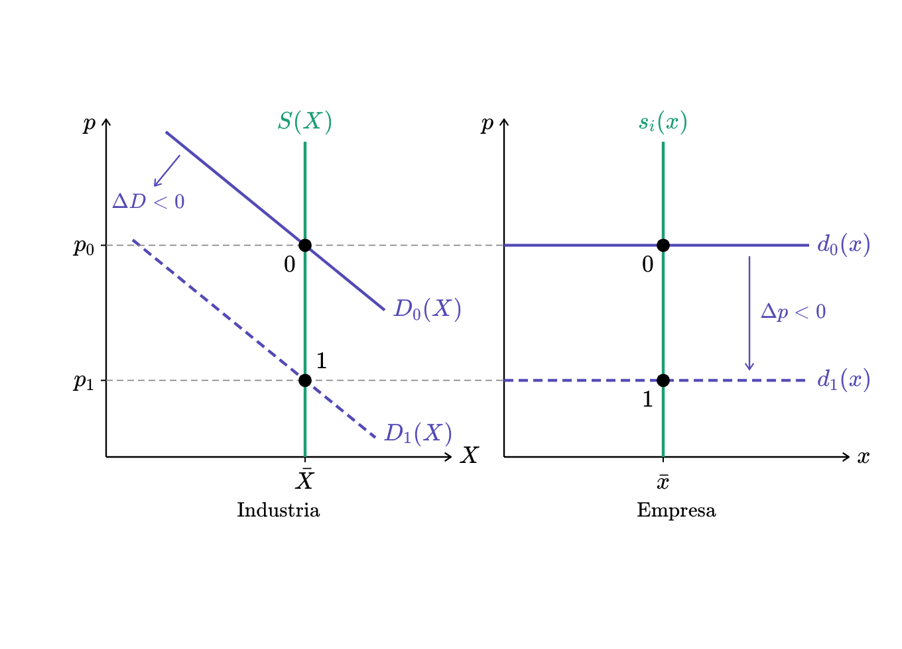
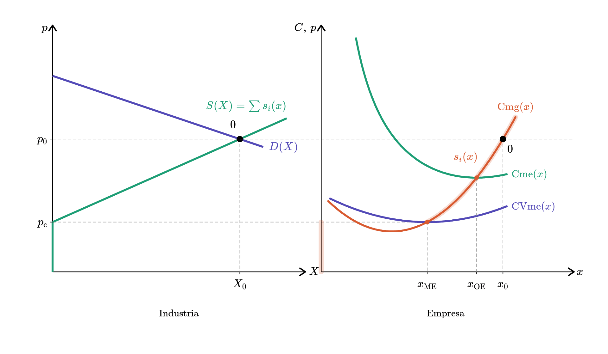
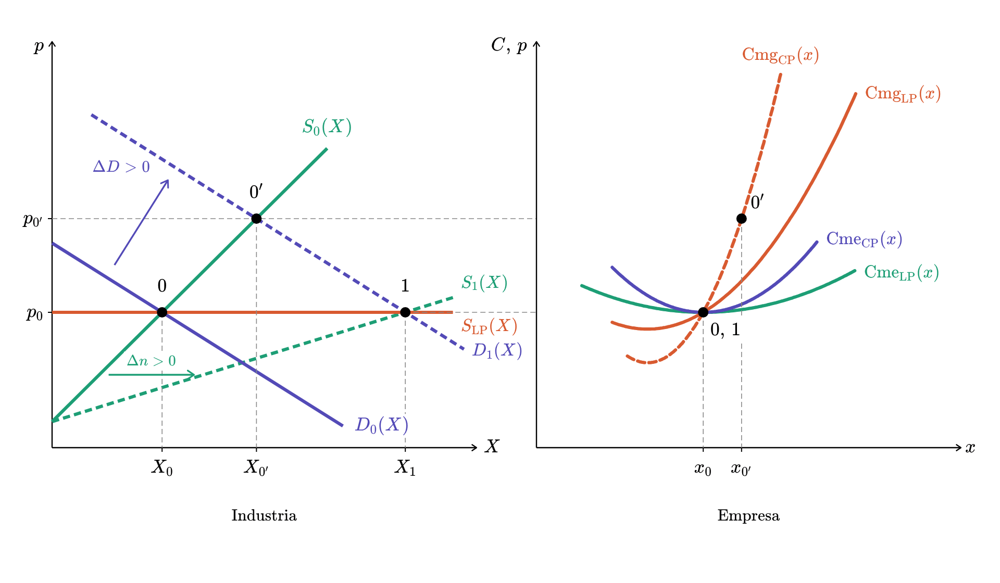
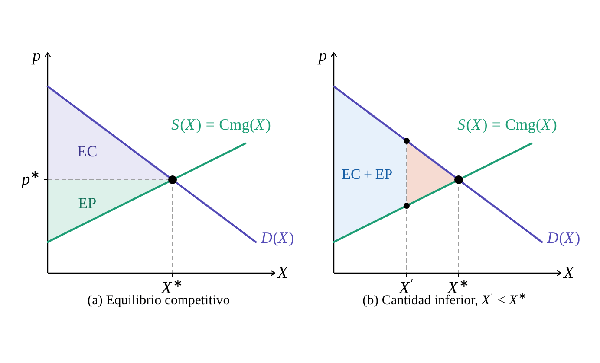
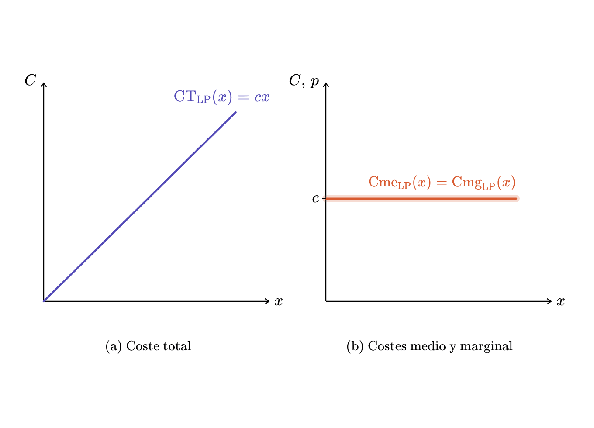
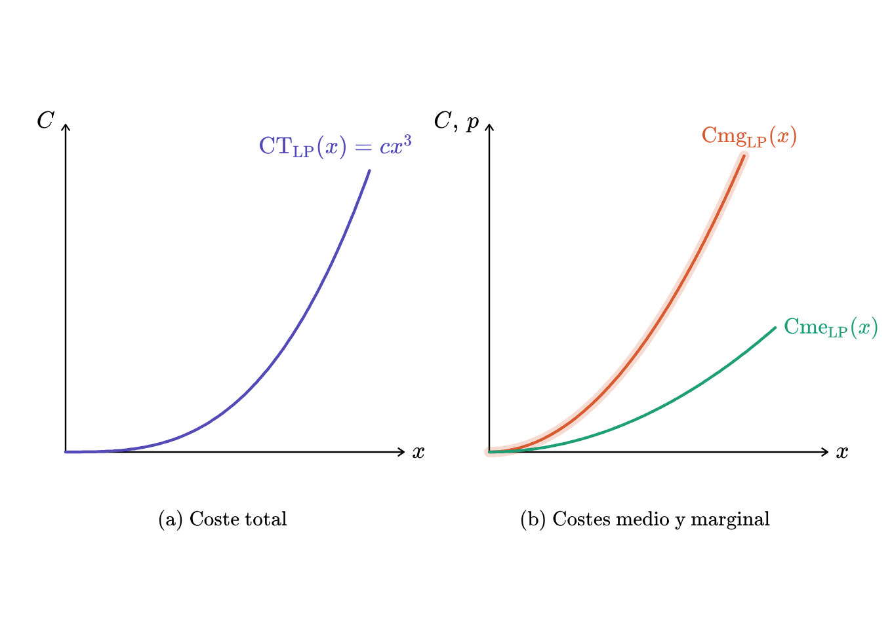
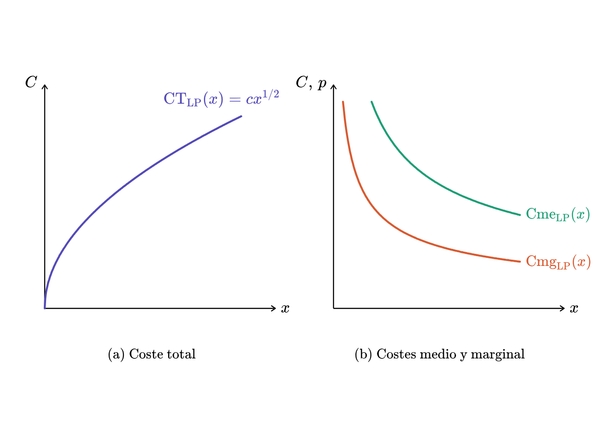
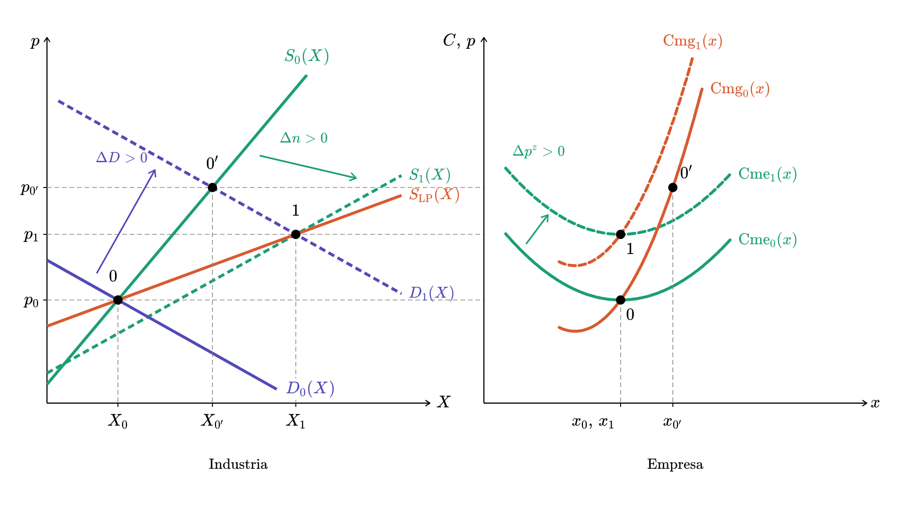
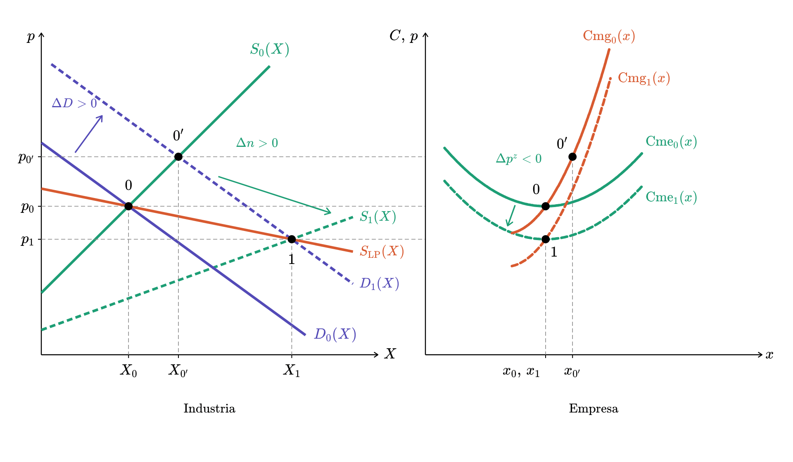

## Introducción

::: {.callout-note appearance="simple" icon=false}

:::

La **competencia perfecta** es el modelo de referencia de la teoría de los mercados. Con muchos compradores y vendedores, un producto homogéneo, información perfecta y libre entrada y salida, ninguna empresa puede influir en el precio, y cada una produce la cantidad con la que su coste marginal iguala el precio de mercado. Solo en esta estructura existe una curva de oferta propiamente dicha, ya que en ella la cantidad ofrecida depende únicamente del precio.

El modelo procede del equilibrio parcial de Marshall (1890), que estudió cada mercado por separado y distinguió los plazos de ajuste. A muy corto plazo la oferta está dada y el precio lo fija la demanda. A corto plazo las empresas ajustan la producción con la planta que tienen, y producen aunque tengan pérdidas mientras el precio cubra el coste variable medio, por lo que su curva de oferta es el tramo de la curva de coste marginal situado por encima del mínimo de ese coste. A largo plazo entran o salen empresas, y la estabilidad del equilibrio depende de cómo reaccionan los precios o las cantidades fuera de él. El modelo tiene, además, un gran interés normativo. A largo plazo, la libre entrada lleva el beneficio extraordinario a cero y el precio al mínimo del coste medio, de modo que el equilibrio competitivo es eficiente en el sentido de Pareto y maximiza la suma de los excedentes, resultado que el primer teorema fundamental del bienestar generaliza a toda la economía (temas [A21](a21-equilibrio-general.qmd) y [A22](a22-eb-i.qmd)).

Sin embargo, ningún mercado real cumple todos sus supuestos. Por eso el modelo sirve, sobre todo, como patrón con el que se miden el poder de mercado y las pérdidas de eficiencia de las demás estructuras (temas [A17](a17-monopolio.qmd) a [A19](a19-oligopolio.qmd)) y como referencia de la política de defensa de la competencia. Sus extensiones relajan supuestos como la constancia de los precios de los factores, de la que dependen las industrias de costes constantes, crecientes o decrecientes, y analizan cómo se forma el precio cuando nadie lo fija, el problema del subastador walrasiano.

Este tema recorre el modelo de competencia perfecta en tres pasos sucesivos:

- *Fundamentos*: los supuestos del modelo marshalliano, la demanda y la decisión de la empresa.

- *Análisis temporal*: el equilibrio en cada horizonte, las dinámicas de ajuste y la estabilidad, y sus propiedades, con el análisis de eficiencia y bienestar.

- *Extensiones*: la relajación de sus supuestos.

## 1. Fundamentos del modelo marshalliano

La formalización del equilibrio parcial competitivo nace con Marshall (*Principles of Economics*, 1890) y se completa con Hicks, Allen y Pigou.

### 1.1. Supuestos

Los supuestos del modelo canónico de competencia perfecta se pueden agrupar en cinco bloques:

**Metodología**: el equilibrio competitivo y su eficiencia se analizan en equilibrio parcial[^a16-1], con dos bienes. Uno es el bien final, que producen las empresas y demandan los consumidores, y el otro, un bien compuesto[^a16-2] que engloba los de los demás mercados, actúa como numerario[^a16-5]. La simplificación permite tratar el mercado como aislado y representar gráficamente su oferta y su demanda.

**Entorno**: no existen fallos de mercado. No hay externalidades, bienes públicos, poder de mercado, información imperfecta (la información es completa y simétrica) ni costes de transacción.

**Agentes**: sin sector público, solo hay consumidores racionales con preferencias de buen comportamiento, que maximizan su utilidad, y empresas racionales dirigidas por sus propietarios (sin conflicto de agencia), que maximizan el beneficio económico. Unos y otros se encuentran en gran número, de modo que el mercado está atomizado. 

De este bloque se deduce que los agentes son precio-aceptantes, es decir, que actúan paramétricamente en precios ($\partial p / \partial x_i^s = \partial p / \partial x_i^d = 0$). Por ello, cada uno puede comprar o vender cuanto quiera al precio de mercado, y la curva de oferta o de demanda que afronta es perfectamente elástica.

**Tecnología**: el modelo parte de cuatro supuestos:

- *Producto homogéneo*: la producción es monoproducto o unisectorial, $x = f(\mathbf{z})$. Todas las empresas producen un único bien normal, no numerario, idéntico y homogéneo ($\sigma_{ji} = \infty, \forall i\neq j$), perfectamente divisible, a partir de varios factores normales.

- *Divisibilidad de los factores*: es perfecta, lo que permite suponer que las funciones de producción y de costes son continuas.

- *Rendimientos mixtos*: a corto plazo (en el factor variable) y a largo plazo (en la escala de producción) la función de producción tiene forma de S y la de costes medios, forma de U, de modo que existe una dimensión óptima de planta.

- *Homogeneidad tecnológica*: todas las empresas tienen la misma tecnología[^a16-6] y el mismo acceso al mercado de factores.

De los supuestos de entorno y tecnología se deriva la *ley del precio único*, según la cual bienes idénticos tienen precios idénticos[^a16-7].

**Mercado de factores**: es también perfecto y grande en relación con el del bien final. Las empresas, precio-aceptantes también en él ($\partial p_i^z / \partial z_i = 0$), contratan o alquilan cuantos factores quieran al precio de mercado. No hay (des)economías de escala externas[^a16-8].

### 1.2. Demanda de mercado

**Definición**: la curva de demanda de mercado, que procede del comportamiento optimizador de los consumidores en la teoría neoclásica del consumo, es la suma horizontal de las demandas individuales de los $H$ consumidores del mercado:

$$D_x(p_x) = \sum_{h=1}^{H} d_x^h(p_x, p_0, M_0) \rightarrow D_x(p_x) = \sum_{h=1}^{H} d_x^h(p_x)$$

La curva muestra la cantidad demandada del bien en función de su precio, con los demás parámetros (renta, preferencias, precios de otros bienes) constantes.

**Propiedades**: la suma horizontal no garantiza que la demanda de mercado conserve todas las propiedades de las individuales.

1. *Continuidad y diferenciabilidad*: hereda de las demandas individuales la continuidad, aunque puede no ser diferenciable (presenta quiebros) en los precios a los que un consumidor entra en el mercado o sale de él (véase la figura del tema [A08](a08-consumidor.qmd), apartado 2.3.3).

2. *Transformaciones*: hereda también la homogeneidad de grado cero en precios y renta (ausencia de ilusión monetaria).

3. *Inclinación*: tiene pendiente negativa en el plano $(X, p)$ si la tienen las demandas individuales (bien normal y, por tanto, ordinario), condición suficiente pero no necesaria.

4. *Forma*: la teoría no restringe su curvatura, igual que ocurre con las demandas individuales.

5. *Otras propiedades*:

    - *Agotamiento de la renta*: el gasto de todos los consumidores en el bien y en el numerario iguala la suma de sus rentas, de modo que se cumple la ley de Walras agregada (tema [A08](a08-consumidor.qmd), apartado 2.3.3).

    - *Integrabilidad*: en general no hereda la simetría de los efectos sustitución ni la ley de la demanda compensada, por lo que no puede tratarse como la demanda de un consumidor representativo. Solo puede expresarse en función de la renta agregada, con independencia de su distribución, si las curvas de Engel de todos los consumidores son rectas paralelas (Gorman, 1953). Las preferencias cuasilineales supuestas cumplen esa condición, y con ellas, en soluciones interiores, la demanda del bien ni siquiera depende de la renta.

    - *Observabilidad*: es observable en los datos de mercado, a partir de los cuales puede estimarse.

::: {.callout-note appearance="simple" icon=false}
Las condiciones de agregación de las demandas individuales y la noción de consumidor representativo se desarrollan en el tema [A08](a08-consumidor.qmd), apartados 2.3.3 y 3.1.2. Aquí se recoge solo su consecuencia para la demanda de mercado.
:::

### 1.3. Oferta: la decisión de la empresa

La **curva de oferta de mercado** se construye a partir de la maximización del beneficio de la empresa racional. El **beneficio económico** es la diferencia entre el ingreso total (el valor de mercado de lo producido y vendido) y el coste total, que depende de la cantidad a través de la función de costes del tema [A12](a12-costes.qmd):

$$\pi(x) = \text{IT}(x) - \text{CT}(x)$$

**Ingreso**: el ingreso total es $\text{IT}(x) = p(x) \cdot x$. De él se derivan el ingreso marginal (la contribución de la última unidad vendida), $\text{Img}(x) = \partial \text{IT} / \partial x = p + (\partial p / \partial x) \cdot x = p\,(1 + 1/\varepsilon_{xp})$, y el ingreso medio (el ingreso por unidad), $\text{Ime}(x) = \text{IT}/x = p(x)$. 

El ingreso medio es la curva de ventas o curva de demanda de la empresa, es decir, la cantidad que puede vender a cada precio. Como la empresa es precio-aceptante, el precio no depende de su producción ($\partial p / \partial x = 0$), de modo que $\text{Img} = \text{Ime} = p$ y la curva de ventas es perfectamente elástica. Por encima del precio de mercado no vende nada.

**Coste**: el coste total, $\text{CT}(x)$, es la función de costes obtenida al minimizar el gasto para cada nivel de producción. De los rendimientos mixtos se derivan la forma de U del coste medio y un coste marginal creciente en el tramo relevante. A corto plazo, el coste total se descompone en costes fijos y variables, mientras que a largo plazo todos son variables.

El programa de maximización del beneficio puede escribirse de dos formas[^a16-11]: 

- *Enfoque de mercado*: la empresa elige el nivel de producción, lo que sirve para estudiar la relación entre producción y beneficio.

- *Enfoque de la producción*: la empresa elige las cantidades de factores, lo que sirve para estudiar la relación entre factores y beneficio.

#### 1.3.1. Equilibrio: enfoque de mercado

**Planteamiento**: en el enfoque de mercado, el programa de maximización es:

$$\max_x \; \pi = p \cdot x - \text{CT}(x) \quad \text{s.a.:} \; x \geq 0$$

donde $x$ es la cantidad producida, $p$ el precio de mercado, que la empresa toma como dado, $\text{CT}(x)$ su función de costes y $\pi$ el beneficio.

**CPO**: derivando y operando se obtiene la condición de primer orden del problema

$$\dfrac{\partial \pi}{\partial x} = p - \dfrac{\partial \text{CT}}{\partial x} = 0 \;\Rightarrow\; p = \text{Cmg}(x)$$

La empresa produce hasta que el coste marginal alcanza al ingreso marginal, que en competencia perfecta coincide con el precio[^a16-12]. Con $p > \text{Cmg}$ conviene ampliar la producción, porque la última unidad deja más ingreso del que cuesta, y con $p < \text{Cmg}$ conviene recortarla.

**CSO**: $\dfrac{\partial^2 \pi}{\partial x^2} < 0 \;\rightarrow\; \dfrac{\partial \text{Cmg}}{\partial x} > 0$

El coste marginal debe ser estrictamente creciente en el óptimo[^a16-13]. La maximización se produce en el tramo creciente de la curva de coste marginal[^a16-14], porque en el tramo decreciente la empresa siempre podría aumentar su beneficio produciendo una unidad más. 

Esta condición, junto con la de beneficio no negativo a largo plazo ($p \geq \text{Cme}$), hace incompatibles la competencia perfecta y los rendimientos crecientes (apartado 3.1).

#### 1.3.2. Equilibrio: enfoque de la producción

**Planteamiento**: análogamente, el programa de maximización puede escribirse desde el punto de vista de la producción

$$\max_{\mathbf{z}} \; \pi = p \cdot f(\mathbf{z}) - \mathbf{p}^z \cdot \mathbf{z} \quad \text{s.a.:} \; \mathbf{z} \geq 0$$

donde $\mathbf{z}$ es el vector de cantidades de factores, $f(\mathbf{z})$ la función de producción, $p$ el precio del producto, $\mathbf{p}^z$ el vector de precios de los factores y $\pi$ el beneficio.

**CPO** (condiciones de primer orden):

$$\text{RMST}_{ji} = \frac{\partial f/\partial z_i}{\partial f/\partial z_j} = \frac{p_i^z}{p_j^z} \tag{1}$$

$$\frac{\partial f/\partial z_i}{p_i^z} = \lambda = \frac{1}{\text{Cmg}} \quad \forall i \tag{2}$$

$$\text{VPmg}_i \equiv p \cdot \frac{\partial f}{\partial z_i} = p_i^z \tag{3}$$

$$p = \frac{p_i^z}{\partial f/\partial z_i} = \text{Cmg} \tag{4}$$

Las cuatro condiciones se leen como sigue:

1. *Minimización del coste*: (1) establece que la relación marginal de sustitución técnica iguala al precio relativo de los factores, de modo que la empresa produce al mínimo coste (eficiencia económica, no solo técnica).

2. *Igualdad de productividades ponderadas*: (2) reformula la anterior en términos de productividad marginal por euro gastado, que ha de ser igual para todos los factores.

3. *Maximización del beneficio*: (3) establece que cada factor se contrata hasta que el valor de su productividad marginal iguala a su precio.

4. *Regla de precios*: (4) muestra que el precio del producto iguala al coste marginal sin margen alguno, consecuencia de que la empresa sea precio-aceptante.

**CSO**: $f_{11} f_{22} - f_{12}^2 > 0$, junto con $f_{11} < 0$, es decir, la función de producción debe ser estrictamente cóncava en el tramo relevante. Ello no equivale a rendimientos decrecientes a escala, sino a rendimientos marginales decrecientes con efectos cruzados acotados.

#### 1.3.3. Funciones de oferta y demanda de factores

De la resolución del problema se pueden obtener:

**Demanda incondicionada de factores**: es la cantidad óptima de factores productivos demandados en función del precio del bien final y de los precios de los factores, admitiendo fluctuaciones en el nivel de producción (de ahí el nombre), $z_i^d = d_i^z(p, \mathbf{p}^z)$. Sus propiedades son las siguientes:

1. *Continuidad y diferenciabilidad*: son continuas y diferenciables en el precio del bien y en los precios de los factores cuando la función de producción es estrictamente cóncava, lo que permite el análisis de estática comparativa.

2. *Transformaciones*: son homogéneas de grado cero en el precio del bien y en los precios de los factores, de modo que la inflación pura no altera las elecciones de factores (ausencia de ilusión monetaria).

3. *Inclinación*: el efecto precio propio es no positivo, $\partial d_i^z / \partial p_i^z \leq 0$, efecto mayor en valor absoluto que el de la demanda condicionada (lema de Shephard), porque incluye el efecto producción (Gravelle y Rees, 2004). En cambio, el efecto cruzado es indeterminado. Con dos factores, su signo es el opuesto al de $f_{12}$, y así, si los factores son complementarios en la producción, $f_{12} > 0$, la subida del precio de uno reduce la demanda del otro. Por el lema de Hotelling y el teorema de Schwarz, los efectos cruzados son simétricos, $\partial d_i^z / \partial p_j^z = \partial d_j^z / \partial p_i^z$. Por la misma razón, el efecto del precio de un factor sobre la oferta es el opuesto al del precio del bien sobre la demanda de ese factor, $\partial s / \partial p_i^z = -\partial d_i^z / \partial p$ (Mas-Colell, Whinston y Green, 1995, prop. 5.C.1).

4. *Forma*: la teoría no restringe su curvatura respecto a los precios. La restricción de segundo orden recae sobre la función de máximo beneficio, convexa en precios, de la que las demandas derivan por el lema de Hotelling.

5. *Otras propiedades*:

    - *Envolvente* (*lema de Hotelling*): se obtienen de la función de máximo beneficio, $z_i^d = -\partial \Pi / \partial p_i^z$.

    - *Dualidad*: coinciden con las demandas condicionadas evaluadas en la producción que maximiza el beneficio, $d_i^z(p, \mathbf{p}^z) = d_i^c(\mathbf{p}^z, s(p, \mathbf{p}^z))$, con $d_i^c$ la demanda condicionada del tema [A12](a12-costes.qmd), apartado 1.4.2. La empresa que maximiza el beneficio minimiza también el coste de lo que produce (condición (1)), y un ejemplo posterior lo comprueba con una Cobb-Douglas.

    - *Integrabilidad*: junto con la oferta, permiten recuperar la función de máximo beneficio si, además de ser todas homogéneas de grado cero, forman un sistema de ofertas netas cuya matriz de derivadas respecto a los precios es simétrica y semidefinida positiva. En ese sistema la oferta del bien entra con signo positivo y las demandas de factores con signo negativo.

    - *Observabilidad*: son observables y estimables a partir de datos de precios y de cantidades de factores.

**Oferta individual del bien final**: sustituyendo las demandas de factores en la función de producción se obtiene la cantidad óptima ofrecida como función del precio del bien y de los precios de los factores, $x^s = s(p, \mathbf{p}^z)$. Geométricamente, es el tramo creciente de la curva de coste marginal situado por encima del precio de cierre, como se desarrolla en el apartado 2. Sus propiedades son las siguientes:

1. *Continuidad y diferenciabilidad*: es continua en el precio del bien y en los precios de los factores salvo en el umbral de cierre (precio igual al mínimo del coste variable medio, que depende de los precios de los factores), y es diferenciable por tramos. En ese umbral salta de cero al *output* que minimiza el coste variable medio.

2. *Transformaciones*: es homogénea de grado cero en el precio del bien y en los precios de los factores, por lo que la inflación pura no altera la cantidad ofrecida (ausencia de ilusión monetaria).

3. *Inclinación*: no decreciente en el precio del bien ($\partial s / \partial p \geq 0$, por la convexidad de la función de beneficio).

4. *Forma*: la teoría tampoco restringe su curvatura. La restricción de segundo orden recae, como en las demandas de factores, sobre la función de máximo beneficio, convexa en precios.

5. *Otras propiedades*:

    - *Envolvente* (*lema de Hotelling*): se obtiene de la función de máximo beneficio, $x^s = \partial \Pi / \partial p$.

    - *Integrabilidad*: junto con las demandas de factores, permite recuperar la función de máximo beneficio, con la condición indicada para estas.

    - *Observabilidad*: es observable y estimable a partir de datos de precios y cantidades producidas.

#### 1.3.4. Función de valor: la función de máximo beneficio

**Definición**: de la resolución de ambos problemas se obtiene la función de valor óptimo, la *función de máximo beneficio*, que recoge el beneficio máximo para cada nivel de precios del bien y de los factores:

$$\pi^* = \Pi(p, \mathbf{p}^z)$$

**Propiedades**[^a16-17]:

1. *Continuidad y diferenciabilidad*: es continua en el precio del producto y en los precios de los factores, y diferenciable en ellos cuando la oferta y las demandas de factores son únicas, lo que permite aplicar el teorema de la envolvente.

2. *Transformaciones*: es homogénea de grado uno en el precio del producto y en los precios de los factores, $\Pi(\lambda p, \lambda \mathbf{p}^z) = \lambda\, \Pi(p, \mathbf{p}^z)$. Por ello, un aumento equiproporcional de todos los precios aumenta el beneficio máximo en la misma proporción sin alterar las decisiones de la empresa (ausencia de ilusión monetaria). Además, es una función cardinal, medida en unidades monetarias.

3. *Inclinación*: no decreciente en el precio del producto ($\partial \Pi / \partial p \geq 0$) y no creciente en el precio de cada factor ($\partial \Pi / \partial p_i^z \leq 0$).

4. *Forma*: convexa en todos los precios, lo que, con el lema de Hotelling, hace que la oferta no disminuya con el precio del bien ni la demanda incondicionada de un factor aumente con su precio.

    - *Respecto al precio del producto*: $\partial^2 \Pi / \partial p^2 \geq 0$. Al subir el precio, el beneficio crece a un ritmo cada vez mayor, porque la empresa reajusta su producción.

    - *Respecto al precio de los factores*: $\partial^2 \Pi / \partial (p_i^z)^2 \geq 0$. Al subir el precio de un factor, el beneficio cae a un ritmo cada vez menor, porque la empresa lo sustituye y reajusta su producción.

5. *Otras propiedades*:

    - *Envolvente* (*lema de Hotelling*): las derivadas de la función recuperan las funciones de comportamiento de la empresa, como hacen la identidad de Roy y el lema de Shephard con las funciones indirecta de utilidad y de gasto del consumidor (tema [A09](a09-dualidad.qmd)):

      $$x^s = \frac{\partial \Pi}{\partial p} \qquad z_i^d = -\frac{\partial \Pi}{\partial p_i^z}$$

    - *Dualidad*: es el beneficio del enfoque de mercado evaluado en la oferta óptima, $\Pi(p, \mathbf{p}^z) = p \cdot s(p, \mathbf{p}^z) - c(\mathbf{p}^z, s(p, \mathbf{p}^z))$, con $\text{CT}(x) = c(\mathbf{p}^z, x)$ la función de costes del tema [A12](a12-costes.qmd), apartado 1.4.4, de modo que los enfoques de mercado y de la producción llevan al mismo beneficio máximo.

    - *Integrabilidad*: recíprocamente, toda función continua, homogénea de grado uno y convexa en precios, no decreciente en el precio del producto y no creciente en los de los factores, es la función de máximo beneficio de alguna tecnología. Si la tecnología es convexa, puede reconstruirse a partir de la función de máximo beneficio (en otro caso, se recupera su envolvente convexa).

    - *Observabilidad*: es observable, porque se miden sus argumentos (los precios del producto y de los factores) y su valor (el beneficio). Estimada con esos datos, permite obtener, por el lema de Hotelling, la oferta y las demandas de factores sin estimar directamente la tecnología (enfoque dual).

::: {.callout-tip collapse="true" appearance="simple" title="Ejemplo: oferta y función de beneficio con una Cobb-Douglas"}
Con la tecnología $x = L^{1/4}K^{1/4}$ y $\mathbf{p}^z = (w, r)$, la función de costes del tema [A12](a12-costes.qmd) es $\text{CT}(x) = 2x^2 (wr)^{1/2}$, con $\text{Cmg} = 4x(wr)^{1/2}$ estrictamente creciente (se cumple la CSO). La CPO $p = \text{Cmg}$ da la oferta y, sustituyéndola en $\pi = px - \text{CT}(x)$, la función de máximo beneficio:

$$x^s = \frac{p}{4(wr)^{1/2}} \qquad \Pi(p, w, r) = \frac{p^2}{8(wr)^{1/2}}$$

Se verifica el lema de Hotelling, pues $\partial \Pi/\partial p = p/(4(wr)^{1/2}) = x^s$, y $-\partial \Pi/\partial w = p^2/(16\,w^{3/2}r^{1/2})$, la demanda incondicionada de trabajo, coincide con la condicionada de A12 evaluada en $x^s$, $(x^s)^2 (r/w)^{1/2}$. Además, $\Pi$ es homogénea de grado uno y convexa en $p$, y $x^s$, homogénea de grado cero. Sin costes fijos, el CVme $= 2x(wr)^{1/2}$ alcanza su mínimo, $0$, en $x = 0$, de modo que el precio de cierre es nulo y la oferta es toda la curva de Cmg.
:::

### 1.4. Conclusiones

**Aspectos positivos**: el modelo marshalliano de competencia perfecta es la referencia normativa de la teoría de mercados. Bajo sus supuestos, la maximización del beneficio da funciones de oferta y de demanda de factores con propiedades análogas a las del consumidor (continuidad, homogeneidad de grado cero, signo de las derivadas), y el equilibrio resultante es eficiente en el sentido de Pareto (tema [A22](a22-eb-i.qmd)).

**Limitaciones**: los supuestos (atomicidad, homogeneidad, información perfecta, libre entrada) son exigentes y rara vez se cumplen conjuntamente. Además, el modelo es estático y de equilibrio parcial, de modo que el ajuste temporal, las interdependencias entre mercados y la conducta estratégica exigen los desarrollos de los apartados 2 y 3 y de los temas [A17](a17-monopolio.qmd) a [A21](a21-equilibrio-general.qmd).

## 2. Análisis temporal del modelo

Siguiendo a Marshall, el modelo se estudia en tres horizontes temporales, que se distinguen por la capacidad de ajuste de cada empresa ante los cambios de la demanda. Esa capacidad da a la oferta individual y a la de mercado una forma distinta en cada horizonte y decide si la empresa puede tener beneficios o pérdidas. Después se estudian las dinámicas de ajuste de esos equilibrios y sus propiedades, positivas (existencia, unicidad y estabilidad) y normativas (eficiencia y bienestar).

### 2.1. Muy corto plazo: subastas

El horizonte más breve es aquel en que la producción ya está dada y solo el precio puede ajustarse para repartir las existencias entre los compradores.

#### 2.1.1. Supuestos

Marshall llamó “**periodo de mercado**” al horizonte de muy corto plazo. En él las empresas son siempre las mismas (no pueden entrar ni salir del mercado), y lo que ofrecen es una cantidad dada (p. ej. un *stock* de bienes perecederos ya producido). La demanda de mercado es decreciente en el precio del bien.

#### 2.1.2. Modelo

**Oferta individual y de mercado**: con la producción ya hecha y sin posibilidad de ajustarla, cada empresa ofrece lo mismo sea cual sea el precio. Su curva de oferta es, pues, vertical (elasticidad nula), y la de mercado, suma de las individuales, es igual de rígida.

**Equilibrio**: el precio lo fija solo la demanda. Como en una subasta, la única función del precio es la de racionamiento, pues reparte las existencias entre los demandantes para que el mercado se vacíe, sin señalar todavía nada a los productores.

La empresa, precio-aceptante (apartado 1.1)[^a16-22] y sin poder ajustar la oferta a las condiciones de demanda, puede encontrarse en una situación de beneficios o de pérdidas.

**Desarrollo gráfico**: el equilibrio a muy corto plazo se representa en el plano cantidad-precio, para la industria y para la empresa (figura -@fig-a161-mcp-i):

1. *Oferta*: la de mercado, $S(X)$, es vertical en la cantidad dada, $\bar{X}$, porque las existencias ya están producidas, y la de cada empresa, $s_i(x)$, lo es en $\bar{x}$.

2. *Demanda*: la de mercado, $D_0(X)$, es decreciente, como las individuales (apartado 1.2). En cambio, la de la empresa, $d_0(x)$, es horizontal al precio de mercado, porque la empresa es precio-aceptante.

3. *Equilibrio*: el corte de $D_0(X)$ con $S(X)$ fija el precio $p_0$ (punto 0), al que cada empresa vende $\bar{x}$.

::: {#fig-a161-mcp-i}

::: {.content-visible when-format="html"}
```{=html}
<div class="graph-frame wide">
<iframe src="../graphs/a161_MCP_i.html" style="--r:1.388" loading="lazy" title="fig-a161-mcp-i"></iframe>
</div>
```
:::

::: {.content-visible unless-format="html"}

:::

Muy corto plazo. Con la oferta rígida en $\bar{X}$, una caída de la demanda ($\Delta D < 0$) se traslada íntegramente al precio, que baja de $p_0$ a $p_1$. La empresa, precio-aceptante, sigue vendiendo $\bar{x}$ a un precio menor.
:::

**Estática comparativa**: como en los horizontes siguientes, las perturbaciones se agrupan según desplacen la demanda o la oferta:

- *Perturbaciones de demanda*: como la oferta es rígida, un desplazamiento de la demanda se traslada íntegramente al precio, en su mismo sentido, sin alterar la cantidad intercambiada, $\bar{X}$, ni la de cada empresa, $\bar{x}$. En la figura -@fig-a161-mcp-i, una caída de la demanda de $D_0(X)$ a $D_1(X)$ baja el precio de $p_0$ a $p_1$ (del punto 0 al 1), y la demanda de la empresa pasa de $d_0(x)$ a $d_1(x)$. Para un mismo desplazamiento horizontal de la demanda, la variación del precio es tanto mayor cuanto menos elástica (más inclinada en el plano $(X, p)$) es la demanda.

- *Perturbaciones de oferta*: en el periodo de mercado la oferta solo cambia si lo hacen las existencias disponibles (p. ej. por la pérdida de parte del *stock*), y no con los precios de los factores o la tecnología, que solo afectan a la producción futura. Una reducción de las existencias desplaza hacia la izquierda la oferta rígida, de modo que la cantidad intercambiada cae en toda la cuantía del choque y el precio sube, tanto más cuanto menos elástica es la demanda.

### 2.2. Corto plazo: posibilidad de pérdidas

El periodo de mercado es el punto de partida de los horizontes siguientes, en los que la oferta va ganando capacidad de respuesta al precio.

#### 2.2.1. Supuestos

El número de empresas sigue siendo fijo, pero la producción ya no lo es. Cada empresa dispone de al menos un factor fijo, de modo que sus costes se dividen en fijos y variables, y elige la cantidad que produce con el factor variable. Además, los precios de los factores se suponen constantes (la industria es pequeña en relación con los mercados de factores).

#### 2.2.2. Modelo

**Oferta individual**: del lado del coste, por la CPO y la CSO (apartado 1.3.1), la empresa produce en el tramo creciente de la Cmg$_{\text{CP}}$. Del lado del precio, puede vender cuanto produzca al precio de mercado, y una condición de viabilidad económica distingue tres situaciones según dónde se sitúe ese precio:

1. *Precios bajos* ($p < \text{CVme}(x_{\text{ME}})$): si el precio de mercado queda por debajo del mínimo del coste variable medio, el ingreso total no cubre siquiera los costes variables. La empresa prefiere cerrar, porque al producir perdería más que los costes fijos, lo único que pierde si cierra.

2. *Precios medios* ($p \in [\text{CVme}(x_{\text{ME}}), \text{Cme}(x_{\text{OE}}))$): entre el mínimo y el óptimo de explotación, el precio no baja del coste variable medio. La empresa pierde dinero, pero le conviene producir, porque con lo que ingresa atiende la totalidad del coste variable y, por encima del mínimo de explotación, una fracción del fijo (en el mínimo exacto le es indiferente producir o cerrar).

3. *Precios altos* ($p \geq \text{Cme}(x_{\text{OE}})$): en el óptimo de explotación la empresa cubre exactamente todos sus costes (beneficio extraordinario nulo) y, por encima de él, obtiene beneficios extraordinarios.

La función de oferta a corto plazo es, por tanto, discontinua:

$$x_{\text{CP}}^s = \begin{cases} s(p, \mathbf{p}^z_0) & \text{si } p \geq \text{CVme}(x_{\text{ME}}) \\ 0 & \text{si } p < \text{CVme}(x_{\text{ME}}) \end{cases}$$

**Oferta de mercado**: con precios de los factores constantes y número de empresas dado, a corto plazo se obtiene por suma horizontal de las ofertas individuales[^a16-27]. Hereda por ello las propiedades de las curvas individuales:

1. *Continuidad y diferenciabilidad*: es discontinua en el precio de cierre de cada empresa, aunque con muchas empresas de costes distintos la agregación la suaviza.

2. *Transformaciones*: es homogénea de grado cero en el precio del bien y en los precios de los factores, como cada oferta individual.

3. *Inclinación*: es no decreciente en el precio del bien, como cada oferta individual, y su elasticidad es la media de las elasticidades individuales ponderada por las cuotas de producción.

4. *Forma*: la teoría no restringe su curvatura, igual que ocurre con las ofertas individuales.

5. *Otras propiedades*:

    - *Envolvente* (*lema de Hotelling*): es la derivada respecto al precio del bien de la suma de las funciones de máximo beneficio de las empresas. A diferencia de la demanda de mercado (apartado 1.2), se comporta por ello como la oferta de un único productor precio-aceptante que maximizase el beneficio agregado.

    - *Observabilidad*: como la demanda de mercado, es observable en los datos de mercado, a partir de los cuales puede estimarse.

**Equilibrio**: se produce en la intersección de las curvas de demanda y de oferta de mercado, que actúan simultáneamente (la *cruz marshalliana*). Marshall comparó esa simultaneidad con una tijera, de la que no puede decirse qué hoja corta, como tampoco si el precio lo fija la oferta o la demanda. En el periodo de mercado lo fijaba solo la demanda, y a corto plazo lo fijan ambas. El precio cumple así una doble función, pues raciona la demanda y señala a las empresas cuánto producir.

**Desarrollo gráfico**: el equilibrio a corto plazo se representa en el plano cantidad-precio de la industria y en el plano cantidad-coste de la empresa (figura -@fig-a163-cp):

1. *Oferta de mercado*, $S(X) = \sum s_i(x)$: es la suma horizontal de las ofertas individuales y crece con el precio. Parte del eje de precios en el precio de cierre, $p_{\text{c}}$, el mínimo de $\text{CVme}(x)$, por debajo del cual ninguna empresa produce. A precios inferiores, la oferta coincide, por tanto, con el eje de precios.

2. *Demanda de mercado*, $D(X)$: es la suma de las demandas individuales y decrece con el precio.

3. *Curvas de costes de la empresa*, $\text{Cmg}(x)$, $\text{Cme}(x)$ y $\text{CVme}(x)$: la oferta individual, $s_i(x)$, es el tramo de $\text{Cmg}(x)$ por encima del mínimo de explotación, $x_{\text{ME}}$. Por debajo del precio de cierre, la empresa no produce y su oferta coincide con el eje de precios, de modo que la curva de oferta tiene un salto en ese precio. El óptimo de explotación, $x_{\text{OE}}$, es el mínimo de $\text{Cme}(x)$.

4. *Equilibrio*: el corte de $D(X)$ y $S(X)$ fija el precio $p_0$ y la cantidad $X_0$ (punto 0 de la industria). A ese precio la empresa produce $x_0$, donde $p_0 = \text{Cmg}(x_0)$ (punto 0 de la empresa). Como $x_0$ supera a $x_{\text{OE}}$, el precio supera al coste medio y la empresa obtiene beneficios extraordinarios.

::: {#fig-a163-cp}

::: {.content-visible when-format="html"}
```{=html}
<div class="graph-frame wide">
<iframe src="../graphs/a163_CP.html" style="--r:1.714" loading="lazy" title="fig-a163-cp"></iframe>
</div>
```
:::

::: {.content-visible unless-format="html"}

:::

Equilibrio de la industria y de la empresa a corto plazo. La empresa puede obtener beneficios o pérdidas extraordinarias.
:::

**Estática comparativa**: los desplazamientos de las curvas de mercado se agrupan según su origen. Las perturbaciones de demanda mueven el precio y la cantidad de equilibrio en el mismo sentido, y las de oferta, en sentidos opuestos.

- *Perturbaciones de demanda*: nacen de variaciones en las preferencias, en la renta o en lo que cuestan los bienes relacionados (sustitutivos y complementarios), y de los impuestos que pagan los compradores.

    - *Aumento de la demanda*: eleva el precio y la cantidad de equilibrio. Con el número de empresas fijo, cada empresa amplía su producción a lo largo de su Cmg$_{\text{CP}}$ y aumenta su beneficio (o reduce sus pérdidas). La subida del precio es tanto mayor, y la de la cantidad tanto menor, cuanto menos elástica es la oferta a corto plazo.

    - *Impuesto sobre los compradores*: un *impuesto específico* de $t$ euros por unidad[^a16-29] cuyo sujeto pasivo legal es el comprador desplaza la curva de demanda hacia abajo en la cuantía del impuesto. Tiene los mismos efectos que el impuesto sobre los vendedores, porque la incidencia económica no depende de quién sea el sujeto pasivo legal.

- *Perturbaciones de oferta*: las provocan los cambios técnicos, el encarecimiento o abaratamiento de los factores, las variaciones del número de productores y los impuestos que pagan los vendedores.

    - *Impuesto sobre los vendedores*: el mismo impuesto, cobrado al vendedor, desplaza la curva de oferta hacia arriba en la cuantía del impuesto, con tres efectos. Primero, la cantidad de equilibrio disminuye. Segundo, aparece una *cuña fiscal*, pues el precio que pagan los consumidores, $p_d$, supera al que reciben los productores, $p_s$, en el impuesto, $p_d - p_s = t$. Tercero, se produce la *traslación parcial* del impuesto, es decir, la carga se reparte entre ambos. De ello resulta una pérdida neta de bienestar, el *exceso de gravamen*[^a16-31], pues la pérdida conjunta de excedentes supera a la recaudación. Según la *ley de Dalton*[^a16-32], la incidencia económica se reparte según las elasticidades:

      $$\frac{\partial p_d}{\partial t} = \frac{\varepsilon_S}{\varepsilon_S + |\varepsilon_D|} \qquad \frac{\partial p_s}{\partial t} = -\frac{|\varepsilon_D|}{\varepsilon_S + |\varepsilon_D|}$$

      La carga recae más sobre quien es más inelástico. La misma lógica de la cuña sirve para analizar los costes de transacción (apartado 3.3.2).

    - *Aumento de coste fijo*[^a16-34]: desplaza CFme$_{\text{CP}}$ y Cme$_{\text{CP}}$, pero no CVme$_{\text{CP}}$ ni Cmg$_{\text{CP}}$. No altera el equilibrio a corto plazo (CP), porque la decisión de producir solo depende de que el precio cubra el CVme, que no cambia.

    - *Aumento del coste variable*[^a16-36]: eleva a la vez el coste marginal, el variable medio y el total medio, y contrae las ofertas individuales y la agregada. Como a corto plazo no entra ni sale ninguna empresa, cada empresa produce menos, la industria también y el precio sube[^a16-37], con la carga repartida, como en el impuesto, según las elasticidades.

### 2.3. Largo plazo: condición de beneficio nulo

Que coexistan empresas con beneficios y con pérdidas es un resultado de corto plazo, que la libre entrada y salida de empresas elimina a largo plazo al imponer la condición de beneficio nulo.

#### 2.3.1. Supuestos

En el largo plazo todos los factores son variables y existe libre entrada y salida de empresas[^a16-38], de modo que el número de empresas pasa a ser una variable que el mercado determina. 
Por tanto, junto a $p = \text{Cmg}$, que maximiza el beneficio, rige la **condición de beneficio nulo**, $p = \text{Cme}$. Ninguna empresa la persigue, sino que se cumple como consecuencia institucional de la libre entrada.

#### 2.3.2. Modelo

**Oferta individual**: a largo plazo se obtiene como la del corto plazo, con una diferencia del lado del coste. Como todo el coste es variable, el umbral de la oferta es el mínimo del coste medio a largo plazo, que define la dimensión óptima de planta.

$$x_{\text{LP}}^s = \begin{cases} s(p, \mathbf{p}^z_0) & \text{si } p \geq \text{Cme}_{\text{LP}}(x_{\text{OE}}) \\ 0 & \text{si } p < \text{Cme}_{\text{LP}}(x_{\text{OE}}) \end{cases}$$

La condición de viabilidad a largo plazo es que el ingreso cubra el coste total, $\text{IT} \geq \text{CT}_{\text{LP}}$, es decir, $p \geq \text{Cme}_{\text{LP}}$. La empresa solo produce si cubre todos sus costes, porque a largo plazo puede evitarlos todos cerrando.

El *teorema de Le Châtelier-Samuelson* (1947) (tema [A12](a12-costes.qmd)) garantiza que, donde se cortan, la oferta de largo plazo responde al precio al menos tanto como la de corto, porque con todos los factores ajustables la empresa se adapta mejor. La diferencia crece con el número de factores que la empresa no puede ajustar a corto plazo.

**Oferta de mercado**: a largo plazo no es la simple suma de las ofertas individuales, porque la entrada de empresas nuevas y la salida de las existentes cambian su número hasta que se cumple la condición de beneficio nulo.

**Equilibrio**: todas las empresas activas operan en su dimensión óptima ($\text{Cme}_{\text{CP}} = \text{Cmg}_{\text{CP}} = \text{Cmg}_{\text{LP}} = \text{Cme}_{\text{LP}}$), con beneficio económico nulo. El precio cumple una tercera función, la de asignar los recursos entre industrias, pues es la señal que provoca la entrada y la salida.

**Desarrollo gráfico**: el equilibrio a largo plazo se representa en el plano cantidad-precio de la industria y en el plano cantidad-coste de la empresa (figura -@fig-a164-lp):

1. *Demanda y oferta a corto plazo de la industria*, $D_0(X)$ y $S_0(X)$: la oferta a corto plazo es la suma de las ofertas de las empresas activas, de modo que se desplaza cuando cambia su número. Con empresas idénticas, la entrada multiplica la cantidad ofrecida a cada precio, y la curva gira hacia la derecha alrededor de su corte con el eje de precios.

2. *Curvas de costes de la empresa*: a corto plazo, $\text{Cmg}_{\text{CP}}(x)$ y $\text{Cme}_{\text{CP}}(x)$, y a largo plazo, $\text{Cmg}_{\text{LP}}(x)$ y $\text{Cme}_{\text{LP}}(x)$, que coinciden en el mínimo de $\text{Cme}_{\text{LP}}(x)$.

3. *Oferta de mercado a largo plazo*, $S_{\text{LP}}(X)$: une los sucesivos equilibrios a largo plazo. Es perfectamente elástica (horizontal al nivel del mínimo de $\text{Cme}_{\text{LP}}(x)$), porque la cantidad se ajusta por variación del número de empresas.

4. *Equilibrio*: la industria parte del equilibrio a largo plazo ($X_0, p_0$), punto 0, en el que cada empresa produce $x_0$ en el mínimo de su coste medio, con beneficio nulo.

::: {#fig-a164-lp}

::: {.content-visible when-format="html"}
```{=html}
<div class="graph-frame wide">
<iframe src="../graphs/a164_LP.html" style="--r:1.714" loading="lazy" title="fig-a164-lp"></iframe>
</div>
```
:::

::: {.content-visible unless-format="html"}

:::

Equilibrio a largo plazo. La entrada y salida de empresas lleva el precio al mínimo del coste medio a largo plazo y anula el beneficio extraordinario.
:::

**Estática comparativa**: con precios de los factores constantes, la oferta a largo plazo es horizontal, de modo que el precio solo depende de los costes y la demanda determina únicamente la cantidad.

- *Perturbaciones de demanda*: un aumento permanente de la demanda no altera el precio a largo plazo. En la figura -@fig-a164-lp, la demanda pasa de $D_0(X)$ a $D_1(X)$ y, a corto plazo, el mercado se desplaza al punto 0′, con precio $p_{0'}$ y beneficios extraordinarios, pues cada empresa amplía su producción hasta $x_{0'}$. Esos beneficios atraen nuevos entrantes ($\Delta n > 0$), que desplazan la oferta a corto plazo de $S_0(X)$ a $S_1(X)$ hasta que el precio vuelve a $p_0$ (punto 1). La cantidad sube a $X_1$ por la entrada de empresas, cada una de las cuales produce lo mismo que antes. Sin embargo, si la expansión altera los precios de los factores, el precio sí varía (apartado 3.2).

- *Perturbaciones de oferta*: los cambios en los costes desplazan el mínimo del coste medio a largo plazo y, con él, el precio.

    - *Aumento de CF permanente*: desplaza Cme$_{\text{LP}}$ hacia arriba. Las empresas con pérdidas abandonan: $\downarrow n$, $\uparrow x$ (por empresa que se queda), $\uparrow p$, $\downarrow X$[^a16-42]. La incidencia se traslada totalmente a los consumidores, porque la oferta a largo plazo (LP) es perfectamente elástica.

    - *Aumento de CV*: sube el precio ($\uparrow p$) y cae la cantidad ($\downarrow X$), mientras que el efecto sobre $x$ y $n$ es indeterminado (la empresa opera en el nuevo mínimo de Cme).

### 2.4. Dinámicas de ajuste

El corte de la oferta y la demanda no dice cómo llega el mercado al equilibrio ni si vuelve a él tras una perturbación. Ambas cuestiones dependen de la dinámica de ajuste, es decir, de qué variable responde al desequilibrio. Cada dinámica tiene su propia condición de convergencia, y el equilibrio es estable cuando esa condición se cumple. La estabilidad se recoge después entre las propiedades positivas del equilibrio (apartado 2.5.1).

La dinámica puede ser la de Walras, en la que se ajusta el precio, la de Marshall, en la que se ajusta la cantidad, o la de la telaraña, en la que la oferta responde con retraso. En lo que sigue, $D(p)$ y $S(p)$ son la demanda y la oferta de mercado del bien. Sus inversas, $p_d(X)$ y $p_s(X)$, son el **precio de demanda** (el precio al que los consumidores comprarían exactamente la cantidad $X$) y el **precio de oferta** (el precio al que los productores ofrecerían exactamente esa cantidad).

#### 2.4.1. Ajuste walrasiano: el precio responde al exceso de demanda

**Origen**: Léon Walras (1874) describió el ajuste como un tanteo (*tâtonnement*) en el que, antes de que se produzca ningún intercambio, el precio sube cuando hay exceso de demanda y baja cuando hay exceso de oferta. La tradición posterior lo personificó en un subastador ficticio, y Samuelson (1947) lo formalizó como un sistema dinámico.

**Idea**: el precio varía en proporción al exceso de demanda:

$$\frac{dp}{dt} = \kappa_p \left[ D(p) - S(p) \right]$$

donde $p$ es el precio, $t$ el tiempo, $D(p)$ y $S(p)$ las cantidades demandada y ofrecida a ese precio y $\kappa_p > 0$ la velocidad de ajuste del precio. Solo se intercambia al precio de equilibrio, $p^*$, en el que $D(p^*) = S(p^*)$.

**Razonamiento**: en torno a $p^*$, la desviación del precio evoluciona según $d(p - p^*)/dt \approx \kappa_p \left[ D'(p^*) - S'(p^*) \right] (p - p^*)$, y se corrige si el exceso de demanda decrece con el precio:

$$D'(p^*) - S'(p^*) < 0$$

donde $D'(p^*)$ y $S'(p^*)$ son las derivadas de la demanda y de la oferta respecto al precio en el equilibrio. En el plano $(X, p)$, la oferta ha de quedar a la derecha de la demanda por encima de $p^*$ (exceso de oferta, que hace bajar el precio) y a su izquierda por debajo (exceso de demanda, que lo hace subir). Con demanda decreciente y oferta creciente, la condición se cumple siempre, y el precio converge desde cualquier valor inicial si el exceso de demanda solo cambia de signo en $p^*$.

Por el **principio de correspondencia** de Samuelson (1947), la condición de estabilidad da signo a la estática comparativa. Así, si la demanda aumenta en $\Delta D$ a cada precio, el precio de equilibrio sube aproximadamente en $\Delta D / [S'(p^*) - D'(p^*)]$, cantidad positiva justamente porque el equilibrio es estable.

**Conclusiones**:

- *Aspectos positivos*: el ajuste walrasiano se adapta bien a los mercados en los que el precio se forma antes de intercambiar, como los de capitales.

- *Limitaciones*: con varios mercados interdependientes, la estabilidad del tanteo deja de estar garantizada, aunque la asegura, por ejemplo, la sustituibilidad bruta (tema [A21](a21-equilibrio-general.qmd), apartado 2.1.3).

#### 2.4.2. Ajuste marshalliano: la cantidad responde al exceso del precio de demanda

**Origen**: Alfred Marshall (1890) razonaba con la cantidad como variable independiente. Los productores amplían la producción cuando el precio que los consumidores están dispuestos a pagar supera al que los productores necesitan para ofrecerla, y la reducen en el caso contrario.

**Idea**: la cantidad varía en proporción a la diferencia entre el precio de demanda y el de oferta:

$$\frac{dX}{dt} = \kappa_X \left[ p_d(X) - p_s(X) \right]$$

donde $X$ es la cantidad de mercado, $p_d(X)$ y $p_s(X)$ los precios de demanda y de oferta de esa cantidad y $\kappa_X > 0$ la velocidad de ajuste de la cantidad. A diferencia del tanteo walrasiano, se intercambia fuera del equilibrio.

**Razonamiento**: en torno a $X^*$, la desviación evoluciona según $d(X - X^*)/dt \approx \kappa_X \left[ p_d'(X^*) - p_s'(X^*) \right] (X - X^*)$, y se corrige si

$$p_s'(X^*) > p_d'(X^*)$$

donde $p_d'(X^*)$ y $p_s'(X^*)$ son las pendientes de las curvas de demanda y de oferta en el plano $(X, p)$. La oferta ha de cortar a la demanda desde abajo. La cantidad converge desde cualquier valor inicial si el precio de oferta supera al de demanda a la derecha de $X^*$ y es inferior a su izquierda.

**Conclusiones**:

- *Aspectos positivos*: el ajuste marshalliano se adapta bien a los mercados industriales, en los que la producción se decide antes de conocer el precio y se corrige de forma gradual.

- *Limitaciones*: da por hecho que lo producido se coloca siempre a su precio de demanda, con un mercado que se vacía en cada instante, y deja sin explicar cómo se llega a ese precio.

#### 2.4.3. Ajuste con oferta rezagada: el modelo de la telaraña (Kaldor, 1934)

**Origen**: Nicholas Kaldor (1934) dio el nombre de *cobweb* al modelo con el que Ricci, Schultz y Tinbergen habían formalizado de forma independiente en 1930 las oscilaciones de los mercados agrarios.

**Idea**: con información imperfecta, el mercado puede tardar en ajustarse, porque a los productores les lleva tiempo adaptar lo que producen a los nuevos precios (cosechas, construcción, ganado). La oferta de cada periodo responde entonces al precio del periodo anterior, que era el conocido cuando se decidió cuánto producir, y no al vigente cuando se vende.

**Razonamiento**: con oferta rezagada, $X_t^s = S(p_{t-1})$, y demanda contemporánea, $X_t^d = D(p_t)$, el precio de cada periodo vacía el mercado para la cantidad decidida con el precio anterior. La secuencia de precios describe así una telaraña en torno al equilibrio, cuya forma depende de las elasticidades relativas: 

- *Oferta relativamente rígida*: si la oferta es menos elástica que la demanda (más inclinada que ella en el plano $(X, p)$), las fluctuaciones se reducen y el precio converge al equilibrio en espiral.

- *Oferta relativamente elástica*: si es más elástica, las fluctuaciones se amplifican y el precio se aleja.

- *Elasticidades iguales*: si la oferta es tan elástica como la demanda, el precio oscila indefinidamente con la misma amplitud.

**Desarrollo gráfico**: el modelo de la telaraña se representa en el plano cantidad-precio (figura -@fig-a1611-telarana):

1. *Demanda*, $D(p_t)$: decrece con el precio corriente, al que se vende la cantidad ya producida.

2. *Oferta rezagada*, $S(p_{t-1})$: crece con el precio del periodo anterior, con el que se decidió cuánto producir.

3. *Equilibrio*: el corte de ambas curvas fija $p^*$. A su alrededor, la sucesión de precios $p_0, p_1, p_2, \dots$ dibuja la telaraña, que converge cuando la oferta es más inclinada que la demanda (panel a) y diverge en el caso contrario (panel b).

::: {#fig-a1611-telarana}

::: {.content-visible when-format="html"}
```{=html}
<div class="graph-frame wide">
<iframe src="../graphs/a1611_Telarana.html" style="--r:1.648" loading="lazy" title="fig-a1611-telarana"></iframe>
</div>
```
:::

::: {.content-visible unless-format="html"}

:::

Modelo de la telaraña. Con la oferta rezagada, $S(p_{t-1})$, el precio oscila en torno a $p^*$ ($p_0, p_1, p_2, \dots$). Si la oferta es menos elástica que la demanda (más inclinada en el plano $(X, p)$), las oscilaciones se amortiguan y el precio converge (panel a). Si es más elástica, se amplifican y el precio se aleja del equilibrio (panel b).
:::

**Conclusiones**:

- *Aspectos positivos*: el modelo es una primera aproximación a las fluctuaciones de los mercados en los que la cantidad ha de decidirse antes de observar el precio.

- *Limitaciones*: supone expectativas ingenuas (los productores esperan que se repita el precio pasado), lo que la hipótesis de expectativas racionales ha superado, pues si los productores anticipan el ciclo, lo eliminan (tema [A06](a06-nmc.qmd)).

#### 2.4.4. Comparación de los mecanismos

Los criterios de Walras y de Marshall pueden escribirse con las pendientes del plano $(X, p)$, porque las derivadas de la demanda y de la oferta respecto al precio son las inversas de las pendientes de sus curvas, $D'(p) = 1/p_d'(X)$ y $S'(p) = 1/p_s'(X)$. La condición walrasiana equivale así a $(p_s' - p_d')/(p_d' \, p_s') < 0$ y la marshalliana a $p_s' - p_d' > 0$, y su relación depende del signo de las pendientes:

- *Signos contrarios*: 

    - *Demanda decreciente y oferta creciente*: $p_d' \, p_s' < 0$ y ambos criterios se cumplen a la vez (el caso normal).

    - *Demanda creciente y oferta decreciente*: ambos fallarían y no existiría un equilibrio estable.

- *Mismo signo*: 

    - *Ambas pendientes negativas*: $p_d' \, p_s' > 0$ y los criterios se excluyen, de modo que el equilibrio estable para Marshall es inestable para Walras y al revés. 

      Así ocurre con la oferta decreciente de una industria con economías externas (apartado 3.2) o con el tramo que se vuelve hacia atrás de la oferta de trabajo. El equilibrio es estable para Marshall si la oferta es menos inclinada que la demanda y para Walras si lo es más (figura -@fig-a1615-walras-marshall). 

    - *Ambas pendientes positivas* (como con la demanda creciente de un bien Giffen): los criterios también se excluyen, pero con la lectura inversa, es decir, Marshall exige una oferta más inclinada que la demanda y Walras, menos inclinada.

::: {#fig-a1615-walras-marshall}

::: {.content-visible when-format="html"}
```{=html}
<div class="graph-frame wide">
<iframe src="../graphs/a1615_Walras_Marshall.html" style="--r:1.619" loading="lazy" title="fig-a1615-walras-marshall"></iframe>
</div>
```
:::

::: {.content-visible unless-format="html"}

:::

Estabilidad de Walras y de Marshall con oferta y demanda decrecientes. Si la oferta es menos inclinada que la demanda (panel a), el exceso de oferta a $p_1 < p^*$ hace bajar el precio y lo aleja de $p^*$ (flecha vertical). En cambio, en $X_1 < X^*$ el precio de demanda supera al de oferta y la cantidad crece hacia $X^*$ (flecha horizontal), de modo que el equilibrio es estable para Marshall e inestable para Walras. Si es más inclinada (panel b), ocurre lo contrario.
:::

La discrepancia no es una paradoja, porque cada criterio describe una conducta distinta ante el desequilibrio, y cuál es relevante depende de cómo funcione cada mercado. El modelo de la telaraña es un tercer mecanismo, en tiempo discreto, con la oferta rezagada un periodo, cuya estabilidad también depende de las pendientes relativas, pues el precio converge cuando la oferta es más inclinada que la demanda.

### 2.5. Propiedades del equilibrio competitivo

Del análisis de los tres horizontes temporales y de las dinámicas de ajuste se deducen las propiedades generales del equilibrio competitivo, unas positivas (relativas a su existencia, su unicidad y su estabilidad) y otras normativas (relativas a su eficiencia).

#### 2.5.1. Propiedades positivas

Un **equilibrio competitivo** es un precio y una asignación de cantidades tales que el precio es no negativo, cada consumidor maximiza su utilidad al precio dado, cada empresa maximiza su beneficio al precio dado, el mercado se vacía (la cantidad demandada iguala a la ofrecida) y, a largo plazo, la libre entrada y salida ha eliminado los beneficios extraordinarios. 

Sobre esa definición se plantean tres cuestiones, la de si el equilibrio existe, la de si es único y la de si es estable.

1. *Existencia*: la cuestión es bajo qué condiciones hay al menos un precio que vacía el mercado, dadas las curvas de oferta y de demanda, que recogen la conducta óptima de los agentes precio-aceptantes.

   Basta con que la oferta y la demanda de mercado sean continuas en el tramo relevante y con que la cantidad demandada supere a la ofrecida a precios bajos y quede por debajo de ella a precios altos. En ese caso, las dos curvas se cortan al menos una vez. Formalmente, el *exceso de demanda*, $Z_x(p_x) = D_x(p_x) - S_x(p_x)$, es entonces una función continua que cambia de signo y, por tanto, se anula en algún precio (teorema del valor intermedio de Bolzano)[^a16-43].

   La continuidad, sin embargo, no está garantizada. La oferta de cada empresa tiene un salto en el precio de cierre, por debajo del cual la empresa no produce y su curva de oferta coincide con el eje de precios. Con muchas empresas pequeñas, el salto de cada una apenas se nota en la oferta de mercado, pero con pocas empresas grandes la demanda puede pasar por el hueco. Otro caso de no existencia es el del bien cuyo coste medio mínimo supera la disposición máxima a pagar de los consumidores. En él, oferta y demanda no se cortan para cantidades positivas y el bien no se produce.

   Gráficamente, en el plano cantidad-precio (figura -@fig-a167-existencia-ep), si la oferta, $S_x$, y la demanda, $D_x$, son continuas, se cortan en el punto de equilibrio, con precio $p_x^*$ y cantidad $X^*$ (panel a). En cambio, si la oferta tiene un salto en $\hat{p}_x$, por debajo del cual no se ofrece nada y a partir del cual se ofrece al menos $\hat{X}$, la demanda puede pasar por el hueco sin cortarla. A precios inferiores a $\hat{p}_x$ hay entonces exceso de demanda y, desde $\hat{p}_x$, exceso de oferta, de modo que ningún precio vacía el mercado (panel b).

::: {#fig-a167-existencia-ep}

::: {.content-visible when-format="html"}
```{=html}
<div class="graph-frame wide">
<iframe src="../graphs/a167_Existencia_EP.html" style="--r:1.619" loading="lazy" title="fig-a167-existencia-ep"></iframe>
</div>
```
:::

::: {.content-visible unless-format="html"}

:::

Existencia del equilibrio en un mercado. Si la oferta, $S_x$, y la demanda, $D_x$, son continuas, se cortan en el precio $p_x^*$ y la cantidad $X^*$ (panel a). Si la oferta tiene un salto en $\hat{p}_x$, de cero a $\hat{X}$, la demanda puede pasar por el hueco sin cortarla, y el equilibrio no existe (panel b).
:::

2. *Unicidad*: en un solo mercado, basta con que la demanda sea decreciente y la oferta creciente en todo el tramo relevante, porque dos curvas monótonas de pendiente opuesta se cortan como mucho una vez. Con varios mercados, es demostrable si el exceso de demanda agregado cumple la propiedad de sustitutivos brutos. No obstante, la unicidad puede no darse, como en el mercado de trabajo neoclásico, que puede tener varios equilibrios porque, a partir de un salario alto, la oferta de trabajo se vuelve hacia atrás (*backward-bending*) cuando el efecto renta domina al efecto sustitución. Otro caso de no unicidad es el de los costes lineales, mientras que los rendimientos crecientes a escala (tecnología no convexa) comprometen la propia existencia del equilibrio competitivo (apartado 3.1).

   Gráficamente, en el plano cantidad-precio (figura -@fig-a168-unicidad-ep), una demanda decreciente y una oferta creciente se cortan una sola vez, y el equilibrio es único (panel a). Si la oferta no es monótona, porque se vuelve hacia atrás a partir de cierto precio, puede cortar a la demanda varias veces, en $p_{x,1}^*$, $p_{x,2}^*$ y $p_{x,3}^*$ (panel b).

::: {#fig-a168-unicidad-ep}

::: {.content-visible when-format="html"}
```{=html}
<div class="graph-frame wide">
<iframe src="../graphs/a168_Unicidad_EP.html" style="--r:1.619" loading="lazy" title="fig-a168-unicidad-ep"></iframe>
</div>
```
:::

::: {.content-visible unless-format="html"}

:::

Unicidad del equilibrio en un mercado. Una demanda decreciente, $D_x$, y una oferta creciente, $S_x$, se cortan una sola vez y el equilibrio es único (panel a). Si la oferta no es monótona, como la que se vuelve hacia atrás, puede cortar a la demanda varias veces, en $p_{x,1}^*$, $p_{x,2}^*$ y $p_{x,3}^*$ (panel b).
:::

3. *Estabilidad*: un equilibrio es **estable** si, cuando el mercado se separa de él, su dinámica de ajuste lo devuelve a esa posición. La estabilidad es *local* si solo se garantiza en un entorno del equilibrio y *global* si se cumple desde cualquier posición inicial.

   La condición de estabilidad depende de la dinámica de ajuste (apartado 2.4). Con el ajuste walrasiano, el exceso de demanda ha de decrecer con el precio, $D'(p^*) - S'(p^*) < 0$. Con el ajuste marshalliano, la oferta ha de cortar a la demanda desde abajo, $p_s'(X^*) > p_d'(X^*)$. Con la oferta rezagada de la telaraña, la oferta ha de ser menos elástica que la demanda. Las dos primeras condiciones se cumplen siempre con una demanda decreciente y una oferta creciente, y solo se excluyen entre sí cuando las dos curvas tienen pendiente del mismo signo (figura -@fig-a1615-walras-marshall).

   La estabilidad importa, además, para la estática comparativa. Por el principio de correspondencia, la condición de estabilidad da signo al efecto de una perturbación. En un equilibrio inestable, en cambio, la estática comparativa pierde sentido, porque el mercado no se desplaza al nuevo equilibrio.

#### 2.5.2. Propiedades normativas: teoremas fundamentales del bienestar

**Excedente total**: el análisis marshalliano del bienestar demuestra que en competencia perfecta la suma del excedente del consumidor y del productor se maximiza en la cantidad $X^*$ en la que el precio de demanda iguala al coste marginal, $p_d(X^*) = \text{Cmg}(X^*)$. Esa cantidad es la del equilibrio competitivo. Con una cantidad menor se dejan de producir unidades que los consumidores valoran por encima de su coste, y con una mayor, las unidades adicionales cuestan más de lo que valen para ellos.

Gráficamente, en el plano cantidad-precio (figura -@fig-a169-excedente-total), el excedente del consumidor (EC) es el área entre la demanda, $D(X)$, y el precio $p^*$, y el del productor (EP), el área entre $p^*$ y la oferta, $S(X) = \text{Cmg}(X)$. Su suma es máxima en $X^*$ (panel a). Con $X' < X^*$, se pierde el triángulo comprendido entre ambas curvas desde $X'$ hasta $X^*$ (panel b).

::: {#fig-a169-excedente-total}

::: {.content-visible when-format="html"}
```{=html}
<div class="graph-frame wide">
<iframe src="../graphs/a169_Excedente_total.html" style="--r:1.648" loading="lazy" title="fig-a169-excedente-total"></iframe>
</div>
```
:::

::: {.content-visible unless-format="html"}

:::

Excedente total. En el equilibrio competitivo, $X^*$, la suma del excedente del consumidor (EC) y del productor (EP) es máxima (panel a). Con una cantidad menor, $X'$, se pierde el triángulo rojo comprendido entre la demanda y la oferta (panel b).
:::

**Primer teorema (1TFEB)**: con preferencias localmente no saciables y sin fallos de mercado, todo equilibrio competitivo $(p^*, x^*)$ es una asignación eficiente en el sentido de Pareto. 

El teorema se ha visto como la formalización de la mano invisible de Adam Smith, si bien referida a la optimalidad paretiana y no necesariamente a la optimalidad social. De él se siguen cuatro corolarios:

1. *No desperdicio de recursos*: el equilibrio competitivo es eficiente, aunque no sea necesariamente equitativo.

2. *Guía de política económica*: la competencia perfecta garantiza la eficiencia y sirve de referencia a los decisores públicos.

3. *Economiza información*: cada agente solo necesita conocer los precios para tomar sus decisiones y alcanzar el óptimo. 

4. *Intervención estatal*: el incumplimiento de las condiciones del teorema (los fallos de mercado) justifica la intervención del Estado por motivos de eficiencia.

**Segundo teorema (2TFEB)**: bajo ciertas condiciones (convexidad de preferencias y tecnologías), cualquier óptimo de Pareto puede alcanzarse como equilibrio competitivo tras una redistribución adecuada de las dotaciones iniciales mediante transferencias de suma fija. 

Su corolario central es que pueden separarse la eficiencia y la equidad, ya que un planificador benevolente puede corregir la distribución con transferencias de suma fija y dejar después que el mercado asigne eficientemente. Sin embargo, en la práctica, la separación choca con la falta de transferencias que no distorsionen (tema [A22](a22-eb-i.qmd), apartado 2.2, con su representación en la caja de Edgeworth).

### 2.6. Conclusiones

La capacidad de ajuste de la oferta decide qué lado del mercado fija el precio en cada horizonte. En el periodo de mercado lo fija la demanda y a corto plazo, la oferta y la demanda. A largo plazo, con precios de los factores constantes, el precio depende solo de los costes, y la demanda determina la cantidad mediante la entrada y la salida de empresas. La estática comparativa de esos equilibrios solo tiene sentido si son estables, y los criterios de Walras y de Marshall, que coinciden en el caso normal, se excluyen cuando las dos pendientes tienen el mismo signo. Con la oferta rezagada de la telaraña, el precio converge solo si la oferta es menos elástica que la demanda. La continuidad de la oferta y la demanda en el tramo relevante, con exceso de demanda a precios bajos y exceso de oferta a precios altos, asegura la existencia del equilibrio, y una demanda decreciente con una oferta creciente, su unicidad. Ese equilibrio maximiza el excedente total y, sin fallos de mercado, es eficiente en el sentido de Pareto. El apartado 3 relaja los supuestos en que descansan estos resultados.

## 3. Extensiones

Los resultados anteriores descansan en supuestos sobre la tecnología, los precios de los factores y el funcionamiento del mecanismo de precios. Las extensiones siguientes los relajan por ese orden, y la última reúne otros desarrollos.

### 3.1. Tecnología: ausencia de rendimientos mixtos

Las primeras extensiones consideran otros tipos de rendimientos a escala, con competencia perfecta en el mercado de factores productivos (precios de los factores constantes) y tecnología homogénea.

**Rendimientos constantes**: la curva CT$_{\text{LP}}$ es ascendente y recta en el plano $(x, C)$ (p. ej. $\text{CT}(x) = cx$).

Las curvas Cme$_{\text{LP}}$ y Cmg$_{\text{LP}}$ son horizontales (perfectamente elásticas), rectas y superpuestas, pues no existen ni economías ni deseconomías de escala ($\varepsilon_{Cx} = 1$). 

Las curvas de coste a corto plazo mantienen su habitual forma de U, y las de oferta a corto plazo son imperfectamente elásticas, ascendentes y convexas.

A largo plazo, en cambio, la curva de oferta es infinitamente elástica. Por ello, caben múltiples equilibrios, equivalentes para el excedente de los consumidores y los beneficios individuales, y el modelo deja indeterminados el tamaño de cada empresa y cuántas operan, aunque todas compartan tecnología.

Gráficamente, en los planos cantidad-coste total y cantidad-coste unitario (figura -@fig-a1612-rend-constantes), $\text{CT}_{\text{LP}}(x)$ es una recta que parte del origen, y $\text{Cme}_{\text{LP}}(x)$ y $\text{Cmg}_{\text{LP}}(x)$ coinciden en una horizontal de altura $c$, que es a la vez la oferta de la empresa.

::: {#fig-a1612-rend-constantes}

::: {.content-visible when-format="html"}
```{=html}
<div class="graph-frame wide">
<iframe src="../graphs/a1612_Rend_constantes.html" style="--r:1.388" loading="lazy" title="fig-a1612-rend-constantes"></iframe>
</div>
```
:::

::: {.content-visible unless-format="html"}

:::

Rendimientos constantes a escala. El coste total a largo plazo es una recta que parte del origen (panel a), y los costes medio y marginal coinciden en una horizontal de altura $c$, que es la oferta de la empresa (panel b).
:::

**Rendimientos decrecientes**: la curva CT$_{\text{LP}}$ es ascendente y convexa (p. ej. $\text{CT}(x) = cx^3$).

Las curvas Cme$_{\text{LP}}$ y Cmg$_{\text{LP}}$ son ascendentes, con Cmg$_{\text{LP}}$ siempre por encima de Cme$_{\text{LP}}$, es decir, existen deseconomías de escala ($\varepsilon_{Cx} > 1$). La curva de oferta a largo plazo de la empresa es, por tanto, imperfectamente elástica y ascendente.

Como el coste marginal está siempre por encima del medio, la regla competitiva $p = \text{Cmg}(x)$ genera beneficios y atrae entrantes sin límite. Por ello, en equilibrio operan infinitas empresas, cada una con producción infinitesimal, y la asignación es un óptimo de Pareto.

Gráficamente, en los planos cantidad-coste total y cantidad-coste unitario (figura -@fig-a1613-rend-decrecientes), $\text{CT}_{\text{LP}}(x)$ es convexa, y el coste marginal crece desde el origen por encima del medio. La oferta de la empresa es toda la curva $\text{Cmg}_{\text{LP}}(x)$.

::: {#fig-a1613-rend-decrecientes}

::: {.content-visible when-format="html"}
```{=html}
<div class="graph-frame wide">
<iframe src="../graphs/a1613_Rend_decrecientes.html" style="--r:1.388" loading="lazy" title="fig-a1613-rend-decrecientes"></iframe>
</div>
```
:::

::: {.content-visible unless-format="html"}

:::

Rendimientos decrecientes a escala. El coste total a largo plazo es convexo (panel a), y el coste marginal crece por encima del coste medio, de modo que la oferta de la empresa es toda la curva de coste marginal (panel b).
:::

**Rendimientos crecientes**: la curva CT$_{\text{LP}}$ es ascendente y cóncava (p. ej. $\text{CT}(x) = cx^{1/2}$).

Las curvas Cme$_{\text{LP}}$ y Cmg$_{\text{LP}}$ son decrecientes y convexas, con Cme$_{\text{LP}}$ siempre por encima de Cmg$_{\text{LP}}$, lo que equivale a economías de escala ($\varepsilon_{Cx} < 1$).

En este caso no se cumple la CSO del problema competitivo[^a16-50], porque el equilibrio no se da en el tramo creciente del coste marginal. Además, aplicar la regla competitiva $p = \text{Cmg}(x)$ conlleva pérdidas, por lo que las empresas irán abandonando el mercado hasta que solo permanezca un productor (monopolio natural) con capacidad para subir el precio al menos hasta el coste medio.

El resultado es una ineficiencia asignativa (se produce menos y a un mayor precio que con la regla $p = \text{Cmg}$), acompañada de explotación monopolística de los factores productivos (que se retribuyen por debajo del valor de su productividad marginal).

Gráficamente, en los planos cantidad-coste total y cantidad-coste unitario (figura -@fig-a1614-rend-crecientes), $\text{CT}_{\text{LP}}(x)$ es cóncava, y los costes medio y marginal decrecen, con el marginal siempre por debajo del medio. Al no haber tramo creciente de $\text{Cmg}_{\text{LP}}(x)$, no existe curva de oferta competitiva.

::: {#fig-a1614-rend-crecientes}

::: {.content-visible when-format="html"}
```{=html}
<div class="graph-frame wide">
<iframe src="../graphs/a1614_Rend_crecientes.html" style="--r:1.388" loading="lazy" title="fig-a1614-rend-crecientes"></iframe>
</div>
```
:::

::: {.content-visible unless-format="html"}

:::

Rendimientos crecientes a escala. El coste total a largo plazo es cóncavo (panel a), y los costes medio y marginal decrecen, con el marginal siempre por debajo del medio (panel b). No hay tramo creciente del coste marginal que sirva de oferta.
:::

### 3.2. Precios de factores variables: externalidades pecuniarias

Si la producción agregada altera los precios de los factores[^a16-51], caben dos casos:

**Deseconomías de escala externas**: externas a la empresa pero internas a la industria, consisten en el aumento del coste medio de las empresas conforme aumenta la producción agregada. 

Se producen por la escasez de factores productivos, cuyo precio sube con la producción agregada (externalidad pecuniaria), por externalidades tecnológicas negativas como la saturación de infraestructuras (congestión en las cadenas de suministro) o por la contaminación[^a16-53].

Gráficamente, en el plano cantidad-precio de la industria y en el plano cantidad-coste de la empresa (figura -@fig-a165-externas-i), el ajuste sigue tres pasos:

1. *Corto plazo*: una subida de la demanda de mercado, de $D_0(X)$ a $D_1(X)$, eleva el precio de $p_0$ a $p_{0'}$ y la cantidad ofertada en el mercado de $X_0$ a $X_{0'}$. El mercado pasa del punto inicial 0, con beneficios nulos, a un nuevo equilibrio en el punto 0′, con beneficios extraordinarios.

2. *Transición*: los beneficios extraordinarios atraen entrantes ($\uparrow n$), que elevan la demanda de factores ($\uparrow D_z$) y su precio ($\uparrow p^z$). Las curvas de costes de la empresa se desplazan hacia arriba, de $\text{Cme}_0(x)$ y $\text{Cmg}_0(x)$ a $\text{Cme}_1(x)$ y $\text{Cmg}_1(x)$.

3. *Largo plazo*: la entrada de empresas desplaza hacia la derecha la curva de oferta de mercado a corto plazo, de $S_0(X)$ a $S_1(X)$, pese a la subida de los costes, hasta el punto 1. En ese punto el precio de equilibrio, $p_1$, coincide con el mínimo del nuevo coste medio, $\text{Cme}_1(x)$, y solo existen beneficios nulos. La dimensión óptima resultante puede ser mayor, menor o igual que la de partida. La curva de oferta LP de la industria, $S_{\text{LP}}(X)$, que une los puntos 0 y 1, tiene, por tanto, pendiente positiva en el plano $(X, p)$.

::: {#fig-a165-externas-i}

::: {.content-visible when-format="html"}
```{=html}
<div class="graph-frame wide">
<iframe src="../graphs/a165_Externas_i.html" style="--r:1.714" loading="lazy" title="fig-a165-externas-i"></iframe>
</div>
```
:::

::: {.content-visible unless-format="html"}

:::

Industria de costes crecientes. Al crecer la industria se encarecen sus factores y la oferta a largo plazo resulta creciente.
:::

**Economías de escala externas**: externas a la empresa, aunque internas a la industria, aparecen si el coste medio de las empresas de la industria se reduce al aumentar la producción agregada. Suelen deberse a la proximidad espacial de las empresas (economías de aglomeración), porque un clúster permite ahorrar costes de transporte, almacenamiento y suministro y aprovechar el desbordamiento de conocimientos.

Gráficamente, en el plano cantidad-precio de la industria y en el plano cantidad-coste de la empresa (figura -@fig-a166-externas-ii), el razonamiento es el inverso. La entrada de empresas ($\Delta n > 0$) abarata los factores ($\Delta p^z < 0$), las curvas de costes se desplazan hacia abajo, de $\text{Cmg}_0(x)$ y $\text{Cme}_0(x)$ a $\text{Cmg}_1(x)$ y $\text{Cme}_1(x)$, y el nuevo equilibrio a largo plazo (punto 1) tiene un precio $p_1$ inferior al inicial, $p_0$. Por tanto, la curva de oferta LP, $S_{\text{LP}}(X)$, es decreciente. De ahí el argumento de la industria naciente, que propone proteger a la industria nacional hasta que su expansión reduzca sus costes medios al nivel internacional.

::: {#fig-a166-externas-ii}

::: {.content-visible when-format="html"}
```{=html}
<div class="graph-frame wide">
<iframe src="../graphs/a166_Externas_ii.html" style="--r:1.714" loading="lazy" title="fig-a166-externas-ii"></iframe>
</div>
```
:::

::: {.content-visible unless-format="html"}

:::

Industria de costes decrecientes. Con economías externas, la producción de cada empresa se abarata y la oferta a largo plazo resulta decreciente.
:::

En resumen, la pendiente de la oferta LP depende de la capacidad de la industria para alterar el precio de los factores productivos:

- *Sin capacidad para alterarlo*: la oferta LP tendrá pendiente nula (horizontal).

- *Capacidad para aumentarlo* (deseconomías externas): la oferta LP tendrá pendiente positiva.

- *Capacidad para disminuirlo* (economías externas): la oferta LP tendrá pendiente negativa. Las economías externas son, además, mucho más difíciles de medir, y por ello de regular, que las internas.

### 3.3. Mecanismo de precios

El modelo supone que el precio se forma libremente y transmite sin fricción toda la información relevante. Las extensiones siguientes relajan ese supuesto en tres direcciones: la intervención sobre el precio, los costes de usar el mercado y la información asimétrica.

#### 3.3.1. Controles de precios

**Origen**: el análisis de los controles de precios es la primera aplicación clásica del modelo de oferta y demanda en la tradición marshalliana.

**Idea**: el sector público puede impedir que el precio se forme libremente fijando un *precio máximo* por debajo del de equilibrio (alquileres, bienes básicos en tiempos de escasez) o un *precio mínimo* por encima (salario mínimo, precios de garantía agrarios). En ambos casos el precio deja de cumplir su función de vaciado.

**Razonamiento**: 

- *Precio máximo*: con un precio máximo, $p_{\max}$, inferior al de equilibrio, $p^*$, aparece un exceso de demanda, $D(p_{\max}) - S(p_{\max})$, que el precio no puede eliminar. La cantidad intercambiada es la ofrecida a ese precio, $S(p_{\max})$, menor que la de equilibrio, y el bien se raciona por otras vías: colas, asignación administrativa, deterioro de la calidad o mercados negros. 

- *Precio mínimo*: con un precio mínimo, $p_{\min}$, superior a $p^*$, el razonamiento es simétrico. Los consumidores compran solo $D(p_{\min})$, y el exceso de oferta, $S(p_{\min}) - D(p_{\min})$, ha de absorberse con compras públicas, cuotas de producción o, si el bien es el trabajo, desempleo. 

En ambos casos la pérdida de bienestar es, como mínimo, el triángulo entre demanda y oferta comprendido entre la nueva cantidad y la de equilibrio, como en el impuesto, pero sin recaudación.

El control de precios sustituye el racionamiento por precio por otro mecanismo menos eficiente y no necesariamente más equitativo, pues el bien no va a quien más lo valora sino a quien llega antes. La intervención puede justificarse por razones distributivas, pero el modelo fija el coste de eficiencia que la intervención ha de compensar (tema [A20](a20-regulacion.qmd)).

**Desarrollo gráfico**: los controles de precios se representan en el plano cantidad-precio (figura -@fig-a1610-controles-precios):

1. *Demanda y oferta*, $D(X)$ y $S(X)$: sin control, se cortan en el punto 0, el equilibrio $(X^*, p^*)$.

2. *Precio máximo*, $p_{\max}$ (panel a): es una recta horizontal por debajo de $p^*$. La distancia entre $S(p_{\max})$ y $D(p_{\max})$ es el exceso de demanda.

3. *Precio mínimo*, $p_{\min}$ (panel b): es una recta horizontal por encima de $p^*$. La distancia entre $D(p_{\min})$ y $S(p_{\min})$ es el exceso de oferta.

4. *Equilibrio*: con el control se intercambia la cantidad del lado corto del mercado (punto 1), $S(p_{\max})$ en el panel a y $D(p_{\min})$ en el panel b. El triángulo rojo entre la demanda y la oferta, desde esa cantidad hasta $X^*$, es la pérdida de bienestar.

::: {#fig-a1610-controles-precios}

::: {.content-visible when-format="html"}
```{=html}
<div class="graph-frame wide">
<iframe src="../graphs/a1610_Controles_precios.html" style="--r:1.667" loading="lazy" title="fig-a1610-controles-precios"></iframe>
</div>
```
:::

::: {.content-visible unless-format="html"}

:::

Controles de precios. Un precio máximo, $p_{\max} < p^*$, crea un exceso de demanda y reduce la cantidad intercambiada a $S(p_{\max})$ (panel a). Un precio mínimo, $p_{\min} > p^*$, crea un exceso de oferta y reduce la cantidad comprada a $D(p_{\min})$ (panel b). Los triángulos rojos son la pérdida de bienestar.
:::

**Conclusiones**:

- *Aspectos positivos*: con el instrumental básico de oferta y demanda, el modelo predice la escasez o el excedente que genera el control y las formas de racionamiento que lo acompañan, y cuantifica su coste de eficiencia.

- *Limitaciones*: supone competencia perfecta y equilibrio parcial. Con poder de mercado del lado de la demanda, como el monopsonio en el mercado de trabajo, un precio mínimo moderado puede aumentar la cantidad intercambiada (tema [A17](a17-monopolio.qmd), apartado 3.1). Además, el triángulo no recoge los recursos que consume el racionamiento, como el tiempo de las colas.

#### 3.3.2. Costes de transacción (Coase, 1937)

**Origen**: el concepto procede de Coase (*The Nature of the Firm*, 1937), que lo usó para explicar la existencia de la empresa. En la teoría de mercados se incorpora como una cuña entre precios.

**Idea**: usar el mercado no es gratuito, sino que comprar y vender exige buscar a la contraparte, informarse, negociar y asegurar el cumplimiento, y cada paso consume recursos, mientras que el modelo básico supone nulos esos costes.

**Razonamiento**: cuando existen, los costes de transacción abren una cuña entre el precio que paga el comprador y el que recibe el vendedor, como un impuesto específico. Así, la cantidad intercambiada se reduce, la carga se reparte según las elasticidades y la pérdida de bienestar tiene la misma forma triangular. 

La diferencia está, sin embargo, en el destino de la cuña. El impuesto es una transferencia, mientras que el coste de transacción es un consumo real de recursos o la remuneración de un intermediario.

Los costes de transacción explican la existencia de intermediarios, que cobran la cuña a cambio de reducirla, como en los mercados financieros. Explican también la existencia de la empresa, que organiza dentro de sí las transacciones que el mercado haría más costosas (tema [A15](a15-toi.qmd)), y la ausencia de mercados para bienes cuyos costes de transacción superan las ganancias del intercambio (tema [A23](a23-eb-ii.qmd)).

**Conclusiones**:

- *Aspectos positivos*: incorpora al modelo de oferta y demanda, con el mismo instrumental que el impuesto, un concepto procedente de la teoría de la empresa, y separa con claridad la cuña que es una transferencia de la que consume recursos reales.

- *Limitaciones*: trata el coste de transacción como una cuña exógena y proporcional a la cantidad, cuando muchos de estos costes son fijos por operación o dependen de las instituciones y de la forma de los contratos. Además, su medición directa es difícil.

#### 3.3.3. Información asimétrica: el racionamiento del crédito (Stiglitz y Weiss, 1981)

**Origen**: Joseph Stiglitz y Andrew Weiss (1981) mostraron que con información asimétrica el precio puede dejar de señalar el valor marginal del bien, y que el mercado puede entonces no vaciarse por decisión de los propios oferentes.

**Idea**: en el mercado de crédito el tipo de interés es el precio, pero también informa al prestamista sobre la calidad de los prestatarios. Subirlo expulsa a los proyectos seguros (selección adversa) y empuja a los prestatarios restantes hacia proyectos más arriesgados (riesgo moral), de modo que a partir de cierto nivel el rendimiento esperado del banco disminuye al subir el tipo.

**Razonamiento**: el banco prefiere racionar el crédito a un tipo inferior al que vaciaría el mercado antes que subirlo, y existe un equilibrio con exceso de demanda de crédito (temas [A13](a13-informacion.qmd) y [B26](b26-crisis-financieras.qmd), y figura del tema [A42](a42-ciclos.qmd), apartado 2.3.1).

**Conclusiones**:

- *Aspectos positivos*: explica que un mercado no se vacíe en equilibrio sin recurrir a rigideces de precios, porque el propio tipo de interés empeora la calidad media de los préstamos, y da un fundamento microeconómico al canal del crédito de la política monetaria.

- *Limitaciones*: el racionamiento depende de que los bancos no puedan discriminar entre prestatarios, cuando en la práctica exigen garantías que revelan parcialmente su riesgo y atenúan la asimetría. Además, es un modelo estático de equilibrio parcial, cuyas consecuencias macroeconómicas se estudian en el tema [A42](a42-ciclos.qmd), apartado 2.3.1.

### 3.4. Otras extensiones

**Barreras a la entrada a largo plazo**: si existen, la empresa sigue igualando el precio al coste marginal, pero, como a corto plazo, pueden persistir beneficios extraordinarios (las pérdidas, solo si hay además barreras de salida). De ahí parten las estructuras con poder de mercado (temas [A15](a15-toi.qmd) y [A17](a17-monopolio.qmd)).

**Poder de mercado**: cuando la empresa no es precio-aceptante puede fijar un margen (*mark-up*) sobre el coste marginal, medido por el índice de Lerner, cualquiera que sea la estructura de mercado en la que lo ejerza (temas [A17](a17-monopolio.qmd) a [A19](a19-oligopolio.qmd)).

**Renta ricardiana** (Ricardo, 1817): el excedente sobre su coste de oportunidad que obtienen los propietarios de recursos escasos o únicos.

El ejemplo paradigmático es la propiedad de la tierra. La curva de oferta tiene pendiente positiva en el plano $(X, p)$, porque a precios bajos solo se cultivan las tierras fértiles, de menor coste, y al subir el precio resulta rentable cultivar también las pobres. La libre entrada no erosiona la renta de los propietarios, pues poseen un recurso único.

**Economía abierta**: el modelo muestra cómo los obstáculos al libre comercio (aranceles, cuotas y restricciones no cuantitativas) reducen las transacciones mutuamente beneficiosas y redistribuyen renta entre las partes. En particular, las restricciones no cuantitativas (inspecciones, requisitos de calidad) imponen costes y retrasos que actúan como un “arancel implícito” sobre las importaciones (temas [B07](b07-politica-comercial-i.qmd) y [B08](b08-politica-comercial-ii.qmd)).

**Equilibrio general**: trata los mercados interrelacionados y complementa el enfoque parcial. Resulta más adecuado para el mercado de trabajo, con efectos sobre muchos otros mercados, mientras que el parcial basta para las medidas antimonopolio (tema [A21](a21-equilibrio-general.qmd)).

## Conclusiones

La competencia perfecta es el caso de referencia de la teoría de mercados. Con agentes precio-aceptantes, la decisión de la empresa se reduce a igualar el precio al coste marginal (eficiencia asignativa), y la función de beneficio resume, por el lema de Hotelling, su oferta y sus demandas de factores. El análisis temporal muestra cómo cambia el papel del precio a medida que la oferta gana capacidad de respuesta. En concreto, el precio pasa de racionar una cantidad dada en el periodo de mercado a orientar la producción a corto plazo y, con libre entrada, a asignar los recursos entre industrias hasta que el beneficio se anula en el mínimo del coste medio (eficiencia productiva). El equilibrio es eficiente en el sentido de Pareto, y, con preferencias y tecnologías convexas, cualquier óptimo puede alcanzarse con transferencias de suma fija. Aunque es una estructura ideal, la competencia perfecta se aproxima bien a mercados como los de *commodities* o los de valores y sirve de patrón para las demás estructuras y para la política de competencia.

La competencia perfecta reúne la demanda de mercado, que procede de la teoría del consumidor y de la dualidad (temas [A08](a08-consumidor.qmd) y [A09](a09-dualidad.qmd)), y la oferta, a la que dan forma la tecnología y los costes (temas [A11](a11-produccion.qmd) y [A12](a12-costes.qmd)). Su valor como referencia se aprecia al relajar sus supuestos. Los rendimientos crecientes y las barreras a la entrada conducen al monopolio (tema [A17](a17-monopolio.qmd)), la diferenciación del producto a la competencia monopolística (tema [A18](a18-competencia-monopolistica.qmd)) y la interdependencia estratégica al oligopolio (tema [A19](a19-oligopolio.qmd)). En sentido opuesto, el equilibrio general extiende a todos los mercados el análisis de la existencia y la estabilidad (tema [A21](a21-equilibrio-general.qmd)), y los teoremas del bienestar precisan cuándo la competencia es eficiente y cuándo falla (temas [A22](a22-eb-i.qmd) y [A23](a23-eb-ii.qmd)).

El supuesto de precio-aceptación es hoy objeto de debate empírico. De Loecker, Eeckhout y Unger (2020) estiman con datos de empresas cotizadas que los márgenes sobre el coste marginal han aumentado en Estados Unidos desde 1980, sobre todo en las empresas con márgenes más altos. Medir esos márgenes exige, no obstante, supuestos discutidos (Basu, 2019). En el mercado de factores, la literatura reciente sobre el monopsonio sostiene que muchas empresas se enfrentan a ofertas de trabajo de elasticidad finita (Manning, 2021), lo que cambia el análisis del salario mínimo (apartado 3.3.1).

## Anexo. Ejemplos resueltos

**Ejemplo: oferta de la empresa y del mercado a corto y a largo plazo**

Cada empresa tiene la función de costes $\text{CT}(x) = 16 + x^2$. A corto plazo, el coste de $16$ es fijo y hundido, de modo que $\text{Cmg} = 2x$ y $\text{CVme} = x$. El mínimo de explotación está en $x_{\text{ME}} = 0$, el precio de cierre es nulo y la oferta individual es $x^s = p/2$ para todo $p \geq 0$. A largo plazo todos los costes son evitables, y el $\text{Cme} = 16/x + x$ alcanza su mínimo, el óptimo de explotación, en $x_{\text{OE}} = 4$, con $\text{Cme} = 8$. La empresa solo ofrece a largo plazo si $p \geq 8$.

Con la demanda de mercado $D(p) = 400 - 20p$, el equilibrio de largo plazo exige $p = \text{Cmg} = \text{Cme} = 8$. Se demandan $X = 240$ unidades y, como cada empresa produce $4$, hay $n = 60$ empresas. Si la demanda aumenta a $D(p) = 520 - 20p$, a corto plazo el número de empresas es fijo y la oferta de mercado es la suma horizontal $S(p) = 60 \cdot p/2 = 30p$. El equilibrio, $520 - 20p = 30p$, da $p = 10{,}4$, $X = 312$ y $x = 5{,}2$ por empresa, con un beneficio de $10{,}4 \cdot 5{,}2 - (16 + 5{,}2^2) = 11{,}04$.

Ese beneficio atrae la entrada, que desplaza la oferta de corto plazo hasta que el precio vuelve a $8$. En el nuevo equilibrio de largo plazo se venden $X = 520 - 160 = 360$ unidades y hay $n = 90$ empresas, cada una en su óptimo de explotación. Con precios de los factores constantes, la oferta de largo plazo de la industria es horizontal en $p = 8$, y el aumento de la demanda solo cambia la cantidad (apartado 2.3.2).

[^a16-1]: No se producen efectos renta en la demanda de otros productos ni retroalimentación entre mercados.

[^a16-2]: Grupo de bienes con precios relativos invariantes (teorema del bien compuesto de Hicks) o, alternativamente, respecto del cual la función de utilidad es débilmente separable con una subutilidad homotética, de modo que el grupo puede tratarse con un único índice de precios.

[^a16-5]: Preferencias cuasilineales: $u(m, x) = m + u_x(x)$, con $u_x' > 0$, $u_x'' < 0$.

[^a16-6]: No idénticas, pues se diferencian por tamaño (aleatorio, depende del espíritu empresarial, Koutsoyiannis, 1979, p. 159).

[^a16-7]: Inherente al arbitraje sin coste.

[^a16-8]: Este supuesto define una industria de “costes constantes”, en la que $\mathbf{p}^z$ no varía con la producción agregada (apartado 3.2).

[^a16-11]: En cualquiera de los casos, es un problema de maximización sin más restricción explícita que la de no negatividad, ya que las demás están implícitas. La curva de ventas determina la función de ingresos y la función de producción (junto con los precios de los factores) determina la función de costes.

[^a16-12]: Condición ya derivada por Cournot (1838) para el caso de “competencia ilimitada”.

[^a16-13]: Teorema del máximo local-global: un máximo local es global si la función objetivo es estrictamente cuasicóncava (o cóncava) y el conjunto de restricciones es convexo. Con rendimientos mixtos, la función objetivo $\pi(x)$ no es necesariamente cuasicóncava, de ahí la necesidad de la CSO.

[^a16-14]: Implícitamente, la pendiente de Cmg debe ser superior a la de Img (= 0 en competencia perfecta).

[^a16-17]: Derivan de la hipótesis de maximización, sin axiomas adicionales (Varian, 1992, cap. 3).

[^a16-22]: En competencia perfecta el precio es la variable independiente y la cantidad la dependiente. Se sigue a Marshall en la representación (cantidad en abscisas) y a Walras en el razonamiento.

[^a16-27]: Las empresas con la misma tecnología pero distinto tamaño tienen ofertas individuales distintas.

[^a16-29]: En competencia perfecta, un impuesto *ad valorem* de igual recaudación tiene los mismos efectos.

[^a16-31]: Pérdida neta respecto a un impuesto de suma fija de igual cuantía.

[^a16-32]: Formulada por Hugh Dalton (1922).

[^a16-34]: Impuesto de suma fija, sobre beneficios o aumento de alquiler son equivalentes (Koutsoyiannis, 1979, p. 168).

[^a16-36]: Aumento de salario, impuesto específico o *ad valorem*.

[^a16-37]: La magnitud depende del formato de contrato del factor fijo (Gravelle y Rees, 2004).

[^a16-38]: En LP, la libre salida garantiza que el beneficio no sea negativo, pues la empresa puede no producir y evitar así todos sus costes. La libre entrada es la que impide que sea positivo. El beneficio nulo requiere, por tanto, ambas.

[^a16-42]: Con tecnologías idénticas queda indeterminado qué empresas salen, una crítica habitual al modelo.

[^a16-43]: En el caso general de $n$ mercados interdependientes, la demostración formal recurre al teorema del punto fijo de Brouwer.

[^a16-50]: En el caso no competitivo sí se puede cumplir, ya que la CSO únicamente exige que la pendiente de la curva Cmg sea superior a la de Img, lo cual se puede dar para tramos en los que la curva Cmg es decreciente.

[^a16-51]: Viner (1931) distinguió entre economías y deseconomías externas tecnológicas y pecuniarias.

[^a16-53]: No la contaminación *per se*, sino los impuestos, multas y regulaciones que genera.
