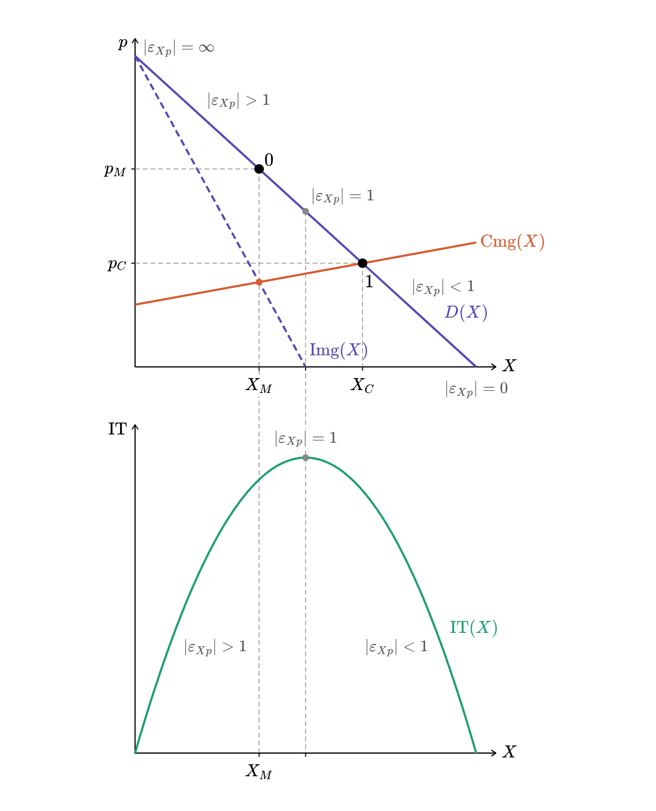
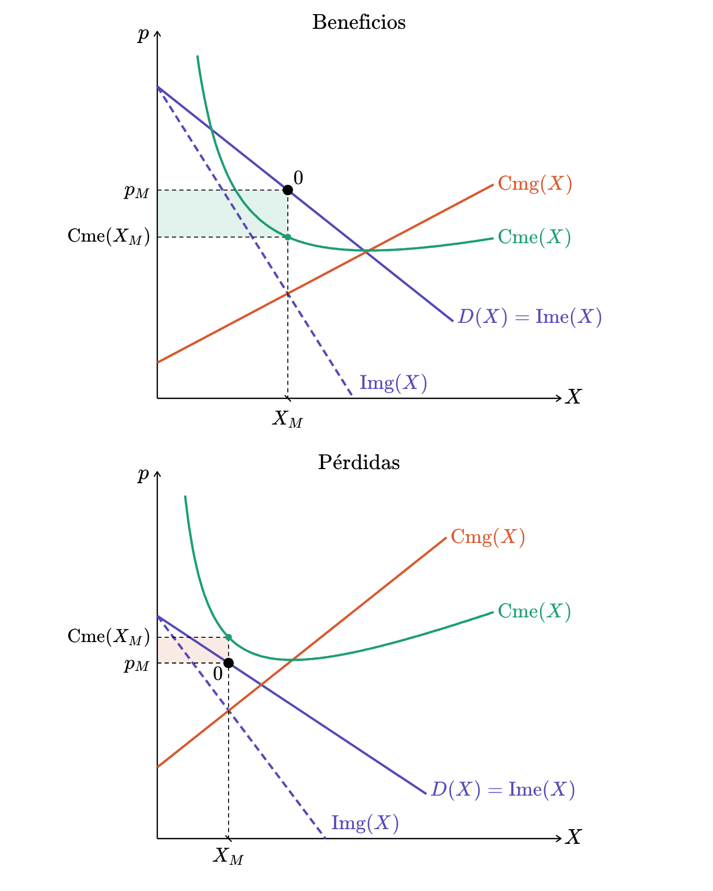
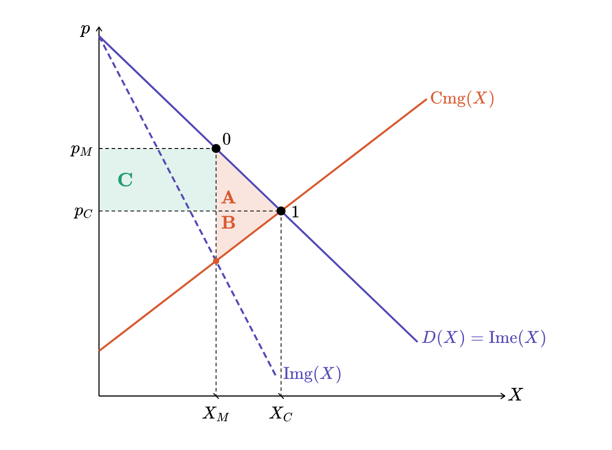
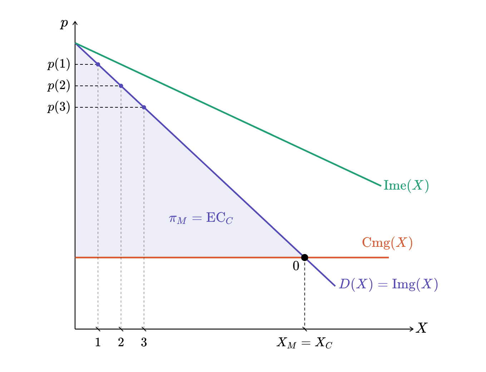
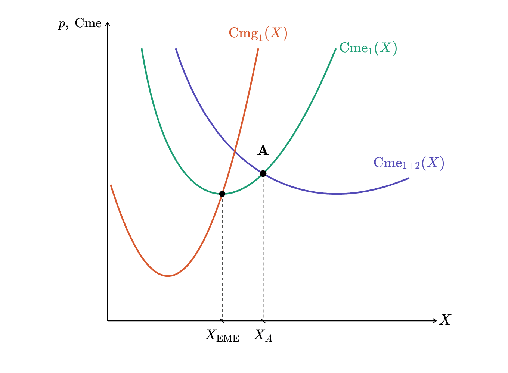
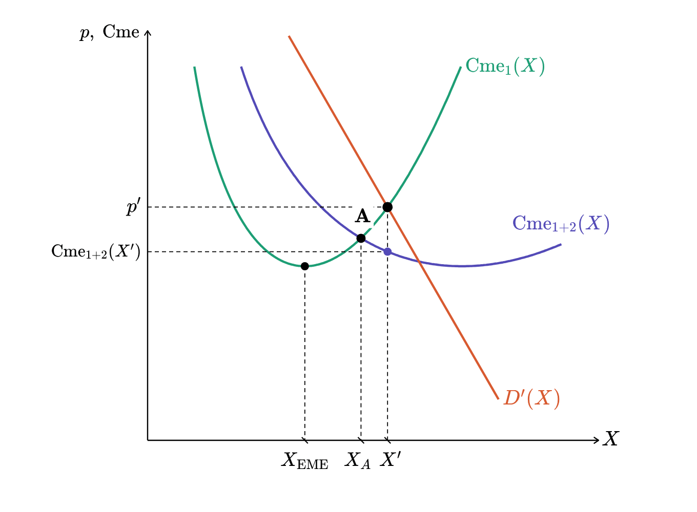
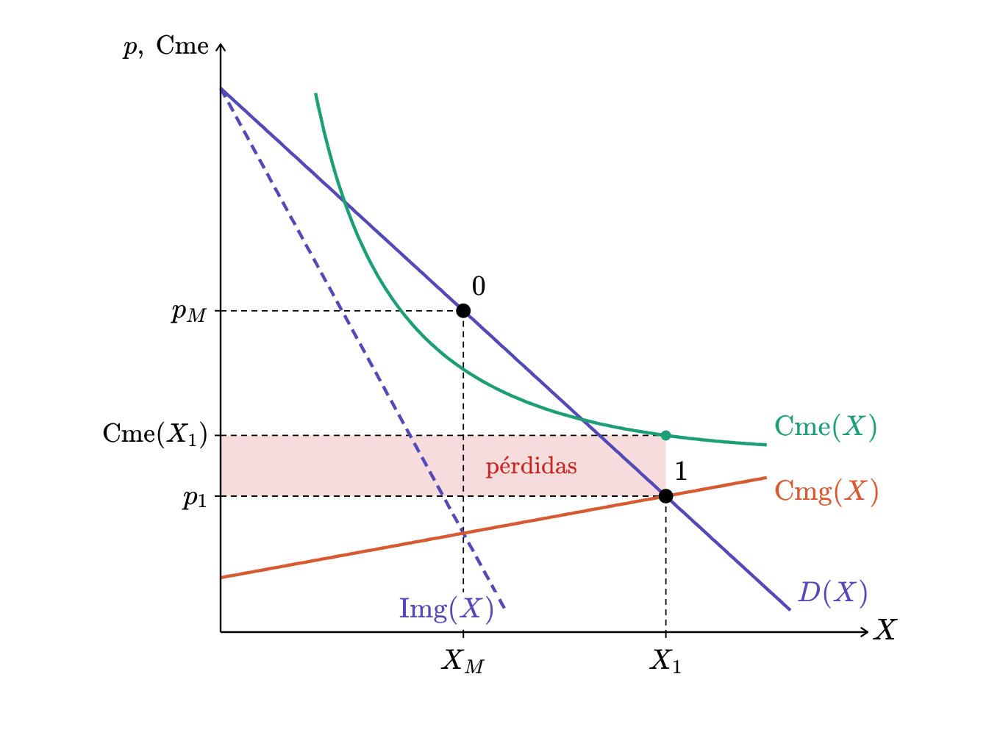
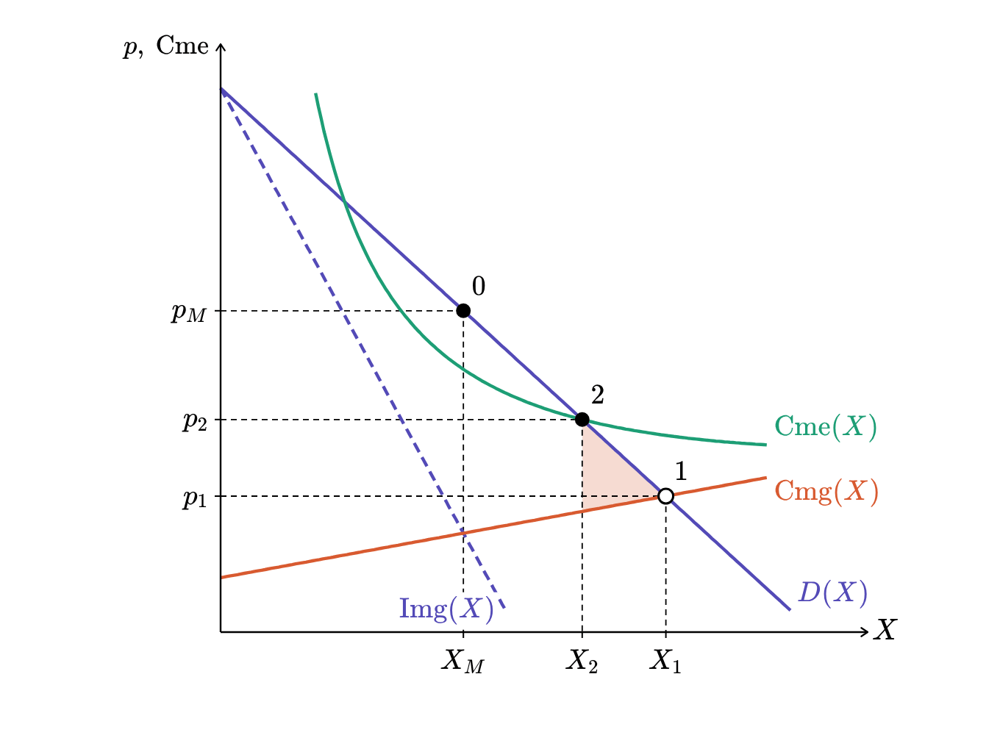
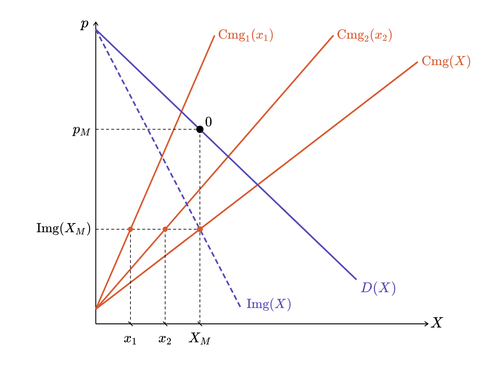

## Introducción

::: {.callout-note appearance="simple" icon=false}

:::

El **monopolio**, con un único vendedor protegido por barreras a la entrada, es la referencia opuesta a la competencia perfecta (tema [A16](a16-competencia-perfecta.qmd)). Aquí la empresa ya no toma el precio como dado, sino que es el mercado y fija un precio superior al coste marginal a costa de restringir la producción.

Cournot (1838) resolvió por primera vez el problema del monopolista, que elige la cantidad o el precio que maximiza su beneficio sabiendo que se enfrenta a toda la demanda del mercado. El margen sobre el coste marginal depende de la elasticidad de esa demanda, y el **índice de Lerner** mide con él el poder de mercado. El monopolio surge de **barreras a la entrada** legales, como las patentes y las concesiones, técnicas, como las economías de escala que hacen de una sola empresa la opción más barata (el **monopolio natural**), o estratégicas.

Su coste social tiene dos partes. La primera es la **pérdida irrecuperable de eficiencia**, el triángulo de Harberger, que corresponde a los intercambios que dejan de hacerse porque el precio supera el coste marginal. La segunda, que señalaron Tullock (1967) y Posner (1975), es la **búsqueda de rentas**, los recursos que las empresas gastan en obtener o defender su posición de monopolio. Ambas justifican la política de defensa de la competencia y la regulación de sectores como la energía, el agua o las telecomunicaciones.

La **discriminación de precios**, que cobra precios distintos según la disposición a pagar de cada consumidor, permite además al monopolista apropiarse de parte del excedente del consumidor y, en su forma perfecta o de primer grado, elimina la pérdida de eficiencia a costa de quedarse con todo el excedente.

El tema se organiza en torno a tres preguntas:

- *Equilibrio y eficiencia*: cómo se determina el equilibrio del monopolista y cuál es la pérdida de eficiencia que provoca (apartado 1).

- *Discriminación y monopolio natural*: cómo modifica ese resultado la discriminación de precios, con la que el monopolista extrae el excedente del consumidor, cuándo el monopolio es natural y cómo debe regularse (apartado 2 y, para la regulación, tema [A20](a20-regulacion.qmd)).

- *Otros monopolios*: cómo se traslada el modelo al lado de la demanda (monopsonio), al mercado con un único vendedor y un único comprador (monopolio bilateral) y al monopolista con varios productos (producción conjunta) o varias plantas (apartado 3).

## 1. El monopolio de oferta

El estudio del monopolio de oferta parte de sus causas, de los supuestos del modelo y de la demanda a la que se enfrenta, y sigue con la decisión del monopolista y el análisis de su equilibrio, positivo y normativo.

### 1.1. Concepto, causas y supuestos

El **monopolio de oferta** es la estructura de mercado en la que un único vendedor abastece a toda la demanda de un bien sin sustitutivos cercanos. Su rasgo definitorio no es solo la ausencia de rivales actuales, sino también la de rivales potenciales, pues el monopolio solo persiste si existen **barreras a la entrada**. Sin ellas, sus beneficios extraordinarios atraerían a nuevas empresas hasta desaparecer.

Conviene, por ello, entender el origen de estas barreras, porque de él depende el tipo de regulación aplicable. Son **naturales o estructurales** cuando derivan de la tecnología y la demanda del sector, y **artificiales** cuando las crean las instaladas (estratégicas) o el Estado (legales). Su definición y su taxonomía se estudian en el tema [A15](a15-toi.qmd), apartado 2.2.1.

1. *Barreras naturales o estructurales*: una sola empresa abastece toda la demanda a menor coste que varias (subaditividad de costes), típicamente porque la escala mínima eficiente es grande en relación con el mercado. Esta ventaja solo protege al monopolista si la entrada exige costes hundidos. Sin ellos, el mercado es impugnable y el precio tiende al coste medio (Baumol y Willig, 1981). Estas barreras son las del monopolio natural (apartado 2.2.1), cuya regulación se centra en el control de precios, en la financiación como complemento de ese control y, rara vez, en la producción pública.

2. *Barreras estratégicas*: conductas de la instalada para disuadir la entrada (precio límite, inversión en capacidad, proliferación de marcas o publicidad) o para expulsar a rivales ya presentes (precios predatorios). Estas conductas solo disuaden si son creíbles. Por ejemplo, una amenaza de guerra de precios que no conviene cumplir tras la entrada solo lo es con un compromiso irreversible previo (Dixit, 1980) o con información incompleta que permita construir una reputación (Kreps y Wilson, 1982; Milgrom y Roberts, 1982b). Ambos mecanismos se estudian en los temas [A14](a14-juegos.qmd) y [A19](a19-oligopolio.qmd). La defensa de la competencia es aquí cautelosa, porque un precio bajo puede ser simple competencia y porque prácticas como la integración vertical o la exclusividad pueden ganar eficiencia, al eliminar la doble marginalización o proteger inversiones específicas (tema [A15](a15-toi.qmd)).

3. *Barreras legales*: privilegios concedidos por el Estado (patentes, licencias, concesiones, derechos exclusivos). En licencias y concesiones, la regulación controla los precios y revisa periódicamente el privilegio. En las patentes, el poder de mercado temporal es el precio de incentivar la innovación, y la política se centra en su duración y su alcance (tema [B34](b34-gats-trips.qmd), apartado 2.3.1).

**Supuestos**:

- *Entorno*: la información es perfecta y no existen costes de transacción, como en competencia perfecta. La diferencia está en la existencia de barreras a la entrada, que hacen que una sola empresa acapare toda la producción del mercado.

- *Agentes*: el monopolista maximiza beneficio y concentra todo el poder de mercado, mientras que los consumidores maximizan utilidad tomando los precios como dados. La demanda de mercado tiene pendiente negativa y, por simplicidad, es lineal.

- *Tecnología*: un único bien normal, producido con rendimientos mixtos (costes en U).

- *Mercado de factores*: perfecto, de modo que los precios de los factores son exógenos $p_0^z$[^a17-2].

Estos supuestos tienen tres implicaciones fundamentales: la empresa es el mercado ($x = X$), su demanda no es perfectamente elástica y puede dejar de cumplirse la ley del precio único (discriminación de precios, apartado 2.1).

### 1.2. Demanda de mercado

Como en competencia perfecta, la demanda de mercado resulta de la agregación horizontal de las demandas individuales y comparte sus propiedades. La diferencia es que el monopolista se enfrenta a toda ella, de modo que su demanda es la del mercado y cada cantidad que decide vender determina el precio al que puede venderla.

::: {.callout-note appearance="simple" icon=false}
La definición de la demanda de mercado y sus propiedades se encuentran en el tema [A16](a16-competencia-perfecta.qmd), apartado 1.2.
:::

Por simplicidad, se supone una demanda lineal, $p(X) = a - bX$, con dos implicaciones para el modelo[^a17-34]:

- *Ingreso marginal*: también es lineal, $\text{Img}(X) = a - 2bX$, con la misma ordenada en el origen que la demanda y el doble de pendiente[^a17-1], de modo que se sitúa siempre por debajo del precio.

- *Elasticidad variable*: la elasticidad-precio, $|\varepsilon_{Xp}| = p/(a - p)$, no es constante. Crece a lo largo de la recta desde cero, en $X = a/b$, hasta infinito, en $X = 0$, y vale uno en el punto medio, donde el ingreso marginal se anula. Como el monopolista solo produce donde la demanda es elástica, elige siempre en la mitad superior de la recta.

### 1.3. Oferta de mercado: la decisión del monopolista

La decisión del monopolista, desde el mercado y desde la producción, permite entender el lado de la oferta en esta estructura de mercado. A diferencia de la competencia perfecta, el monopolio carece de curva de oferta.

#### 1.3.1. Equilibrio: enfoque de mercado

**Planteamiento**: la empresa monopolista tiene por objetivo maximizar el beneficio, la diferencia entre el ingreso (el valor de mercado de la cantidad vendida) y el coste total. Sin embargo, a diferencia de la empresa competitiva, que toma el precio como dado, el monopolista se enfrenta a toda la demanda del mercado. Por ello, en esta estructura resulta equivalente elegir precio o cantidad, pues ambos están relacionados de forma única a través de la función de demanda. En lo que sigue se supone que la empresa elige la cantidad:

$$\max_{X} \; \pi = p(X) \cdot X - \text{CT}(X)$$

donde $X$ es la cantidad producida por el monopolista, que coincide con la del mercado, $p(X)$ la función de demanda inversa, $\text{CT}(X)$ su función de costes y $\pi$ el beneficio.

**CPO**:

$$\frac{d\pi}{dX} = \underbrace{\frac{dp}{dX} \cdot X + p}_{\text{Img}(X)} - \underbrace{\frac{d\text{CT}}{dX}}_{\text{Cmg}(X)} = 0$$

$$\text{Img}(X) = \text{Cmg}(X) \tag{1}$$

$$p = \underbrace{\frac{1}{1 - 1/|\varepsilon_{Xp}|}}_{1 + \mu} \cdot \text{Cmg}(X) \tag{2}$$

$$I_L \equiv \frac{p - \text{Cmg}(X)}{p} = \frac{1}{|\varepsilon_{Xp}|} \in (0, 1] \tag{3}$$

Como en competencia perfecta, el monopolista iguala el ingreso marginal al coste marginal para maximizar el beneficio (1). Las diferencias aparecen en las expresiones (2) y (3):

- *El margen sobre el coste marginal* (2): el ingreso marginal del monopolista equivale al precio al que vende la unidad adicional, $p$, menos la pérdida de ingresos sobre las unidades ya vendidas, que ahora se venden más baratas. Esa pérdida es la variación del precio que provoca la venta de esa unidad, $\partial p / \partial X$, ponderada por el número de unidades ya vendidas, $X$. 

Operando se obtiene (2), según la cual el monopolista fija un margen $\mu > 0$ sobre su coste marginal y, con ello, un precio por encima del coste marginal sin perder todos sus clientes. Ese margen existe porque la elasticidad de su demanda es finita. En cambio, si su curva de ventas fuese perfectamente elástica, como en competencia perfecta, subidas infinitesimales del precio provocarían la pérdida de todas las ventas.

De (2) se deduce que, para maximizar beneficios, la empresa debe operar en el tramo elástico de la curva de demanda ($|\varepsilon_{Xp}| > 1$). En el tramo inelástico, por el contrario, una reducción de la cantidad eleva el precio en mayor proporción de lo que reduce las ventas, de modo que el ingreso total aumenta al producir menos. 

La empresa tampoco produce donde $|\varepsilon_{Xp}| = 1$, porque allí el ingreso marginal es nulo. Solo lo haría si el coste marginal fuese nulo, caso en el que maximizar el beneficio equivale a maximizar el ingreso total[^a17-7]. 

- *El margen relativo: el índice de Lerner* (1934) (3): la capacidad de fijar un precio superior al coste marginal se mide con el *índice de Lerner*, la ratio entre el margen $p - \text{Cmg}$ y el precio, que resulta inversamente proporcional a la elasticidad de la demanda. Cuanto mayor es la elasticidad, menor es el índice[^a17-9], de modo que el poder de mercado disminuye conforme los consumidores disponen de alternativas. 

El índice vale cero en competencia perfecta (elasticidad infinita) y tiende a uno cuando la elasticidad se aproxima a la unidad. En el oligopolio de Cournot con producto homogéneo, el índice de cada empresa es $I_{L,i} = s_i / |\varepsilon_{Xp}|$, donde $s_i = x_i/X$ es su cuota de mercado, expresión que enlaza con la medición del poder de mercado del tema [A20](a20-regulacion.qmd).

**CSO**:

$$\frac{\partial^2 \pi}{\partial X^2} < 0 \rightarrow \frac{\partial \text{Img}}{\partial X} < \frac{\partial \text{Cmg}}{\partial X}$$

A diferencia de la competencia perfecta (donde la CSO exige Cmg creciente porque Img tiene pendiente nula), el monopolista puede maximizar tanto en el tramo creciente como en el decreciente de Cmg (en este último, siempre que el Cmg sea más plano que el Img). De ahí que el monopolio admita rendimientos crecientes a escala en el rango de producción relevante.

**Desarrollo gráfico**: el equilibrio del monopolista se representa en el plano cantidad-precio, con el ingreso total en el panel inferior (figura -@fig-a171-equilibrio-monopolio-i):

1. *Demanda*, $D(X)$: recoge el precio al que puede venderse cada cantidad (el ingreso medio del monopolista). Es decreciente, y su elasticidad va de infinita en el eje de precios a nula en el de cantidades, con valor unitario en su punto medio.

2. *Ingreso marginal*, $\text{Img}(X)$: queda por debajo de la demanda, porque para vender una unidad más el monopolista ha de bajar el precio de todas. El ingreso marginal se anula donde $|\varepsilon_{Xp}| = 1$, la cantidad que maximiza el ingreso total, $\text{IT}(X)$, del panel inferior.

3. *Coste marginal*, $\text{Cmg}(X)$: recoge lo que cuesta producir la última unidad y es creciente en el gráfico, por los rendimientos mixtos supuestos.

4. *Equilibrio*: el monopolista produce $X_M$, donde $\text{Img}(X) = \text{Cmg}(X)$, a la izquierda del punto de elasticidad unitaria, y fija sobre la demanda el precio $p_M$ (punto 0), superior al coste marginal y al precio competitivo, $p_C$, que corresponde a $X_C$ (punto 1).

::: {#fig-a171-equilibrio-monopolio-i}

::: {.content-visible when-format="html"}
```{=html}
<div class="graph-frame">
<iframe src="../graphs/a171_Equilibrio_Monopolio_i.html" style="height:840px" loading="lazy" title="fig-a171-equilibrio-monopolio-i"></iframe>
</div>
```
:::

::: {.content-visible unless-format="html"}

:::

Equilibrio del monopolio, enfoque de mercado. El monopolista produce donde el ingreso marginal iguala al coste marginal y fija el precio sobre la curva de demanda.
:::

#### 1.3.2. Equilibrio: enfoque de la producción

**Planteamiento**: la decisión del monopolista puede analizarse también desde el punto de vista de la producción, lo que ofrece un desglose más pormenorizado de la contratación de factores productivos:

$$\max_{\mathbf{z}} \; \pi = p(X) \cdot f(\mathbf{z}) - \mathbf{p}^z \cdot \mathbf{z} \quad \text{s.a.:} \; \mathbf{z} \geq 0$$

donde $\mathbf{z}$ es el vector de cantidades de factores, $f(\mathbf{z}) = X$ la función de producción, $p(X)$ la demanda inversa, $\mathbf{p}^z$ el vector de precios de los factores, exógenos por ser perfecto su mercado, y $\pi$ el beneficio.

**CPO** (condiciones de primer orden):

$$\text{RMST}_{ji} = \frac{\partial f/\partial z_i}{\partial f/\partial z_j} = \frac{p_i^z}{p_j^z} \tag{4}$$

$$\frac{\partial f/\partial z_i}{p_i^z} = \lambda = \frac{1}{\text{Cmg}} \quad \forall i \tag{5}$$

$$\underbrace{p\left(1 - \frac{1}{|\varepsilon_{Xp}|}\right) \cdot \frac{\partial f}{\partial z_i}}_{\text{IPmg}_i} = p_i^z \tag{6}$$

$$p = \frac{1}{1 - 1/|\varepsilon_{Xp}|} \cdot \frac{p_i^z}{\partial f/\partial z_i} \tag{7}$$

Las cuatro condiciones se leen como sigue. (4) es la condición de minimización del coste, idéntica a la de la empresa competitiva. La relación marginal de sustitución técnica iguala al precio relativo de los factores, de modo que el monopolista produce al mínimo coste (eficiencia productiva o económica, no solo técnica) cualquier cantidad que decida producir. (5) reformula la condición (4) en términos de productividades marginales por euro gastado, que han de ser iguales para todos los factores. La diferencia con la competencia perfecta aparece en (6), la condición de maximización del beneficio, según la cual cada factor se contrata hasta que el ingreso de su productividad marginal, $\text{IPmg}_i = \text{Img} \cdot \partial f/\partial z_i$, iguala a su precio.

Como el ingreso marginal es inferior al precio del producto, cada factor cobra menos que el valor de su productividad marginal, $p \cdot \partial f/\partial z_i$, lo que cobraría en competencia (explotación monopolística). (7) es, de nuevo, la regla de fijación del precio con margen sobre el coste marginal. En suma, mientras maximice el beneficio, el monopolista es eficiente en cómo produce, pero no en cuánto produce, es decir, cumple la eficiencia productiva y viola la asignativa (la ineficiencia-X del apartado 1.4.2 surge cuando la falta de competencia relaja ese objetivo).

**CSO**: son las del enfoque de mercado trasladadas a los factores. En concreto, el beneficio ha de ser estrictamente cóncavo en $\mathbf{z}$, lo que garantizan una función de producción estrictamente cóncava en el tramo relevante y un ingreso marginal decreciente. Estas dos propiedades no son, sin embargo, condiciones necesarias, porque, como en el enfoque de mercado, basta con que el ingreso marginal decrezca con suficiente rapidez, lo que admite rendimientos crecientes a escala.

#### 1.3.3. Función de oferta: su ausencia en el monopolio

La empresa competitiva tiene una curva de oferta, su Cmg, que asocia a cada precio una sola cantidad. El monopolista, en cambio, carece de ella, porque su producción varía con la forma de la demanda, y dos demandas distintas pueden llevarle a vender lo mismo a precios diferentes o cantidades diferentes al mismo precio. 

En consecuencia, no se puede derivar una curva de oferta única del Cmg y, por tanto, no se pueden hacer ejercicios de estática comparativa con validez general. Además, como el monopolista fija el precio, puede dejar de cumplirse la ley del precio único (discriminación de precios, apartado 2.1).

#### 1.3.4. Función de valor: la función de máximo beneficio

::: {.callout-note appearance="simple" icon=false}
Este apartado presenta la función de valor óptimo del monopolista para conservar la estructura del tema [A16](a16-competencia-perfecta.qmd) y como guía conceptual. En la exposición oral del tema puede omitirse si es necesario.
:::

**Definición**: sustituyendo la solución en el objetivo se obtiene la función de máximo beneficio, $\pi^*(\mathbf{p}^z)$, que da el mayor beneficio que puede obtener el monopolista para cada vector de precios de los factores, dada la demanda. La diferencia con la de competencia perfecta (tema [A16](a16-competencia-perfecta.qmd), apartado 1.3.4) es que no depende de un precio del producto dado, porque el monopolista lo elige, de modo que de ella no se obtiene una función de oferta.

**Propiedades**:

1. *Continuidad y diferenciabilidad*: es continua en los precios de los factores y diferenciable en ellos cuando las demandas de factores son únicas, lo que permite aplicar el teorema de la envolvente.

2. *Transformaciones*: es una función cardinal, medida en unidades monetarias. A diferencia de la de competencia perfecta, que es homogénea de grado uno en todos los precios, no es homogénea en los precios de los factores, porque la demanda inversa, $p(X)$, queda fija en términos monetarios. Solo lo es, de grado uno, si esta se multiplica en la misma proporción que ellos.

3. *Inclinación*: es no creciente en el precio de cada factor, y decreciente en el de los que emplea.

4. *Forma*: como en competencia perfecta, es convexa en los precios de los factores, porque el beneficio de cada combinación de factores depende linealmente de ellos y la función es el máximo de esos beneficios. De ahí que la demanda de cada factor no aumente con su precio.

5. *Otras propiedades*:

    - *Envolvente* (*lema de Hotelling*): su derivada respecto del precio de cada factor es, cambiada de signo, la demanda de ese factor, $\partial \pi^* / \partial p_i^z = -z_i^*(\mathbf{p}^z)$.

    - *Dualidad*: las demandas de factores son las condicionadas del tema [A12](a12-costes.qmd), apartado 1.4.2, evaluadas en la producción de monopolio, $z_i^*(\mathbf{p}^z) = d_i^c(\mathbf{p}^z, X_M(\mathbf{p}^z))$, porque la condición (4) asegura que el monopolista produce al mínimo coste.

    - *Observabilidad*: es observable, porque se miden tanto los precios de los factores como el beneficio.

### 1.4. Análisis del equilibrio

El análisis del equilibrio estudia primero sus propiedades positivas (existencia, beneficio y escala), después las normativas (la ineficiencia asignativa y su coste social, la explotación de los factores y la ineficiencia en costes) y, por último, su respuesta a cambios del entorno.

#### 1.4.1. Análisis positivo: propiedades del equilibrio de monopolio

El equilibrio existe (un único oferente), es único y estable (mientras persista la necesidad del producto y las barreras). A igualdad de costes, la cantidad producida es siempre inferior y el precio siempre superior a los de competencia perfecta. En cambio, el beneficio del monopolista y la escala a la que opera dependen del plazo.

**Corto plazo**: al menos un factor es fijo y el número de empresas es fijo. La condición de viabilidad es idéntica a la de competencia perfecta. Por tanto, el ingreso ha de cubrir el coste variable, $\text{IT} \geq \text{CV}_{\text{CP}}$, es decir, $p_M \geq \text{CVme}(X_M)$, evaluada en la cantidad que elige el monopolista y no en el mínimo de explotación, porque el monopolista no toma el precio como dado.

Gráficamente, en el plano cantidad-precio (figura -@fig-a172-equilibrio-monopolio-ii), el monopolista produce $X_M$, donde $\text{Img}(X) = \text{Cmg}(X)$, y cobra el precio $p_M$ que marca la demanda, $D(X) = \text{Ime}(X)$, en el punto 0. Al igual que en competencia perfecta, en el corto plazo puede operar con beneficios, si $p_M > \text{Cme}(X_M)$ (panel superior), o con pérdidas, si $p_M < \text{Cme}(X_M)$ (panel inferior), estas últimas si el Cme está por encima de la demanda para cualquier $X$.

::: {#fig-a172-equilibrio-monopolio-ii}

::: {.content-visible when-format="html"}
```{=html}
<div class="graph-frame">
<iframe src="../graphs/a172_Equilibrio_Monopolio_ii.html" style="height:850px" loading="lazy" title="fig-a172-equilibrio-monopolio-ii"></iframe>
</div>
```
:::

::: {.content-visible unless-format="html"}

:::

El beneficio del monopolista. El equilibrio puede darse con beneficios (arriba, $p_M > \text{Cme}(X_M)$) o con pérdidas (abajo, $p_M < \text{Cme}(X_M)$).
:::

**Largo plazo**: todos los factores son variables, y el número de empresas puede variar o no según existan barreras. La condición de viabilidad es la misma que a corto plazo, con la diferencia de que, al ser todo el coste variable, se formula sobre el coste total medio, $\text{IT} \geq \text{CT}_{\text{LP}}$, es decir, $p_M \geq \text{Cme}_{\text{LP}}(X_M)$. Por tanto, el monopolista solo produce si cubre todos sus costes. 

La principal implicación es que en el largo plazo, a diferencia del corto y al igual que en competencia perfecta, el monopolista no soportará pérdidas, pues tiene flexibilidad para evitarlas. Existen, sin embargo, dos diferencias con la competencia perfecta:

1. *Rentas del monopolio*: el monopolista puede obtener beneficios positivos en el largo plazo fijando un precio superior al coste medio. Los beneficios positivos incentivan la entrada, pero las barreras la impiden, de modo que no se cumple la condición de libre entrada y se generan las llamadas *rentas del monopolio*. El término alude a que esas rentas pueden deberse a derechos de propiedad sobre un recurso (una patente, una localización favorable) por los que propietarios potenciales estarían dispuestos a pagar. Estas rentas están en la base de la regulación mediante subastas (apartado 2.3.2).

2. *No opera necesariamente en la dimensión óptima*: el monopolista no maximiza el beneficio necesariamente en el mínimo de la curva de coste medio, porque su curva de ventas no es perfectamente elástica y no se le impone la condición de beneficio nulo. Según el tamaño del mercado, la maximización de beneficios puede producirse:

    - *Escala óptima* (mínimo de Cme): la capacidad y las economías de escala se aprovechan plenamente.

    - *Escala subóptima* (tramo decreciente de Cme): el tamaño del mercado no basta para utilizar plenamente la capacidad, de modo que existe capacidad excedentaria y las economías de escala no se aprovechan por completo. La situación es similar a la de la competencia monopolística, en la que las empresas tienen poder de mercado, pero el tamaño de su nicho limita su explotación y produce exceso de capacidad (tema [A18](a18-competencia-monopolistica.qmd)).

    - *Escala sobreutilizada* (tramo creciente de Cme): el mercado es tan grande que, para maximizar el beneficio, el monopolista debe construir una planta mayor que la dimensión óptima, con sobreutilización de la capacidad y deseconomías de escala.

#### 1.4.2. Análisis normativo: eficiencia y bienestar

**Ineficiencia asignativa**: el monopolista produce una cantidad inferior a la competitiva. Quedan sin producir unidades por las que los consumidores pagarían más que su Cmg y, aun así, al monopolista no le conviene ofrecerlas, porque solo podría vender cada unidad adicional rebajando el precio de todas las que ya vende. El resultado es una pérdida de peso muerto (*triángulo de Harberger*).

Gráficamente, la ineficiencia asignativa del monopolio se representa en el plano cantidad-precio (figura -@fig-a173-perdida-bienestar-monopolio):

1. *Demanda*, $D(X) = \text{Ime}(X)$: recoge la valoración social de cada unidad.

2. *Ingreso marginal*, $\text{Img}(X)$: recoge la valoración privada del monopolista. La pérdida irrecuperable nace de la divergencia entre ambas valoraciones.

3. *Coste marginal*, $\text{Cmg}(X)$: recoge el coste social de producir cada unidad adicional y es creciente en el gráfico.

4. *Equilibrio*: el monopolista produce $X_M$, donde $\text{Img}(X) = \text{Cmg}(X)$, y cobra $p_M$ (punto 0), frente a la cantidad $X_C$ y el precio $p_C$ de la competencia perfecta (punto 1). Los consumidores pierden excedente y los productores ganan una parte, pero pierden la producción que habrían realizado en competencia perfecta:

    - *Rectángulo C*: excedente del consumidor que se transfiere al productor.

    - *Triángulos A y B*: excedente que se pierde, A del consumidor y B del productor, y que forma el triángulo de Harberger.

::: {#fig-a173-perdida-bienestar-monopolio}

::: {.content-visible when-format="html"}
```{=html}
<div class="graph-frame">
<iframe src="../graphs/a173_Perdida_Bienestar_Monopolio.html" style="height:500px" loading="lazy" title="fig-a173-perdida-bienestar-monopolio"></iframe>
</div>
```
:::

::: {.content-visible unless-format="html"}

:::

Ineficiencia del monopolio. Parte del excedente del consumidor se transfiere al productor y se produce una pérdida irrecuperable de eficiencia (triángulo de Harberger).
:::

**Medición del coste social**: la magnitud empírica del triángulo de pérdida irrecuperable fue estimada por Harberger (1954) para la industria manufacturera estadounidense en apenas el 0,1 % de la renta nacional, resultado que sugería que el monopolio era un problema menor. 

Dos líneas posteriores revisaron al alza esa cifra, no obstante. Tullock (1967) y Posner (1975) señalaron que el rectángulo del beneficio monopolístico no es una mera transferencia. Los recursos que las empresas gastan en obtener o defender la posición de monopolio (presión política, litigios, capacidad excesiva) constituyen un coste social adicional, la *búsqueda de rentas*, que en el límite puede disipar todo el beneficio. 

Por su parte, Cowling y Mueller (1978), corrigiendo los supuestos de Harberger sobre elasticidades y márgenes, elevaron la pérdida de bienestar a cifras de entre el 4 % y el 13 % del producto. En sentido contrario, la tradición schumpeteriana recuerda que el poder de mercado puede ser el precio de la innovación. La controversia Schumpeter-Arrow sobre si el monopolista tiene más o menos incentivos a innovar que la empresa competitiva se desarrolla en el tema [A15](a15-toi.qmd), apartado 1.4.3.

**Explotación monopolística de factores**: al restringir la producción, el monopolista contrata menos factores (normales). Además, paga cada factor según su $\text{IPmg}_i = \text{Img} \cdot \partial f/\partial z_i < p \cdot \partial f/\partial z_i = \text{VPmg}_i$, de modo que lo remunera por debajo del valor de su productividad marginal, aunque lo emplea con eficiencia técnica. El grado de explotación vendrá dado por $(p \cdot \partial f/\partial z_i - p_i^z)/(p \cdot \partial f/\partial z_i) = 1/|\varepsilon_{Xp}|$.

**Ineficiencia en costes**: la ausencia de competencia debilita los incentivos a reducir costes, lo que da lugar a la ineficiencia-X de Leibenstein (1966).

#### 1.4.3. Estática comparativa

Aunque el monopolio no tiene curva de oferta, la condición $\text{Img} = \text{Cmg}$ permite prever la respuesta del monopolista a cambios en su entorno:

- *Demanda*: un aumento de la demanda eleva la cantidad solo si eleva el ingreso marginal en la cantidad inicial, lo que depende de cómo cambie la elasticidad. Con un desplazamiento paralelo de una demanda lineal y coste marginal constante o creciente, suben la cantidad y el precio. Si la demanda se vuelve más inelástica, en cambio, la cantidad puede bajar mientras sube el precio, y si se vuelve más elástica, el precio puede bajar mientras sube la cantidad.

- *Costes*: un aumento del coste marginal se traslada al precio solo en parte con demanda lineal (la mitad, con coste marginal constante) y más que íntegramente con demanda isoelástica, $\Delta p = (1 + \mu) \cdot \Delta \text{Cmg}$.

- *Impuestos* (Suits y Musgrave, 1953): para la misma recaudación, un impuesto *ad valorem* reduce menos la producción que uno específico, porque grava el ingreso marginal, que es menor que el precio, y no cada unidad. El impuesto *ad valorem* da, por tanto, un precio menor y una cantidad mayor, y es el impuesto preferible en mercados no competitivos.

- *Precio máximo*: fijado entre el coste marginal y el precio de monopolio, aumenta la producción, ya que hasta la cantidad demandada a ese precio el ingreso marginal coincide con el precio máximo, de modo que el monopolista produce más que $X_M$. Si el precio máximo iguala al competitivo, se alcanza la producción de competencia perfecta, resultado que anticipa la regulación del monopolio natural (apartado 2.3).

### 1.5. Conclusiones

**Aspectos positivos**: el modelo de monopolio muestra con un aparato mínimo cómo el poder de mercado rompe la igualdad entre precio y coste marginal. Ello proporciona la referencia frente a la que se mide la ineficiencia asignativa y justifica la regulación (tema [A20](a20-regulacion.qmd)).

**Limitaciones**: el modelo básico supone un único precio, información completa y ausencia de competencia potencial. La discriminación de precios, la competencia por el mercado y la conducta estratégica frente a entrantes, que modifican sustancialmente sus conclusiones, se desarrollan en el apartado 2 y en los temas [A18](a18-competencia-monopolistica.qmd) y [A19](a19-oligopolio.qmd).

## 2. Principales monopolios

El modelo canónico supone un solo producto y un precio único, y no dice de dónde nace el poder de mercado. Este apartado estudia los dos monopolios que más se apartan de él y que más importan para la política económica: el que discrimina precios para apropiarse del excedente y el monopolio natural, que nace de la tecnología, con una mención a su regulación.

### 2.1. Monopolios discriminadores de precios

El monopolio simple fija un único precio para todas las unidades y todos los compradores. Deja por ello sin capturar una parte del excedente, la de quienes habrían pagado más que el precio fijado y la de las unidades que habrían comprado a precios inferiores a él pero superiores al coste marginal.

Cobrar precios distintos por un mismo bien sin que lo justifiquen diferencias de coste, con el fin de quedarse con ese excedente, es lo que se llama **discriminación de precios**.

Para practicar discriminación de precios, el monopolista ha de cumplir tres condiciones. Las tres son necesarias en todos los grados, aunque cada grado las satisface de forma distinta:

1. *Poder de mercado*: capacidad de fijar el precio, es decir, enfrentarse a una demanda con pendiente negativa. Una empresa precio-aceptante no puede cobrar precios distintos.

2. *Separación de los consumidores*: poder distinguir las distintas valoraciones de los consumidores. La distinción es directa cuando el monopolista observa la disposición a pagar de cada comprador (primer grado) o una característica que separa grupos (tercer grado). Es indirecta cuando son los propios consumidores quienes se revelan, al elegir dentro de un menú (segundo grado) o el momento de la compra (cuarto grado).

3. *Ausencia de arbitraje*: impedir la reventa del bien de quienes lo compran barato a quienes lo pagarían caro. En el segundo grado ha de impedirse, además, que un consumidor elija la oferta diseñada para otro, lo que exige que el menú sea compatible con los incentivos.

Según la información de que disponga el monopolista, la discriminación adopta los tres grados de Pigou (1920), a los que se suma la intertemporal, llamada por extensión de cuarto grado. El Anexo compara sus resultados con los del monopolio simple y la competencia perfecta.

#### 2.1.1. Discriminación de primer grado (perfecta)

**Origen**: es el primero de los grados de discriminación de la clasificación de Pigou (1920).

**Idea**: el monopolista tiene información completa sobre las preferencias y fija a cada consumidor, y a cada unidad, su precio de reserva, es decir, cobra por cada unidad exactamente lo máximo que su comprador está dispuesto a pagar por ella.

**Razonamiento**: vender una unidad más a su precio de reserva no obliga a abaratar las anteriores, así que cada venta aporta al ingreso exactamente su precio y la demanda hace de curva de ingreso marginal. El monopolista sigue vendiendo mientras la siguiente unidad tenga un precio de reserva por encima del coste marginal, y se detiene en la unidad cuyo precio de reserva iguala a ese coste. Llega así a la cantidad competitiva ($X_M = X_C$), pero con todo el excedente en sus manos ($\text{EC}_M = 0$). No hay, por tanto, ineficiencia asignativa. Lo que cambia respecto a la competencia es el reparto del excedente, que es justo el opuesto, de modo que una eventual intervención se apoyaría en la equidad y no en la eficiencia.

**Desarrollo gráfico**: la discriminación de primer grado se representa en el plano cantidad-precio (figura -@fig-a174-discriminacion-1g):

1. *Demanda*, $D(X) = \text{Img}(X)$: cada unidad (1, 2 y 3 en el gráfico) se vende a su precio de reserva ($p(1)$, $p(2)$ y $p(3)$), de modo que la demanda es también el ingreso marginal.

2. *Ingreso medio*, $\text{Ime}(X)$: queda por encima de la demanda, porque promedia los precios de reserva de todas las unidades vendidas.

3. *Coste marginal*, $\text{Cmg}(X)$: recoge el coste de cada unidad adicional, constante en el gráfico.

4. *Equilibrio*: el monopolista produce donde la demanda corta al coste marginal, $X_M = X_C$ (punto 0), y su beneficio, el área sombreada, es todo el excedente que en competencia perfecta sería de los consumidores, $\pi_M = \text{EC}_C$.

::: {#fig-a174-discriminacion-1g}

::: {.content-visible when-format="html"}
```{=html}
<div class="graph-frame">
<iframe src="../graphs/a174_Discriminacion_1G.html" style="height:520px" loading="lazy" title="fig-a174-discriminacion-1g"></iframe>
</div>
```
:::

::: {.content-visible unless-format="html"}

:::

Discriminación de primer grado. El monopolista, que produce la cantidad competitiva, captura íntegro el excedente del consumidor.
:::

**Conclusiones**:

- *Aspectos positivos*: muestra que la pérdida de eficiencia del monopolio simple no procede del poder de mercado en sí, sino de la obligación de cobrar un precio único. También sirve de referencia frente a la que se valoran los demás grados de discriminación y las tarifas no lineales.

- *Limitaciones*: en la práctica es rara, porque exige una información sobre las valoraciones individuales que casi nunca está disponible. No obstante, se aproxima en las subastas, en el regateo del zoco o en el médico rural que cobra según la capacidad de pago de cada paciente.

#### 2.1.2. Discriminación de segundo grado: menús de precios

**Origen**: es el segundo grado de la clasificación de Pigou (1920). Su instrumento más simple, la tarifa en dos partes, fue analizado por Oi (1971) a propósito del *dilema de Disneylandia*[^a17-36] (entrada al parque más precio por atracción).

**Idea**: el monopolista no observa las valoraciones individuales, pero sabe que existen tipos distintos de consumidores y diseña un menú de ofertas para que cada uno se autoseleccione al elegir, en función de la cantidad o la calidad que desea. La discriminación de segundo grado aplica al monopolio el mecanismo de criba del tema [A13](a13-informacion.qmd) y adopta tres formas: las tarifas en dos partes, los descuentos por cantidad o *bundling* y la discriminación por calidad. La tarifa en dos partes, $T(x) = F + p \cdot x$, cobra una cuota fija $F$ por el derecho a comprar y un precio $p$ por unidad.

**Supuestos**:

- *Entorno*: un único bien, sin posibilidad de arbitraje (la cuota es personal e intransferible). El monopolista conoce las demandas de cada tipo y su número, pero no puede identificar quién es quién.

- *Agentes*: primero, $n$ consumidores idénticos con demanda $x(p)$ y excedente $\text{EC}(p)$; después, dos tipos, $n_A$ de alta valoración, con demanda $x_A(p)$ por encima de la de los $n_B$ de baja valoración, $x_B(p)$, de modo que $\text{EC}_A(p) > \text{EC}_B(p)$.

- *Tecnología*: coste marginal constante $c$, sin costes fijos.

**Planteamiento**: el monopolista elige cuota y precio sujeto a que los consumidores servidos participen:

$$\max_{F,\,p} \; \pi = F\,n + (p - c)\,X(p) \quad \text{s.a.:} \; \text{EC}_i(p) \geq F \;\; \text{para todo } i \text{ servido}$$

donde $F$ es la cuota fija, $p$ el precio por unidad, $n$ el número de consumidores que participan, $X(p)$ su demanda agregada, $\text{EC}_i(p)$ el excedente del consumidor $i$ al precio $p$ y $c$ el coste marginal.

**CPO**: cabe distinguir dos casos, según los consumidores sean idénticos o de dos tipos:

1. *Consumidores idénticos*: la restricción se satura, $F = \text{EC}(p)$, y la condición de primer orden da $p = c$ y $F = \text{EC}(c)$. Así, el monopolista vende al coste marginal, lo que hace máximo el excedente, y se lo apropia íntegramente con la cuota, como en la discriminación perfecta.

2. *Dos tipos de consumidores*: con dos tipos servidos, en cambio, la cuota queda limitada por el tipo bajo, $F = \text{EC}_B(p)$, y la condición de primer orden iguala lo que el monopolista gana y lo que pierde al subir el precio unitario[^a17-35]:

    $$
    \underbrace{n_A\,\big[x_A(p) - x_B(p)\big]}_{\text{ganancia sobre el tipo alto}} = \underbrace{(p - c)\,\big[-\frac{dX}{dp}\big]}_{\text{margen perdido}}
    $$

Con dos tipos, subir el precio un euro rebaja en $x_B$ la cuota de cada consumidor, pero eleva en un euro el ingreso de cada unidad vendida. Para el tipo bajo ambos efectos se compensan, mientras que el tipo alto compra $x_A - x_B$ unidades más, sobre las que el monopolista gana sin perder cuota. A cambio, se venden menos unidades, $-dX/dp$, cada una con un margen $p - c$. Como la ganancia sobre el tipo alto es positiva, en el óptimo $p > c$. El precio unitario se eleva sobre el coste marginal para extraer parte de la mayor valoración del tipo alto, que la cuota, limitada por el tipo bajo, no alcanza. Con consumidores idénticos, $x_A = x_B$ y se recupera $p = c$.

**CSO**: el beneficio es cóncavo en $p$ si las demandas no son demasiado convexas (p. ej. con demandas lineales de pendientes parecidas), de modo que la CPO caracteriza el máximo.

**Extensiones**:

- *Tarifa en dos partes*: el planteamiento admite tres estrategias:

    - *Tarifa exclusivista*: el monopolista fija $p = \text{Cmg}$ y una cuota igual al excedente del cliente de alta valoración, $F = \text{EC}_A$. Captura así todo el excedente de A, pero expulsa del mercado a B, cuyo excedente es inferior a la cuota. Gana en margen y pierde en tamaño de mercado, de modo que esta tarifa es preferible cuando $n_A$ es grande frente a $n_B$.

    - *Precio único no exclusivista*: $p = \text{Cmg}$ y $F = \text{EC}_B$. Incluye a ambos pero pierde beneficios potenciales, porque para la cantidad de B un cliente A pagaría más[^a17-20]. La CPO anterior mejora esta tarifa elevando $p$ sobre el coste marginal.

    - *Menú discriminatorio*: cuota fija aún menor, $p > \text{Cmg}$ para volúmenes bajos (induce a B a consumir menos) y $p = \text{Cmg}$ para volúmenes altos (incentiva a A). La tarifa óptima iguala el incremento marginal y el descenso marginal del beneficio. Al menú se le aplica la *restricción de compatibilidad de incentivos*, según la cual ningún cliente debe salir ganando si elige la tarifa pensada para el otro tipo.

- *Bundling*: consiste en vender un lote de unidades o de bienes a un precio inferior a la suma de sus precios por separado, $p(x_1 + x_2) < p(x_1) + p(x_2)$, de modo que quien valora mucho una parte del lote acaba pagando por la otra. Los paquetes de *software* o las suscripciones combinadas son el ejemplo habitual.

- *Elección de calidad* (Mussa y Rosen, 1978): el monopolista ofrece versiones de distinta calidad a precios distintos, con diferencias de precio muy superiores a las de coste, para que los consumidores de alta valoración elijan la versión cara y los de baja la barata. La edición en tapa dura y la de bolsillo, o las clases *business* y turista, son sus ejemplos clásicos.

**Conclusiones**:

- *Aspectos positivos*: explica por qué las tarifas reales (cuotas de abono, descuentos por volumen, versiones de calidad) son no lineales. Muestra además que el monopolista puede extraer excedente sin observar a cada consumidor, con una producción tanto más cercana a la competitiva cuanto más sustituye la cuota al margen.

- *Limitaciones*: exige ausencia de arbitraje y conocimiento de la distribución de tipos. Con más tipos el menú óptimo requiere la criba del tema [A13](a13-informacion.qmd), y el precio superior al coste marginal reintroduce una pérdida de eficiencia, menor que la del monopolio simple.

#### 2.1.3. Discriminación de tercer grado: segmentación de mercados

**Origen**: es el tercer grado de la clasificación de Pigou (1920).

**Idea**: el monopolista usa una característica observable (edad, residencia, sexo) para identificar grupos homogéneos con distintas elasticidades.

**Planteamiento**: el monopolista fija un precio distinto para cada grupo y el mismo precio por unidad dentro de cada grupo. Con dos grupos, $A$ y $B$, de demandas independientes, elige la cantidad que vende en cada uno:

$$\max_{x_A,\,x_B} \; \pi = p_A(x_A)\,x_A + p_B(x_B)\,x_B - \text{CT}(x_A + x_B)$$

donde $x_i$ es la cantidad vendida al grupo $i$, $p_i(x_i)$ su demanda inversa, $\text{CT}$ el coste total de la producción conjunta $X = x_A + x_B$ y $\pi$ el beneficio.

**CPO**: el ingreso marginal de cada grupo se iguala al coste marginal común:

$$\text{Img}_A = \text{Img}_B = \text{Cmg}(X) \;\Rightarrow\; p_A\left(1 - \frac{1}{|\varepsilon_A|}\right) = p_B\left(1 - \frac{1}{|\varepsilon_B|}\right) = \text{Cmg}$$

Si un grupo tuviera un ingreso marginal mayor, trasladar ventas hacia él aumentaría el ingreso sin alterar el coste. Como el margen relativo de cada grupo es la inversa de su elasticidad, el grupo de demanda más inelástica paga el precio mayor, resultado conocido como *regla de la elasticidad inversa*. Los descuentos a estudiantes o jubilados, o las tarifas distintas por países, son su aplicación cotidiana.

**CSO**: basta con que el ingreso marginal de cada grupo sea decreciente y el coste marginal no decreciente, $\partial \text{Img}_i/\partial x_i < \partial \text{Cmg}/\partial X$, lo que asegura que la igualación caracteriza el máximo.

**Desarrollo gráfico**: la discriminación de tercer grado se representa en el plano cantidad-precio, con los dos mercados espalda con espalda, el $A$ hacia la izquierda del eje de precios y el $B$ hacia la derecha (figura -@fig-a1711-discriminacion-3g):

1. *Demandas*, $D_A(x_A)$ y $D_B(x_B)$, e *ingresos marginales*, $\text{Img}_A$ e $\text{Img}_B$: recogen lo que paga cada grupo por cada cantidad y lo que añade al ingreso la última unidad vendida en él. La demanda del mercado $A$ es la más inelástica.

2. *Coste marginal*, $\text{Cmg}$: constante y común a ambos mercados, porque se vende el mismo bien, producido de forma conjunta.

3. *Equilibrio*: en cada mercado el monopolista vende la cantidad en la que el ingreso marginal corta al coste marginal, $x_A^*$ y $x_B^*$, y cobra el precio que marca la demanda en esa cantidad (puntos $0_A$ y $0_B$). El grupo de demanda más inelástica, $A$, paga el precio mayor, $p_A^* > p_B^*$, aunque el coste de servir a ambos sea el mismo.

::: {#fig-a1711-discriminacion-3g}

::: {.content-visible when-format="html"}
```{=html}
<div class="graph-frame">
<iframe src="../graphs/a1711_Discriminacion_3G.html" style="height:530px" loading="lazy" title="fig-a1711-discriminacion-3g"></iframe>
</div>
```
:::

::: {.content-visible unless-format="html"}

:::

Discriminación de tercer grado con coste marginal constante común. En cada mercado el monopolista vende la cantidad en la que el ingreso marginal de ese mercado corta al $\text{Cmg}$ ($x_A^*$, $x_B^*$) y cobra el precio que marca la demanda de ese mercado en esa cantidad. El mercado $A$, de demanda $D_A(x_A)$ más inelástica, paga un precio mayor que el $B$, $p_A^* > p_B^*$.
:::

**Bienestar**: los efectos son ambiguos. El grupo más elástico gana, porque su precio baja respecto del monopolio sin discriminación, y el más inelástico pierde, porque el suyo sube. Producción y bienestar total pueden ser mayores o menores, y la discriminación puede generar ganancias de eficiencia si permite el acceso a grupos antes excluidos.

El criterio de Schmalensee (1981) y Varian (1985) precisa esa ambigüedad. Según él, la discriminación de tercer grado solo puede aumentar el bienestar si aumenta la producción total. Si no abre mercados nuevos y la producción no sube, lo reduce con seguridad. La intuición es que cobrar precios distintos por un mismo bien reasigna las unidades de forma ineficiente entre mercados, pues la última unidad vendida en el grupo de precio alto vale más para su comprador que la última vendida en el de precio bajo. Esa pérdida solo puede compensarse si la discriminación expande el volumen total. Por ejemplo, con demandas lineales y ambos grupos servidos la producción total no cambia, de modo que el bienestar cae. Solo cuando el precio único dejaría fuera a un grupo entero, y la discriminación permite servirlo, producción y bienestar aumentan.

**Conclusiones**:

- *Aspectos positivos*: explica, con la regla de la elasticidad inversa, por qué un mismo bien se vende a precios distintos según grupos observables de consumidores, y ofrece en el aumento de la producción total una condición necesaria, fácil de comprobar, para que mejore el bienestar.

- *Limitaciones*: exige que los grupos sean identificables y que no haya reventa entre ellos, y supone demandas independientes. Además, su efecto sobre el bienestar depende de la forma de las demandas, por lo que no ofrece una regla general para la política de competencia.

#### 2.1.4. Discriminación de cuarto grado: discriminación intertemporal

**Origen**: la planteó Coase (1972), a propósito del monopolista de bienes duraderos. Se la llama de cuarto grado por extensión de la clasificación de Pigou (1920), que solo distinguía tres.

**Idea**: con bienes duraderos, el monopolista crea su propia competencia (al vender hoy, reduce la demanda mañana). Para captar la demanda residual, rebaja los precios con el tiempo y discrimina así entre los compradores, pues los de mayor valoración compran pronto y los de menor valoración esperan a las rebajas.

**Razonamiento**: si los consumidores son racionales y previsores (con expectativas racionales), retrasan sus compras (salvo que sean muy impacientes). Por ello, según la *conjetura de Coase* (1972), un monopolista de bien duradero pierde su poder de monopolio si modifica precios con frecuencia y los consumidores son pacientes. La solución para el monopolista es comprometerse creíblemente a no modificar los precios, por ejemplo alquilando el bien (*leasing*) en lugar de venderlo.

**Conclusiones**:

- *Aspectos positivos*: muestra que el poder de un monopolista de bienes duraderos está limitado por su propia producción futura. También explica estrategias como el alquiler en lugar de la venta, la reducción de la vida útil del bien o los compromisos de no rebajar los precios.

- *Limitaciones*: la pérdida completa del poder de monopolio exige consumidores muy pacientes y cambios de precio muy frecuentes. Si el bien se deprecia, entran continuamente nuevos compradores o ajustar el precio es costoso, el monopolista conserva parte de su poder. Además, con un número finito de compradores la conjetura puede fallar. En la estrategia *Pacman* (Bagnoli, Salant y Swierzbinski, 1989), por ejemplo, el monopolista cobra en cada periodo la mayor valoración de quienes aún no han comprado y extrae todo el excedente.

### 2.2. Monopolio natural

El monopolio natural se estudia en tres pasos: su concepto y sus causas, las condiciones de existencia y de sostenibilidad cuando la empresa produce un solo bien y su extensión a la empresa multiproducto, en la que la sostenibilidad exige precios sin subsidios cruzados.

#### 2.2.1. Concepto

::: {.callout-note appearance="simple" icon=false}
La subaditividad de costes, sus condiciones y su relación con las economías de escala y de alcance se desarrollan en el tema [A12](a12-costes.qmd), apartado 3.2. Aquí se presenta su implicación para la estructura del mercado.
:::

Un **monopolio natural** existe cuando la tecnología permite a una sola empresa abastecer todo el mercado a menor coste que varias. A diferencia del monopolio legal o del que nace de conductas estratégicas, su origen está en los costes y no en barreras artificiales (apartado 1.1).

- *Causas*: costes fijos elevados y en buena parte hundidos, típicos de las infraestructuras de red, que generan economías de escala en un tramo amplio de la producción en relación con el tamaño del mercado. Cuando la empresa ofrece varios productos, se suman las economías de alcance que nacen de compartir esos costes.

- *Ejemplos*: el transporte de electricidad y de gas, la distribución de agua, las infraestructuras ferroviarias y el bucle local de las telecomunicaciones. A menudo solo la red es monopolio natural, mientras que los servicios que se prestan sobre ella admiten competencia (tema [A20](a20-regulacion.qmd), apartado 3.3).

La condición precisa es la subaditividad de la función de costes, que se formula de forma distinta según que la empresa produzca uno o varios bienes.

#### 2.2.2. Monopolio natural monoproducto

**Condiciones de existencia (subaditividad de costes)**: la condición necesaria y suficiente es la subaditividad estricta de la función de costes, $\text{CT}(\sum x_i) < \sum \text{CT}(x_i)$, es decir, una sola empresa produce el *output* total a menor coste que cualquier reparto entre varias. Hablar de subaditividad equivale, por tanto, a hablar de monopolio natural.

- *Relación con la tecnología*: se requiere algún grado de no convexidad de la función de costes. Las economías de escala son condición suficiente pero no necesaria, pues la subaditividad puede existir con deseconomías de escala si hay costes fijos. La escala mínima eficiente (EME) debe ser grande en relación con el mercado[^a17-30].

- *Deseabilidad social*: la subaditividad es condición necesaria y suficiente para la deseabilidad social desde la eficiencia productiva, pero no desde la eficiencia asignativa.

Gráficamente, en el plano cantidad-precio (figura -@fig-a176-monopolio-natural-i), se compara el Cme de una empresa, $\text{Cme}_1(X)$, con el de dos empresas que se reparten la producción, $\text{Cme}_{1+2}(X)$. La subaditividad se extiende más allá del tramo de economías de escala, que termina en $X_{\text{EME}}$, hasta la intersección de ambas curvas (punto A, en $X_A$).

::: {#fig-a176-monopolio-natural-i}

::: {.content-visible when-format="html"}
```{=html}
<div class="graph-frame">
<iframe src="../graphs/a176_Monopolio_natural_i.html" style="height:500px" loading="lazy" title="fig-a176-monopolio-natural-i"></iframe>
</div>
```
:::

::: {.content-visible unless-format="html"}

:::

Monopolio natural monoproducto. La subaditividad de costes se extiende más allá de la escala mínima eficiente, hasta la intersección de $\text{Cme}_1(X)$ y $\text{Cme}_{1+2}(X)$ (punto A).
:::

**Condiciones de sostenibilidad**: la cuestión es si el monopolio natural puede sobrevivir sin que competidores lo desplacen. Se supone libre entrada y la misma tecnología para todas las empresas, y se distingue según que el monopolista reaccione o no a la entrada. Salvo en la lectura de mercado impugnable del caso 1, se supone que el entrante comparte el mercado con el monopolista en lugar de desplazarlo por completo.

1. *Deseable y sostenible* (demanda a la izquierda del Cme mínimo, tramo de rendimientos crecientes): la demanda no da para que un entrante venda más y, con costes idénticos, compartir el mercado le haría perder dinero. El beneficio del monopolista depende del supuesto sobre la entrada:

    - *La entrada supone repartir el mercado* (supuesto de los casos 2 y 3): el monopolio es sostenible reaccione o no a la entrada y obtiene beneficios positivos ($p > \text{Cme}$).

    - *Mercado impugnable* (Baumol, Panzar y Willig, 1982): si el entrante puede fijar un precio algo menor y atender toda la demanda antes de que el monopolista reaccione, el monopolio solo es sostenible con $p = \text{Cme}$ y beneficio nulo (véase el tema [A15](a15-toi.qmd), apartado 2.2.2).

2. *Deseable pero no necesariamente sostenible* (demanda entre Cme mínimo e intersección de curvas):

    - *Teoría tradicional* (monopolista no reacciona): como el entrante no está obligado a atender toda la demanda, puede cobrar un $p$ menor que el del monopolista pero superior al coste medio mínimo, y el mercado pasa a ser un duopolio.

    - *Teoría moderna* (monopolista reacciona): puede disuadir bajando $p$ hasta el Cme mínimo. Si la amenaza es creíble, el entrante no entra (beneficio potencial nulo).

Gráficamente, en el plano cantidad-precio (figura -@fig-a177-monopolio-natural-ii), la demanda $D^*(X)$ corta a $\text{Cme}_1(X)$ en $X^*$, entre $X_{\text{EME}}$ y el punto A, y el precio del monopolista, $p^*$, supera al coste medio mínimo, $p_{\min}$.

::: {#fig-a177-monopolio-natural-ii}

::: {.content-visible when-format="html"}
```{=html}
<div class="graph-frame">
<iframe src="../graphs/a177_Monopolio_natural_ii.html" style="height:500px" loading="lazy" title="fig-a177-monopolio-natural-ii"></iframe>
</div>
```
:::

::: {.content-visible unless-format="html"}

:::

Monopolio natural deseable pero no necesariamente sostenible. La demanda $D^*(X)$ corta a $\text{Cme}_1(X)$ en $X^*$, entre la escala mínima eficiente, $X_{\text{EME}}$, y el punto A. Un entrante puede ofrecer un precio inferior a $p^*$ y superior a $p_{\min}$, y el monopolista solo lo disuade si reacciona bajando el precio hasta el coste medio mínimo, $p_{\min}$.
:::

3. *No deseable e insostenible* (la demanda corta a $\text{Cme}_1(X)$ más allá de la intersección de las curvas, donde $\text{Cme}_{1+2}(X) < \text{Cme}_1(X)$ y los costes ya no son subaditivos):

    Incluso reaccionando, el monopolista descubre que al bajar el precio alcanza un punto donde le resulta más rentable compartir el mercado (la curva $\text{Cme}_{1+2}(X)$ está por debajo). El competidor anticipa esta reacción y entra, con el mismo resultado de duopolio.

Gráficamente, en el plano cantidad-precio (figura -@fig-a178-monopolio-natural-iii), la demanda $D'(X)$ corta a $\text{Cme}_1(X)$ en $X'$, a la derecha del punto A, con el precio $p'$, y a esa cantidad dos empresas producirían con un coste medio menor, $\text{Cme}_{1+2}(X')$.

::: {#fig-a178-monopolio-natural-iii}

::: {.content-visible when-format="html"}
```{=html}
<div class="graph-frame">
<iframe src="../graphs/a178_Monopolio_natural_iii.html" style="height:500px" loading="lazy" title="fig-a178-monopolio-natural-iii"></iframe>
</div>
```
:::

::: {.content-visible unless-format="html"}

:::

Caso insostenible. La demanda $D'(X)$ corta a $\text{Cme}_1(X)$ en $X'$, más allá del punto A, donde dos empresas producen con menor coste medio que una, $\text{Cme}_{1+2}(X') < p'$, y el mercado evoluciona hacia el duopolio.
:::

#### 2.2.3. Monopolio natural multiproducto

**Condiciones de existencia**: en la empresa multiproducto las economías de escala de cada bien ya no bastan como condición suficiente de subaditividad. La razón es que el coste de la empresa única depende también de producir los bienes juntos (economías o deseconomías de alcance), y no solo de producir mucho de cada uno. Basta, por ejemplo, la complementariedad de costes en sentido amplio de Sharkey (1982), que incluye el efecto del propio bien (condición suficiente, no necesaria):

$$\text{CT}(\mathbf{x}^1 + \mathbf{x}^2) - \text{CT}(\mathbf{x}^1) \geq \text{CT}(\mathbf{x}^1 + \mathbf{x}^2 + \mathbf{x}^3) - \text{CT}(\mathbf{x}^1 + \mathbf{x}^3)$$

donde $\mathbf{x}^1$, $\mathbf{x}^2$ y $\mathbf{x}^3$ son vectores de producción cualesquiera. La condición exige que el coste marginal de producir una unidad adicional de un bien sea menor cuanto más se produzca de ese mismo bien o de los demás.

**Condiciones de sostenibilidad**: cuando un bien financia a otros, su precio deja hueco para que un rival lo produzca por separado y gane clientela cobrando menos. El monopolio multiproducto solo resiste la entrada, por tanto, si sus precios no contienen subsidios cruzados. Ello se comprueba con dos pruebas:

- *Prueba del coste incremental*: $p_i \cdot x_i \geq \text{CT}(\mathbf{x}) - \text{CT}(\mathbf{x}_{-i})$. Exige que el ingreso de cada bien cubra al menos el coste que añade su producción, de modo que no recibe subsidio de los otros.

- *Prueba de no aislamiento*: $p_i \cdot x_i \leq \text{CT}(x_i)$. Exige que ese ingreso no supere el coste de producir el bien aisladamente, de modo que no subsidia a los otros.

### 2.3. Una mención a la regulación de los monopolios naturales

La ineficiencia asignativa del monopolio justifica la intervención pública, pero la intervención adecuada depende de su origen. Si el monopolio no es natural y se sostiene sobre barreras artificiales, el remedio es eliminarlas mediante la liberalización y la defensa de la competencia. Si es natural, en cambio, no conviene desmantelarlo, porque produce a los menores costes posibles, y la cuestión pasa a ser cómo regularlo, lo que depende de que sea o no sostenible frente a la entrada.

::: {.callout-note appearance="simple" icon=false}
La teoría de la regulación óptima, tradicional (reglas de precios) y moderna (información asimétrica, competencia y plataformas), se desarrolla en el tema [A20](a20-regulacion.qmd), y las barreras a la entrada y los mercados impugnables, en el tema [A15](a15-toi.qmd), apartados 2.2.1 y 2.2.2. Este apartado aplica sus resultados al monopolio natural y remite allí para los programas de optimización y sus derivaciones.
:::

#### 2.3.1. Monopolio natural sostenible: regulación de precios

El monopolio natural sostenible es el caso de referencia. Sin regulación, el monopolista fijaría un precio muy por encima del coste marginal, de modo que la regulación consiste en fijar el precio. Las reglas se ordenan según la prioridad que se dé a la eficiencia asignativa frente a la viabilidad financiera de la empresa.

**Regulación *first best***: se obliga al monopolista a fijar $p = \text{Cmg}$, lo que restablece la eficiencia asignativa. Dónde se sitúe ese precio respecto al coste medio depende de si la demanda corta al coste marginal en el tramo decreciente o en el creciente del coste medio. Caben dos casos:

- *Tramo decreciente*: el monopolista incurre en pérdidas ($p < \text{Cme}$) que han de cubrirse con una subvención o mediante empresa pública. La cobertura de las pérdidas plantea, sin embargo, problemas de información (la cuantía), de financiación (impuestos distorsionantes) y de riesgo moral (la empresa que sabe que sus pérdidas se cubren no reduce costes).

- *Tramo creciente*: obtiene beneficios extraordinarios ($p > \text{Cme}$) que cabe extraer con impuestos de suma fija, difíciles de aplicar porque el regulador desconoce la cuantía del beneficio extraordinario (problema de información) y expuestos a la búsqueda de rentas del regulador.

Gráficamente, en el plano cantidad-precio (figura -@fig-a179-tarificacion-cmg), el monopolista sin regular produce $X_M$, donde $\text{Img}(X) = \text{Cmg}(X)$, y cobra $p_M$ (punto 0). La tarificación al coste marginal lleva al punto 1, donde la demanda, $D(X)$, corta a $\text{Cmg}(X)$, con la cantidad $X_1$ y un precio $p_1$ inferior a $\text{Cme}(X_1)$. Ese punto corresponde al caso del tramo decreciente, y el área sombreada mide las pérdidas.

::: {#fig-a179-tarificacion-cmg}

::: {.content-visible when-format="html"}
```{=html}
<div class="graph-frame">
<iframe src="../graphs/a179_Tarificacion_Cmg.html" style="height:500px" loading="lazy" title="fig-a179-tarificacion-cmg"></iframe>
</div>
```
:::

::: {.content-visible unless-format="html"}

:::

Regulación *first best*. La tarificación al coste marginal (punto 1) es eficiente pero genera pérdidas para la empresa (área sombreada), frente al óptimo del monopolista sin regular (punto 0).
:::

**Regulación *second best***: se sacrifica algo de eficiencia para que la empresa sea viable. Se busca el mayor bienestar posible sin que la empresa pierda dinero, lo que suprime el beneficio extraordinario pero deja el normal. 

La solución básica es el precio igual al coste medio, $p = \text{Cme}$. Es sencilla, pero tiene tres inconvenientes: puede no existir si la demanda no corta al coste medio, mantiene un precio superior al competitivo y, como los costes se cubren siempre, no incentiva su reducción (regulación *cost-plus*).

Gráficamente, en el plano cantidad-precio (figura -@fig-a1710-tarificacion-cme), la tarificación al coste medio lleva al punto 2, donde la demanda, $D(X)$, corta a $\text{Cme}(X)$, con la cantidad $X_2$ y el precio $p_2$. Frente a la tarificación al coste marginal (punto 1, con $X_1$ y $p_1$), se pierde el triángulo sombreado entre la demanda y el coste marginal, desde $X_2$ hasta $X_1$.

::: {#fig-a1710-tarificacion-cme}

::: {.content-visible when-format="html"}
```{=html}
<div class="graph-frame">
<iframe src="../graphs/a1710_Tarificacion_Cme.html" style="height:500px" loading="lazy" title="fig-a1710-tarificacion-cme"></iframe>
</div>
```
:::

::: {.content-visible unless-format="html"}

:::

Regulación *second best*. La tarificación al coste medio (punto 2) evita las pérdidas, pero con una cantidad inferior a la eficiente (punto 1) y una pérdida irrecuperable de eficiencia (área sombreada).
:::

Los refinamientos se acercan más al óptimo: 

- *Tarifa en dos partes*: $T(x) = F + p \cdot x$, con $p = \text{Cmg}$ y una cuota fija que cubre los costes fijos. Hace eficiente el consumo marginal, pero excluye a los consumidores de baja disposición a pagar. 

- *Tarifas pico-valle*: cargan el coste de la capacidad a los consumidores de punta y, con rendimientos constantes a escala, hacen compatible $p = \text{Cmg}$ con el beneficio nulo. 

- *Loeb-Magat* (1979): el mecanismo hace al monopolista elegir por sí mismo $p = \text{Cmg}$ cediéndole como subvención el excedente del consumidor, a un coste fiscal y distributivo que hace inviable el mecanismo. 

- *Precios de Ramsey-Boiteux*: para el monopolio multiproducto, reparten los costes comunes cargando un margen relativo, $(p_i - \text{Cmg}_i)/p_i$, inversamente proporcional a la elasticidad-precio de cada producto si sus demandas son independientes. Los productos de demanda más inelástica soportan, por ello, una carga mayor, con el consiguiente riesgo de regresividad.

**Regulación *third best***: sin fijar directamente el precio, se acota la rentabilidad o la senda de precios de la empresa. Entre este tipo de soluciones, destacan:

- *Regulación de la tasa de beneficio*: pone un tope a la rentabilidad del capital. Exige poca información, pero provoca el efecto Averch y Johnson (1962), la sobrecapitalización, porque, si el rendimiento autorizado supera al coste del capital, invertir más eleva el beneficio permitido, y la empresa acumula más capital del que minimizaría sus costes.

- *Límite de precios $\text{IPC} - \text{X}$* (Littlechild, 1983): fija una senda máxima de precios durante el periodo regulatorio, desvinculada de los costes propios. Incentiva así la eficiencia productiva, a costa de la dificultad de fijar el factor $\text{X}$ y del riesgo de deterioro de la calidad. 

- *Competencia por comparación* (Shleifer, 1985): retribuye a cada empresa según los costes de empresas comparables, reproduciendo artificialmente la disciplina competitiva.

::: {.callout-note appearance="simple" icon=false}
El modelo de Laffont y Tirole se desarrolla en el tema [A20](a20-regulacion.qmd), apartado 2.2.2, y el efecto trinquete, en el apartado 2.2.3 del mismo tema. La lectura del modelo como problema de agencia se recoge en los temas [A13](a13-informacion.qmd), apartado 3.4.3, y [A15](a15-toi.qmd), apartado 2.3.3.
:::

**Información asimétrica**: las reglas anteriores suponen que el regulador conoce los costes del monopolista. Cuando no los conoce, y la empresa puede reducirlos con un esfuerzo que el regulador tampoco observa, la regulación óptima es un menú de contratos (Laffont y Tirole, 1986). La empresa eficiente elige un contrato de precio fijo, que la incentiva plenamente pero le deja una renta informacional; la ineficiente, el contrato de menor potencia, próximo al de reembolso de costes, con bajo incentivo (esfuerzo distorsionado a la baja) pero sin renta. 

El *trade-off* fundamental de la regulación es, por tanto, el de incentivos frente a extracción de rentas, y su principal problema dinámico el efecto trinquete, que exige un compromiso creíble del regulador.

Cuando solo la red es monopolio natural, la regulación se extiende al precio de acceso que pagan los competidores que prestan servicios sobre ella (tema [A20](a20-regulacion.qmd), apartado 3.3.2).

#### 2.3.2. Monopolio natural monoproducto no sostenible: regulación de precios y acceso

Si el monopolio es deseable pero no sostenible, la libre entrada lleva a un mercado compartido que duplica los costes fijos, aunque una sola empresa produciría más barato. La regulación ha de actuar, por ello, sobre dos variables, el acceso al mercado y el precio.

::: {.callout-note appearance="simple" icon=false}
La competencia por el mercado se desarrolla en el tema [A20](a20-regulacion.qmd), apartados 2.3.1 y 3.3.2, y el diseño de las subastas con las que se licita, en el tema [A14](a14-juegos.qmd), apartado 3.
:::

- *Reserva del mercado y regulación del precio*: el regulador cierra la entrada mediante una licencia o concesión exclusiva, que evita la duplicación de costes, y a cambio fija el precio con las reglas anteriores. La barrera legal es aquí eficiente, porque protege la subaditividad, pero deja al regulador ante los problemas de información de esas reglas.

- *Competencia por el mercado* (Demsetz, 1968): en lugar de fijar el precio, el regulador licita periódicamente el derecho exclusivo a explotar el mercado y lo adjudica a quien se comprometa a cobrar menos. La competencia entre licitadores sustituye a la que no conviene que se dé después y, si es intensa, lleva el precio al coste medio. Sin embargo, está limitada por la incompletitud de los contratos de concesión y la ventaja del incumbente en las relicitaciones (Williamson, 1976), y por el riesgo de colusión entre los licitadores.

Si el monopolio no es deseable (caso 3), no hay nada que proteger. La entrada reduce los costes y el regulador debe dejarla actuar.

### 2.4. Conclusiones

El poder de mercado no se agota en la elección de un precio único. La discriminación de precios permite al monopolista apropiarse de parte o de todo el excedente del consumidor. Su efecto sobre la eficiencia depende de la producción, que la discriminación perfecta lleva al nivel competitivo, mientras que la de tercer grado solo mejora el bienestar si la aumenta. Con bienes duraderos, en cambio, el monopolista compite con su propia producción futura.

La subaditividad de costes define el monopolio natural, que puede ser deseable sin ser sostenible frente a la entrada. Si es sostenible, se regula su precio, con reglas que ponderan la eficiencia asignativa frente a la viabilidad de la empresa y que la información asimétrica convierte en un menú de contratos. Si no lo es, hay que regular también el acceso al mercado o licitarlo. El apartado 3 extiende el modelo al lado de la demanda y a la producción conjunta.

## 3. Otros monopolios

El modelo del monopolio se traslada también al lado de la demanda, con un único comprador (monopsonio), al mercado en el que un único vendedor se enfrenta a un único comprador (monopolio bilateral) y al monopolista que opera en varias dimensiones, con varios productos o varias plantas.

### 3.1. Monopsonio

**Origen**: el modelo traslada al lado de la demanda el de monopolio de oferta.

**Idea**: el *monopsonio* es la estructura simétrica del monopolio de oferta, en la que un único comprador se enfrenta a una oferta del bien o factor de elasticidad finita, de modo que la cantidad que decide comprar determina el precio que ha de pagar. El caso típico es el de un factor productivo: un gran empleador en un mercado de trabajo local, un distribuidor dominante frente a los productores agrarios o el Estado como único demandante de armamento pesado.

**Planteamiento**: el comprador se enfrenta a una oferta creciente del factor, $w(L)$ con $w' > 0$, y elige la cantidad que maximiza su beneficio:

$$\max_{L} \; \pi = p \cdot f(L) - w(L) \cdot L$$

donde $L$ es la cantidad del factor, $f(L)$ la función de producción, $p$ el precio del producto, dado, y $w(L)$ la oferta inversa del factor.

**CPO**: el valor del producto marginal iguala al gasto marginal, que supera al precio de oferta porque, al comprar más, el monopsonista eleva el precio de todas las unidades:

$$\underbrace{p \cdot \frac{df}{dL}}_{\text{VPmg}_{L}} = \underbrace{w(L) + \frac{dw}{dL} \cdot L}_{\text{gasto marginal}} \;>\; w(L)$$

El monopsonista contrata menos cantidad y paga un precio menor que en competencia, y la diferencia entre el valor del producto marginal y el precio pagado es la *explotación monopsonística* del factor. Como el coste privado del factor para el monopsonista (su gasto marginal) supera al social (su precio de oferta), la cantidad empleada es inferior a la eficiente, con una pérdida de bienestar análoga a la del monopolio.

**CSO**: la pendiente del valor del producto marginal debe ser menor que la del gasto marginal (el primero corta al segundo desde arriba), $p\,f'' < 2w' + w''L$, lo que se cumple con $f'' < 0$ y oferta lineal o convexa.

**Extensiones**: el monopsonio invierte el signo de la regulación. Los remedios son precios mínimos y no máximos (el salario mínimo, que en un mercado monopsonístico puede aumentar el empleo en lugar de reducirlo), la negociación colectiva como contrapeso y las normas de contratación de la distribución. Sus aplicaciones al mercado de trabajo se desarrollan en los temas [A25](a25-oferta-trabajo.qmd), apartado 1.4.3, que lo representa gráficamente (figura -@fig-a2510-monopsonio), y [A27](a27-salarios.qmd).

**Conclusiones**:

- *Aspectos positivos*: extiende el análisis del poder de mercado al lado de la demanda con el mismo aparato que el monopolio de oferta. Muestra también que la ineficiencia procede del poder de mercado, no del lado del mercado en que se ejerce, de ahí que la regulación adecuada invierta su signo.

- *Limitaciones*: supone un único comprador que no discrimina entre vendedores y conoce la curva de oferta, cuando en la práctica el poder de compra suele repartirse entre unos pocos compradores. Además, el efecto favorable de un precio mínimo depende de que no se fije muy por encima del nivel competitivo.

### 3.2. Monopolio bilateral

**Origen**: el modelo combina el monopolio de oferta y el monopsonio. Su resolución remite a la teoría de la negociación (solución de Nash) del tema [A27](a27-salarios.qmd).

**Idea**: existe *monopolio bilateral* cuando un único vendedor se enfrenta a un único comprador, como un trabajador de cualidades únicas y la única empresa que las necesita, un fabricante y su distribuidor exclusivo o un sindicato y una patronal en la negociación sectorial.

**Razonamiento**: cada parte, actuando por su cuenta, querría el resultado de su propio monopolio. El vendedor querría el precio y la cantidad del monopolio de oferta; el comprador, los del monopsonio. Ambos prefieren una cantidad inferior a la competitiva, aunque en general no la misma, y difieren en el precio. De ahí que entre los dos precios extremos la teoría no determine el resultado, que depende del poder de negociación de las partes, de su paciencia y de sus alternativas exteriores.

Si las partes negocian de forma cooperativa, tienen en cambio un interés común en maximizar el excedente conjunto, lo que las lleva a la cantidad competitiva, y a repartirse después el excedente mediante el precio. El resultado es entonces eficiente aunque su distribución sea indeterminada. En el monopolio bilateral, la eficiencia depende de que exista negociación y no de la estructura del mercado.

**Extensiones**: por eso, el monopolio bilateral es el terreno natural de la teoría de la negociación (solución de Nash) y de los modelos de negociación salarial (tema [A27](a27-salarios.qmd)). En la práctica, la regulación se limita a fijar el marco de la negociación y a ofrecer arbitraje.

**Conclusiones**:

- *Aspectos positivos*: muestra que, cuando ambos lados del mercado tienen poder, la estructura del mercado no basta para determinar el precio, y enlaza así la teoría de los mercados con la de la negociación. Señala, además, que la negociación cooperativa puede restablecer la cantidad eficiente.

- *Limitaciones*: deja el precio indeterminado dentro de un intervalo, de modo que no predice el reparto del excedente sin una teoría adicional de la negociación. Supone, además, información completa, y si cada parte desconoce las valoraciones de la otra, la negociación puede fracasar o retrasarse, con la consiguiente pérdida de eficiencia.

### 3.3. Monopolios multidimensionales

El monopolista puede vender varios bienes en varios mercados (monopolio multiproducto o de producción conjunta) o producir un mismo bien en varias plantas para una demanda única (monopolio multiplanta). En el primer caso, la relación de demanda entre los bienes altera el poder de mercado, y en el segundo, la producción se reparte entre las plantas igualando sus costes marginales.

#### 3.3.1. Monopolio multiproducto (producción conjunta): varios mercados

**Idea**: si el monopolista produce varios bienes[^a17-24], debe tener en cuenta las relaciones de demanda y de costes.

**Planteamiento**: con dos bienes, el monopolista fija ambos precios:

$$\max_{p_1, p_2} \; \pi = \sum_{i=1}^{2} p_i\, q_i(p_1, p_2) - \text{CT}(q_1, q_2)$$

donde $q_i(p_1, p_2)$ es la demanda del bien $i$, que puede depender de los dos precios, $p_i$ su precio y $\text{CT}(q_1, q_2)$ el coste total conjunto, que puede no ser separable.

**CPO**: para cada bien, $q_i + (p_i - \text{Cmg}_i)\,\dfrac{\partial q_i}{\partial p_i} + (p_j - \text{Cmg}_j)\,\dfrac{\partial q_j}{\partial p_i} = 0$, con $\text{Cmg}_i = \partial \text{CT}/\partial q_i$. En términos del índice de Lerner,

$$I_{L,i} = \frac{1}{|\varepsilon_{ii}|}\left(1 + I_{L,j}\,\frac{\text{IT}_j}{\text{IT}_i}\,\varepsilon_{ji}\right)$$

donde $\varepsilon_{ji}$ es la elasticidad cruzada de la demanda del bien $j$ respecto de $p_i$ e $\text{IT}_i = p_i q_i$. El último término recoge el efecto del precio de un bien sobre las ventas del otro, que un monopolista de un solo bien no tendría en cuenta. Con demandas independientes ($\varepsilon_{ji} = 0$) y costes separables, el precio de cada bien se fija como en un monopolio aislado.

**CSO**: el beneficio ha de ser cóncavo en los precios.

**Solución**: depende de las relaciones de demanda y de costes:

- *Demandas independientes, costes no separables*: existen ganancias potenciales de la producción conjunta (economías de alcance, aprendizaje). El monopolista puede entonces reducir el precio de un bien para aumentar la producción agregada y abaratar el otro, lo que abre la posibilidad de subsidios cruzados[^a17-25].

- *Demandas dependientes, costes separables*: el signo de la relación de demanda determina el poder de mercado. Si los bienes son sustitutivos brutos ($\varepsilon_{ji} > 0$), el poder de monopolio aumenta, porque los consumidores no pueden escapar de un bien al otro sin seguir comprando al mismo vendedor, y el margen de cada bien supera al que fijaría un monopolista de ese bien solo, $I_{L,i} > 1/|\varepsilon_{ii}|$[^a17-26]. Si son complementarios brutos ($\varepsilon_{ji} < 0$), en cambio, el poder de monopolio disminuye, porque la reducción del precio de un bien expande la demanda de todos (las videoconsolas y sus juegos), lo que lleva al monopolista a fijar precios más bajos, $I_{L,i} < 1/|\varepsilon_{ii}|$, incluso con un precio por debajo del coste marginal en uno de ellos. De nuevo, la complementariedad hace posibles los subsidios cruzados.

**Conclusiones**:

- *Aspectos positivos*: muestra que el signo de la relación de demanda entre los bienes decide el poder de mercado del monopolista, que aumenta con sustitutivos y disminuye con complementarios, y explica los subsidios cruzados.

- *Limitaciones*: la regla de precios exige conocer las elasticidades cruzadas de las demandas y el coste conjunto, que puede no ser separable.

#### 3.3.2. Monopolio multiplanta (cuasicártel): varias plantas y demanda única

::: {.callout-note appearance="simple" icon=false}
El mismo modelo describe el cártel del tema [A19](a19-oligopolio.qmd), apartado 2.1.1: las empresas que coordinan su producción se comportan como un único monopolista con varias plantas.
:::

**Idea**: si el monopolista dispone de varias plantas con restricciones de capacidad y costes marginales crecientes, debe decidir cuánto producir en cada una.

**Planteamiento**: el monopolista maximiza el beneficio conjunto de sus plantas:

$$\max_{\{x_i\}} \; \pi = \text{IT}(X) - \sum_i \text{CT}_i(x_i)$$

donde $x_i$ es la cantidad producida en la planta $i$, $X = \sum_i x_i$ la producción total, $\text{IT}(X)$ el ingreso total del mercado, $\text{CT}_i(x_i)$ la función de costes de la planta $i$ y $\pi$ el beneficio conjunto.

**CPO**: $\text{Img}(X) = \text{Cmg}_i = \text{Cmg}_j$, el ingreso marginal del mercado iguala el coste marginal de cada planta. La producción total se fija donde el ingreso marginal del mercado iguala al coste marginal, como en el monopolio uniplanta, y se reparte entre plantas de modo que la última unidad cueste lo mismo en todas. Si una planta tuviera un coste marginal menor, trasladar producción hacia ella reduciría el coste total sin alterar el ingreso.

**CSO**: el ingreso marginal ha de ser decreciente y los costes marginales de cada planta, no decrecientes.

**Solución**: la planta con ventaja en costes produce más si los costes marginales son crecientes, y toda la producción si son constantes y distintos y no hay límite de capacidad (solución de esquina).

**Desarrollo gráfico**: el equilibrio del monopolio multiplanta se representa en el plano cantidad-precio (figura -@fig-a175-monopolio-multiplanta):

1. *Costes marginales de cada planta*, $\text{Cmg}_1(x_1)$ y $\text{Cmg}_2(x_2)$: recogen lo que cuesta la última unidad en cada planta y son crecientes, por sus restricciones de capacidad.

2. *Coste marginal agregado*, $\text{Cmg}(X)$: es la suma horizontal de los anteriores, porque a cada nivel de coste marginal suma lo que producen todas las plantas.

3. *Demanda*, $D(X)$, e *ingreso marginal*, $\text{Img}(X)$: son los del mercado, como en el monopolio uniplanta.

4. *Equilibrio*: la producción total, $X_M$, se fija donde $\text{Img}(X) = \text{Cmg}(X)$, y el precio, $p_M$, sobre la demanda (punto 0). Se reparte entre las plantas, $x_1$ y $x_2$, al nivel común de coste marginal $\text{Img}(X_M)$.

::: {#fig-a175-monopolio-multiplanta}

::: {.content-visible when-format="html"}
```{=html}
<div class="graph-frame">
<iframe src="../graphs/a175_Monopolio_Multiplanta.html" style="height:500px" loading="lazy" title="fig-a175-monopolio-multiplanta"></iframe>
</div>
```
:::

::: {.content-visible unless-format="html"}

:::

Monopolio multiplanta. El coste marginal agregado es la suma horizontal de los costes marginales de cada planta y la producción se reparte igualando los costes marginales.
:::

**Conclusiones**:

- *Aspectos positivos*: explica cómo se reparte la producción entre plantas, igualando sus costes marginales, y es la base del modelo del cártel (tema [A19](a19-oligopolio.qmd), apartado 2.1.1).

- *Limitaciones*: supone que todas las plantas están bajo un solo control, que conoce los costes de cada una. Aplicado al cártel, el reparto no es estable, porque cada miembro tiene incentivos para desviarse (tema [A19](a19-oligopolio.qmd), apartado 2.1.1).

## Conclusiones

El monopolio es la referencia frente a la que se miden las pérdidas de eficiencia de la competencia imperfecta. El monopolista iguala el ingreso marginal al coste marginal, opera en el tramo elástico de la demanda y fija un margen igual a la inversa de la elasticidad (índice de Lerner), sin función de oferta. El resultado es una ineficiencia asignativa (el triángulo de Harberger), a la que se suman la explotación de los factores, la ineficiencia-X y los recursos gastados en conseguir o defender la posición (Tullock, 1967; Posner, 1975). No todo monopolio es igual de dañino, sin embargo. La discriminación perfecta restablece la cantidad eficiente y el monopolio natural produce al menor coste posible, de modo que la política adecuada depende del tipo de monopolio. El mismo análisis se traslada al lado de la demanda (monopsonio), donde el comprador único contrata menos y paga menos que en competencia, y al monopolio bilateral, cuyo resultado depende de la negociación.

El monopolio ocupa el extremo opuesto a la competencia perfecta, con la que comparte los programas de la empresa (tema [A16](a16-competencia-perfecta.qmd)), y entre ambos se sitúan las estructuras en que el poder de mercado se reparte, la competencia monopolística y el oligopolio (temas [A18](a18-competencia-monopolistica.qmd) y [A19](a19-oligopolio.qmd)). La discriminación de segundo grado es un problema de autoselección, el mismo que resuelve la criba con información asimétrica (tema [A13](a13-informacion.qmd)). Por su parte, las barreras a la entrada que sostienen el monopolio son objeto de la organización industrial (tema [A15](a15-toi.qmd)), y la regulación del monopolio natural, de las reglas de precios a los menús de contratos de Laffont y Tirole, busca el mejor resultado posible cuando el regulador no conoce los costes (tema [A20](a20-regulacion.qmd)).

De Loecker, Eeckhout y Unger (2020) estiman un fuerte aumento de los márgenes medios de las empresas estadounidenses desde 1980, un resultado que ha avivado el debate sobre la concentración y la política de competencia. En los mercados digitales, donde las economías de red favorecen a una sola plataforma, la Unión Europea ha optado por obligaciones *ex ante* para los grandes guardianes de acceso (Reglamento de Mercados Digitales, 2022) en lugar de esperar a probar el abuso caso a caso. Frente a ello, sigue abierta la pregunta schumpeteriana de si el poder de mercado temporal es el precio de la innovación (apartado 1.4.2).

## Anexo. Comparación de regímenes de precios

La tabla -@tbl-a17-regimenes resume los resultados del apartado 2.1 para la demanda lineal $p = a - X$ y el coste marginal constante $c$, con $a > c$. Para la competencia perfecta, el monopolio simple y la discriminación de primer grado las magnitudes son exactas. Para el segundo y el tercer grado, que dependen de la distribución de tipos o grupos, se indica su posición cualitativa.

| Régimen | Cantidad | Precio | Excedente del consumidor | Beneficio | Pérdida irrecuperable |
|---|---|---|---|---|---|
| Competencia perfecta | $a - c$ | $c$ | $(a - c)^2/2$ | $0$ | $0$ |
| Monopolio simple | $(a - c)/2$ | $(a + c)/2$ | $(a - c)^2/8$ | $(a - c)^2/4$ | $(a - c)^2/8$ |
| Discriminación de 1.er grado | $a - c$ | de $a$ a $c$ por unidad | $0$ | $(a - c)^2/2$ | $0$ |
| Discriminación de 2.º grado | intermedia | $p \geq c$ más cuota | intermedio | intermedio | intermedia (nula con tipos idénticos) |
| Discriminación de 3.er grado | igual a la del monopolio simple; mayor si abre mercados | distinto por grupo | intermedio | intermedio | mayor que en monopolio simple si la producción no sube |

: Competencia perfecta, monopolio simple y discriminación de precios con demanda lineal y coste marginal constante. {#tbl-a17-regimenes}

La lectura es la siguiente. La competencia perfecta maximiza el excedente total y lo entrega íntegro a los consumidores. El monopolio simple, en cambio, produce la mitad, transfiere al productor una parte del excedente y destruye otra. Su beneficio es la mitad del excedente competitivo, y la pérdida irrecuperable, la cuarta parte. La discriminación perfecta restablece la cantidad y el excedente total de la competencia, pero invierte su reparto. Los grados segundo y tercero se sitúan entre ambos extremos en el reparto del excedente y muestran que la relación entre discriminación y eficiencia no es monótona. Extraer excedente puede exigir producir más (la cuota de la tarifa en dos partes) o solo redistribuir la misma producción entre grupos (tercer grado con demandas lineales), y únicamente en el primer caso se reduce la pérdida irrecuperable.

[^a17-1]: Se obtiene derivando el ingreso total, $\text{IT}(X) = p(X) \cdot X = aX - bX^2$.

[^a17-2]: Es decir, el monopolista no tiene poder de compra en esos mercados (a diferencia del monopsonista del apartado 3.1), de modo que su demanda de factores no altera sus precios.

[^a17-7]: Todo el coste es fijo (patente, coste de reproducción nulo), como ocurre en las empresas digitales.

[^a17-9]: Con demanda isoelástica ($X = k \cdot p^{-|\varepsilon_{Xp}|}$), $I_L$ es constante, de modo que, ante un *shock* de Cmg, el monopolista ajusta $p$ manteniendo el margen relativo (Tirole, 1988, p. 66).

[^a17-20]: Beneficios potenciales: el área entre las demandas de A y de B por encima del coste marginal, $\text{EC}_A - \text{EC}_B$, que la cuota $F = \text{EC}_B$ deja en manos de cada cliente A.

[^a17-24]: Sigue siendo un monopolio multiproducto aunque los bienes tengan estructuras de costes distintas. La competencia monopolística (tema [A18](a18-competencia-monopolistica.qmd)) exige, en cambio, varias empresas que venden variedades diferenciadas.

[^a17-25]: Si el efecto aprendizaje es intenso, el monopolista podría fijar $p < \text{Cmg}$ para un bien (subsidio cruzado).

[^a17-26]: El monopolista “internaliza” la externalidad de fijar precios altos.

[^a17-30]: Así se explica que antes hubiera más monopolios naturales, porque, conforme crece la demanda, la EME se reduce en relación con el mercado.

[^a17-34]: Con otras formas de la demanda los resultados cuantitativos cambian (apartado 1.4.3). En general, la traslación de un aumento del coste marginal al precio es mayor cuanto más convexa es la demanda (Bulow y Pfleiderer, 1983).

[^a17-35]: Con $F = \text{EC}_B(p)$, el beneficio es $\pi = n\,\text{EC}_B(p) + (p - c)\,X(p)$, con $n = n_A + n_B$ y $X = n_A x_A + n_B x_B$. Como $d\,\text{EC}_B/dp = -x_B(p)$, la condición de primer orden es $-n\,x_B + X + (p - c)\,X' = 0$, y como $X - n\,x_B = n_A\,(x_A - x_B)$, queda $n_A\,(x_A - x_B) + (p - c)\,X' = 0$.

[^a17-36]: El dilema que plantea Oi (1971) en *A Disneyland Dilemma: Two-Part Tariffs for a Mickey Mouse Monopoly* es el de un parque de atracciones que duda entre una entrada cara con atracciones baratas y una entrada barata con atracciones caras. Con visitantes idénticos no hay dilema, porque lo óptimo es cobrar cada atracción a su coste marginal y recaudar todo el excedente con la entrada. El dilema aparece cuando los visitantes difieren. Una entrada alta extrae más excedente de quienes más valoran el parque, pero excluye a los demás, y bajarla para incluirlos lleva a cobrar las atracciones por encima de su coste marginal.
