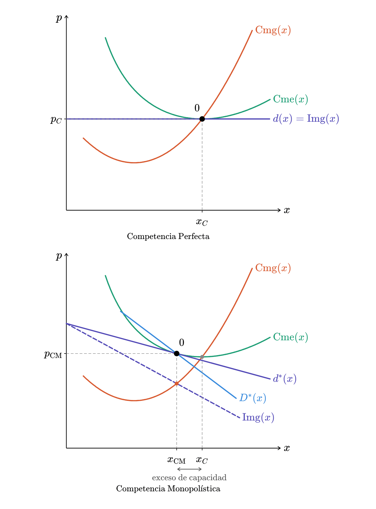

## Introducción

::: {.callout-note appearance="simple" icon=false}

:::

La **competencia monopolística** es una estructura de mercado intermedia cuyos bienes pueden distinguirse unos de otros por muchos rasgos, como el lugar de venta, la calidad, el diseño o la presentación. Esta teoría nace de la insatisfacción con la dicotomía entre competencia perfecta y monopolio, incapaz también de conciliar la competencia con los costes decrecientes (Sraffa, 1926).

Buena parte de los bienes de consumo, de la restauración a la ropa o los automóviles, se vende en mercados de este tipo. Cada empresa tiene cierto poder sobre el precio de su variedad, pero la libre entrada de nuevas variedades limita sus beneficios. En el equilibrio de largo plazo de Chamberlin (1933), el beneficio extraordinario desaparece y cada empresa produce por debajo de su escala eficiente, el **exceso de capacidad**, que es el coste de ofrecer a los consumidores más variedad.

Antes, Hotelling (1929) había planteado la diferenciación en el espacio, con dos tiendas en una calle que tienden a situarse en el centro, el **principio de diferenciación mínima**, que reaparece en la competencia electoral (tema [A24](a24-eb-iii.qmd)). A partir de los años setenta, el modelo de **preferencia por la variedad** de Dixit y Stiglitz (1977) dio a la teoría una segunda vida, al convertirse en la pieza central de la nueva teoría del comercio internacional de Krugman (1979b), que explica el comercio intraindustrial entre países parecidos (tema [B06](b06-nueva-teoria.qmd), apartado 2.1), y de los modelos de crecimiento endógeno con variedades de bienes intermedios de Romer (1990) (tema [A44](a44-crecimiento-ii.qmd)). La publicidad y la información sobre los productos, que la teoría analiza como formas de diferenciación, siguen siendo centrales en el análisis de los mercados de consumo.

El tema estudia la competencia monopolística siguiendo el orden en que se desarrolló la teoría:

- *Primera generación*: los modelos de diferenciación horizontal en su enfoque espacial (Hotelling, 1929) y no espacial (Chamberlin, 1933), y la decisión de publicidad (Dorfman y Steiner, 1954).

- *Segunda generación*: los modelos de diferenciación horizontal neohotellianos (Lancaster, 1966; Salop, 1979) y neochamberlinianos (Dixit y Stiglitz, 1977; Krugman, 1979b).

- *Otros desarrollos*: la diferenciación vertical, con los modelos de competencia en calidad (Shaked y Sutton, 1982; 1983), y la informacional, con la distinción entre bienes de búsqueda y de experiencia (Nelson, 1970) y el papel de la publicidad en cada uno (Butters, 1977; Schmalensee, 1982).

## 1. Fundamentos de las teorías sobre la competencia monopolística

Los modelos de primera generación, el espacial de Hotelling (1929) y el no espacial de Chamberlin (1933), parten de un mismo concepto, la diferenciación de producto, que se define en primer lugar. La sección se cierra con la publicidad, el instrumento con el que la empresa crea y mantiene esa diferenciación.

### 1.1. Concepto de diferenciación

Un producto está **diferenciado** cuando los consumidores no consideran sus variedades sustitutivos perfectos, de modo que cada empresa conserva parte de su clientela aunque su precio sea algo mayor que el de las rivales. La diferenciación puede ser de dos tipos.

**Diferenciación horizontal**: se da cuando, a igualdad de precio, unos consumidores prefieren una variedad y otros la otra. No existe una ordenación de calidad compartida por todos, sino gustos distintos (el color de un coche, la localización de una tienda, el sabor de un refresco…). La teoría económica la modeliza con dos enfoques:

- *Enfoque espacial* (o de direcciones): las variedades de un mismo bien se representan como puntos de un espacio continuo de características, y cada consumidor ocupa en él una posición, su “localización”, que marca la variedad que más le gusta. De las variedades a la venta elige la más próxima a esa posición, con la corrección que impone el precio. Este enfoque corresponde a Hotelling y a sus continuadores (Lancaster, Salop).

- *Enfoque no espacial* (o de consumidor representativo): las preferencias se definen directamente sobre el conjunto de bienes diferenciados, que entran como tales en la función de utilidad (“los bienes son bienes”). Los bienes son sustitutivos imperfectos y el consumidor representativo reparte su gasto entre ellos, porque la diversidad le reporta utilidad por sí sola. Este enfoque corresponde a Chamberlin y a Dixit-Stiglitz.

**Diferenciación vertical**: se da cuando, a igualdad de precio, todos los consumidores prefieren la misma variedad, porque existe una ordenación de calidad compartida (un coche más seguro, un ordenador más rápido…). Los consumidores solo difieren en cuánto están dispuestos a pagar por la calidad, normalmente porque difieren en renta, de modo que la variedad de menor calidad solo se vende si su precio es suficientemente menor. Esta diferenciación corresponde a los modelos de competencia en calidad de Shaked y Sutton (apartado 3.1).

A estos dos tipos se añade la *diferenciación informacional*, que procede de lo que los consumidores saben de los productos y no de sus características (apartado 3.2).

### 1.2. Enfoque espacial: modelo de la ciudad lineal (Hotelling, 1929)

**Origen**: Harold Hotelling (1929) introdujo el enfoque espacial con el ejemplo de dos vendedores en una calle. Claude d'Aspremont, Jean Gabszewicz y Jacques-François Thisse (1979) corrigieron su resultado al mostrar que con costes de transporte lineales el equilibrio puede no existir.

**Idea**: los niveles de características se representan como localizaciones geográficas, de modo que las variedades se diferencian por su distancia al consumidor. Cuando una empresa decide dónde situarse, decide en realidad qué grado de característica va a producir, y la rivalidad es sobre todo local, entre empresas vecinas, por lo que el mercado se compone de oligopolios solapados[^a18-3].

#### 1.2.1. Supuestos

**Entorno**: el mercado es una calle de longitud unitaria. La calle es solo un tramo de un espacio de características más amplio. Que el tramo esté acotado (p. ej. por costes fijos)[^a18-4] recoge que la oferta no puede cubrir todas las variedades concebibles.

**Agentes**:

- *Empresas*: son dos, situadas en la calle en los puntos $z_1 = a$ y $z_2 = 1 - b$ (de modo que $1 - a - b$ es la distancia entre ambas), y producen y venden un bien idéntico con el mismo coste unitario $c$. El bien solo puede adquirirse en cada punto de venta, por lo que la única diferencia entre ambas es la ubicación.

- *Consumidores*: ocupan toda la calle con densidad uniforme, cada uno en un punto concreto, y compran una sola unidad del bien o ninguna. Su precio de reserva queda holgadamente por encima de los precios, así que todos compran y el mercado queda cubierto[^a18-5].

**Restricciones**: la principal son los *costes de transporte*. Cada unidad de distancia que separa al consumidor del punto de venta le resta utilidad, y esa pérdida refleja lo que le cuesta conformarse con una variedad distinta de la que desearía. Los costes de transporte miden así la heterogeneidad de los gustos. Si son nulos, a los consumidores les da igual una variedad u otra y no valoran la diferenciación, y si son positivos, los gustos son heterogéneos. Hotelling los supuso lineales en la distancia, pero aquí se toman cuadráticos, $t d^2$, porque con costes lineales el equilibrio puede no existir.

#### 1.2.2. Modelo con localizaciones exógenas: competencia en precios

**Planteamiento**: con las localizaciones dadas, cada lado del mercado tiene su problema:

- *Demanda*: la demanda de cada empresa se obtiene a partir del *consumidor indiferente*, el situado en el punto $\hat z$ de la calle en el que le cuesta lo mismo comprar en una empresa que en la otra, precio más transporte:

    $$p_1 + t(\hat z - z_1)^2 = p_2 + t(z_2 - \hat z)^2$$

    Todos los consumidores a su izquierda compran a la empresa 1 y todos los de su derecha a la empresa 2. Despejando $\hat z$ se obtiene la función de demanda de cada empresa, que tiene tres componentes:

    $$x_1^d(a, b, p) = a + \frac{1 - a - b}{2} + \frac{p_2 - p_1}{2t(1 - a - b)}$$

    1. *Demanda cautiva* (o del patio de atrás): el primer término, $a$ ($b$ para la empresa 2, cuya demanda es simétrica), corresponde a los consumidores del tramo de calle que va del extremo más próximo hasta la empresa. Forman su clientela cautiva, porque la rival siempre les queda más lejos.

    2. *Demanda compartida*: el segundo término equivale a la mitad del tramo comprendido entre las dos empresas, ya que, a precios iguales, cada una atrae a la mitad de esos consumidores.

    3. *Demanda disputada* (o sensible al precio): el tercer término mide cuánto se mueve la demanda cuando los precios difieren. Con una rebaja, una empresa capta clientes del tramo intermedio, y capta más cuanto más bajos son los costes de transporte y más cerca está la rival.

- *Oferta*: cada empresa elige su precio maximizando el beneficio, tomando el precio de la rival como dado:

    $$\max_{p_i} \; \pi_i = (p_i - c) \, x_i^d(a, b, p)$$

    donde $p_i$ es el precio de la empresa $i$, $c$ el coste unitario común, $x_i^d(a, b, p)$ su función de demanda, que depende de las localizaciones, dadas por $a$ y $b$, y de los precios $p = (p_1, p_2)$, y $\pi_i$ su beneficio.

**CPO**: despejando $p_i$ en $x_i^d - (p_i - c)/[2t(1 - a - b)] = 0$ se obtiene la *función de reacción* de cada empresa, su mejor respuesta al precio de la otra:

$$\begin{aligned} p_1 &= \frac{p_2 + c}{2} + \frac{t(1 - a - b)(1 + a - b)}{2} \\ p_2 &= \frac{p_1 + c}{2} + \frac{t(1 - a - b)(1 - a + b)}{2} \end{aligned}$$

Las funciones de reacción son crecientes en el precio de la rival, con pendiente $1/2$. Los precios son, por tanto, *complementarios estratégicos*, en el sentido de que cada empresa sube su precio cuando la rival sube el suyo, aunque menos que proporcionalmente. Además, la ordenada en el origen de las funciones de reacción crece con el coste de transporte y con la distancia entre las empresas.

**CSO**: $\partial^2\pi_i/\partial p_i^2 = -1/[t(1-a-b)] < 0$, es decir, el beneficio es estrictamente cóncavo en el propio precio, de modo que la función de reacción es efectivamente la mejor respuesta.

**Equilibrio**: en la intersección de ambas funciones de reacción se obtiene el equilibrio de Nash en precios, con sus beneficios:

$$p_1^* = c + t(1 - a - b)\left(1 + \frac{a - b}{3}\right) \qquad p_2^* = c + t(1 - a - b)\left(1 + \frac{b - a}{3}\right)$$

$$\pi_1^* = \frac{t}{2}(1 - a - b)\left(1 + \frac{a - b}{3}\right)^2 \qquad \pi_2^* = \frac{t}{2}(1 - a - b)\left(1 + \frac{b - a}{3}\right)^2$$

El precio de cada empresa es el coste marginal, $c$, más un margen proporcional al coste de transporte y a la distancia que la separa de la rival, corregido por su posición relativa. El beneficio, margen por cuota, se reparte a favor de la empresa con mayor patio de atrás, que fija un precio algo mayor y vende también más, porque su demanda de equilibrio es $x_1^* = \tfrac{1}{2}\left(1 + \tfrac{a - b}{3}\right)$. Dos casos ilustran el resultado:

- *Diferenciación máxima*: si las empresas se sitúan en los extremos ($a = b = 0$), $p_1^* = p_2^* = c + t$ y $\pi_1^* = \pi_2^* = t/2$. Aunque el bien es idéntico, cada empresa fija un margen igual al coste de transporte, porque para arrebatar un cliente a la rival debe compensarle todo el trayecto. 

- *Diferenciación mínima*: si se sitúan en el mismo punto ($a + b = 1$), $p_1^* = p_2^* = c$ y los beneficios son nulos. Sin diferenciación, el resultado es el de Bertrand.

**Desarrollo gráfico**: la competencia en precios se representa en el plano localización-coste total de compra y en el plano de precios $(p_1, p_2)$ (figura -@fig-a185-hotelling, paneles a y b):

1. *Coste total de comprar a cada empresa*, $p_1 + t(z - z_1)^2$ y $p_2 + t(z - z_2)^2$ (panel a): son parábolas con su mínimo, el precio de la empresa, en su localización.

2. *Consumidor indiferente*, $\hat z$ (panel a): está en el corte de ambas parábolas y divide la calle en la demanda de cada empresa, $x_1^d$ y $x_2^d$.

3. *Funciones de reacción*, $p_1(p_2)$ y $p_2(p_1)$ (panel b): son rectas crecientes, porque los precios son complementarios estratégicos.

4. *Equilibrio*: el corte de las funciones de reacción es el equilibrio de Nash (punto 0), con precios $p_1^*$ y $p_2^*$, y se sitúa sobre la bisectriz, $p_1 = p_2$, cuando las localizaciones son simétricas.

::: {#fig-a185-hotelling}

::: {.content-visible when-format="html"}
```{=html}
<div class="graph-frame wide">
<iframe src="../graphs/a185_Hotelling.html" style="--r:1.552" loading="lazy" title="fig-a185-hotelling"></iframe>
</div>
```
:::

::: {.content-visible unless-format="html"}
![Modelo de Hotelling con costes de transporte cuadráticos y empresas en $z_1 = a$ y $z_2 = 1 - b$. En el panel (a), con $p_1 < p_2$, el coste total de comprar a cada empresa, $p_i + t(z - z_i)^2$, se iguala en el consumidor indiferente $\hat z$, que divide la calle en la demanda de la empresa 1, $x_1^d$ (cautiva, compartida y disputada), y la de la empresa 2, $x_2^d$. En el panel (b), dibujado con localizaciones simétricas ($a = b$), las funciones de reacción $p_1(p_2)$ y $p_2(p_1)$, crecientes, se cortan sobre la bisectriz, en el equilibrio de Nash 0, $(p_1^*, p_2^*)$.](../graphs/static/a185_Hotelling.png)
:::

Modelo de Hotelling con costes de transporte cuadráticos y empresas en $z_1 = a$ y $z_2 = 1 - b$. En el panel (a), con $p_1 < p_2$, el coste total de comprar a cada empresa, $p_i + t(z - z_i)^2$, se iguala en el consumidor indiferente $\hat z$, que divide la calle en la demanda de la empresa 1, $x_1^d$ (cautiva, compartida y disputada), y la de la empresa 2, $x_2^d$. En el panel (b), dibujado con localizaciones simétricas ($a = b$), las funciones de reacción $p_1(p_2)$ y $p_2(p_1)$, crecientes, se cortan sobre la bisectriz, en el equilibrio de Nash 0, $(p_1^*, p_2^*)$.
:::

**Estática comparativa**: cuanto mayor es la heterogeneidad de gustos $t$, más cautivos son los consumidores de la empresa más cercana y mayores los precios y los beneficios, y con $t = 0$ se recupera la paradoja de Bertrand. Del mismo modo, cuanto más alejadas están las empresas, mayor es el margen de ambas, porque la ubicación, única fuente de diferenciación en el modelo, es también la fuente del poder de mercado.

Gráficamente, un aumento de $t$ o de la distancia entre las empresas desplaza hacia fuera ambas funciones de reacción y lleva el equilibrio, a lo largo de la bisectriz, hacia precios mayores. Con $t = 0$ ambas pasan por $(c, c)$ y el equilibrio es el competitivo. En la calle, una rebaja de $p_1$ desplaza $\hat z$ hacia la derecha, tanto más cuanto más próximas estén las empresas.

#### 1.2.3. Modelo con localizaciones endógenas: competencia en localización y precios

**Planteamiento**: si las empresas eligen también dónde situarse, el juego tiene dos etapas, primero las localizaciones y después los precios, y se resuelve hacia atrás:

- *Demanda*: es la del modelo con localizaciones exógenas, $x_i^d(a, b, p)$, ahora con localizaciones variables.

- *Oferta*: la segunda etapa es el modelo anterior, que da los precios de equilibrio como funciones de las localizaciones, $p_i^*(a, b)$. En la primera, cada empresa anticipa esos precios y elige su localización maximizando el beneficio resultante:

    $$\max_{a} \; \pi_1(a, b) = (p_1^*(a, b) - c) \, x_1^d(a, b, p^*(a, b))$$

    donde $a$ es la localización de la empresa 1 y $b$ la distancia de la empresa 2 al extremo opuesto de la calle, $p^*(a, b) = (p_1^*, p_2^*)$ los precios de equilibrio de la segunda etapa, $c$ el coste unitario, $x_1^d$ la demanda de la empresa 1 y $\pi_1$ su beneficio.

**CPO** (función de reacción en localización): el efecto de la localización sobre el beneficio se descompone en dos efectos de signo contrario:

$$\frac{\partial \pi_1}{\partial a} = (p_1^* - c) \left[ \underbrace{\frac{\partial x_1^d}{\partial a}}_{\text{efecto demanda}} + \underbrace{\frac{\partial x_1^d}{\partial p_2} \cdot \frac{\partial p_2^*}{\partial a}}_{\text{efecto estratégico}} \right]$$

1. *Efecto demanda* ($\partial x_1^d / \partial a > 0$): moverse hacia el centro del mercado, y por tanto hacia el rival, aumenta la cuota propia. El efecto empuja a los dos productores a situarse donde está la demanda, y es el que Hotelling recogió en su *principio de diferenciación mínima*. Si los dos lo siguen, sus puntos de venta terminan juntos en el medio de la calle.

2. *Efecto estratégico* ($\partial x_1^d / \partial p_2 \cdot \partial p_2^* / \partial a < 0$): con las empresas más juntas, una pequeña diferencia de precio basta para que los consumidores intermedios cambien de proveedor, y la competencia en precios se endurece. Para suavizarla conviene separarse, y llevado al límite este efecto da el *principio de diferenciación máxima*, con cada empresa en un extremo de la calle.

La empresa se enfrenta así a un dilema. Parecerse al rival le da más cuota, pero alejarse de él le deja más margen en precios. Si gana el efecto demanda, la estrategia es de producción en masa, y si gana el estratégico, de nicho. Qué efecto domina lo deciden los costes de transporte, junto con la manera en que se distribuyen los consumidores por la calle.

**CSO**: no se cumple en general, y con costes lineales el equilibrio en localizaciones puede no existir[^a18-6].

**Equilibrio**: sustituyendo los precios de la segunda etapa, el beneficio de la empresa 1 resulta

$$\pi_1(a, b) = \frac{t}{2}(1 - a - b)\left(1 + \frac{a - b}{3}\right)^2$$

cuya derivada respecto a $a$ es negativa para cualquier $b$, de modo que la mejor respuesta de cada empresa es alejarse todo lo posible de la rival, sea cual sea la posición de esta. Las funciones de reacción en localización son, pues, constantes en los extremos, y el equilibrio del juego en dos etapas es:

$$a^* = b^* = 0 \qquad p_1^* = p_2^* = c + t \qquad \pi_1^* = \pi_2^* = \frac{t}{2}$$

Las empresas se sitúan en los extremos de la calle, $z_1 = 0$ y $z_2 = 1$, porque, con costes cuadráticos y consumidores uniformes, el efecto estratégico domina. El precio vuelve a ser el coste marginal más un margen, ahora igual al coste de transporte, y el beneficio se reparte a partes iguales, porque las posiciones son simétricas.

**Desarrollo gráfico**: la elección de localización se representa en el plano localización-coste total de compra, como en el panel a de la figura -@fig-a185-hotelling (figura -@fig-a186-hotelling-localizacion):

1. *Alejamiento*: desde cualquier par de localizaciones interiores, como el óptimo social, $z_1^{\text{opt}} = 1/4$ y $z_2^{\text{opt}} = 3/4$, cada empresa se aleja de la rival (flechas), porque acercarse al centro desplaza al consumidor indiferente a su favor (efecto demanda), pero reduce la distancia entre ambas y, con ella, el margen de las dos (efecto estratégico), que pesa más.

2. *Equilibrio*: las empresas se sitúan en los extremos de la calle, $z_1 = 0$ y $z_2 = 1$ (diferenciación máxima), y fijan $p^* = c + t$. Las parábolas del coste total de compra, $p^* + t(z - z_i)^2$, tienen su mínimo en cada extremo y se cortan en el consumidor indiferente, $\hat z = 1/2$.

3. *Margen*: la diferencia entre $p^*$ y $c$ es el coste de transporte, $t$, el trayecto completo que una empresa tendría que compensar para arrebatar el cliente situado a la puerta de la rival.

::: {#fig-a186-hotelling-localizacion}

::: {.content-visible when-format="html"}
```{=html}
<div class="graph-frame">
<iframe src="../graphs/a186_Hotelling_localizacion.html" style="height:540px" loading="lazy" title="fig-a186-hotelling-localizacion"></iframe>
</div>
```
:::

::: {.content-visible unless-format="html"}
![Hotelling con localizaciones endógenas y costes de transporte cuadráticos. Desde cualquier par de localizaciones interiores, como el óptimo social, $z_1^{\text{opt}} = 1/4$ y $z_2^{\text{opt}} = 3/4$, cada empresa se aleja de la rival (flechas) hasta el extremo de la calle, el equilibrio de diferenciación máxima ($z_1 = 0$, $z_2 = 1$). Con el precio de equilibrio, $p^* = c + t$, el coste total de comprar a cada empresa, $p^* + t(z - z_i)^2$, se iguala en el consumidor indiferente, $\hat z = 1/2$, y el margen sobre el coste unitario es el coste de transporte, $t$.](../graphs/static/a186_Hotelling_localizacion.png)
:::

Hotelling con localizaciones endógenas y costes de transporte cuadráticos. Desde cualquier par de localizaciones interiores, como el óptimo social, $z_1^{\text{opt}} = 1/4$ y $z_2^{\text{opt}} = 3/4$, cada empresa se aleja de la rival (flechas) hasta el extremo de la calle, el equilibrio de diferenciación máxima ($z_1 = 0$, $z_2 = 1$). Con el precio de equilibrio, $p^* = c + t$, el coste total de comprar a cada empresa, $p^* + t(z - z_i)^2$, se iguala en el consumidor indiferente, $\hat z = 1/2$, y el margen sobre el coste unitario es el coste de transporte, $t$.
:::

**Bienestar** (la solución del planificador): la cuestión es si el resultado descentralizado es socialmente óptimo. Como el coste de producción es el mismo en cualquier localización, el único coste que la localización altera es el de transporte, asimilable a un coste de transacción. Un planificador benevolente se limitaría, por tanto, a minimizar ese coste, y para ello colocaría cada empresa en el punto medio de la mitad de calle que abastece, $z_1^{\text{opt}} = 1/4$ y $z_2^{\text{opt}} = 3/4$. En cambio, el equilibrio descentralizado con costes cuadráticos ($z_1 = 0$, $z_2 = 1$) diferencia demasiado, porque las empresas se alejan más de lo que conviene a los consumidores para relajar la competencia en precios, y la pérdida de bienestar es el exceso de coste de transporte que ello impone.

#### 1.2.4. Conclusiones

**Aspectos positivos**: el modelo muestra con la mayor economía de medios el mecanismo por el que la diferenciación crea poder de mercado. De hecho, los dos casos extremos del modelo con localizaciones exógenas, de la paradoja de Bertrand a un margen igual al coste de transporte, prueban que ese poder depende de la distancia entre variedades. El resultado es la base de los modelos neohotellianos de Salop y Lancaster (apartado 2.1) y del análisis de la diferenciación como estrategia (tema [A15](a15-toi.qmd)).

**Limitaciones**: el modelo presenta tres:

- *Fragilidad del equilibrio*: el resultado cambia con solo modificar cómo crecen los costes de transporte con la distancia o cómo se reparten los consumidores, de ahí que el principio de diferenciación máxima sea poco robusto. Con costes cuadráticos hay equilibrio en precios para cualquier localización, mientras que con lineales solo si las empresas están bastante alejadas.

- *Supuestos restrictivos*: es un modelo de duopolio, con demandas unitarias y mercado cubierto.

- *Número de variedades*: el modelo no lo determina, y esa cuestión la aborda el enfoque no espacial.

### 1.3. Enfoque no espacial: modelo de Chamberlin (1933)

**Origen**: Edward Chamberlin (*The Theory of Monopolistic Competition*, 1933) acuñó el término competencia monopolística para una estructura de mercado que combina propiedades del monopolio (cada empresa tiene poder sobre su variedad) y de la competencia perfecta (muchas empresas y libre entrada). Su modelo es el tradicional de la competencia monopolística, y el enfoque no espacial toma de él su forma.

**Idea**: hay varios bienes sustitutivos imperfectos entre sí ($0 < \sigma_{ij} < \infty$) y la demanda del grupo se reparte entre ellos. Cada empresa vende una variedad distinta y se enfrenta por ello a una demanda decreciente en su propio precio, pero tan elástica que su poder de mercado es pequeño, y sus beneficios extraordinarios desaparecen a largo plazo con la entrada.

**Supuestos**:

- *Entorno*: el mercado es un *grupo* de variedades poco diferenciadas, cada una muy sustituible por cualquier otra y en igual grado (*supuesto de simetría*, por el que ninguna variedad está más próxima a otra que a las demás).

- *Agentes*:

    - *Empresas*: son muchas y cada una vende una sola variedad (p. ej. los restaurantes o las peluquerías de una ciudad), con una tecnología común y curvas de coste medio en U. Dado que cada una pesa muy poco en las ventas de las demás, no hay interacción estratégica, y cada empresa da por hecho que sus rivales no tocarán el precio si ella cambia el suyo (comportamiento *miope*).

    - *Demanda*: ninguna variedad atrae a más consumidores que otra, así que la demanda de todas las empresas es idéntica[^a18-11]. El modelo distingue, además, dos curvas de demanda para cada empresa. La *demanda planeada* ($dd$) es la que cree tener, suponiendo que nadie más mueve el precio, y es muy elástica, porque una rebaja en solitario le traería clientes de todas las rivales. La *demanda efectiva* ($DD$), en cambio, es la que de verdad obtiene cuando todas cambian el precio a la vez, y es menos elástica. Con la entrada o la salida de empresas $DD$ se desplaza, porque la misma demanda de mercado se divide entre más o menos variedades.

**Razonamiento**:

- *Equilibrio a corto plazo*: no hay entrada ni salida. Cada empresa produce hasta que su coste marginal alcanza el ingreso marginal que deriva de la demanda planeada, la que cree tener. No obstante, las rivales hacen lo mismo, de modo que las ventas reales de cada empresa caen sobre $DD$, y el proceso se repite en zigzag por esa curva hasta que $\text{Img}_{dd} = \text{Cmg}$ y $dd = DD$ se cumplen a la vez. En ese punto cada empresa se comporta como monopolista de su variedad, con un precio más alto y una cantidad más baja que en competencia, y puede tener beneficios extraordinarios o pérdidas.

- *Equilibrio a largo plazo*: mientras haya beneficios extraordinarios entrarán empresas, que restan clientela a las instaladas y desplazan su demanda hacia la izquierda hasta agotarlos. Cuando la entrada cesa, las demandas planeada y efectiva se cortan ($d^* = D^*$), la planeada es tangente al coste medio de largo plazo, por lo que no queda beneficio ($p = \text{Cme}_{\text{LP}}$), y la regla de maximización, ahora con costes de largo plazo, sigue cumpliéndose ($\text{Img} = \text{Cmg}_{\text{LP}}$).

    Como la demanda planeada tiene pendiente negativa, la tangencia se produce en el tramo descendente del coste medio. Por ello, según el *teorema del exceso de capacidad* (Chamberlin, 1933), cada empresa produce por debajo de su escala óptima, a un coste medio superior al mínimo, y deja economías de escala sin explotar. Sin embargo, Demsetz (1959) objetó que, si se tienen en cuenta los gastos de venta, el equilibrio a largo plazo no implica necesariamente exceso de capacidad.

**Desarrollo gráfico**: el equilibrio a largo plazo se representa en el plano cantidad-precio de la empresa, con la competencia perfecta como referencia en el panel superior (figura -@fig-a181-chamberlin):

1. *Costes*, $\text{Cme}(x)$ y $\text{Cmg}(x)$: recogen la tecnología común de las empresas, tienen forma de U y son los mismos en ambos paneles. En competencia perfecta la demanda de la empresa es horizontal, $d(x) = \text{Img}(x)$, y el equilibrio (punto 0 del panel superior) está en el mínimo del coste medio, con $x_C$ y $p_C$.

2. *Demanda planeada*, $d^*(x)$, y su *ingreso marginal*, $\text{Img}(x)$: la demanda planeada es decreciente pero muy elástica, porque supone que las rivales no reaccionan.

3. *Demanda efectiva*, $D^*(x)$: es más inclinada que la planeada, porque recoge la reacción de todas las empresas, y la corta en el equilibrio.

4. *Equilibrio*: en el punto 0 del panel inferior, $d^*(x)$ es tangente a $\text{Cme}(x)$ y $\text{Img}(x) = \text{Cmg}(x)$, con el precio $p_{\text{CM}}$ y la cantidad $x_{\text{CM}}$. La distancia entre $x_{\text{CM}}$ y $x_C$ es el exceso de capacidad.

::: {#fig-a181-chamberlin}

::: {.content-visible when-format="html"}
```{=html}
<div class="graph-frame">
<iframe src="../graphs/a181_Chamberlin.html" style="height:920px" loading="lazy" title="fig-a181-chamberlin"></iframe>
</div>
```
:::

::: {.content-visible unless-format="html"}

:::

Competencia monopolística (Chamberlin, 1933). En el equilibrio a largo plazo, la demanda de la empresa es tangente al coste medio, con beneficio nulo y exceso de capacidad.
:::

**Bienestar**: el equilibrio tiene una ineficiencia *asignativa*, que la competencia monopolística comparte con el monopolio, pues el precio queda por encima del coste marginal. Tiene además una ineficiencia *productiva* o de escala, propia de esta estructura, que consiste en que el precio supera el mínimo del coste medio. Cada empresa produce al mínimo coste la cantidad que elige, como el monopolista (tema [A17](a17-monopolio.qmd), apartado 1.3.2), pero por debajo de su escala eficiente. Por ello, la producción del sector cuesta más de lo que costaría con menos empresas en el mínimo del coste medio. Aun así, con una demanda muy elástica para cada variedad, las dos pérdidas son pequeñas, y la variedad adicional, que el consumidor valora por sí misma, las compensa en parte. La valoración global depende de esa comparación, que formaliza el modelo de Dixit-Stiglitz (apartado 2.2).

**Conclusiones**:

- *Aspectos positivos*: el modelo de Chamberlin incorpora a las decisiones de la empresa, junto al precio, cuánto diferenciar el producto y cuánto gastar en ventas, en una estructura intermedia que retrata la mayor parte de los mercados de consumo. Además, su equilibrio de tangencia y el teorema del exceso de capacidad son el punto de partida de la teoría posterior de la variedad.

- *Limitaciones*: la crítica le reprocha cuatro incoherencias. En primer lugar, el modelo deja fuera las consideraciones estratégicas aunque las variedades más parecidas compitan con más fuerza entre sí. En segundo lugar, atribuye a las empresas un error sistemático sobre cómo reaccionan las rivales. En tercer lugar, no precisa cuántas empresas hacen falta para que haya competencia monopolística. Por último, no fija qué elasticidades cruzadas bastan para incluir dos bienes en el mismo grupo. Las dos primeras incoherencias las resuelven los modelos neohotellianos, con vecinos y estrategia, y las dos últimas, el modelo de Dixit-Stiglitz, con un número de variedades endógeno.

### 1.4. Publicidad: la condición de Dorfman-Steiner (1954)

**Origen**: Robert Dorfman y Peter Steiner (1954) formalizaron la decisión sobre la publicidad, el principal de los gastos de venta que Chamberlin incorporó al análisis de la empresa diferenciada y con los que esta desplaza su demanda.

**Idea**: la empresa con poder sobre su demanda, sea un monopolista o una empresa de competencia monopolística con su variedad, elige, además del precio, cuánto gastar en publicidad, y la proporción óptima de sus ingresos que dedica a ella depende solo de un cociente de elasticidades.

**Planteamiento**: con una demanda de su variedad $x(p, A)$ decreciente en el precio y creciente en el gasto en publicidad, con rendimientos decrecientes ($x_A > 0$, $x_{AA} < 0$), y coste marginal constante, la empresa resuelve

$$\max_{p,\,A} \; \pi = (p - c)\,x(p, A) - A$$

donde $p$ es el precio, $A$ el gasto en publicidad (con coste unitario uno), $x(p, A)$ la demanda de la variedad, $c$ el coste marginal y $\pi$ el beneficio.

**CPO**: la condición respecto del precio da la regla del margen, $(p - c)/p = 1/|\varepsilon_{xp}|$, y la condición respecto de la publicidad iguala el margen sobre la última venta que esta provoca con su coste, $(p - c)\,x_A = 1$. Ambas se determinan conjuntamente, porque la publicidad altera la elasticidad-precio y el precio fija el margen que hace rentable anunciarse.

**CSO**: el beneficio ha de ser cóncavo en $(p, A)$, lo que exige $\pi_{pp} < 0$ (ingreso marginal decreciente), $\pi_{AA} = (p - c)\,x_{AA} < 0$ (rendimientos decrecientes de la publicidad) y $\pi_{pp}\,\pi_{AA} - \pi_{pA}^2 > 0$.

**Solución**: multiplicando la condición de la publicidad por $A/(p\,x)$ y sustituyendo el margen por la regla del precio se obtiene la *condición de Dorfman-Steiner*:

$$\underbrace{\frac{A}{p\,x}}_{\text{intensidad publicitaria}} = \frac{\varepsilon_{xA}}{|\varepsilon_{xp}|}$$

donde $\varepsilon_{xA} = x_A A/x$ es la elasticidad de la demanda respecto de la publicidad y $|\varepsilon_{xp}|$ el valor absoluto de la elasticidad-precio. La empresa anuncia más cuanto más responde su demanda a la publicidad y menos al precio.

Como $1/|\varepsilon_{xp}|$ es el índice de Lerner, la intensidad publicitaria es proporcional al margen relativo, $A/(p\,x) = \varepsilon_{xA}\,(p - c)/p$, lo que fundamenta la asociación entre margen y ratio publicidad-ventas que se observa entre sectores. En competencia monopolística la condición se aplica a la demanda de cada variedad, de modo que cuanto más diferenciada está la variedad, menor es su elasticidad-precio y mayor su intensidad publicitaria. Con todo, a largo plazo el gasto en publicidad forma parte del coste medio y la libre entrada sigue llevando el beneficio a cero.

**Conclusiones**:

- *Aspectos positivos*: explica con un único cociente de elasticidades por qué la intensidad publicitaria difiere tanto entre sectores (alta en bienes de consumo con marca, mínima en productos homogéneos) y da contenido a los gastos de venta de Chamberlin.

- *Limitaciones*: trata la publicidad como un desplazador de la demanda sin explicar por qué la desplaza, si por informar o por persuadir, cuestión que aborda la diferenciación informacional (apartado 3.2). Además, ignora la respuesta de las rivales, que en oligopolio convierte la publicidad en un instrumento estratégico.

### 1.5. Conclusiones

Los modelos de primera generación explican cómo la diferenciación, y no el escaso número de empresas, crea poder de mercado. En el enfoque espacial de Hotelling el poder procede de la distancia entre variedades, y en el no espacial de Chamberlin, de la sustituibilidad imperfecta dentro del grupo. La condición de Dorfman-Steiner liga, a su vez, la publicidad a la diferenciación, porque cuanto más diferenciada está una variedad, menos elástica es su demanda al precio y mayor su intensidad publicitaria.

Sin embargo, ninguno de los dos enfoques determina a la vez la localización de las variedades, su número y su valoración social. Hotelling fija dos empresas y su resultado depende de la forma de los costes de transporte, mientras que Chamberlin excluye la estrategia y no define el grupo. Los modelos de segunda generación (apartado 2) responden a estas carencias, y los de diferenciación vertical e informacional (apartado 3) amplían el propio concepto de diferenciación.

## 2. Diferenciación horizontal: modelos de segunda generación

Siguiendo a Giancarlo Gandolfo (2014), las aportaciones de Hotelling y Chamberlin sentaron las bases de dos familias de desarrollos posteriores. Los modelos neohotellianos conservan el espacio de características y endogenizan la entrada, y los neochamberlinianos conservan el consumidor representativo y dan microfundamentos al modelo de Chamberlin.

### 2.1. Modelos neohotellianos

Dentro de esta familia, Lancaster generaliza el espacio de características de Hotelling a un número cualquiera de atributos y Salop lo cierra en una circunferencia para estudiar la libre entrada.

#### 2.1.1. Teoría de la demanda de características (Lancaster, 1966)

**Origen**: Kelvin Lancaster (1966) propuso que lo que el consumidor busca en un bien son sus características, y no el bien como tal. La propuesta generaliza el espacio de localizaciones de Hotelling a un espacio de atributos de cualquier dimensión.

**Idea**: la utilidad se obtiene de las características, y los bienes son solo el medio de obtenerlas. Cada bien es una combinación fija de atributos, de ahí que elegir entre variedades sea elegir la combinación de atributos más cercana a la deseada al menor coste.

**Supuestos**:

- *Entorno*: existe un vector de características $\mathbf{a} = (a_1, \ldots, a_m)$ que resume los atributos contenidos en los bienes diferenciados $\mathbf{x} = (x_1, \ldots, x_n)$, y la utilidad, $u(\mathbf{a})$, procede de las características, no de los bienes.

- *Tecnología*: las características se obtienen transformando los bienes mediante funciones de producción lineales y aditivamente separables, $a_j = \sum_i \beta_{ji} x_i$, de modo que cada bien aporta una combinación fija de características.

- *Restricciones*: el gasto en bienes agota la renta, $\sum_i p_i x_i = M_0$.

**Planteamiento**: el consumidor maximiza la utilidad de las características sujeto a la tecnología de consumo y a la renta:

$$\max_{\mathbf{x}} \; u(a_1, \ldots, a_m) \quad \text{s.a.:} \begin{cases} a_j = \sum_i \beta_{ji} x_i \; \forall j \\ \sum_i p_i x_i = M_0 \end{cases}$$

donde $\mathbf{a} = (a_1, \ldots, a_m)$ es el vector de características, $u(\mathbf{a})$ la utilidad que reportan, $x_i$ la cantidad del bien $i$, $\beta_{ji}$ la cantidad de la característica $j$ contenida en cada unidad del bien $i$, $p_i$ el precio del bien $i$ y $M_0$ la renta.

**CPO**: el consumidor maximiza donde la curva de indiferencia más alejada es tangente a la frontera. La solución está en un vértice, si consume una sola variedad, o en un tramo, si combina dos.

**CSO**: la cuasiconcavidad de $u(\mathbf{a})$ (curvas de indiferencia convexas) y la concavidad de la frontera eficiente aseguran que la tangencia caracteriza el máximo.

**Desarrollo gráfico**: la elección del consumidor se representa en el plano de características $(a_1, a_2)$, para tres bienes (figura -@fig-a183-lancaster):

1. *Bienes*, $x_1$, $x_2$ y $x_3$: cada uno se representa por una recta desde el origen, cuya pendiente es la proporción en que combina las características y cuya longitud viene determinada por el precio. Los puntos $A$, $B$ y $C$ son las combinaciones de características que se obtienen gastando toda la renta en un solo bien.

2. *Frontera eficiente de consumo*: es la unión de esos puntos, cóncava respecto al origen, sobre la que se sitúan también las combinaciones de dos bienes adyacentes.

3. *Curva de indiferencia*, $u_0$: recoge las combinaciones de características que reportan la misma utilidad.

4. *Equilibrio*: el óptimo (punto 0) se sitúa donde $u_0$ es tangente al tramo $AB$ de la frontera, con las características $a_1^*$ y $a_2^*$, y combina los bienes $x_1$ y $x_2$.

::: {#fig-a183-lancaster}

::: {.content-visible when-format="html"}
```{=html}
<div class="graph-frame">
<iframe src="../graphs/a183_Lancaster.html" style="height:540px" loading="lazy" title="fig-a183-lancaster"></iframe>
</div>
```
:::

::: {.content-visible unless-format="html"}

:::

Teoría de la demanda de características (Lancaster, 1966). Cada bien ($x_1$, $x_2$, $x_3$) es un rayo desde el origen en el espacio de características $(a_1, a_2)$, y $A$, $B$ y $C$ son las combinaciones que se obtienen gastando toda la renta en él. La frontera eficiente que los une es cóncava respecto al origen, y el óptimo 0 se sitúa donde la curva de indiferencia $u_0$ es tangente al tramo $AB$, que combina los bienes $x_1$ y $x_2$.
:::

**Estática comparativa**: una subida del precio de un bien acorta su recta y puede sacarlo de la frontera eficiente, de modo que deja de consumirse aunque siga existiendo. La aparición de una nueva variedad añade una recta. Si su punto queda por debajo de la frontera eficiente (dominado por las combinaciones de las variedades existentes), nadie la compra, mientras que, si queda por encima, la nueva variedad amplía la frontera y desplaza a sus vecinas. La demanda de cada variedad es así discontinua en los precios y en el conjunto de variedades disponibles.

**Conclusiones**:

- *Aspectos positivos*: al desplazar la elección del espacio de bienes al de características, Lancaster explica la diferenciación de producto y la aparición y desaparición de variedades como fenómenos de demanda, y proporciona la base de la teoría hedónica de precios (tema [A08](a08-consumidor.qmd)). 

    Sus aplicaciones van desde las carteras de inversión, donde rentabilidad esperada y riesgo forman un espacio de características media-varianza, hasta los bienes tecnológicos y las estrategias de mercado. En la estrategia comercial, un nuevo vector entre dos existentes es una segmentación, un vector muy inclinado es un nicho, y la posición de las curvas de indiferencia es el posicionamiento de marca sobre el que actúa la publicidad.

- *Limitaciones*: el modelo supone que las características son objetivas y medibles y que la tecnología de consumo es lineal, lo que excluye las interacciones entre atributos. Además, como el de Hotelling, es un modelo de demanda que no determina por sí solo el número de variedades ofrecidas.

#### 2.1.2. Modelo de la ciudad circular (Salop, 1979)

**Origen**: Steven Salop (1979) llevó el enfoque espacial al caso de libre entrada, con lo que lo aproximó al planteamiento de Chamberlin[^a18-15].

**Idea**: cerrar la calle de Hotelling en una circunferencia elimina los extremos y con ellos la asimetría entre empresas, lo que permite estudiar cuántas empresas entran en un mercado con costes fijos y cuánto se diferencian, en lugar de dónde se sitúan dos empresas dadas.

**Supuestos**:

- *Entorno*: el mercado es una ciudad circular de perímetro unitario (los horarios de vuelo o la programación televisiva son sus ejemplos naturales).

- *Agentes*:

    - *Empresas*: el número $n$ es endógeno. Todas tienen costes idénticos, con un coste marginal $c$ y un coste fijo de entrada $f$, y se sitúan equidistantemente sobre la circunferencia, de modo que la diferenciación es máxima por construcción y la decisión que se estudia es la de entrar.

    - *Consumidores*: se distribuyen uniformemente sobre la circunferencia, con demandas unitarias y costes de transporte lineales $t$ por unidad de distancia.

**Planteamiento** (análisis de la demanda): con $n$ empresas equidistantes, el consumidor indiferente entre la empresa 1 y su vecina se sitúa a la distancia $d \in (0, 1/n)$ en la que el coste total de comprar a una y a otra coincide, $p_1 + td = p + t(1/n - d)$. La demanda de la empresa 1 son los consumidores situados a menos de $d$ por cada lado, $x_1^d = 2d = 1/n + (p - p_1)/t$.

Gráficamente, en la ciudad circular (figura -@fig-a184-salop), las $n$ empresas se sitúan a una distancia $1/n$ entre sí. La demanda de la empresa 1 es el arco $x_1^d = 2d$ comprendido entre los dos consumidores indiferentes, que distan $d$ de ella y $1/n - d$ de cada vecina.

::: {#fig-a184-salop}

::: {.content-visible when-format="html"}
```{=html}
<div class="graph-frame">
<iframe src="../graphs/a184_Salop.html" style="height:540px" loading="lazy" title="fig-a184-salop"></iframe>
</div>
```
:::

::: {.content-visible unless-format="html"}

:::

Ciudad circular (Salop, 1979). Las $n = 6$ empresas son equidistantes sobre una circunferencia de perímetro unitario y están separadas por $1/n$. Los consumidores indiferentes entre la empresa 1 y sus vecinas están a la distancia $d$ de ella y $1/n - d$ de la vecina, y la demanda de la empresa 1 es el arco sombreado, $x_1^d = 2d$.
:::

En el análisis de la oferta, cada empresa elige su precio maximizando el beneficio, $\pi_1 = (p_1 - c)[1/n + (p - p_1)/t] - f$, tomando como dados el precio $p$ de las vecinas y el número de empresas.

**CPO**: da la función de reacción, en la que el precio óptimo de cada empresa iguala su ingreso marginal al coste marginal $c$. Ese precio crece con el de las vecinas, con el coste de transporte y con la distancia entre empresas, $1/n$, pues cuanto más lejos está la rival, mayor es el margen que la empresa puede fijar sin perder clientes:

$$p_1 = \frac{1}{2}\left(p + c + \frac{t}{n}\right)$$

**CSO**: $\partial^2\pi_1/\partial p_1^2 = -2/t < 0$, luego la CPO define la mejor respuesta.

**Equilibrio**: imponiendo la simetría, $p_1 = p$, se obtiene el precio de equilibrio a corto plazo, y de la condición de libre entrada, $\pi = 0$, el número de empresas a largo plazo:

$$p^* = c + \frac{t}{n} \qquad n^* = \sqrt{t/f} \qquad p^{**} = c + \sqrt{tf}$$

**Estática comparativa**: el margen $p^* - c$ aumenta con el coste de transporte $t$, que mide la diferenciación, y disminuye con el número de empresas $n$, que mide la competencia. A largo plazo, el número de empresas crece con la diferenciación y decrece con el coste fijo, $n^* = n^*(t^+, f^-)$, porque a las empresas les interesa diferenciarse para aprovechar la diversidad de gustos que recoge $t$[^a18-16], y la libre entrada las multiplica hasta agotar los beneficios. Por su parte, el precio de largo plazo crece con $t$ y con $f$.

**Bienestar**: un planificador que minimizase la suma de los costes fijos y los costes de transporte elegiría $n^{\text{opt}} = \frac{1}{2}\sqrt{t/f}$, la mitad del número de equilibrio, de modo que la libre entrada genera un *exceso de variedades*. Este exceso se debe a una externalidad, pues cada entrante roba demanda a sus vecinas, lo que hace rentable su entrada, sin internalizar que esa demanda ya estaba servida y que su coste fijo es un coste social adicional.

**Conclusiones**:

- *Aspectos positivos*: el modelo de Salop formaliza la competencia monopolística en el enfoque espacial, porque reproduce con microfundamentos explícitos el resultado de Chamberlin (beneficio nulo con poder de mercado). Además, determina el número de variedades y muestra que la libre entrada no garantiza el número óptimo.

- *Limitaciones*: la localización equidistante se impone en lugar de derivarse, de modo que el modelo no dice nada sobre dónde se sitúan los entrantes. Además, el resultado de exceso de variedades depende de los supuestos sobre costes de transporte y demandas unitarias, pues con demandas elásticas la entrada puede ser insuficiente.

### 2.2. Modelos neochamberlinianos: Dixit y Stiglitz (1977)

**Origen**: Michael Spence (1976) y Avinash Dixit y Joseph Stiglitz (1977) reformularon las ideas de Chamberlin con microfundamentos, en un modelo de equilibrio general con un consumidor representativo que valora la variedad.

**Idea**: la variedad es un bien en sí mismo. Si el consumidor prefiere repartir su gasto entre muchas variedades a concentrarlo en pocas, cada variedad tiene una demanda decreciente en su propio precio aunque sea sustituible por las demás. El número de variedades que el mercado sostiene depende de cuánto valora el consumidor la variedad y de cuánto cuesta producir cada una.

#### 2.2.1. Supuestos

**Entorno**: el mercado de bienes es de competencia monopolística, con libre entrada de variedades, y los recursos están plenamente empleados, de modo que el trabajo total de la economía limita el número de variedades y la escala de cada una.

**Agentes**:

- *Empresas*: tienen una tecnología idéntica con rendimientos crecientes a escala y un único factor, el trabajo. La función de costes es lineal, $\text{CT}(x_i^s) = w(l_0 + l x_i^s)$, con $x_i^s$ la producción de la empresa, $l_0 > 0$ empleados fijos y $l > 0$ empleados por unidad producida, lo que genera economías de escala internas[^a18-18]. Cada empresa fabrica una variedad diferenciada ($\sigma_{ji} \in (0, \infty)$ para todo $i \neq j$) y se comporta de forma miope, con variación conjetural nula.

- *Consumidores*: tienen preferencias idénticas con *preferencia por la variedad*, es decir, con un mismo gasto prefieren repartirlo entre $n$ variedades antes que entre $n - 1$[^a18-19]. El parámetro de sustituibilidad $\theta \in (0, 1)$ determina la elasticidad de sustitución entre variedades, $\sigma = 1/(1-\theta) \in (1, \infty)$. Como preferencias y costes son idénticos, en equilibrio todas las variedades tienen el mismo precio.

#### 2.2.2. Modelo

**Consumidores**: son idénticos y se resumen en un consumidor representativo, que valora la variedad y decide cuánto consume de cada una.

- *Planteamiento*: maximiza una utilidad de elasticidad de sustitución constante (CES) sujeto a su renta:

    $$\max_{x_i} \; u = \left(\sum_{i=1}^{n} x_i^\theta\right)^{1/\theta} \quad \text{s.a.:} \; \sum_{i=1}^{n} p_i x_i = M_0$$

    donde $x_i$ es la cantidad consumida de la variedad $i$, $n$ el número de variedades, $\theta \in (0, 1)$ el parámetro de sustituibilidad, $p_i$ el precio de la variedad $i$, $M_0$ la renta del consumidor y $\lambda$ el multiplicador de la restricción presupuestaria en el problema equivalente que maximiza $\sum_i x_i^\theta/\theta$, transformación monótona de $u$.

- *CPO*: se obtienen tres expresiones. En el óptimo, la utilidad marginal de cada variedad iguala a su precio multiplicado por el valor marginal de la renta, de modo que la relación marginal de sustitución entre dos variedades cualesquiera coincide con su precio relativo:

    $$x_i^{\theta-1} = \lambda p_i \qquad \text{(demanda frischiana)} \tag{1}$$
    $$\frac{x_i}{x_j} = \left(\frac{p_j}{p_i}\right)^\sigma \qquad \text{(demanda relativa)} \tag{2}$$

    $$x_i^d = \left(\frac{p_i}{P}\right)^{-\sigma} \frac{M_0}{P} \qquad \text{(demanda marshalliana)} \tag{3}$$

    donde $P = (\sum p_i^{\theta/(\theta-1)})^{(\theta-1)/\theta}$ es el índice de precios de las variedades. Las tres condiciones se leen como sigue:

    1. *Demanda frischiana*: (1) relaciona la cantidad demandada de cada variedad con su precio y con el precio sombra de la renta, $\lambda$. Así, dado el valor marginal de la renta, cada variedad se consume hasta que su utilidad marginal iguala a su precio ponderado.

    2. *Demanda relativa*: (2) muestra que la proporción en que se consumen dos variedades depende solo de sus precios relativos y del grado de sustituibilidad[^a18-21], y cuanto mayor es $\sigma$, más responde la composición del consumo a las diferencias de precio.

    3. *Demanda marshalliana*: (3) expresa la cantidad demandada de cada variedad en función de los precios y la renta, $x_i = f(p_i^-, P^+, M_0^+)$, decreciente en su propio precio, creciente en el índice de precios de las demás variedades y en la renta, e isoelástica con $|\varepsilon_{xp}| = \sigma$[^a18-22]. Como los consumidores son idénticos, la demanda de mercado de cada variedad es proporcional al tamaño del mercado, $L$, y conserva la elasticidad $\sigma$. En lo que sigue, $x_i^s$ denota la producción de la empresa $i$, que iguala esa demanda de mercado.

- *CSO*: la función CES con $0<\theta<1$ es estrictamente cuasicóncava (curvas de indiferencia estrictamente convexas) y la restricción es lineal, de modo que las CPO son suficientes.

**Empresas**: cada una produce una variedad, con rendimientos crecientes a escala, y fija su precio.

- *Planteamiento*: maximiza el beneficio frente a la demanda isoelástica anterior:

    $$\max_{p_i} \; \pi_i = p_i x_i^s - w(l_0 + l x_i^s) \quad \rightarrow \quad p_i = \frac{\sigma}{\sigma - 1} wl = \frac{1}{\theta} wl \tag{4}$$

    donde $p_i$ es el precio de la variedad $i$, $x_i^s$ su producción (igual a su demanda de mercado), $w$ el salario, $l_0$ los empleados fijos, $l$ los empleados por unidad producida, $\sigma$ la elasticidad de sustitución entre variedades, $\theta$ el parámetro de sustituibilidad y $\pi_i$ el beneficio.

- *CPO*: la estrategia óptima es un margen $\mu$ sobre el coste marginal $wl$, con $1 + \mu = \sigma/(\sigma-1) > 1$, independiente del precio de las demás variedades. Cuanto menor es la elasticidad de sustitución, mayor es el margen[^a18-23].

- *CSO*: con demanda isoelástica ($\sigma > 1$) y coste marginal constante, el beneficio es estrictamente cóncavo en $p_i$ en el óptimo, de modo que (4) es un máximo.

**Equilibrio**: por simetría y elasticidad constante, todas las empresas producen la misma cantidad y fijan el mismo precio. La condición de libre entrada, $\pi = 0$, determina la escala de cada empresa, y la de pleno empleo, $L = \sum_i (l_0 + l x_i^s)$, el número de variedades:

$$x_i^s = \frac{l_0}{l}(\sigma - 1) \tag{5}$$

$$n = \frac{L}{l_0 + l x_i^s} = \frac{L}{l_0 \sigma} \tag{6}$$

**Estática comparativa**: la escala de cada empresa, $x_i^s = f(l_0^+, \sigma^+, l^-)$, crece con el coste fijo, que exige más unidades para recuperarlo, y con la sustituibilidad, que reduce el margen (4) y obliga a vender más para cubrirlo. 

Por su parte, el número de variedades, $n = f(L^+, l_0^-, \sigma^-)$, crece con el tamaño del mercado y decrece con el coste fijo y con la sustituibilidad, porque el trabajo total no da para más empresas de mayor escala. El tamaño del mercado, en cambio, no altera la escala de cada una. 

Finalmente, el salario real, $w/p = \theta/l$, no depende del tamaño del mercado. Así, las ganancias de un mercado mayor llegan al consumidor por la variedad, no por el precio. En presencia de economías de escala internas, el número de variedades está, por tanto, limitado por el tamaño del mercado. Krugman explota este resultado al tratar la apertura comercial como un aumento de ese tamaño.

**Bienestar**: con preferencias CES, el equilibrio de mercado produce el número de variedades óptimo desde el punto de vista de un planificador sujeto a la restricción de beneficio nulo (el óptimo restringido). En el modelo de un solo sector aquí expuesto, el equilibrio coincide también con el óptimo sin restricción, mientras que en el modelo original de Dixit y Stiglitz (1977), con un segundo sector numerario, produce menos variedades que ese óptimo. El margen de precios no distorsiona la variedad porque afecta por igual a todas ellas. Con preferencias más generales, en cambio, el mercado puede producir demasiadas o demasiado pocas variedades, según que domine el efecto de robo de demanda entre empresas o el excedente del consumidor que cada nueva variedad genera y del que la empresa no puede apropiarse.

#### 2.2.3. Extensión: economía abierta (Krugman, 1979b)

::: {.callout-note appearance="simple" icon=false}
La extensión del modelo a la economía abierta se desarrolla en el tema [B06](b06-nueva-teoria.qmd), apartados 2.1.1 (Extensiones, con elasticidad constante) y 2.1.2 (Krugman, 1979b, con elasticidad decreciente).
:::

Paul Krugman (1979b) extendió el modelo de Dixit-Stiglitz a la economía abierta, en la que la apertura entre países idénticos equivale a un aumento del tamaño del mercado y genera comercio sin ventaja comparativa. Con la CES del apartado anterior, la escala y el número de empresas de cada país no cambian (ecuaciones (5) y (6)), y toda la ganancia procede de la mayor variedad. Krugman supone, en cambio, que la elasticidad de la demanda de cada variedad aumenta al disminuir su consumo individual. Con ello, el número de empresas de cada país cae, y cada superviviente gana escala y baja su precio (*efecto escala*), aunque los consumidores disponen de más variedades que en autarquía.

Ambos países ganan bienestar sin diferir en recursos ni en tecnología, lo que explica el comercio intraindustrial entre países similares, pero el patrón de comercio, qué país produce qué variedades, queda indeterminado. Con empresas heterogéneas (Melitz, 2003) se añade el *efecto selección*, que expulsa a las menos eficientes.

#### 2.2.4. Conclusiones

**Aspectos positivos**: la estructura del modelo, una función de utilidad con preferencia por la variedad y una tecnología con costes fijos, se ha convertido en el bloque básico de tres literaturas:

- *Nueva economía keynesiana*: fundamenta la competencia monopolística de los modelos de precios rígidos (Blanchard y Kiyotaki, 1987; tema [A07](a07-nek.qmd)).

- *Crecimiento endógeno*: las variedades son bienes intermedios producidos con I+D (Romer, 1990; tema [A44](a44-crecimiento-ii.qmd)).

- *Nueva teoría del comercio*: explica el comercio intraindustrial (Krugman, 1979b; tema [B06](b06-nueva-teoria.qmd)).

**Limitaciones**: el enfoque presenta tres:

- *Características implícitas*: al no explicitarlas, el enfoque del consumidor representativo ofrece una intuición limitada sobre por qué las variedades se diferencian.

- *Simetría*: da por hecho que todos los pares de variedades del grupo comparten la misma elasticidad cruzada, así que ninguna está más próxima a otra.

- *Margen constante*: la elasticidad de sustitución constante hace que el margen no dependa del número de competidores, lo que excluye que la entrada intensifique la competencia en precios.

### 2.3. Conclusiones

La segunda generación conserva el punto de partida de cada familia y corrige sus carencias. Lancaster lleva la elección al espacio de características, donde la aparición y la desaparición de variedades se explican por la demanda. Salop cierra la calle para determinar con libre entrada el número de empresas, que crece con la heterogeneidad de gustos y decrece con el coste fijo. Por su parte, Dixit y Stiglitz lo determinan desde el consumidor representativo, con un margen constante y un número de variedades proporcional al tamaño del mercado. Los modelos de Salop y de Dixit y Stiglitz difieren, sin embargo, en su valoración normativa. En Salop el número de empresas de equilibrio dobla el óptimo, porque cada entrante roba demanda ya servida, mientras que con preferencias CES el margen afecta por igual a todas las variedades y el mercado alcanza el óptimo restringido. Krugman trata la apertura comercial como un aumento del tamaño del mercado, que amplía las variedades disponibles. En todos ellos las variedades se diferencian por gustos, y el apartado 3 extiende la diferenciación a la calidad y a la información.

## 3. Otros desarrollos

Los modelos anteriores suponen que las variedades se diferencian horizontalmente, por gustos. Dos desarrollos amplían el marco, la diferenciación vertical y la informacional, definidas en el apartado 1.1.

### 3.1. Diferenciación vertical: competencia en calidad (Shaked y Sutton, 1982; 1983)

**Origen**: Avner Shaked y John Sutton (1982 y 1983) mostraron que la diferenciación vertical limita el número de empresas que sobreviven, con independencia del tamaño del mercado. En el artículo de 1982 la calidad no tiene coste, mientras que el de 1983 toma las calidades como dadas y sus costes fijos (incluida la I+D) como hundidos, de modo que solo atiende al coste variable. La exposición que sigue combina estos resultados con la versión de Sutton (1991), en la que la calidad se elige junto con un coste fijo de I+D creciente en ella.

**Idea**: en la diferenciación vertical (apartado 1.1), como la calidad alta atrae a todos los consumidores si su precio no es mucho mayor, pocas empresas pueden coexistir.

#### 3.1.1. Modelo en economía cerrada (Shaked y Sutton, 1982)

**Supuestos**:

- *Agentes*:

    - *Consumidores*: forman un continuo con preferencias idénticas (todos prefieren mayor calidad) y se distribuyen uniformemente según su renta. Cada uno demanda una unidad y obtiene una utilidad neta $u = v s_i - p_i$, donde $s_i > 0$ es la calidad de la empresa $i$ y $v > 0$ la disposición a pagar por ella. Aunque las preferencias son idénticas, la disposición al pago difiere con la renta, de modo que los consumidores de mayor renta pagan más por una mayor calidad[^a18-26].

    - *Empresas*: son inicialmente muchas, cada una con un producto verticalmente diferenciado. Una vez dentro del mercado, el coste variable unitario es idéntico para todas e independiente de la calidad y del *output*. La calidad se obtiene, sin embargo, mediante I+D, un coste fijo y hundido creciente y convexo en la calidad, de modo que también lo es el coste total.

**Planteamiento**: la conducta de las empresas se modeliza como un juego en tres etapas[^a18-27]. Primero deciden si entrar, lo que exige una inversión en I+D que queda hundida. Después eligen la calidad, que determina la cuantía de esa I+D (creciente y convexa en la calidad) y no afecta al coste variable. Por último fijan el precio, con la I+D ya hundida y solo el coste variable, común a todas, en juego. El juego se resuelve hacia atrás, porque cada decisión se toma anticipando las que vendrán después.

1. *Tercera etapa*: con las calidades fijadas y la I+D hundida, las empresas compiten en precios. La de calidad alta puede cobrar más sin perder a los consumidores de mayor disposición al pago. Sin embargo, si las calidades son próximas, basta una pequeña rebaja para arrebatar al rival casi toda su clientela y los márgenes tienden a cero, como en Bertrand.

2. *Segunda etapa*: cada empresa elige su calidad sabiendo que acercarla a la del rival endurece la competencia en precios y alejarla la relaja. De ahí que la que no puede alcanzar la calidad alta prefiera situarse deliberadamente por debajo, aunque la calidad le cueste poco, lo que traslada a la calidad la diferenciación máxima y da origen a la *erosión de la calidad*.

3. *Primera etapa*: las empresas deciden si entrar. Solo sobreviven con beneficios las que tienen calidades suficientemente separadas, y el rango de calidades que los consumidores pagan es limitado (lo fija la dispersión de la renta). Por eso solo caben unas pocas, ya que un entrante adicional quedaría tan cerca de alguna que la competencia en precios eliminaría sus beneficios, y el entrante no recuperaría la I+D. La entrada se detiene en un número finito de empresas, sea cual sea el tamaño del mercado.

**Equilibrio**: 

- *Corto plazo*: la competencia en precios expulsa a las empresas cuya calidad no encuentra compradores dispuestos a pagarla. 

- *Largo plazo*: si la distribución de la renta es suficientemente estrecha[^a18-28], el equilibrio de Nash sostiene solo dos empresas en lo que se conoce como *oligopolio natural*. Ambas obtienen beneficios positivos, mayores para la de calidad alta, y se cumple el principio de diferenciación máxima en calidad.

**Desarrollo gráfico**: la elección de calidad se representa en el plano calidad-ingreso y coste, para el estado final del juego (el oligopolio natural con dos empresas), con el ingreso de cada una en función de su propia calidad, dada la calidad de equilibrio de la rival (figura -@fig-a182-shakedsutton):

1. *Coste total*, $\text{CT}(s)$: es creciente y convexo en la calidad y común a ambas empresas.

2. *Ingreso total de la empresa 1*, $\text{IT}_1(s)$: la empresa 1 fabrica la calidad inferior. Mientras su calidad queda lejos de la de la empresa 2, $s_2^*$, el ingreso crece con ella, pero a partir de cierta calidad acercarse a $s_2^*$ endurece la competencia en precios y el ingreso cae. De ahí resulta su forma de campana.

3. *Ingreso total de la empresa 2*, $\text{IT}_2(s)$: la empresa 2 fabrica la calidad superior y obtiene un ingreso mayor, porque cobra más por su calidad a los consumidores de mayor disposición al pago. Si bajara su calidad hacia la de la empresa 1, su ingreso se hundiría por la competencia en precios.

4. *Equilibrio*: dada la calidad de la rival, cada empresa elige la calidad en la que su ingreso marginal (la pendiente del ingreso total) iguala al coste marginal (la pendiente del coste total), donde las tangentes de la figura son paralelas. Las dos calidades quedan separadas y el equilibrio de Nash cumple el principio de diferenciación máxima en calidad:

    - *Empresa 1*: elige $s_1^*$, con beneficio $\pi_1$. Subir la calidad no le compensa, porque acercarse a la de la empresa 2 reduce la diferenciación, endurece la competencia en precios y hace caer su ingreso hasta generar pérdidas.

    - *Empresa 2*: elige $s_2^*$, con beneficio $\pi_2$, mayor que $\pi_1$. Bajar la calidad reduciría su beneficio, que se anula en $\tilde{s}$, donde su ingreso total iguala al coste total (por debajo tendría pérdidas). Superar $s_2^*$ no le conviene, porque ahí el coste marginal ya excede al ingreso marginal.

::: {#fig-a182-shakedsutton}

::: {.content-visible when-format="html"}
```{=html}
<div class="graph-frame">
<iframe src="../graphs/a182_ShakedSutton.html" style="height:540px" loading="lazy" title="fig-a182-shakedsutton"></iframe>
</div>
```
:::

::: {.content-visible unless-format="html"}

:::

Competencia en calidad (Shaked y Sutton, 1982). La figura muestra el estado final del juego, un oligopolio natural con dos empresas. Cada una elige la calidad en la que su ingreso marginal iguala al coste marginal, dada la calidad de la rival ($s_1^* < s_2^*$), y la de calidad alta obtiene más beneficio ($\pi_2 > \pi_1$).
:::

**Estática comparativa**: el resultado es un caso particular de la *propiedad de finitud*. En diferenciación vertical, el número de empresas con cuota positiva está acotado, por grande que sea el mercado y por pequeño que sea el coste de entrada, a diferencia de los modelos horizontales (Salop, Krugman), en los que un mercado mayor sostiene más variedades. La propiedad se cumple si, con todas las calidades a un precio igual a su coste marginal, todos los consumidores eligen la más alta (Shaked y Sutton, 1983). La condición se da cuando las mejoras de calidad recaen sobre todo en los costes fijos (I+D) y no en los variables, porque entonces la calidad alta no encarece la unidad y ninguna empresa de calidad baja puede competir en precio.

#### 3.1.2. Extensión a economía abierta (Shaked y Sutton, 1984)

En economía abierta[^a18-29] la propiedad de finitud se mantiene y, a corto plazo, el mercado integrado sostiene menos empresas que la suma de las dos autarquías, porque el mercado integrado no sostiene la suma de los oligopolios nacionales sino un único oligopolio.

A largo plazo se produce un **duopolio natural internacional**, sin que el modelo determine en qué país se sitúa cada empresa, y comercio intraindustrial de calidades distintas, que es el patrón que se observa entre países de renta similar.

#### 3.1.3. Conclusiones

**Aspectos positivos**: el modelo da un fundamento no tecnológico a la concentración, porque, si los consumidores valoran la calidad y esta no encarece mucho el coste variable, solo un número finito de empresas puede coexistir con beneficios positivos por mucho que crezca el mercado. Ello explica los oligopolios naturales de las industrias intensivas en I+D y publicidad. El modelo ofrece, además, una intuición nueva sobre la diferenciación, la de la calidad como instrumento para relajar la competencia en precios.

**Limitaciones**: Bonanno (1986) mostró que los resultados no se mantienen si la variable estratégica es la cantidad en lugar del precio. Además, el modelo supone que los consumidores conocen las calidades, lo que la diferenciación informacional pone en cuestión.

### 3.2. Diferenciación informacional

La información que los consumidores tienen sobre los productos es en sí misma una fuente de diferenciación, y la publicidad su instrumento principal. Sobre el papel de la publicidad existen dos puntos de vista enfrentados. Para el favorable, la publicidad ofrece información que permite decisiones racionales y reduce los costes de búsqueda. Benham (1972), por ejemplo, mostró que las gafas eran más caras en los estados de EE. UU. que restringían la publicidad.

Para el punto de vista adverso, la publicidad es persuasión y engaño, y la diferenciación que crea no es real (Galbraith, 1967). Cuál de los dos puntos de vista se ajusta mejor depende del tipo de bien.

#### 3.2.1. Bienes de búsqueda y bienes de experiencia (Nelson, 1970)

Phillip Nelson (1970) clasificó los bienes según el momento en que el consumidor puede conocer su calidad:

- *Bienes de búsqueda*: su calidad puede comprobarse antes de comprar, inspeccionándolos o comparándolos (p. ej. la ropa o los muebles). La publicidad informa sobre la existencia y el precio de los productos, con un contenido que el consumidor puede verificar.

- *Bienes de experiencia*: su calidad solo se conoce tras consumirlos (p. ej. un restaurante o un libro). La publicidad no puede transmitir la calidad de forma creíble, pero el propio gasto puede señalarla, porque solo a la empresa con un buen producto le compensa anunciarse si espera compras repetidas (Nelson, 1974). La reputación, la marca y las garantías cumplen la misma función.

Darby y Karni (1973) añadieron una tercera categoría, los *bienes de confianza* (*credence goods*), cuya calidad no llega a conocerse ni siquiera después de consumirlos (p. ej. una reparación o un tratamiento médico). Por eso, en ellos la diferenciación descansa en la reputación del vendedor y en la regulación profesional.

#### 3.2.2. Bienes de búsqueda: modelo de Butters (1977)

**Origen**: Gerard Butters (1977) fue el primero en modelizar la publicidad informativa en un mercado con precios dispersos.

**Idea**: en los bienes de búsqueda la publicidad informa sobre precios y existencia, y la cuestión es si el mercado genera la cantidad de publicidad socialmente óptima.

**Supuestos**:

- *Entorno*: la información es imperfecta y el mercado, de competencia monopolística.

- *Agentes*:

    - *Empresas*: ofrecen el mismo producto, sin diferenciación horizontal ni vertical, con rendimientos constantes, y la única forma de transmitir información sobre su precio es enviar anuncios aleatorios, que tienen un coste.

    - *Consumidores*: tienen demandas unitarias con utilidad $u = s_0 - p$, y cada uno recibe cada anuncio con probabilidad $1/N$, siendo $N$ el número de consumidores. No compran si el precio anunciado excede su precio de reserva y, en otro caso, eligen el menor de los precios recibidos. La probabilidad de no recibir ningún anuncio con $m$ anuncios enviados es $1 - \phi \equiv (1 - 1/N)^m \cong e^{-m/N}$.

**Planteamiento**: cada empresa elige cuántos anuncios enviar y a qué precio. El equilibrio es una distribución de precios anunciados, porque una empresa que anuncia un precio alto vende solo a quienes no han recibido otro anuncio, y una que anuncia un precio bajo vende a todos los que lo reciben.

**Bienestar**: el planificador social maximiza $\phi(s_0 - c) - c' \ln[1/(1 - \phi)]$, es decir, el excedente total que generan las compras de los consumidores informados menos el coste de la publicidad, ambos por consumidor. En esta expresión, $\phi$ es la proporción de consumidores informados, $c$ el coste unitario de producción y $c'$ el coste de cada anuncio (pues $\ln[1/(1 - \phi)] \cong m/N$ es el número de anuncios por consumidor); $\phi_c$ denota la proporción de informados en el equilibrio de competencia monopolística.

- *CPO*: de $s_0 - c = c'/(1 - \phi^*)$ resulta $\phi^* = \phi_c$, es decir, el nivel de publicidad de la competencia monopolística es socialmente óptimo. La razón es que el incentivo de la empresa es independiente del precio y coincide con el del planificador. Los dos coinciden porque un anuncio aumenta el bienestar en $s_0 - c$ siempre que el consumidor no reciba otro, y eso es exactamente lo que la empresa gana con él.

- *CSO*: la función objetivo del planificador es estrictamente cóncava en $\phi$ (su segunda derivada es $-c'/(1-\phi)^2<0$), por lo que la CPO caracteriza el óptimo.

**Conclusiones**:

- *Aspectos positivos*: con bienes de búsqueda la publicidad informa sobre precios y existencia, y el equilibrio de mercado puede reproducir el óptimo social, lo que da fundamento al punto de vista favorable.

- *Limitaciones*: el resultado descansa en supuestos muy específicos (demandas unitarias, producto homogéneo), y el argumento cambia por completo con los bienes de experiencia.

#### 3.2.3. Bienes de experiencia: diferenciación experimental (Bain, 1956; Schmalensee, 1982)

**Origen**: Joe Bain (1956) señaló que la lealtad a las marcas ya experimentadas constituye una barrera a la entrada, y Richard Schmalensee (1982) formalizó la ventaja del pionero.

**Idea**: los bienes cuya diferenciación proviene de la experiencia *ex post* difieren de los bienes de búsqueda porque experimentar tiene un coste, de modo que los consumidores no tratan igual los productos ya probados que los no probados.

**Razonamiento**: con entrada secuencial y consumidores *a priori* escépticos sobre la calidad de las marcas nuevas, los bienes inicialmente preferidos se convierten en estándar de mercado, porque el consumidor que conoce una marca satisfactoria no tiene incentivo a asumir el coste de probar otra. Ello da lugar a la *ventaja del pionero* (*first-mover advantage*), incluso sin que el pionero baje sus precios, y a una barrera a la entrada que no procede de la tecnología ni de la conducta estratégica, sino de la información. En los bienes de experiencia la publicidad, la reputación y las garantías sustituyen a la inspección previa como mecanismos de información.

**Conclusiones**:

- *Aspectos positivos*: este resultado conecta la diferenciación de producto con la economía de la información (tema [A13](a13-informacion.qmd)) y da fundamento, en este caso, al punto de vista adverso sobre la publicidad.

- *Limitaciones*: supone que los entrantes no pueden vencer el escepticismo de los consumidores, cuando los precios de introducción, las muestras gratuitas, las garantías o la publicidad como señal de calidad pueden reducir la ventaja del pionero. Además, esa ventaja puede reflejar una calidad realmente superior, por lo que la valoración normativa de esa ventaja y de la publicidad es ambigua.

## Conclusiones

La diferenciación de producto permite que un mercado con muchas empresas conserve poder de mercado, y lo libra de la paradoja de Bertrand, propia de los bienes homogéneos[^a18-31]. En la primera generación, Hotelling muestra que la distancia entre variedades relaja la competencia en precios y, con la corrección de d'Aspremont, Gabszewicz y Thisse (1979) y costes de transporte cuadráticos, que el efecto estratégico lleva a la diferenciación máxima. Chamberlin concluye que la libre entrada elimina el beneficio pero no el poder de mercado, a costa de un exceso de capacidad, y Dorfman y Steiner relacionan la intensidad publicitaria con las elasticidades de la demanda respecto de la publicidad y del precio. Los modelos posteriores endogenizan el número de variedades. Así, Salop muestra que la libre entrada puede generar un exceso de variedades, y Dixit y Stiglitz microfundamentan la preferencia por la variedad. La diferenciación vertical (Shaked y Sutton) explica por qué la competencia en calidad conduce a oligopolios naturales por grande que sea el mercado, y la informacional, por qué el papel de la publicidad depende de si la calidad se conoce antes o después de comprar.

La preferencia por la variedad de Dixit y Stiglitz permite obtener ganancias del comercio sin ventaja comparativa, el punto de partida de la nueva teoría del comercio (tema [B06](b06-nueva-teoria.qmd)). El poder de mercado de cada variedad explica, además, por qué las empresas fijan precios en el modelo neokeynesiano (tema [A07](a07-nek.qmd)), y la expansión del número de bienes intermedios es un motor del crecimiento endógeno (tema [A44](a44-crecimiento-ii.qmd)). En la política de competencia, la diferenciación obliga a delimitar el mercado relevante por la sustituibilidad entre variedades (tema [A20](a20-regulacion.qmd)), y la demanda estimada en el espacio de características (Berry, Levinsohn y Pakes, 1995) permite medir el poder de mercado de cada producto y simular los efectos de las fusiones.

Sigue abierto si el mercado ofrece demasiadas o demasiado pocas variedades. Spence (1976) mostró que el resultado depende de dos efectos de signo contrario, el excedente del que la empresa que entra no puede apropiarse, que lleva a ofrecer pocas variedades, y el robo de demanda a las rivales, que lleva a ofrecer demasiadas (apartado 2.2.2), y Mankiw y Whinston (1986) generalizaron el argumento a cualquier mercado con libre entrada. La cuestión tiene además una vertiente empírica. Broda y Weinstein (2006) estiman que la expansión de las variedades importadas por EE. UU. entre 1972 y 2001 supuso para sus consumidores una ganancia equivalente al 2,6 % del PIB, que los índices de precios convencionales no recogen.

[^a18-3]: Un supermercado, por ejemplo, tiene pocos rivales a un paseo de distancia, aunque en un radio mayor encuentre muchos más.

[^a18-4]: Formalmente, supone conjuntos de producción no convexos.

[^a18-5]: Si hay consumidores que no compran, el análisis se complica (Tirole, 1988, cap. 7).

[^a18-6]: Con los costes lineales del modelo original, el efecto demanda lleva a las empresas hacia el centro. Cuando se aproximan, sin embargo, el equilibrio en precios deja de existir, porque cada una tiene incentivos a rebajar el precio lo justo para quedarse con todo el mercado. En esto consiste la corrección de d'Aspremont, Gabszewicz y Thisse (1979) al principio de diferenciación mínima de Hotelling.

[^a18-11]: En la realidad, variedades parecidas tienen demandas y costes diferentes, y por eso sus precios se dispersan. Chamberlin era consciente de esta falta de realismo.

[^a18-15]: Aunque aquí cada empresa solo rivaliza de forma directa con las dos que tiene al lado.

[^a18-16]: Tirole (1988, cap. 7) señala tres fuerzas que empujan hacia la diferenciación mínima: la tendencia a situarse donde está la demanda, las ventajas de la aglomeración (externalidades, reducción de costes) y la ausencia de competencia en precios (p. ej. con precios regulados).

[^a18-18]: No hay economías de alcance, de modo que cada empresa produce una sola variedad, y ninguna imita la de otra, porque perdería beneficios frente a mantenerse en su nicho.

[^a18-19]: Dixit y Stiglitz (1977) argumentan que la preferencia por la variedad se encuentra implícita en las curvas de indiferencia convexas. Se puede demostrar que $u^* = n^{(1-\theta)/\theta} \cdot M_0/p$, creciente con $n$.

[^a18-21]: Cuanto mayor es la preferencia por la variedad (menor $\theta$), menor es $\sigma$ y menor la elasticidad-precio de cada variedad (demanda más rígida). Como $\sigma = 1/(1-\theta) > 1$, esa elasticidad tiende a la unidad, no a cero, cuando $\theta \to 0$.

[^a18-22]: Con $n$ grande, cada empresa ignora el efecto de su precio sobre $P$, de modo que $|\varepsilon_{xp}| = \sigma$.

[^a18-23]: A la hora de derivar: $\partial\pi/\partial p = 0 \Rightarrow x + p(\partial x/\partial p) - wl(\partial x/\partial p) = 0$. Sustituyendo $\partial x/\partial p$ de (3) se obtiene (4).

[^a18-26]: Un valor crítico de renta divide el mercado, de modo que los bienes de calidad superior los compran los consumidores con renta por encima de ese umbral, y los de calidad inferior, el resto.

[^a18-27]: Intuición: los precios se cambian con facilidad, la calidad requiere cambios en instalaciones, y la entrada requiere su construcción.

[^a18-28]: A la vez, lo suficientemente ancha para que una empresa de calidad baja pueda abastecer al estrato inferior.

[^a18-29]: Los resultados no dependen de que la distribución de la renta de los países sea idéntica o no.

[^a18-31]: La paradoja puede evitarse también sin diferenciación, con las restricciones de capacidad de Edgeworth o con modelos de competencia dinámica.
