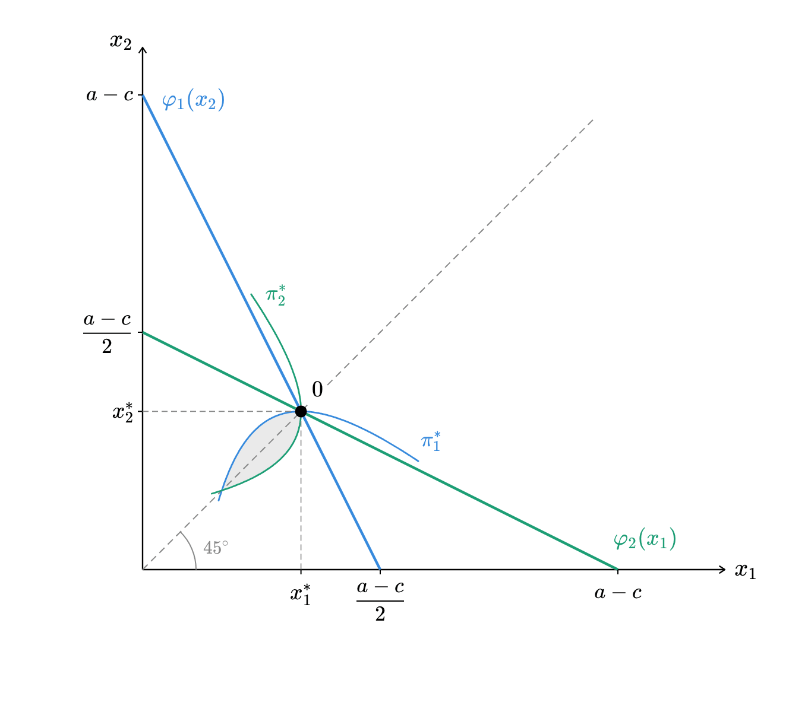
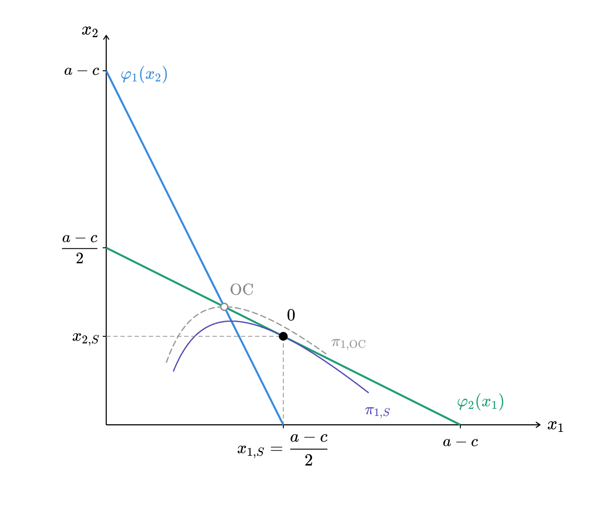
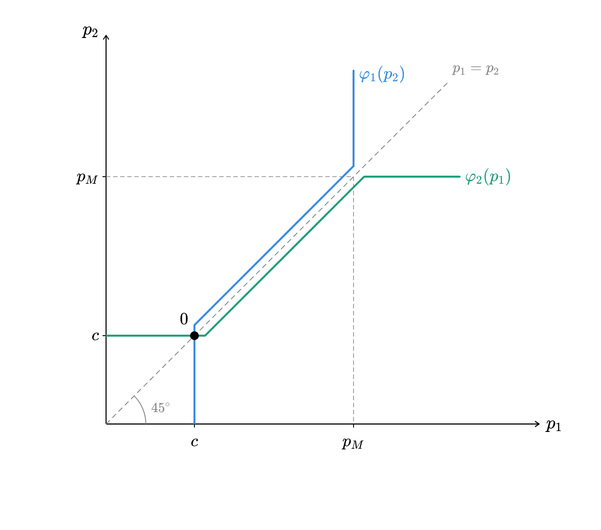
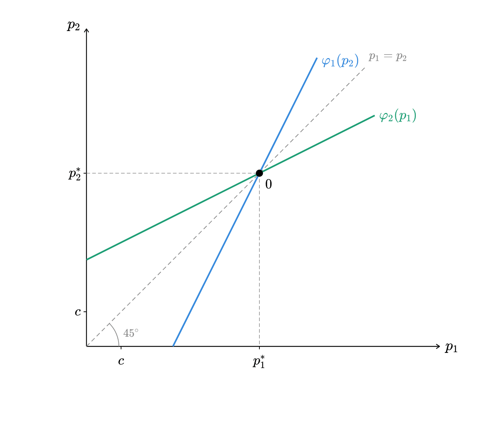
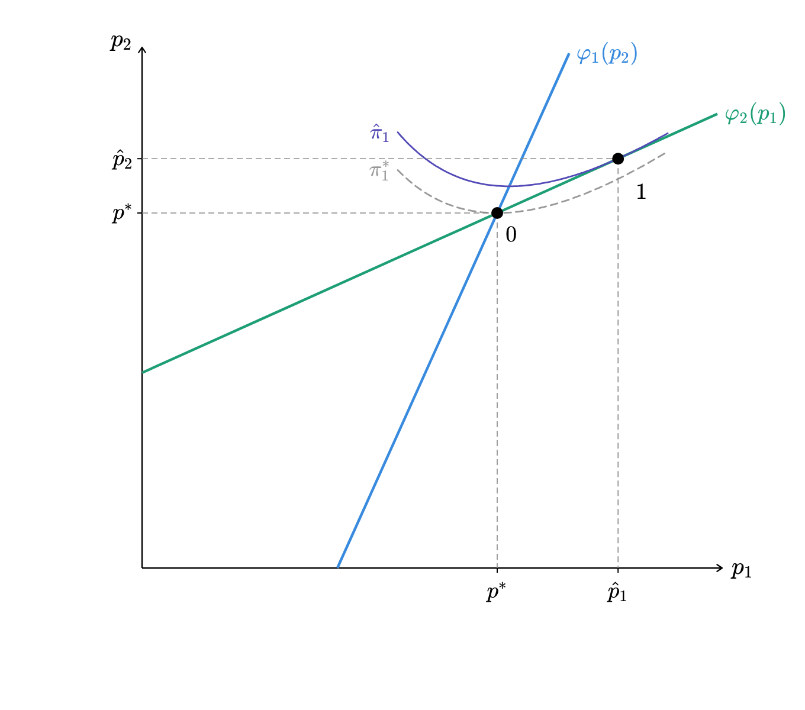

## Introducción

::: {.callout-note appearance="simple" icon=false}

:::

El **oligopolio** es la estructura de mercado en la que un número reducido de empresas abastece la demanda y cada una sabe que su resultado depende de lo que hagan las demás. Esa interdependencia estratégica, ausente en la competencia perfecta y en el monopolio, hace de la teoría de juegos su instrumento natural. En muchos sectores, de la aviación a la telefonía, la banca o la energía, unas pocas empresas concentran la mayor parte de la producción. Los primeros modelos fueron de Cournot (1838), con competencia en cantidades, y de Bertrand (1883), con competencia en precios, que llegan a resultados opuestos. En el primero el precio queda entre el de monopolio y el competitivo, y en el segundo dos empresas bastan para llevarlo al coste marginal, la **paradoja de Bertrand**. Stackelberg (1934) añadió la competencia secuencial entre un líder y un seguidor. Como cada empresa influye en el precio y depende a la vez de lo que hagan sus rivales, la teoría ofrece tantos modelos como formas de competir.

Desde los años cincuenta, el **equilibrio de Nash** dio a todos esos modelos un concepto de solución común y convirtió la teoría de juegos (tema [A14](a14-juegos.qmd)) en el lenguaje del oligopolio. Con ella se explica por qué la **colusión** es rentable pero difícil de sostener, ya que cada empresa tiene incentivos a desviarse del acuerdo, y cómo la repetición del juego puede hacerla estable (Friedman, 1971). También se explica cómo las empresas instaladas pueden disuadir la entrada de competidores con un compromiso creíble, como una capacidad productiva superior a la de monopolio (Dixit, 1980), y por qué, según la teoría de los **mercados impugnables** de Baumol, Panzar y Willig (1982), la mera amenaza de entrada puede disciplinar a un mercado con pocas empresas. La estructura de un oligopolio deja así de ser un dato y pasa a depender de la tecnología y de las estrategias de las empresas.

Esos resultados fundamentan la política de defensa de la competencia, desde la persecución de los **cárteles**, con los programas de clemencia que explotan la fragilidad de los acuerdos, hasta el control de las concentraciones, que se apoya en índices como el de Herfindahl-Hirschman (tema [A20](a20-regulacion.qmd)).

El tema se organiza en tres partes:

- *Juegos no cooperativos*: el tema explica cómo compiten las empresas cuando no cooperan.

- *Colusión*: se analiza cuándo pueden las empresas sostener la cooperación.

- *Entrada y disuasión*: el tema termina con las razones por las que la entrada no disuelve los beneficios de las empresas establecidas.

## 1. Modelos de oligopolio basados en juegos no cooperativos

Cuando las empresas no pueden firmar acuerdos vinculantes, cada una elige su estrategia por separado, como mejor respuesta a lo que espera que hagan sus rivales. Los modelos se distinguen por la variable estratégica (cantidades o precios) y por el orden de las decisiones (simultáneas o secuenciales), y las cuatro combinaciones de ambos criterios ordenan la sección.

### 1.1. Competencia simultánea en cantidades (Cournot, 1838)

**Origen**: el oligopolio lo estudió por primera vez el economista matemático francés Augustin Cournot (1838), cuyo modelo sigue siendo la respuesta clásica a la interdependencia estratégica entre empresas.

**Idea**: las empresas eligen simultáneamente sus cantidades y el precio se ajusta para vaciar el mercado. Cada una fija así sobre su coste marginal un margen relativo (índice de Lerner) proporcional a su cuota de mercado, entre el resultado competitivo y el de monopolio.

#### 1.1.1. Supuestos

**Entorno**: salvo por el poder de mercado de las empresas, es el de la competencia perfecta. El bien es homogéneo, la información es completa y compartida por todas las empresas, y los consumidores son precio-aceptantes. Existen varias empresas oligopolísticas, cada una con un poder de mercado proporcional a su tamaño, y ninguna fija el precio. Como en el modelo walrasiano de equilibrio general, un *subastador walrasiano* ficticio anuncia el precio que vacía el mercado dada la producción total, $p = p(X)$, sin que se realicen intercambios a otros precios (tema [A21](a21-equilibrio-general.qmd), apartado 1.2.3). El análisis es, no obstante, de equilibrio parcial, porque se limita a un solo mercado.

**Agentes**:

- *Empresas*: producen y venden simultáneamente un bien homogéneo ($X = \sum_{i=1}^{n} x_i$). Cada empresa tiene una función de costes $\text{CT}_i(x_i)$ con $\partial \text{CT}_i / \partial x_i > 0$ (no se exige convexidad). La variable estratégica es la cantidad, mientras que el precio no lo decide ninguna empresa, sino que lo anuncia el subastador.

    Las empresas son, además, miopes en el sentido de que, aunque reconocen que su cantidad afecta al precio ($\partial p / \partial x_i \neq 0$), consideran que su conducta no afecta a las otras ($\partial x_j / \partial x_i = 0$, $\forall i \neq j$). Dicho de otro modo, sus variaciones conjeturales son nulas[^a19-2].

- *Consumidores*: la demanda inversa de mercado es decreciente, $D^{-1}(X) \equiv p(X)$, con $\partial p / \partial X < 0$.

**Restricciones**: se cumplen las condiciones de Hahn, de modo que:

- *Primera condición*: las cantidades son *sustitutos estratégicos* ($\partial^2 \pi_i / \partial x_i \partial x_j < 0$)[^a19-3], es decir, un aumento de la cantidad de una empresa reduce el beneficio marginal de la otra, lo que la lleva a elegir una cantidad menor.

- *Segunda condición*: la pendiente del coste marginal es mayor que la de la demanda inversa ($p' - \text{CT}_i'' < 0$).

Juntas, ambas condiciones hacen que las funciones del modelo cumplan dos propiedades:

- *Funciones de reacción*: tienen, respecto a la cantidad de la rival, pendiente no positiva e inferior a la unidad en valor absoluto, y son continuas.

- *Función de beneficios*: es estrictamente cóncava en la propia cantidad ($\partial^2 \pi_i / \partial x_i^2 < 0$), de modo que la mejor respuesta de cada empresa es única.

Además, las condiciones de Hahn garantizan la existencia, la unicidad y la estabilidad del equilibrio de Cournot, propiedades que el desarrollo gráfico permite comprobar.

#### 1.1.2. Modelo

**Planteamiento**: cada empresa elige su cantidad maximizando el beneficio, dado el resto:

$$\max_{x_i} \; \pi_i = p(X) \cdot x_i - \text{CT}_i(x_i)$$

donde $p(X)$ es la función inversa de demanda del mercado, $X = \sum_i x_i$ la producción total, $x_i$ la cantidad de la empresa $i$ y $\text{CT}_i(x_i)$ su función de costes.

**CPO**:

$$\frac{\partial \pi_i}{\partial x_i} = \frac{dp}{dX} \cdot x_i + p(X) - \frac{d\text{CT}_i}{dx_i} = 0$$

$$\text{Img}_i = \text{Cmg}_i \tag{1}$$

$$p = \frac{1}{1 - s_i / |\varepsilon|} \cdot \text{Cmg}_i \equiv (1 + \mu) \cdot \text{Cmg}_i \tag{2}$$

donde $s_i = x_i / X \in [0, 1]$ es la cuota de mercado, $|\varepsilon| \equiv |\varepsilon_{Xp}|$ el valor absoluto de la elasticidad-precio de la demanda de mercado y $s_i / |\varepsilon|$ el índice de Lerner.

La condición (1) indica que los oligopolistas igualan ingreso marginal y coste marginal, al igual que en competencia perfecta o en monopolio. La condición (2), en cambio, muestra que el oligopolista fija un margen $\mu$ sobre su coste marginal. El precio es así superior al de competencia perfecta pero inferior al de monopolio, ya que el poder de mercado está repartido entre varias empresas. La distorsión existe porque la elasticidad de su demanda es finita.

Además, la condición (2) anida los casos polares de la teoría de mercados:

- *Competencia perfecta*: si la cuota de la empresa tiende a cero o la demanda es infinitamente elástica ($s_i \rightarrow 0$ o $|\varepsilon| \rightarrow \infty$), el margen desaparece y $p = \text{Cmg}_i$.

- *Monopolio*: si la cuota es la unidad ($s_i = 1$), la condición (2) se reduce a $p(1 - 1/|\varepsilon|) = \text{Cmg}_i$, la regla del monopolio.

- *Oligopolio*: entre ambos extremos, las empresas con menor coste marginal producen más y tienen mayor cuota ($s_i > s_j \Leftrightarrow \text{Cmg}_i < \text{Cmg}_j$), por lo que la eficiencia relativa determina la estructura del mercado.

**CSO**: $\partial^2\pi_i/\partial x_i^2 = 2p' + p''x_i - \text{CT}_i'' < 0$, condición que se cumple si la demanda no es demasiado convexa y el coste marginal no decrece. En ese caso, la CPO define la mejor respuesta[^a19-29].

**Solución**: de la condición (1) se obtiene la *función de mejor respuesta* o *función de reacción*, que indica la cantidad óptima de una empresa dada la cantidad de la otra[^a19-4], $x_i^* = \varphi_i(x_j)$. A través de las funciones de reacción se demuestra que existe un equilibrio de Nash en estrategias puras de producción[^a19-5].

**Equilibrio**: el *equilibrio de Cournot-Nash* es el par de cantidades $(x_1^*, x_2^*)$ en el que ambas funciones de reacción se cumplen a la vez, es decir, en el que cada empresa produce su mejor respuesta a lo que efectivamente produce la otra. Con empresas simétricas, $x_i^* = x^*$ para todas.

**Desarrollo gráfico**: el duopolio de Cournot se representa en el plano de cantidades $(x_1, x_2)$[^a19-7] (figura -@fig-a191-cournot):

1. *Curvas isobeneficio*, $\pi_1^*$ y $\pi_2^*$: cada una reúne las combinaciones de cantidades de ambas empresas que dan a la empresa respectiva un mismo beneficio. Su forma es cóncava vista desde el eje de esa empresa, y el beneficio que representan crece a medida que se aproximan a ese eje, es decir, a la cantidad de monopolio. De la unión de sus puntos máximos se obtiene la función de reacción[^a19-6].

2. *Funciones de reacción*, $\varphi_1(x_2)$ y $\varphi_2(x_1)$: son simétricas (costes iguales) y tienen pendiente negativa, porque un aumento de $x_1$ implica una disminución de $x_2$ al repartirse el mercado. Sus cortes con los ejes representan los casos polares, la cantidad de monopolio y la cantidad de competencia perfecta.

3. *Equilibrio*: se alcanza en $(x_1^*, x_2^*)$ (punto 0), en la intersección de las funciones de reacción, y se sitúa sobre la bisectriz si las empresas tienen costes idénticos. Como, en el plano $(x_1, x_2)$, $\varphi_1(x_2)$ es más inclinada que $\varphi_2(x_1)$, el equilibrio es estable, y de no ser así sería inestable.

::: {#fig-a191-cournot}

::: {.content-visible when-format="html"}
```{=html}
<div class="graph-frame">
<iframe src="../graphs/a191_Cournot.html" style="height:620px" loading="lazy" title="fig-a191-cournot"></iframe>
</div>
```
:::

::: {.content-visible unless-format="html"}

:::

Duopolio de Cournot. Las curvas de reacción se cortan en el equilibrio de Nash en cantidades.
:::

**Estática comparativa**:

- *Número de empresas*: con $n$ empresas simétricas de coste marginal constante $c$ y demanda lineal $p = a - X$, cada una produce $x^* = (a - c)/(n + 1)$, el precio es $p^* = (a + nc)/(n + 1)$ y el margen de Lerner es $(p^* - c)/p^* = 1/(n|\varepsilon|)$.

    Al crecer $n$, la producción total tiende a la competitiva y el precio al coste marginal, de modo que la competencia perfecta es el límite del oligopolio de Cournot cuando el número de empresas crece sin límite.

- *Costes*: una reducción del coste marginal de una empresa desplaza hacia fuera su función de reacción. En el nuevo equilibrio esa empresa produce más y gana cuota, y la rival produce menos (las cantidades son sustitutos estratégicos). La reducción de la rival es, sin embargo, menor, porque la pendiente de su función de reacción es inferior a la unidad en valor absoluto. Por ello, la producción total aumenta y el precio baja.

**Dinámica**: el razonamiento desde la teoría de juegos parte de $(x_1^0, x_2^0)$, donde la empresa 2, confiando en que la 1 mantiene $x_1^0$, ha escogido su mejor respuesta, $x_2^0 = \varphi_2(x_1^0)$. La empresa 1 también puede deducir esto y ajustar su cantidad, y el razonamiento se repite hasta alcanzar el equilibrio de Nash $(x_1^*, x_2^*)$, cuya producción total en el oligopolio de Cournot (OC) cumple $X_M < X_{\text{OC}} < X_C$. El análisis muestra así que el equilibrio de Cournot es estable, pues las desviaciones se corrigen por las reacciones sucesivas.

**Bienestar**: el equilibrio de Cournot-Nash no es eficiente en el sentido de Pareto, ni para el conjunto de la sociedad (el precio supera el coste marginal) ni para las propias empresas, porque sus curvas isobeneficio no son tangentes. El área encerrada entre ellas se conoce como *lente de Pareto*, que representa cómo ambas empresas podrían obtener mayores beneficios si cooperasen[^a19-8].

**Extensiones**: con costes asimétricos, ponderando por las cuotas el índice de Lerner de cada empresa (condición (2)), el margen medio de la industria es igual al índice de Herfindahl-Hirschman, calculado con cuotas en tanto por uno, dividido por la elasticidad, $\sum_i s_i (p - \text{Cmg}_i)/p = \sum_i s_i^2/|\varepsilon| = \text{HHI}/|\varepsilon|$. Este resultado fundamenta el uso de los índices de concentración (tema [A20](a20-regulacion.qmd), apartado 3.2.1).

#### 1.1.3. Conclusiones

**Aspectos positivos**: el modelo obtiene una predicción razonable y anidada en las estructuras polares, $X_C > X_{\text{OC}} > X_M$ y $p_C < p_{\text{OC}} < p_M$, y su equilibrio, con las condiciones de Hahn, existe, es único y es estable. El modelo es, además, la referencia de la teoría del oligopolio y la base de los índices de concentración que relacionan estructura y conducta (tema [A20](a20-regulacion.qmd)).

**Limitaciones**: se le reprocha, por un lado, su poco realismo, pues las empresas compiten en cantidades y un subastador fija el precio, y, por otro, la miopía de unas empresas que no aprenden de cómo responden las rivales. En respuesta a lo primero, Bertrand desarrolló un modelo alternativo basado en precios, y en respuesta a lo segundo Stackelberg introdujo la anticipación.

### 1.2. Competencia secuencial en cantidades (Stackelberg, 1934)

**Origen**: Stackelberg (1934) propuso el liderazgo en cantidades en respuesta a la miopía de las empresas del modelo de Cournot.

**Idea**: las decisiones son secuenciales. Una empresa líder elige primero su cantidad anticipando la reacción de la seguidora, lo que le confiere la ventaja de mover primero.

#### 1.2.1. Supuestos

**Entorno**: los supuestos son idénticos a los de Cournot (información completa, competencia en cantidades, bien homogéneo), con la diferencia de que la toma de decisiones es secuencial, en un juego en dos periodos.

**Agentes**:

- *Empresa líder*: elige en primer lugar la cantidad a producir. Su ventaja es exógena (p. ej. una inversión previa en capacidad) y constituye un compromiso creíble. Conoce la función de reacción de la seguidora (no es una ventaja informacional, porque con información completa ambas la conocen). Por tanto, su variación conjetural no es nula, sino $\partial x_2 / \partial x_1 = \varphi_2'(x_1) < 0$, ya que anticipa que la seguidora reducirá su producción cuando ella aumente la suya.

- *Empresa seguidora*: no toma su decisión hasta observar la cantidad de la líder. Como esa cantidad ya está fijada cuando decide, su variación conjetural es nula, igual que en Cournot.

#### 1.2.2. Modelo

**Planteamiento**: el juego se resuelve por inducción hacia atrás. La elección de la seguidora, en el segundo periodo, es idéntica a la de Cournot:

$$\max_{x_2} \; \pi_2 = p(x_1 + x_2) \cdot x_2 - \text{CT}_2(x_2) \quad \Rightarrow \quad x_2 = \varphi_2(x_1)$$

donde $x_1$ y $x_2$ son las cantidades de la líder y de la seguidora, $p(x_1 + x_2)$ la demanda inversa, $\text{CT}_2(x_2)$ el coste de la seguidora y $\varphi_2(x_1)$ su función de reacción.

La elección de la líder, en el primer periodo, maximiza su beneficio anticipando la respuesta de la seguidora, cuya función de reacción entra como restricción:

$$\max_{x_1} \; \pi_1 = p(x_1 + x_2) \cdot x_1 - \text{CT}_1(x_1) \quad \text{s.a.:} \; x_2 = \varphi_2(x_1)$$

donde $\text{CT}_1(x_1)$ es el coste de la líder y la restricción recoge que la seguidora responderá según su función de reacción $\varphi_2(x_1)$.

**CPO**: sustituyendo la función de reacción en el beneficio de la líder y derivando respecto a $x_1$:

$$\underbrace{\frac{\partial p}{\partial x_1} x_1 + p}_{\text{Img}_1} + \underbrace{\frac{\partial p}{\partial x_2} \cdot \frac{\partial \varphi_2}{\partial x_1} \cdot x_1}_{\text{efecto estratégico} > 0} = \text{Cmg}_1$$

Se llega a la misma CPO que en Cournot, pero con un término adicional, el efecto estratégico, que refleja cómo la líder anticipa su impacto sobre la seguidora.

**CSO**: la de la seguidora es la de Cournot. Para la líder, el beneficio ha de ser cóncavo en $x_1$ a lo largo de la función de reacción de la seguidora, lo que se cumple con demanda lineal y costes convexos.

**Equilibrio**: el equilibrio de Stackelberg es un equilibrio de Nash perfecto en subjuegos (ENPS) en el que la líder produce la cantidad que maximiza su beneficio sobre la función de reacción de la seguidora, y esta elige su mejor respuesta. Respecto a Cournot, la líder produce más y obtiene mayor beneficio, y la seguidora produce menos y obtiene menos.

Como la seguidora reduce su producción en menos de lo que la líder la aumenta (siempre que la pendiente de su función de reacción esté entre $-1$ y $0$), el *output* total es mayor y el precio inferior. El liderazgo tiene, por ello, un efecto procompetitivo. La ordenación de las estructuras de mercado por cantidad y precio es, entonces, $X_C > X_S > X_{\text{OC}} > X_M$ y $p_C < p_S < p_{\text{OC}} < p_M$, y Stackelberg se sitúa entre Cournot y la competencia perfecta.

::: {.callout-tip collapse="true" appearance="simple" title="Ejemplo: Stackelberg frente a Cournot con demanda lineal"}
Sea $p = a - X$, con $X = x_1 + x_2$, y coste marginal constante $c < a$ en ambas empresas. La CPO de la seguidora da su función de reacción, $\varphi_2(x_1) = (a - c - x_1)/2$, de pendiente $-1/2$. Sustituyéndola en el beneficio de la líder:

$$\pi_1 = \left(a - c - x_1 - \frac{a - c - x_1}{2}\right) x_1 = \frac{(a - c - x_1)\, x_1}{2} \;\Rightarrow\; x_1 = \frac{a - c}{2}, \quad x_2 = \varphi_2(x_1) = \frac{a - c}{4}$$

Así, $X_S = 3(a - c)/4$, $p_S = (a + 3c)/4$, $\pi_1 = (a - c)^2/8$ y $\pi_2 = (a - c)^2/16$. En Cournot (con $n = 2$) cada empresa produce $(a - c)/3$ y gana $(a - c)^2/9$, con la siguiente ordenación de las producciones totales:

$$X_C = a - c \;>\; X_S = \tfrac{3}{4}(a - c) \;>\; X_{\text{OC}} = \tfrac{2}{3}(a - c) \;>\; X_M = \tfrac{1}{2}(a - c)$$

La líder aumenta su producción en $(a - c)/6$ y la seguidora la reduce solo en $(a - c)/12$, de modo que la líder gana más que en Cournot ($1/8 > 1/9$), la seguidora menos ($1/16 < 1/9$) y el liderazgo es procompetitivo.
:::

**Desarrollo gráfico**: el liderazgo de Stackelberg se representa en el plano de cantidades $(x_1, x_2)$ (figura -@fig-a192-stackelberg):

1. *Funciones de reacción*, $\varphi_1(x_2)$ y $\varphi_2(x_1)$: son las de Cournot, que se cortan en el punto OC, y la de la seguidora, $\varphi_2(x_1)$, es la restricción de la líder.

2. *Curvas isobeneficio de la líder*, $\pi_{1,\text{OC}}$ y $\pi_{1,S}$: reúnen las combinaciones de cantidades que dan a la líder un mismo beneficio, mayor cuanto más baja es la curva, porque la seguidora produce menos.

3. *Equilibrio*: no se produce en el cruce de las funciones de reacción, como en Cournot, sino en el punto de la función de reacción de la seguidora tangente a la curva isobeneficio más baja alcanzable de la líder, $\pi_{1,S}$ (punto 0). La líder elige así sobre la curva de reacción de la seguidora el punto que más le conviene, con una cantidad $x_{1,S}$ a la derecha de la de Cournot, mientras la de la seguidora, $x_{2,S}$, queda por debajo.

::: {#fig-a192-stackelberg}

::: {.content-visible when-format="html"}
```{=html}
<div class="graph-frame">
<iframe src="../graphs/a192_Stackelberg.html" style="height:620px" loading="lazy" title="fig-a192-stackelberg"></iframe>
</div>
```
:::

::: {.content-visible unless-format="html"}

:::

Liderazgo de Stackelberg. El líder elige, sobre la curva de reacción del seguidor, el punto de su isobeneficio más baja, que es la de mayor beneficio.
:::

**Estática comparativa**:

- *Tamaño del mercado y coste común*: con demanda lineal y coste marginal común (ejemplo anterior), las cantidades de equilibrio son proporcionales a $a - c$. Por tanto, un aumento de $a$ o una reducción de $c$ las eleva en la misma proporción, y la líder conserva dos tercios de la producción total. El precio, $p_S = (a + 3c)/4$, sube con $a$ y con $c$.

- *Coste de la líder*: una reducción de su coste marginal eleva su cantidad y, a lo largo de la función de reacción de la seguidora, reduce la de esta en menor cuantía, con lo que la producción total aumenta y el precio baja.

**Bienestar**: el equilibrio de Stackelberg no es eficiente en el sentido de Pareto, porque el precio sigue superando el coste marginal y las empresas obtendrían un beneficio conjunto mayor coludiendo. Sin embargo, al ser mayor la producción total y menor el precio, el excedente del consumidor aumenta respecto a Cournot y, con costes marginales constantes e idénticos, la pérdida irrecuperable de eficiencia es menor.

**Extensiones**: con precios, el liderazgo invierte el resultado y la ventaja pasa a la seguidora. El liderazgo con precios tiene un antecedente anterior a la teoría de juegos, el modelo de la empresa dominante (Anexo A.2).

#### 1.2.3. Conclusiones

**Aspectos positivos**: el modelo de Stackelberg introduce el tiempo y la ventaja de mover primero (*first-mover advantage*) en la competencia oligopolística, una ventaja que se observa en muchos sectores, como el petrolero.

**Limitaciones**: la asignación de los papeles de líder y seguidor es exógena y no se explica, y si ambas empresas intentan liderar no existe equilibrio (guerra de Stackelberg). Además, el compromiso del líder solo es creíble si su decisión es irreversible, lo que remite a la teoría de juegos dinámicos del tema [A14](a14-juegos.qmd).

### 1.3. Competencia simultánea en precios (Bertrand, 1883)

**Origen**: Bertrand (1883) desarrolló, como crítica al escaso realismo del modelo de Cournot, un modelo alternativo basado en precios.

**Idea**: con producto homogéneo, costes marginales constantes e idénticos y sin restricciones de capacidad, la competencia simultánea en precios entre solo dos empresas reproduce el resultado competitivo.

#### 1.3.1. Supuestos

**Entorno**: los supuestos son los de Cournot, con la diferencia decisiva de que la variable estratégica es el precio, que las empresas fijan de manera simultánea.

**Agentes**:

- *Empresas*: producen un bien homogéneo con rendimientos constantes y costes idénticos, y sin restricciones de capacidad, de modo que cada una puede abastecer a todo el mercado.

    Como en Cournot, la variación conjetural de cada empresa es nula, pero referida a su variable estratégica, el precio ($\partial p_j / \partial p_i = 0$). Dicho de otro modo, cada empresa fija su precio suponiendo que la rival mantendrá el suyo, lo que, expresado en cantidades, equivale a la conjetura $v_i = -1$ del modelo de variaciones conjeturales (tema [A15](a15-toi.qmd), apartado 1.4.1).

- *Consumidores*: como los bienes son homogéneos, compran al vendedor más barato y, si los precios coinciden, se reparten a partes iguales entre las dos empresas. La demanda de cada empresa es por ello discontinua en el precio del rival:

$$d_i(p_i, p_j) = \begin{cases} X(p_i) & \text{si } p_i < p_j \\ X(p_i)/2 & \text{si } p_i = p_j \\ 0 & \text{si } p_i > p_j \end{cases}$$

#### 1.3.2. Modelo

**Planteamiento** (funciones de reacción): como la función de beneficios no es diferenciable, las funciones de reacción se obtienen directamente de la lógica de la demanda:

$$p_i \equiv \varphi_i(p_j) = \begin{cases} p_M & \text{si } p_j > p_M \\ p_j - \eta & \text{si } c < p_j \leq p_M \\ c & \text{si } p_j \leq c \end{cases}$$

Ante cualquier precio de la empresa 2 que supere su coste marginal, la empresa 1 puede cobrar apenas un poco menos ($p_2 - \eta$, con $\eta > 0$ arbitrariamente pequeño), quedarse con toda la demanda y ganar beneficios extraordinarios. Ninguna de esas combinaciones de precios es, por tanto, un equilibrio de Nash (EN).

**Equilibrio**: en estrategias puras de precios hay un solo equilibrio de Nash, $p_1^* = p_2^* = c$, con $\pi_1^* = \pi_2^* = 0$, en el que las dos cobran lo mismo y ese precio coincide con su coste marginal. A ninguna le conviene apartarse de él, porque una subida en solitario la deja sin clientes, y una bajada la obliga a vender cada unidad por menos de lo que le cuesta, con pérdidas.

**Desarrollo gráfico**: la competencia de Bertrand se representa en el plano de precios $(p_1, p_2)$ (figura -@fig-a193-bertrand):

1. *Función de reacción de la empresa 1*, $\varphi_1(p_2)$: discurre paralela a la bisectriz y justo por encima de ella (rebaja infinitesimalmente el precio del rival) entre el coste marginal y el precio de monopolio. Es vertical en $p_1 = p_M$ cuando el rival fija un precio superior al de monopolio y en $p_1 = c$ cuando lo fija por debajo del coste marginal.

2. *Función de reacción de la empresa 2*, $\varphi_2(p_1)$: es la simétrica de la anterior respecto a la bisectriz, con esos tramos horizontales.

3. *Equilibrio*: las dos funciones solo se cortan en $(c, c)$ (punto 0), que es el único equilibrio.

::: {#fig-a193-bertrand}

::: {.content-visible when-format="html"}
```{=html}
<div class="graph-frame">
<iframe src="../graphs/a193_Bertrand.html" style="height:620px" loading="lazy" title="fig-a193-bertrand"></iframe>
</div>
```
:::

::: {.content-visible unless-format="html"}

:::

Competencia de Bertrand con bienes homogéneos. Las curvas de reacción en precios llevan al equilibrio en el coste marginal.
:::

**Estática comparativa**:

- *Costes*: el precio de equilibrio es igual al coste marginal común, de modo que una variación de $c$ se traslada íntegramente al precio y los beneficios siguen siendo nulos.

- *Número de empresas*: a partir de dos, no altera el equilibrio ($p = c$), a diferencia de Cournot, donde el margen se reduce gradualmente al aumentar $n$.

**Bienestar**: el equilibrio de Bertrand-Nash es ineficiente para las propias empresas, que, si cooperasen, obtendrían mayores beneficios. A diferencia de Cournot, sí es eficiente en el sentido de Pareto para el conjunto de la sociedad, ya que el precio es el competitivo y no hay pérdida irrecuperable de eficiencia.

#### 1.3.3. La paradoja de Bertrand y sus soluciones

**Origen**: la primera objeción al resultado de Bertrand vino de Edgeworth (1897), que limitó la capacidad de producción de las empresas.

**Idea**: que las empresas compitan en precios[^a19-14] es más verosímil que el supuesto de Cournot, que las hace competir en cantidades, pero la conclusión del modelo lo es menos. Esa conclusión, la *paradoja de Bertrand*, es que bastan dos empresas para reproducir el resultado de la competencia perfecta ($p = c$, $\pi = 0$). Cuesta aceptarla, porque en las industrias con pocos competidores las empresas logran fijar precios supracompetitivos, y la literatura ha buscado qué supuesto del modelo la genera.

**Razonamiento**: cada una de las soluciones a la paradoja relaja uno de los supuestos:

1. *Restricciones de capacidad*: si las empresas no pueden abastecer a todo el mercado, se rompe la lógica de acaparar toda la demanda bajando el precio. Dos resultados precisan sus consecuencias:

    - *Ciclos de Edgeworth* (Edgeworth, 1897): el equilibrio puede no existir en estrategias puras y los precios siguen un comportamiento cíclico (suben y caen), análogo al observado con los precios del carburante.

    - *Solución de Kreps y Scheinkman* (1983): si las empresas eligen primero su capacidad (con coste) y compiten después en precios, con racionamiento eficiente y demanda cóncava, el resultado del juego completo coincide con el equilibrio de Cournot. La competencia en precios a corto plazo es, así, compatible con la competencia en cantidades a largo plazo, y la capacidad es la verdadera variable estratégica. Este resultado justifica, *a posteriori*, la competencia en cantidades que suponen los modelos de disuasión de la entrada mediante inversión en capacidad (apartado 3.2.2).

2. *Diferenciación de producto*: si el bien no es homogéneo (tema [A18](a18-competencia-monopolistica.qmd), apartado 1.2), las funciones de reacción se vuelven continuas y de pendiente positiva (los precios son *complementarios estratégicos*). Con ello, el equilibrio se produce con precios por encima del coste marginal y beneficios positivos (figura -@fig-a194-bertrand-ii).

3. *Costes asimétricos*: la empresa de menor coste marginal puede fijar un precio ligeramente inferior al coste de la rival y obtener beneficios.

4. *Interacción repetida*: si las empresas se encuentran periodo tras periodo, la cooperación tácita puede sostenerse mediante amenazas de castigo, como se desarrolla en el apartado 2.

Gráficamente, con producto diferenciado (solución 2), en el plano de precios $(p_1, p_2)$ (figura -@fig-a194-bertrand-ii), las funciones de reacción, $\varphi_1(p_2)$ y $\varphi_2(p_1)$, son crecientes, porque los precios son complementarios estratégicos, y se cortan en el punto 0, con precios $p_1^*$ y $p_2^*$ superiores al coste marginal, $c$.

::: {#fig-a194-bertrand-ii}

::: {.content-visible when-format="html"}
```{=html}
<div class="graph-frame">
<iframe src="../graphs/a194_Bertrand_ii.html" style="height:620px" loading="lazy" title="fig-a194-bertrand-ii"></iframe>
</div>
```
:::

::: {.content-visible unless-format="html"}

:::

Bertrand con productos diferenciados. Las funciones de reacción son crecientes (los precios son complementarios estratégicos) y en el equilibrio los precios quedan por encima del coste marginal.
:::

#### 1.3.4. Conclusiones

**Aspectos positivos**: el modelo de Bertrand muestra que la variable estratégica importa, y su resultado competitivo se convierte en la referencia frente a la que se miden los demás modelos.

**Limitaciones**: la paradoja de Bertrand descansa en supuestos extremos (costes marginales idénticos y constantes, capacidad ilimitada, producto homogéneo, interacción única). Relajarlos, como hacen Edgeworth, la diferenciación de producto o los juegos repetidos con horizonte indefinido y empresas suficientemente pacientes, restablece precios por encima del coste marginal.

### 1.4. Competencia secuencial en precios (Gal-Or, 1985)

::: {.callout-note collapse="true" appearance="simple" title="Sobre esta sección"}
En la exposición, este apartado puede presentarse de forma simplemente gráfica, con las funciones de reacción en precios del desarrollo gráfico (figura -@fig-a198-bertrand-secuencial), sin el álgebra del apartado 1.4.2. Basta mostrar que la líder elige, sobre la función de reacción creciente de la seguidora, el punto de mayor beneficio.
:::

**Origen**: Gal-Or (1985) mostró que, entre empresas idénticas, mover primero es una ventaja si las funciones de reacción son decrecientes, como con cantidades, y una desventaja si son crecientes, como con precios y producto diferenciado.

**Idea**: en la versión en precios del modelo de Stackelberg, la líder sube su precio para que la seguidora también suba el suyo. Los dos precios superan los de Bertrand, y la seguidora, que cobra algo menos, gana más que la líder (*ventaja de mover segundo*).

#### 1.4.1. Supuestos

**Entorno**: los supuestos son los de Bertrand, con decisiones secuenciales, en dos periodos, y producto diferenciado. La demanda de cada empresa es lineal y simétrica:

$$x_i = a - p_i + \gamma \, p_j, \qquad i \neq j$$

donde $x_i$ son las ventas de la empresa $i$, $p_i$ y $p_j$ los precios propio y de la rival, $a > (1 - \gamma)\,c$ el tamaño del mercado, $c$ el coste marginal común y $\gamma \in (0, 1)$ el grado de sustituibilidad entre los productos. La diferenciación es necesaria, porque con producto homogéneo la seguidora rebajaría cualquier precio de la líder superior a $c$ y se quedaría con todo el mercado, y el resultado seguiría siendo el de Bertrand ($p = c$).

**Agentes**:

- *Empresa líder* (empresa 1): fija primero su precio, $p_1$, con un compromiso creíble, y conoce la función de reacción de la seguidora.

- *Empresa seguidora* (empresa 2): observa $p_1$ y fija $p_2$ como mejor respuesta.

#### 1.4.2. Modelo

**Planteamiento**: por inducción hacia atrás, la seguidora responde a $p_1$ como en Bertrand, y la líder maximiza su beneficio sujeta a esa respuesta:

$$\max_{p_1} \; \pi_1 = (p_1 - c)\,(a - p_1 + \gamma\, p_2) \quad \text{s.a.:} \; p_2 = \varphi_2(p_1) = \frac{a + c + \gamma\, p_1}{2}$$

donde $\pi_1$ es el beneficio de la líder y $\varphi_2(p_1)$ la función de reacción de la seguidora, que resulta de su CPO y es creciente en el plano $(p_1, p_2)$, con pendiente $\gamma/2$.

**CPO**: sustituyendo la función de reacción de la seguidora en el beneficio de la líder y derivando respecto a $p_1$, la CPO de la líder añade a la condición de Bertrand un efecto estratégico:

$$\underbrace{a - 2p_1 + \gamma\, p_2 + c}_{\text{CPO de Bertrand}} + \underbrace{(p_1 - c)\, \gamma \cdot \varphi_2'(p_1)}_{\text{efecto estratégico} > 0} = 0$$

Una subida de $p_1$ lleva a la seguidora a subir $p_2$, lo que devuelve a la líder parte de la demanda perdida. La líder percibe así una demanda menos elástica que en Bertrand y cobra más, mientras que con cantidades el efecto estratégico la lleva a producir más.

**CSO**: sustituida la función de reacción, el beneficio de la líder es cuadrático en $p_1$, con segunda derivada $-(2 - \gamma^2) < 0$, y el de la seguidora lo es en $p_2$, con segunda derivada $-2$, por lo que las CPO caracterizan máximos.

**Equilibrio**: en el ENPS, con $p^* = (a + c)/(2 - \gamma)$ como precio de Bertrand simultáneo, los precios de la líder y de la seguidora son

$$\hat p_1 - c = \left[1 + \frac{\gamma^2}{2(2 - \gamma^2)}\right](p^* - c), \qquad \hat p_2 - c = \left[1 + \frac{\gamma^3}{4(2 - \gamma^2)}\right](p^* - c)$$

Los dos corchetes superan la unidad y el primero es mayor, de modo que $\hat p_1 > \hat p_2 > p^*$, y los beneficios cumplen $\hat\pi_2 > \hat\pi_1 > \pi^*$. La líder gana más que en Bertrand, porque podría fijar $p^*$ y obtener $\pi^*$. La seguidora gana aún más, pues copiando el precio de la líder obtendría lo que la líder ganaría frente a un rival igual de caro. Ese beneficio supera $\hat\pi_1$, porque la rival real de la líder cobra menos, y la mejor respuesta de la seguidora le da todavía más. Por tanto, al revés que en Stackelberg con cantidades, la ventaja es de mover segundo.

**Desarrollo gráfico**: la competencia secuencial se representa en el plano de precios $(p_1, p_2)$ (figura -@fig-a198-bertrand-secuencial):

1. *Funciones de reacción*, $\varphi_1(p_2)$ y $\varphi_2(p_1)$: son las de Bertrand, crecientes, que se cortan en $(p^*, p^*)$ (punto 0), y la de la seguidora es la restricción de la líder.

2. *Curvas isobeneficio de la líder*, $\pi_1^*$ y $\hat\pi_1$: tienen forma de U, con el mínimo sobre $\varphi_1(p_2)$, y cuanto más altas, mayor es el beneficio, porque la líder vende más cuanto más cobra su rival.

3. *Equilibrio*: la líder elige sobre $\varphi_2(p_1)$ el punto de tangencia con su isobeneficio más alta, $\hat\pi_1$ (punto 1). Los dos precios superan $p^*$, y el punto queda bajo la bisectriz, porque la seguidora cobra menos que la líder.

::: {#fig-a198-bertrand-secuencial}

::: {.content-visible when-format="html"}
```{=html}
<div class="graph-frame">
<iframe src="../graphs/a198_Bertrand_secuencial.html" style="height:620px" loading="lazy" title="fig-a198-bertrand-secuencial"></iframe>
</div>
```
:::

::: {.content-visible unless-format="html"}

:::

Competencia secuencial en precios. La líder elige, sobre la función de reacción de la seguidora, el punto de tangencia con su isobeneficio más alta (punto 1), con los dos precios por encima de los de Bertrand simultáneo (punto 0).
:::

**Estática comparativa**: las subidas de precio respecto a Bertrand, de orden $\gamma^2$ en la líder y $\gamma^3$ en la seguidora, crecen con la sustituibilidad, y con ellas la ventaja de la seguidora. Si $\gamma \to 0$, cada empresa fija su precio de monopolio y el orden de juego deja de importar.

**Bienestar**: las empresas ganan y los consumidores pierden, y, con esta demanda lineal, la pérdida de excedente del consumidor supera la ganancia de beneficios y el bienestar total cae. Por ello, al contrario que con cantidades, el liderazgo es anticompetitivo.

**Extensiones**: Hamilton y Slutsky (1990) hacen endógeno el orden de juego, con empresas que anuncian antes si fijarán su precio pronto o tarde (juego con espera observable). Si las dos ganan con el juego secuencial, como aquí, el equilibrio es secuencial, con cualquiera de ellas como líder. Con cantidades, en cambio, la seguidora pierde frente a Cournot y las dos deciden a la vez.

#### 1.4.3. Conclusiones

**Aspectos positivos**: el modelo completa la clasificación de la sección y muestra que la pendiente de las funciones de reacción decide quién gana con el orden de juego. Da, además, un fundamento no colusivo al liderazgo en precios (Anexo A.2), que eleva los precios sin acuerdo alguno.

**Limitaciones**: los papeles son exógenos, como en Stackelberg, y el compromiso de la líder es menos verosímil con precios, que se revisan con facilidad, que con capacidades. El grado de diferenciación se toma, además, como dado (tema [A18](a18-competencia-monopolistica.qmd), apartado 1.2).

### 1.5. Conclusiones

Los modelos estáticos de oligopolio comparten un resultado central, el de que la variable estratégica determina el grado de competencia. Se distinguen dos casos:

- *Competencia en cantidades*: el equilibrio se sitúa entre el monopolio y la competencia perfecta y se aproxima a esta última conforme aumenta el número de competidores.

- *Competencia en precios*: con los supuestos de Bertrand bastan dos empresas para replicar el resultado competitivo, lo que constituye la paradoja de Bertrand. Con producto diferenciado, el liderazgo eleva los dos precios y favorece a la seguidora.

De ahí procede la relevancia de los supuestos que matizan la paradoja. Las restricciones de capacidad, la diferenciación del producto, la asimetría de costes y, sobre todo, la interacción repetida devuelven poder de mercado a las empresas y explican por qué la evidencia empírica rara vez muestra precios iguales al coste marginal en mercados concentrados. Ese último factor, la repetición, abre el análisis de la colusión. Las variaciones conjeturales, que reunían estos modelos en una sola condición de primer orden, se desarrollan en el tema [A15](a15-toi.qmd), apartado 1.4.1.

## 2. Modelos de oligopolio basados en la colusión: soluciones cooperativas

Ninguna empresa gana desviándose de las soluciones estáticas no cooperativas anteriores, que son por ello equilibrios de Nash. Sin embargo, para las empresas no son óptimos de Pareto, ya que coordinándose ganarían más. El problema es que esa cooperación no es estable.

Antes de la teoría de juegos, la coordinación tácita se explicaba con dos modelos, la demanda quebrada (Sweezy, 1939) y el liderazgo en precios de la empresa dominante, que se recogen en el Anexo.

Una forma de enriquecer el análisis de la cooperación sin salir de los juegos no cooperativos es considerar aspectos dinámicos. La introducción de un marco dinámico supone:

- *Repetición*: considerar más de un periodo, con un superjuego que suma juegos independientes[^a19-16].

- *Respuesta a la historia*: las empresas pueden reaccionar a las acciones anteriores de sus competidores.

- *Credibilidad y compromiso*: con información completa, el equilibrio relevante es el ENPS, y ambos conceptos (y el de coste hundido) desempeñan un papel central.

- *Inducción hacia atrás*: con horizonte finito, el juego se resuelve desde el último periodo.

### 2.1. Alianzas no sostenibles

Conviene mostrar primero que introducir aspectos dinámicos no implica por sí solo la cooperación. Para ello, los acuerdos entre empresas se clasifican según dos criterios independientes.

**Según su exigibilidad**:

- *Vinculantes*: un tercero (un tribunal o un árbitro, que aplican el contrato o la ley) obliga a cumplirlos, y los estudian los juegos cooperativos.

- *No vinculantes*: nadie puede obligar a cumplirlos, solo los sostienen los incentivos de las partes y los estudian los juegos no cooperativos.

**Según su forma**:

- *Explícitos*: media comunicación y un acuerdo formal entre las empresas, como en el cártel[^a19-17][^a19-18]. 

- *Tácitos*: la coordinación surge sin comunicación, de la mera repetición de la interacción[^a19-19].

Por último, los acuerdos colusivos ilegales son siempre no vinculantes, sean explícitos o tácitos, porque ningún tribunal hará cumplir un cártel.

#### 2.1.1. Cártel o colusión: el cuasimonopolio multiplanta

**Idea**: el cártel se modeliza como el monopolista multiplanta del tema [A17](a17-monopolio.qmd). Si las empresas coordinan precios y cantidades, el conjunto de la industria se comporta como un único monopolista con varias plantas, que fija la cantidad de monopolio y la reparte entre las empresas según sus costes.

**Planteamiento**: el cártel maximiza el beneficio conjunto como un monopolista multiplanta:

$$\max_{\{x_1, \ldots, x_n\}} \; \pi = p(X) \cdot X - \sum_{i=1}^{n} \text{CT}_i(x_i)$$

donde $X = \sum_{i=1}^{n} x_i$ es la producción total del cártel, $p(X)$ la demanda inversa de mercado, $x_i$ la cantidad asignada a la empresa $i$ y $\text{CT}_i(x_i)$ su función de costes. Las variables de decisión son las cantidades de cada empresa, que fijan a la vez la producción total y su reparto.

**CPO**: derivando respecto a cada $x_i$,

$$\begin{aligned} \frac{\partial \pi}{\partial x_i} &= p(X) + \frac{dp}{dX}\, X - \frac{d\text{CT}_i}{dx_i} = 0 \\ &\Rightarrow\; \text{Img}(X) = \text{Cmg}_i(x_i) = \text{Cmg}_j(x_j) \quad \forall\, i, j \end{aligned}$$

Como todas las unidades se venden al mismo precio, el ingreso marginal, $\text{Img}(X)$, solo depende del total producido, no de la planta que fabrique la última unidad. El cártel asigna la producción a la planta de menor coste marginal, hasta que los costes marginales de todas se igualan entre sí y con el ingreso marginal. Por tanto, las empresas con costes más bajos producen más.

**CSO**: el ingreso marginal es decreciente y los costes marginales de cada planta no decrecientes, lo cual garantiza que la solución de la CPO es un máximo.

**Solución**: la forma de los costes marginales condiciona el reparto de la producción entre las empresas:

- *Costes constantes*: si no hay límite de capacidad, la solución es de esquina y la planta de menor coste produce toda la cantidad, fijada por $\text{Img} = \text{Cmg}$.

- *Costes crecientes*: la producción se asigna igualando los costes marginales entre plantas.

Los beneficios conjuntos son los máximos posibles dada la demanda y la estructura de costes, si bien se produce una pérdida irrecuperable de eficiencia. Con empresas idénticas, el cártel equivale a dividir la demanda en $n$ partes iguales y dejar que cada empresa se comporte como monopolista en la suya.

**Equilibrio**: el acuerdo de cártel no constituye un equilibrio de Nash, ya que cada miembro tiene incentivos para desviarse. Si toma como dado el precio pactado ($p_M$), a cada empresa le conviene ampliar su producción hasta que su coste marginal alcance ese precio[^a19-20], y así obtiene beneficios extraordinarios.

Si el resto mantiene el acuerdo, la empresa prefiere incumplirlo, y si el resto lo incumple, esta también preferirá incumplirlo. Por tanto, incumplir es una estrategia dominante y el resultado es el del dilema del prisionero.

**Desarrollo gráfico**: la colusión se representa en el plano cantidad-precio de la industria y en el de una empresa del cártel (figura -@fig-a196-cartel, paneles a y b):

1. *Demanda e ingreso marginal*, $D(X)$ e $\text{Img}(X)$ (panel a): son los del mercado.

2. *Coste marginal agregado*, $\text{Cmg}(X)$ (panel a): es la suma horizontal de los costes marginales de las empresas, como el $\text{Cmg}_i(x_i)$ de la empresa $i$ (panel b).

3. *Equilibrio*: el cártel produce $X_M$, donde $\text{Img}(X) = \text{Cmg}(X)$, y fija sobre la demanda el precio $p_M$. La cuota de la empresa $i$, $x_i^M$, es la cantidad en la que su coste marginal iguala el valor común del ingreso marginal, $\text{Img}(X_M)$.

    Si la empresa toma $p_M$ como dado, le conviene producir $x_i^d$, donde $\text{Cmg}_i(x_i) = p_M$. El área sombreada entre $p_M$ y su coste marginal, de $x_i^M$ a $x_i^d$, mide el beneficio adicional que obtiene rompiendo el acuerdo mientras las demás lo cumplen, $\Delta \pi_i$.

::: {#fig-a196-cartel}

::: {.content-visible when-format="html"}
```{=html}
<div class="graph-frame wide">
<iframe src="../graphs/a196_Cartel.html" style="--r:1.447" loading="lazy" title="fig-a196-cartel"></iframe>
</div>
```
:::

::: {.content-visible unless-format="html"}

:::

Cártel como monopolista multiplanta. (a) La industria produce $X_M$, donde el ingreso marginal $\text{Img}(X)$ corta al coste marginal agregado $\text{Cmg}(X)$ (suma horizontal de los $\text{Cmg}_i$), y vende a $p_M$. (b) Cada empresa produce su cuota $x_i^M$, donde $\text{Cmg}_i(x_i) = \text{Img}(X_M)$, pero, tomando $p_M$ como dado, le conviene ampliar su producción hasta $x_i^d$, donde $\text{Cmg}_i(x_i) = p_M$, y obtener el beneficio adicional sombreado, $\Delta \pi_i$.
:::

**Conclusiones**:

- *Aspectos positivos*: el modelo del cártel fija el beneficio máximo que la industria puede alcanzar y, con él, la referencia frente a la que se mide toda colusión. También permite introducir las intuiciones centrales sobre los acuerdos colusivos: la asignación eficiente de la producción entre plantas, el incentivo individual a desviarse que los desestabiliza y la razón de ser de las leyes *antitrust*.

- *Limitaciones*: en un marco estático el cártel no es sostenible, porque el incumplimiento es una estrategia dominante. Para explicar por qué existen cárteles duraderos, hay que estudiar el oligopolio en un contexto dinámico.

#### 2.1.2. Juegos repetidos en horizonte finito

**Idea**: se aplica aquí a la colusión la inducción hacia atrás en juegos repetidos con horizonte finito (dilema del prisionero repetido, tema [A14](a14-juegos.qmd), apartado 2.3.2). La cuestión es si la repetición del juego un número finito y conocido de veces permite sostener la cooperación, pues las empresas podrían castigar en el futuro a quien incumpla hoy.

**Supuestos**:

- *Entorno*: la información es completa y hay conocimiento común, el juego no varía de un periodo a otro y el horizonte es finito, con un último periodo, $T$, conocido por todos.

- *Agentes*: en cada periodo las empresas compiten simultáneamente, por ejemplo en precios a la Bertrand, lo que permitirá examinar si la repetición resuelve la paradoja[^a19-22].

**Razonamiento**: el juego se resuelve por inducción hacia atrás:

1. *Periodo $T$*: como ya no hay futuro, lo ocurrido antes no importa y el juego se reduce a una sola jugada. No cooperar es la estrategia dominante, porque el castigo tendría que llegar en $T+1$, que no existe, y cualquier amenaza carece de credibilidad. Todo ENPS ha de prescribir, por tanto, un EN en la última etapa, es decir, un equilibrio sin cooperación.

2. *Periodo $T-1$ y anteriores*: las dos empresas anticipan que en $T$ nadie cooperará, de modo que el mismo argumento vale para $T-1$ y, retrocediendo, para cada periodo anterior hasta el primero.

**Equilibrio**: el equilibrio de Nash perfecto en subjuegos de un juego no cooperativo repetido un número finito de veces consiste en $T$ repeticiones del equilibrio de Nash estático, siempre que este sea único, como en Bertrand o en el dilema del prisionero. Con varios equilibrios en el juego de etapa, en cambio, puede sostenerse cierta cooperación en los primeros periodos (tema [A14](a14-juegos.qmd), apartado 2.3.2).

Con equilibrio único, el resultado es el del dilema del prisionero repetido en horizonte finito, en el que la certeza del final deshace la cooperación desde el principio, con la misma lógica que la paradoja de la cadena de tiendas (tema [A14](a14-juegos.qmd), apartado 2.3.4).

**Conclusiones**:

- *Aspectos positivos*: el modelo muestra que la repetición no basta por sí sola para sostener la colusión y precisa qué hace falta para que la sostenga, un horizonte sin final conocido o varios equilibrios en el juego de etapa.

- *Limitaciones*: el resultado depende de que el último periodo se conozca con certeza y de que la racionalidad sea de conocimiento común. De hecho, basta una pequeña probabilidad de que el rival sea de un tipo cooperativo para que la cooperación se sostenga durante buena parte de un juego finito (Kreps, Milgrom, Roberts y Wilson, 1982). La incertidumbre sobre la duración del juego conduce, por su parte, al juego repetido en horizonte infinito.

### 2.2. Alianzas sostenibles: juegos repetidos en horizonte infinito (Friedman, 1971)

Si el horizonte del juego es indefinido, la amenaza de castigos futuros puede sostener la cooperación como equilibrio, siempre que las empresas valoren lo suficiente el futuro.

**Origen**: James Friedman (1971) realizó un análisis pionero en juegos dinámicos con horizonte infinito que permite ilustrar las ganancias de la cooperación.

**Idea**: si los agentes prevén un número indeterminado de repeticiones del juego[^a19-25], lo que ganan a largo plazo cumpliendo sus compromisos puede compensarles más que la ganancia inmediata de incumplirlos.

**Supuestos**:

- *Entorno*: las estrategias dependen de la historia pasada y una sola desviación provoca la ruptura permanente de la cooperación (*grim trigger*). 

- *Agentes*: dos jugadores racionales juegan con información completa y horizonte infinito. Entre ellos existe un acuerdo tácito o implícito creíble, sostenido por una *estrategia del gatillo* (*trigger strategy*).

**Planteamiento**: la estrategia de cada empresa se define sobre la historia del juego, y la cooperación se sostiene si a ninguna le compensa desviarse. El planteamiento consta de tres elementos:

- *Historia del juego*: la historia hasta el periodo $t$ es la sucesión de acciones de ambas empresas, $h^{t-1} = \{(s_1^\tau, s_2^\tau)\}_{\tau=1}^{t-1}$, con $s_i^\tau \in \{c, nc\}$ (cooperar o no cooperar). La estrategia de cada empresa en cada periodo es una función de esa historia, $s_i^t(h^{t-1})$. En consecuencia, lo que cada empresa hace hoy depende de lo que el rival ha hecho antes.

- *Estrategia del gatillo*: a corto plazo, la estrategia dominante sigue siendo no cooperar, y se trata de comprobar si a largo plazo existe algún ENPS cooperativo. La estrategia del gatillo establece que $s_i^t(h^{t-1}) = c \Leftrightarrow (s_1^\tau, s_2^\tau) = (c, c) \;\; \forall \tau < t$, es decir, cada empresa coopera mientras ambas hayan cooperado en todos los periodos anteriores.

- *Condición de cooperación*: los jugadores cooperarán si el beneficio descontado de cooperar es al menos igual al de desviarse y sufrir después el castigo:

$$\sum_{t=0}^{\infty} \beta^t \pi_{c,c} \geq \pi_{nc,c} + \sum_{t=1}^{\infty} \beta^t \pi_{nc,nc}, \qquad \beta \in (0, 1)$$

donde $\beta \in (0, 1)$ es el factor de descuento y $\pi_{c,c}$, $\pi_{nc,c}$ y $\pi_{nc,nc}$ son los beneficios por periodo cuando ambas cooperan, cuando la empresa se desvía mientras la otra coopera y cuando ninguna coopera.

Aplicando la serie geométrica ($\sum_{t=0}^{\infty} \beta^t = 1/(1-\beta)$, $\forall \beta \in (0, 1)$):

$$\frac{\pi_{c,c}}{1-\beta} \geq \pi_{nc,c} + \frac{\beta}{1-\beta} \pi_{nc,nc}$$

Operando, con $\pi_{nc,c} > \pi_{c,c} > \pi_{nc,nc}$:

$$\beta \geq \frac{\pi_{nc,c} - \pi_{c,c}}{\pi_{nc,c} - \pi_{nc,nc}}$$

En el caso de un duopolio de Bertrand, en el que quien se desvía captura todo el beneficio de monopolio, $\pi_{nc,c} = \pi_M = 2\pi_{c,c}$, y el castigo lo anula, $\pi_{nc,nc} = 0$, se obtiene $\beta \geq 1/2$.

**Equilibrio**: la cooperación, Pareto-eficiente para las empresas, solo es un equilibrio de Nash perfecto en subjuegos si se cumple la condición anterior, ya que, si la tasa de descuento es elevada, el factor de descuento será reducido y el beneficio descontado de cooperar insuficiente. La sostenibilidad requiere estrategias del gatillo creíbles, mecanismos de supervisión adecuados, percepción de juego a largo plazo y que los agentes valoren el futuro (tasa de descuento no muy elevada).

**Estática comparativa**: con $n$ empresas que compiten en precios y se reparten a partes iguales el beneficio de monopolio, $\pi_{c,c} = \pi_M/n$, la que se desvía captura todo el mercado, $\pi_{nc,c} = \pi_M$, y el castigo anula el beneficio. La condición de cooperación se convierte entonces en $\beta \geq 1 - 1/n$. La colusión es más difícil de sostener cuantas más empresas hay, porque la ganancia de desviarse crece con $n$ mientras que la parte de cada una en el beneficio colusivo disminuye. Un factor de descuento menor, por empresas más impacientes o una interacción menos frecuente, la dificulta del mismo modo.

**Extensiones**: este resultado entronca con la aportación de Stigler (1964), para quien el afán por mayores beneficios que motiva la colusión es el mismo que impulsa a desviarse del acuerdo. Por eso la colusión requiere detectar las desviaciones, y la detección es tanto más difícil cuantas más empresas haya, más heterogéneas sean y menos transparentes sean las transacciones.

Además, el modelo constituye una aplicación del *teorema popular* (*folk theorem*). Según este teorema, si el factor de descuento es suficientemente próximo a la unidad, las sanciones *minimax*[^a19-28] pueden sostener cualquier asignación colusiva factible e individualmente racional como EN de un juego infinitamente repetido (tema [A14](a14-juegos.qmd), apartado 2.3.3).

Dos extensiones explican las guerras de precios observadas sin abandonar el marco:

- *Información imperfecta* (Green y Porter, 1984): si las empresas no observan las cantidades rivales sino solo el precio, que también depende de perturbaciones de demanda, un precio bajo puede deberse a una desviación o a un *shock*. La estrategia óptima castiga durante un periodo finito cada vez que el precio cae por debajo de un umbral. De este modo, las guerras de precios ocurren en equilibrio, sin que nadie se desvíe, en las fases de demanda baja.

- *Ciclos de demanda* (Rotemberg y Saloner, 1986): con demanda observable pero fluctuante, la tentación de desviarse es mayor en los auges (la ganancia inmediata es grande y el castigo futuro, medio), por lo que el precio colusivo sostenible debe bajar en las expansiones. Las guerras de precios son, así, procíclicas.

**Conclusiones**:

- *Aspectos positivos*: el modelo muestra que la colusión descansa en cómo se castiga a quien se desvía. Ha dado lugar, además, a una amplia literatura sobre los factores que la hacen más o menos sostenible: las características del mercado (número de empresas, transparencia, estabilidad de la demanda), la severidad y rapidez del castigo y el papel de las autoridades de competencia. Los programas de clemencia de estas explotan precisamente la fragilidad del acuerdo.

- *Limitaciones*: el modelo admite tres matices:

    - *Horizonte*: la colusión es también posible en un horizonte finito de duración incierta, modelizable con una probabilidad de continuación en cada periodo, de modo que el supuesto de horizonte infinito no es esencial.

    - *Acuerdo y cumplimiento*: el modelo no especifica cómo se ponen de acuerdo las empresas ni cómo hacen cumplir el castigo.

    - *Severidad del castigo*: la reversión permanente al equilibrio estático no es, en general, el castigo creíble más severo (p. ej. con Cournot). Por ello, Abreu (1986) propone un enfoque de “zanahoria y palo”, con una fase de castigo breve y más dura en lugar de un castigo permanente.

### 2.3. Conclusiones

La colusión solo se sostiene si los incentivos de cada empresa la hacen estable. El cártel alcanza el beneficio máximo de la industria, pero en una sola jugada no es un equilibrio, porque a cada empresa le conviene producir más de su cuota. La repetición tampoco basta si el final es conocido, ya que la inducción hacia atrás deshace la cooperación desde el último periodo. Con horizonte indefinido, en cambio, las estrategias del gatillo la sostienen como ENPS si el factor de descuento es suficiente, umbral que crece con el número de empresas, y las guerras de precios pueden formar parte del propio equilibrio.

Los modelos dinámicos explican así por qué existen cárteles duraderos que el análisis estático declara imposibles, y con ello las formas explícitas y tácitas de colusión y los acuerdos de cooperación en general, dentro y fuera de la economía industrial. Todos estos resultados toman como dado el número de empresas, que el apartado 3 hace endógeno para estudiar si los beneficios de la colusión resisten la entrada.

## 3. Oligopolio con número variable de empresas: entrada y disuasión

Cuando el número de empresas pasa a ser endógeno, la pregunta es por qué los beneficios extraordinarios del oligopolio no atraen entrada hasta agotarlos. La respuesta se busca en las barreras a la entrada, en lo que pueden hacer las empresas instaladas para impedirla y en las condiciones en que la mera amenaza de entrada basta para disciplinar el mercado.

### 3.1. Barreras a la entrada

Las **barreras a la entrada** son uno de los factores que más claramente determinan el número de empresas de un mercado, y de ellas depende que los beneficios extraordinarios del oligopolio persistan.

::: {.callout-note appearance="simple" icon=false}
El debate definicional y la taxonomía de las barreras se desarrollan en el tema [A15](a15-toi.qmd), apartado 2.2.1, y su medición empírica (escala mínima eficiente relativa, intensidad de costes hundidos, tasas de entrada y salida), en el tema [A20](a20-regulacion.qmd), apartado 3.2.2. Las barreras que sostienen el monopolio se estudian en el tema [A17](a17-monopolio.qmd), apartado 1.1.
:::

#### 3.1.1. Definición

En cuanto a su definición, existen diferentes perspectivas:

- *Condiciones*: para Bain (1956), las que permiten a las instaladas mantener precios supracompetitivos sin inducir la entrada (economías de escala, ventajas absolutas de costes, diferenciación).

- *Asimetría de costes*: para Stigler (1968), un coste que el entrante debe soportar y las instaladas no soportaron.

- *Costes hundidos*: para Baumol y Willig (1981), la barrera la crean los costes hundidos, no los costes fijos.

#### 3.1.2. Causas

Las barreras se clasifican según su origen, con la terminología del tema [A15](a15-toi.qmd), apartado 2.2.1. Son **naturales o estructurales** cuando derivan de la tecnología y la demanda, y **artificiales** cuando las crean las instaladas (estratégicas) o el Estado (legales):

1. *Barreras naturales o estructurales*: la escala mínima eficiente es grande en relación con el tamaño del mercado. En el caso polar, se produce un monopolio natural en el que una sola empresa produce toda la demanda a menor coste que varias (subaditividad de costes).

2. *Barreras estratégicas*: la empresa o empresas con poder de mercado buscan impedir la entrada de competidores potenciales (precio límite, publicidad agresiva, inversión estratégica en capacidad), conductas que se estudian a continuación.

3. *Barreras legales*: privilegios que el Estado concede a la empresa con poder de mercado (patentes, licencias, concesiones, derechos exclusivos).

### 3.2. Disuasión estratégica de la entrada

Las empresas instaladas pueden impedir la entrada, o expulsar a un rival ya presente, mediante el precio límite, la inversión en capacidad o la predación. Además, la propia competencia en calidad, publicidad o I+D puede consolidar la concentración.

#### 3.2.1. Precio límite (Bain, 1956; Sylos-Labini, 1957; Modigliani, 1958)

**Origen**: el modelo de *precio límite* se debe a Joe Bain (*Barriers to New Competition*, 1956) y Paolo Sylos-Labini (1957), y fue formalizado por Franco Modigliani (1958) y reformulado como un juego de señalización por Milgrom y Roberts (1982a).

**Idea**: las empresas instaladas pueden sostener un precio suficientemente bajo para que un entrante potencial, anticipando el precio que regiría tras su entrada, no cubra sus costes medios y desista de entrar.

**Supuestos**:

- *Entorno*: demanda de mercado $p(X)$ decreciente.

- *Agentes*: una empresa (o grupo) instalada que produce $x_I$ y un entrante potencial que decide entrar o no.

- *Tecnología*: el entrante potencial produce con economías de escala, con un coste medio $\text{Cme}_E(x_E)$ decreciente hasta la escala mínima eficiente $x_{\text{EME}}$.

- *Postulado de Sylos*: el entrante espera que la instalada mantenga su producción $x_I$ tras la entrada, de modo que el precio posterior sería $p(x_I + x_E)$ para cualquier cantidad $x_E$ que él aporte. La demanda que afronta el entrante es, por tanto, la *demanda residual* $p(x_I + x_E)$.

**Planteamiento**: la instalada elige la menor producción $x_I^L$ (el mayor precio $p_L$) tal que la demanda residual del entrante (término de la izquierda de la desigualdad) quede en todo punto por debajo de su coste medio (término de la derecha de la desigualdad):

$$p_L = p(x_I^L): \quad p(x_I^L + x_E) \leq \text{Cme}_E(x_E) \;\; \forall \, x_E > 0$$

**Equilibrio**: en la formulación de Modigliani (1958), en la que el entrante solo puede entrar a la escala mínima eficiente o por encima de ella (indivisibilidad técnica), la condición se cumple con igualdad en esa escala, $p(x_I^L + x_{\text{EME}}) = \text{Cme}_E(x_{\text{EME}})$. La producción $x_I^L$ es la que deja al entrante, si produjera a escala eficiente, exactamente sin beneficio. Con un coste medio de trazado suave, en cambio, la igualdad se alcanza en el punto de tangencia descrito en el desarrollo gráfico, a la izquierda de $x_{\text{EME}}$.

Conocida $x_I^L$, se obtiene el precio límite, $p_L$, que, si la entrada no está bloqueada, es superior al competitivo pero inferior al de monopolio ($p_C < p_L < p_M$). La empresa instalada sacrifica así beneficio presente a cambio de conservar el mercado. 

**Desarrollo gráfico**: el precio límite se representa en el plano cantidad-precio (figura -@fig-a195-precio-limite):

1. *Demanda de mercado*, $D(X)$: la instalada se sitúa sobre ella en el punto L, con la producción $x_I^L$ y el precio $p_L$.

2. *Demanda residual del entrante*, $D_R(x_E)$: es la demanda de mercado desplazada a la izquierda en la cantidad $x_I^L$, porque el entrante espera que la instalada la mantenga (postulado de Sylos).

3. *Coste medio del entrante*, $\text{Cme}_E(x_E)$: decrece hasta la escala mínima eficiente, $x_{\text{EME}}$, donde su mínimo marca el precio competitivo, $p_C$.

4. *Equilibrio*: el precio límite, $p_L$, es aquel para el que la demanda residual resulta tangente por debajo a la curva de coste medio del entrante (punto 0). En cambio, todo precio superior, como $p_1$, deja un tramo de la demanda residual, $D_R'(x_E)$, por encima del coste medio y hace rentable la entrada.

::: {#fig-a195-precio-limite}

::: {.content-visible when-format="html"}
```{=html}
<div class="graph-frame">
<iframe src="../graphs/a195_Precio_limite.html" style="height:560px" loading="lazy" title="fig-a195-precio-limite"></iframe>
</div>
```
:::

::: {.content-visible unless-format="html"}

:::

Precio límite (Bain-Sylos-Modigliani). La instalada produce $x_I^L$, para que la demanda residual del entrante, $D_R(x_E)$, sea tangente por debajo a su coste medio, $\text{Cme}_E(x_E)$, en el punto 0. El precio límite, $p_L$, cumple $p_C < p_L < p_M$. A cualquier precio superior, como $p_1$, la demanda residual $D_R'(x_E)$ deja un tramo por encima del coste medio y la entrada resultaría rentable.
:::

**Estática comparativa**: el precio límite es tanto mayor, y la barrera tanto más eficaz, cuanto mayor es la escala mínima eficiente $x_{\text{EME}}$ en relación con el tamaño del mercado, porque la entrada a esa escala deprimiría más el precio. Modigliani (1958) aproxima el margen del precio límite sobre el competitivo por $(p_L - p_C)/p_C \approx x_{\text{EME}}/(X_C\,|\varepsilon|)$, donde $X_C$ es la producción competitiva y $|\varepsilon|$ la elasticidad de la demanda en ese punto. El margen crece con la escala mínima eficiente relativa y decrece con la elasticidad de la demanda.

**Extensiones**: la teoría de juegos ha revisado el modelo en dos direcciones:

- *Credibilidad*: el postulado de Sylos no es creíble. Por inducción hacia atrás, una vez producida la entrada, a la instalada le conviene acomodarla (reducir su producción hasta el equilibrio de Cournot) en lugar de mantener $x_I^L$. Por ello, el entrante racional no debería creer la amenaza. Spence (1977) y Dixit (1980) resuelven el problema con una inversión irreversible en capacidad.

- *Señalización* (Milgrom y Roberts, 1982a): si el entrante desconoce los costes de la instalada, un precio bajo antes de la entrada puede ser una *señal* de costes bajos, y por tanto de entrada poco rentable. La instalada de costes altos no puede imitar esa señal sin pérdidas. El precio límite opera así no por lo que compromete, sino por lo que revela. Sin embargo, en equilibrio no reduce necesariamente la entrada, cuya probabilidad puede ser menor, igual o incluso mayor que con información completa (tema [A14](a14-juegos.qmd), apartado 2.2.4).

**Conclusiones**:

- *Aspectos positivos*: es la primera explicación de por qué los precios de los oligopolios se sitúan de forma persistente entre el nivel competitivo y el de monopolio, y vincula ese margen a un parámetro observable, la escala mínima eficiente.

- *Limitaciones*: en su versión original la amenaza no es creíble, y en la de señalización solo opera con información asimétrica sobre costes o demanda. Además, el modelo es estático y no explica cuánto tiempo puede sostenerse el precio límite.

#### 3.2.2. Compromiso en capacidad (Spence, 1977; Dixit, 1980)

::: {.callout-note appearance="simple" icon=false}
No confundir con el modelo de Dixit y Stiglitz (1977), de competencia monopolística, ni con su antecedente Spence (1976), ambos en el tema [A18](a18-competencia-monopolistica.qmd), apartado 2.2. Spence (1977) y Dixit (1980) son modelos de disuasión de la entrada. Se recomienda presentar este modelo con el diagrama de árbol del juego de entrada (figura -@fig-a197-juego-entrada), al ser más ilustrativo e intuitivo.
:::

**Origen**: Michael Spence (1977) y Avinash Dixit (1980) reconstruyeron el precio límite como un juego en dos etapas en el que la credibilidad la aporta una inversión irreversible.

**Idea**: la credibilidad que le falta al precio límite la proporciona la capacidad instalada. Si la instalada hunde antes de la entrada el coste de una capacidad elevada, producir mucho tras la entrada pasa a ser su mejor respuesta y no una amenaza vacía. El entrante lo anticipa y, según el coste de entrar, la entrada resulta bloqueada, disuadida o acomodada.

**Supuestos**:

- *Entorno*: el juego tiene dos etapas. En la primera, la instalada ($I$) elige una capacidad $k$ con coste $r$ por unidad, irreversible. En la segunda, el entrante ($E$) decide si entra, pagando un coste fijo $F$, y ambas compiten a la Cournot. La demanda es lineal, $p = a - X$, y el coste variable unitario, $c$, es el mismo para ambas.

- *Agentes*: la instalada produce hasta $k$ con coste marginal $c$ (la capacidad ya está pagada) y por encima de $k$ con coste marginal $c + r$. El entrante, en cambio, debe adquirir capacidad y producción a la vez, con coste marginal $c + r$.

**Planteamiento**: se resuelve por inducción hacia atrás. En la segunda etapa, dado $k$ y supuesta la entrada, cada empresa maximiza su beneficio dada la cantidad de la otra:

$$\max_{x_E} \; \pi_E = (a - x_I - x_E - c - r) \, x_E - F$$

$$\max_{x_I} \; \pi_I = (a - x_I - x_E - c) \, x_I - r \cdot \max\{x_I - k, 0\}$$

donde el último término recoge que solo la producción por encima de la capacidad instalada soporta el coste $r$ (el coste $rk$ de la primera etapa ya está hundido).

**CPO**: la función de reacción del entrante es $x_E = \varphi_E(x_I) = (a - c - r - x_I)/2$. La de la instalada, en cambio, tiene un *quiebro* en $k$, con $x_I = (a - c - x_E)/2$ si esta cantidad es inferior a $k$ (coste marginal $c$), y $x_I = (a - c - r - x_E)/2$ si es superior (coste marginal $c + r$). Entre ambos tramos, $x_I = k$.

**CSO**: ambos beneficios son cuadráticos y cóncavos en la propia cantidad (segunda derivada $-2 < 0$), por lo que las reacciones anteriores son máximos. La concavidad se mantiene en el quiebro porque el coste marginal salta hacia arriba.

**Equilibrio**: el beneficio del entrante en el equilibrio de la segunda etapa es decreciente en $k$ y, cuando la instalada utiliza toda su capacidad, vale $\pi_E(k) = \left[(a - c - r - k)/2\right]^2 - F$. Sea $k_D$ la capacidad que anula ese beneficio, $k_D = a - c - r - 2\sqrt{F}$, y $k_M$ la que elegiría un monopolista sin amenaza de entrada. En la primera etapa la instalada compara tres regímenes:

- *Entrada bloqueada* ($k_D \leq k_M$): el coste de entrada es tan alto que ni siquiera la producción de monopolio deja beneficio al entrante, de modo que la instalada se comporta como monopolista sin hacer nada.

- *Entrada disuadida* ($k_D > k_M$ y disuadir es rentable): la instalada instala $k_D$, por encima de su producción de monopolio, y la utiliza íntegramente, con lo que sacrifica beneficio presente para excluir al rival.

- *Entrada acomodada* (disuadir es demasiado caro, $F$ pequeño): la instalada instala la capacidad del líder de Stackelberg y comparte el mercado. En ese caso, la ventaja de la instalada se reduce a la de mover primero.

Al elegir $k$, y con él el quiebro de su función de reacción (CPO), la instalada elige en qué punto de la función de reacción del entrante se sitúa el equilibrio de la segunda etapa. En el plano $(x_I, x_E)$ (figura -@fig-a1911-capacidad-dixit), ese equilibrio es el corte del tramo vertical de la función de reacción de la instalada, $\varphi_I(x_E)$, con $\varphi_E(x_I)$. Al aumentar $k$, el corte recorre $\varphi_E(x_I)$ desde $T$, el equilibrio de Cournot si la instalada produce con coste marginal $c + r$, hasta $V$, el equilibrio de Cournot con coste marginal $c$. Si el coste de la capacidad, $r$, es suficientemente alto, sobre ese tramo se sitúan el punto de Stackelberg, $S$, con $k = k_M$, y la capacidad $k_D$, a partir de la cual el entrante no cubre $F$.

::: {#fig-a1911-capacidad-dixit}

::: {.content-visible when-format="html"}
```{=html}
<div class="graph-frame">
<iframe src="../graphs/a1911_Capacidad_Dixit.html" style="height:560px" loading="lazy" title="fig-a1911-capacidad-dixit"></iframe>
</div>
```
:::

::: {.content-visible unless-format="html"}
![Compromiso en capacidad en el plano de cantidades. De abajo arriba, la función de reacción de la instalada, $\varphi_I(x_E)$, sigue la reacción con coste marginal $c + r$, $\varphi_I^{\,c+r}$, es vertical en su capacidad $k$ y sigue después la reacción con coste marginal $c$, $\varphi_I^{\,c}$. El corte de esa función con la del entrante, $\varphi_E(x_I)$, es el equilibrio de la segunda etapa. Al aumentar $k$, ese corte recorre $\varphi_E(x_I)$ entre $T$ y $V$, pasa por el punto de Stackelberg $S$ en $k_M$ y deja al entrante sin beneficio en $k_D$.](../graphs/static/a1911_Capacidad_Dixit.png)
:::

Compromiso en capacidad en el plano de cantidades. De abajo arriba, la función de reacción de la instalada, $\varphi_I(x_E)$, sigue la reacción con coste marginal $c + r$, $\varphi_I^{\,c+r}$, es vertical en su capacidad $k$ y sigue después la reacción con coste marginal $c$, $\varphi_I^{\,c}$. El corte de esa función con la del entrante, $\varphi_E(x_I)$, es el equilibrio de la segunda etapa. Al aumentar $k$, ese corte recorre $\varphi_E(x_I)$ entre $T$ y $V$, pasa por el punto de Stackelberg $S$ en $k_M$ y deja al entrante sin beneficio en $k_D$.
:::

**Desarrollo gráfico**: en la forma extensiva del juego de entrada (figura -@fig-a197-juego-entrada), el modelo se resume en tres decisiones sucesivas, con los pagos de cada hoja, $(\pi_I, \pi_E)$, en el orden (instalada, entrante):

1. *Capacidad*: en el nodo inicial, la instalada elige una capacidad alta, $k_D$, que la compromete, o una capacidad baja, que no la compromete.

2. *Entrada*: el entrante observa la capacidad instalada y decide si entra, pagando $F$, o no entra.

3. *Respuesta*: tras la entrada, la instalada acomoda (reduce su producción y comparte el mercado) o lucha (produce a plena capacidad). Con capacidad baja, acomodar es su mejor respuesta, porque ampliar la producción le costaría $c + r$ por unidad. Con capacidad alta, en cambio, el coste de la capacidad ya está hundido, por lo que luchar pasa a ser su mejor respuesta y deja al entrante sin cubrir $F$.

4. *Equilibrio*: por inducción hacia atrás, el entrante entra si la capacidad es baja y no entra si es alta. La instalada compara, por tanto, el beneficio de monopolio con capacidad $k_D$ con el de acomodar la entrada, y la senda resaltada del ENPS (capacidad alta y no entrada) corresponde al régimen de entrada disuadida. Si $F$ fuera pequeño, el coste de la capacidad alta superaría la ganancia de excluir al rival, y la senda pasaría por la capacidad baja y la entrada acomodada.

::: {#fig-a197-juego-entrada}

::: {.content-visible when-format="html"}
```{=html}
<div class="graph-frame">
<iframe src="../graphs/a197_Juego_entrada.html" style="height:542px" loading="lazy" title="fig-a197-juego-entrada"></iframe>
</div>
```
:::

::: {.content-visible unless-format="html"}

:::

Juego de entrada con compromiso de capacidad, con pagos ilustrativos $(\pi_I, \pi_E)$. Con capacidad baja, luchar es una amenaza no creíble, la instalada acomoda y el entrante entra. Con capacidad alta, ya pagada, luchar es la mejor respuesta y el entrante no entra, de modo que la instalada elige capacidad alta y disuade la entrada aunque renuncia a parte del beneficio de monopolio (8 frente a 10).
:::

**Estática comparativa**: con $A \equiv a - c - r$, se tiene $k_M = A/2$ y $k_D = A - 2\sqrt{F}$. En la versión simplificada del modelo, que ignora las restricciones de credibilidad sobre la capacidad, la entrada queda bloqueada si $A \leq 4\sqrt{F}$, se disuade si $4\sqrt{F} < A \leq (8 + 4\sqrt{2})\sqrt{F} \approx 13{,}7\sqrt{F}$ y se acomoda si $A$ es mayor. Cuanto menor es $F$, mayor es $k_D$ y más caro disuadir, hasta que la acomodación resulta preferible. Un aumento de $r$ (coste de la capacidad) reduce $A$, porque también el entrante ha de pagar la capacidad, y acerca el mercado a la disuasión o al bloqueo. Un aumento del tamaño del mercado ($a$) lleva, en cambio, del bloqueo a la disuasión y, finalmente, a la acomodación.

**Extensiones**: Dixit muestra que en equilibrio la instalada nunca mantiene capacidad ociosa, es decir, la disuasión se logra con capacidad utilizada, no con exceso de capacidad, lo que corrige la intuición de Spence. Bulow, Geanakoplos y Klemperer (1985) generalizan el resultado para el caso en que la entrada se acomoda. Si la inversión hace más agresiva a la instalada, a esta le conviene sobreinvertir, para parecer agresiva, cuando las variables estratégicas son sustitutivas (cantidades), e infrainvertir, para parecer acomodaticia, cuando son complementarias (precios). Fudenberg y Tirole (1984) sistematizan las cuatro estrategias resultantes.

**Conclusiones**:

- *Aspectos positivos*: resuelve el problema de credibilidad del precio límite con el instrumento correcto, los costes hundidos, y muestra que la estructura del mercado (número de empresas) es el resultado de decisiones de inversión estratégicas y no un dato.

- *Limitaciones*: exige que la capacidad sea observable e irreversible y que la competencia posterior sea en cantidades, ya que con competencia en precios el resultado puede invertirse. Además, con varias instaladas la disuasión es un bien público entre ellas y aparece un problema de *free rider*.

#### 3.2.3. Predación (Kreps y Wilson, 1982; Milgrom y Roberts, 1982b)

**Origen**: la predación en precios es el comportamiento excluyente clásico del derecho de la competencia. Su tratamiento formal moderno se debe a los modelos de reputación (Kreps y Wilson, 1982; Milgrom y Roberts, 1982b) y de predación financiera.

**Idea**: más allá de disuadir la entrada, la instalada puede expulsar a un rival ya presente mediante acciones agresivas y costosas cuyo rendimiento es el poder de mercado futuro.

**Razonamiento**: la *predación en precios* consiste en fijar temporalmente precios por debajo del coste para expulsar al rival y recuperar las pérdidas después. En general, el modelo supone que el depredador de precios tiene mayor capacidad financiera que la víctima (*deep pockets*).

- *Información completa*: la predación de precios no resulta creíble (el rival sabe que la guerra cesará). 

- *Información incompleta*: la predación es racional como *reputación* de agresividad que disuade entradas futuras en otros mercados o periodos, o como *predación financiera*, que explota la dependencia del rival de la financiación externa para forzar su salida.

**Extensiones**: la distinción entre competencia agresiva y predación es una de las más difíciles de la política de competencia. Los criterios que consideran predatorios los precios por debajo del coste variable medio siguen siendo la referencia de la jurisprudencia, aunque la teoría de juegos ha mostrado que la predación puede ser racional con precios por encima de ese umbral (tema [A15](a15-toi.qmd)).

**Conclusiones**:

- *Aspectos positivos*: explica por qué la predación puede ser una estrategia racional con información incompleta, frente al resultado de información completa, y da así un fundamento teórico a su persecución como abuso de posición dominante.

- *Limitaciones*: sus resultados dependen de supuestos sobre la información y la financiación de las empresas difíciles de verificar, de modo que no proporcionan un criterio operativo para separar en cada caso la predación de la competencia agresiva.

#### 3.2.4. Costes hundidos endógenos y oligopolio natural (Shaked y Sutton, 1983; Sutton, 1991)

**Origen**: lo desarrollaron Avner Shaked y John Sutton (*Natural Oligopolies*, 1983) y John Sutton (*Sunk Costs and Market Structure*, 1991).

**Idea**: la concentración de un mercado puede no disolverse con la entrada aunque no haya barreras en sentido estricto, si la competencia se libra en atributos (calidad, publicidad, I+D) que se compran con costes hundidos.

**Razonamiento**: en un mercado con diferenciación vertical, si el coste de la calidad recae sobre todo en costes fijos y no en costes variables, la empresa de mayor calidad puede fijar un precio que deja sin demanda a las de calidad inferior. En consecuencia, solo un número finito de empresas sobrevive con beneficio positivo, cualquiera que sea el tamaño del mercado (*propiedad de finitud*). 

Sutton generaliza el resultado distinguiendo dos tipos de costes hundidos:

- *Exógenos* (una planta): el crecimiento del mercado reduce la concentración de forma continua.

- *Endógenos* (publicidad, I+D): la concentración tiene una cota inferior que no tiende a cero, porque la escalada de gasto que acompaña al crecimiento del mercado expulsa a quien no la sigue, y la entrada consolida así el oligopolio en lugar de erosionarlo.

::: {.callout-note appearance="simple" icon=false}
El modelo de diferenciación vertical de Shaked y Sutton se desarrolla en el tema [A18](a18-competencia-monopolistica.qmd), apartado 3.1, y la noción de coste hundido como barrera, en el tema [A15](a15-toi.qmd), apartado 2.2.1.
:::

**Conclusiones**:

- *Aspectos positivos*: la teoría explica los “oligopolios naturales” de las industrias intensivas en publicidad o I+D y ofrece una predicción contrastable, la cota inferior de la concentración, que ha resistido bien la evidencia.

- *Limitaciones*: dice poco sobre la concentración efectiva por encima de esa cota.

### 3.3. Mercados impugnables

La teoría de los **mercados impugnables** (Baumol, Panzar y Willig, 1982) invierte el argumento de los apartados anteriores. Si no existen costes hundidos ni barreras de salida, y el entrante puede actuar antes de que la instalada reaccione, la mera amenaza de entrada relámpago (*hit-and-run*) obliga a las instaladas a fijar precios iguales al coste medio, con independencia de su número.

De ahí que, para la teoría del oligopolio, el número de empresas no sea, por sí solo, un indicador del poder de mercado. Lo que importa es la existencia de costes hundidos, que son al mismo tiempo el fundamento de la disuasión estratégica (3.2.2) y de los oligopolios naturales (3.2.4). Los supuestos de los mercados impugnables son extremos, pero la teoría ha influido en la desregulación de industrias con costes hundidos reducidos.

::: {.callout-note appearance="simple" icon=false}
La teoría se desarrolla, con sus tres condiciones y su crítica, en el tema [A15](a15-toi.qmd), apartado 2.2.2, y sus implicaciones regulatorias, en el tema [A20](a20-regulacion.qmd), apartado 2.3.3.
:::

### 3.4. Conclusiones

El análisis de la entrada completa la teoría del oligopolio, pues explica por qué los beneficios extraordinarios pueden persistir a largo plazo. Además, hace endógeno el número de empresas, que pasa de ser un dato a ser el resultado de decisiones de inversión estratégicas y de la naturaleza de los costes hundidos.

La distinción entre barreras naturales y estratégicas es, sin embargo, más nítida en la teoría que en la práctica, pues las economías de escala pueden ser a la vez una condición tecnológica y el resultado de una inversión deliberada. Además, los modelos de disuasión dependen de forma crítica de la variable estratégica (cantidades o precios) y de la información disponible, de modo que sus predicciones no son robustas a cambios en esos supuestos.

## Conclusiones

El oligopolio es la estructura de mercado en la que la interdependencia estratégica determina tanto la competencia como la cooperación. En los modelos no cooperativos, la variable estratégica y el orden de las decisiones fijan el grado de competencia. Así, con cantidades, el equilibrio de Cournot se sitúa entre el monopolio y la competencia perfecta y el liderazgo de Stackelberg lo acerca a esta última, mientras que con precios, producto homogéneo y sin restricciones de capacidad bastan dos empresas para alcanzar el resultado competitivo. La colusión no es un equilibrio en un juego de una sola jugada ni en uno repetido con final conocido, pero puede sostenerse como ENPS si el horizonte es indefinido y las empresas valoran lo suficiente el futuro. Por último, los costes hundidos explican que los beneficios persistan, porque las instaladas usan esos costes como compromiso creíble frente a la entrada y la competencia en calidad o publicidad los eleva hasta consolidar la concentración.

El oligopolio aplica los conceptos de equilibrio de la teoría de juegos (tema [A14](a14-juegos.qmd)) y completa la teoría de mercados entre el monopolio, con un solo vendedor (tema [A17](a17-monopolio.qmd)), y la competencia monopolística, con muchos vendedores de productos diferenciados (tema [A18](a18-competencia-monopolistica.qmd)). El índice de Lerner y las variaciones conjeturales, que resumen la conducta en un parámetro, fundamentan la medición del poder de mercado en la organización industrial empírica (tema [A15](a15-toi.qmd)) y en la regulación (tema [A20](a20-regulacion.qmd)). Por su parte, la inestabilidad de los cárteles, en los que cada miembro tiene incentivos a desviarse, inspira el programa de clemencia de la política de competencia de la Unión, que premia al primero que confiesa (tema [B39](b39-miue.qmd)).

Ante el aumento de los márgenes empresariales, se discute si la concentración refleja eficiencia o poder de mercado. De Loecker, Eeckhout y Unger (2020) estiman que el margen medio de las empresas cotizadas estadounidenses sobre el coste marginal pasó del 21 % en 1980 al 61 % en 2016. Azar, Schmalz y Tecu (2018) asocian también precios más altos en el transporte aéreo estadounidense a la propiedad común, es decir, a que los mismos inversores institucionales participen en aerolíneas rivales. Por último, Calvano, Calzolari, Denicolò y Pastorello (2020) muestran que algoritmos de precios basados en el aprendizaje por refuerzo aprenden a sostener precios supracompetitivos sin comunicarse, lo que plantea cómo tratar una colusión tácita que nadie ha acordado.

## Anexo. Modelos clásicos de oligopolio anteriores a la teoría de juegos

Antes de la teoría de juegos, la coordinación tácita entre oligopolistas se explicaba con los dos modelos siguientes, a los que remite el apartado 2.

### A.1. Demanda quebrada (Sweezy, 1939)

**Origen**: lo propusieron Paul Sweezy (1939) y, de forma independiente, Hall y Hitch (1939), estos últimos a partir de entrevistas a empresarios realizadas por el Oxford Economists’ Research Group.

**Idea**: en un oligopolio las empresas esperan que sus rivales sigan sus bajadas de precio pero no sus subidas. Por ello, la demanda que cada una percibe es más elástica por encima del precio vigente que por debajo, y la curva de demanda presenta un *quiebro* en el precio actual.

**Razonamiento**: si la empresa sube el precio y las rivales no la siguen, pierde una parte sustancial de su clientela (tramo elástico). Si lo baja, las rivales la siguen y solo gana la parte proporcional del aumento de la demanda de mercado (tramo menos elástico). El quiebro de la demanda produce una discontinuidad vertical en el ingreso marginal justo en la cantidad vigente (figura -@fig-a199-demanda-quebrada), de modo que cualquier coste marginal que corte esa discontinuidad es compatible con el mismo precio, y los desplazamientos moderados de los costes no lo alteran. El modelo explica así la rigidez de los precios oligopolísticos.

::: {#fig-a199-demanda-quebrada}

::: {.content-visible when-format="html"}
```{=html}
<div class="graph-frame">
<iframe src="../graphs/a199_Demanda_quebrada.html" style="height:560px" loading="lazy" title="fig-a199-demanda-quebrada"></iframe>
</div>
```
:::

::: {.content-visible unless-format="html"}

:::

Demanda quebrada (Sweezy, 1939). Como las rivales siguen las bajadas de precio pero no las subidas, la demanda $D(X)$ se quiebra en el precio vigente (punto 0) y el ingreso marginal $\text{Img}(X)$ tiene un hueco vertical en $X_0$. Tanto $\text{Cmg}_0(X)$ como el más alto $\text{Cmg}_1(X)$ cortan ese hueco, de modo que la empresa mantiene $X_0$ y $p_0$.
:::

**Conclusiones**:

- *Aspectos positivos*: fue la primera explicación de la estabilidad de los precios en oligopolio y de la asimetría de las reacciones. La teoría de juegos recupera su intuición en los modelos de colusión tácita con castigos (apartado 2.2).

- *Limitaciones*: no determina el nivel del precio (toma como dado el precio vigente, que es lo que había que explicar), y la evidencia de Stigler (1947) no encontró la asimetría de reacciones que supone el modelo.

### A.2. Liderazgo en precios y empresa dominante (Forchheimer, 1908)

**Origen**: modelo de Forchheimer (1908), sistematizado por Stigler (1947) y Markham (1951), que distinguen el liderazgo *dominante*, el *barométrico* (una empresa anuncia los cambios que el resto aceptaría de todos modos) y el *colusivo*.

**Idea**: el precio lo decide una empresa grande. Un grupo de empresas pequeñas (*franja competitiva*) lo acepta y produce lo que le conviene a ese precio, y la dominante atiende la parte de la demanda que la franja no cubre.

**Razonamiento**: la franja se comporta como precio-aceptante y ofrece $S_f(p)$, creciente en $p$ (suma horizontal de sus curvas de coste marginal). La empresa dominante afronta, por tanto, la *demanda residual* $D_R(p) = D(p) - S_f(p)$, más elástica que la de mercado (figura -@fig-a1910-empresa-dominante), y la explota como lo haría un monopolista. Produce hasta que su coste marginal alcanza el ingreso marginal asociado a $D_R(p)$ y cobra el precio que esa curva marca para dicha cantidad. La franja vende $S_f(p^*)$ a ese precio, y el resultado se sitúa entre el monopolio y la competencia. Cuanto mayor es la franja o más elástica su oferta, más elástica es la demanda residual y menor el margen de la dominante.

::: {#fig-a1910-empresa-dominante}

::: {.content-visible when-format="html"}
```{=html}
<div class="graph-frame">
<iframe src="../graphs/a1910_Empresa_dominante.html" style="height:560px" loading="lazy" title="fig-a1910-empresa-dominante"></iframe>
</div>
```
:::

::: {.content-visible unless-format="html"}

:::

Empresa dominante con franja competitiva (Forchheimer, 1908). La dominante produce $x_D^*$, donde $\text{Img}_R(x_D) = \text{Cmg}_D(x_D)$, y fija $p^*$ sobre la demanda residual $D_R(p) = D(p) - S_f(p)$ (punto 0), más plana que la de mercado. A ese precio la franja vende $S_f(p^*)$ y el mercado compra $D(p^*) = x_D^* + S_f(p^*)$.
:::

**Conclusiones**:

- *Aspectos positivos*: el modelo describe bien industrias con una empresa grande y muchas pequeñas (históricamente, el acero o el petróleo) y es el antecedente de la competencia secuencial en precios (apartado 1.4).

- *Limitaciones*: la posición de la dominante es exógena y estática, pues nada impide que la franja crezca hasta erosionarla, salvo las barreras del apartado 3. Además, que las pequeñas acepten el precio sin comportamiento estratégico es un supuesto, no un resultado.

[^a19-2]: La variación conjetural refleja la reacción que cada empresa espera de la otra (Varian, 1992, p. 302). Sus valores y los modelos que generan se recogen en el tema [A15](a15-toi.qmd), apartado 1.4.1.

[^a19-3]: Habitual con cantidades y capacidades. Los precios suelen ser complementarios estratégicos (Bulow, Geanakoplos y Klemperer, 1985; Tirole, 1988, cap. 8).

[^a19-4]: Cuando las decisiones son simultáneas nadie puede reaccionar ante el otro, de ahí que se prefiera hablar de “función de mejor respuesta”.

[^a19-5]: En un juego de “una vez” resulta indiferente hablar de acciones y estrategias.

[^a19-6]: *A priori* no tienen por qué ser rectas, si bien suele suponerse.

[^a19-7]: Como $\varphi_1(x_2)$ se representa con los ejes invertidos, en el plano $(x_1, x_2)$ aparece más inclinada que $\varphi_2(x_1)$. Respecto a su propio eje, con costes simétricos, ambas tienen la misma pendiente.

[^a19-8]: No coluden porque el juego es de una sola jugada, y para hacerlo haría falta un acuerdo vinculante o castigos creíbles (Gravelle y Rees, 2004).

[^a19-14]: Los costes de ajuste de precios son previsiblemente menores que los de cantidades.

[^a19-16]: Siempre que no se produzcan cambios en la estructura del juego (p. ej. inversiones o cambios en el entorno competitivo).

[^a19-17]: Los acuerdos deben incluir cómo repartir beneficios, lo cual aumenta los costes de transacción.

[^a19-18]: Los cárteles privados suelen estar prohibidos (la Ley Sherman de EE. UU., de 1890, nació contra ellos y contra los *trusts*). Hay, sin embargo, cárteles legales o tolerados: de exportación, agrícolas, como los de la política agrícola común (PAC), o intergubernamentales, como la Organización de Países Exportadores de Petróleo (OPEP).

[^a19-19]: Desde el punto de vista jurídico, la colusión tácita no suele ser ilegal, puesto que no hay acuerdo formal ni voluntad explícita.

[^a19-20]: La aproximación es aceptable siempre que cada empresa pese poco en el total producido. Con pocas empresas, por el contrario, la que se desvía tiene en cuenta que su expansión rebaja el precio y produce hasta igualar su ingreso marginal individual, $p + p'x_i$, con su coste marginal, cantidad que sigue superando la acordada.

[^a19-22]: Con competencia a la Cournot el resultado en horizonte finito es el mismo, porque el equilibrio de etapa también es único. La diferencia aparece en horizonte infinito (apartado 2.2), porque, como el castigo de Cournot deja beneficios positivos, sostener la colusión exige un factor de descuento mayor que en Bertrand, y ese umbral depende del precio colusorio que se quiera sostener.

[^a19-25]: Interpretación literal: se repite infinitos periodos, con factor de descuento $\beta = 1/(1+\rho) \in (0, 1)$. Interpretación informacional: no se conoce la duración. En cada etapa existe una probabilidad constante, entre cero y uno, de que continúe.

[^a19-28]: Un castigo minimax deja a la empresa castigada con el menor beneficio que la otra puede imponerle cuando aquella elige su mejor defensa (Gravelle y Rees, 2004).

[^a19-29]: Con coste marginal no decreciente, la condición algo más fuerte $p' + p''x_i < 0$ asegura además que las funciones de reacción son decrecientes y el equilibrio estable (Hahn, 1962).
