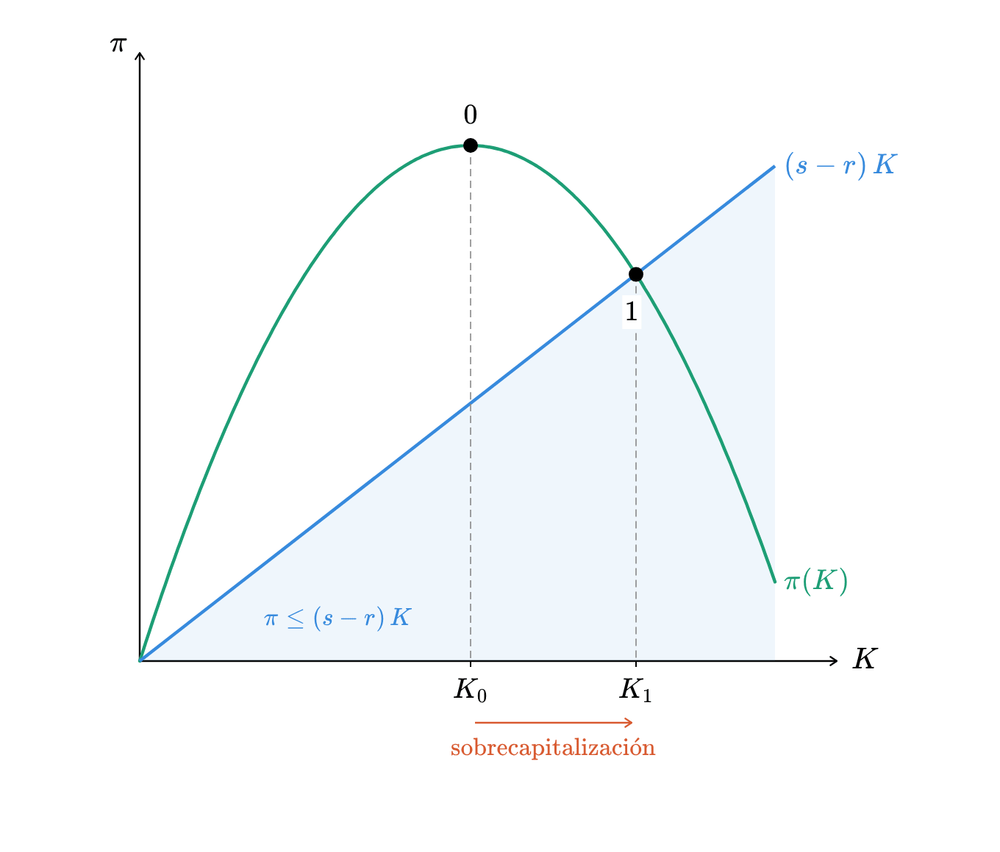

## Introducción

::: {.callout-note appearance="simple" icon=false}

:::

La economía del bienestar estudia, con un criterio colectivo, qué asignaciones de recursos de un sistema económico son deseables y cuáles no. Atiende a dos preguntas, una positiva (¿cómo medir el bienestar social?) y otra normativa (¿cómo alcanzar el máximo bienestar social?).

Históricamente, la respuesta a estas preguntas ha evolucionado desde el utilitarismo de Bentham (la máxima felicidad para el máximo número), pasando por los marginalistas, que consideraban medible la utilidad, y por la escuela de Cambridge, que admitía además comparaciones interpersonales de utilidad. Vilfredo Pareto (1906) concluyó, por último, que una asignación es óptima si ningún agente puede mejorar sin que otro empeore. El criterio de Pareto se ha convertido en el referente para valorar la eficiencia económica, al descansar sobre un número mínimo de juicios de valor.

Sobre esta base se asientan los dos teoremas fundamentales de la economía del bienestar. Según el primero, el equilibrio de un mercado competitivo sin imperfecciones de ningún tipo asigna los recursos de forma eficiente en el sentido de Pareto. El segundo recorre el camino inverso y, con preferencias y tecnologías convexas, garantiza que todo óptimo de Pareto puede obtenerse como equilibrio competitivo si antes se redistribuyen adecuadamente las dotaciones iniciales.

Los teoremas sirven, así, de defensa del libre mercado y, a la vez, justifican la intervención pública:

- *Primer teorema*: justifica la intervención cuando las condiciones para la eficiencia no se verifican, es decir, cuando existen fallos de mercado, entendidos como situaciones en las que las decisiones descentralizadas no conducen a la eficiencia económica.

- *Segundo teorema*: legitima la intervención *ex ante* sobre las dotaciones incluso cuando el mercado funciona perfectamente, si la asignación resultante se considera indeseable en términos de equidad.

::: {.callout-note appearance="simple" icon=false}
Sobre los teoremas fundamentales de la economía del bienestar, véase el tema [A22](a22-eb-i.qmd).
:::

La **teoría de la regulación** analiza los instrumentos con que el Estado interviene cuando la asignación de recursos descansa en el mercado. Regular ha de servir para completar el mercado y mejorar su funcionamiento, nunca para ocupar su lugar. En su seno conviven dos grandes visiones:

- *Visión normativa* o del interés público: la regulación existe (o debe existir) para corregir los fallos de mercado y maximizar el bienestar social.

- *Visión positiva* o teoría económica de la regulación, desarrollada por la escuela de Chicago: la regulación realmente observada responde, en buena medida, a los intereses de los grupos organizados que la demandan.

El tema se divide en tres partes, dedicadas a examinar el poder de mercado y cuál es la manera óptima de regularlo:

- *Poder de mercado*: su concepto y su medida, las estructuras en que aparece y sus causas, así como las de su regulación.

- *Regulación óptima*: con información perfecta y con información asimétrica, con varias empresas y en los mercados de varias caras.

- *Mercado relevante y aplicaciones prácticas*: la delimitación del mercado, la medición empírica del poder de mercado y la experiencia de la regulación.

## 1. Poder de mercado

El apartado define el poder de mercado y su medida directa, el índice de Lerner, repasa las estructuras en que aparece y estudia sus causas y las de su regulación.

### 1.1. Concepto y estructuras de competencia imperfecta

El **poder de mercado** se da cuando una o varias empresas tienen capacidad para alterar el precio, lanzando al mercado cantidades inferiores a las competitivas a un precio superior. Se pierde así eficiencia paretiana, porque quedan sin producir unidades cuyo coste de fabricación es inferior a lo que los consumidores darían por ellas.

La medida directa del poder de mercado es el **índice de Lerner**, el margen relativo del precio sobre el coste marginal:

$$I_L = \frac{p - \text{Cmg}}{p}, \qquad I_L \in [0, 1]$$

donde $p$ es el precio y $\text{Cmg}$ el coste marginal. El índice está acotado entre cero (competencia perfecta, $p = \text{Cmg}$) y uno (coste marginal nulo) y aumenta con la capacidad de la empresa para fijar el precio por encima del coste marginal.

En el monopolio simple, el índice iguala la inversa de la elasticidad de la demanda, y en el oligopolio de Cournot, el de cada empresa es proporcional a su cuota[^a20-1]:

$$I_L = \frac{1}{|\varepsilon_{Xp}|} \in [0, 1], \qquad I_{L,i} = \frac{s_i}{|\varepsilon_{Xp}|} \in [0, 1]$$

donde $|\varepsilon_{Xp}|$ es el valor absoluto de la elasticidad-precio de la demanda de mercado y $s_i = x_i/X$ la cuota de la empresa $i$. Sin embargo, la medición directa del poder de mercado exige conocer el coste marginal, generalmente inobservable, lo que motiva tanto los índices indirectos del apartado 3.2 como el enfoque estructural de la nueva organización industrial empírica (NEIO). En los mercados de varias caras, además, el margen de cada lado se mide frente al coste neto de la externalidad que genera (apartado 2.4).

El poder de mercado aparece en tres estructuras de competencia imperfecta, que el índice de Lerner permite ordenar:

- *Monopolio*: una sola empresa, cuyo margen iguala la inversa de la elasticidad de la demanda (tema [A17](a17-monopolio.qmd)).

- *Oligopolio*: pocas empresas interdependientes, cuyo margen depende de la variable estratégica y, en Cournot, de la cuota (tema [A19](a19-oligopolio.qmd)).

- *Competencia monopolística*: muchas empresas con producto diferenciado, con margen positivo pero beneficio nulo a largo plazo (tema [A18](a18-competencia-monopolistica.qmd)).

Dentro del monopolio, el diseño de la regulación depende de su tipo. Con independencia de su origen, se distinguen cuatro situaciones:

- *Monopolio discriminador*: el monopolista fija precios distintos a distintos consumidores o unidades (discriminación de primer, segundo y tercer grado). La discriminación puede aumentar la cantidad vendida y, con ella, la eficiencia, pero transfiere excedente del consumidor al productor. Por ello, la regulación suele centrarse en las discriminaciones que restringen la competencia (precios predatorios, descuentos de fidelidad).

- *Monopolio natural*: el que resulta de la subaditividad de la función de costes, por lo que no cabe introducir competencia en el mercado sin pérdida de eficiencia productiva. Su tratamiento depende de que sea *sostenible*, es decir, de que pueda sobrevivir a la entrada sin protección. El sostenible es el objeto central de la regulación de precios (apartado 2.1). El no sostenible, en cambio, se subasta, pues se licita periódicamente el derecho exclusivo a explotarlo, y la competencia por el mercado sustituye a la competencia en el mercado (Demsetz, 1968; apartado 2.3.1).

- *Monopolio de demanda (monopsonio)*: un único comprador frente a muchos vendedores (un gran distribuidor frente a los productores agrarios, un gran empleador en un mercado de trabajo local). La ineficiencia es simétrica a la del monopolio (compra menos y a menor precio) y la regulación toma la forma de precios mínimos, salarios mínimos o normas de contratación.

- *Monopolio bilateral*: un único vendedor frente a un único comprador (un sindicato y una patronal, un fabricante y un distribuidor exclusivo). La teoría no determina el precio, que depende del poder de negociación, aunque con negociación eficiente sí determina la cantidad, la que maximiza el excedente conjunto. En consecuencia, la regulación se limita a fijar el marco de la negociación y a arbitrar.

::: {.callout-note appearance="simple" icon=false}
El índice de Lerner del monopolio se desarrolla en el tema [A17](a17-monopolio.qmd), apartado 1.3.1, y su medición empírica, en el tema [A15](a15-toi.qmd), apartado 3.3.1. La discriminación de precios se estudia en el tema [A17](a17-monopolio.qmd), apartado 2.1, el monopolio natural y una primera aproximación a su regulación, en los apartados 2.2 y 2.3, y el monopsonio y el monopolio bilateral, en el apartado 3.
:::

### 1.2. Causas del poder de mercado

El origen del poder de mercado está en las **barreras a la entrada**, que impiden que los beneficios extraordinarios atraigan a nuevas empresas. Se distinguen las barreras **naturales o estructurales**, que derivan de la tecnología y la demanda del sector, y las **artificiales**, que crean las instaladas (estratégicas) o el Estado (legales):

- *Naturales o estructurales*: la estrechez del mercado en relación con la escala mínima eficiente, que da lugar al monopolio natural. Esta ventaja, sin embargo, solo protege a la instalada si la entrada exige costes hundidos (Baumol y Willig, 1981).

- *Estratégicas*: los comportamientos de las instaladas para disuadir la entrada o expulsar a los rivales (precio límite, inversión en capacidad, proliferación de marcas, predación, concentración empresarial[^a20-2]).

- *Legales*: los privilegios que concede el Estado (patentes, licencias, concesiones, derechos exclusivos).

La distinción entre barreras naturales y artificiales ordena las causas de la regulación. Las barreras son, además, el determinante central de la estructura de los mercados (apartado 3.2.2).

La propia definición de barrera a la entrada ha sido objeto de debate. Bain (1956) las define por sus resultados, como las condiciones que permiten a las instaladas fijar precios supracompetitivos de forma persistente sin inducir la entrada. En cambio, Stigler (1968) las restringe a los costes que soporta el entrante y no soportaron las instaladas, y Baumol y Willig (1981) sitúan la barrera genuina en los costes hundidos, una idea que anticipa la teoría de los mercados impugnables (apartado 2.3.3).

::: {.callout-note appearance="simple" icon=false}
La definición y la taxonomía de las barreras a la entrada se desarrollan en el tema [A15](a15-toi.qmd), apartado 2.2.1, y su papel en el monopolio, en el tema [A17](a17-monopolio.qmd), apartado 1.1. El papel de los costes hundidos como mecanismo de compromiso y el juego de entrada se estudian en el tema [A14](a14-juegos.qmd), apartado 2.3.1, y el precio límite y la disuasión de la entrada, en el tema [A19](a19-oligopolio.qmd), apartado 3.2.
:::

### 1.3. Causas de la regulación

La intervención sobre el poder de mercado se justifica por dos tipos de motivos:

1. *Motivos de equidad*: la regulación persigue garantizar el acceso a determinados bienes y servicios (energía, agua, telecomunicaciones, transporte, servicios financieros básicos). El acceso ha de ser independiente de la *disparidad geográfica* (zonas rurales o insulares que un operador no regulado no serviría, o serviría a precios prohibitivos) y de la *disparidad de renta* (colectivos que quedarían excluidos por su capacidad de pago). A ese fin responden las obligaciones de servicio universal y las tarifas sociales, que se financian con subsidios cruzados o con cargo al presupuesto.

2. *Motivos de eficiencia*: la regulación persigue corregir la ineficiencia asignativa del poder de mercado. Cabe distinguir el *monopolio no natural*, sostenido por barreras artificiales, cuyo remedio es eliminarlas (liberalización, defensa de la competencia), y el *monopolio natural*, sostenido por la tecnología, que no conviene desmantelar sino regular.

Existe monopolio natural cuando la función de costes presenta subaditividad estricta y, por tanto, ninguna combinación de empresas puede producir un vector de producción dado a menor coste que una sola empresa[^a20-3]. La escala mínima eficiente es, en estos casos, grande en relación con la demanda[^a20-4].

Frente al monopolio natural, la actuación pública debe evitar dos extremos. Trocearlo sacrificaría su ventaja, la eficiencia productiva, pues una sola empresa produce con los menores costes posibles. Dejarlo libre, en cambio, permitiría al monopolista situar el precio muy por encima del coste marginal, con daño para la eficiencia asignativa. 

La regulación tampoco ha de llevar al extremo su exigencia de eficiencia asignativa, porque en el monopolio natural existe una disyuntiva entre esa eficiencia y la viabilidad financiera de la empresa. Puesto que el coste marginal suele quedar por debajo del medio en el tramo de demanda pertinente, el monopolista pierde más cuanto más se le obliga a acercar el precio a la referencia competitiva ($p = \text{Cmg}$). Las modalidades de regulación se ordenan según esa disyuntiva y según la información de que disponga el regulador (apartado 2.1).

### 1.4. Conclusiones

**Aspectos positivos**: el índice de Lerner ofrece una medida del poder de mercado comparable entre estructuras, y la distinción entre barreras naturales y artificiales indica el remedio, que es eliminar las artificiales y regular el monopolio natural.

**Limitaciones**: el índice exige conocer el coste marginal, que rara vez se observa, y la propia definición de barrera sigue en discusión. Por eso la medición práctica se apoya en el mercado relevante y en índices indirectos (apartado 3). Además, la regulación del monopolio natural afronta la disyuntiva entre eficiencia asignativa y viabilidad financiera (apartado 2).

## 2. Regulación óptima

La regulación óptima se estudia primero con información perfecta, cuando el regulador conoce los costes y la demanda de la empresa. Después se relaja ese supuesto, con el mecanismo de Loeb y Magat y el modelo de Laffont y Tirole, y se estudian la regulación que se apoya en varias empresas y la de los mercados de varias caras.

### 2.1. Regulación con información perfecta

Suponiendo que el regulador conoce las funciones de coste y de demanda del monopolista, la regulación óptima se ordena en tres niveles según la prioridad que se dé a la eficiencia asignativa frente a la viabilidad financiera de la empresa:

1. *First best*: logra la eficiencia asignativa y financia las pérdidas con transferencias.

2. *Second best*: renuncia a las transferencias y busca el precio eficiente compatible con beneficio nulo.

3. *Third best*: se limita a acotar los beneficios extraordinarios, con un tope a la rentabilidad o a la senda de precios, sin fijar directamente el precio.

#### 2.1.1. Regulación *first best*: precio igual al coste marginal

**Planteamiento**: el regulador maximiza el bienestar social, suma del excedente del consumidor y del beneficio de la empresa, sin restricción financiera:

$$\max_{p} \; W = \int_{0}^{x(p)} p(q)\,dq - \text{CT}(x)$$

donde $p$ es el precio regulado, $x(p)$ la función de demanda, $p(\cdot)$ la demanda inversa, $q$ la variable de integración (cada unidad entre $0$ y $x(p)$), $\text{CT}(x)$ la función de costes del monopolista y $W$ el bienestar social. La integral es la disposición a pagar por las $x(p)$ unidades.

**CPO**: $p = \text{Cmg}$, es decir, el precio regulado iguala la disposición marginal a pagar al coste marginal, que es la condición de eficiencia asignativa.

**CSO**: el bienestar es cóncavo si la demanda inversa decrece más deprisa que el coste marginal, $p'(x) < \text{Cmg}'(x)$, lo que se cumple también con el coste marginal decreciente habitual del monopolio natural si decrece más despacio que la demanda.

**Solución**: cuando, como es habitual en el monopolio natural, el coste marginal es inferior al medio en el rango relevante, la empresa incurre en una pérdida igual a $x \cdot (\text{Cme} - \text{Cmg})$, que el presupuesto público cubre con una subvención de suma fija. En cambio, si el coste marginal supera al medio, un impuesto de suma fija retira el beneficio.

**Desarrollo gráfico**: la tarificación al coste marginal se representa en el plano cantidad-precio (figura -@fig-a201-precio-medio):

1. *Coste medio*, $\text{Cme}(x)$: tiene forma de U, decreciente mientras el coste marginal queda por debajo de él y creciente cuando lo supera.

2. *Coste marginal*, $\text{Cmg}(x)$: corta al coste medio en su mínimo y, para cada cantidad, marca el precio regulado.

3. *Equilibrio*: el precio regulado iguala al coste marginal, y el resultado de la empresa depende del tramo del coste medio:

    - *Tramo decreciente*: con $p_1^R = \text{Cmg}(x_1) < \text{Cme}(x_1)$, la pérdida es el área “pérdida”, $x_1 \cdot [\text{Cme}(x_1) - p_1^R]$, que cubre la subvención.

    - *Tramo creciente*: si el coste marginal supera al medio, como en $x_2$, la tarificación al coste marginal deja un beneficio, $x_2 \cdot [p_2^R - \text{Cme}(x_2)]$ (área “beneficio”), que se detrae con un impuesto de suma fija.

::: {#fig-a201-precio-medio}

::: {.content-visible when-format="html"}
```{=html}
<div class="graph-frame">
<iframe src="../graphs/a201_Precio_medio.html" style="height:580px" loading="lazy" title="fig-a201-precio-medio"></iframe>
</div>
```
:::

::: {.content-visible unless-format="html"}

:::

Tarificación al coste marginal. Con $p_1^R = \text{Cmg}(x_1) < \text{Cme}(x_1)$ la empresa incurre en una pérdida, que cubre una subvención, mientras que con $p_2^R = \text{Cmg}(x_2) > \text{Cme}(x_2)$ obtiene un beneficio, que se detrae con un impuesto de suma fija.
:::

**Conclusiones**:

- *Aspectos positivos*: es la única solución plenamente eficiente.

- *Limitaciones*: plantea tres problemas:

    - *Información*: requiere información perfecta sobre las funciones de coste y demanda.

    - *Financiación*: la subvención exige impuestos que generan sus propias distorsiones en otros mercados.

    - *Riesgo moral*: la empresa que sabe que sus pérdidas serán cubiertas carece de incentivos a reducir costes.

#### 2.1.2. Regulación *second best*: beneficio nulo

**Planteamiento**: los mecanismos difieren según el monopolio sea monoproducto o multiproducto. En el monopolio monoproducto, el programa añade la restricción de beneficio no negativo, que resulta saturada:

$$\max_{p} \; W \quad \text{s.a.:} \quad p \cdot x(p) - \text{CT}(x) \geq 0$$

donde $W$ es el bienestar social ya definido, $p$ el precio regulado, $x(p)$ la función de demanda y $\text{CT}(x)$ la función de costes, de modo que la restricción exige un beneficio no negativo.

**CPO**: $p = \text{Cme}$, es decir, la restricción de beneficio no negativo se satura.

**CSO**: el bienestar decrece con el precio por encima del coste marginal, por lo que el máximo es el menor precio compatible con beneficio nulo.

**Solución**: en el plano cantidad-precio (figura -@fig-a203-tarificacion-cme), el precio se fija donde la curva de demanda corta a la de coste medio, de modo que la cantidad es inferior a la eficiente y el precio superior al coste marginal. La pérdida de eficiencia asignativa resultante (el triángulo entre demanda y coste marginal) es el precio de la viabilidad financiera.

::: {#fig-a203-tarificacion-cme}

::: {.content-visible when-format="html"}
```{=html}
<div class="graph-frame">
<iframe src="../graphs/a203_Tarificacion_Cme.html" style="height:500px" loading="lazy" title="fig-a203-tarificacion-cme"></iframe>
</div>
```
:::

::: {.content-visible unless-format="html"}

:::

Regulación *second best* con beneficio nulo. El precio regulado, $p_2$, se fija donde la demanda, $D(X)$, corta al coste medio, $\text{Cme}(X)$ (punto 2), con una cantidad, $X_2$, inferior a la eficiente, $X_1$, en la que la demanda corta al coste marginal (punto 1). El área sombreada entre la demanda y el coste marginal, de $X_2$ a $X_1$, es la pérdida de eficiencia asignativa. El punto 0 es el monopolio sin regular.
:::

**Extensiones**: dos mecanismos alcanzan la asignación del *first best*, en la que cada unidad marginal se paga a su coste marginal, por lo que pueden considerarse también soluciones de primer óptimo. Se estudian aquí porque responden al problema del *second best*, financiar la empresa sin las transferencias distorsionantes de la regulación *first best*, y lo resuelven sin transferencias públicas, bajo supuestos propios. Un tercero, el de Loeb y Magat (1979), alcanza esa asignación con ellas y aun con información asimétrica.

- *Tarifa en dos partes* (Coase, 1946): con $n$ consumidores idénticos, el regulador elige una cuota fija, $F$, y un precio por unidad, $p$, de modo que cada consumidor $h$ paga $T(x^h) = F + p \cdot x^h$ por sus $x^h$ unidades. La cuota es una transferencia de los consumidores a la empresa que no altera el bienestar mientras nadie abandone el mercado, y el programa es:

    $$\max_{p, F} \; W = \int_{0}^{x(p)} p(q)\,dq - \text{CT}(x) \quad \text{s.a.:} \begin{cases} n F + p \cdot x(p) - \text{CT}(x) \geq 0 \\ F \leq \text{EC}(p)/n \end{cases}$$

    donde la primera restricción es la de beneficio no negativo y la segunda, la de participación, porque cada consumidor solo paga la cuota si la cuota no supera su excedente, $\text{EC}(p)/n$. Como $F$ no entra en $W$, el precio se elige como en el *first best* y la cuota cubre la pérdida:

    $$p = \text{Cmg}$$

    $$F = \frac{x \cdot (\text{Cme} - \text{Cmg})}{n}$$

    Con coste marginal constante, la cuota se reduce a los costes fijos repartidos, $F = \text{CF}/n$. El consumo marginal se decide así eficientemente y la empresa cubre costes. Con consumidores heterogéneos, sin embargo, la cuota excluye a los de baja disposición a pagar, y el precio óptimo se sitúa entonces por encima del coste marginal.

- *Tarifas pico-valle* (Boiteux, 1949; Steiner, 1957): cuando la demanda fluctúa en ciclos y el bien no es almacenable, el ciclo se divide en dos periodos de igual duración, valle y pico, con demandas independientes, $x_{\text{valle}}(p_{\text{valle}})$ y $x_{\text{pico}}(p_{\text{pico}})$, un coste de operación por unidad, $c$, y un coste de capacidad por unidad y ciclo, $c_K$. El regulador elige los dos precios y la capacidad, $K$, que comparten ambos periodos:

    $$\begin{aligned} \max_{p_{\text{valle}},\, p_{\text{pico}},\, K} \; & W = \sum_{j \in \{\text{valle},\, \text{pico}\}} \int_{0}^{x_j(p_j)} p_j(q)\,dq - c \cdot (x_{\text{valle}} + x_{\text{pico}}) - c_K K \\ \text{s.a.:} \; & \begin{cases} x_{\text{valle}}(p_{\text{valle}}) \leq K \\ x_{\text{pico}}(p_{\text{pico}}) \leq K \end{cases} \end{aligned}$$

    donde $p_j(\cdot)$ es la demanda inversa del periodo $j$. Con $\lambda$ y $\mu$ como multiplicadores de las restricciones de capacidad del valle y del pico, las CPO respecto a los dos precios y a la capacidad son:

    $$p_{\text{valle}} = c + \lambda$$

    $$p_{\text{pico}} = c + \mu$$

    $$\lambda + \mu = c_K$$

    Con *pico firme*, la capacidad solo se satura en la punta ($\lambda = 0$), de modo que $p_{\text{valle}} = c$ y $p_{\text{pico}} = c + c_K$, y los consumidores de punta, que determinan la capacidad, soportan todo su coste. Cada periodo paga su coste marginal, de corto plazo en el valle y de largo plazo en la punta, y como $x_{\text{pico}} = K$, los ingresos, $c \cdot (x_{\text{valle}} + x_{\text{pico}}) + c_K K$, cubren exactamente los costes, sin transferencias. En cambio, si ese precio de punta hiciese caer la demanda del pico por debajo de la del valle (*pico desplazado*), las dos restricciones se saturan y ambos periodos se reparten el coste de capacidad.

**Conclusiones**:

- *Aspectos positivos*: es la solución básica y la más sencilla de aplicar.

- *Limitaciones*: puede no existir (si la demanda no corta al coste medio), mantiene un precio superior al competitivo y, como el coste se cubre siempre, no incentiva su reducción (regulación *cost-plus*).

#### 2.1.3. Regulación *second best* del monopolio multiproducto: precios de Ramsey-Boiteux

**Planteamiento**: con varios productos de demandas independientes, el regulador maximiza la suma de excedentes sujeto a la cobertura de los costes comunes:

$$\max_{p_1, \ldots, p_n} \; \sum_i \text{EC}_i(p_i) + \pi \quad \text{s.a.:} \quad \sum_i p_i x_i - \text{CT}(x_1, \ldots, x_n) \geq 0$$

donde $p_i$ y $x_i$ son el precio y la cantidad del producto $i$, $\text{EC}_i(p_i)$ el excedente del consumidor en ese mercado, $\pi$ el beneficio de la empresa y $\text{CT}(x_1, \ldots, x_n)$ la función de costes conjunta.

**CPO**: con solución interior y la restricción agotada, derivando el lagrangiano respecto a cada precio, el margen relativo de cada producto sobre su coste marginal varía en razón inversa de la elasticidad de su demanda (*regla de la elasticidad inversa*):

$$\frac{p_i - \text{Cmg}_i}{p_i} = \frac{k}{|\varepsilon_i|}, \qquad i = 1, \ldots, n$$

donde $|\varepsilon_i|$ es el valor absoluto de la elasticidad-precio de la demanda del producto $i$, $k = \lambda/(1+\lambda) \in (0, 1)$ el *número de Ramsey* y $\lambda$ el multiplicador de la restricción financiera. Este último mide el coste en bienestar de exigir a la empresa una unidad monetaria más de beneficio o, lo que es lo mismo, la ganancia de bienestar de relajar esa restricción en una unidad[^a20-5].

**CSO**: con demandas independientes y costes marginales constantes, el excedente total de cada mercado es cóncavo en su precio y el beneficio es cuasicóncavo en el tramo relevante (p. ej. con demandas lineales), de modo que se cumplen las condiciones de suficiencia de Arrow-Enthoven.

**Solución**: los servicios de demanda más inelástica contribuyen en mayor medida a cubrir los costes fijos comunes, lo que minimiza la pérdida de eficiencia total. Este reparto eficiente de los costes comunes no supone subsidio cruzado mientras cada servicio cubra al menos su coste incremental (no basta con que su precio supere el coste marginal).

**Extensiones**: si el monopolio no es sostenible, es decir, si no puede sobrevivir a la entrada[^a20-6], ninguna regla de precios lo sostiene por sí sola. Una solución es entonces organizar la competencia por el mercado en lugar de en el mercado, licitando el derecho a explotarlo (Demsetz, 1968).

**Conclusiones**:

- *Aspectos positivos*: ofrece un criterio de *second best* para cubrir los costes comunes cuando el precio igual al coste marginal genera pérdidas, al repartirlos según la elasticidad de cada demanda, y traslada a la tarificación la lógica de la imposición óptima. Este criterio es, por ello, la referencia teórica de las tarifas de las industrias de red multiproducto.

- *Limitaciones*: la información que exige (costes y elasticidades de todos los productos) y su posible regresividad, pues los bienes inelásticos pesan más en las cestas de renta baja.

#### 2.1.4. Regulación *third best*: beneficio acotado

**Planteamiento**: en la *regulación de la tasa de beneficio* (*rate of return*), el regulador fija una tasa máxima de rentabilidad sobre el capital, $s$, superior al coste del capital $r$, y la empresa maximiza su beneficio sujeto a no superarla:

$$\max_{L, K} \; p(x) \cdot x - wL - rK \quad \text{s.a.:} \quad \frac{p(x) \cdot x - wL}{K} \leq s$$

donde $L$ y $K$ son las cantidades de trabajo y capital, $x$ la producción obtenida con ellas, $p(x)$ la demanda inversa, $w$ el salario, $r$ el coste del capital y $s$ la tasa máxima de rentabilidad sobre el capital fijada por el regulador.

**CPO**: con solución interior, la restricción se satura y, derivando el lagrangiano respecto a $L$ y $K$, la empresa elige una combinación de factores en la que la relación marginal de sustitución técnica no iguala la relación de precios de los factores, $w/r$, porque el coste efectivo del capital para la empresa es inferior a $r$.

**CSO**: la restricción define un conjunto factible no convexo, por lo que la suficiencia de la CPO no está garantizada en general, y el análisis de Averch y Johnson supone que la solución con la restricción saturada es un máximo.

**Solución**: como cada unidad de capital adicional amplía el beneficio permitido ($s - r > 0$), la empresa se sobrecapitaliza (*efecto Averch-Johnson*, 1962), eligiendo una ratio capital-trabajo superior a la que minimiza los costes.

**Desarrollo gráfico**: el efecto Averch-Johnson se representa en el plano capital-beneficio (figura -@fig-a202-averch-johnson):

1. *Beneficio máximo para cada nivel de capital*, $\pi(K)$: crece con el capital hasta su máximo y decrece a partir de él.

2. *Restricción de la tasa de rentabilidad*, $(s - r)\,K$: es el techo del beneficio, una semirrecta que parte del origen con pendiente $s - r$, y el beneficio ha de quedar por debajo de ella, $\pi \le (s - r)\,K$.

3. *Equilibrio*: sin regulación, la empresa iría al máximo de $\pi(K)$ (punto 0), con el capital $K_0$. Regulada, en cambio, se queda con el beneficio más alto que la restricción tolera, en el corte de $\pi(K)$ con la recta (punto 1), lo que exige más capital, $K_1$, y la distancia entre $K_1$ y $K_0$ mide la sobrecapitalización.

::: {#fig-a202-averch-johnson}

::: {.content-visible when-format="html"}
```{=html}
<div class="graph-frame">
<iframe src="../graphs/a202_Averch_Johnson.html" style="height:620px" loading="lazy" title="fig-a202-averch-johnson"></iframe>
</div>
```
:::

::: {.content-visible unless-format="html"}

:::

Efecto Averch y Johnson (1962). La regulación de la tasa de retorno induce a la empresa a sobrecapitalizarse respecto a la combinación de factores de coste mínimo. La curva $\pi(K)$ es el beneficio máximo para cada nivel de capital.
:::

**Conclusiones**:

- *Aspectos positivos*: exige poca información, pues el regulador no necesita conocer la demanda y le basta con fijar la tasa y comprobar el capital y los costes que declara la empresa.

- *Limitaciones*: la principal es el efecto Averch-Johnson. Además, la tasa se elige sin un criterio objetivo, y la empresa no tiene estímulo para abaratar su producción, porque los costes se trasladan al consumidor.

#### 2.1.5. Regulación *third best*: límites de precios (*price cap*)

**Origen**: Stephen Littlechild (1983) propuso los límites de precios (*price cap*) en su informe para la privatización de British Telecom, como alternativa a la regulación de la tasa de beneficio.

**Idea**: el regulador fija una senda máxima de precios para el periodo regulatorio (habitualmente cinco años), desvinculada de los costes propios de la empresa, de modo que esta se apropia de los ahorros que consiga durante el periodo.

**Razonamiento**: la senda se indexa a la inflación y descuenta las ganancias de productividad esperadas:

$$p_t \leq p_{t-1} \cdot (1 + \text{IPC} - \text{X})$$

donde $p_t$ es el precio regulado (o el índice de precios de la cesta regulada) en el año $t$, $\text{IPC}$ la tasa de inflación y $\text{X}$ el factor de productividad esperada de la industria. Como el precio no depende de los costes propios, cada ahorro de costes eleva el beneficio de la empresa hasta la siguiente revisión. La eficiencia productiva se convierte así en la principal vía para aumentar el beneficio.

**Extensiones**: la competencia por comparación (*yardstick competition*) de Shleifer (1985) retribuye a cada empresa según los costes de empresas comparables. Se desarrolla en el apartado 2.3.2, pues su lógica es ya la de la regulación con varias empresas.

**Conclusiones**:

- *Aspectos positivos*: genera potentes incentivos a la eficiencia productiva y evita la sobrecapitalización que induce la regulación de la tasa de beneficio.

- *Limitaciones*: es difícil acertar con $\text{X}$, el estímulo a ahorrar se debilita conforme se aproxima la revisión y la empresa puede reducir costes empeorando la calidad.

### 2.2. Regulación con información asimétrica

Cuando la empresa sabe más que el regulador sobre sus costes, la regulación ha de inducirla a revelarlos y a reducirlos. El apartado estudia un mecanismo que alcanza el *first best* con transferencias (Loeb y Magat, 1979), el menú de contratos de Laffont y Tirole (1986) y su límite dinámico, el efecto trinquete.

#### 2.2.1. Mecanismo de Loeb y Magat (1979)

**Idea**: el regulador promete a la empresa una subvención igual al excedente del consumidor que genere, $z = \text{EC}(p)$, y le deja elegir el precio.

**Razonamiento**: la empresa elige el precio que maximiza la suma de su beneficio y la subvención:

$$p \cdot x(p) - \text{CT}(x) + \text{EC}(p)$$

donde $\text{EC}(p)$ decrece con el precio a razón de la cantidad vendida, $d\,\text{EC}/dp = -x(p)$. La CPO es:

$$x(p) + \left[p - \text{Cmg}\right] \frac{dx}{dp} - x(p) = 0 \;\Rightarrow\; p = \text{Cmg}$$

Al internalizar así el excedente total, la empresa elige por sí misma el precio del *first best*, sin que el regulador necesite conocer los costes[^a20-7].

**Conclusiones**:

- *Aspectos positivos*: alcanza el *first best* aun con información asimétrica sobre costes, a costa de una subvención.

- *Limitaciones*: a diferencia de la tarifa en dos partes y de las tarifas pico-valle, no respeta la renuncia a las transferencias. Además, su coste fiscal y la redistribución masiva a favor del monopolista lo hacen políticamente inviable.

#### 2.2.2. Modelo de Laffont y Tirole (1986)

::: {.callout-note appearance="simple" icon=false}
El modelo de Laffont y Tirole (1986), con sus supuestos, el programa del regulador, su CPO y su CSO, se desarrolla en el tema [A15](a15-toi.qmd), apartado 2.3.3, como aplicación de la teoría de contratos. Aquí se resumen su solución y sus implicaciones para la política regulatoria.
:::

**Origen**: frente a la teoría tradicional, que supone que el regulador dispone de información perfecta, la nueva teoría de la regulación aborda el problema de la información asimétrica entre el regulador y la empresa regulada y aplica al diseño regulatorio la teoría de los incentivos. Su referencia central es el modelo de Jean-Jacques Laffont y Jean Tirole (1986)[^a20-8].

**Idea**: el regulador se enfrenta a una disyuntiva fundamental entre *eficiencia* (incentivar el esfuerzo de reducción de costes) y *extracción de rentas* (minimizar las transferencias a la empresa), que resuelve ofreciendo un menú de contratos entre los que la empresa se autoselecciona.

**Razonamiento**: un monopolio natural conoce su eficiencia intrínseca, $\varphi$ (su “tipo”), y elige un esfuerzo de reducción de costes, $e$, que le supone una desutilidad, $\psi(e)$, mientras que el regulador solo observa el coste realizado, que, con la producción normalizada a una unidad, es $C = \varphi - e$. El problema combina así selección adversa y riesgo moral. Una empresa eficiente puede hacerse pasar por ineficiente, imitando su coste con menos esfuerzo, y quedarse la diferencia, que constituye la *renta informacional*. Como cada euro transferido cuesta a la sociedad $1 + \lambda$, donde $\lambda > 0$ es el coste sombra de los fondos públicos, el regulador quiere incentivar el esfuerzo dejando la menor renta posible.

El mecanismo óptimo es un menú de contratos lineales en el coste realizado, entre los que la empresa elige anunciando un tipo, $\hat{\varphi}$. Además del reembolso del coste, recibe la transferencia neta

$$t(\hat{\varphi}, C) = \underbrace{a(\hat{\varphi})}_{\text{pago fijo por la eficiencia revelada}} - \underbrace{b(\hat{\varphi}) \cdot \left[C - C^*(\hat{\varphi})\right]}_{\text{penalización por sobrecoste}}$$

donde $a(\hat{\varphi})$ es el pago fijo del contrato elegido, $C^*(\hat{\varphi})$ su coste objetivo y $b(\hat{\varphi}) \in [0, 1]$ la fracción del sobrecoste que recae sobre la empresa, es decir, la potencia del contrato.

Cada contrato funciona como un sistema de premios y penalizaciones en torno al coste objetivo. Cabe distinguir dos casos:

1. *Cumplimiento del objetivo* ($C = C^*$): la empresa cobra el pago fijo, que retribuye el esfuerzo previsto e incluye la renta informacional del tipo revelado.

2. *Desviación del objetivo* ($C \neq C^*$): si el coste realizado supera el objetivo, la transferencia se reduce en la fracción $b$ del sobrecoste y, si queda por debajo, aumenta en la fracción $b$ del ahorro.

Con $b = 1$ el contrato es de precio fijo, porque la empresa soporta todo el sobrecoste y retiene todo el ahorro, y con $b = 0$, de coste más margen, porque la transferencia no depende del coste.

Ante este menú, cada empresa decide qué contrato elige y cuánto se esfuerza. Dentro de un contrato, la empresa reduce costes hasta que la desutilidad marginal del esfuerzo iguala la potencia del contrato:

$$\frac{d\psi}{de} = b(\hat{\varphi})$$

El regulador fija, por tanto, el esfuerzo de cada tipo eligiendo la potencia de su contrato, que vale uno para el tipo más eficiente y decrece con $\varphi$. La elección entre contratos separa así a los tipos:

1. *Empresa eficiente* ($\varphi$ bajo): elige el contrato de precio fijo (*fixed-price*, $b = 1$), asume todo el riesgo de costes y retiene todo el ahorro. Su esfuerzo es el del *first best* (no hay distorsión “en la cima”), pero, a cambio, la empresa eficiente obtiene la mayor renta informacional del menú.

2. *Empresa ineficiente* ($\varphi$ alto): elige el contrato de menor potencia, el más próximo al de coste más margen (*cost-plus*), en el que el regulador absorbe una parte de los sobrecostes mayor que en cualquier otro contrato. Su esfuerzo se distorsiona a la baja respecto del *first best*, aunque no se anula, y su renta informacional es nula. El contrato de coste más margen puro ($b = 0$) es solo el caso límite, que se alcanzaría si la distorsión llevase el esfuerzo a cero.

3. *Tipos intermedios*: eligen contratos lineales situados entre los dos anteriores, con reparto parcial del riesgo, esfuerzo distorsionado a la baja y rentas informacionales decrecientes con $\varphi$.

La regulación por incentivos sustituye así el control de costes por la elección entre contratos, y el menú materializa la disyuntiva entre eficiencia y extracción de rentas, porque, para reducir la renta de los tipos eficientes, el regulador acepta menos esfuerzo de los ineficientes.

**Conclusiones**:

- *Aspectos positivos*: el modelo muestra que la regulación óptima bajo información asimétrica adopta la forma de un menú de contratos que equilibra incentivos y rentas, y que la asimetría informativa genera necesariamente una pérdida de bienestar respecto del *first best*, porque las rentas informacionales son el precio de los incentivos. Asimismo, el modelo ha influido en el diseño regulatorio práctico (telecomunicaciones, energía, transporte), donde los esquemas reales (del *cost-plus* al *price cap*) pueden leerse como puntos del menú teórico.

- *Limitaciones*: en entornos dinámicos aparece el *efecto trinquete*. El propio Tirole (premio Nobel en 2014, en buena parte por esta obra) insiste, además, en que no existen recetas universales, porque cada mercado exige un análisis específico y ninguno se regula por sí solo.

#### 2.2.3. Efecto trinquete

El menú de contratos tiene un límite dinámico, que procede del propio modelo de Laffont-Tirole. Si la empresa anticipa que los ahorros de costes que consiga hoy serán confiscados en la próxima revisión regulatoria (el regulador aprende su tipo y le retira la renta), la empresa no tiene incentivos a reducir costes.

Este límite se conoce como **efecto trinquete** (*ratchet effect*), y su remedio exige un compromiso creíble del regulador a no usar la información revelada, lo que en la práctica se instrumenta con periodos regulatorios largos y reglas de revisión fijadas de antemano (*price cap* plurianual).

### 2.3. Regulación con varias empresas

Cuando existe más de una empresa, real o potencial, el regulador puede apoyarse en la competencia para obtener la información que le falta o para disciplinar al monopolista. Puede hacerlo mediante tres mecanismos.

#### 2.3.1. Competencia por el mercado (Demsetz, 1968)

**Origen**: Harold Demsetz (1968) planteó que, cuando la subaditividad hace ineficiente la competencia en el mercado, la regulación tradicional puede sustituirse por la competencia por el mercado.

**Idea**: el derecho exclusivo a servir el mercado se subasta cada cierto tiempo (*franchise bidding*) y se adjudica al licitador que se comprometa a cobrar menos al consumidor. Si la licitación es competitiva, las ofertas convergen al precio igual al coste medio y se replica el resultado de una regulación de beneficio nulo sin necesidad de un regulador permanente.

**Razonamiento**: la competencia *ex ante* entre licitadores sustituye a la competencia *ex post* imposible, pues cada licitador sabe que cualquier oferta por encima del coste medio será batida por otro, de modo que las rentas del monopolio se disipan en la puja.

**Conclusiones**:

- *Aspectos positivos*: la competencia por el mercado convierte al regulador en organizador de subastas en lugar de fijador de precios, lo que ahorra información. Este mecanismo es el fundamento de las concesiones de servicios públicos.

- *Limitaciones*: su eficacia depende de que las relicitaciones sean genuinamente competitivas, lo que rara vez ocurre con activos específicos y contratos largos. Williamson (1976) señaló los límites del razonamiento de Demsetz. En particular, los contratos de concesión son inevitablemente incompletos (exigen renegociación ante contingencias, en la que el adjudicatario tiene ventaja), los activos específicos generan problemas de reversión y valoración al final de la concesión, y el incumbente acumula ventajas informativas que erosionan la competencia en las relicitaciones.

#### 2.3.2. Competencia por comparación (Shleifer, 1985)

**Origen**: Andrei Shleifer (1985) propuso romper la dependencia informativa del regulador respecto de la empresa regulada usando como referencia a otras empresas.

**Idea**: en lugar de fijar el precio en función de los costes declarados por la propia empresa (lo que destruye los incentivos a reducirlos), el regulador lo fija en función de los costes de empresas comparables que operan en otros mercados (p. ej. distribuidoras regionales).

**Razonamiento**: como el precio regulado de cada empresa no depende de sus propios costes, cada una se beneficia íntegramente de sus reducciones de costes y el conjunto converge al comportamiento eficiente. La comparación reproduce así la disciplina de la competencia sin que las empresas compitan en el mismo mercado.

**Conclusiones**:

- *Aspectos positivos*: la competencia por comparación es hoy la técnica habitual en la regulación de las distribuidoras de electricidad, gas y agua, y una de las aplicaciones más directas de la teoría de la agencia con varios agentes (tema [A13](a13-informacion.qmd)).

- *Limitaciones*: sus requisitos son la existencia de comparadores genuinamente similares (o la corrección econométrica de sus diferencias) y la ausencia de colusión entre las empresas comparadas, que podrían acordar inflar sus costes conjuntamente.

#### 2.3.3. Mercados impugnables (Baumol, Panzar y Willig, 1982)

::: {.callout-note appearance="simple" icon=false}
La teoría de los mercados impugnables se desarrolla en el tema [A15](a15-toi.qmd), apartado 2.2.2, y su implicación para el oligopolio, en el tema [A19](a19-oligopolio.qmd), apartado 3.3.
:::

**Origen**: William Baumol, John Panzar y Robert Willig (*Contestable Markets and the Theory of Industry Structure*, 1982) formularon la teoría como generalización de la competencia perfecta a mercados con pocas empresas. Retomaron la idea de Demsetz (1968) de que la amenaza de competencia puede disciplinar a un monopolio, aunque aquí el mecanismo no es la licitación del derecho exclusivo, sino la competencia potencial de entrantes sin costes hundidos.

**Idea**: un mercado es *impugnable* si los entrantes potenciales pueden competir sin desventajas respecto de las empresas establecidas.

**Supuestos**: la impugnabilidad exige el cumplimiento de tres condiciones:

- *Acceso a la tecnología*: es el mismo para entrantes e instaladas.

- *Costes fijos*: pueden existir, siempre que no sean hundidos.

- *Reacción*: un tiempo de entrada inferior al tiempo de reacción del incumbente.

**Razonamiento**: si se cumplen las condiciones, son posibles las estrategias de entrada y salida rápidas (*hit and run*), en las que un entrante puede aprovechar cualquier precio por encima del coste medio y retirarse sin pérdida antes de que el incumbente reaccione. La mera amenaza de entrada disciplina así el comportamiento del monopolista, que se ve forzado a fijar precios de beneficio nulo ($p = \text{Cme}$) aunque el mercado esté ocupado por una sola empresa.

**Conclusiones**:

- *Aspectos positivos*: la implicación de política económica es central para la liberalización, porque lo relevante no es el número de empresas, sino las barreras a la entrada y a la salida, por lo que la política debe concentrarse en eliminarlas.

- *Limitaciones*: la estrategia de *hit and run* puede no ser creíble, y los costes hundidos son frecuentes en la realidad y difíciles de medir.

### 2.4. Regulación de los mercados de varias caras (Rochet y Tirole, 2003; Armstrong, 2006)

**Origen**: Jean-Charles Rochet y Jean Tirole (2003) formalizaron los mercados de dos caras a partir del análisis de las tarjetas de pago, con precios por transacción. Mark Armstrong (2006) los modelizó, en cambio, con cuotas de participación, en el marco estilizado que se sigue aquí.

**Idea**: los *mercados de dos (o varias) caras* son aquellos en los que una plataforma pone en contacto a dos grupos de usuarios entre los que existen *externalidades cruzadas de red*. Por ello, el valor de la plataforma para un lado depende del número de participantes del otro (tarjetas de pago entre comercios y titulares, sistemas operativos entre desarrolladores y usuarios, mercados en línea o *marketplaces* entre vendedores y compradores). En estos mercados la estructura de precios no es neutral, porque no solo importa el nivel agregado de precios, sino su reparto entre los dos lados.

::: {.callout-note appearance="simple" icon=false}
Los mercados de varias caras como determinante de la estructura de los mercados se estudian en el tema [A15](a15-toi.qmd), apartado 2.2.3.
:::

**Razonamiento**: en el marco de Armstrong, una plataforma monopolista cobra a cada grupo $i = 1, 2$ una cuota de participación $p_i$ y soporta un coste $f_i$ por miembro, y cada miembro del grupo $i$ obtiene la utilidad neta $u_i = \alpha_i n_j - p_i$, donde $n_j$ es el número de participantes del otro grupo y $\alpha_i > 0$ la externalidad cruzada. La participación de cada grupo crece con su utilidad neta, $n_i = N_i(u_i)$. Al rebajar el precio de un grupo, la plataforma atrae nuevos miembros que elevan lo que puede cobrar al otro lado, y por ello fija

$$p_i = \underbrace{f_i - \alpha_j n_j}_{\text{coste neto de la externalidad}} + \frac{n_i}{dN_i/du_i}, \qquad i, j = 1, 2, \quad i \neq j$$

donde el último término es el margen de monopolio, menor cuanto más responde la participación del grupo a su utilidad neta. Si $\eta_i = p_i\,N_i'(u_i)/n_i$ es la elasticidad de la participación del grupo $i$ respecto de su precio, la condición anterior, con $p_i > 0$, se escribe como un índice de Lerner:

$$\frac{p_i - f_i}{p_i} = \frac{1}{\eta_i} - \underbrace{\frac{\alpha_j n_j}{p_i}}_{\text{término de dos caras}}$$

Frente al monopolio de una sola cara, con $(p - \text{Cmg})/p = 1/|\varepsilon_{Xp}|$ (tema [A17](a17-monopolio.qmd), apartado 1.3.1), aparece un término nuevo, que resta del margen el beneficio externo que cada nuevo miembro del grupo $i$ genera en el otro lado, $\alpha_j n_j$, en proporción al precio. La plataforma aplica así a cada lado la regla de la elasticidad inversa, pero frente al coste neto de esa externalidad, $f_i - \alpha_j n_j$, y no frente a $f_i$.

Un grupo paga menos cuanto más elástica es su participación y cuanto más valora su presencia el otro grupo, y si $\alpha_j n_j$ supera el margen de monopolio su precio queda por debajo del coste, e incluso puede ser nulo o negativo si $\alpha_j n_j$ iguala o supera $f_i$ más ese margen (*subsidio cruzado*). De ahí que el índice de Lerner convencional, medido frente a $f_i$, sea bajo o negativo en el lado subvencionado y elevado en el que paga. Ninguno de los dos índices convencionales mide por separado el poder de mercado de la plataforma, que se aprecia en el índice ajustado de cada lado, calculado frente al coste neto, y en la estructura de precios en su conjunto.

**Extensiones**:

- *Política de competencia*: precios por debajo del coste en un lado de la plataforma no son, por sí mismos, evidencia de predación, y el análisis del mercado relevante y del poder de mercado debe considerar ambos lados conjuntamente (apartado 3.1). Ello obliga a redefinir el mercado relevante y las pruebas de abuso en las plataformas digitales, que es el terreno actual de la regulación de la competencia.

- *Competencia entre plataformas*: cuando un grupo se afilia a una sola plataforma y el otro a varias (*multihoming*), cada plataforma controla el acceso a sus usuarios exclusivos. Por ello, compite intensamente por ellos y cobra precios altos al grupo que se afilia a varias (*cuellos de botella competitivos*, Armstrong, 2006).

**Conclusiones**:

- *Aspectos positivos*: el modelo explica con pocos supuestos por qué una plataforma fija precios nulos o inferiores al coste en un lado sin que ello revele predación, y ofrece el índice de Lerner ajustado con el que debe medirse el margen de cada lado.

- *Limitaciones*: supone una plataforma monopolista con cuotas fijas de participación. Con varias plataformas o con tarifas por transacción, los resultados dependen de la intensidad de las externalidades y de que los usuarios operen en una o en varias plataformas. Por ello, la teoría ofrece pocas reglas generales y su aplicación exige un análisis caso por caso.

### 2.5. Conclusiones

La regulación con información perfecta ofrece un criterio claro, la prioridad entre eficiencia asignativa y viabilidad financiera, para ordenar los instrumentos de regulación de precios, y las reglas que siguen aplicándose en las industrias de red (tarifas en dos partes, pico-valle, Ramsey-Boiteux, *price cap*). Pero supone que el regulador conoce los costes y la demanda de la empresa, cuando esta sabe más que él y tiene incentivos a no revelarlo.

Por ello, la teoría moderna cambia la pregunta, que ya no es cuál es el precio óptimo dado el coste, sino qué mecanismo induce a la empresa a revelar su coste y a reducirlo. Su respuesta, el menú de contratos y el uso de la competencia (por el mercado o por comparación) como fuente de información, ha guiado la regulación de las industrias de red desde los años noventa. La competencia potencial añade la disciplina de la amenaza de entrada. Estos mecanismos exigen, no obstante, compromiso creíble del regulador (efecto trinquete), comparadores o licitadores genuinamente independientes (colusión) y ausencia de costes hundidos (impugnabilidad). Los mercados de varias caras plantean, además, un problema distinto, el reparto de los precios entre los lados de la plataforma, que obliga a redefinir el mercado relevante y las pruebas de abuso y que la teoría todavía no ha cerrado.

## 3. Mercado relevante y aplicaciones prácticas

Los apartados anteriores explican por qué se regula y cuál es la regulación óptima. Este trata de su puesta en práctica, es decir, de cómo las autoridades de competencia y los reguladores sectoriales aplican esos principios. Su herramienta de partida es el **mercado relevante** (en los textos de la Unión, “mercado de referencia”), un concepto operativo del derecho de la competencia. La Comisión Europea lo emplea en el control de concentraciones y en los expedientes de acuerdos restrictivos y de abuso de posición dominante, con la metodología de su Comunicación de 1997, revisada en 2024. En las comunicaciones electrónicas, además, los reguladores nacionales, como la CNMC, analizan los mercados relevantes para identificar a los operadores con peso significativo en el mercado e imponerles obligaciones *ex ante* (Código Europeo de las Comunicaciones Electrónicas, Directiva (UE) 2018/1972). La aplicación sigue tres pasos, que ordenan este apartado:

1. *Medir*: determinar si existe poder de mercado y con qué intensidad (delimitación del mercado relevante e índices).

2. *Intervenir*: en las industrias de red, se ha optado por la liberalización y la reestructuración.

3. *Evaluar*: valorar la intervención y reconocer sus límites, sobre todo los que nacen del propio regulador.

### 3.1. Definición del mercado relevante

Antes de evaluar si existe poder de mercado es necesario delimitar el **mercado relevante**, es decir, el conjunto de productos y áreas geográficas que ejercen una presión competitiva efectiva sobre la empresa en cuestión. El mercado relevante es el punto de partida de todo expediente de competencia, y se determina en tres pasos.

1. *Dimensión de producto*: se identifica el conjunto de bienes que los consumidores consideran sustitutivos razonables del producto examinado, aproximado en la práctica mediante las elasticidades cruzadas de la demanda.

2. *Dimensión geográfica*: se identifica el área en la que las condiciones de competencia son suficientemente homogéneas, es decir, aquella a cuyos proveedores acudirían los consumidores ante una subida del precio.

3. *Test del monopolista hipotético* (test SSNIP, *small but significant non-transitory increase in price*): se pregunta si un monopolista hipotético que controlase el conjunto candidato de productos y territorios podría imponer de forma rentable un incremento de precios pequeño pero significativo y no transitorio. El incremento de referencia es típicamente del 5-10 %. Si los consumidores sustituirían el producto, o acudirían a otra zona, en medida suficiente para hacer la subida no rentable, el conjunto es demasiado estrecho, por lo que se añade el sustitutivo más próximo y se repite la pregunta. El mercado relevante es el conjunto más pequeño para el cual la subida sería rentable.

El test debe aplicarse a los precios competitivos, no a los vigentes, cuando estos pueden ser ya supracompetitivos (típicamente, en los casos de abuso de posición dominante). Aplicado a los precios de un monopolista, sobrestima el mercado, porque a precios ya monopolísticos la demanda está en su tramo elástico y todo parece sustitutivo (*falacia del celofán*, caso DuPont, 1956).

La Comunicación de la Comisión sobre la definición del mercado de referencia (1997, revisada en febrero de 2024) distingue tres fuentes de presión competitiva. La principal es la *sustituibilidad de la demanda*, la que mide el test. La *sustituibilidad de la oferta* se tiene en cuenta cuando otros productores pueden pasar a fabricar el producto a corto plazo y sin costes ni riesgos significativos, como ocurre con el papel de distintas calidades, que todos los fabricantes producen con las mismas máquinas. La *competencia potencial*, en cambio, no entra en la definición del mercado y se valora después, al analizar el poder de mercado.

La revisión de 2024 mantiene el test SSNIP como herramienta útil pero no obligatoria y admite su variante de reducción de calidad (SSNDQ, *small but significant non-transitory decrease in quality*) cuando los productos tienen precio cero, como muchos servicios digitales. También precisa cómo delimitar los mercados de las plataformas de varias caras y de los ecosistemas digitales.

### 3.2. Medición empírica del poder de mercado

Delimitado el mercado, los indicadores van desde el más directo, el índice de Lerner (apartado 1.1), que mide la conducta pero exige conocer el coste marginal, hasta los más estructurales, como la cuota, que mide la posición de cada empresa, y los índices de concentración y de barreras, que miden la estructura del conjunto y su sostenibilidad.

#### 3.2.1. Índices de posición y de concentración

La **cuota de mercado** ($s_i = x_i/X$) es el índice de posición básico. Aproxima el poder de mercado individual y es el umbral operativo habitual de las presunciones legales (posición de dominio). No obstante, su lectura exige cautela, pues una cuota alta puede reflejar eficiencia superior y no poder de mercado (la crítica de Chicago), y su valor informativo depende críticamente de la delimitación previa del mercado relevante.

Los **índices de concentración** agregan la estructura del mercado y pueden formularse de dos formas:

**Ratios de concentración**: miden la cuota conjunta de las $k$ mayores empresas, $\text{CR}_k = \sum_{i=1}^{k} s_i$. Este indicador es el más simple, pero ignora la distribución de cuotas tanto entre las $k$ mayores como entre las restantes.

**Índice de Herfindahl-Hirschman**: suma los cuadrados de las cuotas de todas las empresas, de modo que cada una queda ponderada por su propia cuota. 

$$\text{HHI} = \sum_{i=1}^{n} (100\, s_i)^2 \in \left[\frac{10\,000}{n},\ 10\,000\right], \qquad s_i \in [0, 1]$$

Con las cuotas expresadas en porcentaje, el índice varía entre 0 (atomización) y 10.000 (monopolio). Orientativamente, las *Merger Guidelines* estadounidenses de 2010 distinguían tres tramos:

- *Concentración baja*: $\text{HHI} < 1500$.

- *Concentración moderada*: $1500 \leq \text{HHI} \leq 2500$.

- *Concentración alta*: $\text{HHI} > 2500$.

Además, la variación del índice provocada por una fusión ($\Delta \text{HHI}$) es, junto con el nivel, uno de los criterios principales de las autoridades de competencia para decidir si una operación de concentración requiere un examen en profundidad. Lo aplican la Comisión Europea y, en EE. UU., el Departamento de Justicia (DOJ) y la Comisión Federal de Comercio (FTC). Las *Merger Guidelines* de 2023, que sustituyeron a las de 2010 y que la FTC y el DOJ confirmaron en vigor en 2025, endurecen los umbrales. En particular, califican de muy concentrado todo mercado con $\text{HHI} > 1800$ y presumen que reduce sustancialmente la competencia la fusión que crea o refuerza un mercado así con un $\Delta \text{HHI} > 100$.

#### 3.2.2. Índices de barreras a la entrada

Los índices anteriores describen la estructura actual del mercado, pero no dicen si esa estructura es sostenible. Una concentración alta es preocupante si la entrada es difícil e irrelevante si es fácil. De ahí que la existencia y la altura de las barreras a la entrada puedan ayudar a completar el análisis anterior.

Los índices de barreras a la entrada, que se utilizan junto con los índices de concentración para calificar un mercado como impugnable o no, se aproximan empíricamente con tres tipos de indicador:

- *Escala mínima eficiente relativa*: la cuota de mercado que necesita un entrante para producir a coste medio mínimo, $\text{EME}/X$. Cuanto mayor es, más difícil es entrar sin desplomar los precios, pues el entrante debe capturar una parte sustancial del mercado para ser viable. Esta cuota es la medida tradicional de Bain de las barreras tecnológicas.

- *Intensidad de los costes hundidos*: el gasto en publicidad, I+D y capital específico como proporción de las ventas. Mide lo que un entrante perdería si fracasa y, por tanto, el riesgo que la entrada supone. Esta intensidad es el indicador que distingue, en la lógica de los mercados impugnables, las barreras que disuaden la entrada de las que no.

- *Tasas de entrada y salida*: el número de empresas que entran y salen de la industria cada año en relación con las existentes. Estas tasas son la contrastación directa de si las barreras operan. Así, tasas altas indican un mercado impugnable aunque esté concentrado, mientras que tasas bajas y estables indican un mercado protegido o uno impugnable en el que basta la amenaza de entrada.

### 3.3. La liberalización de las industrias de red

Diagnosticado el poder de mercado, la segunda pregunta es cómo intervenir. En las últimas décadas la respuesta ha sido, sobre todo, la reestructuración de las industrias de red, que consiste en introducir competencia donde es posible y concentrar la regulación donde no lo es.

#### 3.3.1. Industrias de red y cuestiones transversales

De la teoría expuesta se ha derivado una transformación, que no eliminación, de los modelos de regulación, particularmente intensa en las industrias de red. En ellas, una misma empresa integrada verticalmente reúne la red, que tiene rasgos de monopolio natural y constituye el componente no competitivo, y la prestación del servicio, una actividad potencialmente competitiva. Así ocurre en el ferrocarril, la electricidad, el gas, el agua o las telecomunicaciones. La dificultad está en que al dueño de la red le interesa frenar también la competencia en el servicio, p. ej. negando a sus rivales el acceso o encareciéndolo.

La estrategia general, por tanto, pasa por regular el componente no competitivo, con el fin de conservar la eficiencia productiva del monopolio natural, y por asegurar la libertad de entrada y salida en el componente competitivo, con el fin de alcanzar la eficiencia asignativa. En la Unión Europea, esta estrategia se ha instrumentado mediante sucesivos paquetes de directivas de liberalización (ferroviarios, energéticos, de telecomunicaciones y postales). Estos paquetes imponen, sobre todo en energía y ferrocarril, la separación entre la gestión de la red y la prestación del servicio y garantizan el acceso de terceros a las redes en condiciones transparentes y no discriminatorias.

Todo proceso de liberalización debe hacer frente a cuatro cuestiones transversales:

- *Costes varados* (*stranded costs*) de las empresas establecidas: las inversiones específicas de largo periodo de amortización que eran rentables bajo la protección regulatoria pero dejan de serlo en competencia.

- *Costes de transición a la competencia* (CTC): las compensaciones que el regulador reconoce al antiguo monopolista por esos costes varados, que es imprescindible vigilar para que no encubran ayudas públicas.

- *Reequilibrio tarifario*: la eliminación de los subsidios cruzados entre actividades liberalizadas y no liberalizadas, que podrían financiar precios predatorios.

- *Garantía del servicio universal*: la prestación de un conjunto mínimo de servicios a todos los usuarios a precio asequible, cuyo coste debe repartirse entre los operadores sin distorsionar la competencia.

#### 3.3.2. Fórmulas de reestructuración

Las formas concretas de reestructuración se ordenan según el grado en que separan el componente no competitivo del competitivo y según quién controla el primero.

**Licitación de la titularidad del componente no competitivo**: el regulador organiza un proceso de licitación *ex ante* (concurso o subasta) por el derecho a explotar la red (Demsetz, 1968).

- *Ámbito*: el monopolio natural no sostenible (apartado 1.1), cuando el servicio puede especificarse en un contrato de concesión.

- *Ejemplos*: las concesiones de servicios públicos, como el abastecimiento de agua o las autopistas de peaje.

- *Conclusiones*:

    - *Aspectos positivos*: la disipación de las rentas del monopolio en la puja, la selección de la empresa más eficiente y la garantía de objetividad del procedimiento. Las rentas van a los consumidores si se licita por el menor precio, o al sector público si se licita por el mayor canon.

    - *Limitaciones*: el riesgo de colusión entre los licitadores y los límites que Williamson (1976) señaló a la competencia por el mercado (apartado 2.3.1).

**Regulación del acceso al componente no competitivo**: aunque el monopolista conserve la red, quienes compiten con él en la prestación del servicio pueden utilizarla en las condiciones que fija el regulador, sobre todo en materia de precio.

- *Ámbito*: el monopolio natural sostenible, cuando un operador integrado conserva la red y presta también el servicio.

- *Ejemplo*: la telefonía fija en la UE, donde el operador histórico debe dar acceso a su bucle local a los operadores alternativos a cambio de un precio regulado (desagregación del bucle local)[^a20-9].

- *Conclusiones*:

    - *Aspectos positivos*: mantiene la eficiencia productiva del segmento no competitivo y, si el precio de acceso remunera adecuadamente la red, no desanima la I+D de su dueño.

    - *Limitaciones*: la probabilidad de que el monopolista discrimine entre las empresas que utilizan su red, favoreciendo a su propia filial de servicios.

**Separación de la propiedad (desintegración vertical)**: por decisión del regulador, la red y el servicio pasan a manos de propietarios distintos.

- *Ámbito*: el monopolio natural de la red con una actividad competitiva aguas abajo, cuando las economías de alcance entre ambas son pequeñas.

- *Ejemplos*: en el ferrocarril, la separación entre el gestor de la infraestructura, propietario de las vías, y las empresas ferroviarias, que pagan un canon por su uso, impulsada por los paquetes ferroviarios de la UE. En la electricidad, la separación patrimonial (*ownership unbundling*) del gestor de la red de transporte respecto de la generación y la comercialización, una de las opciones que prevé el tercer paquete energético de la UE (2009).

- *Conclusiones*:

    - *Aspectos positivos*: elimina de raíz la discriminación en el acceso a la red.

    - *Limitaciones*: se pierden las economías de alcance que pudiera aportar la integración vertical. Además, la empresa de la red, ya independiente, puede querer volver a integrarse aguas abajo, con lo que el problema reaparecería.

**Propiedad compartida del componente no competitivo**: la red pertenece en común a las empresas que prestan el servicio, con el visto bueno del regulador.

- *Ámbito*: redes que utilizan pocos operadores, capaces de gestionarlas en común.

- *Ejemplos*: las redes de oleoductos y almacenamiento de hidrocarburos participadas por los propios operadores petroleros que las utilizan, y los sistemas informatizados de reservas participados por las propias aerolíneas (p. ej. Amadeus en su origen).

- *Conclusiones*:

    - *Aspectos positivos*: al ser todas las prestadoras dueñas de la red, deja de haber incentivo para discriminar entre ellas, y la cercanía entre red y servicio hace que la primera se adapte enseguida a lo que necesita el segundo.

    - *Limitaciones*: las copropietarias pueden pactar trabas para que no entren nuevas empresas en el servicio o coludir en precios, y si los socios son muchos la gestión de la red se complica.

**Separación operativa**: el regulador disocia propiedad y control del componente no competitivo. El monopolista inicial sigue siendo su dueño, pero la gestión pasa a una entidad independiente[^a20-10].

- *Ámbito*: casos en que se quiere neutralizar la gestión de la red sin expropiar la propiedad del incumbente.

- *Ejemplo*: Openreach, en el Reino Unido. La red de acceso de British Telecom (BT) pasó a gestión funcionalmente separada en 2006 (y jurídicamente separada tras el acuerdo de 2017, efectivo en octubre de 2018), con la obligación de tratar a todos los operadores, incluida la propia BT, en igualdad de condiciones.

- *Conclusiones*:

    - *Aspectos positivos*: resuelve las conductas anticompetitivas y los subsidios cruzados sin expropiar la propiedad.

    - *Limitaciones*: la entidad independiente puede ser capturada, y quien no controla la red tiene poco interés en invertir en ella.

**Separación en partes recíprocas**: el regulador divide el componente no competitivo en fragmentos de menor tamaño con acceso recíproco entre ellos. Cada operadora tiene incentivos para abrir su red a los clientes de las demás, porque, de lo contrario, estas le negarían el acceso a las suyas.

- *Ámbito*: esta separación encaja cuando el poder de mercado del componente procede de economías de red (cada consumidor gana utilidad cuantos más usuarios hay conectados), y no de economías de escala. En el monopolio natural clásico la subaditividad de costes aporta eficiencia productiva y desaconseja trocearlo. Con economías de red, en cambio, falta esa contrapartida, pues la única ineficiencia es la asignativa, y por eso conviene que la competencia llegue también al segmento “no competitivo”.

- *Ejemplo*: la telefonía móvil, con interconexión obligatoria y recíproca entre operadoras.

- *Conclusiones*:

    - *Aspectos positivos*: la interconexión preserva las externalidades de red para todos los consumidores mientras disuelve el poder de mercado, y facilita la competencia por comparación entre operadoras comparables.

    - *Limitaciones*: sirve únicamente donde el acceso funciona en los dos sentidos.

**Separación en partes no recíprocas**: el regulador trocea también el segmento no competitivo, aunque falte la reciprocidad que sostenía la fórmula anterior.

- *Ámbito*: casos en que el consumidor final compra directamente al componente no competitivo, que ocupa en la cadena vertical una posición posterior a la del competitivo.

- *Ejemplos*: la electricidad y el gas, cuyas distribuidoras (componente no competitivo) compraban la energía a los productores (componente competitivo) por cuenta de los consumidores.

- *Conclusiones*:

    - *Aspectos positivos*: las distribuidoras pierden poder de mercado, porque su actividad queda separada de la comercialización y el consumidor elige libremente a quién compra.

    - *Limitaciones*: exige que el consumidor elija comercializador, con los costes de información y de cambio que ello supone, y deja intacto el poder de mercado de la distribución sobre su propia actividad, que sigue requiriendo regulación de precios.

La tabla -@tbl-a20-reestructuracion resume las siete fórmulas según quién controla el componente no competitivo, el ámbito en que resultan apropiadas, un ejemplo y su riesgo principal.

| Fórmula | Control de la red | Ámbito | Ejemplo | Riesgo principal |
|---|---|---|---|---|
| Licitación de la titularidad | Adjudicatario, por concesión temporal | Monopolio natural no sostenible | Concesiones de servicios | Colusión, contratos incompletos y ventaja del incumbente |
| Regulación del acceso | Monopolista integrado, con acceso regulado | Monopolio natural sostenible | Bucle local de telefonía fija (UE) | Discriminación a favor de la filial propia |
| Separación de la propiedad | Empresa independiente | Monopolio natural con actividad competitiva aguas abajo | Ferrocarril y transporte eléctrico (UE) | Pérdida de economías de alcance y reintegración |
| Propiedad compartida | Las prestadoras, conjuntamente | Red usada por pocos operadores | Redes logísticas de hidrocarburos y sistemas de reservas de las aerolíneas | Cierre a entrantes, colusión y gobernanza |
| Separación operativa | Entidad independiente, con propiedad del incumbente | Cuando no cabe expropiar la propiedad | Openreach (BT) | Captura de la entidad y subinversión |
| Separación en partes recíprocas | Varias redes interconectadas | Economías de red, acceso en dos direcciones | Telefonía móvil | Solo con acceso bidireccional |
| Separación en partes no recíprocas | Varias redes sin reciprocidad | Componente no competitivo aguas abajo | Distribución eléctrica y de gas | Poder subsistente de la distribución y costes de cambio |

: Cuadro comparativo de las fórmulas de reestructuración de las industrias de red. {#tbl-a20-reestructuracion tbl-colwidths="[18,20,22,20,20]"}

### 3.4. Evaluación y límites de la regulación

La tercera pregunta es si la intervención merece la pena y qué puede fallar en ella. La primera parte se responde con una técnica, el análisis coste-beneficio, y la segunda, con la teoría de los límites de la regulación, aquí la captura del regulador. El límite que nace de los incentivos de la empresa regulada, el efecto trinquete, se estudia con el modelo de Laffont y Tirole (apartado 2.2.3).

::: {.callout-note appearance="simple" icon=false}
Los demás fallos del sector público (la maximización del presupuesto de Niskanen, el ciclo político de Nordhaus, la aversión al riesgo burocrática y la ilusión fiscal) y los mecanismos que los corrigen se desarrollan en el tema [A23](a23-eb-ii.qmd), apartados 3.2 a 3.4.
:::

#### 3.4.1. El análisis coste-beneficio

El **análisis coste-beneficio** (ACB) es una técnica que asigna valores monetarios a las corrientes de costes y beneficios sociales de un proyecto de inversión, generalmente público, con tres finalidades: 

- *Deseabilidad social*: determinar si los beneficios sociales de un proyecto superan a sus costes.

- *Criterio de elección*: elegir la mejor alternativa entre varias.

- *Evaluación de actuaciones pasadas*: valorar *ex post* los proyectos ya ejecutados.

Su germen conceptual se debe a Jules Dupuit (1844), que introdujo la noción de excedente del consumidor para valorar las obras públicas, y su primera adopción formal, al Cuerpo de Ingenieros del Ejército de los EE. UU. a raíz de la Flood Control Act (1936).

Sus etapas son la definición de los objetivos, la identificación de las alternativas y la enumeración y cuantificación de las variables. La cuantificación plantea tres cuestiones técnicas centrales:

- *Valoración social*: el uso de precios sombra para valorar costes y beneficios cuando los precios de mercado están distorsionados o no existen.

- *Tasa social de descuento*: su elección, que determina el peso de las generaciones futuras, y la valoración del riesgo.

- *Efectos redistributivos*: su análisis y la presentación de los resultados.

A pesar de sus limitaciones (la dificultad de monetizar los intangibles, la sensibilidad de los resultados a la tasa de descuento, el riesgo de manipulación estratégica de las estimaciones…), el análisis coste-beneficio sigue siendo un instrumento poderoso. De hecho, fue de aplicación obligada en la evaluación de los grandes proyectos cofinanciados por los fondos estructurales hasta el periodo 2014-2020 y es todavía la referencia metodológica de la Comisión Europea y del Banco Europeo de Inversiones (BEI) para evaluar inversiones.

#### 3.4.2. La captura del regulador: la teoría económica de la regulación

**Origen**: las teorías sobre los grupos de presión plantean que los grupos organizados (la patronal, los sindicatos, las industrias reguladas) interfieren en las decisiones políticas en favor de sus intereses privados. Olson (1965) mostró, además, por qué los grupos pequeños y concentrados (los productores) se organizan más eficazmente que los grandes y difusos (los consumidores), porque los beneficios de la presión están concentrados y sus costes, dispersos[^a20-11].

**Idea**: sobre esta base, George Stigler (*The Theory of Economic Regulation*, 1971) formuló la teoría económica o positiva de la regulación. Según esta teoría, la regulación no se explica por el interés público, sino que “es adquirida por la industria y diseñada y aplicada fundamentalmente en su beneficio”.

**Razonamiento**: las industrias demandan regulación (barreras a la entrada, fijación de precios, subvenciones) y los políticos la ofrecen a cambio de apoyo electoral y financiero. De esta literatura se derivan dos conceptos centrales. El primero es la búsqueda de rentas (*rent seeking*), es decir, la dedicación de recursos a la obtención de rentas mediante la explotación del entorno político, en lugar de a la creación de valor mediante la actividad productiva (*profit seeking*)[^a20-12]. La búsqueda de rentas genera una doble ineficiencia, la de los recursos consumidos en la propia actividad de presión (que son un despilfarro social, pues solo redistribuyen rentas) y la de las decisiones públicas favorables a intereses particulares que resultan de ella.

El segundo concepto es la *captura del regulador* (Stigler, 1971), es decir, el proceso por el cual la agencia reguladora acaba sirviendo a los intereses de la industria que debía supervisar. Ello puede deberse a la presión directa, a la dependencia informativa respecto de las empresas reguladas, a las perspectivas de empleo futuro en el sector (las llamadas *puertas giratorias*) o a formas más sutiles de captura cultural. La captura cultural es el sesgo inconsciente derivado de la relación continuada entre regulador y regulado[^a20-13]. En la misma línea, el *triángulo de hierro* describe cómo las decisiones políticas quedan determinadas por la relación estable entre políticos, burócratas y grupos de interés.

**Extensiones**: Peltzman (1976) generalizó el modelo de Stigler mostrando que el regulador reparte las rentas entre los grupos para maximizar su apoyo político, sin entregarse por completo a ninguno. Becker (1983) añadió que la competencia entre grupos de presión limita las ineficiencias, porque las políticas más ineficientes generan más oposición, por lo que tienden a sobrevivir las transferencias menos distorsionantes.

**Conclusiones**:

- *Aspectos positivos*: la teoría económica de la regulación desplaza el análisis del interés público al de los intereses organizados. La regulación se explica como un bien que se ofrece y se demanda, lo que fundamenta la desregulación y el diseño institucional (independencia, transparencia) para limitar la captura.

- *Limitaciones*: puede explicar *a posteriori* casi cualquier regulación como fruto de la presión de algún grupo, lo que dificulta su contraste, y le cuesta explicar las desregulaciones que perjudicaron a industrias bien organizadas. Además, describe la captura como un intercambio sin modelizar la asimetría de información entre regulador y regulado, que es la base del enfoque de agencia del apartado 2.2.

## Conclusiones

El poder de mercado nace de barreras a la entrada naturales, como la subaditividad de costes, o artificiales, estratégicas y legales, y su regulación se justifica por motivos de eficiencia y de equidad. La teoría tradicional ordena los instrumentos de regulación de precios según la prioridad entre eficiencia asignativa y viabilidad financiera, del *first best* con subvención a los límites de precios. La teoría moderna parte, en cambio, de que la empresa sabe más que el regulador. Por ello, el menú de contratos de Laffont y Tirole intercambia eficiencia por rentas informacionales. La competencia por el mercado, por comparación o potencial suple la información que falta y, en los mercados de varias caras, el margen de cada lado se mide frente al coste neto de la externalidad que genera. En la práctica, el poder se mide en el mercado relevante, la red se regula y el servicio se liberaliza, y el efecto trinquete y la captura del regulador limitan la intervención.

La regulación se apoya en el análisis del monopolio (tema [A17](a17-monopolio.qmd)) y en la organización industrial, de la que toma el modelo de Laffont y Tirole y los mercados impugnables (tema [A15](a15-toi.qmd)). Su fundamento normativo son los teoremas del bienestar y la teoría del *second best*, que explican por qué el precio igual al coste marginal no siempre es viable (tema [A22](a22-eb-i.qmd)), y la asimetría de información entre regulador y empresa es un caso de la teoría de la agencia (tema [A13](a13-informacion.qmd)). Por último, la disuasión estratégica de la entrada procede de la teoría del oligopolio (tema [A19](a19-oligopolio.qmd)), y la medición del poder de mercado es también el punto de partida de la política de competencia de la Unión (tema [B39](b39-miue.qmd)).

Los debates actuales se centran en las plataformas digitales. En su informe para la Comisión Europea, Crémer, de Montjoye y Schweitzer (2019) sostienen que los efectos de red y el control de los datos favorecen la concentración y piden adaptar la definición del mercado relevante y las pruebas de abuso. El Reglamento de Mercados Digitales (2022) respondió con obligaciones *ex ante* para los guardianes de acceso, más propias de la regulación sectorial que de la defensa de la competencia. En las industrias de red, la transición energética exige grandes inversiones en redes y reabre la tensión, no resuelta por la regulación por incentivos, entre la presión sobre los costes y la inversión y la calidad del servicio (Joskow, 2008).

[^a20-1]: En el equilibrio de Cournot, la condición de primer orden de cada empresa, $p(1 - s_i/|\varepsilon_{Xp}|) = \text{Cmg}_i \geq 0$, exige $s_i \leq |\varepsilon_{Xp}|$, de modo que cada empresa produce en el tramo elástico de su demanda residual, cuya elasticidad es $|\varepsilon_{Xp}|/s_i$. Por eso $I_{L,i} \leq 1$, como en el monopolio, que es el caso $s_i = 1$.

[^a20-2]: Conviene que el regulador no se precipite, pues conductas que parecen restringir la competencia pueden responder a razones de eficiencia, como las sinergias (economías de escala y de gama) o la necesidad de economizar en costes de transacción cuando no cabe redactar contratos completos.

[^a20-3]: La definición se debe a Baumol (1977). Formalmente, la función de costes $\text{CT}(\mathbf{x})$ es estrictamente subaditiva en $\mathbf{x}$ si $\text{CT}(\mathbf{x}) < \sum_j \text{CT}(\mathbf{x}^j)$ para toda descomposición $\sum_j \mathbf{x}^j = \mathbf{x}$ en al menos dos vectores no nulos.

[^a20-4]: Es decir, la empresa suele operar con costes medios decrecientes ($\text{Cmg} < \text{Cme}$) en el tramo relevante de la demanda, aunque la subaditividad puede mantenerse algo por encima de la escala mínima eficiente, que se alcanza donde $\text{Cme} = \text{Cmg}$.

[^a20-5]: Ramsey (1927) formuló la regla en el contexto de la imposición óptima y Boiteux (1956), en el de la tarificación de los monopolios públicos. Con demandas interdependientes, la regla se generaliza sustituyendo las elasticidades propias por superelasticidades que recogen los efectos cruzados.

[^a20-6]: Que el monopolio sea sostenible depende a la vez de factores tecnológicos y de demanda. La subaditividad lo justifica por la eficiencia productiva, pero no le asegura sobrevivir sin protección frente a los entrantes.

[^a20-7]: Para que no todo el excedente acabe en la empresa, Loeb y Magat proponen combinar el mecanismo con una subasta previa de la franquicia que devuelva al sector público, por adelantado, el valor de esas rentas.

[^a20-8]: La referencia original es Laffont y Tirole (1986). La síntesis general es su tratado *A Theory of Incentives in Procurement and Regulation* (1993).

[^a20-9]: El regulador debe resolver aquí una disyuntiva delicada. Un canon alto actúa como barrera a la entrada y refuerza el poder de mercado del propietario de la red, mientras que un canon bajo genera una entrada excesiva e ineficiente y desincentiva la inversión en la red. La regla de referencia es la del componente eficiente (*efficient component pricing rule*, ECPR; Willig, 1979; Baumol, 1983), según la cual el precio de acceso, $a$, iguala el coste directo de proporcionarlo, $c_a$, más el coste de oportunidad del propietario de la red, es decir, el margen que deja de ganar por cada unidad que vende el entrante, de modo que $a = c_a + (p - c)$, donde $p$ es el precio final y $c$ el coste marginal total del propietario. Con ella solo entran los competidores más eficientes que él en el servicio final, pero exige un producto homogéneo y un precio final ya regulado, pues en otro caso preserva el margen de monopolio. Por eso los reguladores europeos suelen fijar el acceso según los costes incrementales a largo plazo (LRIC, por *long-run incremental cost*).

[^a20-10]: La fórmula admite grados, según quién gobierne la entidad. Cuando manda el regulador, funciona casi como una regulación del acceso. Con representantes de las empresas en su gobierno, se parece a la propiedad compartida, y con plena independencia, a la separación de la propiedad.

[^a20-11]: Para Olson (1965), la presión (*lobby*) es un bien público para quienes comparten el interés defendido y, por tanto, incentiva el *free riding*, más fácil de contener en los grupos pequeños.

[^a20-12]: Tullock (1967) identificó los elementos del concepto, si bien el término lo acuñó Anne Krueger (1974) en *The Political Economy of the Rent-Seeking Society*.

[^a20-13]: La captura se manifiesta, por ejemplo, en normas que debilitan los controles, procedimientos sancionadores deliberadamente complicados o cláusulas favorables en los contratos públicos.
