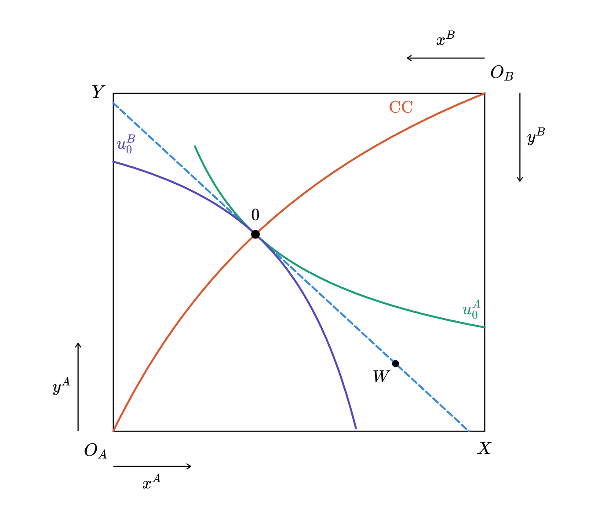
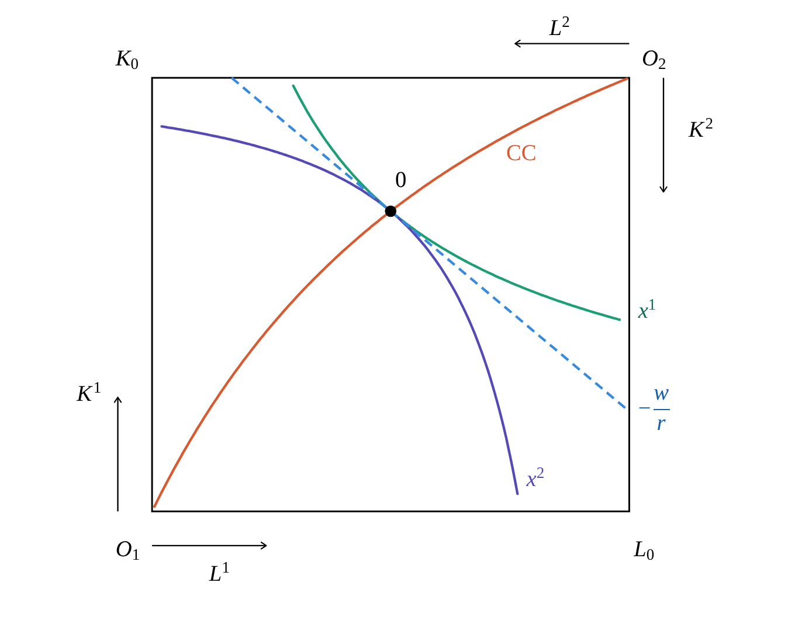
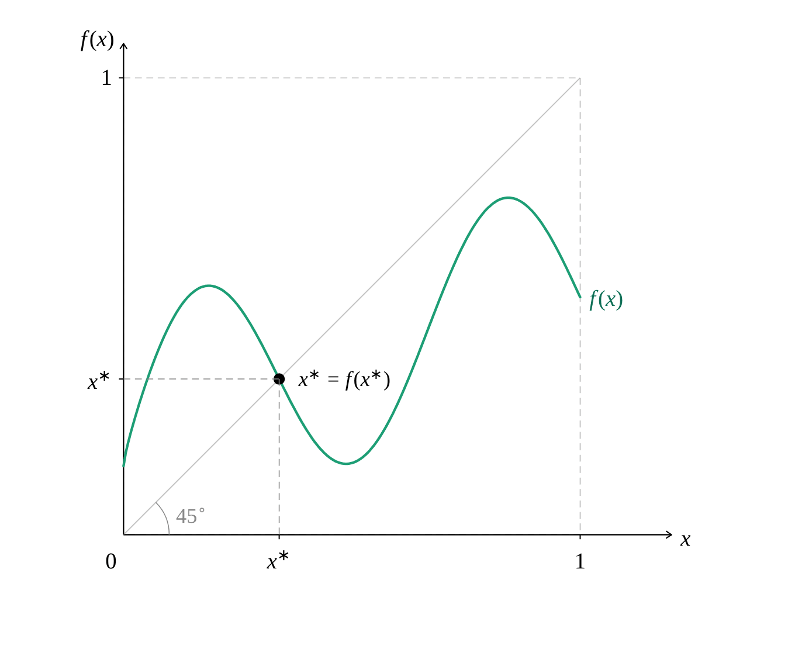
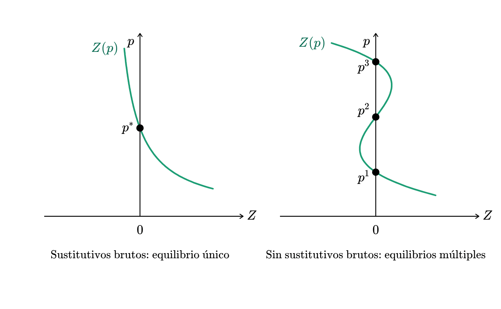
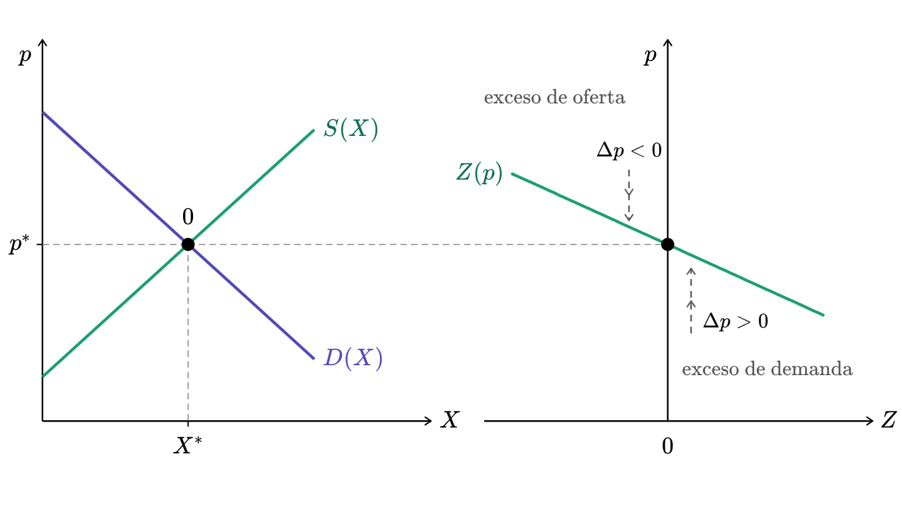
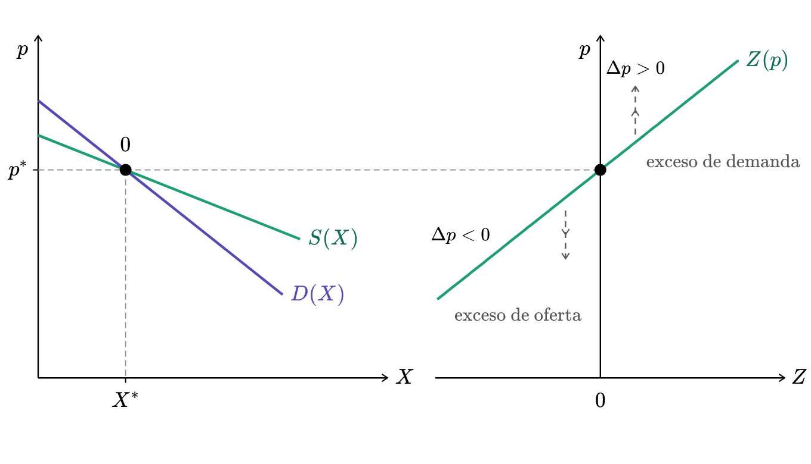
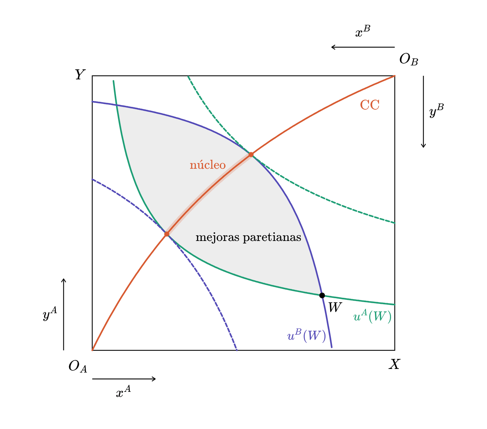

## Introducción

::: {.callout-note appearance="simple" icon=false}

:::

El enfoque de **equilibrio parcial** o marshalliano estudia cada mercado por separado y hace abstracción del resto de la economía, pero los mercados están interrelacionados. Frente a ese enfoque, la **teoría del equilibrio general** incorpora la interdependencia entre los agentes y considera las relaciones de complementariedad y sustitución entre bienes.

Léon Walras (1874) planteó por primera vez la economía como un sistema de ecuaciones simultáneas, una por mercado, cuyos precios se determinan a la vez. La pregunta de si ese sistema tiene solución no se resolvió hasta que Arrow y Debreu (1954) demostraron la existencia del equilibrio con instrumentos de topología, y la de si es único y estable quedó en buena medida abierta tras los resultados de Sonnenschein, Mantel y Debreu, según los cuales la teoría impone pocas restricciones a la forma de la demanda agregada. Arrow (1972) y Debreu (1983) recibieron el Premio Nobel por estos trabajos.

El equilibrio general es también el marco en el que se demuestran los **teoremas fundamentales del bienestar**. El primero establece que todo equilibrio competitivo es eficiente en el sentido de Pareto, y el segundo, que cualquier asignación eficiente puede alcanzarse como equilibrio competitivo con una redistribución adecuada de las dotaciones iniciales (tema [A22](a22-eb-i.qmd)). La principal limitación de la teoría es, sin embargo, el subastador walrasiano, que ajusta los precios hasta vaciar todos los mercados a la vez y no describe ningún mecanismo real. La teoría ha estudiado por ello otros procesos de ajuste, como el recontrato de Edgeworth, cuyo **núcleo** se reduce al equilibrio competitivo cuando el número de agentes crece, y ha incorporado el dinero (Patinkin, 1956) y la incertidumbre.

En la práctica, estos modelos permiten cuantificar el impacto de medidas de política económica, como el Tratado de Libre Comercio de América del Norte (TLCAN) o la Asociación Transatlántica de Comercio e Inversión (TTIP), y constituyen el vínculo entre la microeconomía y la macroeconomía.

El objeto del tema es comprender los aspectos fundamentales de la teoría del equilibrio general:

- *Modelo walrasiano*: la competencia perfecta y el concepto de equilibrio general competitivo (EGC).

- *Análisis del equilibrio*: sus propiedades positivas (existencia, unicidad y estabilidad) y normativas (optimalidad de Pareto y teoremas fundamentales del bienestar).

- *Extensiones y aplicaciones*: procesos de ajuste distintos del subastador (Marshall, Edgeworth y el núcleo), introducción del dinero (Patinkin), incertidumbre (Arrow-Debreu) y modelos de equilibrio general computable.

## 1. El modelo walrasiano de competencia perfecta

**Origen**: la teoría del equilibrio general nace con Léon Walras (*Elementos de economía política pura*, 1874), que la construyó sobre la competencia perfecta porque buscaba justificarla como mecanismo de asignación óptimo[^a21-2].

**Idea**: los mercados de bienes y de factores se analizan conjuntamente, y un vector de precios que cada agente toma como dado coordina las decisiones de consumidores y empresas hasta vaciar todos los mercados a la vez.

### 1.1. Supuestos

**Metodología**: se adopta el enfoque de equilibrio general. A diferencia del modelo de equilibrio parcial (un mercado), existen $n$ mercados interrelacionados, de bienes y de factores, que se analizan simultáneamente.

**Entorno**: no hay fallos de mercado, es decir, no existen externalidades, bienes públicos, poder de mercado, costes de transacción ni rigideces, pues existe plena flexibilidad de precios, salarios y tipos de interés, y la información es perfecta. Las dotaciones iniciales de bienes y de factores pertenecen a los consumidores, que son también los propietarios de las empresas.

**Agentes**: existen consumidores racionales, que maximizan su utilidad, y empresas gestionadas por sus propietarios, que maximizan el beneficio. Ambos tipos son numerosos, de modo que el mercado está atomizado y todos actúan como precio-aceptantes ($\partial p / \partial x = 0$). El sector público no participa.

**Tecnología**: cada empresa produce un único bien, $x = f(\mathbf{z})$, homogéneo y perfectamente divisible, con rendimientos estrictamente decrecientes[^a21-3], y todas las empresas de un mismo mercado comparten la misma tecnología. En conjunción con los supuestos sobre el entorno, ello garantiza la ley del precio único en cada mercado.

**Mercado de factores**: es también perfecto, con agentes precio-aceptantes ($\partial p_l^z / \partial z_l = 0$). La oferta de factores procede de las dotaciones de los consumidores. Los precios de los factores, $\mathbf{p}^z$, aunque cada agente los toma como dados, se determinan endógenamente en el equilibrio.

### 1.2. Modelo descentralizado con producción

El sistema walrasiano admite varias presentaciones, como el modelo de intercambio puro (sin producción), de las que aquí se sigue la del modelo descentralizado con producción.

#### 1.2.1. Demanda: comportamiento de los consumidores

**Planteamiento**: los consumidores tienen preferencias racionales, monótonas, continuas y estrictamente convexas. La utilidad es estrictamente cuasicóncava, creciente, continua, ordinal e independiente entre consumidores (no hay externalidades en el consumo).

La renta monetaria de cada individuo, $M_0^h$, es endógena, porque depende de los precios a los que se valoran sus dotaciones, y se compone de tres tipos:

- *Renta dotacional de bienes*: $\sum_i p_i x_{i0}^h$ (valor de mercado de las dotaciones iniciales de bienes).

- *Renta dotacional de factores*: $\sum_l p_l^z z_{l0}^h$ (valor de las dotaciones de factores).

- *Renta de las participaciones*: $\sum_f \alpha_f^h \pi^{f*}$ (participaciones en los beneficios máximos de las empresas, que se obtienen a continuación, con $\sum_h \alpha_f^h = 1$).

Formalmente, el consumidor $h$ resuelve:

$$\max_{\mathbf{x}^h} \; u^h(\mathbf{x}^h) \quad \text{s.a.:} \; \sum_i p_i x_i^h \leq \underbrace{\sum_i p_i x_{i0}^h + \sum_l p_l^z z_{l0}^h + \sum_f \alpha_f^h \pi^{f*}}_{M_0^h}$$

donde $\mathbf{x}^h = (x_1^h, \ldots, x_n^h)$ es la cesta de consumo del consumidor $h$ (variables de decisión), $u^h(\cdot)$ su función de utilidad, $p_i$ el precio del bien $i$, $x_{i0}^h$ y $z_{l0}^h$ sus dotaciones iniciales del bien $i$ y del factor $l$, $p_l^z$ el precio del factor $l$, $\alpha_f^h$ su participación en el beneficio $\pi^{f*}$ de la empresa $f$ y $M_0^h$ su renta monetaria endógena.

**CPO**: con solución interior y la restricción agotada, derivando el lagrangiano respecto a cada bien y eliminando el multiplicador:

$$ \frac{\partial u/\partial x_i}{\partial u/\partial x_j} = \frac{p_i}{p_j}, \qquad \forall \, i \neq j, \quad \forall \, h = 1, \ldots, H$$

El cociente $(\partial u/\partial x_i)/(\partial u/\partial x_j)$ mide la relación marginal de sustitución ($\text{RMS}_{ji}^h$) entre $i$ y $j$, es decir, cuántas unidades del bien $j$ cedería el consumidor $h$, según su propia valoración (subjetiva), para obtener una unidad más de $i$ sin que su utilidad varíe. Depende de las preferencias de cada consumidor, de modo que, en general, varía de un consumidor a otro y de una cesta a otra.

El cociente $p_i/p_j$ es el precio relativo, es decir, la tasa a la que el mercado permite intercambiar ambos bienes. A diferencia de la $\text{RMS}$, es una tasa objetiva y común a todos los consumidores, que la toman como dada porque son precio-aceptantes.

Para cualquier consumidor considerado en el modelo, en el óptimo ambas tasas se igualan, porque, si su $\text{RMS}$ fuese superior al precio relativo, ese consumidor podría aumentar su utilidad comprando más de $i$ y menos de $j$, y viceversa. Por tanto, cualquier desviación respecto de esta igualdad implica que existe una reasignación del gasto que mejora la utilidad del consumidor.

**CSO**: la cuasiconcavidad estricta de la utilidad y la linealidad de la restricción presupuestaria hacen suficiente la CPO y única la demanda de cada consumidor.

**Solución**: cada consumidor obtiene una función de demanda $x_i^h(p, M_0^h)$ homogénea de grado cero en precios y renta. Si todos los precios y la renta se multiplican por una misma constante positiva, las cantidades demandadas no varían (ausencia de ilusión monetaria).

De la agregación horizontal de las funciones de demanda individuales se obtiene la demanda de mercado $D_i(p) = \sum_h x_i^h(p, M_0^h)$. Como la renta de cada consumidor es el valor de sus dotaciones y participaciones a los precios vigentes, la demanda de mercado depende, en último término, solo del vector de precios y es homogénea de grado cero en él.

**Equilibrio**: en un contexto de equilibrio general, la optimización individual de cada consumidor, dado un vector de precios de mercado común, conduce a una condición de equilibrio agregada. Las decisiones que cada consumidor toma por separado quedan así ligadas entre sí a través de los precios.

El consumo estará en equilibrio cuando todos los consumidores estén maximizando simultáneamente su utilidad frente al mismo vector de precios. Puesto que cada consumidor iguala su $\text{RMS}$ al precio relativo, y el precio relativo es el mismo para todos, se obtiene, con dos consumidores $A$ y $B$:

$$ \text{RMS}_{ji}^{A} = \frac{u_i^{' A}}{u_j^{' A}} = \frac{p_i}{p_j} = \frac{u_i^{' B}}{u_j^{' B}} = \text{RMS}_{ji}^{B}$$

Esta condición se generaliza a $H$ consumidores, de modo que $\text{RMS}_{ji}^{h} = p_i/p_j$ para todo $h = 1, \ldots, H$. El vector de precios actúa así como mecanismo de coordinación, pues el precio relativo obliga a todos los consumidores a ajustar sus valoraciones subjetivas a una misma tasa objetiva de intercambio. Sin precios comunes, no habría razón para que las $\text{RMS}$ se igualaran.

**Desarrollo gráfico**: con dos bienes y dos consumidores, el equilibrio en el consumo se representa en el plano bien $x$-bien $y$ de la caja de Edgeworth-Bowley en el espacio de bienes (figura -@fig-a211-edgeworth-consumo):

1. *Caja*: sus dimensiones son las dotaciones totales de cada bien ($X = x_0^A + x_0^B$, $Y = y_0^A + y_0^B$). Las cantidades de $A$ se miden desde el origen $O_A$, en el vértice inferior izquierdo, y las de $B$ desde $O_B$, en el vértice opuesto, de modo que cada punto de la caja es un reparto factible de las cantidades totales ($x^A + x^B = X$, $y^A + y^B = Y$).

2. *Dotación inicial*: el punto $W$ recoge el reparto de partida.

3. *Curvas de indiferencia*: $u_0^A$ reúne las cestas que dan a $A$ una misma utilidad, y $u_0^B$, las que dan a $B$ una misma utilidad. Son convexas hacia su origen ($O_A$ y $O_B$), porque las preferencias son estrictamente convexas.

4. *Recta presupuestaria*: común a ambos consumidores, reúne las cestas cuyo valor a los precios de mercado iguala al de la dotación. Pasa por $W$ y tiene pendiente $-p_x/p_y$, determinada por el vector de precios de mercado.

5. *Curva de contratos* ($\text{CC}$): une las tangencias entre las curvas de indiferencia de ambos consumidores, los repartos en los que sus $\text{RMS}$ coinciden.

6. *Equilibrio*: en el punto $0$, la recta presupuestaria es tangente a la vez a $u_0^A$ y a $u_0^B$. El vector de precios selecciona este punto entre las infinitas asignaciones factibles de la caja y lo sitúa sobre la curva de contratos. El vector de precios, tanto de los bienes finales como de los factores productivos, se ajusta mediante un proceso de tanteo hasta equilibrar cada uno de los mercados.

::: {#fig-a211-edgeworth-consumo}

::: {.content-visible when-format="html"}
```{=html}
<div class="graph-frame">
<iframe src="../graphs/a211_Edgeworth_Consumo.html" style="height:580px" loading="lazy" title="fig-a211-edgeworth-consumo"></iframe>
</div>
```
:::

::: {.content-visible unless-format="html"}

:::

Elección óptima del consumidor en el modelo walrasiano, dadas la dotación inicial y los precios.
:::

**Bienestar**: la igualdad de las $\text{RMS}$ de todos los consumidores es, a su vez, la condición de eficiencia de Pareto en el consumo, de modo que la asignación de equilibrio está sobre la curva de contratos en el consumo (apartado 2.2). En cada uno de sus puntos, la $\text{RMS}$ común indica el precio relativo que sostendría ese reparto como equilibrio competitivo.

Si cada punto de la curva de contratos se lleva al plano de utilidades $(u^A, u^B)$, se obtiene la *frontera de posibilidades de utilidad* (FPU). Para cada nivel de utilidad de $B$, la frontera indica el máximo de utilidad al que puede llegar $A$ con las cantidades totales de bienes disponibles. Tiene pendiente negativa, porque a lo largo de la curva de contratos mejorar a un consumidor exige empeorar al otro. El equilibrio competitivo es un punto de la FPU, y cuál de ellos depende de la dotación inicial, que fija la renta de cada consumidor a los precios de equilibrio (apartado 2.2.2).

::: {.callout-note appearance="simple" icon=false}
La curva de contratos en el consumo y su proyección en la frontera de posibilidades de utilidad se desarrollan, con sus gráficos, en el tema [A22](a22-eb-i.qmd), apartado 1.2.2.
:::

#### 1.2.2. Oferta: comportamiento de las empresas

**Planteamiento**: la tecnología presenta rendimientos estrictamente decrecientes, cada empresa usa varios factores para producir un único bien, y las funciones de producción son independientes (no hay externalidades en la producción). Cada empresa $f$ que produce el bien $i$ elige las cantidades de factores que maximizan su beneficio, dados el precio de su producto y los de los factores (enfoque de la producción):

$$\max_{\mathbf{z}^f} \; \pi^f = p_i \, f_i(\mathbf{z}^f) - \sum_{l} p_l^z z_l^f$$

donde $\mathbf{z}^f$ es el vector de cantidades de factores que emplea la empresa $f$ (variables de decisión), $z_l^f$ su cantidad del factor $l$, $f_i(\cdot)$ la función de producción del bien $i$, común a todas las empresas de ese mercado, $p_i$ el precio del bien, $p_l^z$ el precio del factor $l$ y $\pi^f$ el beneficio de la empresa.

**CPO**:

$$p_i \, \text{Pmg}_l^f \equiv p_i \, \frac{\partial f_i(\mathbf{z}^f)}{\partial z_l^f} = p_l^z, \qquad \forall \, l, \quad \forall \, f = 1, \ldots, F \tag{1}$$

Dividiendo (1) para dos factores $k$ y $l$, y despejando en ella el precio del producto, se obtienen dos formas equivalentes:

$$\text{RMST}_{kl}^f = \frac{\text{Pmg}_l^f}{\text{Pmg}_k^f} = \frac{p_l^z}{p_k^z} \tag{2}$$

$$p_i = \frac{p_l^z}{\text{Pmg}_l^f} = \text{Cmg}_i \tag{3}$$

Las tres condiciones se cumplen para cualquier empresa considerada en el modelo y se leen como sigue:

1. *Maximización del beneficio*: (1) establece que cada factor se contrata hasta que el valor de su productividad marginal ($\text{VPmg}_l$) iguala a su precio. Mientras lo que aporta la última unidad de un factor supere a lo que cuesta, la empresa aumenta su beneficio contratando más.

2. *Minimización del coste*: (2) establece que la relación marginal de sustitución técnica (tasa a la que la empresa puede sustituir un factor por otro manteniendo constante la producción) iguala al precio relativo de los factores. Si ambas tasas fuesen distintas, la empresa podría producir la misma cantidad a menor coste reasignando factores.

3. *Regla de precios*: (3) muestra que el precio del bien iguala a su coste marginal de producción, pues producir una unidad más con el factor $l$ cuesta su precio dividido por su productividad marginal. Esta igualdad es la condición estándar de oferta competitiva, según la cual la empresa produce hasta que el ingreso adicional de la última unidad iguala al coste adicional de producirla.

**CSO**: la concavidad estricta de $f_i(\cdot)$ (que implica rendimientos estrictamente decrecientes a escala, aunque no se sigue de ellos) hace suficientes las CPO, de modo que la oferta y las demandas de factores de cada empresa están bien definidas para cualquier vector de precios.

**Solución**: de las CPO se obtienen la función de oferta de cada empresa, $x_i^f(p_i, \mathbf{p}^z)$, y sus funciones de demanda de factores, $z_l^f(p_i, \mathbf{p}^z)$, cuya suma horizontal da la oferta de mercado del bien y la demanda de cada factor. Todas cumplen tres propiedades: unicidad (para un vector de precios dado, cada oferta o demanda es única), continuidad (cambian de forma continua con los precios $\forall p > 0$) y homogeneidad de grado cero en precios (ausencia de ilusión monetaria: si todos los precios cambian en la misma proporción, las cantidades no varían).

Para el análisis del equilibrio general conviene reunir ambas funciones en el *vector de producción neta* de la empresa, $\mathbf{y}^f(\mathbf{p})$, cuyos componentes son positivos para el bien que produce ($y_i^f = x_i^f$) y negativos para los factores que emplea ($y_l^f = -z_l^f$). El beneficio se escribe entonces $\pi^f = \mathbf{p} \cdot \mathbf{y}^f$, con $\mathbf{p}$ el vector de precios de bienes y factores[^a21-8], y la función de exceso de demanda puede sumar en una sola expresión la oferta de bienes y la demanda de factores de las empresas.

**Equilibrio**: de manera análoga al caso del consumo, cuando existen múltiples empresas que emplean los mismos factores, la optimización individual de cada empresa frente a un vector común de precios de factores conduce a una condición de equilibrio agregada. Considerando dos empresas $1$ y $2$ que emplean capital ($K$) y trabajo ($L$), la producción estará en equilibrio cuando ambas estén minimizando costes simultáneamente, es decir, cumpliendo (2), frente al mismo precio relativo de factores:

$$ \text{RMST}_{KL}^{1} = \frac{w}{r} = \text{RMST}_{KL}^{2}$$

Esta condición se generaliza a $F$ empresas, de modo que $\text{RMST}_{KL}^f = w/r$ para todo $f = 1, \ldots, F$. De nuevo, el vector de precios de factores actúa como mecanismo de coordinación, ya que el precio relativo $w/r$ obliga a todas las empresas a ajustar su combinación de factores a la misma tasa de sustitución técnica.

**Desarrollo gráfico**: el equilibrio en la producción se representa en el plano trabajo-capital de la caja de Edgeworth-Bowley en el espacio de factores (figura -@fig-a213-edgeworth-produccion):

1. *Caja*: sus dimensiones son las dotaciones totales de cada factor ($L_0 = L^1 + L^2$, $K_0 = K^1 + K^2$). Las cantidades de la empresa 1 se miden desde el origen $O_1$, en el vértice inferior izquierdo, y las de la empresa 2 desde $O_2$, en el vértice opuesto. De este modo, cada punto interior es una asignación factible, de pleno empleo de ambos factores, entre las dos empresas.

2. *Isocuantas*: $x^1$ reúne las combinaciones de factores con las que la empresa 1 obtiene una misma producción, y $x^2$, las de la empresa 2. Son convexas hacia su origen ($O_1$ y $O_2$), porque las funciones de producción son estrictamente cóncavas.

3. *Recta isocoste*: común a ambas empresas, reúne las combinaciones de factores de igual coste y tiene pendiente $-w/r$, determinada por el vector de precios de factores.

4. *Curva de contratos* ($\text{CC}$): une las tangencias entre las isocuantas de ambas empresas, las asignaciones en las que sus $\text{RMST}$ coinciden.

5. *Equilibrio*: en el punto $0$, la recta isocoste es tangente a la vez a $x^1$ y a $x^2$. El precio relativo de los factores selecciona este punto de la curva de contratos.

::: {#fig-a213-edgeworth-produccion}

::: {.content-visible when-format="html"}
```{=html}
<div class="graph-frame">
<iframe src="../graphs/a213_Edgeworth_Produccion.html" style="height:580px" loading="lazy" title="fig-a213-edgeworth-produccion"></iframe>
</div>
```
:::

::: {.content-visible unless-format="html"}

:::

Equilibrio en la producción. En la caja de Edgeworth-Bowley de factores, la recta isocoste común es tangente a las isocuantas de ambas empresas en un punto de la curva de contratos.
:::

**Bienestar**: la igualdad de las $\text{RMST}$ de todas las empresas es la condición de eficiencia de Pareto en la producción, de modo que la asignación de factores de equilibrio está sobre la curva de contratos en la producción. En cada uno de sus puntos, la $\text{RMST}$ común indica el precio relativo de los factores que sostendría esa asignación como equilibrio.

Si cada punto de la curva de contratos se lleva al plano de bienes $(x, y)$, se obtiene la *frontera de posibilidades de producción* (FPP), o curva de transformación. La frontera da la máxima cantidad de un bien que puede producirse para cada cantidad del otro, dadas la tecnología y las dotaciones de factores. El valor absoluto de su pendiente es la relación marginal de transformación, $\text{RMT}_{yx} = \text{Cmg}_x/\text{Cmg}_y$, el coste de oportunidad de $x$ en unidades de $y$, y con los rendimientos decrecientes supuestos la FPP es cóncava.

Puesto que cada empresa iguala el precio de su bien a su coste marginal, por (3), en el equilibrio se cumple $\text{RMT}_{yx} = p_x/p_y$. La producción de equilibrio es, así, el punto de la FPP tangente a la recta isoingreso más alejada del origen, de pendiente $-p_x/p_y$.

::: {.callout-note appearance="simple" icon=false}
La curva de contratos en la producción y su proyección en la frontera de posibilidades de producción se desarrollan, con sus gráficos, en el tema [A22](a22-eb-i.qmd), apartado 1.2.1.
:::

#### 1.2.3. El ajuste del sistema

Los planes de consumidores y empresas dependen solo del vector de precios, pero nada garantiza que, a un vector arbitrario, sean compatibles entre sí, pues lo que unos desean comprar puede no coincidir con lo que otros desean vender. Hace falta, por ello, una medida de esa discrepancia, la función de exceso de demanda, y un mecanismo que corrija los precios hasta eliminarla. El enfoque walrasiano propone un ajuste vía precios, en contraste con el enfoque marshalliano, que opera vía cantidades.

**Función de exceso de demanda y ley de Walras** (1874): la primera es la diferencia entre la demanda de mercado y la oferta total (producción de las empresas más dotaciones iniciales de los consumidores) para cada bien $i$:

$$Z_i(p) = \underbrace{\sum_{h=1}^{H} x_i^h(p)}_{D_i(p)} - \underbrace{\left(\sum_{f=1}^{F} y_i^f(p) + \sum_{h=1}^{H} x_{i0}^h\right)}_{S_i(p)}$$

donde $y_i^f(p)$ es la producción neta de la empresa $f$ en el bien $i$, negativa cuando $i$ es un factor, de modo que la demanda de factores de las empresas entra restando en la oferta.

Si $Z_i(p) > 0$, hay exceso de demanda, y si $Z_i(p) < 0$, exceso de oferta. Las propiedades de la función de exceso de demanda son las siguientes:

1. *Continuidad y diferenciabilidad*: es una función, y no una correspondencia, porque las demandas y ofertas individuales son únicas. Es continua para precios positivos y diferenciable cuando lo son esas demandas y ofertas. En los precios nulos de los bienes libres, en cambio, la continuidad requiere la saciabilidad condicional del apartado 2.1.1.

2. *Transformaciones*: es homogénea de grado cero en precios, $Z_i(kp) = Z_i(p)$ para todo $k > 0$, porque las rentas de los consumidores son el valor de sus dotaciones y participaciones a esos mismos precios. Por ello el sistema solo determina precios relativos.

3. *Inclinación*: la teoría no le impone un signo general. Con todo, si todos los bienes son sustitutivos brutos, $\partial Z_i / \partial p_j > 0$ para todo $j \neq i$, la homogeneidad de grado cero implica además $\partial Z_i / \partial p_i < 0$, y el equilibrio es único (apartado 2.1.2) y estable (apartado 2.1.3).

4. *Forma*: la teoría no restringe su curvatura, igual que ocurre con las demandas individuales que agrega.

5. *Otras propiedades*:

    - *Agotamiento de la renta*: el valor de los excesos de demanda es nulo para cualquier vector de precios (*ley de Walras*), como se desarrolla, con sus corolarios, tras la figura -@fig-a218-exceso-demanda.

    - *Integrabilidad*: no hereda la simetría ni la ley de la demanda compensada de las demandas individuales, como demuestra el teorema de Sonnenschein, Mantel y Debreu (1972-1974). Según este teorema, cualquier función continua, homogénea de grado cero y que cumpla la ley de Walras es, lejos de los precios nulos, la función de exceso de demanda de alguna economía de intercambio con al menos tantos consumidores como bienes. Por ello, la función agregada no puede tratarse como la de un consumidor representativo.

    - *Observabilidad*: solo puede medirse en el equilibrio, porque fuera de él recoge demandas y ofertas nocionales, que no llegan a ejecutarse (*tâtonnement*).

Gráficamente, en el plano $Z_i$-$p_i$ (figura -@fig-a218-exceso-demanda) y dados los demás precios, la curva $Z_i(p)$ representa el exceso de demanda del bien $i$ a cada precio, y caben dos casos según el tipo de bien:

- *Bien escaso*: la función corta al eje ($Z_i = 0$) para algún precio positivo, por lo que existe un precio de equilibrio $p_i^* > 0$. Cuando la función es decreciente, por debajo de ese precio hay exceso de demanda y, por encima, exceso de oferta (panel a).

- *Bien libre*: la función no corta al eje y siempre existe exceso de oferta, incluso a precio nulo. Por ello, para incluir bienes libres en el modelo, su precio de equilibrio debe ser nulo, con $Z_i(0) < 0$ (panel b)[^a21-9].

::: {#fig-a218-exceso-demanda}

::: {.content-visible when-format="html"}
```{=html}
<div class="graph-frame wide">
<iframe src="../graphs/a218_Exceso_demanda.html" style="--r:1.581" loading="lazy" title="fig-a218-exceso-demanda"></iframe>
</div>
```
:::

::: {.content-visible unless-format="html"}

:::

Función de exceso de demanda del bien $i$, dados los demás precios. Si el bien es escaso, $Z_i(p)$ corta al eje en un precio positivo, $p_i^*$ (panel a). Si es libre, hay exceso de oferta a cualquier precio y el equilibrio exige $p_i^* = 0$, con $Z_i(0) < 0$ (panel b).
:::

El número de cortes de la función con el eje, que determina si el equilibrio es único o múltiple, depende a su vez de la relación entre los bienes (sustitutivos brutos o no) y se estudia más adelante (figura -@fig-a215-unicidad).

La función de exceso de demanda cumple la ley de Walras, según la cual el valor total de los excesos de demanda es nulo para cualquier vector de precios. Formalmente:

$$\sum_{i=1}^{n} p_i Z_i(p) = 0$$

La ley se cumple para cualquier vector de precios, no solo en equilibrio. El resultado se deriva directamente de la agregación de las restricciones presupuestarias de todos los consumidores. Puesto que cada consumidor gasta exactamente su renta, el valor total de lo que se demanda debe igualar al valor total de lo que se ofrece.

Económicamente, esto significa que los mercados están interconectados, en el sentido de que toda unidad monetaria gastada en un mercado es una unidad que deja de gastarse en otro. Por eso, no puede haber excesos de demanda (o de oferta) para todos los bienes simultáneamente.

De esta ley se siguen cuatro corolarios:

1. *Excesos compensadores*: para un vector de precios cualquiera, si existe un exceso en un mercado, existirá un exceso compensador en otro. Para el vector de equilibrio, no pueden existir excesos de bienes escasos, aunque sí excesos de oferta de bienes libres.

2. *Indeterminación de precios absolutos*: dado que hay $n-1$ ecuaciones independientes con $n$ incógnitas y los excesos de demanda son homogéneos de grado cero, solo se determinan precios relativos. Por ello, se fija un bien como *numerario* (unidad de cuenta) y el resto se define en relación con él.

3. *El dinero es un velo*: en el modelo walrasiano, que es una economía de trueque, el numerario solo cumple el papel de unidad de cuenta, por lo que no se requiere la presencia efectiva del dinero como medio de pago.

4. *Economía abierta*: $\sum_i p_i Z_i(p) = -\text{BC}$, donde $Z_i(p)$ es ahora el exceso de demanda interna del bien $i$ y $\text{BC}$ el saldo de la balanza comercial, de modo que un exceso de demanda interna agregado se cubre con importaciones netas (déficit comercial). Si $\text{BC} = 0$, se da el equilibrio externo. En el modelo de dos países y dos bienes, la ley de Walras permite obtener la relación real de intercambio internacional a partir del vaciado de un solo mercado, porque, si se vacía el mercado mundial de un bien, se vacía también el del otro. Gráficamente, la restricción de comercio equilibrado de cada país (valor de las exportaciones igual al de las importaciones) es una recta que pasa por el origen y cuya pendiente es el precio relativo de los bienes. La relación real de intercambio de equilibrio es la pendiente de la recta sobre la que son compatibles las ofertas de exportación y las demandas de importación de ambos países.

**El mecanismo de *tâtonnement* y la función del subastador**: en la reconstrucción habitual del modelo de Walras, el *tâtonnement* es un proceso de ajuste previo a las transacciones en el que un subastador ficticio guía la economía hacia el equilibrio. El proceso opera del siguiente modo:

1. *Anuncio de precios*: el subastador propone un vector de precios.

2. *Demandas nocionales*: los agentes calculan sus demandas y ofertas óptimas a esos precios.

3. *Observación de excesos*: el subastador comprueba si hay excesos de demanda u oferta en cada mercado.

4. *Revisión de precios*: si algún mercado no se vacía, no se realizan transacciones y el subastador sube los precios en los mercados con exceso de demanda y los baja en los mercados con exceso de oferta.

5. *Iteración*: el proceso se repite hasta que todos los mercados se vacían simultáneamente, momento en el cual se ejecutan las transacciones[^a21-10].

Este mecanismo difiere esencialmente del ajuste marshalliano vía cantidades (apartado 3.1.1). En Walras, el ajuste es simultáneo en todos los mercados, se realiza vía precios y las transacciones solo ocurren en equilibrio. Bajo *tâtonnement*, por tanto, las demandas planeadas (nocionales) coinciden con las efectivas. Esta propiedad se pierde cuando existen rigideces de precios, lo que constituye uno de los puntos de partida de los neokeynesianos del desequilibrio.

Formalmente, la regla de ajuste del subastador puede expresarse como una función que, dado un vector de precios normalizados $p'$, genera un nuevo vector de precios $p''$:

$$p_i'' \equiv T_i(p') = \frac{\max\{p_i' + \lambda_i Z_i(p'), \; 0\}}{\sum_{j=1}^{n} \max\{p_j' + \lambda_j Z_j(p'), \; 0\}}$$

donde $\lambda_i > 0$ es el factor de velocidad de ajuste. El operador $\max$ garantiza precios no negativos (un precio no puede caer por debajo de cero). La función está normalizada ($\sum p_i'' = 1$), de manera que transforma precios normalizados en precios normalizados.

Si $Z_i > 0$ (exceso de demanda), el precio del bien $i$ sube, y si $Z_i < 0$ (exceso de oferta), baja. El equilibrio se alcanza cuando el subastador aplica la regla y el vector de precios se reproduce a sí mismo ($T(p^*) = p^*$). Esta propiedad de *punto fijo* permite conectar el mecanismo del subastador con la prueba de existencia del equilibrio.

#### 1.2.4. El equilibrio general competitivo

El ajuste se detiene cuando el subastador ya no tiene precios que corregir. Se habla entonces de **equilibrio general competitivo**, porque todos los mercados se vacían. Las empresas maximizan su beneficio y ofrecen exactamente lo que se les demanda, mientras los consumidores, al maximizar su utilidad, demandan exactamente lo que se ofrece[^a21-12].

Al considerar todos los mercados, hay tantos mercados como mercancías y factores productivos. Dentro de cada mercado hay tres tipos de funciones (demanda, oferta, condición de equilibrio) y dos tipos de incógnitas (precios y cantidades), con lo que se forma un sistema de ecuaciones simultáneas[^a21-15].

El equilibrio general emerge como solución a este sistema, en forma de un vector de precios que vacía todos los mercados simultáneamente. Sin embargo, que el número de ecuaciones iguale al de incógnitas no es condición suficiente, ya que se requiere que las ecuaciones sean independientes. De hecho, en un sistema walrasiano, una ecuación es redundante por la ley de Walras y solo se determinan precios relativos.

**Definición**: el EGC es un vector de precios $p^* = (p_1^*, \ldots, p_n^*)$ tal que consumidores y productores maximizan sus respectivos programas y todos los mercados (bienes, servicios, factores) se vacían. Esta condición puede plantearse formalmente de dos formas:

- *Igualación de valoraciones*: en el EGC, la valoración subjetiva de los consumidores (tasa a la que están dispuestos a intercambiar bienes, la $\text{RMS}$) coincide con la valoración objetiva del mercado (precio relativo). La valoración del mercado, a su vez, coincide con el coste de oportunidad de la producción, es decir, con la $\text{RMT}$, expresada como cociente de costes marginales $(d\text{CT}_i/dx_i)/(d\text{CT}_j/dx_j)$, donde $d\text{CT}_i/dx_i \equiv \text{Cmg}_i$ es el coste marginal del bien $i$. Formalmente:
    $$ \text{RMS}_{ji}(p^*) = \frac{p_i^*}{p_j^*} = \frac{d\text{CT}_i/dx_i}{d\text{CT}_j/dx_j} = \text{RMT}_{ji}(p^*)$$
    Esta triple igualdad sintetiza la eficiencia del sistema competitivo (primer teorema del bienestar).

- *Ausencia de excesos*:
    $$Z_i^* \equiv Z_i(p^*) = 0 \;\; \forall \, p_i^* > 0 \qquad Z_i^* \equiv Z_i(p^*) \leq 0 \;\; \forall \, p_i^* = 0$$
    Es decir, los mercados de bienes escasos se vacían ($Z_i = 0$) y se admiten excesos de oferta de bienes libres ($Z_i \leq 0$ con $p_i = 0$). El ajuste ante excesos se supone instantáneo. En forma concisa, $Z_i^* \leq 0$, $p_i^* \geq 0$, $p_i^* Z_i^* = 0$.

El equilibrio general competitivo se caracteriza por cuatro condiciones:

- *Consumidores*: cada uno maximiza su utilidad dados los precios.

- *Empresas*: cada una maximiza su beneficio dados los precios.

- *Mercados*: todos se vacían simultáneamente.

- *Precios relativos*: son los únicos que el sistema determina, y un bien se toma como numerario.

::: {.callout-tip collapse="true" appearance="simple" title="Ejemplo: equilibrio walrasiano en una economía de intercambio Cobb-Douglas"}
Sean $u^h = (x^h)^{1/2} (y^h)^{1/2}$ para $h = A, B$, con dotaciones $(x_0^A, y_0^A) = (3, 0)$ y $(x_0^B, y_0^B) = (1, 8)$, por lo que la caja mide $X = 4$ e $Y = 8$. Tomando $y$ como numerario ($p_y = 1$) y llamando $p \equiv p_x/p_y$, cada consumidor gasta la mitad de su renta $M_0^h = p\, x_0^h + y_0^h$ en cada bien, de modo que $x^h = M_0^h/(2p)$ e $y^h = M_0^h/2$. Por la ley de Walras basta vaciar el mercado de $x$:

$$\frac{3p}{2p} + \frac{p + 8}{2p} = 4 \;\Rightarrow\; p^* = \frac{p_x^*}{p_y^*} = 2 = \frac{Y}{X}$$

Con $p^* = 2$, las rentas son $M_0^A = 6$ y $M_0^B = 10$, y la asignación de equilibrio es

$$(x^A, y^A) = \left(\tfrac{3}{2},\, 3\right), \qquad (x^B, y^B) = \left(\tfrac{5}{2},\, 5\right)$$

que vacía también el mercado de $y$ ($3 + 5 = 8$) y cumple $\text{RMS}_{yx}^A = y^A/x^A = 2 = y^B/x^B = \text{RMS}_{yx}^B$. Así, el precio relativo iguala las RMS de ambos consumidores y la asignación está sobre la curva de contratos.
:::


### 1.3. Conclusiones

**Aspectos positivos**: el modelo walrasiano integra en un único sistema las decisiones de consumidores y empresas estudiadas en los temas anteriores y muestra que un vector de precios puede coordinarlas todas simultáneamente. Asimismo, las funciones de exceso de demanda conservan la continuidad y la homogeneidad de grado cero de las demandas individuales y cumplen la ley de Walras, aunque no heredan el resto de su estructura (teorema de Sonnenschein, Mantel y Debreu). Ello basta para plantear con precisión las cuestiones de existencia, unicidad y estabilidad.

**Limitaciones**: el mecanismo de *tâtonnement* es una ficción (no hay intercambio fuera del equilibrio ni un subastador real), y el modelo es estático y con mercados completos. Además, las condiciones que garantizan sus propiedades (convexidad, ausencia de externalidades y de poder de mercado) son las que los temas [A22](a22-eb-i.qmd) y [A23](a23-eb-ii.qmd) relajan.

## 2. Análisis del equilibrio

Definido el equilibrio, quedan por responder tres preguntas, relativas a su existencia, su unicidad y su estabilidad. Existencia, unicidad y estabilidad son propiedades deseables del sistema competitivo como mecanismo de asignación y constituyen la base para su valoración normativa. Por ello, en esta sección se introduce el análisis positivo del equilibrio, seguido del análisis normativo.

### 2.1. Análisis positivo

Se estudian, por este orden, la existencia del equilibrio (que algún vector de precios vacíe todos los mercados), su unicidad (que ese vector sea el único) y su estabilidad (que el ajuste de precios conduzca a él tras una perturbación).

#### 2.1.1. Existencia: el teorema del punto fijo de Brouwer (1912)

**Origen**: Walras (1874) no llegó a demostrar la existencia del equilibrio, pues se apoyó en la igualdad entre el número de ecuaciones y el de incógnitas, que no la garantiza.

Wald (1936) ofreció una primera prueba formal, aunque laboriosa. La prueba definitiva se debe a Arrow y Debreu (1954), que se apoyaron en la teoría de juegos, con preferencias convexas y conjuntos de producción convexos. Posteriormente, la prueba se simplificó y se extendió:

- *Gale (1955) y Nikaido (1956)*: prueba más sencilla, basada directamente en la función de exceso de demanda.

- *Debreu (1959)*: existencia con incertidumbre, mediante bienes contingentes.

**Idea**: en la actualidad, la existencia se ilustra mediante el *teorema del punto fijo de Brouwer* (1912). Según este resultado, toda función continua de un conjunto no vacío, cerrado, acotado y convexo de $\mathbb{R}^n$ en sí mismo tiene al menos un punto fijo $x^*$ tal que $f(x^*) = x^*$ (figura -@fig-a214-existencia-brouwer). El teorema constituye condición suficiente para la existencia del EGC.

**Razonamiento**: la conexión con el mecanismo del subastador es directa, pues la función del subastador $T(p)$ definida en el apartado 1.2.3 transforma un vector de precios normalizados en otro vector de precios normalizados. Si se puede demostrar que esta función es continua y que su dominio (el conjunto de precios normalizados) es cerrado, acotado y convexo, entonces el teorema de Brouwer garantiza la existencia de un punto fijo $p^*$ tal que $T(p^*) = p^*$.

La condición $T(p^*) = p^*$ equivale precisamente a $Z_i(p^*) = 0$ para todos los bienes escasos, es decir, al vaciamiento de todos los mercados. Por tanto, demostrar la existencia del EGC se reduce a verificar las tres condiciones del teorema de Brouwer aplicadas a la función del subastador, lo que se hace en tres pasos:

1. *Vector de precios (cerrado, acotado y convexo)*: los precios deben ser no negativos ($p_i \geq 0$), lo que acota el conjunto por debajo. Para acotarlo también por arriba, y dado que solo importan los precios relativos, se normalizan para que sumen uno:
    $$p_i' = \frac{p_i}{\sum_{j=1}^{n} p_j}$$
    Los precios normalizados mantienen sus valores relativos ($p_i'/p_j' = p_i/p_j$) y su suma es unitaria ($\sum p_i' = 1$). El vector de precios normalizados está definido siempre que al menos un $p_i > 0$ (al menos un bien debe ser escaso). Cada $p_i' \in [0, 1]$, de modo que el conjunto está acotado, y es cerrado y convexo porque lo definen la igualdad $\sum p_i' = 1$ y las desigualdades $p_i' \geq 0$.

2. *Función del subastador (continuidad)*: la función $T(p')$ transforma precios normalizados en precios normalizados, por lo que su imagen pertenece al mismo conjunto que su dominio. Para bienes escasos ($p_i > 0$) no hay problema de continuidad, mientras que para bienes libres ($p_i = 0$) la demanda podría ser infinita, lo que haría la función discontinua. Para resolver esto, se establece *saciabilidad condicional*, según la cual los consumidores se sacian de todos los bienes excepto de al menos uno de los bienes escasos. Esto garantiza que el exceso de demanda de bienes libres sea finito y, por tanto, que la función del subastador sea continua en todo su dominio.

3. *Demostración del punto fijo*: verificadas las condiciones del teorema, la función del subastador posee un punto fijo $p^*$ tal que $T(p^*) = p^*$. Resta comprobar que este punto fijo implica efectivamente $Z_i(p^*) = 0$ para bienes escasos y $Z_i(p^*) \leq 0$ para bienes libres:

    - *Bien libre* ($p_i^* = 0$): la función toma $T_i(p^*) = \max\{\lambda_i Z_i(p^*), 0\} / \sum(\cdot)$. Como $p_i^* = 0$, el punto fijo exige $T_i = 0$, lo cual requiere $\lambda_i Z_i(p^*) \leq 0$. Dado que $\lambda_i > 0$, esto implica $Z_i(p^*) \leq 0$, es decir, el bien libre tiene exceso de oferta o está en equilibrio.

    - *Bien escaso* ($p_i^* > 0$): sea $D \equiv \sum_{j=1}^{n} \max\{p_j^* + \lambda_j Z_j(p^*), 0\}$ el denominador de la función. El punto fijo exige $p_i^* D = p_i^* + \lambda_i Z_i(p^*)$, de donde $Z_i(p^*) = p_i^*(D - 1)/\lambda_i$. Sustituyendo en la ley de Walras ($\sum p_i^* Z_i(p^*) = 0$, a la que los bienes libres no contribuyen por tener precio nulo) se obtiene $(D - 1)\sum_{p_i^* > 0} (p_i^*)^2/\lambda_i = 0$, luego $D = 1$ y el punto fijo se reduce a $T_i(p^*) = p_i^* + \lambda_i Z_i(p^*)$. La igualdad $T_i = p_i^*$ solo se cumple si $Z_i(p^*) = 0$, lo cual es precisamente la condición de vaciamiento del mercado.

**Desarrollo gráfico**: en el caso unidimensional, el teorema del punto fijo se representa en el plano $x$-$f(x)$ (figura -@fig-a214-existencia-brouwer):

1. *Función* $f(x)$: es cualquier aplicación continua de $[0,1]$ en sí mismo. Parte de la bisectriz o de un punto por encima de ella en $x = 0$ y llega a la bisectriz o a un punto por debajo en $x = 1$.

2. *Bisectriz* ($45^\circ$): recoge los puntos en los que la función devuelve el mismo valor, $f(x) = x$.

3. *Punto fijo*: como $f$ es continua, necesariamente corta la bisectriz en algún $x^* = f(x^*)$. En la economía, ese punto es el vector de precios que la función del subastador reproduce, $T(p^*) = p^*$.

::: {#fig-a214-existencia-brouwer}

::: {.content-visible when-format="html"}
```{=html}
<div class="graph-frame">
<iframe src="../graphs/a214_Existencia_Brouwer.html" style="height:600px" loading="lazy" title="fig-a214-existencia-brouwer"></iframe>
</div>
```
:::

::: {.content-visible unless-format="html"}

:::

Existencia del equilibrio. Toda función continua del simplex en sí mismo tiene un punto fijo (Brouwer), lo que garantiza un vector de precios de equilibrio.
:::

La misma lógica se aplica a la función de exceso de demanda. En efecto, si es continua, para pasar de exceso de oferta a exceso de demanda necesariamente cruza el eje, lo que garantiza la existencia de un precio de equilibrio (figura -@fig-a218-exceso-demanda, panel a).

**Conclusiones**:

- *Aspectos positivos*: demuestra la coherencia lógica del sistema walrasiano, al garantizar que existe al menos un vector de precios que vacía todos los mercados, y sustituye el recuento de ecuaciones e incógnitas por una prueba rigurosa. El argumento de punto fijo, el mismo que garantiza la existencia del equilibrio de Nash, es además la herramienta habitual para probar la existencia de equilibrio en economía.

- *Limitaciones*: el resultado es solo de existencia, pues no dice cuántos equilibrios hay ni si el ajuste de precios los alcanza, cuestiones que se tratan a continuación. Descansa, además, en supuestos de convexidad y continuidad que excluyen los rendimientos crecientes y las indivisibilidades.

#### 2.1.2. Unicidad

La unicidad importa por dos razones. Si hay equilibrios múltiples, no hay punto de referencia para la estática comparativa, y las propiedades normativas podrían verse afectadas. Para garantizarla se dispone de dos teoremas, que ofrecen condiciones suficientes, no necesarias[^a21-20].

**Teorema de la preferencia revelada**: si la función de exceso de demanda agregada cumple el axioma débil de la preferencia revelada (ADPR, según el cual si $Z(p) \neq Z(p')$ y $p Z(p') \leq 0$, entonces $p' Z(p) > 0$), el conjunto de vectores de precios de EGC es convexo. Si además los equilibrios están localmente aislados (con los precios normalizados), el EGC es único.

La demostración parte de una consecuencia del ADPR. Si $p^*$ es de equilibrio y $p$ no lo es, $Z(p) \neq Z(p^*)$ y $p Z(p^*) \leq 0 = p Z(p)$ (ley de Walras), luego $p^* Z(p) > 0$.

Sean $p^1$ y $p^2$ dos EGC y $p = \alpha p^1 + (1 - \alpha) p^2$, con $0 < \alpha < 1$. Por la ley de Walras, $p Z(p) = \alpha\, p^1 Z(p) + (1 - \alpha)\, p^2 Z(p) = 0$, lo que sería imposible si $p$ no fuese de equilibrio, pues ambos sumandos serían positivos. Toda combinación convexa de equilibrios es, por tanto, un equilibrio, y si los equilibrios están aislados solo puede haber uno.

**Teorema de los sustitutivos brutos**: si todos los bienes son sustitutivos brutos en sentido estricto ($\partial Z_i / \partial p_j > 0$, $\forall i \neq j$), el EGC es único.

La idea de la demostración, con dos bienes, es la siguiente. Si se parte de un EGC $p^*$ y se considera un precio alternativo $p_2 < p_2^*$, el encarecimiento relativo del bien 1 produce $Z_1 < 0$ (exceso de oferta). Por la ley de Walras, necesariamente $Z_2 > 0$, de modo que ese vector de precios no puede ser un EGC.

**Casos de equilibrios múltiples**: pueden darse con ausencia de sustituibilidad bruta (efectos renta intensos), rendimientos crecientes o curvas de oferta de trabajo con pendiente negativa (efecto renta domina al efecto sustitución a salarios altos). En esas situaciones, la función de exceso de demanda corta el eje más de una vez.

Gráficamente, en el plano $Z$-$p$ (figura -@fig-a215-unicidad), cada corte de la función de exceso de demanda $Z(p)$ con el eje vertical ($Z = 0$) es un equilibrio. Con sustitutivos brutos la función lo corta una sola vez, en $p^*$ (panel izquierdo). Sin ellos, en cambio, puede cortarlo varias veces, en $p^1$, $p^2$ y $p^3$ (panel derecho).

::: {#fig-a215-unicidad}

::: {.content-visible when-format="html"}
```{=html}
<div class="graph-frame wide">
<iframe src="../graphs/a215_Unicidad.html" style="--r:1.619" loading="lazy" title="fig-a215-unicidad"></iframe>
</div>
```
:::

::: {.content-visible unless-format="html"}

:::

Unicidad del equilibrio. El teorema de existencia no la garantiza. Con sustituibilidad bruta entre todos los bienes, la función de exceso de demanda corta una sola vez al eje y el equilibrio es único, pero en otro caso pueden existir equilibrios múltiples.
:::

**Conclusiones**:

- *Aspectos positivos*: los dos teoremas garantizan la unicidad, y con ella un punto de referencia para la estática comparativa, con condiciones sobre la función de exceso de demanda agregada. Ninguno de los dos exige preferencias homotéticas idénticas, aunque estas bastan para que se cumpla el ADPR en el agregado.

- *Limitaciones*: el ADPR solo está garantizado para la demanda agregada en casos muy restrictivos, por ejemplo, cuando todos los consumidores tienen preferencias homotéticas idénticas (elasticidad-renta unitaria). La sustituibilidad bruta, por su parte, es también muy restrictiva, ya que excluye la complementariedad bruta entre cualquier par de bienes y exige que los efectos renta no dominen a los efectos sustitución.

#### 2.1.3. Estabilidad

La **estabilidad** se refiere a que, ante una perturbación, el sistema regrese al equilibrio mediante un proceso de ajuste. Se distingue entre estabilidad global (convergencia desde cualquier vector de precios inicial) y local (convergencia solo en un entorno cercano)[^a21-22].

**Función de distancia al equilibrio**: el equilibrio es estable si $\lim_{t \rightarrow \infty} p(t) = p^*$. En un mercado aislado, ello exige $\partial Z_i(p) / \partial p_i < 0$ en el entorno de $p^*$. Para estudiar la estabilidad dinámica se emplea la función de distancia al equilibrio, bajo los supuestos de ley de Walras, bienes sustitutivos brutos y dos bienes, con la regla de ajuste $\dot p_i = \lambda_i Z_i(p)$, $\lambda_i > 0$:

$$\Phi(p(t), p^*) = \frac{1}{2\lambda_1} (p_1(t) - p_1^*)^2 + \frac{1}{2\lambda_2} (p_2(t) - p_2^*)^2$$

Para que haya estabilidad basta con que $\Phi$ caiga monótonamente con el tiempo ($d\Phi / dt < 0$, $\forall p(t) \neq p^*$), lo cual queda garantizado por los supuestos. En tal caso, el EGC es estable desde el punto de vista walrasiano (Arrow, Block y Hurwicz, 1959).

Gráficamente, la estabilidad del equilibrio se representa en el plano $X$-$p$ (panel izquierdo) y en el plano $Z$-$p$ (panel derecho) de las figuras -@fig-a216-estabilidad-i y -@fig-a217-estabilidad-ii:

1. *Oferta y demanda*: $D(X)$ recoge la cantidad que se demanda a cada precio y $S(X)$, la que se ofrece, y las dos curvas se cortan en el punto $0$, con precio $p^*$ y cantidad $X^*$.

2. *Exceso de demanda*: $Z(p)$ recoge, para cada precio, la diferencia entre la cantidad demandada y la ofrecida.

3. *Equilibrio*: $Z(p)$ corta el eje vertical ($Z = 0$) en $p^*$.

    - *Equilibrio estable* (figura -@fig-a216-estabilidad-i): $Z(p)$ es decreciente. Por encima de $p^*$ hay exceso de oferta y el subastador baja el precio ($\Delta p < 0$), y por debajo hay exceso de demanda y lo sube ($\Delta p > 0$), de modo que el precio vuelve a $p^*$.

    - *Equilibrio inestable* (figura -@fig-a217-estabilidad-ii): $Z(p)$ es creciente. Por encima de $p^*$ hay exceso de demanda y el precio sigue subiendo ($\Delta p > 0$), y por debajo sigue bajando ($\Delta p < 0$), de modo que el tanteo aleja el precio de $p^*$.

::: {#fig-a216-estabilidad-i}

::: {.content-visible when-format="html"}
```{=html}
<div class="graph-frame wide">
<iframe src="../graphs/a216_Estabilidad_i.html" style="--r:1.744" loading="lazy" title="fig-a216-estabilidad-i"></iframe>
</div>
```
:::

::: {.content-visible unless-format="html"}

:::

Estabilidad walrasiana. El subastador eleva el precio con exceso de demanda y lo reduce con exceso de oferta.
:::

::: {#fig-a217-estabilidad-ii}

::: {.content-visible when-format="html"}
```{=html}
<div class="graph-frame wide">
<iframe src="../graphs/a217_Estabilidad_ii.html" style="--r:1.744" loading="lazy" title="fig-a217-estabilidad-ii"></iframe>
</div>
```
:::

::: {.content-visible unless-format="html"}

:::

Equilibrio inestable. Cuando la función de exceso de demanda es creciente en el precio, el tanteo walrasiano aleja a la economía del equilibrio.
:::

**Conclusiones**:

- *Aspectos positivos*: con sustitutivos brutos, el propio mercado, a través del *tâtonnement*, tiende de forma monótona hacia el equilibrio, y la estabilidad permite el análisis de estática comparativa.

- *Limitaciones*: sin sustituibilidad bruta, la estabilidad no está garantizada (contraejemplo de Scarf, 1960). El resultado descansa, además, en el ajuste de un subastador ficticio, sin intercambio fuera del equilibrio.

### 2.2. Análisis normativo: optimalidad de Pareto

Una asignación se considera **eficiente en el sentido de Pareto** cuando no hay ninguna otra asignación factible que permita mejorar a algún individuo sin empeorar a otro. La eficiencia de Pareto tiene tres dimensiones, que pueden examinarse por separado utilizando la caja de Edgeworth-Bowley introducida en el apartado 1.2.

**Eficiencia en el consumo**: en la caja de Edgeworth-Bowley en el espacio de bienes, la *curva de contratos en el consumo* es el lugar geométrico de los puntos de tangencia entre las curvas de indiferencia de ambos consumidores. Cada uno de esos puntos es una asignación en la que $\text{RMS}_{yx}^A = \text{RMS}_{yx}^B$. Esta condición de eficiencia no involucra precios, sino que es una propiedad puramente geométrica de las preferencias. En cualquier punto fuera de la curva de contratos, las curvas de indiferencia se cortan y delimitan una “lente” de asignaciones que mejorarían a ambos consumidores (figura -@fig-a212-edgeworth-box), con lo que quedan ganancias del intercambio sin realizar. A lo largo de la curva de contratos, en cambio, toda mejora para un agente implica necesariamente un empeoramiento para el otro.

**Eficiencia en la producción**: de manera análoga, en la caja de Edgeworth-Bowley en el espacio de factores, la *curva de contratos en la producción* es el lugar geométrico de las tangencias entre isocuantas (figura -@fig-a213-edgeworth-produccion), donde $\text{RMST}_{KL}^1 = \text{RMST}_{KL}^2$. A lo largo de esta curva, la asignación de factores es Pareto-eficiente, ya que no es posible aumentar la producción de un bien sin reducir la del otro. De nuevo, esta es una condición técnica que no requiere la presencia de precios.

**Eficiencia global**: exige, además de la eficiencia en el consumo y en la producción, la eficiencia en la combinación de producto. La combinación de producto es eficiente si la tasa a la que los consumidores están dispuestos a intercambiar bienes ($\text{RMS}$) iguala la tasa a la que la economía puede transformar un bien en otro ($\text{RMT}$). Formalmente, $\text{RMS}_{ji} = \text{RMT}_{ji}$.

#### 2.2.1. Primer teorema fundamental del bienestar (1TFEB)

Con preferencias localmente no saciables y sin fallos de mercado, todo equilibrio competitivo $(p^*, \mathbf{x}^*)$ es una asignación eficiente en el sentido de Pareto[^a21-23]. El teorema se ha visto como la formalización de la *mano invisible* de Adam Smith, si bien se refiere a la optimalidad paretiana y no necesariamente a la optimalidad social.

El 1TFEB establece el vínculo entre las condiciones de equilibrio (con precios) ya desarrolladas y las condiciones de eficiencia (sin precios) que se acaban de exponer. En el consumo, como se mostró en el apartado 1.2.1, cada consumidor iguala su $\text{RMS}$ al precio relativo ($\text{RMS}_{yx}^h = p_x/p_y$ para todo $h$). Puesto que todos se enfrentan al mismo vector de precios, la condición de equilibrio ($\text{RMS}_{yx}^A = p_x/p_y = \text{RMS}_{yx}^B$) implica automáticamente la condición de eficiencia ($\text{RMS}_{yx}^A = \text{RMS}_{yx}^B$). Por ello, el equilibrio competitivo selecciona necesariamente un punto sobre la curva de contratos, una asignación Pareto-eficiente.

Lo mismo ocurre en la producción, donde la condición de equilibrio ($\text{RMST}_{KL}^1 = w/r = \text{RMST}_{KL}^2$) implica la condición de eficiencia ($\text{RMST}_{KL}^1 = \text{RMST}_{KL}^2$). Por último, la condición de equilibrio global $\text{RMS}_{ji} = p_i/p_j = \text{RMT}_{ji}$ implica $\text{RMS}_{ji} = \text{RMT}_{ji}$, con lo que se cumplen las tres dimensiones de la eficiencia.

Así, cuando cada agente persigue por separado lo que más le conviene y se orienta únicamente por el vector de precios, el resultado conjunto es una asignación en la que nadie puede ganar sin que otro pierda. Los precios, que aparecían como mecanismo de coordinación del equilibrio, resultan ser también el vehículo a través del cual se alcanza la eficiencia.

Del primer teorema se siguen cuatro corolarios:

1. *Eficiencia sin equidad*: el equilibrio competitivo no desperdicia recursos, aunque puede no ser equitativo.

2. *Eficiencia sin intervención*: el mercado alcanza por sí solo un óptimo de Pareto.

3. *Información mínima*: cada agente solo necesita conocer los precios para alcanzar el óptimo.

4. *Fallos de mercado*: el incumplimiento de las condiciones suficientes del teorema hace que el equilibrio pueda no ser eficiente, lo que puede justificar la intervención del Estado por motivos de eficiencia.

::: {.callout-note appearance="simple" icon=false}
La demostración general del teorema, que solo exige la no saciedad local de las preferencias, se desarrolla en el tema [A22](a22-eb-i.qmd), apartado 2.1.
:::

#### 2.2.2. Segundo teorema fundamental del bienestar (2TFEB)

Bajo ciertas condiciones (convexidad de preferencias y conjuntos de producción)[^a21-25], cualquier óptimo de Pareto puede alcanzarse como equilibrio competitivo tras una redistribución adecuada de las dotaciones iniciales mediante transferencias de suma fija.

La curva de contratos contiene todas las asignaciones Pareto-eficientes, cada una de las cuales corresponde a una distribución diferente de bienestar entre los agentes. El 1TFEB garantiza que el equilibrio competitivo se sitúa sobre la curva de contratos, pero no dice qué punto de esa curva se alcanzará, algo que depende de las dotaciones iniciales. El 2TFEB completa el argumento al mostrar que cualquier punto de la curva de contratos puede ser alcanzado como equilibrio competitivo, siempre que se redistribuyan adecuadamente las dotaciones iniciales.

En la caja de Edgeworth-Bowley (figura -@fig-a2110-segundo-teorema), un cambio en la dotación inicial (una transferencia de suma fija que lleva $W$ a $W'$) modifica la posición de la recta presupuestaria y, con ello, selecciona como equilibrio un punto diferente de la curva de contratos, como $\mathbf{x}^*$. Así, el Gobierno podría elegir cualquier distribución de bienestar deseada sobre la curva de contratos, redistribuir las dotaciones *ex ante* mediante transferencias de suma fija, y dejar que el mecanismo competitivo alcance esa asignación como equilibrio descentralizado.

::: {#fig-a2110-segundo-teorema}

::: {.content-visible when-format="html"}
```{=html}
<div class="graph-frame">
<iframe src="../graphs/a2110_Segundo_teorema.html" style="height:620px" loading="lazy" title="fig-a2110-segundo-teorema"></iframe>
</div>
```
:::

::: {.content-visible unless-format="html"}

:::

Segundo teorema fundamental del bienestar. Desde la dotación inicial $W$, el intercambio voluntario lleva a un punto del núcleo, como $C$, dentro de la lente entre $u^A(W)$ y $u^B(W)$. Una transferencia de suma fija lleva la dotación a $W'$, y la recta de precios que pasa por $W'$, de pendiente $-p_x^*/p_y^*$ y tangente en $\mathbf{x}^*$ a $u^A(\mathbf{x}^*)$ y $u^B(\mathbf{x}^*)$, sostiene como equilibrio competitivo ese otro punto de la curva de contratos (CC).
:::

Del segundo teorema se siguen dos corolarios:

1. *Separación entre eficiencia y equidad*: un planificador benevolente redistribuye *ex ante* y deja actuar al mercado.

2. *Planificación Lange-Lerner*: con precios sombra, una autoridad central podría alcanzar, en teoría, los mismos resultados[^a21-26].

::: {.callout-note appearance="simple" icon=false}
La demostración del teorema mediante el teorema del hiperplano separador, el papel que en ella desempeña la convexidad y su representación gráfica en la caja de Edgeworth se desarrollan en el tema [A22](a22-eb-i.qmd), apartado 2.2.
:::

La tensión entre ambos teoremas, eficiencia sin equidad en el primero y redistribución previa de las dotaciones en el segundo, define el marco normativo del análisis del equilibrio general. Sin embargo, los corolarios afrontan dos objeciones prácticas. Las transferencias de suma fija exigen información sobre las características individuales de cada agente que ningún gobierno posee, y los instrumentos redistributivos disponibles (impuestos, subsidios) son inevitablemente distorsionantes, de modo que surge la disyuntiva entre eficiencia y equidad. En cuanto a la planificación, Hayek señaló los elevados costes de información que exigiría. Por ello, los dos teoremas juntos definen un *ideal regulativo* (un punto de referencia teórico) más que una prescripción de política directamente aplicable.

### 2.3. Conclusiones

El análisis positivo establece que el sistema walrasiano tiene solución. La función del subastador es continua sobre el símplex de precios normalizados, de modo que tiene un punto fijo (Brouwer) que, por la ley de Walras, vacía los mercados de bienes escasos. La existencia no asegura, sin embargo, que el equilibrio sea único ni que el tanteo lo alcance. Ambas propiedades solo se garantizan con condiciones restrictivas, como el axioma débil de la preferencia revelada en el agregado o la sustituibilidad bruta, sin la cual el ajuste puede no converger (Scarf, 1960).

El análisis normativo enlaza las condiciones de equilibrio, que contienen precios, con las de eficiencia, que no los requieren. Con precios comunes para todos, el equilibrio competitivo es un óptimo de Pareto, y con convexidad cualquier óptimo puede sostenerse como equilibrio tras transferencias de suma fija. Estas transferencias exigen, no obstante, conocer las características de cada agente, de ahí que los teoremas sirvan de referencia más que de prescripción. El análisis supone, además, un subastador ficticio y una economía sin dinero ni incertidumbre, supuestos que levanta la sección 3.

## 3. Extensiones y aplicaciones

El modelo walrasiano admite varias extensiones: otros procesos de ajuste distintos del subastador, la introducción del dinero y de la incertidumbre, y las aplicaciones de los modelos de equilibrio general computable.

### 3.1. Procesos de ajuste distintos al subastador

Además del *tâtonnement* walrasiano, el equilibrio puede alcanzarse por otras vías, como el ajuste vía cantidades de Marshall y la negociación directa entre los agentes, sin acuerdos vinculantes o con ellos.

#### 3.1.1. Ajuste vía cantidades (Marshall, 1890)

**Origen**: Alfred Marshall (1890) analizó el ajuste de un mercado aislado desde el lado de la producción, con la cantidad como variable que se ajusta.

**Idea**: los productores, y no un subastador, ajustan las cantidades según la diferencia entre el precio de demanda y el precio de oferta de la cantidad corriente.

**Razonamiento**: si el precio de demanda (lo que los consumidores están dispuestos a pagar por la cantidad corriente) supera al precio de oferta (el coste marginal de producirla), las empresas amplían la producción, y la reducen en el caso contrario. A diferencia del *tâtonnement*, el ajuste es gradual, se produce mercado a mercado y las transacciones se realizan a precios de desequilibrio (apartado 1.2.3).

::: {.callout-note appearance="simple" icon=false}
El mecanismo de ajuste marshalliano, sus condiciones de estabilidad y su comparación con el walrasiano se desarrollan, en equilibrio parcial, en el tema [A16](a16-competencia-perfecta.qmd), apartados 2.4.2 y 2.4.4.
:::

**Conclusiones**:

- *Aspectos positivos*: se adapta bien a los mercados en los que la producción se decide antes de conocer el precio y se corrige de forma gradual, como los industriales.

- *Limitaciones*: es un análisis de equilibrio parcial, que no recoge la interdependencia entre mercados. Además, cuando la oferta y la demanda tienen pendientes del mismo signo, su criterio de estabilidad es el contrario del walrasiano.

#### 3.1.2. Negociación bilateral sin acuerdos vinculantes: caja de Edgeworth-Bowley (Edgeworth, 1881; Bowley, 1924)

**Origen**: Francis Edgeworth (1881) introdujo las curvas de indiferencia y la curva de contratos en el análisis del intercambio entre dos agentes. Estas curvas se representan en la caja de Edgeworth-Bowley, dibujada por primera vez por Pareto en 1906 y popularizada por Bowley en 1924.

**Idea**: sin precios ni subastador, dos agentes que negocian libremente a partir de sus dotaciones intercambian hasta agotar las ganancias mutuas y acaban en un punto de la curva de contratos.

**Razonamiento**: la *caja de Edgeworth-Bowley* es un diagrama de las asignaciones factibles de un proceso de intercambio entre dos agentes (o de producción con dos factores). Las dimensiones de la caja están determinadas por las dotaciones totales, y la condición de factibilidad es $x^A + x^B = X$, $y^A + y^B = Y$.

La curva de contratos reúne las asignaciones Pareto-eficientes (apartado 2.2). Desde cualquier asignación fuera de la curva de contratos, existen intercambios mutuamente beneficiosos (la “lente” entre las curvas de indiferencia que pasan por la asignación inicial). Por eso, los individuos negocian hasta alcanzar una asignación sin ganancias potenciales, en el tramo de la curva de contratos comprendido dentro de esa lente. Sin embargo, qué punto de ese tramo se alcanza depende del poder de negociación de cada agente, de modo que el resultado es indeterminado.

**Desarrollo gráfico**: la negociación bilateral se representa en el plano bien $x$-bien $y$ de la caja de Edgeworth-Bowley (figura -@fig-a212-edgeworth-box):

1. *Dotación inicial*: el punto $W$, cuyas cantidades se miden desde $O_A$ para el agente $A$ y desde $O_B$ para el agente $B$.

2. *Curvas de indiferencia por la dotación*: $u^A(W)$ reúne las cestas que dan a $A$ la misma utilidad que su dotación, y $u^B(W)$, las que dan a $B$ la misma utilidad que la suya. Las dos curvas se cortan en $W$ y encierran la lente de mejoras paretianas.

3. *Curva de contratos* ($\text{CC}$): une las tangencias entre las curvas de indiferencia de ambos agentes, las asignaciones Pareto-eficientes.

4. *Equilibrio*: la negociación termina en el núcleo, el tramo de $\text{CC}$ comprendido dentro de la lente, y el punto exacto depende del poder de negociación de cada agente.

::: {#fig-a212-edgeworth-box}

::: {.content-visible when-format="html"}
```{=html}
<div class="graph-frame">
<iframe src="../graphs/a212_Edgeworth_Box.html" style="height:620px" loading="lazy" title="fig-a212-edgeworth-box"></iframe>
</div>
```
:::

::: {.content-visible unless-format="html"}

:::

Negociación en la caja de Edgeworth-Bowley. El núcleo es el segmento de la curva de contratos limitado por las curvas de indiferencia que pasan por la dotación inicial.
:::

**Conclusiones**:

- *Aspectos positivos*: muestra que el intercambio voluntario agota las ganancias mutuas y conduce a una asignación eficiente sin necesidad de precios, y ofrece la herramienta gráfica básica del análisis del equilibrio general y del bienestar.

- *Limitaciones*: con solo dos agentes, el resultado queda indeterminado y depende del poder de negociación, y el diagrama no admite más de dos agentes y dos bienes.

#### 3.1.3. Negociación con acuerdos vinculantes: coaliciones y núcleo (Debreu y Scarf, 1963)

**Origen**: Edgeworth (1881) conjeturó que el tramo de la curva de contratos alcanzable por negociación se reduce a medida que aumenta el número de agentes, y Debreu y Scarf (1963) lo demostraron con generalidad.

**Idea**: cuando los agentes pueden formar coaliciones con acuerdos vinculantes, solo sobreviven las asignaciones que ninguna coalición puede mejorar por su cuenta, y en una economía grande esas asignaciones son las del equilibrio competitivo.

**Razonamiento**: el *núcleo económico* es el conjunto de asignaciones alcanzables no bloqueadas por ninguna coalición, de modo que toda asignación del núcleo es individualmente racional (no la bloquea ningún agente aislado) y Pareto-eficiente (no la bloquea la coalición formada por todos los agentes).

Debreu y Scarf (1963) demostraron que, partiendo de cualquier número finito de agentes y bienes, si se replica la economía infinitamente, el núcleo converge al conjunto de asignaciones de equilibrio competitivo. Además, la asignación walrasiana pertenece al núcleo, lo que demuestra que ningún grupo desearía retirarse para comerciar entre sus miembros.

**Conclusiones**:

- *Aspectos positivos*: ofrece una validación de la competencia perfecta en un entorno más general y natural, pues, aunque la aproximación de Walras es menos realista que la de Edgeworth, en el límite los resultados coinciden. Los precios competitivos surgen así de la negociación entre muchos agentes, sin necesidad de subastador.

- *Limitaciones*: el resultado es asintótico, porque exige replicar la economía hasta el infinito, y con pocos agentes el núcleo puede ser amplio. El modelo supone, además, que formar coaliciones no tiene coste.

### 3.2. Modelo de equilibrio general con dinero

Según cómo modelicen el dinero, los modelos de equilibrio general son de dos tipos:

- *Modelos no monetarios*: en los que no aparece el dinero (economía de trueque) o en los que aparece, pero como un bien más.

- *Modelos monetarios*: en los que el dinero aparece como una entidad con su propia naturaleza (p. ej. dinero fiat). Este último caso es de especial interés, dado que las economías actuales son monetarias, con dinero fiduciario cuya base emite en monopolio el banco central.

La modelización del dinero en el equilibrio general ha seguido dos tradiciones principales. Desde la perspectiva neoclásica, el dinero queda fuera de la economía real y se mantiene la dicotomía entre el sector real (determinado por precios relativos) y el sector monetario (que fija el nivel absoluto de precios). Desde perspectivas posteriores, generalmente keynesianas o poskeynesianas, el dinero se integra, en cambio, en la economía real y su presencia afecta a las decisiones de los agentes, lo que exige una modelización diferente.

#### 3.2.1. Tradición neoclásica y dicotomía clásica

**Origen**: los autores fieles a la teoría neoclásica incorporaron el dinero al sistema walrasiano a partir de la teoría cuantitativa, en la versión de los saldos de caja de la escuela de Cambridge (tema [A35](a35-demanda-dinero.qmd), apartado 1.1.2).

**Idea**: cada agente demanda como saldos monetarios una fracción del valor de su riqueza, de modo que el dinero se añade al sistema como un mercado más, que fija el nivel absoluto de precios sin alterar la determinación de los precios relativos (dicotomía clásica).

**Razonamiento**: formalmente, la demanda individual de saldos monetarios puede escribirse como:

$$ m^{d,h} = k \left( \sum_i p_i x_{i0}^h + \sum_l p_l^z z_{l0}^h \right)$$

donde $m^{d,h}$ refleja la demanda de dinero del agente $h$ y $k \in (0, 1)$ es la fracción de riqueza (o renta) que el agente desea mantener en forma de saldos monetarios, es decir, el inverso de la velocidad de circulación en la tradición de Cambridge. El término entre paréntesis recoge el valor de mercado de las dotaciones del agente. Agregando sobre todos los agentes, se obtiene la demanda agregada de dinero $M^d = k \cdot PY$, donde $P$ es el nivel general de precios e $Y$ la renta real.

A partir de esta idea, se puede introducir una condición de vaciado en el mercado monetario con la función de exceso de demanda $Z_M = M^d - M^s = 0$. Sin embargo, la demanda de dinero así definida es homogénea de grado uno en precios, y, con $M^s$ dado, el exceso de demanda de dinero no es homogéneo de grado cero. Si todos los precios se duplican, la demanda de dinero se duplica, puesto que los agentes necesitan el doble de saldos nominales para financiar las mismas transacciones reales.

La inconsistencia aparece al combinar esa función con la ley de Walras (Patinkin, 1956). Si los excesos de demanda de bienes dependen solo de los precios relativos (son homogéneos de grado cero) y la suma de todos los excesos de demanda valorados, dinero incluido, es idénticamente nula, el exceso de demanda de dinero queda determinado por los de los bienes:

$$Z_M = -\sum_i p_i Z_i(\mathbf{p})$$

Una vez vaciados los mercados de bienes, $Z_M = 0$ se cumple, por tanto, para cualquier nivel de precios. En cambio, la ecuación de Cambridge, $Z_M = kPY - M^s$, solo se anula en un nivel concreto, $P = M^s/(kY)$. Las dos condiciones son incompatibles, de modo que el sistema es inconsistente o deja indeterminado el nivel absoluto de precios. Patinkin resuelve la inconsistencia haciendo depender las demandas de bienes de los saldos reales, $M/P$.

**Conclusiones**:

- *Aspectos positivos*: integra el dinero en el equilibrio general con un supuesto sencillo y coherente con la teoría cuantitativa, y separa la determinación de los precios relativos, en el sector real, de la del nivel absoluto de precios, en el sector monetario.

- *Limitaciones*: la dicotomía es inválida en sentido estricto, porque, con la ley de Walras, el sector real no puede determinar los precios relativos sin determinar a la vez el equilibrio del mercado de dinero, que entonces ya no fija el nivel absoluto de precios.

#### 3.2.2. La controversia Patinkin (1956)

**Origen**: Don Patinkin (1956) intentó resolver la inconsistencia de la dicotomía clásica e integrar la teoría monetaria con la walrasiana.

**Idea**: su contribución central fue incorporar al equilibrio general walrasiano el *efecto saldos reales* (efecto Pigou), extendido a todas las funciones de exceso de demanda. Según este efecto, los saldos monetarios reales $M/P$ entran directamente en la función de utilidad de los consumidores y, por esa vía, influyen en las decisiones de demanda de bienes.

**Razonamiento**: de este modo, un cambio en el nivel de precios altera la riqueza real de los agentes (medida en términos de su poder adquisitivo monetario), lo que modifica sus demandas de bienes y servicios. De ahí que el sector monetario y el sector real dejen de estar dicotomizados.

Formalmente, Patinkin añadió una ecuación que hace del nivel general de precios una media ponderada, $P = \sum \omega_i p_i$ ($\omega_i \in (0, 1)$, $\sum \omega_i = 1$). Después expresó todas las funciones de exceso de demanda (bienes y dinero) como funciones de los precios deflactados por $P$:

$$Z_i = f_i\!\left(\frac{p_1}{P}, \frac{p_2}{P}, \ldots, \frac{M}{P}\right) \qquad i = 1, \ldots, n+1$$

Con ello se obtienen dos resultados, que resuelven la inconsistencia de la dicotomía clásica:

- *Determinación del sistema*: con $n+2$ ecuaciones, una de ellas redundante por la ley de Walras, y $n+1$ incógnitas, pueden calcularse los precios absolutos.

- *Homogeneidad de grado cero*: ahora lo son todas las funciones de exceso de demanda, tomando como argumentos los precios absolutos y el dinero. Multiplicar por un mismo factor cada precio y $M$ no altera ni los precios relativos ni los saldos reales, así que tampoco cambian las cantidades demandadas.

**Extensiones**: Patinkin observó además que, si el dinero no reporta utilidad alguna, no hay razón para que los agentes mantengan saldos monetarios. Por ello, una forma habitual de fundamentar teóricamente el dinero es incluirlo en la función de utilidad (*money in utility*), aunque existen otras (la restricción de liquidez o *cash-in-advance*, las generaciones solapadas o los modelos de búsqueda). Dar al dinero un papel propio exige levantar supuestos neoclásicos (p. ej. información perfecta, mercados completos), dado que en un mundo de información perfecta y sin costes de transacción, los agentes podrían intercambiar bienes directamente sin necesidad de dinero.

El dinero solo adquiere, por tanto, un papel económico sustantivo cuando existen fricciones (incertidumbre, costes de transacción, asimetrías de información) que hacen del medio de pago un activo con valor propio. Estas observaciones fueron centrales para el desarrollo de los neokeynesianos del desequilibrio, que enfatizaron las consecuencias de las transacciones a precios de no equilibrio, y para la nueva economía keynesiana (NEK), que modeló explícitamente las rigideces nominales y las fricciones de mercado.

**Conclusiones**:

- *Aspectos positivos*: integra el dinero en el sistema walrasiano y permite determinar los precios absolutos sin perder la homogeneidad de grado cero, con lo que muestra que la neutralidad del dinero es compatible con el abandono de la dicotomía clásica. El efecto saldos reales se incorporó, además, a la síntesis neoclásica.

- *Limitaciones*: incluir el dinero en la función de utilidad es un atajo que postula su demanda sin derivarla de las fricciones que le dan un papel sustantivo. Además, el efecto saldos reales en que se apoya es débil en la práctica, pues exige caídas de precios muy intensas para alterar la demanda de forma apreciable (tema [A04](a04-keynes.qmd), apartado 3.1).

### 3.3. Modelo de equilibrio general en incertidumbre (Arrow-Debreu)

**Origen**: Arrow (1953) y Debreu (*Theory of Value*, 1959) llevaron el modelo walrasiano a un mundo incierto, en el que los bienes de que se dispondrá mañana dependen de qué estado de la naturaleza se dé, algo que ningún agente controla.

**Idea**: basta redefinir los bienes para que la teoría con certidumbre se aplique sin cambios. Para ello, un mismo bien físico disponible en fechas o estados de la naturaleza distintos se trata como bienes distintos, los *bienes contingentes*, definidos por su especificación física, su fecha y su estado de la naturaleza[^a21-28].

**Razonamiento**: para probar que el EGC existe también con incertidumbre, Debreu (1959) necesitó tres requisitos. Debe haber un mercado para cada bien contingente concebible (mercados completos), las preferencias sobre esos bienes han de ser convexas (lo que, con utilidad esperada, equivale a aversión al riesgo) y siguen exigiéndose los axiomas de preferencias del caso con certidumbre.

Por su parte, Arrow (1953), en una economía de intercambio, probó que no hace falta un mercado para cada bien contingente. Basta, en efecto, un título por estado de la naturaleza, pagadero en dinero, junto con mercados al contado abiertos una vez conocido el estado, para que la competencia asigne el riesgo de forma eficiente (tema [A10](a10-riesgo-incertidumbre.qmd), apartado 1.4.2). Hacen falta así $S + C$ mercados en lugar de $S \times C$, con $S$ estados y $C$ bienes.

**Conclusiones**:

- *Aspectos positivos*: extiende la existencia y la eficiencia del equilibrio competitivo a la incertidumbre sin nuevos instrumentos analíticos, y ofrece el marco de referencia de la asignación del riesgo a través de los mercados.

- *Limitaciones*: necesita mercados completos, un mercado para cada bien contingente o, con Arrow (1953), un título para cada estado de la naturaleza, algo que ninguna economía real ofrece. Además, supone que todos los agentes tienen la misma información, de modo que deja fuera el riesgo moral y la selección adversa[^a21-29].

### 3.4. Aplicaciones

Desde la década de 1970, tras el algoritmo de Scarf (1967), los **modelos de equilibrio general computable** (MEGC) han permitido aplicar la teoría a la práctica. Sus principales aplicaciones son las siguientes:

**Modelos de crecimiento y decisión intertemporal**: aplican el marco de equilibrio general a las decisiones de consumo, ahorro e inversión a lo largo del tiempo, como los modelos de horizonte infinito y de generaciones solapadas (tema [A29](a29-mhi-mgs.qmd), apartados 3.1 y 3.2).

**Comercio internacional**: se evalúa el impacto de las barreras comerciales sobre los salarios reales y el bienestar (tema [B07](b07-politica-comercial-i.qmd), apartado 2.3), con estudios sobre el TLCAN, sustituido en 2020 por el Tratado entre México, Estados Unidos y Canadá (T-MEC), y sobre el TTIP. Las negociaciones del TTIP se interrumpieron en 2016, y el Consejo declaró obsoletas sus directrices de negociación en 2019. Estos modelos son también el instrumento habitual de la evaluación *ex ante* de los acuerdos de integración (tema [B10](b10-integracion.qmd), anexo A.1).

**Política tributaria**: los MEGC permiten evaluar el impacto de cambios impositivos y de transferencias sobre el conjunto de la economía, como en los modelos de equilibrio general con sector público (tema [A38](a38-politica-fiscal.qmd), apartado 1.2).

**Política medioambiental**: los modelos de equilibrio general aplicado permiten simular los efectos de las políticas medioambientales sobre todos los sectores a la vez, como hizo el modelo GREEN de la OCDE (1992) para las políticas de reducción de emisiones. El fundamento de estas políticas es la corrección de externalidades (tema [A23](a23-eb-ii.qmd), apartado 2.2.5).

**Planificación regional y urbana**: los MEGC incorporan costes de transporte y movilidad laboral, como en la nueva economía geográfica (tema [B10](b10-integracion.qmd), apartado 3.1.4).

**Modelos institucionales actuales**: numerosas instituciones utilizan modelos de equilibrio general (p. ej. QUEST, de la Comisión Europea, o el NAWM, del BCE). QUEST y el NAWM son modelos dinámicos estocásticos de equilibrio general (DSGE), como los de los temas [A06](a06-nmc.qmd), apartado 2.3, y [A07](a07-nek.qmd), apartado 2.1. En cambio, otros modelos muy utilizados para la economía mundial, como el NiGEM del National Institute of Economic and Social Research (NIESR), son modelos macroeconométricos y no de equilibrio general en sentido estricto.

## Conclusiones

La teoría del equilibrio general estudia la economía como un sistema de mercados interdependientes. En el modelo walrasiano, consumidores y empresas precio-aceptantes optimizan frente a un vector común de precios, que coordina sus decisiones e iguala sus valoraciones marginales, y la ley de Walras deja un mercado redundante, de modo que solo se determinan precios relativos. El teorema del punto fijo de Brouwer garantiza la existencia del equilibrio, y la sustituibilidad bruta, su unicidad y su estabilidad. Por el primer teorema del bienestar, el equilibrio es eficiente en el sentido de Pareto, y por el segundo, cualquier óptimo puede alcanzarse redistribuyendo las dotaciones, aunque la imposibilidad práctica de las transferencias de suma fija hace del marco un ideal regulativo.

El equilibrio general extiende a todos los mercados el análisis de la competencia perfecta en equilibrio parcial (tema [A16](a16-competencia-perfecta.qmd)) y es la base del análisis normativo. Las condiciones de eficiencia y los teoremas del bienestar precisan qué garantiza el equilibrio walrasiano (tema [A22](a22-eb-i.qmd)), y los fallos de mercado, cuándo deja de hacerlo (tema [A23](a23-eb-ii.qmd)). La introducción del dinero plantea por qué se demanda un activo sin rendimiento propio (tema [A35](a35-demanda-dinero.qmd)), y los bienes contingentes de Arrow y Debreu trasladan al marco la elección con riesgo (tema [A10](a10-riesgo-incertidumbre.qmd)). Por último, el mismo razonamiento sobre mercados interdependientes fundamenta los modelos DSGE de la macroeconomía (tema [A06](a06-nmc.qmd)) y el análisis de la política comercial en la economía internacional (tema [B07](b07-politica-comercial-i.qmd)).

Los fundamentos del equilibrio agregado siguen en discusión. El teorema de Sonnenschein, Mantel y Debreu (1972-1974) muestra que la optimización individual apenas restringe la forma de la función de exceso de demanda agregada, de modo que la unicidad y la estabilidad no están garantizadas en general. La macroeconomía ha respondido sustituyendo el agente representativo por agentes heterogéneos, como en los modelos neokeynesianos HANK (*heterogeneous agent New Keynesian*) de Kaplan, Moll y Violante (2018). Sigue abierta, además, la cuantificación de las ganancias del comercio. En una amplia clase de modelos cuantitativos de comercio, esas ganancias dependen solo de la participación del gasto interior y de la elasticidad del comercio (Arkolakis, Costinot y Rodríguez-Clare, 2012). El resultado ha renovado el uso del equilibrio general para evaluar aranceles y acuerdos comerciales.

## Anexo. Ejemplos resueltos

Los ejercicios de equilibrio general en una economía de intercambio siguen casi siempre los mismos pasos. Primero, cada consumidor iguala su $\text{RMS}$ al precio relativo y combina esa condición con su restricción presupuestaria, cuya renta es el valor de su dotación, para obtener sus demandas. Después, se vacía un mercado (el otro se vacía por la ley de Walras) y se despeja el precio relativo de equilibrio. Por último, se calcula la asignación y se comprueba que las $\text{RMS}$ coinciden. En todos los ejemplos, $y$ es el numerario ($p_y = 1$) y $p \equiv p_x/p_y$.

**Ejemplo: demandas Cobb-Douglas con pesos distintos y curva de contratos**

Sean $u^A = (x^A)^{1/3} (y^A)^{2/3}$, con dotación $(x_0^A, y_0^A) = (6, 0)$, y $u^B = (x^B)^{1/2} (y^B)^{1/2}$, con dotación $(x_0^B, y_0^B) = (0, 6)$, de modo que la caja mide $X = Y = 6$. Las rentas son $M_0^A = 6p$ y $M_0^B = 6$.

Para $A$, la condición de tangencia es

$$\text{RMS}_{yx}^A = \frac{\partial u^A/\partial x^A}{\partial u^A/\partial y^A} = \frac{y^A}{2x^A} = p \;\Rightarrow\; y^A = 2p\,x^A$$

y, sustituida en la restricción $p\,x^A + y^A = M_0^A$, da $x^A = M_0^A/(3p)$ e $y^A = 2M_0^A/3$. Para $B$, $\text{RMS}_{yx}^B = y^B/x^B = p$ da $x^B = M_0^B/(2p)$ e $y^B = M_0^B/2$. En general, con $u = x^{a} y^{1-a}$ el consumidor gasta en cada bien una fracción fija de su renta, $a$ en $x$ y $1-a$ en $y$.

Vaciando el mercado de $x$:

$$\frac{6p}{3p} + \frac{6}{2p} = 6 \;\Rightarrow\; 2 + \frac{3}{p} = 6 \;\Rightarrow\; p^* = \frac{3}{4}$$

Con $p^* = 3/4$, las rentas son $M_0^A = 9/2$ y $M_0^B = 6$, y la asignación de equilibrio es $(x^A, y^A) = (2, 3)$ y $(x^B, y^B) = (4, 3)$, que vacía también el mercado de $y$. Ambas $\text{RMS}$ valen $3/4$, el precio relativo.

La curva de contratos reúne las asignaciones en las que las $\text{RMS}$ coinciden. Con $x^B = 6 - x^A$ e $y^B = 6 - y^A$:

$$\frac{y^A}{2x^A} = \frac{6 - y^A}{6 - x^A} \;\Rightarrow\; y^A = \frac{12\,x^A}{6 + x^A}$$

Une los vértices $(0, 0)$ y $(6, 6)$ de la caja y pasa por la asignación de equilibrio, pues $12 \cdot 2/(6 + 2) = 3$.

**Ejemplo: preferencias cuasilineales, sin efecto renta**

Sean $u^h = \alpha_h \ln x^h + y^h$, con $\alpha_A = 2$ y $\alpha_B = 4$, y dotaciones $(x_0^A, y_0^A) = (5, 2)$ y $(x_0^B, y_0^B) = (1, 6)$, de modo que $X = 6$ e $Y = 8$. La condición de tangencia,

$$\text{RMS}_{yx}^h = \frac{\alpha_h}{x^h} = p \;\Rightarrow\; x^h = \frac{\alpha_h}{p}, \qquad y^h = M_0^h - \alpha_h$$

da una demanda de $x$ que no depende de la renta, siempre que esta alcance para pagarla ($M_0^h \geq \alpha_h$). Vaciando el mercado de $x$, $(2 + 4)/p = 6$, de modo que $p^* = 1$. Las rentas son $M_0^A = M_0^B = 7$, y la asignación es $(x^A, y^A) = (2, 5)$ y $(x^B, y^B) = (4, 3)$.

El precio de equilibrio, $p^* = (\alpha_A + \alpha_B)/X$, no depende del reparto de las dotaciones, que solo altera el reparto del numerario. Por la misma razón, la curva de contratos, $\alpha_A/x^A = \alpha_B/(X - x^A)$, es la recta vertical $x^A = 2$.

**Ejemplo: complementarios perfectos, sin RMS definida en el óptimo**

Sean $u^A = \min\{x^A, y^A\}$, con dotación $(4, 0)$, y $u^B = (x^B)^{1/2} (y^B)^{1/2}$, con dotación $(0, 4)$. Las curvas de indiferencia de $A$ forman un ángulo recto, de modo que su $\text{RMS}$ no está definida en el vértice y la tangencia no sirve. Su óptimo está siempre en el vértice, $x^A = y^A$, y con la restricción $p\,x^A + y^A = 4p$ resulta $x^A = y^A = 4p/(1 + p)$. Para $B$, como en el primer ejemplo, $x^B = 4/(2p)$ e $y^B = 2$.

Vaciando el mercado de $x$:

$$\frac{4p}{1 + p} + \frac{2}{p} = 4 \;\Rightarrow\; 4p^2 + 2p + 2 = 4p^2 + 4p \;\Rightarrow\; p^* = 1$$

La asignación es $(x^A, y^A) = (2, 2)$ y $(x^B, y^B) = (2, 2)$. La $\text{RMS}$ de $B$ iguala el precio relativo, y la recta de balance pasa por el vértice de la curva de indiferencia de $A$, que es su óptimo para cualquier precio.

[^a21-2]: Walras no era, sin embargo, partidario de un *laissez faire* estricto, pues defendía la intervención pública en numerosos ámbitos (por ejemplo, la propiedad estatal de la tierra).

[^a21-3]: Los pagos de los factores no agotan el producto y los beneficios son positivos, pero se preserva la concavidad de la frontera de posibilidades de producción. Con rendimientos crecientes, en cambio, podría ser convexa.

[^a21-8]: El programa en términos de producción neta, $\max_{\mathbf{y}^f} \mathbf{p} \cdot \mathbf{y}^f$ sujeto a $g^f(\mathbf{y}^f) \leq 0$, donde $g^f(\cdot)$ es la función de transformación de la empresa, equivale al de la producción cuando la empresa obtiene un solo bien, pues basta definir $g^f(\mathbf{y}^f) = y_i^f - f_i(\mathbf{z}^f)$, con $z_l^f = -y_l^f$. Su CPO, $g_i'/g_j' = p_i/p_j$ para cada par de bienes, reúne en una sola expresión las condiciones (1) a (3). Este planteamiento es más general, porque admite la producción conjunta y que lo que es factor para una empresa sea producto para otra. Supone, además, que las decisiones de producción y de elección de factores se toman simultáneamente (Gravelle y Rees, 2004, p. 168; Mas-Colell, Whinston y Green, 1995, caps. 5 y 16).

[^a21-9]: Si los productores obtienen un precio nulo pero pueden eliminar el exceso de producción sin coste, estos bienes se incorporan al modelo (Gravelle y Rees, 2004).

[^a21-10]: Argandoña et al. (1997, p. 104).

[^a21-12]: “Todos los mercados se vacían” se apoya en la noción de equilibrio general, y “las empresas maximizan…”, en la de competitivo. En competencia imperfecta, se hablaría de equilibrio de Nash.

[^a21-15]: En el modelo 2x2x2x2 (dos bienes, dos factores, dos empresas, dos consumidores) hay 14 incógnitas (cuatro demandas de factores, dos ofertas de bienes, cuatro demandas de bienes y cuatro precios). Las ecuaciones son también 14 (cuatro funciones de demanda de factores, dos de oferta de bienes, cuatro de demanda de bienes y cuatro condiciones de equilibrio).

[^a21-20]: Segura (1986, p. 241).

[^a21-22]: Sin estabilidad, la estática comparativa carece de sentido (Segura, 1986, p. 244).

[^a21-23]: Los supuestos son la ausencia de fallos de mercado, los mercados completos y los agentes precio-aceptantes. En ese marco, basta la insaciabilidad local de las preferencias, sin necesidad de convexidad (Mas-Colell et al., 1995, pp. 549-550).

[^a21-25]: La convexidad garantiza que la tangente común a las curvas de nivel en la caja de Edgeworth sea una recta de precios que sostiene el óptimo como equilibrio (Gravelle y Rees, 2004; Mas-Colell, Whinston y Green, 1995).

[^a21-26]: Barone (1908), siguiendo a Pareto, mostró que un “ministro de la producción” que fijase precios iguales al coste mínimo alcanzaría una asignación óptima.

[^a21-28]: Esto amplía la lista de bienes pero no afecta a las propiedades de los conjuntos de producción, ya que la empresa elige el plan de producción que maximiza su beneficio, valorado a los precios de los bienes contingentes, sin necesidad de considerar probabilidades.

[^a21-29]: Si la estructura informacional puede cambiar entre periodos, el modelo de Debreu no es válido, porque los mercados se reabrirían, y el modelo exige que se abran y cierren definitivamente en el periodo inicial.
