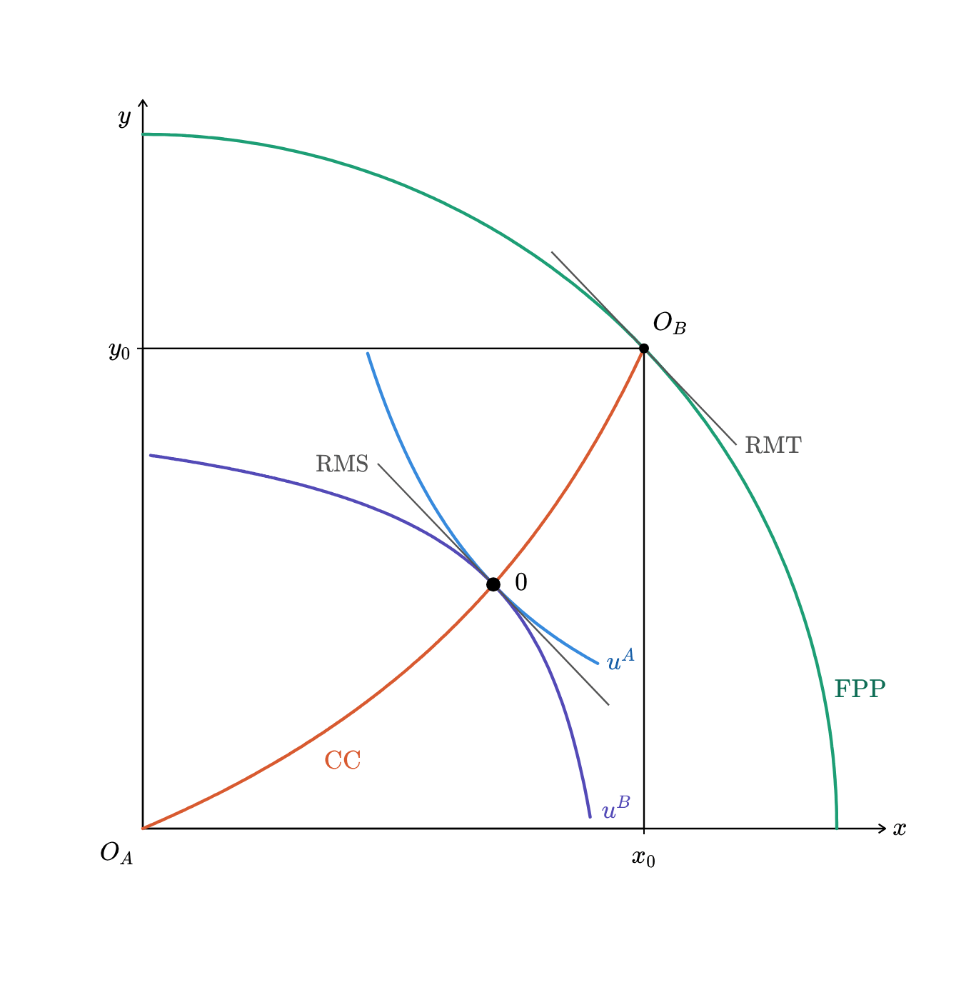
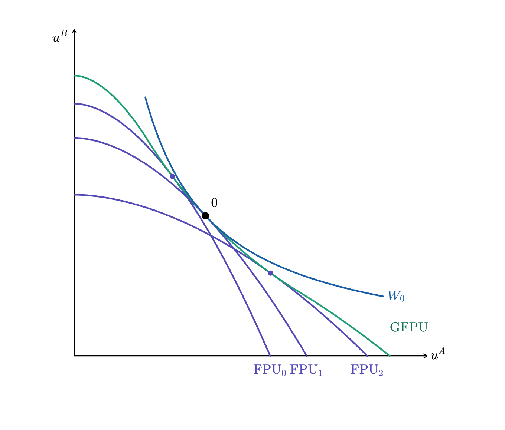
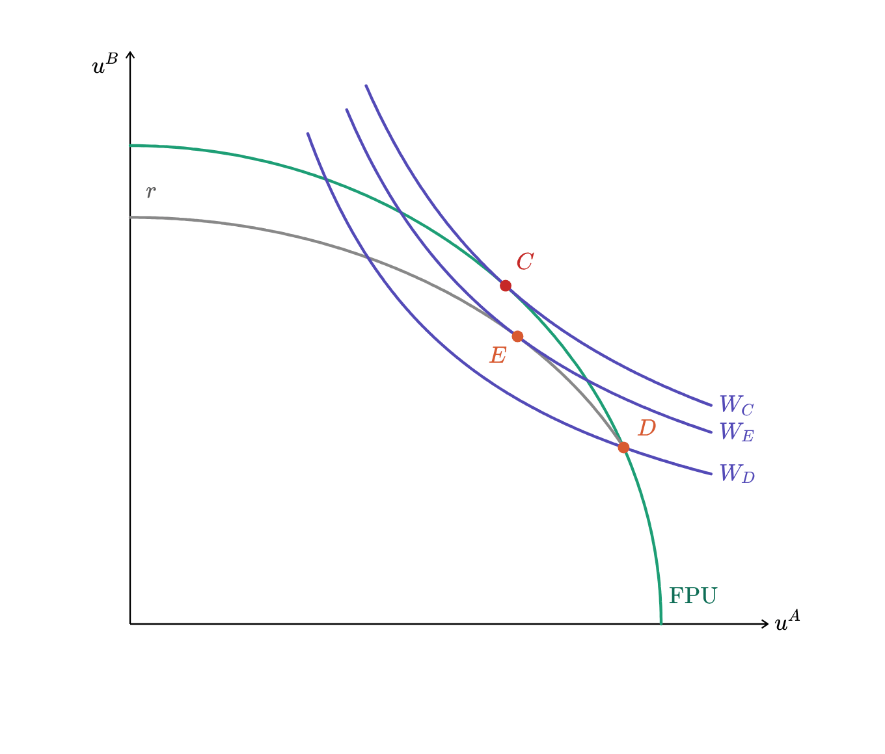

## Introducción



Este tema estudia los fundamentos de la economía del bienestar en tres pasos:

- *El óptimo económico*: los criterios de Pareto y las condiciones de eficiencia en una economía competitiva.

- *Los teoremas fundamentales del bienestar*, la medición de las pérdidas de bienestar cuando sus supuestos no se cumplen y los intentos de superar la indeterminación del óptimo de Pareto mediante los criterios de compensación y la función de bienestar social.

- *La teoría del second best* (segundo óptimo) y sus implicaciones para la política económica.

## 1. El óptimo económico: los criterios de Pareto y las condiciones de eficiencia

La economía del bienestar parte del criterio de eficiencia de Pareto, con el que se ordenan asignaciones sin comparar utilidades entre personas. El primer resultado es la caracterización del **óptimo económico**, es decir, de las condiciones que una asignación ha de cumplir para ser eficiente en la producción, en el consumo y en la relación entre ambos.

### 1.1. Los criterios de Pareto (1906)

**Origen**: la definición habitual de eficiencia en economía se corresponde con la *eficiencia en el sentido de Pareto*, formulada por Vilfredo Pareto (1906).

Su aportación no puede entenderse al margen del problema que venía a resolver. Hasta entonces, la economía del bienestar, heredera de Bentham y de Marshall, juzgaba una política por el cambio que producía en la suma de utilidades individuales. Para que esa suma tuviera sentido, la utilidad debía ser cardinal, es decir, medible de forma que sus diferencias tuvieran significado, y además comparable entre personas, para poder sostener que lo que uno pierde queda compensado por lo que otro gana. Pareto, sin embargo, consideraba insostenibles ambos supuestos.

**Idea**: Pareto sustituye la utilidad cardinal por la ordinal (para la utilidad económica acuñó el término *ofelimidad*) y construye un criterio de evaluación que no requiere comparaciones interpersonales. Por eso, si nadie empeora y alguien mejora, el juicio es incontrovertible con independencia de cómo se midan las utilidades.

Esa es su fuerza y también su límite. Pareto formuló, en realidad, dos criterios encadenados:

1. *Relación de comparación*: la *superioridad de Pareto*, que se aplica a dos asignaciones concretas.

2. *Propiedad de una asignación*: la optimalidad o eficiencia de Pareto, que caracteriza una asignación respecto del conjunto de todas las factibles y se define precisamente a partir de la primera.

Ambos criterios recaen sobre la *asignación económica*, es decir, una lista de magnitudes que describe el estado de una economía, de un mercado o de un proceso productivo. Son ejemplos una cesta de bienes, una combinación de factores, un plan de producción o un reparto de utilidades entre individuos.

#### 1.1.1. Supuestos

Los criterios de Pareto, y con ellos toda la economía del bienestar de tradición paretiana, descansan en cuatro supuestos, cada uno de los cuales ha recibido una crítica.

**Independencia del proceso**: lo que se juzga es el resultado, y no los mecanismos con que se han asignado los recursos. La evaluación se define sobre el conjunto de asignaciones factibles sin valorar cómo se ha llegado a ellas.

Ahora bien, la sociedad puede atribuir valor al procedimiento en sí, como expresa la democracia, y no solo al resultado. Que una asignación resulte de intercambios libremente consentidos, por ejemplo, es deseable con independencia de la cesta que reciba cada individuo.

**Individualismo**: el bienestar social depende exclusivamente del bienestar de los individuos, de modo que la organización de la producción solo resulta relevante en cuanto los afecta[^a22-1].

Sin embargo, una estructura de mercado como el monopolio puede considerarse indeseable en sí misma, al margen de sus efectos sobre las utilidades individuales, y el individualismo no permite expresar ese juicio.

**No paternalismo**: nadie sabe mejor que el propio individuo qué le conviene, de modo que la evaluación parte de las utilidades tal como cada cual las declara y el planificador no añade preferencias suyas.

El supuesto no se sostiene en el caso de los bienes preferentes (*merit goods*) de Musgrave (1959) y de las adicciones, en los que las preferencias declaradas pueden no reflejar el interés del propio individuo.

**Benevolencia**: un aumento de la utilidad de un individuo, *ceteris paribus*, mejora el bienestar social.

No obstante, la benevolencia no emite juicio alguno sobre la desigualdad resultante, de modo que una mejora concentrada en quien ya estaba mejor cuenta exactamente igual que cualquier otra[^a22-2].

Con base en estos supuestos, Pareto desarrolla sus criterios, la superioridad y la eficiencia en el sentido de Pareto.

#### 1.1.2. La dominancia de Pareto: formulación general y ámbitos de aplicación

Antes de aplicar los criterios conviene precisar su alcance, pues su formulación es más general de lo que sugiere la exposición habitual. La **dominancia de Pareto** no es una relación entre individuos, sino una relación de orden parcial entre vectores.

Formalmente, sean $\mathbf{v} = (v_1, \dots, v_n)$ y $\mathbf{v}' = (v_1', \dots, v_n')$ dos vectores de magnitudes deseables. Se dice que $\mathbf{v}$ domina en el sentido de Pareto a $\mathbf{v}'$ si

$$v_i \geq v_i' \;\; \forall i = 1, \dots, n \qquad \text{y} \qquad \exists\, j : v_j > v_j'$$

donde $v_i$ y $v_i'$ son las componentes de ambos vectores y $n$ el número de dimensiones comparadas. Como la relación de preferencia del consumidor (tema [A08](a08-consumidor.qmd), apartado 1.1.2), la dominancia es transitiva, pues si $\mathbf{v}$ domina a $\mathbf{v}'$ y $\mathbf{v}'$ a $\mathbf{v}''$, también $\mathbf{v}$ domina a $\mathbf{v}''$. A diferencia de la relación de preferencia, la dominancia no es completa, ya que dos vectores en los que cada uno supera al otro en alguna componente no pueden ordenarse, y de ahí que se trate de un orden parcial.

La definición significa que, dados dos vectores que indican asignaciones económicas de magnitudes deseables, uno domina al otro si es al menos igual en todas sus componentes y estrictamente mayor en alguna. Lo único que se requiere es que todas las componentes sean “bienes”, en el sentido de que más sea preferible a menos.

De ello se sigue que el criterio no exige la presencia de dos individuos. Lo que cambia de un ámbito a otro no es la relación, sino el contenido del vector sobre el que se aplica. Esto puede entenderse a través de la tabla -@tbl-a22-pareto-ambitos.

| Ámbito | Vector sobre el que opera | Dimensiones comparadas | Frontera de los no dominados |
|---|---|---|---|
| **Producción (eficiencia técnica)** | Plan de producción $(-\text{inputs}, \text{outputs})$ | Factores y productos de una unidad productiva | Función de producción o isocuanta |
| **Producción (eficiencia productiva)** | Cantidades producidas $(x, y)$ | Bienes entre sí, dados los recursos | Frontera de posibilidades de producción (FPP) o curva de transformación |
| **Consumo (eficiencia en el intercambio)** | Utilidades de los consumidores | Individuos, dadas las dotaciones | Frontera de posibilidades de utilidad (FPU), imagen de la curva de contratos |
| **Global (eficiencia asignativa)** | Utilidades de los individuos $(u^1,\dots,u^H)$ | Individuos, considerando producción y consumo | Gran frontera de posibilidades de utilidad (GFPU) |

: Dominancia de Pareto según el ámbito de aplicación. {#tbl-a22-pareto-ambitos}

Del cuadro se derivan dos precisiones, que evitan las confusiones más frecuentes:

1. *Primera*: la *eficiencia económica o en costes* no es un criterio de Pareto. Mientras los anteriores son relaciones de dominancia que no requieren precios, la eficiencia en costes es un problema de optimización que consiste en elegir, de entre los planes técnicamente eficientes, aquel que minimiza el coste dados los precios de los factores. Su representación es la tangencia entre isocuanta e isocoste, y exige por tanto información que los criterios de Pareto no necesitan. De ahí que la eficiencia técnica sea condición necesaria pero no suficiente de la económica[^a22-3].

2. *Segunda*: cuando se habla de óptimo de Pareto sin calificativo, se entiende referido al vector de utilidades, es decir, a la *eficiencia asignativa*. Esta es la más exigente de todas, pues requiere que se cumplan simultáneamente las tres condiciones que se examinan en el apartado 1.2, es decir, la eficiencia en la producción, la eficiencia en el consumo y la coincidencia entre lo que se produce y lo que se desea consumir. El equilibrio competitivo verifica precisamente esas tres, conforme al primer teorema del bienestar (apartado 2.1).

#### 1.1.3. Superioridad de Pareto

La relación anterior se aplica ahora al vector de utilidades, $\mathbf{v} = (u^1(\mathbf{x}), \dots, u^H(\mathbf{x}))$. Dadas dos asignaciones factibles $\mathbf{x}$ y $\mathbf{x}'$, se dice que $\mathbf{x}$ es **superior en el sentido de Pareto** a $\mathbf{x}'$ si ningún individuo de la economía prefiere $\mathbf{x}'$ a $\mathbf{x}$ y al menos uno prefiere estrictamente $\mathbf{x}$ a $\mathbf{x}'$. Formalmente, siendo $u^h$ la función de utilidad del individuo $h$ y $H$ el número de individuos:

$$u^h(\mathbf{x}) \geq u^h(\mathbf{x}') \;\; \forall h = 1, \dots, H \qquad \text{y} \qquad \exists\, j : u^j(\mathbf{x}) > u^j(\mathbf{x}')$$

El paso de $\mathbf{x}'$ a $\mathbf{x}$ constituye entonces una **mejora paretiana**. La expresión anterior es una representación cómoda, pero el criterio sigue siendo puramente ordinal, ya que basta con la relación de preferencia $\mathbf{x} \succsim_h \mathbf{x}'$, sin necesidad de que las utilidades sean medibles ni comparables entre personas, que es justamente lo que Pareto buscaba.

El criterio es, por ello, exigente, pues requiere unanimidad en sentido débil, de manera que basta con que alguien se vea perjudicado, por poco que sea, para que la relación no se establezca. Es, además, incompleto, ya que define una ordenación solo parcial, pues no permite comparar dos asignaciones en las que un individuo gane y otro pierda. 

La limitación no es menor, sino que afecta a la práctica totalidad de las decisiones de política económica, que rara vez dejan a alguien exactamente igual. Un arancel, una reforma fiscal o la liberalización de un sector, por ejemplo, generan siempre ganadores y perdedores, de modo que el criterio de Pareto, aplicado con literalidad, guarda silencio sobre casi todo lo que interesa al analista.

De esa incompletitud derivan las dos vías por las que ha avanzado la economía del bienestar. Los **criterios de compensación** admiten como mejora aquella en la que los ganadores podrían compensar a los perdedores aunque no lo hagan efectivamente (apartado 2.4.1). Las funciones de bienestar social, en cambio, reintroducen de forma explícita los juicios de valor sobre la distribución (apartado 2.4.2).

#### 1.1.4. Optimalidad o eficiencia de Pareto

Una asignación es **eficiente u óptima en el sentido de Pareto** si no existe ninguna otra asignación factible que le sea Pareto-superior. Dicho de otro modo, solo cabe mejorar la situación de un individuo a costa de empeorar la de otro, de manera que se han agotado todas las mejoras paretianas disponibles.

Formalmente, una asignación factible $\mathbf{x}^*$ es eficiente en el sentido de Pareto si no existe otra asignación factible $\mathbf{x}$ tal que

$$u^h(\mathbf{x}) \geq u^h(\mathbf{x}^*) \;\; \forall h = 1, \dots, H \qquad \text{y} \qquad \exists\, j : u^j(\mathbf{x}) > u^j(\mathbf{x}^*)$$

es decir, si $\mathbf{x}^*$ no está dominada por ninguna asignación factible. Por ello, los óptimos de Pareto pueden obtenerse maximizando la utilidad de un individuo sujeta a que la de los demás se mantenga en un nivel dado y a las restricciones de recursos y de tecnología, como hacen los programas de eficiencia del apartado 1.2.

Conviene retener cuatro propiedades:

1. *Superioridad y optimalidad son conceptos distintos*: una asignación puede ser Pareto-superior a otra sin ser, ella misma, Pareto-óptima, pues basta con que existan mejoras adicionales no explotadas.

2. *La eficiencia de Pareto es distributivamente neutral*[^a22-4]: no incorpora juicio alguno sobre la distribución, refleja únicamente la ausencia de desperdicio de recursos y resulta compatible con distribuciones extremadamente desiguales. Incluso la asignación que entrega todos los recursos a una sola persona es un óptimo de Pareto, porque quitarle cualquier parte la dejaría peor.

3. *Los óptimos de Pareto son múltiples*: el criterio no selecciona una asignación sino todo un conjunto, el de la gran frontera de posibilidades de utilidad (GFPU), y cuál de ellos alcanza el mercado depende de la distribución inicial de los recursos. De aquí se sigue la necesidad de un criterio adicional para elegir entre ellos, que es el objeto del apartado 2.4.

4. *El criterio presenta un sesgo hacia el* statu quo: al exigir que nadie empeore, privilegia la asignación de partida y, con ella, la distribución inicial de la propiedad, que el propio criterio no somete a examen. Esta objeción de fondo explica que la economía del bienestar no pueda detenerse en él.

#### 1.1.5. Conclusiones

**Aspectos positivos**: la aportación de Pareto fue sentar un criterio de eficiencia sin comparaciones interpersonales de utilidad, que solo requiere preferencias ordinales. Al definirse como una dominancia entre vectores, el mismo criterio sirve, además, para la producción, el consumo y la asignación global, y con él se caracterizan después las condiciones de eficiencia.

**Limitaciones**: son de dos tipos:

- *De los supuestos*: cada uno de los cuatro ha recibido una crítica.

- *El problema de la indeterminación*: es, con diferencia, la crítica más importante, porque la ordenación paretiana es incompleta. Sobre la GFPU esto significa que sus puntos eficientes no admiten clasificación, y la elección queda indeterminada entre múltiples óptimos.
    La eficiencia paretiana es un requisito de la optimalidad social, pero no basta, y elegir entre los óptimos el que maximiza el bienestar social (el *optimum optimorum*[^a22-5]) exige un criterio adicional. De hecho, el propio Pareto (1916) reconoció la necesidad de complementar sus criterios con comparaciones interpersonales explícitas. La exigencia de unanimidad da lugar, además, a la *tiranía de la minoría*, pues cualquier perjudicado puede vetar una mejora colectiva y el *statu quo* tiende a perpetuarse.

### 1.2. Condiciones de eficiencia paretiana en una economía competitiva 2x2x2x2

Para estudiar la eficiencia en el contexto del equilibrio general, Pareto se apoyó en Walras (1874) y Edgeworth (1881). El análisis se ilustra con una economía simple 2x2x2x2 (dos bienes $x$, $y$; dos factores $K$, $L$; dos empresas; dos consumidores).

**Supuestos**: el análisis descansa en tres grupos de hipótesis:

- *Entorno*: ausencia de fallos de mercado, economía de trueque, dos bienes privados y factores homogéneos con oferta perfectamente inelástica[^a22-6].

- *Agentes*: funciones de utilidad ordinales, crecientes y cuasicóncavas, con curvas de indiferencia convexas.

- *Tecnología*: funciones de producción continuas, doblemente diferenciables, con productividades marginales positivas y decrecientes y rendimientos no crecientes[^a22-7], y empresas con distinta intensidad factorial (curva de contratos no recta).

#### 1.2.1. Óptimo en la producción

**Planteamiento**: se maximiza la producción de $x$ dados el nivel de producción de $y$ y las dotaciones de factores:

$$\max_{K_x, L_x} \; x = f_x(K_x, L_x) \quad \text{s.a.:} \begin{cases} f_y(K_y, L_y) = y_0 \\ K_x + K_y = K_0 \\ L_x + L_y = L_0 \end{cases}$$

donde $L_x$, $K_x$ y $L_y$, $K_y$ son las cantidades de trabajo y capital asignadas a la producción de $x$ (variables de decisión) y de $y$, $f_x(\cdot)$ y $f_y(\cdot)$ las funciones de producción de ambos bienes, $y_0$ el nivel de producción de $y$ que se toma como dado y $K_0$, $L_0$ las dotaciones totales de capital y trabajo.

**CPO** (condiciones de primer orden): con solución interior y las restricciones agotadas, derivando el lagrangiano respecto a los factores asignados a cada bien y eliminando los multiplicadores:

$$\text{RMST}_{KL}^x = \frac{\partial f_x/\partial L_x}{\partial f_x/\partial K_x} = \frac{\partial f_y/\partial L_y}{\partial f_y/\partial K_y} = \text{RMST}_{KL}^y$$

La relación marginal de sustitución técnica (RMST), es decir, la tasa a la que se intercambian capital y trabajo, debe ser la misma independientemente del bien que se produzca. Si difiriera entre bienes, bastaría reasignar factores para producir más de uno sin renunciar a nada del otro.

**CSO**: la convexidad de las isocuantas de ambas empresas (funciones de producción cuasicóncavas) garantiza que la tangencia es un máximo de $x$ dado $y_0$.

**Desarrollo gráfico**: el óptimo en la producción se representa en el plano trabajo-capital de la *caja de Edgeworth de la producción* (figura -@fig-a226-edgeworth-fpp, panel a):

1. *Caja*: sus dimensiones son las dotaciones de los dos factores ($L_0$ en el eje horizontal, $K_0$ en el vertical), de modo que cualquier punto de su interior es una asignación de pleno empleo de ambos factores entre las dos empresas, aunque no sea eficiente.

2. *Isocuantas*: las de la empresa que produce $x$ se miden desde el vértice $O_x$ y las de la que produce $y$ desde el opuesto, $O_y$, y son más altas cuanto más alejadas de su origen. En un punto como $Z$, las isocuantas $x(Z)$ e $y(Z)$ se cruzan. Todos los puntos de la lente sombreada que forman son Pareto-superiores, porque en su interior ambas empresas producen más, y en sus bordes una produce más sin que la otra produzca menos. Allais (1943) llamó a esa lente *área del excedente distribuible*.

3. *Óptimo*: desplazarse desde $Z$ hasta $N$ a lo largo de la isocuanta $y(Z)$, por ejemplo, aumenta la producción de $x$ sin reducir la de $y$, que es lo que hace el programa anterior con $y_0 = y(Z)$. Solo en las tangencias entre isocuantas, como $M$ y $N$, donde las RMST se igualan, se han agotado las reasignaciones beneficiosas. Esas tangencias son las asignaciones Pareto-eficientes, y su lugar geométrico es la *curva de contratos de la producción* (CC), con cuatro propiedades:

    - *No es necesariamente una isoclina*: en todos sus puntos las RMST de ambas empresas coinciden, pero su valor común cambia de un punto a otro.

    - *Sus puntos no son comparables entre sí según Pareto*: pasar de uno a otro aumenta un *output* y reduce el otro.

    - *Incluye los vértices de la caja*: en ellos una empresa usa todos los factores y la otra ninguno, consecuencia de la neutralidad distributiva del criterio.

    - *Su forma depende de la intensidad factorial*: en el plano $(L_x, K_x)$, se curva por encima de la diagonal si $x$ es más intensiva en capital que $y$, como en la figura, y por debajo si lo es en trabajo. Si ambas tienen la misma intensidad, coincide con la diagonal.

En el plano $x$-$y$ (panel b), la proyección de la curva de contratos es la FPP, es decir, la máxima cantidad de $x$ que puede producirse para cada cantidad de $y$, dadas la tecnología y las dotaciones. Cada punto de la curva de contratos, como $M$ o $N$, da un par de producciones sobre la FPP. Una asignación ineficiente de factores como $Z$ se proyecta, en cambio, en el interior de la frontera, y la lente, en la región sombreada entre $Z$ y la FPP.

La pendiente de la FPP es, en valor absoluto, la relación marginal de transformación, $\text{RMT}_{yx} = -dy/dx|_{K_0, L_0} = (\partial f_y/\partial K_y)/(\partial f_x/\partial K_x) = (\partial f_y/\partial L_y)/(\partial f_x/\partial L_x)$, el coste de oportunidad de $x$ en términos de $y$. La FPP es cóncava, y por tanto la RMT creciente en $x$, por tres razones que pueden actuar por separado o juntas: los rendimientos decrecientes a escala, la especialización de los factores y la distinta intensidad factorial de los bienes. En particular, la diferencia de intensidades hace que trasladar factores de $y$ a $x$ sea cada vez más costoso. Por el contrario, si ambos bienes tuvieran la misma intensidad y rendimientos constantes, la FPP sería una recta.

::: {#fig-a226-edgeworth-fpp}

::: {.content-visible when-format="html"}
```{=html}
<div class="graph-frame">
<iframe src="../graphs/a226_Edgeworth_FPP.html" style="height:1110px" loading="lazy" title="fig-a226-edgeworth-fpp"></iframe>
</div>
```
:::

::: {.content-visible unless-format="html"}

:::

Caja de Edgeworth de la producción y frontera de posibilidades de producción. Los puntos de la curva de contratos, como $M$ y $N$, se proyectan sobre la FPP, y la asignación ineficiente de factores $Z$, en su interior. La lente de reasignaciones Pareto-superiores se proyecta en la región sombreada.
:::

#### 1.2.2. Óptimo en el consumo (intercambio)

**Planteamiento**: se maximiza la utilidad de $A$ dados el nivel de utilidad de $B$ y las cantidades disponibles de cada bien:

$$\max_{x^A, y^A} \; u^A(x^A, y^A) \quad \text{s.a.:} \begin{cases} u^B(x^B, y^B) = u_0^B \\ x^A + x^B = x_0 \\ y^A + y^B = y_0 \end{cases}$$

donde $x^A$, $y^A$ y $x^B$, $y^B$ son las cantidades de ambos bienes consumidas por $A$ (variables de decisión) y por $B$, $u^A(\cdot)$ y $u^B(\cdot)$ sus funciones de utilidad, $u_0^B$ el nivel de utilidad de $B$ que se toma como dado y $x_0$, $y_0$ las cantidades totales disponibles de cada bien.

**CPO**: con solución interior y las restricciones agotadas, derivando el lagrangiano respecto a los consumos de $A$ y de $B$ y eliminando los multiplicadores:

$$\text{RMS}_{yx}^A = \frac{\partial u^A/\partial x}{\partial u^A/\partial y} = \frac{\partial u^B/\partial x}{\partial u^B/\partial y} = \text{RMS}_{yx}^B$$

En el óptimo, $A$ y $B$ tienen la misma relación marginal de sustitución (RMS), es decir, ambos valoran cada bien en términos del otro a idéntica tasa subjetiva. De lo contrario, existirían ganancias no explotadas del intercambio, pues uno de ellos podría ceder el bien que valora relativamente menos a cambio del que valora más sin que el otro empeore.

**CSO**: la convexidad de las curvas de indiferencia de ambos consumidores (utilidades cuasicóncavas) garantiza que la tangencia es un máximo de $u^A$ dado $u_0^B$.

**Desarrollo gráfico**: el óptimo en el consumo se representa en el plano bien $x$-bien $y$ de la *caja de Edgeworth del consumo* (figura -@fig-a225-edgeworth-fpu, panel a):

1. *Caja*: sus dimensiones son las cantidades disponibles de los dos bienes ($x_0$ en el eje horizontal, $y_0$ en el vertical), de modo que cada punto es un reparto de esas cantidades entre los dos consumidores.

2. *Curvas de indiferencia*: las de $A$ se miden desde el vértice $O_A$ y las de $B$ desde el opuesto, $O_B$. Como en la producción, la lente entre dos curvas que se cruzan, como $u^A(W)$ y $u^B(W)$, que pasan por la dotación inicial $W$, contiene los repartos Pareto-superiores.

3. *Óptimo*: las tangencias entre curvas de indiferencia, donde las RMS se igualan, forman la *curva de contratos del consumo* (CC). Si los consumidores parten de $W$, solo son alcanzables por intercambio voluntario los puntos de la curva de contratos situados dentro de la lente, es decir, el tramo entre $M$ y $N$. Esos puntos forman el *núcleo* de la economía, que, según el teorema de Debreu y Scarf (1963), converge al conjunto de los equilibrios competitivos a medida que el número de agentes crece (tema [A21](a21-equilibrio-general.qmd), apartado 3.1.3).

En el plano $u^A$-$u^B$ (panel b), la curva de contratos tiene como imagen la frontera de posibilidades de utilidad (FPU). Esta frontera indica hasta dónde puede llegar la utilidad de $A$ sin que la de $B$ baje de un nivel dado. Cada punto de la curva de contratos, como $M$ o $N$, da un par de utilidades sobre la FPU, y los vértices de la caja, sus extremos sobre los ejes. La dotación $W$, que no es eficiente, se proyecta en el interior de la frontera, y la lente, en la región sombreada entre $W$ y la FPU. El núcleo es, así, el tramo de la FPU que mejora a ambos consumidores respecto de $W$.

Como las utilidades crecen con el consumo, la FPU tiene pendiente negativa, ya que sobre ella solo se mejora a un consumidor empeorando al otro. Su curvatura, en cambio, no está determinada, porque la utilidad es ordinal y cualquier transformación monótona de la utilidad deforma la FPU. Basta, eso sí, con que las funciones de utilidad (cardinales) sean cóncavas, como en la figura, para que la FPU también lo sea, aunque no es una condición imprescindible. Además, cada óptimo en la producción tiene su propia FPU, así que hay infinitas.

::: {#fig-a225-edgeworth-fpu}

::: {.content-visible when-format="html"}
```{=html}
<div class="graph-frame">
<iframe src="../graphs/a225_Edgeworth_FPU.html" style="height:1115px" loading="lazy" title="fig-a225-edgeworth-fpu"></iframe>
</div>
```
:::

::: {.content-visible unless-format="html"}

:::

Caja de Edgeworth del consumo y frontera de posibilidades de utilidad. Los puntos de la curva de contratos, como $M$ y $N$, se proyectan sobre la FPU, y la dotación ineficiente $W$, en su interior. La lente de mejoras paretianas se proyecta en la región sombreada y el núcleo, en el tramo de la FPU entre $M$ y $N$.
:::

#### 1.2.3. Óptimo global (reparto del *output*)

**Planteamiento**: se maximiza la utilidad de $A$ dados el nivel de utilidad de $B$, la tecnología y las dotaciones de factores:

$$\max \; u^A(x^A, y^A) \quad \text{s.a.:} \begin{cases} u^B(x^B, y^B) = u_0^B \\ x^A + x^B = f_x(K_x, L_x) \\ y^A + y^B = f_y(K_y, L_y) \\ K_x + K_y = K_0 \\ L_x + L_y = L_0 \end{cases}$$

donde $x^A$, $y^A$ y $x^B$, $y^B$ son los consumos de ambos bienes de $A$ y de $B$, $u^A(\cdot)$ y $u^B(\cdot)$ sus funciones de utilidad, $u_0^B$ el nivel de utilidad de $B$ que se toma como dado, $f_x(K_x, L_x)$ y $f_y(K_y, L_y)$ las funciones de producción de ambos bienes con los factores asignados a cada uno, y $K_0$, $L_0$ las dotaciones totales de capital y trabajo.

**CPO**: con solución interior y las restricciones agotadas, derivando el lagrangiano respecto a los consumos y a los factores y eliminando los multiplicadores:

$$\text{RMS}_{yx}^A = \text{RMS}_{yx}^B = \text{RMT}_{yx}\big|_{\text{FPP}} \tag{1}$$

La condición (1) iguala todas las valoraciones en el óptimo global, es decir, la tasa subjetiva de intercambio (RMS) coincide con la tasa objetiva de transformación (RMT). Pueden existir, por tanto, asignaciones eficientes en producción o en consumo por separado que no son óptimos globales, porque no cumplen (1).

**CSO**: preferencias convexas de ambos consumidores y conjunto de producción convexo (FPP cóncava), de modo que la igualdad entre RMS y RMT es un máximo y no un mínimo.

**Desarrollo gráfico**: el óptimo global se representa en el plano $x$-$y$ (figura -@fig-a222-box-in-fpp):

1. *Frontera de posibilidades de producción* (FPP): cada uno de sus puntos es una combinación de producción eficiente, y su pendiente en valor absoluto es la RMT.

2. *Caja de Edgeworth del consumo*: se inscribe en la FPP para cada punto de producción, con origen $O_A$ en el origen de coordenadas y $O_B$ en el punto $(x_0, y_0)$ de la frontera.

3. *Curva de contratos del consumo* ($\text{CC}$): une las tangencias entre las curvas de indiferencia de $A$ y de $B$, como $u^A$ y $u^B$.

4. *Óptimo*: sobre la curva de contratos del consumo, solo los puntos donde la RMS coincide con la RMT en $O_B$, como el punto $0$, son óptimos globales. En ellos, la tasa a la que los consumidores intercambian los bienes coincide con la que la economía puede transformarlos (condición (1)). Puede haber infinitos óptimos globales.

::: {#fig-a222-box-in-fpp}

::: {.content-visible when-format="html"}
```{=html}
<div class="graph-frame">
<iframe src="../graphs/a222_Box_in_FPP.html" style="height:580px;max-width:533px" loading="lazy" title="fig-a222-box-in-fpp"></iframe>
</div>
```
:::

::: {.content-visible unless-format="html"}

:::

Óptimo global. La caja de Edgeworth se inscribe en la frontera de posibilidades de producción, y la relación marginal de transformación debe igualar a las relaciones marginales de sustitución.
:::

La GFPU[^a22-10] es la envolvente de los puntos de las FPU que se corresponden con los óptimos globales. Cada punto de la GFPU indica una combinación única de utilidades, una distribución única de bienes, una combinación de producción sobre la FPP y una distribución única de factores.

### 1.3. Conclusiones

Los criterios de Pareto ordenan las asignaciones sin comparar utilidades entre personas, aunque solo de forma parcial, y el óptimo de Pareto reúne las asignaciones que ya no admiten mejoras paretianas. En la economía 2x2x2x2 ese óptimo exige igualar las RMST de las dos empresas en la producción y las RMS de los dos consumidores en el consumo, y, en el óptimo global, las RMS con la RMT. Las utilidades de los óptimos globales forman la GFPU.

Pareto y Barone anticiparon con estas condiciones los dos teoremas fundamentales. Según los teoremas, la asignación competitiva es eficiente (1TFEB) y cualquier óptimo puede alcanzarse como equilibrio competitivo tras redistribuir las dotaciones (2TFEB). Su demostración rigurosa llegaría con Lange (1942b), Arrow (1951a) y Debreu (1951), y con ello la competencia perfecta se consagra como guía de política económica. La sección 2 examina esos teoremas y lo que queda por decidir cuando la GFPU ofrece infinitos óptimos.

## 2. Los teoremas fundamentales del bienestar

Los dos teoremas fundamentales, resultado central de la economía del bienestar, conectan el óptimo económico del apartado 1 con el equilibrio competitivo del tema [A21](a21-equilibrio-general.qmd). El primero afirma que el mercado competitivo produce asignaciones eficientes, y el segundo, que cualquier asignación eficiente puede producirla el mercado si se redistribuyen previamente las dotaciones. Ambos descansan, sin embargo, en supuestos exigentes. Cuando estos fallan, el mercado deja pérdidas de bienestar que pueden medirse. Aun cuando se cumplen, los teoremas no permiten elegir entre los óptimos de Pareto, que es el problema que abordan los criterios de compensación y la función de bienestar social.

### 2.1. Primer teorema (1TFEB)

**Enunciado**: todo equilibrio competitivo $(\mathbf{p}^*, \mathbf{x}^*)$ es una asignación eficiente en el sentido de Pareto[^a22-14]. El teorema se ha visto como la formalización de la idea de la mano invisible de Adam Smith, si bien se refiere a la optimalidad paretiana y no necesariamente a la optimalidad social.

**Corolarios**:

1. *Eficiencia sin equidad*: el equilibrio competitivo no desperdicia recursos, aunque puede no tener otras propiedades deseables (p. ej. ser equitativo).

2. *Referencia normativa*: si se cumplen los supuestos del teorema, la competencia perfecta conduce sin excepción a un óptimo de Pareto, con la certeza que da un resultado demostrado. Sirve así de referencia para los decisores de política económica, porque, al margen de cómo se diseñe esta, se sabe que las asignaciones competitivas son eficientes.

3. *Economía de información*: cada agente únicamente necesita conocer los precios para tomar sus decisiones y alcanzar el óptimo de Pareto (Varian, 2014, p. 585).

4. *Justificación de la intervención*: el teorema ha servido a los partidarios del libre mercado para reducir el papel del sector público a corregir fallos de mercado. Así, si falla alguna de las condiciones suficientes del teorema (p. ej. hay fallos de mercado), nada asegura que el equilibrio sea eficiente, y el Estado tiene un motivo de eficiencia para intervenir.

**Demostración**: descansa en un solo supuesto sobre las preferencias, la *no saciedad local*, según la cual en todo entorno de una cesta existe otra estrictamente preferida. Sea $(\mathbf{p}^*, \mathbf{x}^*)$ un equilibrio competitivo y supóngase, por reducción al absurdo, que existe una asignación factible $\hat{\mathbf{x}}$ Pareto-superior.

Por un lado, cada consumidor que prefiere estrictamente $\hat{\mathbf{x}}^h$ a $\mathbf{x}^{*h}$ no pudo permitírsela a los precios de equilibrio, pues de lo contrario la habría elegido, de modo que $\mathbf{p}^* \hat{\mathbf{x}}^h > \mathbf{p}^* \mathbf{x}^{*h}$. Por otro, cada consumidor indiferente no puede obtener $\hat{\mathbf{x}}^h$ más barata, por no saciedad local, por lo que $\mathbf{p}^* \hat{\mathbf{x}}^h \geq \mathbf{p}^* \mathbf{x}^{*h}$. Sumando, el valor de la nueva asignación a los precios de equilibrio supera al de la de equilibrio, $\mathbf{p}^* \sum_h \hat{\mathbf{x}}^h > \mathbf{p}^* \sum_h \mathbf{x}^{*h}$.

Sin embargo, en el equilibrio las empresas maximizan el beneficio, de modo que el valor de la producción de equilibrio es el máximo alcanzable a esos precios. La asignación de equilibrio agota, además, la renta de la economía, por lo que ninguna asignación factible puede valer más. La contradicción muestra que $\hat{\mathbf{x}}$ no puede ser factible. La demostración no usa convexidad ni continuidad de las preferencias ni concavidad de las tecnologías, lo que hace del primer teorema un resultado muy general. Usa, en cambio, que todos los bienes tienen precio y mercado, que es lo que fallan los bienes públicos y las externalidades.

**Conclusiones**:

- *Aspectos positivos*: formaliza la idea de la mano invisible con un solo supuesto sobre las preferencias, la no saciedad local, sin convexidad ni continuidad, lo que lo hace muy general. Convierte, además, los fallos de mercado en la justificación de la intervención por motivos de eficiencia.

- *Limitaciones*: se refiere a la optimalidad paretiana y no necesariamente a la social, de modo que nada dice de la equidad del equilibrio. Exige, además, mercados completos y agentes precio-aceptantes, supuestos que fallan con el poder de mercado, las externalidades y los bienes públicos (tema [A23](a23-eb-ii.qmd)).

### 2.2. Segundo teorema (2TFEB)

Tras el 1TFEB, queda por saber si el mercado, capaz de alcanzar por sí solo la eficiencia paretiana, puede alcanzar también la **optimalidad social**, es decir, el óptimo de Pareto que la sociedad prefiera por razones distributivas.

**Enunciado**: bajo ciertas condiciones (convexidad de preferencias y conjuntos de producción)[^a22-17] y con una redistribución adecuada de las dotaciones iniciales, el mercado competitivo puede alcanzar cualquier óptimo de Pareto.

**Corolarios**:

1. *Separación entre eficiencia y equidad*: un planificador benevolente podría repartir primero los recursos mediante transferencias que no distorsionen (impuestos y subvenciones de suma fija[^a22-19]) y dejar luego que el mercado se encargue de la eficiencia paretiana. Con una política social adecuada se obtienen así a la vez la optimalidad social (equidad) y la paretiana (eficiencia). Por ello, quienes priorizan la equidad invocan el 2TFEB para sostener que el Estado puede redistribuir *ex ante* sin coste de eficiencia, aunque el mercado carezca de imperfecciones.

2. *Planificación con precios sombra*: en teoría, un sistema de planificación central *à la* Lange-Lerner, en el que el Gobierno estima los precios sombra y los impone a los agentes, podría lograr idénticos resultados que un sistema perfectamente competitivo[^a22-20]. Este es el argumento del debate sobre el cálculo económico socialista (tema [A03](a03-neoclasicos.qmd)).

**Desarrollo gráfico**: el segundo teorema se representa en el plano bien $x$-bien $y$ de la caja de Edgeworth del consumo (figura -@fig-a227-segundo-teorema), con las preferencias y las cantidades totales de la figura -@fig-a225-edgeworth-fpu:

1. *Dotación inicial y lente*: la dotación inicial $W$ queda fuera de la curva de contratos ($\text{CC}$). Las curvas de indiferencia que pasan por ella, $u^A(W)$ y $u^B(W)$, reúnen las cestas que dan a cada consumidor la misma utilidad que su dotación. Se cortan en $W$ y encierran la lente sombreada, cuyas asignaciones son Pareto-superiores a $W$.

2. *Intercambio voluntario*: ningún consumidor acepta un intercambio que le dé menos utilidad que su dotación, y ambos siguen intercambiando mientras queden ganancias mutuas. Por eso, el intercambio voluntario lleva la economía de $W$ a un punto de la curva de contratos dentro de la lente (flecha discontinua), como $C$, en el tramo resaltado que forma el núcleo.

3. *Óptimo elegido*: por razones distributivas, el planificador prefiere otro óptimo de Pareto, $\mathbf{x}^*$, situado en la curva de contratos fuera de la lente. Sin embargo, desde $W$ es inalcanzable por intercambio voluntario, porque deja a $A$ por debajo de $u^A(W)$, con menos utilidad que su dotación.

4. *Redistribución*: una transferencia de suma fija de $A$ a $B$ (flecha continua) lleva la dotación de $W$ a $W'$. Como no depende de lo que hagan los consumidores, la transferencia no distorsiona sus decisiones. La curva de contratos, que solo depende de las preferencias y de las cantidades totales, tampoco cambia.

5. *Recta de precios y equilibrio*: la recta discontinua que pasa por $W'$ y por $\mathbf{x}^*$ tiene pendiente $-p_x^*/p_y^*$, igual a la RMS común de ambos consumidores en $\mathbf{x}^*$, y es tangente allí a $u^A(\mathbf{x}^*)$ y a $u^B(\mathbf{x}^*)$. A esos precios, es la recta presupuestaria de los dos consumidores desde $W'$, cada uno demanda su cesta de $\mathbf{x}^*$ y los mercados se vacían. El óptimo elegido es, por tanto, el equilibrio competitivo que se alcanza desde $W'$. Sirve cualquier dotación de esa recta, pues todas valen lo mismo que $\mathbf{x}^*$ a esos precios.

La figura distingue los dos teoremas. La lente y el paso de $W$ a $C$ ilustran que el intercambio voluntario agota las ganancias mutuas y termina en la curva de contratos. Llega a ella por negociación, en el núcleo (tema [A21](a21-equilibrio-general.qmd), apartado 3.1.2), o por el mercado, cuyo equilibrio es eficiente por el 1TFEB. El 2TFEB añade la redistribución de $W$ a $W'$, con la que el mercado alcanza cualquier óptimo de la curva de contratos, también los que quedan fuera de la lente de la dotación original. En el plano de utilidades (figura -@fig-a225-edgeworth-fpu, panel b), el núcleo pasa entonces a otro tramo de la FPU, el que contiene el óptimo elegido.

::: {#fig-a227-segundo-teorema}

::: {.content-visible when-format="html"}
```{=html}
<div class="graph-frame">
<iframe src="../graphs/a227_Segundo_teorema.html" style="height:620px" loading="lazy" title="fig-a227-segundo-teorema"></iframe>
</div>
```
:::

::: {.content-visible unless-format="html"}

:::

Segundo teorema fundamental del bienestar. Desde la dotación inicial $W$, el intercambio voluntario lleva a un punto del núcleo, como $C$, dentro de la lente entre $u^A(W)$ y $u^B(W)$. El óptimo elegido, $\mathbf{x}^*$, queda fuera de la lente. Una transferencia de suma fija lleva la dotación a $W'$, y la recta de precios que pasa por $W'$, tangente en $\mathbf{x}^*$ a $u^A(\mathbf{x}^*)$ y $u^B(\mathbf{x}^*)$, sostiene $\mathbf{x}^*$ como equilibrio competitivo.
:::

**Demostración**: la prueba del segundo teorema es de otra naturaleza, y explica por qué exige convexidad. Sea $\hat{\mathbf{x}}$ un óptimo de Pareto. Se construye el conjunto de todas las cestas agregadas que la sociedad prefiere estrictamente a $\hat{\mathbf{x}}$, sumando las cestas que cada consumidor prefiere a la suya. Si las preferencias son convexas, ese conjunto es convexo, y si las tecnologías son convexas, el conjunto de producción también lo es.

Como $\hat{\mathbf{x}}$ es óptimo, ambos conjuntos no se cortan en su interior. El *teorema del hiperplano separador* garantiza entonces que existe un vector de precios $\mathbf{p}$ que separa uno del otro, de modo que, a esos precios, ninguna cesta preferida es más barata que $\hat{\mathbf{x}}$ y ninguna producción factible vale más. Esos precios sostienen $\hat{\mathbf{x}}$ como equilibrio, una vez que las dotaciones se redistribuyen para que cada consumidor pueda pagar exactamente su cesta. Con dos consumidores y dos bienes, ese hiperplano es la recta de precios de la figura -@fig-a227-segundo-teorema, tangente en el óptimo elegido ($\mathbf{x}^*$ en la figura) a las curvas de indiferencia de ambos.

Sin convexidad, en cambio, el hiperplano puede no existir y el teorema falla, como muestran dos contraejemplos clásicos:

- *Preferencias no convexas*: un consumidor que, a cualquier precio, prefiere un extremo a la cesta intermedia que se le asigna.

- *Rendimientos crecientes*: una empresa cuyo conjunto de producción no es convexo y que a precios competitivos tendría pérdidas produciendo la cantidad eficiente (tema [A20](a20-regulacion.qmd)).

El segundo teorema es, por tanto, menos general que el primero, y su dependencia de la convexidad es lo que hace del monopolio natural y de las indivisibilidades fallos de mercado.

**Conclusiones**:

- *Aspectos positivos*: muestra que, en principio, la equidad no exige renunciar al mercado, pues basta con actuar sobre las dotaciones iniciales y dejar que los precios asignen los recursos, y orienta la redistribución hacia instrumentos que alteren lo menos posible los precios relativos. Su exigencia de convexidad delimita, además, el alcance de la descentralización mediante precios.

- *Limitaciones*: los corolarios anteriores tienen dos objeciones.

    - *Transferencias distorsionantes*: en la práctica, casi cualquier impuesto o transferencia cambia las decisiones de quien lo paga o lo recibe. Redistribuir cuesta entonces eficiencia, y aparece el dilema entre equidad y eficiencia al que vuelven las Conclusiones de la sección.

    - *Costes de información*: para Friedrich Hayek, el diseño de una economía planificada exige tanta información que el segundo corolario no puede llevarse a la práctica, porque los precios sombra no pueden estimarse sin el mercado que los revela.

### 2.3. Incumplimiento de los teoremas: la medición de las pérdidas de bienestar

Los dos teoremas descansan en supuestos exigentes, como la existencia de mercados completos, agentes precio-aceptantes y, en el caso del segundo, la convexidad. Cuando falla alguno de los del primero, por la presencia de poder de mercado, de impuestos distorsionantes, de externalidades o de bienes públicos, el equilibrio deja, en general, de ser un óptimo de Pareto. En el monopolio, por ejemplo, el precio del bien monopolizado supera a su coste marginal. Por ello, la RMS de los consumidores, igual al precio relativo, deja de coincidir con la RMT, igual al cociente de los costes marginales, y no se cumple la condición (1) del óptimo global. El estudio sistemático de estos fallos corresponde al tema [A23](a23-eb-ii.qmd), y el de cómo actuar cuando no todos pueden corregirse, a la teoría del *second best* del apartado 3.

Gráficamente, la economía se sitúa entonces en un punto interior de la frontera, como $W$ en la figura -@fig-a225-edgeworth-fpu o $Z$ en la figura -@fig-a226-edgeworth-fpp. La región sombreada entre ese punto y la frontera recoge las mejoras paretianas que quedan sin explotar. El criterio de Pareto permite afirmar que esa asignación es ineficiente, pero no cuánto, pues ordena asignaciones sin medirlas.

Para cuantificar el coste de una asignación ineficiente, o el beneficio de una política, la economía del bienestar aplicada recurre al **excedente**. El excedente es la diferencia entre lo que los agentes están dispuestos a pagar o a recibir y lo que efectivamente pagan o reciben. El instrumento procede de la tradición marshalliana de equilibrio parcial, y Harberger (1954) lo aplicó a la medición del coste social del monopolio.

El excedente del consumidor es el área bajo la curva de demanda y por encima del precio, y el del productor, el área por encima de la curva de oferta y por debajo del precio. Su suma, el excedente total, se maximiza en la cantidad en que la disposición marginal a pagar iguala al coste marginal, que es la del equilibrio competitivo (tema [A16](a16-competencia-perfecta.qmd)).

Cualquier cantidad distinta genera una **pérdida irrecuperable de eficiencia** (*deadweight loss*), el triángulo entre demanda y oferta que mide el coste social del monopolio (tema [A17](a17-monopolio.qmd), apartado 1.4.2) y también el exceso de gravamen de un impuesto o el coste de un control de precios. Sean $\varepsilon \equiv |\varepsilon_{Xp}|$ la elasticidad-precio de la demanda en valor absoluto, $p\,X$ el gasto y $\tau$ una distorsión proporcional entre precio y coste marginal. La pérdida es entonces, con coste marginal constante, aproximadamente $\frac{1}{2}\,\varepsilon\, \tau^2\, p\,X$, de modo que crece con el cuadrado de la distorsión, lo que explica por qué muchas distorsiones pequeñas cuestan menos que una grande de igual magnitud total.

El excedente es, por ello, el instrumento con el que el análisis coste-beneficio traduce la teoría del óptimo a decisiones concretas (tema [A20](a20-regulacion.qmd), apartado 3.4.1). Su precisión, sin embargo, es limitada. El excedente es una medida exacta del cambio de bienestar solo cuando no hay efectos renta, es decir, con preferencias cuasilineales, y en general se sitúa entre la variación compensatoria y la equivalente (tema [A09](a09-dualidad.qmd), apartado 3.3.2). Agregar excedentes de distintos individuos supone, además, dar el mismo valor a un euro para todos, que es precisamente el juicio de valor implícito en los criterios de compensación.

### 2.4. Los límites de los teoremas: criterios de compensación y función de bienestar social

Los teoremas garantizan la eficiencia, pero no la elección entre óptimos. La indeterminación paretiana sigue en pie, y la economía del bienestar ha seguido dos vías para resolverla. La primera, los criterios de compensación potencial de la London School of Economics, intenta ampliar las comparaciones posibles sin comparar utilidades entre personas. La segunda, la función de bienestar social de Bergson (1938) y Samuelson (1947)[^a22-21], introduce juicios de valor explícitos sobre la distribución y se desarrolla en detalle en el tema [A24](a24-eb-iii.qmd).

#### 2.4.1. Los criterios de compensación

Los criterios de compensación se formularon entre 1939 y 1950 en un debate encadenado, en el que cada propuesta respondía a los defectos de la anterior, hasta concluir que los juicios de valor no pueden evitarse. Se presentan en ese orden:

1. *Iniciativa de los ganadores (Kaldor, 1939)*:

    - *Origen*: Nicholas Kaldor (1939) formuló el primer criterio de compensación a propósito de la abolición de las Leyes de Cereales, para mostrar que podía juzgarse una medida con ganadores y perdedores sin comparar sus utilidades.

    - *Idea*: un cambio de asignación es preferible si quienes ganan con él podrían, en principio, indemnizar a quienes pierden y conservar todavía una ganancia. Frente a la unanimidad de Pareto, basta con que las ganancias netas sean positivas.

    - *Razonamiento*: el criterio tiene dos versiones, en las que la compensación es hipotética, luego no tiene por qué realizarse.

        - *Versión fuerte*: las transferencias son de suma fija y la producción no cambia, de modo que se comparan asignaciones sobre distintas FPU.
        - *Versión débil*: se admite que la producción varíe como parte de la compensación y se comparan asignaciones sobre la GFPU, mediante el reparto de la producción adicional.

    - *Conclusiones*:

        - *Aspectos positivos*: el criterio amplía las comparaciones posibles.
        - *Limitaciones*: no es inequívoco, porque partiendo de la asignación alternativa podría recomendar el cambio inverso (paradoja de Scitovsky, punto 3).

2. *Iniciativa de los perdedores (Hicks, 1939a y 1940)*:

    - *Origen*: John Hicks (1939a y 1940) propuso el criterio simétrico, desde el punto de vista de los perdedores.

    - *Idea*: el cambio es preferible cuando los perdedores no podrían evitarlo pagando a los ganadores, porque, aun indemnizándolos para que renunciaran a él, no lograrían quedar mejor que si se produjera.

    - *Razonamiento*: es el de Kaldor invertido. Si los perdedores no están dispuestos a pagar lo suficiente para evitar el cambio, es que lo que pierden vale menos que lo que los ganadores ganan. Como el de Kaldor, este criterio produce una ordenación incompleta.

    - *Conclusiones*:

        - *Aspectos positivos*: como el de Kaldor, amplía las comparaciones posibles.
        - *Limitaciones*: tampoco es inequívoco y puede producir ordenaciones múltiples y cíclicas.

3. *Paradoja de Scitovsky y criterio doble (Scitovsky, 1941)*:

    - *Origen*: Tibor Scitovsky (1941) demostró que los criterios anteriores pueden contradecirse entre sí.

    - *Idea*: el criterio de Kaldor puede recomendar pasar de una asignación $\mathbf{x}$ a una asignación $\mathbf{x}'$ y, una vez en $\mathbf{x}'$, recomendar volver a $\mathbf{x}$, con lo que la economía iría y vendría sin fin. Esta *paradoja de Scitovsky* solo puede darse cuando las FPU de los estados comparados se cruzan. En el plano $(u^A, u^B)$ (figura -@fig-a221-paradoja-scitovsky, panel a), la FPU de $\mathbf{x}'$ pasa por encima y a la derecha de $\mathbf{x}$, y la de $\mathbf{x}$, por encima y a la derecha de $\mathbf{x}'$, de modo que desde cada asignación los ganadores del cambio podrían compensar a los perdedores.

    - *Razonamiento*: para resolverla, Scitovsky propone un *criterio doble*. Con ese criterio, una asignación es preferible si supera a la vez las dos pruebas anteriores, la de Kaldor (los ganadores pueden indemnizar a los perdedores) y la de Hicks (los perdedores no pueden indemnizar a los ganadores para impedir el cambio). Ello excluye la reversión, pero no impide la intransitividad cuando se comparan más de dos estados.

    - *Conclusiones*:

        - *Aspectos positivos*: el criterio doble evita la paradoja bilateral.
        - *Limitaciones*: no evita la intransitividad con tres o más estados, demostrada por Samuelson (1950) y Gorman (1955). Por tanto, ningún criterio de compensación proporciona una ordenación completa y transitiva sin juicios de valor.

4. *Criterio de Samuelson y criterio dual de Little (Samuelson, 1950; Little, 1950)*:

    - *Origen*: Paul Samuelson (1950) e Ian Little (1950) cerraron el debate por dos vías opuestas. La primera exige más para comparar, mientras que la segunda admite explícitamente los juicios de valor.

    - *Idea*: para Samuelson, una asignación $\mathbf{x}'$ es preferible a $\mathbf{x}$ solo si la FPU de $\mathbf{x}'$ es completamente exterior a la de $\mathbf{x}$ (figura -@fig-a221-paradoja-scitovsky, panel b). Para Little, un cambio es deseable si mejora la distribución de la renta y los perjudicados no pueden sobornar a los beneficiados para evitarlo (el criterio de Hicks más un juicio distributivo).

    - *Razonamiento*: el criterio de Samuelson es riguroso pero muy exigente, pues rara vez una FPU es exterior a otra en todos sus puntos, y aun entonces la mejora es solo potencial. En la figura -@fig-a221-paradoja-scitovsky (panel b), el punto 1 no es Pareto-superior al 0, porque B pierde, y la comparación sigue descansando en una redistribución hipotética. Little, por su parte, advierte que con el criterio Kaldor-Hicks se aprobaría una medida que empobrece a los pobres con tal de que los ricos ganen, en términos absolutos, más de lo que aquellos pierden. Concluye, por ello, que no hay forma de eludir los juicios de valor. En el mismo debate, Dennis Robertson defendió, frente al ordinalismo, que la utilidad podía medirse y compararse entre individuos.

    - *Conclusiones*:

        - *Aspectos positivos*: el criterio dual de Little reconoce que la economía del bienestar no puede prescindir de los juicios distributivos, y conduce así a la función de bienestar social.
        - *Limitaciones*: implica comparaciones interpersonales y puede contradecir el de Pareto (si los mejores puntos son los de la bisectriz, con igualdad de utilidades, se presupone paternalismo).

::: {#fig-a221-paradoja-scitovsky}

::: {.content-visible when-format="html"}
```{=html}
<div class="graph-frame wide">
<iframe src="../graphs/a221_Paradoja_Scitovsky.html" style="--r:1.619" loading="lazy" title="fig-a221-paradoja-scitovsky"></iframe>
</div>
```
:::

::: {.content-visible unless-format="html"}

:::

Criterios de compensación en el plano de utilidades. (a) Las FPU de $\mathbf{x}$ (punto 0) y de $\mathbf{x}'$ (punto 1) se cruzan, y cada una tiene puntos al noreste de la asignación situada sobre la otra (zonas sombreadas), de modo que el criterio de Kaldor recomienda pasar de $\mathbf{x}$ a $\mathbf{x}'$ y volver. (b) Si $\text{FPU}(\mathbf{x}')$ es exterior a $\text{FPU}(\mathbf{x})$, la zona sombreada solo aparece al noreste de $\mathbf{x}$, y el criterio de Samuelson ordena sin ambigüedad.
:::

**Conclusiones**:

- *Aspectos positivos*: los criterios de compensación amplían el alcance de la economía del bienestar paretiana sin exigir comparaciones interpersonales explícitas, pues la valoración corresponde a los propios afectados, y proporcionan el fundamento del análisis coste-beneficio.

- *Limitaciones*: los criterios, sin embargo, no consiguen lo que pretenden, por dos razones.

    - *Resultados innecesarios o contradictorios*: si las situaciones ya pueden ordenarse por Pareto, los criterios no añaden nada. Si no pueden, su veredicto puede contradecirse, como prueban la paradoja de Scitovsky y la intransitividad del criterio doble.

    - *Juicio de valor implícito*: tratar la compensación como hipotética equivale a dar el mismo valor a un euro sea quien sea su dueño, lo que ya es un juicio de valor. Pagarla de verdad, en cambio, exigiría instituciones que la gestionaran, saber quién gana y quién pierde y asumir los costes de transacción. Una vez pagada, además, el cambio sería sin más una mejora paretiana, con lo que los criterios de compensación sobrarían.

#### 2.4.2. La función de bienestar social

Del debate anterior ha prevalecido la conclusión de Little, según la cual los juicios distributivos no pueden evitarse, y hacerlos explícitos es la tarea de la función de bienestar social. Conviene ver primero de dónde surge esta función y después cómo selecciona el óptimo social entre los óptimos de Pareto.

::: {.callout-note appearance="simple" icon=false}
La función de bienestar social, sus formas (utilitarista, rawlsiana, Bernoulli-Nash) y su relación con la teoría de la elección colectiva se desarrollan en el tema [A24](a24-eb-iii.qmd), apartados 1.1, 1.2 y 2. Aquí se presenta como la salida a la indeterminación de este apartado.
:::

**Origen**: Abram Bergson (1938) y Paul Samuelson (1947) propusieron resolver la indeterminación paretiana no ampliando los criterios de comparación, como la escuela de la compensación, sino haciendo explícitos los juicios de valor.

**Idea**: la *función de bienestar social* (FBS) asigna a cada estado social un nivel de bienestar en función de las utilidades individuales, $W = W(u^1, \ldots, u^H)$, con $\partial W/\partial u^h > 0$, y permite así ordenar todos los óptimos de Pareto entre sí. Sus curvas de nivel, las *curvas de indiferencia social*, expresan con su pendiente la tasa a la que la sociedad está dispuesta a sacrificar el bienestar de unos por el de otros y, con su curvatura, su aversión a la desigualdad.

**Razonamiento**: el *optimum optimorum* del apartado 1.1.5 se obtiene maximizando la FBS sobre la gran frontera de posibilidades de utilidad. Ese óptimo es el punto de tangencia entre la GFPU y la curva de indiferencia social más alta, y por el segundo teorema puede alcanzarse como equilibrio competitivo tras la redistribución de dotaciones que lo sostiene. La forma de la FBS decide qué óptimo se elige:

- *Utilitarista*: con curvas de indiferencia lineales, es indiferente a la distribución.

- *Rawlsiana*: con curvas en ángulo recto, solo atiende al peor situado.

- *Formas intermedias*: valoran tanto el nivel como la igualdad de las utilidades.

**Desarrollo gráfico**: el óptimo social se representa en el plano $u^A$-$u^B$ (figura -@fig-a223-gfpu):

1. *Fronteras de posibilidades de utilidad*: cada una recoge la máxima utilidad de $A$ para cada nivel de utilidad de $B$, dada una combinación de producción. Hay una, como $\text{FPU}_0$, $\text{FPU}_1$ o $\text{FPU}_2$, por cada óptimo en la producción.

2. *Gran frontera de posibilidades de utilidad* ($\text{GFPU}$): es la envolvente de los puntos de las FPU que son óptimos globales y recoge la máxima utilidad de $A$ para cada nivel de utilidad de $B$ cuando también se elige la producción.

3. *Curva de indiferencia social* ($W_0$): recoge las combinaciones de utilidades que dan el mismo bienestar social.

4. *Óptimo social*: en el punto $0$, $W_0$ es tangente a la GFPU, y ese punto es el *optimum optimorum*.

::: {#fig-a223-gfpu}

::: {.content-visible when-format="html"}
```{=html}
<div class="graph-frame">
<iframe src="../graphs/a223_GFPU.html" style="height:620px" loading="lazy" title="fig-a223-gfpu"></iframe>
</div>
```
:::

::: {.content-visible unless-format="html"}

:::

Gran frontera de posibilidades de utilidad y función de bienestar social. El gráfico sitúa el óptimo social u *optimum optimorum*.
:::

**Conclusiones**:

- *Aspectos positivos*: la FBS completa la economía del bienestar paretiana.

- *Limitaciones*: lo hace al precio de admitir que la elección social requiere juicios de valor y comparaciones interpersonales, que es lo que Pareto quería evitar. De dónde proceden esos juicios, y si pueden derivarse de las preferencias individuales sin dictadura, es la pregunta del teorema de Arrow, y con ella comienza la teoría de la elección colectiva (tema [A24](a24-eb-iii.qmd)).

### 2.5. Conclusiones

Los dos teoremas fundamentales fijan la referencia frente a la que se mide toda intervención. Cuando fallan los supuestos del primero, el excedente mide, de forma aproximada, la pérdida de bienestar que motiva la intervención. El segundo separa, en principio, las cuestiones de eficiencia y de equidad. Ninguno de los dos elige, sin embargo, entre óptimos, y las dos vías para hacerlo exigen juicios de valor, implícitos en los criterios de compensación y explícitos en la FBS. La separación entre eficiencia y equidad depende, además, de transferencias de suma fija, que en la práctica apenas existen.

## 3. La teoría del *second best*

La lección de los teoremas es, por tanto, doble. Existe un mecanismo, la competencia, que garantiza la eficiencia, y la equidad puede perseguirse sin sacrificarla solo si se dispone de instrumentos no distorsionantes. No obstante, ambas afirmaciones dependen de que se cumplan sus supuestos. De ahí que el resto de la economía del bienestar estudie lo que ocurre cuando no se cumplen: los fallos de mercado (tema [A23](a23-eb-ii.qmd)), las funciones de bienestar social y la elección colectiva (tema [A24](a24-eb-iii.qmd)) y, en este mismo tema, la teoría del *second best*.

### 3.1. El teorema del *second best*

**Origen**: Jacob Viner (1950) y James Meade (1955b) advirtieron, al estudiar las uniones aduaneras, que eliminar una distorsión cuando persisten otras puede empeorar el bienestar. Richard Lipsey y Kelvin Lancaster (*The General Theory of Second Best*, 1956) generalizaron la observación a un teorema.

**Idea**: en el mundo real existen elementos que alejan la economía de la competencia perfecta (bienes públicos, información imperfecta, poder de mercado, impuestos distorsionantes). La *teoría del second best* estudia cuáles son los criterios de eficiencia cuando alguna de esas imperfecciones no puede eliminarse.

El teorema establece que, en una economía de equilibrio general competitivo, basta con que una de las condiciones de optimalidad paretiana, las del *first best* (primer óptimo), no pueda cumplirse para que, en general, satisfacer las demás deje de ser deseable. El óptimo alcanzable, el *second best*, suele exigir entonces violar también las demás.

#### 3.1.1. Supuestos

Se parte del problema del planificador del apartado 1.2, generalizado a $n$ bienes y con una función objetivo $u(X)$, en el que la maximización del bienestar sujeta a la tecnología produce las condiciones de igualdad entre las relaciones marginales de sustitución y de transformación. A ese problema se añade una restricción adicional que impide cumplir una de esas condiciones en un sector. Por ejemplo, en el bien $k$ el precio se aparta del coste marginal en una proporción $\delta$ que el planificador no puede corregir, $\partial u/\partial x_k - \delta\, \partial G/\partial x_k = 0$, donde $G$ es la función de transformación. Como en el óptimo del planificador se cumple $\partial u/\partial x_k = \lambda\, \partial G/\partial x_k$, siendo $\lambda$ el multiplicador de la restricción tecnológica, se normaliza la escala de $G$ para que $\lambda = 1$ en el *first best*, de modo que la restricción solo introduce una distorsión si $\delta \neq 1$. Lipsey y Lancaster la formulan de forma análoga como cociente, $(\partial u/\partial x_k)/(\partial u/\partial x_n) = \delta\, (\partial G/\partial x_k)/(\partial G/\partial x_n)$.

#### 3.1.2. Modelo

**Planteamiento**: el planificador maximiza el bienestar sujeto a la tecnología y a la restricción adicional que impide cumplir la condición de óptimo en el sector $k$:

$$\max_{X} \; u(X) \quad \text{s.a.:} \begin{cases} G(X) = 0 \\ \frac{\partial u}{\partial x_k} - \delta\, \frac{\partial G}{\partial x_k} = 0 \end{cases}$$

donde $X = (x_1, \dots, x_n)$ es el vector de los $n$ bienes, $u(X)$ la función objetivo, $G(X)$ la función de transformación, con la escala normalizada para que su multiplicador valga uno en el *first best*, y $\delta \neq 1$ la proporción, que el planificador no puede corregir, en que el precio del bien $k$ se aparta de su coste marginal. El lagrangiano incorpora el multiplicador $\lambda$ de la restricción tecnológica y un segundo multiplicador, $\mu$, asociado a la restricción adicional:

$$\mathcal{L} = u(X) - \lambda\, G(X) - \mu\,\big[\frac{\partial u}{\partial x_k} - \delta\, \frac{\partial G}{\partial x_k}\big]$$

**CPO**: sin la restricción adicional, son $\text{RMS}_{ji} = (\partial u/\partial x_i)/(\partial u/\partial x_j) = (\partial G/\partial x_i)/(\partial G/\partial x_j) \equiv \text{RMT}_{ji}$ para todo par de bienes. Con ella, la condición de primer orden de cada bien no afectado, $i \neq k$, tiene tres términos:

$$\frac{\partial \mathcal{L}}{\partial x_i} = \frac{\partial u}{\partial x_i} - \underbrace{\lambda\, \frac{\partial G}{\partial x_i}}_{\text{coste marginal del bien } i} - \underbrace{\mu\,\big[\frac{\partial^2 u}{\partial x_i \partial x_k} - \delta\, \frac{\partial^2 G}{\partial x_i \partial x_k}\big]}_{\text{efecto del bien } i \text{ sobre la restricción del sector } k} = 0$$

Los dos primeros términos son los del *first best*, en el que la valoración marginal de cada bien iguala a su coste marginal. El tercero es nuevo y recoge cómo una unidad más del bien $i$ altera la valoración y el coste marginales del bien $k$ y, con ellos, la restricción que pesa sobre ese sector. Solo se anula si las derivadas cruzadas son nulas, es decir, si los bienes $i$ y $k$ no están relacionados ni en la utilidad ni en la producción. Dividiendo las condiciones de dos bienes no afectados, $i$ y $j$:

$$\frac{\partial u/\partial x_i}{\partial u/\partial x_j} = \frac{\partial G/\partial x_i + \mu\,(\partial^2 u/\partial x_i \partial x_k - \delta\, \partial^2 G/\partial x_i \partial x_k)/\lambda}{\partial G/\partial x_j + \mu\,(\partial^2 u/\partial x_j \partial x_k - \delta\, \partial^2 G/\partial x_j \partial x_k)/\lambda}$$

de modo que $\text{RMS}_{ji} \neq \text{RMT}_{ji}$ salvo que las derivadas cruzadas se anulen.

En términos económicos, la distorsión en $k$ se transmite a los demás sectores porque los bienes están relacionados entre sí, en el consumo (son sustitutivos o complementarios) y en la producción (compiten por los mismos recursos). Si el precio de $k$ supera a su coste marginal, los consumidores sustituyen el bien $k$ por otros bienes más de lo eficiente, y el precio de esos bienes deja de ser neutral, porque encarecerlos devuelve demanda al sector distorsionado. Por ello, el óptimo restringido exige apartar también sus precios del coste marginal, en una cuantía que depende de esas derivadas cruzadas y que no tiene signo general.

**CSO**: la caracterización supone que el óptimo restringido es interior y que el conjunto factible sigue siendo convexo tras añadir la restricción. Lipsey y Lancaster se limitan a las condiciones necesarias, que es lo que el teorema compara.

**Desarrollo gráfico**: el teorema del *second best* se representa en el plano $u^A$-$u^B$ (figura -@fig-a224-second-best):

1. *Frontera de posibilidades de utilidad* ($\text{FPU}$): recoge las asignaciones eficientes en el sentido de Pareto.

2. *Restricción* $r$: delimita la parte del conjunto de utilidades que sigue siendo accesible.

3. *Curvas de indiferencia social*: $W_C$, $W_E$ y $W_D$ reúnen las combinaciones de utilidades de igual bienestar social, mayor cuanto más alejadas del origen.

4. *Equilibrio*: sin la restricción, el *first best* es el punto $C$ de la FPU en el que $W_C$ es tangente a ella, pero la restricción $r$ hace inalcanzable $C$. Dentro de la parte accesible, la asignación $D$, situada sobre la FPU, cumple las restantes condiciones de Pareto. La asignación $E$, en cambio, pese a ser ineficiente en el sentido de Pareto, alcanza una curva de indiferencia social, $W_E$, más alejada del origen que $W_D$. El *second best* es, por tanto, $E$.

::: {#fig-a224-second-best}

::: {.content-visible when-format="html"}
```{=html}
<div class="graph-frame">
<iframe src="../graphs/a224_Second_Best.html" style="height:620px" loading="lazy" title="fig-a224-second-best"></iframe>
</div>
```
:::

::: {.content-visible unless-format="html"}

:::

Teorema del *second best* (Lipsey y Lancaster, 1956). Si una condición de optimalidad no puede cumplirse, cumplir las restantes no garantiza el mejor resultado alcanzable.
:::

**Extensiones**: un caso ilustrativo es el de una economía con dos bienes, $x$ e $y$, producidos con costes marginales constantes, en la que $x$ es un monopolio no regulable que fija $p_x = \delta \cdot \text{Cmg}_x$, con $\delta > 1$. La regla del *first best* aconsejaría fijar en el sector competitivo $p_y = \text{Cmg}_y$. Sin embargo, con esa regla el precio relativo $p_x/p_y$ supera al cociente de costes marginales, de modo que los consumidores sustituyen $x$ por $y$ más de lo eficiente.

El *second best* consiste en fijar $p_y$ también por encima de su coste marginal, con un margen que restablezca el precio relativo eficiente, $p_y = \delta \cdot \text{Cmg}_y$. Se introduce una distorsión en $y$ para compensar la de $x$, y el bienestar es mayor que con $p_y = \text{Cmg}_y$, aunque ambos precios estén ahora distorsionados. El ejemplo ilustra la lógica de la regulación de las empresas públicas que compiten con sectores no competitivos.

#### 3.1.3. Corolarios

1. *Distorsiones compensatorias*: la existencia de una distorsión que no puede eliminarse puede hacer deseable mantener otras o incluso introducirlas, como muestra el caso anterior. Con todo, el resultado solo tiene sentido cuando la distorsión original es inevitable, porque, si puede eliminarse y no persisten otras, eliminarla es siempre mejor.

2. *Ruptura con la teoría tradicional*: la doctrina anterior pedía cumplir todas las condiciones de óptimo que estuvieran al alcance, y el *second best* muestra que esa receta puede ser contraproducente.

3. *Irrelevancia del recuento*: contar las condiciones de óptimo satisfechas no dice nada sobre el bienestar, porque cumplir más de ellas no garantiza estar mejor.

4. *Ambigüedad de las reformas parciales*: si se suprime una sola distorsión, el bienestar puede subir, bajar o quedarse igual.

### 3.2. Implicaciones para la política económica

El teorema implica que no existen resultados generales. Cuando no se cumplen todas las condiciones de optimalidad, ninguna política parcial (*piecemeal policy*) garantiza una mejora de bienestar, y cada intervención ha de evaluarse en su contexto. De ahí derivan las aplicaciones siguientes.

1. *Regulación y empresa pública*: si una empresa pública compite con monopolistas o convive con sectores distorsionados, fijar $p = \text{Cmg}$ deja de ser óptimo para el conjunto. Conviene entonces apartar el precio del coste marginal para compensar esas distorsiones. Otra cosa ocurre con la empresa de rendimientos crecientes obligada a cubrir costes, cuyo *second best* son los precios de Ramsey-Boiteux, mientras que las tarifas en dos partes y los precios pico-valle mantienen $p = \text{Cmg}$ en el margen (temas [A17](a17-monopolio.qmd) y [A20](a20-regulacion.qmd)).

2. *Imposición distorsionante*: un segundo impuesto crea un segundo exceso de gravamen, pero puede contrarrestar el sesgo del primero. De ahí que la imposición óptima no sea la que minimiza cada distorsión por separado. Los impuestos de suma fija, los únicos no distorsionantes, son difíciles de implementar y, si son uniformes por persona, regresivos, como mostró el fracaso del *poll tax* británico de 1990[^a22-26].

3. *Comercio internacional*: es el origen histórico de la teoría. Una unión aduanera elimina los aranceles entre sus miembros pero los mantiene frente a terceros, de modo que su efecto neto es ambiguo y una liberalización parcial no es necesariamente una mejora (tema [B10](b10-integracion.qmd), apartado 1.1). La ambigüedad procede de dos efectos de signo contrario:

    - *Creación de comercio*: sustituir producción nacional cara por importaciones baratas del socio.

    - *Desviación de comercio*: sustituir importaciones baratas de terceros por importaciones caras del socio.

4. *Evaluación de proyectos*: como no hay teoremas generales, cada caso ha de evaluarse individualmente, lo que da al análisis coste-beneficio, con precios sombra que incorporan las distorsiones existentes, su papel central en la política económica (tema [A20](a20-regulacion.qmd)).

### 3.3. Desarrollos posteriores

Las primeras respuestas al teorema trataron de acotar su alcance, pues en su formulación original parecía invalidar toda la economía del bienestar aplicada. La más intuitiva divide las condiciones de optimalidad en tres bloques, la eficiencia en el intercambio, en la producción y global, y sostiene que una distorsión en uno de ellos no obliga a revisar los otros dos. Si la distorsión se produce, por ejemplo, en el reparto del *output* entre consumidores, las condiciones de eficiencia en la producción (igualdad de las RMST entre empresas) pueden seguir siendo deseables. La razón es que producir sobre la frontera de posibilidades de producción amplía el conjunto de asignaciones alcanzables.

El argumento confina el problema del *second best* al bloque afectado y permite seguir usando como guía las condiciones de los bloques no afectados. No es, sin embargo, un resultado general, porque los tres bloques están ligados por los precios y las cantidades, y la validez del argumento depende de los instrumentos fiscales disponibles, como precisarían Diamond y Mirrlees. Los tres desarrollos que siguen sustituyen esta intuición por condiciones precisas (Davis y Whinston, Diamond y Mirrlees) o por reglas prácticas (Ng).

#### 3.3.1. La separabilidad por sectores (Davis y Whinston, 1965)

**Origen**: Otto Davis y Andrew Whinston (1965) precisaron la condición bajo la cual una distorsión en un sector no afecta a las reglas óptimas de los demás.

**Idea**: si el sector distorsionado es *separable* del resto de la economía, es decir, si las derivadas cruzadas de la utilidad y de la producción entre ese sector y los demás son nulas, la distorsión no se transmite.

**Razonamiento**: en la condición de primer orden del modelo, los términos que apartan la RMS de la RMT son los que contienen las derivadas cruzadas con el bien $k$. Si son nulas, esos términos desaparecen y las condiciones de Pareto se recuperan íntegras para todos los pares de bienes que no incluyen a $k$, con lo que el *second best* queda confinado al sector de la distorsión.

Por ello, la política parcial recupera su validez cuando las interdependencias son débiles, lo que en la práctica ocurre entre sectores lejanos en la cadena de producción y en las preferencias. El resultado permite aplicar las reglas del *first best* sector por sector siempre que pueda argumentarse la separabilidad.

**Conclusiones**:

- *Aspectos positivos*: precisa la condición formal, la separabilidad, bajo la cual una distorsión no se transmite al resto de la economía, y fundamenta así el análisis de equilibrio parcial y las reglas sectoriales en presencia de distorsiones.

- *Limitaciones*: la separabilidad exige derivadas cruzadas nulas, un supuesto fuerte que rara vez se cumple con exactitud y es difícil de contrastar, de modo que el problema se traslada a juzgar empíricamente cuán débiles son las interdependencias.

#### 3.3.2. La eficiencia productiva (Diamond y Mirrlees, 1971)

**Origen**: Peter Diamond y James Mirrlees (1971) obtuvieron un resultado en sentido contrario al de Lipsey-Lancaster, en el marco de la imposición óptima.

**Idea**: aunque el óptimo sea un *second best* por la existencia de impuestos distorsionantes sobre los consumidores, la *eficiencia productiva* sigue siendo deseable, es decir, la economía debe seguir produciendo sobre su frontera de posibilidades de producción.

**Razonamiento**: el resultado exige que el Gobierno pueda gravar todas las transacciones con los consumidores y controlar los beneficios de las empresas (impuestos sobre beneficios al cien por cien o rendimientos constantes). Bajo esas condiciones, cualquier distorsión en la producción puede sustituirse por una distorsión en el consumo que deje a los consumidores igual de bien y aumente la recaudación, de modo que las distorsiones deben concentrarse en el consumo y no en la producción.

El teorema fundamenta que la imposición óptima grave los bienes finales y no los intermedios, que las empresas públicas usen los mismos precios sombra que las privadas y que no se impongan aranceles sobre los bienes intermedios. Este resultado es la razón teórica del IVA frente a los impuestos en cascada.

**Conclusiones**:

- *Aspectos positivos*: rescata del teorema del *second best* un principio general y operativo, la eficiencia productiva, y lo convierte en una de las guías centrales del diseño de la imposición y de la producción pública.

- *Limitaciones*: descansa en supuestos exigentes, como gravar todas las transacciones con los consumidores y apropiarse de los beneficios puros de las empresas. Si estos no pueden gravarse plenamente, puede ser óptimo introducir también distorsiones en la producción.

#### 3.3.3. La teoría del *third best* (Ng, 1977)

**Origen**: Yew-Kwang Ng (1977) añadió a las distorsiones que no pueden eliminarse las que el propio regulador introduce por su falta de información.

**Idea**: calcular el *second best* exige conocer las derivadas cruzadas de todos los sectores con el distorsionado. Si el regulador no dispone de esa información, ni de la capacidad administrativa para aplicar precios distintos en cada sector, la política de *second best* es inalcanzable y ha de buscarse un *third best*.

**Razonamiento**: con información limitada, el regulador se enfrenta a una elección entre dos opciones, la de aplicar las condiciones del *first best* en los sectores que puede controlar o la de intentar aproximar el *second best* con estimaciones inciertas. Ng muestra que, cuando la incertidumbre sobre las interdependencias es grande, la primera opción tiene un valor esperado mayor, porque los errores de una política de *second best* mal calibrada pueden ser peores que la ineficiencia de ignorar las interdependencias.

La teoría del *third best* rehabilita, por una vía distinta, las reglas del *first best* como reglas prácticas, y anticipa la teoría de la regulación con información asimétrica (tema [A20](a20-regulacion.qmd)).

**Conclusiones**:

- *Aspectos positivos*: incorpora al análisis normativo los costes de información y de administración del propio regulador, y ofrece una justificación práctica de las reglas simples frente a políticas de *second best* difíciles de calibrar.

- *Limitaciones*: la superioridad de las reglas del *first best* no es general, pues depende del grado de incertidumbre sobre las interdependencias. Así, cuando el regulador dispone de buena información, el *second best* sigue siendo preferible.

### 3.4. Conclusiones

**Aspectos positivos**: la teoría del *second best* es una de las advertencias metodológicas más influyentes de la economía normativa. Muestra que, en general, las condiciones de optimalidad solo tienen valor si se satisfacen todas a la vez, que cumplir más condiciones no implica mayor bienestar y que, en presencia de distorsiones inevitables, la política económica no tiene atajos. Fundamenta, además, las reglas de precios de la regulación (Ramsey-Boiteux), la teoría de la imposición óptima y la teoría de las uniones aduaneras.

**Limitaciones**: por su misma generalidad, la teoría no dice por sí sola qué hacer, y su uso indiscriminado puede justificar cualquier distorsión con el argumento de que compensa otra. Aun así, los desarrollos posteriores acotan los casos en que la lógica del *first best* sigue siendo válida.

## Conclusiones

El tema recorre el camino que va del criterio de Pareto a sus límites. La dominancia paretiana, aplicada al vector de utilidades, define un orden parcial que identifica el óptimo económico sin comparar utilidades entre personas, y en una economía 2x2x2x2 ese óptimo exige igualar las RMST entre empresas, las RMS entre consumidores y ambas con la RMT. Los dos teoremas fundamentales enlazan esas condiciones con el mercado, pues el equilibrio competitivo es eficiente y cualquier óptimo puede alcanzarse como equilibrio tras redistribuir las dotaciones. Cuando sus supuestos fallan, el excedente mide la pérdida de bienestar, y aun cuando se cumplen, la indeterminación entre óptimos obliga a recurrir a los criterios de compensación o a una función de bienestar social, con los juicios de valor que Pareto quería evitar. La teoría del *second best* advierte, por último, de que si una condición de optimalidad no puede cumplirse, perseguir las demás puede empeorar el resultado.

La economía del bienestar se apoya en las teorías del consumidor y de la producción (temas [A08](a08-consumidor.qmd) y [A11](a11-produccion.qmd)) y en el equilibrio general walrasiano, cuyas propiedades normativas desarrolla (tema [A21](a21-equilibrio-general.qmd)). Sus dos límites abren los temas siguientes. Cuando fallan los supuestos del primer teorema, aparecen los fallos de mercado (tema [A23](a23-eb-ii.qmd)), y cuando hay que elegir entre óptimos, la función de bienestar social y la elección colectiva (tema [A24](a24-eb-iii.qmd)). La lógica del *second best*, por su parte, tiene aplicaciones muy diversas, de los precios de Ramsey-Boiteux y el análisis coste-beneficio en la regulación (tema [A20](a20-regulacion.qmd)) a la teoría de las uniones aduaneras, que pueden crear o desviar comercio (tema [B10](b10-integracion.qmd)).

Los debates actuales giran en torno a los supuestos y a la medición. La economía del bienestar conductual cuestiona el no paternalismo, pues cuando las elecciones son incoherentes las preferencias reveladas dejan de ser una guía fiable del bienestar, y Bernheim y Rangel (2009) proponen evaluarlas solo a partir de las elecciones que no se contradicen. En el terreno de la compensación, los pesos sociales marginales generalizados de Saez y Stantcheva (2016) y el valor marginal de los fondos públicos de Hendren y Sprung-Keyser (2020) incorporan juicios distributivos explícitos al análisis coste-beneficio. Lo hacen sin renunciar a medir el bienestar mediante la disposición a pagar. Ambas líneas confirman la lección de Little, pues la evaluación de políticas no puede prescindir de los juicios de valor.

[^a22-1]: No importa *per se* si un producto lo produce una empresa grande o muchas pequeñas, o si son privadas o públicas. Implícitamente se supone que la organización industrial es necesariamente eficiente (Tirole, 1988, p. 7).

[^a22-2]: Las asignaciones justas en el sentido de Foley-Varian, que son Pareto-eficientes y sin envidia, se estudian en el tema [A24](a24-eb-iii.qmd), apartado 1.3.2.

[^a22-3]: La eficiencia técnica tampoco garantiza la asignativa. Una economía que dedique todos los recursos a fabricar zapatos izquierdos puede ser técnicamente eficiente, pero es asignativamente ineficiente.

[^a22-4]: Según Sen (*Collective Choice and Social Welfare*, 1970a), una economía puede ser óptima en el sentido de Pareto y, a la vez, “perfectamente repugnante” según cualquier estándar ético.

[^a22-6]: Supuesto de simplificación análogo a Heckscher-Ohlin-Samuelson. Implica que los agentes ofrecen toda su dotación factorial al mercado.

[^a22-7]: Con rendimientos decrecientes, los pagos no agotan el producto y los beneficios son positivos, pero se preserva la concavidad de la FPP. Con rendimientos crecientes, podría ser convexa.

[^a22-10]: Conceptos anticipados por Maurice Allais (1943) y popularizados por Paul Samuelson (1950).

[^a22-5]: Una de las críticas de Wicksell a Pareto fue, precisamente, la confusión entre optimalidad paretiana y optimalidad social.

[^a22-14]: Las hipótesis, suficientes pero no necesarias, son la ausencia de fallos de mercado, en particular mercados completos (sin externalidades ni bienes públicos), y agentes precio-aceptantes (Mas-Colell, Whinston y Green, 1995, pp. 549-550).

[^a22-17]: Mas-Colell, Whinston y Green (1995, cap. 16); Gravelle y Rees (2004).

[^a22-19]: Los precios tienen una función asignativa (señales de escasez relativa) y otra distributiva (poder de compra de cada agente). Las transferencias de suma fija asumen la segunda y dejan a los precios la primera.

[^a22-20]: Pareto y, sobre todo, Barone (1908) mostraron que un ministerio de la producción colectivista tendría que resolver las mismas ecuaciones que el mercado para alcanzar el óptimo. El resultado anticipó el argumento del “socialismo de mercado”, sin que ellos lo defendieran.

[^a22-21]: Existe también la función de bienestar social de Bergson-Scitovsky, definida en el espacio de bienes (las curvas de indiferencia social se combinan con la FPP, no con la GFPU).

[^a22-26]: El *poll tax* (Community Charge), implantado en Escocia en 1989 y en Inglaterra y Gales en 1990, contribuyó a la caída de Thatcher, que dimitió en noviembre de 1990.
