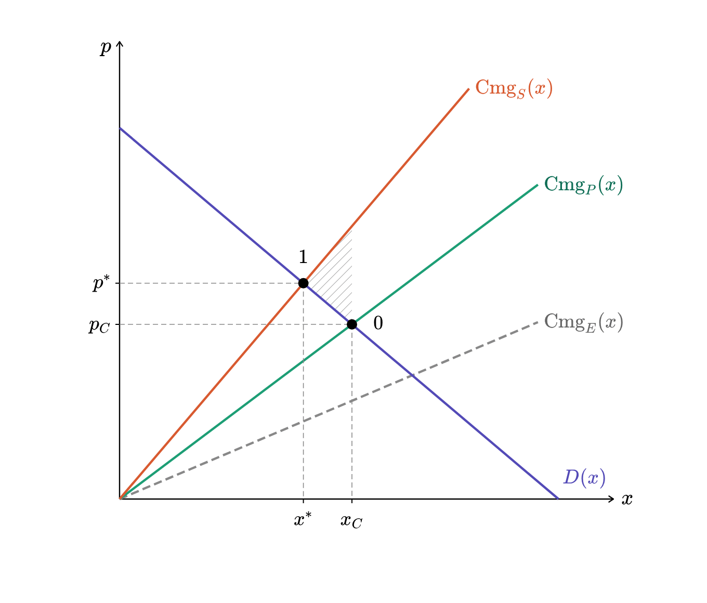
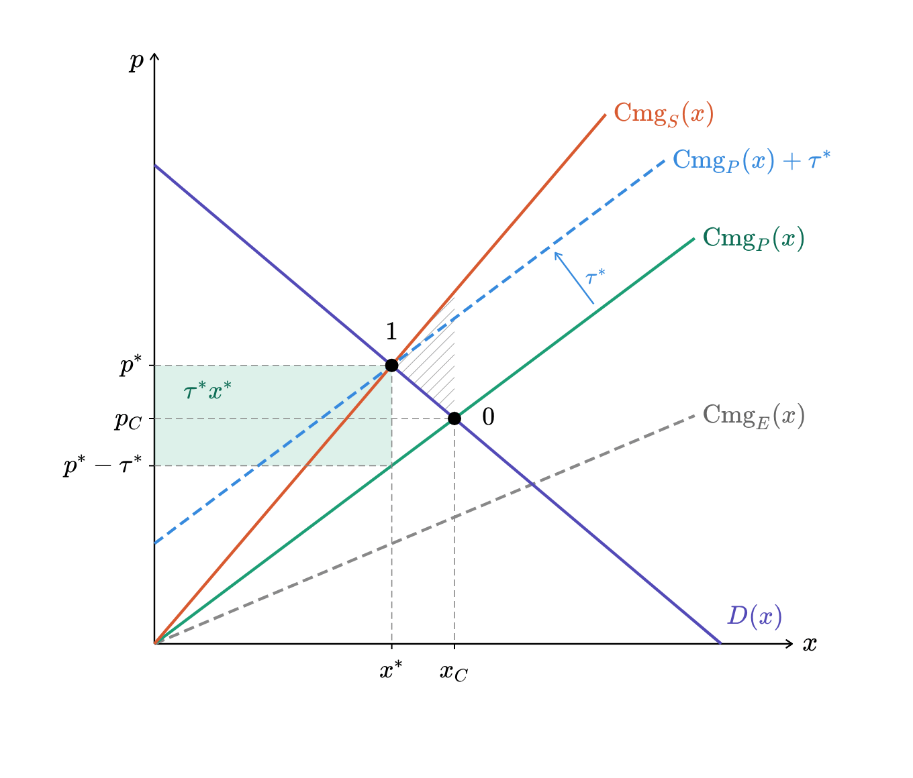
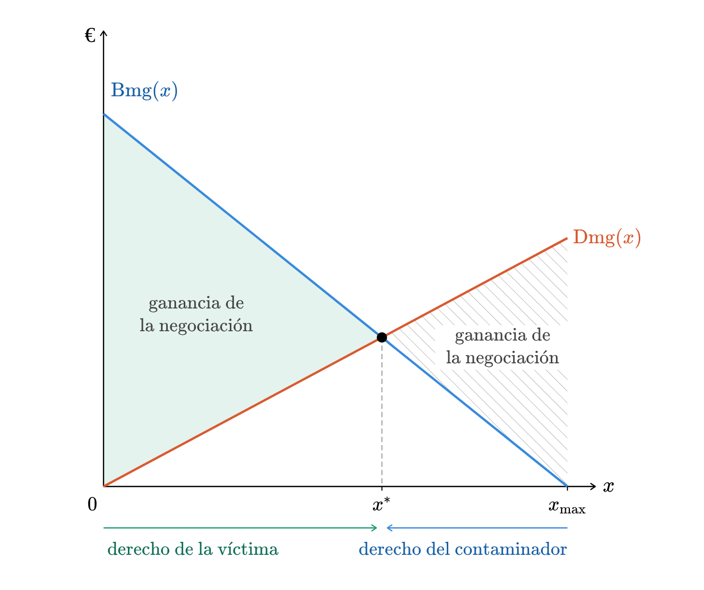

## Introducción

::: {.callout-note appearance="simple" icon=false}

:::

Pigou (1920) mostró que, cuando la actividad de un agente afecta a otros sin pasar por el mercado, el precio no recoge todo su coste social, y propuso corregirlo con un impuesto, el **impuesto pigouviano**. Samuelson (1954) formalizó los **bienes públicos**, que nadie puede ser excluido de consumir y cuyo consumo no reduce el de los demás, y Coase (1960) sostuvo que, si los derechos de propiedad están bien definidos y negociar no cuesta, las partes pueden resolver las externalidades por sí solas. Esas tres ideas siguen ordenando el debate actual, del precio del carbono como respuesta al cambio climático a la provisión de bienes públicos globales. Por la misma lógica, las externalidades positivas, como las que generan la investigación o la vacunación, justifican subvenciones que acerquen la producción a su nivel eficiente.

Frente a la tradición que veía en el sector público un corrector benevolente de los fallos de mercado, la **teoría de la elección pública** de Buchanan y Tullock (1962) analizó a políticos, votantes y burócratas como agentes que persiguen su propio interés, y mostró que la intervención también puede fallar. Buchanan recibió el Premio Nobel en 1986 por estas aportaciones.

Cada fallo de mercado tiene su remedio, desde la provisión pública de bienes públicos y los impuestos o mercados de derechos que corrigen las externalidades hasta la regulación y la defensa de la competencia frente al poder de mercado (tema [A20](a20-regulacion.qmd)). Sin embargo, la elección pública añade a la cuenta el coste de aplicarlos, con la búsqueda de rentas, la captura del regulador, el ciclo político y la expansión de la burocracia (Niskanen, 1971), y obliga a comparar dos soluciones imperfectas, el mercado y el sector público.

Aunque el primer teorema fundamental del bienestar garantiza la eficiencia de la asignación competitiva, sus condiciones rara vez se cumplen en la realidad. Este tema estudia esas situaciones y sus consecuencias para la intervención pública en tres partes:

- *Eficiencia paretiana*: se recuerdan las condiciones de eficiencia paretiana en una economía competitiva simple y los teoremas fundamentales.

- *Fallos de mercado*: se analiza la teoría de los fallos de mercado, con especial atención a los bienes públicos y a las externalidades.

- *Elección pública*: se expone la teoría de la elección pública, que muestra que el sector público tampoco es neutral y que sus propios fallos pueden limitar la eficacia de la intervención.

## 1. Condiciones de eficiencia u optimalidad paretiana en una economía simple competitiva

Arrow (1951a) y Debreu (1954) probaron que, bajo competencia perfecta, el mecanismo de precios conduce a un equilibrio general óptimo en el sentido de Pareto, y juntos demostraron su existencia (Arrow y Debreu, 1954). Los precios de ese equilibrio vacían todos los mercados y dejan a cada agente en su plan óptimo. Con competencia perfecta y sin imperfecciones transmiten, además, toda la información relevante, porque reflejan la escasez relativa de cada bien, resumen la tecnología y las preferencias e incorporan todos los costes de producción y todas las utilidades del consumo.

### 1.1. Supuestos y condiciones de eficiencia en una economía 2x2x2x2

Las condiciones se obtienen, sin los programas de optimización ni su desarrollo gráfico, en una economía simple 2x2x2x2, con dos bienes, dos factores, dos empresas y dos consumidores.

::: {.callout-note appearance="simple" icon=false}
La economía 2x2x2x2 es el mismo modelo que se desarrolla en el tema [A22](a22-eb-i.qmd), apartado 1.2, con los programas de eficiencia en la producción, en el consumo y global, las cajas de Edgeworth y las fronteras de posibilidades de producción y de utilidad. Aquí se resume en lo que necesitan los fallos de mercado.
:::

#### 1.1.1. Supuestos

**Entorno**: hay competencia perfecta en todos los mercados de bienes y factores, es decir, mercados completos, agentes precio-aceptantes e información completa.

**Agentes**: dos empresas, cada una especializada en un bien, y dos consumidores cuya utilidad depende solo de su propio consumo (sin externalidades en el consumo) y es diferenciable, creciente y cuasicóncava, con curvas de indiferencia convexas.

**Tecnología**: dos bienes privados, $x$ e $y$, rivales y excluibles, producidos con dos factores, $K$ y $L$, cuya oferta es perfectamente inelástica[^a23-1]. Cada función de producción es diferenciable, depende solo de los factores que emplea su empresa (sin externalidades en la producción) y tiene productividades marginales positivas y decrecientes y rendimientos no crecientes a escala[^a23-2], de modo que la frontera de posibilidades de producción (FPP) es cóncava.

#### 1.1.2. Modelo

**Condición de optimalidad en la producción**: cada productor maximizador elige la combinación de factores en la que su relación marginal de sustitución técnica (RMST) coincide con el cociente de los precios de esos factores. En competencia perfecta todos son precio-aceptantes y pagan los mismos precios. Por ello, cuando hay un vector $\mathbf{p}^z = (w, r)$ de equilibrio competitivo, se cumple:

$$\text{RMST}_{KL}^x = \frac{\partial f_x/\partial L_x}{\partial f_x/\partial K_x} = \frac{\partial f_y/\partial L_y}{\partial f_y/\partial K_y} = \text{RMST}_{KL}^y = \frac{w}{r}$$

Esta condición queda recogida en la FPP, cuya pendiente en el plano $(x, y)$ es, en valor absoluto, $\text{RMT}_{yx} = \text{Cmg}_x / \text{Cmg}_y = (\partial f_y/\partial L_y)/(\partial f_x/\partial L_x) = (\partial f_y/\partial K_y)/(\partial f_x/\partial K_x)$.

**Condición de optimalidad en el consumo**: cada consumidor elige la cesta en la que su relación marginal de sustitución (RMS) coincide con el precio relativo de los dos bienes. Si existe un vector $\mathbf{p} = (p_x, p_y)$ de equilibrio competitivo, se cumple:

$$\text{RMS}_{yx}^A = \frac{\partial u^A/\partial x}{\partial u^A/\partial y} = \frac{\partial u^B/\partial x}{\partial u^B/\partial y} = \text{RMS}_{yx}^B = \frac{p_x}{p_y}$$

**Condición de optimalidad global**: el vínculo entre producción y consumo se encuentra en los precios relativos. Como $w = p_x f_{L_x}'$ y $w = p_y f_{L_y}'$, se obtiene $p_x/p_y = f_{L_y}'/f_{L_x}' = \text{RMT}_{yx}$. Por tanto:

$$\text{RMS}_{yx}^h = \frac{p_x}{p_y} = \text{RMT}_{yx}$$

El sistema competitivo garantiza que todas las valoraciones coinciden, es decir, que la tasa subjetiva de intercambio (RMS) iguala la tasa objetiva de transformación (RMT). De este modo, guiado por una *mano invisible*, cada individuo, persiguiendo su interés personal, adopta un curso de acción que asegura una asignación globalmente eficiente (la “tarta” alcanza su tamaño máximo, aunque no necesariamente se maximiza el bienestar social).

### 1.2. Teoremas fundamentales del bienestar

Tras las condiciones de eficiencia vienen los dos teoremas fundamentales del bienestar y los supuestos de los que dependen.

::: {.callout-note appearance="simple" icon=false}
Los dos teoremas se enuncian, demuestran y valoran en el tema [A22](a22-eb-i.qmd), apartado 2. Aquí se recuerdan en lo que interesa a los fallos de mercado.
:::

El primer teorema establece que todo equilibrio competitivo es una asignación eficiente en el sentido de Pareto[^a23-3]. Según el segundo, cualquier óptimo de Pareto puede alcanzarse como equilibrio competitivo tras una redistribución de las dotaciones iniciales mediante transferencias de suma fija, siempre que preferencias y tecnologías sean convexas[^a23-5]. 

Lo que importa para este tema son los supuestos de los que dependen los teoremas, es decir, bienes privados (rivales y excluibles), ausencia de efectos externos, agentes precio-aceptantes e información completa. Cada fallo de mercado es la violación de uno de ellos, y el sector público interviene para restablecer las condiciones de eficiencia que el fallo impide cumplir.

### 1.3. Conclusiones

**Aspectos positivos**: las condiciones de eficiencia paretiana y los dos teoremas del bienestar establecen con precisión qué debe cumplirse para que el equilibrio competitivo sea eficiente y, con ello, proporcionan el criterio con el que identificar los fallos de mercado.

**Limitaciones**: los teoremas nada dicen sobre la equidad de la asignación, descansan en supuestos exigentes (mercados completos) y el segundo exige además convexidad y presupone transferencias de suma fija que en la práctica no existen. Estas limitaciones son el punto de partida del apartado 2 (fallos de mercado) y del apartado 3 (fallos del sector público).

## 2. Teoría de los fallos de mercado

Uno de los principales motivos que justifica la intervención es la existencia de imperfecciones o **fallos de mercado**, los cuales hacen que las decisiones descentralizadas de los agentes no conduzcan a la eficiencia económica.

La teoría nace de las aportaciones de Pigou (*The Economics of Welfare*, 1920) y se desarrolla con Meade (1952) y Samuelson (1954a). Intervenir por eficiencia exige un fallo de mercado, pero estos fallos no bastan y solo aportan un argumento *prima facie*[^a23-9]. Se clasifican en cuatro categorías principales: bienes públicos, externalidades, poder de mercado e información imperfecta.

### 2.1. Bienes públicos

Los bienes públicos plantean tres preguntas: qué los distingue de los privados, cuánto conviene proveer y quién debe proveerlos.

#### 2.1.1. Concepto y tipos: una taxonomía de los bienes

La naturaleza de cualquier bien, público o privado, se determina por dos propiedades independientes:

1. *Rivalidad*: un bien es *rival* cuando la unidad que consume un individuo ya no está disponible para otro, y *no rival* cuando todos pueden disfrutarlo a la vez sin que el uso de uno merme lo que queda para el resto. Por ello, en un bien no rival, atender a un consumidor más tiene coste marginal nulo[^a23-10].

2. *Exclusión*: un bien es *excluible* cuando dejar fuera a quien no paga es técnicamente viable y no demasiado caro, y *no excluible* cuando, ya disponible, cerrarle el paso a quien no paga es imposible o tiene un coste muy elevado. 

La no exclusión dificulta la provisión privada, porque nadie tiene incentivos a pagar por lo que puede consumir gratis. Esa falta de incentivos es el **problema del *free rider*** (gorrón), que puede hacer desaparecer la oferta privada del bien[^a23-11].

Cruzando ambas propiedades se obtienen cuatro categorías de bienes:

1. *Bienes privados*: rivales y excluibles, y son los que el mercado asigna eficientemente.

2. *Bienes públicos puros* (Samuelson, 1954a): no rivales y no excluibles (la defensa nacional, el alumbrado público, el conocimiento básico), y son el objeto de este apartado.

3. *Bienes de club* (Buchanan, 1965): excluibles pero no rivales hasta la congestión (una piscina, una autopista de peaje, una plataforma digital). La exclusión permite financiarlos con cuotas, y el problema económico es el tamaño óptimo del club, aquel en el que el beneficio marginal de un nuevo socio iguala al coste de congestión que impone a los demás.

4. *Bienes comunales* o *recursos de uso común*: rivales pero no excluibles (los caladeros, los pastos, los acuíferos, la atmósfera…), cuyo fallo característico es la *tragedia de los comunes* (Hardin, 1968). Como cada usuario obtiene todo el beneficio de una unidad adicional de uso y soporta solo una fracción del coste total que esta genera, el recurso se sobreexplota, en el límite hasta agotarse. La situación tiene la estructura de un dilema del prisionero con muchos jugadores, y sus soluciones (derechos de propiedad, regulación del acceso, acuerdos autoimpuestos) se examinan en los apartados 2.1.4 y 2.2.5 y en el tema [B19](b19-coordinacion.qmd), apartado 2.2.

De la taxonomía se desprende que los bienes públicos, en sentido amplio, son los que carecen de al menos una de las dos propiedades del bien privado y pueden ser rivales o excluibles, pero nunca ambas cosas a la vez. En todo caso, de las dos propiedades, la relevante para la naturaleza del bien es la no rivalidad, porque altera las condiciones de eficiencia en la provisión, mientras que la excluibilidad determina si la provisión puede ser privada. Por su ámbito geográfico, los bienes públicos pueden ser, además, locales, regionales o globales. 

#### 2.1.2. Provisión eficiente: el modelo de Samuelson (1954a)

**Origen**: Paul Samuelson (*The Pure Theory of Public Expenditure*, 1954a) formuló el problema de la provisión óptima de los bienes públicos en un modelo de equilibrio general con un número cualquiera de bienes privados y públicos. En ese modelo obtuvo la condición de eficiencia que lleva su nombre, y al año siguiente expuso el modelo gráficamente con dos bienes y dos consumidores (Samuelson, 1955), que es la versión que se presenta aquí.

**Idea**: la no rivalidad altera la condición de optimalidad global del tema [A22](a22-eb-i.qmd). Como todos consumen la misma cantidad del bien público, su valoración social no es la de un consumidor sino la suma de las de todos, y esa suma ha de igualarse al coste marginal.

**Supuestos**:

- *Entorno*: economía de equilibrio general con dos consumidores, un bien público $g$ y un bien privado $x$, en la que se supone información perfecta.

- *Agentes*: dos consumidores, $A$ y $B$, con preferencias cuasilineales, $u^h = v^h(g) + x^h$, de modo que la relación marginal de sustitución entre el bien público y el privado, $\text{RMS}_{xg}^h = v^{h\prime}(g)$, no depende del consumo del bien privado. Por la no rivalidad, ambos consumen la misma cantidad del bien público, $g^A = g^B = g$, mientras que el bien privado se reparte, $x^A + x^B = x$.

- *Tecnología*: ambos bienes se producen con una dotación de factores dada, de modo que las combinaciones factibles vienen dadas por una FPP, $T(x, g) = 0$, cuya pendiente en el plano $(g, x)$ es, en valor absoluto, la relación marginal de transformación $\text{RMT}_{xg}$.

**Planteamiento**: el planificador maximiza la utilidad de un consumidor manteniendo la del otro en un nivel dado, sujeto a la tecnología y a las condiciones de consumo de cada bien:

$$\max_{x^A,\, x^B,\, g} \; u^A(x^A, g)$$
$$\text{s.a.:} \begin{cases} u^B(x^B, g) = u_0^B & \text{(utilidad de } B \text{ dada)} \\[4pt] x^A + x^B = x & \text{(reparto del bien privado)} \\[4pt] g^A = g^B = g & \text{(no rivalidad del bien público)} \\[4pt] T(x, g) = 0 & \text{(FPP)} \end{cases}$$

donde $x^A$, $x^B$ son los consumos del bien privado de $A$ y de $B$ y $g$ la cantidad del bien público (variables de decisión), $u^A(\cdot)$ y $u^B(\cdot)$ sus funciones de utilidad, $u_0^B$ el nivel de utilidad de $B$ que se toma como dado, $x = x^A + x^B$ la producción total del bien privado y $T(x, g) = 0$ la FPP, determinada por la tecnología y la dotación de factores.

**CPO**: con solución interior y las restricciones agotadas, derivando el lagrangiano respecto a $x^A$, $x^B$ y $g$ y eliminando los multiplicadores, resulta la conocida *condición de Samuelson*:

$$\sum_h \text{RMS}_{xg}^h = \text{RMT}_{xg}$$

El bien público ha de producirse hasta que su valoración marginal social, la suma de lo que una unidad más vale para cada usuario, coincida con lo que esa unidad cuesta en bien privado sacrificado. 

Por tanto, la condición difiere de la de los bienes privados, $\text{RMS}^A = \text{RMS}^B = \text{RMT}$. Con un bien privado, cada consumidor ajusta su cantidad hasta igualar su valoración marginal al coste (segunda ley de Gossen), mientras que con el bien público la cantidad es común y se suman las valoraciones. En el óptimo, en general, $\text{RMS}_{xg}^A \neq \text{RMS}_{xg}^B$.

**CSO**: la concavidad de $v^h(g)$ (valoraciones marginales decrecientes del bien público) y la concavidad de la FPP (conjunto de producción convexo) garantizan que la condición de Samuelson caracteriza el óptimo.

**Desarrollo gráfico**: la condición de Samuelson se representa en el plano bien público-bien privado ($g$-$x$) de los dos paneles de la figura -@fig-a231-samuelson-i:

1. *Frontera de posibilidades de producción* ($T(x,g)=0$, panel superior): sobre ella se encuentran las combinaciones Pareto-óptimas de producción. Con la curva siguiente forma las restricciones “brutas”.

2. *Curva de indiferencia de $B$* ($u_0^B$, panel superior): reúne las combinaciones de bien público y bien privado que dan a $B$ la utilidad $u_0^B$, y actúa como restricción. Puesto que $A$ disfruta del bien público en la misma cantidad que $B$ y le corresponde el bien privado que no consume $B$, la distancia vertical entre las dos curvas mide, para cada $g$, lo disponible para $A$.

3. *Frontera de posibilidades de consumo de $A$* ($\text{FPC}^A$, panel inferior): es la restricción “neta” de $A$, esa distancia vertical trasladada al origen, dada la utilidad de $B$. Su pendiente equivale a la de la FPP menos la que tiene la curva de indiferencia de $B$.

4. *Curva de indiferencia de $A$* ($u_*^A$, panel inferior): reúne las combinaciones de bien público y bien privado que dan a $A$ una misma utilidad, y es la más alta que $A$ puede alcanzar sobre su $\text{FPC}^A$.

5. *Óptimo*: en el punto $0$, la $\text{FPC}^A$ es tangente a $u_*^A$, con $g^*$ unidades del bien público y $x^{A*}$ del privado para $A$. La tangencia, $\text{RMS}^A = \text{RMT} - \text{RMS}^B$, es exactamente la condición de Samuelson.

::: {#fig-a231-samuelson-i}

::: {.content-visible when-format="html"}
```{=html}
<div class="graph-frame">
<iframe src="../graphs/a231_Samuelson_i.html" style="height:800px" loading="lazy" title="fig-a231-samuelson-i"></iframe>
</div>
```
:::

::: {.content-visible unless-format="html"}

:::

Condición de Samuelson. Restando en vertical la curva de indiferencia de B a la FPP se obtiene, para A, la frontera de posibilidades de consumo. Allí donde esa frontera toca tangencialmente la curva de indiferencia más alta de A (punto 0), la suma de las RMS iguala a la RMT.
:::

**Conclusiones**:

- *Aspectos positivos*: el modelo ofrece una condición de eficiencia fácil de interpretar para los bienes públicos. Se provee la cantidad adecuada si el beneficio que la última unidad reporta al conjunto de los consumidores coincide exactamente con lo que cuesta producirla. La suma vertical de las demandas individuales, frente a la suma horizontal de los bienes privados, es su expresión gráfica y el fundamento del análisis coste-beneficio de los proyectos públicos.

- *Limitaciones*: la condición dice cuánto producir, no cómo. Exige conocer las valoraciones marginales de todos los consumidores, que estos no tienen incentivos a revelar, y no determina cómo repartir el coste. Ambas cuestiones, la revelación de preferencias y la financiación, se tratan en el apartado 2.1.4. La condición supone, además, que el bien se financia con impuestos de suma fija. En cambio, si los impuestos que lo financian son distorsionantes, la regla ha de incorporar su coste de eficiencia y deja de ser la condición de Samuelson pura (Atkinson y Stern, 1974).

#### 2.1.3. Provisión privada: el equilibrio de contribuciones voluntarias (Bergstrom, Blume y Varian, 1986)

**Origen**: el análisis de la provisión privada como equilibrio de contribuciones voluntarias prolonga la condición de Samuelson (1954a) con la lógica de la acción colectiva de Olson (1965), y su formulación canónica como juego de contribuciones se debe a Bergstrom, Blume y Varian (1986). El problema del *free rider* es el reverso de la tragedia de los comunes de Hardin (1968). En esta un recurso rival se sobreexplota, y en aquel un bien no rival se infraprovee, pero en ambos casos cada agente ignora el efecto de su decisión sobre los demás.

**Idea**: la condición de Samuelson dice cuánto bien público conviene producir, pero no quién lo decide ni quién lo paga. Si la provisión se deja al mercado (a las contribuciones voluntarias de los consumidores), la cantidad resultante queda por debajo de la eficiente, porque cada uno decide su aportación atendiendo a su propia valoración y no a la de los demás.

**Razonamiento**: con provisión privada cada consumidor que contribuye lo hace hasta que su valoración marginal iguala al coste marginal, $\text{RMS}_{xg}^h = \text{RMT}_{xg}$, como con un bien privado. Sin embargo, como cada $\text{RMS}^h$ es menor que la suma $\sum_h \text{RMS}^h$, la cantidad así provista es inferior a la que cumple la condición de Samuelson. Además, en el equilibrio de Nash de las contribuciones voluntarias, el bien lo financia quien más lo valora y los demás se benefician sin pagar, lo que constituye un problema de *free rider*.

La razón está en las dos propiedades del bien:

- *No rivalidad*: la contribución de cada uno beneficia a todos, de modo que cada contribuyente ignora el beneficio que genera a los demás. El precio deja, además, de funcionar como señal, porque desaparece su relación con la utilidad marginal de cada individuo.

- *No exclusión*: nadie puede ser obligado a pagar. Los precios que las empresas pudieran cobrar reflejarían entonces valoraciones individuales y no la social, y los consumidores tendrían incentivos a ocultar la suya, con lo que el mercado no revela las preferencias. 

El fallo de la provisión privada depende de que el bien sea o no excluible:

- *Bien público no excluible*: la provisión privada genera infraproducción y una pérdida de eficiencia.

- *Bien de club*: la exclusión es posible y el fallo es distinto, el infraconsumo, porque se cobra un precio positivo por un bien cuyo coste marginal de consumo es nulo.

En ambos casos el mercado falla en la provisión, no necesariamente en la producción, por lo que la respuesta es que el sector público decida y financie la cantidad, aunque la produzcan empresas privadas.

**Desarrollo gráfico**: la provisión privada del bien público se representa en el plano bien público-precio (figura -@fig-a232-samuelson-ii):

1. *Demanda social* ($D(g)$): recoge, para cada cantidad del bien público, la suma de las valoraciones marginales de todos los consumidores (suma vertical de las demandas individuales), y es decreciente porque estas valoraciones lo son.

2. *Demanda revelada* ($D_R(g)$): recoge solo la valoración que se revela con contribuciones voluntarias y es, por ello, menor que la social.

3. *Coste marginal* ($\text{Cmg}(g)$): mide lo que cuesta producir cada unidad adicional del bien público.

4. *Equilibrio*: la provisión eficiente, $g^*$, es el cruce de $D(g)$ con el coste marginal (punto $1$). En cambio, con contribuciones voluntarias, el cruce relevante es el de $D_R(g)$ (punto $0$) y la provisión, $g_R$, es insuficiente.

::: {#fig-a232-samuelson-ii}

::: {.content-visible when-format="html"}
```{=html}
<div class="graph-frame">
<iframe src="../graphs/a232_Samuelson_ii.html" style="height:580px;max-width:598px" loading="lazy" title="fig-a232-samuelson-ii"></iframe>
</div>
```
:::

::: {.content-visible unless-format="html"}

:::

Provisión del bien público. La provisión eficiente, $g^*$ (punto 1), iguala la demanda social, $D(g)$, suma vertical de las valoraciones marginales, al coste marginal (la suma de las RMS iguala a la RMT). Con contribuciones voluntarias se revela una demanda menor, $D_R(g)$, y la provisión, $g_R$ (punto 0), es insuficiente, porque en $g_R$ la valoración social (punto 0′) supera al coste marginal. El área rayada es la pérdida de eficiencia.
:::

**Extensiones**: el equilibrio de contribuciones voluntarias tiene una propiedad de *neutralidad* (Warr, 1983; Bergstrom, Blume y Varian, 1986). Una redistribución pequeña de la renta entre quienes contribuyen no altera la cantidad total provista, porque cada uno ajusta su aportación en la misma cuantía que cambia su renta. Por la misma razón, la provisión pública financiada con impuestos de suma fija sobre los contribuyentes, si ninguno paga más de lo que aportaba, desplaza sus aportaciones privadas uno a uno. Por tanto, la cantidad total solo aumenta si el impuesto recae también sobre quienes no contribuían.

**Conclusiones**:

- *Aspectos positivos*: explica la infraprovisión de los bienes públicos como un equilibrio de Nash de decisiones individuales racionales y la vincula a las dos propiedades del bien, la no rivalidad y la no exclusión. Con ello fundamenta la intervención pública y delimita su objeto, que es decidir y financiar la cantidad más que producir el bien.

- *Limitaciones*: supone agentes que solo atienden a su propia valoración y deciden una sola vez, por lo que predice contribuciones voluntarias menores que las observadas. El altruismo, las normas sociales y la interacción repetida sostienen, sin embargo, aportaciones significativas, como recogen las soluciones de iniciativa privada y de bienes comunales.

#### 2.1.4. Soluciones

Como solo el sector público puede obligar a pagar a quienes de otro modo se comportarían como *free riders*, le corresponde la provisión[^a23-16], aunque no necesariamente la producción[^a23-17]. 

Sin embargo, para aplicar la condición de Samuelson, el sector público ha de resolver cómo distribuir el coste entre los contribuyentes (la financiación) y cómo conocer las valoraciones que determinan la cantidad (la revelación de preferencias), dos problemas que esta deja abiertos.

**Principios de financiación**: para resolver el primer problema, el coste del bien público puede repartirse mediante impuestos según dos criterios de equidad:

1. *Principio de capacidad de pago*: paga más quien dispone de un nivel de renta mayor, como en el impuesto sobre la renta de las personas físicas (IRPF). El sector público aprovecha la necesidad de financiar el bien público para llevar a cabo, además, una redistribución. La limitación de este principio es que los impuestos sobre la renta son generalmente distorsionantes[^a23-18], de modo que la financiación introduce una ineficiencia propia, y que este principio desvincula lo que cada uno paga de lo que valora, con lo que no aporta información sobre la cantidad a proveer.

2. *Principio de beneficio*: cada uno paga según lo que el bien le reporta. Este principio vincula la financiación a la valoración, y con ello puede resolver a la vez los dos problemas, si se consigue que las valoraciones se revelen. Los dos mecanismos siguientes lo aplican.

**Principio de revelación de preferencias**: el segundo problema exige un mecanismo que lleve a los agentes a declarar sus valoraciones verdaderas. El principio de revelación (Gibbard, 1973; Myerson, 1979) permite acotar la búsqueda de ese mecanismo.

Según el *principio de revelación de Gibbard-Myerson*, para cualquier mecanismo de asignación existe un *mecanismo directo equivalente* en el que los agentes se limitan a declarar sus preferencias y tienen incentivos a declararlas verazmente cuando los demás también lo hacen.

La consecuencia es que, al diseñar el mecanismo, el planificador puede restringirse sin pérdida a los que hacen compatible la sinceridad con los incentivos individuales. Los dos mecanismos siguientes buscan esa compatibilidad con distinto éxito. El de Lindahl alcanza la eficiencia solo si los agentes son sinceros, pues no es compatible con los incentivos, y el de Clarke-Groves-Vickrey hace de la sinceridad la estrategia dominante.

**Precios personalizados** (Lindahl, 1919): Erik Lindahl propuso que cada consumidor pague por cada unidad del bien público un precio igual a su valoración marginal. Así, todos demandan la misma cantidad aunque paguen precios distintos.

- *Condición de provisión*: cada consumidor demanda la cantidad de bien público para la que su valoración marginal iguala a su precio personalizado, $v^{h\prime}(g) = t^h$. La cantidad que el sector público provee es aquella en la que la suma de los precios personalizados iguala al coste marginal:
    $$\sum_{h=1}^{H} t^h = \sum_{h=1}^{H} v^{h\prime}(g^*) = \text{Cmg}_g = \text{RMT}_{xg}$$
    La condición de provisión con precios de Lindahl es, por tanto, la condición de Samuelson. Si los precios personalizados reflejan las valoraciones verdaderas, la provisión pública resultante es eficiente. Con coste marginal constante, además, lo recaudado, $\sum_h t^h g^*$, cubre exactamente el coste de provisión.
    El *equilibrio de Lindahl* es el análogo del equilibrio competitivo para el bien público, es decir, un vector de precios personalizados y una cantidad tales que todos demandan esa cantidad a su precio y la suma de los precios iguala al coste marginal.

- *Principio de financiación*: de beneficio. Cada consumidor paga $T^h = t^h \cdot g^*$, es decir, una participación en el coste igual a su valoración marginal relativa, $s^h = t^h / \text{Cmg}_g$ con $\sum_h s^h = 1$, de manera que quien más valora el bien más paga.

- *Conclusiones*:

    - *Aspectos positivos*: si los individuos revelan honestamente sus valoraciones, la asignación es eficiente y equitativa en el sentido del beneficio.

    - *Limitaciones*: el regulador ha de conocer las valoraciones individuales, y los consumidores tienen incentivos a tergiversarlas, porque saben que su precio personalizado depende de la demanda que anuncien. Declarar una valoración baja reduce lo que pagan sin apenas reducir la cantidad provista. La eficiencia exige, por tanto, un mecanismo que haga de la revelación sincera la mejor estrategia.

**Mecanismos de revelación de preferencias** (Vickrey, 1961; Clarke, 1971; Groves, 1973): el *mecanismo de Clarke-Groves-Vickrey* hace que decir la verdad sea la estrategia dominante de cada agente. Para ello, cobra a quien altera la decisión colectiva exactamente el coste que esa alteración impone a los demás.

- *Condición de provisión*: cada agente declara su valoración del bien público, $v^h$, y el mecanismo asigna a cada uno una parte fija del coste, $c^h$, con lo que su valoración neta es $\tilde{v}^h = v^h - c^h$. 
    El bien se provee si la suma de las valoraciones netas declaradas es positiva, $\sum_h \tilde{v}^h > 0$, que es el análogo discreto de la condición de Samuelson aplicado a las declaraciones. De nuevo, se garantiza así la provisión eficiente siempre que las declaraciones sean sinceras, y la regla de pago hace de la sinceridad la estrategia dominante.

- *Principio de financiación*: de beneficio, en su versión del *agente pivote*. Un agente es *pivote* o bisagra si su declaración cambia la decisión, es decir, si sin él el bien no se proveería (o se proveería) y con él sí (o no). Solo los agentes pivote pagan, además de su parte fija, la *tasa de Clarke*, igual al coste que su presencia impone a los demás:
    $$T^h = \left|\sum_{j \neq h} \tilde{v}^j\right|$$
    La tasa coincide con la valoración neta agregada de los otros, que el voto del agente pivote ha revertido. Los agentes no pivote, en cambio, no pagan nada adicional.

- *Conclusiones*:

    - *Aspectos positivos*: como la tasa depende solo de las declaraciones de los demás, ningún agente puede reducirla mintiendo, y como mentir solo puede cambiar la decisión en su contra, revelar la verdad es la estrategia dominante.

    - *Limitaciones*: el mecanismo tiene altos costes de información y de implementación, y la sinceridad solo es estrategia dominante si las preferencias son cuasilineales, sin efectos renta. Además, no equilibra el presupuesto. Como la recaudación de las tasas de Clarke no puede devolverse a los agentes sin destruir los incentivos, el mecanismo genera un excedente que ha de desperdiciarse. De hecho, Green y Laffont (1977) mostraron que, en general, ningún mecanismo con decisión eficiente y sinceridad como estrategia dominante equilibra el presupuesto. Por último, el mecanismo es vulnerable a la colusión entre agentes.

::: {.callout-tip collapse="true" appearance="simple" title="Ejemplo: la tasa de Clarke con tres agentes"}
Tres agentes, $A$, $B$ y $C$, declaran sus valoraciones netas, $\tilde{v}^h$. El bien se provee si su suma es positiva, y cada agente pivote paga la tasa de Clarke, $T^h = \left|\sum_{j \neq h} \tilde{v}^j\right|$.

| Valoraciones netas $(\tilde{v}^A, \tilde{v}^B, \tilde{v}^C)$ | Suma | Decisión | Pivote | Tasas $(T^A, T^B, T^C)$ |
|:--|--:|:--|:--|:--|
| $(70, 0, 0)$ | $70$ | Se provee | $A$ | $(0, 0, 0)$ |
| $(70, -30, -30)$ | $10$ | Se provee | $A$ | $(60, 0, 0)$ |
| $(-70, 30, 20)$ | $-20$ | No se provee | $A$ | $(50, 0, 0)$ |

: Tasa de Clarke según las valoraciones netas declaradas. {#tbl-a23-clarke}

En el primer caso, sin $A$ la suma sería $0$ y el bien no se proveería, de modo que $A$ es pivote, pero no impone ningún coste a los demás y paga $0$. En el segundo, sin $A$ la suma sería $-60$, y $A$ paga $60$, la pérdida neta que la provisión causa a $B$ y $C$. Sin $B$ o sin $C$ la suma sería $40$ y la decisión no cambiaría, por lo que no pagan. En el tercero, $A$ impide un proyecto que $B$ y $C$ valoran en $50$ y paga esa cantidad, mientras que sin $B$ ($-50$) o sin $C$ ($-40$) la decisión tampoco cambiaría.

El segundo caso muestra por qué mentir no compensa. Si $A$ declara cualquier valor superior a $60$, el bien se provee y $A$ paga $60$, con una ganancia neta de $70 - 60 = 10$. Si declara $60$ o menos, el bien no se provee y $A$ obtiene $0$. Declarar su valoración verdadera le da, por tanto, el mejor resultado posible, y el mismo razonamiento vale para cualesquiera declaraciones de los demás.
:::

**La votación como alternativa**: otra posibilidad es determinar la cantidad mediante un sistema de votación, lo que esquiva el problema de revelación de preferencias. Sin embargo, con preferencias unimodales la votación por mayoría provee la cantidad preferida por el votante mediano, cantidad que, con un reparto igualitario del coste, solo coincide con la eficiente si la valoración marginal del mediano iguala a la media (Bowen, 1943; tema [A24](a24-eb-iii.qmd), apartado 3.1.3).

**Otras soluciones**: las vías anteriores no agotan las opciones del sector público ni de la sociedad.

1. *Regulación*: el sector público podría actuar también a través de regulación *ex ante* (mecanismos de autoselección o criba) o regulación *ex post* (auditorías, rendición de cuentas, transparencia).

2. *Bienes públicos locales* (Tiebout, 1956): los individuos se desplazan hacia zonas donde la provisión se ajusta a sus preferencias (“votar con los pies”). Así crean cuasimercados y presiones competitivas que, con movilidad perfecta, muchas jurisdicciones y sin efectos desbordamiento entre ellas, conducen a una provisión eficiente.

3. *Bienes comunales* (Ostrom, 1990): los usuarios directos de recursos comunes pueden alcanzar acuerdos libres y voluntarios que resuelven el problema, siempre que se cumplan ciertos requisitos. Los resultados de Ostrom, basados en el estudio empírico de instituciones comunales, enlazan con la lógica de los juegos repetidos, según la cual en un superjuego con infinitos periodos (con castigo) se puede alcanzar un equilibrio cooperativo eficiente si los jugadores son suficientemente pacientes.

4. *Diseño de mecanismos* (Hurwicz, 1972; Maskin, 1977; Myerson, 1979): la teoría estudia qué asignaciones pueden alcanzarse con reglas compatibles con los incentivos, es decir, reglas en las que a cada agente le conviene comportarse como el diseñador desea (tema [A24](a24-eb-iii.qmd), apartado 3.4.2). Sus resultados no son solo positivos. Hurwicz (1972) mostró que, en general, ningún mecanismo es a la vez compatible con los incentivos, eficiente en el sentido de Pareto y de participación voluntaria, de modo que el diseño exige renunciar en parte a alguna de esas propiedades.

5. *Iniciativa privada*: altruismo (Wikipedia, *software* libre, mecenazgo, altruismo impuro de Andreoni, 1990) e intensidad de preferencias (individuos con valoraciones muy altas contribuyen aunque otros se aprovechen).

#### 2.1.5. Conclusiones

**Aspectos positivos**: la teoría de los bienes públicos fija, con la condición de Samuelson, un criterio preciso de provisión eficiente y explica por qué la contribución voluntaria conduce a una provisión insuficiente. Queda así fundamentado que el sector público puede, en principio, mejorar la asignación cuando hay bienes públicos, y el mecanismo de Clarke-Groves-Vickrey prueba que se puede inducir a declarar las valoraciones verdaderas, si bien a un coste alto.

**Limitaciones**: los bienes públicos no constituyen justificación absoluta de la intervención, puesto que la propia actuación pública probablemente será ineficiente (apartado 3). Además, los trabajos más recientes restan peso al concepto, porque apenas hay bienes que cumplan con pureza las dos propiedades, y lo habitual es que generen efectos externos de intensidad variable, así que cuánto proveer suele estudiarse como un problema de externalidades.

### 2.2. Externalidades

Si muchos problemas de provisión de bienes públicos son, en el fondo, los de los efectos externos, conviene estudiar estos por sí mismos. Tras definirlos y clasificarlos, se obtienen las condiciones de provisión eficiente en su presencia, se muestra por qué la provisión privada no las alcanza y se estudian las soluciones.

#### 2.2.1. Concepto y tipos

Viner (1931) distinguió dos clases de economías externas, origen de los conceptos de externalidad tecnológica y externalidad pecuniaria:

1. *Externalidad tecnológica*: se da cuando la producción o el consumo de un agente afecta directamente al bienestar o a la producción de otro sin que medie una transacción de mercado, de modo que el efecto no tiene precio. 

2. *Externalidad pecuniaria*: opera a través de los precios (la entrada de un competidor que baja el precio a los demás). Forma parte del funcionamiento normal del mercado y, en mercados competitivos y completos, no genera ineficiencia, porque el precio ya la recoge.

Autores posteriores (p. ej. Scitovsky, 1954) denominan a las primeras simplemente externalidades o **externalidades reales**, que son las que estudia sobre todo la economía del bienestar. Meade (1952) las analizó en un modelo de equilibrio general competitivo, con el ejemplo de los apicultores y los fruticultores, y Arrow (1969) las reinterpretó como *mercados ausentes*. Una externalidad es un efecto para el que no existe mercado, y por eso viola el supuesto de mercados completos del que depende el primer teorema.

Las externalidades reales pueden clasificarse por tres criterios:

- *Signo*: son *negativas* si perjudican a terceros (la contaminación, la congestión) y *positivas* si los benefician (la vacunación, la investigación, un jardín).

  Un caso de importancia creciente son las *externalidades de red*, en las que el valor de un bien para cada usuario crece con el número de usuarios, y que explican las economías de escala del lado de la demanda de las plataformas digitales (tema [A20](a20-regulacion.qmd)).

- *Agentes*: según su origen y destino, surgen en la producción o en el consumo y afectan a productores o a consumidores (productor-productor, productor-consumidor, consumidor-consumidor).

- *Variable*: son de *flujo*, si el efecto depende de la actividad de cada periodo (las emisiones de un año), o de *stock*, si depende de la acumulación (la concentración de CO$_2$).

En todos los casos el fallo es el mismo. Quien genera el efecto no lo internaliza, porque no paga por el daño ni cobra por el beneficio, y quien lo sufre o lo disfruta no puede evitarlo ni exigir compensación. Como el precio ignora lo que el efecto vale en el margen para los afectados, deja de orientar bien las decisiones. Por ello, las actividades que perjudican a terceros se llevan más allá de lo eficiente (sobreproducción), y las que los benefician se quedan cortas (infraproducción).

#### 2.2.2. Provisión eficiente en la producción

**Planteamiento**: se parte del problema de maximización del beneficio del productor. El planificador social, a diferencia del productor, incorpora al problema el daño externo $e(x)$ que la producción impone a terceros:

$$\max_{x} \; p \cdot x - \text{CT}(x) - e(x)$$

donde $x$ es la cantidad producida (variable de decisión), $p$ su precio de mercado, $\text{CT}(x)$ la función de costes privados de la empresa y $e(x)$ el daño externo que la producción impone a terceros.

**CPO**: la condición de primer orden del programa es:

$$\text{CPO:} \quad p = \frac{\partial \text{CT}}{\partial x} + \frac{\partial e}{\partial x} \equiv \text{Cmg}_P + \text{Cmg}_E = \text{Cmg}_S$$

La condición de eficiencia exige que el precio iguale al coste marginal social, la suma del coste marginal privado y del daño marginal externo, y no al privado. Con daño marginal positivo, la cantidad eficiente es, por tanto, menor que la competitiva.

**CSO**: exigen $\text{CT}''(x) + e''(x) > 0$, es decir, un coste marginal social creciente, como en la empresa competitiva.

#### 2.2.3. Provisión eficiente en el consumo

**Planteamiento**: la externalidad en el consumo se ilustra en una economía 2x2 con dos bienes privados, $x$ e $y$, en la que la utilidad de $B$ depende también del consumo de $x$ por parte de $A$, $u^B(x^B, y^B, x^A)$. El planificador maximiza la utilidad de $A$ manteniendo la de $B$, sujeto al reparto de ambos bienes y a la tecnología:

$$\max_{x^A,\, y^A,\, x^B,\, y^B} \; u^A(x^A, y^A)$$
$$\text{s.a.:} \begin{cases} u^B(x^B, y^B, x^A) = u_0^B & \text{(utilidad de } B \text{ dada)} \\[4pt] x^A + x^B = x, \;\; y^A + y^B = y & \text{(reparto de los bienes privados)} \\[4pt] T(x, y) = 0 & \text{(FPP)} \end{cases}$$

donde $x^A$, $y^A$ y $x^B$, $y^B$ son los consumos de ambos bienes privados de $A$ y de $B$ (variables de decisión), $u^A(\cdot)$ y $u^B(\cdot)$ sus funciones de utilidad (la de $B$ depende también de $x^A$), $u_0^B$ el nivel de utilidad de $B$ que se toma como dado, $x$ e $y$ las cantidades totales producidas de cada bien y $T(x, y) = 0$ la FPP.

**CPO**: con solución interior y las restricciones agotadas, derivando el lagrangiano y eliminando los multiplicadores, como en el modelo de Samuelson, se obtiene la condición de primer orden:

$$\text{CPO:} \quad \text{RMS}_{yx}^B = \text{RMS}_{yx}^A + \frac{\partial u^B / \partial x^A}{\partial u^B / \partial y^B} = \text{RMT}_{yx}$$

Para $B$, que no genera externalidad, la condición es la habitual. Para $A$, en cambio, la valoración relevante de $x$ no es solo la suya sino la suya más el efecto que su consumo tiene sobre $B$, medido en unidades de $y$. El signo de ese efecto determina el sesgo del mercado:

- *Externalidad negativa*: el segundo término es negativo, la valoración social es inferior a la privada y hay sobreconsumo.

- *Externalidad positiva*: ocurre lo contrario y hay infraconsumo.

**CSO**: exigen preferencias convexas de ambos consumidores y un conjunto de producción convexo. La externalidad no altera la suficiencia mientras $u^B$ siga siendo cuasicóncava en $(x^B, y^B, x^A)$.

#### 2.2.4. Provisión privada: ineficiencia

**Desarrollo gráfico**: la ineficiencia de la provisión privada se representa en el plano cantidad-precio (figura -@fig-a233-externalidades), con una externalidad negativa en la producción:

1. *Curva de oferta de la empresa* ($\text{Cmg}_P(x)$): viene dada por su curva de coste marginal privado.

2. *Curva de daño marginal* ($\text{Cmg}_E(x)$): la actividad de la empresa impone a terceros un coste marginal externo, $\text{Cmg}_E(x) = e'(x)$, cuya pendiente positiva refleja que cada unidad adicional causa un perjuicio mayor que la anterior (p. ej. la contaminación).

3. *Curva de coste marginal social* ($\text{Cmg}_S(x)$): es la suma vertical de la curva de oferta de la empresa y la de daño marginal, y mide el coste para la sociedad (en recursos y en perjuicios) de producir una unidad adicional.

4. *Curva de demanda de mercado* ($D(x)$): mide, para cada cantidad, cuánto valoran los compradores la última unidad, es decir, el beneficio marginal privado del consumo.

5. *Equilibrio*:

    - *Equilibrio competitivo*: sin intervención pública, se da en el punto 0, con $x_C$ y $p_C$. Con la externalidad, sin embargo, ese nivel de producción ya no satisface la condición de eficiencia. Es posible encontrar otro en el que, con las compensaciones adecuadas, todos los agentes estén mejor.

    - *Óptimo social*: está en el punto 1, con $x^*$ y $p^*$, donde el coste marginal social corta a la demanda. En este punto el precio es la suma del coste marginal privado y el daño marginal que sufren los perjudicados, evaluados ambos en el nivel de producción eficiente.

    - *Sobreproducción*: el nivel de producción eficiente es inferior al de libre mercado, y el coste de eficiencia viene dado por el área del triángulo entre ambos equilibrios[^a23-21]. Si se considera una externalidad positiva, en cambio, el $\text{Cmg}_S(x)$ es menor que el $\text{Cmg}_P(x)$ y se da infraproducción.

::: {#fig-a233-externalidades}

::: {.content-visible when-format="html"}
```{=html}
<div class="graph-frame">
<iframe src="../graphs/a233_Externalidades.html" style="height:620px" loading="lazy" title="fig-a233-externalidades"></iframe>
</div>
```
:::

::: {.content-visible unless-format="html"}

:::

Externalidad negativa en la producción. El óptimo social exige igualar el coste marginal social, no el privado, al beneficio marginal.
:::

#### 2.2.5. Soluciones

El sector público puede corregir una externalidad actuando sobre los precios, sobre los derechos de propiedad o sobre las cantidades.

**Instrumentos pigouvianos**: Arthur Pigou (1920) identificó la divergencia entre el producto neto marginal social y el privado y propuso corregirla mediante impuestos y subvenciones, lo que constituye el fundamento de los instrumentos de precio de la política ambiental[^a23-22].

- *Idea*: el sector público logra la *internalización* creando el precio que falta, es decir, un impuesto por unidad igual al daño marginal externo o una subvención por unidad igual al beneficio marginal externo. El agente que genera la externalidad se enfrenta así al coste social de su decisión y la ajusta por sí mismo.

- *Planteamiento*: con un impuesto unitario $\tau$ sobre la producción, la empresa elige $x$ para maximizar $\pi = p \cdot x - \text{CT}(x) - \tau \cdot x$, donde $x$ es la cantidad producida (variable de decisión), $\pi$ el beneficio de la empresa, $p$ el precio de mercado, $\text{CT}(x)$ su función de costes privados y $\tau$ el impuesto unitario sobre la producción.

- *CPO*: $p = \text{Cmg}_P(x) + \tau$, y el impuesto que restablece el óptimo es el daño marginal evaluado en la cantidad eficiente, $\tau^* = (de/dx)|_{x^*}$[^a23-23]. Sus efectos son los mismos si recae sobre la producción o sobre el consumo[^a23-24].

- *CSO*: $\text{CT}''(x) > 0$, es decir, coste marginal privado creciente, como en la empresa competitiva.

- *Desarrollo gráfico*: el impuesto pigouviano se representa en el plano cantidad-precio (figura -@fig-a234-pigou):

    1. *Curvas de partida*: la demanda, $D(x)$, el coste marginal privado, $\text{Cmg}_P(x)$, el daño marginal, $\text{Cmg}_E(x)$, y el coste marginal social, $\text{Cmg}_S(x)$, como en la figura -@fig-a233-externalidades.

    2. *Coste marginal privado con el impuesto* ($\text{Cmg}_P(x) + \tau^*$): es la curva $\text{Cmg}_P(x)$ desplazada hacia arriba en la cuantía del impuesto.

    3. *Equilibrio*: con el impuesto, $\text{Cmg}_P(x) + \tau^*$ corta a la demanda en el mismo punto que la de coste marginal social (punto 1), y ese cruce es el equilibrio que incorpora la externalidad.

::: {#fig-a234-pigou}

::: {.content-visible when-format="html"}
```{=html}
<div class="graph-frame">
<iframe src="../graphs/a234_Pigou.html" style="height:600px" loading="lazy" title="fig-a234-pigou"></iframe>
</div>
```
:::

::: {.content-visible unless-format="html"}

:::

Impuesto pigouviano. El impuesto unitario igual al daño marginal desplaza el coste marginal privado hasta el social y restablece la cantidad eficiente.
:::

- *Estática comparativa*: el impuesto desplaza hacia arriba la curva de coste marginal privado, y el equilibrio pasa del punto 0, con $x_C$, al punto 1, con $x^*$. Desaparece así la pérdida de bienestar y el sector público obtiene una recaudación, $\tau^* x^*$.

- *Extensiones*:

    - *Subvención unitaria*: es el instrumento simétrico para las externalidades positivas, y un complemento del impuesto cuando se dirige a la innovación y a las tecnologías alternativas. 

    - *Doble dividendo*: el principio subyacente, “quien contamina paga”, permite además una segunda ganancia (Pearce, 1991). Si la recaudación se destina a reducir otros impuestos distorsionantes, la corrección de la externalidad puede mejorar también la eficiencia del sistema fiscal, aunque la interacción del impuesto con los ya existentes tiende a reducir o anular esa segunda ganancia (Bovenberg y De Mooij, 1994).

- *Conclusiones*:

    - *Aspectos positivos*: el instrumento es sencillo, actúa a través del mercado y no exige que el regulador conozca la tecnología de cada empresa, solo el daño marginal en la cantidad eficiente, que depende de los costes agregados. Además, genera ingresos y deja a cada agente la elección de cómo reducir su externalidad, lo que minimiza el coste de la reducción. Sus aplicaciones actuales van de los impuestos sobre carburantes y emisiones a las tasas sobre plásticos y envases.

    - *Limitaciones*: fijar el impuesto óptimo exige conocer el daño marginal en la cantidad eficiente, lo que plantea el mismo problema de revelación de preferencias que los bienes públicos y elevados costes de información[^a23-25]. Asimismo, el instrumento es indirecto, pues confía en que los agentes reaccionen al precio, y su efecto sobre la cantidad es reducido si la demanda es rígida e incierto si el regulador desconoce costes y demanda. En presencia de otras distorsiones, además, el impuesto igual al daño marginal deja de ser óptimo y la corrección pasa a ser un problema de *second best* (tema [A22](a22-eb-i.qmd), apartado 3). Por ejemplo, si el contaminador es un monopolista, que ya produce menos de lo eficiente, el impuesto óptimo es inferior al daño marginal (Buchanan, 1969).

**Teorema de Coase**: Ronald Coase (*The Problem of Social Cost*, 1960) sostuvo, frente a Pigou, que el problema de las externalidades no es la falta de un impuesto sino la falta de derechos de propiedad definidos sobre el efecto externo.

- *Idea*: el sector público se limita a delimitar y asignar los derechos de propiedad, el derecho a contaminar o el derecho a no ser contaminado, y con ello crea un mercado para la externalidad. La solución es descentralizada, porque las partes negocian la cantidad, pero no privada, ya que exige que el sector público defina los derechos y garantice su cumplimiento, sin lo cual no existe nada que intercambiar.

- *Teorema* (nombre que le dio Stigler, 1966): la cantidad pactada será la misma, y eficiente, sea cual sea el reparto inicial de los derechos. El resultado exige que negociar no cueste nada (o casi nada), que ambas partes estén perfectamente informadas y que no existan efectos renta. Quién reciba el derecho solo cambia la distribución de la renta.

- *Razonamiento*: considérense una acería, que produce aguas arriba y contamina, y una piscifactoría, que produce aguas abajo y sufre el daño:

    - *Derecho de la piscifactoría*: la acería está dispuesta a pagar por contaminar mientras su beneficio marginal neto supere al daño marginal que causa. El acuerdo se alcanza así en la cantidad eficiente $x^*$, donde ambos se igualan, con una compensación por la última unidad igual al daño marginal en ese punto. Por encima de $x^*$, el beneficio marginal es inferior al pago y la acería no tiene incentivo a seguir.

    - *Derecho de la acería*: la piscifactoría paga por reducir la contaminación mientras el daño marginal supere al beneficio marginal neto de la acería, y el acuerdo se alcanza de nuevo en $x^*$. En ambos casos la cantidad es la eficiente y difiere solo la distribución de las ganancias, que favorece a quien recibió el derecho.

- *Comparación con Pigou*: para Pigou el fallo está en el precio. Falta el precio del daño y el impuesto lo crea, lo que exige un regulador que conozca el daño marginal y fije el impuesto. Para Coase, en cambio, el fallo está en los derechos. Si el derecho está definido y es negociable, las partes revelan sus valoraciones al negociar y llegan al resultado eficiente sin que el regulador sepa nada sobre ellas.

- *Elección entre ambos*: cuando las condiciones del teorema se cumplen, la solución de Coase es superior precisamente por eso. Cuando no se cumplen, como en la contaminación difusa con millones de afectados, la negociación es imposible y el instrumento pigouviano, o el mercado de derechos que combina ambas lógicas, es el único practicable. Por tanto, la elección entre ellos es una comparación de costes de transacción, que es la lección general de Coase.

- *Desarrollo gráfico*: la negociación entre la acería y la piscifactoría se representa en el plano actividad contaminante-euros (figura -@fig-a235-coase):

    1. *Beneficio marginal* ($\text{Bmg}(x)$): recoge el beneficio marginal neto que obtiene la acería de cada unidad adicional de actividad contaminante, y es decreciente.

    2. *Daño marginal* ($\text{Dmg}(x)$): recoge el perjuicio que cada unidad adicional causa a la piscifactoría, y es creciente.

    3. *Equilibrio*: el acuerdo se alcanza en $x^*$, donde ambas curvas se cortan, cualquiera que sea la asignación del derecho.

        - *Derecho de la víctima*: la negociación parte de $x = 0$ y avanza hasta $x^*$. La ganancia de la negociación es el área entre ambas curvas a la izquierda de $x^*$.

        - *Derecho del contaminador*: la negociación parte de $x_{\mathrm{max}}$ y retrocede hasta $x^*$. La ganancia de la negociación es el área entre ambas curvas a la derecha de $x^*$.

::: {#fig-a235-coase}

::: {.content-visible when-format="html"}
```{=html}
<div class="graph-frame">
<iframe src="../graphs/a235_Coase.html" style="height:600px" loading="lazy" title="fig-a235-coase"></iframe>
</div>
```
:::

::: {.content-visible unless-format="html"}

:::

Teorema de Coase. Con derechos de propiedad definidos y costes de negociación nulos, las partes alcanzan la cantidad eficiente cualquiera que sea la asignación inicial del derecho.
:::

- *Conclusiones*:

    - *Aspectos positivos*: se alcanza la misma asignación que con los instrumentos pigouvianos sin que el regulador conozca las valoraciones, y el teorema desplaza el análisis de las externalidades hacia las instituciones.

    - *Limitaciones*: sus supuestos son muy restrictivos. Exige información perfecta y costes de transacción nulos (o muy bajos), lo que limita su aplicación a externalidades con pocas partes identificables. Exige también ausencia de efectos renta (preferencias cuasilineales), sin la cual la asignación eficiente depende de quién posee el derecho[^a23-27]. Por último, no tiene en cuenta los costes de crear y hacer funcionar el mercado de derechos, ni el problema de negociación estratégica cuando cada parte intenta apropiarse del excedente.

**Cantidades y otras soluciones**: las dos soluciones anteriores fijan el precio o los derechos. El resto de instrumentos actúa sobre las cantidades o sobre la estructura de la actividad, y varios de ellos combinan las lógicas de Pigou y de Coase.

1. *Mercados de derechos de emisión* (*cap and trade*; Dales, 1968; Montgomery, 1972): el sector público fija la cantidad total de contaminación admisible (*cap*) y reparte, de forma gratuita o mediante subasta, los derechos correspondientes, que después se negocian en un mercado secundario (*trade*). El precio resultante equivale al impuesto pigouviano, que el mercado descubre por sí mismo, siempre que el techo fijado coincida con la cantidad eficiente, y la negociación garantiza que reduzcan la contaminación quienes pueden hacerlo a menor coste. Si los derechos se subastan, la equivalencia es completa, porque además el Gobierno obtiene la recaudación.

    - *Precio o cantidad*: la equivalencia entre precio y cantidad desaparece, en cambio, cuando el regulador desconoce los costes de reducción. Weitzman (1974) mostró que, con esa incertidumbre, el impuesto es preferible si el beneficio marginal de reducir la contaminación varía poco con la cantidad en relación con el coste marginal. En el caso contrario, como en los daños con umbrales críticos, es preferible el techo de cantidad.

    - *EE. UU.*: los mercados de derechos figuran entre las aplicaciones más exitosas de la lógica de Coase. El primer sistema a gran escala fue el programa de lluvia ácida de EE. UU. (1990), que desde 1995 permite a las centrales eléctricas negociar derechos de emisión de dióxido de azufre (Schmalensee y Stavins, 2013).

    - *UE*: el régimen de comercio de derechos de emisión (RCDE UE, desde 2005, desarrollado a raíz del Protocolo de Kioto de 1997; tema [B31](b31-ma-bpg.qmd), apartado 3.4.1) funcionó en sus dos primeras fases (2005-2012) en tres niveles. La UE aprobaba los planes nacionales de asignación, los Gobiernos nacionales asignaban los derechos a las empresas (de manera gratuita o mediante subasta) y las empresas negociaban libremente entre ellas. Desde 2013, en cambio, existe un techo único para toda la UE, la subasta es el método general de asignación y la asignación gratuita restante se rige por reglas armonizadas. La reforma de 2023 elimina progresivamente la asignación gratuita en la aviación y, desde 2026, en los sectores cubiertos por el mecanismo de ajuste en frontera por carbono (MAFC; *CBAM* en inglés), para aplicar más plenamente el principio de “quien contamina paga”.

2. *Regulación directa*: prohibiciones, límites y normas técnicas (p. ej. prohibición de emisiones). Esta solución es la más simple y la única practicable cuando el daño es catastrófico o irreversible, pero al imponer la misma conducta a todos ignora las diferencias de coste entre agentes y no incentiva reducir por debajo del límite. Además, fijar el límite adecuado exige conocer con precisión el efecto externo, lo que supone costes de información, a los que se suman los de implementación y control.

3. *Integración*: si la externalidad se produce entre dos empresas, su fusión la internaliza (por ejemplo, si los perjudicados adquieren la empresa contaminante), pues la empresa conjunta soporta el daño que antes la empresa contaminante imponía a la otra. La integración equivale a la solución de Coase sin necesidad de negociar, al precio de los costes de organización que la integración conlleva (tema [A15](a15-toi.qmd)).

4. *Reasignación de competencias*: confiar la decisión a un ámbito mayor que abarque a quien causa la externalidad y a quien la sufre. Por ejemplo, si una carretera que pasa por un municipio favorece a los residentes de otro, puede tener sentido que la decisión la adopte un nivel de gobierno con jurisdicción sobre ambos.

5. *Responsabilidad civil*: la obligación de indemnizar los daños causados convierte al causante en pagador *ex post* del coste externo y equivale a un impuesto pigouviano decidido por los tribunales. Tiene la ventaja de calcularse sobre el daño efectivo y el inconveniente de los costes del litigio.

6. *Mecanismos de compensación* (Varian, 1994): en un juego de dos etapas, el generador y el afectado por la externalidad anuncian el precio compensatorio que afrontará el otro, y se penaliza la discrepancia entre los anuncios. El equilibrio de Nash perfecto en subjuegos de ese juego es eficiente.

7. *Normas sociales y provisión pública*: la desaprobación social internaliza externalidades menores sin coste administrativo, y la provisión pública directa (parques, saneamiento) sustituye al mercado cuando la externalidad positiva es tan grande que el bien se acerca al público.

#### 2.2.6. Conclusiones

**Aspectos positivos**: la teoría de las externalidades identifica el fallo, la falta de un precio para el efecto externo, y fija con la igualdad entre el precio y el coste marginal social un criterio preciso de provisión eficiente. Asimismo, salvo las prohibiciones, ninguna de las soluciones pretende eliminar la actividad que genera la externalidad ni emite juicios de valor sobre ella, sino que todas tratan de que quien la genera internalice su coste, mediante un precio (Pigou), mediante derechos negociables (Coase) o mediante cantidades.

**Limitaciones**: las soluciones comparten con las de los bienes públicos la misma disyuntiva entre información y coacción. Los instrumentos centralizados exigen que el regulador conozca las valoraciones o fije las cantidades, mientras que los descentralizados exigen que los afectados puedan negociar a bajo coste. Además, todas suponen un sector público que corrige el fallo con benevolencia, y la propia intervención puede ser ineficiente (apartado 3).

### 2.3. Otros fallos de mercado: poder de mercado e información imperfecta

Los otros dos fallos de mercado violan, cada uno, un supuesto de los teoremas del bienestar y se desarrollan en otros temas, por lo que aquí basta situarlos.

**Poder de mercado**: los teoremas suponen agentes precio-aceptantes. Cuando una empresa puede influir sobre el precio, iguala el ingreso marginal, y no el precio, al coste marginal, de modo que la relación marginal de sustitución de los consumidores deja de coincidir con la de transformación. Se produce, por ello, menos de lo eficiente y a un precio mayor, con la pérdida irrecuperable del triángulo de Harberger. Las soluciones *first best* buscan restablecer $p = \text{Cmg}$ (regulación de precios, defensa de la competencia), y las *second best*, acotar el margen cuando lo primero no es posible (temas [A17](a17-monopolio.qmd) y [A20](a20-regulacion.qmd)).

**Información imperfecta**: los teoremas suponen que todos conocen bien lo que intercambian. Cuando una parte sabe más que la otra, el precio deja de informar de la calidad y surgen la selección adversa, capaz de hacer desaparecer el mercado, y el riesgo moral, que impide cubrir el riesgo por completo. Ambos violan el supuesto de mercados completos del que depende el primer teorema. Además, Greenwald y Stiglitz (1986) mostraron que, en esas condiciones, el equilibrio competitivo no es siquiera eficiente en sentido restringido, es decir, existen intervenciones que mejoran a todos aun con la información limitada de que dispone el sector público. La intervención toma la forma de obligaciones de información, regulación de la calidad, seguros obligatorios o provisión pública allí donde el mercado privado se contrae (tema [A13](a13-informacion.qmd)).

**Bienes públicos globales**: por último, conviene situar una categoría que no constituye un fallo distinto, sino que combina los anteriores a escala internacional. La estabilidad del clima, la contención de las pandemias o la estabilidad financiera son bienes públicos cuyos beneficiarios son todos los países, de modo que ningún Estado tiene incentivos a proveerlos por sí solo y no existe un sector público mundial con capacidad coactiva. Por tanto, su provisión depende de la cooperación internacional y de las instituciones que la organizan (temas [B19](b19-coordinacion.qmd) y [B31](b31-ma-bpg.qmd)).

### 2.4. Conclusiones

La sección parte de que cada fallo de mercado viola un supuesto del primer teorema del bienestar. En los bienes públicos, la no rivalidad obliga a sumar las valoraciones marginales (condición de Samuelson), y la no exclusión deja las contribuciones voluntarias por debajo de esa cantidad. La provisión corresponde entonces al sector público, que ha de repartir el coste y conocer unas valoraciones que los consumidores no tienen incentivos a revelar. En las externalidades, el fallo es la falta de un precio para el efecto externo, que separa el coste o el beneficio privado del social.

Los instrumentos que corrigen las externalidades se distinguen por la información que exigen. El impuesto pigouviano obliga al regulador a conocer el daño marginal, mientras que la asignación de derechos de Coase deja la valoración a la negociación entre las partes, viable solo con costes de transacción bajos. El poder de mercado y la información imperfecta completan la clasificación. Todas estas soluciones suponen, sin embargo, un sector público que corrige los fallos con benevolencia, supuesto que abandona la sección 3.

## 3. Teoría de la elección pública: el sector público no neutral y los fallos del sector público

Que el mercado falle no basta para justificar la intervención, porque también el sector público puede fallar. La teoría de la elección pública, cuyo origen y concepto se ven primero, analiza las limitaciones del sector público en el diseño y la implementación de la intervención, los efectos de esas imperfecciones y las soluciones a sus fallos.

::: {.callout-note appearance="simple" icon=false}
La teoría económica de la regulación y la captura del regulador se desarrollan en el tema [A20](a20-regulacion.qmd), apartado 3.4.2, y el análisis coste-beneficio, en el apartado 3.4.1 del mismo tema. Aquí se estudian los fallos del sector público en lo que afectan a la intervención frente a los fallos de mercado.
:::

### 3.1. Origen y concepto

**Origen**: la *teoría de la elección pública*, con precursores como Knut Wicksell (1896), Duncan Black (1948) y Anthony Downs (1957), se consolida con James Buchanan y Gordon Tullock (*The Calculus of Consent*, 1962) como aplicación del análisis económico a las decisiones políticas. Sus autores sostienen que los políticos y los burócratas responden a incentivos, como cualquier otro agente, y las instituciones públicas son el marco que fija esos incentivos.

**Idea**: hasta aquí se ha supuesto un sector público que planifica con benevolencia y persigue el interés colectivo. La teoría de la elección pública lo ve, en cambio, como una unidad de decisión también imperfecta, movida por los incentivos de quienes la integran, y por eso los fallos de mercado tienen su réplica en los *fallos del sector público*. El análisis del sector público *no neutral* tiene, en consecuencia, la misma estructura que el de los fallos de mercado, es decir, identificar las causas del fallo, sus efectos y sus soluciones.

### 3.2. Limitaciones al diseño y la implementación

Cuatro teorías explican por qué el sector público encuentra limitaciones en el diseño y la implementación de la intervención.

#### 3.2.1. Grupos de interés (Olson, 1965; Stigler, 1971)

**Origen**: Mancur Olson (1965) explicó por qué los grupos pequeños y concentrados se organizan mejor que los grandes y difusos, y George Stigler (1971) aplicó esa lógica a la regulación.

**Idea**: los grupos de interés interfieren en las decisiones políticas en favor de intereses privados. Como el beneficio de una decisión favorable se concentra en pocos y su coste se reparte entre muchos, los primeros tienen incentivos a organizarse y presionar, y los segundos no. Por eso, la acción colectiva la ejercen las minorías organizadas.

**Razonamiento**: la interferencia adopta tres formas:

- *Búsqueda de rentas* (Tullock, 1967; Krueger, 1974): los grupos dedican recursos a obtener del sector público privilegios (aranceles, licencias, subvenciones) en lugar de a producir, y el coste social de la intervención incluye no solo la ineficiencia que crea sino los recursos consumidos en conseguirla.

- *Captura del regulador*: la agencia que regula un sector acaba defendiendo los intereses de los regulados, porque estos tienen la información, los recursos y el interés concentrado para influir en ella. La regulación pasa así de proteger a los consumidores a proteger a las empresas frente a la competencia.

- *Triángulo de hierro*: la alianza estable entre el grupo de interés, la burocracia que gestiona el programa que lo beneficia y los legisladores de la comisión que lo supervisa. Los tres ganan con la continuidad del programa, y nadie dentro del triángulo tiene incentivos a evaluarlo.

La intervención frente a un fallo de mercado puede acabar sirviendo a quienes debía controlar, y el diseño institucional (independencia, transparencia, evaluación externa) es la respuesta a esa deriva.

**Conclusiones**:

- *Aspectos positivos*: aplica la lógica de la acción colectiva a las decisiones públicas y explica por qué la intervención puede favorecer a minorías organizadas frente a mayorías dispersas. Además, extiende el coste social de la intervención a los recursos dedicados a obtenerla y es la base de la teoría económica de la regulación (tema [A20](a20-regulacion.qmd), apartado 3.4.2).

- *Limitaciones*: tiende a explicar toda intervención por la presión de los grupos organizados, por lo que le cuesta dar cuenta de reformas contrarias a sus intereses, como la desregulación de sectores antes protegidos. Además, la influencia de los grupos es difícil de medir, lo que limita el contraste empírico de la teoría.

#### 3.2.2. La burocracia maximizadora del presupuesto (Niskanen, 1971)

**Origen**: William Niskanen (1971) trasladó a la Administración el modelo de la empresa gerencial.

**Idea**: el burócrata maximiza el presupuesto de su departamento, del que derivan su poder, su prestigio y su retribución, y dispone frente al político de una ventaja informativa sobre los costes reales de los servicios que presta.

**Razonamiento**: el departamento y el patrocinador político forman un monopolio bilateral en el que solo el departamento conoce los costes y presenta al patrocinador una oferta de todo o nada. La producción pública se lleva así por encima del nivel eficiente, en el que la valoración marginal iguala al coste marginal. Si la restricción activa es el presupuesto, la producción llega hasta el punto en que el beneficio total iguala al coste total, y si no, hasta el punto en que la valoración marginal del patrocinador se anula. Con demanda lineal y coste marginal constante, por ejemplo, en el primer caso el departamento produce el doble de la cantidad eficiente (figura -@fig-a236-niskanen). En los dos, la intervención frente a los fallos de mercado tiende a ser mayor de lo necesario.

::: {#fig-a236-niskanen}

::: {.content-visible when-format="html"}
```{=html}
<div class="graph-frame">
<iframe src="../graphs/a236_Niskanen.html" style="height:560px" loading="lazy" title="fig-a236-niskanen"></iframe>
</div>
```
:::

::: {.content-visible unless-format="html"}

:::

Burocracia maximizadora del presupuesto (Niskanen, 1971). La producción eficiente, $Q^*$ (punto 0), iguala la valoración marginal del patrocinador, $\text{VMg}(Q)$, al coste marginal, $\text{Cmg}(Q)$. Con la restricción presupuestaria activa, el departamento produce $Q_N = 2Q^*$ (punto 1), donde la pérdida sombreada iguala al excedente, y sin ella llega hasta $Q_{\max}$, donde la valoración marginal se anula.
:::

**Extensiones**: Migué y Bélanger (1974), y después el propio Niskanen (1975), sustituyen el presupuesto por el *presupuesto discrecional*, la diferencia entre el presupuesto y el coste mínimo de producción. El burócrata dedica entonces parte del excedente a gastos de su preferencia (personal, medios), y la ineficiencia toma la forma de costes excesivos más que de exceso de producción.

**Conclusiones**:

- *Aspectos positivos*: explica el crecimiento del sector público desde el lado de la oferta, por los incentivos de quienes lo gestionan, y fundamenta las reformas que separan financiación y producción o introducen competencia en la Administración.

- *Limitaciones*: supone un patrocinador político pasivo, que no controla ni conoce los costes, y el sobredimensionamiento que predice es difícil de contrastar, porque la cantidad eficiente de un servicio público no es observable.

#### 3.2.3. El ciclo político (Nordhaus, 1975)

**Origen**: William Nordhaus (1975) modelizó al Gobierno como un agente que maximiza votos.

**Idea**: si los votantes son miopes y valoran la situación económica reciente, el Gobierno subordina las decisiones de gasto y estabilización al calendario electoral, con expansión antes de las elecciones y ajuste después.

**Razonamiento**: el Gobierno explota la curva de Phillips a corto plazo. Como los votantes forman expectativas adaptativas y valoran sobre todo la situación reciente, una expansión antes de las elecciones reduce el paro cuando se vota, mientras que la inflación que genera aparece después y se corrige con un ajuste al inicio de la legislatura. Las políticas se deciden así por su rendimiento electoral y no por su eficiencia, lo que introduce una fuente de inestabilidad ajena a los fallos de mercado que pretenden corregir.

**Conclusiones**:

- *Aspectos positivos*: inaugura la teoría del ciclo político-económico y ofrece un argumento para sustraer la política monetaria y fiscal al calendario electoral mediante bancos centrales independientes y reglas fiscales.

- *Limitaciones*: descansa en votantes miopes y expectativas adaptativas, incompatibles con las expectativas racionales, e ignora las diferencias ideológicas entre partidos que recogen los modelos partidistas (Hibbs, 1977; Alesina, 1987). De hecho, la evidencia muestra ciclos electorales en el presupuesto más que en la producción y el paro, sobre todo en democracias recientes (Brender y Drazen, 2005).

#### 3.2.4. La aversión al riesgo burocrática (Stiglitz, 1986)

**Origen**: Joseph Stiglitz (1986) incluye entre las fuentes de ineficiencia de la producción pública los incentivos de los burócratas, que no se rigen por la recompensa y el castigo del mercado.

**Idea**: el burócrata soporta el coste de los fracasos y no se apropia del beneficio de los éxitos, de modo que es más averso al riesgo de lo que el interés colectivo requiere.

**Razonamiento**: la aversión al riesgo reduce el ritmo de innovación en la provisión pública y eleva la resistencia al cambio, lo que hace a la intervención lenta en adaptarse a fallos de mercado que evolucionan.

**Conclusiones**:

- *Aspectos positivos*: explica el apego de la Administración a los procedimientos y su resistencia a innovar como una respuesta racional a sus incentivos, no como un rasgo de las personas, y orienta las reformas hacia la evaluación por resultados.

- *Limitaciones*: es difícil de contrastar y no distingue la aversión al riesgo excesiva de la prudencia que conviene a decisiones públicas con consecuencias irreversibles.

### 3.3. Efectos de las imperfecciones del sector público

Esas limitaciones tienen tres efectos sobre la intervención frente a los fallos de mercado:

1. *Ineficiencia dinámica*: la regulación puede eliminar los incentivos a innovar, especialmente en los monopolios naturales regulados por coste del servicio, cuyos costes se cubren con independencia de su esfuerzo.

2. *Distorsión de incentivos*: la intervención altera los precios relativos, de modo que las ganancias de eficiencia en el sector intervenido pueden verse compensadas por pérdidas en otros, que es la lógica del *second best* (tema [A22](a22-eb-i.qmd), apartado 3).

3. *Sobredimensionamiento del sector público*: la *ilusión fiscal* (Puviani, 1903) lo hace posible cuando los votantes infravaloran la carga fiscal que soportan, por las retenciones en origen, la imposición indirecta, la opacidad del sistema tributario, la ilusión de la deuda y la rémora fiscal. Un sector público que parece más barato de lo que es se demanda en exceso.

### 3.4. Soluciones a los fallos del sector público

Las soluciones propuestas responden a las limitaciones de diseño e implementación y actúan en dos planos:

1. *Sobre los incentivos*: se trata de aproximar la Administración a la lógica de la empresa, para que el burócrata y el político soporten las consecuencias de sus decisiones.

    - *Retribución ligada a la productividad*: complementos por objetivos, carrera profesional basada en resultados y evaluación del desempeño, que rompen la relación entre presupuesto y retribución que explica el sobredimensionamiento de Niskanen.

    - *Supervisión y responsabilidad individual*: auditorías internas y externas, transparencia de las cuentas y rendición de cuentas nominativa, que reducen la ventaja informativa de la burocracia frente al político y del político frente al votante.

    - *Competencia dentro del sector público*: la competencia por comparación entre unidades que prestan el mismo servicio (tema [A20](a20-regulacion.qmd), apartado 2.3.2) y la libertad de elección de los usuarios entre proveedores públicos, que someten a cada unidad a una disciplina análoga a la del mercado.

2. *Sobre las reglas*: se trata de limitar de antemano el margen de discrecionalidad, en la línea de la economía constitucional de Buchanan.

    - *Separación entre diseño y ejecución*: las políticas se diseñan en el ámbito político y se ejecutan en agencias independientes con mandato definido (bancos centrales, autoridades de competencia, reguladores sectoriales), lo que aísla la ejecución del ciclo político y de la captura.

    - *Evaluación obligatoria*: el sometimiento de los proyectos al análisis coste-beneficio y de los programas a evaluación *ex post*, que obliga a justificar cada gasto por sus resultados y no por su continuidad.

    - *Presupuesto de base cero*: cada partida ha de justificarse íntegramente en cada ejercicio, en lugar de tomar como dado el presupuesto del año anterior, lo que ataca la inercia que sostiene el triángulo de hierro.

    - *Separación entre provisión y producción*: el sector público decide y financia, pero contrata la producción a empresas privadas en competencia (licitación, concesión, cheques), lo que combina la corrección del fallo de mercado con la disciplina de costes del mercado.

    - *Reglas constitucionales*: límites al tamaño del sector público, al déficit o a la deuda fijados en normas de rango superior (reglas fiscales, cláusulas de estabilidad presupuestaria), que sustraen esas magnitudes a la decisión discrecional de cada legislatura (tema [A39](a39-deficit.qmd)).

La lógica común de estas soluciones es la misma que la de las soluciones a los fallos de mercado, es decir, alinear los incentivos de quien decide con el interés colectivo, bien haciéndole soportar los costes de sus decisiones, bien impidiendo que las tome.

### 3.5. Conclusiones

**Aspectos positivos**: la teoría de la elección pública no niega la justificación de la intervención, sino que la somete a una prueba adicional. No basta con que el mercado falle, sino que hay que comparar ese fallo con el fallo probable de la intervención. Este criterio de *comparación de instituciones*, frente al enfoque que compara el mercado real con un Estado ideal (Demsetz, 1969), preside la política económica moderna. También completa el argumento del tema, pues los fallos de mercado justifican la intervención, pero los fallos del sector público la acotan.

**Limitaciones**: el supuesto que hace fecunda la teoría, el interés propio de políticos y burócratas, es también su límite, porque explica mal la participación electoral, el peso de la ideología y la motivación de servicio público. Además, puede explicar *a posteriori* casi cualquier decisión como fruto de algún interés, lo que dificulta su contraste empírico.

## Conclusiones

El tema parte de las condiciones de eficiencia de la economía 2x2x2x2 y de los teoremas del bienestar, cuyos supuestos sirven de criterio para identificar los fallos de mercado. La no rivalidad de los bienes públicos sustituye la igualdad de las relaciones marginales de sustitución por su suma (condición de Samuelson), y la no exclusión hace que las contribuciones voluntarias conduzcan a una provisión insuficiente. Las externalidades separan el coste o el beneficio privado del social, y se corrigen creando el precio que falta (Pigou), definiendo derechos sobre el efecto externo (Coase) o fijando la cantidad (*cap and trade*), según los costes de transacción y la información del regulador. La teoría de la elección pública añade que el sector público también falla, de modo que la intervención exige comparar instituciones imperfectas.

Los fallos de mercado son el reverso de los teoremas del bienestar (temas [A21](a21-equilibrio-general.qmd) y [A22](a22-eb-i.qmd)), y la teoría del *second best* explica por qué corregir un fallo aislado no garantiza una mejora. Cada fallo tiene su propio desarrollo. El poder de mercado lleva a la teoría del monopolio y de la regulación (temas [A17](a17-monopolio.qmd) y [A20](a20-regulacion.qmd)), la información imperfecta a la de los contratos (tema [A13](a13-informacion.qmd)) y la revelación de preferencias a la de la votación y el diseño de mecanismos (tema [A24](a24-eb-iii.qmd)). A escala internacional, los bienes públicos globales plantean el mismo problema de *free rider* entre Estados soberanos (temas [B19](b19-coordinacion.qmd) y [B31](b31-ma-bpg.qmd)). Por último, los fallos del sector público justifican las reglas fiscales que acotan la discrecionalidad de los gobiernos (tema [A39](a39-deficit.qmd)).

En el cambio climático, el mayor fallo de mercado conocido según el Informe Stern (2006), cada país tiene incentivos a actuar como *free rider*. Nordhaus (2015) propone por ello *clubes climáticos* que graven con aranceles a quienes no ponen precio al carbono, una lógica próxima a la del MAFC de la UE. Los datos, por su parte, son no rivales, y Jones y Tonetti (2020) muestran que las empresas que los controlan tienden a restringir su uso, mientras que dar a los consumidores su propiedad acerca el resultado al óptimo. Por último, la nueva política industrial justifica la intervención por externalidades de aprendizaje y fallos de coordinación y reabre, con nueva evidencia, la comparación entre fallos de mercado y fallos del sector público (Juhász, Lane y Rodrik, 2024).

[^a23-1]: Supuesto de simplificación análogo a Heckscher-Ohlin-Samuelson. Implica que los agentes ofrecen toda su dotación factorial.

[^a23-2]: Con rendimientos crecientes la FPP podría ser convexa, comprometiendo el máximo de bienestar.

[^a23-3]: Supuestos: ausencia de fallos de mercado (mercados completos, agentes precio-aceptantes) y, como único requisito sobre las preferencias, insaciabilidad local (Mas-Colell et al., 1995, pp. 549-550).

[^a23-5]: La convexidad garantiza que la tangente común a las curvas de nivel en la caja de Edgeworth sea una recta de precios que sostiene el óptimo como equilibrio (Gravelle y Rees, 2004; Mas-Colell, Whinston y Green, 1995).

[^a23-9]: La teoría de los fallos de mercado concede fundamentación normativa de la acción colectiva (Albi et al., 2017, vol. I, p. 77).

[^a23-10]: La no rivalidad de las autopistas o del aire es relativa y depende de su abundancia, pues se vuelven rivales al congestionarse.

[^a23-11]: La exclusión depende de medios materiales o jurídicos, es decir, del reparto de derechos de propiedad.

[^a23-16]: La provisión es la puesta a disposición del bien con cargo a los presupuestos públicos, y la producción, su fabricación por el propio sector público.

[^a23-17]: El sector público dispone de cinco instrumentos: estructura legal básica, regulación, financiación, producción/provisión pública, transferencias (Albi et al., 2017, vol. I, p. 79).

[^a23-18]: Además, utilizar la renta como base plantea un problema de equidad al no tener en cuenta el esfuerzo (Albi et al., 2017, vol. II, p. 20).

[^a23-21]: El coste deriva de dos efectos. Al reducir la producción, consumidores y productores pierden excedente, pero los afectados ganan por la reducción del daño. La ganancia neta es el área de pérdida de eficiencia (Albi et al., 2017, vol. I, p. 100).

[^a23-22]: El principio de “quien contamina paga” lo adoptó la OCDE en 1972 y figura en el art. 191.2 del Tratado de Funcionamiento de la Unión Europea.

[^a23-23]: El criterio de eficiencia no requiere eliminar totalmente la externalidad, sino reducirla a niveles eficientes (Albi et al., 2017, vol. I, pp. 100-101).

[^a23-24]: Por la traslación impositiva (Albi et al., 2017, vol. I, p. 106; vol. II, pp. 85-90).

[^a23-25]: El Informe Stern (2006) estimaba el coste social del carbono en unos 300 \$ por tonelada de carbono (unos 85 \$ por tonelada de CO$_2$), muy por encima de otras estimaciones, sobre todo por emplear una tasa de descuento muy baja.

[^a23-27]: Con preferencias cuasilineales la demanda del bien con efectos externos no depende de la renta. En la caja de Edgeworth, las curvas de indiferencia son traslaciones paralelas al eje del numerario y la curva de contratos es una recta paralela a ese eje.
