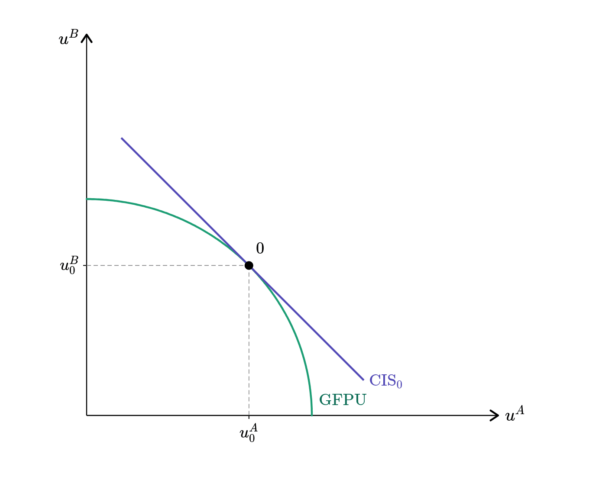
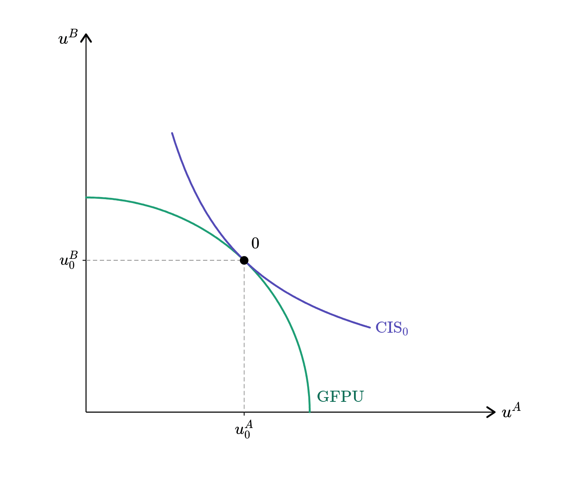
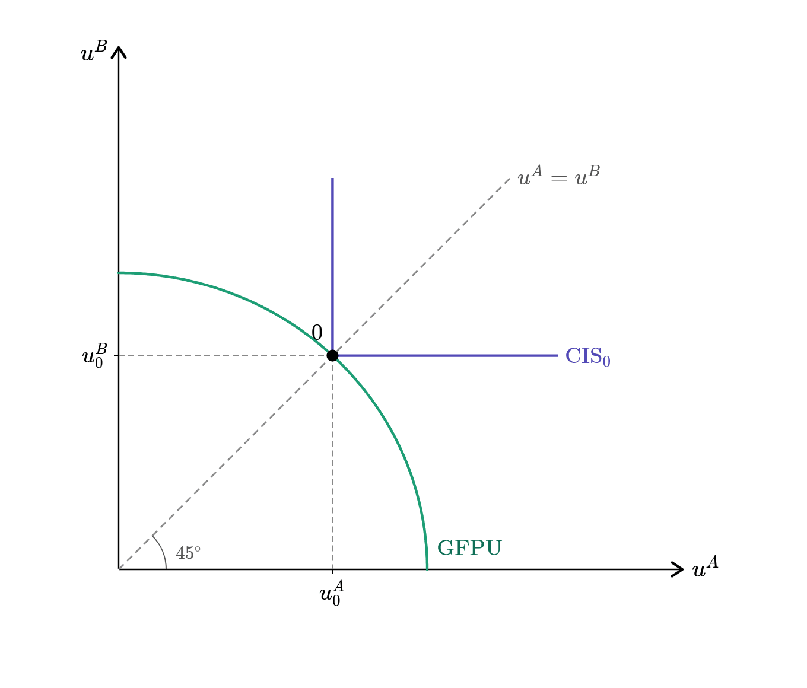
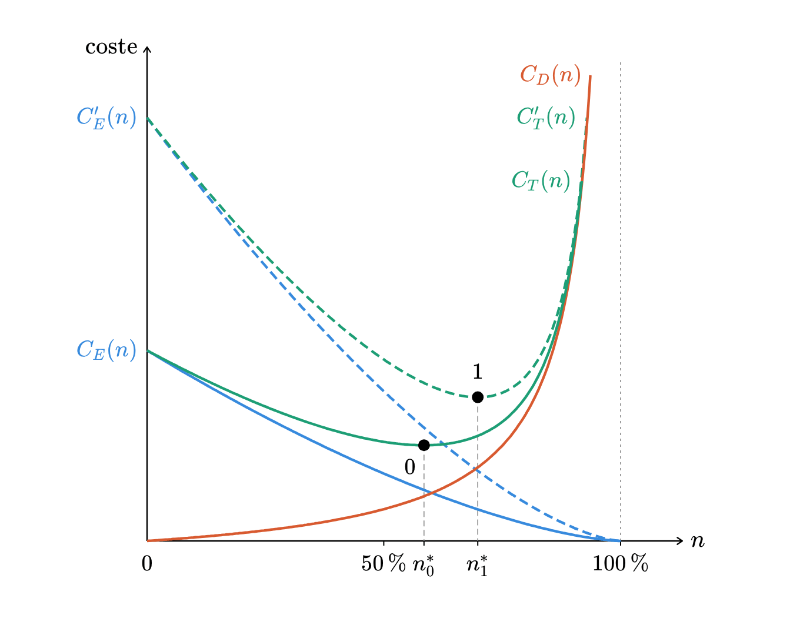
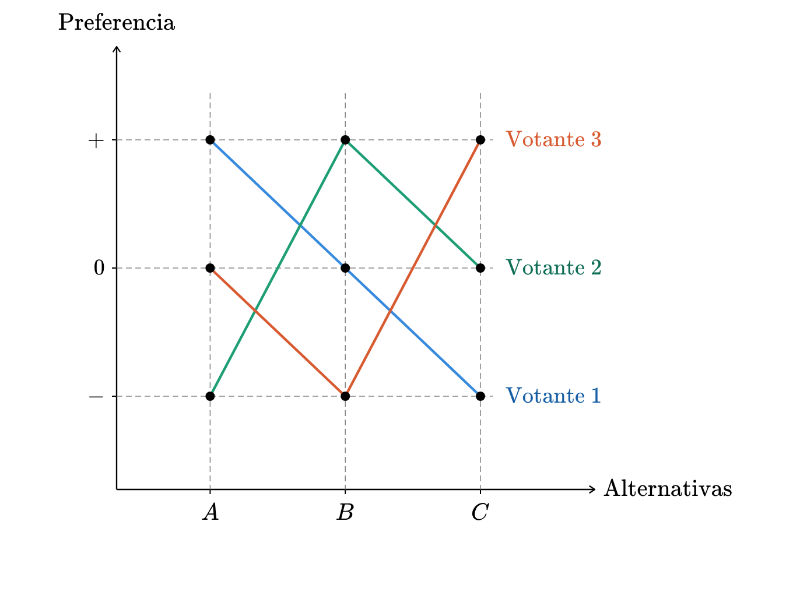
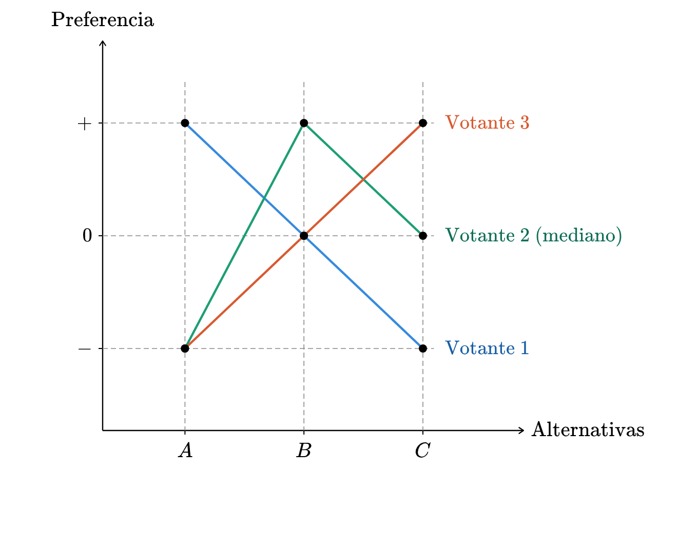

## Introducción

::: {.callout-note appearance="simple" icon=false}

:::

El criterio de Pareto solo da una ordenación incompleta, porque admite infinitos óptimos que no se pueden comparar entre sí (tema [A22](a22-eb-i.qmd)). La economía del bienestar respondió a esa indeterminación por dos vías, los criterios de compensación (véase [A22](a22-eb-i.qmd)) y la función de bienestar social. A su vez, construir esta última a partir de las preferencias de cada individuo obliga a preguntarse por las reglas de elección colectiva.

Bergson (1938) y Samuelson (1947) propusieron la función de bienestar social como forma de ordenar los estados sociales a partir de juicios de valor explícitos. Arrow (1951b) mostró después que ninguna regla de elección social que cumpla unos pocos axiomas razonables puede agregar las preferencias individuales en una ordenación social coherente salvo que sea dictatorial, el **teorema de la imposibilidad**. El resultado abrió una amplia literatura sobre reglas de votación, como la mayoría simple y sus paradojas, descritas ya por Condorcet en el siglo XVIII, o el teorema del votante mediano.

La salida más fecunda a la imposibilidad fue ampliar la información que se usa para juzgar el bienestar. Rawls (1971) propuso el criterio **maximín**, que juzga una sociedad por la situación de quien está peor, y Sen defendió que la justicia distributiva debe atender a lo que las personas pueden hacer y ser, sus capacidades, y no solo a su utilidad o a su renta. Arrow (1972) y Sen (1998) recibieron el Premio Nobel, y sus trabajos sostienen hoy la medición de la desigualdad y la pobreza con índices como el de Gini o el de Atkinson. Por su parte, la teoría de la implementación, por la que Hurwicz, Maskin y Myerson recibieron el Nobel en 2007, estudia qué resultados sociales pueden alcanzarse con mecanismos en los que a nadie le conviene mentir.

Este tema se ocupa de:

- *Función de bienestar social* (FBS): sus formas (utilitarista, Bernoulli-Nash, rawlsiana, Atkinson), los enfoques no bienestaristas (Sen, Foley-Varian) y la medición de la desigualdad y la pobreza.

- *Elección colectiva*: la regla de elección social, sus axiomas, el teorema de la imposibilidad de Arrow y el rechazo de su metodología (Little, Bergson).

- *Desarrollos posteriores*: las salidas a la imposibilidad, es decir, las reglas de votación que renuncian a algún axioma (unanimidad y mayorías, Condorcet, votante mediano, Downs-Hotelling, *log-rolling*, Borda), la ampliación de la base informacional, la manipulación y la implementación (Gibbard-Satterthwaite, Maskin) y la negociación (Nash, núcleo y valor de Shapley).

## 1. La función de bienestar social

Que la teoría del consumidor prescindiera de la utilidad cardinal no resolvía la indeterminación social. Puede demostrarse que ordenar los estados de forma completa, transitiva y reflexiva según preferencias sociales obliga a sopesar lo que ganan unos frente a lo que pierden otros. La economía del bienestar no podía, por tanto, eludir las comparaciones interpersonales de utilidades individuales[^a24-2].

### 1.1. Criterio original (Bergson, 1938; Samuelson, 1947)

**Origen**: Abram Bergson (1938) introdujo la *función de bienestar social* como la forma de hacer explícitas las disyuntivas entre individuos. Paul Samuelson (1947) incorporó la función al núcleo de la economía del bienestar, sin comprometerse con una forma concreta.

**Idea**: la función de bienestar social representa un código de valores colectivos y permite determinar, entre los infinitos óptimos de Pareto, cuál maximiza el bienestar social.

#### 1.1.1. Definición y propiedades

**Definición**: formalmente, la FBS es una función definida sobre el espacio de utilidades de los $H$ individuos de la sociedad, $W = W(\mathbf{u})$ con $\mathbf{u} = (u^1, \ldots, u^H)$[^a24-3], que refleja las preferencias sociales.

**Propiedades**:

1. *Continuidad y diferenciabilidad*: es continua en las utilidades individuales, lo que garantiza la existencia de un máximo sobre un conjunto de posibilidades cerrado y acotado. Cuando además es diferenciable, ese máximo se caracteriza mediante condiciones de primer orden, lo que no ocurre con la *maximin*, que no es diferenciable en el vértice.

2. *Transformaciones*: exige que las utilidades individuales sean comparables entre personas, y el grado de comparabilidad decide qué formas son admisibles. Así, la utilitarista requiere utilidades cardinales con unidades comparables, y la *maximin*, solo niveles comparables (apartado 3.3). De la agregación de las utilidades individuales surge una función de bienestar social ordinal, que permite ordenar socialmente estados o asignaciones alternativos. Por ello, cualquier transformación monótona creciente de $W$ representa los mismos valores colectivos.

3. *Inclinación*: es creciente en la utilidad de cada individuo, $\partial W / \partial u^h > 0 \;\; \forall h = 1, \ldots, H$ (benevolencia), de modo que las mejoras paretianas aumentan el bienestar social. La *maximin*, en cambio, solo es no decreciente, pues únicamente crece con la utilidad del peor situado, y una mejora paretiana que no llegue al peor situado deja igual el bienestar social.

4. *Forma*: si la aversión a la desigualdad se considera deseable, es cuasicóncava en las utilidades individuales, es decir, sus curvas de indiferencia social son convexas. A diferencia de la concavidad, la cuasiconcavidad se conserva ante las transformaciones monótonas crecientes del punto 2. Junto con la simetría (punto 5), ello implica que una distribución más igualitaria de las utilidades nunca es peor que otra menos igualitaria con la misma suma, y es estrictamente preferida si la cuasiconcavidad es estricta.

5. *Otras propiedades*:

    - *Simetría*: si el anonimato o la imparcialidad se consideran deseables, la FBS es simétrica, de modo que intercambiar las utilidades de dos individuos no altera el bienestar social.

Además de estas propiedades, la FBS hereda las de los criterios de Pareto (tema [A22](a22-eb-i.qmd))[^a24-4]:

- *Independencia del proceso*: su dominio es el conjunto de asignaciones, de modo que no importa cómo se alcanzan.

- *Individualismo*: depende en última instancia de las cestas que consumen los individuos.

- *No paternalismo*: solo importan las utilidades individuales, porque la FBS es una función compuesta de las $u^h$, sin preferencias propias del planificador[^a24-5].

- *Benevolencia*: ya recogida en la inclinación (punto 3).

#### 1.1.2. Razonamiento

Gráficamente, en el plano de utilidades, las curvas de nivel de la FBS son las **curvas de indiferencia social** (CIS), y sobre cada una el bienestar social es el mismo aunque varíe el reparto de utilidades. Son continuas y decrecientes, por la inclinación de la función, y su curvatura refleja el grado de aversión a la desigualdad de la sociedad. En la función original de Bergson-Samuelson son débilmente convexas y sin forma uniforme. Así, la tasa a la que la sociedad sacrifica el bienestar de unos por el de otros decrece conforme la distribución se hace más desigual a favor de estos otros, pero no a un ritmo fijo.

La FBS permite utilizar la gran frontera de posibilidades de utilidad (GFPU) como restricción y determinar el **punto de felicidad** u *optimum optimorum*, punto de tangencia entre la CIS más alejada del origen y la GFPU (figura -@fig-a247-gfpu). Este punto maximiza el bienestar social y muestra que la eficiencia paretiana es condición necesaria pero no suficiente de la optimalidad social, ya que puntos ineficientes, situados dentro de la frontera, pueden generar mayor bienestar social que algunos puntos eficientes situados sobre ella. 

El punto de felicidad determina la asignación Pareto-óptima que lo genera (tema [A22](a22-eb-i.qmd), apartado 1.2.3).

::: {#fig-a247-gfpu}

::: {.content-visible when-format="html"}
```{=html}
<div class="graph-frame">
<iframe src="../graphs/a247_GFPU.html" style="height:620px" loading="lazy" title="fig-a247-gfpu"></iframe>
</div>
```
:::

::: {.content-visible unless-format="html"}

:::

Gran frontera de posibilidades de utilidad y punto de felicidad. En el plano de utilidades $(u^A, u^B)$, la GFPU es la envolvente de las fronteras de posibilidades de utilidad, como $\text{FPU}_0$, $\text{FPU}_1$ y $\text{FPU}_2$. El punto de felicidad u *optimum optimorum* (punto 0) es su tangencia con la curva de indiferencia social más alejada del origen, $W_0$.
:::

#### 1.1.3. Conclusiones

**Aspectos positivos**: la FBS resuelve la indeterminación paretiana con el único instrumento que puede hacerlo, un juicio de valor explícito sobre la distribución, y lo hace de forma transparente (quien discrepe del óptimo social puede señalar qué valores de la función rechaza). Convierte así el problema de la elección entre óptimos en un problema de maximización con restricciones, tratable con las mismas herramientas que el resto de la teoría, y da fundamento a las políticas redistributivas siempre que eleven el bienestar social así definido.

**Limitaciones**: la generalidad del criterio original es su virtud y su límite, puesto que admite cualquier juicio distributivo, pero no dice cuál adoptar, de modo que no existe un método para construir la FBS y su existencia se postula axiomáticamente. El punto de felicidad refleja, en consecuencia, los valores del planificador que la especifica, y la forma funcional que se suponga determina el resultado.

### 1.2. Formas de la FBS: criterios ético-lógicos

La forma de la FBS refleja los valores éticos subyacentes de la sociedad y determina la curvatura de las CIS. Los criterios que siguen son formas de una misma función de bienestar social que pueden ordenarse por su aversión a la desigualdad, que es nula en el utilitarismo, intermedia en el criterio de Bernoulli-Nash e infinita en el *maximin* rawlsiano. La familia de Atkinson los reúne en una única expresión con un parámetro.

#### 1.2.1. Criterio utilitarista (Bentham; Harsanyi, 1955)

**Origen**: el criterio procede del utilitarismo de Jeremy Bentham y recibió su justificación moderna de John Harsanyi (1955).

**Idea**: el bienestar social es la suma de las utilidades individuales, de modo que solo importa el total, no su reparto.

Harsanyi justifica esta forma en un contexto de utilidad esperada. El “velo de la ignorancia” impide a los individuos saber qué lugar ocuparán en la sociedad. Tras él, un individuo racional, que maximiza la utilidad esperada de von Neumann-Morgenstern (neutral al riesgo en términos de utilidad, no de renta), elegiría la sociedad con mayor utilidad esperada. Con posiciones equiprobables, la utilidad esperada es la media de las utilidades, de donde se sigue el utilitarismo[^a24-6].

**Planteamiento**: la FBS es aditivamente separable, $W = \sum_h u^h(x^h)$, y se reparte entre los individuos una cantidad dada de un bien.

**CPO**: con solución interior y la restricción agotada, derivando el lagrangiano respecto a la cantidad que recibe cada individuo, el óptimo social es aquel en el que las utilidades marginales de ese bien se igualan, $du^A/dx^A = du^B/dx^B$. Si fueran distintas, trasladar una unidad de quien tiene menor utilidad marginal a quien la tiene mayor elevaría la suma, con independencia de quién esté mejor.

**CSO**: la concavidad de las utilidades individuales ($u''<0$) hace cóncava su suma, de modo que la igualación de utilidades marginales es un máximo. Con utilidades lineales, en cambio, el criterio conduce a una solución de esquina (o a la indeterminación, si las utilidades marginales coinciden).

**Desarrollo gráfico**: el criterio utilitarista se representa en el plano $u^A$-$u^B$ (figura -@fig-a243-fbs-utilitarista):

1. *Gran frontera de posibilidades de utilidad* ($\text{GFPU}$): recoge las combinaciones de utilidades alcanzables con asignaciones eficientes.

2. *Curva de indiferencia social* ($\text{CIS}_0$): une los repartos de igual bienestar y es una recta de pendiente $-1$, porque las utilidades no se ponderan.

3. *Óptimo social*: en el punto $0$, la $\text{CIS}_0$ es tangente a la GFPU, con utilidades $u_0^A$ y $u_0^B$.

::: {#fig-a243-fbs-utilitarista}

::: {.content-visible when-format="html"}
```{=html}
<div class="graph-frame">
<iframe src="../graphs/a243_FBS_utilitarista.html" style="height:580px" loading="lazy" title="fig-a243-fbs-utilitarista"></iframe>
</div>
```
:::

::: {.content-visible unless-format="html"}

:::

Criterio utilitarista. Las curvas de indiferencia social son rectas de pendiente $-1$ y el óptimo social es su tangencia con la GFPU.
:::

**Conclusiones**:

- *Aspectos positivos*: el criterio respeta el individualismo y el anonimato.

- *Limitaciones*: es indiferente a la distribución, pues maximiza la utilidad total aumentando la de quien tiene mayor utilidad marginal a costa de quien la tiene menor, de modo que el óptimo social es compatible con grandes desigualdades de utilidad.

#### 1.2.2. Criterio intermedio (Bernoulli; Nash, 1950)

**Origen**: el criterio intermedio se apoya en la función de bienestar social de Bernoulli-Nash, que agrega las utilidades individuales de forma multiplicativa (la solución de negociación de Nash, 1950, aplicada a la elección social).

**Idea**: el bienestar social es el producto de las utilidades individuales, y la sociedad valora tanto su nivel como su igualdad. La forma de la FBS de Bernoulli-Nash, sin parámetros, fija una curvatura que corresponde a una aversión a la desigualdad unitaria en la familia de Atkinson.

**Planteamiento**: la FBS es $W = \prod_h u^h(x^h)$, equivalente a la suma de logaritmos $W = \sum_h \ln u^h$, y se reparte entre los individuos una cantidad dada de un bien.

**CPO**: con solución interior y la restricción agotada, derivando el lagrangiano respecto a la cantidad que recibe cada individuo, el óptimo social iguala las utilidades marginales del bien divididas por la utilidad de cada individuo, $(du^A/dx^A)/u^A = (du^B/dx^B)/u^B$. El peso social de cada individuo es inversamente proporcional a su utilidad y, a diferencia del utilitarismo, la utilidad marginal de quien está peor pesa más.

**CSO**: con utilidades positivas y cóncavas, la suma de sus logaritmos es cóncava, por lo que la CPO caracteriza un máximo.

**Desarrollo gráfico**: el criterio intermedio se representa en el plano $u^A$-$u^B$ (figura -@fig-a245-fbs-bernoulli-nash):

1. *Gran frontera de posibilidades de utilidad* ($\text{GFPU}$): recoge las combinaciones de utilidades alcanzables con asignaciones eficientes.

2. *Curva de indiferencia social* ($\text{CIS}_0$): une los repartos de igual bienestar y su convexidad refleja una aversión intermedia a la desigualdad.

3. *Óptimo social*: en el punto $0$, la $\text{CIS}_0$ es tangente a la GFPU, con utilidades $u_0^A$ y $u_0^B$.

::: {#fig-a245-fbs-bernoulli-nash}

::: {.content-visible when-format="html"}
```{=html}
<div class="graph-frame">
<iframe src="../graphs/a245_FBS_Bernoulli_Nash.html" style="height:580px" loading="lazy" title="fig-a245-fbs-bernoulli-nash"></iframe>
</div>
```
:::

::: {.content-visible unless-format="html"}

:::

Criterio intermedio (Bernoulli-Nash). Las curvas de indiferencia social son convexas y el óptimo social es su tangencia con la GFPU.
:::

**Conclusiones**:

- *Aspectos positivos*: ofrece una forma sencilla de incorporar la aversión a la desigualdad sin llegar al extremo del *maximin*, y enlaza la elección social con la teoría de la negociación, pues coincide con la solución de Nash (apartado 3.5.1).

- *Limitaciones*: no permite graduar la aversión a la desigualdad, que queda fijada por la forma funcional, limitación que supera la familia de Atkinson. Además, exige que cada utilidad tenga un cero bien definido, pues el orden social cambia si se desplaza el origen de alguna de ellas.

#### 1.2.3. Criterio de *maximin* (Rawls, 1971)

**Origen**: John Rawls (*A Theory of Justice*, 1971) propuso, desde la filosofía política liberal, un criterio de justicia distributiva opuesto al utilitarista.

**Idea**: el bienestar social es el del miembro más desfavorecido, de modo que la sociedad debe maximizar la utilidad de quien peor está (*maximin*).

Tras el “velo de la ignorancia”, los individuos, a diferencia de los de Harsanyi, no atribuyen probabilidades a las posiciones, razonan según el *maximin* (como si tuvieran aversión infinita al riesgo) y acuerdan dos principios y una regla de prioridad:

- *Principio de libertad*: cada persona tiene derecho al conjunto más amplio de libertades básicas compatible con las mismas libertades para los demás.

- *Segundo principio*: las desigualdades económicas y sociales solo son legítimas si benefician al más desfavorecido (*principio de diferencia*) y van ligadas a cargos abiertos a todos en condiciones de igualdad equitativa de oportunidades.

- *Prioridad lexicográfica*: los principios se cumplen en orden. El primero ha de satisfacerse plenamente antes de que entre en juego el segundo, de modo que ninguna mejora del más desfavorecido justifica restringir las libertades básicas de nadie.

**Planteamiento**: la función de bienestar social es de tipo Leontief, $W = \min_h \{u^h(x^h)\}$.

**CPO**: la condición de óptimo exige $u^A = u^B$, de modo que el óptimo social es la igualdad absoluta de utilidades. No es una condición de primer orden en sentido estricto, pues la función no es diferenciable en el vértice.

**CSO**: el óptimo no procede de una tangencia sino de la restricción $u^A = u^B$, y su suficiencia se sigue de que $W$ es cuasicóncava (sus conjuntos de contorno superior son convexos).

**Desarrollo gráfico**: el criterio de *maximin* se representa en el plano $u^A$-$u^B$ (figura -@fig-a244-fbs-maximin):

1. *Gran frontera de posibilidades de utilidad* ($\text{GFPU}$): recoge las combinaciones de utilidades alcanzables con asignaciones eficientes.

2. *Curva de indiferencia social* ($\text{CIS}_0$): une los repartos de igual bienestar y tiene forma de L, con el vértice sobre la bisectriz ($u^A = u^B$).

3. *Óptimo social*: en el punto $0$, la GFPU corta a la bisectriz en el vértice de la $\text{CIS}_0$, con utilidades $u_0^A = u_0^B$.

::: {#fig-a244-fbs-maximin}

::: {.content-visible when-format="html"}
```{=html}
<div class="graph-frame">
<iframe src="../graphs/a244_FBS_maximin.html" style="height:580px" loading="lazy" title="fig-a244-fbs-maximin"></iframe>
</div>
```
:::

::: {.content-visible unless-format="html"}

:::

Criterio *maximin* (Rawls). Las curvas de indiferencia social tienen forma de ángulo recto con el vértice sobre la bisectriz, y el óptimo social se sitúa donde la GFPU corta a la bisectriz.
:::

**Conclusiones**:

- *Aspectos positivos*: el criterio es la principal inspiración del igualitarismo desde posiciones liberales.

- *Limitaciones*: equivale a una aversión infinita al riesgo tras el velo de la ignorancia, pues no admite ninguna mejora de la mayoría a costa de un empeoramiento, por pequeño que sea, del peor situado.

#### 1.2.4. La FBS como instrumento de medición: la familia de Atkinson (1970)

**Origen**: Anthony Atkinson (*On the Measurement of Inequality*, 1970) mostró que toda medida de desigualdad lleva implícita una función de bienestar social, y propuso hacerla explícita.

**Idea**: dada una FBS, la *renta equivalente igualmente distribuida*, $y_e$, es la renta que, repartida por igual entre todos, produciría el mismo bienestar social que la distribución real. Como la FBS es cóncava, $y_e$ no supera la renta media $\bar{y}$ (es estrictamente menor si hay desigualdad y $\varepsilon > 0$), y la diferencia mide cuánto bienestar se pierde por la desigualdad. El *índice de Atkinson* es esa pérdida en términos relativos:

$$A_\varepsilon = 1 - \frac{y_e}{\bar{y}}, \qquad y_e = \left[\frac{1}{H}\sum_h (y^h)^{1-\varepsilon}\right]^{1/(1-\varepsilon)}$$

donde $\varepsilon \geq 0$ es el parámetro de *aversión a la desigualdad* de la sociedad.

**Razonamiento**: cuanto mayor es $\varepsilon$, más bienestar se pierde por una misma desigualdad. Si se identifica la utilidad de cada individuo con su renta, la familia contiene los tres criterios anteriores como valores del parámetro:

- *Utilitarismo*: con $\varepsilon = 0$, $y_e = \bar{y}$, solo importa la suma de las rentas y $A_\varepsilon = 0$, con lo que la desigualdad no cuesta nada.

- *Criterio intermedio*: con $\varepsilon = 1$ la expresión tiende a la media geométrica de las rentas, que corresponde a la forma de Bernoulli-Nash, y $A_\varepsilon$ mide la distancia entre la media geométrica y la aritmética.

- *Maximin*: con $\varepsilon \rightarrow \infty$ solo importa el más pobre, $y_e$ tiende a $y_{\min}$ y $A_\varepsilon$ tiende a $1 - y_{\min}/\bar{y}$.

**Conclusiones**:

- *Aspectos positivos*: el índice convierte la FBS en un instrumento de medida y hace explícito que comparar distribuciones exige un juicio de valor. Además, a diferencia del índice de Gini, que implica una ponderación fija de las rentas, permite elegir cuánto pesa la desigualdad en la valoración social, y por ello es muy utilizado en la evaluación normativa de las políticas redistributivas.

- *Limitaciones*: hace explícito el juicio de valor, pero no lo resuelve, porque el valor de $\varepsilon$ ha de fijarse fuera del modelo y, si las curvas de Lorenz se cruzan, la ordenación de dos distribuciones puede invertirse según el parámetro elegido. Supone, además, una FBS aditiva y simétrica en la que la utilidad se identifica con la renta.

### 1.3. Más allá del bienestarismo

Los criterios anteriores comparten el supuesto bienestarista, según el cual el bienestar social depende solo de las utilidades. Sin embargo, dos aportaciones lo cuestionan, una desde la filosofía política y otra desde la teoría de la asignación.

#### 1.3.1. Criterio de las capacidades básicas (Sen, 1980)

**Origen**: Amartya Sen (*Equality of What?*, 1980) cuestionó el objeto mismo de la justicia distributiva.

**Idea**: el énfasis no debe estar en la distribución de bienes primarios, como en Rawls, ni en la satisfacción, como en los utilitaristas, sino en lo que las personas son capaces de *hacer y ser* con esos recursos. El enfoque de Sen se centra en las *capacidades*, el conjunto de funcionamientos (estar bien nutrido, sano, educado, participar en la vida social) que una persona puede alcanzar.

**Razonamiento**: dos personas con los mismos bienes pueden tener capacidades muy distintas, por diferencias físicas, sociales o de entorno, de modo que igualar los bienes no iguala las oportunidades reales. Además, dos personas con la misma satisfacción pueden tenerla en condiciones objetivas muy distintas, porque las preferencias se adaptan a las circunstancias. La FBS debe definirse, por tanto, sobre las capacidades y no sobre los bienes ni sobre las utilidades.

**Conclusiones**:

- *Aspectos positivos*: el enfoque es el fundamento del índice de desarrollo humano y de la medición multidimensional de la pobreza (tema [B28](b28-desarrollo.qmd)).

- *Limitaciones*: el enfoque tropieza con la imposibilidad de observar directamente las capacidades individuales, que obliga a aproximarlas mediante indicadores de funcionamientos.

#### 1.3.2. Equidad sin comparaciones interpersonales: las asignaciones sin envidia (Foley, 1967; Varian, 1974)

**Origen**: Duncan Foley (1967) y Hal Varian (1974) propusieron un criterio de equidad que, como el de Pareto, no requiere comparar utilidades entre personas.

**Idea**: una asignación es *sin envidia* si ningún individuo prefiere la cesta de otro a la suya propia, y es *justa* si es a la vez sin envidia y Pareto-eficiente. El criterio solo usa las preferencias de cada uno sobre las cestas, no su utilidad.

**Razonamiento**: con dotaciones iniciales iguales, el equilibrio competitivo produce una asignación justa en el sentido de Foley-Varian. Nadie envidia a nadie, porque todos han elegido con la misma renta, y la asignación es eficiente por el primer teorema. El equilibrio competitivo desde dotaciones iguales es, pues, la formalización del reparto igualitario seguido del intercambio libre.

**Conclusiones**:

- *Aspectos positivos*: el criterio muestra que equidad y eficiencia no son incompatibles si se parte de dotaciones iguales, lo que da contenido concreto al segundo teorema.

- *Limitaciones*: con producción y habilidades distintas la ausencia de envidia y la eficiencia pueden no ser alcanzables a la vez, pues el más productivo puede envidiar el ocio del menos productivo.

### 1.4. La medición de la desigualdad y la pobreza

Para comparar distribuciones reales de renta hace falta reducir cada una a un número, y todo número que lo haga lleva implícita una valoración social. Los instrumentos de medida de la desigualdad y la pobreza se estudian primero en la dimensión de la renta, terreno de las FBS, y después en varias dimensiones, terreno de las capacidades.

#### 1.4.1. Medición unidimensional de la desigualdad

**Origen**: los índices proceden de la estadística económica de principios del siglo XX (Lorenz, 1905; Gini, 1912) y fueron reinterpretados como funciones de bienestar social implícitas por Atkinson (1970).

**Idea**: la desigualdad de una distribución de renta $(y^1, \ldots, y^H)$ se resume en un número que mide cuánto se aleja de la igualdad perfecta. Los índices difieren en la información que usan y en la parte de la distribución a la que dan más peso.

**Razonamiento**: los instrumentos clásicos son cuatro:

- *Curva de Lorenz* (1905): representa la proporción acumulada de renta que recibe la proporción acumulada de población, ordenada de menor a mayor renta. Con $H$ individuos, cada punto de la curva es

    $$L\left(\frac{k}{H}\right) = \frac{\sum_{h=1}^{k} y^h}{\sum_{h=1}^{H} y^h}, \qquad k = 0, 1, \ldots, H$$

    donde las rentas están ordenadas de menor a mayor ($y^1 \leq y^2 \leq \cdots \leq y^H$), $k/H$ es la proporción de población que forman los $k$ individuos de menor renta y $L(k/H)$ es la proporción de la renta total que reciben. La curva une esos puntos desde $(0, 0)$ hasta $(1, 1)$ y nunca queda por encima de la bisectriz (figura -@fig-a248-lorenz).

    La igualdad perfecta corresponde a la bisectriz, en la que cada proporción de la población recibe la misma proporción de la renta, y cuanto más se aleja la curva de ella, mayor es la desigualdad. Si dos curvas no se cruzan, la más cercana a la bisectriz es inequívocamente más igualitaria y, si ambas distribuciones tienen la misma renta media, es preferida por cualquier FBS simétrica y cóncava. Atkinson (1970) probó el resultado para las FBS aditivamente separables, y Dasgupta, Sen y Starrett (1973) lo generalizaron. Si las curvas se cruzan, en cambio, la ordenación depende de la FBS elegida.

- *Índice de Gini* (1912): es el doble del área entre la curva de Lorenz y la bisectriz. Equivale a la mitad de la diferencia media entre las rentas de todos los pares de individuos, en proporción a la renta media:

    $$G = \frac{1}{2H^2\bar{y}}\sum_{h=1}^{H}\sum_{h'=1}^{H}\left|y^h - y^{h'}\right|, \qquad G \in [0, 1]$$

    donde $\left|y^h - y^{h'}\right|$ es la diferencia absoluta entre las rentas de los individuos $h$ y $h'$ y $\bar{y}$ es la renta media. El índice vale 0 con igualdad perfecta y $1 - 1/H$ si una persona lo recibe todo, valor que tiende a 1 cuando la población es grande.

    El índice de Gini es el más usado por su sencillez, pero es más sensible a las diferencias en el centro de la distribución que a las de las colas. Además, su FBS implícita pondera la renta de cada individuo según su posición en la ordenación (más cuanto más pobre), sin parámetro que la sociedad pueda elegir.

::: {#fig-a248-lorenz}

::: {.content-visible when-format="html"}
```{=html}
<div class="graph-frame">
<iframe src="../graphs/a248_Lorenz.html" style="height:620px" loading="lazy" title="fig-a248-lorenz"></iframe>
</div>
```
:::

::: {.content-visible unless-format="html"}

:::

Curva de Lorenz e índice de Gini. La curva de Lorenz, $L(p)$, da la proporción acumulada de renta que recibe la proporción acumulada de población, $p = k/H$, y va de $(0, 0)$ a $(1, 1)$ por debajo de la bisectriz de equidistribución. El índice de Gini es $G = A/(A + B)$, que equivale al doble del área $A$ entre ambas, porque $A + B = 1/2$.
:::

- *Índice de Theil* (1967): se basa en la entropía de la teoría de la información y compara la renta de cada individuo con la media:

    $$T = \frac{1}{H}\sum_{h=1}^{H}\frac{y^h}{\bar{y}}\ln\frac{y^h}{\bar{y}}, \qquad T \in [0, \ln H]$$

    donde $y^h/\bar{y}$ es la renta del individuo $h$ en proporción a la renta media. El índice vale 0 con igualdad perfecta y $\ln H$ si una persona lo recibe todo.

    Su propiedad distintiva es la *descomponibilidad*. Si la población se divide en $J$ grupos, la desigualdad total se separa exactamente en dos sumandos:

    $$T = \sum_{j=1}^{J} s_j T_j + \sum_{j=1}^{J} s_j \ln\frac{\bar{y}_j}{\bar{y}}$$

    donde $s_j$ es la proporción de la renta total que recibe el grupo $j$, $T_j$ es el índice de Theil dentro de ese grupo y $\bar{y}_j$ es su renta media. El primer sumando mide la desigualdad dentro de los grupos y el segundo, la desigualdad entre grupos, de modo que el índice permite atribuir la desigualdad a regiones, sexos o niveles educativos.

- *Índice de Atkinson* (1970): hace explícito el parámetro de aversión a la desigualdad.

**Conclusiones**:

- *Aspectos positivos*: los índices resumen cada distribución en un número comparable entre países y en el tiempo, y la dominancia de Lorenz permite ordenar distribuciones con igual renta media sin elegir una FBS concreta, pues la ordenación vale para todas las simétricas y cóncavas. El índice de Theil permite, además, atribuir la desigualdad a grupos de población.

- *Limitaciones*: la dominancia de Lorenz solo ordena parcialmente, pues cuando las curvas se cruzan el resultado depende del índice elegido, y el más usado, el de Gini, deja implícita la valoración que incorpora. Además, los índices se limitan a la renta y dejan fuera otras dimensiones del bienestar, que se abordan en el apartado 1.4.3.

#### 1.4.2. Medición de la pobreza (Sen, 1976)

**Origen**: Amartya Sen (1976) mostró que las medidas habituales de pobreza son insuficientes y propuso un índice axiomático.

**Idea**: medir la pobreza exige tres decisiones:

- *Umbral de pobreza*: fijar una *línea de pobreza* $z$, absoluta (un mínimo de subsistencia) o relativa (una fracción de la renta mediana, como el 60 % que usa la UE).

- *Tasa de incidencia*: contar a los pobres, lo que da la proporción de pobres en la población, $H_p$.

- *Brecha de pobreza*: medir cuánto les falta, es decir, la distancia media de los pobres a la línea. 

La tasa de incidencia, la medida más usada, ignora la intensidad de la pobreza y la desigualdad entre los pobres, de modo que una transferencia de un pobre a otro menos pobre que lo saque de la pobreza reduce la tasa de incidencia, aunque empeore al más pobre.

**Razonamiento**: Sen exigió a un índice de pobreza dos axiomas, la *monotonicidad* (una reducción de la renta de un pobre aumenta la pobreza) y la *transferencia* (una transferencia de un pobre a alguien más rico aumenta la pobreza). Para recoger la desigualdad entre los pobres, ponderó la brecha de cada uno según su puesto en la ordenación de rentas (más cuanto más pobre) y, con una normalización, obtuvo el índice

$$S = H_p\left[I + (1 - I)\,G_p\right]$$

donde $H_p$ es la tasa de incidencia, $I$ es la intensidad de la pobreza (la brecha media de los pobres en proporción a la línea $z$) y $G_p$ es el índice de Gini de las rentas de los pobres, que mide la desigualdad entre ellos.

El índice de Sen convierte la medición de la pobreza en un problema de bienestar social. Decidir cuánto pesan la distancia a la línea y la desigualdad entre los pobres reproduce, en el extremo inferior de la distribución, el debate de las FBS.

**Conclusiones**:

- *Aspectos positivos*: el enfoque axiomático corrige los defectos de la tasa de incidencia y de la brecha, pues reúne en un único índice la intensidad de la pobreza y la desigualdad entre los pobres. Además, abrió la vía a los índices posteriores, como la familia de Foster, Greer y Thorbecke (FGT).

- *Limitaciones*: el índice no es descomponible por subgrupos de población, de modo que la pobreza total no se obtiene como media ponderada de la de cada región o grupo, lo que motivó la familia FGT. Además, toma como dada la línea de pobreza, cuya fijación sigue siendo un juicio de valor previo.

#### 1.4.3. Medición multidimensional

**Origen**: la medición multidimensional nace del enfoque de las capacidades de Sen y de su aplicación por el Programa de las Naciones Unidas para el Desarrollo (PNUD, 1990) y por Alkire y Foster (2011).

**Idea**: si el bienestar depende de las capacidades y no solo de la renta, la pobreza y la desigualdad han de medirse en varias dimensiones a la vez, como la salud, la educación, la vivienda o el acceso a servicios.

**Razonamiento**: los principales instrumentos son tres:

- *Índice de desarrollo humano* (PNUD, 1990): inspirado en Sen, combina renta, esperanza de vida y educación en un único indicador por país.

- *Índice de pobreza multidimensional* (Alkire y Foster, 2011): identifica como pobre a quien sufre privación en un número mínimo de dimensiones y agrega la incidencia y la intensidad de las privaciones. Tiene la misma estructura que la familia de índices de pobreza FGT (Foster, Greer y Thorbecke, 1984).

- *Tasa de riesgo de pobreza o exclusión social* (AROPE): indicador de la UE que combina la pobreza relativa de renta con la privación material y social severa y la muy baja intensidad laboral del hogar.

**Conclusiones**:

- *Aspectos positivos*: la medición multidimensional hace operativo el enfoque de las capacidades.

- *Limitaciones*: lo hace al precio de dos decisiones adicionales, qué dimensiones incluir y cómo ponderarlas, que son juicios de valor tan explícitos como el parámetro de Atkinson (tema [B28](b28-desarrollo.qmd)).

### 1.5. Conclusiones

Elegir entre los óptimos de Pareto exige un juicio de valor explícito, que la FBS incorpora sin decir cuál adoptar. Sus formas difieren en cuánto penalizan la desigualdad, desde el utilitarismo, indiferente al reparto, hasta el *maximin*, y la familia de Atkinson las reúne en un único parámetro. Los enfoques de Sen y de Foley-Varian cuestionan, además, que el bienestar dependa solo de las utilidades, y todo índice de desigualdad o de pobreza lleva implícita una valoración social.

El óptimo social es, por tanto, una asignación tecnocrática, porque depende de una forma funcional que ningún método permite construir y que expresa un juicio de valor sobre el conflicto entre eficiencia y equidad. La sección 2 examina si los valores colectivos que expresa la FBS pueden obtenerse de las ordenaciones individuales mediante una regla.

## 2. Teoría de la elección colectiva: el teorema de Arrow

La función de bienestar social presupone que los valores colectivos están dados. La **teoría de la elección colectiva** se pregunta, en cambio, si esos valores pueden obtenerse de las preferencias de los individuos mediante un procedimiento que las respete. 

Conviene distinguir tres objetos:

- *Función de bienestar social* (Bergson-Samuelson): es una valoración que, dado un perfil de utilidades comparables entre personas, asigna un número a cada estado.

- *Regla de elección social* (RES): Arrow la denominó también función de bienestar social, y autores como Julio Segura, *constitución*. La regla es un procedimiento que asocia un orden social de preferencias a cada configuración posible de órdenes individuales, usando solo información ordinal. Este concepto es más amplio que la FBS, porque ha de funcionar para cualquier perfil y no solo para uno dado.

- *Función de elección social*: es más débil, pues no exige producir una ordenación completa, sino solo señalar, para cada conjunto de alternativas factibles, cuál o cuáles se eligen.

Arrow (1951b) busca una RES que respete unas exigencias mínimas de racionalidad y democracia, y el **teorema de la imposibilidad** concluye que no existe. Por ello, las salidas de la sección 3 consisten en relajar esos requisitos o en pasar al objeto más débil, la función de elección social.

### 2.1. La regla de elección social

**Conjunto de elección**: sea $\mathcal{C}$ el conjunto de *estados sociales* o asignaciones alternativas $\{A, B, C, \ldots\}$ entre los que la sociedad ha de elegir (p. ej. distribuciones de recursos, políticas, candidatos). Se supone que contiene al menos tres alternativas, pues con dos el problema es trivial.

**Preferencias individuales**: cada individuo $h = 1, \ldots, H$ tiene una ordenación de preferencias $R^h$ sobre $\mathcal{C}$, completa y transitiva como en la teoría del consumidor, pero puramente ordinal, de modo que dice qué prefiere, no cuánto, y no es comparable con la de los demás. Un *perfil* de preferencias es la lista de las ordenaciones de todos los individuos, $(R^1, \ldots, R^H)$.

**Regla de elección social**: es una función $f$ que asocia a cada perfil de preferencias individuales una ordenación social $R = f(R^1, \ldots, R^H)$, también completa y transitiva, que dice cómo ordena la sociedad los estados de $\mathcal{C}$. La regla de la mayoría, la unanimidad o la regla de Borda son reglas de este tipo, aunque no todas dan siempre una ordenación completa y transitiva (sección 3). 

### 2.2. Axiomas de Arrow

Para Arrow, una RES solo es racional y democrática si cumple cinco axiomas:

1. *Universalidad* (dominio no restringido): la RES ha de aplicarse a cualquier perfil de preferencias individuales (análogo a completitud).

2. *Unanimidad* (Pareto-optimalidad débil): si todos prefieren $A$ a $B$, la ordenación social debe situar $A$ por encima de $B$.

3. *Ausencia de dictadores*: ningún individuo puede determinar la elección social al margen del resto.

4. *Transitividad*: si $A \succ B$ y $B \succ C$, entonces $A \succ C$, lo que asegura la coherencia lógica de la ordenación social y evita los ciclos de la paradoja de Condorcet.

5. *Independencia de alternativas irrelevantes* (IAI): para ordenar socialmente $A$ y $B$ basta saber cómo ordena cada individuo $A$ y $B$, sin que importe dónde sitúa cada uno el resto de opciones[^a24-10]. Por ello, el axioma excluye la cardinalización de preferencias y evita la manipulación mediante la adición o supresión de alternativas.

### 2.3. Teorema de la imposibilidad (Arrow, 1951b)

**Origen**: Kenneth Arrow (*Social Choice and Individual Values*, 1951b) planteó si existe alguna regla que agregue las ordenaciones individuales en una ordenación social respetando las condiciones mínimas del apartado anterior.

**Idea**: con un número finito de individuos y tres alternativas o más, Arrow prueba que ninguna RES satisface a la vez los cinco axiomas.

**Razonamiento**: la demostración moderna (Sen, 1970a) se apoya en la noción de *conjunto decisivo*. Un grupo de individuos es decisivo sobre un par de alternativas si, cuando todos ellos prefieren una a la otra, la sociedad la prefiere, sea cual sea la opinión del resto.

El argumento tiene dos pasos:

1. *Expansión*: por el principio de Pareto, la sociedad entera es decisiva sobre todos los pares, de modo que existe al menos un conjunto decisivo. Después, por la independencia de alternativas irrelevantes, la universalidad del dominio, el principio de Pareto y la transitividad social, un conjunto decisivo sobre un par lo es sobre todos (lema de expansión). 

2. *Contracción*: todo conjunto decisivo con más de un miembro puede reducirse. Para ello, se divide en dos partes y se construye un perfil de preferencias sobre tres alternativas en el que, por transitividad de la ordenación social, una de las dos partes resulta decisiva por sí sola. 

Repitiendo la reducción se llega a un conjunto decisivo de un solo individuo, que es, por definición, un dictador. La demostración deja ver dónde actúa cada axioma. Así, la universalidad permite construir los perfiles necesarios, la independencia impide usar la intensidad de las preferencias para bloquear la expansión y la transitividad de la ordenación social obliga a contraer los conjuntos decisivos.

El teorema tiene dos implicaciones:

1. *Imposibilidad*: con solo ordenaciones individuales, sin intensidades ni comparaciones entre personas, ninguna regla cumple a la vez unas exigencias mínimas de coherencia y de respeto a lo que prefiere cada individuo.

2. *Precio de la RES*: elegir una RES obliga a abandonar como mínimo uno de los axiomas. Las salidas de la sección 3 son otras tantas formas de pagar ese precio.

#### 2.3.1. Extensión: la paradoja liberal (Sen, 1970b)

**Origen**: Amartya Sen (*The Impossibility of a Paretian Liberal*, 1970b) planteó la paradoja como una extensión del teorema de Arrow al problema de los derechos individuales.

**Idea**: para llegar a una imposibilidad basta con exigir a la regla de elección social dos condiciones aparentemente mínimas, el principio de Pareto débil y un *liberalismo mínimo*. Según este último, cada uno de dos individuos tiene al menos un par de alternativas sobre el que su preferencia personal es decisiva (los asuntos que pertenecen a su “esfera privada”, como qué leer o cómo vestir). 

**Razonamiento**: Sen demuestra que, con dominio universal, no existe ninguna regla que satisfaga simultáneamente Pareto y liberalismo mínimo, porque las preferencias *entrometidas* de cada individuo sobre la esfera del otro pueden generar una ordenación social cíclica. El ejemplo canónico es el de dos individuos, uno mojigato y otro lascivo, y un libro (*El amante de Lady Chatterley*) que uno de ellos puede leer o no.

La paradoja admite dos lecturas:

1. *Lectura formal*: el conflicto entre eficiencia y derechos individuales es lógico, no contingente. Solo se resuelve, por eso, restringiendo el dominio de las preferencias (excluyendo las entrometidas) o aceptando que los derechos no se representen como parte de la ordenación social sino como restricciones sobre el proceso de elección (Nozick, 1974).

2. *Lectura sustantiva*: el criterio de Pareto, aparentemente neutral, no lo es, porque su aplicación irrestricta puede exigir violar la esfera privada de los individuos. La paradoja introduce así en la economía del bienestar la cuestión de los derechos, que el enfoque de las capacidades de Sen (apartado 1.3.1) desarrollará después.

**Conclusiones**:

- *Aspectos positivos*: muestra que la imposibilidad aparece con exigencias más débiles que las de Arrow y que el principio de Pareto puede chocar con valores no bienestaristas, como la libertad personal. Con ello amplía la base de la economía del bienestar más allá de las utilidades.

- *Limitaciones*: el conflicto nace de las preferencias entrometidas sobre la esfera ajena, por lo que su relevancia práctica depende de cuánto pesen esas preferencias y es discutida. Además, la representación de los derechos como decisividad sobre pares de estados sociales se ha criticado por no recoger la idea habitual de libertad, que se refiere a lo que cada uno puede hacer y no a los estados que resultan.

#### 2.3.2. Conclusiones

**Aspectos positivos**: el teorema convierte en un resultado general, válido para cualquier regla y no solo para la mayoría simple, la incoherencia colectiva que Condorcet había mostrado con un ejemplo (apartado 3.1.2). Su método axiomático se extendió, además, a la manipulabilidad de las reglas y a su implementación (apartado 3.4).

**Limitaciones**: la independencia de alternativas irrelevantes excluye la intensidad de las preferencias, que la regla de Borda recoge de forma ordinal (apartado 3.2.2). El dominio universal obliga, además, a ordenar perfiles extremos, cuya exclusión permite a la mayoría simple producir una ordenación transitiva (apartado 3.1.3).

### 2.4. El rechazo de la metodología de Arrow (Little, 1952; Bergson, 1954)

**Origen**: Ian Little (1952) y Abram Bergson (1954) respondieron al teorema negando que el problema que resuelve sea el de la economía del bienestar.

**Idea**: ambos sostienen que el objeto de la economía del bienestar son los *juicios de bienestar social*, valoraciones que una persona formula sobre los estados alternativos, y no un procedimiento mecánico que agregue las preferencias de todos. Cada uno lo argumentó de un modo distinto:

- *Little*: objetó que la regla de Arrow funciona como un dispositivo que agrega valores y devuelve un resultado, sin garantía de que ese resultado exprese lo que la sociedad valora.

- *Bergson*: separó dos destinatarios posibles del consejo económico. A su juicio, la economía del bienestar asesora al individuo, mientras que la regla de Arrow asesora al funcionario, pues indica a quien representa a la colectividad qué debe decidir.

**Razonamiento**: el valor de la crítica está en separar dos fases de la decisión democrática. En la *deliberativa* cada individuo forma y expresa sus juicios de valor, y en la *decisiva* esos juicios se agregan en una decisión. La función de bienestar social corresponde a la primera fase y la regla de elección social de Arrow, a la segunda. Por su parte, Arrow admitió tanto la distinción como que su teoría ofrece a la sociedad un mecanismo de decisión, y no una guía para el individuo. Aun así, replicó que el problema central de la economía del bienestar es justamente ese, determinar qué acciones o políticas conviene que adopte la sociedad en su conjunto.

**Conclusiones**:

- *Aspectos positivos*: el debate fija el alcance del teorema, que se refiere a la fase decisiva y no a la formación de los juicios.

- *Limitaciones*: no desactiva el teorema, pues cualquier sociedad que decida colectivamente necesita una regla, y a ella se aplica la imposibilidad.

### 2.5. Conclusiones

Los valores colectivos que la FBS daba por supuestos no pueden obtenerse de ordenaciones individuales ordinales y no comparables mediante una regla que cumpla a la vez los cinco axiomas de Arrow. La paradoja liberal de Sen llega a otra imposibilidad con menos requisitos y muestra que el criterio de Pareto no es neutral frente a los derechos individuales.

El teorema dio origen a la teoría de la elección social. La réplica de Little y Bergson fija su alcance en la fase decisiva, sin desactivarlo, y las salidas que la teoría ha explorado desde entonces se estudian en la sección 3.

## 3. Desarrollos posteriores: las salidas a la imposibilidad

Las salidas al teorema de Arrow son de cuatro tipos. En primer lugar, las reglas de votación, que son las que las sociedades usan, renuncian a alguno de los axiomas de Arrow. Varias son muy anteriores a Arrow, como las de Borda y Condorcet, pero su teorema permite leerlas como otras tantas formas de pagar el precio de la RES. En segundo lugar, la ampliación de la base informacional admite utilidades cardinales y comparables. En tercer lugar, la teoría de la manipulación y la implementación estudia las reglas cuando los agentes actúan estratégicamente y, finalmente, la negociación y los juegos cooperativos sustituyen la agregación de preferencias por el acuerdo entre las partes.

### 3.1. El levantamiento de los axiomas de Arrow (I): decisividad y universalidad

El orden de exposición de las reglas de votación sigue el axioma que cada una levanta:

- *Unanimidad y mayorías cualificadas*: renuncian a decidir siempre, es decir, a la completitud de la ordenación social que exige la definición de RES.

- *Mayoría simple*: renuncia a la universalidad.

- *Intercambio de votos y regla de Borda*: renuncian a la independencia de alternativas irrelevantes.

#### 3.1.1. Renuncia a la decisividad: unanimidad, mayorías cualificadas y mayoría óptima (Wicksell, 1896; Buchanan y Tullock, 1962)

**Origen**: la unanimidad fue propuesta como regla de decisión fiscal por Knut Wicksell (1896), como la única que garantiza que nadie resulte perjudicado por una decisión colectiva. James Buchanan y Gordon Tullock (*The Calculus of Consent*, 1962) generalizaron el problema preguntándose qué mayoría conviene exigir en cada decisión, y con ello fundaron la teoría económica de las constituciones.

**Idea**: decidir en grupo siempre cuesta algo, y la mayoría que conviene exigir es la que hace mínimo ese coste. La *mayoría óptima* sale del equilibrio entre dos costes que se mueven en sentidos opuestos:

- *Costes internos o de decisión*: los de llegar a un acuerdo (negociación, tiempo, riesgo de bloqueo). Aumentan a medida que se pide un porcentaje de votos mayor y, si se exige unanimidad, tienden a infinito, porque cualquier votante puede vetar la decisión.

- *Costes externos*: los que soportan quienes salen perjudicados por la decisión. Se reducen cuanto más amplia es la mayoría exigida y, con unanimidad, tienden a cero, porque nadie dará su voto a algo que le perjudica.

**Razonamiento**: sumados, los dos costes dibujan una U en función de la mayoría exigida, y el fondo de esa U marca la mayoría óptima.

Las reglas observadas en la práctica se sitúan a lo largo de esa curva:

- *Unanimidad* (Wicksell): exige el 100 % de votos. La unanimidad es una regla paretiana que exige pocos juicios de valor, pero tiene costes de decisión prohibitivos.

- *Mayoría cualificada*: exige un porcentaje fijado de antemano, entre el 50 y el 100 %.

- *Mayoría absoluta*: precisa el voto favorable de más de la mitad de los miembros.

- *Mayoría simple*: precisa más votos a favor que en contra.

*Ejemplos*: las organizaciones internacionales y los Estados asignan cada regla a un tipo de decisión distinto:

- *Unanimidad*: el Consejo de la UE la exige en fiscalidad, política exterior y de seguridad común y recursos propios, y la reforma de los Tratados requiere también la unanimidad del Consejo Europeo o de la conferencia intergubernamental (tema [B36](b36-tratados.qmd)). En la OMC rige, además, la práctica del consenso (tema [B33](b33-omc-gatt.qmd)).

- *Mayoría cualificada*: el FMI exige tres quintos de los miembros que reúnan el 85 % del poder de voto para reformar el convenio constitutivo, umbral que otorga a EE. UU. un veto de hecho (tema [B22](b22-fmi.qmd)). La OMC exige dos tercios de los miembros para admitir otros nuevos y tres cuartos para las exenciones. El Consejo de la UE aplica la doble mayoría del 55 % de los Estados que representen el 65 % de la población (tema [B36](b36-tratados.qmd)), y el Consejo de Seguridad de la ONU, nueve de quince votos sin veto de un miembro permanente.

- *Mayoría absoluta*: el Parlamento Europeo la aplica para elegir al presidente de la Comisión Europea (art. 17.7 del Tratado de la Unión Europea).

- *Mayoría simple*: el Consejo de Gobierno del BCE la aplica en sus decisiones ordinarias (tema [B43](b43-politica-monetaria-ue.qmd)).

Al encarecer la decisión, la unanimidad y las mayorías muy amplias favorecen que nada cambie (*statu quo*), y con unanimidad basta un voto en contra para frenar lo que el resto quiere (*tiranía de la minoría*).

**Desarrollo gráfico**: la mayoría óptima se representa en el plano porcentaje de votos-coste (figura -@fig-a246-mayoria-optima):

1. *Costes de decisión* ($C_D(n)$): crecen con el porcentaje de votos exigido, $n$, y tienden a infinito al acercarse a la unanimidad.

2. *Costes externos* ($C_E(n)$): decrecen con la mayoría requerida y se anulan con la unanimidad.

3. *Costes totales* ($C_T(n)$): son la suma vertical de ambos y tienen forma de U.

4. *Óptimo*: la mayoría óptima, $n_0^*$, es el mínimo de $C_T(n)$ (punto $0$).

::: {#fig-a246-mayoria-optima}

::: {.content-visible when-format="html"}
```{=html}
<div class="graph-frame">
<iframe src="../graphs/a246_Mayoria_optima.html" style="height:540px" loading="lazy" title="fig-a246-mayoria-optima"></iframe>
</div>
```
:::

::: {.content-visible unless-format="html"}

:::

Mayoría óptima (Buchanan y Tullock, 1962). Los costes de decisión crecen y los costes externos decrecen con la mayoría exigida. La mayoría óptima minimiza su suma y es mayor cuanto mayores son los costes externos potenciales (trazo discontinuo).
:::

**Estática comparativa**: la mayoría óptima varía con cada decisión.

- *Costes externos altos*: la mayoría óptima crece con los costes externos potenciales (decisiones que afectan a derechos fundamentales, reformas constitucionales). En la figura, los costes externos pasan a $C_E'(n)$, los totales a $C_T'(n)$ y el óptimo pasa del punto $0$ al punto $1$, de $n_0^*$ a $n_1^*$.

- *Costes de decisión altos*: la mayoría óptima disminuye cuando crecen los costes de decisión (decisiones frecuentes y de bajo alcance).

**Extensiones**: el *teorema de May* (Kenneth May, 1952) establece que, con dos alternativas, la regla de la mayoría simple es la única regla de decisión que cumple cuatro propiedades: decisividad (siempre produce un resultado), anonimato (todos los votantes cuentan igual), neutralidad (todas las alternativas se tratan igual) y respuesta positiva (si una alternativa gana o empata y un votante cambia a su favor, gana). El teorema explica la posición privilegiada de la mayoría simple entre las reglas de votación, y también sus límites, puesto que sus problemas aparecen precisamente cuando hay más de dos alternativas.

**Conclusiones**:

- *Aspectos positivos*: ofrece un criterio para elegir la regla de decisión según lo que está en juego en cada caso y explica la coexistencia de mayorías distintas en una misma constitución. Además, la unanimidad wickselliana proporciona una referencia paretiana con la que valorar las demás reglas.

- *Limitaciones*: los costes de decisión y los costes externos son difíciles de medir, por lo que la mayoría óptima es una guía cualitativa más que una regla aplicable. Además, trata cada decisión como la aprobación o el rechazo de una propuesta, sin considerar los ciclos y el comportamiento estratégico que aparecen cuando hay más alternativas.

#### 3.1.2. La mayoría simple: la paradoja de Condorcet (1785)

**Origen**: el marqués de Condorcet (1785) fue el primero en advertir que la votación por mayoría puede generar preferencias colectivas cíclicas.

**Idea**: la regla de la mayoría simple, aplicada por pares de alternativas, puede producir una ordenación social intransitiva aunque todas las ordenaciones individuales sean transitivas, de modo que la sociedad prefiere $A$ a $B$, $B$ a $C$ y $C$ a $A$.

**Razonamiento**: supónganse tres votantes (1, 2, 3), tres alternativas unidimensionales ($A$, $B$, $C$) y la decisión por votación entre pares. Las preferencias son $A \succ B \succ C$ para el votante 1 y $B \succ C \succ A$ para el 2, ambas con una sola moda, y $C \succ A \succ B$ para el 3, con dos modas.

Los votantes 1 y 3 hacen ganar a $A$ en el duelo $A$-$B$, y los votantes 1 y 2 dan la victoria a $B$ en el duelo $B$-$C$. La transitividad exigiría entonces que $A$ venciera a $C$, pero en el duelo $A$-$C$ los votantes 2 y 3 eligen $C$.

Con una ordenación social intransitiva, la mayoría simple no tiene equilibrio, pues toda alternativa pierde frente a alguna otra, de modo que las votaciones por pares podrían repetirse sin fin.

Las soluciones posibles son tres:

- *Preferencias idénticas*: el problema de agregación desaparece y ninguna regla es necesaria.

- *Exclusión de las alternativas ya votadas*: pone fin al proceso, pero da pie a la *manipulación de la agenda*. Gana siempre la alternativa que entra en la última votación, de modo que el orden en que se vota determina el resultado.

- *Preferencias unimodales*: exigirlas supone renunciar a la universalidad y conduce al teorema del votante mediano.

**Desarrollo gráfico**: la paradoja de Condorcet se representa en el plano alternativas-preferencia (figura -@fig-a241-voto-i):

1. *Votante 1*: ordena $A \succ B \succ C$, con un único máximo, en $A$.

2. *Votante 2*: ordena $B \succ C \succ A$, con un único máximo, en $B$.

3. *Votante 3*: ordena $C \succ A \succ B$, con dos máximos relativos, en $A$ y en $C$.

4. *Equilibrio*: no existe, pues las votaciones por pares forman un ciclo en el que $A$ vence a $B$, $B$ a $C$ y $C$ a $A$.

::: {#fig-a241-voto-i}

::: {.content-visible when-format="html"}
```{=html}
<div class="graph-frame">
<iframe src="../graphs/a241_Voto_i.html" style="height:560px" loading="lazy" title="fig-a241-voto-i"></iframe>
</div>
```
:::

::: {.content-visible unless-format="html"}

:::

Ciclos en la votación por mayoría simple (paradoja de Condorcet).
:::

**Conclusiones**:

- *Aspectos positivos*: con un ejemplo mínimo separa la racionalidad individual de la colectiva, pues preferencias individuales coherentes pueden dar lugar a una decisión colectiva incoherente. La paradoja anticipa también el teorema de Arrow y abre el análisis de la manipulación de la agenda y del voto estratégico.

- *Limitaciones*: es un resultado de posibilidad y no de frecuencia, pues los ciclos solo aparecen con determinados perfiles de preferencias. Su relevancia práctica depende, por tanto, de la distribución de las preferencias, y desaparece cuando estas son unimodales.

#### 3.1.3. Renuncia a la universalidad: preferencias unimodales y teorema del votante mediano (Black, 1948)

**Origen**: Duncan Black (1948) mostró que la paradoja de Condorcet desaparece si las preferencias tienen una estructura particular, y con ello fundó la teoría moderna de la votación.

**Idea**: con un número impar de votantes y preferencias *unimodales* en todos ellos (un solo máximo), la mayoría simple genera una ordenación colectiva transitiva y elige una única alternativa.

El precio es la universalidad, aunque es un precio moderado, porque lo único que se descarta son perfiles extremistas. Por ejemplo, quien prefiere ante todo mucho gasto público difícilmente pondrá el gasto nulo por delante del gasto medio[^a24-11]. Por ello, se considera preferible perder universalidad a perder transitividad.

**Razonamiento**: según el *teorema del votante mediano*, si las alternativas se ordenan en una sola dimensión y las preferencias son unimodales, la mayoría elige el óptimo del *votante mediano*, el que deja a cada lado el mismo número de votantes. Cualquier alternativa situada a la izquierda de su óptimo es derrotada por este con los votos del mediano y de todos los situados a su derecha, y simétricamente para las de la derecha. El óptimo del mediano es, así, un ganador de Condorcet.

**Desarrollo gráfico**: el teorema del votante mediano se representa en el plano alternativas-preferencia (figura -@fig-a242-voto-ii):

1. *Votante 1*: ordena $A \succ B \succ C$, con un único máximo, en $A$.

2. *Votante 2 (mediano)*: ordena $B \succ C \succ A$, con un único máximo, en $B$.

3. *Votante 3*: ordena $C \succ B \succ A$, con un único máximo, en $C$.

4. *Equilibrio*: gana $B$, la alternativa preferida por el votante mediano, que vence a $A$ con los votos de 2 y 3 y a $C$ con los de 1 y 2.

::: {#fig-a242-voto-ii}

::: {.content-visible when-format="html"}
```{=html}
<div class="graph-frame">
<iframe src="../graphs/a242_Voto_ii.html" style="height:560px" loading="lazy" title="fig-a242-voto-ii"></iframe>
</div>
```
:::

::: {.content-visible unless-format="html"}

:::

Preferencias unimodales y teorema del votante mediano (Black, 1948).
:::

**Conclusiones**:

- *Aspectos positivos*: el teorema explica la convergencia de los partidos hacia el centro y es el fundamento del modelo de Downs.

- *Limitaciones*: la valoración marginal del mediano y la de la sociedad pueden diferir. En la provisión de bienes públicos, por ejemplo, la condición de Samuelson exige $\sum \text{RMS} = \text{RMT}$, pero la mayoría simple iguala la valoración marginal del mediano a la parte del coste marginal que le corresponde pagar ($\text{RMT}/H$ con un reparto igualitario del coste). El resultado solo es eficiente, por tanto, si la valoración del mediano coincide con la media, y en otro caso hay infraprovisión o sobreprovisión.

#### 3.1.4. Aplicación a la democracia representativa: el modelo de Downs-Hotelling (1957)

**Origen**: Anthony Downs (1957) aplicó a la competencia electoral el modelo de localización de Hotelling (1929) del tema [A18](a18-competencia-monopolistica.qmd). En democracia representativa la decisión sigue una cadena de tres eslabones, en la que los ciudadanos eligen a los políticos, estos eligen los programas y los burócratas los aplican.

**Idea**: si compiten dos partidos y lo único que se vota es la posición ideológica, ambos se desplazan hacia el centro y acaban ofreciendo programas casi idénticos, ceñidos a lo que prefiere el votante mediano, y la política reproduce así el *principio de diferenciación mínima*.

**Supuestos**:

- *Entorno*: información perfecta, sistema bipartidista y una única dimensión de elección, la ideología.

- *Agentes*: los partidos son racionales y buscan maximizar el número de votos mediante la propuesta de programas. Los votantes son racionales, tienen preferencias unimodales sobre la ideología, difieren en ella, se distribuyen de forma homogénea a lo largo del espectro y votan al partido cuyo programa está más cerca de su posición.

**Razonamiento**: si el partido 1 propone un programa, el partido 2 puede proponer un programa más próximo al votante mediano y acaparar votantes. El partido 1, al darse cuenta, reacciona acercándose también al mediano. El proceso se repite hasta que ambos partidos proponen programas con ideologías iguales, o muy similares, a la del votante mediano.

**Equilibrio**: ambos partidos se sitúan en la posición del votante mediano. El equilibrio es de Nash, pues ninguno puede ganar votos desplazándose, y el programa elegido es el ganador de Condorcet, que no tiene por qué ser eficiente.

**Estática comparativa**: si las preferencias de los votantes se desplazan y, con ellas, la posición del votante mediano, ambos partidos desplazan sus programas en la misma dirección hasta la nueva posición mediana. Solo importa la posición del mediano, de modo que un cambio en las preferencias de los votantes extremos que no la altere no modifica el equilibrio.

**Conclusiones**:

- *Aspectos positivos*: ofrece una explicación realista de la convergencia de los programas hacia el centro en los países bipartidistas (EE. UU., Reino Unido), y conecta la teoría de la elección pública con la de la diferenciación de producto.

- *Limitaciones*: los resultados dependen estrechamente de los supuestos. Con más de dos partidos, por ejemplo, entran en juego el voto útil, las coaliciones y el extremismo, y el equilibrio de convergencia desaparece. Además, con información imperfecta surgen costes de información, que producen varios efectos:

    - *Partidos*: necesitan recursos para financiar sondeos y campañas, lo que aumenta el poder de los grupos de presión.

    - *Votantes*: han de invertir tiempo y dinero en averiguar qué partido representa mejor sus preferencias. De ello resultan la abstención racional (la probabilidad de que un voto altere la decisión es prácticamente nula), la persuasión por carisma en lugar de por programa, la ilusión fiscal (se vota según los impuestos percibidos y no la presión fiscal real) y la ilusión de deuda (los agentes perciben la deuda pública como riqueza neta, en contra de la equivalencia ricardiana)[^a24-13].

### 3.2. El levantamiento de los axiomas de Arrow (II): independencia de alternativas irrelevantes

En la votación por mayoría, un voto tibio pesa lo mismo que uno muy convencido. Al dejar fuera la **intensidad de las preferencias**, como exige la independencia de alternativas irrelevantes, la regla puede decidir de forma ineficiente. Las dos reglas siguientes sacrifican la IAI para dar entrada a esa intensidad, una a través de la negociación y otra puntuando la ordenación completa de cada votante.

#### 3.2.1. El intercambio de votos o *log-rolling* (Buchanan y Tullock, 1962)

**Origen**: la práctica es tan antigua como los parlamentos, pero su análisis económico se debe a Buchanan y Tullock (1962), que la presentaron como la vía por la que la intensidad de las preferencias entra en la decisión mayoritaria.

**Idea**: cuando cabe pactar antes de votar y aprobar una propuesta no impide aprobar otra, una minoría puede ganarse el apoyo de la mayoría con el *intercambio de votos*. Cada votante respalda la propuesta ajena a cambio de apoyo para la suya, y quien tiene mucho interés en algo lo consigue cediendo en lo que le importa poco (sistema de concesiones mutuas).

**Razonamiento**: entre tres votantes, el 1 es el único beneficiado por un proyecto de gasto y el 2 por otro, ambos pagados a partes iguales por los tres y con beneficios totales superiores a su coste. Votados por separado, los dos fracasan, porque el votante 3 se une en cada caso al que no gana nada. Lo eficiente, sin embargo, es realizarlos y compensar al votante 3. El pacto entre 1 y 2 permite aprobarlos, siempre que se voten juntos en un único paquete, pues, si se votaran uno tras otro, quien ya tuviera aprobado su proyecto no tendría motivo para cumplir con el otro.

**Conclusiones**:

- *Aspectos positivos*: da cabida a la intensidad de las preferencias en la votación por mayoría, de modo que pueden aprobarse proyectos socialmente beneficiosos que la mayoría simple rechazaría. Explica, además, una práctica habitual de los parlamentos, la de los paquetes legislativos y las concesiones mutuas entre grupos.

- *Limitaciones*: el intercambio de votos falla en tres frentes. Con muchos votantes, negociar sale demasiado caro y el mecanismo deja de funcionar. Además, la coalición ganadora no está obligada a compensar a los perdedores, de modo que la minoría puede salir explotada y la ganancia de eficiencia se paga con equidad. Por último, el intercambio de votos puede producir el error contrario, la sobreprovisión, cuando una coalición aprueba medidas que la favorecen aunque a la sociedad le cuesten más de lo que le aportan.

#### 3.2.2. El voto ponderado o regla de Borda (1770)

**Origen**: propuesta por Nicolás de Cusa (1433) y formalizada por Jean-Charles de Borda (1770), es la regla de votación por puntos más antigua y la alternativa clásica a la mayoría por pares.

**Idea**: con $n$ alternativas, la regla asigna a cada una $n$ puntos si es la más preferida por un votante, $n-1$ si es la segunda, y así sucesivamente, y elige la que más puntos acumula.

**Razonamiento**: a diferencia de la mayoría simple, tiene en cuenta la ordenación completa de cada votante y, con ello, una medida ordinal de la intensidad de las preferencias. Por ejemplo, una alternativa que es segunda para casi todos puede vencer a otra que es primera para una mayoría escasa y última para el resto. Al agregar posiciones en lugar de comparar pares, produce siempre una ordenación completa y transitiva y evita los ciclos de Condorcet, al precio de violar la IAI, pues la puntuación de una alternativa depende de cuántas otras haya y de dónde se sitúen.

**Conclusiones**:

- *Aspectos positivos*: al puntuar la ordenación completa de cada votante, favorece las alternativas de consenso, aceptables para casi todos, frente a las que solo prefiere intensamente una mayoría escasa. Garantiza, además, un resultado social sin ciclos y es sencilla de aplicar.

- *Limitaciones*: la regla tiene dos problemas. Los empates son más frecuentes y, además, cabe manipularla, ya que a un votante le puede convenir declarar un orden falso y relegar al último puesto a la principal rival de su opción favorita (voto estratégico). Esa manipulabilidad no es exclusiva de la regla de Borda.

### 3.3. La ampliación de la base informacional (Sen, 1970a; Harsanyi, 1955; d'Aspremont y Gevers, 1977)

**Origen**: Amartya Sen (*Collective Choice and Social Welfare*, 1970a) reinterpretó el teorema de Arrow como un resultado sobre la información que la regla de elección puede usar, es decir, las ordenaciones individuales, ordinales y no comparables entre personas.

**Idea**: si se admiten utilidades cardinales y comparables entre personas, la agregación deja de ser imposible y el problema pasa a ser cuál de las reglas posibles se elige, lo que cada supuesto informacional responde de manera distinta.

**Razonamiento**: tres resultados marcan el programa. El primero, el *teorema de agregación de Harsanyi* (1955), es distinto del argumento del velo de la ignorancia del apartado 1.2.1. Muestra que, si las preferencias individuales y las sociales cumplen los axiomas de la utilidad esperada y la regla social respeta el principio de Pareto, la FBS ha de ser una suma ponderada de utilidades, con pesos iguales si se exige además anonimato. El utilitarismo se deriva así de la racionalidad bajo incertidumbre, sin postularlo.

Los *teoremas de caracterización de d'Aspremont y Gevers* (1977) precisan qué regla corresponde a cada supuesto informacional:

- *Comparabilidad de niveles* (puede decirse quién está peor, no cuánto): los axiomas de Arrow más el anonimato y un axioma adicional de equidad (la equidad de Hammond, 1976) conducen al *leximin*, la versión lexicográfica del *maximin* de Rawls.

- *Comparabilidad de unidades* (puede decirse cuánto gana uno y cuánto pierde otro, no quién está mejor): los axiomas de Arrow más el anonimato conducen al utilitarismo.

- *Plena comparabilidad*: ambas reglas son posibles y la elección es un juicio de valor.

Por último, los *resultados de posibilidad de Sen* muestran que, incluso con información ordinal, restringir el dominio (preferencias unimodales, como en Black) o relajar la transitividad social a la cuasitransitividad permite reglas no dictatoriales, aunque a costa de oligarquías o de indecisión.

Distintos supuestos informacionales conducen, así, a distintas funciones de bienestar, y los criterios ético-lógicos del apartado 1.2 aparecen como consecuencias de la información que la sociedad acepta usar, y no como postulados.

**Conclusiones**:

- *Aspectos positivos*: sitúa la causa de la imposibilidad de Arrow en la escasez de información que admite la regla, recupera reglas no dictatoriales y da fundamento axiomático al utilitarismo y al *leximin* a partir de los supuestos sobre la información disponible.

- *Limitaciones*: traslada el problema a la justificación de las comparaciones interpersonales de utilidad, cuya medición carece de una base empírica aceptada. Además, los teoremas de caracterización necesitan axiomas adicionales, como la equidad de Hammond, cuya aceptación es en sí misma un juicio ético.

### 3.4. Manipulación e implementación

Las reglas anteriores suponen que los votantes declaran sus preferencias verdaderas. Cuando actúan estratégicamente, la pregunta pasa a ser qué reglas resisten la manipulación y qué reglas puede hacer funcionar un mecanismo bien diseñado.

#### 3.4.1. La manipulación: el teorema de Gibbard-Satterthwaite (1973)

**Origen**: Allan Gibbard (1973) y Mark Satterthwaite (1975) trasladaron el teorema de Arrow del problema de agregar preferencias al de diseñar reglas de votación que no puedan manipularse.

**Idea**: todo mecanismo de elección colectiva no dictatorial, definido para cualquier perfil de preferencias y con al menos tres alternativas que puedan resultar elegidas, es manipulable. Ser manipulable significa que existe siempre algún perfil de preferencias en el que a algún individuo le conviene declarar preferencias distintas de las verdaderas.

**Razonamiento**: el resultado se obtiene con axiomas aún más débiles que los de Arrow y es equivalente a su teorema. En ausencia de mecanismos correctores, hay perfiles en los que a los agentes les conviene el comportamiento estratégico, como muestran el voto útil, la manipulación de la regla de Borda o la ocultación de preferencias en la provisión de bienes públicos.

La salida pasa por restringir el dominio de las preferencias o por debilitar el concepto de equilibrio exigido. Por ejemplo, con preferencias cuasilineales y transferencias monetarias puede hacerse que decir la verdad sea la estrategia dominante, imponiendo a cada agente un pago igual al coste que su declaración impone a los demás, que es la lógica del mecanismo de Clarke-Groves-Vickrey (tema [A23](a23-eb-ii.qmd)). El teorema es, así, uno de los puntos de partida de la teoría del diseño de mecanismos.

**Conclusiones**:

- *Aspectos positivos*: generaliza a toda regla no dictatorial la manipulabilidad observada en reglas concretas. Con ello, el comportamiento estratégico deja de ser una anomalía de ciertas reglas y pasa a ser un rasgo general de la elección colectiva que el diseño institucional ha de tener en cuenta.

- *Limitaciones*: es un resultado de existencia, pues asegura que hay algún perfil en el que manipular conviene, pero no que sea frecuente ni fácil, ya que la manipulación exige conocer las preferencias de los demás. Además, depende del dominio universal, y con dominios restringidos, como el de las preferencias unimodales, existen reglas no manipulables.

#### 3.4.2. La implementación: el teorema de Maskin (1977)

**Origen**: Eric Maskin (1977, publicado en 1999), premio Nobel en 2007 con Hurwicz y Myerson, planteó la pregunta inversa a la de Arrow. Estudió si, dada una regla de elección social deseable, existe un mecanismo cuyo equilibrio la produzca aunque los agentes actúen estratégicamente.

**Idea**: una regla es *implementable* en equilibrio de Nash si puede diseñarse un juego en el que, para cualquier perfil de preferencias, el conjunto de equilibrios coincide con lo que la regla prescribe. Frente a Gibbard-Satterthwaite, que excluye la implementación en estrategias dominantes de toda regla no dictatorial con tres o más alternativas elegibles, Maskin muestra qué reglas son implementables en equilibrio de Nash.

**Razonamiento**: la condición necesaria es la *monotonicidad de Maskin*. Según esa condición, si una alternativa es elegida bajo un perfil de preferencias y, al cambiar el perfil, no empeora en la ordenación de ningún individuo respecto a ninguna otra, ha de seguir siendo elegida. Con tres o más agentes, la monotonicidad y la ausencia de veto son también suficientes. La intuición es que el mecanismo solo puede reaccionar a cambios que los propios agentes tengan interés en revelar.

**Conclusiones**:

- *Aspectos positivos*: la teoría de la implementación fundamenta los mecanismos de revelación del tema [A23](a23-eb-ii.qmd) y la teoría de la regulación con información asimétrica del tema [A20](a20-regulacion.qmd).

- *Limitaciones*: supone que los agentes conocen las preferencias de los demás, aunque el diseñador las desconozca, y los mecanismos que construye la demostración son complejos y poco realistas. Además, la monotonicidad es una condición exigente, que no cumplen muchas reglas atractivas que eligen una sola alternativa.

### 3.5. Negociación y juegos cooperativos

En lugar de agregar preferencias, la teoría de la negociación estudia qué acuerdo alcanzan dos partes (el problema de Nash), y la de los juegos cooperativos, cómo se reparte entre varios jugadores lo que cada coalición puede obtener.

#### 3.5.1. La teoría axiomática de la negociación (Nash, 1950)

**Origen**: casi al mismo tiempo que Arrow declaraba imposible la elección colectiva, John Nash (1950) publicaba un teorema de posibilidad, el de la existencia de una solución única al problema de negociación entre dos partes.

**Idea**: un problema de negociación se define por el conjunto de pares de utilidades alcanzables mediante acuerdo, $S$, y por el punto de desacuerdo, $d$, que es lo que cada parte obtiene si no hay acuerdo. Nash no pregunta cómo negocian las partes sino qué propiedades debería tener el resultado, y demuestra que cuatro axiomas lo determinan de forma única.

**Razonamiento**: los axiomas son la *eficiencia* (el acuerdo está sobre la frontera de $S$), la *simetría* (si el problema es simétrico, la solución también), la *invariancia* ante transformaciones afines de las utilidades (el resultado no depende de la escala en que se midan) y la *independencia de alternativas irrelevantes* (eliminar opciones no elegidas no cambia la elección). La única solución que los cumple es la que maximiza el producto de las ganancias sobre el punto de desacuerdo, $\max_{(u^A, u^B) \in S} \; (u^A - d^A)(u^B - d^B)$. Esta *solución de Nash* equivale a la función de bienestar social de Bernoulli-Nash del apartado 1.2.2 con origen en el desacuerdo.

Frente a Arrow, Nash obtiene una solución única porque su problema tiene más estructura (utilidades cardinales, un punto de desacuerdo, dos partes) y porque renuncia al dominio universal. La solución de Nash es hoy la referencia de la negociación salarial (tema [A27](a27-salarios.qmd)). El reparto de las ganancias de la coordinación internacional se aborda, en cambio, con el núcleo y el valor de Shapley del apartado siguiente (tema [B19](b19-coordinacion.qmd), apartado 2.1.4).

**CSO**: la compacidad y convexidad del conjunto $S$ y la estricta cuasiconcavidad del producto de Nash garantizan que el máximo existe y es único.

**Conclusiones**:

- *Aspectos positivos*: obtiene de unos pocos axiomas una solución única al problema de reparto, que enlaza la teoría de la negociación con la elección social a través de la FBS de Bernoulli-Nash. La solución recibió después un fundamento no cooperativo en el modelo de ofertas alternas (tema [A14](a14-juegos.qmd)).

- *Limitaciones*: es una teoría axiomática que no describe el proceso de negociación, y su axioma de independencia de alternativas irrelevantes es el más discutido. Además, el resultado depende del punto de desacuerdo, que el modelo toma como dado, y supone información completa sobre las utilidades de ambas partes.

#### 3.5.2. Los juegos cooperativos: el núcleo y el valor de Shapley (Gillies, 1959; Shapley, 1953)

**Origen**: los dos conceptos de solución de los juegos cooperativos se deben a Donald Gillies (1959) y Lloyd Shapley (1953), contemporáneos de la solución de negociación de Nash (1950) del apartado anterior.

**Idea**: cuando negocian más de dos partes que pueden formar coaliciones, el problema es cómo repartir el valor que cada coalición puede generar. La teoría de los juegos cooperativos propone dos conceptos de solución de distinto carácter (tema [A14](a14-juegos.qmd)).

**Razonamiento**: el *núcleo* es el conjunto de repartos que ninguna coalición puede mejorar por su cuenta. El núcleo es un concepto de estabilidad y puede ser vacío (ningún reparto es estable) o contener muchos repartos. En una economía de intercambio coincide con las asignaciones que ninguna coalición de agentes bloquearía y, si la economía se replica, se reduce al conjunto de equilibrios competitivos a medida que crece el número de agentes (tema [A21](a21-equilibrio-general.qmd)).

El *valor de Shapley* (1953) es, en cambio, un concepto de equidad, que asigna a cada jugador la media de su contribución marginal en todos los órdenes posibles de formación de la gran coalición. Solo este reparto cumple los axiomas de eficiencia, simetría, tratamiento nulo de los jugadores que no aportan y aditividad. El valor de Shapley existe siempre, es único y puede quedar fuera del núcleo.

**Conclusiones**:

- *Aspectos positivos*: la aplicación del valor de Shapley al reparto de costes de un bien público entre sus usuarios o al poder de voto en los organismos internacionales (índice de Shapley-Shubik) muestra su alcance práctico.

- *Limitaciones*: ninguno de los dos conceptos resuelve por sí solo el problema de reparto, pues el de estabilidad puede no existir o no ser único y el de equidad puede no ser estable. Ambos suponen, además, que los acuerdos dentro de una coalición son vinculantes y no describen el proceso de negociación que conduce a ellos.

### 3.6. Conclusiones

Cada regla de votación renuncia a alguno de los axiomas de Arrow. La unanimidad y las mayorías cualificadas no deciden siempre, y la mayoría óptima equilibra los costes de decisión y los externos. La mayoría simple puede generar ciclos, que desaparecen con preferencias unimodales, y entonces gana el óptimo del votante mediano, hacia el que convergen los partidos en el modelo de Downs. El intercambio de votos y la regla de Borda dan entrada a la intensidad de las preferencias a costa de la independencia de alternativas irrelevantes.

La ampliación de la base informacional sitúa la causa de la imposibilidad en la información que admite la regla, y con utilidades comparables da fundamento axiomático al utilitarismo y al *leximin*. Ninguna regla no dictatorial con dominio universal y tres o más alternativas elegibles escapa, sin embargo, a la manipulación (Gibbard-Satterthwaite), y la teoría de la implementación de Maskin muestra qué reglas pueden sostenerse en equilibrio de Nash. La negociación y los juegos cooperativos, por último, sustituyen la agregación por el acuerdo y obtienen soluciones únicas, como la de Nash o el valor de Shapley, porque su problema tiene más estructura que el de Arrow.

## Conclusiones

El tema ha estudiado cómo resolver la indeterminación paretiana. La función de bienestar social elige el *optimum optimorum* según un juicio explícito sobre la desigualdad. La aversión a la desigualdad es nula en el utilitarismo, unitaria en el criterio de Bernoulli-Nash e infinita en el *maximin* de Rawls. Los índices de desigualdad y de pobreza llevan implícita una de esas funciones. Sin embargo, el teorema de Arrow demuestra que ninguna regla basada solo en preferencias ordinales y no comparables cumple a la vez sus cinco axiomas. Las reglas de votación renuncian a alguno de ellos y, como muestran Gibbard y Satterthwaite, son manipulables salvo dictadura o dominio restringido. Por ello, la teoría posterior amplía la información que usa la regla o pasa a la negociación y al diseño de mecanismos.

La elección social cierra la economía del bienestar y desarrolla la función de bienestar social que la indeterminación paretiana hace necesaria (tema [A22](a22-eb-i.qmd)). Sus resultados explican los fallos del sector público. La manipulabilidad de las reglas está detrás de la ocultación de preferencias en la provisión de bienes públicos, y las reglas de votación, detrás de la teoría de la elección pública y de los remedios que propone (tema [A23](a23-eb-ii.qmd)). Por su parte, los criterios de compensación de Kaldor y Hicks se aplican en el análisis coste-beneficio de los proyectos públicos (tema [A20](a20-regulacion.qmd)), el núcleo, el valor de Shapley y la solución de Nash proceden de los juegos cooperativos (tema [A14](a14-juegos.qmd)), y la medición de la pobreza fundamenta los indicadores de desarrollo (tema [B28](b28-desarrollo.qmd)).

La medición de la desigualdad en Estados Unidos depende del tratamiento de los datos fiscales. Piketty, Saez y Zucman (2018) estiman un fuerte aumento de la participación del 1 % más rico en la renta desde 1980. Auten y Splinter (2024) muestran, en cambio, que ese aumento se reduce mucho al corregir los cambios de la legislación fiscal y la renta no declarada. Sigue abierto, además, el debate sobre el uso de la FBS en la política fiscal. Saez y Stantcheva (2016) proponen pesos sociales marginales generalizados, que recogen juicios no bienestaristas, y Hendren y Sprung-Keyser (2020) comparan las políticas por el valor marginal de los fondos públicos (*marginal value of public funds*). En la inteligencia artificial, agregar las valoraciones de evaluadores con preferencias diversas para ajustar un modelo de lenguaje es también un problema de elección social (Conitzer et al., 2024).

[^a24-2]: El propio Pareto (1916) admitió que los problemas reales exigen comparaciones interpersonales.

[^a24-3]: Existe también la FBS de Bergson-Scitovsky, definida en el espacio de bienes (las curvas de indiferencia social se combinan con la frontera de posibilidades de producción, no con la gran frontera de posibilidades de utilidad).

[^a24-4]: Gravelle y Rees (2004) la denominan “función de bienestar social de Pareto”.

[^a24-5]: Si la FBS no fuese función compuesta de las $u^h$, las funciones individuales serían reemplazadas por funciones de bienestar individuales $g^h(\cdot)$ que representarían puntos de vista paternalistas (Gravelle y Rees, 2004).

[^a24-6]: El utilitarismo tiene otras justificaciones, como la benevolencia generalizada (Smart) y el prescriptivismo universal (Hare). Véase Albi et al. (2017, vol. I).

[^a24-10]: Así, la elección social entre sanidad y educación ha de depender solo de cómo ordena cada uno esas dos partidas, no de dónde sitúa la justicia.

[^a24-11]: La unimodalidad deriva de los supuestos habituales de concavidad de las funciones de utilidad. La existencia de extremismo no implica necesariamente ciclicidad.

[^a24-13]: Con abstención, el mediano de quienes votan puede no ser el del censo, y algunas minorías pueden ganar un peso desproporcionado.
