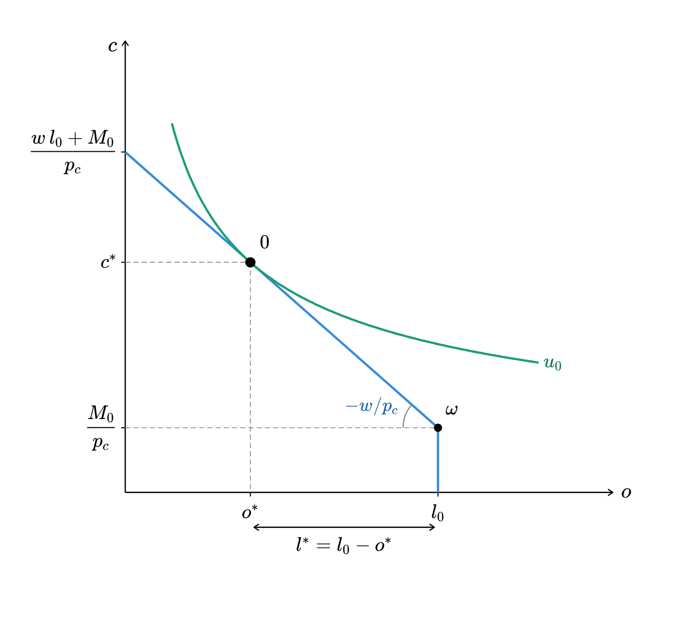
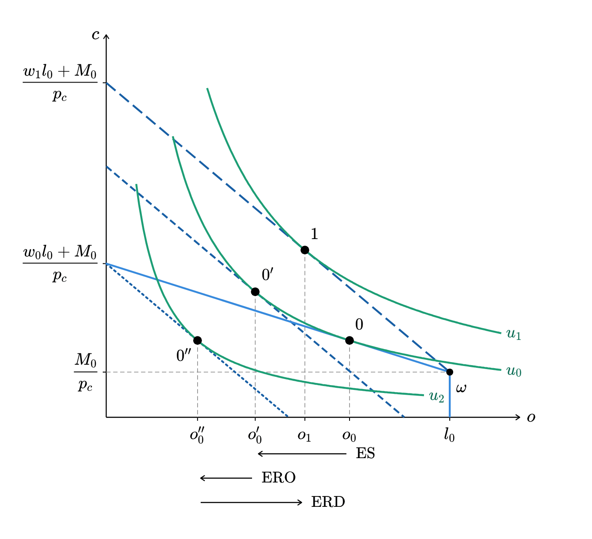
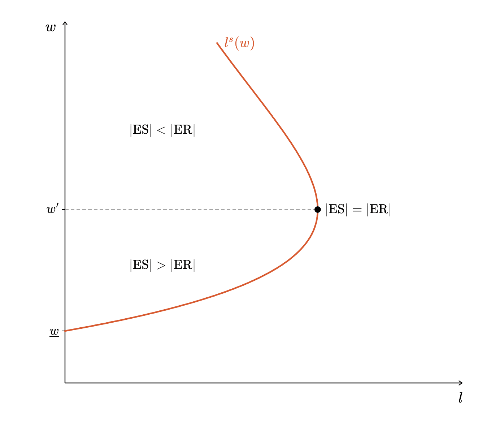
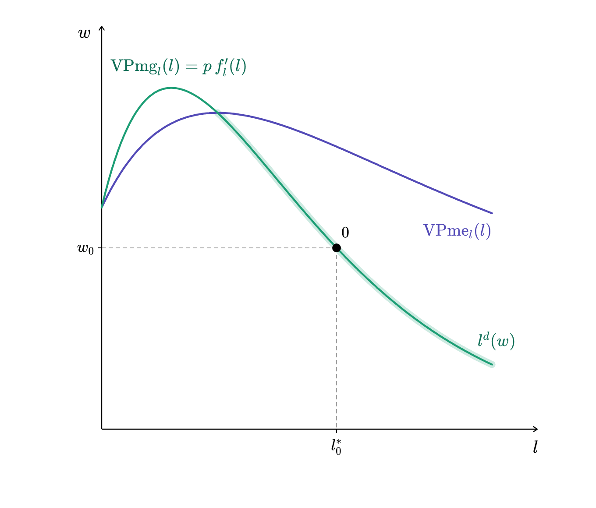
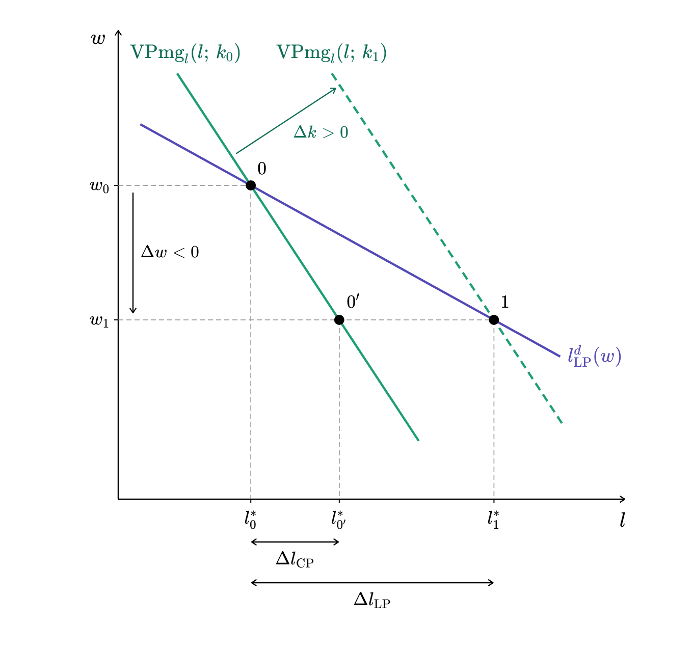

## Introducción



Este tema estudia la teoría neoclásica del mercado de trabajo en tres bloques:

- *Análisis estático*: oferta, demanda y equilibrio neoclásicos, y sus extensiones con poder de mercado (sindicatos, monopsonio y monopolio bilateral).

- *Análisis intertemporal*: la oferta de trabajo como asignación del tiempo entre periodos (modelo de Lucas-Rapping) y la demanda de trabajo con costes de ajuste.

- *Teoría del capital humano*: los modelos de Becker (1964) y Spence (1973) y la función de ingresos de Mincer.

## 1. Análisis estático: teoría neoclásica de la oferta y demanda de trabajo

Para la teoría neoclásica, el trabajo se intercambia en un mercado parecido al de cualquier otro bien. Su precio, el salario, y su cantidad, el empleo, quedan fijados donde se cruzan la oferta y la demanda.

### 1.1. Supuestos

**Metodología**: el análisis es de equilibrio parcial.

**Entorno**: no hay fallos de mercado (externalidades, bienes públicos, poder de mercado, información imperfecta, costes de transacción ni fricciones de emparejamiento o *matching*). Hay plena flexibilidad de precios y salarios, de modo que el mercado de trabajo se vacía.

**Agentes**: consumidores-trabajadores racionales, que maximizan su utilidad, y empresas gestionadas por sus propietarios, que maximizan el beneficio. Ambos son numerosos, de modo que ninguno puede influir sobre el salario, es decir, son *salario-aceptantes*.

**Tecnología**: se aplican los supuestos neoclásicos habituales (producción monoproducto, rendimientos mixtos).

**Mercado de bienes**: es de competencia perfecta, de modo que las empresas son también precio-aceptantes en el mercado de su producto.

### 1.2. Oferta de trabajo

El lado de la oferta parte de la elección entre ocio y consumo de cada individuo. De ella se obtiene la oferta de trabajo individual, cuya estática comparativa se estudia antes de agregarla al conjunto del mercado.

#### 1.2.1. La decisión de oferta de trabajo

La oferta de trabajo es una aplicación de la teoría del consumidor con dotaciones (tema [A08](a08-consumidor.qmd), Anexo A.2). El individuo consume dos bienes, un **bien compuesto** $c$ (consumo real)[^a25-2] y **tiempo de ocio** $o$, la única alternativa al trabajo remunerado, que, a diferencia del ocio, es un mal[^a25-4]. 

**Planteamiento**: su función de utilidad es creciente, continua, estrictamente cuasicóncava y diferenciable, $u = u(o, c)$. Está sujeto a una restricción de gasto, $p_c c \leq w(l_0 - o) + M_0$, donde $M_0$ es la renta no salarial, y a una restricción de tiempo, $l_0 = l + o$, donde $l_0$ es la dotación de tiempo y $l$ el trabajo. Por tanto:

$$\max_{o,c} \; u(o, c) \quad \text{s.a.:} \; p_c c = w(l_0 - o) + M_0$$

donde la renta total, $M = w(l_0 - o) + M_0$, suma la renta salarial $w(l_0-o)$, que depende de cuánto tiempo se dedique al trabajo, y la renta no salarial $M_0$, que no depende de lo que trabaje y se considera exógena. El lagrangiano es $\mathcal{L} = u(o, c) + \lambda[w(l_0 - o) + M_0 - p_c c]$.

**CPO**: con solución interior y la restricción agotada, a partir del lagrangiano se obtienen tres condiciones de primer orden:

$$p_c c = w(l_0 - o) + M_0 \tag{1}$$

$$\frac{\partial u}{\partial c} = \lambda p_c \tag{2}$$

$$\frac{\partial u}{\partial o} = \lambda w \;\Rightarrow\; \text{RMS}_{co} \equiv \frac{\partial u/\partial o}{\partial u/\partial c} = \frac{w}{p_c} \tag{3}$$

donde (1) establece que el consumidor-trabajador gasta toda su renta; (2) y (3), que la utilidad marginal de cada bien por euro gastado es la misma. El “precio” del ocio es el salario, la renta a la que se renuncia por cada hora no trabajada.

**CSO**: la cuasiconcavidad estricta de $u$ (curvas de indiferencia ocio-consumo estrictamente convexas) y la linealidad de la restricción garantizan que la tangencia es un máximo único, de modo que las CPO son necesarias y suficientes. Aunque en la solución de esquina no hay tangencia sino desigualdad, la misma convexidad de las preferencias asegura que es el óptimo.

**Solución**: la función de oferta de trabajo individual presenta dos casos:

- *Solución interior*: dividiendo (3) entre (2) se obtiene la *condición de ocio-consumo*. En el óptimo, el consumidor-trabajador adquiere ocio y consumo hasta que su relación marginal de sustitución (RMS, tasa subjetiva de intercambio ocio-consumo) equivale al salario real (tasa objetiva de intercambio ocio-consumo en el mercado o coste de oportunidad del ocio).

- *Solución de esquina (salario de reserva)*: si el salario real es suficientemente bajo, el individuo no trabaja, $\text{RMS}_{co}(o = l_0) > w/p_c$. El salario por debajo del cual prefiere no participar es el *salario de reserva* $\underline{w}$, la RMS evaluada en la dotación (todo el tiempo dedicado al ocio), y la condición de participación es $w/p_c > \underline{w}$. El salario de reserva depende de la renta no salarial, del consumo de subsistencia y de las preferencias (valoración relativa del ocio). De la renta no salarial depende directamente si el ocio es normal, porque con más $M_0$ el consumo es mayor y el ocio más valioso en el margen.

**Desarrollo gráfico**: la decisión de oferta de trabajo se representa en el plano ocio-consumo (figura -@fig-a251-equilibrio-ocioconsumo):

1. *Recta de balance*: reúne las combinaciones de ocio y consumo que el individuo puede costear con su renta total. Tiene pendiente $-w/p_c$ y ordenada en el origen $(wl_0 + M_0)/p_c$, la *renta potencial*, y pasa siempre por la dotación $\omega = (l_0, M_0/p_c)$[^a25-6].

2. *Curvas de indiferencia*: como $u_0$, reúnen las combinaciones de ocio y consumo de igual utilidad. Son convexas, porque la utilidad es estrictamente cuasicóncava, y representan más utilidad cuanto más alejadas del origen.

3. *Equilibrio*: en el punto $0$, la curva de indiferencia más alejada del origen es tangente a la recta de balance, con ocio $o^*$ y consumo $c^*$. El trabajo ofrecido, $l^* = l_0 - o^*$, es la distancia horizontal entre el ocio elegido y la dotación.

::: {#fig-a251-equilibrio-ocioconsumo}

::: {.content-visible when-format="html"}
```{=html}
<div class="graph-frame">
<iframe src="../graphs/a251_Equilibrio_ocioconsumo.html" style="height:660px" loading="lazy" title="fig-a251-equilibrio-ocioconsumo"></iframe>
</div>
```
:::

::: {.content-visible unless-format="html"}

:::

Elección ocio-consumo. Se sitúa en la tangencia entre la curva de indiferencia y la restricción presupuestaria, cuya pendiente es el salario real.
:::

#### 1.2.2. La función de oferta de trabajo individual

**Definición**: del problema primal se obtienen las funciones marshallianas de demanda de consumo, $c^* = c(w, p_c, M_0)$, y de ocio, $o^* = o(w, p_c, M_0)$, y de esta última, a través de la restricción de tiempo, puede obtenerse la *función de oferta de trabajo individual ordinaria*:

$$l^s = l_0 - o^*(w, p_c, M_0) = l^s(w^{?}, p_c^{-}, M_0^{-})$$

donde los superíndices indican el signo de cada efecto, que se justifica en el punto 3 de las propiedades. Del problema dual (minimizar la renta no salarial necesaria para alcanzar una utilidad dada) se obtiene la *función de oferta de trabajo individual compensada*, $l^c = l^c(w, p_c, u_0)$, que solo recoge el efecto sustitución.

**Propiedades**:

1. *Continuidad y diferenciabilidad*: son continuas en sus argumentos y diferenciables en las soluciones interiores, lo que permite la estática comparativa. La ordinaria se anula cuando el salario real no supera el de reserva, $\underline{w}$, donde presenta un quiebro.

2. *Transformaciones*: son homogéneas de grado cero, la ordinaria en $(w, p_c, M_0)$ y la compensada en $(w, p_c)$. Por ello, la ordinaria solo depende del salario real, $w/p_c$, y de la renta no salarial real, $M_0/p_c$, y la compensada, del salario real y de la utilidad (ausencia de ilusión monetaria).

3. *Inclinación*:

    - *Ordinaria*: el efecto del salario es de signo indeterminado y el de la renta no salarial es negativo si el ocio es normal. El del precio del consumo es el simétrico del salario, pues ambos operan a través del salario real, aunque $p_c$ reduce también la renta no salarial real, lo que por sí solo eleva la oferta si el ocio es normal. El signo negativo que se asigna a $p_c$ supone, por tanto, que domina el efecto sustitución y que la renta no salarial es reducida.

    - *Compensada*: es no decreciente en el salario, y creciente en las soluciones interiores, porque solo recoge el efecto sustitución.

4. *Forma*: la teoría no restringe la curvatura de ninguna de las dos. La restricción de segundo orden recae sobre la función de valor del problema dual, la renta no salarial mínima, que es cóncava en el salario y en el precio del consumo y de la que deriva la oferta compensada.

5. *Otras propiedades*:

    - *Agotamiento de la renta*: en la ordinaria, el consumo agota la renta total, $p_c\, c^* = w\, l^s + M_0$ (condición (1)).

    - *Dualidad*: la ordinaria coincide con la compensada evaluada en la utilidad máxima que alcanza el individuo, $u^*$, es decir, $l^s(w, p_c, M_0) = l^c(w, p_c, u^*)$. De esa identidad procede la ecuación de Slutsky con dotaciones.

    - *Observabilidad*: la ordinaria se estima con datos de horas, salarios y rentas. La compensada, en cambio, no es observable, porque depende de la utilidad, y su elasticidad se obtiene de la ordinaria mediante la ecuación de Slutsky.

#### 1.2.3. Estática comparativa

La estática comparativa de la oferta distingue dos bloques, los efectos de una subida del salario sobre el ocio y las horas ofrecidas (efectos propios) y sobre el consumo (efectos cruzados), y se completa con los de otras variables exógenas.

**Efectos propios**: el efecto de una subida del salario sobre la oferta de trabajo es ambiguo porque el trabajador es a la vez comprador de ocio (lo consume) y vendedor de tiempo (su dotación se revaloriza). La ecuación de Slutsky con dotaciones (tema [A08](a08-consumidor.qmd), Anexo A.2), aplicada a la demanda de ocio, separa esas fuerzas:

$$\underbrace{\frac{\partial o}{\partial w}}_{\text{ET}} = \underbrace{\frac{\partial o}{\partial w}\bigg|_{u_0}}_{\text{ES} \, \leq \, 0} \; \underbrace{- \; \frac{\partial o}{\partial M} \cdot o}_{\text{ERO}} \; \underbrace{+ \; \frac{\partial o}{\partial M} \cdot l_0}_{\text{ERD}}$$

donde ES es el efecto sustitución (a utilidad constante), ERO el efecto renta ordinario (el de cualquier demanda, en la que el bien se encarece y la renta compra menos) y ERD el efecto renta-dotación (el salario más alto revaloriza las $l_0$ horas de la dotación). Los dos últimos se suman en el *efecto renta total*, $(\partial o/\partial M)(l_0 - o) = (\partial o/\partial M)\, l$, proporcional a las horas efectivamente vendidas.

- *Efecto sustitución*, $\text{ES} \leq 0$ siempre: el salario es el precio del ocio y, al subir, a utilidad constante el individuo sustituye ocio por consumo, con lo que reduce el ocio y aumenta la oferta de trabajo.

- *Efecto renta total*, $\geq 0$ si el ocio es normal: como $l = l_0 - o > 0$ para quien trabaja, el ERD domina siempre al ERO y la subida del salario eleva la renta real, de modo que el trabajador, más rico, demanda más ocio y reduce la oferta de trabajo. En cambio, si el ocio fuera inferior, ambos efectos irían en la misma dirección y la oferta sería siempre creciente.

- *Signo total*: la oferta de trabajo es creciente en el salario ($\partial l^s/\partial w > 0$) solo si el efecto sustitución domina al efecto renta total. Si el efecto renta total domina, la curva se vuelve hacia atrás en el plano $(l, w)$. Un bien normal puede comportarse así como un bien Giffen para quien lo vende, ya que el efecto renta actúa a favor del ocio, no en contra.

Gráficamente, en el plano ocio-consumo (figura -@fig-a255-es-ero-erd-ocioconsumo), una subida de $w$ hace girar la recta de balance alrededor de la dotación, que sigue siendo alcanzable, y el nuevo equilibrio recoge los tres efectos:

- *ES*: el individuo se desplaza a lo largo de la curva de indiferencia inicial hasta el punto en que la $\text{RMS}_{co}$ iguala el nuevo salario real $w/p_c$ (de 0 a 0′) y, como el ocio se ha encarecido, lo reduce.

- *ERO*: si la renta monetaria no cambiase, el ocio más caro reduciría el poder adquisitivo del individuo y, siendo el ocio normal, la demanda de ocio caería también (de 0′ a 0″).

- *ERD*: la dotación de $l_0$ horas vale ahora más, lo que eleva la renta real por encima del nivel inicial y aumenta la demanda de ocio. Como el individuo vende parte de su dotación, este efecto domina al ERO (de 0″ a 1).

::: {#fig-a255-es-ero-erd-ocioconsumo}

::: {.content-visible when-format="html"}
```{=html}
<div class="graph-frame">
<iframe src="../graphs/a255_ES_ERO_ERD_ocioconsumo.html" style="height:620px" loading="lazy" title="fig-a255-es-ero-erd-ocioconsumo"></iframe>
</div>
```
:::

::: {.content-visible unless-format="html"}

:::

Efecto de una subida del salario en el plano ocio-consumo. El cambio se descompone en efecto sustitución (0 → 0′), efecto renta ordinario (0′ → 0″) y efecto renta-dotación (0″ → 1).
:::

Proyectado sobre el plano trabajo-salario (figura -@fig-a252-es-er-oferta-trabajo), el resultado da la curva de oferta individual, que recoge las horas que el individuo ofrece a cada salario. Si $|\text{ES}| > |\text{ER}|$, con ER el efecto renta total, la curva es creciente, y si $|\text{ES}| < |\text{ER}|$ se vuelve hacia atrás. El punto de giro se alcanza en el salario $w'$, en el que ambos efectos se igualan ($|\text{ES}| = |\text{ER}|$) y la oferta individual alcanza su máximo.

::: {#fig-a252-es-er-oferta-trabajo}

::: {.content-visible when-format="html"}
```{=html}
<div class="graph-frame">
<iframe src="../graphs/a252_ES_ER_oferta_trabajo.html" style="height:530px;max-width:544px" loading="lazy" title="fig-a252-es-er-oferta-trabajo"></iframe>
</div>
```
:::

::: {.content-visible unless-format="html"}

:::

Efecto sustitución y efecto renta de una subida salarial sobre la oferta de trabajo. El signo total es ambiguo y explica el tramo regresivo de la oferta de trabajo, que empieza en el salario $w'$, donde $|\text{ES}| = |\text{ER}|$.
:::

**Efectos cruzados**: el efecto de una subida del salario sobre la demanda del bien de consumo, en cambio, es inequívoco si el consumo es normal. El ES es positivo (el consumo se abarata relativamente respecto al ocio) y el efecto renta total también lo es si el consumo es normal (la dotación se revaloriza). Por ello, el consumo aumenta salvo que sea un bien inferior, pero lo que queda indeterminado es si el mayor consumo se financia trabajando más o solo con el mayor salario por hora.

**Otra estática comparativa**:

1. *Renta no salarial*: un aumento de $M_0$ desplaza la recta de balance en paralelo. Si el ocio es normal, aumenta su demanda y se reduce la oferta de trabajo (y sube el salario de reserva), y si es inferior, ocurre lo contrario.

2. *Horas extraordinarias*: una prima salarial que se aplica solo a las horas trabajadas por encima de la jornada, y no a todas, tiene un efecto inequívoco para quien no superaba la jornada. Como no revaloriza la dotación ni las horas ya trabajadas, no genera efecto renta apreciable y actúa como un efecto sustitución puro, de modo que la oferta de trabajo aumenta. De ahí que las empresas la prefieran a una subida general del salario para elevar las horas.

3. *Imposición*: el efecto sobre la oferta de trabajo depende del tipo de impuesto:

    - *Suma fija*: un impuesto $T_0$ desplaza la recta en paralelo y, con ocio normal, aumenta la oferta de trabajo (solo efecto renta).

    - *Proporcional sobre el salario*: un tipo $\tau_w$ reduce el salario neto a $w(1 - \tau_w)$ y tiene los tres efectos anteriores con signo contrario, por lo que su efecto es ambiguo.

    Para una misma recaudación, el de suma fija genera siempre más oferta de trabajo, porque no altera el precio relativo del ocio y no produce exceso de gravamen. Por su parte, un impuesto progresivo hace cóncava la recta de balance. Un impuesto proporcional sobre el consumo equivale al proporcional sobre el salario si no hay ahorro ni renta no salarial ($\tau_c = \tau_w / (1 - \tau_w)$), pues con $M_0 > 0$ el impuesto sobre el consumo grava también esa renta.

#### 1.2.4. Oferta de trabajo agregada

**Función de oferta agregada**: bajo trabajo homogéneo e independencia de las ofertas individuales, la oferta de mercado es la suma horizontal de las ofertas individuales (agregación walrasiana), $L^s = \sum_{h=1}^{H} l^{s,h}(w^{+}, p_c^{-}, M_0^{-})$.

Se acepta generalmente que el tramo relevante es el creciente. El supuesto evita equilibrios múltiples y se justifica porque las subidas de salario atraen a nuevos participantes (*margen extensivo*) aunque los ya empleados reduzcan sus horas (*margen intensivo*).

#### 1.2.5. Evidencia empírica

La elasticidad de la oferta de trabajo es difícil de estimar, por la heterogeneidad de los agentes y porque los datos mezclan el margen intensivo (horas) y el extensivo (participación). Las estimaciones para trabajadores principales son bajas (elasticidad no compensada próxima a cero, compensada positiva pero pequeña) y mayores en el margen extensivo, lo que confirma que los efectos renta y sustitución se compensan en buena medida. La evidencia permite, además, precisar tres aspectos de la teoría:

1. *Cambios en el salario*: para niveles muy bajos de salario la oferta también puede ser decreciente. La curva individual puede tomar así forma de S invertida, con tres tramos: decreciente, creciente y de nuevo decreciente para salarios altos, cuando domina el efecto renta[^a25-8].

2. *Cambios en la renta*: la evidencia sobre transferencias no condicionadas (loterías, herencias, experimentos de renta básica) muestra reducciones pequeñas pero significativas de la oferta, coherentes con un ocio normal de baja elasticidad-renta.

3. *Unidades familiares*: la elasticidad de la oferta respecto al salario es baja para los trabajadores principales del hogar y alta para los secundarios, que comparan el salario con el coste de sustituir su producción doméstica. La incorporación de la mujer al mercado de trabajo ha reducido esa diferencia.

#### 1.2.6. Conclusiones

**Aspectos positivos**: la oferta de trabajo neoclásica es una aplicación directa de la teoría del consumidor con dotación. El salario real es el precio del ocio, y la descomposición de Slutsky con dotaciones explica que la curva de oferta pueda tener pendiente positiva o negativa según dominen el efecto sustitución o el efecto renta total (ordinario más dotación).

**Limitaciones**: el modelo es estático y de un solo periodo, ignora las horas fijas por contrato y trata la participación como una decisión de esquina. Además, supone que el individuo elige libremente las horas al salario vigente y que quien no trabaja no quiere hacerlo. Las extensiones intertemporales (sección 2), de capital humano (sección 3) y de búsqueda (tema [A26](a26-desempleo-friccional.qmd)) responden a estas carencias.

### 1.3. Demanda de trabajo

Del otro lado del mercado, la demanda de trabajo resulta de la maximización del beneficio de la empresa. Tras obtenerla, se estudian su estática comparativa y su agregación al conjunto del mercado, y se contrasta con la evidencia empírica.

#### 1.3.1. La decisión de demanda de trabajo

La demanda de trabajo neoclásica procede de la teoría de la empresa competitiva (tema [A16](a16-competencia-perfecta.qmd)) y de su sistematización por Hicks (1932). A la empresa el trabajo solo le interesa como medio para obtener la producción que vende, y por eso se habla de una demanda *derivada*.

**Planteamiento**: se obtiene del programa de maximización del beneficio desde el enfoque de la producción (tema [A16](a16-competencia-perfecta.qmd)), para el caso monoproducto, $x = f(\mathbf{z})$, con factores normales, y competencia perfecta en bienes y factores:

$$\max_{\mathbf{z} \geq 0} \; \pi = p \cdot f(\mathbf{z}) - \mathbf{p}^z \cdot \mathbf{z}$$

donde $\mathbf{z} = (z_1, z_2, \ldots)$ es el vector de cantidades de factores contratadas (variables de decisión, entre ellas el trabajo $l$), $\pi$ el beneficio, $p$ el precio del producto, $f(\mathbf{z})$ la función de producción y $\mathbf{p}^z = (p_1^z, p_2^z, \ldots)$ el vector de precios de los factores (el salario $w$ para el trabajo).

**CPO**: derivando respecto a cada factor se obtienen dos condiciones:

$$\frac{\partial f/\partial z_i}{\partial f/\partial z_j} = \frac{p_i^z}{p_j^z} \tag{4}$$

$$\text{VPmg}_i \equiv p \cdot \frac{\partial f}{\partial z_i} = p_i^z \tag{5}$$

- *Condición de minimización del coste*: la condición (4) iguala la relación marginal de sustitución técnica (RMST) al precio relativo de los factores, de modo que cualquier cantidad se produce con la combinación de factores más barata.

- *Condición de contratación de factores*: la condición (5) establece que cada factor se contrata hasta que el valor de su productividad marginal iguala a su precio. Para el trabajo, $p \cdot \partial f/\partial l = w$, es decir, la empresa contrata hasta que el valor de lo que produce el último trabajador iguala a su salario y, como la empresa es salario-aceptante, la oferta de trabajo a la que se enfrenta es perfectamente elástica al salario de mercado.

**CSO**: el beneficio ha de ser estrictamente cóncavo en los factores, es decir, la empresa debe operar con rendimientos decrecientes de cada factor y a escala en el tramo relevante[^a25-25]. Con un solo factor variable basta $f_{ll}'' < 0$, el tramo decreciente de la productividad marginal del trabajo, y bajo ese supuesto las CPO son necesarias y suficientes.

**Solución**: se obtienen las funciones de demanda de trabajo condicionada e incondicionada.

**Desarrollo gráfico**: la decisión de demanda de trabajo se representa en el plano trabajo-salario (figura -@fig-a253-demanda-trabajo-cp):

1. *Valor del producto marginal* ($\text{VPmg}_l(l) = p\,\partial f/\partial l$): recoge el ingreso que aporta cada trabajador adicional y, en el tramo relevante, es decreciente por la productividad marginal decreciente.

2. *Valor del producto medio* ($\text{VPme}_l(l)$): recoge el ingreso medio por trabajador. Por debajo del máximo del VPme, el tramo decreciente del VPmg forma la demanda de trabajo, $l^d(w)$, porque a salarios superiores a ese máximo la empresa no cubriría el coste salarial.

3. *Oferta a la que se enfrenta la empresa*: una horizontal en el salario de mercado, $w_0$, porque la empresa es salario-aceptante.

4. *Equilibrio*: el empleo óptimo, $l_0^*$, es la intersección de la demanda con esa horizontal (punto $0$), donde $\text{VPmg}_l = w_0$.

::: {#fig-a253-demanda-trabajo-cp}

::: {.content-visible when-format="html"}
```{=html}
<div class="graph-frame">
<iframe src="../graphs/a253_Demanda_trabajo_CP.html" style="height:540px;max-width:591px" loading="lazy" title="fig-a253-demanda-trabajo-cp"></iframe>
</div>
```
:::

::: {.content-visible unless-format="html"}

:::

Demanda de trabajo a corto plazo. Coincide con el tramo decreciente del valor del producto marginal del trabajo.
:::

#### 1.3.2. La función de demanda de trabajo

**Definición**: como en la teoría de la producción (tema [A12](a12-costes.qmd)), del problema de la empresa se obtienen dos funciones de demanda de trabajo:

1. *Demanda condicionada*: se obtiene de (4), la minimización del coste para un nivel de producción dado, $l_c^d = l_c^d(w^{-}, r_K^{+}, x_0^{+})$, donde $r_K$ es el precio del servicio del capital. No depende directamente del precio del producto (solo a través de $x_0$) y mantiene fija la producción. Su efecto cruzado respecto al precio del otro factor es no negativo con dos factores, que son necesariamente sustitutivos netos (la complementariedad neta solo cabe con tres o más factores).

2. *Demanda incondicionada*: se obtiene de (5), la maximización del beneficio, $l_i^d = l_i^d(w^{-}, r_K^{?}, p^{+}, f_l'^{+})$. Sí depende directamente del precio del bien, porque la producción varía con él, y es la demanda relevante para el mercado de trabajo.

**Propiedades**:

1. *Continuidad y diferenciabilidad*: son continuas y diferenciables en sus argumentos cuando la función de producción es estrictamente cuasicóncava, en la condicionada, y el beneficio es estrictamente cóncavo en los factores, en la incondicionada (CSO). No obstante, a corto plazo, la demanda es discontinua en el salario igual al máximo del valor del producto medio (VPme), porque a salarios superiores el ingreso no cubriría el coste salarial y la empresa no contrataría (cierre).

2. *Transformaciones*: son homogéneas de grado cero en los precios, la incondicionada en $(w, r_K, p)$ y la condicionada en $(w, r_K)$. Por ello, la primera depende de los precios reales de los factores, $w/p$ y $r_K/p$, y la segunda, de su precio relativo, $w/r_K$ (ausencia de ilusión monetaria).

3. *Inclinación*: el signo negativo respecto al salario es común a ambas, pero la incondicionada añade al efecto sustitución el efecto escala. Sus argumentos y su elasticidad cambian con el horizonte:

    - *Corto plazo*: con el trabajo como único factor variable, la demanda de trabajo individual coincide con el tramo decreciente de la curva de VPmg del trabajo situado por debajo del máximo del VPme. Así, $l^d = l^d(w^{-}, p^{+}, f_l'^{+}, \bar k^{+})$. Depende negativamente del salario, positivamente del precio y de la productividad del trabajo, y positivamente del *stock* de capital. Lo primero se debe a que una caída del salario se compensa con una caída de la productividad marginal para mantener $p\,\partial f/\partial l = w$, lo que exige más trabajadores.

    - *Largo plazo*: con todos los factores variables, la demanda ya no coincide con la curva de VPmg, porque esta se desplaza al ajustarse el capital. Confluyen dos efectos que actúan en la misma dirección sobre el trabajo, el efecto sustitución, en la medida en que la tecnología lo permita ($\sigma_{kl} > 0$), y el *efecto escala o producción*. Como a corto plazo el capital está fijo y no cabe la sustitución entre factores, la demanda a largo plazo es más elástica que a corto plazo.

4. *Forma*: la teoría no restringe su curvatura. La restricción de segundo orden recae sobre la función de costes, cóncava en los precios de los factores, en la condicionada, y sobre la función de máximo beneficio, convexa en precios, en la incondicionada.

5. *Otras propiedades*:

    - *Envolvente* (*lema de Shephard* y *lema de Hotelling*): la condicionada es la derivada de la función de costes respecto al salario, y la incondicionada es, cambiada de signo, la derivada de la función de máximo beneficio (temas [A12](a12-costes.qmd), apartado 1.4.4, y [A16](a16-competencia-perfecta.qmd), apartado 1.3.4).

    - *Dualidad*: la incondicionada es la condicionada evaluada en la producción que maximiza el beneficio, $l_i^d(w, r_K, p) = l_c^d(w, r_K, x^*)$, con $x^*$ esa producción. De esa identidad procede la ecuación de Slutsky que se obtiene a continuación.

    - *Observabilidad*: se estiman con datos de empleo, salarios y producción.

Gráficamente, en el plano trabajo-salario (figura -@fig-a254-demanda-trabajo-lp), ante una bajada del salario de $w_0$ a $w_1$, a corto plazo la empresa se desplaza sobre su curva de VPmg, $\text{VPmg}_l(l;\,k_0)$ (de 0 a 0′). A largo plazo, el mayor empleo eleva la productividad marginal del capital, se contrata más capital y ello desplaza la curva de VPmg del trabajo hacia fuera, hasta $\text{VPmg}_l(l;\,k_1)$ (de 0′ a 1). La demanda de largo plazo, $l^d_{\text{LP}}(w)$, une los puntos 0 y 1 y es, por ello, más plana que la de corto plazo. Por simplicidad, esta figura y las siguientes dibujan las curvas como rectas y, en el caso del VPmg, solo su tramo decreciente relevante, el que forma la demanda en la figura -@fig-a253-demanda-trabajo-cp.

::: {#fig-a254-demanda-trabajo-lp}

::: {.content-visible when-format="html"}
```{=html}
<div class="graph-frame">
<iframe src="../graphs/a254_Demanda_trabajo_LP.html" style="height:680px" loading="lazy" title="fig-a254-demanda-trabajo-lp"></iframe>
</div>
```
:::

::: {.content-visible unless-format="html"}

:::

Demanda de trabajo a largo plazo. Con capital variable, el efecto sustitución y el efecto escala hacen la demanda más elástica que a corto plazo.
:::

#### 1.3.3. Estática comparativa

**Efectos propios**: la ecuación de Slutsky para demandas incondicionadas descompone el efecto del salario sobre la demanda de trabajo en un efecto sustitución (a producción constante, la empresa sustituye trabajo por capital, relativamente más barato) y un efecto escala:

$$\frac{\partial l_i^d}{\partial w} = \underbrace{\frac{\partial l_c^d}{\partial w}\bigg|_{x_0}}_{\text{ES} \, \leq \, 0} + \underbrace{\frac{\partial l_c^d}{\partial x} \cdot \frac{\partial x}{\partial w}}_{\text{EP} \, < \, 0} < 0$$

donde el ES es no positivo por la concavidad de la función de costes en los precios de los factores y el efecto producción (EP) es negativo porque un factor más caro eleva el coste marginal y reduce la producción. Ambos se mueven en la misma dirección, de modo que una subida del salario reduce inequívocamente la demanda de trabajo.

**Efectos cruzados**: el efecto del salario sobre la demanda de capital, $\partial k^d/\partial w = \text{ES}^{\geq 0} + \text{EP}^{<0}$, es indeterminado, pues el ES es no negativo (con dos factores, estos son siempre sustitutivos netos) y el EP negativo. No obstante, en las funciones de producción neoclásicas suele predominar el efecto escala y los factores resultan complementarios brutos.

#### 1.3.4. Demanda de trabajo agregada

**Función de demanda agregada**: cuando cambia el salario, el conjunto de la industria ajusta a la vez su producción, y ese cambio de la producción agregada mueve el precio del producto (una externalidad pecuniaria). Por eso, a corto y a largo plazo, sumar en horizontal las demandas individuales calculadas a precio constante no basta para obtener la curva del mercado. En su lugar se agregan las *cuasidemandas*, es decir, las demandas de cada empresa una vez incorporado ese efecto sobre el precio, y la curva resultante es menos elástica que aquella suma.

Gráficamente, en el plano trabajo-salario (figura -@fig-a256-demanda-trabajo-agregada), se representan la empresa $j$ (panel a) y el mercado (panel b). Si el precio del producto no cambiase, una bajada del salario de $w_0$ a $w_1$ llevaría a cada empresa de 0 a 0′ sobre su curva de VPmg, $\text{VPmg}_l(l_j;\,p_0)$. La suma horizontal de esas respuestas, $\sum_j l_j^d(w; p_0)$, daría el punto 0′ del mercado. Sin embargo, como todas las empresas contratan más y producen más, el precio cae de $p_0$ a $p_1$, la curva de VPmg de cada una gira hacia abajo, hasta $\text{VPmg}_l(l_j;\,p_1)$, y el empleo solo llega a 1. La demanda de mercado $L^d(w)$ une los puntos 0 y 1 y es, por tanto, más inclinada que la suma horizontal.

::: {#fig-a256-demanda-trabajo-agregada}

::: {.content-visible when-format="html"}
```{=html}
<div class="graph-frame wide">
<iframe src="../graphs/a256_Demanda_trabajo_agregada.html" style="--r:1.447" loading="lazy" title="fig-a256-demanda-trabajo-agregada"></iframe>
</div>
```
:::

::: {.content-visible unless-format="html"}

:::

Demanda de trabajo de mercado. Ante una bajada del salario de $w_0$ a $w_1$, cada empresa pasaría de 0 a 0′ si el precio del producto no cambiase, pero la caída del precio de $p_0$ a $p_1$ hace girar su curva de VPmg y lleva a la empresa a 1 (panel a). La demanda de mercado $L^d(w)$, que une 0 y 1, es más inclinada que la suma horizontal de las demandas individuales a precio constante (panel b).
:::

**Elasticidad de la demanda derivada**: a largo plazo, en una industria competitiva con rendimientos constantes a escala y oferta de capital perfectamente elástica, la elasticidad de la demanda de trabajo de la industria respecto al salario es

$$\varepsilon_{L^d w} = -\left[(1 - s)\,\sigma + s\,|\varepsilon_{Xp}|\right], \qquad s \in (0, 1),\; \sigma > 0$$

donde $s$ es la participación del trabajo en el coste total, $\sigma$ la elasticidad de sustitución entre trabajo y capital y $|\varepsilon_{Xp}|$ la elasticidad-precio de la demanda del producto en valor absoluto. El primer término recoge el efecto sustitución y el segundo, el efecto escala. De ahí se siguen tres de las reglas de Marshall (1890) y Hicks (1932), según las cuales la demanda de trabajo es más elástica cuanto más fácil es sustituir trabajo por otros factores, cuanto más elástica es la demanda del producto y cuanto mayor es la participación del trabajo en el coste (si $|\varepsilon_{Xp}| > \sigma$). La cuarta, una demanda más elástica cuanto más lo es la oferta de los demás factores, exige relajar el supuesto de oferta de capital perfectamente elástica. Esas reglas explican, por ejemplo, el mayor poder de los sindicatos en industrias con poca sustituibilidad y demanda inelástica (apartado 1.4.2).

#### 1.3.5. Evidencia empírica

La evidencia confirma las predicciones básicas. Así, la demanda de trabajo es decreciente en el salario, con elasticidades de largo plazo claramente mayores en valor absoluto que las de corto plazo. Hamermesh (1993) sitúa las de largo plazo, a producción constante, entre $-0{,}15$ y $-0{,}75$, con $-0{,}3$ como mejor estimación. La sustituibilidad capital-trabajo es, además, mayor para el trabajo poco cualificado, lo que conecta con el cambio técnico sesgado del apartado 3.4.1.

La respuesta de los salarios y del empleo a un aumento de la oferta de trabajo se ha contrastado también con experimentos naturales (apartado 3.4.2). Card (1990) estudia el éxodo del Mariel (1980), que aumentó un 7 % la fuerza de trabajo de Miami en pocos meses, y no encuentra efectos negativos sobre los salarios ni el empleo de los trabajadores poco cualificados residentes.

#### 1.3.6. Conclusiones

**Aspectos positivos**: la demanda de trabajo se deriva de la maximización del beneficio y hereda las propiedades de las demandas de factores. Es decreciente en el salario real a corto y largo plazo, y en el largo plazo incorpora el efecto sustitución entre factores además del efecto escala.

**Limitaciones**: supone trabajo homogéneo, ajuste instantáneo del empleo y competencia perfecta en el mercado del producto. Sin embargo, los costes de ajuste (tema [A26](a26-desempleo-friccional.qmd), sección 3) y el poder de mercado modifican sus conclusiones.

### 1.4. Equilibrio neoclásico y poder de mercado

Con la oferta y la demanda ya obtenidas, puede caracterizarse el equilibrio competitivo del mercado de trabajo y estudiarse qué ocurre cuando trabajadores o empresas dejan de ser salario-aceptantes.

#### 1.4.1. Equilibrio competitivo

En el mercado, oferta y demanda se cruzan en un único punto, $(L^*, w^*)$. Ese equilibrio es estable y eficiente, y el empleo que fija es el de pleno empleo.

**Equilibrio**: la existencia y la unicidad se deducen de las pendientes de las curvas en el plano $(L, w)$ (positiva la de oferta, negativa la de demanda). La estabilidad la aporta un salario flexible, que absorbe cualquier exceso de oferta o de demanda. Ninguna empresa tiene poder de mercado, así que todas aceptan el salario dado, y como este resume toda la información sobre productividades y preferencias, mide con exactitud la escasez relativa de trabajo.

**Desarrollo gráfico**: el equilibrio competitivo se representa en el plano trabajo-salario (figura -@fig-a257-equilibrio-trabajo):

1. *Oferta de mercado* ($L^s(w)$): recoge las horas que ofrecen los trabajadores a cada salario. Es creciente en el tramo relevante, porque las subidas de salario atraen a nuevos participantes.

2. *Demanda de mercado* ($L^d(w)$): recoge el empleo que desean las empresas a cada salario. Es decreciente, porque el efecto sustitución y el efecto escala actúan en la misma dirección.

3. *Equilibrio*: es su intersección, el punto 0, con salario $w^*$ y empleo $L^*$. Es estable, pues en los dos casos siguientes el salario vuelve a $w^*$:

    - *Salario superior*: a $w'$, la cantidad ofrecida supera a la demandada y el exceso de oferta presiona el salario a la baja.

    - *Salario inferior*: a $w''$, el exceso de demanda lo presiona al alza.

::: {#fig-a257-equilibrio-trabajo}

::: {.content-visible when-format="html"}
```{=html}
<div class="graph-frame">
<iframe src="../graphs/a257_Equilibrio_trabajo.html" style="height:600px" loading="lazy" title="fig-a257-equilibrio-trabajo"></iframe>
</div>
```
:::

::: {.content-visible unless-format="html"}

:::

Equilibrio competitivo del mercado de trabajo. El cruce de la oferta $L^s(w)$ y la demanda $L^d(w)$ determina el salario $w^*$ y el empleo $L^*$ (punto 0). A un salario superior, $w'$, hay exceso de oferta y, a uno inferior, $w''$, exceso de demanda, y en ambos casos el salario vuelve a $w^*$.
:::

**Estática comparativa**: en el plano trabajo-salario (figura -@fig-a258-estatica-comparativa-trabajo), los desplazamientos de las curvas alteran el equilibrio:

- *Desplazamiento de la demanda*: una subida del precio del producto o de la productividad del trabajo desplaza la demanda hacia la derecha, de $L_0^d(w)$ a $L_1^d(w)$, y eleva el salario y el empleo de equilibrio (panel a, de 0 a 1).

- *Desplazamiento de la oferta*: un aumento de la renta no salarial, si el ocio es normal, desplaza la oferta hacia la izquierda, de $L_0^s(w)$ a $L_1^s(w)$, de modo que el salario sube y el empleo cae (panel b, de 0 a 1).

- *Papel de las pendientes*: cuanto más rígida es la curva que no se desplaza, más se traduce la perturbación en el salario y menos en el empleo.

::: {#fig-a258-estatica-comparativa-trabajo}

::: {.content-visible when-format="html"}
```{=html}
<div class="graph-frame wide">
<iframe src="../graphs/a258_Estatica_comparativa_trabajo.html" style="--r:1.447" loading="lazy" title="fig-a258-estatica-comparativa-trabajo"></iframe>
</div>
```
:::

::: {.content-visible unless-format="html"}

:::

Estática comparativa del equilibrio competitivo. Una subida del precio del producto desplaza la demanda hacia la derecha y eleva el salario y el empleo (panel a). Un aumento de la renta no salarial desplaza la oferta hacia la izquierda, de modo que el salario sube y el empleo cae (panel b).
:::

**Bienestar**: el equilibrio es eficiente en el sentido de Pareto, pues cumple el primer teorema del bienestar (tema [A22](a22-eb-i.qmd)). Hay eficiencia técnica (no se desperdician recursos en la producción) y asignativa (el valor del producto marginal del último trabajador contratado iguala a su salario y este a la valoración marginal del ocio). En consecuencia, no existe ninguna reasignación de horas que mejore a alguien sin empeorar a otro.

Sin embargo, la existencia, unicidad y estabilidad del equilibrio no implican que todos trabajen, y se distinguen tres tipos de desempleo:

- *Voluntario*: es el de quienes deciden no participar porque su salario de reserva supera al de mercado, y la teoría neoclásica los considera no participantes, aunque declaren buscar empleo a un salario superior al de mercado.

- *Friccional*: es el desempleo temporal, compatible con el equilibrio, que resulta de la incapacidad de emparejar instantáneamente vacantes y buscadores, y el tema [A26](a26-desempleo-friccional.qmd) lo endogeniza.

- *Involuntario o clásico*: solo puede existir si alguna rigidez impide la flexibilidad salarial y mantiene el salario por encima del de equilibrio, en cuyo caso el exceso de oferta a $w'$ de la figura -@fig-a257-equilibrio-trabajo sería desempleo involuntario.

Como el modelo neoclásico no podía explicar la magnitud y la persistencia del paro de la Gran Depresión, todos los desarrollos posteriores partieron de la teoría neoclásica del mercado de trabajo para modificarla (temas [A27](a27-salarios.qmd) y [A28](a28-tnp-nairu.qmd)).

**Extensiones**: el levantamiento del supuesto de salario-aceptación, por uno u otro lado del mercado, se resume en una *condición generalizada de contratación*, en términos de elasticidades:

$$\left(1 - \frac{1}{|\varepsilon_{Xp}|}\right) p \cdot \frac{\partial f}{\partial l} = \left(1 + \frac{1}{\varepsilon_{lw}}\right) w$$

donde $\varepsilon_{Xp}$ es la elasticidad de la demanda del producto y $\varepsilon_{lw}$ la de la oferta de trabajo a la que se enfrenta la empresa. Con poder de mercado en cualquiera de los dos lados, el empleo es inferior al competitivo (tema [A17](a17-monopolio.qmd)). Cabe distinguir tres configuraciones:

- *Competencia perfecta en ambos mercados* ($|\varepsilon_{Xp}|, \varepsilon_{lw} \to \infty$): se recupera $\text{VPmg}_l = w$.

- *Poder de mercado en bienes*: el lado izquierdo es el ingreso del producto marginal, inferior al VPmg (*mark-up*).

- *Poder de mercado en trabajo*: el lado derecho es el gasto marginal, superior al salario (*mark-down*).

#### 1.4.2. Poder de los oferentes de trabajo: sindicatos

Los sindicatos pueden surgir por el **poder compensatorio** (Galbraith, 1952) frente al poder de las grandes empresas.

**Planteamiento**: el sindicato monopolista elige sobre la curva de demanda de trabajo de la empresa el punto que maximiza su objetivo[^a25-16]. Si este es la renta económica de sus afiliados, el excedente del salario sobre el coste de oportunidad del trabajo, su programa es:

$$\max_{L} \; U = w(L) \cdot L - C(L)$$

donde $L$ es el empleo de los afiliados (variable de decisión), $U$ la renta económica del sindicato, $w(L)$ la demanda inversa de trabajo de la empresa y $C(L)$ el coste de oportunidad de los trabajadores empleados.

**CPO**:

$$w(L^*)\left(1 - \frac{1}{|\varepsilon_{Lw}^d|}\right) = \frac{dC}{dL}\Big|_{L^*} = \underline{w}$$

donde $\underline{w}$ es el salario de reserva de los trabajadores. El sindicato iguala el ingreso marginal de la venta de trabajo a su coste marginal, como un monopolista, con un *mark-up* sobre el salario de reserva inverso a la elasticidad de la demanda de trabajo, $\varepsilon_{Lw}^d$.

**CSO**: el ingreso marginal de la venta de trabajo debe ser decreciente y el coste marginal de oportunidad no decreciente ($C'' \geq 0$), como en cualquier monopolio, y bajo ese supuesto la CPO caracteriza el máximo.

**Extensiones**:

- *Estrategias*: según el objetivo, el sindicato se sitúa en distintos puntos de la demanda de trabajo (figura -@fig-a2511-sindicatos, panel (a)):

    - *Maximización de la renta económica* (punto R): $\text{Img} = \text{Cmg}$, la solución anterior, que genera pérdida de eficiencia y desempleo involuntario.

    - *Maximización de la masa salarial* (punto M): $\text{Img} = 0$, en el punto de elasticidad unitaria de la demanda de trabajo. El salario es normalmente superior al competitivo (si ese punto queda a la izquierda del cruce oferta-demanda) y, en ese caso, hay desempleo.

    - *Maximización del empleo* (punto E): fija el salario de competencia perfecta (no puede obtener mayor empleo sin reducir el salario por debajo del de reserva).

- *Negociación*: el equilibrio que finalmente se alcanza depende de cómo se negocie. En el esquema de Hicks (1932), recogido en el panel (b) de la figura -@fig-a2511-sindicatos, cuanto más se espera que dure la huelga, menos salario exige el sindicato (curva de resistencia) y más está dispuesto a conceder el empresario (curva de concesión), y el salario queda donde ambas curvas se cortan. Con certidumbre, las dos partes saben cuánto duraría el conflicto, de ahí que pacten ese salario sin llegar a la huelga, que queda como simple amenaza. Los modelos de negociación (derecho a gestionar, contratos eficientes) se desarrollan en el tema [A27](a27-salarios.qmd).

::: {#fig-a2511-sindicatos}

::: {.content-visible when-format="html"}
```{=html}
<div class="graph-frame">
<iframe src="../graphs/a2511_Sindicatos.html" style="height:960px" loading="lazy" title="fig-a2511-sindicatos"></iframe>
</div>
```
:::

::: {.content-visible unless-format="html"}

:::

Objetivos y negociación del sindicato. En el panel (a), sobre la demanda de trabajo, $w(L)$, el sindicato elige R si maximiza la renta económica ($\text{Img}(L) = C^{\prime}(L) = \underline{w}$), M si maximiza la masa salarial ($\text{Img}(L) = 0$) y E si maximiza el empleo, con el salario competitivo, $\underline{w}$. En el panel (b), la curva de resistencia del sindicato y la curva de concesión del empresario se cortan en el salario pactado, $\hat{w}$.
:::

#### 1.4.3. Poder de los demandantes de trabajo: monopsonio

Con un único demandante de trabajo, la curva de oferta a la que se enfrenta la empresa no es horizontal sino de pendiente positiva en el plano $(l, w)$, porque es la oferta de todo el mercado. Para atraer una unidad más, la empresa debe pagar más a todas las unidades y, por ello, el **gasto marginal** supera al salario:

$$\text{Gmg}_l = w + \frac{\partial w}{\partial l} \cdot l = w\left(1 + \frac{1}{\varepsilon_{lw}}\right) > w$$

donde $\varepsilon_{lw}$ es la elasticidad de la oferta de trabajo. La empresa contrata donde $\text{VPmg}_l = \text{Gmg}_l$ (figura -@fig-a2510-monopsonio), con menor empleo y menor salario que en competencia perfecta. La brecha entre el VPmg y el salario, el *mark-down*, es la **explotación monopsonística**.

::: {#fig-a2510-monopsonio}

::: {.content-visible when-format="html"}
```{=html}
<div class="graph-frame">
<iframe src="../graphs/a2510_Monopsonio.html" style="height:560px" loading="lazy" title="fig-a2510-monopsonio"></iframe>
</div>
```
:::

::: {.content-visible unless-format="html"}

:::

Monopsonio en el mercado de trabajo. La empresa contrata $l_M$, donde $\text{VPmg}_l(l) = \text{Gmg}_l(l)$, y paga el salario que marca la oferta, $w_M$ (punto 0), con menos empleo y menor salario que en competencia, $l_C$ y $w_C$ (punto 1). El segmento vertical en $l_M$ entre $\text{VPmg}_l(l)$ y $w_M$ es el *mark-down* o explotación monopsonística.
:::

**Configuraciones de mercado**: como la demanda de trabajo es derivada, el equilibrio depende también del poder en el mercado de bienes.

- *Competencia perfecta en bienes y monopsonio en trabajo*: el índice de Lerner es nulo, pero la empresa altera el salario con su demanda (salario y empleo inferiores a competencia).

- *Monopolio en bienes y monopsonio en trabajo*: se acumulan la explotación monopolística (retribución inferior al VPmg porque el ingreso marginal es inferior al precio) y la monopsonística, de modo que salario y empleo son los más bajos de todas las configuraciones.

- *Configuraciones intermedias*: se sitúan entre ambos extremos y, en cualquier caso, cuanto más rígida la demanda de producto, menor el precio pagado al factor.

#### 1.4.4. Monopolio bilateral

Con poder de mercado a ambos lados (un sindicato único frente a una empresa única), el equilibrio no puede determinarse con las herramientas tradicionales. Sin embargo, la teoría acota un rango de salarios posibles, entre el que fijaría el monopsonista y el que fijaría el sindicato, y el punto exacto depende de factores exógenos como la capacidad de negociación de cada parte. Si solo se negocia el salario, el empleo no supera el competitivo (solo lo alcanza si el salario pactado coincide con el competitivo) y, si el salario se fija por encima de este, se produce desempleo involuntario (tema [A27](a27-salarios.qmd)).

#### 1.4.5. Evidencia empírica

La evidencia confirma que el poder de mercado es relevante a ambos lados del mercado de trabajo:

1. *Sindicatos*: en EE. UU., los trabajadores sindicados cobran más que los no sindicados de características similares. Esa prima salarial se sitúa en torno al 15 % en 1967-1979 (Lewis, 1986) y al 17-18 % en 1973-2001 (Blanchflower y Bryson, 2004), con una tendencia a la baja en el sector privado.

2. *Monopsonio*: la elasticidad de la oferta de trabajo a la que se enfrenta cada empresa, $\varepsilon_{lw}$, es finita y a menudo reducida (mediana de 1,7 entre las estimaciones que reúnen Sokolova y Sorensen, 2021). Con monopsonio, una elasticidad finita implica salarios inferiores al VPmg. Además, los salarios ofrecidos son menores en los mercados de trabajo locales más concentrados. Así, pasar del percentil 25 al 75 de concentración se asocia a salarios entre un 5 % y un 17 % más bajos (Azar, Marinescu y Steinbaum, 2022).

3. *Salario mínimo*: Card y Krueger (1994) comparan, en un experimento natural (apartado 3.4.2), el empleo en la restauración de Nueva Jersey, que subió el salario mínimo, con el de la vecina Pensilvania, que no lo hizo. No encuentran efectos negativos sobre el empleo, un resultado compatible con el monopsonio.

### 1.5. Conclusiones

El análisis estático fija el punto de referencia. La oferta de trabajo aplica la teoría del consumidor con dotaciones, y su pendiente es ambigua porque el efecto renta total puede dominar al de sustitución. La demanda, en cambio, cae siempre con el salario, ya que el efecto sustitución y el efecto escala actúan en la misma dirección, y responde más a largo plazo, cuando se ajusta el capital. El equilibrio competitivo es estable y eficiente, y sin rigideces no genera desempleo involuntario.

Sus supuestos (entorno estático, información perfecta, trabajo homogéneo y salario-aceptación) son también su programa de investigación. Cuando trabajadores o empresas dejan de ser salario-aceptantes y solo se fija el salario, el empleo no supera el competitivo, y el desempleo es involuntario si el salario se fija por encima del competitivo. El entorno estático deja sin explicar las fluctuaciones del empleo, que la sección 2 atribuye a la respuesta de la oferta al salario relativo entre periodos. El trabajo homogéneo impide, por su parte, explicar la heterogeneidad de los salarios, objeto de la teoría del capital humano (sección 3).

## 2. Análisis intertemporal

El análisis intertemporal extiende el modelo estático a varios periodos. Tras fijar sus supuestos, estudia la oferta de trabajo de Lucas y Rapping y la demanda de trabajo con costes de ajuste, y contrasta ambas con la evidencia.

### 2.1. Supuestos

**Metodología**: todas las variables se expresan en términos reales, y el modelo es una versión estilizada de Lucas y Rapping (1969), el primero en tratar la oferta de trabajo como una decisión de asignación del tiempo entre periodos.

**Entorno**: no hay fallos de mercado, y el tiempo es discreto, con horizonte finito $T$ y un tipo de interés real constante y exógeno, $r$.

**Agentes**: consumidores-trabajadores sin riqueza inicial (toda la renta es salarial), función de utilidad aditivamente separable en el tiempo[^a25-18] con tasa de descuento subjetiva $\rho$ ($\beta = 1/(1+\rho)$), dotación de tiempo normalizada ($o_t + l_t = 1$).

### 2.2. Oferta de trabajo intertemporal (Lucas y Rapping, 1969)

**Origen**: Robert Lucas y Leonard Rapping (1969) trasladaron la elección ocio-consumo del análisis estático a un horizonte de varios periodos, y su modelo es el antecedente de la teoría del ciclo real de Kydland y Prescott (tema [A42](a42-ciclos.qmd)).

**Idea**: la oferta de trabajo responde al salario relativo entre periodos y no a su nivel, de modo que el individuo concentra su trabajo en los periodos en que está mejor pagado (*sustitución intertemporal del ocio*).

**Planteamiento**: el consumidor-trabajador maximiza la utilidad intertemporal sujeto a la restricción presupuestaria intertemporal, en la que el valor actual del consumo iguala al valor actual de la renta salarial:

$$\max_{\{c_t, o_t\}} \; U = \sum_{t=0}^{T} \beta^t u(c_t, o_t) \quad \text{s.a.:} \; \sum_{t=0}^{T} \frac{c_t}{(1+r)^t} = \sum_{t=0}^{T} \frac{w_t(1-o_t)}{(1+r)^t}, \qquad \beta \in (0, 1)$$

donde $c_t$ es el consumo, $o_t$ el ocio, $w_t$ el salario real y $1 - o_t = l_t$ el trabajo del periodo $t$.

**CPO**: con solución interior y la restricción agotada, derivando el lagrangiano respecto al consumo y al ocio de cada periodo y eliminando el multiplicador, se obtienen tres condiciones:

$$\text{RMS}_{c_t o_t} = \frac{\partial u/\partial o_t}{\partial u/\partial c_t} = w_t \qquad \text{(intratemporal: idéntica al caso estático)} \tag{6}$$

$$\frac{\partial u}{\partial c_t} = \frac{1+r}{1+\rho} \, \frac{\partial u}{\partial c_{t+1}} \qquad \text{(ecuación de Euler del consumo)} \tag{7}$$

$$\frac{\partial u/\partial o_t}{\partial u/\partial o_{t+1}} = \frac{1+r}{1+\rho} \cdot \frac{w_t}{w_{t+1}} \qquad \text{(sustitución intertemporal del ocio)} \tag{8}$$

donde (6) reproduce la tangencia del modelo estático en cada periodo; (7) iguala la RMS intertemporal del consumo, $(\partial u/\partial c_t)/[\beta\, \partial u/\partial c_{t+1}]$, al precio relativo del consumo presente, $1+r$; y (8), la novedad del modelo, hace lo propio con el ocio, cuyo precio relativo entre periodos es el salario relativo corregido por el tipo de interés.

**CSO**: la concavidad estricta de $u$ en cada periodo y la separabilidad temporal hacen estrictamente cóncava la utilidad intertemporal $U$, de modo que, con una restricción lineal, las condiciones (6)–(8) son necesarias y suficientes.

**Solución**: se obtiene la función de oferta de trabajo relativa. De (8), con utilidad separable entre consumo y ocio, la oferta de trabajo de un periodo respecto al siguiente es:

$$\frac{l_t^s}{l_{t+1}^s} = f\left[\left(\frac{w_t}{w_{t+1}}\right)^{+}, \; r^{+}, \; \rho^{-}\right]$$

donde depende positivamente del salario relativo (trabajar más cuando el salario es relativamente alto), positivamente del tipo de interés (el ahorro del salario presente rinde más) y negativamente de la tasa de descuento (la impaciencia resta valor al futuro). La *elasticidad de sustitución intertemporal* de la oferta de trabajo, la elasticidad de $l_t/l_{t+1}$ respecto a $w_t/w_{t+1}$, es el parámetro que determina cuánto responde la oferta a los cambios transitorios del salario.

**Estática comparativa**: ante perturbaciones, lo decisivo es distinguir entre cambios permanentes y transitorios.

1. *Salario*: 

    - *Aumento permanente*: eleva $w_t$ y $w_{t+1}$ en la misma proporción, no altera el salario relativo y, por tanto, elimina la sustitución intertemporal. Quedan solo los efectos estáticos de cada periodo (sustitución intratemporal ocio-consumo y renta), de signo ambiguo como en el análisis estático y que en la práctica tienden a compensarse, de modo que el empleo apenas varía. 

    - *Aumento transitorio*: eleva el salario relativo y, con ello, el individuo concentra su trabajo en el periodo en que está mejor pagado. La oferta aumenta durante la perturbación y cae después.

2. *Tipo de interés real*: un aumento permanente de $r$ hace más atractivo trabajar y ahorrar hoy para consumir mañana, y aumenta la oferta de trabajo relativa presente.

3. *Tasa de descuento*: un aumento permanente de $\rho$ hace que el futuro valga menos y que el individuo trabaje menos hoy (efecto *carpe diem*), lo que reduce la oferta relativa presente.

4. *Perturbaciones tecnológicas*: las permanentes elevan los salarios proporcionalmente en todos los periodos y no alteran la oferta relativa, mientras que las transitorias sí la alteran, y en ello se apoya la teoría del ciclo real.

**Conclusiones**:

- *Aspectos positivos*: el modelo convirtió la oferta de trabajo en una decisión intertemporal. Es, además, la base de los modelos del ciclo real de Kydland y Prescott y de la calibración como método (tema [A42](a42-ciclos.qmd)). En ellos, las fluctuaciones del empleo se explican por la sustitución intertemporal del trabajo ante perturbaciones reales, con la conducta siempre óptima y el desempleo siempre voluntario. 

- *Limitaciones*: son sobre todo empíricas. Para generar los ciclos observados, el modelo exige cambios salariales transitorios grandes y una elasticidad de sustitución intertemporal elevada, cuando las estimaciones microeconómicas la sitúan por debajo de la unidad y los salarios tienen un componente transitorio reducido[^a25-20]. Además, sin costes de ajuste, no explica la persistencia del desempleo.

### 2.3. Demanda de trabajo intertemporal

Del lado de la demanda, la extensión intertemporal descansa en los **costes de ajuste**, que encarecen contratar y despedir (búsqueda, selección, formación, despido). Una versión estilizada de la decisión de contratar permite comparar el caso sin costes de ajuste, en el que la demanda de cada periodo es la estática, con el caso con costes de ajuste, en el que la empresa reparte el ajuste en el tiempo.

**Planteamiento**: la empresa elige la senda de empleo que maximiza el valor actual de sus beneficios reales, con el capital fijo y un coste cuadrático de variar la plantilla:

$$\max_{\{l_t\}} \; V_0 = \sum_{t=0}^{T} \frac{1}{(1+r)^t} \left[ f(l_t) - w_t l_t - \frac{b}{2} (l_t - l_{t-1})^2 \right]$$

donde $l_t$ es el empleo del periodo $t$ (variable de decisión, con $l_{-1}$ dado), $V_0$ el valor actual de los beneficios, $f(l_t)$ la función de producción con el capital fijo (el precio del producto se normaliza a la unidad), $w_t$ el salario real, $r$ el tipo de interés real y $b \geq 0$ el parámetro del coste de ajuste. El caso sin costes de ajuste corresponde a $b = 0$.

**CPO**: derivando respecto al empleo de cada periodo se obtiene una condición de contratación intertemporal:

$$\underbrace{\frac{df}{dl}\Big|_{l_t}}_{\text{Pmg}_{l}} = w_t + \underbrace{b\,(l_t - l_{t-1}) - \frac{b}{1+r}\,(l_{t+1} - l_t)}_{\text{Cmg}_{\text{ajuste}}} \tag{9}$$

donde (9) iguala la productividad marginal del trabajo al salario más el coste marginal de ajustar la plantilla en $t$, neto del ahorro descontado en el coste de ajuste de $t+1$. Su lectura depende de los costes de ajuste:

- *Sin costes de ajuste* ($b = 0$): la condición (9) se reduce a la estática, $df/dl|_{l_t} = w_t$, en cada periodo. El problema es separable en el tiempo y el empleo salta a su nivel óptimo ante cualquier perturbación.

- *Con costes de ajuste* ($b > 0$): la condición (9) enlaza periodos consecutivos, porque contratar hoy encarece el ajuste de hoy y abarata el de mañana. No obstante, cuando el empleo se estabiliza ($l_{t+1} = l_t = l_{t-1}$), (9) recupera la condición estática.

**CSO**: con $f_l''<0$ y $b \geq 0$, el beneficio descontado es estrictamente cóncavo en la senda de empleo, de modo que la condición (9) es suficiente.

**Solución**: sin costes de ajuste, la demanda de trabajo de cada periodo es la estática, $l_t^d = l^d(w_t)$, y su dinámica se reduce a la de sus determinantes. Con costes de ajuste convexos, en cambio, el empleo de cada periodo depende también del heredado y de los salarios esperados, de modo que ante una perturbación permanente se ajusta gradualmente hacia el nuevo nivel estático, tanto más despacio cuanto mayor es $b$.

**Extensiones**: si los costes de ajuste son lineales o fijos, la empresa no ajusta el empleo ante perturbaciones pequeñas. Sea cual sea su forma, los costes de ajuste quitan flexibilidad a la empresa, así que el empleo oscila menos que el producto y el desempleo tarda más en corregirse. Sin embargo, el efecto sobre el nivel medio del empleo es en principio ambiguo, porque los costes de ajuste frenan tanto las contrataciones como los despidos (en Bentolila y Bertola, 1990, los costes de despido elevan ligeramente el empleo medio).

::: {.callout-note appearance="simple" icon=false}
La demanda de trabajo sin costes de ajuste y con costes de ajuste convexos, lineales y fijos, en tiempo continuo, se desarrolla en el tema [A26](a26-desempleo-friccional.qmd), apartado 3.2.
:::

### 2.4. Evidencia empírica

La evidencia contrasta la predicción central del modelo de Lucas y Rapping, la respuesta del empleo a los cambios transitorios del salario. Las estimaciones microeconómicas de la elasticidad de sustitución intertemporal de la oferta de trabajo son reducidas, por debajo de la unidad (MaCurdy, 1981; Altonji, 1986), lo que dificulta explicar con ella las fluctuaciones observadas del empleo. Los datos agregados muestran, además, dos regularidades:

- *Corto plazo*: el empleo es marcadamente procíclico y el salario real solo moderadamente, por las rigideces salariales. Por tanto, la mayor parte del ajuste cíclico se produce en cantidades, en contra de lo que predice el modelo con salarios flexibles.

- *Largo plazo*: la tendencia del empleo la marcan la productividad, que eleva los salarios reales con retraso, y la evolución de la participación.

### 2.5. Conclusiones

El análisis intertemporal añade al estático la dimensión de la asignación del tiempo entre periodos. Su resultado central es que la oferta de trabajo responde al salario relativo y no al nivel, de modo que las perturbaciones transitorias mueven el empleo y las permanentes apenas lo hacen. En ello descansan tanto la teoría del ciclo real como sus críticas. 

Del lado de la demanda, la dinámica procede de los costes de ajuste. Sin embargo, oferta y demanda comparten con el modelo estático el supuesto de trabajo homogéneo, que levanta la teoría del capital humano (sección 3).

## 3. Teoría del capital humano

Además de las teorías anteriores, la economía laboral se apoya en la noción de **capital humano**. La idea tiene precedentes en Smith (el trabajador cualificado como una máquina costosa), pero su formulación moderna, de finales de los años cincuenta y de los sesenta, se debe a la escuela de Chicago. 

Sus contribuciones fundacionales son las siguientes:

- *Primer modelo formal* (Mincer, 1958): Jacob Mincer trata la formación como una inversión que el individuo realiza a cambio de salarios futuros más altos. Mincer deriva de ahí la distribución de la renta. Llega a una relación entre años de escolarización y salarios que, con la experiencia, será la ecuación de Mincer.

- *Concepto y programa de investigación* (Schultz, 1961): Theodore Schultz, en su discurso presidencial ante la American Economic Association, convierte la idea de Mincer en una categoría de la contabilidad del crecimiento.

    Ello llevó a Schultz a postular que la rápida recuperación de Alemania y Japón tras la Segunda Guerra Mundial, pese a la destrucción de su capital físico, solo se explica por el capital humano de su población. Sostuvo también que buena parte del crecimiento no atribuible a capital y trabajo es rendimiento de la inversión en educación y salud.

- *Teoría microeconómica* (Becker, 1964): Gary Becker trata la educación y la formación como una decisión de inversión, con costes presentes y rendimientos futuros, y distingue la formación general de la específica.

- *Capital humano y desequilibrio* (Nelson y Phelps, 1966; Schultz, 1975): Nelson y Phelps formalizan la idea de que el capital humano acelera la adopción de nuevas tecnologías, de modo que su rendimiento es mayor cuanto más rápido es el cambio técnico. Schultz generaliza esa idea como la capacidad de reasignar recursos ante el desequilibrio. Esta línea enlaza con los modelos de crecimiento endógeno (tema [A44](a44-crecimiento-ii.qmd)).

### 3.1. Capital humano como inversión (Becker, 1964)

**Origen**: Gary Becker (*Human Capital: A Theoretical and Empirical Analysis*, 1964) dio forma microeconómica a la noción de Schultz, aplicando el análisis intertemporal a la decisión individual de formarse.

**Idea**: los apartados anteriores tratan a todos los trabajadores como iguales y les asignan un solo salario de equilibrio. Becker, en cambio, recurre al análisis intertemporal para explicar por qué difieren sus salarios. Educarse o formarse es invertir en capital humano, con un coste presente y un rendimiento futuro, el mayor salario que trae una productividad más alta.

#### 3.1.1. Supuestos

**Entorno**: información perfecta, dos periodos, mercados de capitales completos y perfectos (tipo de interés $r$), de modo que se cumple el teorema de separación, según el cual la decisión de inversión es independiente de la de consumo.

**Agentes**: el agente, además de consumo y ahorro, decide si educarse ($e = 1$) o no ($e = 0$). El modelo hace abstracción de la decisión de ocio.

**Tecnología**: la educación cuesta $C_e$, suma de un coste explícito (matrícula y materiales), otro de oportunidad (el salario al que se renuncia) y otro psicológico. A cambio, eleva la productividad, y por eso quien se educa cobra más que quien no, $w_e > w_n$.

#### 3.1.2. Modelo

**Planteamiento**: el agente elige el consumo de ambos periodos y si educarse o no:

$$\max_{c_1,\, c_2,\, e \in \{0,1\}} \; u(c_1, c_2) \quad \text{s.a.:} \quad c_1 + \frac{c_2}{1+r} \leq \underbrace{y_0 + \frac{w_n}{1+r}}_{W_n} + e \underbrace{\left(\frac{w_e - w_n}{1+r} - C_e\right)}_{\text{VAN}_e}$$

donde $y_0$ es la renta del primer periodo, $W_n$ la riqueza sin educación y $\text{VAN}_e$ el valor actual neto de educarse, es decir, el diferencial salarial descontado menos el coste. Como $e$ solo entra en la restricción, y lo hace sumando riqueza, se aplica el teorema de separación de Fisher (tema [A29](a29-mhi-mgs.qmd)).

**CPO**: el problema se resuelve en dos etapas.

*Decisión de inversión*: primero, el agente elige $e$ para maximizar su riqueza, con independencia de sus preferencias:

$$e^* = 1 \iff \text{VAN}_e \geq 0 \iff C_e \leq \frac{w_e - w_n}{1+r}$$

Es decir, se educa si el diferencial salarial descontado cubre el coste. La decisión depende directamente del diferencial $w_e - w_n$ e inversamente del tipo de interés (coste de financiación) y del coste de la educación. Se aplica así la regla del VAN de un proyecto de inversión (costes directos e indirectos frente a rendimientos futuros).

*Decisión de consumo*: después, dada la riqueza $W_n + e^* \text{VAN}_e$, reparte el consumo entre periodos con la condición habitual, $\text{RMS}_{c_2 c_1} = (\partial u/\partial c_1)/(\partial u/\partial c_2) = 1 + r$. Si el agente es un padre que decide por su hijo, la misma condición reparte el consumo entre generaciones y la educación se financia con la renta del padre, lo que anticipa el papel de las restricciones de crédito.

**CSO**: la etapa de inversión es una elección discreta y no requiere condición de segundo orden, sino que basta comparar las dos riquezas. En la de consumo, en cambio, la cuasiconcavidad estricta de $u$ y la linealidad de la restricción garantizan que la tangencia es el máximo.

**Equilibrio**: la inversión en educación da lugar a trabajadores heterogéneos y a un mercado diferente para cada tipo. Se sigue contratando por productividad marginal, pero ya no hay un único salario de equilibrio.

**Desarrollo gráfico**: en el plano edad-ingresos, la decisión se representa con los perfiles de ingresos por edad con y sin educación (figura -@fig-a259-perfiles-ingresos-edad):

1. *Perfil sin educación*: el individuo percibe $w_n$ desde que empieza a trabajar.

2. *Perfil con educación*: durante los estudios (periodo 1) no percibe salario y paga además el coste directo, de modo que sus ingresos netos son negativos, y durante la vida laboral (periodo 2) percibe $w_e > w_n$.

3. *Áreas de costes y de rendimientos*: el área de costes suma el coste directo y el de oportunidad (el salario $w_n$ al que renuncia mientras estudia), y el área de rendimientos es el diferencial $w_e - w_n$ durante la vida laboral.

4. *Óptimo*: el individuo se educa si el valor actual del área de rendimientos cubre el área de costes, que es la condición $\text{VAN}_e \geq 0$ de la decisión de inversión.

::: {#fig-a259-perfiles-ingresos-edad}

::: {.content-visible when-format="html"}
```{=html}
<div class="graph-frame">
<iframe src="../graphs/a259_Perfiles_ingresos_edad.html" style="height:620px" loading="lazy" title="fig-a259-perfiles-ingresos-edad"></iframe>
</div>
```
:::

::: {.content-visible unless-format="html"}

:::

Perfiles de ingresos por edad con y sin educación. Durante los estudios, el individuo que se educa soporta el coste directo y el de oportunidad (el salario $w_n$ al que renuncia), y durante la vida laboral obtiene el rendimiento $w_e - w_n$. Se educa si el valor actual de los rendimientos cubre los costes.
:::

**Extensiones**: Becker separa la formación *general*, útil en cualquier empresa, de la *específica*, valiosa solo en la empresa que la imparte. La general la paga el propio trabajador, porque a ninguna empresa le compensa costear lo que otras pueden aprovechar[^a25-23]. En la específica, en cambio, la empresa reparte con el trabajador costes y rendimientos para frenar la rotación.

#### 3.1.3. Conclusiones

**Aspectos positivos**: el modelo reduce la decisión de formarse a la regla del VAN y ofrece predicciones contrastables (más educación cuanto mayor es el diferencial salarial y menores son el tipo de interés y el coste). Las predicciones han guiado la literatura empírica que se expone en el apartado 3.4. La distinción entre formación general y específica explica, además, quién financia cada una y la menor rotación de los trabajadores con formación específica.

**Limitaciones**: en su versión básica, el modelo deja fuera las restricciones al crédito, que impiden a las familias sin renta financiar una inversión rentable, y las externalidades del capital humano. Esas dos circunstancias justifican dedicar recursos públicos a la educación, y al omitirlas el modelo no ofrece fundamento para financiar la formación con fondos públicos. La teoría de la señalización discute, además, que la relación entre educación y productividad sea tan directa.

### 3.2. Otras aportaciones

**Capital humano como señal** (Spence, 1973): Michael Spence invierte la causalidad de Becker. En el modelo de Spence, el valor de la educación no está en que eleve la productividad, sino en que, con información asimétrica, sirve al trabajador de *señal* de esa productividad[^a25-24].

Como educarse cuesta menos a los más productivos, solo ellos encuentran rentable alcanzar el nivel de educación que las empresas exigen para pagar el salario alto, y el mercado se separa por tipos aunque la educación no añada nada a la productividad.

Si la educación es sobre todo señal, su rendimiento privado supera al social y la financiación pública deja de estar justificada por la productividad (el modelo se desarrolla en el tema [A13](a13-informacion.qmd), apartado 3.4.1).

**Crítica marxista** (Bowles y Gintis, 1975): Samuel Bowles y Herbert Gintis sostienen que el sistema educativo produce, y el mercado remunera, la capacidad de trabajar en organizaciones capitalistas y obedecer órdenes, y no productividad técnica. Para estos autores, la educación reproduce así la estructura de clases.

**Capital humano y crecimiento**: la agregación de las decisiones de Becker es la base de los modelos de crecimiento con capital humano (Lucas, 1988; Mankiw, Romer y Weil, 1992), que se desarrollan, respectivamente, en los temas [A44](a44-crecimiento-ii.qmd) y [A43](a43-crecimiento-i.qmd).

### 3.3. La función de ingresos de Mincer (1958, 1974)

**Origen**: Jacob Mincer dio a la teoría del capital humano su forma empírica. Su ecuación, que relaciona el logaritmo de los ingresos con los años de educación y de experiencia, se ha convertido en la relación más estimada de la economía laboral.

**Idea**: si los individuos eligen su educación como una inversión y los mercados de trabajo son competitivos, el salario de cada nivel educativo ha de compensar exactamente el coste de alcanzarlo. De esa condición de equilibrio se deduce la forma de la relación entre educación e ingresos.

**Razonamiento**: considérese un individuo que decide entre $S$ y $S+1$ años de educación. Se supone que el único coste de un año más es el salario al que renuncia durante ese año (los costes directos son pequeños en comparación) y que la vida laboral es larga. En ese caso, el año adicional es rentable si el aumento proporcional del salario compensa el año de ingresos perdido al tipo de interés $r$.

En el margen, con individuos idénticos y libre elección, esa compensación es exacta, de modo que $w_{S+1} = w_S (1 + r)$ y, tomando logaritmos, $\ln w_S = \ln w_0 + S \ln(1+r) \approx \ln w_0 + r S$. Así, los ingresos crecen exponencialmente con los años de educación, y la pendiente de la relación en logaritmos, $r$, es a la vez el tipo de interés y la *tasa de rendimiento de la educación*.

Mincer añadió la inversión en formación en el puesto de trabajo, que se concentra al principio de la vida laboral y decrece después, lo que hace que los ingresos crezcan con la experiencia $X$ a un ritmo decreciente. El resultado es la *función de ingresos de Mincer*:

$$\ln w = \beta_0 + \beta_1 S + \beta_2 X + \beta_3 X^2 + \nu, \qquad \beta_1 > 0, \; \beta_2 > 0, \; \beta_3 < 0$$

donde $\beta_0$ es el logaritmo del salario de un trabajador sin educación ni experiencia, $\beta_1$ la tasa de rendimiento de un año de educación, $\beta_2$ y $\beta_3$ recogen el perfil cóncavo de los ingresos con la experiencia (crecen, alcanzan un máximo y pueden decrecer) y $\nu$ las diferencias no observadas de habilidad, suerte y condiciones de trabajo.

**Conclusiones**:

- *Aspectos positivos*: la ecuación tiene tres lecturas que explican su éxito:

    - *Distribución de la renta*: la dispersión de los ingresos se explica por la de la educación y la experiencia, y el perfil edad-ingresos es la traza de la inversión en capital humano a lo largo de la vida. 

    - *Evaluación*: $\beta_1$ mide lo que rinde un año de escuela, comparable con el rendimiento del capital físico y entre países.

    - *Regresión*: es estimable con datos individuales, y sus limitaciones (variables omitidas, sesgo de selección, educación tratada como exógena) son el programa de la literatura empírica que se expone a continuación.

- *Limitaciones*: la lectura de $\beta_1$ como tasa de rendimiento solo es exacta bajo los supuestos de la derivación (individuos idénticos, coste limitado al salario perdido y vida laboral larga). Sin ellos, $\beta_1$ mide solo la diferencia porcentual media del salario asociada a un año más de educación, y la forma lineal en $S$ y cuadrática en $X$ es una aproximación que la evidencia no siempre respalda.

### 3.4. Evidencia empírica

La evidencia empírica sobre el capital humano abarca las estimaciones de los rendimientos de la educación y la aportación de los experimentos naturales.

#### 3.4.1. Rendimientos de la educación

**Estimaciones**: los valores de $\beta_1$ obtenidos por mínimos cuadrados se sitúan, a igual experiencia, entre el 5 y el 10 % del salario por año de educación en la mayoría de los países.

Psacharopoulos (1994; con Patrinos, 2018) documenta además una regularidad en más de un centenar de países. Los rendimientos sociales son mayores en los países de renta baja, donde la educación es escasa, y, dentro de ellos, mayores para la primaria que para la secundaria y la superior. En los países desarrollados, en cambio, el rendimiento de la educación superior ha crecido desde los años ochenta con el cambio técnico sesgado hacia la cualificación. Ese cambio técnico ha aumentado la dispersión de los salarios pese al aumento de la oferta de titulados (Katz y Murphy, 1992).

En España, las estimaciones se sitúan en el rango bajo del intervalo, entre el 5 y el 8 %, con rendimientos mayores para la educación universitaria que para la secundaria. La *sobreeducación* reduce el rendimiento de los años que exceden los requeridos por el puesto (Duncan y Hoffman, 1981), un fenómeno especialmente estudiado en España.

**El sesgo de habilidad**: la estimación por mínimos cuadrados puede estar sesgada, porque la habilidad no observada afecta a la vez a la educación elegida y al salario, de modo que parte del rendimiento atribuido a la educación es rendimiento de la habilidad. 

Sin embargo, los estudios de gemelos (Ashenfelter y Krueger, 1994), que comparan gemelos idénticos con distinta educación, obtienen rendimientos similares o superiores a los de mínimos cuadrados. El resultado sugiere que el sesgo de habilidad es pequeño y que lo compensa el error de medida de la educación. 

La conclusión de la literatura, resumida por Card (1999), es que el rendimiento causal de la educación es real y del orden del 7 al 10 %.

**Educación como señal**: los intentos de contrastar Becker frente a Spence han buscado si el mercado paga los títulos más que los años. Destacan tres resultados, que indican que la educación es mayoritariamente productiva, con un componente de señal:

- *Efecto piel de oveja* (*sheepskin effect*; Hungerford y Solon, 1987): el año en que se obtiene un título rinde más que los intermedios, lo que es coherente con la señalización.

- *Rendimientos y experiencia*: los rendimientos de la educación no caen con la experiencia (Layard y Psacharopoulos, 1974), cuando una señal pura predeciría que cayeran a medida que la empresa observa la productividad.

- *Autónomos* (Wolpin, 1977): quienes no necesitan señalar a nadie obtienen rendimientos similares a los de los asalariados.

#### 3.4.2. Experimentos naturales (Card, Krueger y Angrist, años noventa)

La aportación de David Card, Alan Krueger y Joshua Angrist (Nobel 2021 a Card, Angrist e Imbens) a la economía laboral fue metodológica, ya que sustituyeron las correlaciones de las regresiones de Mincer por *experimentos naturales*.

Se trata de situaciones en las que una ley, una frontera o el azar asignan el “tratamiento” con independencia de las características de los individuos, lo que permite establecer relaciones de causalidad (tema [A01](a01-objeto-metodo.qmd), apartado 3.1.3). 

En la economía de la educación, sus resultados fijaron dos regularidades (los obtenidos sobre la inmigración y el salario mínimo se recogen en los apartados 1.3.5 y 1.4.5):

1. *Años de educación e ingresos*: Angrist y Krueger (1991) usan el trimestre de nacimiento y las leyes de escolarización obligatoria como instrumento (los nacidos a principios de año pueden abandonar antes) y Card (1995) la proximidad a una universidad. Sus estimaciones del rendimiento de un año de educación igualan o superan las de mínimos cuadrados (en torno al 13 % en Card, frente al 7 % por mínimos cuadrados).

2. *Recursos escolares*: Card y Krueger (1992) muestran que la calidad de la escuela (ratio alumnos-profesor, duración del curso, salario docente) en el estado de origen afecta al rendimiento de la educación en el mercado de trabajo, comparando cohortes y estados.

### 3.5. Conclusiones

**Aspectos positivos**: la función de Mincer convirtió la teoría del capital humano en una hipótesis contrastable que la evidencia de cincuenta años ha confirmado en lo esencial. La educación tiene un rendimiento causal, comparable al del capital físico, que explica una parte sustancial de la desigualdad salarial y de las diferencias de renta entre países y fundamenta la inversión pública en educación cuando existen restricciones de crédito o externalidades (tema [A44](a44-crecimiento-ii.qmd)).

**Limitaciones**: la evidencia sobre el capital humano tiene cuatro límites principales:

- *Rendimientos privados*: la ecuación de Mincer no mide los rendimientos sociales ni los no monetarios (salud, participación cívica).

- *Habilidad no observada*: la estimación de la ecuación de Mincer exige resolver este problema, y las distintas estrategias no siempre coinciden.

- *Homogeneidad*: la ecuación trata la educación como una cantidad homogénea de años, cuando la calidad y el tipo de estudios importan tanto como su duración.

- *Validez externa*: la evidencia de los experimentos naturales, siendo la más creíble, es local (válida para la población afectada por el experimento) y no siempre generalizable.

## Conclusiones

La teoría neoclásica del mercado de trabajo parte de las decisiones individuales. La oferta resulta de la elección entre ocio y consumo, y su pendiente depende del pulso entre el efecto sustitución y el efecto renta total, que puede volver la curva hacia atrás. La demanda, derivada de la maximización del beneficio, es, en cambio, decreciente en el salario y más elástica a largo plazo. De su cruce surge un equilibrio único, estable y eficiente, en el que, sin fricciones, solo cabe el desempleo voluntario. El análisis intertemporal explica las fluctuaciones del empleo por la respuesta de la oferta al salario relativo entre periodos. Por último, la teoría del capital humano explica la heterogeneidad de los salarios como resultado de decisiones de inversión, con un rendimiento causal de la educación que la evidencia confirma (Card, 1999).

La teoría neoclásica del mercado de trabajo aplica la teoría del consumidor con dotaciones, en la que el tiempo es la dotación y el ocio un bien más (tema [A08](a08-consumidor.qmd)), y la de la empresa competitiva (tema [A16](a16-competencia-perfecta.qmd)). Con un único comprador, el análisis es el del monopsonio (tema [A17](a17-monopolio.qmd)). El capital humano tiene dos prolongaciones, la señalización, en la que la educación revela la productividad sin aumentarla (tema [A13](a13-informacion.qmd)), y el crecimiento endógeno, en el que la acumulación de conocimiento sostiene el crecimiento (temas [A43](a43-crecimiento-i.qmd) y [A44](a44-crecimiento-ii.qmd)). Por su parte, las limitaciones del modelo abren los temas siguientes, con las fricciones de búsqueda (tema [A26](a26-desempleo-friccional.qmd)), las rigideces salariales (tema [A27](a27-salarios.qmd)) y la tasa de desempleo de equilibrio (tema [A28](a28-tnp-nairu.qmd)). La sustitución intertemporal de Lucas y Rapping sustenta, además, la teoría del ciclo real (tema [A42](a42-ciclos.qmd)).

Card (2022) sitúa el poder de las empresas para fijar salarios en el centro de la economía laboral. Por ejemplo, Cengiz, Dube, Lindner y Zipperer (2019) encuentran que las subidas del salario mínimo en EE. UU. apenas han reducido el empleo de bajo salario, un resultado compatible con ese poder. También se discute la medición de las respuestas de la oferta. Chetty, Guren, Manoli y Weber (2011) muestran que las elasticidades de largo plazo de la oferta estimadas con microdatos son coherentes con las agregadas, pero las de sustitución intertemporal son un orden de magnitud menores que las que exigen los modelos del ciclo real. Finalmente, Acemoglu y Autor (2011) explican con un modelo de tareas cómo el cambio técnico puede desplazar a los trabajadores de cualificación media y polarizar el empleo.

[^a25-2]: Un bien compuesto es un grupo de bienes cuyos precios varían en la misma proporción, de modo que sus precios relativos se mantienen constantes.

[^a25-4]: El ocio incluye la producción doméstica. Quien dedica todo su tiempo al ocio es un “no participante”. La categoría de desempleado la añade la teoría de búsqueda (tema [A26](a26-desempleo-friccional.qmd)).

[^a25-6]: Equivalentemente, $p_c c + w o \leq w l_0 + M_0$, es decir, la renta potencial se gasta en consumo y en ocio, valorado a su coste de oportunidad $w$.

[^a25-8]: Una explicación del tramo inferior es que los trabajadores con salario de reserva ligado a subsidios podrían perderlos si el salario sube modestamente, por lo que reducen su oferta para no exceder el umbral. Otra es la existencia de un consumo de subsistencia que obliga a trabajar más cuanto menor es el salario.

[^a25-16]: El modelo del *sindicato monopolista* se debe a Dunlop (1944), y el de *contratos eficientes*, a McDonald y Solow (1981).

[^a25-18]: La separabilidad temporal es un supuesto restrictivo, porque excluye la inercia y los hábitos de consumo.

[^a25-20]: Subidas salariales hacen esperar aumentos futuros, no reducciones, por lo que no incentivan desplazar la oferta al presente.

[^a25-23]: En la práctica, la empresa cofinancia la formación general cuando el mercado de trabajo es imperfecto (Acemoglu y Pischke, 1999).

[^a25-24]: Spence (1973 y 1974).

[^a25-25]: Formalmente, $f$ ha de ser estrictamente cóncava en ese tramo, con hessiano definido negativo ($f_{ll}'' < 0$, $f_{kk}'' < 0$ y $f_{ll}'' f_{kk}'' - (f_{lk}'')^2 > 0$).
