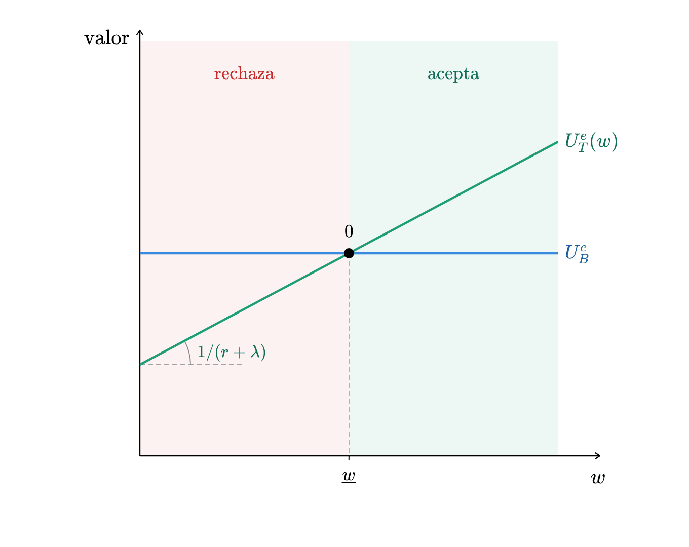
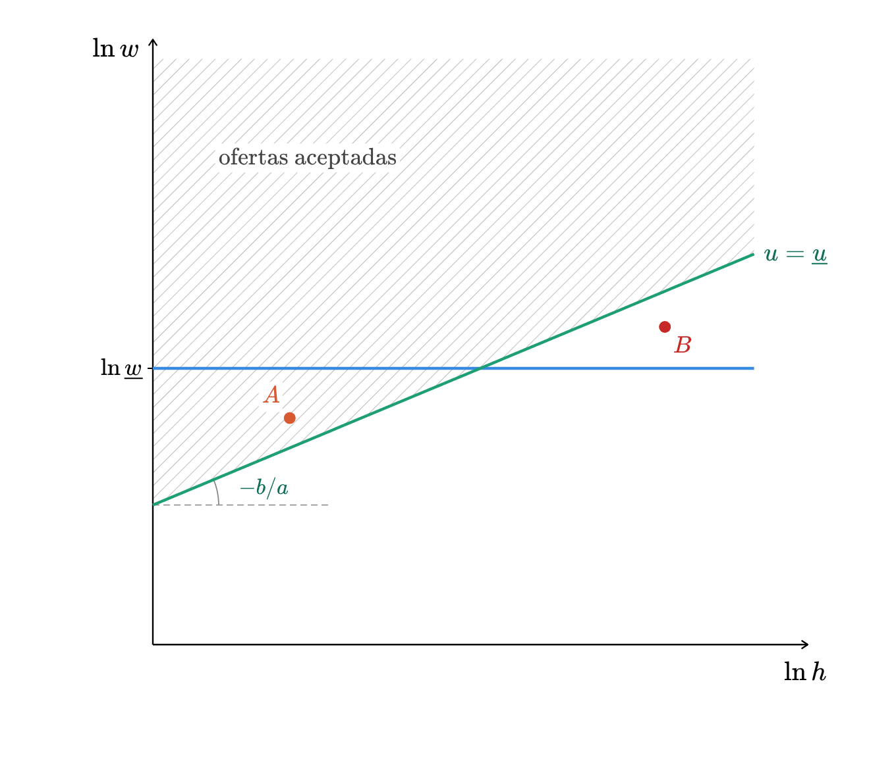
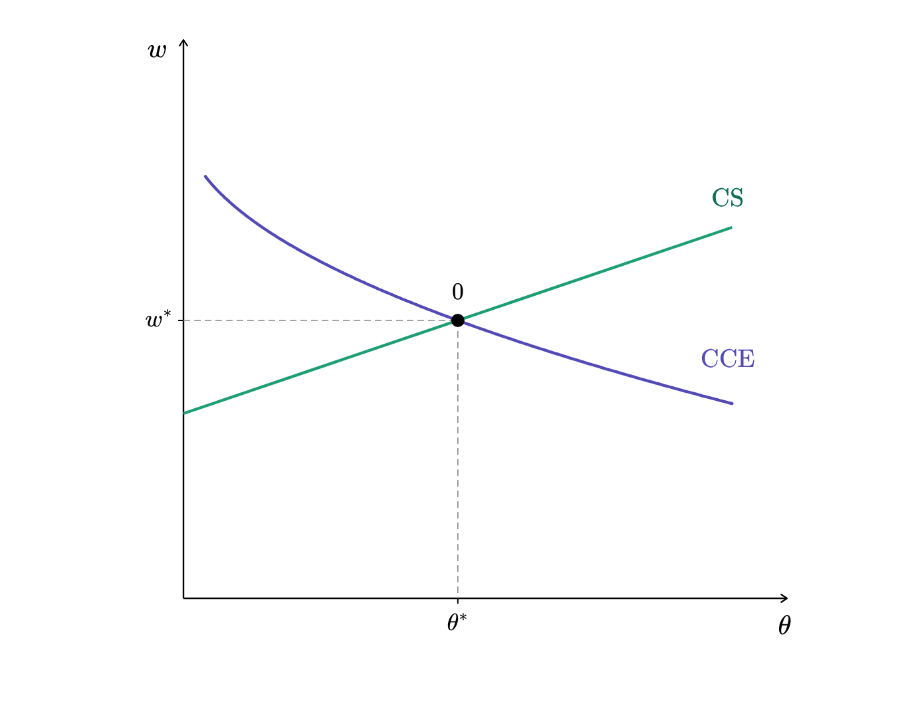
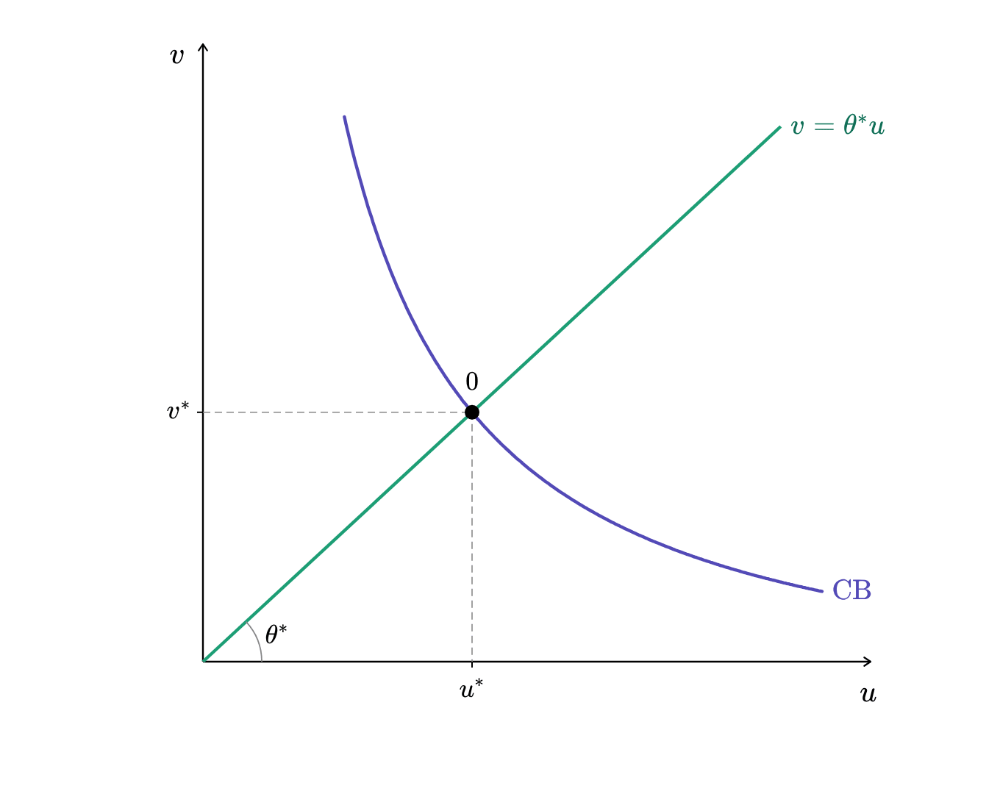
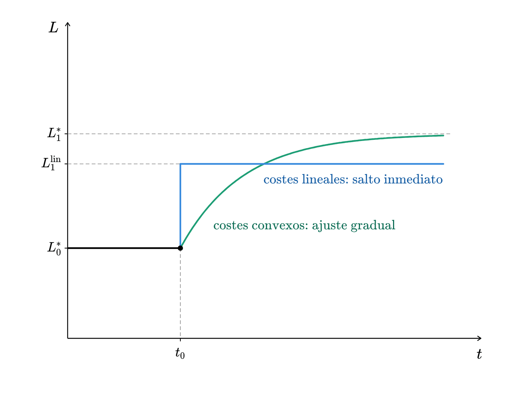

## Introducción

::: {.callout-note appearance="simple" icon=false}

:::

En la **teoría neoclásica tradicional** (tema [A25](a25-oferta-trabajo.qmd)) todos los trabajadores y todos los puestos son iguales y la información es completa, así que, sin fricciones que frenen el encuentro entre oferta y demanda, el desempleo solo puede ser voluntario. Los datos muestran, en cambio, que conviven personas que buscan trabajo y puestos vacantes. Con información imperfecta aparece un problema de extracción de señales[^a26-1]. Así, los agentes han de buscar, y como buscar cuesta, el ajuste deja de ser automático.

En la **teoría de la búsqueda**, McCall (1970) y Mortensen (1970) modelizaron primero la decisión del trabajador, que acepta una oferta solo si el salario supera su **salario de reserva**. Diamond, Mortensen y Pissarides, premiados con el Nobel en 2010, añadieron después las vacantes de las empresas y una **función de emparejamiento** que resume lo difícil que es que unos y otras se encuentren. De ahí surge la **curva de Beveridge**, la relación negativa entre desempleo y vacantes, que permite distinguir una caída de la demanda, que mueve la economía a lo largo de la curva, de un peor emparejamiento, que la desplaza. El modelo explica también por qué el desempleo de equilibrio nunca es nulo, ya que siempre hay trabajadores que cambian de empleo o que se incorporan al mercado. Las fricciones afectan además a las empresas, que soportan **costes de ajuste** al contratar y despedir y adaptan su plantilla con lentitud.

Estos modelos son hoy el marco estándar del mercado de trabajo en la macroeconomía (tema [A28](a28-tnp-nairu.qmd)) y en la evaluación de políticas. La cuantía y la duración de las prestaciones por desempleo alteran el salario de reserva y la intensidad de la búsqueda, las políticas activas de empleo mejoran el emparejamiento y la protección del empleo frena tanto la destrucción como la creación de puestos. Tras la pandemia, la combinación de desempleo bajo y vacantes muy altas en Estados Unidos (2021-2022) reavivó el debate sobre los desplazamientos de la curva de Beveridge.

El tema estudia el **desempleo friccional**, el que surge porque trabajadores y vacantes tardan en encontrarse cuando la información es imperfecta, y la dinámica de la demanda de trabajo. Para ello, el tema se organiza en tres partes:

- *Búsqueda de empleo*: la decisión del trabajador que busca.

- *Emparejamiento*: el modelo de Diamond-Mortensen-Pissarides.

- *Costes de ajuste*: los modelos dinámicos de demanda de trabajo.

## 1. Búsqueda de empleo y salario de reserva

La teoría de la búsqueda estudia el desempleo friccional desde el lado de la oferta, a partir de cómo deciden los trabajadores, con información imperfecta, qué ofertas aceptar y cuánto tiempo seguir buscando. La sección repasa sus antecedentes y expone el modelo del salario de reserva de Mortensen, sus extensiones y la evidencia empírica.

### 1.1. Contexto y antecedentes

Antes del modelo del salario de reserva conviene situar el desempleo que la teoría quiere explicar y sus antecedentes: la búsqueda simultánea y la búsqueda secuencial.

#### 1.1.1. La descomposición del desempleo

Para entender las teorías de la búsqueda, que sustentan las de emparejamiento, conviene partir de la descomposición de la tasa de desempleo en dos componentes:

$$u_t = \bar{u}_t + u_t^c$$

donde $\bar{u}_t$ es el **desempleo de equilibrio** (friccional y estructural), no observable, que persiste aunque el mercado esté en su estado estacionario, y $u_t^c$ el **desempleo cíclico**, la desviación respecto a aquel (tema [A28](a28-tnp-nairu.qmd)).

La teoría neoclásica no puede explicar $\bar{u}$, porque en su equilibrio no queda sin empleo nadie dispuesto a trabajar al salario de mercado. Frente a ella, las teorías de la búsqueda tratan de explicar por qué surge ese desempleo de equilibrio y si es voluntario o involuntario. En un mundo con información imperfecta, encontrar un empleo lleva tiempo y esfuerzo, y el desempleo es, en parte, el tiempo que los trabajadores dedican a buscar.

#### 1.1.2. Búsqueda simultánea (Stigler, 1962)

**Origen**: la teoría de la búsqueda nace de la economía de la información. George Stigler (1962) aplicó al mercado de trabajo su análisis de la dispersión de precios (1961).

**Idea**: si buscar es costoso y los salarios están dispersos, el trabajador decide cuántas ofertas consultar igualando el beneficio esperado de una consulta más a su coste, de modo que la dispersión salarial, tomada como dada, es compatible con una búsqueda óptima.

**Supuestos**:

- *Entorno*: el trabajador conoce la distribución de los salarios que ofrecen las empresas, pero no el salario de cada una.

- *Mercado de factores*: las vacantes son idénticas salvo en el salario. Buscar es costoso (cada consulta tiene un coste $c$) y la búsqueda es *simultánea*, es decir, el trabajador decide de antemano cuántas empresas $n$ contactar y se queda con la mejor oferta.

**Razonamiento**: el salario esperado de la mejor de $n$ ofertas, $w^e(n)$, es creciente en $n$ pero a ritmo decreciente[^a26-3]. El trabajador elige $n$ hasta que el beneficio marginal esperado de una consulta más iguala a su coste marginal:

$$\frac{\partial w^e}{\partial n} = c$$

donde el lado izquierdo es la ganancia esperada de la consulta $n$-ésima y $c$ su coste. Por tanto, se consultan más empresas mientras la ganancia esperada de una consulta adicional compense su coste, y no hasta encontrar el salario más alto de la distribución.

**Conclusiones**:

- *Aspectos positivos*: es el punto de partida de la teoría y explica por qué el mercado laboral no cumple necesariamente la ley del precio único.

- *Limitaciones*: la principal, señalada por McCall, es que la estrategia simultánea no es óptima. Por ejemplo, si la quinta empresa consultada ofrece un salario sorprendentemente alto, tiene poco sentido visitar las $n - 5$ restantes.

#### 1.1.3. Búsqueda secuencial (McCall, 1970)

**Origen**: la búsqueda secuencial se debe a John McCall, que formuló la regla de parada óptima en 1965 y la aplicó a la búsqueda de empleo en 1970.

**Idea**: la estrategia óptima es *secuencial*, es decir, contactar empresas de una en una y decidir, tras cada oferta, si aceptarla o seguir buscando.

**Supuestos**:

- *Entorno*: los de Stigler (distribución salarial conocida, costes de búsqueda).

- *Mercado de factores*: búsqueda secuencial, de modo que el trabajador recibe las ofertas de una en una y decide sobre cada una antes de buscar la siguiente.

**Razonamiento**: de los supuestos se deduce que el criterio de aceptación es una *regla de parada*, según la cual se acepta la oferta $w$ si y solo si alcanza el *salario de reserva* $\underline{w}$, es decir, si $w \geq \underline{w}$. En caso contrario se rechaza y se sigue buscando. El salario de reserva se fija donde el coste de una búsqueda más iguala a la ganancia esperada de obtener una oferta mejor que $\underline{w}$, de modo que se busca hasta que el salario ofrecido cubre el salario de reserva.

**Conclusiones**:

- *Aspectos positivos*: amplía la visión de Stigler y hace del salario de reserva el concepto central de la teoría, del que dependen la duración del desempleo y la tasa de salida.

- *Limitaciones*: la principal es que el modelo toma la distribución de salarios como dada, sin preguntarse si las empresas la mantendrían. De hecho, la *paradoja de Diamond* (1971) muestra que, con agentes idénticos, no la mantienen.

### 1.2. Modelo del salario de reserva (Mortensen, 1970)

**Origen**: Dale Mortensen (1970) dio a la búsqueda secuencial de McCall la forma del modelo del salario de reserva, en un entorno dinámico.

**Idea**: el desempleado compara en cada instante el valor de seguir buscando con el de aceptar la oferta recibida. El salario de reserva es el que le hace indiferente entre ambos y resume toda su estrategia.

#### 1.2.1. Supuestos

**Entorno**: el contexto es dinámico, en tiempo continuo, con información incompleta y mercados financieros perfectos y completos (tipo de interés real $r$ estable y exógeno, sin restricciones de liquidez). El trabajador no conoce el salario de cada empresa, pero sí la función de distribución de ofertas $H(w)$, exógena y constante.

**Agentes**: hay un gran número de oferentes y demandantes racionales, salario-aceptantes. El desempleado busca empleo con intensidad constante y es neutral al riesgo (utilidad instantánea igual al salario y sin desutilidad de la búsqueda)[^a26-6].

**Mercado de factores**:

- *Ofertas*: concretan un salario real constante $w$ mientras dure el contrato. El trabajador recibe las ofertas de una en una, con una tasa de llegada (de Poisson) $\phi > 0$ constante y exógena, en la que se reflejan el perfil del trabajador y las fricciones del mercado.

- *Destrucción*: una vez empleado, el puesto se destruye aleatoriamente a una tasa exógena $\lambda > 0$.

- *Búsqueda*: secuencial y costosa[^a26-7], de modo que la disyuntiva no es participar o no, sino seguir buscando o aceptar.

#### 1.2.2. Modelo

::: {.callout-note appearance="simple" icon=false}
El modelo se desarrolla con detalle para que se entienda de dónde sale cada resultado. Para la exposición basta con enunciar las dos ecuaciones de valor, la condición de indiferencia ($\underline{w} = r U_B^e$), la ecuación implícita del salario de reserva, sin derivarla, la tasa de salida y los signos de la estática comparativa.
:::

**Planteamiento**: en cada instante el desempleado puede no recibir oferta (y sigue buscando, con valor $U_B^e$) o recibir una, que acepta si $w \geq \underline{w}$ (obtiene $U_T^e$) o rechaza si $w < \underline{w}$ (sigue con $U_B^e$). El modelo se resuelve con dos ecuaciones de valor, análogas a las de un activo cuyo rendimiento por unidad de tiempo es un flujo más una ganancia esperada de capital:

- *Utilidad esperada descontada en situación de búsqueda*: el valor de seguir buscando, $U_B^e$, cumple la primera ecuación de valor:

    $$r U_B^e = z + \phi \left(U_\phi^e - U_B^e\right) \quad \rightarrow \quad U_B^e = \frac{1}{r + \phi} \left[z + \phi\, U_\phi^e\right] \quad \rightarrow \quad U_B^e = f(z^{+}, U_\phi^{e\,+}, r^{-}, \phi^{+})$$

    donde $z$ son los ingresos netos durante la búsqueda (subsidios, producción doméstica)[^a26-8] y $U_\phi^e$ el valor esperado de recibir una oferta, $\mathbb{E}[\max(U_T^e(w), U_B^e)]$. En cada instante, el flujo de la búsqueda ($r U_B^e$) equivale a los ingresos netos más la ganancia esperada de recibir una oferta. Despejando $U_B^e$, el valor de buscar reúne los ingresos netos y lo que vale recibir una oferta, ponderado por la tasa $\phi$ a la que llega, y descuenta ambos a la tasa $r + \phi$, con el factor $1/(r + \phi)$. La tasa de descuento suma así al tipo de interés la tasa de llegada de ofertas, porque los ingresos de la búsqueda solo se perciben hasta que llega la siguiente oferta.

- *Utilidad esperada descontada de aceptar y trabajar*: el valor de aceptar una oferta con salario $w$, $U_T^e$, cumple la segunda:

    $$r U_T^e = w + \lambda \left(U_B^e - U_T^e\right) \quad \rightarrow \quad U_T^e = \frac{1}{r + \lambda} \left[w + \lambda\, U_B^e\right] \quad \rightarrow \quad U_T^e = f(w^{+}, U_B^{e\,+}, r^{-}, \lambda^{-})$$

    donde $\lambda$ es la tasa de destrucción del empleo. El flujo de trabajar equivale al salario menos la pérdida esperada de volver al desempleo. De forma análoga, el valor de trabajar reúne el salario y el valor de volver a buscar, ponderado por la tasa $\lambda$ a la que se destruye el puesto, y descuenta ambos a la tasa $r + \lambda$, con el factor $1/(r + \lambda)$, porque el salario solo se cobra mientras dura el empleo. Reordenando se obtiene $U_T^e - U_B^e = (w - r U_B^e)/(r + \lambda)$, es decir, la ganancia de aceptar es el exceso del salario sobre el flujo de la búsqueda, descontado a una tasa que incluye la probabilidad de perder el empleo. Las ofertas valen, por tanto, menos cuanto más precario es el empleo.

**Equilibrio**: el salario de reserva es el que hace al individuo indiferente entre aceptar y seguir buscando:

$$\underline{w} \;\big|\; U_T^e(\underline{w}) = U_B^e \quad \rightarrow \quad \underline{w} = r U_B^e \quad \rightarrow \quad \underline{w}^* = f(z^{+}, \phi^{+}, \lambda^{-}, r^{-})$$

donde el salario de reserva es exactamente el flujo de ingresos que la búsqueda reporta. El individuo acepta cualquier oferta superior y rechaza cualquier inferior, y de ahí que el salario de reserva resuma toda su estrategia.

Sustituyendo la ganancia de aceptar, $U_T^e(w) - U_B^e = (w - \underline{w})/(r + \lambda)$, en la ecuación de la búsqueda, y teniendo en cuenta que solo se aceptan las ofertas con $w \geq \underline{w}$, se obtiene la ecuación implícita del salario de reserva:

$$\underline{w} = z + \frac{\phi}{r + \lambda} \int_{\underline{w}}^{\infty} \left(w - \underline{w}\right) dH(w)$$

El salario de reserva iguala así los ingresos durante la búsqueda más el valor de esperar una oferta mejor, que es la ganancia esperada sobre el propio salario de reserva, multiplicada por la tasa de llegada de ofertas y descontada a la tasa $r + \lambda$. Como la integral decrece con $\underline{w}$, derivando implícitamente se obtienen los signos de la estática comparativa, según los cuales $\underline{w}$ crece con $z$ y con $\phi$ y decrece con $\lambda$ y con $r$.

La tasa de salida del desempleo (*hazard rate*) es la probabilidad por unidad de tiempo de recibir una oferta aceptable, $\chi = \phi \, [1 - H(\underline{w})]$, donde $1 - H(\underline{w})$ es la probabilidad de que la oferta supere el salario de reserva. La duración media esperada del desempleo es su inversa, $T_u = 1/\chi = f(z^{+}, \phi^{\pm}, \lambda^{-}, r^{-})$.

**Desarrollo gráfico**: la determinación del salario de reserva se representa en el plano salario-valor, con el salario ofrecido en el eje horizontal y el valor descontado en el vertical (figura -@fig-a265-salario-reserva):

1. *Valor de aceptar* ($U_T^e(w)$): recoge el valor descontado de aceptar una oferta con salario $w$ y conservar el empleo hasta que se destruya. Es una recta creciente en el salario ofrecido, con pendiente $1/(r + \lambda)$, porque cada unidad de salario se cobra mientras dura el empleo y se descuenta al tipo de interés más la tasa de destrucción.

2. *Valor de seguir buscando* ($U_B^e$): recoge el valor de rechazar la oferta y esperar la siguiente. Es una horizontal, pues depende de los ingresos durante la búsqueda y de la llegada de ofertas, pero no de la oferta concreta recibida.

3. *Equilibrio*: su intersección, el punto 0, define $\underline{w}$. A su izquierda aceptar vale menos que seguir buscando y el individuo rechaza las ofertas, mientras que a su derecha las acepta.

::: {#fig-a265-salario-reserva}

::: {.content-visible when-format="html"}
```{=html}
<div class="graph-frame">
<iframe src="../graphs/a265_Salario_reserva.html" style="height:580px" loading="lazy" title="fig-a265-salario-reserva"></iframe>
</div>
```
:::

::: {.content-visible unless-format="html"}

:::

Determinación del salario de reserva. Se sitúa en la intersección entre el valor de aceptar una oferta, creciente en el salario, y el valor de seguir buscando, independiente de ella.
:::

**Estática comparativa**: todo lo que eleva $U_B^e$ (más subsidios, más ofertas) desplaza la horizontal hacia arriba y el salario de reserva hacia la derecha. En cambio, todo lo que reduce el valor de un empleo (mayor destrucción, mayor descuento) aplana la recta $U_T^e(w)$ y reduce también el valor de seguir buscando, pues las ofertas futuras valen menos. Así, la horizontal $U_B^e$ baja y el salario de reserva se desplaza hacia la izquierda. Los efectos de cada variable son los siguientes:

1. *Ingresos netos durante la búsqueda* ($\uparrow z$): sube $\underline{w}$, cae $\chi$, sube $T_u$. Los desempleados se vuelven más exigentes porque buscar es menos costoso. Por ello, la principal implicación de política es que los subsidios pueden alargar el desempleo friccional.

2. *Tasa de llegada de ofertas* ($\uparrow \phi$): sube $\underline{w}$ (esperar es más barato porque llegan más ofertas) y el efecto sobre $\chi$ y $T_u$ es ambiguo, ya que aumentan las oportunidades, pero también la exigencia[^a26-22].

3. *Tasa de destrucción* ($\uparrow \lambda$): cae $\underline{w}$, sube $\chi$, cae $T_u$. Los empleos valen menos porque son más precarios y los trabajadores se vuelven menos exigentes.

4. *Tipo de interés* ($\uparrow r$): los individuos son más impacientes y descuentan más las ofertas futuras, de modo que cae $\underline{w}$, sube $\chi$ y se acorta $T_u$.

#### 1.2.3. Conclusiones

**Aspectos positivos**: el modelo explica el desempleo friccional como resultado de decisiones racionales con información imperfecta y proporciona las herramientas para analizar los efectos de las prestaciones por desempleo, de la duración del paro y de las políticas de intermediación. Si el trabajador conoce bien $H(w)$, estar parado es para él la mejor opción, pues rechaza voluntariamente toda oferta con $w < \underline{w}$ siguiendo una estrategia de búsqueda óptima.

**Limitaciones**: el modelo presenta tres:

- *Solo oferta*: no considera la demanda de trabajo ni las vacantes, por lo que no puede decir si todo el desempleo friccional es realmente voluntario.

- *Distribución exógena*: la paradoja de Diamond y la crítica de Rothschild (1973) ponen en cuestión el origen de $H(w)$, que el modelo toma como dada.

- *Efecto desánimo*: no explica por qué algunos individuos dejan de buscar.

### 1.3. Extensiones y evidencia empírica

La paradoja de Diamond cuestiona el supuesto de una distribución salarial dada, y la teoría posterior lo justifica. El modelo básico se ha extendido, además, para incorporar las características no salariales de las ofertas, el descuento hiperbólico, el esfuerzo de búsqueda, la búsqueda desde el empleo y los servicios públicos de empleo. También cuenta con una amplia contrastación empírica, centrada en la duración del desempleo y en el efecto de las prestaciones.

#### 1.3.1. La paradoja de Diamond (1971)

**Origen**: Peter Diamond (1971) planteó la paradoja para el mercado de bienes, con consumidores que buscan precios, y la teoría de la búsqueda la trasladó al mercado de trabajo.

**Idea**: si los trabajadores son idénticos y todos siguen la estrategia de McCall, ninguna empresa tiene incentivo a pagar más que el salario de reserva común, pues cualquier oferta igual a $\underline{w}$ es aceptada.

**Razonamiento**: basta un coste de búsqueda positivo, por pequeño que sea, para que la distribución de salarios colapse en un único punto, el salario de monopsonio, y desaparezca el motivo para buscar. La dispersión salarial que la búsqueda presupone no es, por tanto, un equilibrio con agentes idénticos.

**Extensiones**: la teoría posterior respondió por dos vías:

- *Agentes heterogéneos*: la heterogeneidad de los trabajadores (distintos salarios de reserva, como en Albrecht y Axell, 1984) o de las empresas (distinta productividad) sostiene la dispersión.

- *Competencia entre empresas*: si los trabajadores reciben a veces más de una oferta a la vez (Burdett y Judd, 1983) o siguen buscando desde el empleo (Burdett y Mortensen, 1998), las empresas compiten por ellos y la dispersión aparece incluso con agentes idénticos.

Así justificada la dispersión salarial, queda respaldado el supuesto del modelo de Mortensen de una distribución de ofertas dada.

**Conclusiones**:

- *Aspectos positivos*: muestra que la dispersión salarial, que los modelos de búsqueda parcial toman como dada, no puede suponerse y ha de obtenerse como resultado de equilibrio. Obliga así a modelizar a la vez a trabajadores y empresas, que es el camino de los modelos de equilibrio con búsqueda posteriores.

- *Limitaciones*: el resultado descansa en supuestos extremos (agentes idénticos, empresas que fijan el salario unilateralmente, una sola oferta cada vez y búsqueda solo desde el desempleo) y contradice la dispersión salarial que se observa entre trabajadores similares. Como muestran las extensiones, basta modificar alguno de ellos para recuperarla.

#### 1.3.2. Determinantes no salariales: la utilidad de reserva (Blau, 1991)

**Origen**: David Blau (1991) señaló que las ofertas difieren también en las horas de trabajo y otras condiciones, y que el buscador las valora conjuntamente.

**Idea**: el modelo básico supone que el buscador solo valora el salario. Cuando las ofertas difieren en más de una característica, en cambio, el criterio de aceptación pasa a ser una utilidad de reserva.

**Planteamiento**: con una utilidad $u = w^a h^b$, donde $w$ es el salario (un bien, $a > 0$) y $h$ las horas (un mal, $b < 0$), el individuo compara cada oferta con una *utilidad de reserva* $\underline{u}$ y acepta las que la superan. Tomando logaritmos, la curva de indiferencia de reserva es $\ln w = (\ln \underline{u} - b \ln h)/a$, una recta creciente en el plano ($\ln h$, $\ln w$) con pendiente $-b/a > 0$, de modo que el individuo exige más salario para aceptar más horas.

**Desarrollo gráfico**: la utilidad de reserva se representa en el plano $\ln h$-$\ln w$ (figura -@fig-a261-blau):

1. *Curva de indiferencia de reserva* ($u = \underline{u}$): es una recta creciente, con pendiente $-b/a$, y las ofertas aceptables están por encima de ella.

2. *Salario de reserva* ($\ln \underline{w}$): el criterio del modelo básico sería una horizontal, porque el buscador aceptaría toda oferta con un salario superior a $\underline{w}$ cualesquiera que fueran las horas.

3. *Decisión*: el individuo ya no sigue la regla del salario de reserva. Así, admite un salario inferior a ese umbral si la jornada es corta (punto $A$) y rechaza uno superior si la jornada es larga (punto $B$). Los dos criterios se separan más cuanto mayor es la aversión a las horas ($|b|$).

::: {#fig-a261-blau}

::: {.content-visible when-format="html"}
```{=html}
<div class="graph-frame">
<iframe src="../graphs/a261_Blau.html" style="height:540px;max-width:591px" loading="lazy" title="fig-a261-blau"></iframe>
</div>
```
:::

::: {.content-visible unless-format="html"}

:::

Utilidad de reserva (Blau). En el plano (ln h, ln w) las ofertas por encima de la recta de utilidad de reserva son aceptadas, mientras que el criterio del salario de reserva sería una horizontal.
:::

**Conclusiones**:

- *Aspectos positivos*: al introducir dentro de la decisión de aceptar la elección entre ocio y consumo, la extensión tiende un puente entre la búsqueda y la oferta de trabajo del tema [A25](a25-oferta-trabajo.qmd), apartado 1.2. Da cuenta, además, de que alguien prefiera un puesto con menor sueldo si sus condiciones son mejores (p. ej. una jornada más corta).

- *Limitaciones*: como el modelo básico, sigue sin considerar la demanda de trabajo y toma como dada la distribución de las ofertas.

#### 1.3.3. Otras extensiones

1. *Economía conductual* (DellaVigna y Paserman, 2005): con descuento hiperbólico, los buscadores impacientes procrastinan, es decir, buscan con menor intensidad. Aunque también fijan un salario de reserva menor, domina el efecto de la menor intensidad, que alarga el desempleo por una vía distinta de la de los subsidios.

2. *Determinantes del esfuerzo de búsqueda*: la tasa de llegada de ofertas depende del esfuerzo, $\phi = \phi(e)$, que el individuo elige igualando su coste marginal a su beneficio marginal. El esfuerzo depende de la posibilidad de reincorporarse al empleador previo, de las prestaciones por desempleo (que lo reducen además de elevar $\underline{w}$), de las aptitudes de búsqueda y de las restricciones (movilidad, cuidados).

3. *Búsqueda desde el empleo* (*on-the-job search*, Burdett, 1978): los empleados siguen buscando, con un salario de reserva igual al que perciben, lo que explica la movilidad voluntaria y la relación positiva entre salario y antigüedad.

4. *Justificación de los servicios públicos de empleo*: la información sobre vacantes es un bien público y la búsqueda genera externalidades (Pissarides, 1984). La decisión de cada buscador afecta a la probabilidad de encontrar empleo de los demás, de modo que el desempleo de equilibrio puede situarse por encima o por debajo del eficiente (apartado 2.2.3). Esta externalidad enlaza con la teoría del emparejamiento.

#### 1.3.4. Evidencia empírica de la búsqueda

**Prestaciones y duración**: la predicción central del modelo, que las prestaciones alargan el desempleo, está bien establecida. Además, las salidas del desempleo muestran un pico justo antes de agotarse el derecho a la prestación (Katz y Meyer, 1990). Este pico refleja tanto la aceptación de ofertas antes rechazadas como la salida de la población activa. También en España, Bover, Arellano y Bentolila (2002) encuentran que, a los tres meses de desempleo, la tasa de salida de quienes no cobran prestación duplica la de quienes la cobran, un efecto mayor que el del ciclo económico.

**Dependencia de la duración**: la tasa de salida cae con el tiempo en desempleo (*dependencia negativa de la duración*), lo que el modelo básico no predice. Se explica por la heterogeneidad no observada (los más empleables salen antes), por la pérdida de capital humano y por el uso de la duración como señal negativa por parte de las empresas. La parte de esta dependencia que no se debe a la heterogeneidad (pérdida de capital humano, estigma) es la base microeconómica de la histéresis del apartado 2.3.2.

**Salarios de reserva declarados**: las encuestas que preguntan a los parados por su salario de reserva (Krueger y Mueller, 2016) muestran que se sitúa cerca del último salario percibido y que apenas baja con la duración. Ello sugiere que la caída de la tasa de salida con la duración procede menos de la exigencia de los buscadores que de la llegada de ofertas y del esfuerzo de búsqueda.

### 1.4. Conclusiones

Hasta aquí el análisis se ha centrado en el lado de la oferta. Sin embargo, actualmente el desempleo friccional se entiende como resultado de un proceso natural de doble búsqueda, de empleo por parte de los oferentes y de trabajadores por parte de los demandantes, pues también las empresas buscan. Este desempleo se considera, en general, transitorio, a diferencia del desempleo estructural, más persistente. Para ahondar en estas cuestiones, y en particular para responder si el desempleo friccional es voluntario, hay que ir más allá de los modelos de búsqueda e incorporar las vacantes, como hace la teoría del emparejamiento.

## 2. Emparejamiento y curva de Beveridge

**Origen**: Peter Diamond (1982), Dale Mortensen (1982) y Christopher Pissarides (1985), galardonados con el Nobel en 2010, incorporaron al modelo de búsqueda el lado de la demanda (las vacantes) y el proceso de emparejamiento. Mortensen y Pissarides (1994) endogenizaron después la destrucción de empleo, y Pissarides (2000) dio al modelo su forma canónica.

**Idea**: en un contexto de información imperfecta coexisten puestos vacantes y personas desempleadas, algo imposible en un mercado walrasiano. Por tanto, el mercado de trabajo no se vacía y existe desempleo aun con salarios flexibles. Se presenta una versión estilizada del modelo de Diamond-Mortensen-Pissarides (DMP).

La sección expone los supuestos del modelo, sus ecuaciones, el comportamiento de los agentes, el equilibrio con la curva de Beveridge y la estática comparativa, y sus extensiones y aplicaciones.

### 2.1. Supuestos

**Metodología**: entorno de tiempo continuo, donde la población activa se normaliza a uno.

**Entorno**: la información es incompleta (los agentes conocen el proceso de emparejamiento, pero no pueden coordinarse). Existen costes de búsqueda y de transacción (búsqueda activa, preparación de vacantes)[^a26-11]. Los mercados de capitales son completos, con un tipo de interés real $r$ exógeno.

**Agentes**: existe un elevado número de empresas, cada una con un único puesto, vacante o cubierto, que no se coordinan entre sí. También existe un elevado número de trabajadores neutrales al riesgo, que tampoco se coordinan[^a26-12] y no buscan desde el empleo. Una fracción $u$ de ellos está desempleada y $1 - u$ empleada. En el modelo, trabajadores y puestos son idénticos, pero la heterogeneidad real de ambos, razón por la cual el emparejamiento lleva tiempo, se resume en la función de emparejamiento.

**Mercado de factores**: cada puesto cubierto produce un flujo $y$ de un único bien, que es el numerario. Mantener una vacante abierta cuesta $c$ por unidad de tiempo, los puestos se destruyen a una tasa exógena $\lambda$ y el salario no viene dado por el mercado, sino que se negocia bilateralmente tras el emparejamiento.

### 2.2. Modelo

El modelo se distingue porque, además de las ecuaciones de comportamiento de los agentes, incluye ecuaciones que describen el funcionamiento del propio mercado de trabajo.

#### 2.2.1. Ecuaciones de funcionamiento del mercado

Tres relaciones describen el funcionamiento del mercado con independencia de las decisiones de los agentes:

**Ley de movimiento del desempleo**: el modelo describe, en primer lugar, cómo evoluciona el desempleo. La intuición se ve mejor en tiempo discreto, con una ecuación de movimiento del empleo como la siguiente:

$$L_t = (1 - \lambda)\, L_{t-1} + M_{t-1}$$

donde $L_t$ es el nivel de empleo en el periodo $t$, $\lambda$ la tasa de destrucción de empleo, $L_{t-1}$ el nivel de empleo del periodo anterior y $M_{t-1}$ el número de emparejamientos realizados en él.

El empleo de cada periodo es el del periodo anterior, menos los empleos destruidos y más los nuevos emparejamientos realizados en el mercado de trabajo.

En tiempo continuo, que es el marco del modelo, el mismo razonamiento se aplica a la tasa de desempleo. Como la población activa está normalizada a uno, el empleo es $1 - u$, y la variación instantánea de la tasa de desempleo es la diferencia entre dos flujos:

$$\dot{u} = \lambda (1 - u) - p(\theta)\, u$$

donde $\lambda(1 - u)$ es el flujo de empleados que pierden su empleo y $p(\theta) u$ el flujo de desempleados que lo encuentran, a la tasa de salida $p(\theta)$, que depende de la estrechez del mercado, $\theta$ (ambas se definen en este mismo apartado). Como es habitual en tiempo continuo, se omite el argumento temporal de las variables.

**Función de emparejamiento**: constituye el elemento central del modelo, pues relaciona las solicitudes de los desempleados con las vacantes abiertas y determina el número de emparejamientos por unidad de tiempo. Intuitivamente, es una “máquina” que produce un emparejamiento cuando una bola (una solicitud) encesta en una urna (una vacante), y condensa en una expresión todo el proceso de búsqueda mutua y evaluación. Según Pissarides, engloba las fricciones del mercado sin necesidad de hacerlas explícitas.

Formalmente, el número de emparejamientos (*matches*) depende del número de vacantes $V$ y del de desempleados $U$, $M = M(V, U)$, y es estrictamente creciente en ambos argumentos. Habitualmente, se considera que esta función es de tipo Cobb-Douglas:

$$M = A\, V^{\alpha} U^{1 - \alpha}, \qquad A > 0,\; \alpha \in (0, 1)$$

donde $V$ son las vacantes, $U$ los desempleados, $\alpha$ la elasticidad de los emparejamientos respecto a las vacantes[^a26-13] y $A$ la *eficiencia del emparejamiento*, determinada por factores estructurales (formación y movilidad de los trabajadores, eficacia de los servicios de empleo, desajuste de cualificaciones)[^a26-14].

En cuanto a los rendimientos a escala, con rendimientos crecientes se dan efectos de mercado denso (al aumentar las búsquedas el proceso es más eficiente), que pueden generar equilibrios múltiples (Diamond, 1982), y con decrecientes, efectos de congestión. Se suponen, no obstante, rendimientos constantes, los más compatibles con la evidencia, ya que las elasticidades estimadas respecto a vacantes y desempleo suman aproximadamente uno (Petrongolo y Pissarides, 2001).

**Grado de estrechez y tasas de transición**: la *estrechez del mercado* es la ratio vacantes-desempleados, $\theta \equiv V/U > 0$, y mide lo fácil que es para un desempleado encontrar trabajo:

- *Mercado estrecho*: si $\theta > 1$, las vacantes superan a los desempleados y es fácil encontrar trabajo pero difícil cubrir las vacantes.

- *Mercado holgado*: si $\theta < 1$, lo contrario (p. ej. España tras 2008).

Con rendimientos constantes, las dos tasas de transición dependen solo de $\theta$:

$$q(\theta) \equiv \frac{M}{V} = A\, \theta^{\alpha - 1}, \quad q' < 0 \qquad\qquad p(\theta) \equiv \frac{M}{U} = A\, \theta^{\alpha} = \theta\, q(\theta), \quad p' > 0$$

donde $q(\theta)$ es la *tasa de cobertura de vacantes* (la tasa a la que una vacante se cubre por unidad de tiempo) y $p(\theta)$ la *tasa de salida del desempleo* (la tasa a la que un desempleado encuentra empleo).

Un mercado más estrecho favorece a los trabajadores ($p$ sube), pero perjudica a las empresas ($q$ baja). Existe, por tanto, un conflicto de intereses y *externalidades de búsqueda o congestión*, porque cada buscador reduce la probabilidad de éxito de los de su lado y aumenta la del lado contrario. El salario no es, así, el único mecanismo de ajuste, sino que también lo son el número de buscadores y el de puestos.

#### 2.2.2. Comportamiento de los agentes

::: {.callout-note appearance="simple" icon=false}
Para la exposición no es imprescindible desarrollar las ecuaciones de valor de este apartado, pues basta con enunciar las dos condiciones a las que conducen y pasar al equilibrio. Las dos condiciones son la de participación de los trabajadores ($w \geq \underline{w}$, con $\underline{w}$ creciente en $\theta$) y la de creación de empleo de las empresas ($y = w + (r+\lambda)\,c/q(\theta)$). Las ecuaciones se incluyen, sin embargo, porque de ellas se obtiene la forma cerrada de la curva de salarios.
:::

**Trabajadores: condición de participación**: como en el modelo de búsqueda del apartado 1.2, el trabajador compara el valor de buscar con el de trabajar, pero ahora la tasa de llegada de ofertas es endógena, $p(\theta)$:

$$r U_B^e = z + p(\theta)\left(U_T^e - U_B^e\right) \qquad\qquad r U_T^e = w + \lambda\left(U_B^e - U_T^e\right)$$

donde $z$ son los ingresos durante la búsqueda, $U_B^e$ el valor de buscar y $U_T^e$ el de trabajar. Reordenando la segunda ecuación, la ganancia de aceptar es $U_T^e - U_B^e = (w - rU_B^e)/(r + \lambda)$, y el trabajador participa (acepta el puesto) si esa ganancia es no negativa. Sustituyendo en la primera ecuación se obtiene la *condición de participación*:

$$w \;\geq\; \underline{w} = r U_B^e = z + \frac{p(\theta)}{r + \lambda}\,(w - \underline{w}) \quad \rightarrow \quad \underline{w} = f\left(z^{+}, \theta^{+}, \lambda^{-}, r^{-}\right)$$

donde el salario de reserva $\underline{w}$ es el flujo de ingresos que reporta la búsqueda, es decir, los ingresos durante ella más el valor esperado de la ganancia de emparejarse, que crece con la estrechez porque $p(\theta)$ acorta la espera. Para un salario dado, un mercado más estrecho eleva el salario de reserva y la exigencia de los trabajadores, de modo que el salario que exigen es creciente en $\theta$, y esa es la base de la curva de salarios.

**Empresas: condición de creación de empleo**: cada puesto puede estar vacante (coste $c$, valor $\Pi_V^e$) o cubierto (produce $y$, paga $w$, valor $\Pi_C^e$), con ecuaciones de valor simétricas a las del trabajador:

$$r \Pi_V^e = -c + q(\theta)\left(\Pi_C^e - \Pi_V^e\right) \qquad\qquad r \Pi_C^e = y - w + \lambda\left(\Pi_V^e - \Pi_C^e\right)$$

donde una vacante cuesta $c$ y se cubre a la tasa $q(\theta)$, y un puesto cubierto rinde $y - w$ y se destruye a la tasa $\lambda$. Las empresas abren vacantes mientras $\Pi_V^e > 0$. Con libre entrada, por tanto, $\Pi_V^e = 0$ y el valor de un puesto cubierto iguala al coste esperado de cubrirlo, $\Pi_C^e = c / q(\theta)$. Sustituyendo se obtiene la *condición de creación de empleo* (CCE):

$$y = w + (r + \lambda)\, \frac{c}{q(\theta)} \quad \rightarrow \quad \theta = f\left(w^{-}, y^{+}, c^{-}, r^{-}, \lambda^{-}\right)$$

donde la empresa crea empleo hasta que el valor de la producción iguala al salario más la capitalización del coste de mantener la vacante, ajustada por la destrucción. Esta condición es la CPO neoclásica con fricciones. A mayor estrechez, más tarda en cubrirse cada vacante y menor es el salario que la empresa puede pagar, por lo que la curva de creación de empleo tiene pendiente negativa en el plano $(\theta, w)$.

#### 2.2.3. Equilibrio: desempleo, salario y curva de Beveridge

El concepto de equilibrio es el *estado estacionario*, en el que las tasas de desempleo y de vacantes son constantes porque los flujos de entrada y salida se compensan. El equilibrio estacionario queda determinado por tres condiciones: la negociación del salario, la creación de empleo y el flujo estacionario del desempleo.

**Planteamiento**: el salario de equilibrio se determina por negociación. El emparejamiento genera una renta para ambas partes, pues ninguna ha de volver a incurrir en costes de búsqueda, y el salario es la regla de reparto de ese excedente. Se modela como una *negociación à la Nash* (tema [A14](a14-juegos.qmd), apartado 2.4.3):

$$w^* = \arg\max_w \left\{\left(U_T^e - U_B^e\right)^{\gamma} \left(\Pi_C^e - \Pi_V^e\right)^{1 - \gamma}\right\} \quad \Rightarrow \quad U_T^e - U_B^e = \frac{\gamma}{1 - \gamma}\left(\Pi_C^e - \Pi_V^e\right)$$

donde $\gamma \in (0, 1)$ es el poder de negociación del trabajador y los dos factores del producto de Nash son las ganancias netas del emparejamiento para el trabajador, $U_T^e - U_B^e$, y para la empresa, $\Pi_C^e - \Pi_V^e$.

**CPO**: la condición de primer orden reparte el excedente total en proporción $\gamma : (1 - \gamma)$. El resultado es la solución de negociación de Nash, que puede interpretarse como el límite del equilibrio de Nash perfecto en subjuegos del juego de ofertas alternas de Rubinstein (1982) cuando el intervalo entre ofertas tiende a cero (Binmore, Rubinstein y Wolinsky, 1986).

**CSO**: el producto de Nash es estrictamente log-cóncavo en $w$, pues ambos excedentes son lineales en el salario, de modo que la CPO define un único salario negociado.

**Solución**: sustituyendo las ecuaciones de valor y la condición de libre entrada ($\Pi_V^e = 0$, $\Pi_C^e = c/q(\theta)$) se obtiene la *curva de salarios* (CS, *wage curve*) en forma cerrada:

$$w = (1 - \gamma)\, z + \gamma\,(y + c\,\theta)$$

donde $z$ son los ingresos durante la búsqueda y $c\theta$ el coste medio de contratación por desempleado, que las empresas ahorran al cubrir el puesto y que el trabajador captura en proporción a su poder de negociación. Si $\gamma = 0$, el trabajador recibe solo su opción externa, y si $\gamma = 1$, se apropia de toda la producción más el ahorro de búsqueda. En los casos intermedios, el salario es una combinación convexa de ambos.

La curva tiene pendiente positiva en el plano $(\theta, w)$ y puede leerse como la oferta de trabajo del modelo, análoga a la neoclásica, pero la analogía termina ahí, pues la curva incorpora el poder de negociación, la opción externa del trabajador y los costes de búsqueda. La tasa de destrucción y el tipo de interés, en cambio, se cancelan en la forma cerrada.

**Equilibrio**: el modelo se resuelve en dos diagramas:

- *Estrechez y salario*: en el plano estrechez-salario $(\theta, w)$, la curva de salarios (creciente) y la curva de creación de empleo (decreciente) determinan el grado de estrechez y el salario de equilibrio, $\theta^*$ y $w^*$. Ambos dependen solo de los parámetros ($y$, $z$, $c$, $r$, $\lambda$, $\gamma$, $A$, $\alpha$) y no de $u$.

- *Desempleo de equilibrio y curva de Beveridge*: determinada la estrechez, el desempleo se obtiene de la ley de movimiento. En estado estacionario ($\dot{u} = 0$) los flujos de entrada y salida del desempleo se igualan:

    $$u^* = \frac{\lambda}{\lambda + p(\theta)} = \frac{1}{1 + p(\theta)/\lambda} \quad \rightarrow \quad u^* = f\left(\lambda^{+}, \theta^{-}, A^{-}\right)$$

    donde para cada tasa de destrucción y cada grado de estrechez existe una única tasa de desempleo estacionaria, mayor cuanto más se destruye empleo y menor cuanto más estrecho es el mercado y más eficiente el emparejamiento. Escrita en el plano desempleo-vacantes, la misma condición, $\lambda(1 - u) = A v^{\alpha} u^{1 - \alpha}$, es la *curva de Beveridge* (CB):

    $$v = \left[\frac{\lambda (1 - u)}{A\, u^{1 - \alpha}}\right]^{1/\alpha}$$

    donde $v$ y $u$ son las tasas de vacantes y de desempleo. La curva es el lugar geométrico de las combinaciones de ambas compatibles con un desempleo constante.

    William Beveridge (1944) observó la relación inversa entre vacantes y desempleo sin modelarla, y Dow y Dicks-Mireaux (1958) la formalizaron como una hipérbola, mientras que el modelo de emparejamiento la deriva de la condición de flujo estacionario. En el plano $(u, v)$, la curva de Beveridge tiene:

    - *Pendiente negativa*: en una recesión el equilibrio se desplaza sobre ella hacia la derecha y en una recuperación, hacia la izquierda.

    - *Forma convexa respecto al origen*: cada reducción adicional del desempleo exige un aumento cada vez mayor de las vacantes.

    - *Posición*: depende de $A$ y $\lambda$, y cuanto más próxima al origen está la curva, más eficiente es el emparejamiento o menor la tasa de destrucción.

    Es, por ello, una medida de la eficiencia del mercado de trabajo y de la posición cíclica de la economía, y su mera existencia muestra que, pese a haber vacantes, hay desempleo.

    En el segundo diagrama, el plano desempleo-vacantes $(u, v)$, la recta de creación de empleo, que parte del origen con pendiente $\theta^*$, corta a la curva de Beveridge y determina $u^*$ y $v^*$. Ese desempleo es la *tasa de paro friccional* de equilibrio, igual a la tasa natural cuando el salario es el de equilibrio (tema [A28](a28-tnp-nairu.qmd), apartado 3.1).

**Desarrollo gráfico**: la determinación de la estrechez y del salario se representa en el plano estrechez-salario (figura -@fig-a262-equilibrio-trabajo):

1. *Curva de salarios* (CS): recoge el salario negociado para cada grado de estrechez, $w = (1 - \gamma)\, z + \gamma\,(y + c\,\theta)$. Es creciente, porque un mercado más estrecho mejora la opción externa del trabajador y eleva el ahorro de contratación que este captura. La curva de salarios hace de oferta de trabajo.

2. *Curva de creación de empleo* (CCE): recoge, para cada salario, la estrechez a la que las empresas dejan de abrir vacantes, porque su valor se anula. Es decreciente, porque con un mercado más estrecho cada vacante tarda más en cubrirse y solo compensa abrirla con un salario menor. La curva de creación de empleo hace de demanda de trabajo.

3. *Equilibrio*: su corte, el punto 0, determina $\theta^*$ y $w^*$. Ambos dependen solo de los parámetros y no del desempleo, que se obtiene después en el plano desempleo-vacantes.

::: {#fig-a262-equilibrio-trabajo}

::: {.content-visible when-format="html"}
```{=html}
<div class="graph-frame">
<iframe src="../graphs/a262_Equilibrio_trabajo.html" style="height:580px" loading="lazy" title="fig-a262-equilibrio-trabajo"></iframe>
</div>
```
:::

::: {.content-visible unless-format="html"}

:::

Equilibrio del modelo de emparejamiento. La curva de salarios y la condición de creación de empleo determinan la estrechez del mercado y el salario.
:::

La determinación del desempleo y de las vacantes se representa en el plano desempleo-vacantes (figura -@fig-a263-beveridge-i):

1. *Curva de Beveridge* ($\text{CB}$): recoge las combinaciones de desempleo y vacantes con las que el flujo de entrada en el desempleo iguala al de salida. Es decreciente, porque con más vacantes los desempleados encuentran empleo antes, y convexa respecto al origen, porque cada reducción adicional del desempleo exige un aumento cada vez mayor de las vacantes.

2. *Recta de creación de empleo* ($v = \theta^* u$): recoge las combinaciones de desempleo y vacantes con la estrechez de equilibrio de la figura -@fig-a262-equilibrio-trabajo, y por eso parte del origen con pendiente $\theta^*$.

3. *Equilibrio*: su corte, el punto 0, determina $u^*$ y $v^*$, la tasa de paro friccional de equilibrio y la tasa de vacantes compatibles a la vez con el flujo estacionario y con la estrechez de equilibrio $\theta^*$.

::: {#fig-a263-beveridge-i}

::: {.content-visible when-format="html"}
```{=html}
<div class="graph-frame">
<iframe src="../graphs/a263_Beveridge_i.html" style="height:580px" loading="lazy" title="fig-a263-beveridge-i"></iframe>
</div>
```
:::

::: {.content-visible unless-format="html"}

:::

Curva de Beveridge (CB). La curva recoge la relación decreciente entre vacantes y desempleo derivada de la condición de flujo estacionario. Su corte con la recta de creación de empleo $v = \theta^* u$ determina $u^*$ y $v^*$ (punto 0).
:::

**Bienestar**: por las externalidades de búsqueda, el equilibrio descentralizado no es eficiente en general. Lo es solo si el poder de negociación de los trabajadores coincide con la elasticidad de la función de emparejamiento respecto al desempleo, $\gamma = 1 - \alpha$ (condición de Hosios, 1990). Si $\gamma$ es mayor, se crean pocas vacantes y hay demasiado desempleo, y si es menor, demasiadas. Fuera de ese caso, hay margen para la intervención.

#### 2.2.4. Estática comparativa y dinámica

**Estática comparativa**: el modelo distingue dos tipos de perturbaciones (Blanchard y Diamond, 1989):

- *Perturbaciones coyunturales*: son las que alteran la rentabilidad de crear empleo sin cambiar la eficiencia del emparejamiento ni la tasa de destrucción. Giran la recta de creación de empleo (cambia $\theta^*$) y mueven el equilibrio sobre la curva de Beveridge. Todo lo que hace menos provechoso crear un puesto reduce la estrechez y las vacantes y eleva el desempleo, pero el efecto sobre el salario depende de la curva que se desplace en el plano $(\theta, w)$:

    - *Subida del tipo de interés $r$ (que descuenta más los rendimientos futuros) o de las cotizaciones*: desplaza hacia abajo la curva de creación de empleo, y el salario cae.

    - *Subsidio $z$*: no entra en la condición de creación de empleo, sino que desplaza hacia arriba la curva de salarios al mejorar la opción externa del trabajador, y el salario sube.

    - *Coste de la vacante $c$*: desplaza hacia abajo la curva de creación de empleo y hacia arriba la de salarios. Aunque gráficamente el efecto parece ambiguo, la forma cerrada muestra que el salario cae, porque la estrechez disminuye más que proporcionalmente, de modo que baja el coste de contratación por desempleado, $c\theta$, que captura el trabajador.

    - *Productividad $y$*: un aumento, al hacer más provechoso crear un puesto, produce lo contrario. Suben la estrechez, las vacantes y el salario, y cae el desempleo.

- *Perturbaciones estructurales*: son las que cambian la eficiencia con que vacantes y desempleados se encuentran ($A$) o la tasa de destrucción ($\lambda$), y desplazan la propia curva de Beveridge. Una mejora del emparejamiento (mejores tecnologías de la información, mayor movilidad, políticas activas y agencias de empleo eficaces) desplaza la curva hacia el origen, de $\text{CB}_0$ a $\text{CB}_1$, y, en el plano $(\theta, w)$, la curva de creación de empleo hacia arriba. En el plano desempleo-vacantes (figura -@fig-a264-beveridge-ii), la recta de creación de empleo pasa de $v = \theta_0^* u$ a $v = \theta_1^* u$ y el equilibrio, del punto 0 al 1. Para cada nivel de desempleo se necesitan entonces menos vacantes para mantener el empleo. En cambio, un empeoramiento (menor intensidad de búsqueda por efecto desánimo, desajuste de cualificaciones, desempleo de larga duración, entrada en la población activa de colectivos con menor eficacia de búsqueda) desplaza la curva de Beveridge hacia fuera, con más desempleo para cada nivel de vacantes.

::: {#fig-a264-beveridge-ii}

::: {.content-visible when-format="html"}
```{=html}
<div class="graph-frame">
<iframe src="../graphs/a264_Beveridge_ii.html" style="height:580px" loading="lazy" title="fig-a264-beveridge-ii"></iframe>
</div>
```
:::

::: {.content-visible unless-format="html"}

:::

Desempleo de equilibrio. La curva de Beveridge y la recta de creación de empleo determinan conjuntamente desempleo y vacantes. Una mejora de la eficiencia del emparejamiento desplaza la curva hacia el origen, eleva la estrechez y lleva el equilibrio de 0 a 1.
:::

**Dinámica**: las dos variables del modelo se ajustan a velocidades distintas. La estrechez $\theta$ es una *variable de salto*. Como abrir o cerrar vacantes no tiene coste de ajuste y $\theta^*$ no depende de $u$, tras una perturbación las vacantes saltan de inmediato a la nueva recta de creación de empleo. Frente a la estrechez, el desempleo $u$ es una *variable de estado*, que solo cambia a través de los flujos de la ley de movimiento, a un ritmo $\lambda + p(\theta)$ que, con los valores habituales, tarda meses en completar el ajuste.

En el plano $(u, v)$, la economía salta verticalmente a la nueva recta de creación de empleo y se desplaza después a lo largo de ella, a medida que $u$ se ajusta, hasta cortar la curva de Beveridge en el nuevo estado estacionario. Esta dinámica genera los *bucles en sentido antihorario* que se observan en los datos. Así, en una recesión las vacantes caen antes de que el desempleo suba, y en la recuperación suben antes de que el desempleo baje.

### 2.3. Extensiones y aplicaciones

El modelo básico se ha ampliado para endogenizar la destrucción de empleo y explicar la histéresis, y se ha aplicado a la evolución reciente de los mercados de trabajo español y estadounidense.

#### 2.3.1. Destrucción endógena de empleo (Mortensen y Pissarides, 1994)

**Origen**: en el modelo básico la tasa de destrucción $\lambda$ es exógena, pero Mortensen y Pissarides la endogenizan en un artículo posterior (1994).

**Idea**: cada puesto cubierto recibe perturbaciones idiosincrásicas de productividad y la empresa lo destruye cuando la productividad cae por debajo de un umbral, la *productividad de reserva* $\underline{R}$, en el que se anula el excedente conjunto del emparejamiento.

**Razonamiento**: la productividad de reserva es creciente en la estrechez, pues con un mercado estrecho mejora la opción externa del trabajador, que encuentra antes otro empleo, y el emparejamiento deja de compensar antes. En consecuencia, la *curva de destrucción de empleo* tiene pendiente positiva en el plano $(\theta, \underline{R})$ (figura -@fig-a267-destruccion-endogena) y, con la de creación, de pendiente negativa, determina conjuntamente $\theta^*$ y $\underline{R}^*$, y con ellos la tasa de destrucción $\lambda(\underline{R}^*)$ y el desempleo.

::: {#fig-a267-destruccion-endogena}

::: {.content-visible when-format="html"}
```{=html}
<div class="graph-frame">
<iframe src="../graphs/a267_Destruccion_endogena.html" style="height:560px" loading="lazy" title="fig-a267-destruccion-endogena"></iframe>
</div>
```
:::

::: {.content-visible unless-format="html"}

:::

Destrucción endógena de empleo (Mortensen y Pissarides, 1994). La curva de destrucción de empleo (CDE), creciente, y la de creación de empleo (CCE), decreciente, determinan en su corte (punto 0) la estrechez $\theta^*$ y la productividad de reserva $\underline{R}^*$, y con ella la tasa de destrucción $\lambda(\underline{R}^*)$.
:::

**Extensiones**: la destrucción de empleo responde al ciclo, pues se concentra en las recesiones, como muestran los datos de flujos de Davis y Haltiwanger (1992), y a las instituciones. Así, los costes de despido reducen $\underline{R}$ y la destrucción, pero también la creación, con efecto ambiguo sobre el desempleo (apartado 3.3), mientras que las prestaciones elevan $\underline{R}$ y la destrucción. El modelo es, por ello, el marco habitual para evaluar la protección del empleo.

**Conclusiones**:

- *Aspectos positivos*: completa el modelo de emparejamiento al hacer endógenos los dos flujos brutos del mercado de trabajo, de modo que el desempleo responde a las perturbaciones tanto por la creación como por la destrucción de puestos, en línea con la evidencia sobre flujos.

- *Limitaciones*: trata la destrucción como una decisión conjunta y eficiente de la pareja empresa-trabajador, sin distinguir despidos y abandonos voluntarios, y toma como exógenas las perturbaciones de productividad. Además, el efecto de las instituciones sobre el nivel de desempleo es ambiguo, por lo que sus conclusiones de política dependen de la calibración.

#### 2.3.2. Histéresis

Hay **histéresis** cuando el desempleo de equilibrio depende de la trayectoria del desempleo efectivo, de modo que una recesión eleva de forma persistente la tasa natural (tema [A28](a28-tnp-nairu.qmd), apartado 2.3). La literatura distingue tres mecanismos:

1. *Salarial o de insiders-outsiders* (Blanchard y Summers, 1986; Lindbeck y Snower, 1988): los empleados que conservan el puesto negocian salarios que solo tienen en cuenta su propio empleo. Por eso, tras una recesión, el salario no baja lo suficiente para recuperar a los despedidos. Este mecanismo opera a través de la curva de salarios (tema [A27](a27-salarios.qmd), apartado 2.4).

2. *De emparejamiento* (Pissarides, 1992): este mecanismo se deriva del propio modelo. El desempleo de larga duración provoca pérdida de capital humano, reconversión y efecto desánimo, que en el modelo se traducen en una caída de la eficiencia del emparejamiento ($\downarrow A$). Por ello, cuando las vacantes vuelven a su nivel, el desempleo es mayor que al inicio, porque la curva de Beveridge se ha desplazado hacia fuera[^a26-16].

3. *De capital* (Bean, 1989): la recesión reduce la inversión y el *stock* de capital, y con él la demanda de trabajo compatible con cada salario.

Las tres vías coinciden en que la política de estabilización tiene efectos permanentes, pero difieren en el remedio. La primera pide moderación salarial y reforma de la negociación; la segunda, políticas activas de empleo que restauren la eficiencia del emparejamiento, y la tercera, estímulo a la inversión.

#### 2.3.3. Aplicaciones: los casos español y estadounidense

**El caso español**: tras la crisis de 2008 la curva de Beveridge se desplazó hacia fuera, lo que indica una pérdida de eficiencia del emparejamiento y no solo una caída de la demanda de trabajo, por cuatro causas documentadas:

1. *Desajuste de cualificaciones*: mano de obra de la construcción sin habilidades para los sectores emergentes.

2. *Menor movilidad geográfica*: el predominio de la vivienda en propiedad frente al alquiler encarece el cambio de residencia (Oswald, 1996).

3. *Histéresis vía desempleo de larga duración*: descapitalización, señal negativa, desmotivación.

4. *Diferencias regionales*: las políticas activas, gestionadas por las comunidades autónomas, difieren entre regiones.

**El caso estadounidense** (2021-2022): tras la pandemia, las combinaciones de desempleo y vacantes de EE. UU. se situaron muy por encima de la curva de Beveridge previa. En 2022, las vacantes alcanzaron máximos de la serie con una tasa de paro similar a la de 2019. Ello abrió un debate entre dos lecturas, y la normalización de 2023 favoreció la segunda:

- *Pérdida persistente de eficiencia del emparejamiento*: exigiría más desempleo para reducir la inflación (Blanchard, Domash y Summers, 2022).

- *Tramo casi vertical de una curva estable*: con un mercado muy estrecho la curva es muy inclinada, de modo que las vacantes podían caer sin apenas aumento del paro (Figura y Waller, 2022).

### 2.4. Conclusiones

**Aspectos positivos**: el modelo de emparejamiento es hoy el marco de referencia del análisis del desempleo de equilibrio. Explica la coexistencia de vacantes y parados, dota de microfundamentos a la curva de Beveridge y a la curva de salarios, y permite distinguir las perturbaciones coyunturales de las estructurales, que es lo que la política de empleo necesita. Además, es fácil de contrastar, permite el análisis institucional y ha inspirado las recomendaciones de reforma laboral en España (Manifiesto de los 100, 2009).

**Limitaciones**: el *puzzle de Shimer* (2005) consiste en que, calibrado con datos de EE. UU. (1951-2003), el modelo predice una volatilidad del desempleo y de las vacantes mucho menor que la observada. En particular, la estrechez simulada tiene una desviación típica diez veces menor que la real, porque el salario negociado absorbe la mayor parte de las perturbaciones de productividad. Las soluciones propuestas son un mayor valor de las actividades de no mercado (Hagedorn y Manovskii, 2008), rigidez salarial (Hall, 2005), costes fijos de emparejamiento (Pissarides, 2009) y heterogeneidad de puestos.

## 3. Costes de ajuste y dinámica de la demanda de trabajo

Si cambiar la plantilla tiene costes, la empresa tarda en llevarla a su nivel óptimo. Los modelos con costes de ajuste explican así cómo evoluciona el empleo demandado. Del lado de la oferta, la dinámica procede de la sustitución intertemporal del modelo de Lucas-Rapping (tema [A25](a25-oferta-trabajo.qmd), apartado 2.2), $l_t^s / l_{t+1}^s = f[(w_t/w_{t+1})^{+}, r^{+}, \rho^{-}]$, que no incorpora costes de ajuste, pues el trabajador reasigna sus horas entre periodos sin fricciones. Los costes de ajuste relevantes son, por ello, los de la demanda.

### 3.1. Concepto y formas de los costes de ajuste

Se llaman **costes de ajuste** los que, además del precio del factor, paga la empresa por cambiar el ritmo al que incorpora factores productivos. Formalmente, $C = C(\dot{L})$ con $C(0) = 0$, $C'(\dot{L}) > 0$ para $\dot{L} > 0$ y $C'(\dot{L}) < 0$ para $\dot{L} < 0$, de modo que el coste crece con la magnitud del ajuste, $|\dot{L}|$[^a26-18]. Pueden ser de dos tipos:

- *Internos* (Eisner y Strotz, 1963; Lucas, 1967): pérdidas temporales de eficiencia por cambios en la producción, de carácter implícito contablemente (mermas de producción, formación de los nuevos trabajadores).

- *Externos*: los que nacen de la relación con terceros, de carácter explícito (consultores, costes de contratación, indemnizaciones por despido).

**Formas funcionales**: determinan la dinámica del empleo (tema [A12](a12-costes.qmd), apartado 3.3.2):

1. *Convexos*: ajustar es tanto más caro cuanto más rápido se hace ($C'' > 0$). Son *simétricos* si contratar cuesta lo mismo que despedir, *asimétricos* si despedir cuesta más, como imponen las indemnizaciones.

2. *Lineales*: el coste es proporcional al número de trabajadores ajustados ($C'' = 0$), y también pueden ser simétricos o asimétricos.

3. *Fijos*: existe un coste independiente del tamaño del ajuste, como el de un expediente de regulación de empleo.

En todos los casos los costes de ajuste estabilizan el empleo a costa de la eficiencia. La empresa suaviza la variación (costes convexos) o no ajusta ante perturbaciones pequeñas (costes lineales o fijos), de modo que el empleo varía menos que el producto, y tanto menos cuanto mayores son los costes.

### 3.2. Demanda de trabajo

La dinámica de la demanda de trabajo depende de la forma funcional de los costes de ajuste. Se parte del caso de referencia sin costes y se analizan después los costes convexos, lineales y fijos.

#### 3.2.1. Sin costes de ajuste

El caso de referencia es la demanda de trabajo neoclásica sin fricciones (tema [A25](a25-oferta-trabajo.qmd), apartado 1.3), planteada en forma dinámica.

**Planteamiento**: la empresa maximiza el valor actual de sus beneficios eligiendo la senda de empleo:

$$\max_{\{L_t\}} \; V(0) = \int_0^{\infty} e^{-rt} \left[p_t f(L_t) - w_t L_t\right] dt \quad \Rightarrow \quad \frac{\partial \pi_t}{\partial L_t} = 0 \; \Rightarrow \; \underbrace{p_t \frac{df}{dL_t}\bigg|_{L_t^*}}_{\text{VPmg}_{L}} = \underbrace{w_t}_{\text{salario}}$$

donde $\{L_t\}$ es la senda de empleo (variable de decisión), $V(0)$ el valor actual de los beneficios, $r$ el tipo de descuento, $p_t$ el precio del producto, $f(L_t)$ la función de producción, $w_t$ el salario y $\pi_t$ el beneficio de cada instante.

**CPO**: $p_t\, df/dL|_{L_t^*} = w_t$. Sin costes de ajuste el problema es separable en el tiempo, de modo que la CPO de cada periodo es la estática.

**CSO**: $f''<0$, es decir, el beneficio de cada instante es estrictamente cóncavo en el empleo, por lo que la CPO estática es suficiente.

**Solución**: en cada instante, la demanda de trabajo es la neoclásica, decreciente en el salario real $w_t/p_t$, y el empleo salta instantáneamente a su nivel óptimo ante cualquier perturbación.

#### 3.2.2. Costes de ajuste convexos (Holt et al., 1960; Eisner y Strotz, 1963)

**Origen**: Holt, Modigliani, Muth y Simon (1960) y Eisner y Strotz (1963) introdujeron los costes de ajuste cuadráticos en la decisión dinámica de la empresa.

**Idea**: si ajustar deprisa es más caro que hacerlo despacio, la empresa reparte el ajuste de la plantilla en el tiempo.

**Planteamiento**: con costes variables y cuadráticos, $C = (b/2) \dot{L}^2$, el coste marginal de ajuste es creciente y simétrico:

$$\begin{aligned} &\max_{\{L_t\}} \; V(0) = \int_0^\infty e^{-rt} \left[p_t f(L_t) - w_t L_t - \frac{b}{2} \dot{L}_t^2\right] dt \\ &\Rightarrow\; \underbrace{p_t \frac{df}{dL_t}}_{\text{VPmg}_{L}} = w_t + \underbrace{r b \dot{L}_t - b \ddot{L}_t}_{\text{Cmg}_{\text{ajuste}}} \end{aligned}$$

donde $\{L_t\}$ es la senda de empleo (variable de decisión), $\dot{L}_t$ y $\ddot{L}_t$ su primera y segunda derivadas temporales, $V(0)$ el valor actual de los beneficios, $r$ el tipo de descuento, $p_t$ el precio del producto, $f(L_t)$ la función de producción, $w_t$ el salario y $b > 0$ el parámetro del coste cuadrático de ajuste $C = (b/2)\dot{L}^2$. El empleo inicial, $L_0$, está dado.

**CPO**: la condición de Euler establece que la empresa contrata hasta que el valor de la productividad marginal cubre el salario más el coste marginal de ajustar la plantilla. La cierra la condición de transversalidad, $\lim_{t \to \infty} e^{-rt}\, b\,\dot{L}_t\, L_t = 0$, que descarta las sendas explosivas y deja la que converge al estado estacionario. En el estado estacionario ($\dot{L} = \ddot{L} = 0$) se recupera la condición estática $p\, df/dL|_{L^*} = w$.

**CSO**: el integrando es estrictamente cóncavo en $(L_t, \dot{L}_t)$, pues $f'' < 0$ y $b > 0$, de modo que la condición de Euler, junto con la de transversalidad, es suficiente (Mangasarian).

**Dinámica**: el ajuste depende de la naturaleza de la perturbación:

- *Permanente*: el ajuste es gradual y completo hasta el nuevo estado estacionario.

- *Transitoria*: el ajuste es gradual e incompleto, porque no compensa pagar el coste de ajuste para un cambio que va a revertirse.

De ahí que la productividad sea procíclica. Como el empleo va por detrás de la producción, $Y/L$ sube tras un impulso favorable y baja tras uno adverso[^a26-21]. Con costes convexos asimétricos (Pfann y Palm, 1993), la dinámica es la misma, pero la velocidad del ajuste depende de la dirección y es más lenta al despedir que al contratar cuando, como imponen las indemnizaciones, despedir cuesta más.

**Conclusiones**:

- *Aspectos positivos*: explica el ajuste gradual del empleo, distingue la respuesta a perturbaciones permanentes y transitorias y da cuenta de la productividad procíclica. Su forma cuadrática conduce, además, a ecuaciones de ajuste parcial fáciles de estimar.

- *Limitaciones*: la convexidad y la simetría son supuestos de conveniencia analítica que la evidencia microeconométrica no confirma. El modelo tampoco genera los periodos de inacción ni los ajustes a saltos que muestran los datos de empresa, por lo que se ajusta mejor a la dinámica del empleo agregado, que la agregación de ajustes discretos suaviza.

#### 3.2.3. Costes de ajuste lineales (Nickell, 1986)

**Origen**: Stephen Nickell (1986) analizó el caso de los costes lineales.

**Idea**: si el coste marginal de ajustar es constante, no hay ganancia en la gradualidad y el ajuste, cuando se produce, es inmediato.

**Planteamiento**: con costes lineales, $C = c|\dot{L}|$, el programa de la empresa es:

$$\max_{\{L_t\}} \; V(0) = \int_0^\infty e^{-rt} \left[p_t f(L_t) - w_t L_t - c\,|\dot{L}_t|\right] dt \quad \Rightarrow \quad \underbrace{p_t \frac{df}{dL_t}\bigg|_{L_t^*}}_{\text{VPmg}_{L}} = w_t + \underbrace{r c}_{\text{Cmg}_{\text{ajuste}}}$$

donde $\{L_t\}$ es la senda de empleo (variable de decisión), $\dot{L}_t$ su variación por unidad de tiempo, $V(0)$ el valor actual de los beneficios, $r$ el tipo de descuento, $p_t$ el precio del producto, $f(L_t)$ la función de producción, $w_t$ el salario y $c$ el coste unitario de ajuste (constante por trabajador contratado o despedido). El empleo inicial, $L_0$, está dado.

**CPO**: $p_t\, df/dL|_{L_t^*} = w_t + r c$ al contratar ($\dot L_t > 0$) y $p_t\, df/dL|_{L_t^*} = w_t - r c$ al despedir ($\dot L_t < 0$). La productividad marginal cubre el salario más (menos) el flujo equivalente, $rc$, del coste único de contratar (despedir), y entre ambos valores la empresa no ajusta.

**CSO**: el integrando es cóncavo en $(L_t, \dot{L}_t)$, pues $f'' < 0$ y $-c|\dot{L}_t|$ es cóncava, de modo que la condición es suficiente. Su no diferenciabilidad en $\dot{L}_t = 0$ genera la banda de inacción.

**Desarrollo gráfico**: las sendas de ajuste del empleo se representan en el plano tiempo-empleo (figura -@fig-a266-costes-ajuste-sendas), ante una perturbación permanente en $t_0$ que eleva el empleo desde $L_0^*$:

1. *Senda con costes lineales*: es un escalón, con salto inmediato a $L_1^{\text{lin}}$, algo inferior al nivel sin costes porque $p\, df/dL = w + rc$.

2. *Senda con costes convexos*: es una curva que se aproxima asintóticamente a $L_1^*$, donde $p\, df/dL = w$. El ajuste es gradual porque el coste marginal de ajustar, $b\dot{L}$, crece con la velocidad del ajuste.

3. *Estado estacionario*: la senda convexa acaba por encima de la lineal porque con costes cuadráticos el coste marginal de ajuste, $b\dot{L}$, se anula al llegar al estado estacionario y no deja cuña alguna. Con costes lineales, en cambio, el coste unitario $c$ no desaparece por pequeño que sea el ajuste, y su coste de oportunidad, $rc$, actúa como una cuña permanente sobre el salario.

::: {#fig-a266-costes-ajuste-sendas}

::: {.content-visible when-format="html"}
```{=html}
<div class="graph-frame">
<iframe src="../graphs/a266_Costes_ajuste_sendas.html" style="height:580px" loading="lazy" title="fig-a266-costes-ajuste-sendas"></iframe>
</div>
```
:::

::: {.content-visible unless-format="html"}

:::

Sendas de ajuste del empleo ante una perturbación permanente. Con costes lineales el salto es inmediato (a un nivel final menor, $L_1^{\text{lin}}$), mientras que con costes convexos la aproximación es gradual (hacia $L_1^*$).
:::

**Dinámica**: el ajuste depende de la naturaleza de la perturbación:

- *Permanente*: el ajuste es inmediato y de una sola vez, aunque se detiene en $L_1^{\text{lin}}$, algo por debajo del nivel sin costes.

- *Transitoria*: si la desviación del ciclo respecto a la tendencia es pequeña, la empresa no ajusta, pues se encuentra dentro de una banda de inacción alrededor del óptimo, mientras que, si la desviación es grande, el ajuste es inmediato pero incompleto.

La divergencia respecto al nivel sin costes es menor que con costes convexos durante la transición, aunque, a diferencia de estos, persiste a largo plazo una cuña $rc$. Con costes lineales asimétricos, el ajuste sigue siendo inmediato y la banda de inacción es asimétrica.

**Conclusiones**:

- *Aspectos positivos*: explica la banda de inacción y los ajustes inmediatos, más próximos a lo que muestran los datos de empresa que la gradualidad de los costes convexos. Su versión asimétrica es, además, el marco del análisis de los costes de despido.

- *Limitaciones*: un coste proporcional al ajuste no recoge el componente fijo que la evidencia microeconométrica encuentra en los costes de ajuste, por lo que el modelo no explica por sí solo los ajustes grandes e infrecuentes de los datos de empresa. Por ello, el trabajo aplicado lo combina con otras formas de coste.

#### 3.2.4. Costes de ajuste fijos (Hamermesh, 1989)

**Origen**: Daniel Hamermesh (1989) mostró, con datos mensuales de establecimientos, que el empleo de cada planta se ajusta a saltos, lo que revela un componente fijo en los costes de ajuste.

**Idea**: los costes de ajuste fijos dan lugar a reglas de ajuste del tipo $(S, s)$, porque con un coste fijo la empresa solo ajusta cuando la desviación respecto a la plantilla óptima compensa pagarlo.

**Razonamiento**: si ajustar cuesta una cantidad fija $k$, añadir o quitar un trabajador más no cuesta nada en el margen, así que la empresa, cuando ajusta, lo hace de golpe y del todo. Sin embargo, solo le compensa hacerlo si lo que gana con la plantilla óptima, una vez pagado $k$, supera lo que obtiene sin tocar la plantilla actual. El resultado es una regla $(S, s)$, en la que el empleo permanece constante dentro de una banda y salta cuando la desviación respecto al óptimo la excede. Se generan así ajustes discretos e infrecuentes en cada empresa que, agregados, producen una dinámica suave.

**Conclusiones**:

- *Aspectos positivos*: reproduce los periodos de inacción y los ajustes grandes e infrecuentes de los datos de empresa, y explica por qué el empleo agregado, que suma decisiones de empresas que ajustan en momentos distintos, se mueve de forma gradual.

- *Limitaciones*: la regla $(S, s)$ no conduce a una ecuación de ajuste sencilla, y la dinámica agregada depende de la distribución de las desviaciones entre empresas, por lo que el modelo es más difícil de estimar que el de costes convexos.

### 3.3. Evidencia empírica e implicaciones de política

**Balance empírico**: el repaso de Hamermesh y Pfann (1996) constata que la literatura adoptó sobre todo la especificación cuadrática y simétrica. Los estudios microeconométricos con datos de empresa dibujan, sin embargo, costes de ajuste asimétricos, no necesariamente convexos y con un componente fijo de peso, que explican los periodos de inacción y los ajustes a saltos. El análisis admite, además, dos extensiones importantes. Una es el margen intensivo, pues ajustar horas resulta más barato que ajustar trabajadores. La otra es la heterogeneidad de los costes de ajuste entre trabajadores, que hace recaer el ajuste sobre los temporales, como en el mercado dual español.

**Costes de despido y empleo** (Bentolila y Bertola, 1990): con costes de ajuste lineales y asimétricos, un aumento del coste de despido reduce los despidos en las recesiones más de lo que reduce las contrataciones en las expansiones. La razón es que la empresa descuenta el coste futuro de despedir al contratar, pero lo paga con certeza al despedir. Por tanto, el efecto sobre el empleo medio es pequeño y positivo, mientras que el efecto sobre los flujos es inequívoco, pues el mayor coste de despido reduce la rotación y alarga la duración del desempleo. Hopenhayn y Rogerson (1993) añaden el coste de bienestar, porque la protección del empleo frena la reasignación de trabajadores de las empresas menos a las más productivas y reduce la productividad agregada.

**El mercado dual español** (Bentolila y Dolado, 1994): con dos tipos de contrato, indefinidos con altos costes de despido y temporales sin ellos, el ajuste recae sobre los temporales con independencia de su productividad. Los indefinidos, protegidos, presionan por su parte al alza los salarios (*insiders*), y la volatilidad del empleo se concentra en el margen temporal, lo que explica la extraordinaria sensibilidad cíclica del empleo español desde 1984.

**Implicaciones de política**: la política económica afecta al desempleo no solo a través de las decisiones de búsqueda sino también de la estructura de los costes de rotación. La legislación de protección del empleo estabiliza el empleo a costa de la eficiencia, con sobreempleo en las recesiones y empleo inferior al óptimo en las expansiones.

## Conclusiones

El tema ha mostrado que el desempleo friccional es un fenómeno de equilibrio, porque encontrar empleo y cubrir una vacante lleva tiempo cuando la información es imperfecta. Los modelos de búsqueda, de Stigler y McCall a Mortensen, explican la duración del desempleo y el efecto de las prestaciones, aunque toman como dada una distribución de salarios que la paradoja de Diamond pone en cuestión. Después, la teoría del emparejamiento incorpora las vacantes, determina a la vez la estrechez, el salario y el desempleo y da fundamento a la curva de Beveridge. Sin embargo, su equilibrio solo es eficiente si se cumple la condición de Hosios, y el modelo genera menos volatilidad de la observada (el *puzzle* de Shimer). Por último, los costes de ajuste explican por qué el empleo varía menos que el producto y por qué la protección del empleo afecta más a los flujos que al nivel del desempleo.

El desempleo friccional se define por contraste con el mercado sin fricciones, cuyo equilibrio competitivo sirve de referencia (tema [A25](a25-oferta-trabajo.qmd)). El reparto del excedente de cada emparejamiento se resuelve con la solución de negociación de Nash (tema [A14](a14-juegos.qmd)), y los costes de ajuste de la plantilla siguen la misma lógica que los del capital en la teoría *q* de la inversión (tema [A34](a34-demanda-inversion.qmd)). Frente a la negociación colectiva y los salarios de eficiencia, que atribuyen el desempleo involuntario a salarios superiores al de equilibrio (tema [A27](a27-salarios.qmd)), aquí el desempleo procede de las fricciones. Ambas tradiciones confluyen, por último, en la tasa natural de paro y en la histéresis, que explican por qué el desempleo puede persistir tras una perturbación (tema [A28](a28-tnp-nairu.qmd)).

Tras la pandemia, las combinaciones de desempleo y vacantes de EE. UU. se situaron muy por encima de la curva de Beveridge previa. Blanchard, Domash y Summers (2022) lo interpretaron como una pérdida de eficiencia del emparejamiento, y Figura y Waller (2022), como un movimiento sobre el tramo inclinado de una curva estable. Las propias fricciones generan, además, poder de monopsonio, como en Burdett y Mortensen (1998), y la evidencia reciente lo considera extendido (Manning, 2021). Sigue abierto el diseño de las prestaciones, ya que la ampliación de los subsidios en EE. UU. durante la pandemia redujo poco la tasa de encuentro de empleo (Ganong et al., 2024).

[^a26-1]: Quien ve variar su salario nominal no sabe si la perturbación es agregada, un cambio general de los precios sin consecuencias reales, o específica, un cambio de su salario real que sí debería alterar su oferta. A esa dificultad se la llama problema de extracción de señales.

[^a26-3]: La densidad de que una empresa concreta ofrezca el salario $w_0$ y sea la mejor de $n$ es $H(w_0)^{n-1} H'(w_0)$, el producto de la probabilidad de que las otras $n - 1$ ofrezcan menos y la densidad de que ella ofrezca $w_0$. Como cualquiera de las $n$ puede ser la mejor, el salario esperado de la mejor oferta es $w^e(n) = \int_0^\infty n\, H(w)^{n-1} H'(w)\, w\, dw$, creciente en $n$ a ritmo decreciente.

[^a26-6]: El coste de buscar se recoge en los ingresos netos $z$ y en el tiempo de espera hasta recibir una oferta aceptable.

[^a26-7]: Sin costes de búsqueda, el trabajador no pararía hasta dar con la oferta más alta posible.

[^a26-8]: Incluye también el valor del ocio.

[^a26-11]: En un mundo sin fricciones, a las empresas les resulta indiferente perder empleados (pueden conseguir idénticos al mismo salario sin costes) y a los trabajadores no les preocupa perder su puesto.

[^a26-12]: Esto implica que una vacante podría recibir muchas solicitudes y otra ninguna.

[^a26-13]: Los exponentes $\alpha$ y $1 - \alpha$ son elasticidades producto-factor. Si los argumentos se retribuyeran según su productividad marginal, serían sus participaciones en el producto.

[^a26-14]: La eficiencia del emparejamiento en EE. UU. se degradó notablemente tras la crisis de las *subprime* (Barnichon y Figura, 2015).

[^a26-16]: La figura -@fig-a264-beveridge-ii representa el caso opuesto, una mejora de la eficiencia ($\Delta A > 0$) que lleva de 0 a 1, de modo que la histéresis equivale a pasar del punto 1 al 0.

[^a26-18]: Los factores variable y fijo de la teoría tradicional son casos polares, con costes de ajuste nulos o infinitos, respectivamente.

[^a26-21]: Si la empresa anticipa una perturbación futura, los costes convexos hacen que esta tenga efectos incluso antes de materializarse.

[^a26-22]: El signo depende de la forma de la distribución de ofertas $H(w)$. Flinn y Heckman (1983) muestran que, si la integral de la función de supervivencia, $\int_w^\infty [1 - H(x)]\, dx$, es log-cóncava (basta con que lo sea la densidad), domina el aumento de las oportunidades, de modo que una mayor tasa de llegada eleva $\chi$ y acorta $T_u$. Van den Berg (1994) debilita las condiciones suficientes obtenidas hasta entonces, que no cumplían las familias de distribuciones de salarios más usadas en la estimación estructural, y extiende el resultado a todas ellas.
