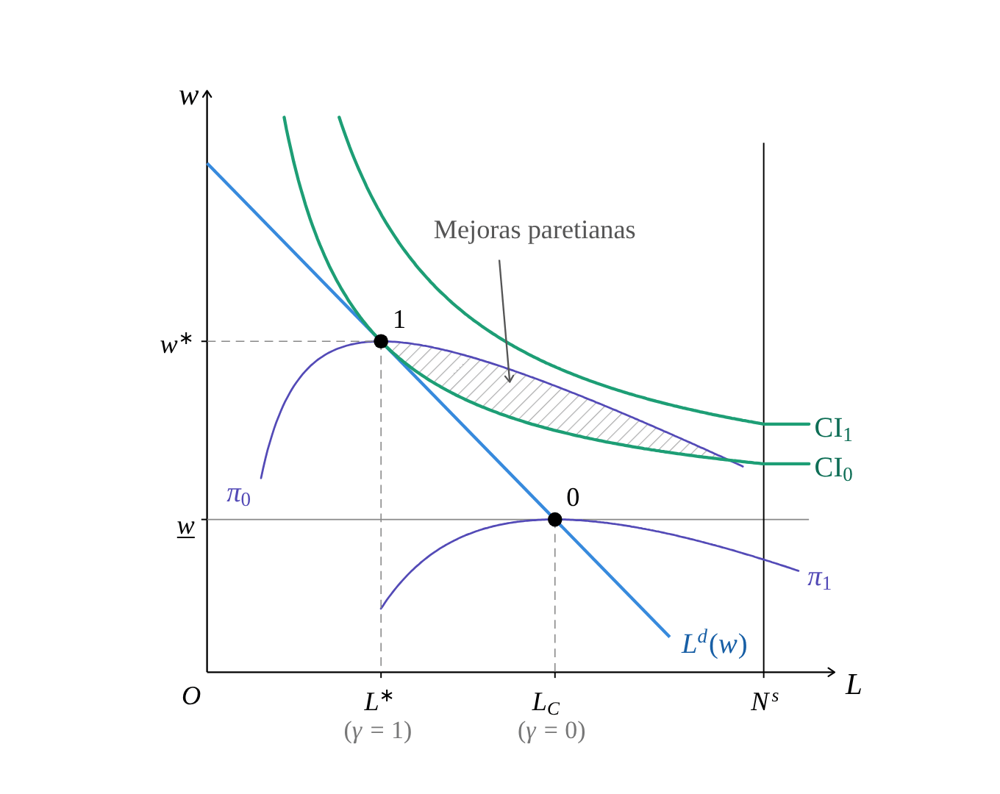
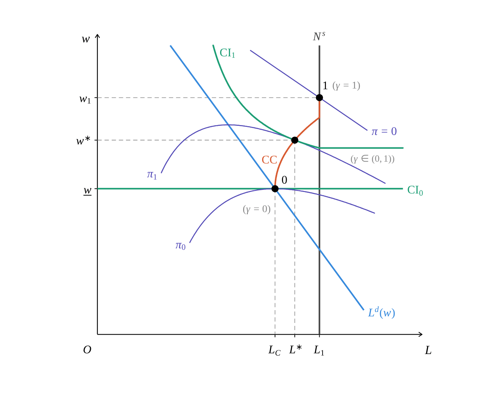
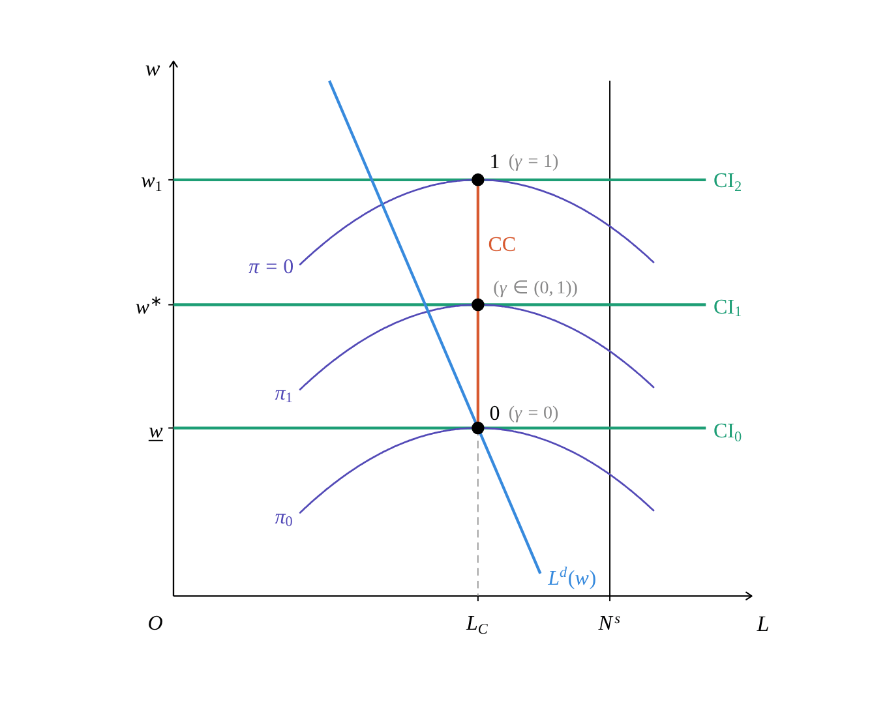
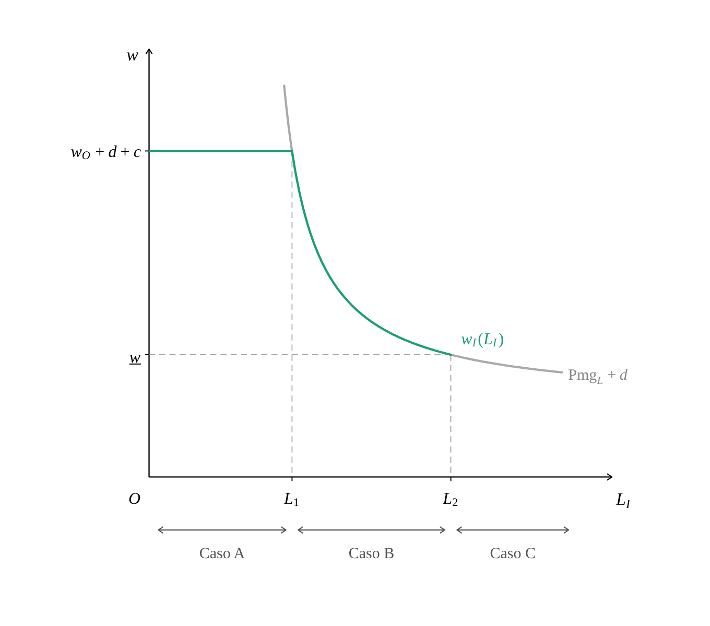
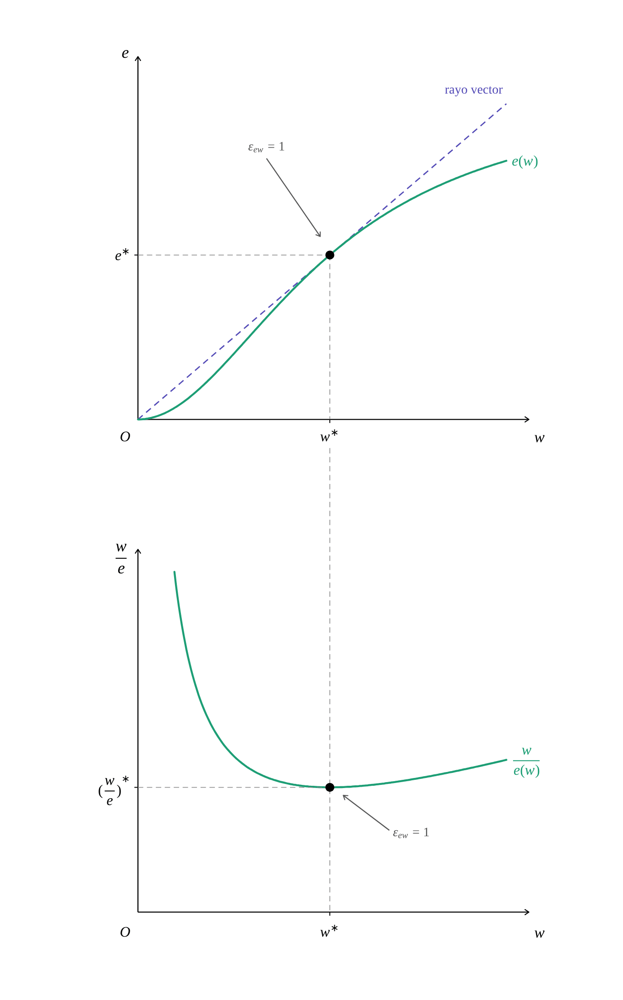
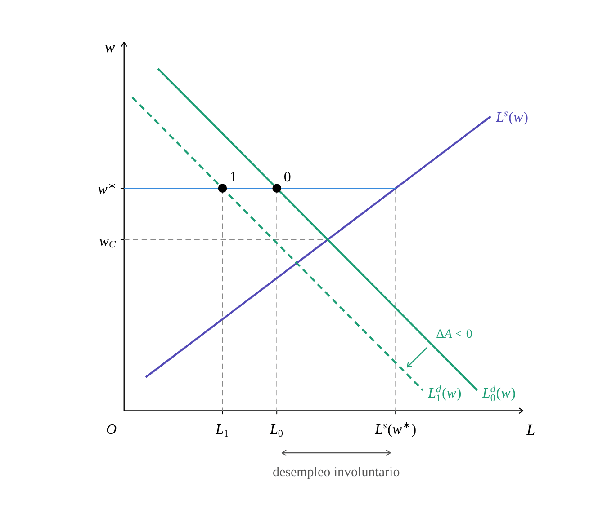
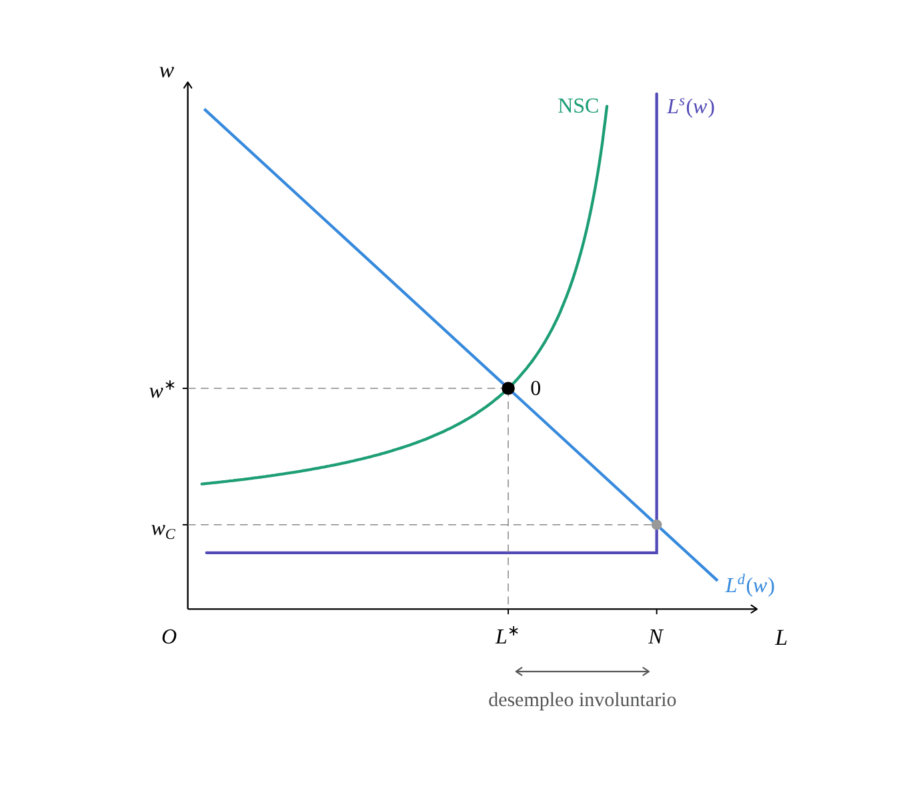

## Introducción

::: {.callout-note appearance="simple" icon=false}

:::

La teoría neoclásica describe un mercado de trabajo que alcanza un único equilibrio, estable y eficiente. En él, el salario real equivale a la productividad marginal y la oferta casa al instante con la demanda. La flexibilidad del salario lo explica, pues basta con que este se mueva para que el mercado vuelva por sí solo al equilibrio tras cualquier desajuste. Ahora bien, el **desempleo involuntario** persistente, las **rigideces salariales** y las diferencias de salario entre trabajadores similares que se observan en el mercado laboral no encajan con el modelo neoclásico.

Esa discrepancia tiene consecuencias de política económica, porque, si el salario no baja hasta vaciar el mercado por razones que convienen a empresas y trabajadores, el desempleo es involuntario y no se corrige solo con flexibilizar los salarios. Las diferencias entre países apuntan en esa dirección. El paro alto y persistente de la Europa continental de los años ochenta, la *euroesclerosis* (Giersch, 1985), encaja con los modelos de negociación y de *insiders* y *outsiders*, mientras que en mercados con poca afiliación sindical, como el estadounidense, pesan más los salarios de eficiencia.

Estas teorías son también las piezas del modelo de desempleo de equilibrio (tema [A28](a28-tnp-nairu.qmd)), en el que la negociación o los salarios de eficiencia determinan el salario que se fija por encima del de vaciado. La idea de que pagar más de lo necesario puede ser rentable para la empresa, porque eleva el esfuerzo, la lealtad o la calidad de la plantilla, se apoya tanto en modelos de incentivos (Shapiro y Stiglitz, 1984) como en la lectura sociológica del intercambio de regalos de Akerlof (1982). Los contratos implícitos explican mejor, en cambio, la estabilidad de la renta salarial que el desempleo. De todas estas teorías salen buena parte de las propuestas de reforma del mercado de trabajo, desde la negociación colectiva hasta las políticas activas, que el anexo del tema recoge.

La nueva economía keynesiana desarrolló tres líneas para microfundamentar estas rigideces reales:

- *Contratos implícitos*: conciben el salario como un seguro.

- *Modelos de negociación*: lo conciben como un reparto de rentas.

- *Salarios de eficiencia*: lo consideran un incentivo a la productividad.

Estos modelos explican rigideces reales, no nominales, mientras que las nominales requieren extensiones adicionales. A los trabajadores les preocupa su consumo real (contratos implícitos), su renta real (negociación) o su salario real (eficiencia), de modo que, si cambia la cantidad de dinero, varía el salario nominal, pero no los resultados reales.

## 1. Contratos implícitos (Baily, 1974; Gordon, 1974; Azariadis, 1975)

Una de las primeras líneas de investigación para explicar la rigidez de los salarios reales parte del reparto del riesgo entre trabajadores y empresas y se apoya, por tanto, en la economía de la incertidumbre (tema [A10](a10-riesgo-incertidumbre.qmd)). Su punto de partida es que los trabajadores no pueden asegurarse en los mercados financieros frente a las fluctuaciones de su renta, de modo que la empresa, con mejor acceso a ellos, puede ofrecerles ese seguro a través del propio contrato de trabajo.

**Origen**: en la práctica, muchas relaciones laborales duran años, un rasgo que el mercado de trabajo walrasiano no recoge. En vez de recurrir al mercado cada periodo para contratar a quienes necesitan, las empresas retienen a su plantilla durante mucho tiempo. Las teorías de los contratos implícitos buscan explicar por qué, en presencia de ciertos fallos de mercado, los salarios pueden diferir de los de competencia perfecta.

**Idea**: las relaciones laborales a largo plazo entre trabajadores y empresas hacen que los contratos de trabajo fijen rentas salariales estables (no contingentes al estado de la naturaleza). Los contratos actúan así como seguro ante periodos de demanda de trabajo fluctuante. En consecuencia, la renta salarial se desvincula de las condiciones del mercado en cada periodo, aunque el empleo puede seguir fijándose de forma eficiente. De hecho, en estos modelos, la mejor distribución del riesgo en el largo plazo supone la fijación de una renta salarial fija, menor en los estados favorables que el valor de lo producido por el trabajo. Se habla de *contrato implícito* porque, en la práctica, esas cláusulas no se escriben, y nada fija de forma expresa qué horas y qué salario corresponden a cada realización de la productividad.

### 1.1. Supuestos

**Entorno**: información perfecta y precios normalizados (variables reales), de modo que el gasto en consumo real coincide con la renta real total.

**Agentes**:

- *Trabajadores*: son aversos al riesgo, puesto que no tienen una amplia capacidad para diversificar sus fuentes de renta. Concretamente, toda su renta proviene del trabajo, por lo que el consumo real coincide con la renta real laboral, $c_i = w_i L_i$. Su función de utilidad de Bernoulli es tal que $u' > 0$ y $u'' < 0$, y la desutilidad del trabajo cumple $v' > 0$ y $v'' > 0$. El consumo les reporta utilidad y el trabajo desutilidad, de modo que sus preferencias pueden representarse mediante una función de utilidad esperada de von Neumann y Morgenstern (VNM):

    $$u^e = \sum_{i=1}^{n} p_i [u(c_i) - v(L_i)]$$

    Los trabajadores cuentan con una utilidad de reserva $\underline{u}$, de manera que su condición de participación será $u^e \geq \underline{u}$. La participación es irrevocable, es decir, una vez que han aceptado un contrato, no hay movilidad laboral.

- *Empresa*: es neutral al riesgo, porque los mercados financieros le permiten diversificarlo mejor que al trabajador. Su tecnología está sujeta a *shocks* de productividad, recogidos en una variable aleatoria no negativa, $A_i$, que puede tomar $n$ valores distintos, cada uno con una probabilidad $p_i$ de darse. El beneficio esperado de la empresa es:

    $$\pi^e = \sum_{i=1}^{n} p_i [A_i f(L_i) - w_i L_i]$$

    donde $L_i$ son las horas trabajadas y $w_i$ el salario por hora en el estado $i$, y $f(L_i)$ la función de producción, con $f' > 0$ y $f'' < 0$.

### 1.2. Modelo

**Planteamiento**: la empresa maximiza el beneficio esperado sujeta a la condición de participación del trabajador:

$$\max_{L_i, c_i} \; \pi^e = \sum p_i [A_i f(L_i) - c_i] \quad \text{s.a.:} \; \sum p_i [u(c_i) - v(L_i)] \geq \underline{u}$$

donde $L_i$ y $c_i$ son las horas de trabajo y el consumo (igual a la renta laboral, $c_i = w_i L_i$) que el contrato fija en cada estado $i$ (variables de decisión), $p_i$ la probabilidad del estado $i$, $A_i$ el *shock* de productividad, $f(\cdot)$ la función de producción, $u(\cdot)$ y $v(\cdot)$ la utilidad del consumo y la desutilidad del trabajo del trabajador, $\underline{u}$ su utilidad de reserva y $\lambda$ (en la CPO) el multiplicador de la condición de participación.

**CPO** (condiciones de primer orden):

$$\frac{du}{dc_i} = \frac{1}{\lambda} \quad \forall i \tag{1}$$

$$\underbrace{A_i \frac{df}{dL_i}}_{\text{Pmg}_{L}} = \underbrace{\frac{dv/dL_i}{du/dc_i}}_{\text{RMS}} \tag{2}$$

La condición (1) establece que la utilidad marginal del consumo es constante para todos los estados de naturaleza, por lo que el propio consumo, igual a la renta salarial real $c_i = w_i L_i$, es también constante para todas las realizaciones de la perturbación tecnológica. Es decir, la empresa ofrece un *aseguramiento completo* al trabajador averso al riesgo.

La condición (2) establece que la empresa fija el empleo de cada estado de la naturaleza (cada realización de la perturbación tecnológica) en el nivel que iguala la productividad marginal del trabajo a la relación marginal de sustitución del trabajador, $(dv/dL_i)/(du/dc_i)$. Esta relación equivale a la desutilidad marginal de las horas adicionales expresada en unidades de consumo.

**CSO**: la concavidad de $u$ y de $f$ y la convexidad de $v$ hacen cóncavo el lagrangiano en $(L_i, c_i)$, de modo que (1) y (2) son necesarias y suficientes.

**Solución**: el contrato estabiliza la renta laboral, no el salario por hora. Con consumo constante, $c^*$, el salario por hora, $w_i = c^*/L_i$, se mueve en sentido contrario a las horas, y estas siguen respondiendo a los *shocks* según (2), que es la condición de eficiencia del contrato. Así, el empleo es eficiente en cada estado y no hay desempleo involuntario. Además, como el consumo no varía y en los estados desfavorables se trabajan menos horas, el trabajador está mejor en las recesiones que en los auges.

**Extensiones**: si solo la empresa observa el *shock*, el contrato eficiente deja de ser compatible con los incentivos, porque la empresa puede declarar el estado que más le conviene. En consecuencia, el contrato óptimo se aparta de la eficiencia y, según los supuestos, genera subempleo en los estados desfavorables (Grossman y Hart, 1981) o sobreempleo (Green y Kahn, 1983).

### 1.3. Conclusiones

**Aspectos positivos**: los contratos implícitos explican por qué la renta salarial es estable. El salario cumple en ellos una doble función, pues paga el trabajo y, a la vez, asegura al trabajador frente al riesgo (aquí, el tecnológico). Además, los contratos implícitos responden a la existencia de incertidumbre y de utilización de capital humano específico entre empresas y trabajadores aversos al riesgo. Estos contratos suavizan el consumo, pero hacen que la volatilidad del empleo sea mayor.

**Limitaciones**: se han formulado cuatro objeciones:

- *Ajuste*: con información simétrica, el empleo es eficiente en cada estado, de modo que el modelo explica la estabilidad de la renta salarial, pero no el desempleo involuntario (Akerlof y Miyazaki, 1980), y el ajuste recae en las horas trabajadas más que en los despidos.

- *Nuevas contrataciones*: no explica por qué la empresa no ofrece salarios menores a quienes contrata.

- *Rigidez nominal*: explica la rigidez de la renta salarial real, pero no puede justificar la rigidez a la baja de los salarios nominales ante perturbaciones negativas de la demanda agregada.

- *Vigencia*: a pesar de su popularidad en los años ochenta, su aplicación en la economía laboral ha estado en declive desde los años noventa. El declive se debe a que las teorías de búsqueda y emparejamiento (modelo de Diamond-Mortensen-Pissarides, tema [A26](a26-desempleo-friccional.qmd)) han superado ampliamente la de los contratos implícitos.

## 2. Modelos de negociación colectiva

Los modelos de negociación conciben el salario como un reparto de rentas entre la empresa y los trabajadores o el sindicato que los representa. A diferencia del mercado walrasiano, el salario no resulta del cruce de la oferta y la demanda, sino del poder de negociación de cada parte, y el empleo depende de qué variables se negocien. Tras los fundamentos, se exponen el modelo *right to manage*, los contratos eficientes y el modelo de *insiders* y *outsiders*.

### 2.1. Fundamentos

Antes de los modelos de negociación colectiva se presentan el concepto de negociación y de poder de negociación, la estructura de la negociación según su grado de centralización y las soluciones microeconómicas al problema de negociación. De estas soluciones procede el producto de Nash que utilizan los modelos posteriores.

#### 2.1.1. La teoría de la negociación y el proceso de negociación

La **teoría de la negociación** se ocupa del reparto pactado, entre agentes racionales, de un excedente que solo surge si cooperan. Su aplicación al mercado laboral se dirige sobre todo a la negociación salarial entre trabajadores y empresas. Las dos partes se reparten la renta que genera la relación laboral (lo producido por encima de lo que cada parte obtendría sin acuerdo) mediante la fijación del salario y, en su caso, del empleo. Por ello, el resultado depende en gran medida del **poder de negociación** de cada parte, es decir, de su capacidad para apropiarse de una fracción mayor de ese excedente. Ese poder aumenta con las alternativas de cada parte fuera del acuerdo y con su capacidad para resistir un conflicto.

La negociación laboral se desarrolla, en general, en tres niveles, según negocien el empleador y el trabajador individual, el empleador y un sindicato o la patronal y los sindicatos de un sector o del conjunto de la economía.

#### 2.1.2. Grados de centralización de la negociación colectiva (Calmfors y Driffill, 1988)

**Origen**: Lars Calmfors y John Driffill (1988) señalan que el grado de centralización o estructura de la negociación laboral colectiva tiene efectos importantes sobre el desempleo.

**Idea**: los casos extremos (centralizados o descentralizados) producen mejores resultados que los casos intermedios.

**Razonamiento**: cuando la negociación está muy centralizada, los negociadores son conscientes de los efectos macroeconómicos de sus acuerdos (sobre los precios, el desempleo y los impuestos que financian las prestaciones) y los internalizan, lo que modera sus demandas salariales. Cuando está muy descentralizada, la competencia en el mercado de productos disciplina los salarios, porque una subida en una sola empresa encarece su producto y reduce mucho su empleo. La negociación por sectores, de grado intermedio, combina, en cambio, poder de mercado suficiente para elevar los salarios con una internalización escasa de sus efectos. Por ello, en la muestra de los autores, los países con negociación centralizada (p. ej. Austria o los países escandinavos) o muy descentralizada (p. ej. Japón, Suiza o EE. UU.) presentaban menores niveles de desempleo que los de grado intermedio (p. ej. Bélgica o Países Bajos).

**Conclusiones**:

- *Aspectos positivos*: la hipótesis explica por qué la relación entre centralización de la negociación y desempleo no es monótona, sino en forma de joroba. La joroba resulta de combinar dos fuerzas, la internalización de los efectos macroeconómicos de los salarios cuando la negociación es centralizada y la disciplina de la competencia cuando está descentralizada. Asimismo, la hipótesis ha orientado el debate sobre el diseño institucional de la negociación colectiva.

- *Limitaciones*: la hipótesis atiende al grado de centralización y omite el de coordinación, que puede lograrse sin centralizar la negociación (Soskice, 1990). Además, la evidencia posterior apenas confirma la forma de joroba, que pierde apoyo empírico desde los años noventa (Cahuc y Zylberberg, 2004).

#### 2.1.3. Fundamentación microeconómica de los procesos de negociación

La fundamentación microeconómica de la negociación ha seguido varios enfoques sucesivos, que van de la indeterminación de Edgeworth a la solución estratégica de Rubinstein.

::: {.callout-note appearance="simple" icon=false}
La solución de Nash y el modelo de Rubinstein se desarrollan en el tema [A14](a14-juegos.qmd), apartado 2.4.3, y la teoría de la negociación de Hicks, en el tema [A25](a25-oferta-trabajo.qmd), apartado 1.4.2.
:::

Francis Edgeworth (1881) fue uno de los primeros autores en abordar estas cuestiones. Mostró que el acuerdo debe caer sobre la curva de contratos y ser, por tanto, eficiente en el sentido de Pareto. No obstante, su análisis se queda corto, porque solo asegura que no quedan ganancias por aprovechar, sin decir qué parte se lleva cada negociador, y el resultado queda indeterminado.

Después, John Hicks (1932) incorpora la idea de poder negociador. En su análisis, el salario pactado refleja un pulso entre la presión que el sindicato puede ejercer (p. ej. con la amenaza de huelga) y la resistencia de la empresa. La huelga, sin embargo, no llega a estallar, porque cada parte, con información cierta sobre esas fuerzas, calcula cuánto duraría el conflicto y ambas firman desde el principio el salario que lo evita. El modelo es sencillo, y esa es su ventaja, pero trata el poder de negociación como un dato y no explica de dónde procede.

El enfoque axiomático de John Nash (1950) consiste en fijar las propiedades que debe reunir una solución racional de la negociación. Nash muestra que la negociación entre dos partes tiene una única solución, la que hace máximo el producto de las ganancias netas de ambos agentes, si se respetan estos cuatro axiomas:

1. *Optimalidad paretiana*: el acuerdo no deja sin aprovechar ninguna ganancia mutua.

2. *Invarianza ante transformaciones afines positivas*: la solución no varía si se cambia la función de utilidad por otra equivalente.

3. *Independencia de alternativas irrelevantes*: eliminar opciones no elegidas no altera la solución.

4. *Simetría*: dos jugadores que ocupan posiciones idénticas reciben ganancias iguales.

Si se prescinde del axioma de simetría, la solución recoge el distinto poder negociador de cada jugador. Esta versión se denomina **solución de Nash generalizada**:

$$\max_{(u_1, u_2) \in \mathcal{U}} \; \Omega = (u_1 - u_1^0)^\gamma (u_2 - u_2^0)^{1-\gamma}$$

donde $\mathcal{U}$ es el conjunto de pares de utilidades factibles, $u_1$ y $u_2$ son las utilidades que obtienen los dos jugadores con el acuerdo, $u_1^0$ y $u_2^0$ las que obtendrían en caso de desacuerdo y $\gamma \in [0, 1]$ el poder negociador del jugador 1 (con $\gamma = 1/2$ se recupera la solución simétrica).

Finalmente, Ingemar Stahl (1972) y Ariel Rubinstein (1982) estudian la negociación como un juego dinámico de ofertas y contraofertas, con horizonte finito (Stahl) e infinito (Rubinstein), cuya solución es el equilibrio de Nash perfecto en subjuegos (ENPS). En él, el poder de negociación procede de la paciencia relativa de los jugadores (sus factores de descuento). Cuando el intervalo entre ofertas tiende a cero, el reparto converge a la solución de Nash generalizada, lo que da fundamento estratégico al parámetro $\gamma$ (Binmore, Rubinstein y Wolinsky, 1986).

### 2.2. Contratos ineficientes: *right to manage* (Nickell y Andrews, 1983)

::: {.callout-note appearance="simple" icon=false}
Para el ejercicio oral no hace falta el desarrollo analítico, y basta con exponer las ideas y el gráfico. El desarrollo se recoge para la comprensión conceptual del modelo.
:::

**Origen**: en la mayoría de los países industrializados, una proporción significativa de los salarios se regula a través de acuerdos colectivos. Por ello, los primeros modelos para representar la negociación colectiva se basan en la existencia de un sindicato monopolista de la oferta de trabajo y se apoyan en las aportaciones de John Dunlop (1944).

**Idea**: Stephen Nickell y Martyn Andrews (1983) generalizan las aportaciones de Dunlop al considerar que existen distintos grados de monopolización y que la empresa tiene capacidad para despedir o contratar al salario dado. Esa generalización da lugar a los modelos *right to manage*, que reflejan la idea de que, ante el monopolio salarial de los sindicatos, las empresas retienen su “derecho a gestionar” su propia demanda de trabajo.

#### 2.2.1. Supuestos

**Entorno**:

- *Información*: perfecta.

- *Contexto*: dinámico-secuencial.

- *Variable estratégica*: solo el salario.

La empresa y el sindicato negocian únicamente el salario, y con él ya fijado la empresa elige el nivel de empleo. Si no hay acuerdo, la empresa no obtiene beneficio y el sindicato se queda con el salario de reserva, $\underline{w}$.

**Agentes**:

- *Sindicato*: agrupa a $N^s$ afiliados iguales y su poder de negociación es $\gamma \in [0, 1]$. Su objetivo es una utilidad esperada de tipo VNM, estrictamente creciente en el salario y estrictamente cóncava, pues los afiliados tienen aversión al riesgo:

    $$U^e = p \cdot U(w) + (1-p) \cdot U(\underline{w})$$

    donde $p = \min\{L/N^s, 1\}$ es la probabilidad de que un afiliado sea contratado, $(1-p)$ la de quedar en paro y $\underline{w}$ el salario de reserva, por debajo del cual el individuo no acepta trabajar. No hay elección de horas, y cada trabajador está empleado o desempleado.

- *Empresa*: opera con una función de producción estrictamente creciente ($f' > 0$) y estrictamente cóncava ($f'' < 0$), en la que una tecnología de producción $A_\theta$ recoge los *shocks* tecnológicos. Su función de beneficios es $\pi = A_\theta f(L) - wL$, con CPO $A_\theta f'(L) = w$.

#### 2.2.2. Modelo

**Planteamiento**: el salario negociado es el que maximiza el producto de Nash generalizado de las ganancias netas de ambas partes. La maximización tiene en cuenta que el empleo lo elige después la empresa sobre su curva de demanda y no puede superar la afiliación sindical, y que el salario acordado no puede ser inferior al de reserva:

$$\max_w \; \Omega(w) = \pi(w)^{1-\gamma} \cdot \left[U^e(w) - U(\underline{w})\right]^\gamma \quad \text{s.a.:} \begin{cases} L = L^d(w) \leq N^s \\ w \geq \underline{w} \end{cases}$$

donde $w$ es el salario negociado (variable de decisión), $\pi(w) = A_\theta f(L) - wL$ el beneficio de la empresa una vez elegido el empleo $L = L^d(w)$, $U^e(w)$ la utilidad esperada del sindicato, $U(\underline{w})$ la que obtiene en caso de desacuerdo, $\gamma \in [0, 1]$ su poder de negociación y $\underline{w}$ el salario de reserva.

**CPO**: con $\eta = -\frac{w}{L}\frac{dL^d}{dw}$ la elasticidad-salario de la demanda de trabajo y $U^e(w) - U(\underline{w}) = \frac{L}{N^s}\left[U(w) - U(\underline{w})\right]$, la condición de primer orden en logaritmos es:

$$\gamma \left[\frac{dU/dw}{U(w) - U(\underline{w})} - \frac{\eta}{w}\right] = (1-\gamma)\frac{L}{\pi}$$

El lado izquierdo recoge la ganancia marginal del sindicato (más salario, pero menos empleo) y el derecho, la pérdida marginal de beneficio de la empresa, cada una ponderada por el poder de negociación de la parte correspondiente.

**CSO**: se supone que el producto de Nash es estrictamente cuasicóncavo en $w$ sobre $[\underline{w}, \infty)$, lo que asegura un único salario negociado interior. La hipótesis se cumple con las formas funcionales habituales (demanda de trabajo isoelástica, utilidad cóncava).

**Solución**: en el caso general, de la CPO se deduce que el salario pactado sube cuando aumentan el poder negociador del sindicato o el salario de reserva:

$$w^* = w^*(\gamma^+, \underline{w}^+)$$

Como caso límite, con un sindicato neutral al riesgo ($U(w) = w$) y $f(L) = L^\alpha$, la demanda de trabajo es isoelástica, con $\eta = 1/(1-\alpha)$, y la ratio $wL/\pi = \alpha/(1-\alpha) = \eta - 1$ es constante. La condición da entonces un margen sobre el salario de reserva que crece con $\gamma$ y decrece con $\eta$:

$$w^* = \underline{w}\left(1 + \frac{\gamma}{\eta - 1}\right)$$

Con $\gamma = 1$ se obtiene la solución de Dunlop (monopolio salarial), $w^* = \frac{\eta}{\eta - 1}\underline{w}$, y con $\gamma = 0$, el salario de reserva, $w^* = \underline{w}$, que es el resultado competitivo.

**Equilibrio**: el resultado depende del reparto del poder negociador $\gamma$:

- $\gamma = 0$ (todo el poder en la empresa): el sindicato acepta el salario de reserva $\underline{w}$, la empresa contrata sobre su curva de demanda a ese salario y se logra el equilibrio competitivo. Hay eficiencia asignativa (el resultado es óptimo de Pareto) y productiva (el empleo coincide con el de competencia perfecta).

- $\gamma = 1$ (todo el poder en el sindicato): se alcanza la solución de Dunlop (monopolio salarial). El sindicato decide unilateralmente el salario en la tangencia entre su curva de indiferencia y la curva de demanda, un equilibrio que no es óptimo de Pareto (ineficiencia asignativa y productiva y desempleo involuntario).

- $\gamma \in (0, 1)$: equilibrios intermedios, la solución *right to manage*, con contratos ineficientes en el sentido de Pareto.

Por tanto, la primera implicación de la existencia de poder de negociación en el mercado de trabajo es que los salarios serán superiores a los del equilibrio competitivo y, en consecuencia, existirá desempleo involuntario.

**Desarrollo gráfico**: el modelo *right to manage* se representa en el plano empleo-salario (figura -@fig-a271-right-to-manage):

1. *Curvas de indiferencia del sindicato* ($\text{CI}_0$, $\text{CI}_1$): reúnen los pares de empleo y salario con igual utilidad esperada para el sindicato. Son decrecientes, porque salario y empleo se sustituyen de forma imperfecta, y convexas mientras quedan afiliados sin contratar. Una vez empleados todos ($L = N^s$), cada afiliado trabaja con probabilidad 1 y solo el salario cuenta, de ahí que las curvas se vuelvan horizontales. Lo mismo ocurre en $w = \underline{w}$, donde la utilidad no depende del empleo.

2. *Curvas isobeneficio de la empresa* ($\pi_0$, $\pi_1$): cada una une los pares de empleo y salario que dan a la empresa un mismo beneficio. Son cóncavas, porque su pendiente, $(A_\theta f'(L) - w)/L$, es positiva a la izquierda de la demanda de trabajo y negativa a su derecha, y representan más beneficio cuanto más cerca están del eje de abscisas.

3. *Curva de demanda de trabajo* ($L^d(w)$): recoge el empleo que la empresa elige para cada salario, el que cumple $A_\theta f'(L) = w$. Une los puntos máximos de las curvas isobeneficio y tiene pendiente negativa (en la figura se representa, por simplicidad, como una recta).

4. *Equilibrio*: se sitúa sobre la curva de demanda. Con $\gamma = 0$ es el punto 0, con salario $\underline{w}$ y empleo competitivo $L_C$. Con $\gamma = 1$ es el punto 1, con $w^*$ y $L^*$, donde $\text{CI}_0$ es tangente a la demanda. La zona rayada entre $\text{CI}_0$ y $\pi_0$ (lente de mejoras paretianas) recoge los contratos que mejorarían a la vez al sindicato y a la empresa, por lo que el punto 1 no es óptimo de Pareto.

::: {#fig-a271-right-to-manage}

::: {.content-visible when-format="html"}
```{=html}
<div class="graph-frame">
<iframe src="../graphs/a271_Right_to_manage.html" style="height:580px" loading="lazy" title="fig-a271-right-to-manage"></iframe>
</div>
```
:::

::: {.content-visible unless-format="html"}

:::

Modelo *right to manage*. El sindicato elige el salario sobre la curva de demanda de trabajo de la empresa y el resultado es ineficiente.
:::

**Estática comparativa**: si la demanda de trabajo es isoelástica (por ejemplo, $f(L) = L^\alpha$ con $0 < \alpha < 1$ y la perturbación multiplicativa $A_\theta$), un *shock* que la desplace no altera su elasticidad-salario, que es la que determina el salario negociado. Por ello, ante perturbaciones de demanda de trabajo, el salario es rígido y todo el ajuste se realizará vía cantidades, con un nivel de empleo muy volátil.

#### 2.2.3. Conclusiones

**Aspectos positivos**: el modelo incorpora a la negociación de Nash los factores de los que depende la fuerza del sindicato, y contiene como casos límite el monopolio sindical de Dunlop ($\gamma = 1$) y el equilibrio competitivo ($\gamma = 0$). Su regla salarial es un margen sobre el salario de reserva que crece con el poder sindical y decrece con la elasticidad de la demanda de trabajo. La regla es, además, la base de la curva del salario real negociado (SRN) del modelo de la NAIRU (Layard, Nickell y Jackman, 1991; tema [A28](a28-tnp-nairu.qmd), apartado 2.2).

**Limitaciones**: no obstante, el carácter secuencial de la negociación hace que la solución sea ineficiente siempre que el sindicato tenga algún poder negociador ($\gamma > 0$). La ineficiencia nace de que el acuerdo se sitúa sobre la curva de demanda y deja sin explotar ganancias mutuas que los contratos eficientes sí recogen.

### 2.3. Contratos eficientes (McDonald y Solow, 1981)

::: {.callout-note appearance="simple" icon=false}
Para el ejercicio oral no hace falta el desarrollo analítico, y basta con exponer las ideas y el gráfico. El desarrollo se recoge para la comprensión conceptual del modelo.
:::

**Origen**: Ian McDonald y Robert Solow (1981) suponen que la negociación colectiva abarca también el empleo (y, en su caso, otras condiciones, como el tiempo de trabajo), de modo que ambas partes acuerdan a la vez salario y empleo.

**Idea**: si salario y empleo se negocian simultáneamente, el acuerdo se sitúa sobre la *curva de contratos*, fuera de la curva de demanda de trabajo, y es eficiente en el sentido de Pareto, aunque el empleo puede diferir del competitivo.

#### 2.3.1. Supuestos

**Entorno**:

- *Información*: perfecta.

- *Contexto*: estático.

- *Variables estratégicas*: el salario y el empleo en los contratos débiles, y el salario y una prestación para los afiliados desempleados en los fuertes.

Las dos partes negocian a la vez todas las variables del convenio, a diferencia del modelo *right to manage*, en el que la empresa elige después el empleo. En caso de que la negociación fracase, la empresa obtiene beneficio nulo y el sindicato percibe el salario de reserva, $\underline{w}$.

**Agentes**: se mantiene el sindicato del modelo *right to manage*, con $N^s$ afiliados iguales, poder de negociación $\gamma \in [0, 1]$ y utilidad esperada $U^e = p \cdot U(w) + (1-p) \cdot U(\underline{w})$, aunque ahora se admite cualquier perfil de riesgo. También se mantiene la empresa del mismo modelo, con tecnología $A_\theta f(L)$ y beneficio $\pi = A_\theta f(L) - wL$.

#### 2.3.2. Modelo

**Planteamiento**: de la negociación simultánea se obtiene la curva de contratos, que refleja las asignaciones eficientes en el sentido de Pareto de salario y empleo acordadas por los agentes. Cada uno de sus puntos maximiza el beneficio de la empresa sin que la utilidad esperada del sindicato baje de un nivel dado:

$$\max_{w,\, L} \; \pi = A_\theta f(L) - wL \quad \text{s.a.:} \; U^e(w, L) \geq \bar{U}$$

donde $w$ y $L$ son el salario y el empleo (variables de decisión), $U^e(w, L)$ la utilidad esperada del sindicato y $\bar{U}$ el nivel de utilidad que se garantiza al sindicato, de modo que al variar $\bar{U}$ se recorre la curva de contratos.

**CPO**: gráficamente, la curva de contratos es el lugar geométrico de los puntos de tangencia entre las curvas de indiferencia y las curvas isobeneficio. Formalmente, la curva de indiferencia del sindicato tiene pendiente $-\frac{U(w) - U(\underline{w})}{L\,dU/dw}$ y la isobeneficio, $\frac{A_\theta df/dL - w}{L}$, de modo que la curva de contratos cumple:

$$\frac{U(w) - U(\underline{w})}{dU/dw} = w - A_\theta \frac{df}{dL}$$

**CSO**: las curvas de indiferencia del sindicato son convexas y las isobeneficio, cóncavas, de modo que la tangencia es un máximo.

**Solución**: la pendiente de la curva de contratos en el plano $(L, w)$ depende del perfil de riesgo de los miembros del sindicato:

- *Aversos al riesgo*: la curva tiene pendiente positiva, porque el sindicato utiliza su poder tanto para cubrir a sus miembros frente al riesgo de desempleo como para subir el salario.

- *Neutrales al riesgo*: la curva es vertical sobre el nivel de empleo competitivo.

- *Propensos al riesgo*: la curva tiene pendiente negativa, porque el sindicato acepta un menor nivel de empleo a cambio de un mayor salario.

Con neutralidad al riesgo, el lado izquierdo de la CPO es $w - \underline{w}$ y la condición se reduce a $A_\theta f'(L) = \underline{w}$, por lo que el empleo es el competitivo para cualquier salario. Con aversión al riesgo, en cambio, la concavidad de $U$ hace el lado izquierdo mayor que $w - \underline{w}$ para $w > \underline{w}$. Así, $A_\theta f'(L) < \underline{w}$ y el empleo supera al competitivo.

En los contratos eficientes fuertes, las prestaciones por desempleo se negocian junto con el salario como segunda variable de elección. Cabe verlas como un subsidio $z$ que la empresa paga a los afiliados sin empleo, que reciben así el salario de reserva más la prestación, $w_u = \underline{w} + z$. Con seguro completo, el pago iguala la utilidad de quien trabaja y la de quien no lo hace ($w = \underline{w} + z$), y el riesgo de desempleo queda cubierto por entero, sea cual sea el perfil del sindicato. A la empresa, sin embargo, ese seguro le cuesta, y su beneficio pasa a ser $\pi = A_\theta f(L) - wL - z(N^s - L)$.

Al estar plenamente asegurados los miembros, al sindicato le es indiferente el nivel de empleo y la negociación deja el empleo al margen como variable de elección. Del lado de la empresa, la CPO es $A_\theta f'(L) = w - z$, porque cada contratación cuesta el salario, pero ahorra el subsidio que habría que pagar a ese afiliado en paro. Con seguro completo, $w - z = \underline{w}$ y la condición queda $A_\theta f'(L) = \underline{w}$. El empleo es, por tanto, el competitivo y no depende de lo que se negocie.

**Equilibrio**: se sitúa sobre la curva de contratos, en el punto que fija el poder negociador $\gamma$, y su eficiencia depende de lo que cubra el convenio:

- *Contratos eficientes débiles*: con $\gamma = 0$, el equilibrio alcanza eficiencia asignativa y productiva. En cambio, con $\gamma > 0$ y un sindicato averso al riesgo, se produce *sobreempleo* (eficiencia asignativa pero no productiva). Dada la dificultad de conjugar ambos tipos de eficiencia, estos contratos son *débilmente eficientes*.

- *Contratos eficientes fuertes*: el empleo es siempre el competitivo, $L_C$ (eficiencia productiva), y el salario se sitúa entre $\underline{w}$ ($\gamma = 0$) y $w_1$ ($\gamma = 1$). Como el poder negociador solo reparte la renta, sin crear ineficiencias, estos contratos son *fuertemente eficientes*.

**Desarrollo gráfico**: los contratos eficientes débiles se representan en el plano empleo-salario, con un sindicato averso al riesgo (figura -@fig-a272-contratos-eficientes-debiles):

1. *Curvas de indiferencia del sindicato* ($\text{CI}_0$, $\text{CI}_1$) y *curvas isobeneficio* ($\pi_0$, $\pi_1$, $\pi = 0$): tienen la forma descrita en el modelo *right to manage*.

2. *Curva de demanda de trabajo* ($L^d(w)$): recoge, como en el modelo *right to manage*, el empleo que la empresa elige para cada salario, y une los máximos de las curvas isobeneficio.

3. *Curva de contratos* ($\text{CC}$): une las tangencias entre curvas de indiferencia e isobeneficio y tiene pendiente positiva. Si alcanza el número de afiliados $N^s$ (pleno empleo del sindicato), continúa en vertical sobre $L = N^s$ hasta el beneficio nulo, porque a partir de ese nivel las curvas de indiferencia del sindicato son horizontales.

4. *Equilibrio*: el punto 0 ($\gamma = 0$) es el equilibrio competitivo, con $\underline{w}$ y $L_C$, y el punto 1 ($\gamma = 1$), con $w_1$ y $L_1 = N^s$, sobre la vertical de los afiliados y con beneficio nulo, el de mayor sobreempleo.

::: {#fig-a272-contratos-eficientes-debiles}

::: {.content-visible when-format="html"}
```{=html}
<div class="graph-frame">
<iframe src="../graphs/a272_Contratos_eficientes_debiles.html" style="height:580px" loading="lazy" title="fig-a272-contratos-eficientes-debiles"></iframe>
</div>
```
:::

::: {.content-visible unless-format="html"}

:::

Contratos eficientes débiles. La curva de contratos se sitúa a la derecha de la demanda de trabajo, con sobreempleo respecto al modelo *right to manage*.
:::

Los contratos eficientes fuertes, con seguro completo, se representan en el mismo plano (figura -@fig-a273-contratos-eficientes-fuertes):

1. *Curvas de indiferencia del sindicato* ($\text{CI}_0$, $\text{CI}_1$, $\text{CI}_2$): son horizontales, al margen del perfil de riesgo considerado, puesto que los miembros cobrarán lo mismo independientemente de si trabajan o no.

2. *Curvas isobeneficio* ($\pi_0$, $\pi_1$, $\pi = 0$): como cada contratación ahorra el subsidio, alcanzan su máximo en el empleo competitivo para cualquier salario, y el lugar de sus máximos deja de ser la curva de demanda de trabajo y pasa a ser una vertical.

3. *Curva de contratos* ($\text{CC}$): une las tangencias entre las curvas de indiferencia, horizontales, y las isobeneficio. Esas tangencias se producen en el máximo de cada isobeneficio. Es siempre vertical sobre el empleo competitivo, porque ese máximo está en $L_C$ para cualquier salario.

4. *Equilibrio*: los acuerdos se sitúan sobre la vertical $L_C$, entre el punto 0 ($\underline{w}$, $\gamma = 0$) y el punto 1 ($w_1$, $\gamma = 1$).

::: {#fig-a273-contratos-eficientes-fuertes}

::: {.content-visible when-format="html"}
```{=html}
<div class="graph-frame">
<iframe src="../graphs/a273_Contratos_eficientes_fuertes.html" style="height:580px" loading="lazy" title="fig-a273-contratos-eficientes-fuertes"></iframe>
</div>
```
:::

::: {.content-visible unless-format="html"}

:::

Contratos eficientes fuertes. La curva de contratos es vertical y el salario negociado no afecta al empleo.
:::

**Estática comparativa**: un aumento del poder negociador del sindicato ($\Delta \gamma > 0$) desplaza el acuerdo sobre la curva de contratos, del punto 0 hacia el 1:

- *Contratos eficientes débiles*: con un sindicato averso al riesgo, suben el salario y el empleo, y el sobreempleo es tanto mayor cuanto mayor es $\gamma$.

- *Contratos eficientes fuertes*: solo sube el salario, y las rentas se trasladan de la empresa hacia los trabajadores sin que cambie el empleo.

#### 2.3.3. Conclusiones

**Aspectos positivos**: los contratos eficientes muestran que el poder sindical no genera por sí mismo desempleo. Si se negocia también el empleo, el acuerdo es eficiente en el sentido de Pareto y el empleo puede incluso superar al competitivo (eficiencia débil). Si el convenio asegura además a los afiliados frente al desempleo, el poder sindical solo redistribuye renta entre la empresa y los trabajadores (eficiencia fuerte). En EE. UU., de hecho, además del seguro público de desempleo, algunos convenios negocian prestaciones complementarias (p. ej. en el sector del automóvil), mientras que en Europa las prestaciones por desempleo las fija esencialmente el Estado.

**Limitaciones**: los convenios rara vez fijan el nivel de empleo, que en la práctica decide la empresa (Oswald, 1993). Un contrato situado fuera de la curva de demanda es difícil de hacer cumplir, porque, una vez pactado el salario, la empresa tiene incentivos a volver a ella (Cahuc, Carcillo y Zylberberg, 2014). La hipótesis de cobertura total de los trabajadores es, además, restrictiva, pues los subsidios negociados no ofrecen coberturas perfectas. Por último, los procesos de negociación suelen dilatarse en el tiempo ante las dificultades para llegar a acuerdos.

### 2.4. Trabajadores heterogéneos: *insiders-outsiders* (Lindbeck y Snower, 1984-1988)

**Origen**: los modelos anteriores tratan a todos los afiliados al sindicato como iguales, tanto en preferencias como en influencia sobre el convenio. Sin embargo, en la práctica la posición de cada trabajador en la empresa no es la misma, y tener en cuenta esa diferencia conduce a la teoría de los trabajadores internos y externos. La teoría se inicia con las aportaciones de Assar Lindbeck y Dennis Snower (1984 y 1988).

**Idea**: las empresas mantienen relaciones con dos grupos de trabajadores:

- *Insiders*: ya trabajan en la empresa, tienen con ella un vínculo específico y el convenio suele recoger sus intereses.

- *Outsiders*: no tienen contrato, pero pueden obtenerlo después de firmado el convenio.

Esta situación da lugar a una asimetría en el poder de negociación en favor de los *insiders* (especialmente cuando existen sindicatos fuertes), que genera rigidez salarial en la medida en que los *insiders* miran por su propio bienestar y no por el de los *outsiders*.

Entre las causas que llevan a esta asimetría de poder se encuentran:

- *Descapitalización*: la falta de atractivo para las empresas de los desempleados de larga duración.

- *Costes de rotación*: los costes de ajuste elevados merman la capacidad de los *outsiders* de competir por puestos cubiertos.

- *Rentas situacionales*: los *insiders* pueden contar con un elevado *know-how* o capital humano específico de la empresa.

- *Cooperación y acoso*: los *insiders* pueden negarse a cooperar con los *outsiders* recién contratados o acosarlos, lo que reduce la productividad de estos y encarece su contratación (Lindbeck y Snower, 1988).

- *Factores institucionales*: la pertenencia a un sindicato o la legislación de protección del empleo de los *insiders*.

#### 2.4.1. Supuestos

**Entorno**: el modelo es estático, con información perfecta y precios normalizados, de modo que todas las variables son reales. El trabajo es el único factor de producción, y la empresa produce $A f(L)$, con $f' > 0$ y $f'' < 0$, donde $A$ recoge la productividad, que varía con el ciclo, y $L = L_I + L_O$ es el empleo total.

**Agentes**: la empresa se relaciona con dos tipos de trabajadores. Los *insiders* o trabajadores internos son los $L_I$ que ya emplea y los únicos que influyen en la negociación. Su primer objetivo es conservar el empleo y el segundo, subir su salario real, y fijan además las condiciones de contratación de los *outsiders*, sin interés alguno en crear empleo para ellos. Frente a ellos, los *outsiders* o trabajadores externos son desempleados sin influencia sobre la negociación, cuya oferta es ilimitada al salario $w_O$, y ningún trabajador acepta un salario inferior al de reserva, $\underline{w}$.

Aunque *insiders* y *outsiders* tienen la misma productividad y son sustitutivos perfectos en la producción, la empresa no puede reemplazar a los primeros por los segundos sin incurrir en costes de rotación, el de despido, $d$, y el de contratación, $c$. Además, los *outsiders* no pueden convertirse en *insiders*, y su salario de entrada depende del convenio de los *insiders*, de modo que los *outsiders* no pueden ofrecerse por un salario inferior para desplazar a los *insiders* (supuesto de salarios dependientes).

#### 2.4.2. Modelo

**Planteamiento**: el modelo tiene dos etapas. En la primera, los *insiders* fijan su salario, $w_I$, como el más alto que les permite conservar todos sus puestos, es decir, el que no lleva a la empresa a despedirlos sin sustituirlos ni a reemplazarlos por *outsiders*:

$$\max_{w_I} \; w_I \quad \text{s.a.:} \begin{cases} w_I \leq A f'(L_I) + d \\ w_I \leq w_O + c + d \end{cases}$$

donde $w_I$ es el salario de los *insiders* (variable de decisión), $L_I$ su número, $A f'(L_I)$ su productividad marginal ($\text{Pmg}_L$ en la figura), $w_O$ el salario de los *outsiders*, $c$ el coste de contratación y $d$ el de despido. La primera restricción garantiza que a la empresa no le compense despedir al *insider* marginal, porque el ahorro salarial no supera lo que este produce más el coste de despido. La segunda garantiza que tampoco le compense sustituirlo por un *outsider*, que le costaría su salario más los costes de contratación y de despido.

En la segunda etapa, la empresa, dado $w_I$, decide cuántos *outsiders* contrata:

$$\max_{L_O \geq 0} \; \pi = A f(L_I + L_O) - w_I L_I - (w_O + c) L_O$$

donde $L_O$ es el número de *outsiders* contratados (variable de decisión) y $\pi$ el beneficio de la empresa.

**CPO**: como el objetivo de los *insiders* es creciente en $w_I$, en el óptimo se satura la restricción más exigente, lo que da la condición de fijación salarial:

$$w_I = \min\{A \frac{df}{dL_I} + d,\; w_O + c + d\} \tag{3}$$

Es decir, los *insiders* se apropian de toda la renta que les conceden los costes de rotación. Por su parte, la CPO de la empresa, con $L_O \geq 0$ como restricción, es la regla de contratación:

$$A \frac{df}{d(L_I + L_O)} \leq w_O + c, \quad \text{con igualdad si } L_O > 0 \tag{4}$$

De este modo, la empresa contrata *outsiders* mientras su productividad marginal cubra su salario más el coste de contratación.

**CSO**: el programa de los *insiders* es lineal, por lo que su solución es la restricción que se satura en (3). El de la empresa es cóncavo en $L_O$, porque $f'' < 0$, de modo que (4) es suficiente.

**Solución**: (3) implica, por sí sola, que $w_I$ crece con la productividad $A$ (es procíclico) hasta topar con el techo $w_O + c + d$, por encima del cual a la empresa le compensaría despedir a los *insiders* (coste $d$) y contratar *outsiders* (coste $c$). Como los *insiders* están perfectamente asegurados frente al riesgo de despido, fijan el salario más alto que permite (3), tanto mayor cuanto mayores son los costes de rotación, que son la fuente de su poder negociador.

**Equilibrio**: con el salario que fija (3), la regla (4) determina si la empresa contrata además *outsiders*. El resultado depende del número de *insiders* respecto a $L_1$, donde $\text{Pmg}_L + d$ alcanza el techo $w_O + c + d$, y a $L_2$, donde iguala el salario de reserva:

- *Caso A*: por debajo de $L_1$, el poder de los *insiders* alcanza para exigir el techo salarial, $w_O + d + c$ (salario del *outsider* más coste de despido más coste de contratación). Los *insiders* son tan pocos, y su productividad marginal tan elevada, que la empresa completa la plantilla con *outsiders*.

- *Caso B*: entre $L_1$ y $L_2$, los *insiders* ya no alcanzan el techo, pero conservan poder para negociar un salario superior al de reserva, igual a su productividad marginal más el coste de despido ($\text{Pmg}_L + d$). Con ese número de *insiders*, la empresa ni necesita despedir a ninguno ni tiene que incorporar *outsiders*.

- *Caso C*: por encima de $L_2$, los *insiders* son tantos que la productividad marginal del último trabajador más lo que costaría despedirlo no alcanza el salario de reserva ($\text{Pmg}_L + d < \underline{w}$), y ningún salario aceptable cumple la primera restricción. Conviene entonces a la empresa reducir la plantilla de *insiders* hasta $L_2$.

**Desarrollo gráfico**: el modelo de *insiders* y *outsiders* se representa en el plano empleo de los *insiders*-salario (figura -@fig-a274-insiders-outsiders):

1. *Techo salarial* ($w_O + d + c$): es una horizontal, el salario por encima del cual a la empresa le compensa sustituir *insiders* por *outsiders*. No depende del número de *insiders*, porque solo recoge lo que cuesta un *outsider* más los costes de rotación.

2. *Productividad marginal más coste de despido* ($\text{Pmg}_L + d$): recoge el salario por encima del cual a la empresa le compensa despedir al *insider* marginal sin sustituirlo. Es decreciente en el empleo, porque la productividad marginal lo es ($f'' < 0$). Corta al techo salarial en $L_1$ e iguala el salario de reserva en $L_2$.

3. *Salario de los insiders* ($w_I(L_I)$): la línea gruesa marca, en cada nivel de empleo, el techo de lo que los *insiders* pueden pedir antes de que a la empresa le convenga despedirlos o reemplazarlos por *outsiders*.

::: {#fig-a274-insiders-outsiders}

::: {.content-visible when-format="html"}
```{=html}
<div class="graph-frame">
<iframe src="../graphs/a274_Insiders_outsiders.html" style="height:640px" loading="lazy" title="fig-a274-insiders-outsiders"></iframe>
</div>
```
:::

::: {.content-visible unless-format="html"}

:::

Modelo *insiders-outsiders*. Los trabajadores internos fijan el salario que garantiza su propio empleo y dejan fuera a los externos.
:::

**Estática comparativa**: el carácter anticíclico del salario real que se atribuye al modelo opera a través del número de *insiders*, $L_I$, pues con $f'' < 0$ una caída de $L_I$ eleva $A f'(L_I)$ en (3):

- *Fases recesivas*: la empresa despide a parte de los *insiders*, y los que se quedan, al ser menos, ganan poder negociador y pueden empujar el salario hacia arriba.

- *Fases de auge*: lo esperable es que la empresa incorpore *outsiders* y que estos pasen a ser *insiders* en el periodo siguiente, algo que el modelo estático no recoge. Con más *insiders*, $f'(L_I)$ es menor y el grupo puede aceptar un salario más bajo a cambio de asegurar sus puestos.

Una interpretación menos extrema de la condición (3) sería que la presencia de *insiders/outsiders* atenúa la respuesta de los costes laborales marginales de las empresas a las fluctuaciones cíclicas[^a27-13].

**Extensiones**:

- *Predicciones*: la marginación de los *outsiders*, salarios anticíclicos bajo ciertas condiciones (por el mecanismo de la estática comparativa) e histéresis, de modo que perturbaciones transitorias pueden tener efectos permanentes sobre el desempleo.

- *Políticas*: las recomendaciones son reducir los costes de rotación, introducir cláusulas de descuelgue y formar a los parados.

#### 2.4.3. Conclusiones

**Aspectos positivos**: el modelo explica tres hechos:

- *Desempleo involuntario*: el salario que imponen estratégicamente los *insiders* es tan alto que a la empresa no le compensa contratar *outsiders*, y quedan sin empleo personas dispuestas a trabajar por el salario de reserva.

- *Persistencia del desempleo (histéresis)*: cuanto más desempleo hay, menos *insiders* quedan y mayor es su poder negociador. Los salarios que imponen suben entonces, los despedidos no se reabsorben y el desempleo se perpetúa.

- *Dualidad del mercado de trabajo*: las condiciones laborales se polarizan, muy favorables para los *insiders* y más precarias para los *outsiders* (temporalidad, salarios más bajos, etc.).

**Limitaciones**: los supuestos son fuertes:

- *Despido*: si despedir a trabajadores internos no tuviese coste, el convenio buscaría que el producto marginal del trabajo coincidiera con el coste de oportunidad del tiempo de los trabajadores internos.

- *Oferta externa*: si no existiese una oferta ilimitada de trabajadores externos, el salario tendería a aumentar.

- *Salarios dependientes*: es el supuesto más fuerte. Si se levanta, los trabajadores externos se podrían contratar a un salario equivalente al salario vigente en el mercado.

### 2.5. Conclusiones

En los modelos de negociación, el salario reparte entre empresa y trabajadores una renta que solo surge si cooperan. El reparto depende del poder de cada parte, que la solución de Nash generalizada recoge en el parámetro $\gamma$ y el modelo de Rubinstein deriva de su paciencia relativa. Influye también la estructura de la negociación, cuyos grados extremos de centralización moderan más los salarios que los intermedios.

El empleo depende, en cambio, de lo que se negocia. Si se pacta solo el salario y la empresa elige después el empleo (*right to manage*), el acuerdo queda sobre la curva de demanda y cualquier poder sindical genera desempleo involuntario. Si se pactan salario y empleo, el acuerdo es eficiente y el poder sindical eleva el empleo o solo redistribuye la renta. Con trabajadores heterogéneos, los costes de rotación dan a los *insiders* un poder que excluye a los *outsiders* y hace persistente el desempleo. En todos estos modelos, el salario elevado procede del poder de los trabajadores, y la sección 3 estudia por qué puede convenir también a la empresa.

## 3. Salarios de eficiencia

A diferencia de los modelos de negociación, en los de salarios de eficiencia la propia empresa paga un salario elevado porque, además de costes, le reporta beneficios. Tras el concepto y las causas, se exponen dos modelos que difieren en lo que la empresa sabe del esfuerzo, con información simétrica en la condición de Solow y asimétrica en la *no-shirking condition* de Shapiro y Stiglitz.

### 3.1. Concepto: causas y origen

Los modelos de **salarios de eficiencia** parten de una hipótesis central, la de que pagar más encarece la mano de obra pero también reporta ganancias a la empresa. Existen distintas líneas de argumentación para apoyar esta tesis (Yellen, 1984):

- *Teorías nutricionistas* (Leibenstein, 1957): en países menos desarrollados, un mayor salario puede contribuir a la mejora de la salud de los trabajadores y de su productividad.

- *Teorías sociológicas* (Akerlof, 1982): un salario superior al de mercado eleva la moral y la lealtad a la empresa, y los trabajadores lo corresponden, como en un intercambio de regalos, con un esfuerzo superior a la norma.

- *Teorías de la rotación* (Stiglitz, 1974; Salop, 1979): un salario elevado fomenta la permanencia en la empresa y reduce los costes de rotación.

- *Teorías de la selección adversa* (Weiss, 1980): un salario elevado atrae a trabajadores más capacitados, cuya calidad la empresa no observa.

- *Teorías del riesgo moral* (Shapiro y Stiglitz, 1984): si el esfuerzo no es observable, un salario superior al de vaciado hace costoso el despido y disuade de holgazanear.

Estas teorías son incompatibles con el mercado de trabajo walrasiano, en el que la empresa toma el salario como dado y este vacía el mercado.

### 3.2. Información simétrica: condición de Solow (1979)

**Origen**: Robert Solow (1979) formalizó la hipótesis del salario de eficiencia en forma reducida, en la que el esfuerzo es una función del salario que la empresa conoce, sin modelizar por qué responde a él.

**Idea**: si el esfuerzo depende del salario, la empresa no toma el salario como dado, sino que elige el que minimiza el coste por unidad de trabajo efectivo.

#### 3.2.1. Supuestos

**Entorno**: el modelo es de corto plazo, con un elevado número de empresas competitivas, información perfecta y precios normalizados. La función de producción tiene en cuenta el trabajo efectivo $e(w) \cdot L$ y no solo el trabajo $L$.

**Agentes**: trabajadores y empresas son racionales e idénticos. El esfuerzo no puede fijarse por contrato, pero la empresa conoce cómo responde el esfuerzo al salario, de modo que la información es simétrica. El esfuerzo depende positivamente del salario según una función $e(w)$ que crece más que proporcionalmente para salarios bajos y crece menos que proporcionalmente para salarios elevados.

#### 3.2.2. Modelo

**Planteamiento**:

$$\max_{w, L} \; \pi = f[e(w) \cdot L] - wL$$

donde $w$ es el salario y $L$ el empleo (variables de decisión), $\pi$ el beneficio de la empresa, $e(w)$ la función de esfuerzo, creciente en el salario, $e(w) \cdot L$ el trabajo efectivo y $f(\cdot)$ la función de producción.

**CPO**:

$$\frac{\partial \pi}{\partial L} = 0 \;\Rightarrow\; \underbrace{\frac{df}{d(e L)}}_{\text{Pmg}_{eL}} = \underbrace{\frac{w}{e}}_{\text{coste por unidad de eficiencia}} \tag{5}$$

$$\frac{\partial \pi}{\partial w} = 0 \;\Rightarrow\; \varepsilon_{ew} = \frac{w}{e} \cdot \frac{\partial e}{\partial w} = 1 \tag{6}$$

La condición (5) indica que la empresa contrata hasta que la productividad marginal del trabajo efectivo iguala su coste, $w/e$. (6) resulta de combinar la derivada respecto del salario, $df/d(eL)\, de/dw = 1$, con (5), y se conoce como la *condición de Solow*. Establece que, para maximizar beneficios y minimizar el coste por unidad de trabajo efectivo, la elasticidad-salario del esfuerzo es unitaria, independientemente de la situación económica.

**CSO**: el beneficio es cóncavo en $L$ ($f'' < 0$) y la forma de $e(w)$, convexa para salarios bajos y cóncava para salarios altos, garantiza que el punto de elasticidad unitaria es un mínimo del coste unitario $w/e(w)$, de modo que (5) y (6) son suficientes.

**Desarrollo gráfico**: la condición de Solow se representa en el plano salario real-esfuerzo (panel superior) y en el plano salario real-coste por unidad de trabajo efectivo (panel inferior) de la figura -@fig-a275-solow:

1. *Función de esfuerzo* ($e(w)$): es primero convexa (el esfuerzo crece a ritmo creciente con el salario) y, superado cierto nivel salarial, pasa a ser cóncava (crece a ritmo decreciente), tramo en el que se alcanza la elasticidad unitaria.

2. *Rayo vector*: parte del origen, y su pendiente es el esfuerzo por unidad de salario, $e/w$. Por tanto, cuanto más inclinado es el rayo que toca la función de esfuerzo, menos cuesta cada unidad de trabajo efectivo.

3. *Coste por unidad de trabajo efectivo* ($w/e(w)$, panel inferior): es la inversa de la pendiente del rayo vector que pasa por cada punto de la función de esfuerzo. Tiene forma de U, porque decrece mientras la elasticidad del esfuerzo supera la unidad y crece cuando es menor.

4. *Equilibrio*: se sitúa donde la función de esfuerzo es tangente al rayo vector trazado desde el origen con la máxima pendiente ($\varepsilon_{ew} = 1$), con salario $w^*$ y esfuerzo $e^*$, punto en el que el coste unitario es mínimo, $(w/e)^*$.

::: {#fig-a275-solow}

::: {.content-visible when-format="html"}
```{=html}
<div class="graph-frame">
<iframe src="../graphs/a275_Solow.html" style="height:1130px" loading="lazy" title="fig-a275-solow"></iframe>
</div>
```
:::

::: {.content-visible unless-format="html"}

:::

Condición de Solow (1979). El salario de eficiencia iguala a la unidad la elasticidad del esfuerzo respecto al salario.
:::

**Extensiones**: el modelo tiene dos implicaciones:

- *Desempleo involuntario*: el salario de eficiencia puede quedar por encima del de vaciado y provocar, en consecuencia, desempleo involuntario. Fijado ese salario, la empresa contrata trabajadores hasta igualar la productividad marginal del trabajo con el salario de eficiencia, al margen de la oferta.

- *Rigidez salarial*: frente a una perturbación (*shock*) negativa de demanda, el empresario no querrá rebajar el salario, ya que hacerlo le impediría maximizar beneficios. El salario de eficiencia lo fija la respuesta del esfuerzo al salario, con independencia de cómo estén la oferta y la demanda. Intuitivamente, recortar el salario haría disminuir el esfuerzo de los trabajadores, y el coste de ello podría superar el ahorro obtenido con la rebaja salarial, por lo que el ajuste se realiza vía cantidades.

Gráficamente, en el plano empleo-salario (figura -@fig-a276-salario-eficiencia-rigido), la empresa fija el salario de eficiencia, $w^*$, por encima del de vaciado, $w_C$, y contrata sobre la demanda $L_0^d(w)$ hasta el punto 0, con empleo $L_0$. A ese salario se ofrecen $L^s(w^*)$ trabajadores, y la diferencia es desempleo involuntario. Ante un *shock* negativo ($\Delta A < 0$), la demanda se desplaza a $L_1^d(w)$, el salario no cambia y el empleo cae de $L_0$ a $L_1$ (del punto 0 al 1).

::: {#fig-a276-salario-eficiencia-rigido}

::: {.content-visible when-format="html"}
```{=html}
<div class="graph-frame">
<iframe src="../graphs/a276_Salario_eficiencia_rigido.html" style="height:630px" loading="lazy" title="fig-a276-salario-eficiencia-rigido"></iframe>
</div>
```
:::

::: {.content-visible unless-format="html"}

:::

Salario de eficiencia y desempleo involuntario. La empresa no reduce el salario aunque exista exceso de oferta de trabajo.
:::

#### 3.2.3. Conclusiones

**Aspectos positivos**: el modelo permite explicar por qué, a corto plazo, las variaciones de la demanda de trabajo apenas parecen afectar a los salarios reales y se reflejan sobre todo en cambios del nivel de empleo.

**Limitaciones**: se han formulado cuatro objeciones:

- *Miopía empresarial*: aunque el modelo trata a las empresas como racionales y conscientes de la tentación de rendir poco, no les deja recurrir a otros incentivos para lograr más esfuerzo.

- *Permanencia*: el salario de eficiencia viene fijado por la función de esfuerzo, sin relación con la productividad, así que el salario real quedaría inmóvil indefinidamente, lo que choca con su crecimiento a largo plazo. Para evitarlo, el esfuerzo debe depender también del salario que pagan otras empresas y del paro (Romer, 2012, cap. 10).

- *Oferta laboral*: no se tiene en cuenta.

- *Forma reducida*: la principal limitación es que la relación $e(w)$ se postula sin explicar por qué el esfuerzo responde al salario. El modelo de Shapiro y Stiglitz, en cambio, fundamenta el vínculo entre salario y esfuerzo en la no observabilidad del esfuerzo.

### 3.3. Información asimétrica: *no-shirking condition* (Shapiro y Stiglitz, 1984)

**Origen**: Carl Shapiro y Joseph Stiglitz, en *Equilibrium Unemployment as a Worker Discipline Device* (1984), consideran el caso en que la empresa no puede vigilar por completo a sus empleados.

**Idea**: si el esfuerzo no es observable, el desempleo actúa como mecanismo disciplinario, porque la empresa paga un salario superior al de vaciado para que perder el empleo sea costoso y el trabajador no holgazanee.

#### 3.3.1. Supuestos

**Entorno**: se mantienen los supuestos del modelo de Solow (trabajo efectivo, precio del producto como numerario y un elevado número de empresas y trabajadores), salvo el de información perfecta.

**Agentes**: la información es asimétrica, y entre la empresa y los trabajadores se da un problema de riesgo moral por dos motivos:

- *Esfuerzo no observable*: la empresa no ve el esfuerzo, que los trabajadores eligen como discreto, entre $e = 0$ (holgazanear) y $e = e^*$ (esforzarse).

- *Conflicto de intereses*: con más esfuerzo el empresario ingresa más, pero también crece la desutilidad que soporta el trabajador.

#### 3.3.2. Modelo

**Planteamiento**: la decisión del trabajador determina la oferta de trabajo. En cada momento del tiempo, el trabajador puede encontrarse en tres posibles estados que definen su función de utilidad instantánea:

- *Empleado y esforzándose*: $u = w - e^*$.

- *Empleado y holgazaneando*: $u = w$.

- *Desempleado*: $u = \bar{w}$.

Existen tres posibles transiciones entre estos estados (procesos de Poisson cuyas tasas, probabilidades por unidad de tiempo, no dependen del tiempo en el puesto ni de la causa del desempleo):

- *Salida exógena del empleo* ($\lambda_R$): de empleado (se esfuerce o no) a desempleado, por causas ajenas a su conducta.

- *Salida involuntaria del empleo* ($\lambda_D$): de empleado holgazán a desempleado, con probabilidad $\lambda_D$ de ser sorprendido no esforzándose.

- *Salida del desempleo* ($a$): de desempleado a empleado, con probabilidad $a$ de encontrar un empleo estando parado.

La utilidad vital del individuo se recoge en una función de utilidad intertemporal en tiempo continuo y horizonte infinito, con factor de descuento $e^{-rt}$ y tasa de descuento $r$.

**Solución**: las empresas son todas idénticas entre sí y maximizan sus beneficios en función del esfuerzo o no esfuerzo de los trabajadores. Cada empresa elige el nivel de empleo y, frente al riesgo moral, fija un salario lo bastante alto para que a sus trabajadores no les compense holgazanear.

La empresa debe pagar un salario tal que el valor actual de la utilidad esperada de trabajar y esforzarse, $U_T^e(w^*)$, sea al menos igual al de trabajar y holgazanear, $U_H^e$. En el límite, $U_T^e(w^*) = U_H^e$. Los valores de cada estado, incluido el del desempleado, $U_D^e$, cumplen ecuaciones de valor de un activo, en las que el rendimiento del estado ($r$ por su valor) es igual a su flujo de utilidad más la ganancia o pérdida esperada de cambiar de estado:

$$\begin{aligned} r U_T^e &= w - e^* + \lambda_R (U_D^e - U_T^e) \\ r U_H^e &= w + (\lambda_R + \lambda_D)(U_D^e - U_H^e) \\ r U_D^e &= \bar{w} + a (U_T^e - U_D^e) \end{aligned}$$

Igualando $U_T^e = U_H^e$ en las dos primeras se obtiene $U_T^e - U_D^e = e^*/\lambda_D$, lo que significa que la renta que el empleo reporta al trabajador que se esfuerza debe igualar la desutilidad del esfuerzo dividida por la probabilidad de ser descubierto. Restando la tercera ecuación de la primera y sustituyendo esa diferencia, el salario óptimo es:

$$w^* = \bar{w} + e^* + \frac{e^*}{\lambda_D} (a + \lambda_R + r)$$

$$w^* = w^*(\bar{w}^+, e^{*+}, a^+, \lambda_R^+, r^+, \lambda_D^-)$$

Concretamente, el salario de eficiencia es:

- *Creciente* con la renta del desempleado ($\bar{w}$), el esfuerzo ($e^*$), la facilidad para encontrar trabajo ($a$), la tasa de rotación ($\lambda_R$, ya que, cuanto más probable es perder el empleo por causas ajenas a la conducta del trabajador, menos arriesga este si holgazanea) y la tasa de descuento ($r$, ya que, cuanto más impacientes son los trabajadores, mayor salario deberá ofrecer la empresa).

- *Decreciente* con la probabilidad de sorprender a los holgazanes ($\lambda_D$, ya que, cuanto menor es la capacidad de la empresa para detectar la holgazanería, mayor debe ser el salario que disuada de ella).

Además, en el estado estacionario los flujos de entrada y salida del desempleo coinciden ($a(N-L) = \lambda_R L$), de modo que se obtiene la *condición de no escaqueo* (*no-shirking condition*, NSC):

$$w = \bar{w} + e^* + \frac{e^*}{\lambda_D} \left(\frac{L}{N-L} \lambda_R + \lambda_R + r\right)$$

El salario necesario para que los trabajadores no holgazaneen constituye una función creciente del nivel de empleo $L$. La razón es que, con un empleo elevado, el paro es menor y hay más abandonos de puestos de trabajo, así que a quien está desempleado le resulta más fácil encontrar ocupación. La NSC es asintótica a la oferta de trabajo, porque esfuerzo alto y pleno empleo son incompatibles. Con pleno empleo ($L = N$), los desempleados encuentran trabajo inmediatamente, el despido no tiene coste y ningún salario evita la holgazanería.

Las empresas demandarán trabajo hasta el punto en el que su productividad marginal coincida con el salario, lo que da lugar a una curva de demanda de trabajo convencional con pendiente negativa.

**Equilibrio**: depende de si la empresa puede supervisar el esfuerzo:

- *Con supervisión perfecta*: el equilibrio se produce en el cruce de la curva de demanda de trabajo y la curva de oferta de trabajo, y es un equilibrio walrasiano de pleno empleo.

- *Con información asimétrica*: el equilibrio se sitúa donde la curva de esfuerzo (NSC) corta a la demanda de trabajo, con desempleo involuntario y un salario superior al de vaciado. El salario de eficiencia resuelve así la asimetría informativa, pero solo como *second best*, porque el desempleo que provoca no produce nada.

Los parados trabajarían con gusto, y esforzándose, por un salario menor, pero no tienen forma de hacer bajar los salarios, porque ninguna empresa los contrataría algo más baratos sabiendo que a ese salario no se esforzarían. Con el salario de vaciado en todas las empresas desaparecería el paro, pero también el incentivo al esfuerzo, ya que el trabajador despedido encontraría enseguida otro puesto igual de pagado (Romer, 2012, cap. 10). El desempleo actúa, así, como mecanismo de disciplina.

**Desarrollo gráfico**: el modelo de Shapiro y Stiglitz se representa en el plano empleo-salario (figura -@fig-a277-shapiro-stiglitz):

1. *Curva de demanda de trabajo* ($L^d(w)$): recoge el empleo para el que la productividad marginal iguala al salario y tiene pendiente negativa, porque esa productividad decrece con el empleo.

2. *Curva de esfuerzo o de no escaqueo* ($\text{NSC}$): da el salario de eficiencia mínimo que, según el nivel de empleo, induce a los trabajadores a esforzarse. Crece con el empleo y se aproxima asintóticamente a la oferta de trabajo.

3. *Curva de oferta de trabajo* ($L^s(w)$): perfectamente elástica para un determinado nivel de esfuerzo (al salario $\bar{w} + e^*$, que compensa la renta del desempleado más la desutilidad del esfuerzo) hasta el nivel de pleno empleo, $N$, en el que se vuelve perfectamente rígida.

4. *Equilibrio*: con información asimétrica, en el punto 0, donde la NSC corta a la demanda, con salario $w^*$ y empleo $L^*$. La diferencia entre $L^*$ y $N$ es desempleo involuntario. En cambio, con supervisión perfecta, la demanda corta a la oferta en el salario de vaciado, $w_C$, con pleno empleo.

::: {#fig-a277-shapiro-stiglitz}

::: {.content-visible when-format="html"}
```{=html}
<div class="graph-frame">
<iframe src="../graphs/a277_Shapiro_Stiglitz.html" style="height:630px" loading="lazy" title="fig-a277-shapiro-stiglitz"></iframe>
</div>
```
:::

::: {.content-visible unless-format="html"}

:::

Modelo de Shapiro y Stiglitz (1984). La condición de no escaqueo (NSC) corta a la demanda de trabajo por encima de la oferta y genera desempleo de equilibrio como mecanismo disciplinario.
:::

**Estática comparativa**:

- *Shock negativo de demanda*: cae el salario de eficiencia, pero permanece por encima del de vaciado. El ajuste es eminentemente vía cantidades, y su magnitud será tanto mayor cuanto más próximo esté el salario de eficiencia al salario de oferta, $\bar{w} + e^*$, tramo en el que la NSC es más plana. La idea es que la sensibilidad del empleo al salario de eficiencia es mayor cuanto mayor es el desempleo de la economía, porque cuando el desempleo es bajo al trabajador despedido le resulta más fácil encontrar un empleo.

- *Cambios en la curva de esfuerzo*: si aumentan la renta del desempleado ($\uparrow \bar{w}$) o la tasa de rotación ($\uparrow \lambda_R$), o sube la tasa de descuento ($\uparrow r$), o disminuye la probabilidad de sorprender a los holgazanes ($\downarrow \lambda_D$), la curva se desplaza hacia arriba. En el nuevo equilibrio hay más desempleo y un salario mayor.

- *Caída de la población activa*: con menos activos ($N$ menor), la oferta se traslada hacia la izquierda y la NSC, que ha de seguir siendo asintótica a ella, gana pendiente. El salario sube y el empleo baja. Como $\frac{L}{N-L}\lambda_R + \lambda_R = \lambda_R \frac{N}{N-L}$, la NSC depende solo de la tasa de paro $(N-L)/N$, de modo que un salario de equilibrio más alto exige una tasa de paro menor, por lo que el paro disminuye (tanto la tasa de paro como el número de parados, $N-L$).

- *Aumento del esfuerzo requerido*: un $e^*$ mayor eleva tanto la NSC como la oferta con supervisión perfecta y, con la demanda de trabajo sin cambios, el desempleo de equilibrio crece.

#### 3.3.3. Conclusiones

**Aspectos positivos**: el modelo explica el desempleo involuntario como un equilibrio en el que empresas que maximizan beneficios no bajan el salario aunque haya parados dispuestos a trabajar por menos, porque el paro es el mecanismo que disciplina el esfuerzo. Ofrece además predicciones contrastables, como que el desempleo de equilibrio aumenta con las prestaciones por desempleo y disminuye con la capacidad de supervisión de las empresas.

**Limitaciones**: supone que la empresa no puede exigir fianzas ni diferir la remuneración con salarios crecientes con la antigüedad, mecanismos que disuadirían la holgazanería sin necesidad de desempleo (Lazear, 1979; Carmichael, 1985). Además, el paro de equilibrio depende de parámetros difíciles de medir, como la probabilidad de detección.

## Conclusiones

El enfoque neoclásico postula para el mercado de trabajo un equilibrio único, estable y eficiente que encaja mal con los datos. El tema expone tres fricciones que generan rigideces del salario real y ajuste vía cantidades. La incertidumbre da lugar a los contratos implícitos, en los que la empresa, neutral al riesgo, asegura una renta salarial estable al trabajador averso al riesgo, sin desempleo involuntario. El poder de mercado da lugar a la negociación colectiva, en la que el sindicato o los *insiders* elevan el salario por encima del competitivo, con resultados ineficientes (*right to manage*), eficientes (contratos eficientes) o con histéresis (*insiders* y *outsiders*). Por último, la imposibilidad de fijar el esfuerzo por contrato da lugar a los salarios de eficiencia, que la empresa fija por encima del de vaciado para estimular el esfuerzo, y, si el esfuerzo no es observable, el paro disciplina a los trabajadores.

Este desempleo es clásico, no keynesiano, porque procede de salarios elevados por imperfecciones del mercado. En consecuencia, las políticas más eficaces son las de oferta (abaratar la rotación, revisar la estructura de la negociación, elevar la productividad), salvo cuando hay histéresis, en cuyo caso la demanda también importa. Estos modelos parten del equilibrio competitivo y del monopolio sindical (tema [A25](a25-oferta-trabajo.qmd)) y dan microfundamento a dos piezas de la macroeconomía, las rigideces reales de la nueva economía keynesiana (tema [A07](a07-nek.qmd)) y la curva del salario real negociado que determina la NAIRU (tema [A28](a28-tnp-nairu.qmd)). Por su parte, las fricciones de búsqueda ofrecen una explicación complementaria del mismo desempleo de equilibrio (tema [A26](a26-desempleo-friccional.qmd)). Los *insiders* y *outsiders* encajan con la *euroesclerosis* de Europa continental (Giersch, 1985), y los salarios de eficiencia, con mercados de baja afiliación sindical como el estadounidense.

En el diseño de la negociación colectiva, la OCDE (2019) concluye que los sistemas coordinados se asocian a más empleo y menor desigualdad salarial que los plenamente descentralizados, lo que matiza la joroba de Calmfors y Driffill. Por su parte, la rigidez a la baja de los salarios nominales y reales está documentada en numerosos países por el International Wage Flexibility Project (Dickens et al., 2007). Finalmente, el poder de mercado de los empleadores (Manning, 2003) ha devuelto al primer plano el monopsonio, con el que una subida moderada del salario mínimo puede no reducir el empleo, como sostienen Card y Krueger (1994, 2000) frente a Neumark y Wascher (2000).

## Anexo. Herramientas y propuestas para combatir el desempleo

Las políticas de empleo se articulan en torno a los ejes siguientes:

- *Regulación*: legislación en materia de empleo.

- *Negociación colectiva*: diseño de la negociación y de las instituciones del mercado laboral.

- *Gasto directo*: en políticas pasivas y en políticas activas de empleo. Las pasivas son recursos con función estabilizadora y redistribuidora para absorber *shocks*, como las prestaciones y los subsidios por desempleo. Las activas son recursos destinados a mejorar la empleabilidad de los parados y la creación de puestos de trabajo, como la formación, las subvenciones, las bonificaciones en la contratación o el asesoramiento.

Entre las principales propuestas que se han planteado en el debate económico destacan:

1. *Contrato único*: en países con estructura dual del mercado de trabajo (coexistencia de contratos indefinidos y temporales), una posible solución sería la unificación de las modalidades contractuales. Este tipo de propuestas busca que la carga del ajuste en etapas recesivas no recaiga enteramente en los trabajadores menos protegidos (temporales).

2. *Medidas de capacitación y formación laboral* (p. ej. en ciencia, tecnología, ingeniería y matemáticas): pueden favorecer la movilidad laboral y la productividad de la mano de obra, evitar la descapitalización y mejorar la empleabilidad.

3. *Fondos de capitalización* (p. ej. “mochila austriaca”, vigente en Austria desde 2003 y debatida en España, donde no se ha implantado): la empresa acumula parte de la potencial indemnización por despido de forma periódica en una cuenta a nombre del trabajador. La ventaja para la empresa es el fraccionamiento del pago y, por tanto, un abaratamiento del despido en el momento de su ejercicio sin pérdida de cuantía para el trabajador.

4. *Cláusulas de descuelgue*: en presencia de rigideces en el diseño institucional, se pueden favorecer excepciones a los convenios colectivos pactados entre sindicatos y asociaciones empresariales, para dar mayor flexibilidad a la fijación salarial.

5. *Flexiseguridad*: enfoque basado en tres pilares:

    - *Flexibilización del despido*: mediante la reducción de la protección al empleo.

    - *Protección por desempleo*: mediante el aumento del subsidio al desempleo para reducir los costes económicos y sociales.

    - *Políticas activas de empleo*: para garantizar la empleabilidad de los desempleados y evitar el problema de riesgo moral asociado al cobro de las prestaciones.

6. *Salario mínimo interprofesional* (SMI): desde el punto de vista teórico, en un mercado de trabajo competitivo, un SMI superior al salario de equilibrio reduce el empleo, en particular entre los trabajadores menos productivos, aunque con monopsonio un SMI moderado puede elevarlo. Sin embargo, en 138 subidas estatales del salario mínimo en EE. UU. entre 1979 y 2016, el número de empleos de baja remuneración apenas varió en los cinco años siguientes y los salarios de los afectados subieron (Cengiz, Dube, Lindner y Zipperer, 2019). En España, en cambio, tras la fuerte subida del SMI de 2019, el empleo de los trabajadores de menor salario creció menos. El efecto fue mayor entre los de más edad, y las horas y las contrataciones de jóvenes cayeron de forma más acusada (Barceló et al., 2021).

[^a27-13]: Romer (2012, cap. 10).
