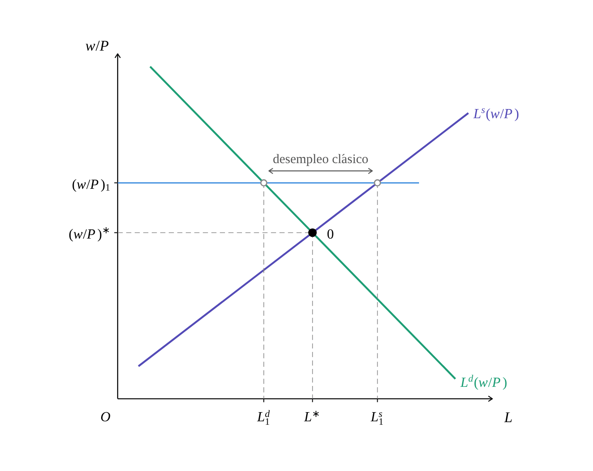
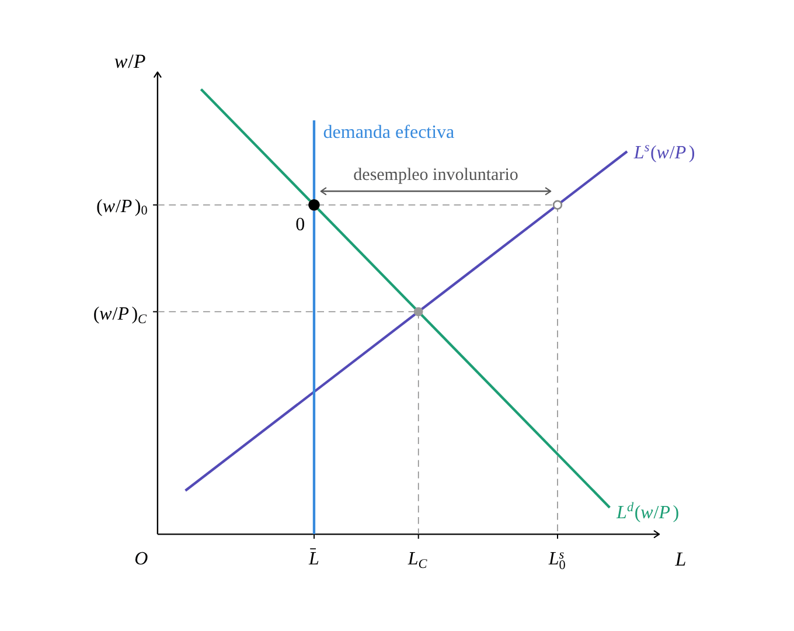
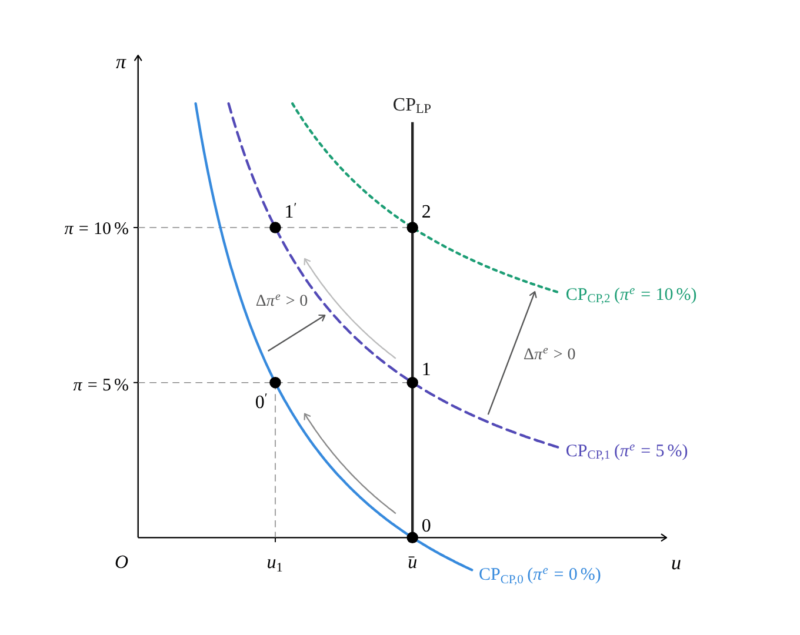
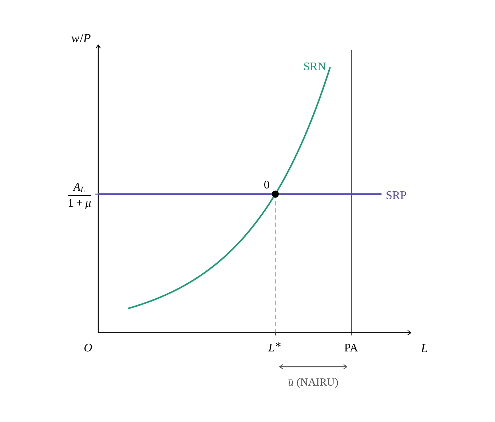
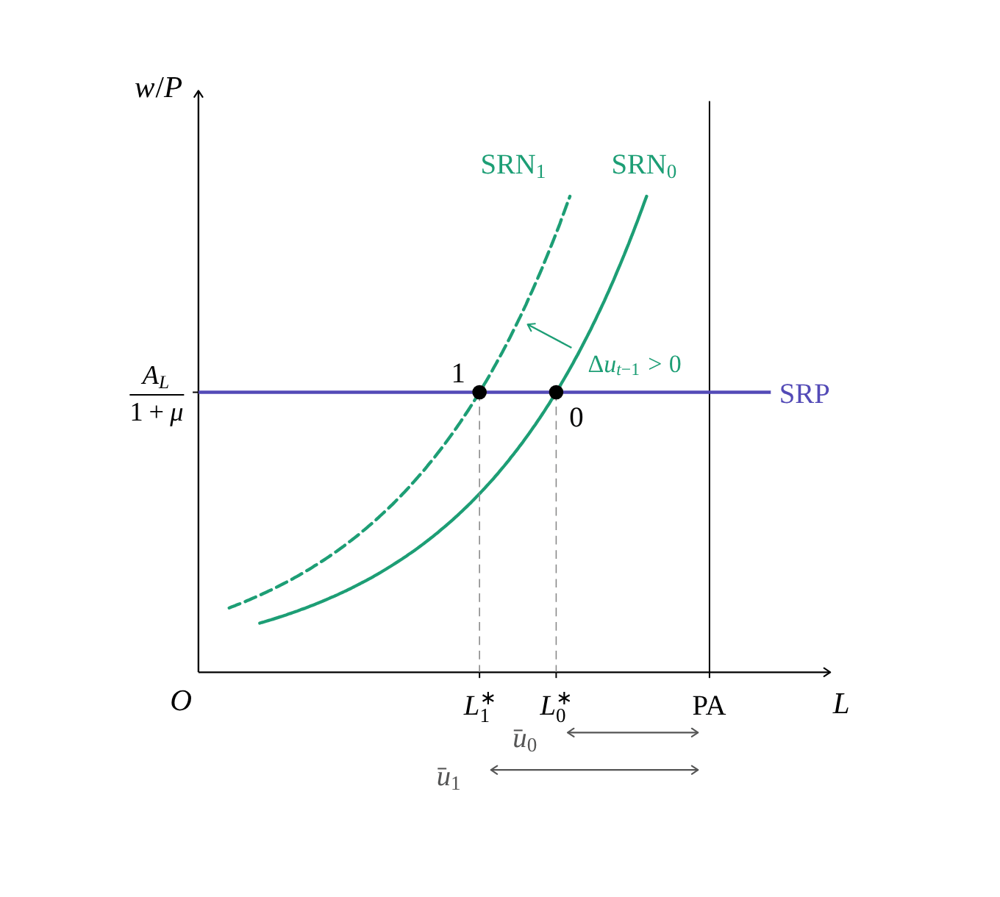

## Introducción

::: {.callout-note appearance="simple" icon=false}

:::

La tasa de desempleo de equilibrio es la referencia con la que se juzgan las políticas macroeconómicas. Friedman (1968) y Phelps (1967) la definieron como la tasa a la que tiende la economía cuando las expectativas se cumplen, la **tasa natural de paro**, y mostraron que la política monetaria solo puede rebajar el desempleo por debajo de ella a costa de una inflación creciente. La versión neokeynesiana, la **NAIRU**, la deriva, en cambio, de la negociación de salarios y la fijación de precios en mercados imperfectos (Layard y Nickell, 1985) y la hace depender de instituciones como las prestaciones o la negociación colectiva.

La **histéresis** (Blanchard y Summers, 1986) añade que el desempleo de equilibrio depende de la historia, porque los parados de larga duración pierden capital humano y vínculos con el mercado de trabajo, y una recesión puede elevar el paro estructural. En la zona del euro y en España, las estimaciones muestran una NAIRU que sube tras cada recesión y baja lentamente después, lo que hace de su medición, siempre imprecisa, una cuestión central para la política económica. De hecho, las estimaciones, con filtros estadísticos o con modelos estructurales, cambian mucho al llegar datos nuevos y obligan a usarlas con cautela al decidir la política monetaria.

La distinción entre el desempleo de equilibrio y el cíclico ordena también las políticas. Las de oferta, que actúan sobre las instituciones del mercado de trabajo, son las únicas que pueden rebajar la tasa de equilibrio de forma duradera, mientras que las de demanda solo mueven el desempleo en torno a ella, salvo que haya histéresis. La nueva síntesis integra hoy la búsqueda y el emparejamiento en la curva de Phillips neokeynesiana, y con ello la tasa natural deja de ser una constante y pasa a depender de las perturbaciones y de las políticas.

El desempleo de equilibrio reúne dos explicaciones del paro que se estudian por separado, las fricciones de búsqueda que originan el desempleo friccional (tema [A26](a26-desempleo-friccional.qmd)) y las rigideces que mantienen el salario por encima del de vaciado (tema [A27](a27-salarios.qmd)). Combinadas, determinan una sola tasa de equilibrio, y es la distancia a esa tasa la que enlaza el mercado de trabajo con la inflación (tema [A41](a41-inflacion.qmd)).

Este tema analiza el desempleo de equilibrio y su persistencia:

- *Fundamentos*: las aportaciones previas a la crítica de Lucas.

- *Desempleo de equilibrio*: sus modelos, de las expectativas racionales a la histéresis.

- *Desarrollos actuales*: la teoría vigente y la convergencia del pensamiento económico.

## 1. Fundamentos del análisis de la tasa natural de paro (TNP), la NAIRU y la persistencia del desempleo

El análisis de la TNP, la NAIRU y la persistencia del desempleo se apoya en unos fundamentos que arrancan del debate fundacional entre la visión neoclásica y la keynesiana y continúan con la síntesis neoclásica, el monetarismo y los neokeynesianos del desequilibrio.

### 1.1. Debate entre la visión neoclásica y la keynesiana

El punto de partida del análisis del desempleo es la contraposición entre dos visiones del mercado de trabajo, que difieren en el grado de ajuste del salario ante perturbaciones y, a partir de ahí, en si consideran posible el desempleo involuntario. El debate fija los dos polos entre los que se moverá toda la teoría posterior, es decir, el desempleo como fenómeno de oferta, corregible con flexibilidad, o como fenómeno de demanda, corregible con estabilización.

#### 1.1.1. La visión neoclásica

**Origen**: la visión neoclásica del mercado de trabajo procede de Marshall y de Pigou (1933), que la construyen sobre la teoría de la oferta y la demanda de trabajo (tema [A25](a25-oferta-trabajo.qmd)).

**Idea**: el trabajo se compra y se vende igual que cualquier bien. Su precio, el salario real, refleja sin error la escasez relativa de trabajo. Como se ajusta libremente, el mercado se vacía al instante y en equilibrio hay pleno empleo.

**Razonamiento**: si los agentes optimizan, el equilibrio que resulta es único, estable y eficiente. Para que haya desempleo involuntario algo tiene que impedir que el salario se ajuste (es el *desempleo clásico* de Malinvaud). Por eso la receta son políticas de oferta que supriman esas rigideces, ya que las de demanda no logran mover las variables reales. En suma, sin rigideces el desempleo solo puede ser voluntario o friccional.

**Desarrollo gráfico**: el mercado de trabajo neoclásico se representa en el plano empleo-salario real (figura -@fig-a281-trabajo-neoclasico):

1. *Demanda de trabajo* $L^d(w/P)$: es decreciente en el salario real, porque las empresas contratan hasta igualarlo con la productividad marginal del trabajo, que es decreciente.

2. *Oferta de trabajo* $L^s(w/P)$: es creciente en el salario real, porque predomina el efecto sustitución entre ocio y consumo.

3. *Equilibrio*: en el punto 0 se vacía el mercado, con el salario real $(w/P)^{*}$ y el empleo de pleno empleo $L^{*}$.

    Con un salario real rígido por encima del de equilibrio, $(w/P)_1$, la oferta $L_1^s$ supera a la demanda $L_1^d$ y la diferencia es desempleo clásico.

::: {#fig-a281-trabajo-neoclasico}

::: {.content-visible when-format="html"}
```{=html}
<div class="graph-frame">
<iframe src="../graphs/a281_Trabajo_neoclasico.html" style="height:580px" loading="lazy" title="fig-a281-trabajo-neoclasico"></iframe>
</div>
```
:::

::: {.content-visible unless-format="html"}

:::

Mercado de trabajo neoclásico. Con salario real flexible hay pleno empleo y el desempleo solo puede ser voluntario o friccional.
:::

**Conclusiones**:

- *Aspectos positivos*: ofrece un marco coherente, en el que el salario real y el empleo resultan de las decisiones optimizadoras de empresas y trabajadores, y que sigue siendo la referencia de largo plazo de la teoría posterior. Destaca, además, el papel de las rigideces institucionales en el desempleo y el de las políticas de oferta para reducirlo.

- *Limitaciones*: el paradigma no puede explicar el paro masivo y persistente, como puso de manifiesto la Gran Depresión.

#### 1.1.2. La visión keynesiana

**Origen**: el paradigma neoclásico entra en crisis con la Gran Depresión (1929-1933), cuando la tasa de paro en EE. UU. alcanzó el 24,9 % en 1933 (Lebergott, 1964), una magnitud difícilmente atribuible a decisiones voluntarias de ocio. Por esta razón, John Maynard Keynes (1936) rompe con la idea de que el desempleo es exclusivamente voluntario.

**Idea**: el desempleo involuntario es posible aunque los salarios sean flexibles, porque el nivel de empleo lo determina la demanda efectiva en el mercado de bienes y no el salario en el mercado de trabajo.

**Razonamiento**: la teoría keynesiana se ha asociado a menudo con la *ilusión monetaria*, a la que Irving Fisher (1928) dedicó *The Money Illusion*, según la cual los trabajadores confunden salario nominal y salario real. Para Keynes, sin embargo, a los trabajadores les importa cuánto cobran respecto a los demás. Por eso se oponen a que les bajen el salario nominal (rigidez nominal a la baja), ya que esa bajada les haría perder terreno frente a otros grupos. En cambio, aceptan el menor salario real que deja una subida de precios, porque esta afecta a todos por igual y no cambia la posición de nadie. 

Como el empleo lo determina la demanda efectiva, y no el salario, una bajada salarial no eleva por sí sola el empleo si no aumenta la demanda agregada. Por tanto, unos precios y salarios flexibles ni bastan para garantizar el pleno empleo ni son imprescindibles para alcanzarlo. Las políticas de demanda, al dar estabilidad a la demanda agregada, se la dan también al mercado de trabajo.

**Desarrollo gráfico**: el mercado de trabajo keynesiano se representa en el plano empleo-salario real (figura -@fig-a282-trabajo-keynesiano):

1. *Demanda de trabajo* $L^d(w/P)$: recoge el empleo que las empresas desean para cada salario real. Es decreciente, como en el modelo neoclásico, porque contratan hasta igualar el salario real con la productividad marginal del trabajo, que es decreciente.

2. *Oferta de trabajo* $L^s(w/P)$: recoge el empleo que los trabajadores desean para cada salario real. Es creciente, porque predomina el efecto sustitución, y cortaría a la demanda en el empleo walrasiano $L_C$, con el salario real $(w/P)_C$.

3. *Demanda efectiva*: es una recta vertical en el empleo $\bar{L}$, el que requiere la producción que las empresas pueden vender en el mercado de bienes.

4. *Equilibrio*: en el punto 0 las empresas están sobre su curva de demanda de trabajo, con el empleo $\bar{L}$ y el salario real $(w/P)_0$.

    A ese salario real los trabajadores querrían ofrecer $L_0^s$, y la diferencia con $\bar{L}$ es desempleo involuntario.

::: {#fig-a282-trabajo-keynesiano}

::: {.content-visible when-format="html"}
```{=html}
<div class="graph-frame">
<iframe src="../graphs/a282_Trabajo_keynesiano.html" style="height:580px" loading="lazy" title="fig-a282-trabajo-keynesiano"></iframe>
</div>
```
:::

::: {.content-visible unless-format="html"}

:::

Mercado de trabajo keynesiano. El empleo lo fija la demanda efectiva ($\bar{L}$) y, al salario real resultante, aparece desempleo involuntario.
:::

**Conclusiones**:

- *Aspectos positivos*: introduce el desempleo involuntario como resultado de una insuficiencia de demanda efectiva y no de las decisiones de los trabajadores. Con ello da cuenta del paro masivo que la visión neoclásica no podía explicar y fundamenta las políticas de demanda contra el desempleo.

- *Limitaciones*: la resistencia de los salarios nominales a la baja se justifica de manera informal, sin una microfundamentación sólida, que la teoría posterior tuvo que aportar. Además, la visión keynesiana centra el análisis en la demanda y deja en segundo plano los factores de oferta y la inflación, que la síntesis neoclásica y el monetarismo incorporan después.

### 1.2. Síntesis neoclásica

La síntesis neoclásica busca un terreno común entre ambas visiones. Acepta el equilibrio neoclásico para el largo plazo y trata el desempleo keynesiano como un problema transitorio que las políticas de demanda pueden corregir. En el ámbito de estudio del desempleo, la síntesis neoclásica se apoya en la curva de Phillips y en la ley de Okun.

#### 1.2.1. La curva de Phillips (Phillips, 1958; Lipsey, 1960)

**Origen**: Alban Phillips (1958) comprobó, con casi un siglo de datos del Reino Unido (1861-1957), que la inflación salarial tendía a ser mayor cuanto menor era la tasa de desempleo. La relación empírica no era lineal, y Richard Lipsey (1960) la dotó después de fundamento teórico.

**Idea**: existe una relación estable e inversa entre inflación y desempleo, que la política económica puede explotar.

**Razonamiento**: sobre esta observación empírica, Lipsey deriva una relación teórica con base en tres supuestos: 

- *Relación demanda de trabajo-inflación salarial*: la inflación salarial crece con el exceso de demanda de trabajo ($\dot{w}/w = \gamma Z_L$).

- *Relación demanda de trabajo-tasa de desempleo*: el exceso de demanda decrece con la tasa de desempleo, de forma no lineal (lo que explica la curvatura). La relación linealizada se escribe $Z_L = \nu(u - \bar{u})$, con $\nu < 0$ y $\bar{u}$ la tasa de desempleo (friccional) a la que el exceso de demanda se anula.

- *Productividad constante*: como la productividad marginal no varía en el tiempo, la inflación salarial se traslada a la inflación de precios ($\dot{w}/w = \pi$).

Combinando los tres supuestos se obtiene la conocida *curva de Phillips* o curva de Phillips sin expectativas:

$$\pi_t = -\kappa_u (u_t - \bar{u}), \qquad \kappa_u = -\gamma\nu > 0$$

Como Lipsey obtenía primero curvas por industria y después las agregaba, la inflación depende no solo del nivel del desempleo, sino también de su distribución entre industrias.

La curva establece así una disyuntiva (*trade-off*) estable entre inflación y desempleo, y la ley de Okun la traslada del plano desempleo-inflación al plano producción-inflación. Samuelson y Solow (1960) vieron en la curva un *menú de política económica* (véase la figura del tema [A41](a41-inflacion.qmd), apartado 2.2.1). Eligiendo un punto de ella se podía hacer un “ajuste fino” del mercado laboral, es decir, comprar un paro bajo al precio de una inflación persistente.

**Conclusiones**:

- *Aspectos positivos*: la curva ofreció la primera relación cuantificable entre los objetivos de inflación y de empleo y fue el instrumento central de la política económica de los años sesenta.

- *Limitaciones*: a partir de 1970 se produce el fenómeno de la *estanflación* (elevados desempleo e inflación simultáneos), de especial intensidad en Europa, y la curva de Phillips deja de ser estable empíricamente. Entre las causas señaladas por la literatura figuran los *shocks* del petróleo (1973-1974 y 1979), la caída de la productividad total de los factores, la concentración del poder sindical (especialmente en Europa) y la inestabilidad monetaria posterior a la quiebra de Bretton Woods.

  En el plano teórico, además, a la curva le faltaba microfundamentación. La curva solo podía mantenerse en cualquier horizonte si los trabajadores no tenían en cuenta la inflación esperada y sufrían una ilusión monetaria permanente, porque tenían expectativas estáticas, es decir, esperaban que el nivel de precios no cambiara, $\pi_t^e = 0$.

#### 1.2.2. La ley de Okun (1962)

**Origen**: Arthur Okun (1962) estableció la regularidad empírica que conecta el desempleo con la producción y que permite traducir uno en otra.

**Idea**: la desviación de la tasa de desempleo respecto a su nivel de equilibrio es proporcional a la brecha entre la producción efectiva y la potencial, $y_t - \bar{y}_t = -\phi\,(u_t - \bar{u})$, donde $\phi$ es el coeficiente de Okun.

**Razonamiento**: en su estimación original, el coeficiente valía en torno a tres, de modo que cada punto de desempleo por encima del natural costaba unos tres puntos de producción. El coeficiente es mayor que la participación del trabajo en la producción porque el ajuste del empleo se acompaña de cambios en las horas, en la participación y en la productividad (atesoramiento de trabajo).

En la versión dinámica de la ley, la variación del desempleo depende de la diferencia entre el crecimiento efectivo y el potencial, $\Delta u_t = -\tfrac{1}{\phi}\,(g_{Y,t} - \bar{g}_Y)$, y por eso el desempleo solo cae si la economía crece por encima de su potencial.

**Conclusiones**:

- *Aspectos positivos*: la ley sigue siendo el puente entre la tasa natural y la brecha de producción (*output gap*) que usa la política de estabilización (tema [A42](a42-ciclos.qmd)).

- *Limitaciones*: es una regularidad empírica sin fundamento teórico propio, y su coeficiente difiere mucho entre países por las características de cada mercado de trabajo. Dentro de la mayoría de los países, sin embargo, la relación ha resultado estable[^a28-4], también durante la Gran Recesión (Ball, Leigh y Loungani, 2017). En España el coeficiente es bajo, porque el desempleo responde con mucha intensidad a la producción, lo que refleja la sensibilidad del empleo al ciclo.

### 1.3. Monetarismo

El monetarismo acepta el marco de la síntesis, pero niega su resultado central, la disyuntiva (*trade-off*) estable, al introducir las expectativas en la curva de Phillips. De ahí nacen sus dos conceptos fundamentales, la tasa natural de paro y la teoría aceleracionista de la inflación.

#### 1.3.1. La curva de Phillips ampliada por las expectativas y la tasa natural (Friedman, 1968; Phelps, 1967)

**Origen**: Milton Friedman (*The Role of Monetary Policy*, 1968) y Edmund Phelps (1967) formularon de forma independiente la crítica a la curva de Phillips y el concepto de tasa natural.

**Idea**: no existe una disyuntiva permanente entre inflación y desempleo, porque los agentes incorporan sus expectativas de inflación a la negociación salarial. Por tanto, a largo plazo el desempleo vuelve a su *tasa natural*, determinada por factores reales, cualquiera que sea la inflación.

**Razonamiento**: Friedman parte de que a los agentes les importa el poder adquisitivo de su salario, por lo que negocian teniendo en cuenta los precios que esperan. Para modelizar esas expectativas elige la *hipótesis de las expectativas adaptativas* (HEA), según la cual los agentes corrigen su expectativa anterior en una fracción del error cometido, de modo que solo usan la información contenida en la inflación pasada:

$$\pi_{t+1}^e = \pi_t^e + \lambda(\pi_t - \pi_t^e), \qquad \lambda \in (0, 1]$$

donde $\pi_{t+1}^e$ es la inflación esperada para el periodo siguiente, $\pi_t$ la inflación observada en el periodo actual y $\lambda$ la velocidad de aprendizaje.

Resolviendo recursivamente, $\pi_{t+1}^e = \lambda \sum_{j=0}^{\infty} (1-\lambda)^j \pi_{t-j}$, es decir, la inflación esperada es una media ponderada de la inflación pasada con pesos geométricamente decrecientes, de modo que, si la inflación sube de forma sostenida, el agente la subestima sistemáticamente. La HEA solo coincide con las expectativas racionales (apartado 2.1.3) en casos particulares. Muth (1960) mostró, por ejemplo, que es óptima cuando la variable es la suma de un paseo aleatorio y un ruido transitorio, con un $\lambda$ que depende de la varianza relativa de ambos componentes.

Con base en esta idea, los autores monetaristas construyen la *curva de Phillips ampliada por las expectativas*. Como los trabajadores negocian el salario nominal a partir de la inflación que esperan, la inflación efectiva es la esperada más el efecto de la presión del mercado de trabajo,

$$\pi_t = \pi_t^e - \kappa_u(u_t - \bar{u}), \qquad \kappa_u > 0$$

donde $\bar{u}$ es la tasa natural de paro, cuya análoga en el modelo del apartado 2.2, la NAIRU, se escribe $\bar{u} = \alpha/\kappa_u$. La curva de Phillips original es el caso particular $\pi_t^e = 0$. 

De la expresión se siguen dos situaciones, según que las expectativas se cumplan o no:

- $\pi_t \neq \pi_t^e$: la inflación observada difiere de la esperada. Si supera a la esperada, los trabajadores han negociado salarios nominales que resultan demasiado bajos en términos reales, las empresas contratan más y el desempleo se sitúa por debajo de la tasa natural, $u_t < \bar{u}$. Si es inferior, ocurre lo contrario. El *trade-off* entre inflación y desempleo existe, pero solo mientras dura el error, por lo que es un fenómeno de corto plazo. Además, cada revisión de las expectativas desplaza la curva, de modo que existen tantas curvas de Phillips de corto plazo como niveles de inflación esperada.

- $\pi_t = \pi_t^e$: la inflación observada y la esperada coinciden. Los salarios reales negociados son los deseados, no hay error que corregir y el desempleo se sitúa en su tasa natural, $u_t = \bar{u}$, cualquiera que sea el nivel de la inflación. La HEA conduce a esta situación de largo plazo conforme los agentes aprenden, y en ella la curva de Phillips es vertical sobre $\bar{u}$ en el plano $(u, \pi)$. De ahí que no exista *trade-off* que la política pueda explotar de forma permanente.

La tasa natural de paro corresponde, por tanto, al desempleo que hay en el equilibrio de largo plazo, cuando nadie se equivoca en sus previsiones. Abarca el paro friccional y el estructural y depende solo de factores reales e institucionales, entre ellos la eficiencia del emparejamiento, las instituciones laborales y lo competitivos que sean los mercados de bienes.

**Desarrollo gráfico**: la curva de Phillips ampliada por las expectativas se representa en el plano desempleo-inflación (figura -@fig-a283-curva-phillips-ampliada):

1. *Curvas de Phillips de corto plazo* $\text{CP}_{\text{CP},0}$, $\text{CP}_{\text{CP},1}$ y $\text{CP}_{\text{CP},2}$: cada una recoge las combinaciones de desempleo e inflación posibles con una inflación esperada dada (0 %, 5 % y 10 %). Son decrecientes, porque con las expectativas fijas un desempleo menor eleva los salarios nominales y los precios, y cada revisión al alza de las expectativas desplaza la curva hacia arriba.

2. *Curva de Phillips de largo plazo* $\text{CP}_{\text{LP}}$: es vertical sobre la tasa natural $\bar{u}$, porque recoge las situaciones en que las expectativas se cumplen.

3. *Equilibrio*: en el punto 0, sobre $\text{CP}_{\text{LP}}$, la inflación observada coincide con la esperada (0 %) y el desempleo está en su tasa natural.

::: {#fig-a283-curva-phillips-ampliada}

::: {.content-visible when-format="html"}
```{=html}
<div class="graph-frame">
<iframe src="../graphs/a283_Curva_Phillips_ampliada.html" style="height:580px" loading="lazy" title="fig-a283-curva-phillips-ampliada"></iframe>
</div>
```
:::

::: {.content-visible unless-format="html"}

:::

Curva de Phillips ampliada por las expectativas. La curva a corto plazo se desplaza y a largo plazo es vertical en la tasa natural.
:::

**Dinámica**: una expansión que reduce el desempleo a $u_1$ lleva la economía del punto 0 al 0′ a lo largo de $\text{CP}_{\text{CP},0}$, con una inflación del 5 %. Al revisarse las expectativas ($\Delta \pi^e > 0$), la curva se desplaza a $\text{CP}_{\text{CP},1}$ y el desempleo vuelve a $\bar{u}$ en el punto 1, con una inflación del 5 % que ya es la esperada. Si la autoridad insiste en mantener $u_1$, el proceso se repite (de 1 a 1′ y a 2) con una inflación cada vez mayor.

**Conclusiones**:

- *Aspectos positivos*: el concepto de tasa natural permanece hasta hoy como guía para la medición del paro cíclico, y la insistencia en las expectativas y los retardos de la política monetaria transformó la disciplina. Además, la teoría anticipó la ruptura de la curva de Phillips antes de que la estanflación de los años setenta la hiciera evidente.

- *Limitaciones*: la HEA emplea únicamente información pasada, por lo que los agentes cometen errores sistemáticos y predecibles, algo difícil de conciliar con la racionalidad.

#### 1.3.2. La teoría aceleracionista de la inflación (Friedman, 1968; Phelps, 1967)

**Origen**: Friedman (1968) y Phelps (1967) extraen esta teoría como corolario de la curva de Phillips ampliada por las expectativas.

**Idea**: el Gobierno solo puede mantener el desempleo por debajo de la tasa natural acelerando la inflación, es decir, explotando permanentemente los errores de predicción de los agentes, lo que exige aumentar continuamente la tasa de crecimiento de la oferta monetaria.

**Razonamiento**: si la autoridad monetaria fija un objetivo de desempleo inferior a la tasa natural, ha de generar cada periodo una inflación superior a la esperada. Sin embargo, con expectativas adaptativas, la inflación esperada se ajusta a la pasada, de modo que sostener la sorpresa exige una inflación creciente (véase la figura del tema [A41](a41-inflacion.qmd), apartado 2.2.2). Si la autoridad deja de acelerar la inflación, la economía regresa a $\bar{u}$ con una inflación más alta. En cambio, si la autoridad persiste, el intento de sostener el empleo por encima de su nivel de equilibrio degenera en una espiral inflacionista.

El corolario de política económica es que solo las políticas de oferta pueden reducir la tasa natural de forma duradera, y que la política monetaria debe renunciar a explotar la curva de Phillips.

**Conclusiones**:

- *Aspectos positivos*: explica por qué los intentos de mantener el desempleo por debajo de su tasa natural desembocaron en la inflación creciente de los años setenta, y fundamenta la renuncia de la política monetaria a explotar la curva de Phillips.

- *Limitaciones*: el resultado descansa en las expectativas adaptativas. Con expectativas racionales, en cambio, una política sistemática ni siquiera tiene efectos transitorios. Cuando las expectativas están ancladas, como en EE. UU. desde mediados de los años noventa, la curva vuelve a ligar el nivel de la inflación, y no su variación, con el desempleo (Blanchard, 2017, cap. 8).

### 1.4. Neokeynesianos del desequilibrio: la tipología de Malinvaud (1977)

Finalmente, la escuela del desequilibrio (Clower, 1965; Leijonhufvud, 1968; Barro y Grossman, 1971) reinterpreta a Keynes como una teoría de los fallos de coordinación con precios rígidos y racionamiento.

**Origen**: Edmond Malinvaud (1977) condensa las aportaciones de Clower y Leijonhufvud sobre los fallos de coordinación y el ajuste dinámico. Bajo la *hipótesis de decisión dual* (los agentes deciden sujetos a las cantidades que efectivamente pueden transar en los demás mercados), con rigideces de precios y racionamiento, identifica tres regímenes de desequilibrio según la situación conjunta de los mercados de trabajo y de bienes. A ellos añade un cuarto caso límite, el subconsumo.

**Idea**: el desempleo no es un fenómeno único, sino que, según la combinación de excesos de oferta o de demanda en los mercados de trabajo y de bienes, un mismo nivel de desempleo puede tener causas distintas y exigir remedios distintos, incluso opuestos.

**Razonamiento**: los cuatro regímenes son:

1. *Desempleo clásico*: exceso de oferta de trabajo y exceso de demanda de bienes. El salario real es superior al de vaciado (p. ej. por la acción sindical).

    - *Política adecuada*: bajada del salario real, que eleva la oferta de bienes y la demanda de trabajo. Un estímulo de demanda, en cambio, es aquí ineficaz, porque la producción está limitada por la oferta, y solo se precisa si la bajada salarial lleva la economía al régimen de desempleo keynesiano.

2. *Desempleo keynesiano*: exceso de oferta de trabajo y exceso de oferta de bienes. El salario real puede ser inferior, igual o superior al de vaciado, porque el problema no está en el precio del trabajo, sino en la demanda efectiva.

    - *Política adecuada*: una subida limitada del salario real o, sobre todo, la eliminación de la restricción de demanda mediante el impulso fiscal.

3. *Inflación reprimida*: los controles administrativos impiden que precios y salarios suban hasta su nivel de equilibrio, así que tanto en bienes como en trabajo hay exceso de demanda. El desequilibrio aflora entonces como escasez y racionamiento, no como inflación. La inflación reprimida es el diagnóstico clásico de las economías planificadas y de las economías de guerra con controles.

    - *Política adecuada*: liberalizar precios y salarios para que absorban el exceso de demanda, acompañada de una contracción de la demanda agregada (fiscal o monetaria) que evite que la liberalización se traduzca en una inflación abierta.

4. *Subconsumo*: exceso de demanda de trabajo y exceso de oferta de bienes, un caso lógicamente posible pero infrecuente en la práctica. Por eso, su interés es sobre todo teórico, como el régimen que completa la tipología.

    - *Política adecuada*: elevar el salario real, que estimula el consumo (y absorbe así el exceso de oferta de bienes) y modera la demanda de trabajo de las empresas (y reduce así su exceso).

Gráficamente, con la oferta monetaria y el gasto público dados, los regímenes se reparten el plano salario nominal-nivel de precios, $(w, P)$, en torno al equilibrio walrasiano, W (figura -@fig-a287-malinvaud-regimenes). Un nivel de precios alto reduce los saldos reales y la demanda de bienes (desempleo keynesiano), un salario alto respecto a los precios contrae la oferta de las empresas (desempleo clásico), y salarios y precios bajos generan exceso de demanda en ambos mercados (inflación reprimida). En cambio, el subconsumo solo aparece sobre la frontera entre el desempleo keynesiano y la inflación reprimida, de ahí que sea un caso límite.

::: {#fig-a287-malinvaud-regimenes}

::: {.content-visible when-format="html"}
```{=html}
<div class="graph-frame">
<iframe src="../graphs/a287_Malinvaud_regimenes.html" style="height:580px" loading="lazy" title="fig-a287-malinvaud-regimenes"></iframe>
</div>
```
:::

::: {.content-visible unless-format="html"}

:::

Regímenes de desequilibrio de Malinvaud (1977). Con la oferta monetaria dada, las fronteras que parten del equilibrio walrasiano, W, separan el desempleo keynesiano (K, precios altos), el desempleo clásico (C, salario real superior al de vaciado) y la inflación reprimida (I, salarios y precios bajos). El subconsumo es el caso límite de la frontera entre K e I.
:::

**Conclusiones**:

- *Aspectos positivos*: la caracterización de los regímenes permite discriminar la política óptima según el tipo de desequilibrio, frente a las recetas universales.

- *Limitaciones*: son metodológicas, pues las rigideces de precios se postulan sin microfundamentar y la identificación empírica del régimen vigente resulta difícil, lo que explica el declive del enfoque tras la revolución de las expectativas racionales.

### 1.5. Conclusiones

Los fundamentos parten de dos diagnósticos opuestos. Para la visión neoclásica, el desempleo involuntario exige una rigidez que impida el ajuste del salario real, y se corrige con políticas de oferta. Para Keynes, el empleo lo fija la demanda efectiva, y el desempleo se corrige estabilizándola. La síntesis neoclásica concilia ambas posturas con la curva de Phillips, un menú estable de inflación y desempleo que la ley de Okun traslada a la producción.

El monetarismo niega ese menú al introducir las expectativas. Cuando los agentes corrigen sus errores, el desempleo vuelve a la tasa natural, y mantenerlo por debajo exige acelerar la inflación. Malinvaud muestra, por último, que un mismo desempleo puede responder a regímenes distintos y exigir remedios opuestos. Quedan abiertos dos problemas, los errores sistemáticos que implican las expectativas adaptativas y las rigideces de precios que el enfoque del desequilibrio postula sin microfundamentar. La sección 2 los aborda con las expectativas racionales y con el modelo de la NAIRU, que deriva el desempleo de equilibrio de la negociación salarial y de la fijación de precios.

## 2. Modelos de la tasa de desempleo de equilibrio: expectativas racionales, NAIRU e histéresis

La sección anterior deja establecido que existe una tasa de desempleo de equilibrio hacia la que la economía vuelve cuando las expectativas se cumplen, pero la tasa natural de Friedman es un concepto más que un modelo. Es decir, no dice cómo se forman las expectativas cuando los agentes no se limitan a mirar el pasado, de qué depende esa tasa, ni por qué el desempleo europeo no volvió a su nivel anterior tras cada recesión.

Los tres modelos de esta sección responden a esas tres preguntas:

- *Nueva macroeconomía clásica*: sustituye las expectativas adaptativas por las racionales y lleva la lógica de Friedman a su límite, de modo que, sin errores sistemáticos, la curva de Phillips es vertical también a corto plazo. 

- *Modelo de la NAIRU*: de la primera generación neokeynesiana, abandona el mercado walrasiano y deriva la tasa de equilibrio de la negociación salarial y de la fijación de precios en mercados imperfectos, con lo que la hace depender de instituciones observables. 

- *Histéresis*: muestra que esa tasa puede no ser un ancla sino una variable que sigue al propio desempleo, lo que devuelve a la política de demanda un papel a largo plazo que los dos modelos anteriores le niegan.

### 2.1. Nueva macroeconomía clásica

La nueva macroeconomía clásica (NMC) aborda el desempleo de equilibrio con tres aportaciones: la crítica de Lucas, la sustitución intertemporal en la oferta de trabajo y la curva de Phillips con expectativas racionales.

#### 2.1.1. Crítica de Lucas (1976)

**Origen**: Robert Lucas (*Econometric Policy Evaluation: A Critique*, 1976) cuestionó el uso de los modelos de la síntesis para evaluar políticas.

**Idea**: Lucas sostiene que los modelos econométricos de la síntesis no pueden usarse para evaluar políticas alternativas, porque sus parámetros estimados dependen del régimen de política vigente. Al cambiar el régimen, cambian las reglas de decisión de los agentes y, con ellas, los parámetros estimados.

**Razonamiento**: la crítica exige microfundamentar los modelos y modelizar explícitamente las expectativas, que es el programa de la nueva macroeconomía clásica y, después, de la nueva economía keynesiana. Aplicada al mercado de trabajo, implica que la curva de Phillips estimada bajo un régimen no sirve para predecir bajo otro.

**Conclusiones**:

- *Aspectos positivos*: explica por qué la curva de Phillips estimada en los años sesenta dejó de funcionar cuando la política trató de explotarla, y su exigencia de modelos con parámetros estructurales, invariantes a la política, es hoy un estándar de la macroeconomía aplicada.

- *Limitaciones*: su relevancia empírica es discutida, porque los contrastes encuentran pocos casos en que los parámetros de los modelos econométricos tradicionales cambien de forma significativa con la política (Ericsson e Irons, 1995). Además, la invariancia de los parámetros de preferencias y tecnología es un supuesto difícil de contrastar.

#### 2.1.2. Oferta de trabajo y sustitución intertemporal (Lucas y Rapping, 1969)

**Origen**: Robert Lucas y Leonard Rapping (1969) fueron los primeros en explicar las fluctuaciones del empleo dentro de un mercado de trabajo que se vacía continuamente.

**Idea**: los trabajadores eligen cuánto trabajar comparando el salario real actual con el esperado en el futuro, de modo que las fluctuaciones del empleo son respuestas voluntarias de sustitución intertemporal del ocio ante salarios percibidos como transitoriamente altos o bajos (tema [A25](a25-oferta-trabajo.qmd), apartado 2.2).

**Razonamiento**: combinada con la información imperfecta sobre los precios agregados, la sustitución intertemporal permite a la NMC generar fluctuaciones del empleo sin abandonar el vaciado continuo de los mercados. Por ello, el desempleo cíclico es ocio elegido, y solo la tasa natural es desempleo en sentido propio.

**Conclusiones**:

- *Aspectos positivos*: ofrece la primera explicación de las fluctuaciones del empleo con agentes optimizadores y mercados que se vacían, y su mecanismo de sustitución intertemporal pasa a los modelos del ciclo real (tema [A42](a42-ciclos.qmd), apartado 2.2).

- *Limitaciones*: el mecanismo exige una elasticidad intertemporal de la oferta de trabajo elevada, que la evidencia microeconométrica no respalda (Altonji, 1986). Además, resulta difícil interpretar el aumento del desempleo en las recesiones como ocio elegido.

#### 2.1.3. Curva de Phillips con expectativas racionales (Lucas, 1972; Sargent y Wallace, 1975)

**Origen**: Robert Lucas (1972) derivó la curva de Phillips de un modelo con expectativas racionales e información imperfecta, y Thomas Sargent y Neil Wallace (1975) extrajeron su implicación para la política económica.

**Idea**: la NMC deja atrás las expectativas adaptativas y supone que son racionales (*hipótesis de las expectativas racionales*, HER). Al prever, los agentes aprovechan con eficiencia toda la información a su alcance, incluido cómo funciona la economía y qué política se ha anunciado, y por eso solo se equivocan al azar y sin sesgo. Desaparece así lo que en Friedman daba lugar al *trade-off* de corto plazo, unos agentes que erraban siempre en la misma dirección.

**Razonamiento**: en la parábola de las islas, un productor ve subir el precio de lo que vende sin conocer el nivel general de precios. Producir más solo le interesa si la subida es de precio relativo, no si todos los precios han subido, y ha de averiguar qué caso se da. Si atribuye parte de la subida a un cambio relativo, aumenta la producción y el empleo. Al agregar y aplicar la ley de Okun, el desempleo se desvía de su tasa natural solo en la medida en que el nivel de precios (en logaritmos, $p_t$) difiera del esperado ($p_t^e$):

$$u_t = \bar{u} - \frac{\zeta}{\phi}(p_t - p_t^e) + \varepsilon_t, \qquad \zeta, \phi > 0$$

donde $\zeta$ mide la respuesta de la producción a la sorpresa de precios, $\phi$ es el coeficiente de Okun y $\varepsilon_t$ una perturbación aleatoria.

Con expectativas racionales, $p_t - p_t^e$ es un error impredecible con la información disponible. Por eso, el desempleo baja de su tasa natural únicamente cuando hay sorpresas inflacionarias, y vuelve a ella en cuanto se disipan. 

Así, una política monetaria sistemática es anticipada e incorporada en $p_t^e$, y no tiene efecto real ni siquiera a corto plazo. Por tanto, la curva es vertical también a corto plazo, salvo por las sorpresas.

**Conclusiones**:

- *Aspectos positivos*: la HER obliga a modelizar explícitamente las expectativas y a microfundamentar los modelos, y su implicación de política, que la estabilización sistemática es inútil, fijó los términos del debate posterior.

- *Limitaciones*: para que el modelo genere fluctuaciones observables, los agentes han de confundir cambios de precios relativos con cambios generales durante periodos largos, lo que es poco creíble cuando el nivel de precios se publica mensualmente. Por su parte, el mecanismo de sustitución intertemporal en que se apoya exige una elasticidad de la oferta de trabajo poco realista. Por todo lo anterior, la propia NMC evolucionó hacia los modelos del ciclo real (tema [A42](a42-ciclos.qmd)), y la nueva economía keynesiana conservó la HER pero abandonó el vaciado continuo.

### 2.2. Nueva economía keynesiana de primera generación: el modelo de la NAIRU (Layard y Nickell, 1985; Carlin y Soskice, 1990)

**Origen**: Richard Layard y Stephen Nickell (1985) y, en su versión de manual, Wendy Carlin y David Soskice (1990) formularon el modelo de salarios y precios del que resulta la NAIRU. Layard, Nickell y Jackman (1991) lo sistematizan y lo contrastan con datos de la OCDE.

**Idea**: la nueva economía keynesiana acepta de la NMC las expectativas racionales y la exigencia de microfundamentos, pero rechaza su punto de partida, porque el mercado de trabajo no es walrasiano. Los salarios se negocian y los precios los fijan empresas con poder de mercado, de modo que el desempleo de equilibrio no es el que vacía el mercado sino el que hace compatibles las aspiraciones de trabajadores y empresas sobre el reparto de la renta.

#### 2.2.1. Supuestos

**Entorno**: la economía es cerrada y los mercados de trabajo y de bienes son imperfectos. 

**Agentes**: sindicatos y empresas, ambos con poder de mercado y sin ilusión monetaria, de modo que negocian en términos reales esperados y lo relevante es el salario real y el margen real, no sus valores nominales.

- *Sindicatos*: en el mercado de trabajo, un sindicato (o los trabajadores en negociación colectiva) fija el salario real que aspira a obtener, y esa aspiración crece con la presión del mercado, es decir, decrece con el desempleo.

- *Empresas*: en el mercado de bienes, las empresas fijan el precio como un margen sobre el coste marginal, y ese margen determina el salario real que están dispuestas a pagar.

**Tecnología**: el trabajo es el único factor variable y opera con rendimientos constantes, $Y = A_L \cdot L$, de modo que la productividad marginal coincide con la media y es constante. El coste marginal es, por tanto, el salario dividido por la productividad.

#### 2.2.2. Modelo

**Planteamiento**: el equilibrio resulta de dos relaciones, la que fija el salario real que los trabajadores pretenden y la que fija el que las empresas conceden. El desempleo es la variable que reconcilia ambas pretensiones. Si el salario real al que aspiran los trabajadores supera al que las empresas pagan, la diferencia se traduce en una inflación superior a la esperada.

**Salario real negociado (SRN)**: al inicio de cada periodo, los trabajadores negocian un salario real esperado, $w/P^e$, que depende negativamente del desempleo (a mayor desempleo, menor poder negociador) y positivamente de un conjunto de factores institucionales $z$ (prestaciones por desempleo, salario mínimo, cotizaciones):

$$\frac{w}{P^e} = f(u^-, z^+) \tag{1}$$

**Salario real pagado (SRP)**: las empresas fijan un margen constante $\mu = 1/(\sigma - 1) > 0$ sobre el coste marginal, que por los rendimientos constantes coincide con el coste laboral unitario:

$$P = (1 + \mu)\,\frac{w}{A_L} \tag{2}$$

$$\frac{w}{P} = \frac{A_L}{1 + \mu} = (1-I_L)\,A_L$$

donde $\sigma$ es la elasticidad de sustitución entre variedades (la elasticidad-precio de la demanda de cada empresa) e $I_L = 1/\sigma$ el índice de Lerner. El SRP es horizontal en el plano empleo-salario real, pues no depende del nivel de empleo, sino solo de la productividad y del grado de competencia[^a28-9]. El margen puede ser, no obstante, anticíclico, porque la colusión es más difícil de sostener en los auges (Rotemberg y Saloner, 1986) o porque la elasticidad-precio de la demanda es procíclica. En ese caso, el SRP tendría pendiente positiva.

**Equilibrio (la NAIRU)**: exige que las aspiraciones recogidas en (1) y (2) sean compatibles, $\text{SRN} = \text{SRP}$, lo que implica el cumplimiento de las expectativas ($P^e = P$):

$$f(\bar{u}, z) = \frac{A_L}{1 + \mu}$$

La tasa de desempleo que resuelve esta ecuación es la *NAIRU* (*Non-Accelerating Inflation Rate of Unemployment*), es decir, la tasa a la que las aspiraciones de trabajadores y empresas sobre el reparto de la renta resultan mutuamente compatibles. Por eso, a esa tasa la inflación no se acelera. La NAIRU es única y estable en ausencia de histéresis, y es también compatible con desempleo involuntario, pues el salario negociado se sitúa por encima del de vaciado. Además, la NAIRU engloba el desempleo estructural y el friccional.

Conviene distinguirla de la tasa natural de Friedman. Ambas son tasas de equilibrio a largo plazo determinadas por factores reales, pero la tasa natural es un concepto de vaciado del mercado, es decir, el nivel que generaría el equilibrio general walrasiano. Friedman, no obstante, incorporaba ya en ese equilibrio las imperfecciones del mercado y los costes de información y movilidad. La NAIRU, en cambio, es un concepto de compatibilidad entre las aspiraciones de agentes con poder de mercado. Por ello, la NAIRU hace depender explícitamente el desempleo de equilibrio de instituciones (sindicatos, prestaciones, margen empresarial) que en el modelo competitivo no existen. En la práctica, los dos términos se usan como sinónimos para designar la tasa a la que la inflación es estable.

**Desarrollo gráfico**: la determinación de la NAIRU se representa en el plano empleo-salario real (figura -@fig-a284-nairu):

1. *Salario real negociado* (SRN): es creciente en el empleo, porque un menor desempleo refuerza el poder negociador de los trabajadores, y se hace muy inclinado al acercarse a la población activa.

2. *Salario real pagado* (SRP): es horizontal en $A_L/(1+\mu)$, porque con rendimientos constantes el salario real que conceden las empresas no depende del empleo.

3. *Población activa* (PA): marca el empleo máximo y es una vertical, porque no depende del salario real. La distancia horizontal entre el empleo y esta recta mide el desempleo.

4. *Equilibrio*: en el punto 0 se cortan el SRN y el SRP, con el empleo $L^{*}$. La distancia entre $L^{*}$ y la población activa es el desempleo de la NAIRU, $\bar{u}$.

::: {#fig-a284-nairu}

::: {.content-visible when-format="html"}
```{=html}
<div class="graph-frame">
<iframe src="../graphs/a284_NAIRU.html" style="height:620px" loading="lazy" title="fig-a284-nairu"></iframe>
</div>
```
:::

::: {.content-visible unless-format="html"}

:::

Determinación de la NAIRU. El salario real negociado (SRN) se iguala al salario real pagado (SRP) en el empleo $L^*$. La distancia hasta la población activa (PA) es el desempleo correspondiente a la NAIRU, $\bar{u}$.
:::

**Estática comparativa**: se distinguen las políticas de demanda y las de oferta:

- *Políticas de demanda*: una expansión de demanda reduce transitoriamente el desempleo por debajo de la NAIRU. El menor desempleo refuerza el poder negociador de los trabajadores y eleva el salario negociado por encima del pagado ($\text{SRN} > \text{SRP}$). Las empresas trasladan entonces los mayores salarios a los precios y se desata una espiral salarios-precios que devuelve la economía a la NAIRU con una inflación superior. Las políticas de demanda solo tienen, pues, efectos transitorios, y a costa de inflación.

- *Políticas de oferta*: son las únicas que alteran la NAIRU, porque desplazan una de las dos curvas, y las óptimas son las que eliminan las rigideces de ambos mercados. Sus efectos son los siguientes:

    - *Factores institucionales*: un aumento de $z$ (prestaciones, salario mínimo) desplaza el SRN hacia arriba y eleva la NAIRU.

    - *Competencia*: un aumento de $\mu$ (menor competencia en el mercado de bienes) reduce el SRP y eleva la NAIRU.

    - *Productividad*: un aumento de $A_L$ (formación) desplaza el SRP hacia arriba y reduce la NAIRU. Sin embargo, si las aspiraciones salariales acaban indexándose a la productividad, el efecto es solo transitorio.

    - *Fiscalidad*: las rebajas de impuestos y cotizaciones reconcilian las aspiraciones de ambas partes a un menor nivel de desempleo.

**Extensiones**:

- *Curva de Phillips de la primera generación neokeynesiana*: sin imponer el cumplimiento de las expectativas, y suponiendo por concreción $f(u, z) = z\,e^{-\kappa_u u}$, la combinación de (1) y (2) da una curva de Phillips con fundamento en la puja distributiva entre sindicatos y empresas:

  $$\begin{aligned} \pi_t &= \pi_t^e + \alpha - \kappa_u u_t = \pi_t^e - \kappa_u(u_t - \bar{u}), \qquad \kappa_u > 0 \\ \bar{u} &= \frac{\alpha}{\kappa_u}, \qquad \alpha = \ln(1+\mu) + \ln z - \ln A_L \end{aligned}$$
  Se trata de la curva ampliada por las expectativas del apartado 1.3.1, con la diferencia de que la NAIRU ya no es un dato sino una función de los parámetros estructurales. Así, la NAIRU crece con el margen $\mu$ y con los factores institucionales $z$, y decrece con la productividad $A_L$.

- *Evidencia sobre los determinantes*: los estudios de panel para la OCDE que siguen este enfoque (Nickell, 1997) asocian una NAIRU más alta a las prestaciones generosas de duración indefinida sin exigencia de búsqueda activa. También la asocian a la sindicación elevada sin coordinación de la negociación y a una cuña fiscal elevada sobre el trabajo. La protección del empleo, en cambio, reduce a la vez las entradas y las salidas del desempleo y afecta más a su duración que a su nivel.

  Blanchard y Wolfers (2000) muestran que ni las perturbaciones ni las instituciones explican por sí solas la subida del paro europeo, pues muchas instituciones ya existían cuando el paro era bajo. Lo explica su interacción, ya que unas mismas perturbaciones adversas (desaceleración de la productividad, tipos de interés reales altos) elevaron más y de forma más duradera el desempleo en los países con instituciones más rígidas.

#### 2.2.3. Conclusiones

**Aspectos positivos**: el modelo fundamenta el desempleo de equilibrio en la estructura del mercado de trabajo y del de bienes (poder de negociación, márgenes, generosidad de las prestaciones), lo que lo hace más rico que la tasa natural friedmaniana y permite analizar las políticas estructurales. Además, da a la curva de Phillips ampliada un fundamento alternativo al de la NMC, basado en la puja distributiva en mercados imperfectos y no en la información imperfecta sobre los precios.

**Limitaciones**: la NAIRU no es observable y sus estimaciones son inestables (apartado 3.3). A ello se suma que el modelo es estático y no explica por qué el desempleo europeo se mantuvo alto tras las perturbaciones de los años setenta, lo que motiva la hipótesis de histéresis.

### 2.3. Histéresis: la persistencia del desempleo (Blanchard y Summers, 1986)

**Origen**: Olivier Blanchard y Lawrence Summers (*Hysteresis and the European Unemployment Problem*, 1986) tomaron de la física el término histéresis para describir la persistencia del desempleo europeo.

**Idea**: la subida del desempleo europeo en los años setenta y ochenta reveló que la NAIRU estimada parecía evolucionar a la par que el desempleo observado, en lugar de actuar como atractor estable. La *histéresis* designa precisamente esa dependencia, pues considera que la tasa de desempleo de equilibrio depende de la evolución pasada del desempleo efectivo. Se trata, por tanto, de un fenómeno de medio plazo. Según el desempleo vuelva muy despacio a su nivel de partida o no vuelva, la histéresis es parcial (persistencia) o pura.

#### 2.3.1. Razonamiento: los mecanismos

Blanchard y Summers identifican tres mecanismos por los que el desempleo pasado eleva el desempleo de equilibrio:

1. *Reducciones en la acumulación de capital*: las perturbaciones negativas reducen el empleo y la inversión, y la caída del *stock* de capital provoca disminuciones adicionales de la demanda de trabajo.

2. *Pérdida de capital humano*: el desempleo prolongado deprecia las cualificaciones y genera desgaste psicológico (efecto desánimo), lo que dificulta la reinserción (Phelps, 1972). Esta pérdida es uno de los mecanismos con mayor respaldo empírico, aunque Blanchard y Summers (1986) consideraron más prometedor el de *insiders-outsiders*.

3. *Dinámica* insiders-outsiders: los *insiders*, que concentran el poder negociador, fijan el salario atendiendo solo a su propio empleo, de modo que en las recesiones no se ajusta a la baja lo suficiente para reabsorber a los despedidos[^a28-12].

#### 2.3.2. Desarrollo en el modelo de la NAIRU

Analíticamente, la histéresis consiste en hacer depender la NAIRU del desempleo pasado. La forma más simple es una media ponderada de la NAIRU estructural y del desempleo del periodo anterior:

$$\bar{u}_t = (1 - h)\,\bar{u}^* + h\,u_{t-1}, \qquad h \in [0, 1]$$

donde $\bar{u}^*$ es la NAIRU estructural de largo plazo y $h$ el grado de histéresis. Se dan así tres casos:

- *Sin histéresis*: con $h = 0$ la NAIRU es constante, como en el modelo de Layard y Nickell.

- *Histéresis parcial*: con $0 < h < 1$ hay persistencia, pues tras una perturbación la NAIRU se desplaza y vuelve solo gradualmente a $\bar{u}^*$. La NAIRU de largo plazo es única, aunque a corto o medio plazo puede haber varias.

- *Histéresis pura* (formulación original de Blanchard y Summers): con $h = 1$, la NAIRU es simplemente el desempleo del periodo anterior y el desempleo sigue un paseo aleatorio, sin nivel de largo plazo al que volver. En esta forma extrema de persistencia deja de existir una NAIRU única, y las políticas de demanda vuelven a tener efectos a largo plazo.

Sustituyendo en la curva de Phillips, $\pi_t = \pi_t^e - \kappa_u(u_t - \bar{u}_t)$, la inflación deja de depender de la distancia a una tasa fija y pasa a depender, en el caso puro, de la variación del desempleo, $\pi_t = \pi_t^e - \kappa_u\,\Delta u_t$.

Gráficamente, en el plano empleo-salario real del modelo de Layard y Nickell (figura -@fig-a285-histeresis), el SRN recoge el salario real que negocian los trabajadores para cada nivel de empleo y es creciente, porque un menor desempleo refuerza su poder negociador. El SRP, horizontal, es el que pagan las empresas con su margen.

La histéresis se representa mediante un desplazamiento de la curva SRN. Tras una contracción de demanda, el desempleo aumenta ($\Delta u_{t-1} > 0$) y parte de los desempleados deja de presionar sobre la negociación. Los *insiders* restantes, con mayor poder negociador efectivo, sostienen sus salarios. La curva se desplaza hacia la izquierda, de $\text{SRN}_0$ a $\text{SRN}_1$, y, con el SRP sin cambios, el equilibrio pasa del punto 0 al 1, con menor empleo ($L_1^{*} < L_0^{*}$) y una NAIRU superior ($\bar{u}_1 > \bar{u}_0$). Por tanto, cuando la coyuntura mejora, el desempleo ya no retorna a su nivel inicial.

::: {#fig-a285-histeresis}

::: {.content-visible when-format="html"}
```{=html}
<div class="graph-frame">
<iframe src="../graphs/a285_Histeresis.html" style="height:650px" loading="lazy" title="fig-a285-histeresis"></iframe>
</div>
```
:::

::: {.content-visible unless-format="html"}

:::

Histéresis. Un *shock* transitorio desplaza de forma permanente la curva SRN y eleva la NAIRU.
:::

El corolario de política es que las políticas activas de empleo (formación, intermediación, recualificación de parados de larga duración) pueden favorecer el retorno del desempleo a su nivel inicial, porque frenan la pérdida de capital humano (segundo de los mecanismos anteriores), que el apartado 3.1 reinterpreta como una caída de la eficiencia del emparejamiento. La dinámica *insiders-outsiders* se desarrolla en el tema [A27](a27-salarios.qmd), apartado 2.4.

#### 2.3.3. Conclusiones

**Aspectos positivos**: la histéresis explica lo que la NAIRU estática no podía, la persistencia del desempleo europeo tras las perturbaciones de los años setenta y ochenta, y devuelve a la política de demanda un papel a largo plazo. Además, sus tres mecanismos han recibido apoyo empírico, y el caso español es una de sus ilustraciones más citadas.

**Limitaciones**: la literatura posterior considera que la histéresis pura es una hipótesis demasiado extrema, por tres razones:

- *Outsiders*: los desempleados sí pueden afectar, siquiera parcialmente, al resultado de la negociación.

- *Insiders*: afrontan a su vez una probabilidad positiva de caer en el desempleo, lo que modera sus demandas.

- *Empresas*: pueden recurrir a la amenaza creíble de despido y sustitución.

En consecuencia, la dinámica *insiders-outsiders* genera una persistencia elevada ($0 < h < 1$), pero no histéresis pura, y el desempleo acaba volviendo a una NAIRU de largo plazo, aunque lentamente.

### 2.4. Conclusiones

Los tres modelos convierten la tasa natural en una teoría del desempleo de equilibrio. En primer lugar, la nueva macroeconomía clásica la combina con expectativas racionales, de modo que solo las sorpresas apartan el desempleo de esa tasa y una política sistemática carece de efectos reales incluso a corto plazo. En segundo lugar, el modelo de la NAIRU sitúa el equilibrio donde el salario real que negocian los trabajadores coincide con el que pagan las empresas. La tasa depende entonces de instituciones (prestaciones, sindicatos, margen empresarial), y solo las políticas de oferta la alteran. Finalmente, la histéresis suma a esos determinantes el desempleo pasado y devuelve a la política de demanda efectos duraderos, aunque la literatura considera más plausible una persistencia elevada que la histéresis pura.

Quedan por precisar los determinantes que resume el vector $z$ y la forma de medir la tasa. La sección 3 lo hace con el modelo de búsqueda y emparejamiento, que da contenido a esos factores, y con los métodos de estimación de la NAIRU y sus límites.

## 3. Desarrollos actuales y convergencia del pensamiento económico

La teoría actual del desempleo de equilibrio incorpora las fricciones de búsqueda y la curva de Phillips neokeynesiana y afronta el problema práctico de estimar la NAIRU. La sección termina con la convergencia del pensamiento económico.

### 3.1. El modelo de búsqueda y emparejamiento

Los desarrollos actuales parten del modelo de búsqueda y emparejamiento, que microfundamenta el desempleo de equilibrio como resultado de un proceso costoso de encuentro entre trabajadores y vacantes. Su aportación a este tema es triple.

- *Nuevos parámetros*: en primer lugar, ofrece una teoría de la tasa de desempleo de equilibrio en la que esta depende de la eficiencia del emparejamiento, de la tasa de destrucción de empleo, del poder negociador de los trabajadores y del coste de mantener una vacante. Ello da contenido a los factores $z$ del modelo de la NAIRU. 

- *Naturaleza de las perturbaciones*: en segundo lugar, distingue con precisión las perturbaciones coyunturales, que mueven el equilibrio sobre la curva de Beveridge, de las estructurales, que la desplazan y alteran la tasa de equilibrio. Dota así de un instrumento empírico a la distinción entre paro cíclico y estructural. 

- *Persistencia y eficiencia*: en tercer lugar, explica la persistencia como pérdida de eficiencia del emparejamiento tras las recesiones (pérdida de capital humano, desajuste). Ello convierte a la histéresis en un fenómeno del proceso de búsqueda y no solo de la negociación salarial. El modelo ha permitido también integrar las fricciones de búsqueda en los modelos del ciclo[^a28-13]. Asimismo, hace de las políticas activas de empleo el instrumento para desplazar la curva de Beveridge hacia el origen.

Gráficamente, en el plano desempleo-vacantes (figura -@fig-a286-beveridge), el equilibrio resulta de dos curvas:

1. *Curva de Beveridge* ($\text{CB}_0$): recoge las combinaciones de desempleo y vacantes en que las entradas en el desempleo y las salidas se compensan. Es decreciente, porque con más vacantes los desempleados encuentran trabajo antes, y convexa respecto al origen, porque cada reducción adicional del desempleo exige un aumento cada vez mayor de las vacantes.

2. *Recta de creación de empleo* ($v = \theta_0^* u$): recoge las combinaciones de desempleo y vacantes con la estrechez de equilibrio. Parte del origen con pendiente igual a la estrechez del mercado $\theta_0^*$, determinada por la condición de creación de empleo de las empresas.

3. *Equilibrio*: en el punto 0 se cortan ambas, con la tasa de desempleo de equilibrio $\bar{u}_0$ y las vacantes $v_0$.

Una caída de la eficiencia del emparejamiento ($\Delta A < 0$), una perturbación estructural, desplaza la curva hacia fuera, de $\text{CB}_0$ a $\text{CB}_1$, y reduce la estrechez, de modo que la recta gira a $v = \theta_1^* u$, menos inclinada. El equilibrio pasa del punto 0 al 1, con una tasa de desempleo de equilibrio mayor ($\bar{u}_1 > \bar{u}_0$).

::: {#fig-a286-beveridge}

::: {.content-visible when-format="html"}
```{=html}
<div class="graph-frame">
<iframe src="../graphs/a286_Beveridge.html" style="height:580px" loading="lazy" title="fig-a286-beveridge"></iframe>
</div>
```
:::

::: {.content-visible unless-format="html"}

:::

Curva de Beveridge (CB) en el modelo de búsqueda y emparejamiento. Una caída de la eficiencia del emparejamiento ($\Delta A < 0$) desplaza la curva hacia fuera y hace menos inclinada la recta de creación de empleo ($v = \theta^* u$), y el equilibrio pasa de 0 a 1, con una tasa de desempleo de equilibrio mayor ($\bar{u}_1 > \bar{u}_0$).
:::

::: {.callout-note appearance="simple" icon=false}
El modelo de Diamond, Mortensen y Pissarides se desarrolla en el tema [A26](a26-desempleo-friccional.qmd), apartado 2. Aquí se recoge su aportación a la teoría de la tasa de desempleo de equilibrio.
:::


### 3.2. La curva de Phillips de la nueva economía keynesiana de segunda generación (NEK2G)

**Origen**: la nueva síntesis neoclásica (tema [A07](a07-nek.qmd)) deriva la curva de Phillips de la fijación escalonada de precios a la Calvo (1983) con expectativas racionales. La versión híbrida se debe a Galí y Gertler (1999) y la salarial, a Erceg, Henderson y Levin (2000), que Galí (2011) reformula en términos de desempleo.

**Idea**: los modelos de la NEK2G, o de la nueva síntesis neoclásica (NSNC), derivan una curva de Phillips plenamente microfundamentada y prospectiva. En ella, la inflación de hoy depende de la inflación esperada y de la brecha de producción o, de forma equivalente, del desempleo.

#### 3.2.1. Supuestos

**Entorno**: las empresas deciden bajo incertidumbre en un modelo dinámico, en tiempo discreto y con horizonte infinito ($T \rightarrow \infty$), lo que, junto con la rigidez de precios a la Calvo, hace que las decisiones de precios de hoy dependan de la inflación esperada en el futuro. Los precios se fijan a la Calvo, de manera que cada periodo solo una fracción $1-\xi$ de las empresas, seleccionada aleatoriamente, puede reajustar su precio. El nivel agregado de precios evoluciona entonces como una media ponderada del precio pasado y del precio óptimo de reajuste, $P_t = \left[\xi P_{t-1}^{1-\sigma} + (1-\xi)(P^*_t)^{1-\sigma}\right]^{1/(1-\sigma)}$, lo que introduce la rigidez nominal agregada.

**Agentes**: hogares idénticos con vida infinita, que eligen consumo, trabajo y tenencia de bonos, y un continuo de empresas, cada una productora de una variedad, que fijan su precio. Todos forman sus expectativas según la HER.

**Mercado de bienes**: hay competencia monopolística en el mercado de bienes, con un continuo de variedades.

#### 3.2.2. Modelo

**Planteamiento**: el modelo parte de dos programas de optimización intertemporal, el de los hogares y el de las empresas:

- *Hogares*: maximizan la utilidad esperada intertemporal sujeta a su restricción presupuestaria:

  $$\begin{aligned} &\max_{c,\ell,b} \; U^e = \mathbb{E}_0\left[\sum_{t=0}^{\infty} \beta^t\, u(c_t, 1-\ell_t)\right], \qquad \beta \in (0, 1) \\ &\text{s.a.:} \begin{cases} c_t + (b_t - b_{t-1}) \leq w_t \ell_t + r_t b_{t-1} \\ b_{-1} \text{ dado} \\ \lim_{T \to \infty} \mathbb{E}_0\left[b_T / R_T\right] \geq 0 \end{cases} \end{aligned}$$

  donde $c_t$ es un índice de consumo que agrega todas las variedades, $\ell_t$ el trabajo, $b_t$ la tenencia de bonos, $w_t$ el salario real, $r_t$ el tipo de interés real de los bonos, $u(\cdot)$ la utilidad instantánea y $\beta \in (0, 1)$ el factor de descuento. Los bonos iniciales, $b_{-1}$, están dados, y la condición de no-Ponzi, con $R_T \equiv \prod_{s=1}^{T}(1+r_s)$, impide endeudarse indefinidamente.

- *Empresas*: cada productor de variedad maximiza el valor esperado descontado de sus beneficios:

  $$\max_{P_{i,t}} \; V^e = \mathbb{E}_0\left[\sum_{t=0}^{\infty} \beta^t\, \Pi(P_{i,t}, Y_{i,t}, C_t)\right], \qquad \beta \in (0, 1)$$

  $$\text{s.a.:} \begin{cases} Y_{i,t} = f(\ell_{i,t}) & \text{(tecnología)} \\[4pt] Y_{i,t} = \left(\dfrac{P_{i,t}}{P_t}\right)^{-\sigma} C_t & \text{(demanda de la variedad)} \\[4pt] P_{i,t} = P_{i,t-1} \text{ con probabilidad } \xi, \qquad \xi \in [0, 1) & \text{(restricción de Calvo)} \end{cases}$$

  donde $P_{i,t}$ es el precio de la variedad $i$ (la variable de decisión), $P_t$ el nivel general de precios, $Y_{i,t}$ la producción de la variedad, $C_t$ el consumo agregado, $\Pi(\cdot)$ el beneficio del periodo, $f(\ell_{i,t})$ la tecnología, $\sigma$ la elasticidad de la demanda de la variedad, $\xi$ la probabilidad de no poder reajustar el precio y $\beta$ el factor de descuento.

**CPO**:

- *Hogares*: derivando su lagrangiano respecto a $c_t$, $\ell_t$ y $b_t$, se obtienen dos relaciones:

    - *Ecuación de Euler del consumo*: $\partial u/\partial c_t = \beta \mathbb{E}_t[(\partial u/\partial c_{t+1})(1+r_{t+1})]$, que iguala la utilidad marginal del consumo presente con la utilidad marginal esperada del consumo futuro, descontada y capitalizada, y que loglinealizada da lugar a la *IS dinámica*.

    - *Condición intratemporal de oferta de trabajo*: $\text{RMS}_{c\,(1-\ell)} = (\partial u/\partial (1-\ell_t))/(\partial u/\partial c_t) = w_t$, que iguala la relación marginal de sustitución consumo-ocio al salario real.

- *Empresas*: de la condición de primer orden se obtiene el precio óptimo de reajuste, $P^*_t = P^*_t(\sigma, \text{Cmg}, \text{Cmg}^e)$, que depende de tres elementos:

    - *Elasticidad de la demanda*: $\sigma$ determina el margen deseado sobre el coste marginal, $1+\mu = \sigma/(\sigma-1)$.

    - *Coste marginal corriente*: $\text{Cmg}$ es el coste marginal nominal de hoy, sobre el que la empresa aplicaría el margen si pudiera ajustar el precio cada periodo.

    - *Costes marginales esperados*: $\text{Cmg}^e$ recoge la senda esperada de los costes marginales futuros, $\mathbb{E}_t[\text{Cmg}_{t+k}]$ para $k = 1, 2, \ldots$, ponderados por $(\beta\xi)^k$, es decir, descontados y multiplicados por la probabilidad $\xi^k$ de que el precio fijado hoy siga vigente en $t+k$.

  En resumen, la empresa sabe que no podrá modificar el precio durante un tiempo, así que no aplica su margen solo al coste actual sino a una media ponderada del actual y de los que prevé. De ahí que la inflación dependa de las expectativas.

**CSO**: las condiciones de primer orden de ambos programas caracterizan un máximo, porque la utilidad del hogar es estrictamente cóncava en consumo y ocio y el valor esperado de la empresa es estrictamente cuasicóncavo en su precio[^a28-14].

**Equilibrio (curva de Phillips neokeynesiana)**: agregando los precios óptimos con la estructura de Calvo y loglinealizando en torno al estado estacionario, se obtiene la curva de Phillips de la NEK2G, que generalmente adopta dos formas equivalentes:

1. *Inflación como función del coste marginal*: $\pi_t = \beta \mathbb{E}_t[\pi_{t+1}] + \kappa_{\text{cm}}\, \widehat{\text{cmg}}_t$, donde $\widehat{\text{cmg}}_t$ es la desviación del coste marginal real respecto de su nivel de equilibrio.

2. *Inflación como función de la brecha de producción*: dado que el coste marginal se mueve con ella, la forma habitual es:

   $$\pi_t = \beta \mathbb{E}_t[\pi_{t+1}] + \kappa\, \tilde{y}_t + \varepsilon_t^\pi, \qquad \kappa > 0,\; \beta \in (0, 1)$$

   donde $\tilde{y}_t$ es la brecha de producción y $\varepsilon_t^\pi$ un *shock* de oferta (de costes). Aplicando la ley de Okun ($\tilde{y}_t \approx -\phi(u_t - \bar{u}_t)$), se obtiene la versión en términos de desempleo:

   $$\pi_t = \beta \mathbb{E}_t[\pi_{t+1}] - \kappa_u\,(u_t - \bar{u}_t) + \varepsilon_t^\pi, \qquad \kappa_u > 0,\; \beta \in (0, 1)$$

La curva se diferencia de las curvas de Phillips anteriores en dos aspectos:

- *Forward-looking*: la curva es prospectiva, porque la inflación de hoy depende de la inflación esperada mañana, no de la pasada.

- *Microfundamentación*: los parámetros de la curva son funciones de los parámetros profundos (p. ej. $\kappa$ depende de la frecuencia de ajuste de precios). Por eso la curva es robusta a la crítica de Lucas, siempre que esa frecuencia no varíe con el régimen de política.

**Estática comparativa**: se distinguen los desplazamientos sobre la curva (variaciones de la brecha de producción o del desempleo cíclico) de los desplazamientos de la curva (cambios en la inflación esperada y *shocks* de oferta $\varepsilon_t^\pi$).

**Extensiones**: Galí (2011) revitaliza la curva de Phillips salarial original de Phillips, pero microfundamentada y con expectativas:

$$\pi_t^w = \beta\, \mathbb{E}_t[\pi_{t+1}^{w}] + \kappa_w\,(\bar{u}_t - u_t)$$

donde $\pi_t^w$ es la inflación salarial y $\kappa_w > 0$ su sensibilidad a la brecha de desempleo. La importancia de esta aportación es doble:

- *Teórica*: muestra que el modelo de la NEK2G con fijación escalonada de salarios a la Calvo implica una curva de Phillips salarial en términos de desempleo, y cierra así el círculo iniciado por Phillips (1958).

- *Empírica*: la ecuación se ajusta razonablemente bien al comovimiento de la inflación salarial y el desempleo en EE. UU. durante las últimas décadas, incluso con una tasa natural constante.

::: {.callout-note appearance="simple" icon=false}
La curva de Phillips neokeynesiana se desarrolla en el tema [A07](a07-nek.qmd), apartados 1.4.1 y 2.2.3 (versión salarial), y su papel en la teoría de la inflación, en el tema [A41](a41-inflacion.qmd), apartado 2.4.2.
:::
#### 3.2.3. Conclusiones

**Aspectos positivos**: la curva de Phillips neokeynesiana deriva la relación inflación-actividad de la fijación escalonada de precios con expectativas racionales, lo que le da microfundamentos y la hace prospectiva. La inflación depende así de la brecha de producción actual y de las esperadas en el futuro. En ausencia de *shocks* de costes ($\varepsilon_t^\pi = 0$), el modelo básico presenta también la “divina coincidencia” (Blanchard y Galí, 2007), por la que estabilizar la inflación equivale a estabilizar la brecha de producción, de modo que no existe conflicto entre ambos objetivos.

**Limitaciones**: en su versión pura, la curva no genera la persistencia de la inflación observada en los datos, lo que obliga a versiones híbridas con un componente retrospectivo (Galí y Gertler, 1999). Además, su estimación empírica es sensible a la medida de la brecha y de los costes marginales.

### 3.3. La estimación de la NAIRU y sus límites

Para la política monetaria, la NAIRU es la referencia que separa el paro cíclico, que la demanda puede reducir, del estructural, que no. Por ello, los bancos centrales y los organismos internacionales la estiman de forma sistemática. Los métodos son tres:

- *Estructurales*: la derivan de un modelo de determinación de salarios y precios con las instituciones como variables explicativas.

- *Estadísticos*: la extraen como componente tendencial del desempleo observado mediante filtros.

- *Semiestructurales*: estiman una curva de Phillips con NAIRU variable en el tiempo (Gordon, 1997; Staiger, Stock y Watson, 1997).

La lección de esa literatura es la incertidumbre. De hecho, los intervalos de confianza de la NAIRU estimada abarcan varios puntos porcentuales, sus revisiones son grandes y sus estimaciones en tiempo real difieren mucho de las posteriores. Ello limita su uso como guía de la política monetaria y explica que los bancos centrales la traten como una referencia entre otras y no como un objetivo. En la zona del euro y en España, además, las estimaciones muestran una NAIRU que sube tras cada recesión y baja lentamente después, lo que es coherente con la histéresis. Con todo, ese patrón refleja en parte que los métodos estadísticos y semiestructurales tienden, por construcción, a seguir al desempleo observado.

### 3.4. La convergencia del pensamiento económico

El recorrido del tema muestra una convergencia. De la nueva macroeconomía clásica la teoría actual conserva las expectativas racionales, la microfundamentación y la idea de que la tasa de desempleo de equilibrio la determinan factores reales. De la nueva economía keynesiana conserva las rigideces nominales y reales que hacen que la demanda agregada afecte al empleo a corto plazo y que el desempleo de equilibrio sea el resultado de mercados imperfectos y no de un mercado walrasiano. El modelo de la NAIRU y la curva de Phillips neokeynesiana son el punto de encuentro, pues combinan una tasa de equilibrio con microfundamentos y una relación inflación-desempleo de corto plazo. La política monetaria no puede explotar esa relación de forma sistemática, pero encuentra en ella margen para estabilizar.

## Conclusiones

El análisis del desempleo de equilibrio ha evolucionado desde la dicotomía neoclásico-keynesiana hasta una amplia convergencia. La curva de Phillips, inestable en su formulación original, se reformula al incorporar las expectativas, adaptativas (Friedman y Phelps) o racionales (Lucas), y de ahí nace la tasa natural de paro. El modelo de Layard y Nickell la reinterpreta como NAIRU, la tasa que hace compatibles las aspiraciones de sindicatos y empresas, y la hace depender de instituciones observables. La histéresis completa el cuadro, porque la pérdida de capital humano, la menor acumulación de capital y la dinámica *insiders-outsiders* hacen que esa tasa siga en parte al desempleo observado. En consecuencia, las políticas de oferta reducen esa tasa de forma duradera, pero las de demanda recuperan efectos duraderos cuando hay histéresis, y permanentes solo si esta es pura.

El desempleo de equilibrio reúne los hilos del bloque de economía laboral. La oferta y la demanda de trabajo fijan la referencia sin fricciones (tema [A25](a25-oferta-trabajo.qmd)), las fricciones de búsqueda y emparejamiento dan contenido a los determinantes de la tasa natural (tema [A26](a26-desempleo-friccional.qmd)) y las teorías de la rigidez salarial explican la curva de salarios del modelo de la NAIRU (tema [A27](a27-salarios.qmd)). A su vez, la curva de Phillips enlaza el mercado de trabajo con la teoría de la inflación (tema [A41](a41-inflacion.qmd)) y con la política monetaria del modelo de tres ecuaciones (tema [A07](a07-nek.qmd)). Los desarrollos recientes (Blanchard y Galí, 2010; Galí, 2011) integran las fricciones de búsqueda en el modelo neokeynesiano y recuperan la curva de Phillips salarial, de modo que el desempleo vuelve a ser una variable del modelo y no un residuo.

La Gran Recesión ha reabierto el debate sobre la histéresis. Yagan (2019) muestra que las áreas de EE. UU. más expuestas a la crisis de 2007-2009 tenían todavía en 2015 tasas de empleo menores, y Blanchard, Cerutti y Summers (2015) documentan que muchas recesiones van seguidas de una producción duraderamente inferior a la tendencia previa. También sigue abierta la discusión sobre la pendiente de la curva de Phillips. Hazell, Herreño, Nakamura y Steinsson (2022) estiman una curva muy plana y atribuyen la estabilidad de la inflación al anclaje de las expectativas. En cambio, a raíz de la inflación pospandemia, Benigno y Eggertsson (2023) defienden una curva no lineal, más inclinada cuando el cociente entre vacantes y desempleo es elevado.

[^a28-4]: En EE. UU., por ejemplo, no se rechaza la estabilidad del coeficiente en torno a 1973, pese a los choques de oferta de los setenta (Weber, 1995).

[^a28-9]: En un marco de competencia imperfecta existe consenso en que los precios no responden mucho ante cambios en la demanda (Carlin y Soskice, 2006, p. 140).

[^a28-12]: En su interpretación menos extrema (Romer, 2012, cap. 10), la dinámica *insiders-outsiders* solo mitiga la sensibilidad cíclica de los costes marginales del trabajo.

[^a28-13]: Merz (1995) y Andolfatto (1996) fueron los primeros en integrar fricciones de búsqueda en modelos del ciclo real.

[^a28-14]: En el programa del hogar, la restricción es lineal y se exige además la condición de transversalidad sobre los bonos. En el de la empresa, la cuasiconcavidad (y la concavidad en un entorno del óptimo) se debe a que la demanda de la variedad es isoelástica con $\sigma > 1$ y el coste marginal es no decreciente.
