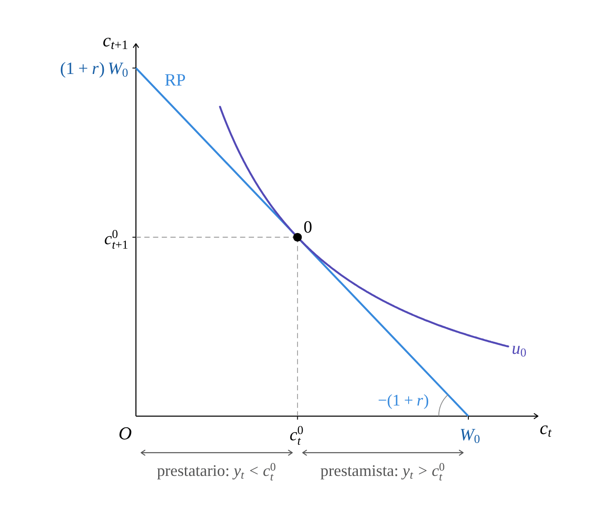
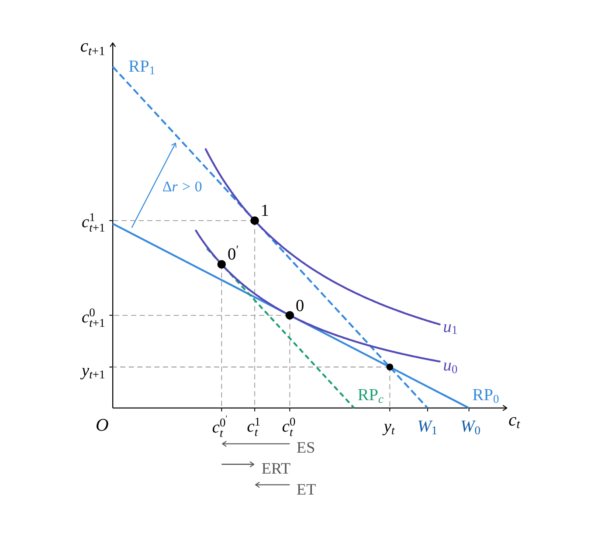
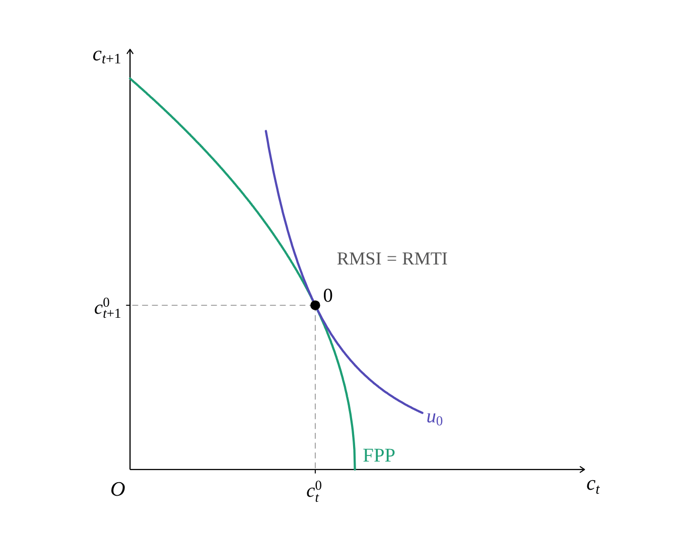
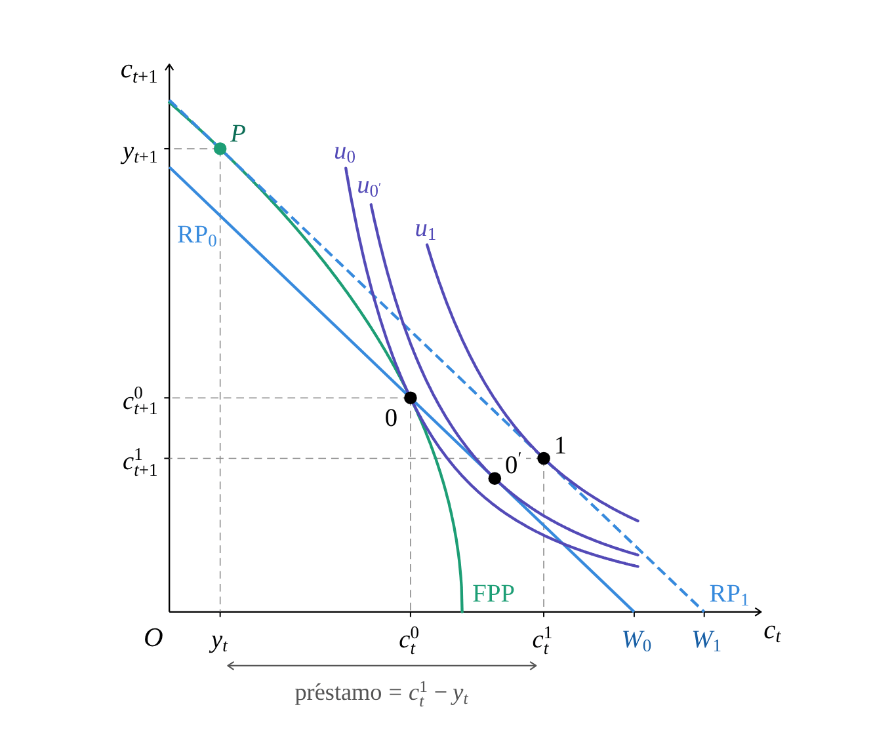

## Introducción

::: {.callout-note appearance="simple" icon=false}

:::

El **análisis dinámico o intertemporal** estudia las relaciones entre variables económicas cuyos valores están referidos a diferentes instantes del tiempo[^a29-1]. Cada individuo divide su renta en dos usos. El consumo es la finalidad última de toda actividad económica, mientras que el ahorro traslada recursos en el tiempo y financia la formación de capital físico o humano. Los motivos de esa reasignación son la suavización del consumo, la precaución, el deseo de dejar herencias y las restricciones de crédito.

La dimensión temporal está presente en casi todas las decisiones económicas. El consumo y el ahorro de los hogares (tema [A33](a33-demanda-consumo.qmd)), la inversión de las empresas (tema [A34](a34-demanda-inversion.qmd)), la sostenibilidad de la deuda pública y la equivalencia ricardiana (tema [A39](a39-deficit.qmd)), las pensiones (tema [A38](a38-politica-fiscal.qmd)) y el crecimiento (temas [A43](a43-crecimiento-i.qmd) y [A44](a44-crecimiento-ii.qmd)) se analizan con las herramientas de este tema.

Fisher (1930) planteó la elección entre consumo presente y futuro en dos periodos, y la macroeconomía la extendió después en dos direcciones. Los **modelos de horizonte infinito**, que parten de Ramsey (1928), suponen un agente representativo que vive para siempre o que se preocupa por sus descendientes. Los **modelos de generaciones solapadas** de Samuelson (1958) y Diamond (1965) suponen, en cambio, individuos de vida finita que conviven con otras generaciones. La elección entre ambos marcos tiene consecuencias, porque solo con generaciones solapadas puede la economía acumular demasiado capital, la **ineficiencia dinámica**, y solo entonces la deuda pública o las pensiones de reparto pueden mejorar el bienestar de todas las generaciones. Los modelos dinámicos de equilibrio general que utilizan los bancos centrales parten, no obstante, del horizonte infinito.

La empresa sigue la misma lógica, porque invertir es renunciar a beneficios presentes a cambio de beneficios futuros, y el precio sombra del capital, la *q* marginal, mide el valor de esa renuncia. El envejecimiento de la población y el aumento de la deuda pública han devuelto estas herramientas al centro del debate, porque de ellas dependen la sostenibilidad de los sistemas de pensiones y el reparto de las cargas entre generaciones.

El tema se organiza en tres partes:

- *Fundamentos*: el tema presenta los fundamentos de la elección intertemporal del consumidor.

- *Decisiones de la empresa*: la misma lógica se aplica a las decisiones intertemporales de la empresa.

- *Horizonte infinito y generaciones solapadas*: se exponen los modelos de horizonte infinito (MHI) y de generaciones solapadas (MGS), se comparan ambos marcos y se valoran sus resultados.

## 1. Fundamentos de la elección intertemporal

La teoría del consumidor de los temas [A08](a08-consumidor.qmd) y [A09](a09-dualidad.qmd) es estática, porque el agente elige entre bienes disponibles en un mismo momento. La elección intertemporal, en cambio, introduce el tiempo en la decisión, y con él tres novedades: los bienes son consumos fechados, la dotación es una corriente de rentas y el precio relativo entre el consumo de hoy y el de mañana es $1 + r$, con $r$ el tipo de interés.

### 1.1. El conjunto de elección y la ordenación de las preferencias intertemporales

Al fechar los bienes, el tiempo convierte cada bien físico en tantas mercancías como periodos. El consumo de hoy y el de mañana son así bienes distintos y sustituibles entre sí.

::: {.callout-note appearance="simple" icon=false}
Este apartado se presenta para facilitar la comprensión conceptual. En la exposición oral del tema puede abreviarse para centrar la sección en los apartados 1.2, 1.3 y 1.4.
:::

#### 1.1.1. El conjunto de elección

**Definición**: en la teoría estática del consumidor los objetos de elección son cestas de bienes. En la intertemporal, sin embargo, son *sendas de consumo*, $\mathbf{c} = (c_0, c_1, \ldots, c_T) \in \mathbb{R}^{T+1}_+$, donde $c_t$ es el consumo del periodo $t$.

**Propiedades**: el conjunto tiene tres rasgos que la teoría estática no tiene:

- *Dimensión*: la fija el horizonte, que es finito, $T + 1$ periodos, en los modelos de ciclo vital, e infinito en los de dinastías, lo que exige condiciones adicionales para que el problema esté bien definido (apartado 3.1). 

- *Dotación*: no es una cesta sino una corriente de rentas, $\mathbf{y} = (y_0, \ldots, y_T)$, que el consumidor recibe periodo a periodo y que puede transformar en consumo de otros periodos solo a través del ahorro y el endeudamiento. 

- *Orden*: la senda $(1, 2)$ no es la $(2, 1)$, porque el consumidor vive el tiempo en una dirección.

#### 1.1.2. La ordenación de las preferencias

**Definición**: sobre el conjunto de sendas se define una relación de preferencias $\succsim$ que cumple los axiomas de orden y regularidad del tema [A08](a08-consumidor.qmd), reinterpretados en el tiempo:

- *Completitud y transitividad*: el consumidor puede ordenar cualquier par de sendas y lo hace de forma coherente, lo que garantiza que la ordenación sea racional.

- *Continuidad*: pequeños cambios en una senda producen pequeños cambios en su valoración, lo que permite representar las preferencias por una función de utilidad.

- *Monotonía*: más consumo en cualquier periodo, sin menos en ningún otro, es preferido. En términos intertemporales, el consumidor no se sacia en ningún periodo.

- *Convexidad*: las sendas intermedias son preferidas a las extremas, lo que en el tiempo significa preferencia por la *suavización*, y de este axioma deriva el ahorro por motivo de suavización.

**Propiedades**: a esos axiomas se añaden tres propiedades intertemporales, que Koopmans (1960) axiomatizó y que llevan a la función de Samuelson del apartado siguiente:

- *Separabilidad*: la valoración del consumo de un periodo no depende del consumo de los demás, de modo que la utilidad de la senda es la suma de las utilidades de cada periodo. Excluye los hábitos (que el consumo de ayer condicione el valor del de hoy) y los bienes duraderos.

- *Estacionariedad*: la ordenación entre dos sendas no cambia si ambas se desplazan un periodo en el tiempo, lo que implica que la función de utilidad de cada periodo es la misma y que el descuento entre dos periodos consecutivos es constante.

- *Impaciencia*: si dos sendas solo difieren en que intercambian el consumo de dos periodos, el consumidor prefiere la que sitúa antes el mayor, lo que implica que el futuro se descuenta a una tasa positiva. La impaciencia es un juicio sobre las preferencias, no una consecuencia de la incertidumbre ni del tipo de interés, y su magnitud, frente al tipo de interés, decide el perfil de la senda de consumo.

### 1.2. La función de utilidad intertemporal y sus curvas de indiferencia

Las preferencias intertemporales se representan mediante una función de utilidad, cuyas curvas de nivel son las curvas de indiferencia intertemporales.

#### 1.2.1. La función de utilidad intertemporal

**Definición**: los axiomas anteriores garantizan que las preferencias intertemporales pueden representarse mediante la *función de utilidad descontada de Samuelson* (1937):

$$U_d = \sum_{t=0}^{T} \beta^t u(c_t), \quad \beta = \frac{1}{1+\rho} \in (0, 1)$$

donde $\beta$ es el *factor de descuento*, $\rho > 0$ la *tasa de descuento subjetiva*, que refleja la preferencia por el presente (mortalidad, impaciencia, sesgo de visibilidad)[^a29-2], y $u(\cdot)$ es la *función de utilidad instantánea* o función de “felicidad”.

**Propiedades**:

1. *Continuidad y diferenciabilidad*: es continua y dos veces diferenciable en el consumo de cada periodo, $c_t$, lo que permite caracterizar el óptimo por condiciones de primer orden.

2. *Transformaciones*: las preferencias sobre sendas de consumo son ordinales, pero la representación aditiva exige que la utilidad instantánea sea *cardinal*, es decir, $u(\cdot)$ es única salvo transformaciones afines positivas, $a + b\,u$ con $b > 0$, como la utilidad de Bernoulli (tema [A10](a10-riesgo-incertidumbre.qmd)). Una transformación monótona creciente cualquiera de $U_d$ representa las mismas preferencias intertemporales, pero pierde la forma de suma descontada.

3. *Inclinación*: es estrictamente creciente en el consumo de cada periodo, pues $u' > 0$.

4. *Forma*: es estrictamente cóncava en el consumo de cada periodo, pues $u'' < 0$, de modo que las curvas de indiferencia intertemporales son convexas y el consumidor prefiere suavizar.

5. *Otras propiedades*, heredadas de los axiomas intertemporales del apartado anterior y que la forma de Samuelson hace explícitas:

    - *Agotamiento de la riqueza*: por la monotonía, el consumidor no se sacia en ningún periodo y agota su riqueza a lo largo de la senda, de modo que la restricción en valor presente se cumple con igualdad y la condición terminal es $a_{T+1} = 0$.

    - *Impaciencia*: $0<\beta < 1$, el futuro pesa menos que el presente.

    - *Estacionariedad*: $u(\cdot)$ y $\beta$ son invariables en el tiempo.

    - *Separabilidad aditiva*: la utilidad de la senda es la suma de las utilidades de cada periodo, sin hábitos ni durabilidad[^a29-3].

    - *Recursividad*: la utilidad de la senda es la de hoy más la utilidad descontada de la senda que empieza mañana, $U_d(c_0, \ldots, c_T) = u(c_0) + \beta\, U_d(c_1, \ldots, c_T)$, lo que permite resolver el problema hacia atrás y garantiza la consistencia dinámica.

#### 1.2.2. Las curvas de indiferencia intertemporales

**Definición**: las curvas de nivel de la función de Samuelson constituyen las curvas de indiferencia intertemporales, que son decrecientes y estrictamente convexas en el plano $(c_t, c_{t+1})$.

**Propiedades**:

- *Pendiente*: su valor absoluto es la *relación marginal de sustitución intertemporal* (RMSI), el precio subjetivo del consumo presente, expresado en unidades de consumo futuro, para un nivel de utilidad dado:

    $$\text{RMSI}_{t+1,t} = \frac{1}{\beta} \cdot \frac{du/dc_t}{du/dc_{t+1}}$$

    Equivale al cociente de utilidades marginales corregido por la impaciencia. Es mayor cuanto más escaso es el consumo presente respecto al futuro (por la concavidad de $u$) y cuanto mayor es la impaciencia (menor $\beta$). En particular, a lo largo de una senda constante, $c_t = c_{t+1}$, vale exactamente $1/\beta = 1 + \rho$.

- *Convexidad*: su grado viene dado por la *elasticidad de sustitución intertemporal* (ESI), que mide la respuesta del consumo relativo entre dos periodos ante variaciones de su precio relativo, es decir, de la RMSI o, en el óptimo, del tipo de interés:

    $$\sigma = \frac{\partial \ln(c_{t+1}/c_t)}{\partial \ln(1+r)}$$

    - *$\sigma$ alta*: las curvas de indiferencia son poco curvadas y una pequeña subida del tipo de interés induce un gran desplazamiento del consumo hacia el futuro, de modo que el ahorro responde mucho al tipo de interés.

    - *$\sigma$ baja*: las curvas son muy curvadas y el perfil de la senda apenas cambia con el tipo de interés, porque el consumidor prefiere suavizar a aprovechar la recompensa.

    - *Casos límite*: con $\sigma \to 0$ las curvas son de ángulo recto y el perfil del consumo no responde al tipo de interés. Con $\sigma \to \infty$, en cambio, son rectas y el consumidor concentra todo el consumo en el periodo relativamente más barato. 

    - *Función isoelástica*: con $u(c) = c^{1-\theta}/(1-\theta)$, la ESI es constante e igual a $1/\theta$, el inverso del coeficiente de aversión relativa al riesgo. Así, la misma curvatura que gobierna la actitud ante el riesgo (tema [A10](a10-riesgo-incertidumbre.qmd)) gobierna la disposición a sustituir consumo entre periodos.

### 1.3. La restricción intertemporal de recursos

La restricción intertemporal recoge los recursos de que dispone el consumidor a lo largo de toda la senda, con mercados de capitales perfectos o con restricciones de liquidez.

#### 1.3.1. Restricción intertemporal

**Definición**: la restricción de recursos puede plantearse de dos formas equivalentes, como *ecuación de estado*, periodo a periodo, o en valor presente, sobre la senda completa:

- *Restricción periodo a periodo o ecuación de estado*: en cada periodo, el gasto en consumo, $c_t$, más la acumulación de activos financieros, $a_{t+1} - a_t$, no puede superar la renta exógena, $y_t$, más los intereses de los activos:

    $$c_t + (a_{t+1} - a_t) = y_t + r\, a_t, \qquad \forall\, t = 0, 1, \ldots, T$$

    donde $a_t \in \mathbb{R}$ son los activos financieros al inicio del periodo $t$ (positivos si el consumidor presta y negativos si se endeuda) y $r$ es el tipo de interés real, que se supone constante.

- *Condiciones de frontera*: la restricción exige dos para poder resolver problemas de optimización intertemporal. 

    - *Inicial*: fija la riqueza de partida, $a_0$, que puede ser nula o no según el problema.

    - *Terminal*: con horizonte finito, exige $a_{T+1} = 0$, es decir, el consumidor no deja activos sin consumir ni deudas sin pagar, pues lo primero sería subóptimo y lo segundo, imposible. Con horizonte infinito, en cambio, la condición se desdobla. La de no-Ponzi excluye las deudas sin pagar y la de transversalidad, los activos sin consumir (apartado 3.1).

- *Restricción en valor presente*: encadenando las restricciones de todos los periodos y usando la condición terminal se obtiene una única restricción sobre la senda completa:

    $$\sum_{t=0}^{T} \frac{c_t}{(1+r)^t} \leq (1+r)\, a_0 + \sum_{t=0}^{T} \frac{y_t}{(1+r)^t} \equiv W_0$$

    El valor presente del consumo no puede superar la *riqueza* $W_0$, la suma de los activos iniciales y del valor presente de las rentas futuras. Esta restricción es la contrapartida de la restricción presupuestaria estática, con los precios sustituidos por factores de descuento. Así, el precio del consumo de $t$ en términos del de hoy es $1/(1+r)^t$.

::: {.callout-tip collapse="true" appearance="simple" title="Ejemplo: de la ecuación de estado a la restricción en valor presente con dos periodos"}
Sean $T = 1$ y $a_0 = 0$. La ecuación de estado da una restricción para cada periodo:

$$\begin{aligned} c_0 + (a_1 - a_0) &= y_0 + r\, a_0 \\ c_1 + (a_2 - a_1) &= y_1 + r\, a_1 \end{aligned}$$

**De la ecuación de estado al valor presente**: como $a_0 = 0$, la primera restricción fija los activos al final del primer periodo en la renta no consumida, $a_1 = y_0 - c_0$, positivos si el consumidor presta y negativos si se endeuda. La condición terminal, $a_2 = 0$, reduce la segunda a $c_1 = y_1 + (1+r)\, a_1$. Al sustituir $a_1$ y dividir por $1+r$, las dos restricciones se funden en una:

$$c_0 + \frac{c_1}{1+r} = y_0 + \frac{y_1}{1+r}$$

La ecuación resultante es la restricción en valor presente con $T = 1$ y $a_0 = 0$, y se cumple con igualdad porque la condición terminal impide dejar activos sin consumir.

**Del valor presente a la ecuación de estado**: el camino inverso define los activos al final del primer periodo como la renta no consumida, $a_1 \equiv y_0 - c_0$, que es la primera restricción con $a_0 = 0$. Al sustituir $c_0 = y_0 - a_1$ en la restricción en valor presente y multiplicar por $1+r$ se obtiene $c_1 = y_1 + (1+r)\, a_1$, que es la segunda restricción con $a_2 = 0$.

**Comprobación numérica**: con $r = 0{,}25$, $y_0 = 80$, $y_1 = 125$ y $c_0 = 100$, el consumidor se endeuda en el primer periodo, $a_1 = -20$, y paga en el segundo unos intereses de $5$ ($r\, a_1 = -5$). Su consumo del segundo periodo es entonces $c_1 = 125 + 1{,}25 \cdot (-20) = 100$, y la senda cumple también la restricción en valor presente, $100 + 100/1{,}25 = 180 = 80 + 125/1{,}25$.
:::

Gráficamente, en el plano $(c_t, c_{t+1})$ (figura -@fig-a295-restriccion-intertemporal), con dos periodos y sin activos iniciales ($a_0 = 0$), la restricción es la *recta de riqueza intertemporal* (RP):

$$c_{t+1} = y_{t+1} + (1+r)\,(y_t - c_t)$$

donde $y_t$ e $y_{t+1}$ son las rentas de cada periodo y $(1+r)\,(y_t - c_t)$ es el ahorro del primer periodo capitalizado, negativo si el consumidor se endeuda. La recta tiene tres propiedades, y el óptimo se sitúa sobre ella:

1. *Dotación*: pasa por la dotación $D = (y_t, y_{t+1})$, que es siempre asequible sin acudir al mercado de capitales. Con activos iniciales, la dotación se desplaza hacia la derecha en $(1+r)\,a_0$.

2. *Pendiente*: es $-(1+r)$, el coste de oportunidad del consumo presente en términos de consumo futuro.

3. *Puntos de corte*: corta a los ejes en la riqueza $W_0$ (todo el consumo hoy) y en $(1+r)\,W_0$ (todo el consumo mañana).

4. *Óptimo*: el punto 0 es la tangencia con la curva de indiferencia más alta, $u_0$. En la figura queda a la derecha de la dotación, de modo que el consumidor se endeuda en $c_t^0 - y_t$. La dotación divide la recta en dos tramos:

    - *Izquierda de la dotación*: el consumidor consume menos que su renta corriente y ahorra (es prestamista).

    - *Derecha de la dotación*: consume más que su renta corriente y se endeuda (es prestatario).

::: {#fig-a295-restriccion-intertemporal}

::: {.content-visible when-format="html"}
```{=html}
<div class="graph-frame">
<iframe src="../graphs/a295_Restriccion_intertemporal.html" style="height:610px" loading="lazy" title="fig-a295-restriccion-intertemporal"></iframe>
</div>
```
:::

::: {.content-visible unless-format="html"}

:::

Restricción presupuestaria intertemporal en dos periodos. La recta, de pendiente $-(1+r)$, pasa por la dotación $D = (y_t, y_{t+1})$ y corta a los ejes en $W_0$ y $(1+r)\,W_0$. En el óptimo 0, a la derecha de la dotación, el consumidor se endeuda en $c_t^0 - y_t$.
:::

#### 1.3.2. Restricciones de liquidez

**Definición**: la restricción anterior supone mercados de capitales perfectos, donde el consumidor puede prestar o endeudarse sin límite al mismo tipo $r$. Con mercados incompletos, en cambio, el crédito puede faltar del todo o tener un tope. Esos límites, llamados *restricciones de liquidez*, dejan fuera del conjunto asequible el tramo de la recta situado a la derecha de la dotación (o del tope).

La restricción solo es *efectiva* cuando el consumidor querría consumir más hoy de lo que su renta corriente permite, y en ese caso altera la CPO.

Gráficamente, en el plano $(c_t, c_{t+1})$ (figura -@fig-a296-restriccion-liquidez), la restricción de liquidez quiebra la recta de riqueza en la dotación:

1. *Frontera del conjunto asequible*: a la izquierda de $D$ sigue siendo la recta RP, de pendiente $-(1+r)$, porque el consumidor puede ahorrar al tipo $r$. En $D$, en cambio, se hace vertical, porque no puede consumir hoy más que su renta corriente, $c_t \leq y_t$. Con un límite de endeudamiento $\bar{a} > 0$, el quiebro se desplaza hacia la derecha de la dotación, hasta $c_t = y_t + \bar{a}$.

2. *Curvas de indiferencia*: unen las sendas de igual utilidad. El óptimo sin restricción 0, la tangencia con $u_0$, está en el tramo de la recta situado a la derecha de la dotación, que deja de ser alcanzable.

3. *Óptimo*: el consumidor que querría endeudarse se queda en la dotación (punto 1), sobre una curva de indiferencia más baja, $u_1$, más inclinada que la recta en ese punto ($\text{RMSI} > 1+r$).

::: {#fig-a296-restriccion-liquidez}

::: {.content-visible when-format="html"}
```{=html}
<div class="graph-frame">
<iframe src="../graphs/a296_Restriccion_liquidez.html" style="height:580px" loading="lazy" title="fig-a296-restriccion-liquidez"></iframe>
</div>
```
:::

::: {.content-visible unless-format="html"}

:::

Restricción de liquidez sin posibilidad de endeudamiento. La recta de riqueza se quiebra en la dotación $D$ y el tramo a su derecha deja de ser alcanzable. El óptimo sin restricción 0 queda fuera del conjunto asequible y el consumidor se sitúa en la dotación (punto 1), con $\text{RMSI} > 1+r$.
:::

### 1.4. La decisión de consumo intertemporal (Fisher, 1930)

**Origen**: Irving Fisher (1930) trasladó al tiempo el aparato de la teoría del consumidor, con las tres novedades señaladas al inicio de la sección.

**Idea**: el consumidor elige la senda de consumo que maximiza su utilidad intertemporal sujeto a que el valor presente del consumo no supere al de la riqueza. El consumo de cada periodo depende así de la riqueza total, no de la renta corriente, y de la relación entre el tipo de interés y la impaciencia.

#### 1.4.1. Modelo

**Planteamiento**: con la función de utilidad y la restricción intertemporal de recursos anteriores, el problema es

$$\begin{aligned} &\max_{\{c_t\}} \; \sum_{t=0}^{T} \beta^t u(c_t), \qquad \beta \in (0, 1) \\ &\text{s.a.:} \; \sum_{t=0}^{T} \frac{c_t}{(1+r)^t} = (1+r)\, a_0 + \sum_{t=0}^{T} \frac{y_t}{(1+r)^t} \equiv W_0 \end{aligned}$$

donde $c_t$ es la variable de decisión y las demás variables son las ya definidas.

**CPO**: con solución interior y la restricción agotada, derivando el lagrangiano respecto al consumo de cada periodo y eliminando el multiplicador entre dos periodos consecutivos, resulta

$$\text{RMSI}_{t+1,t} = \frac{1}{\beta} \frac{du/dc_t}{du/dc_{t+1}} = 1+r \tag{1}$$

$$\frac{du}{dc_t} = \beta\,(1+r)\,\frac{du}{dc_{t+1}} = \frac{1+r}{1+\rho}\, \frac{du}{dc_{t+1}} \tag{2}$$

La condición (1) establece que la tasa subjetiva de intercambio intertemporal coincide con el coste de oportunidad del consumo presente o rentabilidad bruta del ahorro, dada por $1+r$. La condición (2), que expresa la misma CPO de otro modo, es la *ecuación de Euler*. En el óptimo, renunciar hoy a una unidad de consumo cuesta en utilidad exactamente lo que rinde ahorrarla al tipo de interés y gastarla en el periodo siguiente, una vez descontada la impaciencia.

La misma ecuación se obtiene por *programación dinámica* (Bellman, 1957), que aprovecha la recursividad de la utilidad. Sea $V_t(a_t)$ la *función de valor*, la utilidad máxima que puede alcanzarse desde el periodo $t$ con los activos $a_t$. Por el *principio de optimalidad*, el problema de toda la senda se reduce a una sucesión de problemas de un solo periodo, que se resuelven hacia atrás desde $T$. En cada uno, el consumidor elige solo el consumo de hoy, y el futuro queda resumido en $V_{t+1}$. Esa recursión es la *ecuación de Bellman*:

$$V_t(a_t) = \max_{c_t} \left\{ u(c_t) + \beta\, V_{t+1}(a_{t+1}) \right\} \qquad \text{s.a.:} \; a_{t+1} = (1+r)\, a_t + y_t - c_t$$

Su CPO, $du/dc_t = \beta\, dV_{t+1}/da_{t+1}$, iguala la utilidad marginal de consumir hoy al valor marginal descontado de ahorrar, y la condición de la envolvente, $dV_t/da_t = (1+r)\, du/dc_t$, mide el valor marginal de la riqueza por la utilidad marginal del consumo. Adelantando esta última un periodo y sustituyéndola en la CPO se obtiene de nuevo la ecuación de Euler (2). La ventaja del método aparece con incertidumbre, pues basta con sustituir $V_{t+1}$ por su valor esperado para que la ecuación de Euler se cumpla en esperanza, como en el modelo de Hall.

**CSO**: la concavidad estricta de $u$ hace estrictamente cóncava la utilidad intertemporal y la restricción es lineal, de modo que la ecuación de Euler, junto con la restricción presupuestaria, es necesaria y suficiente.

**Solución**: de la ecuación de Euler se siguen dos propiedades de la senda óptima:

- *Perfil de la senda*: la ecuación de Euler ordena el consumo en el tiempo según la relación entre el tipo de interés y la tasa de preferencia temporal[^a29-4]:

    - *$r = \rho$*: el consumo es constante en el tiempo.

    - *$r > \rho$*: la recompensa por esperar supera a la impaciencia, la senda es creciente y, con una renta constante en el tiempo, el individuo ahorra, ofreciendo capital.

    - *$r < \rho$*: la senda es decreciente y, con renta constante, el individuo, impaciente, demanda capital.

- *Suavización del consumo* (*consumption smoothing*): el individuo desea sendas estables, sean crecientes o decrecientes, lo que requiere $u'' < 0$ y mercados financieros que permitan prestar y endeudarse.

La ecuación de Euler fija el perfil de la senda, pero no su nivel, que lo fija la restricción de riqueza. Combinando ambas se obtiene la función de consumo. Con $r = \rho$ la senda es constante y, sustituyendo $c_t = c$ en la restricción, resulta

$$c_t = \frac{r}{1 + r - (1+r)^{-T}}\; W_0 \;\xrightarrow{\;T \to \infty\;}\; \frac{r}{1+r}\, W_0$$

donde la fracción que multiplica a $W_0$ es la propensión a consumir la riqueza. El consumo de cada periodo es así una fracción constante de la riqueza, la *anualidad* que esa riqueza puede financiar durante el horizonte, y no de la renta corriente.

La expresión anterior es la forma general de la que las teorías del consumo del tema [A33](a33-demanda-consumo.qmd) son casos particulares:

- *Renta permanente* (Friedman, 1957): llama renta permanente, $y^p$, a esa anualidad.

- *Ciclo vital* (Modigliani y Brumberg, 1954): distingue la riqueza en activos de la humana y sustituye el horizonte infinito por la vida restante, por lo que la propensión a consumir la riqueza crece con la edad.

- *Paseo aleatorio* (Hall, 1978): añade incertidumbre y expectativas racionales.

::: {.callout-tip collapse="true" appearance="simple" title="Ejemplo: elección de Fisher con utilidad logarítmica"}
Sean $T = 1$, $a_0 = 0$ y $u(c) = \ln c$, de modo que $u'(c) = 1/c$. La ecuación de Euler (2) fija el perfil, $c_1 = \beta(1+r)\, c_0$, y la restricción, $c_0 + c_1/(1+r) = W_0 = y_0 + y_1/(1+r)$, el nivel:

$$c_0 = \frac{W_0}{1+\beta}, \qquad c_1 = \frac{\beta\,(1+r)}{1+\beta}\, W_0$$

Con $\beta = 0{,}8$ ($\rho = 0{,}25$), $r = 0{,}25$, $y_0 = 80$ e $y_1 = 125$, la riqueza es $W_0 = 80 + 125/1{,}25 = 180$ y

$$c_0 = \frac{180}{1{,}8} = 100 = c_1$$

El consumidor se endeuda en $20$ hoy y devuelve $25$ mañana, porque con $r = \rho$ la senda es plana y depende de $W_0$, no del reparto temporal de la renta. Con utilidad logarítmica ($\sigma = 1$), además, la propensión a consumir la riqueza, $1/(1+\beta)$, no depende de $r$, ya que los efectos sustitución y renta ordinario se compensan y $r$ solo actúa a través de $W_0$ (efecto renta dotación).
:::

**Desarrollo gráfico**: la decisión de consumo intertemporal se representa en el plano $(c_t, c_{t+1})$ (figura -@fig-a291-consumo-intertemporal):

1. *Recta presupuestaria* (RP): recoge las sendas cuyo valor presente iguala la riqueza. Tiene pendiente $-(1+r)$ y corta a los ejes en $W_0$ y $(1+r)\,W_0$.

2. *Curva de indiferencia intertemporal* $u_0$: une las sendas de igual utilidad. Es convexa, por la concavidad de $u$, y su pendiente en valor absoluto es la RMSI.

3. *Óptimo*: el punto 0, con consumos $c_t^0$ y $c_{t+1}^0$, es la tangencia entre la curva de indiferencia más alta y la recta, donde $\text{RMSI} = 1+r$.

    - *Prestatario*: si la renta presente queda a la izquierda del óptimo ($y_t < c_t^0$), el consumidor se endeuda.

    - *Prestamista*: si queda a su derecha ($y_t > c_t^0$), ahorra.

::: {#fig-a291-consumo-intertemporal}

::: {.content-visible when-format="html"}
```{=html}
<div class="graph-frame">
<iframe src="../graphs/a291_Consumo_intertemporal.html" style="height:680px" loading="lazy" title="fig-a291-consumo-intertemporal"></iframe>
</div>
```
:::

::: {.content-visible unless-format="html"}

:::

Elección intertemporal (Fisher, 1930). El óptimo se sitúa en la tangencia entre la curva de indiferencia intertemporal y la restricción presupuestaria de pendiente $-(1+r)$.
:::

**Estática comparativa**: dadas las preferencias (la impaciencia y la ESI), se estudian los cambios en la dotación y en el tipo de interés.

*Cambios en la dotación*: un aumento de la renta de cualquier periodo, o de la riqueza inicial, desplaza la recta presupuestaria paralelamente hacia fuera, y si el consumo es normal en ambos periodos, eleva el consumo presente y el futuro. La magnitud depende de si el cambio es permanente o transitorio: 

- *Aumentos permanentes*: con $r = \rho$, elevan la anualidad y, con ella, el consumo de cada periodo en la misma cuantía.

- *Aumentos transitorios*: se reparten entre todos los periodos y elevan el consumo corriente en una fracción pequeña, que es la propensión marginal a consumir de la renta transitoria.

*Cambios en el tipo de interés*: el efecto sobre el consumo presente se descompone con la ecuación de Slutsky con dotaciones:

$$\frac{\partial c_t}{\partial r} = \underbrace{\frac{\partial c_t}{\partial r}\bigg|_{u_0}}_{\text{ES} < 0} + \underbrace{(y_t - c_t) \frac{\partial c_t}{\partial y}}_{\text{ERT: signo ambiguo}}$$

- *Efecto sustitución* (ES): es inequívoco. Un aumento de $r$ encarece el consumo presente respecto al futuro, de modo que $c_t$ cae y el ahorro aumenta.

- *Efecto renta total* (ERT): combina dos efectos de signo opuesto: 

    - *Efecto renta ordinario* (ERO): $-c_t\,\partial c_t/\partial y$, negativo, porque el encarecimiento del consumo presente, con la dotación dada, reduce el poder adquisitivo del consumidor.

    - *Efecto renta dotación* (ERD): $y_t\,\partial c_t/\partial y$, positivo, porque la renta presente de la dotación se revaloriza en términos de consumo futuro. 

El signo del efecto total depende, por tanto, de la posición del individuo: 

- *Prestamista* ($y_t > c_t$): el efecto renta es positivo y el total ambiguo.

- *Prestatario* ($y_t < c_t$): el efecto renta es negativo y el total inequívocamente negativo. 

La evidencia empírica no es concluyente. La ESI estimada es baja y el ahorro agregado responde poco al tipo de interés, de modo que ninguno de los dos efectos se impone con claridad[^a29-5].

Gráficamente, en el plano $(c_t, c_{t+1})$ (figura -@fig-a292-estatica-intertemporal), un cambio en el tipo de interés hace pivotar la recta sobre la dotación. Si $r$ sube ($\Delta r > 0$), la recta pasa de $\text{RP}_0$ a $\text{RP}_1$, más inclinada, lo que reduce las posibilidades de quien se endeuda y amplía las de quien presta. En la figura, para un prestamista, el efecto sustitución lleva del punto 0 al 0′ a lo largo de $u_0$, sobre la recta compensada $\text{RP}_c$, paralela a $\text{RP}_1$, y el efecto renta total, del 0′ al 1, sobre $u_1$. Como domina el efecto sustitución, el consumo presente cae de $c_t^0$ a $c_t^1$.

::: {#fig-a292-estatica-intertemporal}

::: {.content-visible when-format="html"}
```{=html}
<div class="graph-frame">
<iframe src="../graphs/a292_Estatica_intertemporal.html" style="height:650px" loading="lazy" title="fig-a292-estatica-intertemporal"></iframe>
</div>
```
:::

::: {.content-visible unless-format="html"}

:::

Subida del tipo de interés para un prestamista. El efecto sustitución reduce el consumo presente y el efecto renta total lo aumenta (para un prestatario, ambos lo reducen).
:::

#### 1.4.2. Extensión: consumo con incertidumbre, el paseo aleatorio (Hall, 1978)

::: {.callout-note appearance="simple" icon=false}
El paseo aleatorio de Hall, sus supuestos y su contrastación se desarrollan en el tema [A33](a33-demanda-consumo.qmd), apartado 2.4. Aquí se presenta como extensión del problema de Fisher.
:::

**Origen**: Robert Hall (1978) resolvió el problema de Fisher bajo incertidumbre y expectativas racionales, y obtuvo una predicción contrastable.

**Idea**: si el consumidor maximiza la utilidad esperada y usa toda la información disponible, el consumo de hoy ya incorpora todo lo que se sabe sobre la renta futura, de modo que solo la información nueva puede alterarlo. El consumo sigue, por ello, un paseo aleatorio.

**Planteamiento**: con expectativas racionales, utilidad cuadrática[^a29-6] y $r = \rho = 0$, el consumidor maximiza la utilidad esperada de su senda de consumo sujeto a su riqueza esperada:

$$\max_{c_{t+j}} \; \mathbb{E}_t \left[\sum_{j=0}^{T-t} \left(c_{t+j} - \frac{\eta}{2} c_{t+j}^2\right)\right], \; \eta > 0$$

$$\text{s.a.:} \begin{cases} \sum_{j=0}^{T-t} \mathbb{E}_t[c_{t+j}] \leq a_t + \sum_{j=0}^{T-t} \mathbb{E}_t[y_{t+j}] \\ a_{T+1} = 0 \end{cases}$$

donde $\eta$ es el parámetro de la utilidad cuadrática, $a_t$ la riqueza no humana al inicio del periodo, $y$ la renta, $T - t + 1$ el número de periodos de vida que restan y $\mathbb{E}_t$ la expectativa condicionada a la información disponible en $t$.

**CPO**: la utilidad marginal es lineal, $u'(c) = 1 - \eta c$, de modo que la ecuación de Euler esperada, $du/dc_t = \mathbb{E}_t[du/dc_{t+1}]$, se convierte en

$$\mathbb{E}_t[c_{t+1}] = c_t \quad \Rightarrow \quad c_{t+1} = c_t + \varepsilon_{t+1}, \qquad \mathbb{E}_t[\varepsilon_{t+1}] = 0$$

donde $\varepsilon_{t+1}$ es la innovación, es decir, la nueva información sobre la riqueza esperada que llega en $t+1$. El consumo presente es, por tanto, el mejor predictor del consumo futuro.

**CSO**: la utilidad cuadrática es estrictamente cóncava y la restricción es lineal, de modo que la CPO es necesaria y suficiente en el tramo en que la utilidad marginal es positiva ($c_t < 1/\eta$).

**Solución**: llevada la CPO a la restricción presupuestaria, el individuo consume en cada periodo la anualidad de su riqueza esperada:

$$c_t = \frac{1}{T - t + 1}\left(a_t + \sum_{j=0}^{T-t} \mathbb{E}_t[y_{t+j}]\right)$$

La implicación es doble:

- *Imprevisibilidad*: la variación del consumo no debería ser predecible con ninguna información pasada.

- *Política económica*: solo afecta al consumo si genera sorpresas o altera la riqueza esperada.

**Conclusiones**:

- *Aspectos positivos*: lleva las expectativas racionales a la teoría del consumo y convierte la hipótesis de la renta permanente en una restricción contrastable, la ecuación de Euler, que no exige estimar la función de consumo. Por ello, ha sido el punto de partida de la literatura empírica moderna sobre el consumo (tema [A33](a33-demanda-consumo.qmd), apartado 2.4).

- *Limitaciones*: la evidencia rechaza parcialmente esa imprevisibilidad, tanto por exceso de sensibilidad a la renta corriente, atribuido a restricciones de liquidez y a consumidores que siguen reglas simples, como por exceso de suavidad (tema [A33](a33-demanda-consumo.qmd), apartado 3.1).

#### 1.4.3. Extensión: restricciones de liquidez (Deaton, 1991)

::: {.callout-note appearance="simple" icon=false}
Las restricciones de liquidez y su contrastación empírica se desarrollan en el tema [A33](a33-demanda-consumo.qmd), apartado 3.2.2. Aquí se presentan como modificación del problema de Fisher.
:::

**Origen**: Angus Deaton (1991) incorporó al problema intertemporal la imposibilidad de endeudarse, para dar cuenta del exceso de sensibilidad del consumo a la renta que el modelo de Hall no puede explicar.

**Idea**: si el consumidor no puede endeudarse, o solo hasta un límite, la restricción de liquidez puede ser efectiva, y entonces su consumo deja de depender de la riqueza y pasa a seguir a la renta corriente. Además, la mera posibilidad de que la restricción sea efectiva en el futuro altera el comportamiento presente.

**Razonamiento**: el problema añade a las restricciones del modelo un límite de endeudamiento en cada periodo,

$$a_{t+1} \geq -\bar{a}$$

donde $\bar{a} \geq 0$ es la deuda máxima que el consumidor puede contraer ($\bar{a} = 0$ si no puede endeudarse). Si el límite llega a operar, la igualdad de Euler se rompe y se convierte en

$$\frac{du}{dc_t} > \beta\,(1+r)\,\frac{du}{dc_{t+1}} = \frac{1+r}{1+\rho}\, \frac{du}{dc_{t+1}}$$

lo que significa que el consumidor querría trasladar consumo del futuro al presente y no puede. Consume, por tanto, todos los recursos de que dispone en el periodo, y su consumo sigue a la renta corriente.

Cuando la restricción no es efectiva pero puede serlo en el futuro, el consumidor prudente acumula un *colchón* de activos (el ahorro *buffer-stock* de Deaton) para no verse forzado a reducir el consumo ante una caída de la renta. Además, su propensión marginal a consumir la renta transitoria es mayor que la del modelo de Fisher, porque, cerca del límite, cada unidad adicional de recursos reduce mucho la necesidad de ahorro precautorio y se consume en mayor proporción.

**Conclusiones**:

- *Aspectos positivos*: las restricciones de liquidez reconcilian el modelo intertemporal con la evidencia, porque explican tres hechos:

    - *Consumo*: por qué el consumo agregado sigue a la renta corriente más de lo que la renta permanente predice.

    - *Política fiscal*: por qué la política fiscal transitoria tiene efectos reales sobre el consumo de los hogares restringidos.

    - *Distribución*: por qué la distribución de la riqueza importa para el multiplicador.

- *Limitaciones*: el coste de incorporarlas es la pérdida de la solución cerrada, pues con restricciones ocasionalmente efectivas el problema solo se resuelve numéricamente.

#### 1.4.4. Extensión: bienes duraderos (Mankiw, 1982)

::: {.callout-note appearance="simple" icon=false}
El consumo de bienes duraderos y sus reglas de ajuste se desarrollan en el tema [A33](a33-demanda-consumo.qmd), apartado 3.4.
:::

**Origen**: Gregory Mankiw (1982) extendió el modelo de Hall al caso en que el bien consumido no se agota en el periodo, y mostró que las predicciones cambian.

**Idea**: un bien duradero no proporciona utilidad cuando se compra sino mientras dura. Por eso, lo que entra en la función de utilidad es el *flujo de servicios* del *stock* de duraderos, no el gasto en ellos, que es la inversión que mantiene y amplía ese *stock*.

**Razonamiento**: sea un *stock* de duraderos $d_t$ que se deprecia a la tasa $\delta$ y se repone con el gasto en duraderos, $x_t$:

$$x_t = d_t - (1-\delta)\,d_{t-1}$$

donde $d_{t-1}$ es el *stock* heredado del periodo anterior. La utilidad del periodo, $u[c_t, s(d_t)]$, depende del consumo no duradero, $c_t$, y de los servicios del *stock*, $s(d_t)$, de modo que el problema es el del modelo, ahora con dos bienes. La condición de primer orden para los duraderos iguala la utilidad marginal de sus servicios, en unidades de consumo no duradero, al *coste de uso* del duradero, $p_d\,(r + \delta - \pi_d)$, con $p_d$ su precio relativo y $\pi_d$ su revalorización esperada. Ese coste tiene la misma forma que el coste de uso del capital de la empresa (apartado 2.4.3).

La suavización se aplica al *stock*, no al gasto. El gasto, que es la variación del *stock*, es por ello mucho más volátil que el consumo de no duraderos y responde con fuerza al tipo de interés y al crédito. Con utilidad cuadrática y expectativas racionales, el *stock* sigue un paseo aleatorio, como el consumo en Hall, y la primera diferencia del gasto es un proceso de medias móviles de orden uno,

$$\Delta x_t = \varepsilon_t - (1-\delta)\,\varepsilon_{t-1}$$

donde $\varepsilon_t$ es la innovación del *stock*. Con costes fijos de ajuste (comprar un coche no admite fracciones), la compra sigue además una regla $(S, s)$ (Grossman y Laroque, 1990), en la que el consumidor deja que el *stock* se deprecie hasta un umbral y entonces lo repone de una vez.

**Conclusiones**:

- *Aspectos positivos*: los duraderos explican la parte más volátil del consumo agregado y su sensibilidad a las condiciones financieras. También unifican la teoría del consumo con la de la inversión, porque el hogar que compra una vivienda o un automóvil resuelve el mismo problema que la empresa que compra una máquina.

- *Limitaciones*: empíricamente, el gasto en duraderos no muestra la fuerte reversión a la media que el modelo predice, sino que se comporta como si la depreciación fuera casi total ($\delta \approx 1$), igual que el de un bien no duradero (tema [A33](a33-demanda-consumo.qmd)).

### 1.5. Conclusiones

**Aspectos positivos**: el modelo de Fisher traslada el aparato del consumidor al tiempo, con la ecuación de Euler como condición de óptimo. De él derivan la separación entre decisiones de consumo y de inversión y las teorías modernas del consumo (renta permanente, ciclo vital, paseo aleatorio).

**Limitaciones**: supone mercados de capitales perfectos y preferencias aditivamente separables, y con incertidumbre el resultado de Hall exige además utilidad cuadrática. Las extensiones con restricciones de liquidez y bienes duraderos relajan lo primero y lo segundo, y son el puente hacia la teoría de la demanda de consumo del tema [A33](a33-demanda-consumo.qmd).

## 2. Decisiones intertemporales de la empresa

La decisión de inversión de la empresa tiene la misma estructura que la decisión de consumo intertemporal del apartado 1 y que la decisión estática de contratación de capital del tema [A11](a11-produccion.qmd).

La diferencia con respecto a la decisión de consumo intertemporal está en el objetivo y en la restricción. Por un lado, la empresa no maximiza una utilidad descontada a una tasa subjetiva, sino su valor, descontado al tipo de interés de mercado. Por otro lado, su restricción no es una corriente de rentas dada, sino una tecnología que convierte la inversión de hoy en capital productivo mañana. El consumidor elige cuándo consumir una riqueza dada, mientras que la empresa elige cuánta riqueza crear.

La diferencia con respecto a la decisión estática de contratación de capital está en el tiempo. En el tema [A11](a11-produccion.qmd) el capital es un factor que se alquila cada periodo al precio de mercado. Aquí, en cambio, es un *stock* que se acumula, se deprecia y cuesta ajustar, así que la decisión de hoy condiciona las de mañana y la empresa ha de anticipar toda la senda futura de precios y productividades. Esa dependencia convierte la contratación de capital en una decisión de inversión.

### 2.1. El conjunto de elección y el objetivo de la empresa

La empresa elige sendas de variables de control y de estado para maximizar su valor.

#### 2.1.1. El conjunto de elección

**Definición**: en la teoría estática de la empresa los objetos de elección son combinaciones de factores, que la empresa contrata en los mercados de factores productivos. En la intertemporal, en cambio, son *sendas de inversión y de empleo*, $\{I_t, L_t\}_{t=0}^{T}$, es decir, las cantidades de bienes de capital y de trabajo que la empresa contrata en esos mercados en cada periodo. La inversión $I_t$ y el empleo $L_t$ son las variables de *control*, los flujos que la empresa decide cada periodo. El capital $K_t$ es la variable de *estado*, el *stock* que resulta de esas decisiones, que la empresa no elige directamente sino a través de la inversión acumulada.

**Propiedades**: el conjunto tiene tres rasgos:

- *Dimensión*: la fija el horizonte de planificación de la empresa, que es finito, $T + 1$ periodos, si tiene fecha de cierre, e infinito en caso contrario.

- *Mercados*: los mercados de factores son perfectos, de modo que la empresa puede contratar cualquier cantidad de trabajo y de bienes de capital a los precios de cada periodo, $w_t$ y $P_{K,t}$, que toma como dados.

- *Orden*: las decisiones de los distintos periodos no son independientes, porque el capital de cada periodo resulta de la inversión de los anteriores.

#### 2.1.2. El objetivo de la empresa

**Definición**: la empresa maximiza su valor, el valor presente de la corriente de beneficios futuros, y no el beneficio de cada periodo.

**Propiedades**: con mercados de capitales perfectos, el objetivo tiene dos propiedades:

- *Separación*: por el teorema de separación de Fisher, todos los propietarios, sean cuales sean sus preferencias, quieren que la empresa maximice su valor, porque es lo que maximiza la riqueza de los propietarios.

- *Descuento*: la tasa de descuento de la empresa es, por ello, el tipo de interés de mercado, y no una tasa subjetiva como la del consumidor.

### 2.2. La función de valor y el precio sombra del capital

El objetivo de la empresa se representa mediante la función de valor, cuya derivada respecto al capital es su precio sombra.

#### 2.2.1. La función de valor

**Definición**: el objetivo, el valor presente de los beneficios netos del gasto en inversión, $\Pi_t = P_t f(K_t, L_t) - w_t L_t - P_{K,t} I_t$, se escribe como la *función de valor*:

$$V_0 = \sum_{t=0}^{T} \frac{\Pi_t}{(1+r)^t} \qquad \text{o, en tiempo continuo,} \qquad V_0 = \int_0^{T} e^{-rt}\, \Pi(t)\, dt$$

Equivale a la función de utilidad descontada de Samuelson, con el beneficio en lugar de la utilidad instantánea y $1/(1+r)$ en lugar de $\beta$. Evaluada en la senda óptima de inversión, pasa a depender únicamente del capital heredado y de los precios, $V_t = V_t(K_t)$, y es entonces una función de valor en sentido estricto, como las de los problemas estáticos.

**Propiedades**:

1. *Continuidad y diferenciabilidad*: es continua y diferenciable en el beneficio de cada periodo. Evaluada en la senda óptima, es diferenciable en el capital cuando el beneficio es cóncavo y los costes de ajuste convexos, lo que permite definir el precio sombra.

2. *Transformaciones*: es una función cardinal, medida en unidades monetarias, de modo que, a diferencia de la utilidad de Samuelson (apartado 1.2.1), no admite transformaciones. Una subida equiproporcional de todos los precios eleva el valor en la misma proporción sin alterar la senda óptima, como en la función de máximo beneficio (tema [A16](a16-competencia-perfecta.qmd), apartado 1.3.4).

3. *Inclinación*: es creciente en el beneficio de cada periodo y, si los beneficios futuros son positivos, decreciente en el tipo de interés.

4. *Forma*: es lineal en los beneficios de cada periodo. Evaluada en la senda óptima, es cóncava en el capital cuando el beneficio es cóncavo y los costes de ajuste convexos (CSO del modelo de inversión), de modo que el precio sombra no aumenta con el capital.

5. *Otras propiedades*:

    - *Separabilidad aditiva*: es la suma de los beneficios descontados de cada periodo, sin interacciones entre ellos, como la función de Samuelson.

    - *Envolvente*: en la senda óptima, su derivada respecto al capital es el precio sombra, que coincide con el multiplicador $q$ del hamiltoniano del modelo de inversión.

    - *Observabilidad*: con mercados de capitales perfectos coincide con el valor de mercado de la empresa, que es observable, a diferencia de su derivada, la *q* marginal.

#### 2.2.2. El precio sombra del capital

**Definición**: el *precio sombra* o valor marginal del capital, $q_t = \partial V_t / \partial K_t$, es el equivalente del valor marginal de la riqueza del consumidor, $dV_t/da_t$ (apartado 1.4.1), y muestra cuánto aumenta el valor de la empresa una unidad adicional de capital, medido en unidades de beneficio descontado.

**Propiedades**: resume toda la información sobre el futuro que necesita la decisión de invertir y unifica los modelos de inversión. Así, en Jorgenson coincide con el precio del bien de capital, en Tobin es la *q* marginal y en Hotelling (Anexo A.1) es la renta de escasez del recurso.

### 2.3. La restricción tecnológica intertemporal

**Definición**: a la función de producción del periodo, $Y_t = f(K_t, L_t)$, se añade la *ley de acumulación del capital*, que es la ecuación de estado de la empresa:

$$K_{t+1} = (1-\delta)\, K_t + I_t \qquad \text{o, en tiempo continuo,} \qquad \dot{K} = I - \delta K$$

donde $\delta$ es la tasa de depreciación. La ley de acumulación hace el papel que en el consumidor hacía la restricción periodo a periodo, pues liga la decisión de hoy con el estado de mañana. Como en el consumidor, el problema exige además dos condiciones de frontera, una inicial, el capital heredado $K_0$, y una terminal:

- *Horizonte finito*: el capital final se liquida o carece de valor.

- *Horizonte infinito*: la condición de transversalidad, $\lim_{t\to\infty} e^{-rt} q(t) K(t) = 0$[^a29-7], excluye acumular capital cuyo valor descontado no se recupera nunca, y hace el papel de la condición de transversalidad del consumidor (apartado 3.1).

**Propiedades**: los distintos modelos difieren en dos supuestos sobre la ley de acumulación:

- *Reversibilidad*: si el capital puede venderse al mismo precio al que se compró, lo que separa los modelos que siguen de los de inversión irreversible.

- *Costes de ajuste*: si su ajuste tiene costes además del precio de los bienes de capital, lo que distingue el modelo de Jorgenson del de la *q* de Tobin.

### 2.4. La decisión de inversión

La decisión de inversión aplica a la empresa la teoría del control óptimo, con la inversión como senda de control.

::: {.callout-note appearance="simple" icon=false}
Las teorías de la demanda de inversión se desarrollan en el tema [A34](a34-demanda-inversion.qmd). Aquí se presentan como aplicaciones de la elección intertemporal.
:::

#### 2.4.1. Modelo

**Planteamiento**: el problema de la empresa se resuelve con el *principio del máximo de Pontryagin*:

$$\max_{\{I(t),\, L(t)\}} \; V_0 = \int_0^{\infty} e^{-rt}\, \Pi(K, I, L)\, dt \qquad \text{s.a.:} \begin{cases} \dot{K} = I - \delta K \\ K_0 \text{ dado} \end{cases}$$

donde $I$ y $L$ son las variables de control, $K$ la variable de estado, $K_0$ el capital heredado y $\Pi(K, I, L)$ el beneficio instantáneo neto del gasto en inversión. El hamiltoniano en valor corriente, con $q$ el precio sombra del capital, es

$$H = \Pi(K, I, L) + q\,(I - \delta K)$$

**CPO**: sus condiciones de primer orden son tres:

- *Control*: la de las variables de control, $\partial H/\partial I = 0$, que iguala el coste marginal de invertir al precio sombra $q$.

- *Estado*: la de la variable de estado, $\partial H/\partial K = rq - \dot{q}$, que es la ecuación de Euler de la empresa y dice cómo evoluciona el precio sombra.

- *Transversalidad*: la condición ya enunciada, que fija el nivel de la senda.

**CSO**: las condiciones del principio del máximo son necesarias, y son además suficientes con beneficios cóncavos y costes de ajuste convexos[^a29-8].

Los modelos siguientes son casos particulares de este problema. La regla de Hotelling (1931), que lo aplica a la extracción de un recurso agotable, se desarrolla en el Anexo A.1.

#### 2.4.2. Extensión: el consumidor-productor (Fisher, 1930; Hirshleifer, 1958)

**Origen**: Fisher (1930) extendió su análisis del consumidor al caso en que la renta no es una dotación sino el resultado de una decisión de producción, y Jack Hirshleifer (1958) lo formalizó como teoría de la inversión.

**Idea**: un agente que es a la vez consumidor y productor decide cuánto consumir, cuánto ahorrar y cuánto invertir. Si tiene acceso a un mercado de capitales, la decisión de inversión se separa de la de consumo y depende solo del tipo de interés.

**Supuestos**:

- *Entorno*: tiempo discreto, horizonte finito y mundo neoclásico (información perfecta, no atesoramiento, precio-aceptación). Los precios están normalizados, de modo que no se tiene en cuenta la inflación.

- *Agentes*: un Robinson Crusoe o consumidor-productor, dueño de los factores y de la tecnología y perfectamente racional, que toma la triple decisión de consumo, ahorro e inversión.

- *Tecnología*: se produce un solo bien de consumo con un único factor, el capital, mediante una función de producción con productividad marginal positiva ($f' > 0$) y decreciente ($f'' < 0$), es decir, con una frontera de posibilidades de producción intertemporal cóncava. La acumulación de capital es reversible.

- *Restricciones*: existe un capital preexistente $k_0$ que permite obtener la renta del primer periodo, y en el último periodo no quedan activos financieros ni productivos.

**Planteamiento**: el consumidor-productor maximiza su utilidad intertemporal eligiendo cuánto consumir y cuánto invertir en cada periodo, sujeto a la tecnología y, si existe, al mercado de capitales:

$$\max_{\{c_t,\, i_t\}} \; \sum_{t=0}^{T} \beta^t u(c_t), \qquad \beta \in (0, 1)$$

$$\text{s.a.:} \begin{cases} c_t + i_t + (a_{t+1} - a_t) = f(k_t) + r\, a_t & \text{(restricción de recursos)} \\[4pt] k_{t+1} = (1-\delta)\, k_t + i_t & \text{(ley de acumulación)} \\[4pt] k_0 \text{ dado}, \quad k_{T+1} = a_{T+1} = 0 & \text{(condiciones de frontera)} \end{cases}$$

donde $f(k_t)$ es la renta del periodo, que ahora es endógena, e $i_t$ la inversión en capital productivo. Sin acceso a mercados financieros, $a_t = 0$ en todos los periodos y la única forma de trasladar consumo al futuro es invertir.

**CPO**: en ese caso, con solución interior y sustituyendo las restricciones en la función objetivo y derivando respecto a $k_{t+1}$, la condición de primer orden iguala la relación marginal de sustitución intertemporal a la *relación marginal de transformación intertemporal*, el rendimiento bruto de invertir una unidad de consumo:

$$\text{RMSI}_{t+1,t} = 1 + \frac{df}{dk_{t+1}} - \delta \equiv \text{RMTI}$$

Las decisiones de consumo y de inversión están ligadas, porque el consumidor invierte hasta que el rendimiento marginal del capital iguala su impaciencia corregida por la escasez, y para consumir más mañana ha de renunciar a consumo hoy.

Gráficamente, la elección del consumidor-productor sin mercado de capitales se representa en el plano $(c_t, c_{t+1})$ (figura -@fig-a293-fisher-sin-mercados):

1. *Frontera de posibilidades de producción intertemporal* (FPP): es cóncava, porque la productividad marginal del capital es decreciente, y su pendiente en valor absoluto es la relación marginal de transformación intertemporal (RMTI). Sin mercado de capitales es a la vez la frontera de posibilidades de consumo.

2. *Curva de indiferencia* $u_0$: es convexa, y su pendiente en valor absoluto es la RMSI.

3. *Óptimo*: el punto 0, con consumos $c_t^0$ y $c_{t+1}^0$, es la tangencia entre la curva de indiferencia más alta y la frontera, donde $\text{RMSI} = \text{RMTI}$.

::: {#fig-a293-fisher-sin-mercados}

::: {.content-visible when-format="html"}
```{=html}
<div class="graph-frame">
<iframe src="../graphs/a293_Fisher_sin_mercados.html" style="height:580px" loading="lazy" title="fig-a293-fisher-sin-mercados"></iframe>
</div>
```
:::

::: {.content-visible unless-format="html"}

:::

Consumidor-productor sin mercado de capitales. El óptimo es la tangencia entre la frontera de producción intertemporal y la curva de indiferencia.
:::

*Con acceso a mercados financieros*: si el consumidor-productor puede prestar y endeudarse al tipo $r$, las condiciones de primer orden se separan en dos:

$$\underbrace{\frac{df}{dk_{t+1}} - \delta}_{\text{Pmg}_{k} \text{ neta}} = r \qquad \text{y} \qquad \text{RMSI}_{t+1,t} = 1 + r$$

La primera fija la inversión. Se invierte hasta que el rendimiento neto del capital iguala al tipo de interés, con independencia de las preferencias. La segunda fija el consumo, pues, dado el valor presente de la renta que esa inversión genera, el consumidor elige su senda como en el apartado 1.4.

El *teorema de separación de Fisher* (1930) recoge este resultado. Con mercados de capitales perfectos, la decisión de inversión, que maximiza la riqueza, es independiente de la de consumo, que la reparte en el tiempo. La segunda parte del teorema establece que la inversión es independiente de cómo se financie, con ahorro propio o con endeudamiento.

**CSO**: concavidad de $u$ y de $f$ ($f''<0$), por la que la frontera intertemporal es cóncava y las curvas de indiferencia convexas, de modo que las tangencias descritas son máximos.

**Desarrollo gráfico**: el teorema de separación de Fisher se representa en el plano $(c_t, c_{t+1})$ (figura -@fig-a294-fisher-separacion):

1. *Frontera de posibilidades de producción intertemporal* (FPP): es la misma de la figura -@fig-a293-fisher-sin-mercados.

2. *Recta de riqueza* $\text{RP}_1$: tiene pendiente $-(1+r)$ y es tangente a la frontera en el óptimo de producción P, con rentas $y_t$ e $y_{t+1}$, donde $\text{RMTI} = 1+r$ y el valor presente de la producción, $W_1$, es máximo.

3. *Óptimo de consumo*: el punto 1, con consumos $c_t^1$ y $c_{t+1}^1$, es la tangencia entre esa misma recta y la curva de indiferencia $u_1$, donde $\text{RMSI} = 1+r$. La distancia entre P y 1 es el préstamo ($c_t^1 - y_t$) o el ahorro con que el mercado de capitales financia la diferencia.

::: {#fig-a294-fisher-separacion}

::: {.content-visible when-format="html"}
```{=html}
<div class="graph-frame">
<iframe src="../graphs/a294_Fisher_separacion.html" style="height:610px" loading="lazy" title="fig-a294-fisher-separacion"></iframe>
</div>
```
:::

::: {.content-visible unless-format="html"}

:::

Teorema de separación de Fisher. Con mercado de capitales, la decisión de inversión (maximizar el valor presente) se separa de la de consumo.
:::

**Estática comparativa**: el acceso al mercado permite alcanzar una curva de indiferencia más alta que sin él, porque la recta de riqueza, tangente a la frontera en el óptimo de producción, queda por encima de ella en todos los demás puntos. El mercado amplía así el conjunto de consumo alcanzable, y la mejora es estricta salvo que ambos óptimos coincidan. La ganancia puede descomponerse en dos etapas:

1. *Ganancia de intercambio*: manteniendo la producción en el óptimo autárquico 0, la recta de mercado $\text{RP}_0$ que pasa por él permite alcanzar el punto 0′ sobre $u_{0'}$.

2. *Ganancia de producción*: desplazando además la producción hasta P, donde la frontera es tangente a $\text{RP}_1$, se alcanza el punto 1 sobre $u_1$.

**Conclusiones**:

- *Aspectos positivos*: el teorema de separación fundamenta la teoría financiera de la empresa. Permite valorar los proyectos de inversión por su valor actual neto al tipo de interés de mercado, con independencia de las preferencias de los propietarios, y justifica que la empresa maximice su valor de mercado (tema [B02](b02-inversion.qmd)).

- *Limitaciones*: la separación exige mercados de capitales perfectos, con un único tipo de interés para prestar y endeudarse y sin restricciones de crédito. Cuando fallan, las decisiones de inversión vuelven a depender de la liquidez y de las preferencias de los propietarios, punto de partida de la teoría financiera con imperfecciones (tema [B03](b03-financiacion.qmd)).

#### 2.4.3. Extensión: demanda de inversión sin costes de ajuste (Jorgenson, 1963)

**Origen**: Dale Jorgenson (1963) dedujo la función de demanda de inversión del problema con el que la empresa elige su senda óptima de capital.

**Idea**: la empresa quiere tener el capital cuya productividad marginal coincide con su coste de uso, y la inversión es el ajuste hacia ese *stock*. Ambos, capital deseado e inversión, varían por tanto con los precios relativos de los factores.

**Supuestos**: los de la restricción tecnológica intertemporal, con tres precisiones:

- *Entorno*: horizonte infinito, tiempo continuo y tipo de interés real constante y exógeno.

- *Tecnología*: función de producción neoclásica de buen comportamiento, depreciación constante $\delta$ y ausencia de costes de ajuste.

- *Mercado de factores*: oferta de bienes de capital perfectamente elástica.

**Planteamiento**: la empresa maximiza su valor con la inversión bruta $I$ y el empleo $L$ como variables de control:

$$\max_{\{I,L\}} V = \int_0^\infty e^{-rt} [P \cdot f(K,L) - wL - P_K I] \, dt \quad \text{s.a.:} \begin{cases} \dot{K} = I - \delta K \\ K_0 \text{ dado} \end{cases}$$

donde $K$ es el *stock* de capital (la variable de estado)[^a29-9], $P$ el precio del bien, $w$ el salario nominal y $P_K$ el precio del bien de capital.

**CPO**: como no hay costes de ajuste, el precio sombra del capital coincide con su precio de mercado, $q = P_K$. Las condiciones de primer orden del hamiltoniano se reducen así a dos condiciones estáticas:

$$\begin{aligned} \underbrace{P \frac{\partial f}{\partial L}}_{\text{VPmg}_{L}} &= w \\ \underbrace{P \frac{\partial f}{\partial K}}_{\text{VPmg}_{K}} &= P_K\,(r + \delta) \equiv r_K \end{aligned}$$

La primera iguala el valor de la productividad marginal del trabajo al salario nominal. La segunda iguala el del capital a su *coste de uso*, $r_K$, que desglosa el precio de adquisición ($P_K$), el coste de oportunidad de los fondos ($r$) y la depreciación ($\delta$).

La inversión neta sale de comparar el capital deseado, $K^*$, con el capital instalado. Cuando ambos coinciden, la empresa solo repone lo que se deprecia. Cuando $K^*$ queda por debajo, desinvierte, y cuando lo supera, la inversión neta es positiva.

**CSO**: sin costes de ajuste el problema es estático en cada instante y la CSO es la de la empresa competitiva, con $f$ estrictamente cóncava en $(K, L)$.

**Extensiones**: con inflación del capital, el coste de uso incluye $\pi_K$ y pasa a ser $r_K = P_K(r + \delta - \pi_K)$, con $\pi_K$ medida en términos reales (en exceso de la inflación general), pues $r$ es real. Hall y Jorgenson (1967) muestran que, con imposición (impuesto sobre sociedades y desgravaciones fiscales), $r_K = \chi_t P_K(r + \delta)$, donde $\chi_t$ depende de parámetros como el tipo de gravamen sobre beneficios. Del coste de uso así ampliado se derivan las implicaciones de política económica del modelo:

- *Política monetaria*: es efectiva en la medida en que afecte al tipo de interés real (a corto plazo, con rigideces nominales) y, con él, al coste del capital.

- *Política fiscal*: tiene efectos diferenciados según el instrumento. Si se basa en el gasto público, el efecto es adverso en la medida en que ese gasto eleve el tipo de interés real, un canal de equilibrio general, pues el modelo toma $r$ como dado. En cambio, si se basa en deducciones impositivas, el efecto es favorable, porque las deducciones reducen el coste de uso.

**Conclusiones**:

- *Aspectos positivos*: es el modelo canónico para explicar la inversión.

- *Limitaciones*:

    - *Costes de ajuste*: al no haberlos, el futuro de las variables relevantes no condiciona la decisión de la empresa.

    - *CPO estática*: no admite sustitución intertemporal del capital.

    - *Discontinuidad*: ante un cambio discreto de $r$ la inversión puede dar saltos, algo que la producción agregada, al ser limitada, no permite (no cabe un “salto” infinito).

#### 2.4.4. Extensión: costes de ajuste y la *q* de Tobin (Tobin, 1969; Hayashi, 1982)

**Origen**: James Tobin (1969) propuso como determinante de la inversión la ratio entre lo que vale el capital en el mercado y su coste de reposición, y Fumio Hayashi (1982) le dio fundamento con los costes de ajuste.

**Idea**: las incorporaciones netas de capital conllevan costes de ajuste, de modo que la empresa no salta al *stock* deseado sino que se acerca a él gradualmente (véase la figura del tema [A34](a34-demanda-inversion.qmd), apartado 2.3.2). El resultado es un ritmo óptimo de inversión, y no un nivel óptimo de capital, gobernado por el valor que el mercado asigna a una unidad adicional de capital.

**Supuestos**: los de la restricción tecnológica intertemporal, con cuatro precisiones:

- *Entorno*: precio del bien de capital constante y unitario.

- *Tecnología*:

    - *Depreciación y factores*: por simplicidad, la depreciación es nula ($\dot{k} = I$) y el único factor productivo es el capital.

    - *Costes de ajuste*: el supuesto central es que existen costes internos y convexos, $\varphi(I)$, que afectan también a la desinversión:

        $$\varphi(0) = 0, \qquad \varphi'(0) = 0, \qquad \varphi''(I) > 0$$

        de modo que $\varphi'(I)$ tiene el signo de $I$ (p. ej. la forma cuadrática $\varphi = (b/2)\,I^2$).

    - *Beneficios*: en la función de beneficios instantánea, $\Pi(K)k - I - \varphi(I)$, el beneficio aumenta con el capital de la empresa y con el ingreso marginal del capital, y disminuye con los costes de ajuste. Ese ingreso marginal se reduce al crecer el capital de la industria, ya que más capital agregado significa más oferta y precios más bajos.

**Planteamiento**: la empresa maximiza su valor con la inversión $I$ como variable de control:

$$\max_{\{I\}} V = \int_0^\infty e^{-rt} [\Pi(K)k - I - \varphi(I)] \, dt \quad \text{s.a.:} \begin{cases} \dot{k} = I \\ k_0 \text{ dado} \end{cases}$$

donde $k$ es el capital de la empresa (la variable de estado), con $k_0$ dado, $K$ el capital de la industria, $\Pi(K)$ el ingreso marginal del capital y $\varphi(I)$ la función de costes de ajuste.

**CPO**: el precio sombra del capital, $q$, es ahora la *q marginal de Tobin*, el valor que una unidad adicional de capital añade al valor de la empresa, y las condiciones de primer orden del hamiltoniano son tres:

$$1 + \frac{d\varphi}{dI} = q \tag{3}$$

$$\Pi(K) = rq - \dot{q} \tag{4}$$

$$\lim_{t \to \infty} e^{-rt}\, q(t)\, k(t) = 0 \tag{5}$$

Según la condición (3), la empresa invierte hasta que una unidad adicional de capital vale, medida por la $q$ marginal de Tobin, lo mismo que cuesta adquirirla e instalarla, $1 + d\varphi/dI$, es decir, su precio más el coste de ajuste marginal. Los costes de ajuste suavizan así la inversión y generan una relación continua y decreciente entre inversión y tipo de interés, a diferencia de la relación discontinua de Jorgenson.

La condición (4), la ecuación de Euler de la empresa, establece que se invierte hasta que el ingreso marginal del capital iguala su coste de uso, es decir, el rendimiento que se obtendría invirtiendo $q$ al tipo de interés menos la ganancia de capital esperada. La condición (5) es la de transversalidad.

**CSO**: la convexidad de $\varphi(I)$ y la linealidad de $\Pi(K)k$ en $k$ hacen cóncavo el hamiltoniano, de modo que las condiciones (3) a (5) son suficientes (Mangasarian, 1966).

**Conclusiones**:

- *Aspectos positivos*: el modelo dota a la inversión de una dinámica propia y de un vínculo con los mercados financieros, ya que la *q* resume en un solo precio las expectativas sobre la rentabilidad futura del capital. Por ello, la política monetaria y las noticias afectan a la inversión a través de la valoración de las empresas.

- *Limitaciones*: la *q* marginal no es observable y solo coincide con la *q* media, el cociente entre el valor bursátil y el coste de reposición, bajo competencia perfecta y rendimientos constantes a escala tanto en la producción como en los costes de ajuste (Hayashi, 1982). Además, la inversión responde al flujo de caja una vez controlada la *q*, sobre todo en las empresas con más difícil acceso a la financiación externa (Fazzari, Hubbard y Petersen, 1988), lo que apunta a restricciones financieras. Finalmente, los datos de planta se reproducen mejor con costes de ajuste convexos y no convexos combinados (Cooper y Haltiwanger, 2006).

### 2.5. Conclusiones

Las decisiones intertemporales de la empresa comparten estructura con las del consumidor. El teorema de separación de Fisher da a los modelos de Jorgenson y de Tobin su objetivo común, el valor de la empresa descontado al tipo de interés de mercado, que solo es independiente de las preferencias de los propietarios con mercados financieros perfectos. La regla de Jorgenson iguala la productividad marginal del capital a su coste de uso, pero carece de dinámica propia. Los costes de ajuste añaden esa dinámica, porque convierten la inversión en un proceso gradual gobernado por la *q* de Tobin. El precio sombra del capital unifica ambos modelos, porque en Jorgenson coincide con el precio del bien de capital y en Tobin se separa de él en el coste de ajuste marginal.

## 3. Modelización dinámica del comportamiento colectivo: horizonte infinito y generaciones solapadas

Los modelos intertemporales son los cimientos de la microfundamentación de la macroeconomía. El interés por microfundamentar, que se afianza con la crítica de Lucas (1976), nace de la necesidad de modelos robustos, dependientes de parámetros estructurales (dotaciones, preferencias y tecnología). 

La fundamentación se basa en el concepto de **agente representativo**, que admite tres interpretaciones:

- *Agente cualquiera*: cualquier individuo representa a la colectividad, lo que requiere que todos los agentes sean idénticos. Esta interpretación es teóricamente coherente, pero irreal.

- *Agente medio*: su comportamiento es el promedio de los individuales en una colectividad de agentes heterogéneos.

- *Agente ficticio*: su comportamiento coincide exactamente con el de la colectividad. Esta interpretación es la más habitual, aunque pueden darse problemas de agregación[^a29-10].

Frente a los modelos macroeconómicos previos, los modelos intertemporales permiten comparar situaciones y políticas en términos de bienestar. Los dos marcos que siguen difieren en un solo supuesto, la duración de la vida del agente representativo, y esa diferencia decide su propiedad más importante, la eficiencia del equilibrio.

### 3.1. Modelos de horizonte infinito (MHI)

**Origen**: Frank Ramsey (1928) planteó el problema del ahorro óptimo de una economía con horizonte infinito, y David Cass (1965) y Tjalling Koopmans (1965) lo convirtieron en el modelo de crecimiento óptimo que lleva sus nombres. De él parten los modelos del ciclo real y los de equilibrio general dinámico y estocástico (DSGE).

**Idea**: el agente representativo vive indefinidamente. La hipótesis se justifica de dos formas:

- *Dinastías* (Barro, 1974): familias cuyos miembros están conectados por altruismo intergeneracional, de modo que cada generación valora el bienestar de la siguiente y, si las herencias son operativas (positivas), la cadena de decisiones es equivalente a la de un único agente inmortal.

- *Muerte de Poisson* (Yaari, 1965; Blanchard, 1985): una vida finita pero de duración desconocida, que introduce en el descuento una probabilidad constante de morir, de modo que el problema de cada individuo es formalmente de horizonte infinito con una tasa de descuento mayor.

Con muerte de Poisson, a diferencia del caso dinástico, hay recambio de individuos aunque la población sea constante, y el modelo tiende un puente hacia los MGS.

::: {.callout-note appearance="simple" icon=false}
El modelo de horizonte infinito con acumulación de capital, el de Ramsey-Cass-Koopmans, se desarrolla en el tema [A43](a43-crecimiento-i.qmd), apartado 3, y sus aplicaciones al ciclo, en el tema [A42](a42-ciclos.qmd), apartado 2.2. Aquí se presenta el problema del consumidor de vida infinita, común a todos ellos.
:::

#### 3.1.1. Supuestos

**Entorno**: tiempo discreto e infinito y mercados financieros perfectos, de modo que el agente puede prestar y endeudarse al tipo de interés $r$. La información es perfecta o, con incertidumbre, las expectativas son racionales.

**Agentes**: la economía la forma un agente representativo con preferencias aditivamente separables en el tiempo, $\sum_{t=0}^{\infty} \beta^t u(c_t)$, con $\beta = 1/(1+\rho) < 1$ y $u$ creciente y cóncava. El agente recibe una corriente de rentas $y_t$ y mantiene activos $a_t$.

**Restricciones**: la restricción presupuestaria de cada periodo es

$$a_{t+1} = (1+r)\,(a_t + y_t - c_t)$$

donde $a_t$ son los activos al inicio del periodo $t$. A diferencia del apartado 1.3, incluyen ya los intereses devengados en el periodo anterior, de ahí que en valor presente figure $a_0$ y no $(1+r)\,a_0$. Las restricciones de todos los periodos se encadenan en una restricción intertemporal única, que exige además una *condición de no-Ponzi*, $\lim_{T\to\infty} a_T/(1+r)^T \geq 0$. Esta condición impide al agente financiar indefinidamente su consumo emitiendo deuda nueva para pagar la antigua. Sin ella el problema no tiene solución, porque el consumo podría ser infinito.

#### 3.1.2. Modelo

**Planteamiento**: el problema del consumidor de vida infinita en tiempo discreto es el de Fisher extendido a infinitos periodos:

$$\max_{\{c_t\}_{t=0}^{\infty}} \; \sum_{t=0}^{\infty} \beta^t u(c_t), \qquad \beta \in (0, 1)$$

$$\text{s.a.:} \begin{cases} \displaystyle\sum_{t=0}^{\infty} \frac{c_t}{(1+r)^t} = a_0 + \sum_{t=0}^{\infty} \frac{y_t}{(1+r)^t} & \text{(restricción intertemporal)} \\[8pt] \displaystyle\lim_{T \to \infty} \frac{a_T}{(1+r)^T} \geq 0 & \text{(condición de no-Ponzi)} \\[8pt] a_0 \text{ dado} & \text{(condición inicial)} \end{cases}$$

donde $a_0$ son los activos iniciales, $a_T$ los activos al inicio del periodo $T$ y las demás variables son las ya definidas.

**CPO**: con solución interior y la restricción agotada, las condiciones de primer orden son dos. La primera se obtiene derivando el lagrangiano respecto al consumo de cada periodo:

$$\frac{\partial \mathcal{L}}{\partial c_t} = \beta^t\, \frac{du}{dc_t} - \frac{\lambda}{(1+r)^t} = 0, \qquad \forall \, t$$

donde $\lambda$ es el multiplicador de la restricción intertemporal. Eliminándolo entre dos periodos consecutivos resulta la ecuación de Euler, que rige el perfil de la senda:

$$\frac{du}{dc_t} = \beta\,(1+r)\,\frac{du}{dc_{t+1}}$$

La segunda es la *condición de transversalidad*[^a29-11], que fija su nivel:

$$\lim_{T\to\infty} \beta^T \frac{du}{dc_T}\, a_T = 0$$

Esta condición exige que el valor presente de los activos que quedan sin consumir sea nulo, porque dejar riqueza sin usar no es óptimo. Equivale, en horizonte infinito, a la condición terminal de los problemas finitos y selecciona, entre las infinitas sendas que cumplen la ecuación de Euler, la única compatible con la restricción presupuestaria.

**CSO**: concavidad estricta de $u$, restricción lineal y transversalidad, de modo que el único óptimo es la senda que cumple tanto la condición de Euler como la de transversalidad.

**Solución**: con $r = \rho$ la senda es constante, y el consumo es la anualidad de la riqueza:

$$c = \frac{r}{1+r}\left[a_0 + \sum_{t=0}^{\infty} \frac{y_t}{(1+r)^t}\right]$$

donde el corchete es la riqueza del agente, activos iniciales más valor presente de las rentas. Esta solución es la hipótesis de la renta permanente en su forma más pura.

**Equilibrio**: el problema anterior toma $r$ como dado. En una economía cerrada sin sector público, el único activo es el capital físico, de modo que la riqueza de los hogares iguala al capital, $a_t = k_t$, y las empresas contratan el capital hasta que su productividad marginal iguala su coste, $r = df/dk - \delta$. En el estado estacionario el consumo es constante, lo que por la ecuación de Euler exige $r = \rho$, y la productividad marginal del capital cubre la impaciencia y la depreciación:

$$\frac{df}{dk}\bigg|_{k^*} = \rho + \delta$$

donde $f(k)$ es la producción por trabajador y $\delta$ la tasa de depreciación. Esta condición es la *regla de oro modificada*. El capital estacionario es inferior al de la regla de oro, $df/dk|_{k_{\text{oro}}} = n + \delta$, con $n$ la tasa de crecimiento de la población, porque se supone $\rho > n$, condición para que la utilidad de la dinastía no diverja, de modo que la productividad marginal exigida es mayor y, por rendimientos decrecientes, el capital menor (tema [A43](a43-crecimiento-i.qmd), apartado 3.2).

**Estática comparativa**: para el consumidor, que toma $r$ como dado, los efectos dependen del tipo de perturbación:

- *Aumento permanente de la renta*: eleva el consumo en toda su cuantía.

- *Aumento transitorio de la renta*: lo eleva solo en su anualidad, $r/(1+r)$ veces el aumento, y el resto se ahorra.

- *Aumento del tipo de interés*: tiene los efectos sustitución y renta del apartado 1.4. En horizonte infinito, donde la mayor parte de la riqueza es renta futura, cobra especial peso, dentro del efecto renta, un efecto riqueza negativo, porque la subida de $r$ reduce el valor presente de las rentas futuras (la riqueza humana).

**Bienestar**: como el agente representativo internaliza el bienestar de todas las generaciones, el equilibrio competitivo es Pareto-eficiente y coincide con el del planificador, de modo que el papel del Gobierno se reduce a corregir fallos de mercado. Además, como el mercado lleva a la regla de oro modificada y no a la regla de oro, no puede darse la ineficiencia dinámica del exceso de ahorro.

#### 3.1.3. Conclusiones

**Aspectos positivos**: los MHI se acercan a ser modelos genuinamente estructurales, dependientes solo de preferencias, tecnología y dotaciones, y por ello en gran medida inmunes a la crítica de Lucas. Además, su formalismo dinámico admite reglas simples de comportamiento (*rules of thumb*)[^a29-12] y métodos de resolución bien establecidos (inspección de las condiciones de primer orden, estado estacionario, calibración y funciones de respuesta al impulso).

Su propiedad central es la eficiencia, que sirve de referencia, y sus aplicaciones cubren, además, el conjunto de la macroeconomía:

- *Oferta de trabajo*: sustitución intertemporal de Lucas y Rapping (tema [A25](a25-oferta-trabajo.qmd)).

- *Consumo*: renta permanente y paseo aleatorio de Hall (tema [A33](a33-demanda-consumo.qmd)).

- *Inversión*: Jorgenson y *q* de Tobin (apartado 2 y tema [A34](a34-demanda-inversion.qmd)).

- *Demanda de dinero*: modelos de dinero en la función de utilidad (Sidrauski) y de restricción de efectivo (Lucas) (tema [A35](a35-demanda-dinero.qmd)).

- *Crecimiento*: Ramsey-Cass-Koopmans (tema [A43](a43-crecimiento-i.qmd)).

- *Ciclo*: ciclo real y modelos DSGE (tema [A42](a42-ciclos.qmd)).

**Limitaciones**: la hipótesis de vida infinita, o su justificación dinástica, es fuerte, y con ella desaparecen la heterogeneidad por edad y los conflictos entre generaciones. Además, la resolución analítica es posible solo en casos simples y suele exigir métodos numéricos.

### 3.2. Modelos de generaciones solapadas (MGS)

**Origen**: Maurice Allais (1947) y Paul Samuelson (1958) introdujeron la estructura de generaciones solapadas, y Peter Diamond (1965) la incorporó a un modelo con capital, que es la versión de referencia.

**Idea**: el agente representativo vive un número finito de periodos, y cada nueva generación llega antes de que se extinga la anterior (hipótesis de recambio poblacional). Los hogares son así un flujo, no un conjunto fijo, y en cada periodo conviven personas de distinta edad. Esa heterogeneidad por edad es la razón de ser del marco. Los jóvenes ahorran y los ancianos desahorran, y su encuentro en el mercado de capital produce efectos que los MHI no pueden recoger.

::: {.callout-note appearance="simple" icon=false}
Las aplicaciones de los modelos de generaciones solapadas a las pensiones se desarrollan en el tema [A38](a38-politica-fiscal.qmd), apartado 2, y la deuda pública y los límites de la equivalencia ricardiana, en el tema [A39](a39-deficit.qmd).
:::

#### 3.2.1. Supuestos

**Entorno**: el tiempo es discreto e infinito para la economía, pero finito para cada agente, y los mercados de bienes y factores son competitivos. La población crece a la tasa $n$, de modo que en cada periodo conviven $L_t$ jóvenes y $L_{t-1} = L_t/(1+n)$ ancianos.

**Agentes**: cada individuo vive dos periodos. En el primero (joven) ofrece una unidad de trabajo, recibe el salario $w_t$, consume $c_{1t}$ y ahorra $s_t$. En el segundo (anciano) no trabaja y consume su ahorro capitalizado, $c_{2t+1}$. No hay herencias ni altruismo, es decir, cada generación se ocupa solo de sí misma.

#### 3.2.2. Modelo

**Empresas**: producen con una función neoclásica de rendimientos constantes, en términos por trabajador (por joven) $y = f(k)$.

- *Planteamiento*: en cada periodo maximizan su beneficio, $F(K_t, L_t) - w_t L_t - r_t K_t$, tomando como dados el salario, $w_t$, y el tipo de interés real, $r_t$, con $f(k_t) = F(k_t, 1)$ y $k_t = K_t/L_t$.

- *CPO*: cada factor cobra su productividad marginal:

    $$w_t = \underbrace{f(k_t) - k_t \frac{df}{dk_t}}_{\text{Pmg}_{l}}, \qquad r_{t+1} = \underbrace{\frac{df}{dk_{t+1}}}_{\text{Pmg}_{k}}$$

    donde el tipo que cobran en $t+1$ los ahorradores de $t$ iguala la productividad marginal del capital de ese periodo, pues se supone depreciación nula.

- *CSO*: con $f'' < 0$ y rendimientos constantes, el beneficio es cóncavo y las CPO caracterizan el máximo, con beneficio nulo.

**Hogares**: ahorran de jóvenes para la vejez.

- *Planteamiento*: el joven de la generación $t$ resuelve

    $$\max_{c_{1t},\, c_{2t+1}} \; u(c_{1t}) + \frac{1}{1+\rho}\, u(c_{2t+1})$$

    $$\text{s.a.:} \begin{cases} c_{1t} + s_t = w_t & \text{(primer periodo)} \\[4pt] c_{2t+1} = (1 + r_{t+1})\, s_t & \text{(segundo periodo)} \end{cases}$$

    donde $c_{1t}$ y $c_{2t+1}$ (el consumo de joven y de anciano) son las variables de decisión y $\rho$ la tasa de descuento subjetiva.

- *CPO*: con solución interior, sustituyendo las restricciones en la función objetivo, la única variable de decisión es el ahorro, $s_t$. Derivando el objetivo, $u(w_t - s_t) + u\big((1 + r_{t+1})\, s_t\big)/(1+\rho)$, respecto a ella e igualando a cero:

    $$-\frac{du}{dc_{1t}} + \frac{1 + r_{t+1}}{1+\rho}\, \frac{du}{dc_{2t+1}} = 0$$

    que es la ecuación de Euler de dos periodos. De ella resulta una función de ahorro $s_t = s(w_t, r_{t+1})$, creciente en el salario y de signo ambiguo respecto del tipo de interés, por los efectos sustitución y renta contrapuestos del apartado 1.4.

- *CSO*: $u''<0$ y restricciones lineales, por lo que la ecuación de Euler de dos periodos es suficiente y la función de ahorro está bien definida.

**Equilibrio**: como los ancianos consumen todo su capital, el *stock* de capital del periodo siguiente es exclusivamente el ahorro de los jóvenes, $K_{t+1} = L_t\, s_t$. En términos por trabajador,

$$(1+n)\, k_{t+1} = s(w_t, r_{t+1})$$

que, con las condiciones de los mercados de factores, cierra el modelo en una ecuación en diferencias para $k_t$.

En particular, con utilidad logarítmica y tecnología Cobb-Douglas, $y = k^\alpha$, el joven ahorra la fracción $1/(2+\rho)$ de su salario y la solución es explícita:

$$k_{t+1} = \frac{1-\alpha}{(1+n)(2+\rho)}\, k_t^{\alpha}$$

Esta ecuación converge monótonamente a un estado estacionario $k^*$ (figura -@fig-a297-diamond, panel (a)), como en el modelo de Solow, pero con una tasa de ahorro determinada por las preferencias y no exógena.

**Estática comparativa**: el capital del estado estacionario es

$$k^* = \left[\frac{1-\alpha}{(1+n)(2+\rho)}\right]^{1/(1-\alpha)}$$

y de él se derivan los efectos de tres perturbaciones:

- *Impaciencia*: un aumento de $\rho$ reduce la fracción del salario que ahorran los jóvenes, $1/(2+\rho)$, y con ella $k^*$ (figura -@fig-a297-diamond, panel (b)), de modo que el tipo de interés de equilibrio, $r^* = df/dk|_{k^*}$, sube.

- *Crecimiento de la población*: un aumento de $n$ reparte el ahorro de cada generación entre más trabajadores de la generación siguiente, reduce $k^*$ y eleva también $r^*$.

- *Transferencias intergeneracionales*: una transferencia de los jóvenes a los ancianos, mediante deuda pública o pensiones de reparto, reduce el ahorro y $k^*$, y solo mejora el bienestar de todas las generaciones si la economía es dinámicamente ineficiente.

::: {#fig-a297-diamond}

::: {.content-visible when-format="html"}
```{=html}
<div class="graph-frame">
<iframe src="../graphs/a297_Diamond.html" style="height:940px" loading="lazy" title="fig-a297-diamond"></iframe>
</div>
```
:::

::: {.content-visible unless-format="html"}

:::

Dinámica del capital en el modelo de Diamond. En el panel (a), la curva $k_{t+1} = \frac{1-\alpha}{(1+n)(2+\rho)}\,k_t^{\alpha}$, creciente y cóncava, corta la bisectriz en el estado estacionario, $k^*$, al que la economía converge monótonamente desde el capital inicial, $k_0$. En el panel (b), un aumento de la tasa de descuento ($\Delta\rho > 0$), como uno de $n$, desplaza la curva hacia abajo y reduce el capital del estado estacionario de $k_0^*$ (punto 0) a $k_1^*$ (punto 1).
:::

**Bienestar**: la diferencia esencial con el horizonte infinito está en la eficiencia. Nada garantiza que $k^*$ sea inferior al capital de la regla de oro, porque el ahorro de cada generación responde a su propio ciclo vital y no a una valoración del bienestar de las generaciones futuras. La condición de *ineficiencia dinámica* (*condición de Malinvaud-Cass*) es

$$r^* < n$$

donde $r^* = df/dk|_{k^*}$ es el tipo de interés real del estado estacionario (con depreciación, la condición es $df/dk|_{k^*} - \delta < n$). Cuando se cumple esa condición, la economía ha *sobreacumulado* capital, por lo que una reducción permanente del ahorro elevaría el consumo de todas las generaciones, presentes y futuras, y el equilibrio competitivo no es Pareto-eficiente.

La posible ineficiencia se debe a la combinación de dos rasgos[^a29-13]:

- *Externalidades pecuniarias intergeneracionales*: cada generación se enfrenta a una rentabilidad del capital determinada por un *stock* que no eligió, el heredado de la anterior.

- *Infinitud de agentes y bienes*: con un número finito de generaciones se cumpliría el primer teorema del bienestar, pese a esas externalidades, mientras que con infinitas puede dejar de cumplirse.

En la economía dinámicamente ineficiente aparece un papel para la política que en los MHI no existe, porque la deuda pública o un sistema de pensiones de reparto acercan el capital a la regla de oro.

#### 3.2.3. Conclusiones

**Aspectos positivos**: los MGS son el instrumento para toda cuestión en la que la edad importa:

- *Consumo*: la hipótesis del ciclo vital (tema [A33](a33-demanda-consumo.qmd)).

- *Pensiones*: la comparación entre sistemas de capitalización y de reparto (tema [A38](a38-politica-fiscal.qmd)).

- *Deuda pública*: como transferencia entre generaciones (tema [A39](a39-deficit.qmd)).

- *Economía abierta*: la demografía y la cuenta corriente (tema [B12](b12-ajuste-bp.qmd), apartado 3.2.3).

Su resultado distintivo, la posible ineficiencia dinámica, muestra que la eficiencia del equilibrio competitivo no es una propiedad general de las economías dinámicas sino del supuesto de vida infinita.

**Limitaciones**: las principales son tres:

- *Equilibrio*: puede no existir o estar indeterminado (equilibrios múltiples, incluidos equilibrios con burbujas, en los que un activo sin valor intrínseco, como el dinero fiduciario, se sostiene porque cada generación espera venderlo a la siguiente).

- *Simplificación*: el modelo básico reduce el ciclo vital a solo dos periodos.

- *Evidencia*: indica, en general, que las economías avanzadas no son dinámicamente ineficientes (Abel, Mankiw, Summers y Zeckhauser, 1989), lo que acota el alcance práctico del resultado.

### 3.3. Comparación entre ambos marcos

Los dos marcos comparten agentes racionales optimizadores, formalismo dinámico microfundamentado e inmunidad, al menos parcial, a la crítica de Lucas.

**Diferencias normativas**: a la diferencia de eficiencia se suma la de la equivalencia ricardiana. En un MHI, una rebaja de impuestos de suma fija financiada con deuda no altera el consumo, porque el agente sabe que pagará la deuda con impuestos futuros y ahorra la rebaja. En un MGS, en cambio, la equivalencia falla, porque quienes reciben la rebaja no son quienes pagarán los impuestos, y la deuda pública tiene efectos reales, desplazando capital y redistribuyendo entre generaciones (tema [A39](a39-deficit.qmd)).

El modelo de *juventud perpetua* de Blanchard (1985), basado en la muerte de Poisson, tiende un puente entre ambos:

- *Probabilidad de muerte nula*: se reduce al MHI y la equivalencia ricardiana se cumple.

- *Probabilidad positiva*: se comporta como un MGS de tratamiento analítico sencillo, y la equivalencia falla tanto más cuanto mayor es esa probabilidad.

La elección del marco depende de la pregunta. El MHI es el instrumento cuando la heterogeneidad por edad es secundaria (ciclo, crecimiento, política monetaria), y su eficiencia sirve de referencia. Por su parte, el MGS es imprescindible en las cuestiones distributivas entre generaciones (pensiones, deuda pública, demografía). Ambos marcos son los cimientos de la macroeconomía moderna microfundamentada.

### 3.4. Conclusiones

La tabla -@tbl-a29-mhi-mgs resume las diferencias entre los dos marcos.

| | MHI | MGS |
|---|---|---|
| Horizonte | Infinito | Finito (2+ periodos) |
| Hogares | Número fijo (dinastías). Con muerte de Poisson, recambio a población constante | Flujo (recambio) |
| Heterogeneidad | No (agente idéntico) | Sí (edad) |
| Eficiencia | Pareto-eficiente sin fallos de mercado | No necesariamente |
| Ineficiencia dinámica | No | Posible (sobreacumulación) |
| Rol del Gobierno | Limitado | Relevante (pensiones, redistribución) |
| Resolución | CPO, estado estacionario, numérica | Puede presentar equilibrios múltiples |
| Justificación | Dinastías (Barro) o muerte de Poisson | Recambio poblacional (Diamond) |

: Comparación entre los modelos de horizonte infinito y de generaciones solapadas. {#tbl-a29-mhi-mgs}

**Aspectos positivos**: la modelización dinámica sustituye las funciones de comportamiento *ad hoc* de la macroeconomía keynesiana por decisiones intertemporales explícitas, lo que permite evaluar las políticas en términos de bienestar y hace a los modelos robustos a los cambios de régimen.

**Limitaciones**: el agente representativo esconde la heterogeneidad dentro de cada generación, que la literatura reciente de modelos neokeynesianos con agentes heterogéneos (HANK) ha vuelto a introducir. Además, la microfundamentación tiene un coste de tratabilidad que obliga a supuestos funcionales fuertes, como la utilidad cuadrática, la de aversión relativa al riesgo constante (CRRA) o la tecnología Cobb-Douglas, de los que dependen muchos resultados.

## Conclusiones

Los modelos intertemporales muestran que los agentes deciden en función de todo su horizonte y no solo de las variables del periodo. En el consumidor de Fisher, la ecuación de Euler fija el perfil de la senda de consumo y la restricción de riqueza su nivel, de modo que el consumo depende de la riqueza y no de la renta corriente. Con incertidumbre y expectativas racionales el consumo sigue un paseo aleatorio (Hall), del que la evidencia se aparta por las restricciones de liquidez y los bienes duraderos. En la empresa, el teorema de separación de Fisher desliga la inversión de las preferencias de los propietarios, y la *q* de Tobin resume el valor futuro de invertir. Sobre esos fundamentos, los MHI son eficientes en ausencia de fallos de mercado, mientras que los MGS pueden sobreacumular capital ($r^* < n$) y romper la equivalencia ricardiana.

Estos fundamentos sostienen buena parte de la macroeconomía del temario. La ecuación de Euler es el núcleo de las teorías del consumo (tema [A33](a33-demanda-consumo.qmd)) y, junto con el coste de uso y la *q* de Tobin, de las de la inversión (tema [A34](a34-demanda-inversion.qmd)). El horizonte infinito es la base del modelo de Ramsey-Cass-Koopmans (tema [A43](a43-crecimiento-i.qmd)) y de los modelos del ciclo real y DSGE (tema [A42](a42-ciclos.qmd)). Las generaciones solapadas, por su parte, son el marco del análisis de las pensiones (tema [A38](a38-politica-fiscal.qmd)), de la deuda pública y la equivalencia ricardiana (tema [A39](a39-deficit.qmd)) y del dinero como activo que una generación vende a la siguiente (tema [A35](a35-demanda-dinero.qmd)).

Blanchard (2019) documenta que en las economías avanzadas el tipo de interés seguro ha estado a menudo por debajo de la tasa de crecimiento ($r < g$). Esa diferencia reduce el coste de la deuda pública y reabre, con el lenguaje de los MGS, la cuestión de la eficiencia dinámica. Los modelos de agentes heterogéneos, como el modelo HANK de Kaplan, Moll y Violante (2018), sustituyen al consumidor de horizonte infinito por hogares con restricciones de liquidez. Según estos modelos, la política monetaria influye en el consumo sobre todo a través de la renta, y no de la sustitución intertemporal de la ecuación de Euler.

## Anexos

### A.1. La regla de Hotelling

La regla de Hotelling se obtiene como solución del problema de control óptimo de una empresa que extrae un recurso agotable. Este problema es un caso particular del problema de inversión del apartado 2.4, en el que el *stock* que la empresa gestiona es un yacimiento y no su capital.

**Origen**: Harold Hotelling (1931) fundó la economía de los recursos naturales al plantear la extracción de un recurso no renovable como un problema de elección intertemporal.

**Idea**: un recurso agotable es un activo, y su propietario lo extrae o lo conserva según que la rentabilidad de extraerlo e invertir el producto supere o no a la revalorización de dejarlo en el yacimiento.

**Supuestos**: los del apartado 2.3, con dos salvedades:

- *Entorno*: competencia perfecta en el mercado del recurso, cuyo precio $p(t)$ la empresa toma como dado, y horizonte finito $T$.

- *Tecnología*: la empresa es propietaria de un yacimiento $S_0$ de un recurso no renovable, cuyo *stock* se reduce con la extracción $x(t)$ y se agota al final del horizonte. Extraer tiene un coste marginal constante $c$. La variable de estado es el *stock* restante $S(t)$, que hace el papel del capital, mientras que la extracción es la variable de control.

**Planteamiento**: la empresa maximiza el valor presente de las rentas de extracción sujeta a la ley de agotamiento del recurso:

$$\max_{\{x(t)\}} \; V = \int_0^{T} e^{-rt}\, [p(t) - c]\, x(t)\, dt$$

$$\text{s.a.:} \begin{cases} \dot{S} = -x(t) & \text{(ley de agotamiento)} \\[4pt] S_0 \text{ dado}, \quad S(T) = 0 & \text{(condiciones de frontera)} \end{cases}$$

donde $V$ es el valor presente de las rentas de extracción, $x(t)$ la extracción (la variable de control), $S(t)$ el *stock* restante del recurso (la variable de estado), $S_0$ el yacimiento inicial, $p(t)$ el precio del recurso, $c$ el coste marginal de extracción, $r$ el tipo de interés y $T$ el horizonte. El hamiltoniano en valor corriente, con $q(t)$ el precio sombra del recurso en el yacimiento, es

$$H = [p(t) - c]\, x(t) - q(t)\, x(t)$$

**CPO**: sus condiciones de primer orden establecen:

1. *Condición estática*: el precio de mercado del recurso neto de su coste de extracción, el *royalty*, iguala al valor marginal del recurso en el yacimiento:

    $$p(t) - c = q(t)$$

    El *royalty* es una renta de escasez o renta de Hotelling, distinta de la renta ricardiana diferencial (debida a diferencias de calidad o coste entre yacimientos). La renta de escasez es un pago por encima del coste marginal de extracción que existe porque la oferta total es limitada y que refleja el coste de oportunidad de extraer hoy en lugar de mañana (coste de uso).

2. *Condición dinámica*: como el hamiltoniano no depende del *stock*, el precio sombra crece al tipo de interés y, con él, el *royalty*, pues $c$ es constante:

    $$\frac{\dot{q}}{q} = r \quad \Rightarrow \quad \frac{\dot{p}}{p - c} = r$$

    Esta igualdad es la *regla de Hotelling*, por la que el *royalty* ha de crecer a la tasa de interés de mercado. La regla es una condición de arbitraje entre dos activos. Si el recurso en el yacimiento se revalorizara más deprisa que $r$, convendría conservarlo, lo que reduciría la oferta presente y elevaría el precio hoy hasta restablecer la igualdad. Si se revalorizara más despacio, convendría extraerlo e invertir el producto. En equilibrio no hay beneficios extraordinarios en el sector, y el precio del recurso sigue una senda creciente que raciona su uso en el tiempo.

3. *Condición de transversalidad*: el yacimiento se agota exactamente al final del horizonte, $S(T) = 0$, porque mientras el *royalty* sea positivo dejar recurso sin extraer no sería óptimo.

**CSO**: el hamiltoniano es lineal en la extracción, de modo que la empresa solo elige una senda interior si el *royalty* crece exactamente a la tasa $r$, y en otro caso extraería todo ahora o todo al final. La regla de Hotelling es, por tanto, la condición de equilibrio del mercado más que la de un óptimo interior de la empresa.

**Conclusiones**:

- *Aspectos positivos*: la regla tiene aplicaciones más allá de la economía de los recursos, en cualquier activo que pueda conservarse o liquidarse. La regla es también una de las bases de la economía del cambio climático, donde el carbono en el subsuelo es el recurso y su renta de escasez el *royalty* (tema [B31](b31-ma-bpg.qmd)).

- *Limitaciones*: empíricamente, los precios de la mayoría de las materias primas no crecen sistemáticamente al tipo de interés. Esta desviación se atribuye al progreso técnico en la extracción, al descubrimiento de nuevas reservas y al poder de mercado de los productores.

### A.2. Ejemplos resueltos

**Ejemplo: demanda de consumo intertemporal con elasticidad de sustitución constante**

Sea $u(c) = c^{1-1/\sigma}/(1-1/\sigma)$, cuya ESI es constante e igual a $\sigma$ (con $\sigma = 1$, $u = \ln c$). Con $T = 1$ y $a_0 = 0$, la ecuación de Euler (2) da $c_1 = [\beta(1+r)]^{\sigma} c_0$ y, llevándola a la restricción, $c_0 + c_1/(1+r) = W_0$, las funciones de demanda de consumo presente y futuro:

$$c_0 = \frac{W_0}{1 + \beta^{\sigma}(1+r)^{\sigma-1}} \qquad c_1 = [\beta(1+r)]^{\sigma}\, c_0$$

Con los datos del ejemplo del apartado 1.4.1 ($\beta = 0{,}8$, $y_0 = 80$, $y_1 = 125$) y $r = 0{,}25$, el consumo es $c_0 = c_1 = 100$ para cualquier $\sigma$, porque $r = \rho$. Si el tipo de interés sube a $r = 0{,}5$, la riqueza cae de $180$ a $163{,}3$ y el consumo presente y el ahorro, $s_0 = y_0 - c_0$, pasan a ser:

|  | $\sigma = 0{,}5$ | $\sigma = 1$ | $\sigma = 2$ |
|:--|--:|--:|--:|
| $c_0$ | $94{,}4$ | $90{,}7$ | $83{,}3$ |
| $s_0$ | $-14{,}4$ | $-10{,}7$ | $-3{,}3$ |

: Consumo presente y ahorro con $r = 0{,}5$. {#tbl-a29-esi}

Para este prestatario, la subida del tipo de interés reduce siempre el consumo presente, porque lo encarece frente al futuro y además empobrece al prestatario. La caída es mayor cuanto mayor es $\sigma$, pues el consumidor desplaza más consumo hacia el futuro. Para un ahorrador, la subida lo enriquece, y el signo de la respuesta del consumo presente dependería de $\sigma$.

[^a29-1]: El análisis dinámico no es estática comparativa, aunque el principio de correspondencia (Samuelson, 1947) establece una relación estrecha. En términos formales, los modelos dinámicos incluyen alguna variable endógena retardada.

[^a29-2]: El descuento exponencial garantiza la consistencia dinámica de las preferencias. No explica, sin embargo, la mayor impaciencia en comparaciones a corto plazo (hoy-mañana) que a largo plazo, fenómeno captado por el descuento hiperbólico.

[^a29-3]: Que la separabilidad resulte verosímil depende de cuánto dure cada periodo. Si los periodos son muy cortos, incluso un bien perecedero sigue prestando servicios después de consumirse y tiene, por tanto, algo de duradero.

[^a29-4]: Con función isoelástica, la tasa de crecimiento del consumo depende solo del tipo de interés y de las preferencias, no de la renta: $g_c \approx (r-\rho)/\theta$.

[^a29-5]: En el agregado, el *stock* de riqueza es generalmente positivo, es decir, los hogares son, en promedio, más prestamistas que prestatarios (Romer, 2012, cap. 8).

[^a29-6]: La utilidad cuadrática tiene dos inconvenientes propios. La utilidad marginal puede ser negativa a partir de cierto nivel de consumo, y la aversión absoluta al riesgo crece con la renta.

[^a29-7]: La condición de transversalidad es la holgura complementaria de la restricción de no negatividad del capital llevada al límite (tema [A43](a43-crecimiento-i.qmd), apartado 3.2).

[^a29-8]: Son suficientes, junto con la condición de transversalidad, si el hamiltoniano es conjuntamente cóncavo en el estado y el control (Mangasarian, 1966) o, más en general, si el hamiltoniano maximizado es cóncavo en la variable de estado (Arrow, 1968).

[^a29-9]: En tiempo continuo se omite el argumento temporal: $K \equiv K(t)$, $I \equiv I(t)$, $L \equiv L(t)$ y $q \equiv q(t)$; se escribe solo en las condiciones inicial y terminal.

[^a29-10]: Teorema de Sonnenschein-Mantel-Debreu (1972-1974): los comportamientos optimizadores individuales no se trasladan necesariamente a la demanda agregada. La agregación requiere preferencias de forma polar de Gorman (teorema de Gorman). Del lado de las empresas, sin embargo, es más sencilla (teorema de la empresa representativa: si no hay externalidades de producción y los factores se intercambian competitivamente, existe una empresa representativa).

[^a29-11]: La condición de transversalidad es la holgura complementaria de la no-Ponzi llevada al límite (tema [A43](a43-crecimiento-i.qmd), apartado 3.2).

[^a29-12]: Las *rules of thumb* permiten incorporar conductas observadas que no se derivan del comportamiento optimizador.

[^a29-13]: Con infinitos periodos, el primer teorema del bienestar exige que el valor presente de la dotación agregada sea finito ($\sum_t p_t^* Y_t < \infty$, con $p_t^*$ el precio de equilibrio en valor presente del bien del periodo $t$ y $Y_t$ la dotación agregada). En los MHI esa condición se cumple y el equilibrio es eficiente. En los MGS, en cambio, puede fallar, y entonces la eficiencia depende de la condición de Malinvaud-Cass del texto ($r^* \geq n$ en estado estacionario).
