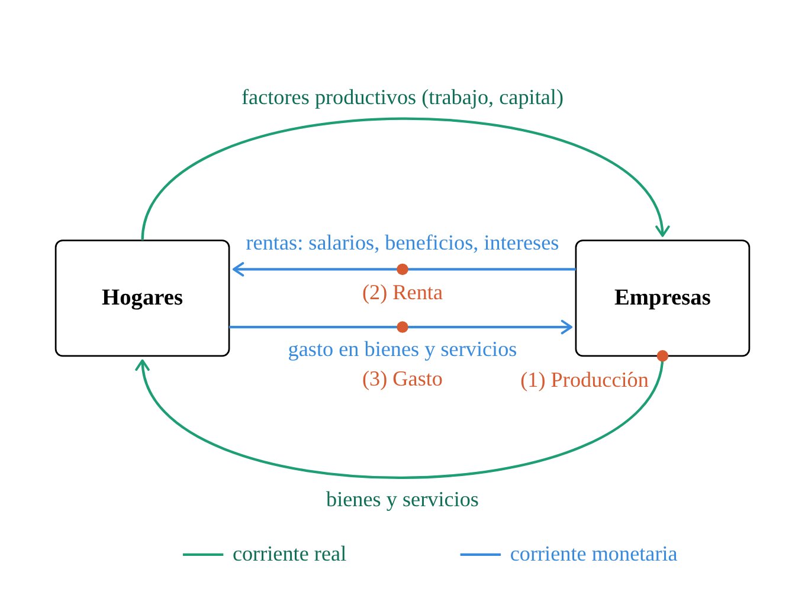

## Introducción



Explicar esas variables exige antes medirlas. Siguiendo a Arthur Conan Doyle en *Escándalo en Bohemia*: “es un error garrafal teorizar antes de tener datos; sin darse cuenta, uno comienza a forzar los hechos para que encajen en las teorías”. La cuantificación y presentación ordenada de estos agregados corresponde a la **contabilidad nacional**.

Las cuentas nacionales tratan de dar respuesta a cuál es el tamaño y composición de la producción de la economía, cuál es el origen y destino de la renta nacional y cuáles son las fuentes del ahorro e inversión para la producción futura. La cuantificación de estas variables da lugar a distintos indicadores o **macromagnitudes** (p. ej. PIB, IPC o tasa de desempleo) que permiten analizar el comportamiento económico y el desempeño de los países.

Históricamente, la contabilidad nacional comienza a desarrollarse a partir de la década de 1930, dada la necesidad de cuantificar el impacto económico de la Gran Depresión (1929-1933) y, después, de financiar y planificar el esfuerzo bélico de la Segunda Guerra Mundial (1939-1945)[^a30-3]. Desde entonces, la exigencia de comparabilidad internacional ha impulsado una metodología común, primero en el ámbito de la ONU (Sistema de Cuentas Nacionales, SCN) y después en el de la UE (Sistema Europeo de Cuentas, SEC). Este último es la base de la contabilidad nacional de los Estados miembros. Las cifras que produce tienen consecuencias directas, porque de ellas dependen el recurso propio de la Unión basado en la renta nacional bruta, el procedimiento de déficit excesivo y el reparto de los fondos estructurales. Con todo, los límites del PIB como medida del bienestar, que señaló la Comisión Stiglitz-Sen-Fitoussi (2009), mantienen abierto el debate sobre qué y cómo medir.

El objetivo del tema es definir las principales variables macroeconómicas y presentarlas dentro de un sistema contable. Para ello, el tema se organiza en tres partes:

- *Fundamentos*: el flujo circular de la renta, del que se derivan las identidades básicas, y la contabilidad nacional según el SEC-2010 (concepto y base normativa, contenido, principios).

- *Cuentas nacionales*: la secuencia de cuentas, no financieras y financieras, y los saldos que la articulan.

- *Indicadores y reflexiones*: otras cuentas, los principales indicadores macroeconómicos y algunas reflexiones sobre lo que el PIB mide y lo que no.

## 1. Fundamentos de la contabilidad nacional

La contabilidad nacional descansa en un fundamento teórico, el flujo circular de la renta, que el SEC-2010 concreta en un sistema normalizado, del que se exponen el concepto y la base normativa, el contenido y los principios del marco contable.

### 1.1. Fundamento teórico: el flujo circular de la renta (Quesnay, 1758; Knight, 1933)

::: {.callout-note appearance="simple" icon=false}
Este apartado recoge el antecedente teórico de la contabilidad nacional, el flujo circular y la equivalencia entre producción, renta y gasto que se deriva de él. No hace falta exponerlo con detalle en el ejercicio oral, pero conviene entenderlo, porque sostiene las identidades contables del resto del tema.
:::

**Origen**: el fundamento teórico de la contabilidad nacional se encuentra en trabajos de tres siglos:

- *Siglo XVIII*: el *Tableau économique* (1758) del fisiócrata François Quesnay[^a30-5], un médico familiarizado con la circulación de la sangre, avanzó la idea del flujo circular del producto neto.

- *Siglo XIX*: Léon Walras (1874) formalizó la interdependencia general entre los mercados.

- *Siglo XX*: Frank Knight (1933) dibujó el primer diagrama del flujo circular, y los trabajos de John Hicks, Wassily Leontief, Simon Kuznets y Richard Stone sentaron las bases de la contabilidad nacional moderna.

**Idea**: el diagrama del flujo circular ilustra los distintos flujos de actividad de una economía (figura -@fig-a301-flujo-circular). Intuitivamente, cada unidad física de producto tiene su correspondencia en una unidad monetaria de ingreso en el bolsillo de alguien, y cada unidad monetaria de ingreso termina como unidad monetaria de gasto en un mercado.

**Supuestos**:

- *Entorno*: economía simplificada[^a30-6] y cerrada, sin sector público.

- *Agentes*: hogares y empresas, cada uno con una doble función. Las empresas son oferentes de productos y demandantes de factores, mientras que los hogares son demandantes de bienes y oferentes de factores.

**Razonamiento**: entre ambos nacen dos corrientes de sentido opuesto:

1. *Real*: un flujo de bienes, servicios y factores entendidos como entidades físicas (kilos, horas de trabajo o de máquina).

2. *Monetaria*: el ingreso que se obtiene en las transacciones y el gasto, que es su imagen especular.

El modelo desvela dos intuiciones:

1. *Identidades contables*: las interrelaciones entre los sectores se recogen mediante identidades, que se cumplen siempre por construcción y no implican equilibrio económico.

2. *Tres enfoques*: la producción, la renta y el gasto son tres medidas complementarias de un mismo flujo y los tres puntos del circuito en los que se sitúan las cuentas de la sección 2.

**Desarrollo gráfico**: en la figura -@fig-a301-flujo-circular, los hogares (a la izquierda) y las empresas (a la derecha) se unen por las dos corrientes:

1. *Corriente real* (arcos exteriores): el arco superior lleva los factores productivos (trabajo, capital) de los hogares a las empresas, y el inferior, los bienes y servicios que las empresas producen con ellos hacia los hogares.

2. *Corriente monetaria* (flechas interiores): las rentas (salarios, beneficios, intereses) con que las empresas pagan esos factores van hacia los hogares, y el gasto con que estos compran los bienes y servicios vuelve a las empresas.

3. *Puntos de medición*: el PIB se mide en la producción de las empresas (1), en la renta que perciben los hogares (2) y en su gasto (3). Las tres medidas coinciden porque recogen el mismo flujo en tres puntos del circuito.

::: {#fig-a301-flujo-circular}

::: {.content-visible when-format="html"}
```{=html}
<div class="graph-frame">
<iframe src="../graphs/a301_Flujo_circular.html" style="height:560px" loading="lazy" title="fig-a301-flujo-circular"></iframe>
</div>
```
:::

::: {.content-visible unless-format="html"}

:::

Flujo circular de la renta. Entre hogares y empresas circulan una corriente real (bienes y factores) y una corriente monetaria (gasto e ingreso), y el PIB se mide en tres puntos (producción, renta y gasto).
:::

**Conclusiones**:

- *Aspectos positivos*: ofrece una representación sencilla de la interdependencia entre hogares y empresas y fundamenta la equivalencia entre producción, renta y gasto, sobre la que descansa la medición del PIB en la contabilidad nacional.

- *Limitaciones*: en su versión básica omite el ahorro, la inversión, el sector público y el resto del mundo, que hay que añadir para describir una economía real. Además, como sus relaciones son identidades, describe cómo circula la renta, pero no explica qué determina su nivel ni sus fluctuaciones.

### 1.2. Concepto y base normativa

La **contabilidad nacional** es el registro sistemático y estadístico del conjunto de la actividad macroeconómica de un país durante un periodo, que ofrece una imagen de su situación económica. Es una técnica de representación que permite obtener una descripción cuantitativa y simplificada de la actividad económica y observar cómo se alcanza el equilibrio contable entre las principales magnitudes agregadas. 

**Objetivo**: su fin esencial es disponer de un marco estadístico completo, coherente y flexible que permita el análisis económico comparado y la formulación de la política económica.

**Base normativa**: la metodología se ha ido normalizando en dos ámbitos:

1. *Ámbito internacional (SCN)*: en 1953, un grupo de expertos presidido por Richard Stone elaboró para la ONU el primer Sistema de Cuentas Nacionales normalizado (SCN-53), actualizado en 1968, 1993, 2008 y 2025. Las tres últimas revisiones se elaboraron conjuntamente con la Comisión Europea (Eurostat), el FMI, la OCDE y el Banco Mundial. El SCN-2008[^a30-13], basado en el SCN-93, se concibió para todos los países, independientemente de su etapa de desarrollo económico. Además, está armonizado con el Manual de Balanza de Pagos (MBP6) del FMI, de modo que las cuentas del resto del mundo y la balanza de pagos comparten conceptos. En marzo de 2025, la Comisión Estadística de la ONU aprobó el SCN-2025 y el FMI publicó la séptima edición del Manual de Balanza de Pagos (MBP7). La UE incorporará el SCN-2025 en una futura revisión del SEC.

2. *Ámbito de la Unión (SEC)*: en línea con el SCN, el Sistema Europeo de Cuentas Nacionales y Regionales (SEC-2010)[^a30-15] sustituye al SEC-95 y tiene carácter vinculante para los Estados miembros. Se trata de un reglamento que fija reglas, definiciones, nomenclaturas y normas contables comunes para elaborar cuentas y tablas sobre bases comparables. De esas cuentas y tablas dependen decisiones de la Unión como el recurso propio basado en la renta nacional bruta (RNB), el procedimiento de déficit excesivo o los fondos estructurales.

**Evolución del SEC-95 al SEC-2010**: la estructura básica del sistema apenas se modifica, si bien existen dos tipos de cambios:

1. *Con impacto sobre el PIB*: reconocimiento como inversión, es decir, como formación bruta de capital fijo (FBKF), de los gastos en I+D[^a30-17] y de los sistemas de armamento[^a30-18].

2. *Sin impacto sobre el PIB*: mayor detalle en la delimitación del sector público y de las instituciones financieras, y armonización con el MBP6 en el registro de flujos con el resto del mundo (comercio triangular, bienes enviados al extranjero para su transformación).

### 1.3. Contenido: unidades, flujos y *stocks*

El sistema describe la economía a partir de las unidades que realizan operaciones (flujos) y poseen activos y pasivos (*stocks*), y de los precios a los que se valora la producción.

#### 1.3.1. Unidades y sectores institucionales

**Unidades institucionales**: el SEC-2010 las define como entes económicos capaces de ser propietarios de bienes y activos, contraer pasivos y participar en actividades y operaciones económicas con otras unidades en nombre propio. Se agrupan en cinco sectores nacionales mutuamente excluyentes, definidos por el tipo de productor y su función principal, más el resto del mundo:

| Sector | Tipo de productor | Función principal | Incluye |
|:--|:--|:--|:--|
| Sociedades no financieras (S.11) | De mercado | Producción de bienes y servicios no financieros | Privadas y públicas (p. ej. empresas públicas de correos o ferrocarriles) |
| Instituciones financieras (S.12) | De mercado | Intermediación financiera y actividades auxiliares | Privadas y públicas, incluidos los bancos centrales |
| Administraciones públicas (S.13) | De no mercado | Producción de bienes y servicios no de mercado para consumo individual o colectivo; redistribución de la renta y la riqueza | Administración central, regional, local y fondos de la Seguridad Social |
| Hogares (S.14) | De mercado y para uso final propio | Consumo; producción de mercado (empresarios individuales) y para uso final propio | Personas físicas y empresarios individuales |
| Instituciones sin fines de lucro al servicio de los hogares (ISFLSH, S.15) | De no mercado privado | Producción de servicios no de mercado para los hogares | Organizaciones no gubernamentales, sindicatos, partidos, fundaciones, iglesias |
| Resto del mundo (S.2) | — | Operaciones con unidades no residentes | Unidades no residentes e instituciones de la UE |

: Sectores institucionales del SEC-2010. {#tbl-a30-sectores .table-sm}

La distinción entre productores de mercado y de no mercado separa a las empresas públicas de las Administraciones públicas (AA. PP.). En particular, una unidad pública es productor de mercado, y se clasifica en S.11 o S.12, si, entre otros criterios, sus ventas cubren al menos el 50 % de sus costes de producción a lo largo de varios años.

**Unidades de actividad económica locales (UAE)**: permiten la agrupación por ramas de actividad para el análisis del proceso productivo (tablas de origen y destino e *input-output*). Una actividad comprende los insumos de bienes y servicios, el proceso de producción y los productos obtenidos.

#### 1.3.2. Flujos y *stocks*

**Flujos**: para el SEC-2010, expresan cualquier creación, transformación, intercambio, transferencia o extinción del valor económico y modifican lo que valen los activos o pasivos de la unidad institucional afectada. Se dividen en *operaciones*, de cuatro tipos (de bienes y servicios, distributivas, financieras y otras operaciones), y *otras variaciones de activos* (no derivadas de operaciones: catástrofes, descubrimientos, revalorizaciones).

***Stocks*** o **posiciones**: son los activos y pasivos que se poseen en un momento concreto. Los *activos* son entidades sobre las que se ejercen derechos de propiedad y de las que se derivan beneficios económicos. Pueden ser no financieros (producidos, como el capital fijo y las existencias, o no producidos, como la tierra) o financieros, que tienen como contrapartida un *pasivo* de otra unidad. La diferencia entre activos y pasivos es el *patrimonio neto*. Las posiciones se registran al principio y al final de cada ejercicio en los balances.

#### 1.3.3. Precios básicos y de adquisición

La producción se valora en distintos puntos de la cadena que va del productor al comprador. Para una unidad del producto $j$, se distingue entre:

**Precio básico** ($p^b$): lo que retiene el productor por unidad vendida.

$$p^b_j = c_j + t_{p,j}$$

donde $c_j$ es el coste unitario de los consumos intermedios y de los factores (remuneración de asalariados y excedente) y $t_{p,j}$ los otros impuestos sobre la producción netos de subvenciones (p. ej. impuestos sobre los inmuebles de la empresa o licencias de actividad).

**Precio de adquisición** ($p^a$): lo que paga el comprador por unidad.

$$p^a_j = p^b_j + t_{c,j} + \mu_{c,j}$$

donde $t_{c,j}$ son los impuestos sobre los productos netos de subvenciones (IVA no deducible, impuestos especiales, derechos de importación) y $\mu_{c,j}$ los márgenes de distribución y transporte.

**Agregados**: se obtienen multiplicando por las cantidades y sumando. Así, para una rama $i$, la producción a precios básicos es $\text{VP}_i = \sum_j p^b_j\, x_{ij}$, donde $x_{ij}$ son las unidades del producto $j$ producidas por la rama, y el valor añadido bruto es la producción menos los consumos intermedios, valorados estos a precios de adquisición:

$$\text{VAB}_i^{\text{pb}} = \text{VP}_i - \text{CI}_i$$

donde $\text{CI}_i$ son los consumos intermedios de la rama. Deduciendo los otros impuestos netos sobre la producción se obtiene el *valor añadido a coste de los factores*, $\text{VAB}_i^{\text{cf}} = \text{VAB}_i^{\text{pb}} - T_{p,i}$ (con $T_{p,i}$ los otros impuestos netos sobre la producción de la rama), que el SEC-2010 no utiliza formalmente[^a30-22][^a30-23][^a30-24].

Para la economía total, los márgenes de distribución y transporte son a su vez producción de las ramas de comercio y transporte, por lo que se cancelan al agregar. Por tanto, solo queda por añadir la recaudación por impuestos sobre los productos, que no es valor añadido de ninguna rama:

$$\text{PIB}_{\text{pm}} = \sum_i \text{VAB}_i^{\text{pb}} + T_c$$

donde $T_c = \sum_j t_{c,j}\, x_j$ es la recaudación neta por impuestos sobre los productos, con $x_j$ las unidades vendidas del producto $j$. Esta expresión es la primera de las tres vías de medición del PIB (apartado 2.1) y el saldo con el que se cierra la cuenta de producción (apartado 2.2.1).

### 1.4. Principios del marco contable

El sistema descansa sobre cinco decisiones metodológicas, que fijan qué se contabiliza, cómo se registra, cuándo, con qué criterio de valoración y en qué unidad.

#### 1.4.1. Delimitación de la economía nacional

La delimitación se basa en el **criterio de residencia**, y no en el de nacionalidad. El SEC-2010 considera residente en un país a la unidad institucional cuyo centro de interés económico predominante se sitúa en su territorio económico, condición que en la práctica se cumple cuando la unidad realiza allí actividades económicas durante un año como mínimo. Así, la economía nacional agrupa las unidades residentes, y el resto del mundo, las no residentes que operan con ellas.

#### 1.4.2. Sistema de registro: partida doble

El criterio básico es la **partida doble**. Cada operación se registra dos veces con el mismo valor para cada unidad que interviene. Una anotación figura como **recurso** (operaciones que aumentan el valor económico de la unidad, como la producción o las rentas recibidas) o como variación de pasivos. La otra figura como **empleo** (operaciones que reducen ese valor, como los consumos intermedios o las rentas pagadas) o como variación de activos[^a30-27]. 

Puesto que cada operación afecta a dos unidades, el sistema es en realidad de **partida cuádruple**, lo que garantiza la coherencia de las cuentas. Las cuentas se presentan en forma de T, con los empleos a la izquierda y los recursos a la derecha, y se cierran con un **saldo contable** que pasa como recurso a la cuenta siguiente.

#### 1.4.3. Momento del registro: devengo

Rige el **principio de devengo**: los flujos se anotan cuando se crea, transforma o extingue el valor económico, o cuando nacen, se transforman o se cancelan derechos y obligaciones, al margen de cobros y pagos. En su aplicación cabe distinguir tres casos:

- *Producción*: se registra cuando se obtiene, no cuando se vende (de ahí la variación de existencias).

- *Operaciones con activos*: se registran cuando se transfiere la propiedad económica del activo.

- *Rentas*: los intereses se registran en el ejercicio en que se devengan, aunque se paguen después.

La única desviación práctica son los impuestos y otros flujos en los que intervienen AA. PP., para los que, a falta de datos por devengo, se admite un registro por caja **ajustado en el tiempo** (desplazado al periodo en que se generó la obligación).

#### 1.4.4. Criterios de valoración

El SEC-2010 valora los flujos y *stocks* según tres criterios:

1. *Precios de mercado*: es la referencia general, es decir, el valor al que los flujos y *stocks* se cambian o podrían cambiarse por efectivo. Dentro de ella, la producción se valora a precios básicos y los empleos (consumos intermedios, consumo final, formación de capital) a precios de adquisición.

2. *Costes de producción*: cuando no existen precios de mercado propios ni análogos (servicios no de mercado de las AA. PP. y las ISFLSH), la producción se valora por la suma de sus costes. Esos costes son los consumos intermedios, la remuneración de asalariados, el consumo de capital fijo y los otros impuestos netos sobre la producción[^a30-31].

3. *Valor franco a bordo* (*free on board*, FOB): las exportaciones e importaciones de bienes se registran por su valor en la frontera del país exportador, sin fletes ni seguros[^a30-32]. Por eso hay que ajustar las importaciones aduaneras, que se declaran a valor de coste, seguro y flete (*cost, insurance and freight*, CIF).

Con independencia del criterio, los agregados se valoran a **precios corrientes** del periodo. Por ello, las medidas en términos de **volumen** (el “PIB real”) no son una valoración alternativa sino una descomposición posterior de la variación nominal en precios y cantidades, que se obtiene mediante índices encadenados a precios del año anterior (apartado 3.2.1)[^a30-33].

#### 1.4.5. Unidad de cuenta

La unidad de cuenta es la moneda nacional. Para las comparaciones internacionales se recurre a tipos de cambio o, preferiblemente, a **paridades de poder adquisitivo** (PPA), que corrigen las diferencias de nivel de precios entre países.

### 1.5. Conclusiones

El flujo circular de la renta da a la contabilidad nacional su fundamento teórico. Producción, renta y gasto son tres medidas del mismo flujo, y las relaciones entre los sectores son identidades que se cumplen por construcción, sin implicar equilibrio. Sobre esa base, el SCN-2008 y el SEC-2010 fijan una metodología común, que en la Unión es un reglamento vinculante del que dependen el recurso propio basado en la RNB y el procedimiento de déficit excesivo.

El sistema agrupa las unidades institucionales en cinco sectores y el resto del mundo y distingue los flujos de los *stocks*. La valoración a precios básicos y de adquisición permite pasar del valor añadido de las ramas al PIB a precios de mercado. Los principios de residencia, partida doble, devengo, valoración y unidad de cuenta hacen, por último, que las cuentas sean coherentes y comparables. La sección 2 recorre ese flujo en la secuencia de cuentas nacionales, de la cuenta de producción a los balances.

## 2. Las cuentas nacionales

El PIB, que puede medirse por tres vías, es el primero de los saldos de una secuencia de cuentas, no financieras y financieras, cuya lectura económica se expresa en términos de ahorro e inversión.

### 2.1. El PIB y el triple enfoque

El **producto interior bruto** a precios de mercado es el valor de los bienes y servicios finales producidos por las unidades residentes durante un periodo[^a30-34]. Es una magnitud flujo, medida en dinero para poder sumar bienes heterogéneos, que solo computa bienes finales y evita así contar más de una vez los intermedios. Por eso, el concepto relevante es el **valor añadido**, la diferencia entre la producción y los consumos intermedios de cada unidad[^a30-35]. El PIB puede medirse por tres vías, que coinciden entre sí:

$$\text{PIB}_{\text{pm}} = \underbrace{\sum_i \text{VAB}^{\text{pb}}_i + T_c}_{\text{Oferta}} = \underbrace{\text{RA} + T + \text{EBE} + \text{RM}}_{\text{Rentas}} = \underbrace{C + I + G + (X - M)}_{\text{Demanda}}$$

donde $\text{VAB}^{\text{pb}}_i$ es el valor añadido bruto a precios básicos de la rama $i$, $T_c$ los impuestos sobre los productos netos de subvenciones, $\text{RA}$ la remuneración de los asalariados, $T$ los impuestos sobre la producción y las importaciones netos de subvenciones (sobre los productos y otros), $\text{EBE}$ el excedente bruto de explotación, $\text{RM}$ la renta mixta bruta de los empresarios individuales, $C$ el gasto en consumo final de los hogares e ISFLSH, $I$ la formación bruta de capital (fija, variación de existencias y adquisiciones menos cesiones de objetos valiosos), $G$ el gasto en consumo final de las AA. PP., $X$ las exportaciones y $M$ las importaciones.

Las tres vías son los tres puntos del flujo circular (apartado 1.1). En la secuencia de cuentas, la primera es el saldo de la cuenta de producción, la segunda el reparto que hace la cuenta de explotación y la tercera la suma de los empleos finales. Del PIB, magnitud **interior**, se pasa a las magnitudes **nacionales**, la RNB y la renta nacional bruta disponible (RNBD), a través de las rentas y transferencias con el resto del mundo, en las cuentas de distribución. La diferencia entre interior y nacional no es de nacionalidad sino de residencia, ya que el PIB atiende a la residencia de las unidades que producen y la RNB, a la de las unidades que perciben las rentas[^a30-37].

Todas las magnitudes pueden expresarse en términos **brutos** o **netos** según incluyan o no el **consumo de capital fijo** (depreciación, $\text{CCF}$)[^a30-39], de modo que $\text{PIN} = \text{PIB} - \text{CCF}$ y $I_N = I - \text{CCF}$. La inversión neta es así la que amplía el *stock* de capital, $I_N = K_{t+1} - K_t$, donde $K_t$ es el *stock* de capital al inicio del periodo.

### 2.2. Cuentas no financieras

Las cuentas se presentan en forma de T (apartado 1.4.2) y se elaboran para cada sector institucional y para la economía total. Aquí se exponen las de la economía total, en una secuencia que va de la producción a la acumulación y de esta a los balances.

#### 2.2.1. Cuentas corrientes

Las **cuentas corrientes** registran la producción, la generación y distribución de la renta y su utilización en consumo y ahorro.

**Cuenta de producción** (C.I): muestra cómo se crea valor en el proceso productivo. Los recursos son la producción a precios básicos y, para la economía total, los impuestos sobre los productos netos de subvenciones, que se incluyen para pasar de la producción a precios básicos al PIB a precios de mercado. Los empleos son los consumos intermedios. El saldo es el *valor añadido bruto* de cada sector y, para la economía total, el producto interior bruto, que se obtiene por agregación de los valores añadidos, no de las producciones.

| Empleos | | Recursos | |
|:--|--:|:--|--:|
| Consumos intermedios (P.2) | xxx | Producción a precios básicos (P.1) | xxx |
|  |  | Impuestos sobre los productos netos de subvenciones (D.21 − D.31) | xxx |
| **Saldo: PIB a precios de mercado (B.1\*g)** | **xxx** |  |  |

: Cuenta de producción (economía total). {#tbl-a30-cuenta-produccion .table-sm .balance tbl-colwidths="[40,10,40,10]"}

Las **cuentas de distribución primaria de la renta** (C.II.1) muestran cómo la renta generada en la producción se reparte entre el trabajo, el capital y el sector público, y cómo se ajusta con el exterior. Constan de dos cuentas:

**Cuenta de explotación** (C.II.1.1): parte del PIB como recurso y lo distribuye en los empleos. Los empleos son la remuneración de los asalariados interior (pagada por empleadores residentes, incluidas las cotizaciones sociales a su cargo) y los impuestos sobre la producción y las importaciones netos de subvenciones. El saldo es el *excedente bruto de explotación* (EBE, excedente antes de deducir intereses, rentas de la tierra o de la propiedad) y la *renta mixta bruta* (RM) de los empresarios individuales, que lleva implícita la remuneración del trabajo del propietario y su familia.

| Empleos | | Recursos | |
|:--|--:|:--|--:|
| Remuneración de los asalariados (D.1) | xxx | PIB a precios de mercado (B.1\*g) | xxx |
| Impuestos sobre la producción y las importaciones netos de subvenciones (D.2 − D.3) | xxx |  |  |
| **Saldo: EBE + RM (B.2g + B.3g)** | **xxx** |  |  |

: Cuenta de explotación (economía total). {#tbl-a30-cuenta-explotacion .table-sm .balance tbl-colwidths="[40,10,40,10]"}

**Cuenta de asignación de la renta primaria** (C.II.1.2): recoge la renta primaria desde la óptica de los residentes que la perciben. Los recursos son el EBE y la RM, la remuneración de asalariados recibida por los hogares residentes (de empleadores residentes y no residentes), los impuestos netos de subvenciones recibidos por las AA. PP. y las rentas de la propiedad recibidas[^a30-42]. Los empleos son las rentas de la propiedad pagadas, incluidas las pagadas al resto del mundo. El saldo es la *renta nacional bruta*.

| Empleos | | Recursos | |
|:--|--:|:--|--:|
| Rentas de la propiedad pagadas (D.4) | xxx | EBE + RM (B.2g + B.3g) | xxx |
|  |  | Remuneración de los asalariados recibida (D.1) | xxx |
|  |  | Impuestos sobre la producción y las importaciones netos de subvenciones (D.2 − D.3) | xxx |
|  |  | Rentas de la propiedad recibidas (D.4) | xxx |
| **Saldo: renta nacional bruta (B.5\*g)** | **xxx** |  |  |

: Cuenta de asignación de la renta primaria (economía total). {#tbl-a30-cuenta-renta-primaria .table-sm .balance tbl-colwidths="[40,10,40,10]"}

Comparando ambas cuentas, la RNB difiere del PIB en las rentas primarias netas recibidas del resto del mundo (remuneración de asalariados, rentas de la propiedad e impuestos netos con instituciones de la UE), que son el saldo de rentas primarias de la balanza de pagos:

$$\text{RNB} = \text{PIB} + \text{SBR}_1$$

donde $\text{SBR}_1$ es el saldo de la balanza de rentas primarias. En los países con posición deudora neta frente al exterior, $\text{SBR}_1$ suele ser negativo (RNB < PIB) por el pago neto de intereses y dividendos al exterior.

**Cuenta de distribución secundaria de la renta** (C.II.2): muestra la redistribución de la renta vía transferencias corrientes. Las transferencias incluyen los impuestos corrientes sobre la renta y el patrimonio, las cotizaciones y prestaciones sociales y otras transferencias corrientes (entre hogares, con AA. PP. y cooperación internacional). Los recursos son la RNB y las transferencias corrientes recibidas, y los empleos, las transferencias corrientes pagadas. El saldo es la *renta nacional bruta disponible*.

| Empleos | | Recursos | |
|:--|--:|:--|--:|
| Transferencias corrientes pagadas (D.5, D.61, D.62, D.7) | xxx | Renta nacional bruta (B.5\*g) | xxx |
|  |  | Transferencias corrientes recibidas (D.5, D.61, D.62, D.7) | xxx |
| **Saldo: renta nacional bruta disponible (B.6g)** | **xxx** |  |  |

: Cuenta de distribución secundaria de la renta (economía total). {#tbl-a30-cuenta-distribucion-secundaria .table-sm .balance tbl-colwidths="[40,10,40,10]"}

Para la economía total, las transferencias entre residentes se cancelan y solo quedan las cruzadas con el exterior, que son el saldo de rentas secundarias de la balanza de pagos (remesas, cooperación al desarrollo, recursos propios IVA y RNB de la UE):

$$\text{RNBD} = \text{RNB} + \text{SBR}_2$$

donde $\text{SBR}_2$ es el saldo de la balanza de rentas secundarias. Adicionalmente, la *cuenta de redistribución de la renta en especie* (C.II.3) traslada a los hogares las transferencias sociales en especie (educación, sanidad) que financian las AA. PP. y las ISFLSH. El saldo de esta cuenta es la *renta disponible ajustada*. Esta redistribución no altera el total de la economía pero sí su reparto entre sectores[^a30-43].

**Cuenta de utilización de la renta disponible** (C.II.4.1): recoge cómo se reparte la renta disponible entre consumo final y ahorro. Solo los hogares, las ISFLSH y las AA. PP. realizan gasto en consumo final[^a30-44], que es de dos tipos:

- *Consumo individual*: el de los hogares y las ISFLSH (bienes y servicios rivales, incluidas las transferencias sociales en especie que financian las ISFLSH) y parte del de las AA. PP. (educación, sanidad, bienes preferentes)[^a30-45].

- *Consumo colectivo*: el resto del de las AA. PP. (bienes públicos puros como defensa, justicia u orden público, que se prestan simultánea y pasivamente a toda la comunidad).

Los recursos son la RNBD y el ajuste por la variación de los derechos de pensión[^a30-47], que reciben los hogares, y los empleos, el gasto en consumo final y ese mismo ajuste, que registran los gestores de los sistemas de pensiones. En la economía total, ambas anotaciones solo difieren por las operaciones con el resto del mundo. El saldo es el *ahorro nacional bruto*.

| Empleos | | Recursos | |
|:--|--:|:--|--:|
| Gasto en consumo final individual (P.31): hogares, ISFLSH y AA. PP. | xxx | Renta nacional bruta disponible (B.6g) | xxx |
| Gasto en consumo final colectivo (P.32): AA. PP. | xxx | Ajuste por variación de los derechos de pensión (D.8) | xxx |
| Ajuste por variación de los derechos de pensión (D.8) | xxx |  |  |
| **Saldo: ahorro nacional bruto (B.8g)** | **xxx** |  |  |

: Cuenta de utilización de la renta disponible (economía total). {#tbl-a30-cuenta-utilizacion-renta .table-sm .balance tbl-colwidths="[40,10,40,10]"}

El gasto en consumo final de los hogares representa en torno al 55-60 % del PIB en los países de la OCDE y es un componente estable y procíclico. El gasto en consumo final de las AA. PP. se sitúa en torno a una quinta parte del PIB en las economías europeas. Deduciendo el consumo de capital fijo del ahorro bruto se obtiene el *ahorro nacional neto*, que es el que efectivamente incrementa el patrimonio de la nación.

#### 2.2.2. Cuentas de acumulación

Las **cuentas de acumulación** registran las variaciones de los activos, pasivos y patrimonio neto. La cuenta de capital y la cuenta financiera recogen las debidas a operaciones, mientras que la cuenta de otras variaciones de los activos recoge las restantes.

La **cuenta de capital** (C.III.1) muestra cómo el ahorro y las transferencias de capital financian la adquisición de activos no financieros. Se divide en dos subcuentas:

**Cuenta de variaciones del patrimonio neto debidas al ahorro y a las transferencias de capital** (C.III.1.1): parte del ahorro neto (recurso) y añade las transferencias de capital recibidas menos las pagadas. Las transferencias de capital comprenden los impuestos sobre el capital, las ayudas a la inversión (como los fondos estructurales de la UE recibidos por los Estados miembros) y las condonaciones de deuda acordadas. El saldo es la *variación del patrimonio neto debida al ahorro y a las transferencias de capital*, que puede entenderse como el ahorro nacional neto corregido por las transferencias de capital.

| Variaciones de activos | | Variaciones de pasivos y patrimonio neto | |
|:--|--:|:--|--:|
| Transferencias de capital pagadas (D.9) | xxx | Ahorro nacional neto (B.8n) | xxx |
|  |  | Transferencias de capital recibidas (D.9) | xxx |
| **Saldo: variación del patrimonio neto (PN) debida al ahorro y a las transferencias de capital (B.10.1)** | **xxx** |  |  |

: Cuenta de variaciones del patrimonio neto debidas al ahorro y a las transferencias de capital. {#tbl-a30-cuenta-variaciones-pn .table-sm .balance tbl-colwidths="[40,10,40,10]"}

**Cuenta de adquisiciones de activos no financieros** (C.III.1.2): muestra en qué activos no financieros se emplea ese saldo: formación bruta de capital fijo (incluida la vivienda nueva de los hogares[^a30-50]), variación de existencias, adquisiciones menos cesiones de objetos valiosos y adquisiciones netas de activos no producidos (tierra, licencias). Se deduce el consumo de capital fijo para trabajar en términos netos. El saldo es la *capacidad (+) o necesidad (−) de financiación*.

| Variaciones de activos | | Variaciones de pasivos y patrimonio neto | |
|:--|--:|:--|--:|
| Formación bruta de capital fijo (P.51g) | xxx | Variación del PN debida al ahorro y a las transferencias de capital (B.10.1) | xxx |
| Consumo de capital fijo (P.51c) | (xxx) |  |  |
| Variación de existencias (P.52) | xxx |  |  |
| Adquisiciones menos cesiones de objetos valiosos (P.53) | xxx |  |  |
| Adquisiciones menos cesiones de activos no producidos (NP) | xxx |  |  |
| **Saldo: capacidad (+) / necesidad (−) de financiación (B.9)** | **xxx** |  |  |

: Cuenta de adquisiciones de activos no financieros. {#tbl-a30-cuenta-activos-no-financieros .table-sm .balance tbl-colwidths="[40,10,40,10]"}

La inversión (FBKF) supone en torno al 20 % del PIB y es mucho más volátil y procíclica que el consumo. En conjunto es coincidente o ligeramente retrasada respecto al ciclo, y solo la inversión residencial suele adelantarse a él. Por su parte, la variación de existencias es pequeña (en torno al 0,5-1 % del PIB) pero de gran varianza. La inversión en sentido macroeconómico es la creación de capital productivo, no la inversión financiera[^a30-53], y es el componente que vincula el flujo del producto con el *stock* de riqueza.

La capacidad o necesidad de financiación ($\text{CIN}$) es el saldo central del sistema. Para la economía total, $\text{CIN} > 0$ indica que la nación ha ahorrado, sumadas las transferencias netas de capital recibidas, más de lo que ha invertido, y que presta al resto del mundo, lo que mejora su posición de inversión internacional salvo efectos de valoración. En cambio, un $\text{CIN} < 0$ indica que ha necesitado financiación exterior.

Por sectores, la suma de las capacidades y necesidades de hogares, ISFLSH, sociedades no financieras, instituciones financieras y AA. PP. es igual a la de la nación, lo que permite leer el saldo exterior como el reflejo de los desequilibrios sectoriales internos. En varias economías de la zona del euro, por ejemplo, la elevada necesidad de financiación previa a la Gran Recesión procedía de hogares y sociedades no financieras. El ajuste posterior descansó en el aumento del ahorro privado, mientras crecía la necesidad de financiación de las AA. PP.

**Cuenta de otras variaciones de los activos** (C.III.3): registra las variaciones de activos y pasivos que no se deben a operaciones. Se divide en la cuenta de otras variaciones del volumen (descubrimiento o agotamiento de recursos naturales, catástrofes, cancelaciones unilaterales de deuda, cambios de clasificación) y la cuenta de revalorización (ganancias y pérdidas de posesión por variaciones de precios de los activos reales y financieros existentes).

#### 2.2.3. Balances

Los **balances** recogen, tanto al inicio como al cierre del ejercicio, el patrimonio neto de las unidades junto con sus activos y pasivos, así como las variaciones que se producen a lo largo de este. Se componen de balance inicial, variaciones del balance (que son, exactamente, las registradas en las cuentas de acumulación: operaciones, otras variaciones de volumen y revalorizaciones) y balance final:

$$\text{PN}_{t} = \text{PN}_{t-1} + \underbrace{\text{B.10.1}}_{\text{ahorro y TK}} + \underbrace{\text{OVV}}_{\text{volumen}} + \underbrace{\text{REV}}_{\text{revalorización}}$$

donde $\text{PN}_t$ es el patrimonio neto al cierre, $\text{B.10.1}$ la variación debida al ahorro y a las transferencias de capital, $\text{OVV}$ las otras variaciones de volumen y $\text{REV}$ las revalorizaciones. Para la economía total, el patrimonio neto es la riqueza nacional (apartado 3.2.2).

### 2.3. Cuentas financieras

**Lema**: cada operación de la economía, ya sea real o financiera, tiene una contrapartida financiera, salvo el trueque, las operaciones en especie y las operaciones internas. Esto tiene tres implicaciones:

1. *Doble registro*: una operación real (venta de un bien) tiene una contrapartida financiera (cobro en efectivo o crédito comercial), y una operación financiera (concesión de un préstamo) tiene otra contrapartida financiera (depósito).

2. *Saldo real y financiero*: el saldo de las cuentas reales de cada unidad es igual al saldo de sus cuentas financieras, porque quien gasta más de lo que ingresa financia la diferencia con pasivos o desprendiéndose de activos financieros.

3. *Economía total*: la suma de las capacidades y necesidades de financiación de los sectores es igual a la suma de sus saldos financieros.

**Cuenta financiera** (C.III.2): recoge en qué instrumentos se ha materializado la capacidad o necesidad de financiación. Su saldo, la *adquisición neta de activos financieros menos el incremento neto de pasivos*, es conceptualmente idéntico al saldo de la cuenta de capital, y la diferencia estadística entre ambos es el ajuste entre las cuentas real y financiera:

$$\text{SB}_{\text{CF}} \equiv \Delta \text{AF} - \Delta \text{PF} = \text{CIN}$$

donde $\text{SB}_{\text{CF}}$ es el saldo de la cuenta financiera, $\Delta \text{AF}$ la adquisición neta de activos financieros y $\Delta \text{PF}$ el incremento neto de pasivos. Los instrumentos se clasifican en ocho categorías:

| Código | Instrumento | Ejemplos |
|:--|:--|:--|
| F.1 | Oro monetario y derechos especiales de giro (DEG) | Reservas del banco central |
| F.2 | Efectivo y depósitos | Billetes, depósitos a la vista y a plazo |
| F.3 | Valores representativos de deuda | Letras, bonos, obligaciones |
| F.4 | Préstamos | Hipotecas, crédito bancario |
| F.5 | Participaciones en el capital y en fondos de inversión | Acciones cotizadas y no cotizadas, fondos |
| F.6 | Sistemas de seguros, pensiones y garantías estandarizadas | Reservas técnicas, derechos de pensión |
| F.7 | Derivados financieros y opciones de compra de acciones de los asalariados | Futuros, opciones, permutas |
| F.8 | Otras cuentas pendientes de cobro o pago | Créditos comerciales, anticipos |

: Instrumentos financieros del SEC-2010. {#tbl-a30-instrumentos-financieros .table-sm}

Para la economía total, los activos y pasivos financieros entre residentes se cancelan, de modo que el saldo de la cuenta financiera coincide conceptualmente con el saldo de la cuenta financiera de la balanza de pagos:

$$\text{SB}_{\text{CF}}^{\text{CN}} \simeq \text{SB}_{\text{CF}}^{\text{BP}}$$

donde $\text{SB}_{\text{CF}}^{\text{CN}}$ es el saldo de la cuenta financiera de la economía total en las cuentas nacionales y $\text{SB}_{\text{CF}}^{\text{BP}}$ el de la balanza de pagos, que registra las mismas operaciones desde la óptica de los residentes frente a los no residentes.

**Cuenta de otras variaciones de activos y pasivos financieros** (COVAPF): con la misma lógica que la cuenta de otras variaciones de los activos, recoge las variaciones de activos y pasivos financieros no debidas a operaciones. Esas variaciones comprenden los efectos de valoración (tipo de cambio, precio de los activos) y las otras variaciones de volumen (cancelaciones, reclasificaciones):

$$\text{COVAPF} = \text{REV} + \text{OVV}$$

donde $\text{REV}$ es el efecto valoración (revalorizaciones) y $\text{OVV}$ las otras variaciones de volumen. La COVAPF pertenece a las cuentas internacionales del MBP6 y concilia los flujos de la balanza de pagos con la variación de la posición de inversión internacional neta ($\text{PIIN}$), $\Delta \text{PIIN} = \text{SB}_{\text{CF}}^{\text{BP}} + \text{COVAPF}$.

### 2.4. Lectura económica de los saldos: identidades ahorro-inversión

Los saldos de la secuencia de cuentas tienen una lectura económica directa en términos de ahorro e inversión, cuya forma depende de los agentes considerados. Si se define el ahorro como la renta disponible no destinada al consumo, $S = \text{RNBD} - C - G$:

| Economía | Renta disponible | Identidad | Lectura |
|:--|:--|:--|:--|
| Cerrada sin sector público | $\text{RNBD} = \text{PIB} = C + I$ | $S = I$ | El ahorro privado financia íntegramente la inversión privada[^a30-55] |
| Cerrada con sector público | $\text{RNBD} = C + I + G$ | $(S_P - I_P) + (S_G - I_G) = 0$ | Lo que un sector invierte por encima de su ahorro lo cubre el ahorro sobrante del otro |
| Abierta con sector público | $\text{RNBD} = C + I + G + \text{SB}_{\text{CC}}$ | $(S_P - I_P) + (S_G - I_G) = \text{SB}_{\text{CC}}$ | Si la inversión supera al ahorro nacional, la diferencia se cubre con financiación exterior |

: Identidades ahorro-inversión según el tipo de economía. {#tbl-a30-ahorro-inversion .table-sm}

donde $S_P$ y $S_G$ son el ahorro privado (hogares, ISFLSH y sociedades) y público, $I_P$ e $I_G$ la inversión privada y pública y $\text{SB}_{\text{CC}}$ el saldo de la balanza por cuenta corriente, suma de los saldos de bienes y servicios ($X - M$), de rentas primarias y de rentas secundarias.

En la economía abierta, si el ahorro nacional es insuficiente para financiar la inversión nacional, se registra un déficit por cuenta corriente. El saldo de la balanza por cuenta de capital ($\text{SB}_{\text{CK}}$) está formado por las transferencias netas de capital recibidas del exterior (ahorro aportado desde fuera sin contrapartida) y por las cesiones netas al exterior de activos no financieros no producidos. Si se suma a ambos lados de la identidad de la economía abierta, esta pasa a ser:

$$S + \text{SB}_{\text{CK}} - I = \text{SB}_{\text{CC}} + \text{SB}_{\text{CK}} \equiv \text{CIN}$$

donde $S = S_P + S_G$ e $I = I_P + I_G$ son el ahorro y la inversión nacionales y $\text{CIN}$ la capacidad ($>0$) o necesidad ($<0$) de financiación de la nación. Con este saldo se cierra la cuenta de capital, y la cuenta financiera muestra cómo se materializa. Leído desde el exterior, es también la suma de los saldos corriente y de capital de la balanza de pagos, cuya interpretación se desarrolla en el tema [B11](b11-balanza-pagos.qmd), apartado 3.

De estas identidades se derivan dos precisiones:

1. *Saldo público*: $S_G - I_G$, más las transferencias netas de capital recibidas, es la capacidad o necesidad de financiación de las AA. PP., es decir, el saldo presupuestario, que no debe confundirse con el ahorro público[^a30-57]. La descomposición del saldo presupuestario en saldo primario, estructural y cíclico se desarrolla en el tema [A39](a39-deficit.qmd), apartado 1.1.

2. *Identidad y equilibrio*: la identidad ahorro-inversión se cumple *ex post* por definición, cualquiera que sea el valor de las variables. El equilibrio económico, en cambio, exige que los planes de los agentes coincidan *ex ante*, y la diferencia se manifiesta en la variación no deseada de existencias.

### 2.5. Conclusiones

**Aspectos positivos**: la secuencia de cuentas ofrece una descripción completa y coherente de la economía, desde la producción hasta la riqueza. En esa secuencia, cada saldo (PIB, RNB, RNBD, ahorro, capacidad o necesidad de financiación, patrimonio neto) enlaza con el siguiente y cada operación tiene su contrapartida. También su presentación en las *cuentas económicas integradas*, que reúnen en una sola tabla las cuentas de todos los sectores y del resto del mundo, permite una lectura directa de los desequilibrios sectoriales y de su reflejo exterior.

**Limitaciones**: la contabilidad nacional registra lo que pasa por el mercado o puede valorarse por sus costes. Por ello deja fuera el trabajo doméstico no remunerado, cuya valoración en las cuentas satélite de la producción doméstica representa una parte considerable del PIB[^a30-64], y las externalidades. Solo capta de forma indirecta e imperfecta la economía sumergida (de peso considerable en muchas economías), pues el SEC-2010 exige exhaustividad y los institutos de estadística incluyen estimaciones de la economía no observada (desde 2014, también de ciertas actividades ilegales). La producción de no mercado, a su vez, se valora por sus costes, lo que no refleja las preferencias sociales por los servicios públicos. Además, los agregados de la contabilidad nacional son indicadores de actividad, no de bienestar, cuestión sobre la que se vuelve en el apartado 3.5.

## 3. Otras cuentas, indicadores y reflexiones

Junto al marco central, el sistema comprende otras cuentas, y sobre él se construyen los principales indicadores macroeconómicos. La sección se cierra con una reflexión sobre el PIB como medida del bienestar.

### 3.1. Otras cuentas

Además de la secuencia de cuentas de los sectores institucionales, el SEC-2010 comprende la cuenta del resto del mundo, las cuentas regionales y otras tablas y cuentas complementarias.

#### 3.1.1. Cuenta del resto del mundo (S.2)

La **cuenta del resto del mundo** registra las operaciones entre unidades residentes y no residentes, con las no residentes agrupadas en una única unidad que no constituye un sector institucional pero desempeña un papel análogo. Incluye la *cuenta de intercambios exteriores de bienes y servicios*, la *cuenta exterior de rentas primarias y transferencias corrientes*, la *cuenta de capital* y la *cuenta financiera*.

La cuenta del resto del mundo se corresponde con las cuentas internacionales del MBP6 (balanza de pagos, posición de inversión internacional y COVAPF). La diferencia es que las cuentas del resto del mundo se elaboran desde la óptica de los no residentes y la balanza de pagos desde la de los residentes, de modo que los signos se invierten. Por eso, en las cuentas corriente y de capital, un crédito de la balanza de pagos (una exportación o una renta recibida por un residente) es en la cuenta del resto del mundo un empleo, y un débito, un recurso.

::: {.callout-note appearance="simple" icon=false}
La estructura de la balanza de pagos y su relación con las cuentas nacionales se desarrollan en el tema [B11](b11-balanza-pagos.qmd), apartados 2.1 y 2.3.
:::

#### 3.1.2. Contabilidad regional (CRE)

El SEC-2010 es también un sistema de cuentas regionales. El Instituto Nacional de Estadística (INE) elabora la Contabilidad Regional de España, que distribuye el PIB, el valor añadido por ramas, el empleo y la renta de los hogares entre comunidades autónomas y provincias, con base en la localización de las UAE. 

De esta contabilidad proceden las comparaciones de PIB per cápita regional que determinan la elegibilidad para los fondos estructurales de la UE (regiones menos desarrolladas, por debajo del 75 % de la media de la UE). La Contabilidad Regional alimenta, además, el debate sobre balanzas fiscales y financiación autonómica.

#### 3.1.3. Tablas *input-output* y cuentas satélite

**Tablas de origen y destino e *input-output*** (TIO): describen la producción y los empleos por productos y ramas de actividad y las relaciones intersectoriales de consumos intermedios. Son la base del marco de Leontief y permiten calcular los multiplicadores de producción y empleo de cada rama y el contenido importado de la demanda final.

**Cuentas satélite**: responden a necesidades de información específicas aportando mayor detalle sin alterar el marco central. Destacan las cuentas de la agricultura, del medio ambiente, de la salud, de la producción de los hogares, del turismo, de la I+D y de la economía digital.

### 3.2. Indicadores de la economía en su conjunto: crecimiento, renta y ciclo

Un primer grupo de indicadores se refiere a la economía total: cuánto crece, qué nivel de renta y riqueza alcanza, cómo se reparte y en qué fase del ciclo se encuentra.

#### 3.2.1. Crecimiento: índices de volumen encadenados

Tradicionalmente, el crecimiento del PIB real se calculaba como un índice de **ponderaciones fijas**, para el que se fijaba un año base y se valoraba la producción de los años siguientes a los precios de ese año. Este método permite separar el efecto de los precios y de las cantidades, pero el año base pierde representatividad con el tiempo (hay que actualizarlo cada cinco o diez años). Además, con la innovación tecnológica y la creciente sustituibilidad entre bienes, los precios relativos cambian demasiado deprisa como para mantener una base fija.

Ante estas limitaciones, desde mediados de los años noventa (Estados Unidos en 1996 y los países de la UE en la década de 2000) se adoptaron los **índices de volumen encadenados**. Estos valoran la producción de cada año a los precios del año anterior y encadenan los resultados. La metodología se apoya en dos conceptos, el **eslabón** y el **índice encadenado**:

$$\text{EV}_t = \frac{\sum_i p_{i,t-1}\, x_{i,t}}{\sum_i p_{i,t-1}\, x_{i,t-1}} \qquad \text{IV}_t = \text{IV}_{t-1} \cdot \text{EV}_t$$

donde $\text{EV}_t$ es el eslabón, cociente entre el PIB del año $t$ a precios del año anterior y el PIB del año anterior, $p_{i,t-1}$ y $x_{i,t}$ el precio del año anterior y la cantidad del año $t$ del producto $i$, e $\text{IV}_t$ el índice encadenado, producto de todos los eslabones desde el año de referencia, con $\text{IV}_{\text{ref}} = 100$.

**Conclusiones**:

- *Aspectos positivos*: la base se actualiza cada año, lo que resuelve el problema de representatividad y reduce las revisiones.

- *Limitaciones*: los índices encadenados no son aditivos, por lo que la suma de los componentes del PIB en volumen no coincide con el PIB en volumen, salvo en el año de referencia y el siguiente. Esto plantea problemas de difusión e interpretación, por lo que se ha extendido el uso de las *contribuciones al crecimiento*, que sí son aditivas en términos anuales.

#### 3.2.2. Renta y riqueza: PIB per cápita, riqueza nacional y distribución

**Riqueza nacional**: es el patrimonio neto de la economía total, una variable *stock* que coincide con la suma de los activos no financieros situados en el territorio y la posición de inversión internacional neta:

$$\text{AN} = K + \text{PIIN} = K + (\text{AF}^{\text{ext}} - \text{PF}^{\text{ext}})$$

donde $\text{AN}$ es la riqueza nacional, $K$ el valor de los activos no financieros (capital fijo, existencias, vivienda, tierra y recursos naturales) situados en el país, $\text{PIIN}$ la posición de inversión internacional neta, $\text{AF}^{\text{ext}}$ los activos financieros de los residentes frente al exterior y $\text{PF}^{\text{ext}}$ sus pasivos. 

Los activos financieros entre residentes se cancelan al consolidar, pues son simultáneamente activo de su poseedor y pasivo de su emisor. En un país con posición de inversión internacional neta deudora, esta reduce la riqueza nacional respecto a los activos no financieros situados en él.

**PIB per cápita y paridades de poder adquisitivo**: el PIB per cápita es el indicador habitual del nivel de desarrollo, y para las comparaciones internacionales se expresa en PPA (apartado 1.4.5). Eurostat, por ejemplo, lo publica en estándares de poder adquisitivo (*purchasing power standards*, PPS), una unidad monetaria artificial que elimina las diferencias de nivel de precios entre países y que sirve de referencia a la política de cohesión.

**Distribución de la renta**: el PIB per cápita es una media que no informa del reparto. Los indicadores habituales son el *índice de Gini* (cociente entre el área comprendida entre la curva de Lorenz y la diagonal y el área total bajo la diagonal, entre 0 y 1) y la *ratio S80/S20* (renta del quintil superior sobre la del inferior). A ellos se suma la *tasa de riesgo de pobreza* (población con renta disponible equivalente inferior al 60 % de la mediana). En las economías europeas, la desigualdad de la renta de mercado es muy superior a la de la renta disponible, lo que refleja el papel redistributivo de las transferencias, especialmente de las pensiones.

#### 3.2.3. Ciclo: indicadores de confianza y adelantados

**Indicadores de confianza**: engloban encuestas cualitativas a consumidores y empresas que preguntan por la situación actual y las expectativas (situación financiera del hogar, intención de compra de bienes duraderos, cartera de pedidos, existencias, empleo previsto). 

Destacan el *indicador de confianza del consumidor* y el *indicador de sentimiento económico* (*Economic Sentiment Indicator*, ESI) de la Comisión Europea, y los *índices de gestores de compras* (PMI), cuyo umbral de 50 separa expansión y contracción. Su ventaja es la rapidez (se publican antes que las cuentas trimestrales) y su limitación, que miden opiniones y no operaciones.

**Indicadores adelantados** (*leading indicators*): índices compuestos que combinan variables que tienden a anticipar los puntos de giro del ciclo (pedidos industriales, permisos de construcción, pendiente de la curva de tipos, cotizaciones bursátiles, confianza). Destacan los *Composite Leading Indicators* de la OCDE y los modelos de predicción en tiempo real (*nowcasting*) de bancos centrales e instituciones fiscales independientes.

### 3.3. Indicadores de los mercados de trabajo y de bienes: empleo y precios

Un segundo grupo se refiere al funcionamiento del mercado de trabajo, medido en personas, y del de bienes y servicios, medido en precios, los dos grandes mercados sobre los que se asienta la oferta agregada.

#### 3.3.1. Mercado de trabajo

A diferencia de los agregados anteriores, el desempleo no se mide en unidades monetarias sino en personas o en porcentaje. Existen dos fuentes para su medición:

**Encuesta a los hogares**: clasifica a la población en edad de trabajar en tres grupos:

- *Ocupados*: personas que en la semana de referencia trabajaron al menos una hora por cuenta ajena o propia, o tenían empleo y estaban temporalmente ausentes.

- *Parados*: personas sin empleo, disponibles para trabajar y que han buscado activamente empleo en las cuatro semanas anteriores.

- *Inactivos*: el resto (estudiantes, jubilados, personas dedicadas al hogar y trabajadores desanimados). 

En España es la Encuesta de Población Activa (EPA) del INE, y en EE. UU., la *Current Population Survey* (CPS). De la encuesta se obtienen:

$$u = \frac{U}{N_A} \qquad a = \frac{N_A}{N_{16+}} \qquad e = \frac{E}{N_{16+}}$$

donde $u$ es la tasa de paro, $U$ los parados, $N_A$ la población activa (ocupados más parados), $a$ la tasa de actividad, $N_{16+}$ la población de 16 años o más, $e$ la tasa de empleo y $E$ los ocupados. La tasa de empleo es el indicador de referencia de la Estrategia Europea de Empleo, pues no depende de los movimientos entre paro e inactividad.

**Registros administrativos**: recogen el paro registrado en el Servicio Público de Empleo Estatal (SEPE) y la afiliación a la Seguridad Social. Pueden divergir de la encuesta porque los autónomos y los pluriempleados se contabilizan de forma distinta, porque no todo parado se inscribe (ni todo inscrito es parado en sentido EPA) y por errores de estimación.

**Productividad aparente del trabajo**: se mide como cociente entre el valor añadido en volumen y el empleo (personas, puestos equivalentes a tiempo completo u horas trabajadas). Se denomina “aparente” porque atribuye al trabajo todo el valor añadido, con independencia del capital y de la utilización de la capacidad instalada. Junto a la remuneración por asalariado da lugar a los *costes laborales unitarios* (CLU), indicador central de competitividad.

#### 3.3.2. Precios e inflación

**Índice de precios al consumo** (IPC): es la medida del nivel de precios de uso más extendido. Compara lo que cuesta una cesta fija de bienes y servicios de consumo con lo que costaba esa misma cesta en el periodo base. Es un índice de *Laspeyres*:

$$P_L = \frac{\sum_{i=1}^n p_{it}\, x_{i0}}{\sum_{i=1}^n p_{i0}\, x_{i0}}$$

donde $p_{it}$ y $p_{i0}$ son los precios del bien $i$ en el periodo corriente y en el base y $x_{i0}$ las cantidades de la cesta del periodo base. Para las comparaciones en la UE y como referencia del objetivo del BCE se utiliza el *IPC armonizado* (IPCA), que homogeneiza cobertura y metodología. El IPC presenta tres limitaciones:

1. *Sesgo inflacionista*: suele exagerar el aumento del coste de la vida, porque no recoge el efecto sustitución (supone que los consumidores no alteran sus pautas de consumo ante las variaciones de precios) ni recoge plenamente las mejoras de calidad y los nuevos productos. La Comisión Boskin (1996) estimó este sesgo en torno a 1,1 puntos porcentuales anuales para EE. UU. Lebow y Rudd (2003) lo situaron en torno a 0,9 puntos anuales, tras las mejoras metodológicas de la Oficina de Estadísticas Laborales (BLS) de EE. UU.

2. *Índice plutocrático*: el IPC puede reescribirse como una media de los IPC de los hogares ponderada por su gasto, de modo que las pautas de consumo de los hogares ricos pesan más que las de los pobres[^a30-70].

3. *Inflación importada*: el IPC incluye bienes importados (energía, alimentos), por lo que recoge perturbaciones de oferta externas que no reflejan presiones inflacionistas internas. De ahí procede el uso de la *inflación subyacente*, que excluye energía y alimentos no elaborados.

**Deflactor implícito del PIB**: el PIB nominal valora la producción a precios corrientes, $Y_t = \sum_i p_{it} x_{it}$, y el PIB real a precios de un periodo de referencia (hoy, en volumen encadenado)[^a30-72]. Su cociente es el deflactor del PIB, un índice de *Paasche* (en sentido estricto, cuando el PIB real se valora a precios de un año base fijo, como en la fórmula):

$$P = \frac{\text{PIB}_{\text{nominal}}}{\text{PIB}_{\text{real}}} = \frac{\sum_{i=1}^n p_{it}\, x_{it}}{\sum_{i=1}^n p_{i0}\, x_{it}}$$

donde $x_{it}$ son las cantidades del periodo corriente, que actúan como ponderaciones. El deflactor se diferencia del IPC en tres aspectos:

1. *Cobertura*: el deflactor mide los precios de todos los bienes y servicios producidos (consumo, inversión, gasto público y exportaciones), mientras que el IPC solo comprende los adquiridos por los hogares.

2. *Importaciones*: el deflactor solo comprende los bienes producidos en el interior, por lo que una subida del precio de las importaciones no afecta directamente al deflactor, pero sí al IPC.

3. *Ponderaciones*: el IPC (Laspeyres, cesta fija) tiende a sobrestimar el aumento del coste de la vida, mientras que el deflactor (Paasche, cesta corriente) tiende a subestimarlo, pues recoge la sustitución pero no su coste en bienestar. El índice de *Fisher*, media geométrica de ambos, es el índice ideal.

### 3.4. Indicadores sectoriales: sector público, sector financiero y sector exterior

Un tercer grupo se refiere a los sectores institucionales cuyos desequilibrios se transmiten al resto de la economía: las AA. PP., las instituciones financieras y el resto del mundo.

#### 3.4.1. Sector público

**Indicadores de gasto**: se utilizan el gasto público total sobre el PIB y el gasto no financiero sobre el PIB, que es el indicador más utilizado del tamaño del sector público (en torno al 45 % en España). Se usa también el gasto no financiero ajustado, que deduce las transferencias para aproximar la absorción directa de recursos.

**Indicadores de ingreso**: la *presión fiscal* es la recaudación efectiva de impuestos y cotizaciones sobre el PIB[^a30-75]:

$$\text{PFis} = \frac{T_{\text{tot}} + \text{CS}}{\text{PIB}} \qquad \text{EF} = \frac{\text{PFis}}{\text{PIB}_{\text{pc}}}$$

donde $T_{\text{tot}}$ son los impuestos totales (sobre la producción y las importaciones, sobre la renta y el patrimonio y sobre el capital) y $\text{CS}$ las cotizaciones sociales. Por su parte, $\text{EF}$ es el *esfuerzo fiscal* o índice de Frank, que relativiza la presión fiscal por el PIB per cápita para aproximar el sacrificio que supone[^a30-76]. La presión fiscal mide lo que efectivamente se paga, por lo que una mayor evasión la reduce y hace que los tipos legales sobrestimen la carga efectiva.

**Indicadores de saldo y deuda**: el saldo presupuestario (capacidad o necesidad de financiación de las AA. PP.), sus componentes primario, estructural y cíclico, y la ratio de deuda sobre el PIB miden la salud de las finanzas públicas. En ellos se basan los criterios de Maastricht (déficit inferior al 3 % y deuda inferior al 60 % del PIB)[^a30-77] y el procedimiento de déficit excesivo. Los indicadores se elaboran según el SEC-2010, lo que da al sistema contable un papel jurídico directo, porque la delimitación del sector AA. PP. y el registro por devengo determinan qué unidades y qué operaciones computan en el déficit y la deuda.

::: {.callout-note appearance="simple" icon=false}
La descomposición del saldo presupuestario y la dinámica de la deuda se desarrollan en el tema [A39](a39-deficit.qmd), apartados 1.1 y 2.1, y el marco de gobernanza fiscal de la UE, en el tema [B45](b45-politica-fiscal-ue.qmd), apartado 2.1.
:::

#### 3.4.2. Sector financiero

**Agregados monetarios y crédito**: los agregados monetarios (M1, M2 y M3 en el Eurosistema) miden la liquidez en manos del público, y su crecimiento se compara con el de la renta nominal. La desviación de la ratio de crédito al sector privado sobre el PIB respecto a su tendencia (*credit-to-GDP gap*) es el indicador de referencia del ciclo financiero y de la activación del colchón de capital anticíclico.

**Tipos de interés y primas de riesgo**: los tipos oficiales, los interbancarios, como el tipo de interés a corto plazo del euro (€STR) y el euríbor, y los rendimientos de la deuda pública describen la curva de tipos, cuya pendiente es un indicador adelantado. La prima de riesgo soberana (diferencial frente al *Bund* a diez años) y los diferenciales corporativos miden el riesgo percibido y la fragmentación financiera.

**Solidez del sistema financiero**: las ratios de capital ordinario de nivel 1 (CET1), de morosidad, de cobertura de liquidez (LCR) y de financiación estable neta (NSFR) aproximan la vulnerabilidad de las entidades de crédito. Los indicadores de endeudamiento de hogares y sociedades sobre la renta disponible o el PIB miden la de sus balances.

::: {.callout-note appearance="simple" icon=false}
Los agregados monetarios y los instrumentos de política monetaria se desarrollan en el tema [A36](a36-politica-monetaria-i.qmd), apartado 1.1 y sección 3, y la regulación y supervisión financiera, en el tema [B27](b27-regulacion-financiera.qmd), sección 3.
:::

#### 3.4.3. Sector exterior

**Tipo de cambio efectivo nominal** (TCEN): es la media geométrica ponderada de los tipos de cambio nominales bilaterales, expresados en unidades de moneda extranjera por unidad de moneda nacional (al revés que el tipo de cambio $E$ utilizado en el resto del libro). Un aumento indica, por tanto, una apreciación. La ponderación de cada moneda depende del peso del país en el comercio exterior (con doble ponderación para recoger la competencia en terceros mercados)[^a30-78].

**Tipo de cambio efectivo real** (TCER): es el TCEN deflactado por la relación entre los precios o costes nacionales y los de los socios comerciales:

$$\text{TCER} = \text{TCEN} \cdot \frac{P}{P^*}$$

donde $P$ es el índice de precios o costes nacional y $P^*$ la media ponderada de los índices de los socios (IPC, deflactor del PIB, CLU o precios de exportación). Un aumento del TCER indica una apreciación real, es decir, una pérdida de competitividad-precio.

**Indicadores *ex post***: miden el resultado de la competitividad en los flujos comerciales observados:

1. *Cuota de mercado*: peso de las exportaciones del país en las importaciones mundiales, $s^j = X^j / \sum_i M^i$.

2. *Tasa de cobertura*: exportaciones sobre importaciones, $X/M$.

3. *Propensión exportadora*: exportaciones sobre PIB, $X/\text{PIB}$.

4. *Grado de apertura*: suma de exportaciones e importaciones sobre PIB, $(X+M)/\text{PIB}$.

Con el auge de las cadenas globales de valor, ganan relevancia las medidas del *contenido importado de las exportaciones* y de las exportaciones en valor añadido (base TiVA de la OCDE-OMC). Una mayor integración eleva la productividad, pero también la exposición a los *shocks* internacionales.

**Indicadores de reservas**: miden la capacidad de las autoridades para hacer frente a salidas de capital:

1. *Cobertura de importaciones*: reservas equivalentes a al menos tres meses de importaciones.

2. *Regla de Guidotti-Greenspan*: reservas que cubren el 100 % de la deuda externa a corto plazo.

3. *Cobertura del dinero amplio*: reservas equivalentes al 20 % de M2.

::: {.callout-note appearance="simple" icon=false}
Los criterios de suficiencia de las reservas se desarrollan en el tema [B15](b15-regimenes-cambiarios.qmd), apartado 3.1.1.
:::

### 3.5. Reflexiones: el PIB como medida del bienestar

El PIB se ha convertido en la variable flujo más importante de la economía[^a30-60], porque indica en qué medida una sociedad logra cubrir sus necesidades materiales con los recursos de que dispone. Sin embargo, es una medida de actividad, no de bienestar, y desde su origen sus propios impulsores lo advirtieron. Kuznets (1934), por ejemplo, señaló que “el bienestar de una nación difícilmente puede inferirse de una medida de la renta nacional”.

**Paradoja de Easterlin** (1974): dentro de un país, los individuos más ricos declaran mayor felicidad, pero a lo largo del tiempo el crecimiento del PIB per cápita no se traduce en aumentos apreciables de la felicidad media declarada. Ello apunta a la importancia de la renta relativa y de la adaptación. Estudios posteriores (p. ej. Stevenson y Wolfers, 2008) matizan la paradoja al encontrar una relación positiva entre renta y satisfacción también entre países y en el tiempo, si bien con rendimientos decrecientes.

**Comisión Stiglitz-Sen-Fitoussi** (2009): a instancias del Gobierno francés, recomendó complementar el PIB con medidas de la renta y el consumo de los hogares (más que de la producción), de la distribución, de las actividades no de mercado, de la calidad de vida en sus múltiples dimensiones (salud, educación, medio ambiente, seguridad) y de la sostenibilidad (*stocks* de capital físico, humano y natural). Esta agenda ha reforzado la iniciativa Beyond GDP de la Comisión Europea (lanzada en 2007) y ha inspirado el *Better Life Index* de la OCDE (2011) y los indicadores de la Agenda 2030.

**Índices compuestos**: el índice de desarrollo humano (IDH) del Programa de las Naciones Unidas para el Desarrollo (PNUD) combina renta per cápita, esperanza de vida y educación, y sus variantes ajustan por desigualdad (IDH-D) y por género. Sus limitaciones son la arbitrariedad de las ponderaciones y la alta correlación de sus componentes con el propio PIB per cápita.

En resumen, el PIB no debe abandonarse sino leerse con sus límites:

- *Cobertura*: excluye el trabajo no remunerado y el ocio, y capta de forma imperfecta la economía sumergida.

- *Gasto defensivo*: contabiliza como positiva la actividad defensiva (reparación de daños, gasto sanitario por contaminación).

- *Sostenibilidad*: ignora la depreciación del capital natural.

- *Distribución*: no informa del reparto de la renta.

La respuesta de la contabilidad nacional ha sido ampliar el marco (cuentas satélite, cuentas de distribución de la renta de los hogares, cuentas del capital natural) antes que sustituir el agregado.

## Conclusiones

La contabilidad nacional proporciona el marco cuantitativo del análisis macroeconómico. El SEC-2010, en línea con el SCN-2008, concreta el flujo circular de la renta en un sistema que registra las operaciones y posiciones de los sectores institucionales con el criterio de residencia, por partida doble, por devengo y a precios de mercado. Su secuencia de cuentas encadena los saldos, del PIB a la RNB y la RNBD y de estas al ahorro, a la capacidad o necesidad de financiación y al patrimonio neto. De ella se derivan las identidades ahorro-inversión, que en una economía abierta vinculan los desequilibrios sectoriales internos con el saldo frente al resto del mundo. Los indicadores construidos sobre las cuentas comparten, sin embargo, la limitación del agregado del que parten, porque miden la actividad y no el bienestar.

Las identidades contables son el punto de partida de la macroeconomía del libro, porque cualquier teoría ha de respetarlas. El enfoque del gasto ordena el estudio del consumo y de la inversión (temas [A33](a33-demanda-consumo.qmd) y [A34](a34-demanda-inversion.qmd)), y la brecha entre ahorro e inversión es la otra cara del saldo por cuenta corriente (tema [B11](b11-balanza-pagos.qmd)). El saldo de las AA. PP. en términos del SEC-2010 es la medida del déficit que vigilan las reglas fiscales (tema [A39](a39-deficit.qmd)). Por último, los índices de precios permiten medir la inflación (tema [A41](a41-inflacion.qmd)), y el PIB en volumen, descompuesto entre factores y productividad, es la base de la contabilidad del crecimiento (tema [A45](a45-crecimiento-empirica.qmd)).

El debate actual se centra en adaptar la medición a la digitalización, la globalización y la sostenibilidad. El SCN-2025 (Naciones Unidas, 2025) reconoce los datos como activo producido y registra el agotamiento de los recursos naturales como un coste de producción. Incorpora, además, desgloses por deciles de la renta, el consumo y la riqueza de los hogares, en la línea de las cuentas nacionales distributivas de Piketty, Saez y Zucman (2018). Brynjolfsson, Collis y Eggers (2019) estiman con experimentos de elección el valor que los usuarios atribuyen a los servicios digitales gratuitos, que el PIB no recoge porque carecen de precio. Por último, como las grandes filiales de multinacionales separan el PIB irlandés de la renta de sus residentes, la oficina estadística de Irlanda publica desde 2017 una renta nacional bruta modificada (*GNI\**) que corrige esos efectos.

## Anexo. Ejemplos resueltos

**Ejemplo: una exportación**

Una empresa residente produce en el periodo bienes por valor de $100$, sin consumos intermedios, y los vende a un no residente, que paga con una transferencia a una cuenta de la empresa en un banco no residente. Para la economía total, y sin otras operaciones:

- *Producción y gasto*: la producción (P.1) y el PIB aumentan en $100$. Por el lado del gasto, el aumento son exportaciones (P.6), de modo que $X - M$ sube en $100$.

- *Renta y ahorro*: la renta generada (salarios y excedente) eleva en $100$ la RNB y la RNBD. Si no se consume en el periodo, el ahorro nacional aumenta en $100$.

- *Capital*: sin inversión, la capacidad de financiación (B.9) aumenta en $100$.

- *Financiera*: la empresa adquiere un depósito frente al resto del mundo (F.2), un activo financiero de $100$, y $\Delta \text{AF} - \Delta \text{PF} = 100 = \text{CIN}$.

En la balanza de pagos, la misma operación se anota dos veces, como exportación de bienes en la cuenta corriente y como adquisición de un activo exterior en la cuenta financiera.

**Ejemplo: inversión bruta e inversión neta**

Una empresa residente compra a otra residente una máquina producida en el periodo por $50$ y la paga con sus depósitos. El *stock* de capital existente se deprecia en el periodo en $10$ (CCF).

- *Producción y gasto*: la producción de la máquina aumenta el PIB en $50$, que por el lado del gasto es formación bruta de capital fijo (P.51g).

- *Renta y ahorro*: la renta generada al producirla, si no se consume, eleva en $50$ el ahorro nacional bruto.

- *Capital*: la inversión neta es la FBKF menos el CCF, $I_N = 50 - 10 = 40$, que es lo que crece el *stock* de capital, $K_{t+1} - K_t = 40$. El ahorro y la FBKF aumentan en lo mismo, de modo que la capacidad de financiación no cambia, y el CCF, que se resta de ambos en términos netos, tampoco la altera.

- *Financiera*: los depósitos pasan de una empresa residente a otra, y para la economía total se cancelan.

La inversión amplía la capacidad productiva solo en la parte que supera la reposición del capital que se desgasta.

**Ejemplo: la concesión de un préstamo**

Un banco residente concede a un hogar residente un préstamo de $30$ y lo abona en la cuenta corriente del hogar.

- *Banco*: adquiere un activo, el préstamo (F.4), y contrae un pasivo, el depósito del hogar (F.2), ambos de $30$, de modo que $\Delta \text{AF} - \Delta \text{PF} = 0$.

- *Hogar*: adquiere un depósito (F.2) y contrae una deuda (F.4) de $30$, y su saldo financiero tampoco cambia.

- *Economía total*: el préstamo no altera la producción, la renta, el ahorro ni la capacidad de financiación, porque es una operación financiera con contrapartida financiera (apartado 2.3), que cambia la composición de los balances, no el patrimonio neto. Si el prestatario fuera un no residente, la economía adquiriría un activo frente al resto del mundo y, a la vez, un pasivo por el depósito del no residente en el banco residente, con el mismo saldo nulo.

Solo cuando el hogar gaste los $30$ en consumo aparecerá un efecto real, financiado con deuda en lugar de con renta.

[^a30-3]: Los trabajos pioneros son los de Colin Clark y Simon Kuznets en los años veinte y treinta del s. XX.

[^a30-5]: Para los fisiócratas, la “tabla económica” de Quesnay constituía su principal aportación teórica, con la que anticiparon la conocida tabla *input-output* de Wassily Leontief.

[^a30-6]: Al ser cerrada, el producto interior coincide con el nacional. Al tratarse las empresas como un único productor integrado, no hay consumos intermedios, y el valor de la producción coincide con el valor añadido y con la renta generada.

[^a30-13]: Aprobado por la Comisión Estadística de la ONU en 2008 (volumen 1) y 2009 (volumen 2).

[^a30-15]: Aprobado en 2013 y aplicable desde septiembre de 2014 (Reglamento (UE) n.º 549/2013 del Parlamento Europeo y del Consejo).

[^a30-17]: En el SEC-95 los gastos en I+D se registraban como consumo intermedio.

[^a30-18]: El SEC-95 solo consideraba activos fijos las estructuras y el equipamiento militar con equivalente de uso civil.

[^a30-22]: En la teoría económica se distingue la valoración a coste de los factores (lo que retienen los factores) de la valoración a precios de mercado (lo que paga el comprador).

[^a30-23]: Los impuestos sobre la producción y las importaciones (D.2) se dividen en impuestos sobre los productos (D.21) y otros impuestos sobre la producción (D.29). Las subvenciones (D.3) siguen la misma división.

[^a30-24]: La denominación “impuestos indirectos” ha caído en desuso y no se utiliza ni en el SCN ni en el SEC.

[^a30-27]: Los términos “empleo” y “recurso” sustituyen a los términos “debe” y “haber”. En las cuentas de acumulación se habla de “variaciones de activos” y “variaciones de pasivos y patrimonio neto”.

[^a30-31]: Como último recurso, si no es posible calcular el coste de producción, se puede recurrir al valor actual de los rendimientos esperados.

[^a30-32]: Los fletes y seguros entre la frontera del exportador y la del importador no se incluyen en el valor de los bienes, sino que se registran como servicios.

[^a30-33]: La variación de volumen recoge tanto las cantidades como los cambios de calidad.

[^a30-34]: El SCN, en su versión en español, habla de producto interno; el SEC, de producto interior.

[^a30-35]: Las materias primas y los productos semiacabados obtenidos en el periodo que todavía no han entrado en el proceso productivo también forman parte del PIB, a través de la variación de existencias.

[^a30-37]: Ejemplo: en EE. UU. la RNB apenas difiere del PIB. En Irlanda, la RNB es un 20-25 % inferior al PIB por los beneficios, repatriados o reinvertidos, de las multinacionales extranjeras.

[^a30-39]: La renta relevante para la remuneración de los factores es la neta, pues el consumo de capital fijo no es renta de ningún factor.

[^a30-42]: Las rentas de la propiedad comprenden las rentas de la inversión (intereses, dividendos, beneficios reinvertidos) y las rentas de la tierra y otros recursos naturales. Los derivados financieros no generan rentas de la inversión.

[^a30-43]: De ahí la distinción entre gasto en consumo final (según quién lo paga) y consumo final efectivo (según quién lo disfruta, incluidas las transferencias sociales en especie).

[^a30-44]: Las compras de bienes y servicios de las sociedades son consumos intermedios o formación de capital, nunca consumo final.

[^a30-45]: El concepto de bienes preferentes (*merit goods*) se debe a Richard Musgrave (1959) y designa bienes privados cuyo consumo el Estado fomenta por encima de lo que elegirían los consumidores, porque considera que las preferencias individuales infravaloran esos bienes (p. ej. la educación obligatoria).

[^a30-47]: El ajuste por variación de derechos de pensiones recoge la variación de los derechos por pensiones de los hogares debida a las cotizaciones menos las prestaciones, sin incluir revalorizaciones.

[^a30-50]: En puridad, la vivienda sería un bien de consumo duradero. Sin embargo, la contabilidad nacional la considera un bien de capital. La compraventa de terrenos no se cuenta como FBKF, pero la mejora de estos sí.

[^a30-53]: P. ej. comprar un palacete ya existente no es inversión en términos nacionales; construirlo, sí.

[^a30-55]: Sin sector público ni exterior, la renta disponible de los hogares, $\text{RNBD}_H$, es la renta nacional menos el ahorro de las empresas, $S_F$ (beneficios no distribuidos), y se reparte entre el consumo y el ahorro de los hogares, $S_H$: $\text{RNBD}_H = \text{RNBD} - S_F = C + S_H$. Como $\text{RNBD} = C + I$, resulta $I = S_H + S_F = S$.

[^a30-57]: El ahorro público es la renta disponible de las AA. PP. menos su consumo final.

[^a30-60]: Hasta los años noventa se utilizaba sobre todo el producto nacional bruto (PNB), y el PIB se impuso después por su coherencia con otras variables referidas al territorio (p. ej. el desempleo) y por la comparabilidad internacional.

[^a30-64]: La producción de servicios por los hogares para su autoconsumo se excluye de la contabilidad, salvo los servicios de las viviendas ocupadas por sus propietarios y los del personal doméstico remunerado.

[^a30-70]: Puede construirse un índice “democrático” que pondere por igual a todos los hogares. La diferencia entre ambos índices es el *gap* plutocrático.

[^a30-72]: El Bureau of Economic Analysis de EE. UU. utiliza desde 1996 índices encadenados de Fisher.

[^a30-75]: El sistema fiscal español recauda en torno al 37 % del PIB (37,3 % en 2023), por encima de la media de la OCDE (33,9 %), según la OCDE (*Revenue Statistics 2024*).

[^a30-76]: Ejemplo: en 2023 la presión fiscal fue similar en Alemania (38,1 %) y en España (37,3 %), pero el PIB per cápita era de unos 49.500 € en Alemania y de unos 31.000 € en España (datos de la OCDE y Eurostat). El esfuerzo fiscal de España es, por tanto, mayor.

[^a30-77]: Los criterios de Maastricht son cuatro: estabilidad de precios, convergencia de los tipos de interés a largo plazo (rendimiento de la deuda pública), estabilidad de los tipos de cambio como requisito previo a la entrada, y sostenibilidad de las finanzas públicas (déficit < 3 % PIB y deuda < 60 % PIB).

[^a30-78]: El BCE publica índices de tipos de cambio efectivos del euro frente a tres grupos: TCE-12 (Australia, Canadá, Dinamarca, Hong Kong, Japón, Noruega, Singapur, Corea del Sur, Suecia, Suiza, Reino Unido y EE. UU.), TCE-17 (los seis Estados miembros de la UE no pertenecientes a la zona del euro y once socios comerciales extracomunitarios) y TCE-40 (el TCE-17 más 23 países adicionales).
