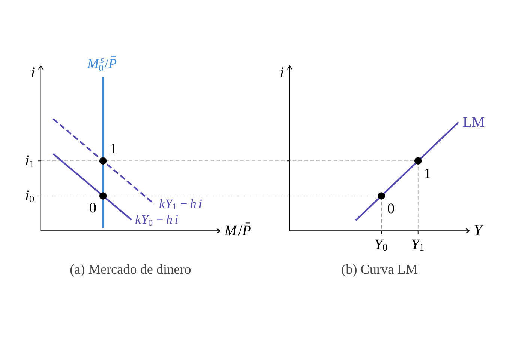
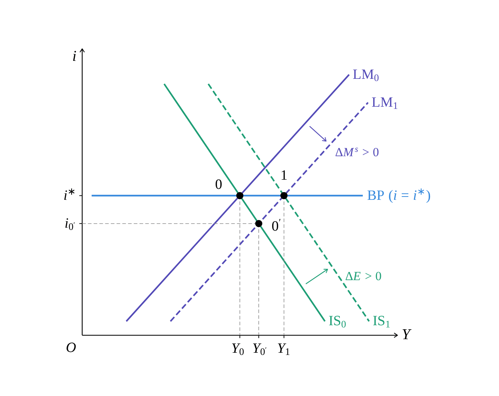
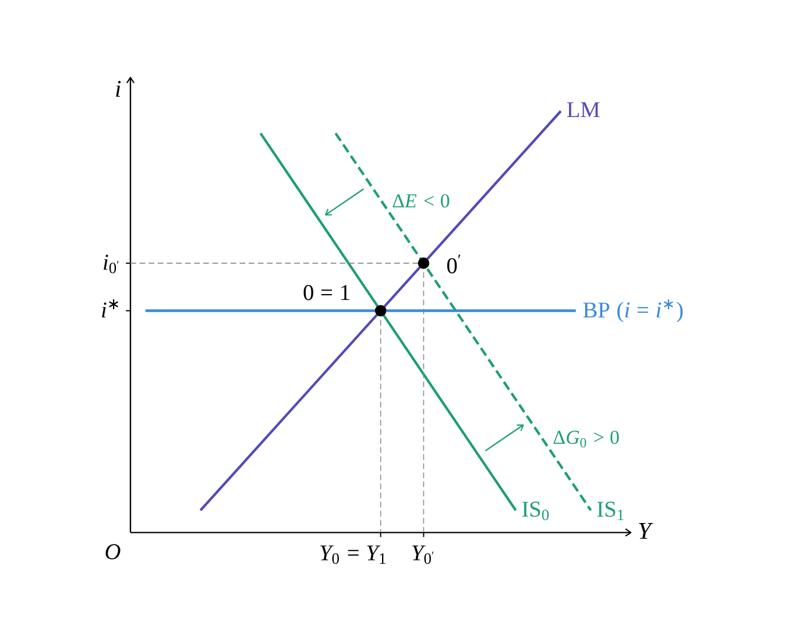
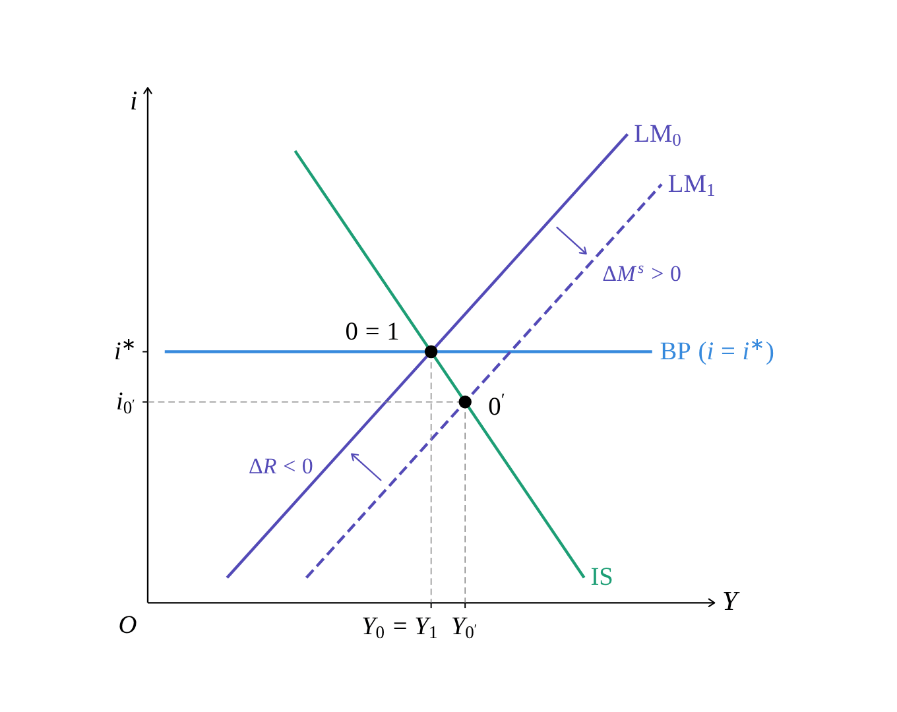
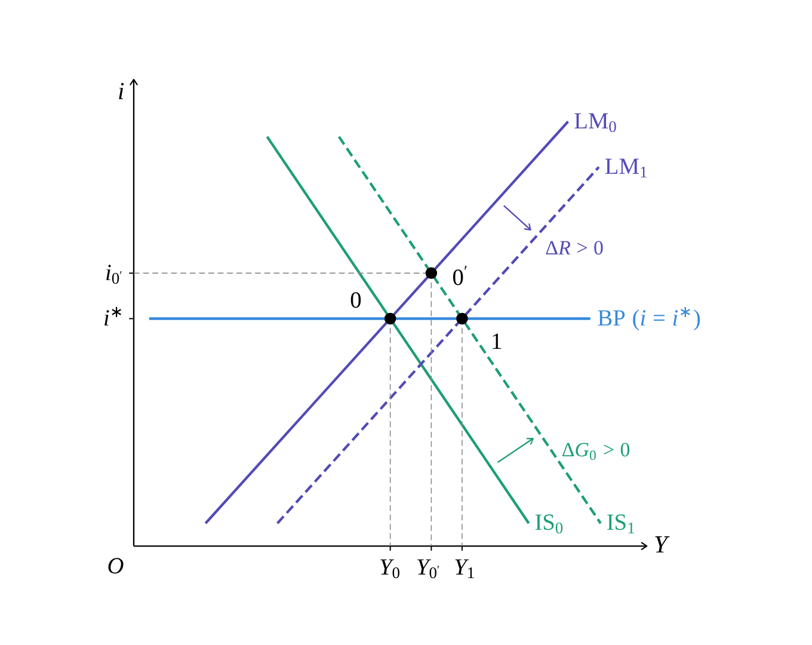
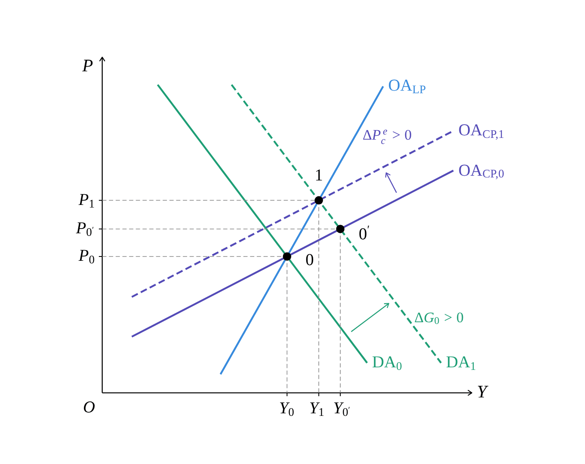
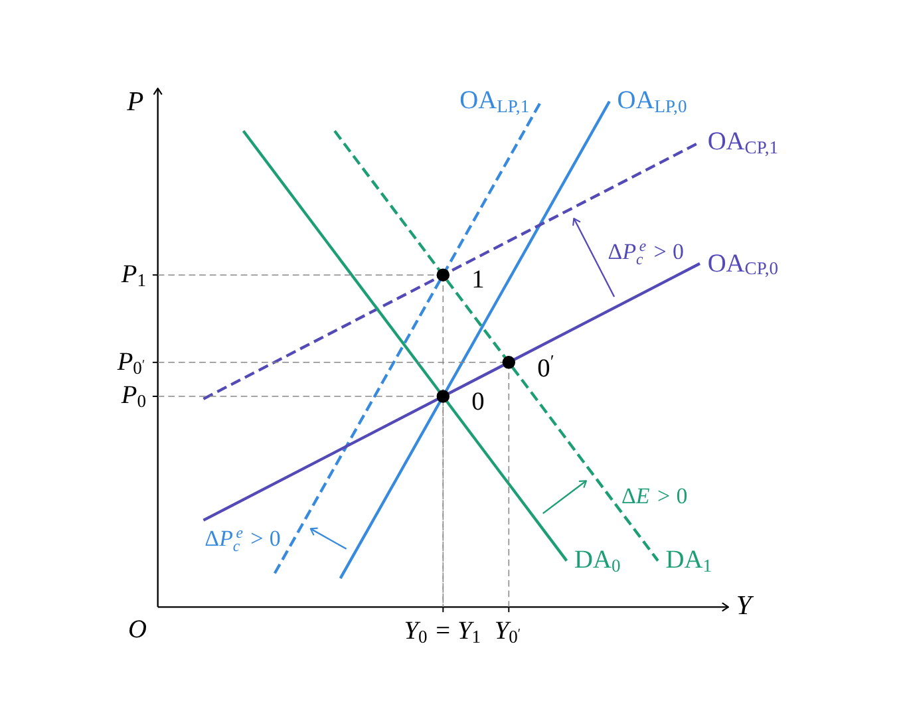
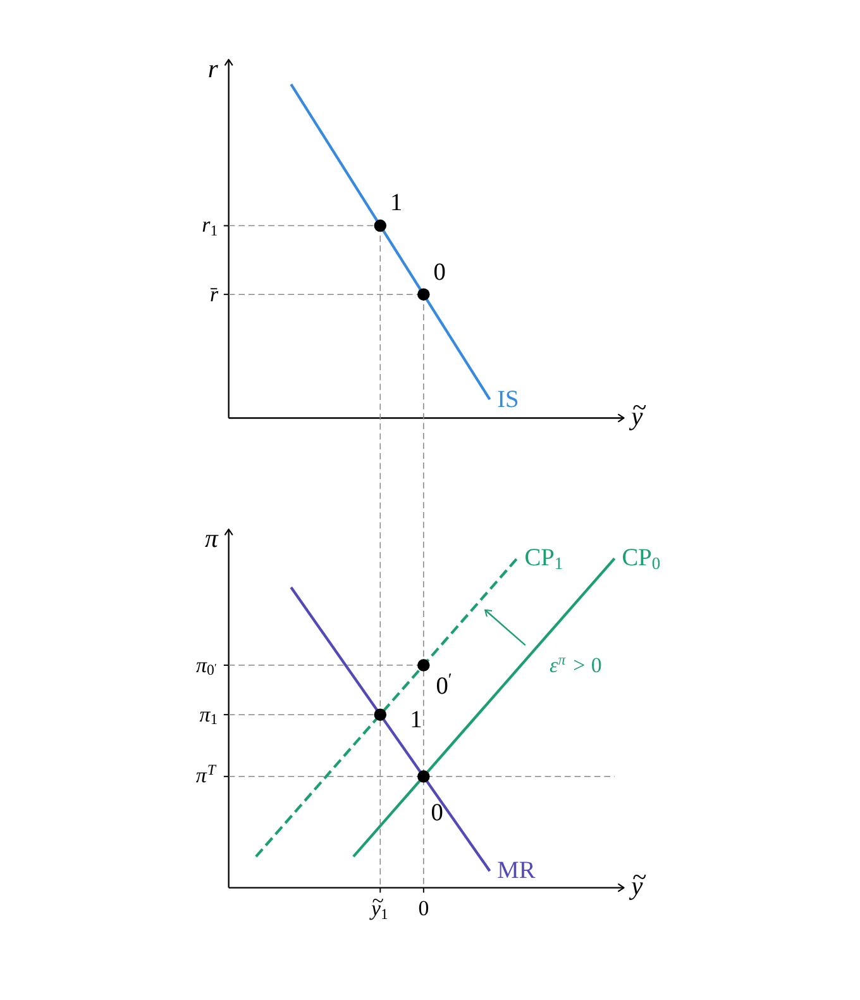
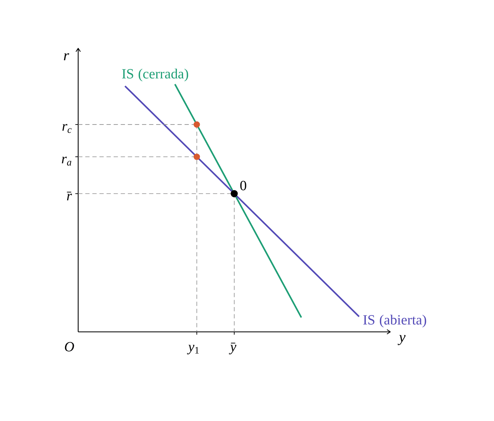

## Introducción

En una economía abierta, la renta y los precios dependen también de lo que ocurre fuera de las fronteras. El grado de **apertura**, comercial y financiera, determina qué parte de la demanda se filtra al exterior a través de las importaciones y cuánto capital entra o sale cuando cambian los tipos de interés. El **tipo de cambio** se convierte así en un precio macroeconómico central, que relaciona los precios interiores con los exteriores y transmite las perturbaciones de un país a otro. Por su parte, el **régimen cambiario** decide qué parte del ajuste recae en el tipo de cambio y qué parte en la renta, el empleo o los precios.

De esa interdependencia se deriva una restricción que condiciona la política macroeconómica de toda economía abierta, el **trilema de Mundell-Fleming** (o trinidad imposible), según el cual un país no puede mantener a la vez un tipo de cambio fijo, la libertad de movimientos de capital y una política monetaria autónoma (tema [B15](b15-regimenes-cambiarios.qmd)). Por ello, la eficacia de las políticas monetaria y fiscal deja de ser una cuestión interior y pasa a depender del régimen cambiario y del grado de movilidad del capital.

El análisis moderno de estas cuestiones arranca a comienzos de los años sesenta, cuando Fleming (1962) y Mundell (1963) extendieron el modelo IS-LM al sector exterior. Ambos mostraron que, con movilidad perfecta del capital, la política monetaria es eficaz con tipos de cambio flexibles y la fiscal con tipos fijos. Más tarde, Dornbusch (1976) combinó expectativas racionales y precios rígidos para explicar la sobrerreacción del tipo de cambio (tema [B14](b14-tipo-cambio.qmd)), y las perturbaciones de oferta de los años setenta llevaron a completar el análisis con la oferta agregada, que determina a la vez la renta y el nivel de precios. Desde los años noventa, la nueva macroeconomía de economía abierta dio microfundamentos a ese esquema, y el modelo neokeynesiano de economía pequeña y abierta de Galí y Monacelli (2005) es hoy la referencia para analizar la política monetaria con una regla de tipos de interés.

La exposición sigue el orden en que se construyó la teoría, que es también el de los horizontes temporales:

- *Demanda agregada con precios dados*: a corto plazo, el modelo IS-LM-BP de Mundell y Fleming hace del sector exterior y del régimen cambiario los determinantes de la eficacia de la política económica.

- *Oferta y demanda agregadas*: la ausencia de oferta y de expectativas en ese modelo lleva al modelo de oferta y demanda agregadas (OA-DA) en economía abierta, que determina a la vez la renta y el nivel de precios y permite analizar las perturbaciones y políticas de oferta.

- *Inflación y brecha de producción*: como el modelo OA-DA es estático y determina el nivel de precios y no la inflación, se completa con el modelo IS-PC-MR, dinámico y con una regla de tipos.

## 1. La demanda agregada en economía abierta: el modelo IS-LM-BP (Fleming, 1962; Mundell, 1963)

**Origen**: el modelo IS-LM-BP, debido a Fleming (1962) y Mundell (1963), es el modelo canónico de la economía abierta a corto plazo.

**Idea**: el modelo extiende el IS-LM de la síntesis neoclásica añadiendo un tercer mercado, el sector exterior, y con él dos elementos nuevos, el tipo de cambio y el régimen cambiario.

::: {.callout-note appearance="simple" icon=false}
El modelo IS-LM en economía cerrada se presenta en el tema [A05](a05-monetaristas-snc.qmd), apartado 1.2.1.
:::

### 1.1. Supuestos

**Entorno**: la economía es abierta y pequeña, y las variables exteriores (nivel de precios, $P^*$, tipo de interés, $i^*$, y renta, $Y^*$) son exógenas. El horizonte es el corto plazo, con precios fijos ($\bar{P}$) e inflación nula ($\pi = 0$), lo que iguala los tipos de interés nominal y real ($i = r$) y hace proporcionales los tipos de cambio nominal y real.

Con precios dados, la demanda determina la producción (la oferta agregada es perfectamente elástica). El *tipo de cambio*, $E$, se define de forma directa, en unidades de moneda nacional por unidad de moneda extranjera, y un aumento de $E$ es una depreciación.

**Agentes**: son neutrales al riesgo (no exigen prima por mantener activos en distintas monedas) y tienen expectativas estáticas sobre el tipo de cambio.

**Mercados**: el modelo incluye los de bienes (IS), dinero (LM) y sector exterior o mercado de divisas (BP). Los flujos de capital responden al diferencial de tipos de interés con una intensidad $\gamma$, que mide la movilidad del capital. En el límite de movilidad perfecta, cuando los bonos nacionales y extranjeros son sustitutivos perfectos, se cumple la paridad de intereses.

**Sector exterior**: la cuenta corriente se identifica con la balanza comercial ($\text{SB}_{\text{CC}} = \text{BC}$), sin rentas primarias ni transferencias, y se cumple la condición Marshall-Lerner ($\varepsilon_X + |\varepsilon_M| > 1$), de modo que una depreciación mejora la balanza comercial[^a32-1]. La cuenta financiera, excluidos los activos de reserva, recoge los flujos autónomos de capital, medidos como entradas netas, con el signo opuesto al del saldo de la cuenta financiera en el Manual de Balanza de Pagos del FMI (MBP6). En régimen de cambio fijo, la variación de reservas ($\Delta R$) cierra la balanza.

::: {.callout-note appearance="simple" icon=false}
La condición Marshall-Lerner, la curva J y el enfoque absorción se desarrollan en el tema [B12](b12-ajuste-bp.qmd), apartado 1; la paridad de intereses, en el tema [B13](b13-mercado-divisas.qmd), apartados 2.2.3 y 2.2.4, y en el tema [B14](b14-tipo-cambio.qmd), apartado 1.3.
:::

### 1.2. Modelo

**Planteamiento**: el modelo se resume en tres condiciones de equilibrio, una por mercado.

#### 1.2.1. Mercado de bienes: curva IS

**Definición**: la *curva IS* es el lugar geométrico de las combinaciones de renta y tipo de interés ($Y$, $r$)[^a32-17] que garantizan el equilibrio en el mercado de bienes, es decir, la igualdad entre producción y demanda agregada, $Y = C + I + G + \text{XN}$. En economía abierta, la demanda agregada incorpora las exportaciones netas o balanza comercial (demanda externa), $\text{XN} \equiv \text{BC}$. Sus ecuaciones de comportamiento son:

- *Consumo*: función keynesiana simple, sin efecto riqueza, $C = C_0 + c\,(1-\tau)\,Y$, donde $C_0$ es el consumo autónomo, $c \in (0, 1)$ la propensión marginal a consumir sobre la renta disponible y $\tau$ el tipo impositivo sobre la renta.

- *Inversión*: $I = I_0 - v\,r$, con un componente autónomo $I_0$ y una sensibilidad $v > 0$ al tipo de interés.

- *Gasto público*: $G = G_0$, exógeno.

- *Balanza comercial*: $\text{BC} = X - M = x\,Y^* - m\,Y + \phi\,e$. Las exportaciones dependen positivamente de la renta exterior (con propensión marginal a exportar $x > 0$) y del *tipo de cambio real*, $e = E P^*/P$. Las importaciones dependen positivamente de la renta nacional (con propensión marginal a importar $m \in (0, 1)$) y negativamente del tipo de cambio real. El parámetro $\phi$ recoge el efecto neto del tipo de cambio real sobre la balanza comercial, positivo bajo la condición Marshall-Lerner. La condición garantiza que los efectos volumen (más exportaciones y menos importaciones) dominen el efecto valoración (las importaciones cuestan más en moneda nacional).

Sustituyendo en la condición de equilibrio y despejando la renta se obtiene la ecuación de la curva IS:

$$Y = \frac{1}{1 - c(1-\tau) + m}\,\big[C_0 + I_0 + G_0 - v\,r + x\,Y^* + \phi\,e\big]$$

**Determinantes**: la expresión tiene dos factores:

- *Multiplicador*: el primero es el *multiplicador de la economía abierta*, $1/[1 - c(1-\tau) + m]$, menor que el de la economía cerrada, $1/[1 - c(1-\tau)]$. Es menor porque a la filtración fiscal ($\tau$) el denominador añade la exterior ($m$, la parte del gasto adicional que se dirige a bienes importados y no genera renta nacional). El multiplicador aumenta con $c$ y disminuye con $\tau$ y con $m$.

- *Gasto autónomo*: el segundo factor suma la demanda autónoma interna ($C_0 + I_0 + G_0$), la externa ($x\,Y^*$ y $\phi\,e$) y el componente que depende del tipo de interés ($-v\,r$), que no es autónomo.

**Desarrollo gráfico**: en el plano $(Y, r)$ (figura -@fig-a329-is-abierta), la IS tiene pendiente negativa, $\partial r/\partial Y = -[1 - c(1-\tau) + m]/v < 0$, porque una bajada del tipo de interés estimula la inversión y, a través del multiplicador, eleva la renta de equilibrio. La IS es tanto más inclinada cuanto menores son $v$ y el multiplicador, y el *efecto filtración* de las importaciones ($m > 0$) la hace más inclinada que la de la economía cerrada. Por eso, la misma bajada del tipo de interés, de $r_0$ a $r_1$, lleva la economía del punto 0 al 1 y eleva la renta solo hasta $Y_1$, frente a $Y_1^{\text{c}}$ sobre la IS (cerrada).

::: {#fig-a329-is-abierta}

::: {.content-visible when-format="html"}
```{=html}
<div class="graph-frame">
<iframe src="../graphs/a329_IS_abierta.html" style="height:580px" loading="lazy" title="fig-a329-is-abierta"></iframe>
</div>
```
:::

::: {.content-visible unless-format="html"}

:::

Curva IS en economía abierta. La filtración de las importaciones reduce el multiplicador y hace la IS más inclinada que la de la economía cerrada, de modo que la misma bajada del tipo de interés, de $r_0$ a $r_1$, eleva menos la renta ($Y_1 < Y_1^{\text{c}}$).
:::

**Estática comparativa**:

- *Cambios de posición* (variables autónomas): desplazan la IS a la derecha los aumentos de $C_0$, $I_0$, $G_0$ e $Y^*$ y una depreciación real ($\uparrow e$), y a la izquierda, los movimientos contrarios.

- *Cambios de pendiente* (parámetros): una subida de $\tau$, por ejemplo, reduce el multiplicador y hace rotar la IS hacia dentro.

#### 1.2.2. Mercado de dinero: curva LM

**Definición**: la *curva LM* es el lugar geométrico de las combinaciones de renta y tipo de interés ($Y$, $i$) que garantizan el equilibrio en el mercado de dinero, es decir, la igualdad entre la oferta real de dinero y la demanda de saldos reales:

$$\frac{M^s_0}{\bar{P}} = k\,Y - h\,i \quad \Rightarrow \quad i = \frac{1}{h}\left(k\,Y - \frac{M^s_0}{\bar{P}}\right)$$

**Determinantes**:

- *Demanda de dinero*: depende positivamente de la renta a través de $k$ (motivos transacción y precaución) y negativamente del tipo de interés a través de $h$ (motivo especulación), como se desarrolla en el tema [A35](a35-demanda-dinero.qmd).

- *Oferta de dinero*: la oferta monetaria nominal la fija el banco central y, con precios fijos, la oferta real queda determinada. Con tipo fijo, sin embargo, $M^s$ tiene un componente endógeno que depende del saldo de la balanza de pagos. Un superávit expande la base monetaria, porque el banco central compra divisas, y un déficit la contrae, salvo que el banco central esterilice[^a32-4]. En cambio, con tipo flexible, $M^s$ es exógena.

**Desarrollo gráfico**: la derivación de la curva LM se representa en el plano saldos reales-tipo de interés y en el plano $(Y, i)$, que comparten el eje vertical (figura -@fig-a3210-lm, paneles a y b):

1. *Oferta real de dinero* $M^s_0/\bar{P}$: es vertical, porque la fija el banco central y los precios están dados.

2. *Demanda de saldos reales* $kY - h\,i$: es decreciente en el tipo de interés y, al crecer la renta de $Y_0$ a $Y_1$, se desplaza de $kY_0 - h\,i$ a $kY_1 - h\,i$ por el motivo transacción.

3. *Equilibrio y curva LM*: con una oferta real dada, el equilibrio del mercado de dinero pasa del punto 0 al 1 solo si el tipo de interés sube de $i_0$ a $i_1$. La LM une esos pares de renta y tipo de interés en el panel (b), con pendiente positiva, $\partial i/\partial Y = k/h > 0$. La apertura no altera la pendiente, solo el control de la oferta.

::: {#fig-a3210-lm}

::: {.content-visible when-format="html"}
```{=html}
<div class="graph-frame wide">
<iframe src="../graphs/a3210_LM.html" style="--r:1.478" loading="lazy" title="fig-a3210-lm"></iframe>
</div>
```
:::

::: {.content-visible unless-format="html"}

:::

Derivación de la curva LM. Con una oferta real de dinero dada, el aumento de la renta de $Y_0$ a $Y_1$ eleva la demanda de saldos reales y exige un tipo de interés más alto, $i_1$, para mantener el equilibrio del mercado de dinero.
:::

**Estática comparativa**:

- *Cambios de posición*: un aumento de $M^s$ desplaza la LM a la derecha, y una contracción monetaria, a la izquierda.

- *Cambios de pendiente*: una mayor sensibilidad de la demanda de dinero a la renta ($\uparrow k$) hace la LM más rígida, mientras que una mayor sensibilidad al tipo de interés ($\uparrow h$) la hace más plana.

#### 1.2.3. Sector exterior: curva BP

**Definición**: la *curva BP* es el lugar geométrico de las combinaciones de renta y tipo de interés ($Y$, $i$) compatibles con el *equilibrio externo*, es decir, con un saldo nulo de la balanza de pagos, suma de la cuenta corriente y la cuenta financiera:

$$\begin{aligned} \text{BP} &= \underbrace{(x\,Y^* - m\,Y + \phi\,e)}_{\text{SB}_{\text{CC}}}\; + \;\underbrace{\gamma\,(i - i^*)}_{\text{entradas netas de capital}} = 0 \\ &\Rightarrow\; i = \frac{1}{\gamma}\big[m\,Y - x\,Y^* - \phi\,e\big] + i^* \end{aligned}$$

**Determinantes**:

- *Cuenta corriente*: es la balanza comercial, con los mismos determinantes que en la IS.

- *Cuenta financiera*: recoge las entradas netas de capital, que crecen con el diferencial de tipos de interés, $i - i^*$, según la movilidad del capital, $\gamma \geq 0$.

- *Desequilibrios*: los puntos por encima de la curva representan superávit de la balanza de pagos (el tipo de interés atrae más capital del preciso para financiar la cuenta corriente), y los puntos por debajo, déficit.

**Desarrollo gráfico**: en el plano $(Y, i)$ (figura -@fig-a3211-bp), la BP tiene pendiente $\partial i/\partial Y = m/\gamma \geq 0$. Como las importaciones crecen con la renta, cada aumento de esta empeora la balanza comercial, y solo un tipo de interés más alto, que atraiga capital, restablece el equilibrio externo (paso de 0 a 1 en el panel a). Según la movilidad del capital, se distinguen tres casos (panel b):

1. *Movilidad nula* ($\text{BP}_{\gamma = 0}$): la BP es vertical.

2. *Movilidad imperfecta* ($0 < \gamma < \infty$): la BP tiene pendiente positiva. Hay *alta movilidad* ($\text{BP}_{\text{alta}}$) cuando la BP es más plana que la LM ($m/\gamma < k/h$) y *baja movilidad* ($\text{BP}_{\text{baja}}$) cuando es más inclinada ($m/\gamma > k/h$).

3. *Movilidad perfecta* ($\text{BP}_{\gamma \to \infty}$): la BP es horizontal en $i = i^*$.

::: {#fig-a3211-bp}

::: {.content-visible when-format="html"}
```{=html}
<div class="graph-frame wide">
<iframe src="../graphs/a3211_BP.html" style="--r:1.447" loading="lazy" title="fig-a3211-bp"></iframe>
</div>
```
:::

::: {.content-visible unless-format="html"}

:::

Curva BP. En el panel (a), por encima de la curva hay superávit de balanza de pagos y, por debajo, déficit, y un aumento de la renta exige un tipo de interés más alto para mantener el equilibrio externo. En el panel (b), la BP se aplana al aumentar la movilidad del capital, de vertical con movilidad nula a horizontal en $i^*$ con movilidad perfecta, y es más plana que la LM con movilidad alta y más inclinada con movilidad baja.
:::

**Estática comparativa**:

- *Cambios de posición*: cualquier mejora autónoma de la balanza de pagos, como una depreciación real ($\uparrow e$) o un aumento de $Y^*$, desplaza la BP hacia abajo o a la derecha, y una subida de $i^*$, en cambio, la desplaza hacia arriba. Las medidas que afectan a la cuenta corriente (aranceles, depreciaciones) desplazan la BP y la IS, pues la balanza comercial aparece en ambas.

- *Cambios de pendiente*: una mayor movilidad del capital ($\uparrow \gamma$) aplana la BP, mientras que una mayor propensión a importar ($\uparrow m$) la hace más rígida.

#### 1.2.4. Equilibrio: equilibrio interno y externo

El equilibrio se sitúa donde se cortan las tres curvas y fija tres variables endógenas. Si el tipo de cambio flota, son $Y$, $i$ y el propio tipo de cambio nominal, cuyo lugar ocupa la oferta monetaria si es fijo. En ese punto se cumplen simultáneamente el **equilibrio interno** (mercados de bienes y de dinero) y el equilibrio externo (balanza de pagos).

Gráficamente, en el plano $(Y, i)$ (figura -@fig-a3212-equilibrio-interno-externo), las tres curvas se cortan en el punto 0 del panel (a). Puede darse, sin embargo, equilibrio interno sin equilibrio externo. Si la intersección de IS y LM se sitúa por debajo de la BP, como en el panel (b), hay déficit de balanza de pagos, y si se sitúa por encima, superávit.

::: {#fig-a3212-equilibrio-interno-externo}

::: {.content-visible when-format="html"}
```{=html}
<div class="graph-frame wide">
<iframe src="../graphs/a3212_Equilibrio_interno_externo.html" style="--r:1.447" loading="lazy" title="fig-a3212-equilibrio-interno-externo"></iframe>
</div>
```
:::

::: {.content-visible unless-format="html"}

:::

Equilibrio del modelo IS-LM-BP. En el panel (a), las tres curvas se cortan en el punto 0 y se cumplen a la vez el equilibrio interno y el externo. En el panel (b), la IS y la LM se cortan por debajo de la BP, de modo que hay equilibrio interno con déficit de balanza de pagos.
:::

El modo en que se corrige el desequilibrio depende del régimen cambiario:

- *Tipo de cambio flexible*: la balanza de pagos está siempre en equilibrio, porque el tipo de cambio se ajusta hasta que la oferta y la demanda de divisas se igualan. Un déficit incipiente deprecia la moneda, lo que mejora la balanza comercial (desplaza IS y BP a la derecha) hasta restablecer el equilibrio.

- *Tipo de cambio fijo*: las autoridades deben evitar la depreciación, así que el ajuste recae sobre la oferta monetaria. Un déficit se financia con venta de reservas (que contrae la base monetaria y desplaza la LM a la izquierda) o con endeudamiento exterior. También puede corregirse con medidas de ajuste sobre la balanza comercial (reducción de la absorción, desviación del gasto) o sobre la cuenta financiera[^a32-5].

::: {.callout-note appearance="simple" icon=false}
Las políticas de financiación y ajuste de un desequilibrio exterior (enfoques de elasticidades, absorción y monetario) se desarrollan en el tema [B12](b12-ajuste-bp.qmd); los mecanismos de ajuste propios de cada régimen cambiario, en el tema [B15](b15-regimenes-cambiarios.qmd), apartado 1.4.
:::

### 1.3. Políticas monetaria y fiscal con precios fijos

Los resultados de la política económica dependen del régimen cambiario y del grado de movilidad del capital. Dos políticas, dos regímenes y cuatro grados de movilidad (perfecta, alta, baja y nula) dan dieciséis casos. Los cuatro casos de referencia suponen perfecta movilidad del capital, la más próxima a la realidad de las economías avanzadas, y después se generalizan a movilidad imperfecta. Por último, se tratan el país grande y el trilema de Mundell-Fleming.

#### 1.3.1. Tipo de cambio flexible

**Política monetaria expansiva** (**eficaz**): en el plano $(Y, i)$ (figura -@fig-a322-pm-expansiva-flexible), el aumento de la oferta monetaria ($\Delta M^s > 0$) tiene un *efecto expansivo interno* que reduce el tipo de interés y estimula la inversión. La LM se desplaza de $\text{LM}_0$ a $\text{LM}_1$ y la economía pasa del punto 0 al 0′, con $i_{0'} < i^*$. Al efecto interno le sigue un *efecto expansivo externo*. La salida de capital deprecia la moneda ($\Delta E > 0$), y la depreciación mejora la balanza comercial (la IS se desplaza de $\text{IS}_0$ a $\text{IS}_1$) hasta que el tipo de interés vuelve a igualarse con el exterior en el punto 1. En el equilibrio final la inversión recupera su nivel inicial y todo el aumento de la renta, de $Y_0$ a $Y_1$, descansa en las exportaciones netas. La política monetaria es plenamente eficaz por la depreciación que induce.

::: {#fig-a322-pm-expansiva-flexible}

::: {.content-visible when-format="html"}
```{=html}
<div class="graph-frame">
<iframe src="../graphs/a322_PM_expansiva_flexible.html" style="height:580px" loading="lazy" title="fig-a322-pm-expansiva-flexible"></iframe>
</div>
```
:::

::: {.content-visible unless-format="html"}

:::

Mundell-Fleming con tipo de cambio flexible. La expansión monetaria deprecia la moneda y es plenamente eficaz.
:::

**Política fiscal expansiva** (**ineficaz**): en el plano $(Y, i)$ (figura -@fig-a321-pf-expansiva-flexible), el aumento del gasto público ($\Delta G_0 > 0$) tiene un efecto expansivo interno que eleva la renta y, con ella, la demanda de dinero y el tipo de interés. La IS se desplaza de $\text{IS}_0$ a $\text{IS}_1$ y la economía pasa del punto 0 al 0′, con $i_{0'} > i^*$. Al efecto interno le sigue un *efecto contractivo externo*. La entrada de capital aprecia la moneda ($\Delta E < 0$), y la apreciación deteriora la balanza comercial (la IS retrocede) hasta que el tipo de interés vuelve a igualarse con el exterior. Con perfecta movilidad, el retroceso es completo. En el equilibrio final, 1, la renta vuelve a su nivel inicial ($Y_0 = Y_1$) y el gasto público ha desplazado íntegramente a las exportaciones netas, con lo que el efecto expulsión (*crowding out*) exterior es pleno.

::: {#fig-a321-pf-expansiva-flexible}

::: {.content-visible when-format="html"}
```{=html}
<div class="graph-frame">
<iframe src="../graphs/a321_PF_expansiva_flexible.html" style="height:580px" loading="lazy" title="fig-a321-pf-expansiva-flexible"></iframe>
</div>
```
:::

::: {.content-visible unless-format="html"}

:::

Mundell-Fleming con tipo de cambio flexible y perfecta movilidad de capitales. La expansión fiscal aprecia la moneda y es ineficaz sobre la renta.
:::

#### 1.3.2. Tipo de cambio fijo

Los resultados se invierten, porque el ajuste de la balanza de pagos recae ahora sobre la oferta monetaria.

**Política monetaria expansiva** (**ineficaz**): en el plano $(Y, i)$ (figura -@fig-a324-pm-expansiva-fija), la expansión ($\Delta M^s > 0$) desplaza la LM de $\text{LM}_0$ a $\text{LM}_1$ y presiona a la baja el tipo de interés (punto 0′, con $i_{0'} < i^*$). La bajada provoca una salida de capital y presiona la moneda hacia la depreciación. Para defender la paridad, el banco central vende reservas ($\Delta R < 0$) y contrae la oferta monetaria hasta que la LM vuelve a $\text{LM}_0$. En el equilibrio final, 1, la renta no varía ($Y_0 = Y_1$) y el único efecto es una pérdida de reservas. Por tanto, con tipo de cambio fijo y libre movilidad de capital, el banco central pierde el control de la oferta monetaria.

::: {#fig-a324-pm-expansiva-fija}

::: {.content-visible when-format="html"}
```{=html}
<div class="graph-frame">
<iframe src="../graphs/a324_PM_expansiva_fija.html" style="height:580px" loading="lazy" title="fig-a324-pm-expansiva-fija"></iframe>
</div>
```
:::

::: {.content-visible unless-format="html"}

:::

Mundell-Fleming con tipo de cambio fijo. La expansión monetaria provoca pérdida de reservas y es ineficaz.
:::

**Política fiscal expansiva** (**eficaz**): en el plano $(Y, i)$ (figura -@fig-a323-pf-expansiva-fija), el estímulo ($\Delta G_0 > 0$) desplaza la IS de $\text{IS}_0$ a $\text{IS}_1$, eleva la renta y presiona al alza el tipo de interés (punto 0′, con $i_{0'} > i^*$). La subida atrae capital y presiona la moneda hacia la apreciación. Para defender la paridad, el banco central compra divisas ($\Delta R > 0$) y expande la oferta monetaria (la LM se desplaza de $\text{LM}_0$ a $\text{LM}_1$) hasta que el tipo de interés vuelve al nivel exterior en el punto 1. Como el tipo de interés no sube, no hay expulsión de la inversión y la renta aumenta en todo el efecto multiplicador del gasto público, de $Y_0$ a $Y_1$, y la política fiscal es así plenamente eficaz.

::: {#fig-a323-pf-expansiva-fija}

::: {.content-visible when-format="html"}
```{=html}
<div class="graph-frame">
<iframe src="../graphs/a323_PF_expansiva_fija.html" style="height:580px" loading="lazy" title="fig-a323-pf-expansiva-fija"></iframe>
</div>
```
:::

::: {.content-visible unless-format="html"}

:::

Mundell-Fleming con tipo de cambio fijo. La expansión fiscal obliga a una expansión monetaria acomodaticia y es plenamente eficaz.
:::

#### 1.3.3. Movilidad imperfecta del capital: los dieciséis casos

Con movilidad imperfecta, el signo del saldo de la balanza de pagos tras una expansión fiscal depende de la pendiente relativa de la BP y la LM. Con alta movilidad domina la entrada de capital y hay superávit, mientras que con baja movilidad domina el deterioro comercial y hay déficit. Una expansión monetaria, por el contrario, genera déficit con cualquier grado de movilidad, pues reduce el tipo de interés y eleva la renta.

- *Tipo de cambio flexible*: la política monetaria es siempre eficaz (con movilidad nula, por el canal de la inversión) y tanto más cuanto mayor es la movilidad del capital, porque mayor es la depreciación que induce. La eficacia de la política fiscal disminuye con la movilidad, porque con movilidad nula o baja el déficit comercial deprecia la moneda y refuerza el estímulo. Con alta movilidad, en cambio, la entrada de capital aprecia la moneda y lo compensa en parte (con movilidad perfecta, por completo).

- *Tipo de cambio fijo*: la política monetaria es ineficaz con cualquier grado de movilidad, salvo esterilización transitoria, porque el déficit que genera obliga a revertirla. La política fiscal, en cambio, es eficaz siempre que exista alguna movilidad del capital, y tanto más cuanto mayor es esta. Con alta movilidad, el superávit expande la oferta monetaria y refuerza el estímulo, y con baja movilidad el déficit la contrae y lo compensa en parte. Con movilidad nula, la renta queda anclada por el equilibrio comercial (la BP es vertical) y la contracción monetaria inducida anula el estímulo.

En suma, el régimen cambiario decide qué política es eficaz y la movilidad del capital decide cuánto. Con perfecta movilidad, además, ambas políticas son alternativas y no complementarias.

| Movilidad del capital | Flexible: política monetaria | Flexible: política fiscal | Fijo: política monetaria | Fijo: política fiscal |
|---|---|---|---|---|
| Nula ($\gamma = 0$) | Eficaz (mín.) | Eficaz (máx.) | Ineficaz | Ineficaz |
| Baja (BP más inclinada que LM) | Eficaz | Eficaz | Ineficaz | Poco eficaz |
| Alta (BP más plana que LM) | Muy eficaz | Poco eficaz | Ineficaz | Muy eficaz |
| Perfecta ($\gamma \rightarrow \infty$) | Eficaz (máx.) | Ineficaz | Ineficaz | Eficaz (máx.) |

: Eficacia de las políticas monetaria y fiscal según el régimen cambiario y la movilidad del capital. {#tbl-a32-dieciseis-casos}

#### 1.3.4. País grande y trilema de Mundell-Fleming

::: {.callout-note appearance="simple" icon=false}
Los efectos desbordamiento entre economías grandes se desarrollan en el tema [B19](b19-coordinacion.qmd), apartado 1.2.2, y la coordinación internacional de políticas, en ese mismo tema.
:::

**País grande**: si la actividad de la economía afecta a la del resto del mundo, aparecen efectos desbordamiento. Son positivos en la política fiscal expansiva (*efecto locomotora*, vía demanda de importaciones) y negativos en la monetaria expansiva con tipo flexible y perfecta movilidad (*empobrecimiento del vecino*, vía depreciación competitiva), que puede desembocar en guerras de divisas[^a32-6].

**Trilema de Mundell-Fleming** o trinidad imposible: es imposible lograr simultáneamente un tipo de cambio fijo, la perfecta movilidad del capital y una política monetaria independiente. Cada combinación obliga a renunciar al tercer vértice:

- *Tipo fijo y libre movilidad*: fijar un tipo de interés distinto del exterior comprometería la paridad, de modo que se renuncia a la política monetaria (Hong Kong).

- *Política monetaria independiente y libre movilidad*: se renuncia al tipo fijo (Estados Unidos).

- *Tipo fijo y política monetaria independiente*: se renuncia a la libre movilidad mediante controles de capital (China durante décadas).

El trilema está en línea con la regla de Tinbergen, según la cual el número de objetivos no puede superar el de instrumentos independientes.

::: {.callout-note appearance="simple" icon=false}
El trilema como criterio de elección del régimen cambiario se desarrolla en el tema [B15](b15-regimenes-cambiarios.qmd), apartado 1.1, y como aplicación de la regla de Tinbergen, en el tema [B17](b17-crisis-bp.qmd), apartado 1.5.
:::

### 1.4. Conclusiones

**Aspectos positivos**: el modelo IS-LM-BP tiene utilidad pedagógica por su simplicidad y ofrece la intuición fundamental del corto plazo en economía abierta. Asimismo, sus resultados siguen siendo la referencia con la que la Parte B razona la elección de régimen cambiario, las crisis de balanza de pagos y la integración monetaria.

**Limitaciones**: las críticas se agrupan en tres categorías:

- *Metodológicas*: es un análisis de equilibrio general incompleto, que ignora los efectos de la acumulación de activos exteriores y de deuda pública sobre la riqueza. Es, además, estático, sin dinámica del ajuste ni retardos, y está sujeto a la crítica de Lucas, pues mezcla parámetros estructurales con coeficientes de forma reducida que cambian con el régimen de política.

- *De especificación*: prescinde de la oferta agregada, con lo que solo puede explicar el nivel de renta y no el de precios. Prescinde también de las expectativas (de precios y de tipo de cambio) que, como muestra la paridad de intereses, gobiernan los flujos de capital. Por último, hace de los tipos de interés y de cambio los únicos nexos entre el sector real y el nominal.

- *Empíricas*: la evidencia de panel de Ilzetzki, Mendoza y Végh (2013) respalda la predicción del modelo sobre la política fiscal (multiplicador relativamente elevado con tipo fijo y nulo o reducido con tipo flexible). Sin embargo, muestra que la magnitud del multiplicador depende de factores que el modelo ignora, como el nivel de desarrollo o de deuda pública (tema [A40](a40-interrelacion.qmd), apartado 3.2).

## 2. El modelo OA-DA en economía abierta: determinación de la renta y los precios

**Origen**: el esquema de oferta y demanda agregadas se consolida como herramienta docente en los años setenta, cuando las perturbaciones de oferta hicieron insuficiente el modelo IS-LM, que suponía precios constantes. La oferta agregada se fundamenta en la función de Lucas, de la nueva macroeconomía clásica (NMC), o en el modelo de negociación de Layard y Nickell, de la nueva economía keynesiana (NEK) de primera generación (NEK1G). La versión de economía abierta que aquí se sigue es la de Bajo y Monés (2000).

**Idea**: el modelo de oferta y demanda agregadas levanta el supuesto de precios fijos y determina simultáneamente la renta y el nivel de precios.

### 2.1. Supuestos

El modelo mantiene los supuestos del IS-LM-BP (país pequeño, neutralidad al riesgo, Marshall-Lerner) salvo el de precios fijos y añade otros sobre la formación de precios y expectativas.

**Entorno**: la economía es abierta y pequeña, con horizonte de medio plazo y flexibilidad de precios y salarios. La movilidad del capital es alta, pero no perfecta, de modo que el tipo de interés nacional puede separarse transitoriamente del exterior. Coexisten dos índices de precios. El deflactor del PIB, $P$, recoge solo los bienes de producción nacional. El índice de precios de consumo, $P_c$, incluye además los bienes importados, que se suponen sustitutivos imperfectos de los nacionales, y se define como media geométrica ponderada:

$$P_c = P^{\sigma}\,(E\,P^*)^{1-\sigma}, \qquad \sigma \in (0, 1)$$

donde $\sigma$ es el peso de los bienes nacionales en la cesta de consumo, y el valor esperado del IPC es $P_c^e = (P^e)^{\sigma}(E^e P^{*e})^{1-\sigma}$[^a32-7]. Las empresas solo emplean *inputs* nacionales, lo que aísla el efecto del tipo de cambio sobre la oferta de trabajo (el efecto sobre los costes se analiza con el *shock* de precios energéticos).

**Agentes**: el modelo descansa en una asimetría entre empresas y trabajadores. Las empresas contratan según el deflactor, pues venden solo bienes nacionales, mientras que los trabajadores negocian y deciden su oferta de trabajo según el IPC esperado, pues consumen también bienes importados. La formación de expectativas depende de la escuela, con expectativas racionales y problema de extracción de señales en la NMC e inercia nominal en la fijación de precios y salarios en la NEK1G.

### 2.2. Modelo

**Planteamiento**: el modelo combina una demanda agregada común a ambas escuelas y una oferta agregada cuya fundamentación difiere según la escuela.

#### 2.2.1. Demanda agregada

**Definición**: la *demanda agregada* es el lugar geométrico de las combinaciones de renta y nivel de precios ($Y$, $P$) que garantizan el equilibrio simultáneo en los mercados de bienes y de dinero. Se obtiene introduciendo la LM en la IS del modelo IS-LM-BP y haciendo endógeno el nivel de precios, que ya aparecía a través de los saldos reales, del tipo de cambio real y, vía efecto Fisher, del tipo de interés real:

$$Y^d = \text{DA}\big(\underbrace{A_0^{+},\, M^{s+}_0,\, P^{e+},\, \tau^{-},\, P^{-}}_{\text{economía cerrada}};\;\underbrace{Y^{*+},\, E^{+},\, P^{*+}}_{\text{apertura}}\big)$$

**Determinantes**:

- *Positivos*: el gasto autónomo ($A_0$), la oferta monetaria ($M^s_0$), el nivel de precios esperado ($P^e$) y las variables exteriores ($Y^*$, $E$, $P^*$), pues cualquier mejora de la balanza comercial favorece la demanda de bienes nacionales.

- *Negativos*: el tipo impositivo ($\tau$) y el nivel de precios ($P$). Un aumento de $P^e$, en cambio, estimula la demanda por el efecto Fisher, pues para un tipo nominal dado reduce el tipo de interés real esperado.

**Desarrollo gráfico**: en el plano $(Y, P)$ (figura -@fig-a3213-da-abierta), la DA tiene pendiente negativa por dos canales. En el canal del tipo de interés (efecto Keynes), común a la economía cerrada, un mayor $P$ reduce la oferta real de dinero, eleva el tipo de interés y contrae la inversión. En el canal del tipo de cambio real, propio de la economía abierta, un mayor $P$ aprecia el tipo de cambio real ($E P^*/P$ cae) y deteriora la balanza comercial. Por este segundo canal, la DA de economía abierta es más elástica (más plana) que la de economía cerrada. Por eso, la misma subida del nivel de precios, de $P_0$ a $P_1$, lleva la economía del punto 0 al 1 y reduce más la demanda que sobre la DA (cerrada) ($Y_1 < Y_1^{\text{c}}$).

::: {#fig-a3213-da-abierta}

::: {.content-visible when-format="html"}
```{=html}
<div class="graph-frame">
<iframe src="../graphs/a3213_DA_abierta.html" style="height:550px" loading="lazy" title="fig-a3213-da-abierta"></iframe>
</div>
```
:::

::: {.content-visible unless-format="html"}

:::

Demanda agregada en economía abierta. Al canal del tipo de interés se suma el del tipo de cambio real, de modo que la DA es más plana que la de la economía cerrada y la misma subida del nivel de precios, de $P_0$ a $P_1$, reduce más la demanda ($Y_1 < Y_1^{\text{c}}$).
:::

**Estática comparativa**:

- *Cambios de posición*: desplazan la DA los determinantes distintos de $P$, en el sentido de su signo.

- *Cambios de pendiente*: dependen de los parámetros de la IS y la LM (multiplicador, $v$, $h$, $k$) y del grado de apertura. Cuanto mayor es el peso de los bienes importados (menor $\sigma$), más sensible es la demanda al tipo de cambio real y más plana la DA.

#### 2.2.2. Oferta agregada de la NMC (Lucas, 1972-1975)

**Definición**: en economía cerrada, la función de oferta de Lucas es $y_t = \bar{y}_t + \zeta\,(p_t - p_t^e) + \varepsilon_t^s$, con $\zeta > 0$. Solo las sorpresas de precios afectan al *output*, de modo que la oferta agregada a largo plazo, cuando $P = P^e$, es vertical. En economía abierta la función de oferta incorpora, junto a las variables de la economía cerrada, las que determinan el IPC esperado:

$$Y^s = \text{OA}\big(K^{+},\, P^{+},\, P^{e-};\; E^{e-},\, P^{*e-}\big) \quad\Leftrightarrow\quad Y^s = \text{OA}\big(K^{+},\, (P/P_c^e)^{+}\big)$$

**Determinantes**:

- *Positivos*: la capacidad productiva ($K$), que amplía la producción para cualquier nivel de empleo, y el nivel de precios ($P$), que reduce el salario real que pagan las empresas.

- *Negativos*: el nivel de precios esperado ($P^e$) y el componente importado del IPC esperado ($E^e$, $P^{*e}$). Los tres elevan el IPC esperado y, con él, el salario nominal que exigen los trabajadores para cualquier nivel de empleo, lo que reduce el empleo de equilibrio y la oferta.

**Desarrollo gráfico**: en el plano empleo-salario nominal y en el plano $(Y, P)$ (figura -@fig-a3214-oa-nmc, paneles a y b), la OA tiene pendiente positiva en cualquier horizonte. Su origen está en el mercado de trabajo del panel (a), donde las empresas demandan trabajo según $w/P$ y los trabajadores lo ofrecen según $w/P_c^e$. Considérese un aumento del nivel de precios nacional perfectamente anticipado ($\Delta p = \Delta p^e$, en logaritmos), con $E^e$ y $P^{*e}$ dados:

1. *Demanda de trabajo* ($L^d_0$): el salario real para las empresas cae en $\Delta p$, lo que eleva la demanda de trabajo (la curva se desplaza hacia arriba en $\Delta p$, hasta $L^d_1$).

2. *Oferta de trabajo* ($L^s_0$): el IPC esperado solo sube $\Delta p_c^e = \sigma\,\Delta p^e < \Delta p$, ya que los bienes importados, una fracción $1-\sigma$ de lo que consumen los trabajadores, mantienen su precio. La curva sube solo $\sigma\,\Delta p$, hasta $L^s_1$, y la oferta de trabajo retrocede menos de lo que avanza la demanda.

3. *Equilibrio*: pasa del punto 0 al 1, con un aumento neto del empleo (de $L_0$ a $L_1$) y de la producción (de $Y_0$ a $Y_1$ en el panel b), de modo que la OA tiene pendiente positiva incluso sin sorpresas de precios[^a32-8].

    - *Largo plazo*: en economía abierta no existe un único nivel de empleo y producción determinado por la tecnología, sino tantos como niveles del tipo de cambio real, y las fluctuaciones del tipo de cambio real alteran la tasa natural de paro. Por eso, la $\text{OA}_{\text{LP}}$ no es vertical como la OA (cerrada).

    - *Corto plazo*: con $K$ dado y con errores de expectativas por el problema de extracción de señales, la $\text{OA}_{\text{CP}}$ es más plana que la $\text{OA}_{\text{LP}}$, como en la economía cerrada.

::: {#fig-a3214-oa-nmc}

::: {.content-visible when-format="html"}
```{=html}
<div class="graph-frame wide">
<iframe src="../graphs/a3214_OA_NMC.html" style="--r:1.447" loading="lazy" title="fig-a3214-oa-nmc"></iframe>
</div>
```
:::

::: {.content-visible unless-format="html"}

:::

Oferta agregada de la NMC en economía abierta. En el panel (a), un aumento anticipado del nivel de precios desplaza la demanda de trabajo en $\Delta p$ y la oferta solo en $\sigma\,\Delta p$, y el empleo aumenta de $L_0$ a $L_1$. En el panel (b), la oferta agregada tiene pendiente positiva también a largo plazo, frente a la vertical de la economía cerrada, y es más plana a corto plazo.
:::

**Estática comparativa**: los aumentos de capacidad productiva ($\uparrow K$) desplazan la OA a la derecha, y los del IPC esperado, que elevan las demandas salariales, a la izquierda.

::: {.callout-note appearance="simple" icon=false}
La función de oferta de Lucas y el problema de extracción de señales se desarrollan en el tema [A06](a06-nmc.qmd), apartado 2.1, y en el tema [A42](a42-ciclos.qmd), apartado 2.1.
:::

#### 2.2.3. Oferta agregada de la NEK1G (Layard y Nickell, 1985)

**Definición**: se parte del modelo de negociación con una ecuación de salarios, la del salario real negociado, $\text{SRN}: w/P_c^e = f(u^{-}, z^{+})$, que en economía abierta se fija en términos del IPC esperado. La otra ecuación, de precios, es la del salario real pagado, $\text{SRP}: w/P = A_L/(1+\mu)$, que las empresas fijan en términos del deflactor. La oferta agregada resultante es:

$$Y^s = \text{OA}\big(A_L^{+},\, P^{+},\, P^{e-},\, \mu^{-},\, z^{-};\; E^{e-},\, P^{*e-}\big)$$

**Determinantes**:

- *Positivos*: la productividad del trabajo ($A_L$), que eleva el salario real que las empresas están dispuestas a pagar para cualquier nivel de empleo, y el nivel de precios ($P$).

- *Negativos*: el nivel de precios esperado ($P^e$), el margen empresarial ($\mu$), los factores institucionales que elevan el poder de negociación sindical ($z$, como las prestaciones, el salario mínimo o la cuña fiscal) y el componente importado del IPC esperado ($E^e$, $P^{*e}$).

**Desarrollo gráfico**: en el plano empleo-salario real y en el plano $(Y, P)$ (figura -@fig-a3215-oa-nek1g, paneles a y b), la OA tiene pendiente positiva por un mecanismo análogo al de la NMC. La NEK, sin embargo, incorpora poder de mercado ($\mu$, $z$) y rigideces reales, mientras que la NMC supone competencia perfecta. A corto plazo, la inercia nominal en salarios y precios genera pendiente positiva, porque ante un exceso de demanda las empresas aumentan la producción antes de que los precios se ajusten. A largo plazo, la asimetría deflactor/IPC la mantiene positiva:

1. *Salario real pagado* (SRP): es horizontal en $A_L/(1+\mu)$, porque las empresas trasladan íntegramente el salario a los precios, de modo que el salario real en términos del deflactor queda fijado por el margen.

2. *Salario real negociado* ($\text{SRN}_0$): es creciente, porque el aumento del empleo eleva las reivindicaciones salariales. Como el IPC esperado sube menos que el deflactor, la subida de $P$ reduce $P_c^e/P$ y desplaza hacia abajo el SRN expresado en términos del deflactor, hasta $\text{SRN}_1$. El salario fijado por el SRP compra más en términos del IPC, y los trabajadores aceptan un mayor empleo.

3. *Equilibrio*: pasa del punto 0 al 1, de modo que el empleo pasa de $L_0$ a $L_1$ y la producción, de $Y_0$ a $Y_1$ en el panel (b), sobre una $\text{OA}_{\text{LP}}$ de pendiente positiva y más inclinada que la $\text{OA}_{\text{CP}}$.

::: {#fig-a3215-oa-nek1g}

::: {.content-visible when-format="html"}
```{=html}
<div class="graph-frame wide">
<iframe src="../graphs/a3215_OA_NEK1G.html" style="--r:1.447" loading="lazy" title="fig-a3215-oa-nek1g"></iframe>
</div>
```
:::

::: {.content-visible unless-format="html"}

:::

Oferta agregada de la NEK1G en economía abierta. En el panel (a), la subida del nivel de precios reduce el cociente entre el IPC esperado y el deflactor, desplaza hacia abajo el SRN expresado en términos del deflactor y eleva el empleo de equilibrio para un SRP dado. En el panel (b), la oferta agregada tiene, por ello, pendiente positiva también a largo plazo.
:::

**Estática comparativa**: los determinantes distintos de $P$ desplazan la OA en el sentido de su signo. A diferencia de la NMC, aquí los factores institucionales del mercado de trabajo alteran la posición de la oferta, lo que da cabida a las políticas de oferta.

::: {.callout-note appearance="simple" icon=false}
El modelo de negociación y la tasa de paro que no acelera la inflación (NAIRU) se desarrollan en el tema [A28](a28-tnp-nairu.qmd), apartado 2.2.
:::

#### 2.2.4. Propiedades de la oferta agregada en economía abierta

Se extraen tres propiedades comunes a ambas escuelas:

1. *Pendiente positiva a largo plazo*: la asimetría deflactor/IPC impide que la OA de largo plazo sea vertical, a diferencia de la economía cerrada, aunque la OA de largo plazo es más inclinada que la de corto plazo.

2. *Efecto filtración*: sea cual sea el horizonte, la apertura aplana la OA frente a la de la economía cerrada, y el aplanamiento aumenta con el peso de los bienes importados en el consumo ($1-\sigma$)[^a32-10].

3. *Capacidad productiva*: la oferta se desplaza con $K$ en la NMC y con $A_L$ en la NEK, variables que canalizan tanto las perturbaciones como las políticas de oferta.

#### 2.2.5. Equilibrio

El equilibrio determina simultáneamente el nivel de precios y la renta en la intersección de la DA y la OA, y, a través de ellos, el tipo de interés, el empleo, el salario real y el tipo de cambio real.

Como en el IS-LM-BP (apartado 1.2.4), con tipo fijo el saldo de la balanza de pagos altera la oferta monetaria y desplaza la DA hasta que el equilibrio interno es compatible con el externo. Con tipo flexible, en cambio, se ajusta el tipo de cambio nominal, que, a través del IPC esperado, desplaza también la OA. Cada ejercicio de estática comparativa exige, por tanto, seguir dos rondas, la del desplazamiento inicial de la curva afectada y la del desplazamiento inducido por el ajuste exterior.

### 2.3. Políticas monetaria y fiscal

En cada régimen, flexible o fijo, se distingue el corto plazo, donde las dos escuelas difieren, del largo plazo, donde coinciden.

#### 2.3.1. Tipo de cambio flexible

**Política monetaria expansiva**: la DA se desplaza a la derecha y la moneda se deprecia, lo que refuerza el estímulo a corto plazo como en el IS-LM-BP (paso del punto 0 al 0′ en el panel (a) de la figura -@fig-a3217-flexible-oada). Sin embargo, la depreciación eleva el IPC esperado y desplaza la OA a la izquierda, y el aumento del nivel de precios erosiona los saldos reales.

Con el paso del tiempo, la expansión monetaria se traslada en idéntico porcentaje a precios y tipo de cambio nominal. Ni el tipo de cambio real ni los saldos reales ni la renta acaban variando, y se reproduce así la neutralidad propia de la economía cerrada.

**Política fiscal expansiva**: desplaza la DA a la derecha (panel (b) de la figura -@fig-a3217-flexible-oada) y, si la movilidad del capital es alta (BP más plana que LM, apartado 1.3.3), aprecia la moneda al atraer capital, efecto que en el IS-LM-BP con movilidad perfecta anulaba el estímulo. Aquí operan, además, la subida del nivel de precios, que contrae la demanda, y la apreciación nominal, que reduce el IPC esperado y desplaza la OA a la derecha.

En consecuencia, a largo plazo la política fiscal tiene efectos expansivos y es más eficaz que en la economía cerrada. Frente al IS-LM-BP con movilidad imperfecta, en cambio, no puede afirmarse *a priori* si es más o menos efectiva, pues la subida del nivel de precios resta estímulo, mientras que el desplazamiento favorable de la oferta compensa en parte el efecto expulsión exterior. Incluso con movilidad perfecta, la política fiscal dejaría de ser ineficaz.

::: {#fig-a3217-flexible-oada}

::: {.content-visible when-format="html"}
```{=html}
<div class="graph-frame">
<iframe src="../graphs/a3217_Flexible_OADA.html" style="height:1000px" loading="lazy" title="fig-a3217-flexible-oada"></iframe>
</div>
```
:::

::: {.content-visible unless-format="html"}

:::

Tipo de cambio flexible en el modelo OA-DA de economía abierta. En el panel (a), la expansión monetaria desplaza la DA a la derecha (de 0 a 0′). La depreciación, al elevar el IPC esperado, desplaza las OA de corto y largo plazo a la izquierda hasta el punto 1, con la renta inicial y precios más altos. En el panel (b), la expansión fiscal desplaza la DA a la derecha, y la apreciación, al reducir el IPC esperado, desplaza las OA a la derecha, de modo que la renta final, $Y_1$, supera a la inicial.
:::

**Aumento de los precios internacionales**: con tipo flexible, la moneda se aprecia nominalmente en la misma proporción y el tipo de cambio real, el IPC y la renta no varían. El régimen flexible aísla así a la economía de la inflación importada.

#### 2.3.2. Tipo de cambio fijo

**Política monetaria expansiva**: la incorporación de la oferta agregada no altera el resultado del IS-LM-BP (apartados 1.3.2 y 1.3.3). Así, la política monetaria es ineficaz sobre la renta y sobre los precios, en cualquier horizonte y para ambas escuelas.

**Política fiscal expansiva**: en el plano $(Y, P)$ (figura -@fig-a325-pf-expansiva-oada), el aumento del gasto ($\Delta G_0 > 0$) desplaza la DA a la derecha, de $\text{DA}_0$ a $\text{DA}_1$, en dos rondas. En la primera, el estímulo eleva la renta y el tipo de interés real. En la segunda, con alta movilidad, el superávit de balanza de pagos induce una expansión monetaria endógena que desplaza de nuevo la DA. El ajuste de la oferta difiere por escuela:

- *NMC*: si la expansión no es anticipada, la economía se desplaza transitoriamente a lo largo de la OA de corto plazo hasta un punto de mayor renta y precios (0′). Después, al revisarse las expectativas ($\Delta P_c^e > 0$), la OA de corto plazo se desplaza a la izquierda hasta el punto 1 sobre la $\text{OA}_{\text{LP}}$. Si la expansión es anticipada, la economía pasa directamente al nuevo equilibrio. En ambos casos el nivel de precios sube, pero, por la asimetría deflactor/IPC, el empleo y la renta aumentan también a largo plazo.

- *NEK1G*: por la inercia nominal, la producción responde antes que los precios. Después, el mayor empleo eleva los salarios, las empresas los trasladan a los precios y la OA se desplaza a la izquierda hasta un equilibrio con renta superior a la inicial.

::: {#fig-a325-pf-expansiva-oada}

::: {.content-visible when-format="html"}
```{=html}
<div class="graph-frame">
<iframe src="../graphs/a325_PF_expansiva_OADA.html" style="height:580px" loading="lazy" title="fig-a325-pf-expansiva-oada"></iframe>
</div>
```
:::

::: {.content-visible unless-format="html"}

:::

Efectos de una expansión fiscal a corto y largo plazo en el modelo OA-DA de economía abierta.
:::

En suma, la expansión fiscal es eficaz para las dos escuelas, también a largo plazo, gracias a la pendiente positiva de la OA de largo plazo, y su eficacia queda en un punto intermedio. Supera la de la economía cerrada, donde esa OA es vertical y la expansión se agota en los precios. No llega, en cambio, a la del IS-LM-BP, porque los precios más altos suponen una apreciación real que deteriora la balanza comercial y resta parte del estímulo.

**Devaluación**: en el plano $(Y, P)$ (figura -@fig-a326-devaluacion-oada), la devaluación ($\Delta E > 0$) desplaza la DA a la derecha, de $\text{DA}_0$ a $\text{DA}_1$, en dos rondas (mejora de la balanza comercial y expansión monetaria endógena por el superávit). Las OA de corto y largo plazo, sin embargo, se desplazan a la izquierda, porque la depreciación eleva el precio de los bienes importados y, con él, el IPC esperado ($\Delta P_c^e > 0$) y las demandas salariales.

- *NMC*: si la devaluación es anticipada, y con ella la subida de precios que provoca, solo suben los precios, mientras que, si no lo es, tiene efectos expansivos transitorios.

- *NEK1G*: la devaluación tiene efectos expansivos a corto plazo (punto 0′) por la inercia nominal, pero a largo plazo el aumento salarial compensa íntegramente la devaluación.

::: {#fig-a326-devaluacion-oada}

::: {.content-visible when-format="html"}
```{=html}
<div class="graph-frame">
<iframe src="../graphs/a326_devaluacion_OADA.html" style="height:580px" loading="lazy" title="fig-a326-devaluacion-oada"></iframe>
</div>
```
:::

::: {.content-visible unless-format="html"}

:::

Devaluación en el modelo OA-DA de economía abierta. La demanda se expande inicialmente y la oferta se desplaza a largo plazo por el aumento del IPC esperado y de las demandas salariales.
:::

En ninguna de las dos escuelas la devaluación tiene efectos duraderos. Con el tiempo, los precios nacionales suben en la misma medida que la devaluación, lo que deja el tipo de cambio real donde estaba y devuelve la renta al nivel de partida (punto 1, con $Y_0 = Y_1$)[^a32-11]. Solo la histéresis (NEK) podría volver permanente el efecto transitorio sobre el empleo. El IS-LM-BP llegaba a la conclusión opuesta porque suponía precios fijos.

**Aumento de los precios internacionales**: con tipo fijo, una subida de $P^*$ equivale a una devaluación y a largo plazo se traslada por completo a los precios nacionales.

::: {.callout-note appearance="simple" icon=false}
La comparación de ambos regímenes ante perturbaciones de demanda y de oferta, como criterio de elección del régimen cambiario, se desarrolla en el tema [B15](b15-regimenes-cambiarios.qmd), apartado 1. El modelo con dos economías ilustra los costes de la integración monetaria en el tema [B16](b16-integracion-monetaria.qmd), apartado 1.2.
:::

### 2.4. *Shocks* y políticas de oferta

Las perturbaciones de oferta adversas plantean a la política de demanda un dilema que las de demanda no plantean, porque mueven renta y precios en direcciones opuestas.

#### 2.4.1. *Shock* de precios energéticos

**Planteamiento**: para analizar una perturbación en el precio de los *inputs* importados (energía, materias primas) basta incluir un factor importado, $O$, con precio real en moneda nacional $p_o = E\,P_o^*/P$, en la función de producción, $Y = F(K, L, O)$. El programa de la empresa es:

$$\begin{aligned} &\max_{L,\,O}\; \Pi = F(K, L, O) - \frac{w}{P}\,L - \frac{E\,P_o^*}{P}\,O \\ &\Rightarrow\; \begin{cases} \dfrac{\partial F}{\partial L} = w/P & \text{(demanda de trabajo)} \\ \dfrac{\partial F}{\partial O} = E\,P_o^*/P = p_o & \text{(demanda de energía)} \end{cases} \end{aligned}$$

donde $\Pi$ es el beneficio real, $w/P$ el salario real, $P_o^*$ el precio exterior del factor importado y $\partial F/\partial L$ y $\partial F/\partial O$ las productividades marginales de los factores.

**CPO**: cada factor se remunera según su productividad marginal en términos reales (condición neoclásica de contratación). Si los factores son complementarios en la producción ($F_{LO} > 0$), la demanda de cada uno depende negativamente de su propio precio real y del precio real del otro, $L^d = L(w/P^{-}, p_o^{-})$ y $O^d = O(p_o^{-}, w/P^{-})$. Ese *efecto cruzado* transmite el encarecimiento de la energía al empleo.

**CSO**: con $F$ estrictamente cóncava en $(L, O)$, las CPO son necesarias y suficientes para un máximo único.

**Estática comparativa**: en el plano $(Y, P)$ (figura -@fig-a3216-shock-energetico-oada), un aumento del precio nominal de la energía ($\Delta P_o^* > 0$), o una depreciación del tipo de cambio que encarezca los *inputs* importados en moneda nacional, reduce la demanda de energía. Por ese efecto cruzado, la menor demanda de energía reduce la productividad marginal del trabajo y, con ella, la demanda de trabajo. En consecuencia, caen el empleo y la producción para cualquier nivel de precios y la OA se desplaza a la izquierda, de $\text{OA}_0$ a $\text{OA}_1$. El resultado es *estanflación*, con menor renta y mayor nivel de precios (paso del punto 0 al 1, con $Y_1 < Y_0$ y $P_1 > P_0$).

Con tipo fijo, el deterioro de la balanza comercial provoca un déficit de balanza de pagos y una contracción monetaria endógena que desplaza también la DA a la izquierda y agrava la recesión, aunque modera la subida de precios. Con tipo flexible, por el contrario, la depreciación provocada por el déficit comercial encarece aún más los *inputs* importados y el IPC, y refuerza el desplazamiento de la OA.

Acomodar la perturbación con una expansión de la DA, p. ej. monetaria con tipo flexible ($\Delta M^s_0 > 0$, que desplaza la DA de $\text{DA}_0$ a $\text{DA}_1$ y lleva la economía del punto 1 al 2), estabiliza la renta a corto plazo ($Y_2 = Y_0$), pero consolida la subida de precios ($P_2 > P_1$). No acomodarla, en cambio, modera la subida de precios a costa de una recesión mayor.

::: {#fig-a3216-shock-energetico-oada}

::: {.content-visible when-format="html"}
```{=html}
<div class="graph-frame">
<iframe src="../graphs/a3216_Shock_energetico_OADA.html" style="height:580px" loading="lazy" title="fig-a3216-shock-energetico-oada"></iframe>
</div>
```
:::

::: {.content-visible unless-format="html"}

:::

Perturbación de precios energéticos en el modelo OA-DA de economía abierta. La subida del precio exterior de la energía desplaza la OA a la izquierda y provoca estanflación (de 0 a 1). Acomodar la perturbación con una expansión de la demanda devuelve la renta a su nivel inicial a costa de un nivel de precios mayor (de 1 a 2).
:::

#### 2.4.2. *Shocks* de productividad y salariales

***Shock* de productividad**: un aumento permanente de la productividad ($\uparrow A_L$ en la NEK, $\uparrow K$ o progreso técnico en la NMC) desplaza la OA a la derecha, de modo que aumenta la renta y baja el nivel de precios. Como ambos se mueven en la dirección deseada, la perturbación no plantea dilema. La caída de los precios deprecia el tipo de cambio real ($E P^*/P$ sube) y mejora la balanza comercial. El efecto final depende del régimen cambiario:

- *Tipo fijo*: el superávit resultante induce una expansión monetaria que desplaza la DA a la derecha y amplifica el efecto sobre la renta.

- *Tipo flexible*: la moneda se aprecia nominalmente y absorbe parte de la ganancia de competitividad.

***Shock* salarial**: un aumento autónomo de las reivindicaciones salariales ($\uparrow z$) desplaza el SRN hacia arriba y la OA a la izquierda y provoca estanflación, como en el *shock* energético. En la NMC no existe este canal, pues no hay poder de negociación. El dilema de la política de demanda es el mismo, acomodar (mayor inflación, la espiral precios-salarios) o no acomodar (desempleo).

#### 2.4.3. Políticas de oferta

Las **políticas de oferta** actúan sobre los determinantes de la OA para desplazarla a la derecha, con lo que elevan la renta y reducen el nivel de precios de forma permanente. En el marco de la NEK1G (figura -@fig-a3215-oa-nek1g, panel a), se agrupan en tres tipos:

- *Políticas de mercado de trabajo*: las que reducen el poder de negociación o las aspiraciones salariales ($\downarrow z$), como la reforma de las prestaciones por desempleo o la reducción de la cuña fiscal. Desplazan el SRN hacia abajo y reducen la NAIRU.

- *Políticas de competencia*: las que reducen el margen empresarial ($\downarrow \mu$) mediante liberalización de mercados de bienes y servicios, apertura comercial o regulación de la competencia. Desplazan el SRP hacia arriba (mayor salario real compatible con los precios) y elevan el empleo de equilibrio.

- *Políticas de productividad*: las que elevan $A_L$ o $K$ (inversión en capital físico, humano y tecnológico, infraestructuras), que desplazan el SRP hacia arriba y amplían la capacidad productiva.

En economía abierta, al reducir el nivel de precios nacional, estas políticas deprecian el tipo de cambio real. Con tipo fijo, la depreciación real se traduce en superávit exterior y expansión monetaria endógena (la *devaluación interna*, sustituto de la devaluación nominal cuando esta no está disponible, como en una unión monetaria). Frente a la devaluación nominal, ineficaz a largo plazo, las políticas de oferta alteran la NAIRU y la renta de equilibrio.

::: {.callout-note appearance="simple" icon=false}
Las políticas de empleo se desarrollan en el anexo del tema [A27](a27-salarios.qmd); los efectos del régimen cambiario sobre el mercado de trabajo, en el tema [B15](b15-regimenes-cambiarios.qmd), apartado 1.2; la devaluación interna en una unión monetaria, en el tema [B16](b16-integracion-monetaria.qmd).
:::

### 2.5. Conclusiones

**Aspectos positivos**: el modelo supera dos limitaciones de especificación del IS-LM-BP. Con la oferta agregada determina el nivel de precios junto con la renta y analiza las perturbaciones y políticas de oferta. Con las expectativas, distingue entre políticas anticipadas y no anticipadas y entre corto y largo plazo. Su resultado propio, la pendiente positiva de la oferta agregada a largo plazo, da efectos reales permanentes a la política fiscal y no a la devaluación, y hace que la tasa natural de paro deje de ser única.

**Limitaciones**: el modelo sigue siendo estático, pues distingue puntos de equilibrio, pero no la trayectoria del ajuste. Determina el nivel de precios y no la inflación, la variable que observan y persiguen los bancos centrales. Además, trata la política monetaria como un control de la cantidad de dinero, cuando la práctica moderna es la fijación del tipo de interés según una regla.

Por último, la especificación de la oferta depende de la escuela, y la versión de la NMC atribuye a la información imperfecta unos efectos que la evidencia no respalda.

## 3. Inflación y brecha de producción: el modelo IS-PC-MR en economía abierta (Galí y Monacelli, 2005)

**Origen**: el modelo IS-PC-MR es la exposición gráfica de Carlin y Soskice (2005) del modelo canónico de la nueva economía keynesiana, condensado en tres ecuaciones por Clarida, Galí y Gertler (1999), y su extensión a una economía pequeña y abierta se debe a Galí y Monacelli (2005).

**Idea**: es la versión dinámica del análisis de oferta y demanda agregadas. Sustituye el nivel de precios por la inflación y la renta por la brecha de producción (*output gap*). Además, modela explícitamente el comportamiento del banco central, que fija el tipo de interés según una regla.

::: {.callout-note appearance="simple" icon=false}
El modelo en economía cerrada, con su microfundamentación, sus extensiones y su análisis gráfico, se desarrolla en el tema [A07](a07-nek.qmd), apartado 2, y como teoría del ciclo en el tema [A42](a42-ciclos.qmd), apartado 2.4.
:::

### 3.1. Supuestos

**Entorno**: el modelo supone competencia monopolística (empresas precio-determinantes) y rigideces nominales *à la* Calvo (en cada periodo solo una fracción de las empresas revisa su precio).

En la versión abierta, la economía es pequeña, con tipo de cambio flexible (puro o dirigido) como caso de referencia y el tipo fijo como caso límite, perfecta movilidad del capital y paridad descubierta de intereses. Los bienes nacionales y extranjeros son sustitutivos imperfectos y una fracción de la cesta de consumo es importada.

**Agentes**: intervienen consumidores-oferentes de trabajo, empresas, sector público y autoridad monetaria, con expectativas racionales. La autoridad monetaria es creíble, tiene un objetivo de inflación $\pi^T$ y fija el tipo de interés nominal a corto plazo, de modo que la oferta monetaria es endógena.

**Tecnología**: la producción utiliza únicamente trabajo, con una tecnología estocástica de rendimientos constantes cuyas perturbaciones definen el *output* natural, $\bar{y}_t$, y el tipo de interés real natural, $\bar{r}_t$, los del equilibrio con precios flexibles.

### 3.2. Modelo en economía cerrada

**Planteamiento**: el modelo se compone de tres ecuaciones, una por cada agente con comportamiento endógeno (consumidores, empresas y autoridad monetaria), con las variables en desviaciones respecto de sus valores naturales.

**Curva IS dinámica** (ecuación de Euler y equilibrio del mercado de bienes, log-linealizados):

$$\tilde{y}_t = \mathbb{E}_t[\tilde{y}_{t+1}] - \frac{1}{\theta}\big(i_t - \mathbb{E}_t[\pi_{t+1}] - \bar{r}_t\big) + \varepsilon_t^d$$

La brecha de producción depende positivamente de la esperada y negativamente de la desviación del tipo de interés real respecto del natural, con una sensibilidad $1/\theta$, la elasticidad de sustitución intertemporal del consumo. El término $\varepsilon_t^d$ recoge los *shocks* de demanda (gasto público, preferencias).

**Curva de Phillips de la NEK** (maximización de beneficios con precios *à la* Calvo):

$$\pi_t = \beta\,\mathbb{E}_t[\pi_{t+1}] + \kappa\,\tilde{y}_t + \varepsilon_t^\pi, \qquad \kappa > 0,\; \beta \in (0, 1)$$
La inflación depende de la inflación esperada y de la brecha de producción, con $\beta$ el factor de descuento y $\kappa$ decreciente en el grado de rigidez. El término $\varepsilon_t^\pi$ recoge los *shocks* de oferta o de costes (*cost-push*).

**Regla de Taylor**: el banco central fija el tipo nominal según las desviaciones de la inflación y del *output*[^a32-12]:

$$i_t = \bar{i}_t + \alpha_\pi\,\tilde{\pi}_t + \alpha_y\,\tilde{y}_t + \varepsilon_t^m, \qquad \alpha_\pi > 1,\; \alpha_y \geq 0$$
donde $\bar{i}_t = \bar{r}_t + \pi^T$ es el tipo de interés nominal neutral, $\tilde{\pi}_t = \pi_t - \pi^T$ la desviación de la inflación respecto del objetivo y $\varepsilon_t^m$ recoge las desviaciones discrecionales de la regla.

La condición $\alpha_\pi > 1$ es el *principio de Taylor*, según el cual, ante un aumento de la inflación, el tipo nominal sube más que la inflación, $\Delta i > \Delta\pi > 0$, de modo que el tipo real sube, la demanda se contrae y la brecha de producción cae.

Ese principio garantiza la estabilidad y unicidad del equilibrio (Blanchard-Kahn). En cambio, si $\alpha_\pi < 1$, un aumento de la inflación reduciría el tipo real, estimularía la demanda y validaría la propia inflación[^a32-14].

La regla, sustituida en la IS, da una relación decreciente en el plano $(\tilde{y}, \pi)$ que hace las veces de curva MR (en rigor, esta se deriva de la minimización de pérdidas del banco central)[^a32-13].

**Equilibrio**: en ausencia de perturbaciones, $\tilde{y}_t = 0$, $\pi_t = \pi^T$ e $i_t = \bar{i}_t$ y la economía se sitúa en su *output* natural con la inflación en el objetivo, que es el equilibrio de precios flexibles.

**Desarrollo gráfico**: el modelo IS-PC-MR se representa en el plano $(\tilde{y}, r)$ y en el plano $(\tilde{y}, \pi)$, que comparten el eje horizontal (figura -@fig-a328-ispcmr-shock-inflacion, paneles superior e inferior):

1. *Curva IS*: recoge el equilibrio del mercado de bienes y es decreciente en el tipo de interés real, porque un tipo superior al natural contrae la demanda.

2. *Curva de Phillips* ($\text{CP}_0$): recoge la fijación de precios y es creciente, con pendiente $\kappa$, porque una brecha positiva eleva la inflación.

3. *Curva MR*: es decreciente, porque el banco central responde a una mayor inflación con un tipo real más alto y una menor brecha de producción.

4. *Equilibrio*: en el punto 0, la CP y la MR se cruzan en ($0$, $\pi^T$), y la IS asocia a esa brecha el tipo de interés natural $\bar{r}$.

::: {.callout-note appearance="simple" icon=false}
La ruptura de la divina coincidencia se estudia en el tema [A07](a07-nek.qmd), apartado 3.1.2, y el multiplicador fiscal según la respuesta monetaria y en el límite inferior de los tipos de interés (*zero lower bound*), en el tema [A40](a40-interrelacion.qmd), apartado 2.1.
:::

**Estática comparativa**: la perturbación desplaza la IS (si es de demanda) o la CP (si es de oferta), y la regla de Taylor determina la respuesta del tipo de interés:

- *Shock de demanda* (expansión fiscal, preferencias): la brecha de producción y la inflación suben transitoriamente, tanto menos cuanto mayores son $\alpha_\pi$ y $\alpha_y$, porque el banco central eleva el tipo real, sin conflicto entre ambos objetivos.

- *Shock de productividad*: eleva el *output* natural y, si es transitorio, reduce el tipo natural. Si el banco central acompaña esa caída, la economía converge al nuevo *output* natural con la inflación en el objetivo, de modo que estabilizar la inflación equivale a estabilizar la brecha de producción (la *divina coincidencia*).

- *Shock de costes* ($\varepsilon_t^\pi > 0$: energía, salarios, márgenes): la CP se desplaza hacia arriba, de $\text{CP}_0$ a $\text{CP}_1$, y con una brecha de producción nula la inflación subiría hasta $\pi_{0'}$ (punto 0′). Para contener la inflación, el banco central eleva el tipo real hasta $r_1$ y abre una brecha de producción negativa, $\tilde{y}_1$, tanto mayor cuanto más pesa $\alpha_\pi$ respecto de $\alpha_y$. La economía pasa al punto 1, con una inflación $\pi_1$ menor que $\pi_{0'}$. Así, la divina coincidencia se rompe, y la disyuntiva entre inflación y *output* hace de los *shocks* de costes el problema central de la política de estabilización.

::: {#fig-a328-ispcmr-shock-inflacion}

::: {.content-visible when-format="html"}
```{=html}
<div class="graph-frame">
<iframe src="../graphs/a328_ISPCMR_shock_inflacion.html" style="height:830px" loading="lazy" title="fig-a328-ispcmr-shock-inflacion"></iframe>
</div>
```
:::

::: {.content-visible unless-format="html"}

:::

Respuesta del banco central a un *shock* inflacionista en el modelo IS-PC-MR de economía cerrada.
:::

### 3.3. Modelo en economía abierta

Galí y Monacelli mantienen la estructura de tres ecuaciones del modelo base, modifican cada una y añaden la paridad de intereses y la noción de tipo de cambio natural.

#### 3.3.1. Modificaciones al modelo base

Se denota por $p_{o,t}$ el precio relativo de los bienes importados (inversa de la relación real de intercambio o, para los *inputs* energéticos, su precio real en moneda nacional) y por $\tilde{E}_t$ la desviación del tipo de cambio nominal respecto de su nivel natural.

**Curva IS**: la demanda de bienes nacionales depende, además, del precio relativo de los bienes importados:

$$\tilde{y}_t = \mathbb{E}_t[\tilde{y}_{t+1}] - \frac{1}{\theta_\alpha}\big(i_t - \mathbb{E}_t[\pi_{t+1}] - \bar{r}_t\big) + \Gamma_y\,p_{o,t} + \varepsilon_t^d, \qquad \Gamma_y \gtrless 0$$

La sensibilidad al tipo de interés, $1/\theta_\alpha$, depende ahora del grado de apertura, porque los consumidores sustituyen entre bienes nacionales y extranjeros, no solo entre presente y futuro. El tipo natural $\bar{r}_t$ depende también del *output* exterior, de modo que la economía responde a las perturbaciones de productividad de sus socios[^a32-15]. El signo de $\Gamma_y$ es indeterminado *a priori* porque un encarecimiento de las importaciones tiene dos efectos opuestos:

- *Efecto de sustitución* o desviación del gasto: traslada demanda desde los bienes extranjeros hacia los nacionales y es expansivo para la producción interior ($\Gamma_y > 0$).

- *Efecto renta*: el mayor coste de las importaciones reduce la renta real disponible y, con ella, la demanda ($\Gamma_y < 0$).

Cuál domina depende del bien importado. Así, con bienes de consumo sustitutivos de los nacionales prevalece la sustitución, mientras que con *inputs* energéticos, de demanda poco elástica y sin sustitutivo nacional, prevalece el efecto renta.

**Curva de Phillips**: la inflación relevante es la del IPC, que incluye los bienes importados, de modo que el precio de las importaciones entra directamente:

$$\pi_t = \beta\,\mathbb{E}_t[\pi_{t+1}] + \kappa_\alpha\,\tilde{y}_t + \Gamma_\pi\,p_{o,t} + \varepsilon_t^\pi, \qquad \Gamma_\pi > 0, \qquad \beta \in (0, 1)$$

La pendiente $\kappa_\alpha$ depende también de la apertura, y el término $\Gamma_\pi p_{o,t}$ es el canal de la *inflación importada*, por el que una depreciación o una subida de los precios exteriores eleva la inflación de consumo aunque la brecha de producción no varíe.

**Regla de Taylor ampliada**: el banco central puede responder, además, a la desviación del tipo de cambio respecto de su nivel natural:

$$i_t = \bar{i}_t + \alpha_\pi\,\tilde{\pi}_t + \alpha_y\,\tilde{y}_t + \alpha_E\,\tilde{E}_t + \varepsilon_t^m, \qquad \alpha_E \geq 0$$

El valor de $\alpha_E$ distingue tres casos:

- *Flotación pura* ($\alpha_E = 0$): el banco central ignora el tipo de cambio.

- *Flotación dirigida* ($\alpha_E > 0$): el banco central resiste las desviaciones del tipo de cambio y añade un objetivo de estabilidad externa a los internos.

- *Tipo fijo* (en el límite, $\alpha_E \rightarrow \infty$): el banco central fija el tipo de cambio y renuncia a la regla sobre inflación y *output*.

**Paridad descubierta de intereses**: con perfecta movilidad, se cumple $i_t - i_t^* = \mathbb{E}_t[\Delta s_{t+1}]$, con $s_t = \ln E_t$. Una subida del tipo nacional por encima del exterior aprecia el tipo de cambio de inmediato hasta que la depreciación esperada compensa el diferencial. El *tipo de cambio natural* es el compatible con el *output* y el tipo de interés naturales y con el equilibrio exterior, y la regla ampliada puede intentar corregir sus desviaciones, $\tilde{E}_t$.

#### 3.3.2. Equilibrio y mecanismo de transmisión

En ausencia de perturbaciones, todas las variables están en sus niveles naturales, incluido el tipo de cambio, y la inflación en el objetivo. Una subida del tipo de interés contrae el consumo (canal del tipo de interés) y, vía paridad de intereses, aprecia la moneda. La apreciación reduce las exportaciones netas (canal del tipo de cambio sobre la demanda) y abarata las importaciones (canal del tipo de cambio sobre la inflación del IPC). La política monetaria es, así, más potente sobre la inflación y su efecto se reparte entre el sector interior y el exterior.

Gráficamente, en el plano $(y, r)$ (figura -@fig-a327-rx-economia-abierta), para llevar la producción de $\bar{y}$ (punto 0, con el tipo $\bar{r}$) a $y_1$, en economía cerrada el tipo debe subir a lo largo de la IS (cerrada) hasta $r_c$. En cambio, en la abierta basta un tipo $r_a < r_c$, porque la IS (abierta), que recoge también el efecto de la apreciación inducida sobre la demanda, es más plana[^a32-16].

::: {#fig-a327-rx-economia-abierta}

::: {.content-visible when-format="html"}
```{=html}
<div class="graph-frame">
<iframe src="../graphs/a327_RX_economia_abierta.html" style="height:620px" loading="lazy" title="fig-a327-rx-economia-abierta"></iframe>
</div>
```
:::

::: {.content-visible unless-format="html"}

:::

Modelo IS-PC-MR en economía abierta. Para cerrar la misma brecha de producción, el banco central necesita mover menos el tipo de interés que en economía cerrada, porque la política monetaria actúa también a través del tipo de cambio.
:::

#### 3.3.3. Análisis dinámico de perturbaciones

***Shock* de demanda** (expansión fiscal): la brecha de producción y la inflación suben, el banco central eleva el tipo, la moneda se aprecia y la demanda se contrae por los dos canales, y la apreciación modera además la inflación del IPC. El efecto de la expansión fiscal sobre el *output* es menor que en economía cerrada por el efecto expulsión exterior de Mundell-Fleming, obtenido ahora con precios rígidos, pero no fijos, y con inflación. Si el banco central resiste la apreciación ($\alpha_E > 0$), sube menos el tipo y el estímulo fiscal es mayor, a costa de más inflación.

***Shock* de oferta** (energético): considérese una subida exógena del precio internacional del gas natural (como la de 2022, tras la invasión rusa de Ucrania) en un país importador. Al subir $p_{o,t}$, la inflación aumenta por el canal $\Gamma_\pi$, la demanda de energía importada cae y, si la energía se añade a la tecnología como factor complementario del trabajo (apartado 2.4.1), caen la demanda de trabajo y el *output* natural. Por el lado de la demanda, domina el efecto renta y la brecha de producción se reduce ($\Gamma_y < 0$). Si los hogares sostienen su consumo, el saldo exterior se deteriora, lo que presiona la moneda hacia la depreciación y realimenta la inflación importada.

El banco central se enfrenta a la disyuntiva del *shock* de costes agravada, ya que subir el tipo contiene la inflación y sostiene la moneda, pero profundiza la caída del *output*, y no subirlo tolera la depreciación y la inflación importada. La respuesta óptima depende de si la perturbación es transitoria (acomodar el efecto de primera ronda y evitar los de segunda ronda sobre salarios) o persistente.

***Shock* financiero** (Rey, 2013): la perturbación nace en las condiciones financieras globales (un endurecimiento de la política monetaria de la Reserva Federal, un aumento de la aversión al riesgo global). La perturbación provoca salidas de capital, presión hacia la depreciación y endurecimiento del crédito en la economía pequeña con independencia de su régimen cambiario.

Según Rey, cuando el ciclo financiero global domina los flujos de capital, el trilema se convierte en un *dilema*. Su argumento es que, con libre movilidad del capital, la política monetaria nacional no es independiente ni siquiera con tipo de cambio flexible, porque los tipos a largo, las primas de riesgo y el crédito interno siguen el ciclo global y no el tipo oficial. Sin embargo, Obstfeld, Ostry y Qureshi (2019) matizan la tesis, pues en las economías emergentes la flotación sigue amortiguando las perturbaciones financieras globales y conserva así una autonomía parcial.

En términos del modelo, la perturbación entra como un *shock* a $\bar{r}_t$ y a $\tilde{E}_t$ que la regla de Taylor estándar no puede compensar sin desestabilizar la brecha de producción.

#### 3.3.4. Implicaciones de política económica

**Régimen óptimo** (Galí y Monacelli, 2005): la comparación de tres regímenes (regla sobre la inflación interna, regla sobre la del IPC y tipo fijo) muestra que, bajo ciertas condiciones, la política óptima es el objetivo de inflación interna (de los bienes nacionales) con flotación pura ($\alpha_E = 0$). Ese régimen replica la asignación de precios flexibles y deja que el tipo de cambio absorba las perturbaciones. El objetivo de inflación del IPC, que responde implícitamente al tipo de cambio, y el tipo fijo son inferiores en bienestar, porque estabilizan el tipo de cambio a costa de una volatilidad innecesaria de la brecha de producción y de la inflación interna.

Existe, por tanto, una *disyuntiva entre estabilización interna y externa*, ya que cuanto más pesa $\alpha_E$, menos se estabilizan la inflación interna y el *output*. Aun así, la sobrerreacción del tipo de cambio ante perturbaciones monetarias (*overshooting*, Dornbusch, 1976) alimenta la tentación de un $\alpha_E > 0$.

::: {.callout-note appearance="simple" icon=false}
El modelo de sobrerreacción de Dornbusch se desarrolla en el tema [B14](b14-tipo-cambio.qmd), apartado 2.2.2; la elección de régimen cambiario y la intervención en el mercado de divisas, en el tema [B15](b15-regimenes-cambiarios.qmd); el diseño de la regla de tipos y la política macroprudencial, en los temas [A36](a36-politica-monetaria-i.qmd) y [B27](b27-regulacion-financiera.qmd).
:::

### 3.4. Conclusiones

**Aspectos positivos**: sustituye el nivel de precios por la inflación y la cantidad de dinero por una regla de tipos, en línea con la práctica de los objetivos de inflación. Además, está microfundamentado, es en principio más robusto frente a la crítica de Lucas que los anteriores y analiza las perturbaciones como trayectorias, no como comparaciones de equilibrios.

En economía abierta, muestra que el tipo de cambio es a la vez un canal de transmisión adicional, que hace más potente la política monetaria, y una fuente de perturbaciones y disyuntivas.

**Limitaciones**: la versión básica descansa en un agente representativo, prescinde del capital y del sector financiero y trata la paridad de intereses sin primas de riesgo, lo que deja fuera precisamente los canales por los que operan las perturbaciones financieras. Además, la curva de Phillips puramente *forward-looking* explica mal la persistencia de la inflación, y el límite inferior de los tipos, donde la regla de Taylor deja de operar, exige extensiones específicas.

## Conclusiones

Los tres modelos del tema responden a la misma pregunta, cómo se determinan la renta y los precios en una economía abierta, y cada uno nace de las limitaciones del anterior. El IS-LM-BP explica el corto plazo con precios dados, y en él el régimen cambiario decide qué política de demanda es eficaz, la monetaria con tipo flexible y la fiscal con tipo fijo. El modelo OA-DA añade la oferta y las expectativas, y su oferta agregada con pendiente positiva a largo plazo da efectos reales permanentes a la política fiscal y no a la devaluación. El IS-PC-MR, por último, sigue la trayectoria de la inflación y la brecha de producción bajo una regla de Taylor, con el tipo de cambio como canal adicional de transmisión y como fuente de perturbaciones.

Estos modelos son la base analítica de buena parte de la macroeconomía abierta. El ajuste de la balanza de pagos (tema [B12](b12-ajuste-bp.qmd)) y la determinación del tipo de cambio, con la paridad de intereses y la sobrerreacción (temas [B13](b13-mercado-divisas.qmd) y [B14](b14-tipo-cambio.qmd)), parten del mismo equilibrio entre el mercado de bienes, el de dinero y el sector exterior. La respuesta de cada régimen cambiario a perturbaciones de demanda y de oferta fundamenta su comparación (tema [B15](b15-regimenes-cambiarios.qmd)), y la imposibilidad de devaluar dentro de una unión monetaria obliga a la devaluación interna (tema [B16](b16-integracion-monetaria.qmd)). Por su parte, los tres modelos siguen la evolución de las escuelas macroeconómicas (temas [A05](a05-monetaristas-snc.qmd) a [A07](a07-nek.qmd)) y de la NAIRU (tema [A28](a28-tnp-nairu.qmd)), y el análisis de las políticas monetaria y fiscal se completa con su diseño y su interrelación (temas [A36](a36-politica-monetaria-i.qmd) y [A40](a40-interrelacion.qmd)).

La existencia de un ciclo financiero global ha puesto a prueba el trilema de Mundell-Fleming. Rey (2013) sostiene que el ciclo reduce el trilema a un dilema, y Obstfeld, Ostry y Qureshi (2019), que la flotación conserva una autonomía monetaria parcial (apartado 3.3.3). El paradigma de la moneda dominante (Gopinath et al., 2020) cuestiona, por su parte, el canal comercial, pues con el comercio facturado en dólares una depreciación apenas eleva las exportaciones a corto plazo y su efecto recae sobre todo en las importaciones. En esa línea, el FMI ha propuesto un marco integrado de políticas (Basu et al., 2020) que combina la política monetaria con la intervención cambiaria, la macroprudencial y las medidas sobre los flujos de capital.

[^a32-1]: Con precios fijos, las elasticidades de oferta de exportaciones e importaciones son infinitas, de modo que la condición se reduce a que la suma de las elasticidades de demanda, en valor absoluto, supere la unidad, partiendo de una balanza comercial equilibrada.

[^a32-17]: Con precios fijos y sin inflación esperada, el tipo de interés real coincide con el nominal, $r = i$, y por eso la LM, la BP y el equilibrio se representan con $i$. La distinción importa en el apartado 2, donde el nivel de precios esperado actúa sobre la demanda a través del tipo de interés real (efecto Fisher).

[^a32-4]: La esterilización consiste en compensar el efecto de la variación de reservas sobre la base monetaria con operaciones de mercado abierto de signo contrario. Solo es posible de forma transitoria, mientras el banco central disponga de reservas (si el déficit persiste) o de títulos que vender (si el superávit persiste).

[^a32-5]: La financiación mediante endeudamiento exterior tiene un límite en el deterioro de la calificación crediticia y en lo que Eichengreen y Hausmann (1999) llamaron el *pecado original*. El pecado original es la imposibilidad de endeudarse en el exterior en moneda nacional, que expone al país al riesgo de tipo de cambio. Las medidas de ajuste, por su parte, son costosas, porque la reducción de la absorción es contractiva y muchas medidas de desviación del gasto (subvenciones a la exportación) no tienen cabida en la OMC.

[^a32-6]: El empobrecimiento del vecino se invocó contra los programas de expansión cuantitativa (*quantitative easing*, QE) de la Reserva Federal y del BCE en la década de 2010, que las economías emergentes denunciaron como guerras de divisas. Los desbordamientos de la política fiscal, sin embargo, no son siempre positivos. La expansión fiscal alemana tras la reunificación, acompañada del endurecimiento monetario del Bundesbank, se cita como ejemplo de desbordamiento negativo vía tipos de interés.

[^a32-7]: En una economía importadora de petróleo, por ejemplo, el IPC incluye los carburantes importados, que no forman parte del deflactor del PIB. La media geométrica implica que, en logaritmos ($s = \ln E$), $p_c = \sigma p + (1-\sigma)(s + p^*)$, de modo que una variación del precio nacional se traslada al IPC solo en la proporción $\sigma$.

[^a32-8]: El resultado exige $\sigma < 1$, porque si toda la cesta de consumo fuera nacional ($\sigma = 1$), el IPC esperado y el deflactor variarían en la misma proporción y la OA de largo plazo sería vertical, como en la economía cerrada.

[^a32-10]: Véase la comparación formal de las pendientes para la NMC y la NEK1G en Bajo y Monés (2000).

[^a32-11]: Los incrementos salariales derivados de la devaluación son de mayor magnitud que los derivados de la política fiscal, porque la devaluación eleva directamente el precio de los bienes importados de la cesta de consumo. Por ello, el aumento de precios es mayor y la corrección de la renta más severa.

[^a32-12]: La regla de Taylor procede del comportamiento observado de los bancos centrales (Taylor, 1993) y puede justificarse como aproximación a la política óptima.

[^a32-13]: El principio de Taylor puede obtenerse también como política óptima. Si el banco central minimiza una función de pérdida cuadrática en la brecha de producción y en la desviación de la inflación, $\mathcal{L} = \tilde{y}_t^2 + b(\pi_t - \pi^T)^2$, sujeto a la curva de Phillips, la condición de primer orden es $\tilde{y}_t = -\kappa b(\pi_t - \pi^T)$ (la curva MR). Sustituyéndola en la IS se obtiene una regla de tipos con coeficiente sobre la inflación superior a la unidad.

[^a32-14]: La condición de Blanchard-Kahn exige que el número de raíces inestables del sistema iguale al número de variables no predeterminadas (aquí, $\tilde{y}_t$ y $\pi_t$). Con $\alpha_\pi > 1$ se cumple y el equilibrio es único. Con $\alpha_\pi < 1$ (en rigor, si $\kappa(\alpha_\pi - 1) + (1-\beta)\alpha_y < 0$) surgen equilibrios múltiples de manchas solares, en los que expectativas de inflación autocumplidas desplazan la economía sin ninguna perturbación fundamental.

[^a32-15]: En Galí y Monacelli (2005), $\theta_\alpha$ y $\kappa_\alpha$ son funciones del grado de apertura $\alpha \in [0, 1]$ (peso de los bienes importados en el consumo), de la aversión al riesgo y de las elasticidades de sustitución entre bienes nacionales y extranjeros. Con $\alpha = 0$ se recupera la economía cerrada. El tipo natural depende del crecimiento esperado de la productividad nacional y del *output* exterior. En el original, la IS y la curva de Phillips se escriben en términos de la inflación interna (de los bienes nacionales) y la relación real de intercambio se sustituye en función de la brecha de producción. Los términos en $p_{o,t}$ de este apartado son, en cambio, una extensión estilizada para analizar perturbaciones en el precio de las importaciones, como las energéticas.

[^a32-16]: No es la IS del apartado 1.2.1, trazada para un tipo de cambio dado, que la filtración de importaciones hacía más inclinada.
