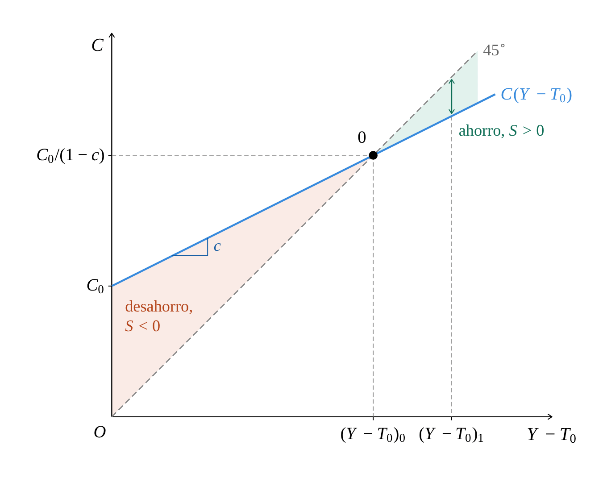
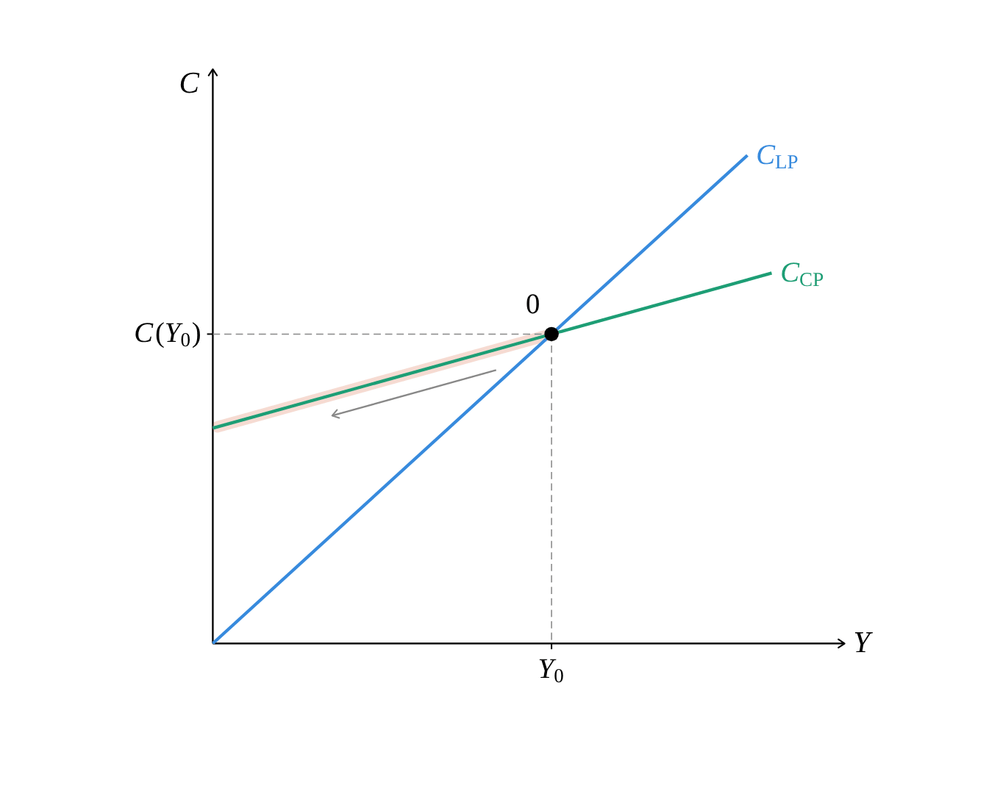
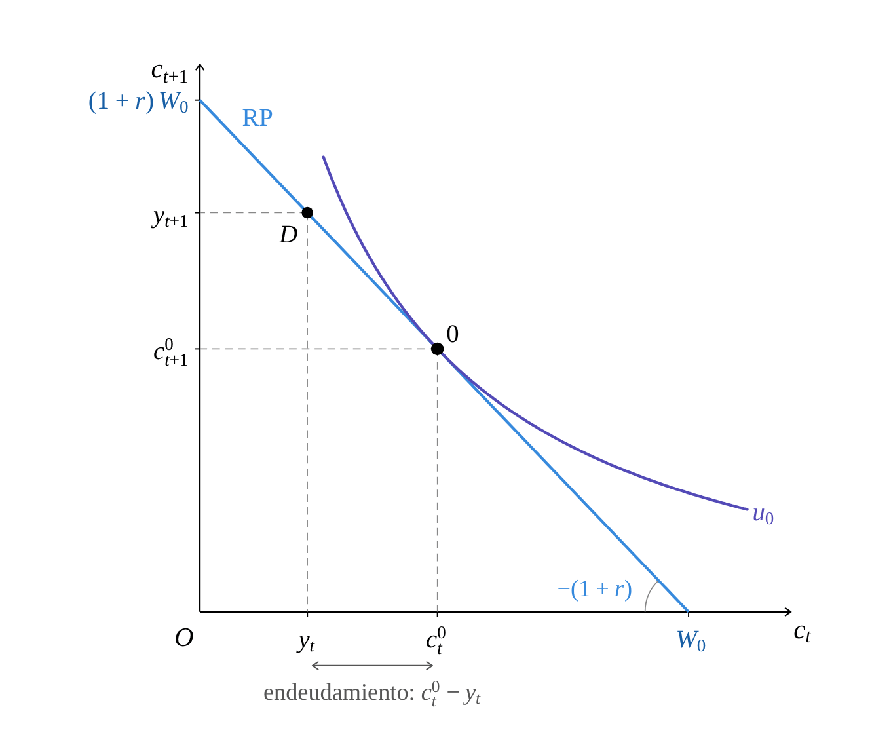
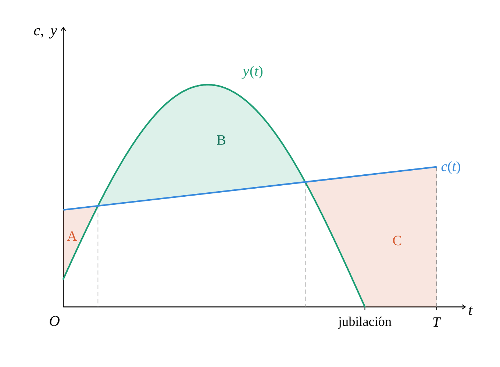

## Introducción



En economía, el **consumo** se entiende como el uso o adquisición de bienes y servicios por agentes económicos para la satisfacción de sus necesidades, tanto corrientes (p. ej. bienes no duraderos) como futuras (p. ej. bienes duraderos)[^a33-1][^a33-2].

El estudio del consumo tiene importancia tanto para la microeconomía como para la macroeconomía:

1. *Microeconomía*: permite entender el comportamiento de los individuos y medir, a través de su consumo, su nivel de riqueza y, por extensión, de pobreza.

2. *Macroeconomía*: importa por dos motivos. En primer lugar, el consumo agregado determina el ahorro agregado, que se canaliza a través del sistema financiero hacia la oferta de capital, de modo que plantea la disyuntiva entre el consumo como fuente de bienestar inmediato y el ahorro como fuente de crecimiento. En segundo lugar, el consumo privado absorbe cerca del 60 % del producto en las economías desarrolladas, lo que le da un peso central en la demanda agregada y, con la inversión, lo hace imprescindible para explicar las fluctuaciones económicas.

El tema analiza cronológicamente las teorías de la demanda de consumo en tres partes:

- *Antecedentes*: se estudian los antecedentes de las teorías modernas (aportaciones neoclásica, keynesiana y de Duesenberry).

- *Teorías de la renta normal*: se analizan con certidumbre (hipótesis del ciclo vital, hipótesis de la renta permanente) y con incertidumbre (paseo aleatorio de Hall).

- *Desarrollos recientes*: el tema termina con los desarrollos recientes, la demanda de bienes de consumo duradero, la evidencia empírica y las implicaciones de política económica.

## 1. Antecedentes a las teorías modernas sobre el consumo

Los antecedentes de las teorías modernas del consumo son la aportación neoclásica, que trata el consumo como un residuo del ahorro, y la keynesiana.

### 1.1. Aportación neoclásica

**Origen**: la función de consumo agregada neoclásica procede de las aportaciones de diversos autores:

- *Fisher*: Irving Fisher (1930) proporcionó su microfundamentación con su modelo de elección intertemporal de dos periodos.

- *Pigou*: Arthur Pigou (1943) introdujo el efecto saldos reales.

- *Modigliani y Patinkin*: Modigliani (1944) y Patinkin (1956) sistematizaron a partir de ambos la función de consumo agregada neoclásica, como contrapunto a la keynesiana.

**Idea**: en el paradigma neoclásico, el consumo es solo un gasto destinado a satisfacer las necesidades corrientes individuales y se considera apenas un residuo del ahorro[^a33-5].

**Razonamiento**: dentro del pensamiento neoclásico existen dos formas de construir la función de consumo agregada:

- *Fisher* (1930): es la forma original. El consumo real agregado es una función creciente de la renta disponible de los agentes y, si el efecto sustitución domina al efecto renta, decreciente del tipo de interés real, $C = f(Y^{+}, r^{-})$. Siguiendo esta formulación, se cumple la dicotomía clásica y la neutralidad del dinero debido a la teoría cuantitativa del dinero.

- *Pigou* (1943): si se considera, además, el *efecto saldos reales* o *efecto Pigou*, el consumo real agregado también dependerá de la riqueza real de los individuos, formada por saldos monetarios reales y *stock* de bonos reales.

    Por lo tanto, $C = f(Y^{+}, r^{-}, W^{+})$, donde $W = M/P + B/P$ es la riqueza real de los agentes, suma de los saldos monetarios y de los bonos reales[^a33-6].

    Esta formulación rompe la dicotomía clásica (variables monetarias como el dinero o los bonos afectan a variables reales como el consumo), pero no necesariamente la neutralidad del dinero, e influyó en el pensamiento monetarista. Con ella, Pigou buscaba dotar de mayor efectividad al ajuste automático de la economía ante cambios en los precios o los salarios.

::: {.callout-note appearance="simple" icon=false}
El mercado de fondos prestables y los efectos en él de las políticas fiscal y monetaria se desarrollan en el tema [A34](a34-demanda-inversion.qmd), apartado 1.1.2.
:::

**Extensiones**: en el mercado de fondos prestables, las políticas de demanda operan a través del tipo de interés real, cuya flexibilidad garantiza que se cumpla la ley de Say.

- *Política monetaria expansiva*: reduce el tipo de interés real y estimula el consumo y la inversión hasta que la subida de precios reequilibra la economía. Sin embargo, con efecto saldos reales y un *stock* nominal de bonos que no crece en la misma proporción que el dinero, se rompe la neutralidad. La razón es que la subida de precios reduce la riqueza real y el consumo, y el tipo de interés real queda permanentemente más bajo para que la inversión compense exactamente esa caída.

- *Política fiscal expansiva*: eleva el tipo de interés real y desplaza totalmente el gasto privado, con un efecto expulsión (*crowding out*) total. En el paradigma neoclásico, ese efecto justifica la *regla del equilibrio presupuestario* y su única excepción, el endeudamiento para financiar inversión pública o *regla de oro de las finanzas públicas*[^a33-7]. Si la demanda de dinero depende del tipo de interés, sube además el nivel de precios. Con efecto saldos reales, el tipo de interés sube menos y el desplazamiento, que sigue siendo total, recae más sobre el consumo (por la caída de la riqueza real) y menos sobre la inversión.

El paradigma neoclásico explica que el presidente Hoover elevase los impuestos (Revenue Act de 1932) para equilibrar el presupuesto durante la Gran Depresión, con efectos adversos.

**Conclusiones**:

- *Aspectos positivos*: fundamenta el consumo en la elección intertemporal e incorpora como determinantes el tipo de interés real y, con Pigou, la riqueza, ideas que recogen después las teorías del ciclo vital y de la renta permanente. El efecto saldos reales es, además, la base de la réplica neoclásica al equilibrio con desempleo keynesiano.

- *Limitaciones*: relega el consumo a un papel pasivo y descansa en la flexibilidad de los precios y del tipo de interés, por lo que no explica caídas persistentes de la demanda como la de la Gran Depresión. Además, el efecto saldos reales es cuantitativamente débil y exige caídas de precios intensas, que a su vez elevan la carga real de las deudas.

### 1.2. Aportación keynesiana

Frente a esas limitaciones surge la aportación keynesiana, que hace depender el consumo de la renta corriente, absoluta en Keynes y relativa en Duesenberry.

#### 1.2.1. Teoría de la renta corriente absoluta (Keynes, 1936)

**Origen**: la primera función agregada de demanda de consumo se debe a Keynes, que la formula en la *Teoría general* (1936).

**Idea**: el consumo depende de la renta corriente disponible a través de una propensión marginal a consumir estable y menor que la unidad, de la que se sigue el multiplicador.

**Razonamiento**: en su teoría del consumo, Keynes parte de tres ideas fundamentales, de las que se deriva una cuarta sobre el ahorro:

- *Naturaleza*: la producción tiene como destino final el consumo. De esta idea parte el proceso multiplicador, y con ella Keynes se aleja del papel residual que los clásicos reservaban al consumo.

- *Renta corriente*: considera que las decisiones de consumo dependen de la renta actual o corriente. Así, el tipo de interés pasa a segundo plano y lo que más pesa en el consumo es la renta, al revés de lo que sostenían los clásicos.

- *Propensiones al consumo*: los consumidores tienen planes de consumo estables que se manifiestan en las propensiones al consumo y al ahorro:

    - *Propensión marginal a consumir*: indica el consumo realizado por unidad adicional de renta, $c \equiv \partial C/\partial Y \in (0, 1)$.

        Para Keynes, esta representa una *ley psicológica fundamental*, según la cual, si los consumidores reciben una unidad adicional de renta, gastan una parte y ahorran otra. Por ello, al aumentar su renta aumentan su consumo, pero en menor medida que el aumento de la renta.

        Además, la propensión marginal a consumir es bastante estable, de manera que se puede considerar un parámetro constante[^a33-9].

        El valor de la propensión marginal a consumir fundamenta el *principio del multiplicador* (Kahn, 1931; Keynes, 1936). El principio establece que los aumentos en los componentes autónomos de la demanda agregada dan lugar a aumentos mayores de la renta nacional, $\partial Y / \partial A_0 = 1/(1-c)$, donde $A_0$ es el gasto autónomo.

    - *Propensión media al consumo*: fracción de la renta corriente que se dedica al consumo, $C/Y = C_0/Y + c$. Keynes suponía que cae al crecer la renta, $d(C/Y)/dY < 0$, porque veía en el ahorro un bien de lujo y pensaba que, en proporción a lo que ingresan, los hogares acomodados ahorran más que los modestos.

- *Propensiones al ahorro*: como, dada la renta disponible, elegir el consumo equivale a elegir el ahorro, de las anteriores se obtienen:

    - *Propensión marginal a ahorrar*: cuánto ahorran los hogares por unidad adicional de renta, $s \equiv \partial S/\partial Y = (1-c) \in (0, 1)$.

    - *Propensión media al ahorro* o *tasa de ahorro* (*savings ratio*): proporción de renta disponible que se mantiene en forma de ahorro. El efecto multiplicador no exige que la tasa de ahorro se mantenga constante (en Keynes, aumenta con la renta), sino que se basa en la constancia de la propensión marginal.

De todo ello resulta una demanda agregada de consumo en términos reales lineal y estable en la renta real disponible del periodo, con un *componente autónomo*, el consumo de subsistencia, y un *componente endógeno*, gobernado por la propensión marginal a consumir:

$$C = C_0 + c(Y - T_0), \quad C_0 > 0, \; c \in (0, 1)$$

donde $C_0$ es el consumo autónomo, $Y$ la renta real y $T_0$ los impuestos, de modo que $Y - T_0$ es la renta disponible. El ahorro es, así, un excedente de ingreso.

**Desarrollo gráfico**: la función de consumo keynesiana se representa en el plano renta disponible-consumo (figura -@fig-a334-consumo-keynesiano):

1. *Curva de consumo*, $C(Y - T_0)$: recoge el consumo planeado[^a33-11] para cada nivel de renta[^a33-12]. Corta el eje vertical en el consumo autónomo, $C_0$, y su pendiente es la propensión marginal a consumir, $c$.

2. *Bisectriz* (45°): recoge los puntos en los que el consumo agota la renta disponible, es decir, con propensión media a consumir unitaria.

3. *Equilibrio*: en el punto de corte, punto 0, el plan de consumo se satisface exactamente con la renta disponible, $(Y - T_0)_0$, y el consumo es $C_0/(1-c)$.

    - *Derecha del punto 0*: los hogares ahorran la diferencia vertical entre la bisectriz y la curva de consumo (p. ej. en $(Y - T_0)_1$), y la propensión media al consumo es inferior a la unidad.

    - *Izquierda del punto 0*: desahorran o se endeudan por esa diferencia para satisfacer su plan de consumo.

::: {#fig-a334-consumo-keynesiano}

::: {.content-visible when-format="html"}
```{=html}
<div class="graph-frame">
<iframe src="../graphs/a334_Consumo_keynesiano.html" style="height:540px" loading="lazy" title="fig-a334-consumo-keynesiano"></iframe>
</div>
```
:::

::: {.content-visible unless-format="html"}

:::

Función de consumo keynesiana. El consumo planeado crece con la renta disponible con pendiente $c < 1$. A la derecha del punto de corte con la bisectriz los hogares ahorran y a la izquierda desahorran.
:::

**Extensiones**: del modelo de Keynes se deduce que el Gobierno debe desempeñar un papel activo.

- *Política monetaria*: sí es efectiva con el tipo de interés y, en principio, con la renta. Sin embargo, debido a los *animal spirits* y a la baja sensibilidad de la inversión al tipo de interés (eslabón débil), la política monetaria será poco efectiva con la renta y, por ello, con el consumo.

- *Política fiscal*: sí es efectiva con la renta y el tipo de interés, porque altera la renta corriente, de la que depende el consumo, a través de los multiplicadores. En el caso de una economía cerrada con impuestos de suma fija:

    $$\frac{\partial Y}{\partial G_0} = \frac{1}{1-c} > 1 \qquad \frac{\partial Y}{\partial T_0} = -\frac{c}{1-c} < 0$$

    donde $G_0$ es el gasto público autónomo y $T_0$ los impuestos de suma fija. Además, un aumento del gasto público siempre será más efectivo que una disminución impositiva de la misma cuantía, ya que estimula directamente la demanda agregada. La rebaja de impuestos, en cambio, aumenta la renta disponible de los hogares, que pueden dedicar esa cantidad al consumo o al ahorro (analíticamente, porque $c < 1$).

    Dentro de la política fiscal, las medidas redistributivas (impuestos y transferencias que trasladan renta hacia los hogares de menor renta) sí serán efectivas para estimular el consumo, ya que estos hogares tienen una propensión marginal a consumir mayor.

Además de sus implicaciones de política económica, de la aportación de Keynes se desprenden otros dos resultados:

- *Paradoja del ahorro* (Keynes, 1936): también llamada *paradoja de la frugalidad*, ataca la defensa clásica del ahorro como fuente del crecimiento económico.

    La paradoja del ahorro establece que un aumento del ahorro autónomo de los hogares (descenso del consumo de subsistencia), *ceteris paribus*, no provoca necesariamente un aumento del ahorro privado, pero sí una caída de la renta, por lo que el ahorro puede obstaculizar el pleno empleo.

    Esto se debe a que la caída del consumo produce una caída de la demanda agregada y, a través del efecto multiplicador, una caída de la producción, la renta nacional y, finalmente, la renta disponible de los hogares[^a33-14].

- *Teoría del estancamiento secular* (Hansen, 1938): reforzó la defensa del intervencionismo, en concreto de la política fiscal expansiva de inversiones públicas.

    Según la teoría keynesiana, si una economía experimentaba un aumento de la renta sostenido, la propensión media al consumo debía disminuir (la propensión media al ahorro debía aumentar), lo que podía llevar a un exceso de ahorro privado.

    Hansen sostenía, además, que las oportunidades de inversión privada se estaban agotando por la desaceleración del crecimiento de la población, el fin de la expansión territorial y un progreso técnico menos intensivo en capital. En consecuencia, la ratio inversión privada-renta no aumentaría para absorber el mayor ahorro.

    Por todo ello, Hansen apuntaba, a finales de los años treinta, que se llegaría a un *estancamiento secular*, es decir, a una depresión de duración indefinida, un estado estacionario con recursos ociosos. La única manera de garantizar el pleno empleo de recursos y evitar el estancamiento secular vía estímulo de la demanda agregada era la inversión pública, que elevaba el gasto público como porcentaje del PIB[^a33-16].

    La idea se recuperó tras la Gran Recesión (Summers, 2014), por la dificultad de alcanzar una demanda agregada de pleno empleo con la economía en la trampa de liquidez.

**Conclusiones**:

- *Aspectos positivos*:

    - *Influencia teórica*: sobre la función de consumo construyó Keynes su explicación de las fluctuaciones, y la sencillez de esa función le valió una acogida inmediata entre los economistas.

    - *Evidencia empírica a corto plazo*: los primeros datos parecían darle la razón. Tanto las encuestas de presupuestos familiares (sección cruzada) como las series anuales cortas arrojaban una propensión media al consumo que bajaba al subir la renta. A corto plazo, el ahorro funcionaba, por tanto, como un lujo.

- *Limitaciones*:

    - *Evidencia empírica a largo plazo*: con series largas de EE. UU. (1869-1938), Simon Kuznets (1946) halló una propensión media al consumo estable en el largo plazo[^a33-18], sin relación con el nivel de renta, y tampoco la tasa de ahorro variaba. La predicción keynesiana sobre consumo y ahorro fallaba, pues, en ese horizonte.

    - *Estancamiento secular*: la predicción de Hansen también falló. Tras la Segunda Guerra Mundial el gasto público se redujo, pero el consumo subió aunque la renta disponible real cayó entre 1945 y 1947. Detrás de esa subida hubo un efecto riqueza, ya que los hogares liquidaron los bonos públicos que habían acumulado durante el racionamiento. El episodio mostró que la riqueza debía entrar en cualquier teoría del consumo.

#### 1.2.2. Teoría de la renta corriente relativa (Duesenberry, 1949)

**Origen**: James Duesenberry (1949) añade fundamentos psicológicos a la teoría keynesiana, en vista de la contradicción entre esta y la evidencia sobre la propensión media al consumo (*enigma de Kuznets*).

**Idea**: cada hogar obtiene utilidad de su consumo actual, pero la mide frente a lo que consume su entorno social (renta relativa) y frente a lo que él mismo consumía antes (hábitos). Lo que gobierna el consumo es, así, la posición relativa del hogar y la renta más alta que haya alcanzado, no su renta corriente absoluta.

**Supuestos**: para desarrollar su teoría, Duesenberry se basa en dos hipótesis:

1. *Efecto demostración*[^a33-20]: un hogar de renta relativamente baja procura, aunque ingrese menos, no quedarse por debajo del consumo medio del país, y para ello puede endeudarse o desahorrar. Busca demostrar a sus vecinos que está en condiciones de consumir como ellos. Con este efecto se explicaban los datos de sección cruzada, que retratan a los hogares en un instante concreto.

2. *Efecto trinquete*[^a33-21]: a la renta relativa se suma otro determinante del consumo, lo que el hogar ya consumía en el pasado. Los hábitos hacen costoso renunciar a un nivel de vida ya conquistado, de modo que lo consumido antes condiciona lo que se consume hoy. Con este efecto se explicaban las series temporales cortas, es decir, la conducta del consumo a corto plazo.

**Razonamiento**: con una renta que crece al ritmo de su tendencia y sin cambios en la posición relativa de cada hogar, los dos efectos frenan la reacción del consumo ante la renta en el corto plazo, de modo que es menor que en el largo. Así surgen dos regularidades sobre la propensión media a consumir, que fluctúa en el corto plazo, con valores más altos cuanto más baja es la renta, y es estable en el largo.

**Desarrollo gráfico**: la hipótesis de la renta relativa se representa en el plano renta disponible-consumo (figura -@fig-a331-duesenberry):

1. *Función de consumo a largo plazo*, $C_{\text{LP}}$: pasa por el origen, porque a largo plazo la propensión media al consumo es constante.

2. *Función de consumo a corto plazo*, $C_{\text{CP}}$: tiene menor pendiente que $C_{\text{LP}}$, porque los hábitos adquiridos (efecto trinquete) frenan la reducción del consumo cuando cae la renta.

3. *Equilibrio*: punto 0, $(Y_0, C(Y_0))$, en el que se cortan ambas funciones, con $Y_0$ la renta máxima alcanzada.

::: {#fig-a331-duesenberry}

::: {.content-visible when-format="html"}
```{=html}
<div class="graph-frame">
<iframe src="../graphs/a331_Duesenberry.html" style="height:580px" loading="lazy" title="fig-a331-duesenberry"></iframe>
</div>
```
:::

::: {.content-visible unless-format="html"}

:::

Hipótesis de la renta relativa (Duesenberry, 1949). La función de consumo a corto plazo presenta efecto trinquete, mientras que la de largo plazo es proporcional a la renta.
:::

**Estática comparativa**: a partir del punto 0, la respuesta del consumo es asimétrica, porque el efecto trinquete actúa en las caídas de renta y no en las subidas. Se distinguen dos fases:

1. *Caída de la renta*: los hogares se desplazan desde el punto 0 por su curva de corto plazo, $C_{\text{CP}}$ (flecha), y recurren a sus ahorros. Así, el consumo baja menos que si se movieran sobre la curva de largo plazo.

2. *Recuperación*: cuando la recesión queda atrás, el consumo vuelve a subir por $C_{\text{CP}}$ hasta el punto 0 y desde allí retoma su avance sobre $C_{\text{LP}}$.

**Extensiones**: por el efecto trinquete, la propensión media al consumo sube en las recesiones, lo que amortigua la caída de la demanda. Como el ahorro de cada hogar depende de su posición en la distribución de la renta (efecto demostración), la tasa de ahorro agregada no aumenta a medida que la economía se enriquece, mientras esa distribución no cambie.

**Conclusiones**:

- *Aspectos positivos*: aporta dos ideas. Una es la suavización del consumo mediante el ahorro y el desahorro[^a33-22]. La otra, la de que el consumo se decide en función de una renta distinta de la del periodo, sirvió de base a los desarrollos posteriores. Además, la teoría de Duesenberry reconcilia la propensión media decreciente a corto plazo con la constante a largo plazo, que Keynes dejaba sin explicar.

- *Limitaciones*: deja sin explicar con rigor el proceso de ajuste por el que, superada la recesión, el consumo vuelve a sus niveles previos y a la curva de tendencia. Tampoco incorpora aspectos dinámicos.

### 1.3. Conclusiones

La aportación neoclásica relaciona el consumo con la renta, el tipo de interés real y, desde Pigou, la riqueza, pero lo trata como un residuo del ahorro y confía en la flexibilidad de los precios para corregir las caídas de la demanda. En cambio, Keynes hace del consumo una función estable de la renta corriente, cuya propensión marginal fundamenta el multiplicador. Su predicción de una propensión media decreciente encaja con los datos de corto plazo, pero no con las series largas de Kuznets. Duesenberry reconcilia ambos horizontes con la renta relativa y los hábitos, aunque sin explicar cómo se ajusta el consumo tras una recesión.

Las funciones keynesianas ligan así el consumo a la renta corriente o pasada, cuando los hogares deciden cuánto consumir y ahorrar teniendo en cuenta también su renta futura, que la sección 2 incorpora a la decisión de consumo.

## 2. El consumo como función intertemporal en horizontes amplios

Ante esta situación, surgen en los años cincuenta las **teorías de la renta normal**, que se apoyan en las aportaciones de Irving Fisher (1930). Todas ellas resuelven el enigma de Kuznets con un mismo mecanismo, hacer depender el consumo de la riqueza y no solo de la renta corriente, y difieren en el horizonte, en cómo se forma la renta relevante y en el tratamiento de la incertidumbre.

### 2.1. Fundamentos del consumo intertemporal (Fisher, 1930)

**Origen**: Irving Fisher (1930) formuló el modelo de elección intertemporal del consumidor del que parten las teorías de la renta normal.

**Idea**: en el modelo de elección intertemporal en dos periodos, el consumidor reparte su riqueza entre consumo presente y futuro, de modo que el consumo depende de la riqueza y no solo de la renta corriente.

::: {.callout-note appearance="simple" icon=false}
El problema de elección intertemporal del consumidor, la función de utilidad de Samuelson, la restricción de riqueza, la ecuación de Euler y la función de consumo que de ella resulta se desarrollan en el tema [A29](a29-mhi-mgs.qmd), apartado 1.
:::

#### 2.1.1. Supuestos comunes a las teorías de consumo dinámico

Las teorías del consumo intertemporal comparten estos supuestos:

**Entorno**: un mundo neoclásico con mercados de capitales eficientes y completos, en los que el consumidor puede prestar y endeudarse al mismo tipo de interés. Este supuesto hace posible la suavización del consumo, y su relajación es el objeto de la sección 3.

**Agentes**: consumidores perfectamente racionales y previsores (*forward looking*), que tienen en cuenta sus rentas futuras al decidir el consumo de hoy. Sus preferencias se recogen en una función de utilidad intertemporal aditivamente separable, con impaciencia y homotética[^a33-23]. La función de utilidad instantánea es continua, creciente y estrictamente cóncava, lo cual expresa el deseo de suavizar el consumo.

#### 2.1.2. Modelo

**Planteamiento**: el consumidor elige la senda de consumo que maximiza la utilidad intertemporal de Samuelson sujeto a su restricción de riqueza:

$$\max_{\{c_t\}} \; \sum_{t=0}^{T} \beta^t u(c_t) \quad \text{s.a.:} \quad \sum_{t=0}^{T} \frac{c_t}{(1+r)^t} = A_{-1} + \sum_{t=0}^{T} \frac{y_t}{(1+r)^t} \equiv W_0, \qquad \beta \in (0, 1)$$

donde $\beta = 1/(1+\rho)$ es el factor de descuento, $\rho$ la tasa de preferencia temporal, $r$ el tipo de interés real, $A_{-1}$ los activos iniciales y $W_0$ la riqueza, suma de los activos y del valor presente de las rentas futuras.

**CPO**: con solución interior y la restricción agotada, derivando el lagrangiano respecto al consumo de cada periodo y eliminando el multiplicador, resulta la *ecuación de Euler*, que fija el perfil de la senda:

$$\frac{du}{dc_t} = \frac{1+r}{1+\rho}\, \frac{du}{dc_{t+1}}$$

La ecuación compara lo que el mercado paga por esperar ($r$) con lo que al consumidor le cuesta esperar ($\rho$), y expresa el deseo de mantener una senda de consumo estable, sea constante, creciente o decreciente. Pueden darse tres casos:

- *$r = \rho$*: el consumo es constante, pues la recompensa por posponer el consumo compensa exactamente la impaciencia.

- *$r > \rho$*: es creciente. El ahorro rinde más de lo que pesa la impaciencia y conviene consumir menos hoy y más mañana.

- *$r < \rho$*: es decreciente. La impaciencia domina y el consumidor adelanta consumo, endeudándose o desahorrando.

En todo caso se produce el *alisamiento o suavización del consumo* (*consumption smoothing*), por el que el consumidor iguala entre periodos la utilidad marginal descontada por unidad de precio en valor presente. Gracias a la utilidad marginal decreciente ($u'' < 0$) y a los mercados financieros completos, el consumo no sigue las oscilaciones de la renta, sino una senda regular.

**CSO**: la concavidad estricta de $u$ hace estrictamente cóncava la utilidad intertemporal y la restricción de riqueza es lineal, de modo que la ecuación de Euler, junto con la restricción, es necesaria y suficiente para el máximo.

**Solución**:

- *Función de consumo individual*: la restricción de riqueza fija el nivel de la senda. Sustituyendo el perfil de Euler en la restricción, el consumo de cada periodo resulta ser una fracción de la riqueza del individuo $h$:

    $$c_t^h = \kappa^h\, W_t^h, \qquad W_t^h = A_{t-1}^h + \sum_{j=0}^{T-t} \frac{y^{e,h}_{t+j}}{(1+r)^j}$$

    donde $c_t^h$ es el consumo del individuo $h$ en el periodo $t$ y $W_t^h$ su riqueza total en $t$. La riqueza total suma los activos acumulados al inicio del periodo, $A_{t-1}^h$ (riqueza no humana), y el valor presente de las rentas laborales que el individuo espera percibir en cada periodo $t+j$, $y^{e,h}_{t+j}$ (riqueza humana). Además, $T$ es el último periodo de vida, de modo que $T - t$ son los periodos que restan, $r$ es el tipo de interés real y $\kappa^h$, la propensión a consumir la riqueza. Esta propensión depende del tipo de interés, de la impaciencia y de los periodos que restan, pero no de la renta corriente, porque la renta del periodo entra solo como un sumando más de la riqueza.

- *Función de consumo agregada*: se obtiene sumando las individuales. Sin embargo, como $\kappa^h$ difiere entre individuos (por edad, preferencias y horizonte), la suma solo es una función estable de la riqueza agregada si la distribución de la población por edades y de la riqueza entre grupos es estable.

    Bajo ese supuesto, puede obtenerse una función de consumo agregada canónica como:

    $$C_t = \kappa\,W_t$$

    con $W_t$ la riqueza agregada (activos más valor presente de las rentas laborales esperadas). Descompuesta en sus componentes observables, la función toma la forma

    $$C_t = a\,A_{t-1} + b\,Y_t$$

    con $b$ menor que la propensión marginal a consumir keynesiana. Al igual que la función de consumo agregada keynesiana, tiene dos componentes:

    - *Componente predeterminado*: $a\,A_{t-1}$, que ocupa el lugar del consumo autónomo keynesiano pero no es una constante. Este componente depende de la riqueza no humana acumulada al inicio del periodo (activos reales y financieros, $A_{t-1}$), dada en $t$ pero variable en el tiempo, a través de la propensión a consumir la riqueza, $a\in (0, 1)$.

    - *Componente inducido*: $b\,Y_t$, que depende de la renta corriente, $Y_t$, a través de la propensión marginal a consumir la renta corriente, $b\in (0, 1)$. La renta corriente entra como recurso del periodo y como aproximación a la riqueza humana, que no es observable.

    La hipótesis del ciclo vital (HCV) y la de la renta permanente (HRP) son precisamente dos formas de hacer operativa esta función, la primera acotando el horizonte al ciclo vital y la segunda definiendo la renta permanente como la anualidad de la riqueza.

**Desarrollo gráfico**: la elección intertemporal del consumidor se representa en el plano consumo presente-consumo futuro (figura -@fig-a332-consumo-intertemporal):

1. *Restricción presupuestaria intertemporal*, RP: recoge las combinaciones de consumo presente y futuro que agotan la riqueza. Pasa por la dotación de rentas, punto D, $(y_t, y_{t+1})$, corta los ejes en $W_0$ y $(1+r)\,W_0$ y su pendiente es $-(1+r)$.

2. *Curva de indiferencia intertemporal*, $u_0$: es convexa porque la utilidad instantánea es estrictamente cóncava, lo que expresa el deseo de suavizar el consumo.

3. *Óptimo*: punto 0, $(c_t^0, c_{t+1}^0)$, tangencia entre RP y la curva de indiferencia más alejada del origen. En la figura queda a la derecha de la dotación y el consumidor se endeuda por $c_t^0 - y_t$, mientras que a la izquierda ahorraría.

::: {#fig-a332-consumo-intertemporal}

::: {.content-visible when-format="html"}
```{=html}
<div class="graph-frame">
<iframe src="../graphs/a332_Consumo_intertemporal.html" style="height:620px" loading="lazy" title="fig-a332-consumo-intertemporal"></iframe>
</div>
```
:::

::: {.content-visible unless-format="html"}

:::

Consumo intertemporal en dos periodos, con la restricción presupuestaria y la elección óptima del consumidor.
:::

#### 2.1.3. Conclusiones

**Aspectos positivos**: el modelo intertemporal dota a la función de consumo de fundamento microeconómico y sustituye la renta corriente por la riqueza como determinante. Además, explica con un solo mecanismo, la suavización, la evidencia de Kuznets:

- *Corto plazo*: la renta fluctúa más que la riqueza y la propensión media al consumo cae en los auges.

- *Largo plazo*: renta y riqueza crecen a la par y la propensión media es constante.

**Limitaciones**: supone certidumbre sobre las rentas futuras, mercados de capitales perfectos y preferencias separables y homotéticas. Sin esos supuestos, la agregación deja de ser válida y el consumo vuelve a depender de la renta corriente. Las tres teorías que siguen mantienen estos supuestos (salvo Hall, que introduce incertidumbre y utilidad cuadrática), y la sección 3 los levanta.

### 2.2. Hipótesis del ciclo vital (Modigliani y Brumberg, 1954; Ando y Modigliani, 1963)

**Origen**: la hipótesis del ciclo vital se debe a las aportaciones de Franco Modigliani y Richard Brumberg (1954) y de Albert Ando y Franco Modigliani (1963).

**Idea**: esta aportación pone el foco en la función que desempeña el ahorro a la hora de determinar el plan de consumo óptimo.

#### 2.2.1. Supuestos

Además de los comunes, el modelo del ciclo vital introduce dos supuestos particulares:

**Entorno**: la vida del individuo es finita, con $T$ periodos conocidos, y el individuo no deja herencias, de modo que agota su riqueza al morir. La renta laboral fluctúa a lo largo de la vida pero es predecible. Concretamente, es baja en la juventud, elevada en la etapa central y nula en la jubilación (perfil de joroba).

#### 2.2.2. Modelo

**Planteamiento**: es el problema del modelo común con horizonte igual a la vida del individuo. En cada periodo $t$, el individuo $h$ elige la senda de consumo del periodo actual y de los $T - t$ que le quedan para maximizar su utilidad intertemporal sujeto a su riqueza vital, $W_t^h$, sin dejar herencias.

**CPO**: dan la ecuación de Euler. Con $r = \rho$ el consumo es constante a lo largo de la vida y con $r > \rho$, ligeramente creciente. En ambos casos, su perfil es independiente del de la renta.

**CSO**: son las del modelo común (utilidad instantánea estrictamente cóncava y restricción de riqueza lineal).

**Solución**:

- *Función de consumo individual*: en cada periodo, el agente consume una fracción, $\kappa_t^h$, de su riqueza (real) a lo largo de su vida, $W_t^h$:

    $$c_t^h = \kappa_t^h W_t^h, \qquad W_t^h = A_{t-1}^h + y_t^h + \sum_{j=1}^{T-t} \frac{y^{e,h}_{t+j}}{(1+r)^j}$$
    con la notación del modelo común, donde ahora se separa la renta laboral del periodo, $y^h_t$, de las futuras.

    Como en el modelo común, la renta no influye en la fracción $\kappa_t^h$. Para una edad dada, esta fracción es estable, y aumenta con los años a medida que se acorta el tiempo que le queda al agente. El valor actual de la renta futura esperada no es observable y se puede estimar de diferentes formas[^a33-25]. En suma, el consumo del agente es proporcional al valor de su riqueza[^a33-26].

- *Función de consumo agregada*: con una pirámide de edades y un reparto de la riqueza estables, el consumo real agregado es:

    $$C_t = a A_{t-1} + b Y_t \;\rightarrow\; \; (C_t/Y_t) = a(A_{t-1}/Y_t) + b$$
    con la misma notación.

**Desarrollo gráfico**: la hipótesis del ciclo vital se representa en el plano tiempo-consumo y renta (figura -@fig-a333-hcv):

1. *Renta*, $y(t)$: sigue el perfil de joroba supuesto y se anula con la jubilación.

2. *Consumo*, $c(t)$: es ligeramente creciente, porque se supone $r > \rho, \; \forall t$.

3. *Ahorro y desahorro*: para mantener un consumo regular a lo largo de la vida, el individuo pide prestado en la juventud (área A) y acumula ahorro en los años centrales, de mayor renta (área B). Al final de su vida laboral y durante la jubilación, consume lo acumulado (área C). Por ello, la propensión media al consumo sigue un patrón inverso al de la renta, pues desciende en la etapa central de la vida y aumenta en la juventud y la vejez.

::: {#fig-a333-hcv}

::: {.content-visible when-format="html"}
```{=html}
<div class="graph-frame">
<iframe src="../graphs/a333_HCV.html" style="height:540px" loading="lazy" title="fig-a333-hcv"></iframe>
</div>
```
:::

::: {.content-visible unless-format="html"}

:::

Hipótesis del ciclo vital. El perfil de renta y consumo a lo largo de la vida del individuo combina endeudamiento (A), ahorro (B) y desahorro (C).
:::

**Estática comparativa**: a partir de la propensión media al consumo agregada, $C_t/Y_t = a(A_{t-1}/Y_t) + b$, el comportamiento del consumo difiere según el horizonte temporal:

1. *Corto plazo*: los activos o ahorro acumulado, $A_{t-1}$, varían muy poco y pueden considerarse estables. Por ello, a corto plazo, existirá una relación inversa entre la renta y la propensión media al consumo. Así, en fases alcistas disminuye la propensión media al consumo y sube la propensión media a ahorrar y viceversa. De modo intuitivo, un aumento de la renta a corto plazo se trasladará solo en parte al consumo del periodo, pues la maximización de la utilidad a lo largo de la vida exige que el aumento del consumo se reparta entre varios periodos.

2. *Largo plazo*: la acumulación de activos hará que las propensiones media y marginal coincidan y permanezcan estables o constantes.

**Extensiones**: a corto plazo, las políticas activas sí pueden tener efectos sobre el consumo y el ahorro, si bien en el largo plazo, la economía tiene mayor capacidad de ajuste por sí misma. Esta implicación es similar a la de la HRP.

#### 2.2.3. Conclusiones

**Aspectos positivos**: la hipótesis del ciclo vital es ampliamente aceptada en la actualidad e incluye tendencias demográficas. Asimismo, es coherente con la evidencia de Kuznets y explica por qué la propensión media al consumo es decreciente con la renta a corto plazo y en sección cruzada, y constante a largo plazo.

**Limitaciones**: ignora que las restricciones de liquidez pueden limitar el endeudamiento y el desahorro. Además, la evidencia empírica no apoya que exista necesariamente desahorro en la última etapa de la vida.

Otra limitación importante procede de los supuestos. La teoría da al consumidor certeza sobre la renta de todo su ciclo vital y trabaja solo con una renta esperada media estable, sin componentes transitorios.

De modo casi paralelo e independiente, Friedman desarrolló también una teoría del consumo perfectamente compatible con la HCV, si bien dio un tratamiento más formal a la formación de expectativas y la renta, lo cual es un avance.

### 2.3. Hipótesis de la renta permanente (Friedman, 1957)

**Origen**: Milton Friedman (1957) construye una teoría de la demanda de consumo influida por Arthur Pigou e Irving Fisher, en la que el consumo privado no depende solo de la renta del periodo, sino de la riqueza.

**Idea**: los hogares consumen una fracción estable de su renta permanente, la anualidad de su riqueza total, y no de su renta corriente, cuyas desviaciones transitorias se ahorran.

#### 2.3.1. Supuestos

**Entorno**:

- *Renta*: la renta corriente se divide en dos componentes no correlacionados, $Y_t = Y_t^P + Y_t^T$ con $\operatorname{corr}(Y^P, Y^T) = 0$:

    - *Renta permanente* ($Y_t^P$): es la renta que el hogar puede gastar en un periodo sin mermar la riqueza que la genera, de forma que en el periodo siguiente vuelva a disponer del mismo ingreso. Corresponde a la parte prevista y planeada de la renta.

    - *Renta transitoria* ($Y_t^T$): es la desviación aleatoria, positiva o negativa, de la renta corriente respecto a la permanente (p. ej. un premio de lotería, un periodo de desempleo)[^a33-30]. Corresponde al componente imprevisto de la renta.

- *Consumo*: al igual que la renta, el consumo corriente se divide en dos componentes no correlacionados, $C_t = C_t^P + C_t^T$ con $\operatorname{corr}(C^P, C^T) = 0$:

    - *Consumo permanente* ($C_t^P$): es el consumo planeado, que refleja el deseo de suavizar el consumo a lo largo de la vida.

    - *Consumo transitorio* ($C_t^T$): es la desviación aleatoria, positiva o negativa, del consumo corriente respecto al permanente (p. ej. un gasto por enfermedad). Corresponde al componente imprevisto del consumo.

- *Independencia*: además de la ausencia de correlación dentro de cada par, el consumo transitorio y la renta transitoria tampoco están correlacionados entre sí, $\operatorname{corr}(C^T, Y^T) = 0$. Este supuesto es decisivo, puesto que implica que la propensión marginal a consumir la renta transitoria es nula. Así, un aumento transitorio de la renta se ahorra íntegramente y una caída transitoria (p. ej. un despido) se absorbe con desahorro, sin alterar el consumo.

**Agentes**: el consumidor es el del modelo común, con preferencias intertemporales homotéticas (utilidad instantánea isoelástica), de modo que el plan de consumo óptimo es proporcional a los recursos totales. Como los individuos no conocen su renta futura, ni la renta permanente ni la transitoria son observables *ex ante*. Friedman supone que los agentes estiman la renta permanente según la hipótesis de las expectativas adaptativas (HEA), $Y_t^P = \lambda\sum_{j=0}^{J} (1-\lambda)^j Y_{t-j}$, con $\lambda \in (0, 1]$.

Es decir, estiman una media ponderada de las rentas corrientes pasadas (retardo distribuido) que da más peso a las más recientes y que se revisa tanto más deprisa cuanto mayor es $\lambda$.

#### 2.3.2. Modelo

**Planteamiento**: es el problema del modelo común con horizonte indefinido. El consumidor maximiza su utilidad intertemporal sujeto a su riqueza real neta total, $W_t = A_t + W_H$, que tiene dos componentes:

- *Riqueza no humana* ($A_t$): el valor real neto de los activos acumulados al comienzo del periodo, $A_t = B_t/r + M_t + K_t$, es decir, bonos, dinero y capital real (p. ej. el valor neto de la vivienda[^a33-31]).

- *Riqueza humana* ($W_H$): el valor descontado de las rentas laborales que el individuo espera percibir a lo largo de su horizonte, $W_H = \sum_{j=0}^{\infty} y^e_{t+j}/(1+r)^{j+1}$, con $r$ el tipo de interés real a largo plazo.

**CPO**: dan la ecuación de Euler, $du/dC_t = \frac{1+r}{1+\rho}\,du/dC_{t+1}$. Con preferencias homotéticas (utilidad isoelástica, $u(C) = C^{1-\theta}/(1-\theta)$, con $\theta$ el coeficiente de aversión relativa al riesgo), la CPO se resuelve para la tasa de crecimiento del consumo, $1 + g_C \equiv \frac{C_{t+1}}{C_t} = \left(\frac{1+r}{1+\rho}\right)^{1/\theta}$ (aproximadamente, $g_C \approx (r-\rho)/\theta$), que no depende del nivel de consumo ni de la riqueza.

El resultado de Friedman se apoya, como en el modelo común, en que la CPO fija la inclinación del perfil de consumo y la riqueza, su nivel. Por eso, dos consumidores con la misma $r$ y los mismos gustos eligen perfiles de la misma forma, a escala de su riqueza.

**CSO**: son las del modelo común.

**Solución**:

- *Función de consumo individual*: de la CPO, el plan óptimo es $C_{t+j} = (1+g_C)^j \cdot C_t$. Sustituyendo en la restricción presupuestaria intertemporal con horizonte indefinido, $\sum_{j=0}^{\infty} C_{t+j}/(1+r)^{j+1} = W_t$, y sumando la progresión geométrica, se obtiene el nivel del consumo planeado como proporción de la riqueza total:

    $$C_t^P = (r - g_C)\,W_t \equiv \kappa\,W_t$$
    En el caso $r = \rho$, $g_C = 0$ y $\kappa = r$, el consumidor consume cada periodo exactamente la *anualidad* de su riqueza, es decir, la renta que esta rinde si se mantiene intacta. Friedman llama a esa anualidad renta permanente, $Y_t^P = r\,W_t$, con $r \in (0, 1)$, de modo que la función de consumo individual es

    $$C_t^P = \kappa W_t = (\kappa/r)\,Y_t^P \equiv k_P\,Y_t^P$$
    Esta función refleja cómo el consumo permanente es proporcional a la renta permanente, con $k_P = 1$ si $r = \rho$ y $k_P < 1$ si $r > \rho$.

    Friedman no deriva $k_P$ del programa, sino que postula sus determinantes, $k_P = f(r^{-}, (W_H/W)^{-}, z^{\pm}) \in (0, 1]$. Concretamente, $k_P$ depende de:

    - *Tipo de interés*: negativamente, por ser el coste de oportunidad de consumir en lugar de ahorrar, pues cuanto mayor es $r$ respecto a $\rho$, más se inclina el perfil hacia el futuro y menor es el consumo presente.

    - *Riqueza humana*: cuanto mayor es la parte humana de la riqueza, menor es $k_P$, porque la renta del trabajo es más insegura (puede perderse con un despido) y peor aval para un crédito al consumo.

    - *Otras variables*: $z$, que recoge las preferencias, la demografía, la incertidumbre o el estatus social.

    Lo que no determina $k_P$ es el nivel de la renta permanente. Por eso la propensión media a consumir la renta permanente es constante.

- *Función de consumo agregada*: agregando las funciones individuales, $C_t = k_P\,Y_t^P + C_t^T$ e $Y_t = Y_t^P + Y_t^T$. La forma de la función depende de qué ocurre con los componentes transitorios en cada horizonte.

    - *Corto plazo*: la renta permanente se estima como retardo distribuido de la renta corriente (HEA), $Y_t^P = \lambda\sum_j (1-\lambda)^j Y_{t-j}$. Sustituyendo, el consumo agregado se aproxima con una función keynesiana, $C_t = C_0 + bY_t$, con $b = k_P\lambda < k_P$, de modo que de un aumento de la renta corriente solo se consume la parte que se incorpora a la renta permanente y el resto se ahorra (alisamiento).

    - *Largo plazo*: los componentes transitorios se cancelan. El consumo transitorio lo hace en el agregado, y la renta transitoria, conforme la renta ahorrada pasa a ser permanente[^a33-33]. Queda una función estable, $C_t = k_P\,Y_t^P$, con propensión media constante (véase la figura del anexo).

**Estática comparativa**: el consumo permanente responde a los cambios en sus determinantes, no solo a los de la renta corriente.

- *Shock de renta transitoria*: si el agente lo identifica como tal, no altera el consumo y el ahorro actúa como variable de ajuste.

- *Shock de renta permanente*: altera el consumo en la proporción $k_P$, de forma gradual, a medida que las expectativas adaptativas lo incorporan a $Y^P$.

- *Riqueza*: un aumento de la riqueza, humana o no humana, eleva la renta permanente y con ella el consumo (efecto riqueza).

- *Tipo de interés*: una subida de $r$ reduce el consumo, porque reduce $k_P$ y el valor descontado de la riqueza, $W$.

**Extensiones**: la riqueza entra en la decisión de consumo a través de la renta permanente, lo que hace el consumo privado más estable que en Keynes (alisamiento). Por esa vía se abren también los canales de la riqueza, directos e indirectos, en que se apoya el mecanismo de transmisión monetarista.

- *Política monetaria*: un impulso transitorio no anticipado expande el consumo por el efecto riqueza directo (saldos monetarios) e indirecto (tipo de interés). Uno permanente, en cambio, acaba siendo neutral y se traduce en inflación, conforme a la teoría cuantitativa.

- *Política fiscal*: un impulso transitorio no anticipado afecta solo a la renta transitoria y, si los hogares lo identifican como tal, se ahorra íntegramente, sin efecto sobre el consumo. Uno permanente sí se incorpora a la renta permanente y eleva el consumo. Que lo compense la anticipación de los impuestos futuros necesarios para financiarlo no es un resultado de Friedman, sino de Barro (1974), que lo formaliza como equivalencia ricardiana (apartado 3.2.1).

#### 2.3.3. Conclusiones

**Aspectos positivos**: presenta tres:

- *Compatibilidad*: la HRP y la HCV llegan a predicciones similares.

- *Evidencia de Kuznets*: explica la propensión media constante a largo plazo junto con una función keynesiana a corto plazo.

- *Presupuestos familiares*: explica dos regularidades de estos estudios. La propensión media al consumo de los hogares de renta baja es, a corto plazo, mayor que la de los de renta alta y mayor que $k_P$. Además, la propensión media a consumir es anticíclica (la de ahorrar, procíclica), pues en el auge la renta transitoria se ahorra y en la recesión se desahorra.

**Limitaciones**: presenta cuatro:

- *Certidumbre*: el programa del consumidor se plantea con información perfecta sobre los flujos de renta de toda la vida. La incertidumbre solo entra, de forma *ad hoc*, a través de la renta transitoria y de la estimación adaptativa de la renta permanente.

- *Inconsistencia interna*: el consumidor suaviza su consumo mirando hacia el futuro (*forward looking*) pero estima su $Y^P$ mirando hacia atrás (expectativas adaptativas), lo cual es contradictorio.

- *HEA*: la hipótesis de expectativas adaptativas puede conducir a errores sistemáticos, frente a la de expectativas racionales.

- *Contrastes*: son difíciles, pues la renta y el consumo permanentes no son observables.

Robert Hall intentó superar la limitación de la certidumbre perfecta al incorporar el riesgo y las expectativas racionales.

### 2.4. Paseo aleatorio de Hall (1978)

**Origen**: Robert Hall (1978) cambió el modo de estudiar la demanda de consumo intertemporal.

**Idea**: en un marco de incertidumbre, expectativas racionales y utilidad cuadrática, la HCV o HRP llevan a que el consumo (real) agregado siga un paseo aleatorio o martingala (hipótesis del paseo aleatorio, HPA). Con $r \neq \rho$, el consumo sigue un proceso autorregresivo de primer orden.

#### 2.4.1. Supuestos

**Entorno**: el tiempo es discreto y hay incertidumbre. El individuo no conoce sus rentas futuras, de modo que el consumo es una variable aleatoria. Con todo, no existe incertidumbre sobre tipos de interés ni sobre el descuento, con $r = \rho = 0$[^a33-36].

**Agentes**: incorporan en su patrón de consumo toda la información relevante según la conocen y no cometen errores sistemáticos (hipótesis de expectativas racionales). La función de utilidad instantánea es cuadrática, lo cual implica que la utilidad marginal es lineal, $u'(c_t) = 1 - \eta c_t$.

**Restricciones**: el individuo debe liquidar todas sus deudas pendientes al final de su vida (*condición de no-Ponzi*).

#### 2.4.2. Modelo

**Planteamiento**: el consumidor maximiza la utilidad esperada de su senda de consumo sujeto a su riqueza esperada:

$$\max_{c_{t+j}} \; \mathbb{E}_t \left[\sum_{j=0}^{T-t} \left(c_{t+j} - \frac{\eta}{2} c_{t+j}^2\right)\right], \; \eta > 0$$

$$\text{s.a.:} \begin{cases} \sum_{j=0}^{T-t} \mathbb{E}_t[c_{t+j}] \leq a_t + \sum_{j=0}^{T-t} \mathbb{E}_t[y_{t+j}] \\ a_{T+1} = 0 \end{cases}$$

donde $c$ es el consumo, $\eta$ el parámetro de la utilidad cuadrática, $a_t$ la riqueza no humana al inicio del periodo, $y$ la renta y $\mathbb{E}_t$ la expectativa condicionada a la información disponible en $t$.

**CPO**: con solución interior y la restricción agotada, derivando el lagrangiano como en el modelo común, la ecuación de Euler esperada iguala la utilidad marginal de hoy a la esperada de mañana, $\underbrace{1 - \eta c_t}_{\text{Umg}_t} = \underbrace{\mathbb{E}_t[1 - \eta c_{t+1}]}_{\mathbb{E}[\text{Umg}_{t+1}]}$. Como la utilidad marginal es lineal, $\mathbb{E}_t[1 - \eta c_{t+1}] = 1 - \eta\,\mathbb{E}_t[c_{t+1}]$, la CPO se reduce a $c_t = \mathbb{E}_t[c_{t+1}]$.

Para prever el consumo de mañana basta, por tanto, con el de hoy, y ninguna otra variable del pasado añade capacidad predictiva. La intuición es la del alisamiento del consumo. Si el consumidor esperase un aumento del consumo, la utilidad marginal actual sería mayor que la esperada futura, y le convendría elevar el consumo actual hasta que la expectativa de cambio desapareciese.

**CSO**: la utilidad cuadrática es estrictamente cóncava en el tramo relevante ($c_t < 1/\eta$, donde la utilidad marginal es positiva) y la restricción es lineal, de modo que la CPO es necesaria y suficiente.

**Solución**:

- *Función de consumo individual*: introduciendo la CPO en la restricción presupuestaria, el consumidor reparte por igual entre los periodos que le quedan su riqueza esperada, activos más valor esperado de las rentas futuras:

    $$c_t = \frac{1}{T - t + 1}\left(a_t + \sum_{j=0}^{T-t} \mathbb{E}_t[y_{t+j}]\right)$$
    La función de consumo de Hall es idéntica a la función de consumo de la HCV, solo que con renta esperada en lugar de cierta. Como la utilidad marginal es lineal, solo importa la esperanza de la renta y no su varianza (*equivalencia cierta*), de modo que la incertidumbre carece de efectos sobre el consumo y la conducta es la misma que en certidumbre. El ahorro precautorio (apartado 3.3.3) revisa precisamente este resultado.

- *Función de consumo agregada*: el modelo de Hall es un modelo de agente representativo, por lo que el modelo agregado hereda las propiedades del individual.

**Estática comparativa**: una innovación (cambio no esperado) en la riqueza esperada, $\Delta a_t$ o una revisión de $\sum \mathbb{E}_t[y_{t+j}]$, altera el consumo en $1/(T-t+1)$ de su cuantía, de una vez y para siempre, mientras que una variación anticipada de la renta no lo altera.

**Dinámica**: la CPO y la hipótesis de expectativas racionales implican que el consumo sigue un paseo aleatorio o martingala[^a33-37]:

$$c_{t+1} = c_t + \varepsilon_{t+1}, \quad \mathbb{E}_t[\varepsilon_{t+1}] = 0$$

donde $\varepsilon_{t+1}$ es la innovación, es decir, la nueva información sobre la riqueza esperada que llega en $t+1$. La conclusión principal de Hall es que las variaciones del consumo son imprevisibles, porque todo lo previsible quedó recogido en la decisión anterior y el consumo solo se mueve con la información nueva. Como esta opera a través de la riqueza esperada, su efecto persiste y no se deshace después[^a33-38].

**Extensiones**: la política económica solo es efectiva a través de su impacto en $\varepsilon_{t+1}$, es decir, solo si no es anticipada.

- *Política monetaria*: con $r = \rho = 0$ el tipo de interés no entra en la decisión. En cambio, con $r \neq \rho$, el consumo sigue un proceso autorregresivo de primer orden, AR(1), en lugar de un paseo aleatorio puro[^a33-39] y el tipo de interés afecta a la inclinación de la senda.

- *Política fiscal*: una rebaja fiscal anunciada no altera el consumo cuando se hace efectiva, pues ya se incorporó a la riqueza esperada en el anuncio. Solo una medida sorpresa lo desplaza, y de forma permanente.

#### 2.4.3. Conclusiones

**Aspectos positivos**: incorpora la incertidumbre y las expectativas racionales a las teorías de la renta normal, cerrando la inconsistencia de la HRP entre alisamiento hacia adelante y expectativas hacia atrás. Además, ofrece una restricción contrastable (ninguna variable retardada debe predecir $\Delta c_t$), y en el contraste original de Hall la renta retardada no tiene poder predictivo, aunque los precios de las acciones retardados sí, ligeramente.

**Limitaciones**: presenta cuatro:

- *Utilidad cuadrática*: implica que la utilidad marginal es lineal, puede ser negativa a partir de cierto nivel de consumo y el coeficiente absoluto de aversión al riesgo es creciente con la renta.

- *Equivalencia cierta*: excluye el ahorro precautorio.

- *Agente representativo*: la agregación ignora la heterogeneidad de los hogares.

- *Evidencia*: rechaza el paseo aleatorio en dos direcciones, el exceso de sensibilidad y el exceso de suavidad (apartado 3.1).

### 2.5. Conclusiones

Las teorías de la renta normal convergen en la suavización del consumo y difieren en los rasgos que resume la tabla -@tbl-a33-teorias-consumo, que las compara también con las funciones de renta corriente y relativa de la sección 1.

| Teoría | Renta relevante | Horizonte | Expectativas | Propensión marginal a corto plazo | Propensión media a largo plazo | Eficacia de la política fiscal |
|:--|:--|:--|:--|:--|:--|:--|
| Keynes (1936) | Corriente | Un periodo | — | $c \in (0, 1)$, alta | Decreciente | Muy alta (multiplicador) |
| Duesenberry (1949) | Relativa y pasada | Un periodo con hábitos | — | Baja en recesión (trinquete) | Constante | Alta, asimétrica |
| HCV (Modigliani y Brumberg, 1954) | Riqueza vital | Vida finita | Certidumbre | Baja ($\kappa$ sobre la riqueza) | Constante | Baja si transitoria |
| HRP (Friedman, 1957) | Permanente | Indefinido | Adaptativas | Baja respecto a la transitoria | Constante ($k_P$) | Nula si se percibe como transitoria, parcial si permanente |
| Hall (1978) | Riqueza esperada | Vida finita | Racionales | Solo ante sorpresas | Constante | Solo si no anticipada |

: Teorías de la demanda de consumo: comparación. {#tbl-a33-teorias-consumo .table-sm}

## 3. Desarrollos recientes y demanda de bienes de consumo duradero

Las teorías de la renta normal y del paseo aleatorio descansan sobre fundamentos microeconómicos sólidos, pero los datos no siempre las respaldan. Para cerrar esa brecha, la literatura posterior ha ido relajando parte de sus supuestos con el fin de explicar regularidades como el exceso de sensibilidad del consumo y su exceso de suavidad, las decisiones que combinan consumo y ocio, los hábitos de consumo o la demanda de bienes de consumo duradero.

### 3.1. Exceso de sensibilidad y exceso de suavidad

Los dos fenómenos que organizan la literatura posterior a Hall son dos violaciones de la hipótesis del paseo aleatorio en direcciones opuestas. Así, el consumo reacciona a lo que ya se sabía, pero poco a lo que no se sabía.

#### 3.1.1. Exceso de sensibilidad (Flavin, 1981)

**Origen**: el artículo de Marjorie Flavin (1981) fue el primer contraste sistemático de la HPA frente a la renta corriente.

**Idea**: el consumo responde a cambios anticipados de la renta que, según Hall, no deberían alterarlo, pues ya estaban incorporados en la riqueza esperada (p. ej. una devolución previsible del impuesto sobre la renta eleva el consumo cuando se cobra).

**Razonamiento**: la HPA implica que $\Delta c_t$ es ortogonal a toda la información disponible en $t-1$, incluida la parte predecible de la renta. Flavin modela la renta como un proceso autorregresivo de medias móviles (ARMA), separa su innovación de su componente anticipado y añade este último a la ecuación del paseo aleatorio[^a33-40]. Bajo la HPA su coeficiente debe ser nulo, pero Flavin estima que es positivo y significativo. Esta restricción es la parte de la predicción de Hall que la evidencia rechaza con más claridad (tema [A29](a29-mhi-mgs.qmd), apartado 1.4.2).

Se han propuesto cuatro explicaciones:

- *Restricciones de liquidez*: impiden adelantar el consumo de una renta futura conocida.

- *Reglas simples*: una parte de los consumidores consume su renta corriente. Campbell y Mankiw (1989) estiman que estos consumidores perciben en torno a la mitad de la renta agregada.

- *Ahorro precautorio*: frena el consumo hasta que la renta se materializa.

- *Bienes duraderos*: su compra se financia con la renta del periodo.

En consecuencia, si el consumo responde a la renta corriente, la política fiscal anticipada recupera parte de su eficacia.

**Conclusiones**:

- *Aspectos positivos*: ofrece un contraste estructural de la HPA. Ese contraste separa la parte anticipada de la renta de su innovación y muestra que el consumo responde a la primera. Este resultado orienta los desarrollos que siguen.

- *Limitaciones*: el contraste se basa en series agregadas y en un modelo estadístico concreto de la renta, por lo que su resultado depende de esa especificación. Además, documenta la anomalía sin discriminar entre las explicaciones propuestas, para lo que hace falta evidencia microeconómica.

#### 3.1.2. Exceso de suavidad (Deaton, 1987)

**Origen**: el exceso de suavidad fue documentado por Angus Deaton (1987) y por John Campbell y Angus Deaton (1989).

**Idea**: el consumo reacciona menos de lo debido a las innovaciones (cambios no anticipados) de la renta.

**Razonamiento**: en la HPA, una innovación de la renta altera el consumo en la anualidad de la revisión de la riqueza esperada. Si la renta agregada es un proceso muy persistente (una raíz unitaria con deriva y crecimiento positivamente autocorrelacionado, como indican los datos), una sorpresa de renta de una unidad eleva la renta esperada de todos los periodos futuros en al menos una unidad. La renta permanente sube entonces más que la corriente y el consumo debería variar más que la renta.

La evidencia muestra lo contrario, pues la varianza de $\Delta c_t$ es muy inferior a la de las innovaciones de la renta, resultado que se conoce como *paradoja de Deaton*. Se han propuesto tres explicaciones:

- *Información*: los hogares no distinguen bien las perturbaciones permanentes de las transitorias y reaccionan a una sorpresa como si fuera en parte transitoria.

- *Restricciones y prudencia*: los hogares están restringidos o ahorran por precaución.

- *Preferencias*: incorporan hábitos o el ocio.

Campbell y Deaton muestran que ambos fenómenos son la misma anomalía vista desde dos lados. Si el consumo reacciona a la información pasada (exceso de sensibilidad), necesariamente reacciona menos a la nueva (exceso de suavidad). Para la política económica, la lección es que el ajuste del consumo dista de ser perfecto, lo que devuelve espacio a las políticas estabilizadoras.

**Conclusiones**:

- *Aspectos positivos*: muestra que la HPA no implica por sí misma un consumo suave, pues con una renta muy persistente predice lo contrario. Además, la paradoja de Deaton convierte la persistencia de la renta en un elemento central del contraste de las teorías del consumo.

- *Limitaciones*: la paradoja depende del proceso que se suponga para la renta. Con series cortas es difícil distinguir una raíz unitaria de un proceso estacionario en torno a una tendencia, y en este último caso la HPA sí predice un consumo suave.

### 3.2. Cambios en los supuestos sobre el entorno y los agentes

Un primer grupo de desarrollos cambia los supuestos sobre el horizonte de los agentes, su acceso al crédito y su racionalidad.

#### 3.2.1. Horizonte infinito: modelos de generaciones solapadas y la equivalencia ricardiana (Barro, 1974)

**Origen**: Robert Barro (*Are Government Bonds Net Wealth?*, 1974) recuperó la proposición de Ricardo en un modelo de generaciones solapadas con altruismo.

**Idea**: con horizonte infinito, o finito pero con altruismo intergeneracional, los hogares internalizan la restricción presupuestaria del sector público.

::: {.callout-note appearance="simple" icon=false}
La equivalencia ricardiana se desarrolla en el tema [A06](a06-nmc.qmd), apartado 3.2.1, y su frontera con los modelos de generaciones solapadas, en el tema [A29](a29-mhi-mgs.qmd), apartado 3.3. Sus consecuencias para la política fiscal se encuentran en el tema [A38](a38-politica-fiscal.qmd).
:::

**Razonamiento**: los agentes anticipan que la deuda emitida hoy exige impuestos futuros de igual valor actual, de modo que no la consideran riqueza neta. Ante una rebaja de impuestos financiada con deuda, ahorran íntegramente la renta adicional para pagar esos impuestos futuros y el consumo no varía. Por tanto, dada la senda del gasto público, su forma de financiación (impuestos o deuda) es irrelevante para el consumo, es decir, se cumple la equivalencia ricardiana.

**Conclusiones**:

- *Aspectos positivos*: obliga a tratar la deuda pública como impuestos diferidos y muestra que el efecto de una rebaja fiscal sobre el consumo depende de cómo perciban los hogares su financiación futura.

- *Limitaciones*: descansa en supuestos exigentes (altruismo operativo entre generaciones, mercados de capitales perfectos, impuestos de cuantía fija). De hecho, basta con que una parte de los hogares sufra restricciones de liquidez para que una rebaja de impuestos financiada con deuda eleve el consumo.

#### 3.2.2. Restricciones de liquidez (Deaton, 1991)

**Origen**: Angus Deaton (1991) incorporó la imposibilidad de endeudarse al problema intertemporal con incertidumbre (tema [A29](a29-mhi-mgs.qmd), apartado 1.4.3). Campbell y Mankiw (1989) ya habían interpretado la fracción de consumidores que gastan su renta corriente como reflejo, en parte, de estas restricciones.

**Idea**: los modelos de HRP, HCV y HPA se basan en la existencia de mercados financieros perfectos (eficientes y completos). No obstante, en el mundo real existen imperfecciones en estos mercados (p. ej. el tipo de financiación no coincide con el tipo de rendimiento).

**Razonamiento**: las restricciones de liquidez empujan al alza el ahorro de dos maneras:

1. *Límite de gasto efectivo*: cuando la restricción se activa, el consumidor no obtiene todo el crédito que querría y su consumo queda por debajo del deseado. Formalmente, la CPO se cumple con desigualdad, $du/dc_t > (du/dc_{t+1})(1+r)/(1+\rho)$. La relación marginal de sustitución intertemporal supera al coste de oportunidad del consumo presente y el individuo querría consumir más en el periodo $t$ y menos en el periodo $t+1$, pero no puede.

2. *Límite de gasto anticipado*: el consumidor que hoy puede endeudarse sabe que, si su renta cae más adelante, quizá no le presten. Si no tiene ahorros con los que cubrirse, esa perspectiva le lleva a recortar ya su consumo. La mera posibilidad de restricciones futuras introduce, por tanto, una incertidumbre que deprime el consumo actual aunque hoy ninguna restricción sea efectiva.

**Conclusiones**:

- *Aspectos positivos*: las restricciones de liquidez permiten explicar el exceso de sensibilidad del consumo respecto a su renta disponible, en la medida en que dificultan la suavización.

- *Limitaciones*: cuantitativamente se quedan cortas para dar cuenta del ahorro que se observa, y por eso suelen combinarse con el motivo precautorio.

#### 3.2.3. Racionalidad limitada (Simon, 1957; Kahneman y Tversky, 1979; Thaler y Sunstein, 2008)

**Origen**: Herbert Simon (1957) acuñó la racionalidad limitada, Daniel Kahneman y Amos Tversky formularon la teoría de la perspectiva (1979), y Richard Thaler y Cass Sunstein (*Nudge*, 2008), la arquitectura de la elección. Su aplicación al consumo intertemporal se debe sobre todo a David Laibson (1997) y a Hersh Shefrin y Richard Thaler (1988).

**Idea**: todos ellos cuestionan el *homo economicus* neoclásico e introducen elementos que ponen de manifiesto la racionalidad limitada de los agentes.

**Razonamiento**: entre sus conceptos destacan:

1. *Teoría del “empujoncito”* (*nudge*): el diseño del contexto de la decisión influye sobre ella, lo que convierte a Administraciones, empresas o vendedores en “arquitectos de la elección”. Todos ellos se sirven de sesgos como el efecto marco (*framing effect*), por el que el encuadre de una decisión con connotaciones positivas o negativas influye sobre ella.

2. *Efecto dotación* o de propiedad (*endowment effect*): los consumidores valoran más un bien cuando lo poseen que cuando no lo poseen (Thaler, 1980).

3. *Descuento cuasihiperbólico* (Laibson, 1997): además del factor de descuento exponencial, $\beta$, el consumidor aplica a todo periodo futuro un factor adicional, $b \in (0, 1)$, de modo que pondera el presente más de lo que implica el descuento exponencial (tema [A01](a01-objeto-metodo.qmd), apartado 3.2.1). Sus preferencias son *dinámicamente inconsistentes*, porque el plan de ahorro que hoy considera óptimo deja de serlo mañana. De ahí que, si anticipa esa inconsistencia, demande activos ilíquidos (la vivienda o los planes de pensiones) como mecanismo de compromiso, y que su consumo siga a la renta corriente, lo que explica el exceso de sensibilidad.

4. *Ciclo vital conductual* (Shefrin y Thaler, 1988): los hogares reparten su riqueza en *cuentas mentales*, la renta corriente, los activos corrientes y la renta futura, con propensiones marginales al consumo distintas, la mayor en la renta corriente y la menor en la renta futura. Así, una misma renta en valor actual no genera el mismo consumo según la cuenta a la que llegue, frente a la fungibilidad que supone la hipótesis del ciclo vital.

**Conclusiones**:

- *Aspectos positivos*: las limitaciones a la racionalidad pueden explicar tanto el exceso de suavidad como el exceso de sensibilidad, y el descuento cuasihiperbólico y las cuentas mentales dan un mecanismo concreto para el segundo.

- *Limitaciones*: se trata de un conjunto de sesgos más que de un modelo unificado del consumo, de modo que sus predicciones dependen del sesgo que se elija y son difíciles de distinguir empíricamente de las de los modelos con agentes racionales sujetos a restricciones. Además, su traslado del individuo al consumo agregado no es inmediato.

### 3.3. Cambios en los supuestos sobre la función de utilidad

Un segundo grupo de desarrollos modifica la especificación de la función de utilidad, a la que incorpora el ocio, los hábitos o el motivo precautorio.

#### 3.3.1. Decisiones de consumo-ocio (Lucas y Rapping, 1969)

**Origen**: la extensión se debe a Robert Lucas y Leonard Rapping (1969), y el modelo se desarrolla en el tema [A25](a25-oferta-trabajo.qmd), apartado 2.2.

**Idea**: considerar la decisión de trabajo junto a la de consumo endogeniza la renta del individuo en el programa de elección.

**Razonamiento**: la utilidad instantánea pasa a depender del consumo y del ocio, $u(c_t, o_t)$, y la renta deja de ser exógena, pues es el salario real por las horas trabajadas. El resultado depende de la separabilidad de $u$:

- *Utilidad separable*: si $u$ es aditivamente separable en consumo y ocio, la utilidad marginal del consumo no depende del ocio, la ecuación de Euler del consumo es la de Hall y el consumo sigue un paseo aleatorio o un AR(1). La decisión de trabajo se toma aparte.

- *Utilidad no separable*: las horas trabajadas alteran la utilidad marginal del consumo, y por eso en la ecuación de Euler aparecen el salario real de hoy y el de ayer. Consumo, empleo y salario se mueven juntos, y la senda del consumo deja de ajustarse a un paseo aleatorio o a un AR(1).

**Conclusiones**:

- *Aspectos positivos*: la respuesta del consumo a la renta corriente refleja en parte la del empleo, lo que contribuye a explicar el exceso de sensibilidad y, si el ocio amortigua las sorpresas de renta, el exceso de suavidad.

- *Limitaciones*: el resultado descansa en la no separabilidad entre consumo y ocio, cuyo signo y cuantía son difíciles de estimar, de modo que la dirección del efecto queda abierta. Además, si las horas no se eligen libremente (p. ej. con desempleo involuntario), la covariación entre consumo y empleo refleja una restricción y no las preferencias.

#### 3.3.2. Hábitos de consumo (Deaton, 1992)

**Origen**: Angus Deaton (1992) recoge la formación de hábitos como explicación de la persistencia del consumo, una idea que procede del efecto trinquete de Duesenberry (apartado 1.2.2).

**Idea**: cuando la utilidad intertemporal no se descompone en sumandos independientes para cada periodo, lo consumido ayer condiciona la satisfacción que da el consumo de hoy. Por ello, cambiar el nivel de consumo se vuelve costoso y aparecen hábitos e inercias.

**Razonamiento**: la utilidad instantánea depende del consumo corriente relativo a un nivel de referencia formado por el consumo pasado, $u(c_t - \gamma\, c_{t-1})$, con $\gamma \in (0, 1)$ la intensidad del hábito, o, en forma de cociente, $u(c_t/c_{t-1})$. Elevar el consumo hoy tiene un coste adicional, pues eleva la referencia de mañana, de modo que la ecuación de Euler se cumple para el consumo ajustado por el hábito y no para el consumo en sí.

En consecuencia, el consumidor, ante una sorpresa de riqueza, no salta al nuevo nivel, sino que se acerca a él gradualmente, por lo que cada variación del consumo arrastra parte de la anterior, $\Delta c_t = \gamma\, \Delta c_{t-1} + \varepsilon_t$. El pasado ayuda así a predecir el presente y el consumo deja de ser un paseo aleatorio.

**Conclusiones**:

- *Aspectos positivos*: la respuesta inicial a una innovación es pequeña (exceso de suavidad) y el ajuste posterior es predecible y correlacionado con la renta pasada (exceso de sensibilidad), de modo que los hábitos explican ambos fenómenos a la vez.

- *Limitaciones*: el nivel de referencia y la intensidad del hábito se postulan sin una fundamentación propia, y su estimación es sensible a la especificación. Además, la evidencia con datos de hogares tiende a encontrar hábitos más débiles que la de datos agregados, en los que la persistencia puede deberse en parte a la agregación.

#### 3.3.3. Ahorro precautorio (Leland, 1968)

**Origen**: Hayne Leland (1968) formalizó el ahorro precautorio.

**Idea**: los hogares ahorran, además de para trasladar renta entre periodos, para hacer frente a la incertidumbre sobre sus rentas futuras.

**Razonamiento**: con utilidad cuadrática, $u'''(c_t) = 0$, rige la equivalencia cierta (apartado 2.4.2). Solo cuenta, pues, la renta esperada y no hay motivo precautorio. Para que lo haya, la utilidad marginal debe ser convexa, $u'''(c_t) > 0$, como ocurre con la exponencial o la isoelástica. Entonces, por la desigualdad de Jensen, la incertidumbre eleva la utilidad marginal esperada del consumo futuro, $\mathbb{E}_t[u'(c_{t+1})] > u'(\mathbb{E}_t[c_{t+1}])$, y la ecuación de Euler solo se restablece con menos consumo presente. El individuo ahorra por prudencia y su consumo crece en valor esperado aunque el tipo de interés coincida con la tasa de descuento.

La intensidad del efecto depende del grado de prudencia, que se mide con el coeficiente de prudencia absoluta o relativa:

$$\text{CPA} = -\frac{u'''(c_t)}{u''(c_t)} \qquad \text{CPR} = -\frac{u'''(c_t)}{u''(c_t)} \cdot c_t$$

donde $u''$ y $u'''$ son la segunda y tercera derivadas de la utilidad instantánea. Estos coeficientes se parecen formalmente a los de aversión al riesgo, aunque miden otra cosa. La aversión al riesgo refleja lo curvada que es la utilidad, y la prudencia, lo curvada que es la utilidad marginal.

**Extensiones**: la impaciencia matiza el resultado. En el modelo de colchón (*buffer stock*) de Christopher Carroll (1997), el consumidor impaciente no llega a endeudarse, pero mantiene un colchón de riqueza reducido. Al comienzo de la vida, el consumo sigue así de cerca a la renta, y el motivo precautorio solo domina a la impaciencia cuando la riqueza cae por debajo de su objetivo.

**Conclusiones**:

- *Aspectos positivos*: el ahorro precautorio explica que el consumo responda a la incertidumbre y no solo a la renta esperada, lo que contribuye al exceso de suavidad ante sorpresas y a la sensibilidad ante restricciones anticipadas.

- *Limitaciones*: su cuantía depende de la prudencia del consumidor y de la incertidumbre de la renta, ambas difíciles de medir, por lo que las estimaciones de la parte del ahorro debida a este motivo varían mucho. Además, sus predicciones son difíciles de separar empíricamente de las que generan las restricciones de liquidez, que también ligan el consumo a la renta corriente.

### 3.4. La demanda de bienes de consumo duradero (Mankiw, 1982; Bernanke, 1985)

**Origen**: la extensión a los bienes duraderos se debe a Gregory Mankiw (1982) y a Ben Bernanke (1985).

**Idea**: hasta aquí solo se han considerado bienes no duraderos, que proporcionan utilidad únicamente en el periodo en que se consumen. Sin embargo, los consumidores también adquieren bienes duraderos (p. ej. coches).

**Planteamiento**: un bien duradero no proporciona utilidad cuando se compra sino mientras dura. Sea un consumidor que vive dos periodos y consume un bien no duradero, $c_t$, y los servicios, $s(d_t)$, de un *stock* de duraderos, $d_t$, que se deprecia a la tasa $\delta$ y se repone con el gasto en duraderos, $x_t = d_t - (1-\delta)\,d_{t-1}$, con $d_0$ dado. El programa es:

$$\max_{c_1, c_2, d_1, d_2} \; u[c_1, s(d_1)] + \beta\, u[c_2, s(d_2)]$$

$$\text{s.a.:} \quad c_1 + x_1 + \frac{c_2 + x_2}{1+r} = W_0$$

donde $c_1$ y $c_2$ son el consumo del bien no duradero y $d_1$ y $d_2$ el *stock* de duraderos en cada periodo (las variables de decisión). El término $s(d_t)$ recoge los servicios del *stock*, $x_t$ es el gasto en duraderos y el resto de la notación es la del apartado 2.1.2.

**CPO**: con solución interior y la restricción agotada, derivando el lagrangiano respecto a $c_t$ y $d_t$, se obtienen dos. La del no duradero es la ecuación de Euler habitual, $u_c(1) = \beta(1+r)\,u_c(2)$. La del duradero iguala la utilidad marginal de sus servicios al *coste de uso* del *stock* en términos del no duradero:

$$u_s(1)\, \frac{ds}{dd_1} = u_c(1)\,\frac{r + \delta}{1+r}$$

Comprar una unidad más de duradero en 1 cuesta una unidad de consumo hoy, pero devuelve $(1-\delta)$ unidades mañana, que descontadas valen $(1-\delta)/(1+r)$. El coste neto es, por tanto, el interés perdido más la depreciación, $(r+\delta)/(1+r)$, análogo al coste de uso del capital de la empresa (tema [A34](a34-demanda-inversion.qmd)). Con precio relativo del duradero $p_d$ y revalorización esperada $\pi_d$, el coste de uso es $p_d\,(r + \delta - \pi_d)$.

**CSO**: se cumplen con $u$ y $s$ cóncavas y restricción lineal.

**Solución**: por tanto, la suavización se aplica al *stock*, no al gasto. El gasto es mucho más volátil que el consumo de no duraderos y responde con fuerza al tipo de interés y al crédito. Las dos aportaciones difieren en la función de utilidad y en el ajuste del *stock*:

- *Mankiw (1982)*: función de utilidad aditivamente separable entre duraderos y no duraderos, sin costes de ajuste. Con utilidad cuadrática y expectativas racionales, el *stock* de duraderos sigue un paseo aleatorio, como en Hall, y el gasto, $x_t = d_t - (1-\delta)\,d_{t-1}$, un proceso ARMA(1,1) con raíz unitaria, cuya primera diferencia es de medias móviles de orden 1, $\Delta x_t = \varepsilon_t - (1-\delta)\,\varepsilon_{t-1}$.

- *Bernanke (1985)*: función de utilidad no separable y costes de ajuste cuadráticos, de modo que el *stock* se ajusta solo parcialmente hacia su nivel deseado en cada periodo. Con costes fijos (comprar un coche no admite fracciones), el ajuste sigue una regla $(S, s)$ (Grossman y Laroque, 1990), según la cual el consumidor deja que el *stock* se deprecie hasta un umbral y entonces lo repone de una vez.

Con bienes duraderos, el gasto en consumo no sigue un paseo aleatorio ni un AR(1), sea cual sea la función de utilidad.

**Conclusiones**:

- *Aspectos positivos*: al ligar las compras de un bien que se mantiene en *stock* con la renta del momento, ofrece una explicación parcial del exceso de sensibilidad que documenta buena parte de la literatura empírica.

- *Limitaciones*: la evidencia rechaza ambas versiones. En Mankiw, el coeficiente estimado del término de medias móviles implica $\delta \approx 1$, es decir, el gasto en duraderos se comporta como el de bienes no duraderos. En Bernanke, el gasto en duraderos responde a la renta corriente más de lo que predice el modelo.

### 3.5. Evidencia empírica e implicaciones de política económica

**Balance empírico**: la evidencia acumulada a lo largo del tema dibuja un cuadro estable. A largo plazo, la propensión media al consumo es constante (Kuznets), lo que descarta la función keynesiana como relación estructural y respalda las teorías de la renta normal. En cambio, a corto plazo, la restricción de ortogonalidad de Hall se cumple solo de forma aproximada, pues el consumo responde a la renta anticipada (exceso de sensibilidad) y poco a las sorpresas (exceso de suavidad).

Los desarrollos anteriores explican ambas anomalías, y la evidencia microeconómica reciente sobre transferencias fiscales confirma propensiones marginales al consumo elevadas y muy heterogéneas entre hogares.

**Implicaciones de política**: en términos generales, la investigación que vino después se ha dedicado a modelizar fricciones que impiden al hogar trazar un plan de consumo plenamente eficiente en relación con su renta vital. Cuanto más fuertes sean esas fricciones, más dependerá el consumo de la renta corriente y más eficaces resultarán, en consecuencia, las medidas de política económica, tanto si se anticipan como si no.

Las implicaciones difieren según el instrumento:

- *Política monetaria*: actúa sobre el consumo a través del tipo de interés real, que inclina la senda de consumo (ecuación de Euler, apartado 2.1.2), y del efecto riqueza sobre el valor de los activos (apartado 2.3.2). Los hogares con restricciones de liquidez no responden por la primera vía, sino a través de la renta corriente.

- *Política fiscal*: con hogares previsores, una rebaja impositiva transitoria apenas altera el consumo (HRP), una anunciada no lo altera cuando se hace efectiva (HPA) y una financiada con deuda tampoco lo altera si se cumple la equivalencia ricardiana. Con restricciones de liquidez o reglas simples, en cambio, el consumo responde a la renta corriente, y las transferencias y rebajas temporales, sobre todo las dirigidas a los hogares de menor renta, recuperan eficacia.

### 3.6. Conclusiones

Los desarrollos recientes relajan uno a uno los supuestos de las teorías de la renta normal (mercados perfectos, racionalidad ilimitada, utilidad separable y cuadrática) para explicar el exceso de sensibilidad y de suavidad observados. El resultado común es que una fracción de los hogares consume su renta corriente, por restricciones de liquidez o prudencia, lo que devuelve a la política fiscal parte de la eficacia que las teorías intertemporales le negaban. Ese resultado fundamenta los modelos neokeynesianos con dos tipos de agentes (TANK) y con agentes heterogéneos (HANK) de la macroeconomía actual.

## Conclusiones

El tema busca una función de consumo compatible con la evidencia de corto y de largo plazo. Keynes liga el consumo a la renta corriente, con una propensión media decreciente que las series largas de Kuznets desmienten, y Duesenberry reconcilia ambos horizontes con la renta relativa y los hábitos, pero sin mirar a la renta futura. Las teorías de la renta normal, en cambio, toman de Fisher el problema intertemporal y resuelven el enigma, pues en el ciclo vital y en la renta permanente el consumo depende de la riqueza y se suaviza. Con expectativas racionales, Hall concluye que solo las sorpresas de renta lo alteran. Sin embargo, la evidencia rechaza esa predicción en dos direcciones, el exceso de sensibilidad y el de suavidad, que los desarrollos recientes explican con restricciones de liquidez, prudencia, hábitos y bienes duraderos. Cuanto más depende el consumo de la renta corriente, más eficaz es la política fiscal.

La teoría del consumo descansa en el problema intertemporal del hogar (tema [A29](a29-mhi-mgs.qmd)), del que también se deriva la equivalencia ricardiana, según la cual financiar el gasto público con deuda no altera el consumo (tema [A06](a06-nmc.qmd)). La propensión marginal a consumir es, a su vez, el puente con la política fiscal, porque fija el multiplicador keynesiano (tema [A04](a04-keynes.qmd)) y condiciona la eficacia del estímulo (tema [A40](a40-interrelacion.qmd)), sobre todo cuando una parte de los hogares no puede endeudarse (tema [A07](a07-nek.qmd)). A largo plazo, en cambio, el ahorro determina el nivel de la renta por trabajador del estado estacionario y no su tasa de crecimiento (tema [A43](a43-crecimiento-i.qmd)).

La evidencia reciente apunta a una propensión marginal a consumir elevada. Parker, Souleles, Johnson y McClelland (2013) estiman una respuesta fuerte del gasto a los pagos de estímulo de 2008 en EE. UU., y Kaplan y Violante (2014) la explican con hogares que tienen riqueza ilíquida (vivienda, pensiones) pero poca liquidez y consumen su renta corriente. Los modelos HANK (Kaplan, Moll y Violante, 2018) trasladan esa heterogeneidad a la política monetaria, que actúa sobre el consumo sobre todo a través de la renta. Sigue abierto también el debate sobre el estancamiento secular. Summers (2014) atribuye la caída del tipo de interés natural a un exceso de ahorro sobre la inversión deseada. Mian, Straub y Sufi (2020) sitúan parte de ese exceso en el ahorro creciente del 1 % más rico, que ha financiado deuda de los demás hogares y del sector público más que inversión.

## Anexo. Análisis gráfico de la hipótesis de la renta permanente

Gráficamente, en el plano renta-consumo (figura -@fig-a335-hrp), se puede ilustrar por qué los hogares de renta baja tienen mayor propensión media al consumo y por qué en ciclos recesivos aumenta la propensión media al consumo:

1. *Función de consumo a largo plazo*, $C^{\text{LP}} = k_P Y^P$: es una recta que parte del origen, con pendiente $k_P$, porque el consumo permanente es proporcional a la renta permanente.

2. *Función de consumo a corto plazo*, $C^{\text{CP}}$: estimada con datos de corte transversal por grupos de renta, tiene menor pendiente y ordenada en el origen positiva, porque cada grupo consume según su renta permanente media y no según la observada.

3. *Punto de corte*: en la intersección de ambas funciones se determina la renta permanente media para toda la distribución de renta considerada, $Y^P$.

    - *Renta alta*: la renta permanente media de los estratos de renta alta es $Y_A^P$ y la renta observada, $Y_t^A$. Dado que $Y_t^A > Y_A^P$, la renta transitoria media es positiva.

    - *Renta baja*: la renta permanente media de los estratos de renta baja es $Y_B^P$ y la renta observada, $Y_t^B$. Dado que $Y_t^B < Y_B^P$, la renta transitoria media es negativa.

::: {#fig-a335-hrp}

::: {.content-visible when-format="html"}
```{=html}
<div class="graph-frame">
<iframe src="../graphs/a335_HRP.html" style="height:520px" loading="lazy" title="fig-a335-hrp"></iframe>
</div>
```
:::

::: {.content-visible unless-format="html"}

:::

Hipótesis de la renta permanente. La función de consumo a largo plazo, $C = k_P Y^P$, parte del origen, mientras que la de corto plazo, obtenida por grupos de renta, es más plana porque los hogares consumen según su renta permanente. El grupo de renta baja, con renta transitoria negativa, consume por encima de lo que indica su renta observada (distancia $B''B'''$).
:::

A partir de aquí, como $\operatorname{corr}(C^T, Y^T) = 0$ (consumo y renta transitorios no guardan correlación), el consumo transitorio medio será nulo en cualquier grupo de renta que se considere. Esto significa que a ambos lados de la distribución de renta, los consumidores demandarán a corto plazo un nivel de consumo acorde con la renta permanente media del grupo ($C^P = k_P Y^P$) para mantener su consumo permanente. El grupo B tendrá, por tanto, una propensión media a consumir a corto plazo superior a su propensión media a consumir a largo plazo (dada por $k_P$). El exceso de consumo vendrá dado por la distancia vertical $B''B'''$, entre la función a largo plazo ($B''$) y la de corto plazo ($B'''$) a la renta observada $Y_t^B$. Ese exceso se financia con desahorro, de modo que la caída transitoria de la renta no altera el consumo.

[^a33-1]: Por ejemplo, la compra de un automóvil (bien duradero) genera gasto de consumo en el periodo, pero genera un “servicio de consumo” hasta que se renueva o se retira. Esto es análogo a lo que sucede con la inversión de los hogares, que genera “servicios de vivienda” en el futuro.

[^a33-2]: El tratamiento del consumo como un único bien compuesto se apoya en el teorema del bien compuesto (Leontief, 1936; Hicks, 1939b), según el cual, si los precios relativos de los bienes de consumo no varían, pueden tratarse como un único bien.

[^a33-5]: No obstante, Smith (1776) ya afirmó que “el consumo es el único fin y propósito de toda producción”. Sin embargo, el pensamiento clásico no dio a la demanda de consumo un tratamiento analítico macroeconómico potente.

[^a33-6]: Metzler (1951) incluye en la formulación anterior como parte de la riqueza el *stock* de capital real: $W = M/P + B/P + K$. Esto hace que, además del efecto Pigou, haya que tener en cuenta el efecto Metzler (tema [A04](a04-keynes.qmd), apartado 3.1.2). Como el ahorro depende de la riqueza, importa también su composición, y una compra de títulos en mercado abierto por el banco central, al reducir la riqueza privada real, altera de forma permanente el tipo de interés real de equilibrio.

[^a33-7]: Dicho de otro modo, solo es admisible la deuda pública autoliquidable, la que financia inversiones cuyos rendimientos permiten devolverla.

[^a33-9]: En rigor, $c$ puede depender del tipo de interés, de la riqueza o de la distribución de la renta.

[^a33-11]: Es indiferente hablar de consumo planeado y consumo efectivo en Keynes, ya que en una situación de desequilibrio los planes de consumo se realizan ($C = C^p$) y es la inversión la variable que se ajusta vía existencias.

[^a33-12]: Keynes denomina a esta curva *propensión a consumir* (*propensity to consume*), es decir, la relación funcional entre consumo y renta, que no debe confundirse con la propensión media, $C/Y$, ni con la marginal, su pendiente.

[^a33-14]: Con la inversión, el gasto público y los impuestos exógenos, la condición de equilibrio $I_0 = S + (T_0 - G_0)$ impide que varíe el ahorro privado, de modo que la renta cae, $\Delta Y = \Delta C_0/(1-c) < 0$, hasta que el ahorro vuelve a su nivel inicial.

[^a33-16]: Como $1 = C/Y + I/Y + G/Y$, si $C/Y$ cae con la renta e $I/Y$ no aumenta, $G/Y$ debe aumentar para mantener el pleno empleo.

[^a33-18]: Formalmente, a corto plazo $(C_t/Y_t)_{\text{CP}} = C_0/Y_t + c \;\rightarrow\; d/dY_t(C_t/Y_t) = -C_0/Y_t^2 < 0$, mientras que a largo plazo $(C_t/Y_t)_{\text{LP}} = k \;\rightarrow\; d/dY_t(C_t/Y_t) = 0$, con $k > c$ constante.

[^a33-20]: La idea original se encuentra ya en Thorstein Veblen, si bien Duesenberry le da un mayor desarrollo. La consideración del efecto demostración rompe con el supuesto de la microeconomía clásica de que las demandas individuales de los agentes son independientes y plantea la interdependencia en las preferencias de los agentes.

[^a33-21]: La formalización de los hábitos se recoge en el apartado 3.3.2.

[^a33-22]: Esto se debe al efecto trinquete (el consumidor tiene en cuenta inercias y hábitos). Por ello, es una suavización *backward looking* (que mira hacia el pasado).

[^a33-23]: De esta manera, se garantiza la relación proporcional entre la riqueza y el consumo en el modelo HCV y entre la renta permanente y el consumo permanente en el modelo HRP.

[^a33-25]: Para hacer operativo el valor actual descontado de la renta futura, Ando y Modigliani introducen la noción de renta esperada media y la aproximan como proporcional a la renta corriente: $\bar{y}_t^{e,h} = \frac{1}{T-t} \sum_{j=1}^{T-t} \frac{y^{e,h}_{t+j}}{(1+r)^j} = \omega\, y_t^h$.

[^a33-26]: O de manera desagregada: $W_t^h = A_{t-1}^h + y_t^h + (T-t)\,\omega\, y_t^h \;\rightarrow\; c_t^h = \kappa_t^h \big[A_{t-1}^h + [1+\omega(T-t)]\, y_t^h\big] \;\rightarrow\; c_t^h = a^h A_{t-1}^h + b^h y_t^h$, con $a^h = \kappa_t^h$ y $b^h = \kappa_t^h[1+\omega(T-t)]$.

[^a33-30]: En el agregado, las rentas positivas y negativas no se cancelan en su totalidad. Por ello, siempre alguna parte de la renta agregada es transitoria.

[^a33-31]: Neto del crédito hipotecario.

[^a33-33]: Friedman (1957) estimó para los consumidores estadounidenses un horizonte de unos tres años. Los cambios de la renta medida que persisten al menos ese tiempo se tratan como permanentes.

[^a33-36]: Basta con $r = \rho$ para que el consumo siga un paseo aleatorio. El supuesto $r = \rho = 0$ solo simplifica la restricción presupuestaria.

[^a33-37]: Por definición, con expectativas racionales los agentes no cometen errores sistemáticos: $c_t - \mathbb{E}_{t-1}[c_t] = \varepsilon_t$, con $\mathbb{E}_{t-1}[\varepsilon_t] = 0$. Por la ecuación de Euler, $\mathbb{E}_{t-1}[c_t] = c_{t-1}$. Por lo tanto, $c_t = c_{t-1} + \varepsilon_t \;\rightarrow\; c_t - c_{t-1} = \varepsilon_t$, donde el término aleatorio refleja los cambios no esperados.

[^a33-38]: Esto contradecía la visión tradicional, según la cual ante una caída de la renta o producción era previsible un aumento posterior del consumo.

[^a33-39]: Con utilidad cuadrática y $r \neq \rho$, la ecuación de Euler, $1 - \eta c_t = \frac{1+r}{1+\rho}\,(1 - \eta\,\mathbb{E}_t[c_{t+1}])$, da $\mathbb{E}_t[c_{t+1}] = \frac{r-\rho}{\eta(1+r)} + \frac{1+\rho}{1+r}\,c_t$, es decir, un AR(1) con coeficiente $(1+\rho)/(1+r)$.

[^a33-40]: Formalmente, Marjorie Flavin propone: $\Delta c_t = \alpha \Delta y_t + v_t + \phi \varepsilon_t$, donde $\alpha$ mide la sobrerreacción del consumo ante un cambio en la renta actual.
