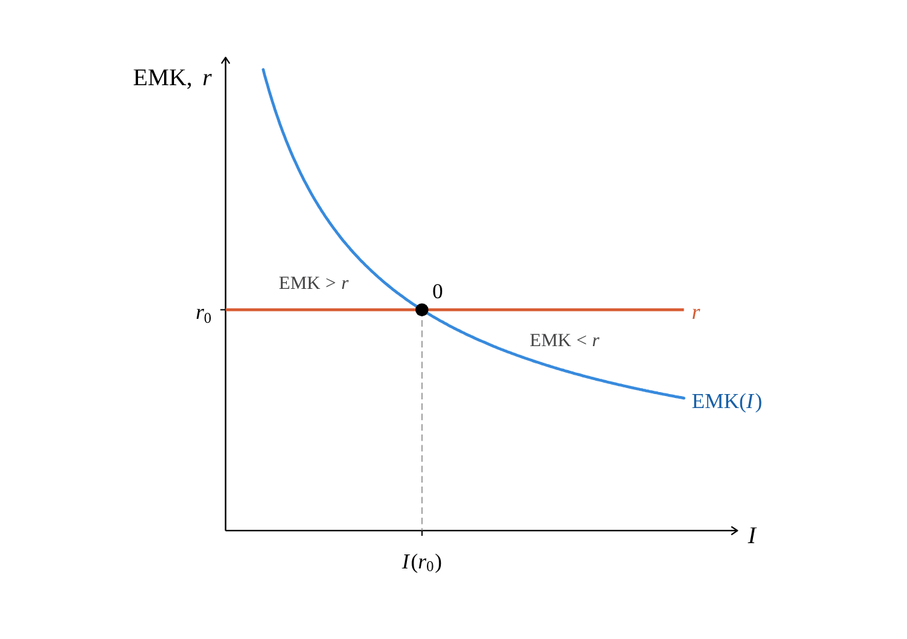
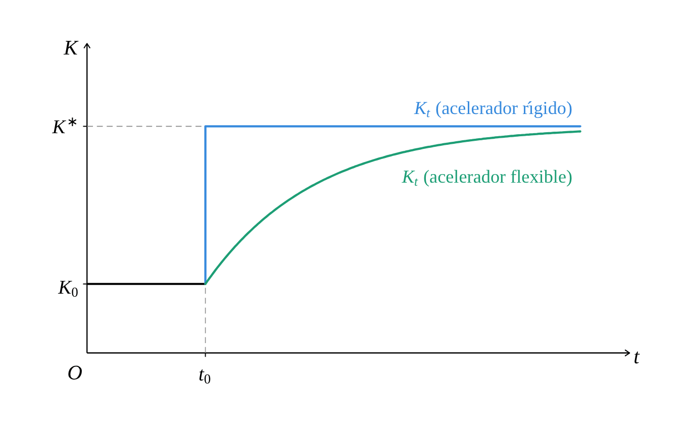
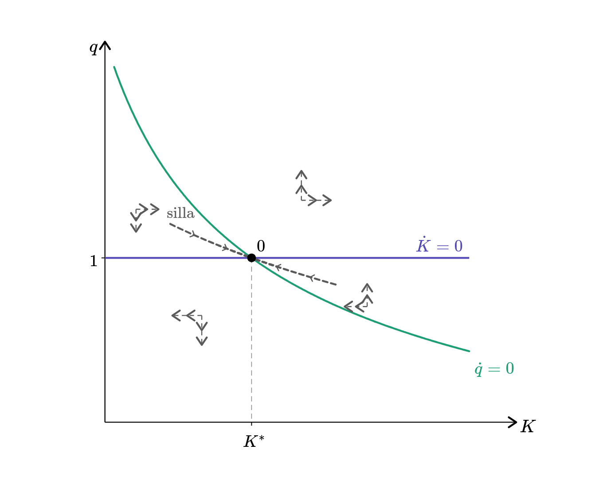
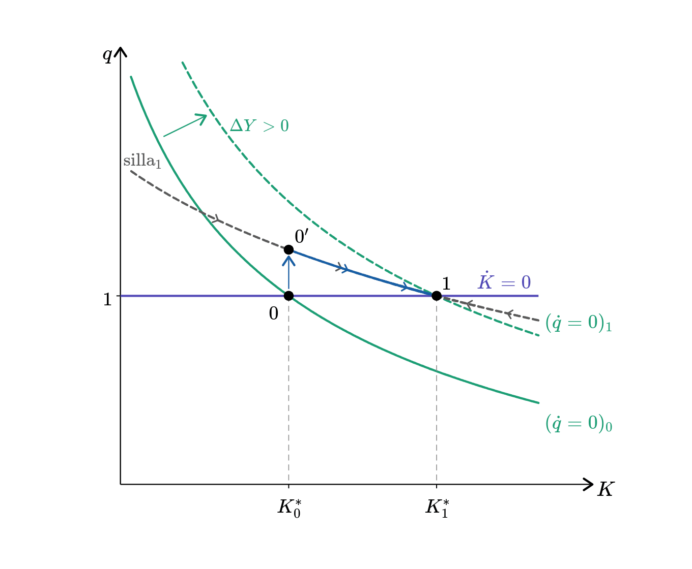
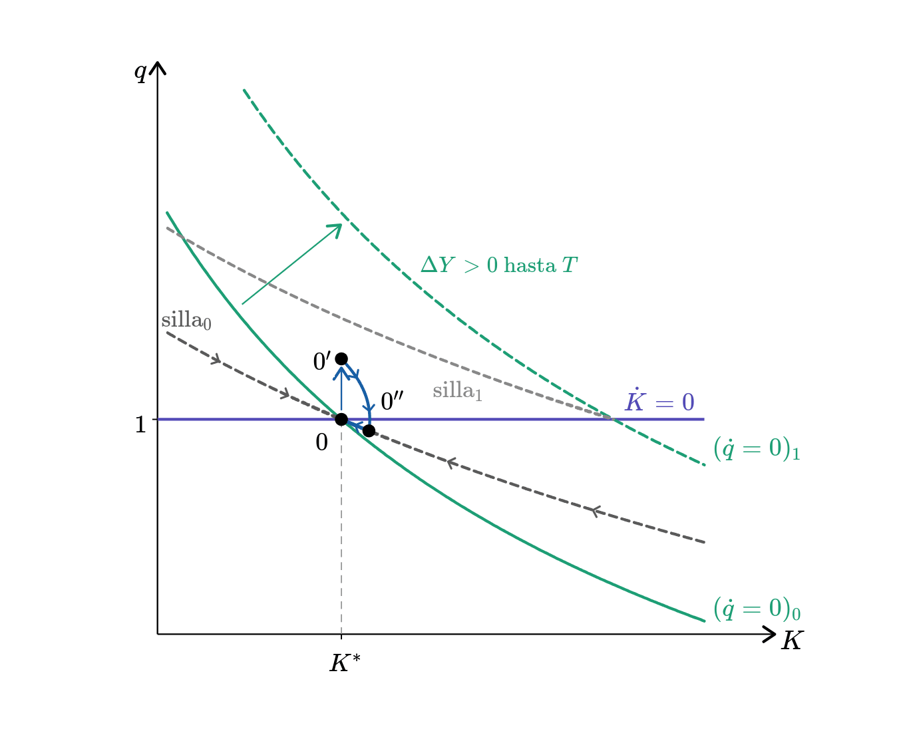
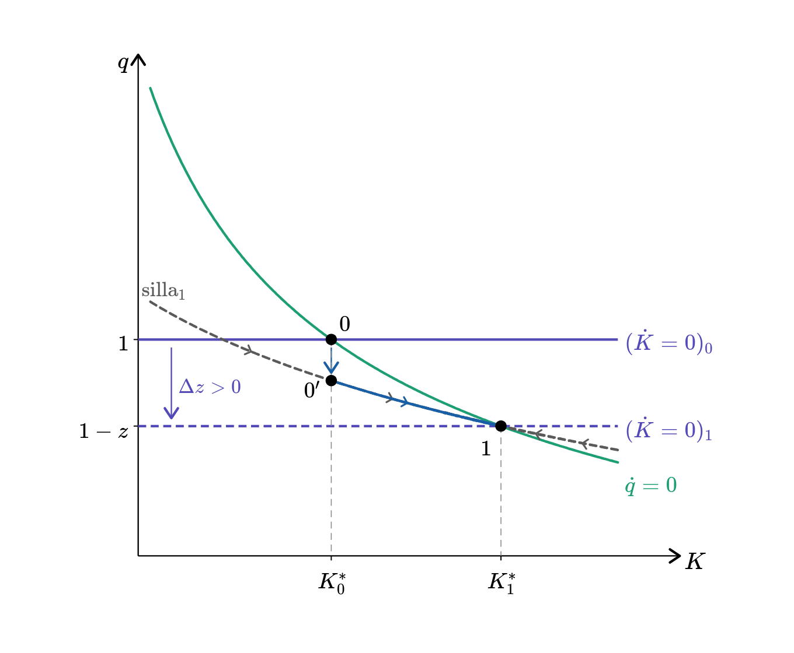
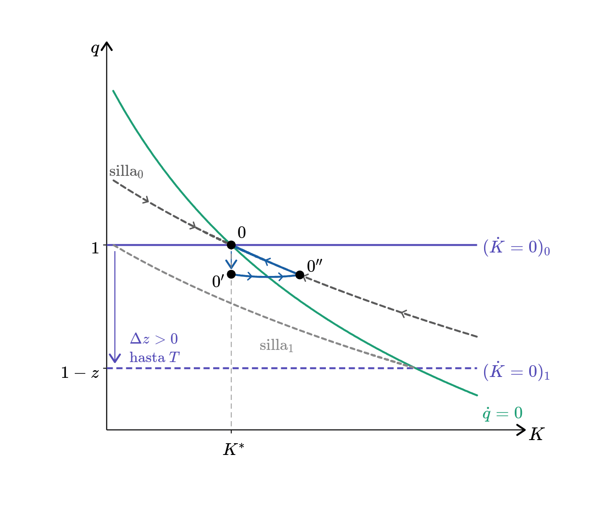
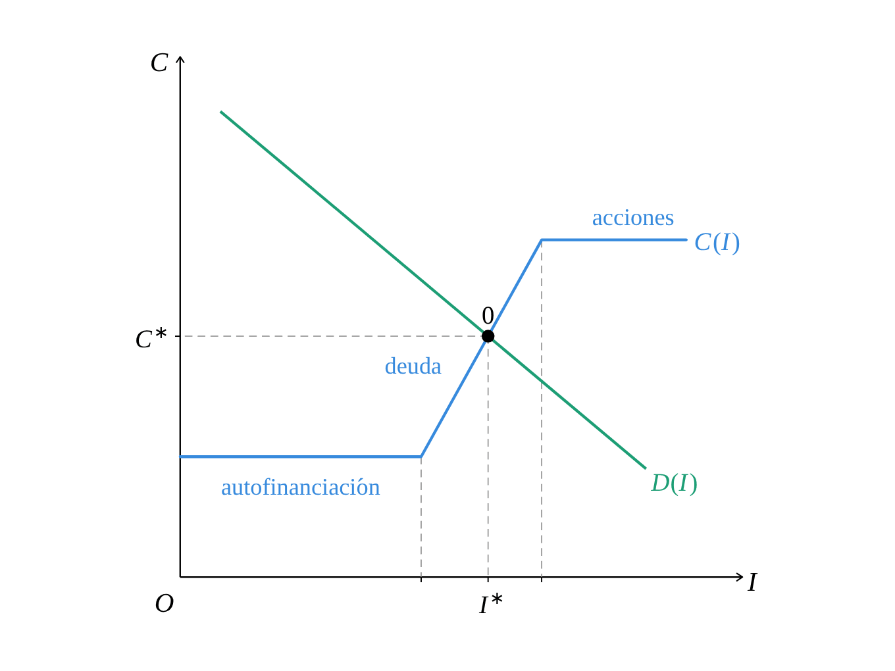

## Introducción



El concepto de inversión es uno de los conceptos económicos más difíciles de delimitar, si bien está estrechamente relacionado con el concepto de capital. La **inversión**, variable flujo, mide cómo cambia con el tiempo una variable *stock*, el capital productivo. Invertir es, para una unidad productiva, acercar el capital del que dispone al que desearía tener. En macroeconomía, a diferencia de las finanzas, el término designa la creación de capital, no la compra de activos financieros[^a34-1]. El tipo de capital define el tipo de inversión, y este tema considera la inversión económica, entendida como la afectación de bienes económicos a fines productivos.

Para la macroeconomía, la demanda de inversión importa por tres razones. Ningún otro componente de la demanda oscila tanto, así que explica buena parte de las fluctuaciones a corto plazo. Mirando más lejos, la parte del producto que se invierte nace del encuentro entre lo que las empresas quieren invertir y lo que los hogares deciden ahorrar, y de ambas cosas depende la capacidad productiva a largo plazo. Además, en las recesiones y en las fases de actividad débil, la política económica suele orientar sus medidas a tratar de reanimar la inversión.

El tema estudia, en orden cronológico, las teorías que identifican los determinantes de la inversión y de las que se deducen distintas implicaciones de política económica. Se estructura como sigue:

- *Fundamentos*: aportaciones de Fisher, Keynes, teorías del acelerador y Hayek.

- *Teorías modernas*: modelo de Jorgenson sin costes de ajuste, concepto de costes de ajuste, *q* de Tobin, modelo con costes de ajuste.

- *Incertidumbre, irreversibilidad y financiación*: inversión como opción real, decisiones de financiación e implicaciones de política económica.

Conviene adelantar ya la principal enseñanza del tema para la política económica. Las medidas que mueven el tipo de interés o los tipos impositivos pueden influir en la inversión, pero lo que más pesa en ella es un entorno macroeconómico estable y previsible.

## 1. Fundamentos de la teoría moderna sobre la demanda de inversión

La **inversión real** es el gasto real destinado a la compra de bienes de capital y, por tanto, es un gasto de naturaleza distinta al alquiler de capital en los mercados de factores. Los servicios de los factores se alquilan y deben suministrarse de nuevo en cada momento del proceso productivo. Los bienes de capital adquiridos, en cambio, generan un flujo de servicios productivos a lo largo del tiempo.

Para entender las teorías dinámicas actuales de la inversión conviene repasar brevemente las aportaciones que dieron lugar a tres conceptos importantes de la teoría moderna. En primer lugar, las aportaciones de Fisher y Keynes, que ponen énfasis en la conducta de los agentes. Como no estudian el proceso de ajuste del *stock* de capital en sí mismo, constituyen más bien teorías de la demanda de capital que de la inversión. En segundo lugar, el principio del acelerador, que enfatiza el papel de la demanda agregada en la determinación de la inversión. En tercer lugar, la inversión como proceso de ajuste según Hayek, que enfatiza el papel de la inversión como fenómeno de desequilibrio.

### 1.1. Aportación neoclásica: la tasa de retorno sobre el coste (Fisher, 1930)

**Origen**: la aportación de Irving Fisher (1930) fue uno de los primeros intentos de microfundamentar intertemporalmente las ideas clásicas sobre la inversión.

**Idea**: Fisher considera que cuando un agente invierte, compra un derecho sobre un flujo de retornos durante la vida útil del bien de capital. Así, desarrolló su “segunda aproximación”, un modelo intertemporal de decisión de inversión. Su principal resultado es que lo que llamó *tasa de retorno sobre el coste* (tasa interna de rentabilidad, en términos actuales) debe ser igual al tipo de interés real de mercado, con independencia de las preferencias del inversor.

#### 1.1.1. Supuestos

**Entorno**: el modelo tiene dos periodos y adopta los supuestos habituales de la escuela neoclásica. Los mercados financieros son perfectos, de modo que el agente presta o se endeuda al mismo tipo de interés real, $r$, y el ahorro se canaliza eficientemente hacia la inversión.

**Agentes**: un consumidor-inversor racional que dispone de rentas $y_1$ e $y_2$ y maximiza la utilidad de su consumo intertemporal, como en el tema [A33](a33-demanda-consumo.qmd), apartado 2.1.2.

**Tecnología**: una oportunidad de producción con rendimientos decrecientes, en la que el capital $k$ invertido en el periodo 1 rinde $f(k)$ en el periodo 2, con $f' > 0$ y $f'' < 0$, y se deprecia a la tasa $\delta$.

#### 1.1.2. Modelo

**Planteamiento**: la riqueza del agente depende de cuánto invierta, $W(k) = y_1 - k + [y_2 + f(k) + (1-\delta)k]/(1+r)$, y su programa es $\max u(c_1, c_2)$ sujeto a $c_1 + c_2/(1+r) = W(k)$. Como $k$ solo entra a través de $W$, el problema se separa en dos etapas (*teorema de separación de Fisher*). Primero, la inversión maximiza la riqueza y, después, el consumo se elige sobre esa riqueza como en A33.

::: {.callout-note appearance="simple" icon=false}
El modelo del consumidor-productor de Fisher, con el teorema de separación y su representación gráfica, se desarrolla en el tema [A29](a29-mhi-mgs.qmd), apartado 2.4.2.
:::

**CPO**: de la primera etapa, $\partial W/\partial k = 0$:

$$\underbrace{\frac{df}{dk} - \delta}_{\text{Pmg}_{k} \text{ neta}} = r$$

Se invierte hasta que la tasa de retorno sobre el coste, el rendimiento marginal del capital neto de depreciación, iguala el tipo de interés real. La condición es independiente de las preferencias, de modo que la decisión de inversión es la misma para todos los agentes, sean cuales sean sus gustos, lo que justifica separar la teoría de la inversión de la del consumo.

**CSO**: $\partial^2 W/\partial k^2 = f''(k)/(1+r) < 0$, de modo que la CPO es suficiente.

**Solución**:

- *Función de demanda de inversión individual*: la CPO define el capital deseado, $k^* = k(r)$, decreciente en el tipo de interés. Una subida de $r$ exige una productividad marginal mayor y, por los rendimientos decrecientes, un *stock* de capital menor, que se alcanza con menos inversión.

- *Función de demanda de inversión agregada*: como todos los agentes siguen la misma regla, agregando se obtiene la función de demanda de inversión neoclásica, decreciente en el tipo de interés real:

$$I = I(r), \qquad I'(r) < 0$$

**Desarrollo gráfico**: en el plano fondos prestables (ahorro e inversión reales)-tipo de interés real, la función de inversión se integra en el mercado de fondos prestables (neo)clásico (figura -@fig-a348-fondos-prestables):

1. *Demanda de fondos prestables*, $I(r)$: recoge la inversión y tiene pendiente negativa, porque, por los rendimientos decrecientes del capital, un tipo de interés más alto reduce el capital deseado. Con sector público, a la inversión se suma el déficit (desahorro o endeudamiento del sector público).

2. *Oferta de fondos prestables*, $S(r)$: recoge el ahorro, que se supone creciente en el tipo de interés real.

3. *Equilibrio*: en el punto 0, el tipo de interés real de equilibrio, $r_0$, iguala el ahorro y la inversión deseados, $I_0$.

**Estática comparativa**: se distinguen dos perturbaciones, una en cada panel de la figura:

- *Mejora tecnológica* ($f'$ mayor para cada $k$): desplaza la demanda de fondos prestables hacia la derecha, de $I_0(r)$ a $I_1(r)$ (panel a). En el paso del punto 0 al 1, suben la inversión y el tipo de interés.

- *Aumento del ahorro*: desplaza la oferta hacia la derecha, de $S_0(r)$ a $S_1(r)$ (panel b). En el paso del punto 0 al 1, el tipo de interés baja y la inversión sube.

::: {#fig-a348-fondos-prestables}

::: {.content-visible when-format="html"}
```{=html}
<div class="graph-frame wide">
<iframe src="../graphs/a348_Fondos_prestables.html" style="--r:1.478" loading="lazy" title="fig-a348-fondos-prestables"></iframe>
</div>
```
:::

::: {.content-visible unless-format="html"}

:::

Mercado de fondos prestables neoclásico. La oferta (ahorro), $S(r)$, y la demanda (inversión), $I(r)$, se cortan en el equilibrio 0. (a) Una mejora tecnológica ($\Delta f' > 0$) desplaza la demanda a $I_1(r)$ y eleva el tipo de interés y la inversión (punto 1). (b) Un aumento del ahorro ($\Delta S > 0$) desplaza la oferta a $S_1(r)$, reduce el tipo de interés y eleva la inversión (punto 1).
:::

En ambos casos, la flexibilidad del tipo de interés real garantiza que la renta generada (oferta) sea igual al gasto de la economía (demanda), es decir, que se cumpla la ley de Say.

**Extensiones**: en el mercado de fondos prestables, las políticas de demanda operan a través del tipo de interés real.

- *Política monetaria expansiva*: produce un exceso de oferta de fondos prestables (entra en juego el dinero del banco central puesto en circulación), con la consecuente caída del tipo de interés y, por ello, mayor inversión. Sin embargo, como los precios son flexibles, el nivel general de precios sube hasta restablecer el equilibrio original, de modo que la política monetaria es neutral a largo plazo.

- *Política fiscal expansiva*: desplaza la demanda de fondos prestables hacia la derecha, como la mejora tecnológica del panel (a), y produce un exceso de demanda. En consecuencia, sube el tipo de interés real y se contraen el consumo y la inversión privada (el ahorro privado aumenta) en favor de la financiación del sector público, lo que supone un efecto expulsión (*crowding out*) total.

#### 1.1.3. Conclusiones

**Aspectos positivos**: la aportación de Fisher tiene el mérito de microfundamentar intertemporalmente la inversión y de separarla, por el teorema de separación, de las preferencias del inversor.

**Limitaciones**: Fisher solo representó gráficamente un horizonte de dos periodos (su formulación algebraica abarca un número cualquiera de años), y trabaja en un marco de pleno empleo donde el tipo de interés real iguala el ahorro y la inversión deseados. Keynes cuestiona de manera fundamental este último supuesto a raíz de la Gran Depresión americana.

### 1.2. Aportación keynesiana: la eficiencia marginal del capital (Keynes, 1936)

**Origen**: Keynes (1936) analizó la inversión como magnitud económica fundamental.

**Idea**: Keynes introduce dos ideas muy relevantes a la hora de entender la inversión:

- *Naturaleza de la inversión*: Keynes acepta las ideas de Fisher en cuanto a la tasa de retorno sobre el coste, si bien la bautiza como *eficiencia marginal del capital*. Sin embargo, señala que los retornos son esperados bajo una incertidumbre no reducible a probabilidades, de modo que dependen del estado de la confianza y del horizonte durante el que se esperan obtener. Por tanto, para Keynes lo decisivo no es la productividad física del capital, como lo era para muchos autores neoclásicos (p. ej. Marshall), sino las expectativas sobre sus rendimientos.

- *Causalidad*: para Keynes, la inversión es la variable que impulsa la economía. Movida por las expectativas de los empresarios, la inversión determina el ahorro y no al revés. Esto supone, en línea con el pensamiento de Keynes, la extensión de la “inversión de la ley de Say” al ámbito del ahorro y la inversión y no solo del consumo.

#### 1.2.1. Supuestos

**Entorno**: hay desempleo e incertidumbre no reducible a probabilidades sobre los rendimientos futuros del capital. Por ello, la inversión efectiva, que forma parte del producto o renta nacional, puede diferir de la deseada o planeada, que forma parte de la demanda agregada. La brecha entre ambos tipos de inversión da lugar a la acumulación o desacumulación involuntaria de existencias.

**Agentes**: empresarios que comparan los rendimientos futuros con el tipo de interés de mercado y cuyas expectativas sobre esos rendimientos están dominadas por los instintos animales (*animal spirits*), volátiles e impredecibles.

**Tecnología**: rendimientos marginales decrecientes del capital, de modo que los proyectos pueden ordenarse por su rentabilidad esperada, que cae conforme aumenta la inversión.

#### 1.2.2. Modelo

**Planteamiento**: no hay programa de optimización explícito. La decisión de inversión se realiza comparando la eficiencia marginal del capital (EMK) con el tipo de interés de mercado:

- *Eficiencia marginal del capital*: se trata del tipo de descuento al que la suma actualizada de los rendimientos previstos de un proyecto de inversión o bien de capital iguala su coste. Ese coste es el de reemplazo o precio de oferta, es decir, lo mínimo que cuesta reproducir el bien, distinto de su cotización en el mercado. Formalmente, $C_K = \sum_{j=1}^{T} Q^{e}_{j}/(1 + \text{EMK})^j$, donde $C_K$ es el coste de reposición del bien de capital, $Q^{e}_{j}$ el rendimiento esperado en el año $j$ y $T$ su vida útil.

- *Tipo de interés*: el tipo de interés de mercado, que en Keynes es el monetario, refleja el coste de oportunidad de no realizar una inversión alternativa. 

**Solución**:

- *Condición de demanda de inversión*: con base en lo anterior, Keynes deduce que debe cumplirse $\text{EMK} > r$. Es decir, se invierte si lo que se prevé obtener en el futuro con la inversión considerada es superior a lo que se deja de ganar en una inversión alternativa. En caso contrario ($\text{EMK} \leq r$), el proyecto no se acomete. En el agregado, la no reposición del capital depreciado y la desacumulación de existencias pueden hacer negativa la inversión neta.

- *Función de demanda de inversión individual*: cada proyecto $p$ tiene un coste $C_p$ y una $\text{EMK}_p$ dada por sus rendimientos esperados. La inversión de la empresa $i$ es la suma de los proyectos aceptados, $I_i = \sum_p I_p$, y la decisión sobre cada uno es discreta, $I_p = C_p > 0$ si $\text{EMK}_p > r$ e $I_p = 0$ si $\text{EMK}_p \leq r$.

    La función resultante es escalonada y decreciente en el tipo de interés, pues al subir $r$ se descartan los proyectos con menor $\text{EMK}$, y las expectativas entran a través de los $Q^{e}_{j}$. Agregando sobre las empresas, $I = \sum_i I_i(r)$, la función sigue siendo escalonada. Con un continuo de proyectos, en cambio, los escalones se funden en la curva de EMK continua y decreciente del desarrollo gráfico, cuya linealización es la función agregada keynesiana.

- *Función de demanda de inversión agregada*: con base en todas estas ideas, Keynes la expresa, en términos reales, como:

$$I = I_0 + I(r), \qquad I'(r) < 0$$

donde $I_0$ es el componente exógeno, que refleja el peso de las expectativas o *animal spirits* y tiene un valor elevado. La pendiente $I'(r)$ mide la sensibilidad de la inversión al tipo de interés, que se considera baja. En suma, Keynes considera, generalmente, que en la función de inversión $I_0$ es grande e $I'(r) \approx 0$.

**Desarrollo gráfico**: la decisión de inversión se representa en el plano inversión-EMK y tipo de interés (figura -@fig-b312-emk):

1. *Curva de EMK*, $\text{EMK}(I)$: ordena los proyectos de inversión de mayor a menor EMK y, con un continuo de proyectos, tiene pendiente negativa. Según Keynes, la EMK cae conforme aumenta la inversión porque el rendimiento esperado disminuye a medida que aumenta la oferta de ese tipo de capital y la presión sobre las industrias que lo producen eleva su precio de oferta.

    A ello se suma el riesgo creciente del endeudamiento (Kalecki, 1937). Los primeros proyectos pueden financiarse sin recurrir a él, pero, conforme aumenta su número, crecen el endeudamiento y el riesgo y, con ellos, cae la rentabilidad de los proyectos medida por la EMK.

2. *Tipo de interés*, $r$: el tipo de interés de mercado, $r_0$, no depende de la inversión, de modo que es una recta horizontal.

3. *Equilibrio*: por los rendimientos marginales decrecientes del capital, el óptimo se alcanza en el punto 0, donde la EMK iguala el tipo de interés de mercado y la inversión es $I(r_0)$. A su izquierda, $\text{EMK} > r$ y los proyectos se acometen, mientras que a su derecha, $\text{EMK} < r$ y ya no es rentable llevar a cabo más proyectos de inversión.

::: {#fig-b312-emk}

::: {.content-visible when-format="html"}
```{=html}
<div class="graph-frame">
<iframe src="../graphs/b312_EMK.html" style="height:520px" loading="lazy" title="fig-b312-emk"></iframe>
</div>
```
:::

::: {.content-visible unless-format="html"}

:::

Eficiencia marginal del capital (Keynes, 1936). La inversión se realiza hasta el proyecto cuya EMK iguala al tipo de interés.
:::

**Estática comparativa**: se distinguen dos movimientos, de los que domina el segundo:

- *Subida del tipo de interés*: reduce la inversión a lo largo de la curva de EMK, pero poco, dado $I'(r) \approx 0$.

- *Cambios en las expectativas ($I_0$), la tecnología o el capital*: desplazan la curva de EMK. En particular, una mejora de las expectativas o de la tecnología la desplaza hacia la derecha y eleva la inversión para cualquier tipo de interés.

**Extensiones**: del dominio de los instintos animales sobre las expectativas se deduce el carácter errático e inestable de la inversión y, con ello, de la demanda agregada. 

La escasa sensibilidad de la inversión al tipo de interés, $I'(r) \approx 0$, constituye el *primer eslabón débil* de la demanda según Keynes. Junto con la trampa de liquidez (segundo eslabón débil), explica la ineficacia de la política monetaria en el modelo keynesiano. Junto con la ilusión monetaria (que causa rigidez salarial nominal a la baja), explica además que la economía no retorne por sí sola al pleno empleo. En consecuencia, la eficacia de las dos políticas de demanda es muy distinta.

- *Política monetaria*: es poco efectiva con la renta y el empleo, y menos que la política fiscal, porque solo actúa a través de una inversión poco sensible al tipo de interés.

- *Política fiscal*: eleva con fuerza la renta y el empleo y apenas reduce la inversión, que, gobernada por los *animal spirits*, responde poco al tipo de interés, y por ello existe un efecto expulsión parcial.

#### 1.2.3. Conclusiones

**Aspectos positivos**: amplía las aportaciones de Fisher e introduce conceptos esenciales para la inversión como la importancia de las expectativas.

**Limitaciones**:

- *Demanda de capital*: explica cuánto capital quiere la empresa, no cuánto invierte, pues nada dice de la velocidad con que el capital se acerca a ese objetivo.

- *Estimación*: es difícil estimar en la práctica la EMK y, con ella, la función de inversión, ya que los instintos animales no son observables.

- *EMK decreciente*: la subida del precio de oferta de los bienes de capital, que para Keynes (1936) es la causa principal del descenso de la EMK a corto plazo, pierde fuerza si hay desempleo y capacidad ociosa en las industrias que los producen.

### 1.3. Revitalización del principio del acelerador

Las teorías del acelerador, formuladas a comienzos del s. XX, contribuyeron al avance de las teorías keynesianas del multiplicador y del ciclo económico. 

Tras la *Teoría general* volvieron al primer plano, porque la parte endógena de la función de inversión keynesiana, en su formulación original, apenas tenía poder explicativo.

Las versiones de esa etapa se apoyaban más en un ajuste aceptable a los datos que en la microeconomía, y buscaban explicar a qué velocidad se acerca el capital a su nivel óptimo. Su hipótesis común liga la inversión neta a cómo evoluciona la demanda agregada. Cuando el gasto crece y supera lo producido, a las empresas se les abren dos caminos, subir precios o producir más. 

El **principio del acelerador** de la inversión supone que las empresas eligen la segunda vía y producen más. Más demanda agregada exige más producción, producir más requiere más equipos, y así crecen la inversión y el capital.

#### 1.3.1. Teoría del acelerador simple o rígido (J. M. Clark, 1917)

**Origen**: John Maurice Clark (1917) formuló el principio, que ya contaba con algunos precedentes. Harrod (1936) y Samuelson (1939) lo incorporaron después al análisis keynesiano del ciclo.

**Idea**: la inversión neta no depende del nivel de la demanda sino de su variación, porque, como el capital deseado es proporcional al *output*, solo un aumento del *output* exige capital nuevo.

**Supuestos**:

- *Entorno*: tiempo discreto y mercado de bienes de capital perfecto, sin retrasos en la adaptación del capital. Gracias a ello, la empresa alcanza en cada periodo el *stock* que desea, de modo que el capital efectivo y el óptimo o deseado coinciden siempre, $K_t = K_t^*$.

- *Agentes*: son miopes. Sus expectativas sobre las variables coinciden con sus niveles corrientes (p. ej. $Y_t^e = Y_t$).

- *Tecnología*: con coeficientes fijos, cada unidad de *output* real requiere siempre la misma cantidad de capital, y el capital deseado resulta $K_t^* = vY_t$, con $v = K/Y$ la ratio capital-output deseada. No se considera la depreciación, por lo que la inversión neta coincide con la bruta, $I_t^n = I_t^b$.

**Planteamiento**: no hay programa de optimización como tal, sino que el capital deseado es una proporción técnica del *output*, $K_t^* = vY_t$, y se alcanza en cada periodo.

**Solución**: de lo anterior se deduce la función de demanda de inversión, en la que la inversión depende de cambios en la demanda:

$$I_t = v \cdot \Delta Y_t$$
donde $I_t$ es la inversión neta y $\Delta Y_t$ la variación de la producción.

**Estática comparativa**: se distinguen tres perturbaciones:

- *Aumento permanente del nivel de $Y$*: si se produce un *shock* de $Y$ a partir del periodo $t$, la inversión es positiva solo en el periodo del cambio, $I_t = v\,\Delta Y_t$, y vuelve a cero después, pues el capital ya se ha ajustado al nuevo nivel.

- *Aumento transitorio de $Y$*: si se produce un *shock* de $Y$ exclusivamente en el periodo $t$, la inversión es positiva cuando $Y$ sube y negativa (desinversión) cuando vuelve a su nivel.

- *Crecimiento sostenido de $Y$*: si $Y$ crece en una cuantía constante durante $[t, t+j]$, es decir, con $\Delta Y$ constante, la inversión es positiva y constante. Solo cambia si $Y$ se acelera o desacelera, $\Delta I_t = v\,\Delta^2 Y_t$.

De aquí procede el nombre de “acelerador”. Así, no es necesario que la producción caiga para que caiga la inversión, sino que basta con que crezca más despacio, y el efecto es mayor cuanto mayor es $v$. 

**Extensiones**: al incluir el acelerador en el modelo macroeconómico, multiplicador y acelerador interactúan (Samuelson, 1939). Con consumo retardado, $C_t = c(1-\tau)\,Y_{t-1}$, e inversión inducida por la variación del consumo, $I_t = v\,(C_t - C_{t-1})$, la renta sigue la ecuación en diferencias

$$Y_t = c(1-\tau)(1+v)\,Y_{t-1} - c(1-\tau)\,v\,Y_{t-2} + G_0$$

donde $c$ es la propensión marginal a consumir, $\tau$ el tipo impositivo, $v$ el acelerador y $G_0$ el gasto público autónomo. Una vez estabilizada la renta, la inversión inducida se anula y el efecto a largo plazo de un aumento permanente de $G_0$ es el multiplicador keynesiano, $1/[1 - c(1-\tau)]$. El acelerador amplía, en cambio, la respuesta transitoria, que puede sobrepasar ese nivel y oscilar, y la senda solo converge si $c(1-\tau)\,v < 1$.

Solo si, por simplificación, la inversión inducida depende del nivel de renta, $I = bY$, con $b$ la propensión marginal a invertir (*supermultiplicador*), el multiplicador es permanentemente mayor, $1/[1 - c(1-\tau) - b]$, siempre que $c(1-\tau) + b < 1$. De ello se siguen las implicaciones de política económica del acelerador simple.

- *Política monetaria*: pierde todavía más eficacia que en Keynes para influir en la inversión, porque el tipo de interés ni siquiera entra en la función de inversión, que solo responde a la producción.

- *Política fiscal*: a corto plazo mueve la renta y el empleo, y con ellos la inversión, con más fuerza aún que en Keynes. Hay dos razones. Primero, el acelerador amplía la respuesta transitoria de la renta al gasto público (y la hace permanente en la versión del supermultiplicador). Segundo, de acuerdo con la teoría del acelerador, el efecto expulsión sobre la inversión privada es nulo.

**Conclusiones**:

- *Aspectos positivos*: el modelo del acelerador se ajusta empíricamente bastante bien para explicar la inversión en existencias.

- *Limitaciones*: las principales críticas apuntan a que los supuestos son muy restrictivos:

    - *Mercado de bienes de capital*: da por hecho que la empresa consigue todo el equipo que quiere sin alterar su precio. Puede valer para una empresa pequeña, pero no en el agregado, donde una mayor demanda de equipo tiende a encarecerlo.

    - *Ritmo de ajuste*: sin retardos y con el *stock* efectivo siempre igual al deseado, no hay un ritmo de ajuste propiamente dicho, porque ante cualquier cambio en la demanda hay que invertir, y de forma inmediata.

    - *Agentes*: no considera el efecto de las expectativas, dado que los empresarios son miopes.

    - *Tecnología*: exige coeficientes fijos. Sin embargo, si el trabajo puede sustituir al capital, las empresas pueden responder a las oscilaciones de la demanda cambiando el uso que hacen de sus factores, sin tener que invertir.

#### 1.3.2. Teoría del acelerador flexible (Goodwin, 1951; Chenery, 1952; Koyck, 1954)

**Origen**: Richard Goodwin (1951), Hollis Chenery (1952) y Leendert Koyck (1954) generalizaron el acelerador simple a raíz de sus limitaciones.

**Idea**: el capital se ajusta a su nivel deseado con retardo, de modo que la inversión responde a las variaciones pasadas de la demanda y no solo a la corriente.

**Supuestos**: se mantienen los del acelerador simple, con una excepción. Ahora existen retardos, de forma que las empresas no pueden llevar de golpe su capital hasta el nivel óptimo.

**Planteamiento**: tampoco hay programa de optimización, pues el retardo se introduce de forma *ad hoc* en la regla de ajuste.

**Solución**: en la función de demanda de inversión, la inversión responde a la variación de la renta del periodo corriente y de todos los precedentes, con retardos de peso decreciente:

$$I_t = v\,(1-\gamma) \sum_{j=0}^{\infty} \gamma^j \Delta Y_{t-j} \quad\Leftrightarrow\quad K_t - K_{t-1} = (1-\gamma)\,(K_t^* - K_{t-1})$$

donde $\gamma \in (0, 1)$ es el parámetro de retardo (en cada periodo desaparece la fracción $1-\gamma$ de la distancia que separa el capital deseado del existente). Las variaciones de la producción pesan menos cuanto más antiguas son, y por eso el capital se aproxima al óptimo poco a poco.

**Desarrollo gráfico**: en el plano tiempo-capital (figura -@fig-a346-acelerador), la diferencia entre ambas teorías se aprecia en la senda del *stock* de capital cuando en $t_0$ el capital deseado pasa de $K_0$ a $K^*$:

1. *Capital inicial y deseado*: se parte de un *stock* de capital previo, $K_0$, y de un *stock* de capital óptimo o deseado, $K^*$, que lo supera desde $t_0$.

2. *Senda del acelerador rígido*, $K_t$: el *stock* de capital salta en $t_0$ hasta $K^*$, porque se ajusta por completo en el periodo del cambio.

3. *Senda del acelerador flexible*, $K_t$: el *stock* de capital se ajusta de forma gradual y se aproxima a $K^*$ cerrando en cada periodo la fracción $1-\gamma$ de la brecha, lo cual resulta más realista.

::: {#fig-a346-acelerador}

::: {.content-visible when-format="html"}
```{=html}
<div class="graph-frame">
<iframe src="../graphs/a346_Acelerador.html" style="height:480px" loading="lazy" title="fig-a346-acelerador"></iframe>
</div>
```
:::

::: {.content-visible unless-format="html"}

:::

Acelerador flexible. El *stock* de capital se ajusta parcialmente hacia su nivel deseado.
:::

**Estática comparativa**: un aumento permanente de la producción eleva el capital de forma gradual. La inversión alcanza su máximo en el periodo del cambio y decrece después a la tasa $1-\gamma$ por periodo. Por su parte, un aumento transitorio produce una inversión menor y también repartida en el tiempo. Cuanto mayor es $\gamma$, más lento es el ajuste.

**Extensiones**: las implicaciones de política son similares a las del acelerador rígido, atenuadas por el retardo.

- *Política monetaria*: al igual que en la teoría del acelerador simple, carece por completo de eficacia para influir en la inversión.

- *Política fiscal*: pierde algo de fuerza respecto al acelerador rígido, porque con retardos la inversión no responde de golpe, sino de forma escalonada.

**Conclusiones**:

- *Aspectos positivos*: en el terreno empírico, el acelerador flexible obtuvo buenos resultados. Las variaciones de la demanda y la inversión muestran una correlación positiva, aunque eso no prueba por sí solo una relación causal.

- *Limitaciones*: salvo en lo relativo a los retardos, recibe críticas parecidas a las del acelerador simple:

    - *Tipo de interés*: la función de inversión lo ignora.

    - *Costes de ajuste*: se introduce el retardo sin explicar qué costes lo originan.

    - *Optimización*: ningún agente optimiza intertemporalmente, de ahí que, en rigor, sea una regla de ajuste más que una teoría de la inversión.

#### 1.3.3. Conclusiones

**Aspectos positivos**: ambas teorías del acelerador son útiles para explicar la evidencia empírica (p. ej. inversión en existencias).

**Limitaciones**: *a priori*, no existen motivos para suponer que las empresas deseen mantener una ratio capital-output fija con independencia de los precios relativos de los factores. Además, como recuerda Haavelmo (1960), la demanda de inversión no puede deducirse sin más de la demanda de capital, porque un *stock* deseado no determina a qué ritmo se invierte. Para explicar bien la inversión en capital fijo hay que contestar tres preguntas, que las teorías del acelerador solo abordan parcialmente:

- *Stock deseado*: cuánto capital se quiere.

- *Ritmo de ajuste*: con qué rapidez se alcanza ese nivel.

- *Reposición*: cómo se repone en el tiempo el capital gastado.

### 1.4. Perspectiva austriaca: inversión como ajuste óptimo (Hayek, 1941)

**Origen**: en la escuela austriaca, la aportación de Friedrich von Hayek (1941) pone el énfasis en el proceso de ajuste del capital y es un antecedente de las teorías modernas con costes de ajuste.

**Idea**: Hayek consideraba la inversión un fenómeno de desequilibrio, y la decisión de inversión, una decisión sobre la velocidad óptima de ajuste hacia el equilibrio.

**Razonamiento**: una empresa puede decidir que necesita una fábrica (la decisión sobre el *stock* de capital). Sin embargo, a qué velocidad construirla y cuánto gastar mensualmente en ello (la decisión de inversión) es una decisión aparte, ligada a la velocidad de ajuste al *stock* deseado.

**Extensiones**: en materia de política económica, Hayek defendía que existía un “orden espontáneo” derivado de la interacción de agentes descentralizados, el cual no podía ser diseñado por un planificador social. Por tanto, *a priori*, la intervención del Estado debía ser mínima para dejar actuar las velocidades óptimas de ajuste de los empresarios.

**Conclusiones**:

- *Aspectos positivos*: la aportación de Hayek tiene el mérito de poner énfasis en el proceso de ajuste del capital, que posteriormente ha recibido gran atención a través de los costes de ajuste.

- *Limitaciones*: carece de formalismo matemático, como es propio de la escuela, lo que explica que los desarrollos posteriores eclipsaran su aportación.

### 1.5. Conclusiones

Las aportaciones de la sección 1 fijan los determinantes que retoman las teorías modernas. Fisher iguala la tasa de retorno sobre el coste al tipo de interés real y separa así la decisión de invertir de las preferencias del inversor. Keynes conserva esa comparación, pero con rendimientos esperados e inciertos, y por ello la inversión depende más de los *animal spirits* que del tipo de interés. El acelerador traslada el peso a la variación de la producción y, en su versión flexible, introduce un ajuste gradual con un retardo *ad hoc*, sin optimización ni tipo de interés. Hayek separa expresamente la decisión sobre el *stock* de la decisión sobre la velocidad de ajuste, aunque sin formalizarla.

Ninguna de estas aportaciones une una decisión optimizadora y un ritmo de ajuste formalizado, de modo que ninguna responde a la vez a las tres preguntas de Haavelmo (1960). Esa carencia llevó a los desarrollos modernos de la sección 2, que derivan el *stock* deseado del coste de uso y el ritmo de inversión de los costes de ajuste.

## 2. Teorías modernas de la inversión

Los modelos desarrollados a partir de los años sesenta plantean la decisión de inversión como un problema de optimización dinámica, la maximización del valor descontado de los beneficios presentes y futuros de la empresa.

### 2.1. Modelo de demanda de inversión sin costes de ajuste (Jorgenson, 1963; 1967)

**Origen**: el modelo dinámico neoclásico básico se debe a Dale Jorgenson (1963; con Hall, 1967).

**Idea**: la empresa desea el *stock* de capital que iguala la productividad marginal del capital a su coste de uso, y la inversión es el ajuste hacia ese *stock*. De este modo, los precios relativos de los factores, y no solo la demanda, determinan la inversión.

#### 2.1.1. Supuestos

**Entorno**: mundo neoclásico, horizonte infinito, tiempo continuo y precios del producto, del trabajo y del capital constantes ($\dot{P} = \dot{w} = \dot{P}_K = 0$), aunque la inflación es relevante para el coste de uso. Desde el punto de vista de la inversión, el mundo neoclásico tiene cuatro implicaciones relevantes:

- *Tipo de interés*: el tipo de interés real es constante y exógeno, sin prima de riesgo, por la perfección de los mercados financieros.

- *Oferta de capital*: la oferta de bienes de capital es perfectamente elástica, de modo que la empresa adquiere todo el capital que desea al precio de mercado.

- *Costes de ajuste*: no existen de ningún tipo, lo que será la principal limitación del modelo. 

- *Ausencia de distorsiones*: no existen impuestos distorsionantes (lo que omite los escudos fiscales).

**Tecnología**: una función de producción neoclásica de buen comportamiento, $f(K, L)$, con productividades marginales positivas y decrecientes ($f_K' > 0$, $f_K'' < 0$) y que cumple las condiciones de Inada. Como el propio Jorgenson, se toma una Cobb-Douglas, $Y = A K^{\alpha} L^{1-\alpha}$, y el nivel de producción como dado, porque con rendimientos constantes a escala y precio dado, las condiciones de óptimo solo fijarían la ratio $K/L$, y no la escala de la empresa. El capital se deprecia a una tasa constante y exógena $\delta$.

#### 2.1.2. Modelo

**Planteamiento**: la empresa maximiza el valor descontado de su corriente de beneficios eligiendo la inversión bruta y el empleo, $I$ y $L$, sujeta a la ley de acumulación del capital, con el capital inicial dado:

$$\max_{\{I,L\}} V = \int_0^\infty e^{-rt} \left[Pf(K,L) - wL - P_K I\right] dt$$

$$\text{s.a.:} \begin{cases} \dot{K} = I - \delta K \\ K_0 \text{ dado} \end{cases}$$
donde $V$ es el valor de la empresa[^a34-2], $P$ el precio del producto, $w$ el salario nominal, $P_K$ el precio de los bienes de capital, $r$ el tipo de interés real, $\delta$ la tasa de depreciación y $K_0$ el capital inicial.

- *Variables*: $I$ y $L$ son las variables de control, sobre las que la empresa decide libremente en cada instante, mientras que $K$ es la variable de estado, que solo cambia a través de la inversión.

- *Función objetivo*: el beneficio de cada instante, ingresos menos salarios menos gasto en bienes de capital, descontado al tipo de interés real de mercado, $e^{-rt}$. La restricción tecnológica, $f(K,L)$, está incorporada en el ingreso.

- *Ley de acumulación*: la inversión neta, $\dot{K}$, es la inversión bruta, $I$, menos la depreciación, $\delta K$.

- *Condición inicial*: el *stock* de capital de partida, $K_0$, está dado, porque la empresa hereda el capital instalado.

**CPO**: el hamiltoniano en valor presente u origen es

$$H = e^{-rt}\left[Pf(K,L) - wL - P_K I\right] + \lambda\,(I - \delta K)$$

donde $\lambda$ es la variable de coestado o multiplicador dinámico, es decir, el *precio sombra del capital* (lo que la empresa pagaría en el momento 0 por una unidad más de capital en el momento $t$). 

Resolviendo por el principio del máximo de Pontryagin, se obtiene que la senda óptima cumple las siguientes condiciones necesarias:

1. *Óptimo respecto al empleo* ($\partial H/\partial L = 0$): el valor de la productividad marginal del trabajo iguala al salario nominal, $P\partial f/\partial L = w$.

2. *Óptimo respecto a la inversión* ($\partial H/\partial I = 0$): el precio sombra del capital iguala a su precio de mercado descontado, $\lambda = e^{-rt} P_K$.

3. *Ecuación de la variable de coestado* ($\partial H/\partial K = -\dot{\lambda}$): $e^{-rt} P \partial f/\partial K - \delta\lambda = -\dot{\lambda}$.

4. *Condición de transversalidad*[^a34-3]: $\lim_{t \to \infty} \lambda_t K_t = 0$, es decir, el valor descontado del capital que la empresa conserve en el límite es nulo, lo que excluye acumular capital indefinidamente o sendas explosivas del valor de la empresa.

Derivando la segunda condición respecto al tiempo, con $P_K$ constante, $\dot{\lambda} = -r e^{-rt} P_K$, y sustituyendo en la tercera condición se obtiene la condición central del modelo:

$$\underbrace{P\frac{\partial f}{\partial K}}_{\text{VPmg}_{K}} = P_K(r + \delta) \equiv r_K$$
En el óptimo, el *coste de uso del capital* ha de coincidir con el valor de la productividad marginal de ese factor. Esta expresión tiene una gran importancia, ya que, a diferencia de los modelos estáticos de alquiler de capital, permite desglosar el coste del capital en su precio de adquisición ($P_K$), su coste de oportunidad ($r$) y su depreciación ($\delta$).

Con la Cobb-Douglas, $\partial f/\partial K = \alpha Y/K$, de modo que el capital óptimo es $K^* = \alpha P Y / r_K$, que crece con el valor de la producción y decrece con el coste de uso. Junto con la ley de acumulación, $\dot{K} = I - \delta K$, estas condiciones caracterizan el comportamiento de la empresa.

**CSO**: el hamiltoniano es cóncavo en $(K, L, I)$, pues $f$ es cóncava y el resto de términos son lineales, de modo que las condiciones de Pontryagin, junto con la de transversalidad, son también suficientes (Mangasarian). Sin costes de ajuste, además, el problema se reduce al estático de cada instante.

**Solución**: conocido el capital óptimo, $K^*$, basta contrastarlo con el que ya está instalado, $K$: 

- *$K^* = K$*: la empresa solo repone el desgaste y la inversión neta es cero.

- *$K^* < K$*: deja que el capital se deprecie sin reponerlo del todo, o vende parte, y la inversión neta resulta negativa.

- *$K^* > K$*: amplía el capital y la inversión neta es positiva.

Si el ajuste se completa en un periodo, la inversión neta de ese periodo es la diferencia entre el capital óptimo y el instalado, y la inversión bruta añade la reposición del capital depreciado:

$$I = (K^* - K) + \delta K$$

donde $K^*$ es el *stock* de capital óptimo, que iguala $P\,\partial f/\partial K$ al coste de uso, y $K$ el instalado. Como los tres casos solo difieren en el signo de $K^* - K$, una sola expresión los recoge.

**Estática comparativa**: el capital óptimo, y con él la inversión neta, es decreciente en el coste de uso, es decir, en el tipo de interés real, en el precio de los bienes de capital y en la tasa de depreciación. En cambio, crece con el precio del producto y con la productividad del capital. El modelo dice cuánto cambia $K^*$, pero no a qué ritmo se alcanza.

**Extensiones**: el coste de uso puede enriquecerse en dos direcciones:

1. *Inflación*: si los precios del capital no son fijos, el coste de uso debe recoger la inflación de esos precios y pasa a ser $r_K = P_K(i + \delta - \pi_K)$, con $i = r + \pi^e$ el tipo de interés nominal, o, equivalentemente, $r_K = P_K[r + \delta - (\pi_K - \pi^e)]$. Por tanto, una revalorización esperada de los bienes de capital superior a la inflación general reduce el coste de uso del capital, porque la ganancia de capital esperada compensa parcialmente el coste de oportunidad.

2. *Imposición* (Hall y Jorgenson, 1967): para recoger, por ejemplo, el impuesto sobre sociedades o las desgravaciones fiscales, se puede incluir un coeficiente $\chi_t$ que dependa de parámetros fiscales, $r_K = \chi_t P_K(r + \delta)$. 

    Por ejemplo, aumentos en el impuesto sobre sociedades reducen el ingreso neto de impuestos por unidad vendida y, con ello, el valor después de impuestos del producto marginal del capital, mientras que aumentos en la desgravación fiscal reducen el coste de uso del capital.

Del coste de uso así ampliado se derivan las implicaciones de política económica del modelo:

- *Política monetaria*: es efectiva, dado que afecta al tipo de interés real y este afecta a la inversión vía coste del capital.

- *Política fiscal*: el efecto dependerá de cómo se articule.

    - *Basada en el gasto público*: puede tener un efecto adverso sobre el tipo de interés real y, con ello, sobre el coste de capital.

    - *Basada en desgravaciones fiscales a la inversión*: tendrá un efecto positivo a través de la reducción del coste de uso del capital.

#### 2.1.3. Conclusiones

**Aspectos positivos**: el modelo dio un paso en la microfundamentación de la inversión y, con ello, enriqueció el estudio de su demanda.

**Limitaciones**: no obstante, presenta tres:

- *Capital*: la CPO ofrece una predicción estática y no admite posibilidad de sustitución intertemporal del capital.

- *Tasa de inversión*: el modelo fija cuánto capital se desea, pero no a qué ritmo se invierte. Basta pensar en una rebaja del tipo de interés decidida por el banco central, que abarata el coste de uso y desplaza $K^*$. Para que el capital “salte” a ese nuevo nivel haría falta una tasa de inversión infinita, y la inversión dejaría de ser una función continua del tiempo. La teoría recurre, así, a un mecanismo *ad hoc* de ajuste, pues el salto instantáneo es plausible para una empresa individual, pero no en el agregado[^a34-4].

- *Expectativas*: la inversión solo depende de variables actuales, aunque la información sobre el futuro sea perfecta. Por ello, la teoría omite el papel de las expectativas. Ocurre así porque modificar el capital instalado no cuesta nada y la empresa puede hacerlo en cada periodo. Si, por el contrario, invertir o desinvertir de golpe resultase más caro que hacerlo gradualmente, las empresas atenderían también al valor futuro de las variables relevantes.

### 2.2. Fundamentos de los modelos con costes de ajuste

Incorporar las expectativas exige pasar a los **modelos de inversión con costes de ajuste**, para lo cual hay que entender antes la noción de coste de ajuste y el concepto de *q* de Tobin.

#### 2.2.1. Concepto de costes de ajuste

::: {.callout-note appearance="simple" icon=false}
El concepto de coste de ajuste (Eisner y Strotz, 1963; Lucas, 1967), su tipología y sus formas funcionales se desarrollan en el tema [A12](a12-costes.qmd), apartado 3.3.2, y aquí se retiene lo necesario para la demanda de inversión.
:::

Los costes de ajuste son los costes en los que incurre la empresa al alterar su dotación de factores productivos, tanto mayores, en general, cuanto mayor es la velocidad de ese cambio. 

Pueden ser internos, pérdidas temporales de eficiencia dentro de la empresa (mermas de producción al reemplazar máquinas, formación de los nuevos trabajadores), o externos, derivados de la interacción con agentes ajenos a ella (consultores, indemnizaciones, costes de contratación). 

Se modelan con una **función de costes de ajuste**, $\varphi(I)$, no negativa, creciente en el valor absoluto de la inversión y convexa, con $\varphi(0) = \varphi'(0) = 0$, $\varphi'(I) \gtrless 0$ según $I \gtrless 0$ y $\varphi'' > 0$, de modo que invertir o desinvertir deprisa cuesta más que hacerlo despacio.

Con esta función se obtiene lo que faltaba en Jorgenson, pues la condición de contratación del capital incorpora, además del coste de uso, el coste marginal de ajuste. Por ello, la empresa no salta al capital deseado, sino que elige un ritmo óptimo de ajuste, y la inversión se suaviza en el tiempo.

#### 2.2.2. La teoría de la *q* de Tobin (Brainard y Tobin, 1968; Tobin, 1969)

**Origen**: los modelos con costes de ajuste de los años setenta y ochenta se construyen sobre la teoría de la *q* de James Tobin (con Brainard, 1968; 1969).

**Idea**: la teoría de la *q* de Tobin (1969) señala que la inversión óptima es una función de la ratio $q$, entendida como el precio sombra relativo del capital. Formalmente, la inversión (real), individual o agregada, depende de la ratio $q$, que mide cuánto vale el capital en el mercado en relación con lo que costaría reponerlo:

$$I = f(q)$$

**Razonamiento**: la *q* recoge en un solo número las perspectivas futuras de la empresa. Se distinguen dos versiones y tres interpretaciones.

- *q marginal*: lo que se pagaría por una unidad adicional de capital (el valor descontado de los beneficios extra que generará) dividido por lo que cuesta reponerla. Esta versión es la que gobierna la inversión, pero no se puede observar.

- *q media*: valor de mercado del capital instalado dividido por su coste de reposición. Es observable, y coincide con la marginal bajo las condiciones de Hayashi (1982) (rendimientos constantes a escala en la producción y en los costes de ajuste, competencia perfecta y capital homogéneo).

Las tres interpretaciones de la *q* son:

- *Interpretación financiera* (media): lo que el mercado paga por la empresa, $V$, puesto en relación con lo que costaría reponer su capital instalado, $P_K K$. El valor de mercado es la capitalización bursátil más la deuda y, en un mercado eficiente, coincide con el valor actual de los flujos esperados de la empresa. Formalmente, $q_{\text{me}} = V/(P_K K)$, la definición original de Tobin.

- *Interpretación productiva* (marginal): con un rendimiento neto del capital constante, $\partial f/\partial K - \delta$, y descontando al tipo de interés real, $i - \pi^e$, con $i$ el tipo nominal y $\pi^e$ la inflación esperada, el valor de una unidad adicional de capital es una perpetuidad. Por ello, $q_{\text{mg}} = (\partial f/\partial K - \delta)/(i - \pi^e)$, es decir, la ratio entre la rentabilidad neta del capital y su coste de oportunidad. Si es superior a la unidad, el capital rinde más de lo que cuesta financiarlo, el *stock* es inferior al óptimo y conviene invertir.

- *Interpretación contable*: aproximación empírica de la *q* media como cociente entre el valor de mercado de acciones y pasivos y su valor en libros. Como los valores en libros no recogen la inflación, infravaloran el coste de reposición y la *q* contable sobrevalora la económica. Además, no debe confundirse con el *price-to-book ratio*, que solo considera las acciones.

La regla de inversión es la misma en cualquiera de las versiones: 

- *$q > 1$*: el valor de mercado del capital supera su coste de reposición y conviene invertir.

- *$q < 1$*: conviene desinvertir.

- *$q = 1$*: el *stock* es el deseado y solo se repone la depreciación.

**Conclusiones**:

- *Aspectos positivos*: la principal ventaja de la *q*, concretamente de la *q* media, es que, a diferencia de la EMK propuesta por Keynes, es una ratio observable. Permite, además, interpretar fácilmente el incentivo de la empresa para invertir.

- *Limitaciones*:

    - *Ausencia de capital humano*: el coste de reposición omite variables como el capital humano, que el valor de mercado sí recoge, lo que sesga la *q* al alza, aunque el capital humano puede resultar también difícilmente medible.

    - *Volatilidad*: la *q* de Tobin puede reflejar comportamientos de rebaño y burbujas especulativas que no respondan a los fundamentos.

    - *Microfundamentación*: en su formulación original carece de ella, y la aportan los modelos con costes de ajuste.

### 2.3. Modelos con costes de ajuste: modelos de inversión basados en la ratio *q* (Summers, 1981; Abel, 1982; Hayashi, 1982)

**Origen**: Lawrence Summers (1981), Andrew Abel (1982) y Fumio Hayashi (1982) integraron los costes de ajuste en el problema dinámico de la empresa y demostraron que la *q* marginal de Tobin es el precio sombra del capital.

**Idea**: con costes de ajuste convexos, la empresa no salta al capital deseado sino que elige un ritmo de inversión, que resulta ser una función creciente de la *q* marginal.

#### 2.3.1. Supuestos

**Entorno**: los del modelo de Jorgenson, salvo que existen costes de ajuste internos del capital y no hay depreciación. El precio del bien de capital se normaliza a la unidad.

**Tecnología**: el trabajo se ajusta libremente según las condiciones del mercado, de modo que el beneficio por unidad de capital, $\Pi(K)$, ya incorpora la decisión óptima de empleo. El beneficio por unidad de capital es decreciente en el capital agregado de la industria, $K$, porque más capital en la industria aumenta la oferta y reduce el precio del producto. Además, la función convexa de costes de ajuste, $\varphi(I)$, se incluye de forma aditiva en la función objetivo.

#### 2.3.2. Modelo

**Planteamiento**: la empresa representativa elige su senda de inversión para maximizar el valor descontado de sus beneficios, netos del coste de la inversión y de su ajuste, sujeta a la ley de acumulación del capital, con el capital inicial dado:

$$\max_{\{I\}} V = \int_0^\infty e^{-rt} \left[\Pi(K)\,k - I - \varphi(I)\right] dt$$

$$\text{s.a.:} \begin{cases} \dot{k} = I \\ k_0 \text{ dado} \end{cases}$$

donde $V$ es el valor de la empresa, $k$ su *stock* de capital y $K$ el de la industria, que la empresa toma como dado. Además, $\Pi(K)$ es el beneficio por unidad de capital, $I$ la inversión, $\varphi(I)$ el coste de ajuste, $r$ el tipo de interés real y $q$ la variable de coestado.

Como en Jorgenson, $I$ es la variable de control y $k$ la de estado. Como el precio del bien de capital es la unidad, el gasto en inversión es $I$, y, sin depreciación, $\dot{k} = I$. El capital inicial, $k_0$, está dado.

Además del coste de ajuste, que es la diferencia esencial con el modelo de Jorgenson, cambia la formulación, ya que el hamiltoniano se construye en valor corriente. La variable de coestado se capitaliza con el factor de descuento, $q = e^{rt}\lambda$, y mide lo que la empresa pagaría en $t$ por una unidad más de capital en $t$. Este precio sombra del capital en valor corriente es la *q* marginal de Tobin:

$$H = \Pi(K)\,k - I - \varphi(I) + q\,I$$

**CPO**: por el principio del máximo, la senda óptima cumple cuatro condiciones:

1. *Óptimo respecto a la inversión* ($\partial H/\partial I = 0$): $1 + d\varphi/dI = q$. Esta igualdad es la *condición de demanda de inversión*. Instalar una unidad más de capital cuesta su precio más el coste marginal de ajuste, y la empresa sigue invirtiendo mientras ese coste quede por debajo del valor sombra de esa unidad. Por eso, la rapidez del ajuste depende de lo convexos que sean esos costes.

2. *Ecuación de la variable de coestado* ($\partial H/\partial k = rq - \dot{q}$): $\Pi(K) = rq - \dot{q}$, o bien $\Pi(K) + \dot{q} = rq$. Esta *condición de arbitraje*[^a34-5] admite tres lecturas:

    - *Arbitraje financiero*: la rentabilidad del capital instalado, dividendo $\Pi(K)$ más ganancia de capital $\dot{q}$, iguala la de invertir su valor al tipo de interés, $rq$.

    - *Ecuación de comportamiento*: la valoración del capital se revisa con la bolsa, el tipo de interés y el ciclo.

    - *Condición de equilibrio*: la inversión continúa hasta que el ingreso que aporta la última unidad de capital, $\Pi(K)$, se iguala con su coste de oportunidad, $rq - \dot{q}$. El coste de oportunidad son los intereses que no se ganan por no vender el capital, menos la ganancia de capital (o más la pérdida) por conservarlo.

3. *Ley de acumulación*: $\dot{k} = I$.

4. *Condición de transversalidad*: $\lim_{t \to \infty} e^{-rt} q\, k = 0$, que excluye las sendas explosivas.

**CSO**: la convexidad del coste de ajuste ($\varphi'' > 0$) y la linealidad de $\Pi(K)k$ en $k$ hacen cóncavo el hamiltoniano, de modo que las condiciones anteriores, junto con la de transversalidad, son también suficientes (Mangasarian).

**Solución**:

- *Función de demanda de inversión individual*: invirtiendo la condición de demanda de inversión se obtiene

    $$I = (\varphi')^{-1}(q - 1) \;\rightarrow\; I = f(q^{+})$$

    La inversión es creciente en la *q* marginal, positiva si $q > 1$, negativa si $q < 1$ y nula si $q = 1$. La hipótesis de Tobin queda así derivada del programa de la empresa.

- *Función de demanda de inversión agregada*: agregando sobre las $N$ empresas idénticas de la industria, $\dot{K} = N f(q)$. Junto con la condición de arbitraje, forma un sistema en $(K, q)$ que determina la evolución conjunta del capital y de su valoración, es decir, el ritmo al que el capital se aproxima a su estado estacionario.

**Equilibrio**: el estado estacionario se caracteriza por $\dot{K} = 0$ y $\dot{q} = 0$, es decir, la inversión neta es nula y la valoración del capital no se revisa. De la primera condición se obtiene $q^* = 1$ (con depreciación, $q^* > 1$, pues hay inversión de reposición)[^a34-6]. De la segunda resulta $\Pi(K^*) = r q^*$, que determina el capital de la industria. En el equilibrio, las empresas carecen de incentivos para modificar su capital y a los inversores les conviene conservar un capital por el que no prevén ni ganancias ni pérdidas.

**Desarrollo gráfico**: en el plano capital-*q* marginal (figura -@fig-a341-tobin-q), dos *curvas de demarcación* dividen el espacio en cuatro regiones:

1. *Curva $\dot{K} = 0$*: es horizontal en $q = 1$ y separa la región de inversión ($q > 1$), en la que el capital crece, de la de desinversión ($q < 1$), en la que cae.

2. *Curva $\dot{q} = 0$*: tiene pendiente negativa, pues más capital reduce el beneficio por unidad. Por encima de ella, el ingreso del capital es inferior al rendimiento de invertir su valor al tipo de interés, $rq$, y $q$ se revisa al alza, y por debajo, a la baja.

3. *Sendero de silla*: el sistema en $(K, q)$ tiene un punto de silla, y el sendero es la única senda que converge al equilibrio. Para cada capital heredado, $K(0)$, existe un único $q(0)$ sobre el sendero, compatible con la optimización. Por eso $q$ es una *variable de salto*, que se ajusta de inmediato a la nueva información, y $K$ una *variable predeterminada*, que se ajusta gradualmente.

    Las demás sendas son inestables y la condición de transversalidad las descarta. Por encima del sendero, $q > 1$ hace crecer el capital, pero con $K$ elevado los beneficios son pequeños y $q$ solo puede ser alto si se espera que siga subiendo. En consecuencia, $K$ y $q$ divergen, lo que puede leerse como una burbuja especulativa.

4. *Equilibrio*: el estado estacionario, punto 0, se sitúa en el corte de ambas curvas, con $q = 1$ y $K = K^*$.

::: {#fig-a341-tobin-q}

::: {.content-visible when-format="html"}
```{=html}
<div class="graph-frame">
<iframe src="../graphs/a341_Tobin_q.html" style="height:620px" loading="lazy" title="fig-a341-tobin-q"></iframe>
</div>
```
:::

::: {.content-visible unless-format="html"}

:::

Diagrama de fases del modelo $q$. Las curvas $\dot{K} = 0$ y $\dot{q} = 0$ se cortan en el estado estacionario 0, al que conduce el sendero de silla.
:::

**Estática comparativa**: se analizan cuatro perturbaciones (producción, tipo de interés, salario y desgravación fiscal) y, en el caso de la producción y de la desgravación, se distingue entre cambios permanentes y temporales:

- *Aumento permanente y no anticipado de la producción* ($\Delta Y > 0$): la curva $\dot{q} = 0$ se desplaza hacia arriba, de $(\dot{q} = 0)_0$ a $(\dot{q} = 0)_1$, igual que con una rebaja del impuesto sobre sociedades. La economía acaba con un capital permanentemente mayor, $K_1^*$, tras un salto inicial de la inversión que luego se diluye hasta cero. Con el mismo *stock*, cada unidad de capital rinde ahora más beneficio, así que a los inversores les basta una ganancia de capital menor para mantener sus títulos. Por eso $q$ sube de golpe del punto 0 al nuevo sendero de silla (punto 0′), y desde allí $q$ y $K$ lo recorren hasta el punto 1, el nuevo equilibrio (figura -@fig-a345-tobin-perm-output).

::: {#fig-a345-tobin-perm-output}

::: {.content-visible when-format="html"}
```{=html}
<div class="graph-frame">
<iframe src="../graphs/a345_Tobin_perm_output.html" style="height:620px" loading="lazy" title="fig-a345-tobin-perm-output"></iframe>
</div>
```
:::

::: {.content-visible unless-format="html"}

:::

Efectos de un aumento permanente de la producción en el diagrama de fases del modelo $q$.
:::

- *Aumento temporal y no anticipado de la producción*: las empresas saben que la producción volverá a su nivel en $T$. $q$ sube de golpe (punto 0′), aunque se queda por debajo del nuevo sendero. El beneficio extra es pasajero, y la empresa prevé que tendrá que desmontar con costes de ajuste parte del capital que instale. Por eso el capital comienza a reducirse cuando la producción todavía no ha vuelto a la normalidad. En $T$ la economía alcanza el sendero de silla inicial (punto 0″) y por él vuelve al punto 0. La inversión es mayor cuando se espera que la producción futura sea elevada, lo que constituye un efecto acelerador, esta vez microfundamentado (figura -@fig-a343-tobin-temp-output).

::: {#fig-a343-tobin-temp-output}

::: {.content-visible when-format="html"}
```{=html}
<div class="graph-frame">
<iframe src="../graphs/a343_Tobin_temp_output.html" style="height:620px" loading="lazy" title="fig-a343-tobin-temp-output"></iframe>
</div>
```
:::

::: {.content-visible unless-format="html"}

:::

Efectos de un aumento transitorio de la producción en el diagrama de fases del modelo $q$.
:::

- *Descenso del tipo de interés* (política monetaria expansiva): desplaza $\dot{q} = 0$ hacia arriba y, además, la inclina. Si la bajada es permanente y no anticipada, sus efectos coinciden con los de una subida permanente de la producción. Como $r$ es aquí un tipo instantáneo, es decir, de muy corto plazo, lo que cuenta para invertir es toda la curva de tipos. Por ejemplo, un tipo largo por debajo del corto anticipa recortes de los tipos futuros y anima la inversión.

- *Reducción salarial*: en un marco estático eleva el *stock* de capital si el efecto producción cruzado supera al efecto sustitución cruzado. En el marco dinámico, en cambio, como $\Pi(K)$ incorpora el empleo óptimo, la bajada salarial eleva siempre el beneficio por unidad de capital, desplaza hacia arriba la curva $\dot{q} = 0$ y aumenta el capital de estado estacionario. El ajuste es, no obstante, gradual por la convexidad de los costes de ajuste.

- *Desgravación permanente sobre el precio del capital* (política fiscal expansiva): desplaza hacia abajo la curva $\dot{K} = 0$, de $q = 1$ a $q = 1 - z$, con $z$ la desgravación (a la compra de capital o por depreciación), que equivale a una subvención por unidad de capital ($\Delta z > 0$). Un impuesto, por el contrario, desplaza la curva hacia arriba. La *q* reacciona sin demora y baja del punto 0 al nuevo sendero de silla (punto 0′), que queda más arriba que la nueva curva. Después el capital crece y $q$ sigue bajando por ese sendero hasta el punto 1, el nuevo equilibrio. Se invierte más, pero a costa de unos beneficios menores y de un capital instalado que vale menos (figura -@fig-a344-tobin-perm-fiscal).

::: {#fig-a344-tobin-perm-fiscal}

::: {.content-visible when-format="html"}
```{=html}
<div class="graph-frame">
<iframe src="../graphs/a344_Tobin_perm_fiscal.html" style="height:620px" loading="lazy" title="fig-a344-tobin-perm-fiscal"></iframe>
</div>
```
:::

::: {.content-visible unless-format="html"}

:::

Efectos de una desgravación fiscal permanente a la inversión en el diagrama de fases del modelo $q$.
:::

- *Desgravación temporal sobre el precio del capital*: $q$ baja menos que en el caso permanente y se queda sin llegar al nuevo sendero (punto 0′), así que se invierte más desde el principio. Cuanto más cerca está el final del incentivo, más se acelera la inversión, porque las empresas quieren beneficiarse de él mientras dure. En $T$ la economía llega al sendero de silla inicial (punto 0″) y regresa por él al punto 0. El estímulo a la inversión es, por tanto, mayor con una desgravación temporal que con una permanente (figura -@fig-a342-tobin-temp-fiscal).

::: {#fig-a342-tobin-temp-fiscal}

::: {.content-visible when-format="html"}
```{=html}
<div class="graph-frame">
<iframe src="../graphs/a342_Tobin_temp_fiscal.html" style="height:620px" loading="lazy" title="fig-a342-tobin-temp-fiscal"></iframe>
</div>
```
:::

::: {.content-visible unless-format="html"}

:::

Efectos de una desgravación fiscal transitoria a la inversión en el diagrama de fases del modelo $q$.
:::

En suma, la inversión depende de la *q* marginal, es decir, de toda la senda esperada de beneficios y tipos de interés, y no solo de sus valores corrientes. El ritmo de ajuste es finito y depende de la relevancia de los costes de ajuste.

**Extensiones**:

- *Política monetaria*: eficaz a través del tipo de interés, y más cuanto más permanente se perciba la bajada y más se traslade a los tipos a largo plazo, que son los que incorporan las expectativas de los inversores.

- *Política fiscal*: eficaz a través de los incentivos a la inversión, y más si son temporales, pues las empresas adelantan la inversión para aprovecharlos. Una expansión de la demanda eleva $q$ y la inversión, pero la subida del tipo de interés que acompaña a la expansión contrarresta el aumento de $q$ y de la inversión.

#### 2.3.3. Conclusiones

**Aspectos positivos**: es el modelo más sofisticado en términos de microfundamentación y ofrece a la vez un *stock* deseado y un ritmo de ajuste.

**Limitaciones**: la estimación directa es frágil, pues las regresiones de la inversión sobre la *q* observada arrojan coeficientes muy bajos, que implican costes de ajuste y plazos de convergencia inverosímiles, lo que suele atribuirse a la dificultad de medir la *q* marginal. Además, los costes de ajuste cuadráticos y simétricos son una simplificación. Con costes asimétricos o irreversibilidad, la respuesta de la inversión es asimétrica y aparece el valor de esperar (apartado 3.1). Por último, la equivalencia entre *q* marginal y media exige las condiciones de Hayashi.

### 2.4. Conclusiones

Las teorías modernas plantean la inversión como un problema de optimización intertemporal de la empresa. El modelo de Jorgenson determina el *stock* de capital óptimo a partir del coste de uso, pero no el ritmo de ajuste. Los modelos con costes de ajuste añaden ese ritmo y hacen depender la inversión de la *q* marginal, que resume las expectativas sobre beneficios y tipos futuros. La tabla -@tbl-a34-teorias-inversion compara las teorías.

| Teoría | Determinante de la inversión | Ritmo de ajuste | Política monetaria | Política fiscal |
|:--|:--|:--|:--|:--|
| Keynes (1936) | Expectativas (EMK frente a $r$) | No modelizado | Poco eficaz | Muy eficaz con la renta; expulsión parcial de $I$ |
| Acelerador (rígido/flexible) | Variación de la producción | Inmediato / retardo distribuido | Ineficaz | Muy eficaz a corto plazo (multiplicador-acelerador) |
| Jorgenson (1963) | Coste de uso del capital, $P_K(r+\delta)$ | Instantáneo (indeterminado) | Eficaz vía $r$ | Eficaz vía desgravaciones; adversa vía $r$ |
| Modelo *q* (Tobin-Hayashi) | *q* marginal (senda esperada de $\Pi$ y $r$) | Gradual, según $\varphi''$ | Eficaz; mayor si permanente y vía tipos largos | Eficaz; mayor si temporal |

: Teorías de la demanda de inversión: determinantes, ajuste y eficacia de las políticas. {#tbl-a34-teorias-inversion .table-sm}

## 3. Incertidumbre, irreversibilidad y financiación de la inversión

Quedan por ver otras dos aportaciones a la teoría de la inversión, la inversión como opción real bajo incertidumbre e irreversibilidad y la importancia de las decisiones de financiación, y, para terminar, las implicaciones de política económica de las teorías del tema.

### 3.1. Incertidumbre e irreversibilidad: la inversión como opción real (Bernanke, 1983; Dixit y Pindyck, 1994)

**Origen**: el enfoque parte del trabajo de Ben Bernanke (1983) y lo sistematizaron en los noventa Avinash Dixit y Robert Pindyck (1994).

**Idea**: invertir es ejercer una opción de compra sobre un activo irreversible. Esperar tiene valor, porque permite decidir con más información, y ese valor se añade al coste de uso como umbral que la productividad marginal debe superar.

#### 3.1.1. Supuestos

El modelo de Jorgenson cambia en tres supuestos a los que antes apenas se prestaba atención:

**Entorno**: se invierte sin certeza sobre variables como los rendimientos futuros, y esa incertidumbre se va despejando en parte con el tiempo.

**Agentes**: la empresa elige cuándo invertir y puede aplazar la decisión, que deja de ser solo de sí o no para ser también de calendario.

**Tecnología**: en su mayoría, las inversiones en capital fijo son irreversibles, del todo o en parte, porque deshacerlas supone perder valor.

Con estos tres rasgos la decisión es más difícil de modelizar, aunque está muy aceptado tratarla como el ejercicio de una opción (real) *call*.

#### 3.1.2. Modelo

**Planteamiento**: la empresa dispone de una opción de compra sobre un proyecto irreversible y elige el momento óptimo de ejercerla.

La empresa se enfrenta a un dilema. Si invierte ya, cobra desde hoy los rendimientos del proyecto, pero pierde la posibilidad de aguardar. Si aguarda, decidirá mejor informada, aunque renuncia a esos rendimientos mientras tanto. Invertirá, por tanto, cuando hacerlo valga más que conservar la opción.

**Solución**: el criterio neoclásico de llevar la inversión hasta que la productividad marginal del capital iguale su coste de uso queda sustituido por un listón más alto:

$$P\,\frac{\partial f}{\partial K} \geq r_K + \Theta$$

donde $P\,\partial f/\partial K$ es el valor de la productividad marginal del capital y $r_K$ su coste de uso. $\Theta$ es el *valor de la opción viva*, es decir, lo que aporta esperar (información nueva) neto de lo que cuesta (los rendimientos que se aplazan).

Un ejemplo de dos periodos permite cuantificar ese valor (Dixit y Pindyck, 1994). Un proyecto irreversible cuesta $I = 1600$ y produce cada año una unidad de un bien cuyo precio, hoy de 200, sube a 300 o baja a 100 con igual probabilidad el año próximo y se mantiene después para siempre. El tipo de descuento es del 10 %:

1. *Invertir hoy*: el precio esperado es 200 en todos los años, y el VAN, $-1600 + \sum_{t=0}^{\infty} 200/1{,}1^t = -1600 + 2200 = 600$, es positivo, por lo que el criterio neoclásico aconseja invertir.

2. *Esperar un año*: la empresa solo invierte si el precio sube, y entonces el VAN, descontado a hoy, es $\left(-1600 + \sum_{t=0}^{\infty} 300/1{,}1^t\right)/1{,}1 = (-1600 + 3300)/1{,}1 \approx 1545$. Como la subida del precio ocurre con probabilidad 1/2, esperar vale unos 773.

3. *Valor de la opción*: esperar vale más que invertir hoy, y la diferencia, unos 173, es el valor de la flexibilidad que se pierde al invertir, el coste de oportunidad que el término $\Theta$ del criterio recoge como rendimiento adicional exigido. Con más incertidumbre (precios de 350 o 50) esperar vale unos 1023 y la diferencia sube a 423. Lo que se gana al esperar es no invertir si el precio baja, de modo que la decisión depende de la gravedad del escenario malo.

**Estática comparativa**: cuanto mayor es la incertidumbre, mayor es el valor de la opción viva y mayor la productividad marginal exigida, de modo que la inversión se pospone. El efecto sobre el *stock* de capital esperado a largo plazo es, en cambio, ambiguo, pues la irreversibilidad también impide desinvertir en las fases desfavorables. 

Por lo tanto, la respuesta es asimétrica. Según el “principio de las malas noticias” de Bernanke, la decisión de invertir hoy o esperar depende solo de la gravedad de las posibles malas noticias, no de la magnitud de las buenas, y la inversión reacciona con retraso a las mejoras de los fundamentos.

El signo de la relación entre incertidumbre e inversión no es, sin embargo, general. Sin irreversibilidad, con costes de ajuste convexos, competencia perfecta y rendimientos constantes a escala, el beneficio marginal del capital es convexo en el precio del producto, de modo que una mayor incertidumbre eleva la *q* marginal esperada y estimula la inversión (Hartman, 1972; Abel, 1983). Caballero (1991) reconcilia ambos resultados al mostrar que el efecto negativo de la incertidumbre exige combinar la irreversibilidad con competencia imperfecta o rendimientos decrecientes a escala, que hacen depender el beneficio marginal del capital del *stock* de la propia empresa.

**Extensiones**: la consecuencia de mayor alcance del modelo es que pocas cosas pesan tanto en la inversión como la estabilidad macroeconómica. La autoridad económica puede, por tanto, animar la inversión si reduce la incertidumbre, es decir, si procura, entre otras cosas, que los precios sean estables y que los tipos de cambio y de interés no sufran sobresaltos. 

Esa estabilidad tiene un sentido amplio. Abarca las variables económicas, pero también que los derechos de propiedad se respeten en la práctica y que la desigualdad no sea tan grande como para alimentar la tensión social y el conflicto político.

#### 3.1.3. Conclusiones

**Aspectos positivos**: según los trabajos empíricos, esperar puede tener un valor elevado, en especial si la incertidumbre es muy alta, de manera que esta frena con fuerza la inversión aunque los inversores sean neutrales al riesgo. Además, el enfoque explica la lentitud de la inversión tras las recesiones y su asimetría.

**Limitaciones**: el valor de la opción exige especificar el proceso estocástico de los rendimientos y supone irreversibilidad total, cuando la mayoría de las inversiones son parcialmente reversibles. Además, como la *q* marginal, no es directamente observable.

### 3.2. Importancia de las decisiones de financiación

Los modelos anteriores pasan por alto que la empresa decide cómo financiar su inversión prácticamente al mismo tiempo que resuelve invertir. Por lo general puede recurrir a los beneficios no repartidos (resultados y reservas), a la deuda o a la emisión de acciones.

::: {.callout-note appearance="simple" icon=false}
Las decisiones de financiación de la empresa (estructura del capital, coste medio ponderado, Modigliani-Miller) se desarrollan en los temas [B02](b02-inversion.qmd) y [B03](b03-financiacion.qmd), y aquí se retiene su efecto sobre la demanda de inversión.
:::

#### 3.2.1. Perspectiva tradicional (Durand, 1952) y perspectiva M&M (Modigliani y Miller, 1958)

**Origen**: la visión tradicional de la estructura del capital se asocia habitualmente a David Durand (1952). Franco Modigliani y Merton Miller (1958) la refutaron bajo mercados perfectos.

**Idea**: en la visión tradicional, existe una estructura óptima del capital que permite minimizar el coste ponderado del capital. Por tanto, las decisiones de inversión no serán independientes de las decisiones de financiación.

**Razonamiento**: para Modigliani-Miller, si los mercados de capitales son perfectos, no existe una estructura óptima del capital. Por ello, la decisión de inversión es independiente de la decisión de financiación (proposición III) y la forma de financiación es irrelevante.

**Conclusiones**:

- *Aspectos positivos*: el teorema de M&M sirve de referencia, porque al precisar los supuestos bajo los que la financiación es irrelevante desplaza la pregunta hacia cuál de ellos falla y con qué efecto sobre la inversión (tema [B03](b03-financiacion.qmd)). Además, justifica que los modelos de inversión anteriores prescindan de la financiación y descuenten con un único coste del capital.

- *Limitaciones*: la irrelevancia de la financiación que sostiene M&M parece poco plausible, dado que en la realidad existen imperfecciones de mercado (p. ej. costes de transacción, costes de agencia, impuestos distorsionantes o inflación).

#### 3.2.2. Racionamiento del crédito (Stiglitz y Weiss, 1981)

**Origen**: el modelo se debe a Joseph Stiglitz y Andrew Weiss (1981). Se desarrolla en el tema [A42](a42-ciclos.qmd), apartado 2.3.1, y se aplica a las crisis bancarias en el tema [B26](b26-crisis-financieras.qmd), apartado 1.2.3.

**Idea**: una de las imperfecciones de los mercados financieros que puede analizarse de manera más clara es la información asimétrica, que da lugar a selección adversa y, con ello, a racionamiento del crédito.

**Razonamiento**: si el banco sube el tipo de interés, expulsa a los prestatarios más seguros y atrae a los más arriesgados, de modo que el rendimiento esperado del banco deja de crecer con el tipo a partir de cierto nivel. Por ello, prefiere racionar la cantidad antes que subir el precio.

La selección adversa limita la oferta de crédito incluso si los prestatarios aceptarían tipos más altos, lo que restringe la inversión por debajo de su nivel óptimo.

**Conclusiones**:

- *Aspectos positivos*: explica que el crédito se racione en equilibrio, sin rigideces de precios, de modo que la inversión depende de la disponibilidad de financiación y no solo de su coste.

- *Limitaciones*: el resultado exige que el banco no pueda separar a los prestatarios según su riesgo. Con contratos que combinan tipo de interés y garantías, por ejemplo, los prestatarios se autoseleccionan y el racionamiento puede desaparecer.

#### 3.2.3. Teoría de la jerarquía financiera o *pecking order theory* (Myers y Majluf, 1984)

**Origen**: Stewart Myers y Nicholas Majluf (1984) propusieron la teoría a partir de la información asimétrica entre directivos e inversores.

**Idea**: la empresa recurre primero a la financiación más barata y después a las demás. Lo más barato son los beneficios no repartidos (autofinanciación), después viene la deuda y lo más caro es emitir acciones.

**Razonamiento**: la autofinanciación no tiene costes de emisión ni prima de información asimétrica. Por su parte, la deuda tiene costes de transacción pero menores que los de las acciones (los inversores perciben sobrevaloración en emisiones de acciones).

**Desarrollo gráfico**: la jerarquía financiera se representa en el plano inversión-coste de financiación (figura -@fig-a347-pecking):

1. *Curva de costes de financiación*, $C(I)$: presenta tres tramos, que reflejan el coste de la autofinanciación, el de la emisión de deuda y el de la emisión de acciones. Es creciente por tramos, porque cada fuente es más cara que la anterior (costes de emisión y prima de información asimétrica).

2. *Curva de demanda de inversión*, $D(I)$: refleja la relación negativa que existe entre el nivel de inversión y el coste, porque al invertir más se acometen proyectos de menor rentabilidad (apartado 1.2.2).

3. *Equilibrio*: en el punto 0, la demanda de inversión corta la curva de costes y fija la inversión, $I^*$, y su coste, $C^*$. En función del tramo en que se produzca el corte, la empresa tendrá mayor o menor holgura para acometer proyectos de inversión, de modo que la inversión depende de la liquidez interna y no solo del coste de uso.

::: {#fig-a347-pecking}

::: {.content-visible when-format="html"}
```{=html}
<div class="graph-frame">
<iframe src="../graphs/a347_Pecking.html" style="height:550px" loading="lazy" title="fig-a347-pecking"></iframe>
</div>
```
:::

::: {.content-visible unless-format="html"}

:::

Jerarquía financiera (Myers y Majluf, 1984). El coste marginal de los fondos es creciente por tramos (autofinanciación, deuda, acciones) y determina la inversión.
:::

**Conclusiones**:

- *Aspectos positivos*: deriva de un solo supuesto (la información asimétrica entre directivos e inversores) el predominio de la autofinanciación y la dependencia de la inversión respecto de la liquidez interna.

- *Limitaciones*: ordena las fuentes de financiación pero no fija una estructura del capital objetivo, y prescinde de los impuestos y de los costes de insolvencia que recoge la teoría del equilibrio estático (tema [B03](b03-financiacion.qmd), apartado 2.3.5).

#### 3.2.4. El acelerador financiero (Bernanke, Gertler y Gilchrist, 1996)

::: {.callout-note appearance="simple" icon=false}
El acelerador financiero como mecanismo de propagación del ciclo se desarrolla en el tema [A42](a42-ciclos.qmd), apartado 2.3.2, y aquí se retiene su efecto sobre la inversión.
:::

**Origen**: Ben Bernanke, Mark Gertler y Simon Gilchrist propusieron el acelerador financiero (*The Financial Accelerator and the Flight to Quality*, 1996).

**Idea**: las imperfecciones financieras amplifican los efectos de los *shocks* reales sobre la inversión.

**Razonamiento**: las restricciones de crédito, vinculadas al valor de los activos de las empresas (colateral), generan un mecanismo de retroalimentación.

Un *shock* positivo eleva el valor de los activos, relaja las restricciones crediticias y amplifica la inversión, mientras que un *shock* negativo reduce el colateral, endurece las condiciones de crédito y contrae la inversión más allá de lo que justificarían los fundamentos.

El mecanismo convierte perturbaciones moderadas en fluctuaciones amplias y persistentes de la inversión, y explica la asimetría de las recesiones con crisis de crédito.

**Conclusiones**:

- *Aspectos positivos*: ofrece un mecanismo de propagación endógeno de los ciclos de inversión, que se ha incorporado a los modelos de equilibrio general con fricciones financieras (Bernanke, Gertler y Gilchrist, 1999).

- *Limitaciones*: la fricción se sitúa en el balance de las empresas prestatarias y deja fuera las restricciones de los propios intermediarios financieros, que la crisis de 2008 situó en primer plano.

#### 3.2.5. Conclusiones

**Aspectos positivos**: las imperfecciones financieras explican por qué la inversión depende de la liquidez interna y del colateral, y no solo del coste de uso o de la *q*, como documentan Fazzari, Hubbard y Petersen (1988) para las empresas con restricciones de acceso al crédito.

**Limitaciones**: la sensibilidad de la inversión al flujo de caja admite otras lecturas (el flujo de caja informa sobre la rentabilidad futura), lo que dificulta identificar las restricciones financieras. Además, la jerarquía financiera no siempre se observa en las decisiones de emisión.

### 3.3. Implicaciones de política económica

Las implicaciones de las teorías de Keynes, del acelerador, de Jorgenson y de los modelos con costes de ajuste se resumen en la tabla -@tbl-a34-teorias-inversion del apartado 2.4. Las opciones reales y las imperfecciones financieras añaden que la estabilidad macroeconómica, la certidumbre y un marco institucional que minimice las imperfecciones financieras son los principales determinantes de la inversión.

## Conclusiones

El tema recorre las teorías de la inversión desde la comparación entre rentabilidad y coste de Fisher y Keynes hasta la optimización intertemporal de la empresa. El acelerador liga la inversión a la variación de la producción, pero carece de microfundamentos y solo fija el ritmo de ajuste con un retardo *ad hoc*. Jorgenson deriva el *stock* de capital deseado del coste de uso, y los modelos con costes de ajuste añaden ese ritmo y resumen en la *q* marginal las expectativas sobre beneficios y tipos futuros. Las opciones reales explican el valor de esperar ante la incertidumbre, y las imperfecciones financieras, la dependencia de la inversión respecto de la liquidez interna y del colateral. La política monetaria es más eficaz cuanto más permanente se perciba y los incentivos fiscales, cuanto más temporales, pero los principales determinantes de la inversión son la estabilidad macroeconómica y la certidumbre.

La inversión aplica a la empresa la decisión intertemporal (tema [A29](a29-mhi-mgs.qmd)), y sus criterios coinciden con los que la economía financiera emplea para valorar proyectos y elegir la estructura del capital (temas [B02](b02-inversion.qmd) y [B03](b03-financiacion.qmd)). Su volatilidad la convierte en protagonista del ciclo. El acelerador sustenta los modelos de interacción con el multiplicador, y el racionamiento del crédito y el acelerador financiero explican cómo las condiciones financieras amplifican las perturbaciones (tema [A42](a42-ciclos.qmd)), base del canal del crédito de la política monetaria (tema [A37](a37-politica-monetaria-ii.qmd)). A largo plazo, en cambio, la acumulación de capital eleva el nivel de la renta per cápita, pero no su tasa de crecimiento (tema [A43](a43-crecimiento-i.qmd)).

Desde comienzos de la década de 2000, la inversión empresarial de EE. UU. ha sido débil pese a una rentabilidad y una *q* elevadas. Gutiérrez y Philippon (2017) atribuyen esa debilidad sobre todo a la menor competencia y a una gobernanza orientada al corto plazo, que dedica el flujo de caja a recomprar acciones. Peters y Taylor (2017) muestran, en cambio, que la relación entre inversión y *q* mejora al incluir el capital intangible, lo que apunta a un problema de medición. También se discute el efecto de la incertidumbre. Bloom (2009) muestra que los *shocks* de incertidumbre, al elevar el valor de esperar, provocan caídas bruscas de la inversión y del empleo seguidas de una recuperación rápida. Asimismo, Baker, Bloom y Davis (2016) asocian un índice de incertidumbre de la política económica con menor inversión en los sectores más expuestos a ella.

[^a34-1]: La inversión bruta incluye la inversión neta (variación del *stock* de capital) y la inversión de reposición (que compensa la depreciación): $I^b = I^n + \delta K$, donde $I^n = \dot{K}$.

[^a34-2]: En tiempo continuo se omite el argumento temporal: $K \equiv K(t)$, $I \equiv I(t)$ y $L \equiv L(t)$; se escribe solo en las condiciones inicial y terminal.

[^a34-3]: La condición de transversalidad es la holgura complementaria de la restricción de no negatividad del capital llevada al límite (tema [A43](a43-crecimiento-i.qmd), apartado 3.2).

[^a34-4]: Jorgenson recurrió a una solución *ad hoc* análoga a la del acelerador flexible, un retardo distribuido, $I_t^n = \sum_{j=0}^{\infty} \omega_j (K_{t-j}^* - K_{t-j-1}^*)$, donde $\omega_j$ son ponderaciones decrecientes, como alternativa a los costes de ajuste internos de Eisner y Strotz. La solución exige que exista un *stock* de capital óptimo, algo que la evidencia sobre la dimensión óptima de planta cuestiona. En modelos de crecimiento con población creciente, exige además una brecha creciente entre el capital óptimo y el actual para sostener un flujo constante de inversión por trabajador.

[^a34-5]: Con depreciación, la condición es $\Pi(K) + \dot{q} = (r+\delta) q$, de modo que la rentabilidad del capital instalado iguala su coste de uso.

[^a34-6]: Con depreciación, la curva $\dot{K} = 0$ deja de ser horizontal y tiene pendiente positiva en el plano $(K, q)$, pues la inversión de reposición, $\delta K$, crece con el capital.
