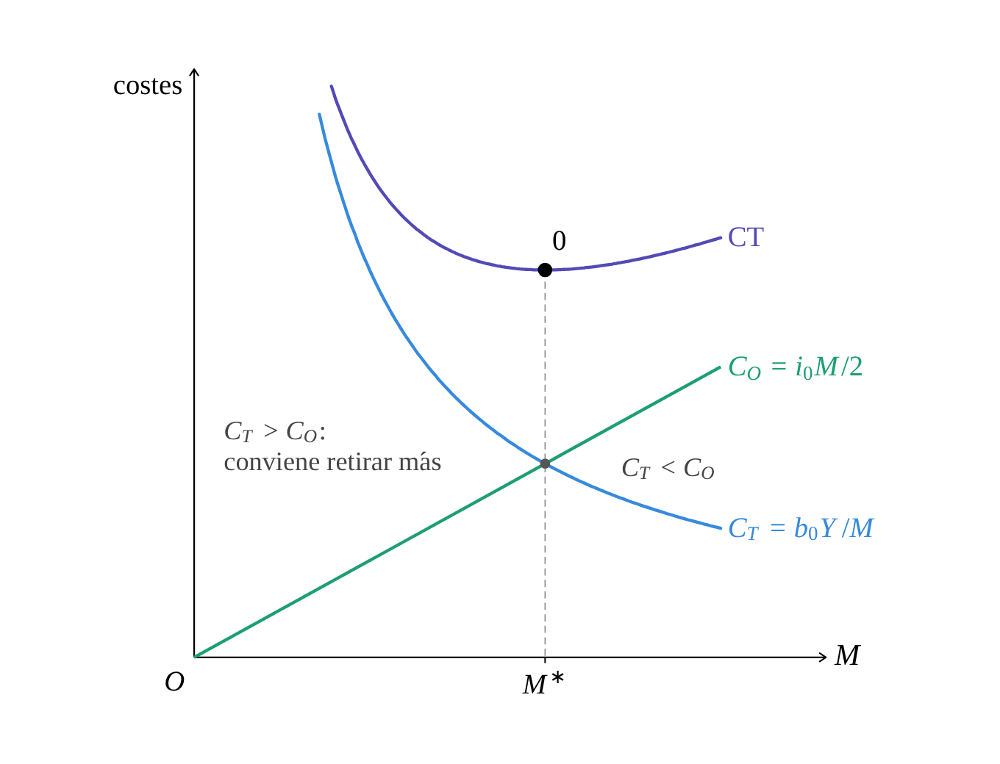
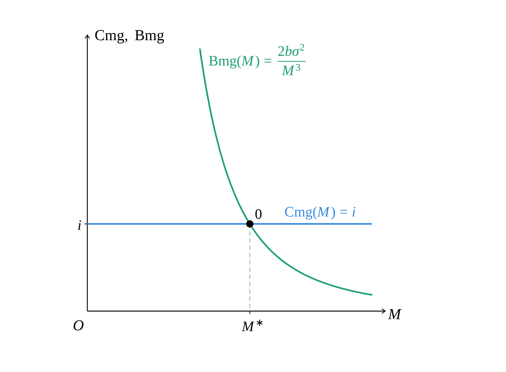
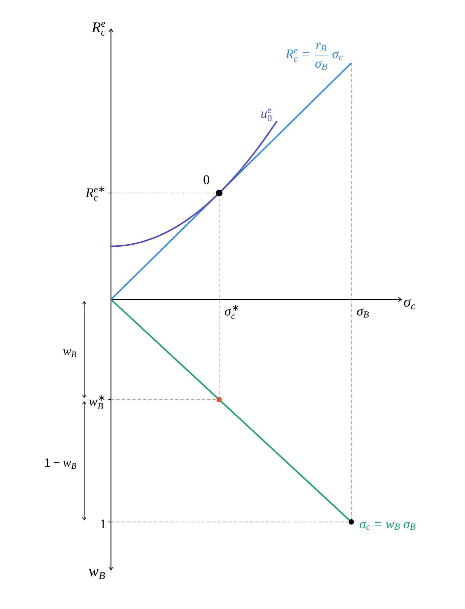
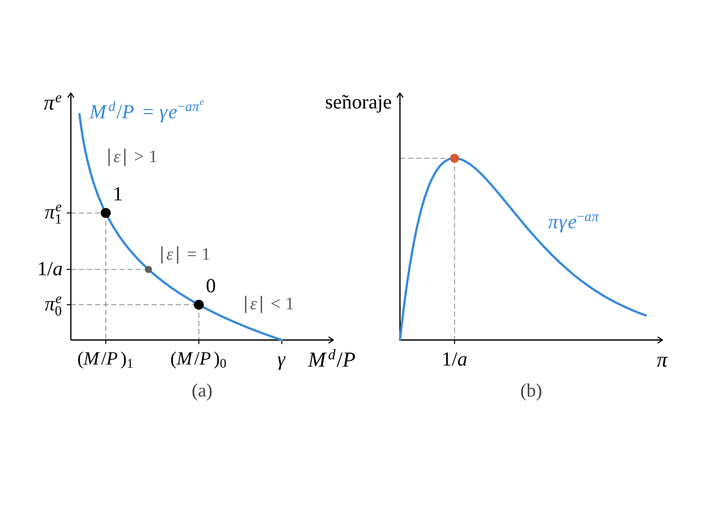

## Introducción



El **dinero** es el activo que sirve de medio de cambio generalmente aceptado y que, además, cumple las funciones de unidad de cuenta y depósito de valor. La **demanda de dinero** recoge cuántos saldos, nominales o reales, prefieren conservar los agentes como dinero y no en forma de otros activos o de bienes.

Su estudio es central en la macroeconomía por dos razones. Primera, junto con la oferta de dinero determina el tipo de interés (o el nivel de precios, según el paradigma) y, con él, el mecanismo de transmisión de la política monetaria. Segunda, sus dos propiedades principales, la estabilidad de la función y su sensibilidad al tipo de interés, separan a las escuelas y deciden la eficacia relativa de las políticas monetaria y fiscal (apartado 3.2).

Desde los años ochenta, la innovación financiera hizo inestable la función de demanda de dinero, y los bancos centrales dejaron de fijarse objetivos de cantidad de dinero para fijar el tipo de interés (tema [A36](a36-politica-monetaria-i.qmd)). Tras 2008, con los tipos de interés cerca de cero, reapareció la **trampa de liquidez**, en la que la demanda de dinero absorbe cualquier aumento de la oferta y la política monetaria convencional pierde eficacia. Hoy el efectivo pierde peso en los pagos, y la emisión de dinero digital por los bancos centrales, como el euro digital, plantea nuevas preguntas sobre la demanda de dinero y sobre la estabilidad de los bancos.

El tema se organiza en tres partes:

- *Fundamentos*: el tema expone las teorías de la demanda de dinero desde la teoría cuantitativa hasta el monetarismo.

- *Desarrollos posteriores*: se presentan los desarrollos en equilibrio general dinámico.

- *Evidencia y política económica*: el tema termina con la evidencia empírica, las implicaciones de política económica y el debate sobre la economía sin efectivo y el dinero digital.

## 1. Fundamentos de la teoría sobre la demanda de dinero

Los fundamentos siguen el orden en que surgieron la teoría cuantitativa, la preferencia por la liquidez, la síntesis neoclásica y el monetarismo.

### 1.1. Aportación clásica y neoclásica: desarrollos basados en la teoría cuantitativa del dinero

El paradigma clásico y neoclásico explica el sector monetario con la **teoría cuantitativa del dinero**, una teoría sobre las causas de los cambios del valor o poder adquisitivo del dinero. De ella se deriva que, a largo plazo, dinero y nivel general de precios guardan una relación proporcional. Esa relación la habían anunciado ya la escuela de Salamanca (M. de Azpilcueta, 1556)[^a35-1], J. Bodin (1568) y D. Hume (1752).

La formalizaron después, por separado, dos tradiciones:

- *Enfoque de Fisher* (1911): agregado y de largo plazo, con el acento en los factores institucionales.

- *Enfoque de Cambridge* (1917): individual y de corto plazo, atento a qué lleva a cada agente a mantener dinero.

**Características comunes**: ambos enfoques parten de la identidad contable del gasto, aunque la interpretan de forma distinta, y comparten tres supuestos:

- *Pleno empleo*: aceptan la ley de Say.

- *Ausencia de atesoramiento*: los agentes no atesoran dinero, de modo que $M^{s} = M^{d}$ en todo momento.

- *Oferta de dinero exógena*: la fijan las autoridades monetarias y corresponde a un agregado estrecho (efectivo y depósitos a la vista, M1)[^a35-2].

#### 1.1.1. Enfoque de las transacciones (Newcomb, 1885; Fisher, 1911)

**Origen**: Simon Newcomb (1885) formuló la *ecuación de cambio* e Irving Fisher (1911) la convirtió en la formulación de referencia de la teoría cuantitativa.

**Idea**: el dinero se demanda solo para realizar transacciones, de modo que la cantidad de saldos reales que la economía necesita es una fracción técnica, fijada por las instituciones de pago, del volumen de transacciones.

**Supuestos**:

- *Identidad*: Fisher parte de la identidad contable del gasto, $MV \equiv PT$[^a35-3], que iguala el valor nominal de las compras y el de las ventas. En ella, $M$ es la oferta monetaria (M1), y la *velocidad-transacción*, $V$, cuenta cuántas compras financia por término medio una unidad monetaria en el periodo. A la derecha, $P$ es el nivel general de precios y $T$, el número de transacciones.

- *Funciones del dinero*: el dinero solo se utiliza como unidad de cuenta y medio de cambio, de modo que no reporta utilidad.

- *Estabilidad*: $V$ y $T$ son constantes o estables[^a35-5], la primera por cuestiones institucionales y la segunda por el pleno empleo.

**Planteamiento**: no hay programa de optimización. La demanda de dinero se obtiene de la identidad contable imponiendo el equilibrio del mercado monetario, $M \equiv M^{s} = M^{d}$, y la estabilidad de $V$ y $T$.

**Solución**: despejando los saldos reales, la función de demanda de dinero agregada, “mecanicista” y muy estable, es

$$\frac{M^{d}}{P} = \frac{1}{V_{0}}\, T_{0}$$

**Estática comparativa**: la demanda de saldos reales solo se desplaza si cambian las instituciones de pago ($V_0$) o el volumen de transacciones ($T_0$), y el tipo de interés no la afecta. Por tanto, dada la demanda real de saldos, $M^d/P$, todo aumento de la oferta monetaria ($\Delta M^s > 0$) se traslada íntegramente a los precios.

**Extensiones**: con una demanda de dinero estable, los efectos de la política monetaria son potentes y predecibles.

- *Política monetaria*: determina el nivel de precios, pero es neutral sobre las variables reales (*dicotomía clásica*).

- *Política fiscal*: ineficaz con la renta, que está en su nivel de pleno empleo.

**Conclusiones**:

- *Aspectos positivos*: ofrece la formulación de referencia de la teoría cuantitativa.

- *Limitaciones*: presenta dos.

    - *Transacciones*: no hay un modo sencillo de calcular su número.

    - *Funciones del dinero*: el dinero no solo es unidad de cuenta y medio de cambio, por lo que su demanda podría depender de otros elementos, como el tipo de interés.

#### 1.1.2. Enfoque de los saldos de caja (escuela de Cambridge, 1917)

**Origen**: Alfred Marshall, Arthur Pigou (1917) y el joven Keynes (1923) reformularon la teoría cuantitativa desde la decisión individual de mantener saldos de caja.

**Idea**: los agentes desean mantener una fracción de su renta en dinero, porque este presta servicios útiles, y esa fracción, la $k$ de Cambridge, resume todos los factores que afectan a la velocidad de circulación.

**Supuestos**:

- *Identidad*: se considera la renta real, en lugar del número de transacciones, como medida del volumen de transacciones de la economía, $MV \equiv PY$. Así, la velocidad pasa a ser una *velocidad-renta* del dinero, es decir, las veces que una unidad monetaria entra a formar parte de la renta de alguien en un periodo.

- *Funciones del dinero*: además de unidad de cuenta y medio de cambio, el dinero es depósito de valor, es decir, reporta utilidad. Por ello, la demanda podría depender también de la riqueza y, por extensión, del tipo de interés.

- *Estabilidad*: $V$ e $Y$ se consideran estables. $V$ depende ahora también del coste de oportunidad, la riqueza o las expectativas, pero la escuela de Cambridge la trata como constante.

**Planteamiento**: tampoco hay programa de optimización explícito.

**Solución**: imponiendo el equilibrio del mercado monetario, $M \equiv M^{s} = M^{d}$, la función de demanda de dinero agregada es

$$\frac{M^{d}}{P} = k_{0}\, Y_{0}$$

donde $Y_0$ es la renta real, constante por el pleno empleo, y $k_{0} \in (0, 1)$ la $k$ de Cambridge, la fracción de renta real que los individuos desean mantener en saldos de caja[^a35-6]. Se trata como un parámetro constante, “la constante de Cambridge”, inversa de la velocidad-renta, $k_{0} = 1/V_{0}$. La renta, y no el número de transacciones, es así el principal determinante de la demanda de dinero[^a35-8].

**Estática comparativa**: la demanda de saldos reales solo se desplaza con la renta, y el tipo de interés queda fuera.

**Extensiones**: los resultados de política coinciden con los del enfoque de Fisher.

**Conclusiones**:

- *Aspectos positivos*: permite considerar elementos subjetivos en la demanda de dinero y ofrece la primera teoría genuina de esta.

- *Limitaciones*: aunque considera la función de depósito de valor, no asigna un papel explícito al tipo de interés en la demanda de dinero.

#### 1.1.3. Conclusiones

**Aspectos positivos**: ambos enfoques llegan a una demanda de dinero proporcional a una variable de escala, transacciones o renta, con una constante de proporcionalidad institucional, lo que da a la teoría cuantitativa una base sencilla.

**Limitaciones**: la constancia de esa proporción es un supuesto y no un resultado, pues ninguno de los dos enfoques la deriva de un problema de optimización. Si $k$ depende del coste de oportunidad, la demanda de dinero pasa a depender del tipo de interés, y si $k$ depende de expectativas volátiles, la demanda deja de ser estable, que es lo que Keynes explotará.

### 1.2. Teoría keynesiana: la preferencia por la liquidez (Keynes, 1936)

**Origen**: Keynes (1936) concibe por primera vez el dinero como un activo financiero y formula la teoría de la preferencia por la liquidez.

**Idea**: Keynes acepta que la ecuación de Cambridge se cumple a largo plazo, pero a corto plazo la incertidumbre y las expectativas sobre el tipo de interés hacen que el dinero se demande también como depósito de valor. La demanda de dinero depende, así, de la renta y del tipo de interés, entendido no como recompensa a la abstinencia del consumo sino como retribución por renunciar a la liquidez[^a35-9], y es inestable.

#### 1.2.1. Supuestos

**Entorno**: el horizonte es el corto plazo, con incertidumbre sobre la evolución futura del tipo de interés. Los individuos mantienen su riqueza en dos activos financieros, dinero (activo “estéril” sin rentabilidad) y bonos (con rentabilidad). 

El precio de mercado de un bono y su tasa de rentabilidad guardan una relación inversa[^a35-11][^a35-12], de modo que una disminución de la tasa exigida a los nuevos bonos hace más atractivos los emitidos al cupón anterior, aumenta su demanda y, con ella, su precio.

**Agentes**: cada individuo tiene una expectativa sobre el tipo de interés *normal*, $i^e$, hacia el que cree que tenderá el tipo de interés y que, por simplicidad, se toma como valor crítico[^a35-10]. Ese tipo normal es convencional (depende de la experiencia pasada y de la opinión media), cambiante y heterogéneo entre individuos.

#### 1.2.2. Modelo

**Planteamiento**: no hay programa de optimización explícito, como es habitual en Keynes. En su lugar, Keynes distingue tres motivos por los que se demanda dinero, cada uno ligado a una función del dinero:

- *Transacción*: cubre los pagos previstos, ligados al uso del dinero como medio de cambio. En este motivo Keynes sigue el enfoque de Cambridge y hace la demanda (real) proporcional a la renta real, $M_{T}^{d} = f(Y^{+})$.

- *Precaución*: sirve de reserva ante pagos imprevistos, nacidos de la incertidumbre. *A priori* dependería también del tipo de interés nominal, coste de oportunidad de los saldos líquidos, $M_{P}^{d} = f(Y^{+}, i^{-})$, pero Keynes lo omite por simplicidad y escribe $M_{P}^{d} = f(Y^{+})$.

- *Especulación*: deriva de la expectativa de rendimiento futuro. Se debe a la función del dinero como depósito de valor, $M_{E}^{d} = f(i^{-})$, y es la aportación novedosa de Keynes, pues los neoclásicos ya habían identificado los otros motivos (Pigou contempló el motivo precaución). El motivo especulación establece el nexo entre la demanda de dinero y el tipo de interés y rompe la dicotomía clásica.

**Solución**:

- *Función de demanda de dinero individual*: la demanda especulativa individual es discontinua[^a35-15], según el tipo de interés efectivo se sitúe por encima o por debajo del valor crítico del individuo:

    - *Bonos atractivos* $(i > i^e)$: el individuo considera que el tipo de interés es elevado y que caerá, con el consecuente aumento del precio de los bonos. Por eso, mantiene toda su riqueza en bonos y no demanda dinero.

    - *Bonos no atractivos* $(i < i^e)$: considera que el tipo es bajo y que subirá, con la consecuente bajada del precio de los bonos. Por ello, mantiene toda su riqueza, $W$, en dinero.

$$\frac{M_{E}^{d}}{P} = \begin{cases} 0 & \text{si } i > i^e \\ W & \text{si } i < i^e \end{cases}$$

- *Función de demanda de dinero agregada*: los valores críticos son heterogéneos y las tenencias individuales insignificantes, de modo que la demanda especulativa agregada es continua, decreciente y convexa[^a35-17]. 

Sumando los tres motivos se obtiene la función de demanda (real) de dinero agregada keynesiana[^a35-18]:

$$\begin{aligned} &\frac{M^{d}}{P} = L\left(Y^{+}, \underbrace{(r + \pi^e)}_{i}{}^{-}\right) \rightarrow M^{d}/P = kY - h\,i \\ &k = \frac{\partial(M^{d}/P)}{\partial Y} > 0, \qquad h = -\frac{\partial(M^{d}/P)}{\partial i} > 0 \end{aligned}$$

donde $k$ y $h$ miden la respuesta de los saldos demandados ante la renta y ante el tipo nominal $i$, respectivamente. La demanda por los motivos transacción y precaución queda recogida en $kY$, y la del motivo especulación[^a35-19], núcleo de la preferencia por la liquidez, en $-h\,i$.

**Desarrollo gráfico**: la demanda de dinero keynesiana se representa en el plano dinero (real)-tipo de interés nominal (figura -@fig-a353-demanda-keynesiana):

1. *Demanda especulativa individual*, $M_E^d/P$ (panel a): es nula por encima del tipo crítico, $i^e$, donde los bonos son atractivos, y salta a la riqueza, $W$, por debajo de él.

2. *Demanda agregada*, $L(Y_0, i)$ (panel b): parte de la demanda por transacción y precaución, $kY_0$, y es decreciente y convexa, porque cuanto más bajo es el tipo de interés, más agentes lo sitúan por debajo de su valor crítico.

3. *Trampa de liquidez*: al llegar a un tipo mínimo, $i_{\min}$, la curva se hace horizontal. Nadie quiere ya bonos, pues el tipo es tan bajo que todo el mundo cuenta con que subirá.

**Estática comparativa**:

- *Renta*: un aumento de la renta real eleva la demanda de dinero, pues los agentes quieren realizar más transacciones.

- *Tipo de interés*: una subida del tipo de interés nominal eleva el coste de oportunidad de los saldos y reduce la demanda por motivo especulación, con una sensibilidad, $h$, que Keynes supone elevada.

- *Expectativas*: un cambio en las expectativas sobre el tipo normal desplaza toda la curva, de $L(Y_0, i)$ a $L(Y_0, i)'$ en el panel (b), lo que la hace inestable.

::: {#fig-a353-demanda-keynesiana}

::: {.content-visible when-format="html"}
```{=html}
<div class="graph-frame wide">
<iframe src="../graphs/a353_Demanda_keynesiana.html" style="--r:1.447" loading="lazy" title="fig-a353-demanda-keynesiana"></iframe>
</div>
```
:::

::: {.content-visible unless-format="html"}

:::

Demanda de dinero keynesiana. La demanda especulativa individual es discontinua en el tipo crítico $i^e$ (a), mientras que la agregada es decreciente y convexa y se vuelve horizontal en la trampa de liquidez (b). La curva discontinua muestra su desplazamiento ante un cambio de expectativas.
:::

**Extensiones**: una de las contribuciones de la teoría monetaria keynesiana es la trampa de liquidez, que Keynes planteó solo como posibilidad teórica[^a35-21]. En ella, el tipo de interés ha llegado a su mínimo, cada saldo adicional se mantiene como dinero y la demanda es infinitamente elástica respecto al tipo de interés ($h \to \infty$). En la práctica, ese suelo, el límite inferior de los tipos de interés (*zero lower bound*, ZLB), se sitúa en torno a cero (apartado 3.3)[^a35-22]. De la demanda de dinero keynesiana se siguen estas implicaciones de política económica.

- *Política monetaria*: poco eficaz con la renta, por la alta sensibilidad de la demanda de dinero al tipo de interés (segundo eslabón débil). En la trampa de liquidez es totalmente ineficaz, porque se rompe el vínculo entre las operaciones de mercado abierto y los tipos de interés.

- *Política fiscal*: muy eficaz con la renta, y especialmente potente en la trampa de liquidez, pues no eleva el tipo de interés.

#### 1.2.3. Conclusiones

**Aspectos positivos**: el abandono de la dicotomía clásica y la noción de trampa de liquidez enriquecieron el análisis de la política económica, al dotar de efectividad diferenciada a la política fiscal y a la monetaria.

**Limitaciones**: cada individuo guarda toda su riqueza en bonos o en dinero, nunca en ambos, así que no hay diversificación. Los tres motivos, además, se postulan sin microfundamentar, tarea que asumirá después la síntesis neoclásica.

### 1.3. Síntesis neoclásica

Los motivos keynesianos de demanda de dinero fueron el punto de partida de las teorías posteriores que buscaban microfundamentarlos.

#### 1.3.1. El motivo transacción: modelos de inventarios (Baumol, 1952; Tobin, 1956)

**Origen**: William Baumol (1952) y James Tobin (1956) aplicaron la teoría de gestión de inventarios a los saldos de transacción.

**Idea**: el dinero se mantiene como un inventario para transacciones del que el agente dispone gradualmente. Existe una disyuntiva entre el coste de transacción de reponerlo y el coste de oportunidad de mantenerlo, de la que resulta una demanda de dinero por motivo transacción que depende también del tipo de interés.

**Supuestos**:

- *Entorno*: información perfecta y marco estático. Todos los flujos son conocidos y se considera un único periodo.

- *Agentes*: al inicio del periodo, el individuo recibe su renta real, $Y$, en una cuenta de ahorro remunerada a un tipo de interés nominal constante y exógeno, $i_{0}$, que refleja el coste de oportunidad (unitario) de no mantener el dinero en la cuenta. A lo largo del periodo realiza retiradas de efectivo de cuantía real constante, $M$[^a35-23], y al final del periodo ha consumido toda su renta.

- *Tecnología*: existe un coste fijo unitario o coste de transacción por retirada, $b_{0} > 0$, constante, exógeno y real.

**Planteamiento**: el individuo elige la cuantía de cada retirada, $M$, que minimiza su coste total:

$$\min_{M} \text{CT} = C_{T} + C_{O} = b_{0}\frac{Y}{M} + i_{0}\frac{M}{2}$$

donde $\text{CT}$ es el coste total, suma de dos componentes:

- *Coste de transacción*: $C_{T} = b_{0}Y/M$ es el producto del coste unitario por el número de retiradas, $Y/M$.

- *Coste de oportunidad*: $C_{O} = i_{0}M/2$ es el producto del tipo de interés por el saldo promedio de efectivo, $M/2$.

**CPO**: derivando el coste total respecto a la cuantía de cada retirada,

$$\begin{aligned} \frac{d\text{CT}}{dM} &= -b_{0}\frac{Y}{M^{2}} + \frac{i_{0}}{2} = 0 &&\Rightarrow\; M^* = \sqrt{2b_{0}Y/i_{0}} \\ & &&\Rightarrow\; n^* = Y/M^* \end{aligned}$$

donde $M^*$ es la retirada óptima y $n^*$ el número óptimo de retiradas. La retirada óptima iguala el ahorro marginal en costes de transacción al coste marginal de oportunidad.

**CSO**: $\partial^2 \text{CT}/\partial M^2 = 2b_0 Y/M^3 > 0$, es decir, el coste total es estrictamente convexo en $M$, de modo que la CPO define el mínimo.

**Solución**:

- *Función de demanda de dinero individual*: es el saldo promedio mantenido en el periodo:

$$\frac{M^{d}}{P} \equiv \frac{M^*}{2} = \frac{1}{2}\sqrt{\frac{2b_{0}Y}{i_{0}}} \;\rightarrow\; \frac{M^{d}}{P} = k(b_{0}^{+}, i_{0}^{-}) \cdot Y^{1/2}$$
donde $k(\cdot)$ recoge el efecto del coste de transacción y del tipo de interés.

- *Función de demanda de dinero agregada*: con agentes idénticos, conserva la forma de la individual y sus elasticidades.

**Desarrollo gráfico**: la minimización del coste total se representa en el plano cuantía de cada retirada-costes (figura -@fig-a354-baumol-tobin):

1. *Coste de transacción*, $C_T = b_0Y/M$: decrece con la cuantía de cada retirada, porque hacen falta menos retiradas.

2. *Coste de oportunidad*, $C_O = i_0M/2$: es una recta que crece con la cuantía retirada, con pendiente $i_0/2$.

3. *Coste total*, $\text{CT}$: suma vertical de ambos, con forma de U.

4. *Óptimo*: en el punto 0, el mínimo del coste total, la retirada óptima, $M^*$, iguala ambos costes. A su izquierda, $C_T > C_O$ y conviene retirar más, y a su derecha, $C_T < C_O$ y conviene retirar menos.

::: {#fig-a354-baumol-tobin}

::: {.content-visible when-format="html"}
```{=html}
<div class="graph-frame">
<iframe src="../graphs/a354_Baumol_Tobin.html" style="height:520px" loading="lazy" title="fig-a354-baumol-tobin"></iframe>
</div>
```
:::

::: {.content-visible unless-format="html"}

:::

Modelo de inventarios (Baumol-Tobin). La retirada óptima, $M^*$, minimiza el coste total, suma del coste de transacción (decreciente) y del coste de oportunidad (creciente), y se sitúa donde ambos se igualan.
:::

**Estática comparativa**: la demanda depende de tres factores:

- *Renta real*: cuanto mayor es la renta, mayor es la demanda de dinero, pero menos que proporcionalmente, pues la elasticidad es $\varepsilon_{M^{d}Y} = 0{,}5$, lo que refleja economías de escala en la gestión de tesorería.

- *Coste de transacción*: cuanto mayor es el coste unitario de transacción, mayor es la demanda de dinero, para diluir el coste fijo total de transacción.

- *Tipo de interés*: cuanto mayor es el coste de oportunidad del dinero, menor es la demanda, con elasticidad $\varepsilon_{M^{d}i} = -0{,}5$.

**Extensiones**: con flujos de caja aleatorios, Miller y Orr (1966) proponen una *regla de bandas*. El agente solo ajusta su cartera, hasta un nivel de retorno, cuando el saldo alcanza el límite inferior, que fija él mismo, o el superior[^a35-24]. El modelo mantiene las economías de escala y añade que la demanda de dinero aumenta con la incertidumbre de los flujos, lo que enlaza con el motivo precaución.

Cuando hay recursos ociosos, la política monetaria mueve la renta más que en la versión keynesiana del motivo transacción, porque aquí la demanda por ese motivo crece menos que proporcionalmente con la renta. Así, para que el público absorba una misma expansión monetaria manteniéndose fijo el tipo de interés, la renta ha de subir más que con Keynes[^a35-25].

**Conclusiones**:

- *Aspectos positivos*: microfundamenta el motivo transacción, obtiene elasticidades contrastables y explica las economías de escala en la gestión de tesorería.

- *Limitaciones*: supone flujos ciertos y retiradas de cuantía constante y, sobre todo, es una demanda individual, pues con agentes heterogéneos la agregación de raíces cuadradas no es la raíz cuadrada del agregado.

#### 1.3.2. El motivo precaución: modelo de costes de ruptura (Whalen, 1966)

**Origen**: Edward Whalen (1966) microfundamentó el motivo precaución con la lógica de inventarios bajo incertidumbre.

**Idea**: se guarda efectivo como reserva porque no se sabe con certeza cuándo entrará y saldrá dinero ni qué gastos imprevistos surgirán. Quedarse sin efectivo tiene un coste, el *coste de ruptura*, y mantenerlo tiene un coste de oportunidad. El saldo precautorio óptimo equilibra ambos.

**Supuestos**:

- *Entorno*: marco estático, ahora con incertidumbre. El exceso de gasto sobre la renta de cada mes, $G_t - Y_t$, es una variable aleatoria de media cero y varianza $\sigma^2$.

- *Agentes*: en promedio, lo que el individuo ingresa en un número dado de meses, $Y$, coincide con lo que gasta. Reparte esa renta entre efectivo, $M$, con el que cubre los imprevistos sin coste explícito, y bonos o depósitos de ahorro que rinden el tipo nominal $i$.

- *Tecnología*: convertir bonos en efectivo conlleva un coste de corretaje unitario, $b > 0$. Si en un mes el exceso de gasto no supera el saldo mantenido, $G_{t} - Y_{t} \leq M_{t}$, no hay que recurrir a los bonos. Si lo supera, $G_{t} - Y_{t} > M_{t}$, se produce una ruptura del *stock* de efectivo y hay que pagar el corretaje.

**Planteamiento**: el individuo elige el saldo precautorio, $M$, que minimiza su coste total. Acotando la probabilidad de ruptura por la desigualdad de Chebyshev, $\Pr(G - Y > M) \leq \sigma^2/M^2$,

$$\min_{M} \text{CT} = iM + b\,\frac{\sigma^{2}}{M^{2}}$$

donde $\text{CT}$ es el coste total, suma del coste de oportunidad de mantener el saldo, $iM$, y del coste esperado de ruptura, producto del corretaje, $b$, por la cota de la probabilidad de ruptura.

**CPO**: derivando respecto al saldo precautorio,

$$\frac{\partial \text{CT}}{\partial M} = i - \frac{2b\sigma^{2}}{M^{3}} = 0 \;\Rightarrow\; M^* = \left(\frac{2b\sigma^{2}}{i}\right)^{1/3}$$

Cada unidad más de efectivo ahorra, en valor esperado, una parte de los gastos de corretaje (beneficio marginal), pero obliga a renunciar al interés que habría rendido en bonos (coste marginal), y el óptimo se alcanza cuando ambos se igualan.

**CSO**: $\partial^2 \text{CT}/\partial M^2 = 6b\sigma^{2}/M^{4} > 0$, por lo que el coste total es convexo y la CPO define el mínimo.

**Solución**:

- *Función de demanda de dinero individual*: el saldo precautorio óptimo es la demanda de dinero por motivo precaución:

$$\frac{M^{d}}{P} = f(b^{+}, i^{-}, \sigma^{+}) = f(b^{+}, i^{-}, Y^{+})$$

donde la renta entra a través de la dispersión entre ingresos y gastos, $\sigma$, que crece con el nivel de actividad. Whalen trata el exceso de gasto como la suma de muchos cobros y pagos independientes. Si la renta crece porque aumenta el número de pagos, de igual cuantía, $\sigma^2$ crece en proporción a $Y$ y $M^* \propto Y^{1/3}$. Si, en cambio, crece porque aumenta la cuantía de cada pago, $\sigma$ crece en proporción a $Y$ y $M^* \propto Y^{2/3}$. La elasticidad-renta de la demanda precautoria está, así, entre 1/3 y 2/3, con economías de escala como en el modelo de inventarios.

- *Función de demanda de dinero agregada*: como en el modelo de inventarios, conserva la forma de la individual solo con agentes idénticos.

**Desarrollo gráfico**: la demanda de dinero por motivo precaución se representa en el plano saldo precautorio-coste y beneficio marginales (figura -@fig-a351-whalen):

1. *Beneficio marginal*, $\text{Bmg}(M)$: decreciente, porque cada unidad más de efectivo reduce cada vez menos el riesgo de ruptura.

2. *Coste marginal*, $\text{Cmg}(M) = i$: es el interés que se deja de percibir, horizontal porque no depende del saldo.

3. *Óptimo*: en el punto 0, donde ambas curvas se cortan, el saldo precautorio es $M^*$.

::: {#fig-a351-whalen}

::: {.content-visible when-format="html"}
```{=html}
<div class="graph-frame">
<iframe src="../graphs/a351_Whalen.html" style="height:540px" loading="lazy" title="fig-a351-whalen"></iframe>
</div>
```
:::

::: {.content-visible unless-format="html"}

:::

Modelo de Whalen (1966). El saldo precautorio óptimo, $M^*$, iguala el beneficio marginal (ahorro esperado en corretaje) al coste marginal, el tipo de interés $i$.
:::

**Estática comparativa**: los signos son los de la función de demanda. Con más renta, los desajustes entre cobros y pagos son mayores, de modo que la curva de beneficio marginal se desplaza hacia arriba y se demanda más dinero.

**Extensiones**: la demanda de dinero puede ser inestable porque depende de la incertidumbre percibida, $\sigma$, que cambia con las expectativas y el entorno. En consecuencia, cualquier medida de política económica que estabilice el entorno reduce la liquidez deseada.

**Conclusiones**:

- *Aspectos positivos*: microfundamenta el motivo precaución y explica que la demanda de dinero aumente con la incertidumbre sobre ingresos y gastos.

- *Limitaciones*: la magnitud del efecto de la renta depende de cómo crezcan los cobros y pagos, lo que resta capacidad predictiva.

#### 1.3.3. El motivo especulación: modelo de carteras mixtas (Tobin, 1958)

**Origen**: James Tobin (1958; Premio Nobel 1981) aplicó la teoría de selección de cartera de Markowitz a la demanda de dinero.

**Idea**: la demanda de dinero resulta de un problema de selección de cartera bajo riesgo. Frente a la disyuntiva keynesiana entre bonos o dinero, los individuos mantienen su riqueza simultáneamente en ambos. La aversión al riesgo basta para explicar la preferencia por la liquidez y, si domina el efecto sustitución, la relación negativa entre la demanda de dinero y el tipo de interés.

**Supuestos**:

- *Entorno*: contexto de riesgo, en el que la rentabilidad de los activos es una variable aleatoria. Los agentes cuentan con una riqueza inicial que deben asignar entre dos activos:

    - *Bono con riesgo* (p. ej. riesgo de impago o de mercado): con una rentabilidad esperada[^a35-30] $R_{B}^e = r_{B} + G_{B}^e$ y un riesgo $\sigma_{B} > 0$.

    - *Activo sin riesgo* (es decir, dinero): con rentabilidad esperada $R_{A}^e = 0$ y riesgo $\sigma_{A} = 0$.

- *Agentes*: son aversos al riesgo, es decir, la rentabilidad esperada es un bien $(\partial u / \partial R_c^e > 0)$ y el riesgo un mal $(\partial u / \partial \sigma_c < 0)$, de modo que sus curvas de indiferencia en el plano riesgo-rentabilidad tienen pendiente positiva y son convexas.

**Planteamiento**: el individuo elige la proporción de su riqueza que coloca en bonos, $w_B$, y el resto, $1-w_B$, en dinero, maximizando la utilidad esperada de la rentabilidad y el riesgo de la cartera resultante. La rentabilidad esperada y el riesgo de una cartera mixta son:

$$R_{c}^e = w_B r_{B} + (1 - w_B)\underbrace{R_{A}^e}_{0} = w_B r_{B}, \quad w_B \in [0, 1] \tag{1}$$

$$\sigma_{c}^{2} = w_B^{2}\sigma_{B}^{2} + (1 - w_B)^{2}\underbrace{\sigma_{A}^{2}}_{0} + 2w_B(1 - w_B)\sigma_{B}\underbrace{\sigma_{A}}_{0}\rho_{BA} = w_B^{2}\sigma_{B}^{2} \;\rightarrow\; \sigma_{c} = w_B\sigma_{B} \tag{2}$$

donde $\rho_{BA}$ es la correlación entre ambos activos. De (2), la proporción de bonos es $w_B = \sigma_{c}/\sigma_{B}$, de modo que cuanto mayor es el riesgo de los bonos, menor es su peso para un riesgo de cartera dado. Sustituyendo en (1) se obtiene la restricción del individuo, la *recta de oportunidades de inversión* o *frontera eficiente*[^a35-32]:

$$R_{c}^e = \frac{r_{B}}{\sigma_{B}}\,\sigma_{c}, \qquad \frac{\partial R_{c}^e}{\partial \sigma_{c}} = \frac{r_{B}}{\sigma_{B}} > 0$$

que muestra las combinaciones rentabilidad-riesgo alcanzables, con la máxima rentabilidad esperada para cada riesgo. El programa es:

$$\max_{w_B} u^e = f(R_{c}^e, \sigma_{c}) \quad \text{s.a.:} \quad R_{c}^e = \frac{r_{B}}{\sigma_{B}}\,\sigma_{c}$$

donde $u^e$ es la utilidad esperada de la cartera, creciente en su rentabilidad esperada, $R_c^e$, y decreciente en su riesgo, $\sigma_c$, por la aversión al riesgo.

**CPO**: la pendiente de la curva de indiferencia, la rentabilidad adicional que el agente exige por cada unidad más de riesgo, iguala a la de la recta de oportunidades, la rentabilidad de los bonos por unidad de riesgo:

$$\frac{dR_{c}^e}{d\sigma_{c}}\bigg|_{du^e=0} = -\frac{\partial u^e/\partial \sigma_{c}}{\partial u^e/\partial R_{c}^e} = \frac{r_{B}}{\sigma_{B}}$$

La condición describe la tangencia entre la curva de indiferencia y la recta de oportunidades, en la que el individuo acepta riesgo adicional hasta que la rentabilidad extra que exige por él iguala a la que el mercado ofrece.

**CSO**: la convexidad estricta de las curvas de indiferencia (aversión al riesgo) y la linealidad de la recta de oportunidades garantizan que la tangencia es un máximo y que la cartera óptima es única.

**Solución**:

- *Función de demanda de dinero individual*: de la CPO se obtiene $w_B^*$ y, con él, la demanda (real) especulativa de dinero, $(1-w_B^*)W$, que depende del tipo de interés, del riesgo del bono, de la riqueza del individuo y de su grado de aversión al riesgo:

$$\frac{M^{d}}{P} = f(W^{+}, \sigma_{B}^{+}, r_{B}^{\pm})$$
donde $W$ es la riqueza real actualizada del individuo.

- *Función de demanda de dinero agregada*: con agentes homogéneos, como supone Tobin, hereda los signos de la individual.

**Desarrollo gráfico**: la selección de cartera se representa en el plano riesgo-rentabilidad esperada, con la proporción de bonos en el semieje inferior (figura -@fig-a352-tobin-money):

1. *Recta de oportunidades*, $R_c^e = (r_B/\sigma_B)\,\sigma_c$ (cuadro superior): sale del origen, la cartera solo de dinero, con pendiente $r_B/\sigma_B$, y llega a $\sigma_B$, la cartera solo de bonos.

2. *Curva de indiferencia*, $u^e_0$ (cuadro superior): es creciente y convexa por la aversión al riesgo.

3. *Recta de proporciones*, $\sigma_c = w_B\,\sigma_B$ (cuadro inferior): traduce cada nivel de riesgo en la proporción de bonos, $w_B$, y de dinero, $1 - w_B$, que lo genera.

4. *Óptimo*: en el punto 0, la tangencia entre la recta de oportunidades y la curva de indiferencia más alta, el riesgo es $\sigma_c^*$ y la rentabilidad, $R_c^{e*}$. En el cuadro inferior, ese riesgo corresponde a la proporción de bonos $w_B^*$, y el resto, $1 - w_B^*$, se mantiene en dinero.

::: {#fig-a352-tobin-money}

::: {.content-visible when-format="html"}
```{=html}
<div class="graph-frame">
<iframe src="../graphs/a352_Tobin_money.html" style="height:930px" loading="lazy" title="fig-a352-tobin-money"></iframe>
</div>
```
:::

::: {.content-visible unless-format="html"}

:::

Modelo de carteras de Tobin (1958). El inversor averso al riesgo reparte su riqueza entre dinero y bonos sobre la línea de oportunidades rentabilidad-riesgo.
:::

**Estática comparativa**: la demanda de dinero responde a tres variables:

- *Riqueza* $(\partial(M^{d}/P)/\partial W > 0)$: si aumenta la riqueza real actualizada, aumenta el límite de gasto del agente y, con ello, su demanda de dinero.

- *Riesgo de los bonos* $(\partial(M^{d}/P)/\partial\sigma_{B} > 0)$: si aumenta el riesgo de los bonos sin aumentar su rentabilidad, la aversión al riesgo lleva a demandar más dinero para evitar la exposición.

- *Tipo de interés* $(\partial(M^{d}/P)/\partial r_{B} = \text{?})$: el efecto es incierto, pues se descompone en un efecto sustitución y un efecto renta.

    - *Efecto sustitución* $(\text{ES} < 0)$: si sube el tipo de interés, mantener dinero tiene un coste de oportunidad mayor, y a utilidad constante el agente traslada parte de su cartera del dinero a los bonos.

    - *Efecto renta* $(\text{ER} > 0)$: la subida del tipo eleva la rentabilidad esperada de la cartera, de modo que el inversor puede obtener la misma rentabilidad asumiendo menos riesgo, lo que tiende a aumentar la proporción de dinero. Solo si predomina el efecto sustitución cae la demanda de dinero.

**Extensiones**: el tipo de interés influye en la demanda de dinero a través de la composición de la cartera. Por ello, la política monetaria puede servir para estabilizar la economía. A través del motivo especulación, una variación de la cantidad de dinero mueve el tipo de interés, y este, la inversión, con lo que la dicotomía clásica vuelve a romperse.

**Conclusiones**:

- *Aspectos positivos*: explica la tenencia simultánea de dinero y bonos a partir de la aversión al riesgo y desagrega los efectos renta y sustitución del tipo de interés.

- *Limitaciones*:

    - *Riesgo del dinero*: el dinero no está completamente libre de riesgo, pues la inflación socava su valor[^a35-35].

    - *Activos sustitutivos*: en muchas economías hay activos sin riesgo (o casi) pero más rentables que el dinero (p. ej. depósitos a plazo o letras del Tesoro), que lo dominan, de modo que, con idénticos supuestos, nadie mantendría dinero como activo de cartera.

    - *Agregados*: su aplicabilidad se limita a agregados monetarios amplios (M2 y M3) y no al *narrow money* (M1).

#### 1.3.4. Conclusiones

**Aspectos positivos**: la síntesis neoclásica microfundamenta uno a uno los motivos keynesianos y obtiene, en los tres casos, una demanda de dinero que depende negativamente del tipo de interés (en Tobin, si domina el efecto sustitución). Recoge, además, que esa demanda puede ser inestable, porque sus parámetros dependen de expectativas y percepciones del riesgo cambiantes, como subrayaban los keynesianos.

**Limitaciones**: los tres modelos son teorías de la demanda individual que no resuelven la agregación, y cada uno explica un motivo por separado, sin integrarlos en una demanda de dinero conjunta.

### 1.4. Monetarismo

El monetarismo aporta a la teoría de la demanda de dinero la reformulación de la teoría cuantitativa de Friedman y su estimación por Cagan en las hiperinflaciones.

#### 1.4.1. El dinero como bien (Friedman, 1956)

**Origen**: Milton Friedman (1956) reformula la teoría cuantitativa como una teoría de la demanda de dinero.

**Idea**: el dinero es un bien más, cuya demanda, como la de cualquier bien, depende de la renta, de su precio relativo (la rentabilidad de los activos alternativos) y de las preferencias. El resultado es una función de demanda de dinero estable y poco sensible al tipo de interés.

**Supuestos**:

- *Entorno*: los agentes eligen entre una amplia gama de activos, financieros y reales. Al ser un bien más, el dinero tiene muchos sustitutivos imperfectos, bonos y acciones, bienes de consumo duradero e incluso activos inmobiliarios[^a35-38], a diferencia de Keynes, para quien el dinero tiene pocos pero buenos sustitutivos.

- *Agentes*: el dinero es un bien de capital más, demandado por los servicios que presta. Las empresas lo utilizan como factor de producción, y los consumidores como fuente de poder adquisitivo general. Tiene, por tanto, un rendimiento en forma de servicios y, en su caso, el interés de los depósitos. Las decisiones de consumo y de cartera se toman conjuntamente, a diferencia de Keynes y la síntesis neoclásica, donde están separadas. Friedman acepta que puedan existir distintos motivos para demandar dinero, pero no segmenta la demanda en componentes.

**Planteamiento**: como Tobin, Friedman obtiene la demanda de dinero de una decisión de cartera, en la que el agente reparte su riqueza total, humana y no humana, entre dinero y los activos alternativos según sus rentabilidades relativas y sus preferencias. Sin embargo, Friedman no resuelve el programa explícitamente, sino que postula la forma de la función resultante.

**Solución**:

- *Función de demanda de dinero individual*[^a35-39]:

$$\frac{M^{d}}{P} = f((Y^{P})^{+}, (W_H/W)^{+}, r_{B}^{-}, r_{E}^{-}, \pi^{e-})$$

donde $Y^{P}$ es la renta permanente, $W_H/W$ la riqueza humana en relación con la riqueza total, $r_{B}$ y $r_{E}$ las rentabilidades (nominales) de bonos y acciones, y $\pi^e$ la inflación esperada. Las preferencias, p. ej. por renta fija o variable según el perfil de riesgo, quedan recogidas en la forma de $f$.

- *Función de demanda de dinero agregada*: agrupando las rentabilidades de los distintos activos y la riqueza,

$$\frac{M^{d}}{P} = k(r^{-}, \pi^{e-}) \cdot Y^{P}$$

que muestra que la teoría monetarista es una reformulación de la ecuación de Cambridge en la que $k$ depende de la rentabilidad de los activos financieros y reales, y la variable de escala es la renta permanente.

De la función se siguen dos resultados principales. Primero, como el dinero tiene muchos sustitutivos y la demanda depende de la renta permanente, la sensibilidad de la demanda al tipo de interés es baja $(h \approx 0)$ y la demanda es muy estable. Segundo, la transmisión monetarista descansa en el reajuste de las carteras entre el dinero y una gama amplia de activos financieros y reales, y la inflación esperada interviene en ella como el rendimiento de los bienes frente al dinero, es decir, como un coste de mantener saldos.

**Estática comparativa**: los determinantes se interpretan como sigue:

- *Renta permanente* $(\partial(M^{d}/P)/\partial Y^{P} > 0)$: la riqueza real anualizada limita la cantidad de dinero que se puede demandar. A mayor riqueza, mayor es la demanda, p. ej. como depósito de valor.

- *Riqueza humana* $(\partial(M^{d}/P)/\partial(W_H/W) > 0)$: cuanto mayor es la proporción de riqueza humana, que capitaliza la renta laboral, sobre la riqueza total, mayor es la demanda de dinero, pues la riqueza humana es menos líquida que los activos financieros y su liquidez es más incierta[^a35-40].

- *Rentabilidad de los activos* $(\partial(M^{d}/P)/\partial r_{i} < 0)$: cuanto mayor es la rentabilidad de bonos y acciones, mayor es el coste de oportunidad del dinero.

- *Inflación esperada* $(\partial(M^{d}/P)/\partial\pi^e < 0)$: es la rentabilidad nominal esperada de los activos reales. Por ello, si los individuos esperan inflación, sustituyen dinero (real) por activos reales que no pierden valor (p. ej. oro o inmuebles). La demanda nominal, en cambio, sube con el nivel de precios para mantener el *stock* real deseado $(\partial M^{d}/\partial P > 0)$.

**Extensiones**: en el paradigma monetarista no se dan los “dos eslabones débiles”, porque la inversión es muy sensible al tipo de interés, la demanda de dinero poco, y el *efecto liquidez* es elevado.

- *Política monetaria*: sí es efectiva sobre la renta a corto plazo, por el elevado efecto liquidez y el efecto renta[^a35-42], lo que constituye la principal diferencia con los neoclásicos. Los monetaristas se oponen a la neutralidad del dinero a corto plazo, y los cambios en la cantidad de dinero explican los ciclos.

    No obstante, los monetaristas rechazan el uso discrecional de la política monetaria. Defienden una política monetaria sujeta a reglas[^a35-43] y orientada a la inflación, y lo justifican con la ecuación perdida del monetarismo, con unos retardos largos y variables y con su inefectividad a largo plazo (tema [A05](a05-monetaristas-snc.qmd), apartados 2.2.4 y 2.2.5).

- *Política fiscal*: no es efectiva para cambiar la renta, por el efecto expulsión (*crowding out*) total que provoca una demanda de dinero casi insensible al tipo de interés ($h \approx 0$)[^a35-41].

**Conclusiones**:

- *Aspectos positivos*: recupera la estabilidad de la función de demanda de dinero con un fundamento microeconómico, la elección de cartera, y hace de ella el pilar del mecanismo de transmisión monetarista.

- *Limitaciones*: no deriva la función de un programa explícito, sino que postula sus argumentos. Además, como la teoría de carteras de Tobin, se ajusta mejor a agregados monetarios amplios.

#### 1.4.2. Modelo de demanda de dinero e hiperinflación (Cagan, 1956)

::: {.callout-note appearance="simple" icon=false}
El modelo de Cagan y su condición de estabilidad se desarrollan en el tema [A41](a41-inflacion.qmd), apartado 3.1.2, y el señoraje óptimo en el tema [A39](a39-deficit.qmd), apartado 2.2.2. Aquí se recoge su aportación a la teoría de la demanda de dinero.
:::

**Origen**: Phillip Cagan (1956), discípulo de Friedman, propuso el modelo.

**Idea**: Cagan estimó para siete hiperinflaciones europeas del siglo XX la función de demanda de dinero monetarista reducida a su único argumento relevante en ese contexto, la inflación esperada.

**Supuestos**:

- *Entorno*: hiperinflación, en la que la renta y el tipo de interés real apenas varían frente a las variables nominales[^a35-44].

- *Agentes*: forman sus expectativas de inflación de forma adaptativa, $\pi_{t}^e - \pi_{t-1}^e = \lambda(\pi_{t-1} - \pi_{t-1}^e)$, con $\lambda \in (0, 1]$. Su demanda de dinero es exponencial en la inflación esperada.

**Planteamiento**: no hay programa de optimización. Cagan postula la función y la estima:

$$\frac{M^{d}}{P} = \gamma \cdot e^{-a\pi^{e}}$$

donde $\gamma > 0$ recoge los factores reales y $a > 0$ es la semielasticidad de la demanda de dinero respecto a la inflación esperada.

**Desarrollo gráfico**: el modelo de Cagan se representa en el plano saldos reales-inflación esperada (panel a) y en el plano inflación-señoraje (panel b) de la figura -@fig-a355-cagan:

1. *Demanda de dinero*, $M^d/P = \gamma e^{-a\pi^e}$ (panel a): es decreciente y convexa. Corta el eje horizontal en $\gamma$, con inflación esperada nula, y se acerca al eje vertical a medida que la inflación esperada crece.

2. *Elasticidad unitaria* (panel a): la elasticidad en valor absoluto, $|\varepsilon| = a\pi^e$, vale uno en $\pi^e = 1/a$. Por debajo de ese nivel la demanda es inelástica y, por encima, elástica.

3. *Señoraje de estado estacionario*, $\pi\gamma e^{-a\pi}$ (panel b): con $\pi^e = \pi$, es el producto de la inflación por los saldos reales y tiene forma de curva de Laffer.

4. *Máximo del señoraje* (panel b): se alcanza en $\pi = 1/a$, el mismo nivel en que la demanda tiene elasticidad unitaria.

**Estática comparativa**: con semielasticidad constante, la elasticidad, $a\,\pi^e$, crece con la propia inflación. Una subida de la inflación esperada de $\pi^e_0$ a $\pi^e_1$ lleva la economía del punto 0 al 1 a lo largo de la demanda (panel a). Una vez superado $1/a$, los saldos reales caen más que proporcionalmente, lo que explica la huida del dinero en las fases finales de una hiperinflación, y el señoraje disminuye (panel b).

::: {#fig-a355-cagan}

::: {.content-visible when-format="html"}
```{=html}
<div class="graph-frame wide">
<iframe src="../graphs/a355_Cagan.html" style="--r:1.388" loading="lazy" title="fig-a355-cagan"></iframe>
</div>
```
:::

::: {.content-visible unless-format="html"}

:::

Modelo de Cagan (1956). La demanda de saldos reales cae exponencialmente con la inflación esperada y es elástica por encima de $\pi^e = 1/a$ (a). El señoraje de estado estacionario tiene forma de curva de Laffer, con máximo en $\pi = 1/a$ (b).
:::

**Extensiones**: la inflación converge al estado estacionario si $a\lambda < 1$ y se alimenta a sí misma si $a\lambda > 1$. Además, el máximo del señoraje en $\pi = 1/a$ acota lo que el Gobierno puede recaudar de forma permanente emitiendo dinero.

**Conclusiones**:

- *Aspectos positivos*: es la primera estimación econométrica de la semielasticidad de la demanda de dinero respecto a la inflación esperada y prueba que la función es estable incluso en hiperinflación, lo que apoya la tesis monetarista.

- *Limitaciones*: la posible inestabilidad del estado estacionario procede de las expectativas adaptativas, y con expectativas racionales el resultado cambia. Además, la función solo vale cuando los argumentos reales pueden ignorarse.

#### 1.4.3. Conclusiones

**Aspectos positivos**: el monetarismo recupera una demanda de dinero estable y poco sensible al tipo de interés con un fundamento de elección de cartera, y hace de ella el pilar de su mecanismo de transmisión. La estimación de Cagan confirma que la función es estable incluso en hiperinflación.

**Limitaciones**: ni Friedman ni Cagan derivan la función de un programa de optimización, sino que postulan sus argumentos. Además, la función de Friedman, como la teoría de carteras de Tobin, se ajusta mejor a agregados monetarios amplios.

### 1.5. Conclusiones

Las teorías de la sección se ordenan en torno a la sensibilidad de la demanda de dinero al tipo de interés ($h$) y su estabilidad, las dos propiedades que determinan la eficacia de las políticas. Junto con la sensibilidad de la inversión al tipo de interés ($v$ en $I = I_0 - v\,r$, que el tema [A34](a34-demanda-inversion.qmd) estudia como $I'(r) < 0$), la sensibilidad de la demanda de dinero configura los “dos eslabones” del mecanismo de transmisión.

En el caso keynesiano, los dos eslabones débiles ($v$ baja, $h$ alta) hacen que una política fiscal expansiva eleve la renta sin apenas desplazar la inversión, mientras que una expansión monetaria apenas reduce el tipo de interés y estimula poco la inversión. En el caso monetarista ocurre lo contrario.

| Paradigma | Determinantes de $M^d/P$ | $h$ | Estabilidad | Política monetaria | Política fiscal |
|:--|:--|:--:|:--|:--|:--|
| Clásicos y neoclásicos | Transacciones o renta ($V$, $k$ constantes) | $\approx 0$ | Muy estable | Potente sobre precios, neutral sobre la renta | Ineficaz (efecto expulsión total) |
| Keynes | Renta y tipo de interés (tres motivos) | Alta | Inestable (expectativas) | Poco eficaz (eslabones débiles, trampa de liquidez) | Muy eficaz con la renta |
| Síntesis neoclásica | Renta, tipo de interés, costes de transacción, riesgo | Media | Inestable (expectativas, incertidumbre) | Eficaz vía tipo de interés | Eficaz |
| Monetarismo | Renta permanente y rentabilidades de los activos | Baja | Estable | Potente a corto plazo, neutral a largo | Ineficaz (efecto expulsión total) |

: Demanda de dinero y eficacia de las políticas según el paradigma. {#tbl-a35-paradigmas .table-sm}

## 2. Desarrollos posteriores

La investigación reciente ha querido dar a los modelos macroeconómicos una base microeconómica más sólida, con agentes que optimizan a lo largo del tiempo en equilibrio general. Hay tres líneas:

- *Generaciones solapadas*: analizan el dinero como un activo con el que desplazar recursos en el tiempo. 

- *Dinero en la utilidad, tiempo de compra y efectivo por adelantado*: toman como dado el motivo para demandar dinero y se centran en la política monetaria.

- *Otras aportaciones*: extienden el análisis a la búsqueda del intercambio y a la economía abierta.

### 2.1. Modelos de generaciones solapadas (Allais, 1947; Samuelson, 1958; Diamond, 1965)

La primera línea añade al modelo de generaciones solapadas un activo sin valor intrínseco, el dinero fiduciario, que sirve de depósito de valor.

::: {.callout-note appearance="simple" icon=false}
El modelo de generaciones solapadas se desarrolla en el tema [A29](a29-mhi-mgs.qmd), apartado 3.2. Aquí se recoge su aportación al estudio del papel del dinero.
:::

**Origen**: Maurice Allais (1947), Paul Samuelson (1958) y Peter Diamond (1965) desarrollaron el modelo.

**Idea**: en una economía de generaciones solapadas sin capital, los jóvenes quieren trasladar consumo a la vejez, pero no hay activo en que hacerlo. El dinero fiduciario, un activo sin valor intrínseco, resuelve el problema si cada generación espera que la siguiente lo acepte. Samuelson concibe así el dinero como depósito de valor y como institución social.

#### 2.1.1. Supuestos

**Entorno**: el tiempo es discreto y el horizonte, infinito. En cada periodo nace una generación que vive dos periodos, joven y anciano, y la población crece a la tasa $n$. No hay capital ni otro activo que permita almacenar el bien. Existe un *stock* nominal de dinero fiduciario, $M^s_t$, sin valor intrínseco, que crece a la tasa $g_M$, en manos de los ancianos al inicio de cada periodo. Su precio en bienes es $1/P_t$.

**Agentes**: cada individuo recibe una dotación del bien perecedero, $y_1$ de joven e $y_2$ de anciano, con $y_1 > y_2$, y maximiza $u(c_{1t}, c_{2t+1})$, creciente y cóncava.

#### 2.1.2. Modelo

**Planteamiento**: el joven vende parte de su dotación a los ancianos a cambio de dinero, que gastará cuando sea anciano. Elige sus saldos reales, $m_t = M_t^d/P_t$:

$$\max_{m_t} u(c_{1t}, c_{2t+1}) \quad \text{s.a.:} \begin{cases} c_{1t} = y_1 - m_t \\ c_{2t+1} = y_2 + m_t\,\frac{P_t}{P_{t+1}} \end{cases}$$

donde $P_t/P_{t+1} = 1/(1+\pi_{t+1})$ es la rentabilidad bruta real del dinero, es decir, el bien que se recupera mañana por cada unidad de bien entregada hoy.

**CPO**: derivando respecto a los saldos reales,

$$\frac{\partial u/\partial c_{1t}}{\partial u/\partial c_{2t+1}} = \frac{P_t}{P_{t+1}} = \frac{1}{1+\pi_{t+1}}$$

Se obtiene una ecuación de Euler con dinero como único activo, de modo que la relación marginal de sustitución entre consumo joven y anciano iguala a la rentabilidad real del dinero.

**CSO**: la concavidad de $u$ y la linealidad de las restricciones garantizan que la CPO define el máximo.

**Solución**:

- *Función de demanda de dinero individual*: de la CPO, $m_t^d = f(\pi_{t+1}^{e-}, \rho^{-}, y_1^{+}, y_2^{-})$, con $\rho$ la tasa de preferencia temporal. Los saldos reales demandados de joven caen con la inflación esperada, que erosiona su rentabilidad (si, como se supone, el efecto sustitución domina al efecto renta), y con la impaciencia. Crecen, en cambio, con la brecha entre la dotación joven y la anciana, que es el motivo para ahorrar.

- *Función de demanda de dinero agregada*: sumando sobre los $N_t = (1+n)^t N_0$ jóvenes, $M_t^d/P_t = N_t\, m_t^d$. 

**Equilibrio**: el mercado de dinero se vacía, $M^s_t = N_t\,m_t\,P_t$, de modo que en estado estacionario, con $m$ constante, $1 + \pi = (1+g_M)/(1+n)$. La inflación es la diferencia entre el crecimiento del dinero y el de la población, que es el crecimiento de la demanda de dinero.

Pueden darse tres tipos de equilibrio:

- *No monetario*: nadie acepta el dinero y este no tiene valor ($1/P_t = 0$).

- *Monetario estacionario*: los saldos reales por joven son constantes.

- *Continuo de equilibrios no estacionarios*: el valor del dinero decrece hasta anularse.

El dinero tiene, así, valor de equilibrio sin prestar servicios de transacción, solo por su papel intergeneracional, y ese valor es una burbuja racional.

**Estática comparativa**:

- *$g_M < n$*: el dinero se aprecia y su demanda es alta.

- *$g_M > n$*: la inflación reduce los saldos reales y, en el límite, la demanda de dinero se anula.

- *$g_M = n$*: el valor del dinero es constante.

**Extensiones**: en política monetaria, la creación de dinero es un impuesto sobre los saldos de los jóvenes, que reduce su rentabilidad y su demanda. Con un *stock* de dinero constante ($g_M = 0$), la rentabilidad bruta real del dinero es $1+n$ y el dinero sostiene la asignación óptima (regla de oro). Con $g_M > 0$, en cambio, la creación de dinero aleja la economía de la regla de oro, de modo que el dinero no es superneutral en este marco, es decir, su tasa de crecimiento altera la asignación real.

#### 2.1.3. Conclusiones

**Aspectos positivos**: explica por qué un activo sin valor intrínseco puede demandarse y tener valor, y fundamenta el dinero como institución social.

**Limitaciones**: no explica por qué se demanda dinero cuando existen otros activos con rendimiento positivo, que es lo que los modelos siguientes abordan, y el equilibrio monetario es frágil, pues coexiste con el no monetario.

### 2.2. Dinero en la utilidad y sus microfundamentos

Los tres modelos de este apartado se ordenan de menor a mayor exigencia sobre el papel del dinero. En el de dinero en la utilidad (*money in the utility*, MIU), el dinero da utilidad. En el de tiempo de compra (*shopping time*, ST), ahorra tiempo que se convierte en ocio, lo que justifica el MIU. En el de efectivo por adelantado (*cash-in-advance*, CIA), por último, sin dinero no hay compra.

#### 2.2.1. Modelos MIU (Sidrauski, 1967)

**Origen**: Miguel Sidrauski (1967) introdujo el dinero en la función de utilidad de un modelo de crecimiento óptimo.

**Idea**: Sidrauski quiere saber si la inflación altera la acumulación de capital, y para ello construye un modelo dinámico en el que los saldos reales dan utilidad. La demanda de saldos reales resulta del programa intertemporal del consumidor, y el resultado central es la superneutralidad del dinero.

**Supuestos**:

- *Entorno*: tiempo discreto y horizonte infinito. El consumidor es impaciente y descuenta sus flujos con un factor de descuento constante, $\beta \in (0, 1)$.

- *Agentes*: los individuos derivan utilidad directamente de mantener dinero, porque provee servicios de liquidez. El consumo es insaciable y el dinero tiene un nivel de saciedad, ambos con utilidades marginales decrecientes, y la función de utilidad es aditivamente separable.

- *Restricciones*: el agente dedica su renta laboral, más el principal y los intereses de sus bonos, a consumo, dinero y bonos.

**Planteamiento**: el consumidor maximiza la utilidad descontada de su senda de consumo y saldos reales eligiendo dinero y bonos, sujeto a su restricción presupuestaria:

$$\max_{\{m_{t},b_{t}\}} U = \sum_{t=0}^{\infty} \beta^{t} u(c_{t}, m_{t}), \qquad \beta \in (0, 1)$$

$$\text{s.a.:} \begin{cases} c_{t} = w_{t} + (1+r)b_{t-1} - b_{t} + \frac{1}{1+\pi_{t}} m_{t-1} - m_{t} \\ b_{-1},\ m_{-1} \text{ dados} \\ \lim_{T \to \infty} b_T/(1+r)^T \geq 0 \end{cases}$$

donde $c_t$ es el consumo, $m_t$ los saldos reales, $w_t$ la renta laboral real, $b_t$ los bonos reales, $r$ el tipo de interés real y $\pi_t$ la inflación, que erosiona los saldos heredados. Los activos iniciales, $b_{-1}$ y $m_{-1}$, están dados, y la condición de no-Ponzi impide endeudarse indefinidamente.

**CPO**: con solución interior, sustituyendo la restricción en la función objetivo y derivando respecto a los saldos reales[^a35-51],

$$\underbrace{\frac{\partial u/\partial m_t}{\partial u/\partial c_t}}_{\text{RMS}} = \underbrace{\frac{i}{1+i}}_{\text{coste de oportunidad del dinero}} \tag{3}$$

donde $i$ es el tipo de interés nominal. Según la condición (3), el cociente de utilidades marginales del dinero y del consumo vale $i/(1+i)$, que es lo que cuesta, en consumo de hoy, conservar dinero. Ese coste es el interés nominal, $i$, que se deja de percibir y que se cobraría el periodo siguiente, descontado a hoy por $1+i$.

**CSO**: $u$ es estrictamente cóncava en $(c, m)$ y la restricción, lineal, de modo que, con la condición de transversalidad sobre los activos, la CPO es suficiente.

**Solución**:

- *Función de demanda de dinero individual*: de la CPO se deduce que los saldos reales demandados crecen con el consumo y caen con el tipo de interés nominal:

$$\frac{M^{d}}{P} = f(i^{-}, c^{+})$$

- *Función de demanda de dinero agregada*: con un agente representativo, hereda la forma de la individual, análoga a la keynesiana con el consumo como variable de escala.

**Equilibrio**: el modelo original de Sidrauski incluye capital físico, y en su estado estacionario el dinero resulta superneutral, es decir, ni el capital per cápita ni la producción dependen del *stock* de dinero ni de su tasa de crecimiento. Tampoco dependen de cuánto valoran los agentes tener saldos. En la transición hacia el estado estacionario, en cambio, la tasa de crecimiento del dinero puede afectar a la acumulación de capital (Fischer, 1979).

**Estática comparativa**: una subida del tipo de interés nominal eleva $i/(1+i)$ y exige una utilidad marginal del dinero mayor, es decir, menos saldos reales. Un aumento del consumo, en cambio, eleva la utilidad marginal del dinero relativa y, con ella, la demanda.

**Extensiones**: en política monetaria, la tasa de crecimiento del dinero solo determina, en el estado estacionario, la inflación y los saldos reales. Su único efecto real es el coste de bienestar de la inflación, que reduce los saldos reales por debajo de su nivel óptimo, el que alcanza la *regla de Friedman* ($i = 0$).

**Conclusiones**:

- *Aspectos positivos*: ofrece una modelización dinámica pionera de la demanda de dinero y el resultado de referencia de superneutralidad, frente al que se miden los modelos posteriores.

- *Limitaciones*: el dinero en la utilidad es un atajo que no explica por qué se demanda, lo que motiva los modelos de tiempo de compra.

#### 2.2.2. Modelos ST (McCallum y Goodfriend, 1987)

**Origen**: Bennett McCallum y Marvin Goodfriend (1987) formalizaron el modelo de tiempo de compra (*shopping time*), anticipado por Saving (1971).

**Idea**: el dinero no da utilidad por sí mismo, sino que ahorra tiempo en las transacciones. Como el tiempo ahorrado es ocio, y el ocio sí da utilidad, el dinero entra en la utilidad de forma indirecta, y así el modelo microfundamenta el MIU.

**Supuestos**:

- *Entorno*: tiempo discreto y horizonte infinito, con factor de descuento $\beta \in (0, 1)$.

- *Agentes*: la utilidad instantánea depende del consumo y del ocio, $u(c_t, l_t)$, creciente y cóncava en ambos, y el dinero no aparece en ella.

- *Tecnología*: comprar exige tiempo, $s_t = \psi(c_t, m_t)$, creciente en el consumo ($\psi_c > 0$) y decreciente en los saldos reales ($\psi_m < 0$, con $\psi_{mm} > 0$), de modo que más dinero en mano reduce el tiempo de compra, cada vez menos.

- *Restricciones*: la restricción presupuestaria es la del modelo de Sidrauski, salvo que la renta laboral es el salario real, $w_t$, por las horas trabajadas, $h_t$. La dotación de tiempo se reparte entre trabajo, $h_t$, compra y ocio, $l_t = 1 - h_t - \psi(c_t, m_t)$.

**Planteamiento**: el consumidor maximiza la utilidad descontada de consumo y ocio eligiendo consumo, saldos reales y bonos, sujeto a la restricción presupuestaria y a la de tiempo:

$$\max_{\{c_{t}, m_{t}, b_{t}\}} U = \sum_{t=0}^{\infty} \beta^{t} u(c_{t}, l_{t}), \qquad \beta \in (0, 1)$$

$$\text{s.a.:} \begin{cases} c_{t} = w_{t}h_{t} + (1+r)b_{t-1} - b_{t} + \frac{1}{1+\pi_{t}} m_{t-1} - m_{t} \\ l_{t} = 1 - h_{t} - \psi(c_{t}, m_{t}) \\ b_{-1},\ m_{-1} \text{ dados} \\ \lim_{T \to \infty} b_T/(1+r)^T \geq 0 \end{cases}$$

Sustituyendo la restricción de tiempo en la utilidad se obtiene una utilidad indirecta en consumo y saldos reales, $v(c_t, m_t) \equiv u\big(c_t, 1 - h_t - \psi(c_t, m_t)\big)$, con $v_m = -u_l\,\psi_m > 0$. Esta utilidad indirecta es la función del modelo MIU, ahora derivada.

**CPO**: derivando respecto a los saldos reales, como en Sidrauski,

$$\frac{v_{m}}{v_{c}} = \frac{-u_{l}\,\psi_{m}}{u_{c} - u_{l}\,\psi_{c}} = \frac{i}{1+i}$$

El valor del tiempo que ahorra una unidad más de dinero, medido en ocio, $-u_l\psi_m$, relativo al valor neto de una unidad de consumo, iguala al coste de oportunidad del dinero. Es decir, la condición coincide con (3), ahora con contenido, porque la utilidad marginal del dinero es el ocio que compra.

**CSO**: la concavidad de $u$ y la convexidad conjunta de $\psi$ en $(c, m)$ hacen cóncava $v$ en $(c, m)$, y la restricción es lineal, de modo que la CPO es suficiente.

**Solución**:

- *Función de demanda de dinero individual*: de la CPO, $M^{d}/P = f(i^{-}, c^{+}, w^{+})$, decreciente en el tipo de interés nominal, creciente en el consumo, que eleva el tiempo de compra, y creciente en el salario real, que es el precio del tiempo ahorrado.

- *Función de demanda de dinero agregada*: con agente representativo, hereda la forma de la individual.

**Estática comparativa**: una subida del tipo de interés reduce los saldos reales, como en Sidrauski. Una mejora de la tecnología de pagos ($\psi_m$ menos negativo), en cambio, reduce el tiempo que ahorra el dinero y, con él, su demanda, lo que ofrece una lectura de la inestabilidad de la función tras la innovación financiera.

**Extensiones**: el modelo da lugar a los dos casos polares. Si $\psi$ no depende de $m$, el dinero no se demanda, y si el consumo exige dinero en proporción fija, se obtiene la restricción de efectivo por adelantado.

En política monetaria, los resultados de superneutralidad del MIU se mantienen si la oferta de trabajo es inelástica (trabajo fijo). Si es endógena, en cambio, la inflación, al reducir los saldos reales y elevar el tiempo de compra, altera el reparto del tiempo entre ocio y trabajo y, con él, la oferta de trabajo. El dinero deja entonces de ser superneutral aunque $u$ sea separable entre consumo y ocio.

**Conclusiones**:

- *Aspectos positivos*: microfundamenta el MIU, conecta los modelos de equilibrio general con los de inventarios de la síntesis neoclásica e introduce el salario como determinante de la demanda de dinero.

- *Limitaciones*: la tecnología de compra $\psi$ es tan *ad hoc* como la utilidad del dinero que sustituye.

#### 2.2.3. Modelos CIA (Clower, 1967; Lucas, 1980)

**Origen**: Robert Clower (1967) formuló la restricción de efectivo por adelantado, y Robert Lucas (1980) la integró en un modelo dinámico de equilibrio general.

**Idea**: la crítica a los modelos MIU, que el de tiempo de compra solo atenúa, es que el dinero es intrínsecamente inútil, pues, a diferencia de los bienes, no se consume, y solo tiene sentido como medio para intercambiarlos. Los modelos *cash-in-advance* llevan el tiempo de compra al límite, ya que sin dinero no se compra, de modo que la utilidad del dinero se sustituye por una restricción.

**Supuestos**:

- *Entorno*: tiempo discreto y horizonte infinito, con factor de descuento $\beta \in (0, 1)$. Dentro de cada periodo, el mercado de bienes abre antes que el de activos, de modo que las compras se pagan con el dinero que se tiene al entrar en el periodo.

- *Agentes*: la utilidad instantánea depende solo del consumo, $u(c_t)$, creciente y cóncava, y el dinero no reporta utilidad ni ahorra tiempo.

- *Restricciones*: la restricción presupuestaria es la del modelo de Sidrauski. Además, el consumo del periodo no puede exceder los saldos reales heredados, $c_t \leq m_{t-1}/(1+\pi_t)$ (*restricción de Clower*): “los bienes compran dinero y el dinero compra bienes, pero los bienes no compran bienes”.

**Planteamiento**: el consumidor maximiza la utilidad descontada del consumo eligiendo consumo, saldos reales y bonos, sujeto a la restricción presupuestaria y a la de efectivo por adelantado:

$$\max_{\{c_{t}, m_{t}, b_{t}\}} U = \sum_{t=0}^{\infty} \beta^{t} u(c_{t}), \qquad \beta \in (0, 1)$$

$$\text{s.a.:} \begin{cases} c_{t} + m_{t} + b_{t} = w_{t} + (1+r)b_{t-1} + \frac{m_{t-1}}{1+\pi_{t}} \\ c_{t} \leq \frac{m_{t-1}}{1+\pi_{t}} \\ b_{-1},\ m_{-1} \text{ dados} \\ \lim_{T \to \infty} b_T/(1+r)^T \geq 0 \end{cases}$$

donde las variables y las condiciones inicial y de no-Ponzi son las del modelo de Sidrauski, y la segunda restricción, la de Clower, impide consumir más que los saldos reales heredados.

**CPO**: con $\lambda_t$ el multiplicador de la restricción presupuestaria y $\mu_t$ el de la restricción de efectivo, las condiciones respecto a consumo, bonos y dinero son $du/dc_t = \lambda_t + \mu_t$, $\lambda_t = \beta(1+r)\,\lambda_{t+1}$ y $\lambda_t = \beta\,\dfrac{\lambda_{t+1} + \mu_{t+1}}{1+\pi_{t+1}}$.

Combinándolas, $\mu_{t+1}/\lambda_{t+1} = i_{t+1}$, es decir, el valor de relajar la restricción de efectivo es el tipo de interés nominal, de modo que si $i > 0$ la restricción se cumple con igualdad. El resultado es la contrapartida de la condición (3) del MIU, pues $\mu/(du/dc) = i/(1+i)$. Aquí el dinero no da utilidad, pero mantenerlo cuesta $i$ y es imprescindible para consumir.

**CSO**: la concavidad de $u$ y la linealidad de ambas restricciones garantizan que las condiciones anteriores, con la de transversalidad, son suficientes.

**Solución**:

- *Función de demanda de dinero individual*: con la restricción activa, la demanda de dinero es exactamente el valor del consumo del periodo siguiente, $m_t = (1+\pi_{t+1})\,c_{t+1}$, es decir, $M^{d}/P = c$, con velocidad-renta unitaria y elasticidad-interés nula.

- *Función de demanda de dinero agregada*: con agente representativo, $M^{d}/P = C$, la ecuación cuantitativa con $V = 1$.

**Equilibrio**: en el estado estacionario el dinero es superneutral, como en el MIU.

**Estática comparativa**: la demanda de dinero solo responde al consumo. El tipo de interés nominal no la altera, pero actúa como un impuesto sobre el consumo, pues hay que mantener dinero un periodo para comprar. Una subida de $i$ solo reduce el consumo si existe una alternativa no sujeta a la restricción (ocio, bienes a crédito), y con ocio en la utilidad el impuesto inflacionario distorsiona la elección consumo-ocio.

**Extensiones**: la versión estocástica permite analizar la política monetaria con perturbaciones, y si la restricción se aplica también a la inversión (Stockman, 1981) la inflación reduce el capital y la superneutralidad se rompe.

La política monetaria óptima es, como en el MIU, la regla de Friedman, $i = 0$, con la que la restricción deja de ser costosa.

**Conclusiones**:

- *Aspectos positivos*: ofrece una demanda de dinero por motivo transacción sin recurrir a la utilidad del dinero, y una condición de primer orden que se interpreta como coste de oportunidad.

- *Limitaciones*: como los MIU, no explica rigurosamente el papel del dinero, pues la restricción se impone en lugar de derivarse. Además, la elasticidad-interés nula contradice la evidencia y el resultado depende del orden de apertura de los mercados dentro del periodo.

#### 2.2.4. Conclusiones

**Aspectos positivos**: los tres modelos derivan del programa intertemporal del agente una función $L(i^-, c^+)$ análoga a la keynesiana (en el CIA, con elasticidad-interés nula), con la que analizan la política monetaria. Su resultado central es la superneutralidad del dinero en el estado estacionario, y la política monetaria óptima, la regla de Friedman ($i = 0$).

**Limitaciones**: los tres modelos toman como dado el motivo para demandar dinero, y la superneutralidad se matiza cuando el dinero entra en la producción, cuando afecta a la oferta de trabajo o cuando existen rigideces nominales. Todos ellos comparten, además, la limitación de la agregación a partir de un agente representativo.

### 2.3. Otras aportaciones

Dos líneas más extienden el análisis a la búsqueda del intercambio y a la economía abierta, con dos monedas en circulación.

#### 2.3.1. Modelos de búsqueda y emparejamiento (Kiyotaki y Wright, 1993)

**Origen**: Nobuhiro Kiyotaki y Randall Wright (1993) trasladaron a la teoría monetaria los modelos de búsqueda y emparejamiento del mercado de trabajo.

**Idea**: se demanda dinero porque abarata la búsqueda de contrapartida. En un equilibrio general sin subastador walrasiano, los agentes se cruzan al azar, y el trueque solo funciona si hay doble coincidencia de deseos. Esa exigencia desaparece con un medio de pago que todos aceptan.

**Razonamiento**: cada individuo cambia lo que produce por bienes o por dinero, que después gastará. Como emparejarse con dinero es más rápido que hacerlo con trueque, que resulta más caro, aparece una demanda de dinero para transacciones y un equilibrio monetario aunque nadie valore el dinero *per se*.

**Extensiones**: Shi (1995) y Trejos y Wright (1995) endogenizaron los precios mediante la negociación bilateral, y Lagos y Wright (2005) hicieron del enfoque un marco manejable para la política monetaria. En su modelo, con dinero divisible, se alternan un mercado descentralizado, en el que el dinero es esencial, y otro centralizado, en el que los agentes reajustan sus saldos. Con preferencias cuasilineales, todos salen del mercado centralizado con los mismos saldos, lo que simplifica la agregación y permite analizar la inflación y la regla de Friedman (apartado 2.2.1). El coste de bienestar de la inflación resulta, además, mayor que en los modelos con dinero en la función de utilidad.

**Conclusiones**:

- *Aspectos positivos*: aporta una explicación del dinero como medio de cambio complementaria a la del depósito de valor de los modelos de generaciones solapadas.

- *Limitaciones*: en la versión original, como el dinero y los bienes son indivisibles y se cambian uno por uno, los precios quedan fijos y el modelo no permite analizar si el dinero es neutral o superneutral, lo que limitaba su uso para la política económica hasta las extensiones citadas.

#### 2.3.2. Modelos de sustitución de monedas en economía abierta

**Origen**: estos modelos adaptan el modelo MIU de Sidrauski a una economía abierta en la que circulan dos monedas.

**Idea**: con dos monedas, la demanda de moneda nacional depende también de la inflación extranjera, y la moneda extranjera puede sustituirla.

**Razonamiento**: el modelo da lugar a una función de demanda (real) de moneda nacional tal que:

$$\frac{M^{d}}{P} = f(C^{+}, \pi^{*+}, r^{-}, \pi^{-})$$

El resultado principal es que, cuando la oferta monetaria nacional acelera su crecimiento, la inflación esperada sube y, si supera con holgura a la del exterior, las carteras se inclinan hacia la moneda extranjera aunque la ley lo restrinja.

Con inflación alta, la moneda nacional va perdiendo su papel de depósito de valor, aunque siga sirviendo para pagar y para expresar precios. Si la inflación es muy alta y errática, la divisa puede llegar a sustituirla también como unidad de cuenta.

**Conclusiones**:

- *Aspectos positivos*: los modelos de sustitución de monedas explican fenómenos observados, como la dolarización.

- *Limitaciones*: son las del modelo de Sidrauski como MIU.

### 2.4. Conclusiones

Los modelos de generaciones solapadas y de búsqueda explican por qué un activo sin valor intrínseco se demanda, como depósito de valor intergeneracional o como reductor de costes de búsqueda, pero, salvo los de búsqueda desde Lagos y Wright (2005), son poco operativos para la política. Los modelos MIU, de tiempo de compra y CIA, en cambio, toman como dado el motivo para demandar dinero y analizan con él la política monetaria, con la superneutralidad en el estado estacionario como resultado común.

## 3. Evidencia empírica e implicaciones de política económica

La sección recoge los hechos estilizados sobre la demanda de dinero y las implicaciones de política económica de sus teorías, y termina con el debate sobre la economía sin efectivo y el dinero digital.

### 3.1. Hechos estilizados

1. *Renta y riqueza*: las estimaciones confirman que ambas influyen en los saldos demandados, y Meltzer (1963) encontró que la riqueza no humana explicaba la demanda de dinero mejor que la renta.

2. *Tipos de interés*: la demanda de dinero varía en sentido contrario a los tipos de interés, aunque con poca elasticidad.

3. *Trampa de liquidez*: hay al menos dos episodios que la evidencia relaciona con ella, el estancamiento de Japón desde los últimos años noventa y la etapa de tipos nulos en Estados Unidos (2009-2015).

4. *Velocidad del dinero*: hasta mediados de los setenta, los coeficientes estimados de la demanda de dinero apenas cambiaron, pero desde 1974 la función estimada sobrepredijo sistemáticamente los saldos observados (Goldfeld, 1976). Después, la innovación financiera, que cobró fuerza en los ochenta, hizo inestables tanto la velocidad de circulación como la propia demanda. En EE. UU., por ejemplo, la velocidad de M1 cayó en los ochenta en lugar de seguir subiendo.

### 3.2. Implicaciones de política económica

Las implicaciones de los fundamentos se resumen en la tabla -@tbl-a35-paradigmas del apartado 1.5. Cuanto más estable y menos sensible al tipo de interés es la demanda de dinero, como en los clásicos y los monetaristas, más potente y predecible es la política monetaria. Cuanto más inestable y sensible, en cambio, como en Keynes, más protagonismo gana la fiscal, sobre todo en la trampa de liquidez.

Los modelos de equilibrio general dinámico añaden como implicación propia que el dinero es superneutral en el estado estacionario. Por tanto, la política monetaria solo determina la inflación y los saldos reales, y su único efecto real es el coste de bienestar de la inflación, salvo cuando el dinero afecta a la producción o a la oferta de trabajo.

### 3.3. Debate: economía sin efectivo y dinero digital

::: {.callout-note appearance="simple" icon=false}
La política monetaria en el límite inferior de los tipos y los instrumentos no convencionales se desarrollan en los temas [A36](a36-politica-monetaria-i.qmd), apartado 3.2, y [A37](a37-politica-monetaria-ii.qmd), apartado 3.5, y el euro digital, en el tema [B43](b43-politica-monetaria-ue.qmd). Aquí se recoge su relación con la demanda de dinero.
:::

**Origen**: el debate cobra fuerza cuando, tras la crisis financiera global, los tipos oficiales de las principales economías llegan a su límite inferior, y su formulación de referencia es la de Rogoff (2016).

**Idea**: es dinero cualquier cosa con liquidez y credibilidad bastantes para funcionar como medio de cambio, de modo que el *dinero electrónico* (apuntes contables movilizados con tarjetas o aplicaciones) lo es en igual sentido que los billetes. La cuestión de política es si conviene eliminar el efectivo, y el argumento central es monetario.

**Razonamiento**: mientras exista efectivo, el tipo de interés nominal no puede bajar sensiblemente de cero, porque los agentes atesorarían billetes antes que pagar por prestar. Con precios rígidos, ese suelo impide alcanzar el tipo real negativo[^a35-55] que vaciaría el mercado en una recesión profunda[^a35-56]. Frente a ese límite caben cuatro respuestas:

- *Política monetaria no convencional* (tipos ligeramente negativos, compras de activos): tiene riesgo de efectos secundarios sobre la estabilidad financiera.

- *Política fiscal expansiva que absorba el exceso de ahorro*: no está disponible para todos los países.

- *Reformas estructurales que flexibilicen los precios*: son costosas y lentas.

- *Eliminación del efectivo*: suprime el ZLB y haría efectivos los tipos negativos oficiales. Rogoff propone una transición gradual, retirando primero los billetes de mayor denominación, lo que además haría aflorar economía sumergida.

**Desarrollo gráfico**: el límite inferior de los tipos de interés se representa en el plano saldos reales-tipo de interés nominal (panel a) y en el plano tiempo-tipo de interés (panel b) de la figura -@fig-a356-zlb:

1. *Demanda de dinero*, $L(Y_0, i)$ (panel a): es decreciente y se vuelve horizontal en $i = 0$, porque a un tipo nulo el efectivo, que rinde un 0 % nominal, y los bonos son sustitutivos perfectos.

2. *Oferta de dinero*, $M_0^s/P$ (panel a): es vertical, fijada por el banco central.

3. *Tipo objetivo*, $i^T(t)$ (panel b): es el tipo que prescribe la regla de Taylor, negativo entre $t_1$ y $t_2$. El tipo oficial no puede seguirlo por debajo de cero, y el área sombreada mide el estímulo no aplicado.

4. *Equilibrio*: en el punto 0 del panel (a), el mercado de dinero se vacía sobre el tramo horizontal de la demanda, con $i = 0$, el tipo oficial entre $t_1$ y $t_2$.

**Estática comparativa**: una expansión monetaria desplaza la oferta de $M_0^s/P$ a $M_1^s/P$ y lleva el mercado del punto 0 al 1 sin reducir el tipo de interés, porque los saldos adicionales se mantienen ociosos (panel a). Por tanto, la política monetaria convencional no cierra la brecha del panel (b). Si, en cambio, se elimina el efectivo, desaparece el activo que rinde un 0 % nominal y, con él, el tramo horizontal de la demanda, que pasa a ser la curva discontinua del panel (a). El banco central podría entonces llevar el tipo oficial por debajo de cero, hacia $i^T(t)$.

::: {#fig-a356-zlb}

::: {.content-visible when-format="html"}
```{=html}
<div class="graph-frame wide">
<iframe src="../graphs/a356_ZLB.html" style="--r:1.388" loading="lazy" title="fig-a356-zlb"></iframe>
</div>
```
:::

::: {.content-visible unless-format="html"}

:::

Límite inferior de los tipos de interés y demanda de dinero. Con efectivo, la demanda de dinero se vuelve horizontal en $i = 0$, de modo que la expansión monetaria lleva el mercado del punto 0 al 1 sin reducir el tipo de interés (a). Entre $t_1$ y $t_2$ el tipo objetivo, $i^T(t)$, es negativo, pero el tipo oficial no baja de cero, y el área sombreada es el estímulo no aplicado (b).
:::

**Extensiones**: el debate ha evolucionado hacia las *monedas digitales de banco central* (CBDC, euro digital), que buscan preservar el acceso al dinero público, sin eliminar el efectivo, en una economía cada vez menos dependiente de él. Su diseño (remuneración, límites de tenencia) determina su efecto sobre la demanda de depósitos y la transmisión monetaria.

**Conclusiones**:

- *Aspectos positivos*: la eliminación del efectivo ataca directamente la causa del ZLB, sin depender de reformas lentas ni de un margen fiscal del que no todos los países disponen, y suma la ganancia de reducir la economía sumergida.

- *Limitaciones*: supone la pérdida de anonimato y de resiliencia del sistema de pagos, excluye a los colectivos menos digitalizados y concentra el poder de emisión.

### 3.4. Conclusiones

La evidencia confirma los ingredientes de las teorías, pero no zanja el debate sobre la estabilidad. Así, la renta y la riqueza influyen en los saldos demandados, y la demanda varía en sentido contrario al tipo de interés, aunque con poca elasticidad. La trampa de liquidez se asocia al estancamiento de Japón y a los tipos nulos de EE. UU. entre 2009 y 2015. La función fue relativamente estable hasta mediados de los años setenta y la innovación financiera la desestabilizó, lo que llevó a los bancos centrales a abandonar los agregados monetarios como objetivo intermedio.

De la estabilidad y la sensibilidad al tipo de interés depende la eficacia relativa de las políticas. Con una demanda estable y poco sensible gana potencia la política monetaria, y con una inestable y sensible, la fiscal. El debate sobre el efectivo y el dinero digital traslada la misma pregunta al diseño del propio dinero, porque el efectivo, que rinde un 0 % nominal, impide que el tipo de interés baje sensiblemente de cero.

## Conclusiones

La teoría de la demanda de dinero pasa de la teoría cuantitativa, con saldos proporcionales a las transacciones, al dinero como activo de Keynes, con una demanda especulativa sensible al tipo de interés y potencialmente inestable. La síntesis neoclásica microfundamenta cada motivo, y Friedman trata el dinero como un bien más, con una demanda estable que depende de la renta permanente. Los modelos de equilibrio general dinámico explican por qué se demanda un activo sin valor intrínseco o toman ese motivo como dado, y obtienen la superneutralidad del dinero en el estado estacionario. El recorrido gira en torno a la estabilidad de la función y su sensibilidad al tipo de interés, de las que depende la eficacia relativa de las políticas monetaria y fiscal. La evidencia muestra una función estable hasta mediados de los años setenta, desestabilizada después por la innovación financiera.

La sensibilidad de la demanda de dinero al tipo de interés fija la pendiente de la LM y, con ella, la eficacia relativa de las políticas monetaria y fiscal en los macromodelos clásico y keynesiano (tema [A04](a04-keynes.qmd)). La inestabilidad de la demanda de dinero explica que los bancos centrales abandonaran los objetivos de agregados monetarios por los de inflación (tema [A36](a36-politica-monetaria-i.qmd)) y condiciona los canales por los que la política monetaria llega a la economía (tema [A37](a37-politica-monetaria-ii.qmd)). Por último, la función de Cagan determina el señoraje máximo que puede obtener el Estado (tema [A39](a39-deficit.qmd)), y la regla de Friedman, que anula el coste de oportunidad de mantener dinero, sirve de referencia para la inflación óptima (tema [A41](a41-inflacion.qmd)).

Trabajos recientes cuestionan que la función se haya vuelto inestable. Lucas y Nicolini (2015) muestran que la ruptura aparente de la función en EE. UU. desde los años ochenta desaparece cuando el agregado incluye las cuentas de depósito del mercado monetario. Asimismo, Benati, Lucas, Nicolini y Weber (2021) hallan en la mayoría de 38 países una relación estable a largo plazo entre el cociente M1/PIB y el tipo de interés a corto plazo. Sigue abierto también el debate sobre el diseño del dinero digital. Rogoff (2016) propone eliminar el efectivo para suprimir el ZLB. Por su parte, Fernández-Villaverde, Sanches, Schilling y Uhlig (2021) muestran que una moneda digital de banco central abierta a todos puede convertir al banco central, en un pánico, en monopolista de los depósitos. Los límites de tenencia y la ausencia de remuneración previstos para el euro digital buscan contener ese riesgo.

[^a35-1]: M. de Azpilcueta desarrolló una teoría del valor-escasez precursora de la teoría cuantitativa del dinero en su *Comentario resolutorio de cambios* (1556), publicado como apéndice de su *Manual de confesores y penitentes*.

[^a35-2]: Esta es la gran diferencia con la obra de Knut Wicksell, el cual considera un agregado monetario más amplio, que incluye el crédito bancario (en el límite, una economía de crédito puro). Ello hace endógenos tanto la masa monetaria como los estímulos monetarios y da lugar al proceso acumulativo de los precios.

[^a35-3]: $V$ y $T$ son variables reales, que dependen de factores institucionales y tecnológicos, mientras que $M$ y $P$ son nominales.

[^a35-5]: Las economías desarrolladas han tenido una velocidad de circulación bastante estable a largo plazo, aunque no ha sido constante. Bajó durante la monetización de esas economías y subió más tarde con la sofisticación financiera (Bordo y Jonung, 1987). Donde hubo episodios de inflación alta, en cambio, osciló mucho (Cagan, 1956).

[^a35-6]: Para Pigou, el dinero se mantiene si el rendimiento que da en comodidad y seguridad supera el ingreso perdido al no invertir en actividades productivas o la satisfacción perdida por no usar el dinero simplemente para comprar bienes de consumo.

[^a35-8]: Cannan (1921) añadió dos ideas. Cuanto más inflación se anticipa, menos dinero se demanda, y lo que interesa analizar es cuánto dinero se quiere tener, una magnitud *stock*, y no un flujo.

[^a35-9]: “The rate of interest […] being the reward for parting with liquidity is a measure of the unwillingness of those who possess money to part with their liquid control over it” (Keynes, 1936).

[^a35-10]: En rigor, con bonos perpetuos, el umbral por encima del cual el cupón compensa la pérdida de capital esperada es $i^e/(1+i^e)$, algo inferior.

[^a35-11]: La relación es inversa y convexa para un bono sin opciones con nominal, cupón y vencimiento dados, de modo que, ante una misma variación del tipo, el precio sube más de lo que baja.

[^a35-12]: Analíticamente: $P_{B,j} = \sum_{t=j+1}^{T} C_{t}/(1 + r_{B})^{t-j} + F_{T}/(1 + r_{B})^{T-j}$. No obstante, Keynes consideró el caso más sencillo de bonos perpetuos: $P_{B,t} = C/r_{B,t}$.

[^a35-15]: Si $i = i^e$, el individuo es indiferente entre ambos activos y su demanda es perfectamente elástica entre 0 y $W$. Keynes no contempla este caso.

[^a35-17]: Gráficamente, la demanda de dinero especulativa agregada se obtendrá por la suma horizontal de las demandas de dinero especulativas individuales.

[^a35-18]: Con la forma lineal, $M^{d}/P = kY - h\,i$, la curva de demanda de dinero es recta. La convexidad keynesiana exige que $h$ aumente al caer el tipo de interés.

[^a35-19]: Si $h = 0$, la demanda de dinero es vertical en el plano $(M/P, i)$, como en el enfoque neoclásico. Si $h \to \infty$ (trampa de liquidez), es horizontal, al igual que la LM.

[^a35-21]: En el modelo IS-LM, la trampa de liquidez corresponde a un equilibrio situado en el tramo horizontal de la LM. El término no es de Keynes, sino de Robertson (1940).

[^a35-22]: Entre las soluciones propuestas figuran la política fiscal expansiva (Keynes), la elevación de las expectativas de inflación (Krugman, 1998) y, en una línea neofisheriana minoritaria, la subida de los tipos nominales para elevar la inflación esperada.

[^a35-23]: El gasto se distribuye uniformemente a lo largo del periodo.

[^a35-24]: El límite superior y el nivel de retorno dependen de la varianza de los flujos, del coste de transacción y del tipo de interés.

[^a35-25]: Con precios normalizados, la demanda keynesiana por motivo transacción es $M^{d} = kY$ y la de Baumol-Tobin, $M^{d} = kY^{1/2}$, de modo que la elasticidad de la renta respecto a la oferta monetaria que la absorbe es 1 con Keynes y 2 con Baumol-Tobin. Por tanto, un aumento del 1 % de la oferta monetaria exige un aumento del 2 % de la renta.

[^a35-30]: Se suponen nulas las ganancias o pérdidas de capital esperadas, $G_{B}^e = (P_{B,t+1}^e - P_{B,t})/P_{B,t} = 0$, aunque son inciertas, $G_{B} \sim N(0, \sigma_{B}^{2})$. De ellas procede el riesgo del bono, y por eso $R_{c}^e = w_B r_B$.

[^a35-32]: No debe confundirse con la recta del mercado de capitales (CML), porque aquí se considera la decisión individual.

[^a35-35]: Por ello, un activo financiero más seguro sería un bono indexado a la inflación.

[^a35-38]: En estos bienes, el rendimiento está implícito y es en especie.

[^a35-39]: La especificación original de Friedman incluye también la rentabilidad (nominal) del dinero, $r_{m}$ (p. ej. la remuneración de los depósitos), con $\partial(M^{d}/P)/\partial r_{m} > 0$, y un parámetro $u$ que recoge los gustos y preferencias.

[^a35-40]: La riqueza humana solo se convierte en liquidez a medida que se cobra el salario, y con incertidumbre si el contrato no es indefinido. Las acciones, en cambio, pueden liquidarse de inmediato.

[^a35-41]: $\uparrow G \rightarrow \uparrow Y \rightarrow \uparrow M^{d} \rightarrow \uparrow r \rightarrow \downarrow I$. Con una IS elástica y una LM inelástica, la fuerte subida del tipo de interés expulsa una inversión muy sensible a él.

[^a35-42]: $\uparrow M^{s} \rightarrow \downarrow i \rightarrow \uparrow I \rightarrow \uparrow Y$. Con una demanda de dinero poco sensible al tipo de interés, la expansión monetaria reduce con fuerza el tipo (efecto liquidez elevado) y estimula una inversión muy sensible a él (efecto renta elevado).

[^a35-43]: Friedman defendió dos reglas: un crecimiento constante de la masa monetaria y la regla de inflación óptima (Friedman, 1969), que anula el coste de oportunidad de mantener dinero ($i = 0$) con una inflación $\pi = -r$.

[^a35-44]: Se parte de $m_{t} - p_{t} = \alpha_{0} + \alpha_{1}y_{t} - a\,i_{t} + \xi_{t}$, con $y_t$ el logaritmo de la renta real, $\alpha_{0}, \alpha_{1}, a > 0$ e $i_{t} = r_{t} + \pi_{t+1}^e$, de modo que $m_{t} - p_{t} = \alpha_{0} + \alpha_{1}y_{t} - a\,r_{t} - a\,\pi_{t+1}^e + \xi_{t}$. Con $y_t$ y $r_t$ constantes se obtiene la función de Cagan.

[^a35-51]: Derivando respecto a $m_t$: $-\partial u/\partial c_t + \partial u/\partial m_t + \beta\, (\partial u/\partial c_{t+1})/(1+\pi_{t+1}) = 0$. Con la condición de los bonos, $\partial u/\partial c_t = \beta(1+r)\,\partial u/\partial c_{t+1}$, y $1+i = (1+r)(1+\pi_{t+1})$, se obtiene (3).

[^a35-55]: El tipo de interés real negativo no es creado por las autoridades monetarias, sino por las fuerzas del mercado (exceso de ahorro en China, Alemania, Japón, etc. y escasez de inversión en Estados Unidos y Europa).

[^a35-56]: Es más, con una demanda agregada muy débil, la economía podría entrar en deflación, lo que agravaría el problema del tipo de interés real excesivamente alto.
