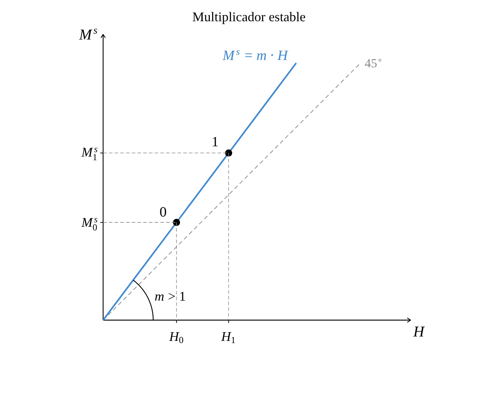
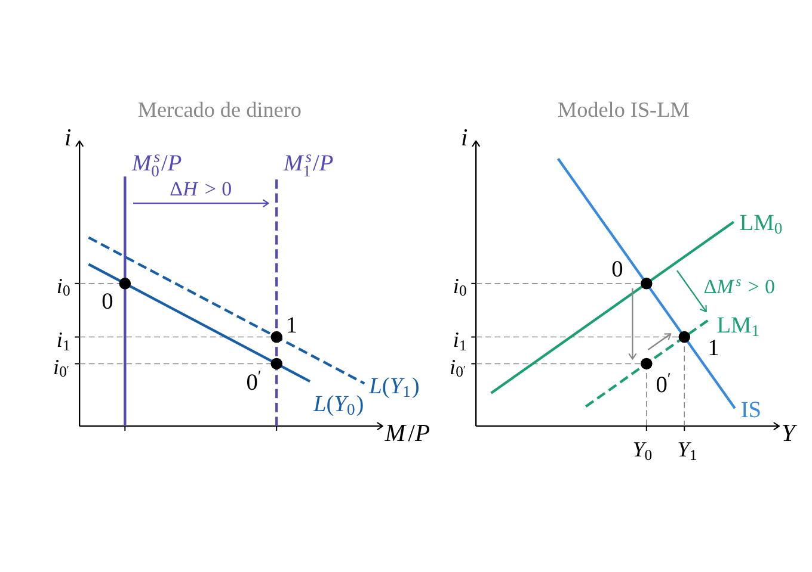
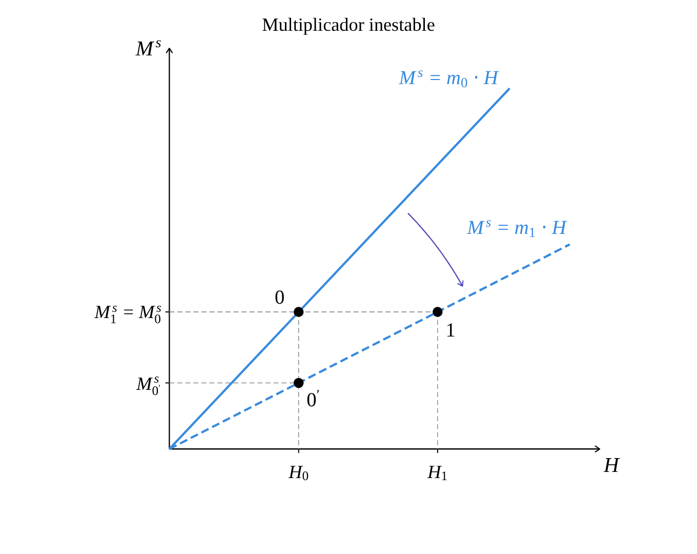
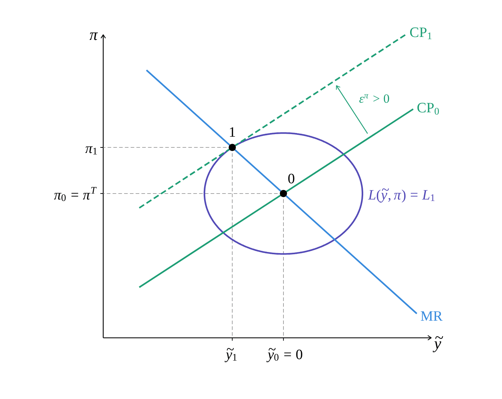

## Introducción



El objeto de este tema es el análisis del diseño y la instrumentación de la política monetaria, que se aborda en tres pasos:

- *Fundamentos*: el concepto de dinero, su oferta y demanda y el proceso de creación de dinero.

- *Diseño*: sus elementos, los debates sobre objetivos, variable operativa y discrecionalidad, y la política óptima.

- *Instrumentación*: tanto convencional como no convencional y cualitativa.

## 1. Fundamentos del diseño de la política monetaria

Los fundamentos del diseño son el concepto de dinero, su oferta y su demanda, y el equilibrio entre ambas, que da lugar al proceso de creación de dinero.

### 1.1. Concepto de dinero: definición teórica y operativa

**Definición conceptual**: J. Hicks propone caracterizar el dinero por las funciones que desempeña y no por su naturaleza. El dinero cumple, así, cuatro funciones:

- *Unidad de cuenta*: se utiliza para denominar los bienes, servicios y activos y anotar las transacciones, lo cual reduce drásticamente el número de precios relativos que deben conocerse frente al trueque.

- *Medio de cambio*: se usa y acepta generalmente para liquidar transacciones, lo cual permite superar la doble coincidencia de deseos del trueque.

- *Depósito de valor*: permite transferir poder adquisitivo del presente al futuro.

- *Estándar de pago diferido*: en él se denominan las deudas.

**Definición operativa**: interesa a la política económica y se refiere a los *agregados monetarios*. Estos son pasivos del sistema monetario en manos del sector tenedor de dinero (todos los residentes salvo las propias instituciones monetarias y la Administración central), ordenados por liquidez decreciente y extendidos históricamente en su amplitud por la innovación financiera. 

La escala que sigue es la del Eurosistema, si bien el número y la definición de los agregados varían por país[^a36-1]:

- *Base monetaria* o *dinero de alta potencia* ($H$): $H = E + R^b$. La emite el banco central y constituye, en consecuencia, un pasivo del banco central. Está compuesta del efectivo en manos del público ($E$), es decir, billetes y monedas fuera del sistema bancario, y de las reservas bancarias ($R^b$), es decir, el efectivo en caja de los bancos y los saldos que mantienen en el banco central, legales o voluntarios.

- *M1*: $M_1 = E + D$, donde $D$ son los depósitos a la vista del sector tenedor de dinero[^a36-2]. Constituye el dinero en sentido estricto y el pasivo del sistema monetario. En los modelos de este tema, es el agregado que se identifica con la oferta monetaria, $M^s$.

- *M2*: $M_2 = M_1 + D_2$, donde $D_2$ son los depósitos a plazo de hasta dos años y los disponibles con preaviso de hasta tres meses[^a36-3], el “cuasidinero” o *near money*.

- *M3*: $M_3 = M_2 + D_3$, donde $D_3$ incluye instrumentos negociables emitidos por las instituciones monetarias: cesiones temporales, participaciones en fondos del mercado monetario y valores de deuda con vencimiento hasta dos años. Como la sustitución entre sus componentes apenas lo altera, el Eurosistema lo sigue en su análisis monetario.

### 1.2. Oferta de dinero: el papel del sistema monetario

La oferta monetaria depende del sistema monetario, es decir, del conjunto de instituciones cuyos pasivos circulan como dinero. Lo integran el banco central y la banca comercial.

**Banco central**: es el organismo público con la exclusiva de emitir moneda de curso legal[^a36-4]. Además, diseña y ejecuta la política monetaria, vigila a las entidades financieras y ejerce de prestamista de última instancia.

El pasivo del banco central es la base monetaria, $H = E + R^b$, y su activo lo forman los activos netos frente al exterior o reservas internacionales (ANFE, $R$, es decir, divisas, oro, derechos especiales de giro y bonos extranjeros) y el crédito interno (CI). Este comprende los activos frente al Gobierno (AFG) y frente al sector privado, esencialmente la financiación a la banca (AFSP). El patrimonio neto del banco central se considera nulo[^a36-5], de modo que toda adquisición de activos se financia con una obligación. Por eso, desde el activo se ve cómo crece la base monetaria cuando el banco central compra activos exteriores o da crédito interno.

| **ACTIVO** | | **PASIVO** | |
|:---|---:|:---|---:|
| Activos netos frente al exterior (ANFE) | $R$ | Efectivo en manos del público | $E$ |
| **Crédito interno (CI)** | | Reservas bancarias | $R^b$ |
| Activos frente al Gobierno | $\text{AFG}$ | | |
| Activos frente al sector privado | $\text{AFSP}$ | | |
| **TOTAL ACTIVO** | **$R + \text{CI}$** | **TOTAL PASIVO** (base monetaria, $H$) | **$E + R^b$** |

: Balance simplificado del banco central. {#tbl-a36-balance-banco-central .table-sm .balance tbl-colwidths="[34,16,34,16]"}

**Banca comercial**: como cualquier intermediario financiero, traslada fondos desde quienes tienen excedentes hacia quienes necesitan financiación, pero, a diferencia de los demás, crea dinero mediante la *expansión múltiple de los depósitos*. Su pasivo son los depósitos ($D$) y la financiación recibida del banco central (AFSP, que aparece en el activo de aquel). Su activo lo forman las reservas ($R^b$, que aparecen en el pasivo del banco central) y el crédito al público.

Las reservas pueden ser legales ($R^b_L$), la cantidad mínima fijada por el banco central a través del coeficiente de caja[^a36-6], y voluntarias ($R^b_V$), que dependen de factores de mercado como el tipo de interés y la incertidumbre[^a36-7]. Sus coeficientes respecto de los depósitos, $q_L$ y $q_V$, suman el encaje bancario, $q = q_L + q_V$, de modo que $R^b = qD$. La razón de ser de las reservas es garantizar la estabilidad y credibilidad del sistema bancario, pues nada obliga a que entradas y salidas de efectivo coincidan[^a36-8].

| **ACTIVO** | | **PASIVO** | |
|:---|---:|:---|---:|
| **Reservas** ($R^b$) | | Depósitos | $D$ |
| Reservas legales | $R^b_L$ | Financiación del banco central | $\text{AFSP}$ |
| Reservas voluntarias | $R^b_V$ | | |
| Crédito al público | $\text{Crédito}$ | | |
| **TOTAL ACTIVO** | **$R^b + \text{Crédito}$** | **TOTAL PASIVO** | **$D + \text{AFSP}$** |

: Balance simplificado de un banco comercial. {#tbl-a36-balance-banco-comercial .table-sm .balance tbl-colwidths="[34,16,34,16]"}

**Sistema monetario**: al consolidar ambos balances, las partidas cruzadas entre ellos ($R^b$ y AFSP) se cancelan. Queda así un balance cuyo pasivo es la oferta monetaria, $M_1 = E + D$, y cuyo activo recoge los activos exteriores netos y el crédito interno, tanto al sector público (AFG) como al privado (crédito bancario). 

En el balance consolidado se ve que el dinero nace, sobre todo, de la compra de activos exteriores y del crédito interno, objeto del multiplicador monetario.

| **ACTIVO** | | **PASIVO** | |
|:---|---:|:---|---:|
| Activos netos frente al exterior (ANFE) | $R$ | Efectivo en manos del público | $E$ |
| **Crédito interno (CI)** | | Depósitos | $D$ |
| Activos frente al Gobierno | $\text{AFG}$ | | |
| Crédito al público | $\text{Crédito}$ | | |
| **TOTAL ACTIVO** | **$R + \text{CI}$** | **TOTAL PASIVO** (oferta monetaria, $M_1$) | **$E + D$** |

: Balance consolidado del sistema monetario. {#tbl-a36-balance-consolidado .table-sm .balance tbl-colwidths="[34,16,34,16]"}

### 1.3. Demanda de dinero

Para comprender el control imperfecto de la cantidad de dinero hay que entender la demanda. La razón es que la autoridad monetaria emite base monetaria, pero la cantidad de dinero que circula, $M_1$, la determinan el público, que decide cuánto dinero mantener y en qué forma, y los bancos, que deciden qué reservas mantener frente a los depósitos.

**Enfoque teórico**: existe un amplio número de hipótesis sobre la demanda de saldos reales, $M^d/P$, que comparten las variables que la relacionan con la economía real, si bien difieren en el papel asignado a cada una. Las dos concepciones clásicas son:

- *Keynesiana* $(M^d/P = kY - hi)$: suma un componente transacción, proporcional a la renta, y un componente especulación, decreciente con el tipo de interés. Este enfoque considera que la demanda de dinero es muy inestable, ya que el segundo componente depende de las expectativas sobre los tipos, en gran medida convencionales y cambiantes. Además, en él los bonos son los únicos sustitutivos del dinero. Estos rasgos dificultan la efectividad de la política monetaria. También la dificultan los dos eslabones débiles (la elevada sensibilidad de la demanda de dinero al tipo de interés, con la trampa de liquidez en el límite, y la escasa sensibilidad de la inversión al tipo de interés).

- *Monetarista* $(M^d/P = f({Y^P}^{+}, r_B^{-}, r_E^{-}, {\pi^e}^{-}, (W_H/W)^{+}))$: considera que el dinero es un bien más, cuya demanda depende de múltiples factores. Da lugar a una demanda de dinero estable y dependiente fundamentalmente de la renta permanente, ya que todos los activos, financieros (bonos, acciones) y reales (cuyo rendimiento es la inflación esperada), son sustitutivos imperfectos del dinero[^a36-9].

**Enfoque empírico**: ambas concepciones admiten una forma reducida común, $M^d/P = L(Y^{+}, i^{-})$, donde $Y$ es la renta disponible del público[^a36-10] e $i = r + \pi^e$ el tipo de interés nominal del activo sustitutivo. 

Las estimaciones de esta función para $M_1$ (Goldfeld, 1973) obtuvieron una elasticidad-renta a largo plazo inferior a la unidad (en torno a 0,7) y una elasticidad-interés reducida y estable, lo que sostuvo el control de los agregados como estrategia. Sin embargo, su ruptura a partir de 1974, cuando la función sobrepredijo sistemáticamente la demanda (*the case of the missing money*, Goldfeld, 1976), es el antecedente del abandono de esa estrategia que se estudia en el apartado 2.2.

**De la demanda de dinero a la demanda de base monetaria**: cualquiera que sea la teoría, la demanda de dinero del público se satisface con dos activos, efectivo y depósitos a la vista. El público decide en qué proporción mantiene cada uno (el coeficiente de efectivo, $c_M = E/M^s$, que depende de los costes de transacción, la bancarización y la confianza en los bancos). 

Los depósitos, a su vez, obligan a los bancos a mantener reservas en el banco central en una proporción $q$ (el coeficiente de reservas), de modo que la demanda de depósitos del público genera una demanda de reservas de los bancos. 

Efectivo y reservas son los dos componentes de la base monetaria, el pasivo monetario del banco central. Su suma es la demanda de base monetaria, $H^d = E^d + R^{b,d}$, y es frente a ella, y no frente a la demanda de dinero, donde la autoridad monetaria fija su oferta. Esta cadena se formaliza a continuación.

### 1.4. Equilibrio en el mercado monetario: el proceso de creación de dinero

En el mundo real, el mercado de reservas forma parte del mercado interbancario, y en él el tipo de interés se ajusta hasta igualar la oferta y la demanda de reservas. No obstante, es un mercado intervenido, puesto que los bancos centrales actúan sobre él para influir en el tipo de interés con el que se relacionan todos los tipos de la economía.

La cadena anterior se formaliza con tres modelos de complejidad creciente que comparten un mismo entorno (economía cerrada sin imperfecciones) y tres agentes: 

- *Banco central*: emite la base monetaria, $H$.

- *Público*: decide la composición de su demanda de dinero.

- *Bancos comerciales*: fijan sus reservas en una proporción $q \in (0, 1)$ de los depósitos.

**Modelo con depósito íntegro**: los agentes ingresan entera en un banco la base $H$ que emite el banco central, $D^{(1)} = H$. Ese banco guarda $qH$ como reserva y presta el resto, $(1-q)H$, que acaba también entero en otro banco, $D^{(2)} = (1-q)H$. Este reserva $q(1-q)H$ y presta $(1-q)^2H$, y así *ad infinitum*. Sumando todas las rondas, los depósitos de la economía son:

$$D = H + (1-q)H + (1-q)^2 H + \cdots = \sum_{n=0}^{\infty}(1-q)^n H = \underbrace{\frac{1}{q}}_{b} H \rightarrow\ M^s=\frac{1}{q}H $$

Sin efectivo ($M^s = D$), el *multiplicador bancario* es $b = 1/q > 1$. Dada una base $H$, la economía termina con una cantidad de dinero mayor que $H$, tanto mayor cuanto menor sea $q$ (y, por extensión, cuanto mayor sea $b$), y los bancos crean así dinero.

**Modelo con ratio efectivo-depósitos**: el banco central pone en circulación de nuevo $H$ y el público en este caso mantiene efectivo en proporción a sus depósitos, $E^d = c_D D^d$, con $c_D = E/D > 0$. Los bancos mantienen en reservas parte de los depósitos de sus clientes, $R^{b,d} = qD^d$.

La condición de equilibrio del mercado de base monetaria establece que la demanda de efectivo y reservas debe igualar a la base monetaria emitida inicialmente: 

$$H^d \equiv E^d + R^{b,d} = H$$
Con la definición $M^s = E + D$, se obtiene:

$$(c_D + q)D = H, \quad M^s = (1 + c_D)D \;\rightarrow\; M^s = \underbrace{\frac{1 + c_D}{c_D + q}}_{m = f(c_D^{-},\, q^{-})} H$$
De nuevo $m > 1$, pero ahora el multiplicador depende no solo del coeficiente de reservas de los bancos sino también de la ratio efectivo-depósitos que decide el público. 

Cuanto más efectivo mantenga el público fuera del sistema bancario ($c_D \uparrow$, “dinero debajo del colchón” en situaciones de incertidumbre), menor es $m$, que tiende a la unidad cuando todo el dinero es efectivo. Solo si las reservas superan a los depósitos ($q > 1$, caso que el supuesto $q \in (0, 1)$ excluye) el multiplicador cae por debajo de uno.

**Modelo con ratio efectivo-dinero**: el público mantiene efectivo en proporción a su dinero, $E^d = c_M M^d$ y $D^d = (1 - c_M)M^d$, con $c_M = E/M^s \in (0, 1)$, el coeficiente de efectivo ya definido. Con $R^{b,d} = qD^d$ y la misma condición de equilibrio:

$$c_M M^s + q(1 - c_M)M^s = H \;\rightarrow\; M^s = \underbrace{\frac{1}{c_M + q(1 - c_M)}}_{m = f(c_M^{-},\, q^{-})} H$$
Ambas parametrizaciones son el mismo multiplicador, pues $c_D = c_M/(1-c_M)$. La segunda es la habitual porque $c_M$ es la fracción de $M_1$ que el público mantiene en efectivo, directamente observable en los agregados.

**Multiplicador y control de la oferta monetaria**: en suma, cada unidad de base genera $m \geq 1$ unidades de dinero, tanto más cuanto menores sean $q$ y $c_M$. 

La autoridad monetaria fija $H$ mediante operaciones de mercado abierto y $q_L$ mediante los requerimientos de reservas, pero no controla las reservas voluntarias ni el coeficiente de efectivo. Su control de la cantidad de dinero es, por tanto, indirecto e imperfecto, y será tanto mejor cuanto más estable sea $m$[^a36-45]. El control de la propia base, además, exige gestionar a discreción los activos exteriores y el crédito interno, lo que un tipo de cambio fijo o la financiación del déficit público pueden impedir.

Gráficamente, en el plano base monetaria-cantidad de dinero (figura -@fig-a361-multiplicador), la relación $M^s = m \cdot H$ es un rayo desde el origen con pendiente $m > 1$, más inclinado que la bisectriz ($45^\circ$).

1. *Multiplicador estable*: $c_M$ y $q$ no varían y una expansión de la base de $H_0$ a $H_1$ eleva la cantidad de dinero de $M^s_0$ a $M^s_1$ a lo largo del rayo (del punto 0 al 1). Por ello, el banco central controla $M^s$ a través de $H$ con precisión.

::: {#fig-a361-multiplicador}

::: {.content-visible when-format="html"}
```{=html}
<div class="graph-frame">
<iframe src="../graphs/a361_Multiplicador.html" style="height:580px" loading="lazy" title="fig-a361-multiplicador"></iframe>
</div>
```
:::

::: {.content-visible unless-format="html"}

:::

Multiplicador monetario estable. La relación $M^s = mH$ es un rayo desde el origen más inclinado que la bisectriz ($m > 1$). Una expansión de la base de $H_0$ a $H_1$ eleva la cantidad de dinero de $M^s_0$ a $M^s_1$.
:::

Gráficamente, en el plano saldos reales-tipo de interés y en el plano $(Y, i)$ (figura -@fig-a362-pm-expansiva-i), esa expansión ($\Delta H > 0$) desplaza la oferta de saldos reales de $M^s_0/P$ a $M^s_1/P$ y reduce el tipo de interés de $i_0$ a $i_{0'}$ (punto 0′). En el modelo IS-LM, la LM se desplaza de $\text{LM}_0$ a $\text{LM}_1$ ($\Delta M^s > 0$) y la renta sube de $Y_0$ a $Y_1$, lo que eleva la demanda de dinero de $L(Y_0)$ a $L(Y_1)$ y sitúa el tipo de interés en $i_1$ (punto 1).

::: {#fig-a362-pm-expansiva-i}

::: {.content-visible when-format="html"}
```{=html}
<div class="graph-frame wide">
<iframe src="../graphs/a362_PM_expansiva_i.html" style="--r:1.417" loading="lazy" title="fig-a362-pm-expansiva-i"></iframe>
</div>
```
:::

::: {.content-visible unless-format="html"}

:::

Expansión de la base monetaria. La oferta de dinero se desplaza y el tipo de interés desciende.
:::

2. *Multiplicador inestable*: se representa en el plano base monetaria-cantidad de dinero (figura -@fig-a363-multiplicador-inestable). Un aumento de $c_M$ o de $q$, como en una crisis de confianza, en la que el público retira efectivo y los bancos acumulan reservas, hace girar el rayo hacia abajo, de $m_0$ a $m_1$. Por ello, con la misma base, $H_0$, la cantidad de dinero cae hasta $M^s_{0'}$ (punto 0′), y para mantenerla en $M^s_1 = M^s_0$ el banco central debe expandir la base hasta $H_1$ (punto 1). 

Así ocurrió tras 2008, cuando los balances de los bancos centrales se multiplicaron con los programas de compras y la acumulación de reservas excedentarias mientras los agregados monetarios apenas crecían, con $m_1 < 1$ en el caso de la Reserva Federal, cuyas reservas bancarias llegaron a superar a los depósitos a la vista ($q > 1$). La inestabilidad de $m$ es, por tanto, la razón por la que el control de la base es un instrumento poco fiable para controlar la cantidad de dinero, argumento que reaparece en el debate sobre la variable operativa (apartado 2.2).

::: {#fig-a363-multiplicador-inestable}

::: {.content-visible when-format="html"}
```{=html}
<div class="graph-frame">
<iframe src="../graphs/a363_Multiplicador_inestable.html" style="height:580px" loading="lazy" title="fig-a363-multiplicador-inestable"></iframe>
</div>
```
:::

::: {.content-visible unless-format="html"}

:::

Multiplicador inestable. Un aumento de $c_M$ o de $q$ hace girar el rayo hacia abajo, de $m_0$ a $m_1$. Con la misma base, la cantidad de dinero cae (punto 0′) y, para mantener $M^s_1 = M^s_0$, el banco central debe ampliar la base de $H_0$ a $H_1$.
:::

### 1.5. Conclusiones

**Aspectos positivos**: los modelos planteados permiten entender las intuiciones en torno al funcionamiento del mercado monetario, base de la determinación de los tipos de interés de toda la economía. Explican, además, por qué cada unidad de $H$ genera una cantidad proporcional de $M^s$ y por qué el control de la cantidad de dinero es imperfecto. Fenómenos como los vividos durante la Gran Recesión (2008-2014) o el escándalo del Libor (manipulaciones de 2005-2009, destapadas en 2012) ponen de manifiesto la importancia de los mercados monetarios para el sistema económico en su conjunto.

**Limitaciones**: se ha hecho abstracción de la dimensión internacional, pero las reservas de los bancos centrales se ven afectadas por el sector exterior. 

Las autoridades monetarias también financian la balanza de pagos e intervienen en el mercado de divisas, de dos formas:

- *No esterilizada*: deja fluctuar la oferta de moneda nacional, lo que puede ser efectivo para mantener el tipo de cambio, pero genera problemas de credibilidad por su incompatibilidad con una política monetaria orientada a objetivos internos.

- *Esterilizada*: mantiene constante la oferta monetaria, y su efectividad depende de la sustituibilidad imperfecta entre bonos nacionales y extranjeros.

Ambas formas de intervención alteran los activos exteriores netos del banco central, pero la esterilizada compensa su efecto sobre la base monetaria con una variación de signo contrario del crédito interno.

## 2. Diseño de la política monetaria

El diseño se articula en torno a cuatro elementos, cuya combinación ha cambiado con el tiempo. Dos debates ordenan esa evolución, el de los objetivos y la variable operativa y el de la discrecionalidad y la credibilidad. El modelo IS-PC-MR los ilustra y permite determinar la política óptima.

### 2.1. Definición y elementos del diseño

El **diseño de la política monetaria**, o forma en que la autoridad monetaria plantea su intervención sobre la cantidad y el precio del dinero, se articula en torno a cuatro elementos:

**Objetivo final**: es la variable económica sobre la que se tiene un escaso control directo y que constituye el objetivo último de la política monetaria. Puede abarcar la estabilidad de precios, la estabilidad financiera, el pleno empleo o la redistribución de la renta.

El énfasis en cada uno de ellos, no obstante, cambia. Por ejemplo, el BCE busca la estabilidad de precios, mientras que la Reserva Federal busca no solo la estabilidad de precios, sino también el máximo empleo y unos tipos de interés a largo plazo moderados[^a36-13].

**Objetivo intermedio**: variable económica que se puede controlar a través de la variable operativa con un retardo razonable y un grado de precisión relativamente alto, y que además mantiene una relación estable con el objetivo final y es un indicador representativo de él. 

Tradicionalmente, se incluyen la cantidad de dinero ($M_1$, $M_3$), el tipo de cambio y los tipos de interés a medio y largo plazo. Su popularidad, sin embargo, ha caído y en la actualidad se utilizan como variables indicador.

**Variable operativa**: variable económica sobre la que el banco central sí tiene un control directo, en el día a día, a través de sus instrumentos.

Incluye la base monetaria, $H$, o el tipo de interés interbancario a corto plazo, al que los bancos se prestan de un día para otro. Para el BCE es el tipo de interés a corto plazo del euro (€STR), sucesor desde 2022 del índice medio del tipo de interés del euro a un día (EONIA), y para la Reserva Federal, el *fed funds rate*. En la actualidad, existe consenso en considerar el tipo de interés como la variable operativa apropiada.

**Instrumentos**: son las herramientas con las que el banco central maneja la variable operativa. Los convencionales son las operaciones de mercado abierto (OMA), las facilidades permanentes y los requerimientos de reservas[^a36-14], a los que desde 2008 se han sumado los instrumentos no convencionales.

### 2.2. Debate sobre los objetivos y la variable operativa

En torno a los objetivos y la variable operativa se han sucedido dos doctrinas, la de reservas y la de seguimiento directo de la inflación. Como alternativas a esta última se han propuesto el seguimiento del PIB nominal y el del nivel de precios.

#### 2.2.1. Doctrina de reservas (1920-1990)

El diseño tradicional arranca de la doctrina de la posición de reservas de la Reserva Federal en los años veinte y culmina en los objetivos de agregados monetarios de los años setenta y ochenta. Enfatiza el papel de la variable intermedia y se apoya en el esquema de objetivos e instrumentos de Jan Tinbergen (1952). De ahí que la estrategia tenga dos niveles:

- *Primer nivel*: se determina la relación entre el objetivo final y el objetivo intermedio.

- *Segundo nivel*: se determina la relación entre el objetivo intermedio y la variable operativa.

**Objetivo final**: la estabilidad de la inflación promedio, si bien en la mayoría de países no había un objetivo claro en cuanto a su magnitud ni una política de comunicación.

**Objetivo intermedio**: durante los años setenta y ochenta hubo un importante debate entre fijar un tipo de interés a largo plazo o una cantidad de agregado monetario[^a36-17]. Desde el punto de vista teórico predominó la visión monetarista, que situaba como variable intermedia los agregados monetarios.

Por su parte, William Poole (1970), en un modelo IS-LM estocástico de carácter teórico (figura -@fig-a367-regla-poole), formuló la regla de elección del instrumento según el origen de los *shocks* (en rigor, según sus varianzas relativas y las pendientes de la IS y la LM): 

- *Sector monetario más inestable* ($\sigma_M^2 > \sigma_R^2$): si los *shocks* de demanda de dinero que desplazan la LM dominan, hay que controlar el tipo de interés. Con el tipo de interés fijo en $i_0$, la LM es horizontal y la renta no se aparta de $Y_0$, mientras que con objetivo de agregado oscilaría entre $Y'$ e $Y''$ (panel a).

- *Sector real más inestable* ($\sigma_R^2 > \sigma_M^2$): los *shocks* reales que desplazan la IS aconsejan controlar los agregados. Con el agregado fijo, la LM creciente amortigua el efecto de los desplazamientos de la IS, y la renta oscila entre $Y'$ e $Y''$ en lugar de entre $Y'''$ e $Y''''$ (panel b). En los años setenta, los *shocks* reales (de gasto y, en la práctica, los del petróleo) hicieron que la evidencia también apoyara el control de agregados, aunque los del petróleo fueron sobre todo de oferta, que el modelo IS-LM de Poole no recoge.

::: {#fig-a367-regla-poole}

::: {.content-visible when-format="html"}
```{=html}
<div class="graph-frame wide">
<iframe src="../graphs/a367_Regla_Poole.html" style="--r:1.744" loading="lazy" title="fig-a367-regla-poole"></iframe>
</div>
```
:::

::: {.content-visible unless-format="html"}
![Regla de Poole (1970). Con *shocks* monetarios (a), la LM oscila entre $\text{LM}'$ y $\text{LM}''$ y, con objetivo de agregado, la renta fluctúa entre $Y'$ e $Y''$, mientras que con objetivo de tipo de interés la LM es horizontal en $i_0$ ($\text{LM}_{i_0}$) y la renta queda en $Y_0$. Con *shocks* reales (b), la IS oscila entre $\text{IS}'$ e $\text{IS}''$, y el objetivo de agregado ($\text{LM}_0$) limita la renta al intervalo entre $Y'$ e $Y''$, más estrecho que el que deja el objetivo de tipo de interés, entre $Y'''$ e $Y''''$.](../graphs/static/a367_Regla_Poole.png)
:::

Regla de Poole (1970). Con *shocks* monetarios (a), la LM oscila entre $\text{LM}'$ y $\text{LM}''$ y, con objetivo de agregado, la renta fluctúa entre $Y'$ e $Y''$, mientras que con objetivo de tipo de interés la LM es horizontal en $i_0$ ($\text{LM}_{i_0}$) y la renta queda en $Y_0$. Con *shocks* reales (b), la IS oscila entre $\text{IS}'$ e $\text{IS}''$, y el objetivo de agregado ($\text{LM}_0$) limita la renta al intervalo entre $Y'$ e $Y''$, más estrecho que el que deja el objetivo de tipo de interés, entre $Y'''$ e $Y''''$.
:::

**Variable operativa**: el banco central controla la base monetaria a corto plazo.

**Instrumentos**: emplea los convencionales.

**Conclusiones**:

- *Aspectos positivos*: la estrategia se aplicó en la mayoría de economías avanzadas desde mediados de los setenta y alcanzó su mayor relevancia entre 1979 y 1982, bajo Paul Volcker en la Reserva Federal. Sus resultados fueron buenos en la reducción de la inflación, pero dañinos para el empleo y la producción.

- *Limitaciones*: el objetivo intermedio se controla de forma deficiente, pues hay retardos tanto de detección como de transmisión, el mecanismo por el que actúa la política se conoce de forma imperfecta y el vínculo del objetivo intermedio con el final no es estable. A ello se suman los incentivos a usar la política con miras cortoplacistas, que desembocan en inconsistencia dinámica (*time inconsistency*).

#### 2.2.2. Doctrina de seguimiento directo de la inflación (1990-hoy)

A partir de los años ochenta, la innovación y la liberalización financiera volvieron más inestables la demanda de dinero y su velocidad de circulación. Tras una transición a finales de los ochenta, ello derivó en las estrategias de **objetivo directo de inflación** (*inflation targeting*), adoptadas por primera vez en Nueva Zelanda (1990). Siguieron Canadá (1991), Reino Unido (1992), Suecia y Australia (1993), el BCE desde 1999, con una estrategia afín (sus dos pilares incluían el análisis monetario), y, más tarde, la Reserva Federal (2012) y el Banco de Japón (BoJ, 2013). También lo adoptaron numerosas economías emergentes (Brasil, Chile, México, Polonia, Sudáfrica).

Este régimen supone el paso al diseño de estrategias con un único nivel, que se centra en el objetivo final (inflación) y en la variable operativa (tipo de interés a corto plazo), sin un esquema de relaciones con un objetivo intermedio.

**Objetivo final**: persigue la estabilidad de precios en el medio plazo[^a36-16], cuantificada como una variación de un índice de precios al consumo (IPC, índice armonizado de precios de consumo en la UEM, deflactor del consumo en EE. UU.).

Esta cuantificación puede articularse como *objetivo puntual*, como *banda* o como *punto con banda de tolerancia*. El objetivo puntual se sitúa generalmente en torno al 2 %, como en el BCE, el Reino Unido o la Reserva Federal. El punto con banda de tolerancia es el de la mayoría de economías emergentes, y también el de Canadá y Nueva Zelanda, con el 2 % en el centro de un intervalo del 1 al 3 %.

El objetivo debe cumplir tres *requisitos*: 

- *Verificable*: mediante el anuncio público de objetivos cuantificados.

- *Flexible* (*flexible inflation targeting*): con discrecionalidad limitada, a medio plazo y con tolerancia a desviaciones transitorias, para atender *shocks* inesperados.

- *Creíble*: para anclar las expectativas, lo que remite al debate sobre la discrecionalidad.

Existe, en todo caso, consenso sobre las bondades de la estabilidad de precios. Esta evita los costes de la inflación y la deflación y los efectos redistributivos arbitrarios, mejora la señal informativa de los precios relativos, reduce las primas de riesgo y las coberturas innecesarias y previene distorsiones en los sistemas impositivos y de Seguridad Social.

**Objetivo intermedio**: no existe como tal. Su papel lo desempeña la *previsión de inflación* del propio banco central al horizonte de la política (en torno a dos años). Si la previsión se desvía del objetivo, el banco central ajusta el tipo de interés (*inflation-forecast targeting*, Svensson, 1997a). 

La previsión se apoya en un conjunto amplio de indicadores reales, financieros y monetarios. El BCE lo formalizó en dos pilares, el análisis económico a corto y medio plazo y el análisis monetario a medio y largo plazo, una herencia de la doctrina de reservas que ningún otro banco central mantuvo. El pilar monetario incluyó inicialmente un valor de referencia para $M_3$, $g_{M_3} \approx 4{,}5\%$, cuya revisión anual se abandonó en 2003. Por último, la revisión estratégica de 2021 sustituyó los dos pilares por un marco integrado de análisis económico y análisis monetario y financiero.

**Variable operativa**: el banco central controla el tipo de interés a corto plazo.

**Instrumentos**: emplea los convencionales junto a los no convencionales.

**Conclusiones**:

- *Aspectos positivos*: su transparencia facilita la evaluación pública y el anclaje de expectativas. Si los anuncios son creíbles, la estrategia reduce las ratios de sacrificio, porque la desinflación no tiene por qué ser costosa en empleo. Además, coordina a los agentes que fijan precios y salarios y es robusta frente a la innovación financiera, pues no depende de la estabilidad de ningún agregado.

- *Limitaciones*: los retardos exigen un buen seguimiento de los indicadores y hacen que la política dependa de la calidad de la previsión. Ante *shocks* de oferta puede ser procíclica, porque un *shock* positivo reduce la inflación y la expansión monetaria resultante puede alimentar burbujas, mientras que uno negativo lleva a una contracción que agrava la recesión. Por último, conserva cierta discrecionalidad a corto plazo y relega otros objetivos como el crecimiento o la estabilidad financiera, cuya omisión antes de 2008 es la crítica más repetida al régimen.

#### 2.2.3. Doctrina de seguimiento del PIB nominal

A raíz de la crisis financiera global se ha debatido el control de la senda de crecimiento del PIB nominal (*NGDP targeting*)[^a36-19], que reparte los *shocks* de oferta entre precios y producción.

**Objetivo final**: la estabilidad de la senda de crecimiento del PIB nominal, con un objetivo del orden del 4-5 % anual (2 % de inflación más 2-3 % de crecimiento real), de modo que en recesión la inflación puede superar el 2 %.

**Objetivo intermedio**: no existe, porque el seguimiento del PIB nominal es, como el seguimiento directo de la inflación, una estrategia en un nivel.

**Variable operativa**: el banco central controla el tipo de interés a corto plazo.

**Instrumentos**: emplea los convencionales junto a los no convencionales.

**Conclusiones**:

- *Aspectos positivos*: habría permitido una acción más temprana en 2008, cuando el PIB nominal caía con fuerza. Además, estabiliza mejor el *output* ante *shocks* de oferta, pues reparte el efecto del *shock* entre precios y producción y exige una respuesta monetaria más moderada que un objetivo estricto de inflación.

- *Limitaciones*: el PIB se mide con menor frecuencia y mayor revisión que la inflación y la estrategia es más difícil de evaluar por el público.

#### 2.2.4. Doctrina de seguimiento del nivel de precios

Alternativamente, el objetivo puede fijarse sobre una senda del nivel de precios (*price-level targeting*) y no sobre su tasa de variación. Su atractivo aparece en el límite inferior efectivo de los tipos (ELB), porque el compromiso de compensar la inflación perdida eleva las expectativas de inflación y reduce el tipo real cuando el nominal no puede bajar (Eggertsson y Woodford, 2003).

**Objetivo final**: una senda objetivo del nivel de precios, de modo que los periodos de inflación por debajo del objetivo deben compensarse con periodos por encima.

**Objetivo intermedio**: no existe, porque el seguimiento del nivel de precios también es una estrategia en un nivel.

**Variable operativa**: el tipo de interés a corto plazo, complementado por el *forward guidance* (orientación prospectiva), pues la estrategia descansa en el compromiso sobre la senda futura de tipos.

**Instrumentos**: emplea los convencionales junto a los no convencionales.

**Conclusiones**:

- *Aspectos positivos*: ancla las expectativas de inflación a largo plazo y proporciona estímulo adicional en el ELB sin necesidad de bajar los tipos. Las revisiones estratégicas de la Reserva Federal (2020, *average inflation targeting*) y del BCE (2021, objetivo simétrico del 2 % con tolerancia a desviaciones transitorias al alza tras periodos en el ELB) incorporaron versiones atenuadas de esta idea.

- *Limitaciones*: exige que el público entienda y crea el compromiso de compensación, y obliga a tolerar inflación por encima del objetivo tras una recesión, lo que resulta difícil de sostener cuando esa inflación llega. De hecho, tras la inflación de 2021-2023, ambos bancos centrales retiraron esos elementos de compensación en sus revisiones de 2025. La Reserva Federal abandonó la compensación de la inflación promedio y volvió a un objetivo de inflación flexible. El BCE, por su parte, suprimió la tolerancia a desviaciones transitorias al alza tras periodos en el ELB y la sustituyó por una respuesta enérgica o persistente ante desviaciones amplias y sostenidas de la inflación en cualquier dirección.

### 2.3. Debate sobre la discrecionalidad y la credibilidad

El debate anterior puede entenderse a través de la minimización de una **función de pérdida** del banco central sujeta a la estructura de la economía. La cuestión es si esa minimización debe hacerse periodo a periodo o con arreglo a una regla y, en el segundo caso, cómo hacer creíble el compromiso.

**Política monetaria discrecional**: el banco central optimiza en cada periodo dada la situación. Su beneficio es la flexibilidad frente a *shocks* imprevistos (p. ej. la pandemia de COVID-19), y su coste, el problema de la *inconsistencia dinámica* (Kydland y Prescott, 1977). Si la autoridad monetaria tiene un objetivo de *output* superior al natural, tiene un incentivo a generar inflación sorpresa una vez que los agentes han fijado sus expectativas. Con expectativas racionales, sin embargo, los agentes lo anticipan, y el resultado es un *sesgo inflacionista* sin ganancia de *output* (Barro y Gordon, 1983a).

::: {.callout-note appearance="simple" icon=false}
El modelo de Barro-Gordon y el sesgo inflacionista se desarrollan en el tema [A06](a06-nmc.qmd), apartado 3.1.2.
:::

**Política monetaria reglada**: la solución es plantear reglas o compromisos creíbles que aten las manos de la autoridad, ya sea el crecimiento constante de la oferta monetaria (Friedman), una inflación constante o una regla de tipos de interés. Entre las reglas de tipos, la de referencia es la *regla de Taylor* (1993)[^a36-21]:

$$i_t = \underbrace{\bar{r}_t + \pi^T}_{\bar{i}_t} + \alpha_\pi \underbrace{(\pi_t - \pi^T)}_{\tilde{\pi}_t} + \alpha_y \underbrace{(y_t - \bar{y}_t)}_{\tilde{y}_t} \;\rightarrow\; \tilde{i}_t = \alpha_\pi \tilde{\pi}_t + \alpha_y \tilde{y}_t$$

donde $\bar{i}_t$ es el tipo de interés nominal neutral (tipo real natural, $\bar{r}_t$, más objetivo de inflación, $\pi^T$), $\tilde{i}_t \equiv i_t - \bar{i}_t$ la desviación del tipo nominal respecto a ese tipo neutral, $\tilde{\pi}_t$ la desviación de la inflación y $\tilde{y}_t$ la brecha de producción (*output gap*). Si la inflación se desvía por encima de su objetivo, el tipo nominal debe subir más que proporcionalmente, $\alpha_\pi > 1$ (*principio de Taylor*), para que el tipo real suba[^a36-22].

Los beneficios de las reglas son la comprensión pública de la política, la gestión de las expectativas, indispensable dado el control imperfecto de la cantidad de dinero, y la posibilidad de delegar el trabajo en una institución evaluable. La regla de Taylor añade sencillez y buen ajuste a los datos. Los costes de las reglas son la rigidez frente a *shocks* no contemplados y, en el caso de la regla de Taylor, su carácter *backward looking*, la ausencia de un componente estocástico y la falta de microfundamentos.

**Mecanismos de credibilidad**: entre la discrecionalidad pura y la regla rígida, la literatura ha propuesto tres:

- *Prácticas reputacionales* (Barro y Gordon, 1983b): en un juego repetido indefinidamente entre la autoridad monetaria y los agentes, la creación de reputación puede resolver la inconsistencia dinámica sin necesidad de una regla formal. Para ello, hacen falta estrategias de castigo (los agentes elevan sus expectativas de inflación tras una sorpresa) y que el banco central valore suficientemente el futuro.

- *Delegación* (Rogoff, 1985): delegar la política monetaria en una autoridad independiente y más aversa a la inflación que la sociedad (un banquero central *conservador*) reduce el sesgo inflacionista, a costa de una estabilización subóptima del *output*. Los países de la OCDE han adoptado esta solución mediante la independencia del banco central, que la evidencia empírica correlaciona negativamente con la inflación media sin coste en términos de *output* (Alesina y Summers, 1993).

- *Contratos* (Walsh, 1995; Svensson, 1997b): los firmados entre el Gobierno y la autoridad monetaria modifican la función de pérdida del banco central, penalizando linealmente la inflación (Walsh) o asignándole un objetivo de inflación inferior al socialmente óptimo (Svensson). Eliminan así el sesgo inflacionista sin sacrificar la estabilización y alcanzan, en el modelo de Barro-Gordon, el resultado óptimo bajo compromiso, a diferencia del banquero conservador de Rogoff, que es una solución de *second best*. El *inflation targeting* con rendición de cuentas es la versión práctica de este contrato.

### 2.4. Política óptima: el modelo IS-PC-MR

Los debates anteriores y la determinación de la política monetaria óptima pueden ilustrarse con el modelo canónico de la nueva economía keynesiana.

::: {.callout-note appearance="simple" icon=false}
El modelo IS-PC-MR se desarrolla en el tema [A07](a07-nek.qmd), apartado 2.1, y su relación con la política fiscal y el límite inferior de los tipos de interés (*zero lower bound*, ZLB), en el tema [A40](a40-interrelacion.qmd), apartado 2.1. Aquí se retiene la derivación de la regla óptima.
:::

**Planteamiento**: el banco central elige la senda del tipo de interés real que minimiza su función de pérdida intertemporal sujeto a la estructura de la economía:

$$\begin{aligned} &\min_{r_t} \; \mathbb{E}_0 \sum_{t=0}^{\infty} \beta^t \left[(\pi_t - \pi^T)^2 + \omega \tilde{y}_t^2\right], \quad \omega > 0, \qquad \beta \in (0, 1) \\ &\text{s.a.:} \begin{cases} \tilde{y}_t = \mathbb{E}_t[\tilde{y}_{t+1}] - \frac{1}{\theta}\left(r_t - \bar{r}_t\right) \\ \pi_t - \pi^T = \beta \mathbb{E}_t[\pi_{t+1} - \pi^T] + \kappa\tilde{y}_t + \varepsilon^\pi_t \end{cases} \end{aligned}$$

donde $r_t$ es el tipo de interés real (el instrumento), $\pi_t$ la inflación, $\pi^T$ el objetivo de inflación, $\tilde{y}_t$ la brecha de producción, $\omega$ el peso relativo de la brecha en la función de pérdida y $\beta$ el factor de descuento. En las restricciones, $\bar{r}_t$ es el tipo real natural, $1/\theta$ la sensibilidad de la brecha al tipo de interés en la IS dinámica, $\kappa$ la pendiente de la curva de Phillips y $\varepsilon^\pi_t$ un *shock* de costes.

**CPO**: bajo discrecionalidad, el banco central reoptimiza en cada periodo tomando las expectativas como dadas, y, derivando el lagrangiano respecto a $\tilde{y}_t$ y $\pi_t$, se obtiene la *regla monetaria* (MR), $\tilde{y}_t = -\frac{\kappa}{\omega}(\pi_t - \pi^T)$. Esta relación negativa entre la brecha de producción y la desviación de la inflación señala, ante cada *shock*, el punto de la curva de Phillips que minimiza la pérdida. La IS traduce después ese punto en el tipo de interés que hay que fijar, lo que da lugar a una regla de tipos de la forma de Taylor.

Bajo compromiso, en cambio, la condición depende también de la brecha pasada, $\tilde{y}_t - \tilde{y}_{t-1} = -\frac{\kappa}{\omega}(\pi_t - \pi^T)$, como recoge el tercer resultado de la solución.

**CSO**: la función de pérdida es estrictamente convexa (cuadrática) y las restricciones lineales, de modo que la CPO es necesaria y suficiente y la política óptima es única.

**Solución**: del programa se desprenden tres resultados:

1. *Variable de decisión*: el instrumento es el tipo de interés real, a través del nominal y de las expectativas de inflación, y no la cantidad de dinero, que queda determinada endógenamente por la demanda. La doctrina actual se deriva, por tanto, del modelo.

2. *Aversión a la inflación* (inversa de $\omega$): el peso relativo de la brecha de producción define el tipo de banco central. Si $\omega$ es alto, la autoridad es “paloma” (*dove*) y prioriza la estabilización del *output*. En el plano $(\tilde{y}, \pi)$ la MR es entonces muy inclinada, pues la autoridad acepta más inflación a cambio de menos brecha. Si $\omega$ es bajo, es “halcón” (*hawk* o *hard-nosed*) y prioriza la inflación (la MR es plana).

3. *Sesgo inflacionista*: si la autoridad monetaria tiene un objetivo de brecha positivo ($\tilde{y}^T > 0$), la función de pérdida es $(\pi_t - \pi^T)^2 + \omega(\tilde{y}_t - \tilde{y}^T)^2$ y aparece un incentivo a generar inflación sorpresa que, con expectativas racionales, solo produce inflación (el resultado de Barro-Gordon). La solución bajo compromiso, además, difiere de la discrecional incluso sin sesgo, porque el banco central óptimo promete responder a los *shocks* de hoy también mañana (*dependencia de la historia*). Esa promesa ancla las expectativas y reduce el coste de estabilización (Clarida, Galí y Gertler, 1999), resultado que fundamenta el *forward guidance* como instrumento (apartado 3.3.1).

**Desarrollo gráfico**: la política monetaria óptima se representa en el plano $(\tilde{y}, \pi)$ (figura -@fig-a366-is-pc-mr):

1. *Curva de Phillips* ($\text{CP}_0$): recoge la inflación asociada a cada brecha de producción, dadas las expectativas. Es creciente, con pendiente $\kappa$, porque una brecha positiva presiona al alza los precios, y sin perturbaciones pasa por el objetivo de inflación con brecha nula.

2. *Curva de isopérdida* $L(\tilde{y},\pi)=L_1$: recoge las combinaciones de brecha e inflación con la misma pérdida, que crece al alejarse del punto ($0$, $\pi^T$).

3. *Regla monetaria* (MR): es decreciente, con pendiente $-\omega/\kappa$, porque une las tangencias entre las curvas de isopérdida y las curvas de Phillips.

4. *Equilibrio*: sin perturbaciones, en el punto 0 la brecha es nula y la inflación está en el objetivo ($\tilde{y}_0 = 0$, $\pi_0 = \pi^T$).

**Estática comparativa**: un *shock* de costes ($\varepsilon^\pi > 0$) desplaza la curva de Phillips hacia arriba, de $\text{CP}_0$ a $\text{CP}_1$. La respuesta óptima es el punto 1 de la MR, donde $\text{CP}_1$ es tangente a la curva de isopérdida $L_1$, y reparte el ajuste entre inflación ($\pi_1 > \pi^T$) y *output* ($\tilde{y}_1 < 0$) en función de $\omega$. La doctrina de seguimiento directo de la inflación resuelve esa disyuntiva con bandas y un horizonte de medio plazo.

::: {#fig-a366-is-pc-mr}

::: {.content-visible when-format="html"}
```{=html}
<div class="graph-frame">
<iframe src="../graphs/a366_IS_PC_MR.html" style="height:580px" loading="lazy" title="fig-a366-is-pc-mr"></iframe>
</div>
```
:::

::: {.content-visible unless-format="html"}

:::

Regla monetaria óptima en el modelo IS-PC-MR. El banco central elige sobre la curva de Phillips el punto que minimiza su función de pérdida.
:::

### 2.5. Conclusiones

El diseño moderno de la política monetaria descansa sobre un objetivo final de estabilidad de precios cuantificado y sobre el tipo de interés a corto plazo como variable operativa, dado el control imperfecto de la cantidad de dinero. Lo completan compromisos creíbles (reglas, delegación, transparencia) que resuelven la inconsistencia dinámica. La interrelación de este diseño con la política fiscal, y los regímenes de dominancia que resultan cuando la restricción presupuestaria del sector público se impone a la autoridad monetaria, se desarrollan en los temas [A39](a39-deficit.qmd) y [A40](a40-interrelacion.qmd).

## 3. Instrumentación de la política monetaria

Para alcanzar sus objetivos, los bancos centrales utilizan un conjunto de instrumentos y procedimientos que constituyen su **marco operativo**. Si el diseño fija qué objetivo alcanzar, el marco operativo determina cómo. 

Los marcos operativos de los principales bancos centrales han evolucionado en las últimas décadas. Por ello, las medidas se agrupan en instrumentos convencionales, instrumentos no convencionales, generalizados tras la crisis financiera global de 2008 y la pandemia de COVID-19, e instrumentos cualitativos y medidas transversales, y la sección se cierra con los debates recientes sobre la instrumentación.

### 3.1. Instrumentos cuantitativos convencionales

Los instrumentos convencionales son las operaciones de mercado abierto, las facilidades permanentes y los requerimientos de reservas.

#### 3.1.1. Operaciones de mercado abierto

**Definición**: son operaciones de inyección o drenaje de liquidez a las entidades en el mercado monetario, generalmente mediante subasta[^a36-24], a cambio de un activo de garantía o colateral[^a36-25]. Estas operaciones son el principal instrumento de política monetaria en la mayoría de países a través de la fijación de sus condiciones, concretamente del tipo de interés oficial.

**Objetivo**: sirven para señalizar la posición del banco central, gestionar la liquidez del sistema y controlar los tipos de interés.

**Instrumentación**: abarca cinco tipos de operaciones principales:

1. *Transacciones revertidas*: es el caso más habitual, en el que se provee o drena liquidez temporalmente contra colateral que se recompra o revende al vencimiento (*repos* y *reverse repos*). En el Eurosistema, lo son las operaciones principales de financiación semanales (MRO), las de más largo plazo (LTRO) y las de ajuste y estructurales.

2. *Transacciones en firme*: compras o ventas simples de activos, generalmente deuda pública, en las que el título cambia de manos de forma definitiva y entra o sale del balance del banco central indefinidamente. Alteran la liquidez de forma permanente, por lo que se reservan a las operaciones estructurales. Los programas de compras de activos son transacciones en firme a gran escala.

3. *Certificados de deuda*: emisión por el banco central de títulos propios a corto plazo que las entidades suscriben, drenando liquidez del sistema durante la vida del título.

4. *Swaps de tipos de cambio* (*FX swaps*): compra (venta) al contado de divisa contra moneda nacional con venta (compra) simultánea a plazo. Así, la liquidez en moneda nacional se inyecta (drena) durante el plazo del *swap* sin alterar la posición cambiaria del banco central. Se emplean en las operaciones de ajuste y no deben confundirse con las líneas de *swap* entre bancos centrales, que proveen divisa extranjera.

5. *Depósitos a plazo fijo*: el banco central ofrece a las entidades la constitución de depósitos remunerados a un plazo determinado, generalmente mediante subasta rápida, drenando así liquidez por ese periodo. Estos depósitos son la operación de ajuste típica para absorber excesos puntuales, y el BCE la utilizó semanalmente entre 2010 y 2014 para esterilizar las compras del programa para los mercados de valores (SMP).

El diseño del *sistema de garantías* (colaterales) es, además, un “subinstrumento”, en la medida en que exigir menos garantías o admitir distintos activos altera cualitativamente las condiciones.

**Efectos**: las OMA tienen dos:

- *Efecto cantidad*: alteran la base monetaria y, vía multiplicador, la oferta monetaria.

- *Efecto precio* (o liquidez): si la compraventa tiene por objeto valores de renta fija, influyen en su cotización y en su tipo de interés efectivo[^a36-28].

**Conclusiones**:

- *Aspectos positivos*: son un instrumento muy popular por su flexibilidad en magnitud (grandes cantidades o pequeñas dosis) y en dirección (pueden revertirse sin dificultades para las entidades).

- *Limitaciones*: su efecto sobre la oferta monetaria depende de la estabilidad del multiplicador, que el banco central no controla (apartado 1.4), y exigen mercados de deuda y de colateral profundos y líquidos. Además, con los tipos en su límite inferior pierden eficacia, porque el dinero y los activos a corto plazo pasan a ser casi sustitutos perfectos.

#### 3.1.2. Facilidades permanentes

**Definición**: sistema que permite a las entidades de contrapartida acceder a liquidez, o depositarla, en condiciones fijas, es decir, a precios determinados por el banco central que no son de mercado y que generalmente son desfavorables. Este sistema es descentralizado, accesible por iniciativa de las entidades y de uso puntual.

**Objetivo**: las facilidades permanentes sirven para acotar las fluctuaciones del tipo de interés interbancario a un día y proveer o absorber liquidez de emergencia.

**Instrumentación**: adoptan dos formas generales, con nombres distintos en cada banco central:

1. *Facilidad de crédito* (*lending facility*): permite a las entidades obtener liquidez a un día contra activos de garantía elegibles, a un tipo superior al de mercado. En el Eurosistema se conoce como la facilidad marginal de crédito y, en la Reserva Federal, como la ventanilla de descuento (*discount window*), instrumentada de forma descentralizada por los doce bancos federales[^a36-29]. Otros bancos centrales siguen otras denominaciones (p. ej. facilidad de crédito complementaria en el caso del BoJ).

2. *Facilidad de depósito* (*deposit facility*): permite depositar liquidez a un día a un tipo inferior al de mercado. En el Eurosistema se conoce como facilidad de depósito y, en el BoJ, como facilidad de depósito complementaria (2008). La Reserva Federal, en cambio, no tiene una facilidad de depósito propiamente dicha. En su lugar, el suelo lo forman la remuneración de las reservas (desde 2008; *interest on reserve balances*, IORB, desde 2021) y, para las entidades sin acceso a ella, la facilidad de *reverse repo* a un día (ON RRP, 2013).

**Efectos**: la facilidad de crédito fija un *techo* a los tipos interbancarios y la de depósito un *suelo*, y entre ambos delimitan el *pasillo* (*corridor*) dentro del cual se sitúa el tipo de las operaciones principales. 

Cuando el sistema opera con liquidez abundante, el tipo de mercado se pega al suelo y el pasillo degenera en un *sistema de suelo* (*floor system*). La Reserva Federal opera con él desde 2008, y el Eurosistema, de hecho desde 2015 y de derecho desde su nuevo marco operativo de 2024[^a36-30].

**Ejemplos**: el BoJ introdujo su facilidad de crédito complementaria en 2001; la ventanilla de descuento de la Reserva Federal presta con una prima sobre el tipo de los fondos federales.

**Conclusiones**:

- *Aspectos positivos*: acotan el tipo a un día sin que el banco central tenga que intervenir, porque las entidades acceden a ellas por iniciativa propia. Las facilidades ofrecen, además, una red de seguridad ante necesidades puntuales de liquidez.

- *Limitaciones*: acudir a la facilidad de crédito puede estigmatizar a la entidad, lo que resta eficacia a esa red. Con liquidez abundante, además, el pasillo pierde su función y el control del tipo pasa a depender de la remuneración de las reservas, cuyo coste para el banco central crece con su balance.

#### 3.1.3. Requerimientos de reservas: coeficiente de caja

**Definición**: la autoridad monetaria exige a cada banco comercial mantener en el banco central, como saldo en efectivo, una fracción de sus depósitos, $q_L = R^b_L / D$. Ese dinero queda inmovilizado, pues la entidad no puede prestarlo ni invertirlo.

**Objetivo**: en la actualidad cumple dos funciones: 

- *Estabilización*: como basta con cumplir el coeficiente en media durante el periodo de mantenimiento, las entidades usan sus reservas como amortiguador y no necesitan salir al interbancario ante cada desajuste. Por ello, su demanda de reservas se vuelve más estable y los tipos a corto plazo sufren menos tensiones.

- *Refuerzo*: deja a la banca con un déficit estructural de liquidez que la obliga a recurrir al banco central, y esa mayor dependencia aumenta la capacidad de este para controlar los tipos.

**Instrumentación**: el banco central fija el coeficiente y decide si remunera las reservas mínimas.

**Efectos**: un incremento del coeficiente reduce el multiplicador y, con él, la capacidad de conceder crédito y la oferta monetaria.

**Ejemplos**: el Eurosistema lo sitúa en el 1 % desde 2012 y no lo remunera desde 2023; la Reserva Federal lo eliminó en 2020.

**Conclusiones**:

- *Aspectos positivos*: su coactividad y su precisión lo hacen poderoso, y el coeficiente afecta a la vez a todas las entidades sujetas, sin depender de que acudan a las operaciones del banco central.

- *Limitaciones*: las dificultades que genera a las entidades impiden cambiarlo con frecuencia, por lo que se considera de acción discontinua, y, si no se remunera, grava a la banca frente a los intermediarios no sujetos. Su popularidad ha decrecido, también por la competencia regulatoria entre países para atraer fondos.

### 3.2. Instrumentos cuantitativos no convencionales

Los canales habituales de transmisión quedaron dañados con la crisis financiera global, y los instrumentos convencionales ya no bastaban para cumplir los objetivos de inflación. Para reactivar esos canales, los bancos centrales recurrieron a medidas no convencionales[^a36-32]. Estas medidas son difíciles de sistematizar, y aquí se agrupan en cinco tipos.

Tres causas las justifican:

- *Confianza*: la crisis de confianza, con el aumento de las primas de riesgo de los países periféricos y el riesgo de contagio.

- *Transmisión*: la ruptura del mecanismo de transmisión, tanto en el canal interbancario como en el crédito a la economía real.

- *ZLB*: el límite inferior de los tipos de interés, que impidió seguir bajando los tipos oficiales en una situación próxima a la trampa de liquidez.

#### 3.2.1. Compras masivas de activos

**Definición**: consiste en la compra masiva de activos financieros (deuda pública a largo plazo, cédulas hipotecarias, deuda privada…) por parte de la autoridad monetaria a través de programas de compras, la llamada *expansión cuantitativa* (*quantitative easing*, QE). La diferencia esencial con las OMA es que los programas de compras ponen el foco en un grupo escogido de activos, generalmente de gran volumen, y no en las condiciones ofrecidas al sistema financiero.

**Objetivo**: sortear el ZLB actuando sobre los tipos a largo plazo y las primas de riesgo cuando el tipo oficial ya no puede bajar, y restablecer la transmisión en segmentos dañados.

**Instrumentación**: adquisiciones en firme, generalmente en el mercado secundario, con un volumen mensual y una duración anunciados, y reinversión de los vencimientos mientras dura el programa.

**Efectos**: operan a través de tres canales: 

- *Transmisión directa*: la demanda de los activos comprados eleva su precio, reduce su rendimiento y anima a los bancos a prestar.

- *Reequilibrio de carteras*: los vendedores reinvierten en otros activos, cuyos precios suben y rendimientos caen, lo que reduce los costes de financiación en los mercados de capitales.

- *Señalización*: las compras señalan que los tipos oficiales se mantendrán bajos durante un periodo prolongado, lo que reduce la incertidumbre.

**Ejemplos**: destacan los programas de tres bancos centrales:

- *BoJ*: llevó a cabo el QE por primera vez en 2001 en respuesta a la deflación.

- *Reserva Federal*: el QE1 (2008-2010) compró 1,25 billones de dólares en títulos respaldados por hipotecas (MBS), unos 175.000 M\$ en deuda de agencias y 300.000 M\$ en deuda del Tesoro en respuesta a la crisis *subprime*. El QE2 (2010) añadió 600.000 M\$ en deuda del Tesoro, y el QE3 (2012) fue abierto, con compras mensuales de 85.000 M\$ en deuda del Tesoro y MBS hasta 2014, cuando el balance alcanzó los 4,5 billones de dólares. La respuesta a la pandemia (2020) lo llevó por encima de los 8,9 billones.

- *BCE*: el programa de compras de activos (APP), creado en 2014, agrupa los programas de compras de bonos garantizados, de bonos de titulización y de valores de los sectores público y corporativo. El programa de compras de emergencia frente a la pandemia (PEPP), en cambio, es independiente. Los programas se sucedieron en tres etapas:

    1. *SMP y CBPP1-2*: el SMP (2010)[^a36-34] y los programas de adquisiciones de bonos garantizados (CBPP1 y CBPP2, 2009 y 2011)[^a36-35] para restablecer la transmisión.

    2. *CBPP3 y ABSPP*: el CBPP3 y el programa de compras de bonos de titulización de activos (ABSPP, 2014), con operativa en los mercados primario y secundario[^a36-36].

    3. *PSPP, CSPP y PEPP*: el QE europeo propiamente dicho comienza en 2015 con el programa de compras de valores públicos (PSPP), de compra exclusivamente en el mercado secundario de deuda del sector público de los Estados miembros de la zona del euro[^a36-37]. Le siguieron en 2016 el programa de compras de bonos corporativos (CSPP) y en marzo de 2020 el PEPP, dotado inicialmente con 750.000 M€ y ampliado hasta 1,85 billones, con flexibilidad entre países y clases de activos. Las compras netas cesaron en 2022 y desde 2023 el balance se reduce (*quantitative tightening*).

**Conclusiones**:

- *Aspectos positivos*: permiten seguir relajando las condiciones financieras cuando el tipo oficial ya no puede bajar, y la evidencia les atribuye reducciones sustanciales de los tipos a largo plazo (tema [A37](a37-politica-monetaria-ii.qmd), apartado 3.5.3).

- *Limitaciones*: amplían el balance del banco central y lo exponen a pérdidas cuando suben los tipos, porque la remuneración de las reservas creadas puede superar el rendimiento de los bonos comprados. Además, la compra masiva de deuda pública acerca la política monetaria a la financiación del sector público.

#### 3.2.2. Operaciones de mercado abierto no convencionales

**Definición**: OMA que no destacan por su volumen sino por características diferentes a las habituales, como plazos mucho más largos, condicionalidad o carácter de emergencia.

**Objetivo**: sustituir temporalmente al mercado interbancario cuando este deja de funcionar y, en su versión condicionada, dirigir la liquidez hacia el crédito a la economía real.

**Instrumentación**: el BCE ha empleado tres tipos:

1. *LTRO a tres años* (2011-2012): operaciones de refinanciación a mucho más largo plazo que las subastas semanales (vencimiento a tres años frente a siete días), con un tipo atractivo (alrededor del 1 %), una amplia gama de colaterales y sin estigmatización de las entidades.

2. *TLTRO* (Targeted, 2014-2021): operaciones a plazo amplio condicionadas a la concesión de crédito bancario (excluidas las hipotecas), con un tipo tanto más favorable cuanto más crédito se concede a empresas y hogares[^a36-38].

3. *PELTRO* (operaciones de financiación a plazo más largo sin objetivo específico de emergencia frente a la pandemia, 2020): siete operaciones nuevas anunciadas en abril de 2020, a un tipo 25 pb inferior al de las MRO.

**Efectos**: las LTRO a tres años inyectaron más de un billón de euros en dos subastas (“barra libre de liquidez”) y aliviaron las tensiones de financiación de la banca europea, pero la liquidez se empleó para sanear balances y no para reactivar el crédito. De ahí la condicionalidad de las TLTRO, vinculada al crédito a empresas no financieras y hogares. Las PELTRO, por su parte, aportaron liquidez al sistema financiero durante la pandemia.

**Conclusiones**:

- *Aspectos positivos*: sostienen la financiación de la banca a plazos que el mercado ya no ofrece, y la condicionalidad de las TLTRO vincula la liquidez al crédito a hogares y empresas.

- *Limitaciones*: su efecto sobre el crédito depende de la demanda de préstamos y del estado de los balances bancarios, como mostraron las LTRO a tres años. La financiación prolongada a tipos favorables mantiene, además, la dependencia de la banca respecto del banco central.

#### 3.2.3. Políticas innovadoras de tipos de interés

**Definición**: medidas que actúan sobre la remuneración de las reservas para llevar el tipo de interés por debajo de cero o para diferenciar el tipo según la operación.

**Objetivo**: buscan eliminar, al menos virtualmente, el límite inferior de los tipos y estimular la concesión de crédito.

**Instrumentación**: abarca dos medidas:

1. *Tipos de interés negativos* (2009): cobrar a los bancos por el mantenimiento de su exceso de reservas en lugar de remunerarlo.

2. *Sistema de tipos dual* (2019): remuneración de las reservas en dos tramos (*tiering*), según el cual un múltiplo de las reservas mínimas queda exento del tipo negativo de la facilidad de depósito[^a36-39]. Combinado con las TLTRO, permite fijar tipos distintos para prestamistas y prestatarios.

**Efectos**: los tipos negativos muestran que el límite efectivo está por debajo de cero. El sistema dual, por su parte, genera un efecto renta positivo sobre acreedores y deudores a la vez.

**Ejemplos**: los tipos negativos fueron implementados por primera vez por el Riksbank (2009) sobre la facilidad de depósito, y seguidos por el Banco de Dinamarca (2012), el BCE (2014-2022), el Banco Nacional Suizo (BNS)[^a36-40] y el BoJ. El sistema dual lo introdujo el BCE en 2019, después de que el BNS (2015) y el BoJ (2016) eximieran ya del tipo negativo parte de las reservas.

**Conclusiones**:

- *Aspectos positivos*: amplían el margen de bajada del tipo oficial cuando ya ha llegado a cero, y el sistema dual reduce lo que esos tipos cuestan a la banca.

- *Limitaciones*: tienen rendimientos decrecientes y efectos adversos sobre la rentabilidad bancaria, y por debajo de cierto umbral (*reversal rate*) la bajada contrae el crédito (tema [A37](a37-politica-monetaria-ii.qmd), apartado 3.5.2). El sistema dual, además, desdibuja la línea entre política monetaria y fiscal.

#### 3.2.4. Medidas de recomposición del balance

**Definición**: operaciones que actúan sobre la composición del activo del banco central y no sobre su tamaño, por lo que son formas menos agresivas de actuación que el QE.

**Objetivo**: buscan alterar las condiciones del crédito en segmentos concretos o la pendiente de la estructura temporal de los tipos de interés (ETTI).

**Instrumentación**: abarca dos medidas:

1. *Relajación del crédito* (*credit easing*, 2009): sustitución de unos activos por otros (p. ej. deuda pública por papel comercial o préstamos). Bernanke la define por la composición del activo, aunque en 2008-2009 vino acompañada de una fuerte expansión del balance de la Reserva Federal[^a36-41].

2. *Operación twist* (2011)[^a36-42]: compraventa simultánea de bonos del Tesoro, vendiendo a corto plazo y comprando a largo.

**Efectos**: la relajación del crédito mejora las condiciones del segmento comprado. La operación *twist*, por su parte, aplana la ETTI al reducir los tipos a largo sin ampliar el balance (los tipos a corto siguen anclados en el ZLB por el tipo oficial), para recuperar la inversión y el consumo a crédito.

**Ejemplos**: el término *credit easing* fue acuñado por Ben Bernanke para diferenciar la política de la Reserva Federal de la del BoJ (2001-2006), y la operación *twist* la llevó a cabo la Reserva Federal entre 2011 y 2012.

**Conclusiones**:

- *Aspectos positivos*: actúan sobre segmentos o plazos concretos sin ampliar necesariamente el balance ni la base monetaria.

- *Limitaciones*: su alcance está acotado por los activos que el banco central tiene para vender, y la relajación del crédito genera ganadores y perdedores, lo que la acerca a la política fiscal.

#### 3.2.5. Líneas de *swap*

**Definición**: acuerdos de permuta de divisas entre bancos centrales, que permiten al banco central de un área obtener la divisa de otra para suministrarla a sus bancos.

**Objetivo**: atender la demanda de divisa extranjera, en particular de dólares, de los bancos de un área cuando los mercados de financiación en esa divisa se cierran.

**Instrumentación**: el banco central extranjero entrega su moneda a la Reserva Federal a cambio de dólares al tipo de cambio de mercado y se compromete a recomprarla al mismo tipo en una fecha futura (de un día a tres meses), más un interés. El banco central extranjero presta después esos dólares a sus bancos y asume el riesgo de crédito, mientras que la Reserva Federal no soporta riesgo cambiario.

**Efectos**: abaratan la financiación en dólares fuera de Estados Unidos y reducen las tensiones en los mercados monetarios (Goldberg, Kennedy y Miu, 2011).

**Ejemplos**: tradicionalmente de uso puntual, han ganado peso desde la crisis financiera. Entre diciembre de 2007 y octubre de 2008, la Reserva Federal abrió líneas temporales con catorce bancos centrales, vigentes hasta febrero de 2010 (Goldberg, Kennedy y Miu, 2011). Las del BCE, el BoJ, el Banco de Inglaterra, el BNS y el Banco de Canadá, reabiertas en mayo de 2010, son permanentes desde octubre de 2013. En marzo de 2020 volvieron a ser decisivas, y la Reserva Federal abrió además líneas temporales con otros nueve bancos centrales.

**Conclusiones**:

- *Aspectos positivos*: contienen las crisis de financiación en divisa sin que la Reserva Federal asuma riesgo de crédito frente a bancos extranjeros ni riesgo cambiario.

- *Limitaciones*: solo alcanzan a los bancos centrales con los que existe acuerdo, que elige la Reserva Federal, por lo que las demás economías han de recurrir a sus propias reservas de divisas.

### 3.3. Instrumentos cualitativos y medidas transversales

A los instrumentos cuantitativos se suman dos instrumentos cualitativos, la comunicación y el control del crédito, y dos medidas transversales, la rebaja de las calificaciones crediticias exigidas al colateral y los programas de compras condicionadas.

#### 3.3.1. Comunicación y gestión de expectativas

**Definición**: consiste en la provisión de información por parte del banco central acerca del curso futuro de la política monetaria (*forward guidance*), en la línea de la dependencia de la historia de la política óptima bajo compromiso (apartado 2.4). Junto a ella figura la *persuasión moral* (*jawboning*, *open mouth operations*), que consiste en persuadir a los agentes para alcanzar un objetivo sin recurrir a operaciones.

**Objetivo**: la comunicación busca gestionar las expectativas de los agentes sobre los tipos futuros y, con ellas, los tipos a largo plazo.

**Instrumentación**: la orientación puede ser *cualitativa* (“durante un periodo prolongado”), *basada en el calendario* (hasta una fecha) o *dependiente del estado* de la economía (hasta alcanzar umbrales de desempleo o inflación). Se transmite en los comunicados, las conferencias de prensa y las actas, y la refuerzan las comparecencias de la presidencia del BCE ante la Comisión de Asuntos Económicos y Monetarios del Parlamento Europeo.

**Efectos**: si es creíble, reduce los tipos esperados y los tipos a largo plazo sin mover el tipo oficial. La orientación *délfica* (*Delphic*), que solo anuncia la previsión del banco central, puede leerse como señal de debilidad económica, a diferencia de la *odiseica* (*Odyssean*), que compromete su actuación futura (Campbell et al., 2012).

**Ejemplos**: la Reserva Federal pasó de la orientación cualitativa (2008) a la basada en el calendario (2011) y a la dependiente de umbrales (2012, mientras el desempleo superase el 6,5 %). El BCE, por su parte, la incorporó formalmente en julio de 2013, un giro notable respecto de su rechazo previo a prefijar los tipos. La declaración de Mario Draghi en 2012, “dentro de nuestro mandato, el BCE está dispuesto a hacer todo lo necesario para preservar el euro. Y créanme, será suficiente”[^a36-43], no fue *forward guidance* sobre los tipos futuros, sino un compromiso verbal que precedió al anuncio de las operaciones monetarias de compraventa (OMT).

El ejemplo paradigmático de persuasión moral es el rescate privado del fondo Long-Term Capital Management orquestado por la Reserva Federal de Nueva York en 1998 sin aportar financiación.

**Conclusiones**:

- *Aspectos positivos*: actúa sobre los tipos a largo plazo sin coste para el balance y sigue disponible cuando el tipo oficial está en su límite inferior.

- *Limitaciones*: su eficacia depende de la credibilidad, porque el compromiso es dinámicamente inconsistente (apartado 2.3), y ata la reputación del banco central a anuncios que las circunstancias pueden obligar a revisar.

#### 3.3.2. Control y supervisión del crédito

**Definición**: medidas de control selectivo del crédito (coeficientes específicos, crédito oficial) y *acción directa* sobre las entidades que no colaboran con el banco central (condiciones más restrictivas, negativa a operar, sanciones).

**Objetivo**: busca dirigir fondos hacia sectores prioritarios de la economía y limitar la expansión del crédito sin subir los tipos de interés.

**Instrumentación**: se instrumenta con topes al crecimiento del crédito de cada entidad, coeficientes de inversión obligatoria en activos o sectores determinados y redescuento preferente para el crédito a esos sectores.

**Efectos**: limitan el volumen del crédito de las entidades y orientan su destino, pero alientan la desintermediación hacia canales no controlados.

**Ejemplo**: el *corset* del Banco de Inglaterra (1973-1980) obligaba a constituir depósitos no remunerados en el banco central a las entidades cuyos pasivos remunerados crecieran por encima de un límite. Sin embargo, la desintermediación a través de letras bancarias fuera del balance minó su eficacia.

**Conclusiones**:

- *Aspectos positivos*: actúan con rapidez y de forma selectiva, algo que no permite el tipo de interés, que afecta a toda la economía.

- *Limitaciones*: distorsionan la asignación del crédito, y la desintermediación erosiona su eficacia, como mostró el *corset*. Por ello, las economías avanzadas los abandonaron con la liberalización financiera de los años ochenta.

#### 3.3.3. Rebaja de las calificaciones crediticias

**Definición**: consiste en reducir las exigencias de calificación crediticia de los activos utilizados como colateral en las operaciones del Eurosistema.

**Objetivo**: evitar que las rebajas de calificación restrinjan la liquidez del sistema.

**Instrumentación**: rebaja del umbral mínimo de calidad crediticia, suspensión del umbral para un emisor o mantenimiento de la admisibilidad de los activos que pierden la calificación exigida, con recortes de valoración (*haircuts*) mayores para compensar el riesgo.

**Efectos**: amplía el colateral disponible y evita que una rebaja de calificación expulse de golpe a las entidades de la financiación del banco central, a cambio de más riesgo de crédito en su balance.

**Ejemplos**: el Eurosistema rebajó el umbral de A- a BBB- en octubre de 2008 y lo suspendió para la deuda pública griega en mayo de 2010. En abril de 2020 admitió como colateral los activos que perdieran el grado de inversión (*fallen angels*) hasta BB, ante las rebajas derivadas de la pandemia.

**Conclusiones**:

- *Aspectos positivos*: evita que una decisión de las agencias de calificación, ajena al banco central, endurezca de forma automática las condiciones de liquidez del sistema.

- *Limitaciones*: los recortes de valoración solo compensan en parte el mayor riesgo de crédito que asume el banco central. Además, al suspender el umbral para un emisor concreto, como Grecia en 2010, el banco central pasa a juzgar el riesgo de un soberano, una decisión de carácter casi fiscal.

#### 3.3.4. Programas de compras condicionadas

**Definición**: consiste en la disposición anunciada del banco central a adquirir deuda soberana en el mercado secundario sujeta a condiciones.

**Objetivo**: busca afrontar las crisis de confianza y evitar la fragmentación financiera de la UEM sin desactivar la transmisión de la política monetaria.

**Instrumentación**: compras en firme en el mercado secundario, sin límite cuantitativo *ex ante*, para países que cumplan condiciones de política económica.

**Efectos**: su eficacia descansa en el anuncio, que descarta una crisis de deuda autocumplida (tema [B16](b16-integracion-monetaria.qmd), apartado 3.1) y reduce las primas de riesgo sin necesidad de comprar.

**Ejemplos**: el BCE dispone de dos programas:

- *OMT* (operaciones monetarias de compraventa, 2012): bonos de uno a tres años de países sujetos a un programa del Mecanismo Europeo de Estabilidad (MEDE). Nunca se han activado, pero contribuyeron a la senda descendente de las primas de riesgo[^a36-44].

- *TPI* (Instrumento para la Protección de la Transmisión, 2022): valores públicos de uno a diez años de países cuya prima de riesgo se aleje de los fundamentos y que cumplan los criterios fiscales y macroeconómicos de la UE. Anunciado al inicio del ciclo de subidas de tipos, cumplió la misma función disuasoria.

**Conclusiones**:

- *Aspectos positivos*: si el anuncio es creíble, protegen la transmisión con un coste mínimo para el balance, pues pueden no llegar a activarse, y la condicionalidad limita el riesgo moral de los Gobiernos.

- *Limitaciones*: la condicionalidad, ligada a un programa del MEDE o a criterios fiscales, puede retrasar la ayuda a los países que más la necesitan. La compra de deuda de Estados concretos expone, además, al banco central a impugnaciones por financiación monetaria, como la que afrontaron las OMT ante el TJUE.

### 3.4. Debates recientes sobre la instrumentación

**Dinero helicóptero** (Friedman, 1969): el término se debe a su ensayo y ha sido rebautizado como *QE for the people*. La idea es que, en lugar de comprar bonos, los bancos centrales inyecten liquidez directamente a los consumidores. No obstante, ningún banco central la ha puesto en marcha, porque el dinero helicóptero difumina la línea divisoria entre política fiscal y monetaria, y se contempla como un último recurso frente a la deflación sistémica.

**Monedas digitales de banco central** (CBDC): la eliminación del efectivo de alta denominación que propone Rogoff (2016) suprimiría el ZLB y permitiría imponer tipos nominales negativos, a costa de la pérdida de anonimato y de la exclusión de los colectivos menos digitalizados. Las CBDC minoristas, como el euro digital, cuya fase de preparación concluyó en 2025 y cuyo reglamento negocian desde julio de 2026 el Parlamento Europeo y el Consejo, se plantean, en cambio, como complemento y no sustituto del efectivo. Su diseño (límites de tenencia, no remuneración) busca evitar la desintermediación bancaria. Al no estar remunerada, sin embargo, una CBDC rinde, como el efectivo, un 0 % nominal y mantiene el límite inferior de los tipos.

::: {.callout-note appearance="simple" icon=false}
La eliminación del efectivo, las monedas digitales de banco central y su efecto sobre la demanda de dinero en el ZLB, con su representación gráfica, se desarrollan en el tema [A35](a35-demanda-dinero.qmd), apartado 3.3.
:::

### 3.5. Conclusiones

A los instrumentos convencionales, que operan sobre el tipo de interés a corto plazo, se han sumado desde 2008 otros que actúan sobre el tamaño y la composición del balance y sobre las expectativas. Las operaciones de mercado abierto sitúan ese tipo dentro del pasillo que delimitan las facilidades permanentes, y con liquidez abundante el pasillo se convierte en un sistema de suelo. Cuando la crisis dañó la transmisión y los tipos llegaron a su límite inferior, los bancos centrales compraron activos a gran escala, prestaron a largo plazo con condiciones ligadas al crédito y llevaron los tipos por debajo de cero. La comunicación y los programas de compras condicionadas actúan, en cambio, sobre todo a través del anuncio, y su eficacia depende de la credibilidad del banco central.

La lección del periodo es que el límite inferior de los tipos no agota la política monetaria, pero que los instrumentos que lo sortean acercan al banco central a la política fiscal. El sistema de tipos dual y el dinero helicóptero desdibujan esa frontera.

## Conclusiones

El diseño de la política monetaria ha pasado del control de agregados monetarios al seguimiento directo de la inflación, con el tipo de interés a corto plazo como variable operativa. Justifican el cambio el control imperfecto de la cantidad de dinero y la inestabilidad de su demanda. La inconsistencia dinámica se resuelve con compromisos creíbles (reglas como la de Taylor, reputación, delegación o contratos). El modelo IS-PC-MR muestra que la política óptima es una regla de tipos que reparte el ajuste ante los *shocks* según la aversión a la inflación del banco central. Desde 2008, la instrumentación se ha ampliado con compras de activos, operaciones condicionadas, tipos negativos y *forward guidance*. El límite inferior de los tipos no agota la política monetaria, pero los instrumentos que lo sortean la acercan a la fiscal.

El diseño de la política monetaria se apoya en la teoría de la demanda de dinero, cuya inestabilidad motivó el abandono de los agregados (tema [A35](a35-demanda-dinero.qmd)), y se completa con el estudio de su transmisión, convencional y no convencional (tema [A37](a37-politica-monetaria-ii.qmd)). Sus dos marcos analíticos proceden de las escuelas macroeconómicas, la inconsistencia dinámica de Barro y Gordon (tema [A06](a06-nmc.qmd)) y el modelo de tres ecuaciones (tema [A07](a07-nek.qmd)). Los instrumentos que sortean el límite inferior, como el dinero helicóptero, plantean el riesgo de dominancia fiscal (tema [A39](a39-deficit.qmd)) y obligan a coordinar las políticas monetaria y fiscal (tema [A40](a40-interrelacion.qmd)). Por último, el Eurosistema aplica estos principios en una unión monetaria sin un Tesoro común (tema [B43](b43-politica-monetaria-ue.qmd)).

Holston, Laubach y Williams (2017) estiman una caída persistente del tipo de interés natural en las principales economías avanzadas, que reduce el margen hasta el límite inferior. Ante ese menor margen, Bernanke, Kiley y Roberts (2019) muestran que mantener los tipos bajos más tiempo tras tocar el límite conserva parte de sus beneficios aunque solo los mercados financieros anticipen el compromiso. La Reserva Federal (2020) y el BCE (2021) recogieron esa estrategia, atenuada, y retiraron sus elementos de compensación en 2025 (apartado 2.2.4). También se discute el tamaño del balance. Borio (2023) defiende un balance tan pequeño y poco arriesgado como permita el mandato y la vuelta a sistemas de pasillo con reservas escasas, porque los costes de los sistemas de suelo son tardíos y poco visibles. El nuevo marco operativo del Eurosistema (2024) opta, en cambio, por liquidez abundante a demanda (apartado 3.1.2).

[^a36-1]: En EE. UU., la Reserva Federal publica solo $M_1$ y $M_2$ (dejó de publicar $M_3$ en 2006).

[^a36-2]: Las reservas forman parte de la base monetaria $H$ pero no de $M_1$, porque son un activo de los bancos y no dinero en manos del sector tenedor de dinero.

[^a36-3]: Una transferencia de una cuenta de ahorro a una cuenta corriente deja $M_2$ inalterado pero eleva $M_1$.

[^a36-4]: En la Unión Económica y Monetaria (UEM), el art. 128 del Tratado de Funcionamiento de la Unión Europea (TFUE) reserva al BCE autorizar la emisión de billetes. Las monedas las emiten los Estados miembros, y el BCE aprueba su volumen (art. 128.2 TFUE).

[^a36-5]: El supuesto simplifica la exposición, porque, si el banco central retiene como beneficio parte de los intereses de sus activos, esos intereses pasan a formar parte de su patrimonio neto.

[^a36-6]: La reserva mínima se calcula como producto de la base de reservas (pasivos del banco con vencimiento o preaviso de hasta dos años, excluidas las cesiones temporales y deducidos los contraídos con otras entidades sujetas al sistema y con el Eurosistema) por el coeficiente de reservas. Se mantiene en la cuenta corriente en el banco central nacional.

[^a36-7]: Las reservas voluntarias dependen negativamente de la rentabilidad de las inversiones alternativas (coste de oportunidad de mantener dinero ocioso) y positivamente del grado de incertidumbre y del coste de recurrir al mercado interbancario.

[^a36-8]: En el balance de la banca no se consideran los activos frente al exterior ni frente al sector público, que no alteran la lógica de la creación de dinero.

[^a36-9]: La ausencia de los dos eslabones débiles hace, para los monetaristas, la política monetaria efectiva a corto plazo, mientras que la teoría cuantitativa la hace inefectiva a largo. Las teorías de la demanda de dinero se desarrollan en el tema [A35](a35-demanda-dinero.qmd).

[^a36-10]: A pesar de que desde la teoría resulta más atractivo considerar la riqueza como variable, en la práctica resulta difícil estimarla, por lo que muchos modelos de los bancos centrales se apoyan en la renta disponible de los hogares.

[^a36-13]: Fuente: mandato dual de la Reserva Federal (Federal Reserve Reform Act, 1977).

[^a36-14]: Durante 1930-1980 también había un cuarto instrumento, el “método directo”, que incluía requerimientos de márgenes y techos al interés de los depósitos.

[^a36-16]: El TFUE no aclara qué ha de entenderse exactamente por estabilidad de precios. La primera definición cuantitativa la adoptó el Consejo de Gobierno del BCE en 1998, y se revisó en 2003 (“por debajo, pero cerca, del 2 %”) y en 2021 (2 % simétrico).

[^a36-17]: Durante la década anterior predominaban las ideas keynesianas, y el banco central orientaba su política fijando los tipos de interés. El razonamiento monetarista parte de la ecuación dinámica de la teoría cuantitativa con velocidad estable, supuesta constante ($g_V = 0$): $g_M + g_V = \pi + g_Y \rightarrow g_M = \pi + g_Y$. A corto plazo no puede determinarse qué proporción del efecto recae en precios y cuál en renta real (ecuación perdida del monetarismo), y a largo plazo la economía tiende a la tasa natural. Por ello, Friedman propone una regla de crecimiento constante de la masa monetaria.

[^a36-19]: La *senda* no es un mero objetivo de tasa de crecimiento, sino que busca compensar los años malos, con un alisamiento de la variable durante el periodo considerado.

[^a36-21]: No es la única especificación. Existen versiones en función del desempleo cíclico ($i_t = \bar{i}_t + \alpha_\pi\tilde{\pi}_t - \alpha_u\tilde{u}_t$) y otras como la de Clarida, Galí y Gertler (2000), que incluyen las expectativas de inflación en lugar de la inflación contemporánea (*forward looking*).

[^a36-22]: El principio de Taylor es también la condición de determinación del equilibrio en el modelo neokeynesiano y la de política monetaria activa en el modelo de Leeper (tema [A39](a39-deficit.qmd), apartado 3.1).

[^a36-24]: El Eurosistema recurre a subastas estándar (semanales) o rápidas, a las que solo acuden las entidades de contrapartida autorizadas. Desde octubre de 2008, las MRO se adjudican a tipo fijo con adjudicación plena.

[^a36-25]: Generalmente, activos financieros cuyo emisor tiene una elevada solvencia, como bonos del Estado o papel comercial. El Eurosistema publica la lista de activos admisibles y aplica recortes de valoración (*haircuts*).

[^a36-28]: $r_B = (\text{cup} / P_B) \cdot 100$, con $r_B$ el tipo de interés efectivo del bono (rendimiento corriente), $\text{cup}$ el cupón y $P_B$ el precio del bono.

[^a36-29]: Regla de Bagehot (1873): el banco central debe prestar libremente, a tipos penalizadores y contra buen colateral.

[^a36-30]: El nuevo marco operativo del Eurosistema (2024) estrecha el pasillo y fija el tipo de las MRO 15 pb por encima del de la facilidad de depósito. Este último pasa a ser el tipo que guía la orientación de la política monetaria en un sistema de liquidez abundante suministrada a demanda.

[^a36-32]: Aunque algunas de estas medidas se han mantenido durante años, todas fueron pensadas como transitorias, con una retirada gradual ligada a la normalización de la situación económica.

[^a36-34]: Conllevó la compra de títulos de deuda soberana en el mercado secundario ante las tensiones en los mercados de deuda de los países periféricos.

[^a36-35]: Los bonos garantizados o *covered bonds* son instrumentos de renta fija asegurados por una cartera de préstamos hipotecarios o de deuda pública contra la que se tiene un derecho preferente en caso de impago. Constituyen una fuente de financiación importante de las entidades de crédito.

[^a36-36]: Los bonos garantizados pueden ser retenidos por sus emisores para ofrecerlos como garantía ante el banco central o estar en manos de inversores. Si son retenidos, la compra es una mera sustitución de liquidez. Si no, impacta sobre la financiación de la economía real, en función de en qué se invierta la liquidez obtenida.

[^a36-37]: A los países bajo programa de rescate se les impusieron condiciones adicionales: la deuda chipriota fue elegible, sujeta a las revisiones de su programa. La griega, en cambio, quedó fuera del PSPP por no cumplir el requisito de calidad crediticia (sí se admitió después en el PEPP).

[^a36-38]: Hubo tres rondas. La TLTRO I (2014) constó de ocho operaciones trimestrales. En las dos primeras cada entidad podía pedir hasta el 7 % de su cartera viva de préstamos elegibles, y en las seis siguientes, hasta el triple del crédito neto concedido por encima de una referencia. La TLTRO II (2016) se compuso de cuatro operaciones a cuatro años por hasta el 30 % del saldo vivo. Su tipo, comprendido entre el de la facilidad de depósito y el aplicado en las MRO, podía resultar negativo, y en ese caso era el BCE quien pagaba a las entidades por el crédito concedido. La TLTRO III (2019-2021), de operaciones a tres años, ofreció durante la pandemia un tipo de hasta 50 pb por debajo de la facilidad de depósito media.

[^a36-39]: Solo para los saldos mantenidos en la cuenta corriente en el banco central nacional, y no para los mantenidos en la facilidad de depósito. El múltiplo se fijó en seis veces las reservas mínimas.

[^a36-40]: En el caso de Suiza la motivación fue distinta, porque el franco, por su estatus de activo refugio, sufre presiones apreciatorias. Por ello, el BNS fijó sus tipos en el −0,75 % entre 2015 y 2022.

[^a36-41]: Se diferencia de la expansión cuantitativa en que se centra en la relación activo-activo y no en la relación activo-pasivo. Uno de los programas de la Reserva Federal, la Commercial Paper Funding Facility, afectó de forma positiva a los prestatarios del mercado de papel comercial.

[^a36-42]: La operación *twist* original se llevó a cabo en 1961, cuando el Comité Federal de Mercado Abierto buscaba sostener el dólar sin frenar la recuperación.

[^a36-43]: Discurso en la *Global Investment Conference* de Londres, 26 de julio de 2012.

[^a36-44]: Las OMT fueron impugnadas ante el Tribunal Constitucional alemán, que planteó al Tribunal de Justicia de la Unión Europea (TJUE) una cuestión prejudicial sobre la compatibilidad del programa con la prohibición de financiación monetaria. En 2015 (asunto *Gauweiler*), el TJUE confirmó que los Tratados autorizan al Sistema Europeo de Bancos Centrales a adoptar un programa de las características de las OMT.

[^a36-45]: Cuando el banco central fija el tipo de interés, como hacen hoy los principales, la causalidad va en sentido inverso. Los bancos crean depósitos al conceder préstamos y el banco central suministra al tipo fijado las reservas que demandan, de modo que el multiplicador describe una relación contable entre la base y el dinero, no un mecanismo de control (McLeay, Radia y Thomas, 2014).
