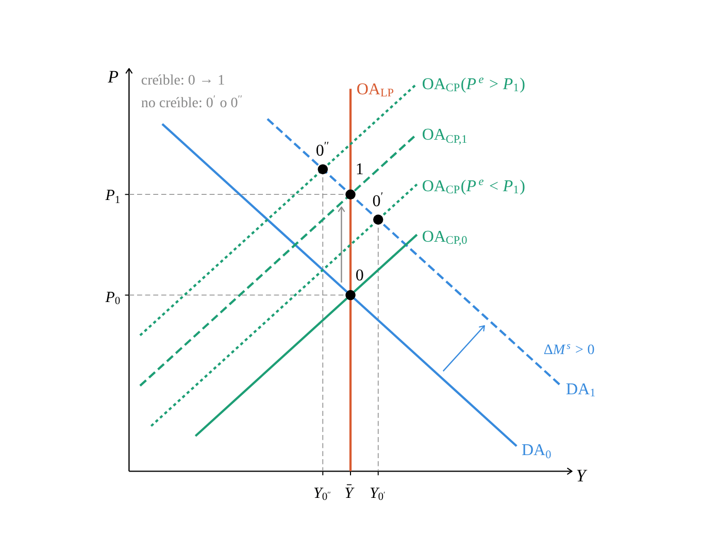

## Introducción

::: {.callout-note appearance="simple" icon=false}

:::

Que la **política monetaria** influye en la economía real a corto plazo es hoy poco discutido, pero cómo lo hace, con qué intensidad y con qué retardos sigue siendo objeto de investigación. Friedman describió esos retardos como “largos y variables”, y la evidencia confirma la neutralidad del dinero a largo plazo y efectos reales a corto plazo, asimétricos y difíciles de medir. Este tema completa así el estudio del diseño y los instrumentos de la política monetaria (tema [A36](a36-politica-monetaria-i.qmd)) con el de sus efectos.

El **mecanismo de transmisión** es la cadena que lleva de una decisión del banco central sobre los tipos de interés oficiales a la demanda agregada, la producción y los precios. El canal tradicional opera a través del coste del capital y del consumo, pero la crisis financiera global puso en primer plano el **canal del crédito** (Bernanke y Gertler, 1995), en el que la situación financiera de bancos, empresas y hogares amplifica los impulsos monetarios, y el de las expectativas, que depende de la credibilidad del banco central. Cada escuela, de la clásica a la nueva economía keynesiana, ha dado una respuesta distinta a la pregunta por la neutralidad del dinero, según el papel que atribuye a las rigideces y a las expectativas.

Con los tipos de interés en su límite inferior, al que la Reserva Federal llegó a finales de 2008 y el BCE entre 2012 y 2014, los bancos centrales recurrieron a **instrumentos no convencionales**, como la expansión cuantitativa (QE) y el *forward guidance* (orientación prospectiva), que actúan sobre las primas de plazo, los precios de los activos y las expectativas y cuya eficacia sigue en debate. El endurecimiento monetario de 2022-2023 ha ofrecido, por su parte, una nueva prueba de la intensidad y la rapidez de la transmisión.

El tema analiza la política monetaria y sus efectos sobre la economía en tres partes:

- *Canales de transmisión*: se presentan los siete principales[^a37-1] y los efectos microeconómicos y sectoriales que tienen lugar en ellos.

- *Debates teóricos*: se analizan las aportaciones de cada escuela sobre los efectos de la política monetaria, hasta las rigideces de precios y de salarios y las fricciones financieras de la nueva economía keynesiana.

- *Evidencia empírica y política no convencional*: se recogen los efectos observados de la política monetaria y los mecanismos de transmisión de las medidas no convencionales y su eficacia.

## 1. Mecanismos de transmisión de la política monetaria convencional: los canales

El **mecanismo de transmisión** de la política monetaria es el sistema de canales por los que los impulsos monetarios del banco central pasan de las variables instrumentales a los objetivos finales de la autoridad monetaria.

Aunque las escuelas han puesto el énfasis en canales y efectos distintos y no hay consenso sobre el funcionamiento del mecanismo, la cadena de eventos tiene, en general, tres etapas:

1. *Impulso*: el banco central inyecta o drena liquidez mediante operaciones de mercado abierto o altera las facilidades permanentes de depósito o de crédito o los coeficientes de caja.

2. *Transmisión*: el impulso recorre los diferentes canales, comenzando por el del tipo de interés a corto plazo.

3. *Efectos*: la inflación y la actividad económica responden de un modo que la autoridad monetaria no puede predecir ni controlar del todo.

Se distinguen siete canales de transmisión, los de los tipos de interés, del crédito, de la riqueza, del tipo de cambio, de la *q* de Tobin, de las expectativas y de la redistribución.

### 1.1. Canal de los tipos de interés

Este canal tiene mucha importancia porque, en las economías con sistemas financieros desarrollados, el tipo de interés a corto plazo, que el banco central guía con sus tipos oficiales, es la variable operativa con la que las autoridades monetarias persiguen sus objetivos finales. Como el coste de financiarse condiciona lo que gastan empresas y familias, un recorte del tipo oficial estimula la inversión y el consumo a crédito y, a través de ellos, la economía real.

A corto plazo, la relación entre el sector monetario y el sector real se puede explicar a través de la ecuación de Fisher:

$$i = r + \pi^e$$

Si existen retardos o rigideces que impiden que los precios se ajusten inmediatamente ($\pi^e$ se ajusta lentamente), un descenso del tipo de interés nominal a corto plazo se reflejará en una caída del tipo de interés real a corto plazo.

Si el cambio del tipo de interés nominal persiste y los tipos a largo plazo son una media geométrica de los tipos a corto actuales y esperados, cambiarán también los tipos nominales a largo plazo.

La relación entre los tipos de interés a corto y a largo plazo dependerá de las expectativas de los agentes. Estas expectativas se reflejan en la estructura temporal de los tipos de interés (ETTI), que recoge la relación funcional entre los tipos de interés nominales de préstamos sin riesgo y el tiempo hasta vencimiento. Si presenta una forma normal (pendiente positiva), indica, según la hipótesis pura de las expectativas, que los mercados esperan que los tipos de interés suban en el futuro. Si existe, además, una prima por plazo, una pendiente positiva moderada es compatible con tipos esperados constantes (apartado 3.5.1).

Independientemente de esta relación, los cambios en los tipos de interés oficiales se transmitirán por tres vías:

1. *Efecto sustitución* del ahorro a corto plazo por consumo debido al descenso en el precio relativo del consumo presente. Según la ecuación de Euler, el consumo crece a una tasa aproximada de $(r - \rho)/\theta$ (tema [A33](a33-demanda-consumo.qmd), apartados 2.1.2 y 2.3.2), de modo que un menor tipo real adelanta consumo.

2. *Efecto renta* sobre la renta disponible de los deudores, que aumenta al disminuir la carga de intereses de su deuda y, por ello, lleva a un aumento del consumo, y sobre la de los acreedores, que disminuye al reducirse sus ingresos por intereses. En este caso prevalecerá el efecto sobre los deudores, dado que tienen una mayor propensión marginal al consumo.

3. *Efecto sobre los componentes de la demanda agregada con carácter permanente* (p. ej. vivienda, formación bruta de capital fijo). Para las empresas, suponiendo que su función de producción es de buen comportamiento, la disminución del tipo de interés real reduce el coste de uso del capital, $P_K(r + \delta)$ (tema [A34](a34-demanda-inversion.qmd), apartado 2.1.2). Por ello, aumenta el *stock* de capital deseado (aquel en que la productividad marginal del capital iguala el coste de uso) y, con él, la inversión. Para los hogares, aumenta el gasto en consumo de bienes duraderos financiados a crédito.

Todos estos efectos dependerán de cuatro factores: la magnitud de las elasticidades de las decisiones de gasto real al tipo de interés nominal, el peso relativo de los componentes del gasto en las decisiones de los agentes económicos, la posición financiera neta y la existencia de tipos variables o fijos. A largo plazo, en cambio, conforme los precios se ajustan, el efecto sobre $r$ se disipa y las variaciones solo afectan a variables nominales. En el modelo IS-PC-MR (apartado 2.4.2), estos efectos se resumen en la curva IS.

### 1.2. Canal del crédito (Bernanke y Gertler, 1995)

En este canal, la política monetaria incide no solo mediante los tipos de interés oficiales, sino también mediante la base monetaria. La idea es que la política monetaria puede aumentar el crédito concedido por los bancos comerciales, al aumentar el volumen de su pasivo o el valor de los activos que los prestatarios aportan como colateral. Esto se traduce en un incremento de la producción.

Bernanke y Gertler (1995) distinguen dos componentes, el canal en sentido estricto y el canal en sentido amplio. Un modelo sencillo de riesgo moral recoge ambos.

#### 1.2.1. Canal en sentido estricto: el crédito bancario

El **canal en sentido estricto** (*bank lending channel*) actúa sobre la oferta de crédito. Si el banco central adopta una política expansiva, crecen los pasivos de los bancos comerciales, que disponen así de más fondos para prestar y engrosan los préstamos de su activo. Ese crédito adicional financia inversión y consumo en el sector real y eleva la renta nominal:

$$\uparrow M^s \rightarrow \uparrow \text{pasivos bancarios} \rightarrow \uparrow \text{préstamos} \rightarrow \uparrow I, C \rightarrow \uparrow PY$$

El BCE ha utilizado este canal con las operaciones de financiación a plazo más largo (LTRO), incluidas las de tres años de 2011-2012, y con las operaciones de financiación a plazo más largo con objetivo específico (TLTRO I, II y III). Estas últimas se vinculan a la concesión de préstamos a la economía real. La última TLTRO III venció en diciembre de 2024, y su mecanismo de transmisión se analiza en el apartado 3.5.2.

#### 1.2.2. Canal en sentido amplio: el balance de los prestatarios

El **canal en sentido amplio** (*balance sheet channel* o acelerador financiero) recoge el efecto del precio de los activos y los efectos adicionales de la política monetaria debidos a las imperfecciones del mercado del crédito relacionadas con los costes de agencia y las asimetrías informativas. Opera por dos vías, la reducción de las tasas de descuento y la compra de activos.

Al bajar el tipo de interés, los rendimientos futuros se descuentan a una tasa menor. Los flujos de caja previstos ganan así valor actual y, con ellos, lo que vale la empresa:

$$\begin{aligned} &\downarrow i \rightarrow \uparrow \text{valor presente de los flujos de caja} \rightarrow \uparrow \text{precio de los activos} \\ &\quad \rightarrow \uparrow \text{colaterales} \rightarrow \uparrow \text{crédito} \rightarrow \uparrow PY \end{aligned}$$

Los tipos de interés nulos e incluso negativos del BCE (2014-2022) actuaron también por esta vía, y su transmisión y sus límites se analizan en los apartados 3.5.1 y 3.5.2.

Las compras de la autoridad monetaria elevan la cotización de los activos adquiridos:

$$\uparrow \text{demanda activos} \rightarrow \uparrow \text{precio} \rightarrow \uparrow \text{colaterales} \rightarrow \uparrow \text{crédito} \rightarrow \uparrow PY$$

El BCE ha utilizado este canal con las compras masivas del programa de compras de activos (APP)[^a37-2] y del programa de compras de emergencia frente a la pandemia (PEPP). Las reinversiones de ambos programas cesaron en julio de 2023 y a finales de 2024, respectivamente. Sus canales de transmisión y su eficacia se analizan en el apartado 3.5.

El canal del crédito tiene un efecto asimétrico sobre los distintos tipos de empresas y sectores. Por tipo de empresa, las pymes lo sufren más que las grandes compañías, puesto que estas últimas disponen de fuentes de financiación alternativas, como emitir acciones o deuda. Por sectores, aquellos cuya rentabilidad está garantizada (por lo general, al tratarse de oligopolios) obtienen financiación a menor coste, mientras que a las empresas de actividades con más riesgo (como las innovadoras) les resulta más difícil acceder a otras fuentes de financiación.

Donde predomina la tradición anglosajona, las empresas acuden sobre todo a los mercados de capitales para financiarse y los hogares mantienen carteras de bonos y acciones, de modo que el efecto riqueza gana peso en la transmisión de la política monetaria. En la tradición continental, sin embargo, la financiación empresarial se canaliza principalmente a través de la banca comercial, por lo que la transmisión depende en mayor medida del canal bancario.

En septiembre de 2015, la Comisión Europea presentó el Plan de Acción para la Unión de los Mercados de Capitales (UMC). Su objetivo es reducir la dependencia de la financiación bancaria (cuyo canal resultó disfuncional durante la crisis de 2008) y diversificar las fuentes de financiación, lo que refuerza de paso los efectos riqueza. La iniciativa aproxima así la tradición continental a la anglosajona. En marzo de 2025 la Comisión la relanzó como Unión de Ahorros e Inversiones (UAI).

#### 1.2.3. Modelo del canal del crédito (Holmström y Tirole, 1997)

**Origen**: Bernanke y Gertler (1995) exponen verbalmente los dos canales, sobre su idea anterior (1989) de que el patrimonio neto de los prestatarios reduce los costes de agencia (tema [A42](a42-ciclos.qmd), apartado 2.3.2). Holmström y Tirole (1997) los formalizan después en un modelo de riesgo moral con empresas y bancos sujetos a restricciones de capital. Aquí se presenta su versión con inversión variable (Tirole, 2006, cap. 3).

**Idea**: si el empresario puede desviar parte del rendimiento, los inversores solo financian lo que el proyecto puede comprometerles, de modo que la inversión depende del patrimonio neto y del coste de los fondos, dos variables que mueve la política monetaria.

**Supuestos**:

- *Entorno*: riesgo moral. Si el empresario se esfuerza, el éxito tiene probabilidad $p_H$. Si no lo hace, tiene probabilidad $p_L = p_H - \Delta p$, y el empresario obtiene un beneficio privado $BI$.

- *Agentes*: un empresario con responsabilidad limitada aporta su patrimonio neto, $\text{PN}$, e invierte $I \geq \text{PN}$, que rinde $RI$ si el proyecto tiene éxito y cero si fracasa. Los inversores son neutrales al riesgo y prestan $I - \text{PN}$ a cambio de un rendimiento esperado bruto $1 + r$, donde $r$ es el tipo real que fija la política monetaria.

**Planteamiento**: para que se esfuerce, el empresario ha de recibir en caso de éxito al menos $BI/\Delta p$ (restricción de incentivos), de modo que a los inversores solo puede prometerse la *renta comprometible*, $\rho_0 I \equiv p_H(R - B/\Delta p)\, I$. El empresario elige la escala que maximiza el valor actual neto del proyecto:

$$\max_{I}\; \left[\rho_1 - (1+r)\right] I \quad \text{s.a.:} \quad \rho_0\, I \geq (1+r)(I - \text{PN})$$

donde $\rho_1 = p_H R$ es el rendimiento esperado por unidad invertida y la restricción exige que la renta comprometible cubra lo que piden los inversores. Se supone $\rho_1 > 1 + r > \rho_0$, es decir, el proyecto es rentable, pero cada unidad invertida compromete menos de lo que cuesta financiarla. El lagrangiano, con multiplicador $\lambda$, es $\mathcal{L} = [\rho_1 - (1+r)]\, I + \lambda\,[(1+r)\,\text{PN} - (1 + r - \rho_0)\, I]$.

**CPO**: la derivada del lagrangiano respecto a la escala se anula:

$$\frac{\partial \mathcal{L}}{\partial I} = \rho_1 - (1+r) - \lambda\,(1 + r - \rho_0) = 0 \quad \Longrightarrow \quad \lambda = \frac{\rho_1 - (1+r)}{1 + r - \rho_0} > 0$$

de modo que la restricción se satura y el empresario invierte cuanto puede financiar. Por el teorema de la envolvente, una unidad de patrimonio invertida en el proyecto rinde $(1+r)(1+\lambda)$, más que el $1 + r$ que obtendría prestada. Esa diferencia es la *prima de financiación externa*, que aquí adopta la forma de racionamiento y no de precio.

**CSO**: el objetivo y la restricción son lineales en $I$, por lo que la condición de Kuhn-Tucker (tema [A08](a08-consumidor.qmd), apartado 1.4.1) es suficiente.

**Solución**: la inversión es proporcional al patrimonio neto:

$$I^* = k(r)\,\text{PN}, \qquad k(r) = \frac{1}{1 - \rho_0/(1+r)} > 1$$

donde $k(r)$ es el *multiplicador de los fondos propios* (*equity multiplier*), la inversión por unidad de patrimonio, que decrece con $r$ porque un tipo mayor reduce la financiación externa respaldada por la renta comprometible.

**Desarrollo gráfico**: el canal del crédito se representa en el plano patrimonio neto-inversión (figura -@fig-a375-credito-ht):

1. *Recta de autofinanciación* ($I = \text{PN}$): recoge la inversión financiable solo con el patrimonio. La distancia vertical hasta la capacidad de inversión es la financiación externa ($I_0 - \text{PN}_0$ en el punto 0).

2. *Capacidad de inversión* ($I = k(r_0)\,\text{PN}$): recoge la inversión máxima financiable con cada patrimonio. Sale del origen con pendiente $k(r_0) > 1$, tanto mayor cuanto menor es el tipo de interés.

3. *Óptimo*: con el patrimonio $\text{PN}_0$, el empresario invierte $I_0 = k(r_0)\,\text{PN}_0$ (punto 0).

**Estática comparativa**: una política monetaria expansiva ($\Delta r < 0$) eleva la inversión por dos vías:

- *Coste de los fondos*: al bajar el tipo de $r_0$ a $r_1$, crece el multiplicador y la recta gira hacia arriba. Con el mismo patrimonio, la inversión pasa de $I_0$ a $I_{0'}$ (de 0 a 0′).

- *Patrimonio neto*: el menor tipo revaloriza los activos y los flujos de caja, y el patrimonio pasa de $\text{PN}_0$ a $\text{PN}_1$. La inversión crece en $k(r_1)\,\Delta\text{PN}$, más que el propio patrimonio, hasta $I_1$ (de 0′ a 1), amplificación que constituye el canal en sentido amplio.

::: {#fig-a375-credito-ht}

::: {.content-visible when-format="html"}
```{=html}
<div class="graph-frame">
<iframe src="../graphs/a375_Credito_HT.html" style="height:540px" loading="lazy" title="fig-a375-credito-ht"></iframe>
</div>
```
:::

::: {.content-visible unless-format="html"}

:::

Canal del crédito en el modelo de Holmström y Tirole. Una bajada del tipo de interés ($\Delta r < 0$) gira hacia arriba la capacidad de inversión (0→0′), y la revalorización del patrimonio eleva la inversión a lo largo de la nueva recta (0′→1). El tramo verde es la financiación externa en 0.
:::

**Extensiones**: Holmström y Tirole (1997) añaden bancos que supervisan a los prestatarios, lo que reduce el beneficio privado de estos, y que deben arriesgar capital propio para tener incentivos a hacerlo. Las empresas con patrimonio intermedio solo obtienen financiación si un banco las supervisa, y la cantidad que así se financia depende del capital de los bancos, que es el canal en sentido estricto. Así, cualquier endurecimiento, sea del capital bancario (*credit crunch*), del colateral o del ahorro disponible, recae sobre todo en las empresas peor capitalizadas.

**Conclusiones**:

- *Aspectos positivos*: a partir de un único supuesto, el riesgo moral, explica por qué la inversión depende del patrimonio de las empresas y del capital de los bancos y por qué la política monetaria tiene efectos amplificados y asimétricos.

- *Limitaciones*: es estático y de equilibrio parcial, y toma como dado el efecto de la política monetaria sobre el precio de los activos.

### 1.3. Canales de los precios de los activos: riqueza, tipo de cambio y *q* de Tobin

Los precios de los activos transmiten la política monetaria por tres canales, el de la riqueza, el del tipo de cambio y el de la *q* de Tobin.

#### 1.3.1. Canal de la riqueza

La idea es que la política monetaria puede alterar la riqueza de los individuos vía cambios en su volumen o en la valoración de sus activos. El sustrato teórico de estos efectos son las teorías del consumo basadas en la riqueza, sobre todo la hipótesis del ciclo vital (Modigliani y Brumberg, 1954; Ando y Modigliani, 1963), además de la renta permanente de Friedman (1957). Las compras de activos del BCE (APP y PEPP) actúan también por este canal. Se distinguen dos efectos:

1. *Efecto riqueza directo*: el dinero es uno de los componentes del patrimonio de los agentes. Con precios dados, más liquidez significa más saldos reales y más riqueza, y esta estimula el consumo: $\uparrow M^s/P \rightarrow \uparrow W \rightarrow \uparrow C$.

2. *Efecto riqueza indirecto*, que, a su vez, se desglosa en dos subefectos de magnitud ambigua:

    - *Efecto Pigou*: la expansión monetaria eleva el nivel general de precios, que erosiona el valor real de los activos denominados en términos nominales y empobrece a los individuos: $\uparrow M^s \rightarrow \uparrow P \rightarrow \downarrow A/P \rightarrow \downarrow W \rightarrow \downarrow C$ (de signo contrario al efecto directo).

    - *Efecto reajuste de cartera*: un exceso de liquidez en la cartera de los individuos hará que estos se quieran deshacer de él mediante la adquisición de nuevos activos financieros y reales. La mayor demanda produce una revalorización de estos activos que, además, pueden ser utilizados como colaterales, lo que genera un aumento del crédito y del gasto.

#### 1.3.2. Canal del tipo de cambio

Este canal ha ganado peso a medida que la economía se ha globalizado y los tipos de cambio se han vuelto flexibles. En una economía pequeña y abierta, con tipo de cambio flexible y plena movilidad del capital, una política monetaria expansiva rebaja el tipo de interés. Esa rebaja origina una salida neta de capitales y deprecia el tipo de cambio.

Según la paridad descubierta de intereses, $i = i^* + g_E^e$, con $g_E^e$ la depreciación esperada (tema [B14](b14-tipo-cambio.qmd), apartado 1.3.4), un tipo nacional inferior al exterior exige una apreciación esperada. En consecuencia, la moneda se deprecia hoy por encima de su nivel de largo plazo (*overshooting* de Dornbusch, apartado 2.2.2 de ese tema). Esta depreciación tiene dos efectos:

1. *Aumento de la competitividad-precio*: si rige la condición de Marshall-Lerner, el abaratamiento de las exportaciones y el encarecimiento de las importaciones elevan la demanda agregada.

2. *Aumento de la inflación*: los *inputs* importados se encarecen en términos relativos y, con costes más altos, las empresas recortan la oferta agregada, lo que acaba elevando el nivel general de precios.

No obstante, el efecto neto sobre la cuenta corriente es ambiguo, porque la reducción de los tipos de interés eleva también la demanda nacional de importaciones, y su signo es una cuestión empírica. En el modelo IS-PC-MR de economía abierta, este canal permite al banco central mover menos el tipo de interés (tema [A32](a32-precios-output.qmd), apartado 3.3.2)[^a37-3].

#### 1.3.3. Canal de la *q* de Tobin

La *q* de Tobin (1969) es el cociente entre el valor de mercado de las empresas y el coste de reposición de su capital (tema [A34](a34-demanda-inversion.qmd), apartado 2.2.2). Una política monetaria expansiva rebaja los tipos de interés y hace los bonos menos atractivos que las acciones, cuya demanda y cuya cotización suben. Con ello aumenta la *q*, y cuando supera la unidad, a las empresas les basta emitir pocas acciones para financiar una inversión grande, porque el capital vale en bolsa más de lo que cuesta reponerlo. Es decir, $\downarrow i \rightarrow \uparrow V \rightarrow \uparrow q \rightarrow \uparrow I$, con $V$ el valor de mercado de las empresas. El canal actúa sobre la inversión, mientras que el de la riqueza actúa sobre el consumo.

### 1.4. Canal de la señalización: el papel de las expectativas

Las expectativas sobre los futuros tipos de interés oficiales tienen gran peso, ya que los tipos de interés a medio y largo plazo dependen, en parte, de las expectativas del mercado sobre la evolución de los tipos a corto plazo. La idea es que el banco central puede influir sobre las expectativas de inflación y, por tanto, sobre el nivel de precios de la economía, mediante la señalización del curso de la política monetaria a futuro[^a37-9].

Formalmente, al iterar hacia delante la IS dinámica del modelo neokeynesiano (tema [A07](a07-nek.qmd), apartado 2.1.2), la brecha de producción (*output gap*) actual depende de toda la senda esperada de tipos reales:

$$\tilde{y}_t = -\frac{1}{\theta}\sum_{k=0}^{\infty}\mathbb{E}_t\left[r_{t+k} - \bar{r}_{t+k}\right]$$

donde $\tilde{y}_t$ es la brecha de producción, $\theta$ la inversa de la elasticidad de sustitución intertemporal, $r_{t+k}$ el tipo real del periodo $t+k$ y $\bar{r}_{t+k}$ el tipo natural. Por ello, el anuncio de tipos futuros más bajos estimula el gasto actual aunque el tipo oficial corriente no cambie.

Estas expectativas se canalizan a la economía real a través de las decisiones de inversión y consumo de bienes duraderos. El instrumento principal es el *forward guidance* (orientación prospectiva), cuya transmisión en el límite inferior de los tipos de interés (*zero lower bound*, ZLB) se analiza en el apartado 3.5. No obstante, resulta difícil prever qué efectos tendrán las expectativas. Por ejemplo, el aumento del tipo de interés podría interpretarse de dos maneras:

- *Señal de crecimiento*: los agentes pueden leerlo como indicio de que el banco central prevé un crecimiento más robusto de la economía a medio/largo plazo y de que, en consecuencia, interviene ya para anticiparse a la inflación futura.

- *Señal de freno*: pueden entender que la subida de los tipos obstaculizará el crecimiento y, en consecuencia, tendrá un efecto negativo.

### 1.5. Canal de la redistribución

Por último, el **canal redistributivo** es hoy un campo de investigación muy activo. La visión tradicional considera que las propensiones marginales al consumo no varían mucho entre la población, de modo que los efectos mencionados se reparten de manera relativamente homogénea.

Sin embargo, las fricciones financieras y los diferentes niveles de liquidez hacen que las propensiones marginales al consumo sean heterogéneas. Por tanto, al repartir ganancias y pérdidas entre hogares, la política monetaria altera el consumo agregado aunque la renta total no cambie. Auclert (2019) distingue tres vías, que, según su estimación para Italia y Estados Unidos, probablemente amplifican el efecto de la política monetaria:

1. *Heterogeneidad de las rentas*: una expansión eleva más el gasto si las rentas que más responden al ciclo son las de los hogares con mayor propensión al consumo.

2. *Canal de Fisher*: la inflación no anticipada traslada riqueza de los acreedores nominales a los deudores, que gastan una mayor parte.

3. *Exposición a los tipos de interés*: una bajada del tipo real beneficia a los hogares cuyas deudas se revisan antes que sus activos (p. ej. con hipotecas a tipo variable), que es el efecto renta del canal de los tipos de interés.

### 1.6. Conclusiones

Con precios rígidos, una bajada del tipo oficial reduce el tipo real y estimula el gasto por sustitución, por renta y por el abaratamiento del coste de uso del capital. El canal del crédito amplifica ese efecto, pues la política monetaria mueve la oferta de préstamos y el colateral de los prestatarios, sobre todo de los peor capitalizados. Los precios de los activos transmiten el impulso por la riqueza, el tipo de cambio y la *q* de Tobin, y las expectativas lo extienden a toda la senda esperada de tipos. La redistribución, por último, altera el consumo agregado cuando las propensiones al consumo difieren entre hogares. La sección 2 examina, escuela por escuela, qué efectos reales tiene ese impulso y cuánto duran.

## 2. Efectos de la política monetaria: de la neutralidad a las rigideces y fricciones financieras

Hasta llegar al consenso actual sobre la neutralidad del dinero a largo plazo, las escuelas de pensamiento discutieron durante décadas si la política monetaria es efectiva y qué efectos produce sobre la economía real.

::: {.callout-note appearance="simple" icon=false}
La teoría cuantitativa y la demanda de dinero se desarrollan en el tema [A35](a35-demanda-dinero.qmd), y el pensamiento de cada escuela, en los temas [A04](a04-keynes.qmd) a [A07](a07-nek.qmd). Aquí se recogen sus implicaciones para la efectividad de la política monetaria.
:::

### 2.1. Teoría clásica: la neutralidad del dinero

La teoría clásica parte de la teoría cuantitativa del dinero y extrae de ella su consecuencia para la efectividad de la política monetaria.

#### 2.1.1. La teoría cuantitativa del dinero

**Origen**: la teoría descansa en la *ecuación de cambio*, identidad contable formulada por Newcomb (1885) y popularizada por Fisher (1911) sobre ideas que se remontan a Hume (1752).

**Idea**: el pensamiento clásico se apoya en la *teoría cuantitativa del dinero* (TCD) para explicar el sector monetario. La TCD se pregunta por qué cambia el valor o poder adquisitivo del dinero, y su conclusión principal es que el nivel general de precios guarda una proporción constante con la cantidad de dinero.

**Razonamiento**: esta idea queda recogida en la lectura causal de la ecuación de cambio. Por un lado, el valor monetario del dinero empleado, o valor de las compras, es igual a la oferta monetaria ($M$) por la velocidad-transacción del dinero ($V$), es decir, el ritmo al que circula. Por otro, el valor monetario del conjunto de transacciones, o valor de las ventas, es igual al número de veces que bienes y servicios se cambian por dinero multiplicado por el precio de una transacción representativa ($P \cdot T$):

$$MV \equiv PT$$

En la versión de Cambridge (Pigou, 1917), formulada como demanda de dinero, $M^d = kPY$, con $k = 1/V$ constante, lo que, en equilibrio ($M^s = M^d = M$), equivale a $MV = PY$. Ambas versiones implican, dado que $V$ y $T$ (o $Y$) se consideran estables, que los cambios en $M$ se trasladan proporcionalmente a $P$.

**Conclusiones**:

- *Aspectos positivos*: explica la relación a largo plazo entre el crecimiento monetario y la inflación, que la evidencia respalda (apartado 3.4.2), y fundamenta la tesis de que la inflación es un fenómeno monetario.

- *Limitaciones*: la proporcionalidad descansa en la estabilidad de $V$ y de la producción, que la demanda especulativa de dinero de Keynes y la inestabilidad de la velocidad desde los años ochenta (apartado 3.3) ponen en cuestión. La TCD es, además, una teoría del largo plazo que no explica los efectos reales a corto.

#### 2.1.2. Efectividad de la política monetaria

En el paradigma clásico, el “dinero es un velo” y, con ello, se produce la llamada **dicotomía clásica**, según la cual las variables nominales no afectan a las variables reales. Por tanto, la política monetaria es inefectiva.

### 2.2. El debate entre el keynesianismo, la síntesis y el monetarismo

Las aportaciones de Keynes rompen con esta dicotomía clásica. Su formalización posterior en el modelo IS-LM de la síntesis neoclásica permite ilustrar sus principales implicaciones monetarias, que el monetarismo criticaría después.

#### 2.2.1. Keynesianismo: la ruptura de la dicotomía clásica por la demanda especulativa de dinero

**Origen**: a raíz de la Gran Depresión (1929-1933), Keynes (1936) formula la teoría de la preferencia por la liquidez, en la que el dinero se demanda también por motivo especulación.

**Idea**: para Keynes, la demanda de dinero por motivo especulación deja a la política monetaria un cauce, el tipo de interés, para actuar sobre las variables reales, aunque dos eslabones débiles le restan eficacia:

1. *Inversión poco sensible*: los *animal spirits* dominan las decisiones de inversión, de modo que el tipo de interés apenas la mueve ($v \approx 0$).

2. *Demanda de dinero muy sensible*: responde mucho al tipo de interés ($h$ alto) y poco a la renta. Dado que el único activo sustitutivo del dinero son los bonos, cambios en la demanda de bonos debidos a una variación del tipo de interés afectan en gran medida a la demanda de dinero[^a37-12]. En el límite, si los tipos de interés son excepcionalmente bajos, la demanda de dinero se vuelve infinitamente elástica y se produce una trampa de liquidez.

**Razonamiento**: en el plano $(Y, i)$ (figura -@fig-a372-pm-islm, panel a), una política monetaria expansiva ($\Delta M^s > 0$) desplaza la LM de $\text{LM}_0$ a $\text{LM}_1$ y va a tener tres efectos reales:

- *Efecto liquidez* (0→0′): un aumento de la oferta monetaria hace que los individuos eliminen el exceso de dinero comprando bonos, cuyo precio sube, de modo que el tipo de interés baja de $i_0$ a $i_{0'}$. No obstante, este efecto es escaso.

- *Efecto renta* (0′→1): al bajar el tipo de interés, crecen la inversión y el consumo que se financia con crédito. Por tanto, se produce un aumento de la renta, de $Y_0$ a $Y_1$ (movimiento a lo largo de la $\text{LM}_1$ hasta cortar la IS). No obstante, este efecto es reducido debido a la baja sensibilidad de la inversión a los tipos.

- *Efecto expulsión* (*crowding out*): el aumento de la renta provoca un aumento de la demanda de dinero por motivo transacción, que genera un efecto rebote sobre el tipo de interés, hasta $i_1$. En consecuencia, la inversión disminuye en parte y se modera el aumento de la renta. Sin embargo, este último efecto será reducido, porque, con una demanda de dinero muy sensible al tipo, basta una pequeña subida de este para absorber la mayor demanda por motivo transacción, y predomina el efecto renta.

En el panel a, la IS (equilibrio del mercado de bienes) es muy inclinada, porque la inversión apenas responde al tipo de interés, y la LM (equilibrio del mercado de dinero) es casi horizontal, porque la demanda de dinero es muy sensible a él. Por eso, la política monetaria será poco eficaz con las variables reales (la renta y la inversión).

::: {#fig-a372-pm-islm}

::: {.content-visible when-format="html"}
```{=html}
<div class="graph-frame wide">
<iframe src="../graphs/a372_PM_ISLM.html" style="--r:1.545" loading="lazy" title="fig-a372-pm-islm"></iframe>
</div>
```
:::

::: {.content-visible unless-format="html"}

:::

Política monetaria expansiva en el IS-LM. El gráfico separa el efecto liquidez (0→0′) y el efecto renta y expulsión (0′→1) en el caso keynesiano (a), con demanda de dinero muy sensible al tipo e inversión insensible, y en el monetarista (b), con los supuestos opuestos.
:::

**Conclusiones**:

- *Aspectos positivos*: rompe la dicotomía clásica al dar al tipo de interés un papel en la transmisión de la política monetaria, el canal principal de la sección 1, y la trampa de liquidez anticipa el problema del límite inferior de los tipos (apartado 3.5.1).

- *Limitaciones*: la escasa eficacia descansa en dos supuestos sobre elasticidades que el monetarismo rechaza, y el análisis, con precios fijos y sin expectativas, no distingue entre los efectos a corto y a largo plazo.

#### 2.2.2. Síntesis neoclásica: la curva de Phillips como menú de política económica

**Origen**: la síntesis neoclásica adopta la curva de Phillips en la lectura de Samuelson y Solow (1960)[^a37-13].

**Idea**: la síntesis concede algo más de eficacia a la política monetaria porque cuenta con la curva de Phillips, que recoge una disyuntiva entre inflación y desempleo. La curva funciona así como un menú, en el que las autoridades pueden comprar un paro más bajo pagándolo con más inflación.

**Razonamiento**: la curva liga de forma inversa la inflación y el desempleo (véase la figura del tema [A41](a41-inflacion.qmd), apartado 2.2.1):

$$\pi_t = f(u_t), \quad f' < 0$$

De ahí que, en este esquema, la política monetaria sea eficaz en cualquier horizonte. Si mantiene en el tiempo una inflación estable y más alta, el desempleo queda de forma permanente en un nivel más bajo.

**Conclusiones**:

- *Aspectos positivos*: ofrece una relación estimable entre inflación y desempleo, con la que la política monetaria puede elegir la combinación de ambos que prefiera.

- *Limitaciones*: la disyuntiva permanente exige que los trabajadores sufran ilusión monetaria y no incorporen la inflación esperada a sus demandas salariales, que es la crítica monetarista. Además, la estanflación de los años setenta, con inflación y desempleo crecientes a la vez, mostró que la curva se había desplazado.

#### 2.2.3. Monetarismo: la importancia de las expectativas y la renta permanente

**Origen**: la defensa del intervencionismo suscitó pronto la crítica monetarista. Milton Friedman (1968) y, de forma independiente, Edmund Phelps (1967) introdujeron las expectativas en la curva de Phillips.

**Idea**: la política monetaria tiene efectos reales elevados a corto plazo, porque la inversión responde con fuerza al tipo de interés y la demanda de dinero apenas lo hace. A largo plazo, en cambio, cuando las expectativas se ajustan, se cumple la neutralidad del dinero.

**Razonamiento**: la crítica monetarista se articula en dos vertientes:

- *Por el lado de la oferta*: según los monetaristas, la curva de Phillips, tal como la usaba la síntesis, carecía de coherencia, porque exigía un mercado de trabajo que se comportase de forma irracional. Para que la disyuntiva durase en cualquier horizonte, los trabajadores tendrían que sufrir ilusión monetaria, tomando el salario nominal por el real, y desatender la inflación futura, es decir, ser miopes o tener expectativas estáticas sobre los precios. Como alternativa, los monetaristas propusieron una hipótesis sobre la formación de las expectativas y, a partir de ella, una curva de Phillips ampliada:

    - *Hipótesis de expectativas adaptativas* (HEA): cada periodo se revisa la inflación esperada en una fracción del error cometido en el anterior, $\pi_t^e = \pi_{t-1}^e + \lambda(\pi_{t-1} - \pi_{t-1}^e)$, con $0 < \lambda \leq 1$, que, en su versión más sencilla ($\lambda = 1$), se reduce a $\pi_t^e = \pi_{t-1}$.

    - *Curva de Phillips ampliada por las expectativas*: $\pi_t = \pi_t^e - \kappa_u(u_t - \bar{u})$, donde $\kappa_u$ refleja la sensibilidad de la inflación al desempleo cíclico y $\bar{u}$ la tasa natural de paro. A largo plazo, cuando $\pi_t = \pi_t^e$, la curva es vertical sobre $\bar{u}$ en el plano $(u, \pi)$ (véase la figura del tema [A28](a28-tnp-nairu.qmd), apartado 1.3.1), es decir, ninguna tasa de inflación sostenida altera el paro (superneutralidad del dinero).

- *Por el lado de la demanda*: los monetaristas niegan que se den los dos eslabones débiles de los que hablaba Keynes, y para ellos la demanda de dinero depende de la renta permanente y no solo de la corriente. A diferencia de Keynes, sostienen que a corto plazo los agentes colocan el dinero sobrante en activos de todo tipo, financieros y reales, y que ese gasto eleva la demanda agregada. En el IS-LM, los tres efectos keynesianos son elevados (figura -@fig-a372-pm-islm, panel b), y el aumento de la renta es considerable por dos razones:

    - *Inversión*: responde con fuerza al tipo de interés ($v$ alto), porque las decisiones se toman atendiendo a la rentabilidad y no a los *animal spirits* (IS elástica).

    - *Demanda de dinero*: apenas reacciona al tipo de interés ($h \approx 0$, LM inelástica). El dinero tiene sustitutos imperfectos en todos los activos, no solo en los bonos. Por eso, cuando el tipo de interés cambia y se recompone la demanda de bonos, la de dinero apenas se mueve.

**Conclusiones**:

- *Aspectos positivos*: explica, antes de que la estanflación lo hiciera evidente, por qué la disyuntiva entre inflación y desempleo solo es transitoria, y devuelve a la política monetaria efectos reales elevados a corto plazo frente a los eslabones débiles keynesianos.

- *Limitaciones*: el efecto de corto plazo descansa en expectativas adaptativas, que suponen errores sistemáticos de los agentes. Con expectativas racionales, en cambio, una política monetaria anticipada no tiene efectos reales ni siquiera a corto plazo.

#### 2.2.4. Efectividad de la política monetaria

Para Keynes, la política monetaria es poco eficaz por los dos eslabones débiles, y la síntesis la considera eficaz en cualquier horizonte. Por su parte, los monetaristas reconocen su eficacia a corto plazo, pero no quieren que se use de forma activa. Prefieren atarla a reglas y dedicarla a mantener la inflación bajo control, y lo justifican con tres argumentos:

1. *Ecuación perdida del monetarismo*: Friedman deja sin determinar qué parte de una variación del dinero acaba en los precios (variable nominal) y qué parte en la producción (variable real).

2. *Retardos*: largos y variables según Friedman (1961), pueden provocar que los efectos de la política monetaria resulten procíclicos.

3. *Inefectividad en el largo plazo*: se debe a la HEA y a que entonces sí se cumple la neutralidad del dinero.

### 2.3. Nueva macroeconomía clásica: vuelta a la no intervención monetaria

Las aportaciones de la nueva macroeconomía clásica (NMC) suponen un cambio metodológico que permite la vuelta a la defensa de la no intervención monetaria.

#### 2.3.1. Consideraciones generales

1. *Apoyo en la fundamentación microeconómica dinámica, estocástica y de equilibrio general*: se da racionalidad dinámica.

2. *Competencia perfecta*: rige en el mercado de bienes y factores, con plena flexibilidad de precios y salarios, de manera que se garantiza el vaciado continuo de los mercados.

3. *Expectativas racionales*: se forman según la hipótesis de expectativas racionales (HER). Los individuos no las ajustan gradualmente, sino que, al predecir la evolución de las variables económicas de su interés, utilizan en todo momento toda la información relevante disponible y la procesan de forma eficiente.

4. *Información incompleta*: los agentes no distinguen con certeza si una variación del precio de su producto responde a un *shock* específico, ante el que convendría variar la producción, o a uno general, ante el que no (problema de extracción de señales, temas [A06](a06-nmc.qmd), apartado 2.1, y [A41](a41-inflacion.qmd), apartado 2.3.1).

5. *Oferta agregada*: de estos postulados se deriva la oferta de Lucas, función de los *shocks* de la economía.

$$y_t = \bar{y}_t + \zeta(p_t - p_t^e) + \varepsilon_t^s, \quad \zeta > 0$$

donde $\zeta$ es el coeficiente de Lucas, $\bar{y}_t$ el *output* natural y $\varepsilon_t^s$ el término aleatorio (con esperanza nula) que recoge los *shocks* exógenos de oferta. Ese coeficiente combina la proporción de la variación del precio que los agentes atribuyen a precios relativos (mayor cuanto más probable consideran que el *shock* observado sea específico) y la respuesta de la oferta de los productores ante un *shock* en su mercado.

Los componentes monetarios, que son la parte no anticipada de la política monetaria y las perturbaciones de la velocidad de circulación del dinero, actúan a través de la sorpresa de precios $p_t - p_t^e$. Por tanto, los *shocks* monetarios solo afectan a la producción en la medida en que son sorpresivos.

La NMC supone una revitalización del pensamiento clásico, y en materia de política monetaria se traduce en las aportaciones de Sargent y Wallace (1975, 1976) y Kydland y Prescott (1977).

#### 2.3.2. Inefectividad de la política monetaria: la crítica de Sargent y Wallace (1975, 1976)

**Origen**: Thomas Sargent y Neil Wallace (1975, 1976) estudian la elección de la regla monetaria óptima con expectativas racionales y la oferta de Lucas.

**Idea**: la política monetaria sistemática, la que responde a información al alcance de todos (como los grandes indicadores macroeconómicos), no sirve para estabilizar la producción.

**Razonamiento**: la inefectividad se apoya en dos resultados:

1. *Política sistemática*: si la política monetaria sigue una regla conocida (fácilmente anticipable), los agentes la incorporan a sus expectativas. La regla actúa entonces solo sobre los precios, sin consecuencias reales.

2. *Sorpresas*: solo la parte no anticipada de la política monetaria tiene efectos reales, y solo transitorios.

**Desarrollo gráfico**: la crítica de Sargent y Wallace se representa en el plano renta-precios (figura -@fig-a374-sargent-wallace):

1. *Oferta agregada a largo plazo* ($\text{OA}_{\text{LP}}$): es vertical sobre el *output* natural $\bar{Y}$, porque con expectativas cumplidas los precios no afectan a la producción.

2. *Oferta agregada a corto plazo* ($\text{OA}_{\text{CP},0}$): es creciente, porque solo las sorpresas de precios alteran la producción, y hay una por cada nivel de precios esperado.

3. *Demanda agregada* ($\text{DA}_0$): recoge el gasto que corresponde a cada nivel de precios, dada la oferta monetaria, y es decreciente, porque unos precios más altos reducen los saldos reales.

4. *Equilibrio*: en el punto 0, con el *output* $\bar{Y}$ y los precios $P_0$, las expectativas se cumplen.

**Estática comparativa**: supóngase que la autoridad monetaria comunica que aumentará $M^s$ ($\Delta M^s > 0$, que desplaza la DA de $\text{DA}_0$ a $\text{DA}_1$) para que la inflación suba, por ejemplo, del 0 % al 5 %. El resultado depende de cómo reciban el anuncio los agentes:

- *Anuncio creíble*: si los agentes lo anticipan, la oferta a corto plazo pasa a $\text{OA}_{\text{CP},1}$ y solo suben los precios, de $P_0$ a $P_1$ (de 0 a 1).

- *Anuncio no creíble*: los agentes pueden anticipar una expansión de la masa monetaria superior o inferior a la anunciada, de modo que, si la política se ejecuta tal como se anunció, su parte no anticipada tendrá efectos reales transitorios. Esos efectos son expansivos si los agentes esperan precios menores, con la oferta $\text{OA}_{\text{CP}}(P^e < P_1)$ (punto 0′), y contractivos si los esperan mayores, con $\text{OA}_{\text{CP}}(P^e > P_1)$ (punto 0″).

::: {#fig-a374-sargent-wallace}

::: {.content-visible when-format="html"}
```{=html}
<div class="graph-frame">
<iframe src="../graphs/a374_Sargent_Wallace.html" style="height:520px" loading="lazy" title="fig-a374-sargent-wallace"></iframe>
</div>
```
:::

::: {.content-visible unless-format="html"}

:::

Crítica de Sargent y Wallace en el plano OA-DA (en niveles). Una expansión monetaria creíble y anticipada solo eleva los precios (0→1). Si no es creíble, las expectativas erróneas generan efectos reales transitorios, expansivos (0′) o contractivos (0″).
:::

La falta de credibilidad actúa aquí solo como fuente de sorpresa, y su análisis como problema de política corresponde a Kydland y Prescott. Con todo, la NMC desaconseja la política sorpresiva, pues resta credibilidad a la política monetaria de los periodos siguientes y añade incertidumbre.

**Conclusiones**:

- *Aspectos positivos*: separa los efectos de la política anticipada y de la no anticipada, una separación que respaldaron los primeros contrastes empíricos (Barro, 1977), y refuerza el argumento a favor de reglas sencillas y predecibles.

- *Limitaciones*: exige precios y salarios plenamente flexibles. Con contratos nominales plurianuales (Fischer, 1977), la política anticipada tiene efectos reales, como recoge la NEK, y Mishkin (1982) halla que el dinero anticipado también afecta a la producción.

#### 2.3.3. Inconsistencia dinámica de la política monetaria (Kydland y Prescott, 1977; Barro y Gordon, 1983a)

::: {.callout-note appearance="simple" icon=false}
El modelo de Barro y Gordon se desarrolla en el tema [A06](a06-nmc.qmd), apartado 3.1.2. Aquí se recoge su implicación para la efectividad de la política monetaria.
:::

**Origen**: Kydland y Prescott y Barro y Gordon se preguntan si una política monetaria sorpresiva sostenida en el tiempo es compatible con las expectativas racionales.

**Idea**: una política anunciada es *dinámicamente inconsistente* (*time inconsistent*) cuando, una vez que los agentes han fijado sus contratos confiando en ella, a la autoridad le conviene incumplirla. Como los agentes lo anticipan, la política no es creíble.

**Razonamiento**: la política monetaria discrecional, si la autoridad persigue un paro inferior a la tasa natural, produce un *sesgo inflacionista* sin ganancia de empleo, pues la economía acaba en la tasa natural con más inflación que la prometida. La efectividad de la política monetaria pasa así a depender de su credibilidad. De ahí las soluciones institucionales que la NMC propone: reglas frente a discrecionalidad, independencia del banco central, banquero conservador (Rogoff, 1985) y contratos de desempeño (Walsh, 1995), que se desarrollan en el tema [A36](a36-politica-monetaria-i.qmd).

**Conclusiones**:

- *Aspectos positivos*: explica el sesgo inflacionista como resultado de la falta de compromiso, sin suponer agentes ni autoridades irracionales, y fundamenta las reglas, la independencia del banco central y los objetivos de inflación.

- *Limitaciones*: el sesgo descansa en que la autoridad persiga un paro inferior a la tasa natural, supuesto discutible en un banco central independiente con mandato de estabilidad de precios. El marco es, además, estático y de información completa.

#### 2.3.4. Efectividad de la política monetaria

Una política monetaria discrecional, no basada en reglas o que no es creíble, puede tener efectos reales transitorios por sorpresa, pero, una vez anticipada, da lugar a una pérdida de bienestar derivada de un mayor nivel de inflación con el mismo nivel de empleo. De ahí proceden las soluciones institucionales a la inconsistencia dinámica.

### 2.4. Nueva economía keynesiana: vuelta a la defensa del intervencionismo

La respuesta a las aportaciones de la NMC vino de los herederos del keynesianismo, los cuales retoman el poder de la política monetaria.

#### 2.4.1. Rigideces de precios, de salarios y fricciones financieras

::: {.callout-note appearance="simple" icon=false}
La fundamentación microeconómica de las rigideces nominales y reales, incluida la obtención de la curva de Phillips neokeynesiana, se desarrolla en el tema [A07](a07-nek.qmd), apartados 1.2 a 1.4. El acelerador financiero se estudia en los temas [A34](a34-demanda-inversion.qmd), apartado 3.2.4, y [A42](a42-ciclos.qmd), apartado 2.3.2, y el racionamiento del crédito, en los temas [B26](b26-crisis-financieras.qmd), apartado 1.2.3, y [A42](a42-ciclos.qmd), apartado 2.3.1. Aquí se recoge cómo cada fricción hace que la política monetaria no sea neutral y condiciona su transmisión.
:::

Para la nueva economía keynesiana (NEK), la no neutralidad del dinero no exige que la política monetaria sea sorpresiva. Aunque los agentes formen, en general, sus expectativas según la HER, basta con que los mercados de bienes y de factores funcionen en competencia imperfecta (las empresas fijan sus precios con un margen sobre el coste marginal), con información imperfecta y contratos duraderos. Algunos modelos admiten, además, cuasirracionalidad (Akerlof y Yellen, 1985). Tres tipos de fricciones (de precios, de salarios y financieras), amplificadas por las rigideces reales, explican entonces que un impulso monetario altere la producción.

**Rigideces nominales de precios**: una *rigidez nominal* es la resistencia de los precios (o salarios) nominales a ajustarse. Con contratos escalonados (Taylor, 1980), los salarios, y con ellos los precios, se fijan para varios periodos con revisiones solapadas entre empresas, y el nivel de precios hereda inercia. Calvo (1983) simplifica el escalonamiento al suponer que, cada periodo, una empresa puede cambiar su precio con probabilidad $1-\xi$ y ha de conservarlo con probabilidad $\xi$, sin que cuente el tiempo que lleve fijado. Si la empresa lo cambia, aplica un margen a una combinación ponderada de sus costes marginales de hoy y de los que espera. Al agregar se obtiene la *curva de Phillips de la NEK*:

$$\pi_t = \beta\,\mathbb{E}_t[\pi_{t+1}] + \kappa\,\tilde{y}_t, \qquad \kappa > 0,\; \beta \in (0, 1)$$

donde $\pi_t$ es la inflación del periodo $t$, $\mathbb{E}_t[\pi_{t+1}]$ la inflación esperada para el periodo siguiente con la información disponible en $t$ y $\beta \in (0, 1)$ el factor de descuento. La brecha de producción, $\tilde{y}_t = y_t - \bar{y}_t$, es la diferencia entre el logaritmo de la producción y el de su nivel natural, el de precios flexibles, y $\kappa > 0$ es la pendiente de la curva en el plano $(\tilde{y}_t, \pi_t)$, que mide cuánto responde la inflación a la brecha.

La pendiente decrece con el parámetro de Calvo. Cuanto mayor es $\xi$ (los precios duran por término medio $1/(1-\xi)$ periodos), menos empresas ajustan, más plana es la curva en ese plano y más recae el impulso monetario sobre la producción y menos sobre los precios. Con precios flexibles ($\xi \to 0$), $\kappa$ tiende a infinito, la curva se vuelve vertical y se recupera la neutralidad, mientras que, con $\xi \to 1$, $\kappa$ tiende a cero. Además, la curva es prospectiva, porque la inflación actual depende de las brechas futuras esperadas, por lo que la política monetaria actúa también a través de las expectativas (apartado 1.4).

Los *costes de menú* (Mankiw, 1985) completan el cuadro. Si cambiar el precio tiene un coste fijo, aunque sea pequeño, a la empresa con poder de mercado le compensa no ajustarlo, pues su pérdida privada es de segundo orden. La suma de esas inacciones tiene, sin embargo, efectos de primer orden sobre la producción y el bienestar.

**Rigideces nominales de salarios**: los salarios nominales se revisan a intervalos discretos, por los costes de negociación y la duración de los convenios, y esa inercia se refuerza con las rigideces reales del mercado de trabajo. En el modelo de Christiano, Eichenbaum y Evans (2005), los contratos salariales escalonados son, junto con la utilización variable del capital, lo que más contribuye a la persistencia de los efectos de un *shock* monetario. Además, Erceg, Henderson y Levin (2000) añaden al modelo neokeynesiano salarios fijados escalonadamente *à la* Calvo por hogares con poder de mercado, y muestran que ello cambia la disyuntiva del banco central.

En el modelo básico, con rigidez solo en los precios y sin perturbaciones de costes ni rigidez salarial real, estabilizar la inflación equivale a cerrar la brecha (la “divina coincidencia” del tema [A07](a07-nek.qmd), apartado 3.1.2). Con salarios nominales también rígidos, en cambio, un *shock* de productividad exige ajustar el salario real moviendo precios o salarios nominales, ambos costosos, de modo que el banco central ya no puede estabilizar a la vez la brecha, la inflación de precios y la salarial. Perseguir solo la de precios resulta claramente subóptimo frente a reglas que respondan también a la brecha o a la inflación salarial.

**Rigideces reales**: una *rigidez real* es la escasa sensibilidad del precio o del salario real deseado a la actividad. Nace, en el mercado de trabajo, de los contratos implícitos, los salarios de eficiencia o los sindicatos y, en el de bienes, de los mercados de clientela, la colusión contracíclica, la información imperfecta sobre la calidad o el exceso de capacidad. Por sí sola no rompe la neutralidad, pero, combinada con fricciones nominales pequeñas, genera una rigidez nominal sustancial (Ball y Romer, 1990), ya que, si el precio óptimo apenas se mueve, no ajustarlo cuesta poco. En la curva de Phillips, la rigidez real reduce $\kappa$ para un $\xi$ dado.

**Fricciones financieras**: con información asimétrica entre prestamistas y prestatarios, la financiación externa es más cara que la interna, y su sobrecoste, la prima de financiación externa, es tanto mayor cuanto menores son el patrimonio neto y el colateral del prestatario. La política monetaria mueve la prima en el mismo sentido que el tipo oficial y amplifica así su efecto, que es el canal del crédito del apartado 1.2. En un modelo neokeynesiano, esa retroalimentación da lugar al acelerador financiero (Bernanke, Gertler y Gilchrist, 1999). Cuando el sistema financiero está dañado, el banco central puede actuar directamente sobre las primas y la oferta de crédito, que es la lógica de la política no convencional (apartado 3.5).

**Consecuencias para la transmisión**: estas fricciones hacen que el ajuste ante un impulso monetario sea lento y vía cantidades, con posibles fallos de coordinación y equilibrios múltiples subóptimos, y refuerzan los canales de la sección 1:

- *Precios rígidos*: como la inflación esperada se ajusta lentamente, una bajada del tipo nominal reduce el tipo real (apartado 1.1).

- *Salarios rígidos*: el salario real se ajusta despacio, lo que prolonga los efectos sobre el empleo y enfrenta la estabilidad de la inflación con la de la actividad.

- *Fricciones financieras*: la política monetaria altera la prima de financiación externa y la oferta de crédito, con mayor efecto sobre los prestatarios con menos patrimonio, como las pymes.

#### 2.4.2. Modelo IS-PC-MR y desinflación

::: {.callout-note appearance="simple" icon=false}
El modelo IS-PC-MR se desarrolla en el tema [A07](a07-nek.qmd), apartado 2.1.2, y la regla monetaria óptima, en el tema [A36](a36-politica-monetaria-i.qmd), apartado 2.4. Aquí se recoge lo que el modelo enseña sobre la transmisión de una desinflación y el papel de la credibilidad.
:::

**Origen**: el modelo canónico de la NEK, condensado en tres ecuaciones por Clarida, Galí y Gertler (1999), permite seguir la trayectoria de una desinflación deliberada.

**Idea**: con precios rígidos, el banco central mueve el tipo de interés real respecto del natural y, con él, la brecha de producción. La inflación responde a esa brecha y a la inflación esperada, de modo que el coste de reducirla depende de cuánto pueda apoyarse el banco central en las expectativas, es decir, de su credibilidad.

**Planteamiento**: con la notación del tema [A07](a07-nek.qmd), apartado 2.1.2, el modelo se compone de tres ecuaciones:

- *Curva IS dinámica*: $\tilde{y}_t = \mathbb{E}_t[\tilde{y}_{t+1}] - \frac{1}{\theta}(r_t - \bar{r}_t)$, con $r_t = i_t - \mathbb{E}_t[\pi_{t+1}]$. Recoge el canal de los tipos de interés.

- *Curva de Phillips de la NEK 2G* (CP): $\pi_t = \beta\,\mathbb{E}_t[\pi_{t+1}] + \kappa\,\tilde{y}_t$, con $\mathbb{E}_t[\cdot]$ la esperanza condicionada a la información disponible en $t$.

- *Regla de política monetaria*: $\tilde{i}_t = \alpha_\pi \tilde{\pi}_t + \alpha_y \tilde{y}_t$, con $\alpha_\pi > 1$. Llevada a la IS, da la curva MR, decreciente en el plano $(\tilde{y}, \pi)$, cuya versión óptima bajo discrecionalidad, $\tilde{y}_t = -\frac{\kappa}{\omega}(\pi_t - \pi^T)$, con $\omega$ el peso de la brecha en la pérdida del banco central y $\pi^T$ el objetivo de inflación, se deriva en el tema [A36](a36-politica-monetaria-i.qmd), apartado 2.4.

**Desarrollo gráfico**: el modelo IS-PC-MR se representa en el plano brecha de producción-inflación (figura -@fig-a373-mr-cp):

1. *Curva de Phillips* ($\text{CP}_0$): es creciente, con pendiente $\kappa$, y su posición depende de la inflación esperada. Con $\beta$ próximo a la unidad, corta la vertical de brecha nula a la altura de $\mathbb{E}_t[\pi_{t+1}]$.

2. *Curva MR* ($\text{MR}_0$): es decreciente y pasa por el objetivo de inflación con brecha nula, porque ante más inflación el banco central sube el tipo real y contrae la demanda.

3. *Equilibrio*: en el punto 0, la inflación y la esperada coinciden con el objetivo, $\pi^T_0$, la brecha es nula y el tipo real iguala al natural.

**Estática comparativa**: el banco central reduce de forma permanente su objetivo, de $\pi^T_0$ a $\pi^T_1$ ($\Delta \pi^T < 0$), y la MR se desplaza hacia abajo, de $\text{MR}_0$ a $\text{MR}_1$. La trayectoria depende de la credibilidad del anuncio:

1. *Anuncio creíble*: la inflación esperada baja de inmediato a $\pi^T_1$, la CP se desplaza a la vez hasta $\text{CP}_1$ y la economía pasa directamente de 0 a 1, sin abrir la brecha. El tipo real no se mueve y el nominal baja con la inflación esperada, de modo que la desinflación se transmite solo por el canal de las expectativas.

2. *Credibilidad imperfecta*: si la inflación esperada se mantiene en $\pi^T_0$, la CP sigue en $\text{CP}_0$ y el banco central elige el punto 0′, donde $\text{CP}_0$ corta a $\text{MR}_1$. Para llegar a él eleva el tipo real por encima del natural ($r_t > \bar{r}_t$), la IS traduce esa subida en una brecha negativa y la CP, en una inflación inferior a la esperada.

3. *Revisión de expectativas*: al observar una inflación menor, los agentes rebajan la esperada ($\Delta \mathbb{E}_t[\pi_{t+1}] < 0$), la CP se desplaza hacia abajo, hasta $\text{CP}_{0'}$, y la economía pasa de 0′ a 0″ a lo largo de $\text{MR}_1$.

4. *Convergencia*: el proceso se repite hasta $\text{CP}_1$ y la economía llega al punto 1, con la inflación en $\pi^T_1$, la brecha cerrada y el tipo real igual al natural. Los puntos de producción perdidos en el camino por cada punto de inflación reducida miden la ratio de sacrificio, que es nula con un anuncio plenamente creíble.

::: {#fig-a373-mr-cp}

::: {.content-visible when-format="html"}
```{=html}
<div class="graph-frame">
<iframe src="../graphs/a373_MR_CP.html" style="height:520px" loading="lazy" title="fig-a373-mr-cp"></iframe>
</div>
```
:::

::: {.content-visible unless-format="html"}

:::

Reducción del objetivo de inflación en el modelo IS-PC-MR con credibilidad imperfecta. La MR se desplaza hacia abajo (0→0′) y la revisión gradual de las expectativas desplaza la CP hacia abajo (0′→0″→1) hasta el nuevo equilibrio con $\pi = \pi^T_1$ y brecha nula.
:::

La comparación muestra que la política monetaria puede llegar a la inflación por la vía de la brecha, a través del tipo real y la IS, que cuesta producción, o por la de las expectativas, que no la cuesta, pero exige credibilidad. Por ello, la falta de credibilidad que genera la discrecionalidad encarece la desinflación.

**Extensiones**:

- *Inercia de la inflación*: con una curva de Phillips híbrida, que añade la inflación pasada (tema [A41](a41-inflacion.qmd), apartado 2.4.3), incluso con un anuncio creíble la economía sigue una trayectoria gradual como la de 0′, 0″ y 1, y la ratio de sacrificio crece con el peso de la inercia.

- *Compromiso*: un banco central que se compromete a responder también en el futuro ancla las expectativas y reduce el coste de estabilizar (tema [A36](a36-politica-monetaria-i.qmd), apartado 2.4).

- *Otros canales*: el modelo básico solo recoge el de los tipos de interés. La economía abierta añade el del tipo de cambio (tema [A32](a32-precios-output.qmd), apartado 3.3.2), las fricciones financieras añaden el del crédito (apartado 1.2.3) y los agentes heterogéneos, el de la redistribución (apartado 1.5).

**Conclusiones**:

- *Aspectos positivos*: con las tres ecuaciones del modelo canónico, separa los dos canales por los que la política monetaria llega a la inflación y explica por qué el coste de una desinflación depende de la credibilidad del banco central.

- *Limitaciones*: con la CP puramente prospectiva, una desinflación creíble no cuesta producción, en contra de la evidencia de desinflaciones graduales (tema [A41](a41-inflacion.qmd), apartado 2.4.3), y la credibilidad imperfecta se supone, sin explicar cómo se revisan las expectativas. Además, el modelo prescinde del crédito y del límite inferior de los tipos (apartado 3.5.1).

#### 2.4.3. Efectividad de la política monetaria

La política monetaria puede evitar que pérdidas microeconómicas de segundo orden se conviertan en pérdidas macroeconómicas de primer orden, y ayudar a estabilizar el *output*. No obstante, en el largo plazo estos efectos se diluyen en la medida en que los agentes ajustan sus expectativas.

### 2.5. Conclusiones

En la sección 2, la eficacia de la política monetaria depende de la flexibilidad de precios y salarios y de cómo se forman las expectativas. Con precios flexibles, la teoría cuantitativa traslada el dinero a los precios y se cumple la dicotomía clásica. Keynes la rompe a través del tipo de interés, aunque los dos eslabones débiles limitan el efecto, y la síntesis convierte la curva de Phillips en un menú permanente. Las expectativas adaptativas del monetarismo reducen ese menú al corto plazo, y las racionales de la NMC lo limitan a las sorpresas. Una autoridad discrecional que persigue un paro inferior al natural solo obtiene, además, más inflación. En cambio, la NEK devuelve a la política anticipada efectos reales transitorios mediante las rigideces nominales y las fricciones financieras. La sección 3 contrasta estas predicciones con la evidencia.

## 3. Evidencia empírica y transmisión de la política monetaria no convencional

Además de los efectos que la teoría atribuye a la política monetaria, la autoridad monetaria considera la evidencia empírica. Tras una nota de metodología, los hechos que recoge esa evidencia se clasifican en:

- *Limitaciones generales*: las que no dependen del marco temporal.

- *Limitaciones específicas*: las ligadas a rasgos concretos de la política monetaria y de su entorno.

- *Hechos temporales*: los condicionados por el horizonte temporal.

- *Política no convencional*: canales de transmisión y efectos observados de las medidas adoptadas cuando los tipos alcanzaron su límite inferior.

### 3.1. Metodología

En los modelos con rigideces nominales, el dinero no es neutral, al menos a corto plazo (apartado 2.4), y gran parte de la literatura empírica se dirige a contrastarlo.

Sin embargo, la identificación de esta relación no es tarea fácil, porque los instrumentos de política monetaria (p. ej. el tipo de interés nominal a corto plazo) son, generalmente, endógenos (el banco central los ajusta en respuesta a la evolución de la economía). Por tanto, la simple correlación entre tipos de interés o masa monetaria y el *output* u otras variables reales no puede usarse como evidencia de la no neutralidad monetaria. Se recurre a técnicas como el enfoque de vectores autorregresivos estructurales (SVAR) y el enfoque narrativo[^a37-20]. La evidencia SVAR sobre los efectos de la política monetaria se resume en el tema [A40](a40-interrelacion.qmd), apartado 3.3.

### 3.2. Limitaciones de carácter general

1. *Existencia de incertidumbre*: por mucho que se hayan modelizado, los mecanismos de transmisión y el funcionamiento mismo de la economía solo se conocen en parte, y las decisiones de los bancos centrales pierden eficacia por ello.

2. *Retardos temporales*: si los retardos son largos, una medida pensada para amortiguar el ciclo puede terminar amplificándolo. Según la evidencia empírica, los desfases son largos y variables. Tras una subida de tipos, los precios alcanzan su mínimo, de media, a los 29 meses (entre 25 y 50 meses en las economías desarrolladas, según Havranek y Rusnak, 2013). Se distinguen dos tipos de desfases:

    - *Desfase interno*: comprende dos retardos:

        - *De reconocimiento*: media entre la perturbación y la toma de conciencia, por parte del banco central, de que ha de intervenir. Lo alargan la llegada tardía de la información estadística y la duda sobre si la perturbación es transitoria o permanente.
        - *De acción*: va del reconocimiento de esa necesidad a la puesta en marcha de las medidas. En política monetaria es corto, porque sus decisiones se adoptan con rapidez, a diferencia de las fiscales.

    - *Desfase externo*: abarca desde que las medidas se aplican hasta que surten efecto en la economía.

3. *Globalización e interdependencia económica*: cuando una economía pequeña, que no pesa lo bastante para mover las condiciones financieras mundiales, se abre al capital exterior, sus tipos de interés pasan a seguir sobre todo a los internacionales. Para las políticas nacionales el reto es considerable, porque los efectos desbordamiento (*spillover effects*) ligan la política óptima de cada país a la que siguen los demás. Esa interdependencia explica la aparición de foros de coordinación internacional como el G20 y encuentros de banqueros centrales como el simposio anual de Jackson Hole, que organiza la Reserva Federal de Kansas City[^a37-22].

### 3.3. Limitaciones de carácter específico

1. *Asimetría de la política monetaria* (“metáfora de la cuerda”): la política monetaria frena mejor de lo que impulsa (Cover, 1992)[^a37-23]. Retirar dinero de la economía recorta de forma directa la capacidad de gasto del sector privado, mientras que inyectarlo no garantiza que aumente el gasto privado. El resultado de una expansión depende, entre otros factores, del multiplicador bancario. En la primera etapa de la provisión ilimitada de liquidez del BCE (adjudicación plena en sus operaciones), por ejemplo, los bancos comerciales emplearon los fondos en sanear sus balances y no en dar crédito.

2. *Límites institucionales de los tipos de interés*: la política monetaria restrictiva, aunque sea más eficaz que la expansiva, tropieza también con dificultades por la oposición social que despiertan varios de sus efectos:

    - *Distribución de la renta*: cuando los tenedores de deuda pública son sobre todo hogares de renta alta y el grueso de la recaudación procede de las rentas medias y bajas, subir los tipos traslada renta de las clases medias y bajas a las altas, porque los intereses adicionales se pagan con impuestos.

    - *Crecimiento*: los tipos altos frenan la actividad al deprimir la inversión. Además, si el tipo de cambio flota, atraen capitales que aprecian la moneda, y esa apreciación resta competitividad y reduce las exportaciones netas.

    - *Pymes*: con tipos más altos, su financiación se complica más que la de otras empresas, porque las pymes apenas cuentan con fuentes alternativas de fondos.

3. *Cambios en la velocidad de circulación del dinero*: en la visión neoclásica y en la monetarista, $V$ era una magnitud estable, fijada por factores institucionales (apartado 2.1.1). No obstante, desde los años ochenta la innovación financiera y la creciente liberalización de capitales han hecho más inestable el sector monetario, y la relación a corto y medio plazo entre la oferta monetaria y el nivel de precios se ha debilitado. Por ello, la mayoría de los bancos centrales de economías avanzadas dejó de usar los agregados monetarios como objetivo intermedio y pasó a objetivos directos de inflación o a estrategias mixtas.

4. *Interrelación entre la política monetaria y la política fiscal: aritmética monetarista desagradable* (Sargent y Wallace, 1981): con una política fiscal sistemáticamente expansiva y un tipo de interés real superior al crecimiento de la economía, la deuda crece más rápido que la renta. Por ello, acabará teniendo que monetizarse. Como los agentes lo anticipan, la autoridad monetaria no controla la inflación ni siquiera en el presente, y financiar el déficit con deuda puede resultar más inflacionista que monetizarlo (tema [A39](a39-deficit.qmd), apartado 3.2.1).

5. *Tipo de cambio fijo*: si los capitales circulan libremente, una economía que quiera mantener una paridad fija deja a su banco central sin margen para decidir la política monetaria, como establece el trilema de Mundell-Fleming (trinidad imposible).

### 3.4. Hechos observados vinculados al horizonte temporal

Las correlaciones entre dinero, inflación y PIB, que no prueban por sí solas una relación causal, están bien documentadas y se ordenan aquí según el horizonte.

#### 3.4.1. Relaciones a corto plazo

1. *Dinero y PIB real*: crecimiento monetario ↔ crecimiento del PIB real (+). Las fases de expansión monetaria rápida tienden a ir por delante de las de mayor crecimiento del PIB.

2. *Inflación y PIB real*: inflación ↔ crecimiento del PIB real (+). Los periodos de inflación más alta coinciden, por lo general, con un crecimiento real más intenso.

3. *Tipo de interés y PIB*: tipo de interés ↔ PIB (−). Los recortes de tipos se anticipan normalmente a una expansión del *output*[^a37-27].

#### 3.4.2. Relaciones a largo plazo

1. *Dinero e inflación*: crecimiento monetario ↔ inflación (+). La correlación entre ambas tasas roza la unidad (0,92–0,96, según el agregado monetario elegido). Este resultado avala la tesis central de la teoría cuantitativa, el origen monetario de la inflación[^a37-26].

2. *Dinero y PIB real*: crecimiento monetario ↔ crecimiento del PIB real. En la muestra completa las dos tasas no están correlacionadas, aunque en la submuestra de la OCDE la correlación es positiva. Ello parece desmentir la disyuntiva entre paro e inflación que defendía la síntesis neoclásica, y respaldar la dicotomía clásica.

### 3.5. Transmisión de la política monetaria no convencional

La Reserva Federal llevó su tipo oficial al límite inferior a finales de 2008 y volvió a él en 2020, mientras que el BCE lo alcanzó entre 2012 y 2014 y no lo abandonó hasta 2022. Para seguir estimulando la economía, los bancos centrales recurrieron a instrumentos no convencionales: compras masivas de activos, *forward guidance*, tipos negativos y financiación a largo plazo condicionada al crédito.

::: {.callout-note appearance="simple" icon=false}
Los instrumentos no convencionales se describen en el tema [A36](a36-politica-monetaria-i.qmd), apartados 3.2 y 3.3.1, y su empleo por el BCE desde 2009, en el tema [B43](b43-politica-monetaria-ue.qmd), apartado 3.3.2. Su papel cuando el límite inferior restringe la política monetaria y su relación con la política fiscal se analizan en el tema [A40](a40-interrelacion.qmd), apartado 2.1, y una síntesis de la evidencia, en el apartado 3.3 de ese tema. Aquí se recogen su mecanismo de transmisión y la evidencia principal sobre sus efectos.
:::

#### 3.5.1. El límite inferior efectivo y el debilitamiento de la transmisión convencional

Cuando el tipo oficial alcanza su límite inferior, el canal de los tipos de interés (apartado 1.1) se bloquea aunque la regla prescriba nuevos recortes. Ese límite es el cero (ZLB) o, en la práctica, un **límite inferior efectivo** (*effective lower bound*, ELB) algo inferior. La razón es que, por debajo de cierto tipo negativo, bancos y público prefieren mantener efectivo, que rinde un 0 % nominal pese a sus costes de almacenamiento y seguridad. El BCE, por ejemplo, llegó a situar la facilidad de depósito en −0,5 % en 2019-2022.

Gráficamente, en el plano tiempo-tipo de interés (figura -@fig-a371-zlb), entre $t_1$ y $t_2$ el tipo objetivo que prescribe la regla de Taylor, $i^{T}(t)$, es negativo, pero el tipo oficial no puede bajar del límite $i = 0$ (ZLB). La diferencia entre ambos es el estímulo no aplicado.

::: {#fig-a371-zlb}

::: {.content-visible when-format="html"}
```{=html}
<div class="graph-frame">
<iframe src="../graphs/a371_ZLB.html" style="height:620px" loading="lazy" title="fig-a371-zlb"></iframe>
</div>
```
:::

::: {.content-visible unless-format="html"}

:::

Límite inferior de los tipos de interés nominales. Entre $t_1$ y $t_2$ el tipo objetivo que desearía fijar el banco central (el que prescribe la regla de Taylor), $i^T(t)$, es negativo, pero el tipo oficial no puede bajar de cero (en la práctica, de un límite inferior efectivo ligeramente negativo). El área sombreada es el estímulo que la política monetaria convencional no puede aplicar.
:::

Si además cae la inflación esperada, el tipo real sube y puede desencadenarse una espiral deflacionista. Las operaciones de mercado abierto ordinarias pierden también eficacia, porque con tipos nulos el dinero y las letras del Tesoro son casi sustitutos perfectos (trampa de liquidez, apartado 2.2.1). En 2008-2012 se sumó un canal del crédito dañado, pues los bancos destinaron la liquidez a sanear sus balances más que a prestar.

Las medidas no convencionales actúan, por ello, sobre los demás determinantes de las condiciones financieras. En aproximación logarítmica, un tipo a largo plazo se descompone en:

$$i_t^{(n)} \approx \frac{1}{n}\sum_{k=0}^{n-1}\mathbb{E}_t[i_{t+k}] + \rho_t^{(n)}$$

donde $i_t^{(n)}$ es el tipo en $t$ de un bono a $n$ periodos, $i_{t+k}$ el tipo a corto plazo del periodo $t+k$, $\mathbb{E}_t[\cdot]$ la esperanza condicionada a la información disponible en $t$ y $\rho_t^{(n)}$ la prima por plazo. El *forward guidance* actúa sobre el primer sumando y las compras de activos, sobre ambos. Los tipos negativos rebajan el suelo del tipo corto, y la financiación condicionada abarata el pasivo de los bancos.

#### 3.5.2. Canales de transmisión de las medidas no convencionales

**Compras de activos a gran escala**: las compras masivas de bonos (QE) operan por cuatro canales:

- *Reequilibrio de carteras y duración*: al retirar bonos a largo plazo del mercado, el banco central reduce el riesgo de duración en manos de los inversores y, con él, la prima por plazo. Los vendedores se desplazan hacia otros activos, cuyos rendimientos también bajan. Este canal exige que los activos no sean sustitutos perfectos, porque, si lo fueran, sin otras fricciones, desaparecería y las compras solo actuarían en la medida en que alterasen las expectativas sobre los tipos futuros (teorema de Wallace, tema [A39](a39-deficit.qmd), apartado 3.4.1).

- *Señalización*: las compras anuncian una política expansiva prolongada y reducen los tipos cortos esperados.

- *Liquidez y funcionamiento del mercado*: en episodios de tensión (crisis de deuda soberana, marzo de 2020), el banco central actúa como comprador de último recurso y reduce las primas de liquidez y la fragmentación.

- *Tipo de cambio*: los menores rendimientos deprecian la moneda, lo que estimula las exportaciones netas (apartado 1.3.2), pero también genera efectos desbordamiento sobre otras economías.

Al elevar el precio de los activos, las compras refuerzan, además, los canales de la riqueza y del colateral (apartados 1.2.2 y 1.3.1).

***Forward guidance***: al comprometerse a mantener el tipo en el límite inferior más tiempo del que prescribiría su regla (Eggertsson y Woodford, 2003), el banco central rebaja los tipos esperados y los largos. Estimula así el gasto actual, porque la brecha de producción depende de toda la senda esperada de tipos reales (apartado 1.4 y tema [A07](a07-nek.qmd), apartado 3.1.3).

El *forward guidance* exige credibilidad, pues el compromiso es dinámicamente inconsistente (apartado 2.3.3), y los modelos estándar exageran su potencia. De hecho, en los anuncios de la Reserva Federal, sus efectos sobre las expectativas de producción e inflación fueron muy inferiores a los que esos modelos predicen, el llamado *forward guidance puzzle* (Del Negro, Giannoni y Patterson, 2023).

**Tipos negativos**: se transmiten como un recorte convencional, pues abaratan el interbancario, desplazan a la baja la ETTI e incentivan a cada banco a prestar o invertir su exceso de reservas, pero chocan con la rentabilidad bancaria. Como los depósitos minoristas apenas se remuneran por debajo de cero, cada recorte estrecha el margen de intermediación. Por debajo del *tipo de reversión* (*reversal rate*), esa pérdida reduce el capital de los bancos más de lo que lo elevan las plusvalías de su cartera de renta fija, y el recorte pasa a contraer el crédito (Brunnermeier y Koby, 2018).

Ese umbral es más alto cuanto menores son la cartera de renta fija y el capital de los bancos, más estrictos sus requisitos de capital y menor la traslación a los depósitos. Además, sube con el tiempo, al vencer los bonos revalorizados, y con las compras de activos, por lo que conviene agotar antes los recortes. Para aliviar ese coste, el BCE introdujo en 2019 la remuneración de las reservas en dos tramos (tema [A36](a36-politica-monetaria-i.qmd), apartado 3.2.3).

**Financiación condicionada**: las TLTRO actúan sobre el canal del crédito en sentido estricto (apartado 1.2.1). Prestan a los bancos a varios años a un tipo tanto menor cuanto más crédito conceden a empresas no financieras y hogares (salvo para la compra de vivienda). En la TLTRO III, ese tipo llegó a situarse, entre junio de 2020 y junio de 2022, 50 puntos básicos (pb) por debajo del tipo medio de la facilidad de depósito. Las TLTRO abaratan así el pasivo bancario y condicionan la liquidez a que llegue a la economía real, algo que no aseguraron las LTRO a tres años de 2011-2012.

#### 3.5.3. Evidencia sobre su eficacia

La evidencia apunta a un efecto sustancial sobre los precios de los activos y más moderado sobre la actividad y la inflación:

- *Compras de la Reserva Federal*: Gagnon, Raskin, Remache y Sack (2011) estiman que las compras de 2008-2010, por más de 1,7 billones de dólares, redujeron la prima por plazo del bono del Tesoro a diez años entre 30 y 100 pb. La caída de los tipos largos se debió sobre todo a menores primas de riesgo, entre ellas la prima por plazo, y no a menores tipos cortos esperados. Krishnamurthy y Vissing-Jorgensen (2011), sin embargo, muestran que el efecto depende de los activos comprados, y hallan apoyo para los canales de señalización, de demanda de activos seguros y de inflación, pero poco para el de duración.

- *Compras del BCE*: Altavilla, Carboni y Motto (2015) estudian los 17 anuncios relacionados con el APP entre septiembre de 2014 y marzo de 2015. En conjunto, esos anuncios redujeron el rendimiento a diez años de la deuda soberana de la zona del euro entre 30 y 50 pb, según el método, y en torno al doble en Italia y España. El anuncio de enero de 2015, que añadió la deuda pública, estaba en gran parte descontado.

- *Conjunto de medidas del BCE*: la evaluación del Eurosistema para la revisión de su estrategia (Altavilla et al., 2021) estima el efecto de las medidas no convencionales adoptadas desde 2014. Esas medidas elevaron el crecimiento anual del PIB de la zona del euro en unos 0,6 puntos porcentuales de media en 2015-2020, y sin ellas la inflación anual habría sido unos 0,4 puntos más baja. Además, combinar instrumentos resultó más eficiente que recurrir a uno solo.

En suma, el límite inferior no agota la política monetaria, pero hace su transmisión más incierta, al depender de la credibilidad del banco central, de la segmentación de los mercados y de la salud de los bancos. Por ello, la estrategia del BCE de 2021 exigió, cerca de ese límite, medidas especialmente enérgicas o persistentes (tema [B43](b43-politica-monetaria-ue.qmd), apartado 3.2.2). La evaluación de 2025 reformuló el principio de forma simétrica, como una respuesta adecuadamente enérgica o persistente ante desviaciones amplias y duraderas de la inflación respecto del objetivo, en cualquiera de los dos sentidos.

## Conclusiones

El impulso monetario llega a la economía real sobre todo por el tipo de interés, y los canales del crédito, la riqueza, el tipo de cambio, las expectativas y la redistribución lo refuerzan o lo debilitan según la estructura financiera. Los efectos reales de la política monetaria dependen del marco teórico. Para la teoría clásica, el dinero es neutral y la política monetaria no afecta a la producción. Keynes le abre un cauce real por el tipo de interés, aunque la trampa de liquidez y una inversión poco sensible al tipo le restan eficacia. Por su parte, los monetaristas le reconocen efectos reales a corto plazo, que desaparecen cuando el desempleo vuelve a su tasa natural. La NMC limita esos efectos a las sorpresas, mientras que la NEK los recupera, aunque transitorios, gracias a las rigideces de precios y salarios y a las fricciones financieras. La evidencia confirma la neutralidad a largo plazo y muestra efectos reales a corto, con retardos largos y variables y una eficacia asimétrica. En el límite inferior, las medidas no convencionales actúan sobre las expectativas, la prima por plazo y el crédito, con efectos financieros sustanciales y reales más moderados.

La transmisión completa el diseño de la política monetaria y sus instrumentos (tema [A36](a36-politica-monetaria-i.qmd)). La curva de Phillips neokeynesiana y la divina coincidencia explican por qué, en el modelo básico, estabilizar la inflación estabiliza la brecha de producción (tema [A07](a07-nek.qmd)), y el modelo de Barro y Gordon, por qué una política discrecional genera un sesgo inflacionista (tema [A06](a06-nmc.qmd)). Esos efectos tienen como contrapartida los costes de la inflación (tema [A41](a41-inflacion.qmd)). Por otro lado, la transmisión no es independiente de la política fiscal, ni cuando el banco central financia al Estado (tema [A39](a39-deficit.qmd)) ni en el límite inferior, donde la política fiscal gana eficacia (tema [A40](a40-interrelacion.qmd)). Por último, el BCE ha aplicado las medidas no convencionales en una unión monetaria con riesgo de fragmentación (tema [B43](b43-politica-monetaria-ue.qmd)).

No hay acuerdo sobre el peso del canal de la redistribución. En los modelos neokeynesianos con agentes heterogéneos (HANK), la política monetaria actúa sobre todo por sus efectos indirectos sobre la renta y el empleo de los hogares con poca liquidez, y apenas por la sustitución intertemporal del agente representativo (Kaplan, Moll y Violante, 2018). Por ello, la potencia de la política monetaria depende de la distribución de la riqueza y de la respuesta fiscal. Sigue abierta, además, la cuestión del alcance de la política no convencional, acotado por el *forward guidance puzzle* y el tipo de reversión (apartado 3.5.2).

[^a37-1]: Bajo los canales subyace la infraestructura financiera (T2, que sustituyó a TARGET2 en marzo de 2023, y T2S en Europa) que conecta el banco central con las instituciones de crédito.

[^a37-2]: El APP agrupa los programas de compras de bonos de titulización, de bonos garantizados y de valores de los sectores público y corporativo.

[^a37-3]: Más allá del tipo de cambio, la política monetaria puede tener efectos sobre la balanza de pagos a través de los flujos de capital aunque no exista riesgo cambiario. Ocurre, por ejemplo, con los inversores de la zona del euro que quieren invertir en otros países de la zona del euro. En el límite, la reversión brusca de esos flujos da lugar a *sudden stops*.

[^a37-9]: El canal fue fundamental durante la crisis del euro, cuando el *whatever it takes* de Draghi (2012) estabilizó las expectativas y redujo las primas de riesgo.

[^a37-12]: Keynes (1936): el tipo de interés es “la recompensa por renunciar a la liquidez”.

[^a37-13]: Samuelson y Solow (1960) presentaron la curva de Phillips como un menú para el “ajuste fino” de la economía, aunque advirtieron de que ese menú podía no mantener su forma a más largo plazo.

[^a37-20]: El enfoque narrativo identifica los *shocks* a partir de registros históricos (Romer y Romer, 1989).

[^a37-22]: Tras 2008, la expansión cuantitativa (*quantitative easing*, QE) de la Fed generó efectos desbordamiento en las economías emergentes. El gobernador del Banco de la Reserva de la India, R. Rajan, la criticó (2014) como una expansión monetaria competitiva, con beneficios sobre todo internos y costes sobre todo en el exterior.

[^a37-23]: La asimetría obedece a dos motivos, el comportamiento asimétrico de prestamistas y prestatarios y la rigidez nominal de los precios a la baja, que hace que el ajuste se produzca vía cantidades y no vía precios.

[^a37-26]: McCandless y Weber (1995), para 110 países en 1960-1990. Friedman (1963, *Inflation: Causes and Consequences*): “inflation is always and everywhere a monetary phenomenon”.

[^a37-27]: Estas correlaciones no identifican por sí solas el efecto de la política monetaria (apartado 3.1). La evidencia identificada (tema [A40](a40-interrelacion.qmd), apartado 3.1) confirma su signo, porque con el VAR de Christiano, Eichenbaum y Evans (1999) una subida inesperada del tipo de interés reduce el producto de forma gradual y los precios reaccionan con retraso, y con la medida narrativa de Romer y Romer (2004) los efectos son más intensos y rápidos.
