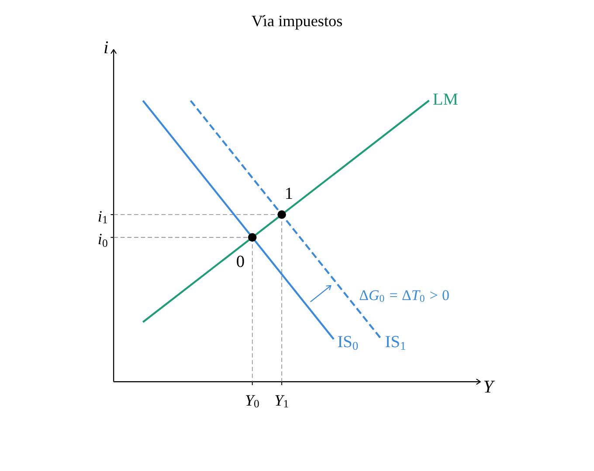
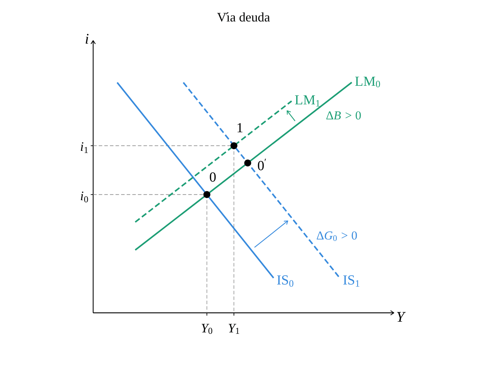
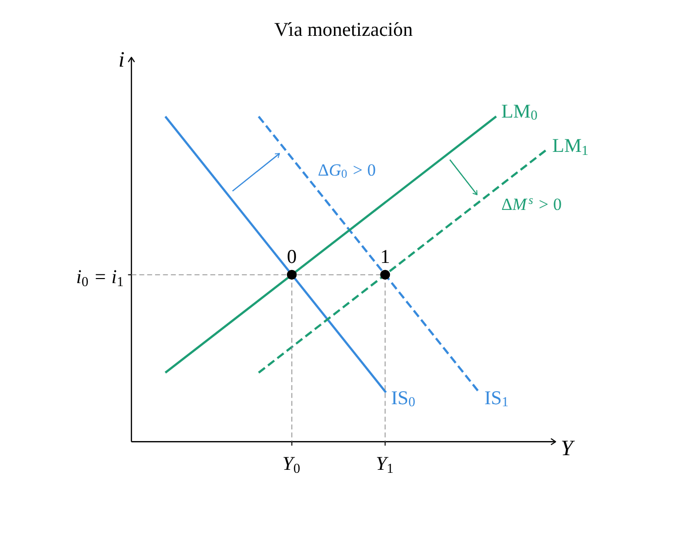
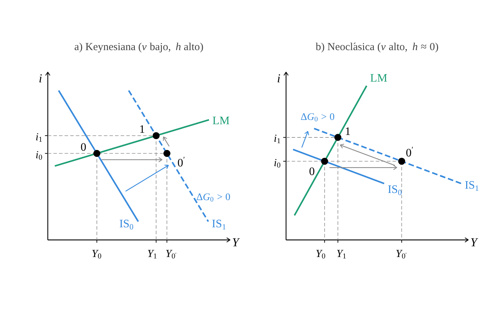
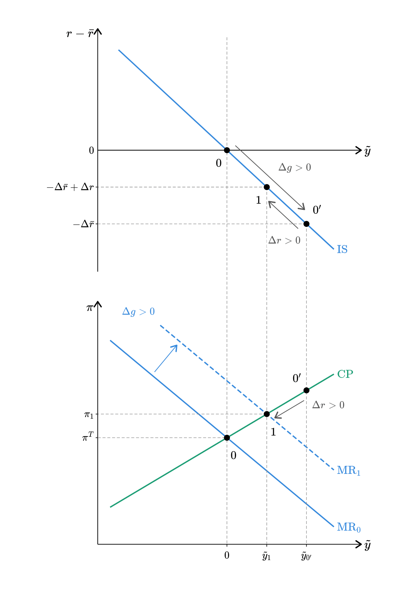
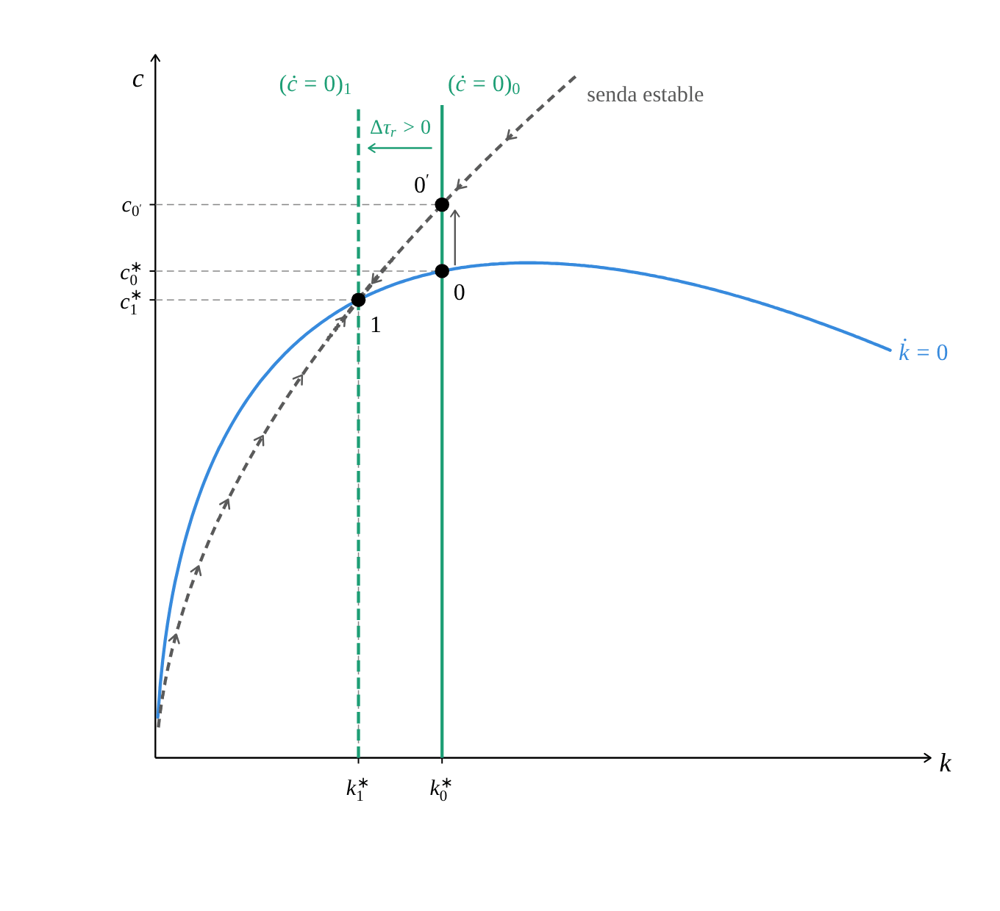
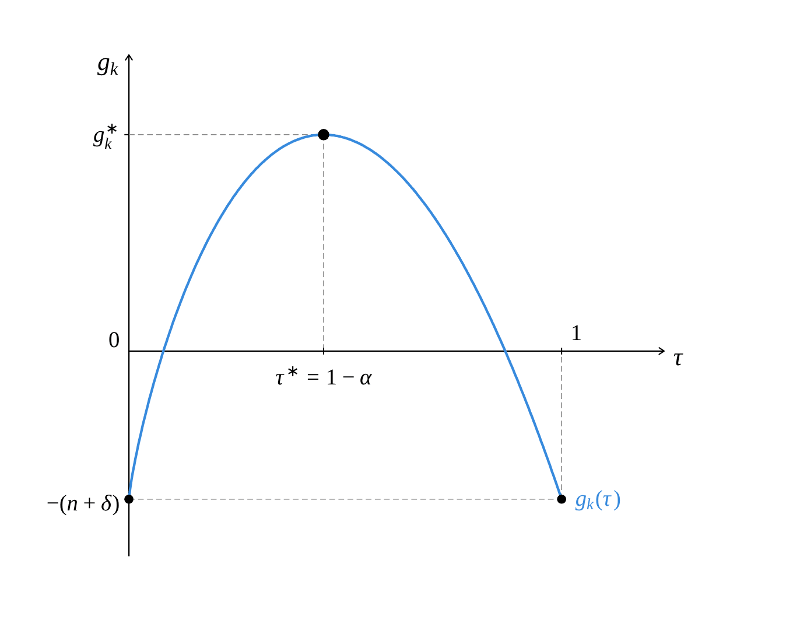

## Introducción



Los efectos de la política fiscal sobre el nivel de renta a corto plazo, centrales en el debate sobre las políticas de estabilización y medidos por los multiplicadores (tema [A40](a40-interrelacion.qmd)), son la base del análisis del ahorro (sección 1). Este tema analiza, sobre todo, sus efectos sobre el crecimiento económico y el ahorro, que constituyen hoy el núcleo del debate sobre el tamaño y el diseño del sector público.

El tema se organiza en torno a los tres canales por los que la política fiscal incide en el ahorro y el crecimiento:

- *Gasto público no productivo y su gravamen*: sus efectos se analizan desde la perspectiva neoclásica y desde la perspectiva neokeynesiana.

- *Diseño del sistema de pensiones*: constituye la principal vía por la que el sector público altera las decisiones de ahorro de los hogares.

- *Gasto público productivo*: sus efectos sobre el crecimiento se estudian en los modelos de crecimiento exógeno y endógeno y se contrastan con la evidencia empírica.

## 1. Efectos vía gasto público no productivo y gravamen

El análisis del gasto público no productivo y su gravamen parte del modelo IS-LM y pasa después a las perspectivas de la nueva macroeconomía clásica (NMC) y de la nueva economía keynesiana (NEK).

### 1.1. Antecedentes: el modelo IS-LM

El punto de partida es el modelo IS-LM, del que se exponen los efectos de la política fiscal y el debate sobre su importancia relativa.

#### 1.1.1. Efectos de la política fiscal

En el corto plazo, con precios fijos, el nivel de renta viene determinado por la demanda agregada. Una expansión fiscal, que traslada la curva IS a la derecha, tiene dos efectos:

1. *Efecto multiplicador*: en el mercado de bienes, más gasto público o menos impuestos elevan la renta en una cuantía que fija el multiplicador, cuyo valor depende de la teoría del consumo que se adopte[^a38-1]. Con la función de consumo keynesiana, $C = C_0 + c(Y - T_0)$, donde $c \in (0, 1)$ es la propensión marginal a consumir y $T_0$ los impuestos de suma fija, los multiplicadores son:

    - *Multiplicador del gasto*: a tipo de interés constante, $\partial Y/\partial G_0 = 1/(1-c) > 1$, porque cada unidad de gasto genera renta, que en parte se consume y vuelve a generar renta.

    - *Multiplicador de los impuestos*: $\partial Y/\partial T_0 = -c/(1-c)$, menor en valor absoluto que el del gasto, porque una rebaja de impuestos solo eleva la demanda en la parte de la renta disponible que se consume.

    - *Multiplicador del presupuesto equilibrado*: la suma de los dos anteriores es igual a la unidad (Haavelmo, 1945), de modo que un aumento del gasto financiado con impuestos de igual cuantía eleva la renta en esa cuantía.

    - *Multiplicador en el IS-LM*: cuando el tipo de interés se ajusta en el mercado de dinero, el multiplicador es $\partial Y/\partial G_0 = 1/(1 - c + vk/h)$, menor que a tipo de interés constante por el efecto expulsión. En esta expresión, $v$ es la sensibilidad de la inversión al tipo de interés y $k$ y $h$ las de la demanda de dinero a la renta y al tipo de interés.

2. *Efecto expulsión* (*crowding out*): con más renta, los agentes necesitan más dinero para sus transacciones y lo obtienen vendiendo bonos, cuyo precio baja, con lo que sube el tipo de interés $(\downarrow B^{d} \rightarrow \downarrow P_{B} \rightarrow \uparrow i)$, lo que expulsa gasto privado.

Hay, además, otros efectos que dependen del contexto y de la forma de financiación:

1. *Efecto desbordamiento*: en economía abierta (Mundell-Fleming), la apertura del canal de importaciones reduce el multiplicador, pues parte del estímulo se filtra al exterior, y la efectividad depende del régimen cambiario y de la movilidad de capital.

2. *Financiación vía impuestos*: reduce el multiplicador, pero no lo anula, porque el del presupuesto equilibrado es positivo.

3. *Financiación vía deuda*: añade el *efecto cartera*, por el que la mayor oferta de bonos reduce su precio, eleva la rentabilidad exigida y desplaza la LM a la izquierda, y, para los monetaristas, los efectos riqueza.

4. *Financiación vía emisión de dinero*: añade el *efecto liquidez*, por el que el aumento de la oferta monetaria desplaza la LM hacia la derecha y limita el efecto expulsión, si bien para los monetaristas sus efectos se diluyen a largo plazo por la teoría cuantitativa.

Gráficamente, en el plano $(Y, i)$, la IS recoge el equilibrio del mercado de bienes y es decreciente, porque un tipo menor eleva la inversión. La LM recoge el del mercado de dinero y es creciente, porque una renta mayor eleva la demanda de dinero. Las tres vías de financiación parten del punto 0, con la renta $Y_0$ y el tipo de interés $i_0$, y la expansión desplaza la IS de $\text{IS}_0$ a $\text{IS}_1$:

1. *Vía impuestos* (figura -@fig-a381-pf-impuestos): con un aumento de impuestos igual al del gasto ($\Delta G_0 = \Delta T_0 > 0$), la LM no varía y la economía pasa al punto 1, con más renta ($Y_1 > Y_0$) y un tipo de interés más alto ($i_1 > i_0$).

::: {#fig-a381-pf-impuestos}

::: {.content-visible when-format="html"}
```{=html}
<div class="graph-frame">
<iframe src="../graphs/a381_PF_impuestos.html" style="height:580px" loading="lazy" title="fig-a381-pf-impuestos"></iframe>
</div>
```
:::

::: {.content-visible unless-format="html"}

:::

Financiación vía impuestos y multiplicador del presupuesto equilibrado en el IS-LM.
:::

2. *Vía deuda* (figura -@fig-a382-pf-deuda): el aumento del gasto ($\Delta G_0 > 0$) lleva la economía al punto 0′. Después, la mayor oferta de bonos ($\Delta B > 0$) desplaza la LM a la izquierda, de $\text{LM}_0$ a $\text{LM}_1$, hasta el punto 1, con un tipo de interés $i_1$ aún mayor y más expulsión.

::: {#fig-a382-pf-deuda}

::: {.content-visible when-format="html"}
```{=html}
<div class="graph-frame">
<iframe src="../graphs/a382_PF_deuda.html" style="height:580px" loading="lazy" title="fig-a382-pf-deuda"></iframe>
</div>
```
:::

::: {.content-visible unless-format="html"}

:::

Financiación vía deuda. La expansión fiscal expulsa parcialmente la inversión.
:::

3. *Vía emisión de dinero* (figura -@fig-a383-pf-monetizacion): la expansión monetaria ($\Delta M^s > 0$) desplaza la LM a la derecha, de $\text{LM}_0$ a $\text{LM}_1$, y la economía pasa al punto 1 sin subida del tipo de interés ($i_0 = i_1$), por lo que no hay expulsión.

::: {#fig-a383-pf-monetizacion}

::: {.content-visible when-format="html"}
```{=html}
<div class="graph-frame">
<iframe src="../graphs/a383_PF_monetizacion.html" style="height:580px" loading="lazy" title="fig-a383-pf-monetizacion"></iframe>
</div>
```
:::

::: {.content-visible unless-format="html"}

:::

Financiación vía emisión de dinero. La acomodación monetaria neutraliza el efecto expulsión.
:::

::: {.callout-note appearance="simple" icon=false}
Los efectos de las distintas vías de financiación del déficit se desarrollan en el tema [A39](a39-deficit.qmd), apartado 1.2. Aquí se retienen en lo que afectan a la efectividad de la política fiscal.
:::

#### 1.1.2. Debate

Históricamente se ha discutido la importancia relativa de estos efectos, que depende de las pendientes de las curvas. Las pendientes reflejan cuánto responden al tipo de interés la inversión ($v$) y la demanda de dinero ($h$), como recoge el multiplicador del IS-LM.

**Perspectiva keynesiana**: la inversión, gobernada por los instintos animales, es muy volátil y apenas responde al tipo de interés ($v$ bajo), así que la IS es muy rígida a este. El consumo, por su parte, se apoya sobre todo en la renta disponible. Con el dinero sucede lo contrario, pues el motivo especulación vuelve su demanda, y con ella la LM, muy elástica al tipo de interés, y puede llegarse incluso a la trampa de liquidez[^a38-2]. 

La política fiscal es, así, muy efectiva, porque el efecto multiplicador es elevado y el efecto expulsión reducido, y el multiplicador del gasto es superior a la unidad.

**Perspectiva neoclásica**: en la visión monetarista, el gasto privado reacciona con fuerza al tipo de interés real, porque inversores y hogares atienden a la rentabilidad de los activos y recomponen su cartera de activos y de bienes duraderos cuando cambian los rendimientos relativos. La IS resulta, en consecuencia, muy elástica a este. 

A su vez, la demanda de dinero, y con ella la LM, es muy rígida al tipo de interés ($h \approx 0$), dado que el dinero tiene muchos sustitutivos imperfectos. 

Por ambas razones, la política fiscal es poco efectiva, porque el efecto multiplicador es reducido y el efecto expulsión es total o casi total, de modo que el multiplicador del gasto es inferior a la unidad.

Gráficamente, en el plano $(Y, i)$ (figura -@fig-a385-pf-pendientes), el mismo aumento del gasto ($\Delta G_0 > 0$) desplaza la IS de $\text{IS}_0$ a $\text{IS}_1$ en ambas perspectivas. A tipo de interés constante, el multiplicador llevaría la economía del punto 0 al 0′, pero la subida del tipo de interés la devuelve al punto 1. Esa vuelta, de $Y_{0'}$ a $Y_1$, mide la expulsión, que depende de las pendientes:

1. *Perspectiva keynesiana* (panel a): la subida del tipo de interés, de $i_0$ a $i_1$, apenas reduce la inversión, y $Y_1$ queda, por tanto, cerca de $Y_{0'}$.

2. *Perspectiva neoclásica* (panel b): la subida del tipo de interés expulsa casi tanta inversión como gasto añade, y $Y_1$ apenas supera a $Y_0$.

::: {#fig-a385-pf-pendientes}

::: {.content-visible when-format="html"}
```{=html}
<div class="graph-frame wide">
<iframe src="../graphs/a385_PF_pendientes.html" style="--r:1.545" loading="lazy" title="fig-a385-pf-pendientes"></iframe>
</div>
```
:::

::: {.content-visible unless-format="html"}

:::

Expansión fiscal en el IS-LM según las pendientes de las curvas. La expulsión, de $Y_{0'}$ a $Y_1$, es pequeña en la perspectiva keynesiana (a) y casi total en la neoclásica (b).
:::

### 1.2. Perspectiva NMC: el modelo del ciclo real con sector público

**Origen**: el modelo es el del ciclo real de la nueva macroeconomía clásica, ampliado con sector público en la línea de Baxter y King (1993).

**Idea**: la lectura neoclásica del IS-LM puede ilustrarse a través de un modelo del ciclo real con sector público.

#### 1.2.1. Supuestos

**Entorno**: la economía es cerrada, con incertidumbre (*shocks* tecnológicos y fiscales), tiempo discreto y horizonte infinito. Existe también competencia perfecta, completitud en todos los mercados y plena flexibilidad de precios, salarios y tipo de interés.

**Agentes**: se cumple la hipótesis de expectativas racionales. Existe un número elevado de agentes idénticos, que son simultáneamente consumidores, productores y oferentes de trabajo, con vida infinita (existe altruismo intergeneracional perfecto). 

El sector público realiza gasto público no productivo, recauda impuestos de suma fija y financia su déficit con deuda. Por consiguiente, el gasto público no tiene efecto distribución y las figuras impositivas son neutrales (no distorsionan las decisiones de consumo-ocio, aunque sí las afectan vía efecto riqueza).

**Tecnología**: la producción sigue una función Cobb-Douglas con tecnología neutral en el sentido de Hicks y rendimientos constantes a escala, y el capital se deprecia a una tasa $\delta$.

#### 1.2.2. Modelo

El modelo se resume en las ecuaciones de comportamiento de hogares y empresas, las que describen la tecnología y el sector público, y una condición de equilibrio competitivo.

**Hogares**: deciden cuánto consumir y cuánto trabajar.

- *Planteamiento*: maximizan su utilidad intertemporal, aditivamente separable en el tiempo, en consumo y ocio, sujetos a su restricción presupuestaria:

    $$\begin{aligned} &\max_{\{c_t, l_t, k_{t+1}, b_{t+1}\}} \; \mathbb{E}_0 \sum_{t=0}^{\infty} \beta^t u(c_t, 1 - l_t), \qquad \beta \in (0, 1) \\ &\text{s.a.:} \begin{cases} c_t + \left[k_{t+1} - (1-\delta)k_t\right] + (b_{t+1} - b_t) = y_t - T_t + r_t b_t \\ k_0,\ b_0 \text{ dados} \\ \lim_{T \to \infty} \mathbb{E}_0\left[b_{T+1} / R_T\right] \geq 0 \end{cases} \end{aligned}$$

    donde $c_t$ es el consumo, $l_t$ las horas trabajadas y $1 - l_t$ el ocio (dotación de tiempo normalizada a uno), $\beta \in (0, 1)$ el factor de descuento, $k_t$ el *stock* de capital y $\delta$ su tasa de depreciación. Por último, $b_t$ son los bonos públicos en manos del hogar, $r_t$ el tipo de interés real que rinden, $y_t$ la renta obtenida como productor (que remunera trabajo y capital) y $T_t$ el impuesto de suma fija. El capital y los bonos iniciales están dados, y la condición de no-Ponzi, con $R_T \equiv \prod_{s=0}^{T}(1+r_s)$, impide endeudarse indefinidamente.

- *CPO*: con solución interior y la restricción agotada, del lagrangiano se obtienen tres condiciones:

    1. *Condición de ocio-consumo*: $\text{RMS}_{c,1-l} = (\partial u/\partial (1-l_t))/(\partial u/\partial c_t) = w_t$, de carácter intratemporal, donde $w_t$ es el salario real.

    2. *Ecuación de Euler estocástica del consumo*: $\partial u/\partial c_t = \beta \mathbb{E}_t[(\partial u/\partial c_{t+1})(1 + r_{t+1})]$, según la cual la utilidad marginal de una unidad consumida hoy equivale a la que reportaría, descontada, en el periodo siguiente. Se trata de la condición de compra de bonos, cuyo factor de rendimiento bruto es $1 + r_{t+1}$.

    3. *Ecuación de Euler del capital*: $\partial u/\partial c_t = \beta \mathbb{E}_t[(\partial u/\partial c_{t+1})(1 + r^k_{t+1})]$, con $r^k_{t+1} = \partial f/\partial k_{t+1} - \delta$ la rentabilidad neta del capital, condición análoga a la de los bonos. En equilibrio, la ausencia de arbitraje entre bonos y capital exige $r^k_{t+1} = r_{t+1}$.

- *CSO*: concavidad estricta de $u$ en consumo y ocio, restricción lineal y condiciones de transversalidad sobre capital y bonos, por lo que las CPO son necesarias y suficientes.

**Empresas**: deciden cuánto producir y contratar.

- *Planteamiento*: maximizan su beneficio en cada periodo, tomando como dados el salario y el coste de uso del capital, sujetas a la tecnología:

    $$\max_{l_t, k_t} \; \Pi_t = y_t - w_t l_t - (r_t + \delta) k_t \quad \text{s.a.:} \quad y_t = A_t k_t^{\alpha} l_t^{1-\alpha}$$

    donde $\Pi_t$ es el beneficio, $w_t l_t$ la masa salarial y $(r_t + \delta)k_t$ el coste bruto de uso del capital.

- *CPO*: sustituyendo la tecnología en el beneficio se obtienen dos condiciones, análogas a las del contexto estático:

    1. *Demanda de trabajo*: $\partial f/\partial l_t = (1-\alpha)\dfrac{y_t}{l_t} = w_t$, es decir, la empresa contrata trabajo hasta que su productividad marginal iguala al salario real.

    2. *Demanda de capital*: $\partial f/\partial k_t = \alpha\dfrac{y_t}{k_t} = r_t + \delta$, es decir, alquila capital hasta que su productividad marginal iguala a su coste bruto de uso. En términos netos, $\partial f/\partial k_t - \delta = r_t$, que es la rentabilidad $r^k_t$ de la ecuación de Euler del capital de los hogares.

    Con rendimientos constantes a escala, ambas condiciones agotan el producto (teorema de Euler), $y_t = w_t l_t + (r_t + \delta)k_t$, y el beneficio de equilibrio es nulo.

- *CSO*: la tecnología Cobb-Douglas es cóncava en $(k, l)$ y estrictamente cóncava en cada factor, luego las CPO caracterizan el máximo.

**Tecnología**: se resume en tres ecuaciones:

- *Función de producción*: la Cobb-Douglas per cápita del programa de la empresa, donde $A_t$ es el nivel tecnológico y $\alpha \in (0, 1)$ la participación del capital en la renta.

- *Progreso técnico*: la tecnología crece en torno a una tendencia a un ritmo exógeno y constante, afectada por un componente aleatorio,

    $$\ln A_t = \ln \bar{A} + g_A t + \tilde{a}_t$$

    donde $\bar{A}$ es el nivel inicial, $g_A$ la tasa de progreso técnico y $\tilde{a}_t$ la desviación respecto a la tendencia, que sigue el proceso de los *shocks* tecnológicos.

- *Shocks tecnológicos*: siguen un proceso AR(1),

    $$\tilde{a}_t = \rho_A \tilde{a}_{t-1} + \phi_t, \quad \rho_A \in (-1, 1)$$

    donde $\rho_A$ recoge la persistencia de los *shocks* y $\phi_t$ es una perturbación no correlacionada, es decir, un ruido blanco.

**Sector público**: su comportamiento se condensa en otras tres ecuaciones:

- *Restricción presupuestaria*:

    $$(g_t - T_t) = b_{t+1} - (1 + r_t) b_t$$

    donde $g_t$ es el gasto público no productivo y $T_t$ la recaudación del impuesto de suma fija. Según la restricción, el déficit primario (lado izquierdo) más los intereses de la deuda heredada, $r_t b_t$, se financian con la emisión neta de bonos, $b_{t+1} - b_t$.

- *Gasto público*: crece en torno a una tendencia a un ritmo constante que coincide con el del *output* en la senda de crecimiento equilibrado, $g_A/(1-\alpha)$ con tecnología neutral en el sentido de Hicks,

    $$\ln g_t = \ln \bar{g} + \frac{g_A}{1-\alpha}\, t + \varepsilon^g_t$$

    donde $\bar{g}$ es el nivel inicial de gasto, $g_A/(1-\alpha)$ su tasa de crecimiento tendencial y $\varepsilon^g_t$ la desviación respecto a la tendencia.

- *Shocks fiscales*: los *shocks* de gasto público siguen un proceso AR(1) no correlacionado con los tecnológicos,

    $$\varepsilon^g_t = \rho_g \varepsilon^g_{t-1} + \psi_t, \quad \rho_g \in (-1, 1)$$

    donde $\rho_g$ recoge la persistencia de los *shocks* fiscales y $\psi_t$ es un ruido blanco independiente de $\phi_t$. La persistencia $\rho_g$ es el parámetro que distingue un *shock* transitorio ($\rho_g$ próximo a cero) de uno muy persistente, que en el límite $\rho_g \to 1$ equivale a uno permanente, en la dinámica que sigue.

**Equilibrio**: la condición de equilibrio competitivo exige que los mercados de trabajo y capital se vacíen en todos los periodos, es decir, que en cada momento la inversión iguale al ahorro.

**Estática comparativa**: si el gasto público no productivo aumenta por sorpresa, los agentes saben que en algún momento tendrán que pagarlo con más impuestos, por lo que su renta permanente cae. El *output* no crece por el canal directo de la demanda agregada, propio de los modelos keynesianos tradicionales, sino por el canal riqueza, porque los individuos, más pobres, ofrecen más trabajo. Las empresas, por su lado, no piden más horas a un salario dado, porque el gasto público deja intacta la productividad marginal del trabajo, guía de su demanda.

**Dinámica**: los efectos dependen de la permanencia del *shock*:

1. *Transitorio*: al ser pequeño el efecto riqueza negativo, producción y horas trabajadas suben poco, mientras que el consumo (efecto riqueza) y la inversión (efecto expulsión) retroceden. La renta crece, así, menos que el gasto público, y el multiplicador queda entre cero y uno.

2. *Permanente*: cuanto más persiste el *shock*, más fuerte es el efecto riqueza negativo, más se recorta el consumo en favor de las horas trabajadas y más sube la producción. A ello se suma el efecto ampliación que describen Baxter y King (1993). Con más empleo, el trabajo pierde productividad marginal y el capital la gana. El mayor rendimiento del capital eleva el tipo de interés real y estimula también la inversión privada, de modo que el multiplicador puede llegar a superar la unidad.

**Extensiones**: del modelo se derivan cuatro implicaciones de política económica:

1. *Equivalencia ricardiana* (Barro, 1974): en la restricción presupuestaria intertemporal de los hogares, una vez incorporada la del sector público, no aparecen los bonos. Por ello, no constituyen riqueza neta y, dada la senda de gasto público, la elección entre impuestos y deuda para financiarla es irrelevante. Como los individuos no padecen ilusión de deuda, el desahorro público se traduce en ahorro privado.

    Con todo, la política fiscal sigue teniendo efectos reales sobre el ahorro, el consumo, el empleo y el crecimiento. Las limitaciones de la equivalencia (restricciones de liquidez, ilusión fiscal, altruismo imperfecto, impuestos distorsionantes y gasto productivo) motivan el resto del tema.

2. *Efectos no keynesianos* (Giavazzi y Pagano, 1990): si los agentes son ricardianos (tratan la deuda pública como impuestos diferidos), una consolidación fiscal creíble y permanente puede ser expansiva. Ocurre así porque la reducción del gasto anticipa menores impuestos distorsionantes futuros, eleva la riqueza percibida y reduce las primas de riesgo y el tipo de interés. El efecto atracción (*crowding in*) resultante sobre la inversión privada puede compensar la caída de la demanda pública.

3. *Impuestos distorsionantes y suavización impositiva* (Barro, 1979): con impuestos sobre el consumo, el trabajo y el capital, más realistas que los de suma fija, a los efectos riqueza se añaden efectos sustitución intra e intertemporales. En consecuencia, la senda temporal de impuestos y déficit sí es relevante.

    Cada punto adicional del tipo impositivo distorsiona más que el anterior. Por eso la política óptima mantiene constante el tipo esperado y deja que operen los estabilizadores automáticos, con un déficit contracíclico y una deuda que amortigua los *shocks* (suavización impositiva). Como corolario, aumentos de los tipos impositivos pueden reducir la recaudación si la caída de la base imponible domina (curva de Laffer).

4. *Aritmética monetarista desagradable* (Sargent y Wallace, 1981): si la autoridad fiscal no ajusta sus déficits, la restricción presupuestaria intertemporal del sector público acaba imponiéndose a la autoridad monetaria.

::: {.callout-note appearance="simple" icon=false}
La equivalencia ricardiana y los efectos no keynesianos se desarrollan en el tema [A06](a06-nmc.qmd), apartado 3.2, y la suavización impositiva y la aritmética monetarista desagradable en el tema [A39](a39-deficit.qmd), apartados 1.2.2 y 3.2.
:::

#### 1.2.3. Conclusiones

**Aspectos positivos**: los modelos del ciclo real supusieron un avance metodológico, pues en ellos se basa la mayoría de los modelos posteriores. La hipótesis de equivalencia ricardiana es, además, un valioso punto de partida teórico. En cuanto al ahorro y el crecimiento, la lección de los modelos del ciclo real es que el gasto público no productivo solo eleva el *output* a costa del consumo privado, vía efecto riqueza negativo, y que su financiación con impuestos distorsionantes reduce la producción potencial.

**Limitaciones**: los resultados dependen, en parte, de la calibración, lo que puede suponer un reto econométrico. Con todo, la principal limitación es la naturaleza walrasiana del modelo, que supone que no existen rigideces de ningún tipo y que los ciclos son la respuesta óptima de agentes racionales a perturbaciones reales. Por ello, los modelos del ciclo real en su versión walrasiana pura apenas se aplican hoy en día.

### 1.3. Perspectiva NEK: el modelo IS-PC-MR con gasto público

**Origen**: el modelo es el canónico de la nueva economía keynesiana, ampliado con gasto público.

**Idea**: la lectura keynesiana del IS-LM, que enfatiza el efecto de las rigideces, se formaliza hoy en el modelo canónico de la nueva economía keynesiana.

::: {.callout-note appearance="simple" icon=false}
El modelo IS-PC-MR se desarrolla en el tema [A07](a07-nek.qmd), apartado 2.1, y su relación con la política monetaria y el problema del límite inferior de los tipos de interés (*zero lower bound*, ZLB), en el tema [A40](a40-interrelacion.qmd), apartado 2.1. Aquí se retiene lo que interesa a los efectos del gasto público.
:::

#### 1.3.1. Supuestos

**Entorno**: competencia monopolística en el mercado de bienes finales, rigideces nominales de precios a la Calvo (cada periodo solo una fracción de las empresas puede revisar su precio) y mercado de trabajo competitivo. Por las rigideces, la política monetaria no es neutral a corto plazo, aunque sí a largo plazo.

**Agentes**: los hogares y las empresas tienen expectativas racionales, como en el modelo del ciclo real. Una autoridad monetaria fija el tipo de interés nominal según una regla, y un sector público realiza gasto no productivo financiado con impuestos de suma fija. En el modelo canónico, los hogares son ricardianos (vida infinita y sin restricciones de liquidez).

**Tecnología**: $Y_t = A_t L_t^{1-\alpha}$, con el trabajo como único factor variable y sin acumulación de capital, lo que elimina la ecuación de Euler del capital del modelo anterior.

#### 1.3.2. Modelo

**Planteamiento**: a diferencia del modelo del ciclo real, cuyo equilibrio se caracteriza por las condiciones de primer orden de hogares y empresas, el modelo neokeynesiano se resume en tres ecuaciones agregadas, que son las versiones log-linealizadas de aquellas. Así, la IS dinámica sustituye a la ecuación de Euler del consumo, la curva de Phillips a la condición de fijación de precios de las empresas, y la regla de Taylor incorpora a la autoridad monetaria.

**IS dinámica**: relaciona la brecha de producción (*output gap*) con la brecha esperada, el tipo de interés real y el gasto público:

$$\begin{aligned} &\tilde{y}_t = \mathbb{E}_t[\tilde{y}_{t+1}] - \frac{1}{\theta}\left(r_t - \bar{r}_t\right) + \varepsilon^g_t \\ &r_t = i_t - \mathbb{E}_t[\pi_{t+1}], \qquad \bar{r}_t = f(\rho^{+}, g^{+}, (\mathbb{E}_t[\Delta \ln A_{t+1}])^{+}) \end{aligned}$$

donde $\tilde{y}_t = y_t - \bar{y}_t$ es la brecha de producción (*output* respecto de su nivel natural, el que se daría con precios flexibles, ambos en logaritmos), $\theta > 0$ la aversión relativa al riesgo, $i_t$ el tipo de interés nominal, $r_t$ el tipo real *ex ante* y $\varepsilon^g_t$ el *shock* fiscal[^a38-3]. Por su parte, $\bar{r}_t$ es el tipo de interés natural, que aumenta con la impaciencia ($\rho$, con $\beta = 1/(1+\rho)$), con el gasto público, $g$, y con el crecimiento esperado de la productividad.

**Curva de Phillips neokeynesiana**: $\pi_t = \beta \mathbb{E}_t[\pi_{t+1}] + \kappa\tilde{y}_t$ determina la inflación dada la senda de la brecha, que depende a su vez de la senda de los tipos y del gasto público. En ella, $\pi_t$ es la inflación y $\kappa > 0$ la pendiente, que es tanto mayor cuanto menor es la rigidez de precios.

**Regla de Taylor**: $i_t = \bar{i}_t + \alpha_\pi \tilde{\pi}_t + \alpha_y \tilde{y}_t + \varepsilon^m_t$, donde $\bar{i}_t = \bar{r}_t + \pi^T$ es el tipo de interés nominal neutral (tipo real natural más objetivo de inflación) y $\tilde{\pi}_t = \pi_t - \pi^T$ la desviación de la inflación. Los coeficientes $\alpha_\pi > 1$ y $\alpha_y \geq 0$ son las respuestas a la inflación (principio de Taylor) y a la brecha, y $\varepsilon^m_t$ el *shock* de política monetaria.

**Equilibrio**: las tres ecuaciones determinan las sendas de $\tilde{y}_t$, $\pi_t$ e $i_t$ dadas las de los *shocks*. En ausencia de *shocks*, y si los precios no revisados se indexan al objetivo (o si $\pi^T = 0$), el equilibrio estacionario es $\tilde{y} = 0$, $\pi = \pi^T$ e $i = \bar{r} + \pi^T$, es decir, la economía produce su nivel natural y la inflación coincide con el objetivo. El principio de Taylor garantiza que ese equilibrio sea único.

**Desarrollo gráfico**: el modelo IS-PC-MR se representa en los planos brecha de producción-desviación del tipo de interés real respecto del natural, arriba, y brecha de producción-inflación, abajo (figura -@fig-a386-ispcmr-fiscal):

1. *Curva IS dinámica*, IS: es decreciente, porque un tipo real más alto respecto del natural, $r - \bar{r}$, contrae la demanda y la brecha de producción, $\tilde{y}$.

2. *Curva de Phillips*, CP: crece con la brecha de producción, con pendiente $\kappa$.

3. *Curva MR*, $\text{MR}_0$: resulta de sustituir la regla de Taylor en la IS dinámica y es decreciente, porque el banco central responde a una mayor inflación con un tipo real más alto y una brecha menor (tema [A07](a07-nek.qmd), apartado 2.1.2).

4. *Equilibrio*: en el punto 0, la brecha es nula, la inflación está en el objetivo, $\pi^T$, y el tipo real iguala al natural.

**Estática comparativa**: con rigideces nominales, un aumento del gasto público se transmite por dos canales:

1. *Canal de la riqueza*: los consumidores, igual que en el ciclo real, saben que el gasto se pagará con impuestos futuros, se sienten más pobres (efecto riqueza negativo), consumen menos y ofrecen más trabajo. Este canal eleva el *output* natural, $\bar{y}_t$.

2. *Canal del mark-up*: las empresas no pueden ajustar sus precios de inmediato y atienden el estímulo de demanda produciendo más, para lo que, a diferencia del modelo neoclásico, contratan más trabajo. Con ello, el margen precio-coste se estrecha y el salario real sube. Este canal eleva el *output* efectivo, $y_t$, aunque el consumo de los hogares ricardianos lo sigue fijando la ecuación de Euler. Por ello, si el aumento del gasto es transitorio, el consumo no varía cuando el tipo real se mantiene constante y cae cuando el banco central lo eleva (extensión 2).

Como un canal eleva el *output* natural y el otro el efectivo, el efecto neto sobre la brecha y la inflación es, *a priori*, ambiguo, y depende de la respuesta monetaria. Gráficamente (figura -@fig-a386-ispcmr-fiscal), cuando domina el canal del *mark-up*, el aumento del gasto ($\Delta g > 0$) eleva el tipo natural en $\Delta\bar{r}$ y desplaza la MR de $\text{MR}_0$ a $\text{MR}_1$. A tipo real constante, la economía pasaría del punto 0 al 0′, con una brecha $\tilde{y}_{0'}$. Ante las presiones inflacionistas, sin embargo, el banco central, siguiendo la regla de Taylor, eleva el tipo real en $\Delta r$ y contrarresta parte del impulso. En consecuencia, la economía se sitúa en el punto 1, con una brecha $\tilde{y}_1$ menor y una inflación $\pi_1$ por encima del objetivo.

::: {#fig-a386-ispcmr-fiscal}

::: {.content-visible when-format="html"}
```{=html}
<div class="graph-frame">
<iframe src="../graphs/a386_ISPCMR_fiscal.html" style="height:1010px" loading="lazy" title="fig-a386-ispcmr-fiscal"></iframe>
</div>
```
:::

::: {.content-visible unless-format="html"}

:::

Expansión fiscal ($\Delta g > 0$) en el modelo IS-PC-MR. A tipo real constante, la economía pasaría de 0 a 0′, y con la regla de Taylor ($\Delta r > 0$) se sitúa en 1, con un multiplicador inferior a la unidad.
:::

**Dinámica**: como en el modelo del ciclo real, la persistencia del *shock* importa:

1. *Transitorio*: genera un efecto riqueza pequeño y opera sobre todo por el canal del *mark-up*, con un multiplicador de impacto mayor que el del permanente.

2. *Permanente*: genera un efecto riqueza grande, eleva más el *output* natural y menos la brecha, y su multiplicador se aproxima al neoclásico.

**Extensiones**: las tres siguientes precisan las condiciones que determinan la efectividad de la política fiscal:

1. *Efectividad con restricciones de liquidez* (Galí, López-Salido y Vallés, 2007): parten del modelo canónico con dos tipos de agentes, ricardianos, que suavizan su consumo intertemporalmente, y no ricardianos, que no pueden ahorrar ni endeudarse y consumen su renta corriente. Puesto que los no ricardianos no participan en los mercados financieros, no sufren el efecto riqueza negativo, y el canal del *mark-up* (mayor demanda de trabajo, mayor salario real) eleva directamente su consumo. Por tanto, si la proporción de agentes no ricardianos es suficiente y el gasto se financia en parte con deuda, el multiplicador del gasto público es superior a la unidad.

2. *Interrelación con la política monetaria* (Woodford, 2011): la respuesta de la autoridad monetaria determina el multiplicador en tres escenarios, a los que se añade una extensión del último:

    - *Tipo de interés real constante* ($r_t = \bar{r}$): la política monetaria acomoda por completo el impulso, el consumo no varía por la ecuación de Euler y el multiplicador es exactamente igual a uno.

    - *Objetivo estricto de inflación o regla de Taylor* ($\tilde{y}_t = 0$ como objetivo): el banco central eleva el tipo real ante las presiones inflacionistas, el consumo cae y el multiplicador es inferior a uno.

    - *Límite inferior de los tipos de interés* ($i_t = 0$): el tipo nominal no puede responder al estímulo, la mayor inflación esperada reduce el tipo real, el consumo aumenta y el multiplicador es superior a uno. No obstante, el resultado exige que el gasto no se prolongue más allá del periodo en que el límite es vinculante.

    - *Perturbaciones del factor de descuento*: una perturbación que eleva el ahorro precautorio de los hogares (p. ej. tras la crisis financiera de 2008) puede hacer negativo el tipo natural y vinculante la restricción de tipos nulos. Como el tipo real no puede bajar hasta él, la pérdida de *output* es grande y la política fiscal es especialmente efectiva.

3. *Uniones monetarias* (Galí y Monacelli, 2008): parten del modelo en economía abierta con países que conservan la política fiscal (consumo público) y comparten la política monetaria. El efecto del gasto público nacional no depende del grado de acomodación monetaria, en la medida en que la política monetaria común no responde a la inflación generada en el país. Por ello, el multiplicador es mayor que en una economía con política monetaria propia y objetivo estricto de inflación, aunque sigue siendo inferior a la unidad si el país financia el gasto con sus propios impuestos (Farhi y Werning, 2016). Ahora bien, la política fiscal óptima de cada país debe corregir las distorsiones que la política monetaria común no puede atender.

#### 1.3.3. Conclusiones

**Aspectos positivos**: el modelo neokeynesiano recupera la efectividad de la política fiscal a corto plazo sin renunciar a los microfundamentos del ciclo real, y muestra que su magnitud depende de las restricciones de liquidez de los hogares y de los regímenes monetario y cambiario. En cuanto al ahorro, el gasto público sigue reduciendo el consumo privado vía efecto riqueza, pero el canal del *mark-up* eleva el empleo y el salario real a corto plazo y, si hay hogares no ricardianos, también el consumo de estos (extensión 1).

**Limitaciones**: el modelo canónico considera únicamente gasto público no productivo financiado con impuestos de suma fija, por lo que no permite analizar los efectos sobre el crecimiento a largo plazo, que estudian las secciones 2 y 3.

### 1.4. Evidencia empírica

La evidencia sobre el valor del multiplicador fiscal se reúne en el tema [A40](a40-interrelacion.qmd), apartado 3.2. De ella interesa aquí lo que permite contrastar las dos perspectivas anteriores.

**Respuesta del consumo privado**: es la predicción que separa ambos modelos. Con el enfoque de vectores autorregresivos estructurales (SVAR), el consumo privado aumenta tras un *shock* de gasto (Blanchard y Perotti, 2002), lo que motivó el modelo con agentes no ricardianos. Con *shocks* de gasto militar fechados cuando se anuncian, en cambio, el consumo privado cae, como predice el efecto riqueza negativo del ciclo real. Ramey (2011), que construye esos *shocks*, atribuye la diferencia a que los del SVAR llegan tarde, cuando los agentes ya conocían el aumento del gasto.

**Hogares no ricardianos**: entre el 20 % y el 40 % de las devoluciones del impuesto sobre la renta de 2001 en EE. UU. se gastó en bienes no duraderos en el trimestre en que se recibieron, aunque se conocían de antemano (Johnson, Parker y Souleles, 2006). Ese gasto contradice la hipótesis de la renta permanente, en la que se apoya la equivalencia ricardiana, y apoya la existencia de hogares restringidos por liquidez.

**Tamaño del multiplicador**: con datos de EE. UU. desde 1889, el multiplicador del gasto queda por debajo de la unidad tanto con desempleo alto como bajo (Ramey y Zubairy, 2018), como en la perspectiva neoclásica. El multiplicador relativo entre los estados de una unión monetaria, cuya política monetaria común no responde al impulso de uno solo, se sitúa, en cambio, en torno a 1,5 (Nakamura y Steinsson, 2014), un valor que respalda la perspectiva neokeynesiana.

### 1.5. Conclusiones

El análisis del gasto público no productivo y su gravamen arroja una conclusión común a ambas perspectivas. El gasto no productivo ejerce sobre el consumo privado un efecto riqueza negativo y, si es transitorio, reduce también la inversión y, con ella, el ahorro nacional.

Los efectos expansivos del gasto sobre el *output* a corto plazo dependen, en cambio, de la existencia de rigideces, de las restricciones de liquidez y del régimen de la política monetaria. En el marco neoclásico, los multiplicadores son inferiores a la unidad si el aumento del gasto es transitorio. En el neokeynesiano, el multiplicador alcanza la unidad cuando la política monetaria mantiene constante el tipo real. Si la política monetaria no responde o si una fracción suficiente de hogares está restringida por liquidez, el multiplicador puede superar la unidad. Los efectos sobre el crecimiento a largo plazo, sin embargo, discurren por otros dos canales (secciones 2 y 3).

## 2. Efectos vía diseño del sistema de pensiones

El diseño del sistema de pensiones condiciona el ahorro y, con él, la acumulación de capital. Una vez descritos los tipos de sistemas, el modelo de generaciones solapadas permite compararlos, y la evidencia empírica cierra la sección.

### 2.1. Sistemas de pensiones

Los sistemas públicos de pensiones, que responden a la función redistributiva del sector público y a la corrección de la miopía del ahorro individual, pesan mucho en las economías avanzadas, sobre todo en las europeas (en España, en torno al 12 % del PIB). Se financian principalmente con cotizaciones sociales, que actúan como un impuesto sobre el trabajo y, en los sistemas de reparto, reducen el ahorro.

Hay dos tipos puros, que difieren en quién financia la pensión de cada generación y, por tanto, en su rendimiento implícito, y la mayoría de países los combinan en sistemas mixtos.

#### 2.1.1. Sistema de capitalización (*fully funded*)

**Antecedentes**: los primeros esquemas modernos de pensiones eran de capitalización, y la reforma chilena de 1981 la recuperó como sistema nacional obligatorio de gestión privada.

**Definición**: cada trabajador acumula sus cotizaciones en una cuenta individual invertida en activos financieros y cobra en la jubilación el capital y su rendimiento. No hay, por tanto, redistribución intergeneracional, y el factor de capitalización del ahorro es $(1+r)$, el rendimiento del mercado de capitales.

**Diseño**: el sistema es de aportación definida, con gestión privada o pública y conversión del saldo en una renta vitalicia según la esperanza de vida. Suele añadirse un pilar solidario, financiado con impuestos, que garantiza una pensión mínima.

**Ejemplos**: Chile, los países latinoamericanos que siguieron su modelo en los años noventa (Perú, Colombia, México) y Australia (*superannuation*, 1992).

**Conclusiones**:

- *Aspectos positivos*: es robusto al envejecimiento, porque no depende de la demografía. Asimismo, eleva el ahorro nacional en la fase de acumulación si obliga a ahorrar más de lo que se ahorraría voluntariamente o si sustituye al reparto, profundiza los mercados de capitales y, al ligar cotización y prestación, distorsiona menos la oferta de trabajo.

- *Limitaciones*: traslada al trabajador los riesgos financiero y de longevidad, y sus tasas de sustitución dependen de las comisiones y de la continuidad de las carreras de cotización, por lo que penalizan la informalidad y las lagunas. Además, la transición desde el reparto exige que una generación pague dos veces (la pensión de sus mayores y la propia), con un coste fiscal que puede ser muy elevado.

#### 2.1.2. Sistema de reparto (*pay as you go*)

**Antecedentes**: el seguro social de Bismarck (1889) era contributivo y con reservas, pero el reparto puro se generalizó tras la II Guerra Mundial, cuando la destrucción de los fondos y la necesidad de pagar pensiones de inmediato lo impusieron.

**Definición**: lo que cotizan hoy quienes trabajan se destina a pagar las pensiones de quienes hoy están jubilados, de modo que sí hay redistribución intergeneracional. El factor de capitalización implícito es el crecimiento de la masa salarial, $(1+n)(1+g_y)$, que recoge el aumento del número de cotizantes ($n$) y de la renta de cada uno ($g_y$) (Samuelson, 1958; Aaron, 1966).

**Diseño**: el sistema es de prestación definida, calculada sobre las bases de cotización de un periodo de referencia, con la edad de jubilación, el tipo de cotización y la regla de revalorización fijados por ley. El Estado garantiza el pago, y los riesgos demográfico y político recaen sobre las generaciones futuras.

**Ejemplos**: lo aplican la mayoría de países europeos (Alemania, Francia, Italia, España) y la Seguridad Social de EE. UU. (1935).

**Conclusiones**:

- *Aspectos positivos*: paga pensiones desde el primer día, reparte los riesgos entre el Estado y los cotizantes, es inmune a las crisis financieras y es más sencillo y barato de administrar.

- *Limitaciones*: su rendimiento cae con el envejecimiento (menor $n$) y con la ralentización del crecimiento (menor $g_y$), lo que obliga a subir cotizaciones, bajar prestaciones o retrasar la jubilación. Además, reduce el ahorro nacional, y la desconexión entre cotización y prestación actúa como un impuesto sobre el trabajo.

#### 2.1.3. Sistemas mixtos

**Antecedentes**: la convergencia entre ambos modelos desde los años noventa, impulsada por el informe del Banco Mundial *Averting the Old Age Crisis* (1994), que propuso una arquitectura de tres pilares.

**Definición**: sistemas que combinan un pilar de reparto con pilares de capitalización que lo complementan, de modo que el rendimiento del conjunto es una media ponderada de $(1+n)(1+g_y)$ y $(1+r)$.

**Diseño**: el sistema combina un pilar público de reparto (contributivo o asistencial), otro de capitalización obligatoria (de empresa o individual) y otro de ahorro voluntario con incentivos fiscales. En la variante de cuentas nocionales de aportación definida (NDC), el reparto calcula la pensión como si fuera de capitalización, con un rendimiento nocional ligado al crecimiento de la masa salarial.

**Ejemplos**: lo aplican Suecia, Países Bajos y Dinamarca.

**Conclusiones**:

- *Aspectos positivos*: diversifican los riesgos demográfico y financiero, y las cuentas nocionales restablecen el vínculo entre cotización y prestación sin el coste de transición.

- *Limitaciones*: la coordinación entre pilares es compleja, los pilares de capitalización reproducen la desigualdad de las carreras laborales y la transición hacia el segundo pilar conlleva el mismo doble pago, aunque atenuado.

### 2.2. Modelo base: generaciones solapadas (Allais, 1947; Samuelson, 1958; Diamond, 1965)

**Origen**: el modelo es el de generaciones solapadas de Allais (1947), Samuelson (1958) y Diamond (1965), en su versión de dos periodos.

**Idea**: las diferencias entre el sistema de capitalización y el de reparto pueden estudiarse a través de ese modelo.

::: {.callout-note appearance="simple" icon=false}
El modelo de generaciones solapadas de Diamond y su propiedad de ineficiencia dinámica se desarrollan en el tema [A29](a29-mhi-mgs.qmd), apartado 3.2. Aquí se aplica a los sistemas de pensiones.
:::

#### 2.2.1. Supuestos

**Entorno**: la economía es competitiva, no hay incertidumbre y los agentes viven dos periodos. En el primero los agentes trabajan, consumen y ahorran, y en el segundo consumen todo lo ahorrado y desaparecen del modelo. La población crece a una tasa constante y exógena $n$, y la renta laboral a una tasa $g_y$.

**Agentes**: dos cohortes conviven en cada periodo, jóvenes y ancianos, con las mismas preferencias logarítmicas, de modo que solo existe heterogeneidad en la edad. Las empresas contratan factores de acuerdo con su productividad marginal. En cuanto al sector público, se parte de un modelo sin sistema de pensiones y se introduce después cada sistema como una cotización $\tau$ sobre la renta laboral y una pensión en la vejez.

#### 2.2.2. Modelo

**Planteamiento**: el joven elige su ahorro para maximizar la utilidad de su ciclo vital. Los tres casos comparten la función objetivo y difieren solo en la restricción presupuestaria, a través de la cotización, $\tau y_t$, que se paga en la juventud, y de la pensión, $p_{t+1}$, que se cobra en la vejez:

$$\max_{s_t} \; u^d = \ln c^j_t + \beta \ln c^a_{t+1} \quad \text{s.a.:} \begin{cases} c^j_t = (1-\tau)\,y_t - s_t \\ c^a_{t+1} = (1+r)\,s_t + p_{t+1} \end{cases}$$

donde $c^j_t$ y $c^a_{t+1}$ son el consumo en la juventud y en la vejez, $\beta$ el factor de descuento, $y_t$ la renta laboral de la juventud, $s_t$ el ahorro privado y $r$ el tipo de interés real. Cada sistema se traduce en una restricción distinta:

1. *Sin sistema de pensiones*: no hay cotización ni pensión, $\tau = 0$ y $p_{t+1} = 0$.

2. *Capitalización*: la pensión es la propia cotización capitalizada al tipo de interés de mercado, $p_{t+1} = (1+r)\tau y_t$.

3. *Reparto*: la pensión es la cotización de la generación siguiente, más numerosa y más rica, $p_{t+1} = (1+n)(1+g_y)\tau y_t$, porque hay $1+n$ jóvenes por cada anciano y cada uno cotiza sobre una renta $(1+g_y)y_t$.

**CPO**: con solución interior, sustituyendo las restricciones en la función objetivo, la condición $\partial u^d/\partial s_t = 0$ da la ecuación de Euler, común a los tres casos, $1/c^j_t = \beta(1+r)/c^a_{t+1}$. Dicho de otro modo, el joven ahorra hasta que la utilidad marginal del consumo presente iguala a la del consumo en la vejez, descontada y capitalizada.

**CSO**: $\partial^2 u^d/\partial s_t^2 = -1/(c^j_t)^2 - \beta(1+r)^2/(c^a_{t+1})^2 < 0$, luego la CPO es suficiente.

**Solución**: despejando el ahorro de la ecuación de Euler se obtiene la función de ahorro privado,

$$s^*_t = \frac{\beta}{1+\beta}\,(1-\tau)\,y_t - \frac{p_{t+1}}{(1+\beta)(1+r)}$$

que cae con la cotización y con el valor actual de la pensión. Sustituyendo la pensión de cada sistema, se obtienen tres casos:

1. *Sin sistema de pensiones*: $s^*_t = \frac{\beta}{1+\beta}\,y_t$. El ahorro es exclusivamente privado, el único vehículo de transmisión de consumo entre periodos, y depende únicamente de las preferencias (impaciencia, $\beta$) y de la renta, por lo que podría ser insuficiente.

2. *Capitalización*: $s^*_t = \frac{\beta}{1+\beta}\,y_t - \tau y_t$. El ahorro privado cae exactamente en la cuantía del ahorro público forzoso, de modo que el ahorro nacional ($s^*_t + \tau y_t$) y la acumulación de capital no varían. El agente es indiferente respecto a quién ahorra, porque solo le interesa la tasa de retorno, que es la misma.

3. *Reparto*: el ahorro privado es

    $$s^*_t = \frac{\beta}{1+\beta}\, y_t - \tau y_t \left[1 + \frac{(1+n)(1+g_y) - (1+r)}{(1+\beta)(1+r)}\right]$$

    Como el sector público no ahorra la cotización, sino que la transfiere a los jubilados, el ahorro nacional y la acumulación de capital caen siempre. Además, si el rendimiento implícito del reparto, $(1+n)(1+g_y)$, supera al tipo de interés, el ahorro privado cae en más que la cotización.

**Bienestar**: la preferencia por un sistema u otro depende de la relación de los parámetros. Si $(1+n)(1+g_y) > (1+r)$, se prefiere el sistema de reparto, pues la contribución capitalizada es mayor que con capitalización, mientras que si $(1+n)(1+g_y) < (1+r)$ se prefiere el de capitalización.

Como corolario, la caída del ahorro nacional bajo reparto no tiene por qué producir pérdidas de bienestar, ya que, si la economía se encuentra en una zona dinámicamente ineficiente (sobreacumulación de capital, $r < n + g_y$), el sistema de reparto mejora el bienestar de todas las generaciones.

Ahora bien, en los países desarrollados las cohortes posteriores al *baby boom* son menos numerosas, lo que reduce $n$, y el ritmo de avance de la renta, $g_y$, se ha frenado desde los años setenta. El rendimiento del reparto se ha reducido por ello, y es más probable que acabe siendo inferior al del ahorro privado.

#### 2.2.3. Conclusiones

**Aspectos positivos**: el modelo aísla con claridad el efecto de cada sistema sobre el ahorro nacional (nulo bajo capitalización y siempre negativo bajo reparto) y explica por qué el envejecimiento convierte en insostenibles sistemas que fueron óptimos.

**Limitaciones**: el modelo no incorpora incertidumbre sobre la longevidad ni sobre los rendimientos, que es la razón de ser de los seguros públicos. Supone, además, que la cotización no altera la oferta de trabajo, cuando en la práctica las cotizaciones actúan como un impuesto sobre el trabajo, y omite los costes de transición de un sistema a otro, que son la principal barrera a las reformas.

### 2.3. Evidencia empírica

Se estudia un caso por cada tipo de sistema (reparto en Alemania, capitalización en Chile y mixto en Suecia), más el de España, un sistema de reparto con pilares complementarios poco desarrollados.

**Sistemas de reparto: el caso de Alemania**: el sistema bismarckiano de reparto, con pensiones ligadas a las cotizaciones, ha respondido al envejecimiento con reformas paramétricas que reducen el rendimiento implícito del sistema:

- *Pensiones Riester* (2001): introducción de un pilar de capitalización voluntario subvencionado.

- *Factor de sostenibilidad* (2004): liga la revalorización de las pensiones a la ratio entre cotizantes y pensionistas.

- *Edad de jubilación* (2007): retraso gradual de 65 a 67 años, en aplicación entre 2012 y 2029.

La tasa de sustitución ha descendido, aunque el paquete de pensiones de 2025 prorrogó hasta 2031 un suelo del 48 % para el nivel de las pensiones (*Haltelinie*).

**Sistemas de capitalización: el caso de Chile**: la reforma de 1981 sustituyó el reparto por cuentas individuales obligatorias gestionadas por administradoras privadas de fondos de pensiones (AFP). El sistema profundizó el mercado de capitales, pero su efecto sobre el ahorro nacional es discutido, pues el coste fiscal de la transición redujo el ahorro público.

Además, las tasas de sustitución resultaron bajas por las lagunas de cotización, la informalidad y las comisiones. La insuficiencia de las pensiones obligó a introducir un pilar solidario financiado con impuestos (2008) y, tras un largo debate, una cotización adicional a cargo del empleador con un componente de reparto (2025).

**Sistemas mixtos: el caso de Suecia**: la reforma aprobada en 1998 y aplicada desde 1999 sustituyó el sistema de prestación definida por uno de aportación definida con una cotización del 18,5 % de la renta. De esa cotización, 16 puntos se destinan a cuentas nocionales de reparto (*inkomstpension*), cuyo rendimiento está ligado al crecimiento del salario medio, y 2,5 puntos a cuentas individuales de capitalización (*premiepension*).

Un mecanismo de equilibrio automático, activado por primera vez en 2010 tras la crisis financiera, reduce la revalorización de las pensiones cuando los pasivos del pilar de reparto superan a sus activos (incluido el valor de las cotizaciones futuras). El caso ilustra cómo un sistema mixto traslada a los cotizantes parte del riesgo demográfico y financiero a cambio de garantizar la solvencia del sistema.

**Un sistema de reparto con pilares complementarios poco desarrollados: el caso de España**: el sistema español es público y de prestación definida, con un fondo de reserva y pilares complementarios de capitalización (planes de empleo e individuales) voluntarios. El marco español presenta varios problemas:

- *Fecundidad*: según el Instituto Nacional de Estadística (INE), el indicador coyuntural se situó en 1,10 hijos por mujer en 2024, muy por debajo del nivel de reemplazo (en torno a 2,1). Por ello, cada generación de cotizantes es menos numerosa que la anterior. En términos del modelo de generaciones solapadas, cae $n$ y, con ella, el rendimiento implícito del reparto.

- *Efecto sustitución*: los nuevos jubilados, con carreras de cotización más largas y bases más altas, sustituyen a pensionistas con prestaciones menores, de modo que la pensión media crece por encima de la revalorización. Por tanto, el gasto aumenta aunque no aumente el número de pensionistas.

- *Envejecimiento*: la jubilación de la generación del *baby boom*, más tardío en España que en el resto de Europa, eleva la tasa de dependencia. A ello se suma el aumento de la esperanza de vida a los 65 años, que alarga el periodo de cobro. Según las proyecciones del INE (2026), la tasa de dependencia seguiría aumentando durante todo su horizonte, hasta un máximo del 73,2 % en 2076[^a38-4].

- *Tipos de interés*: próximos a cero en la década de 2010, recortaron la rentabilidad del fondo de reserva y de los planes de pensiones complementarios. En términos del modelo, un $r$ bajo hace relativamente más atractivo el reparto, pero obliga a ahorrar más para complementar la pensión pública.

Las reformas de 2011 (edad legal a 67 años, ampliación del periodo de cómputo) y 2013 (índice de revalorización y factor de sostenibilidad, después derogados) actuaron sobre el gasto. Las de 2021-2023, en cambio, actúan sobre el ingreso (mecanismo de equidad intergeneracional, destope gradual de las bases máximas, cuota de solidaridad) y recuperan la revalorización con el IPC, con una cláusula de evaluación periódica por la Autoridad Independiente de Responsabilidad Fiscal (AIReF).

### 2.4. Conclusiones

La capitalización rinde a quien cotiza el tipo de interés de mercado, $(1+r)$, y el reparto, el crecimiento de la masa salarial, $(1+n)(1+g_y)$, mientras que los sistemas mixtos combinan ambos rendimientos. En el modelo de generaciones solapadas, la capitalización sustituye ahorro privado por ahorro público sin alterar el ahorro nacional. El reparto, por el contrario, lo reduce siempre, porque la cotización se transfiere a los jubilados en lugar de invertirse, y la caída crece con el diferencial entre su rendimiento implícito y el tipo de interés. Esa menor acumulación no implica por sí sola una pérdida de bienestar, y en una economía dinámicamente ineficiente el reparto mejora el de todas las generaciones.

El envejecimiento y la ralentización de la renta han reducido $n$ y $g_y$ y, con ellos, el rendimiento del reparto. De ahí la convergencia de las reformas hacia sistemas mixtos que ilustran los casos de Alemania, Chile y Suecia. La sección 3 pasa del ahorro a la productividad, con el gasto público que entra en la función de producción.

## 3. Efectos vía gasto público productivo

Los efectos del gasto público productivo sobre el crecimiento se abordan primero con su caracterización y después con los modelos de crecimiento exógeno y endógeno, para terminar con la evidencia empírica.

### 3.1. Gasto público productivo

El **gasto público productivo** se distingue del no productivo (consumo público, transferencias) en que entra en la función de producción como *input* y eleva la productividad del sector privado. Destacan dos categorías: la educación y capacitación de la mano de obra, que eleva el capital humano, y las infraestructuras y la provisión de otros bienes públicos (transporte, energía, I+D, derechos de propiedad). El sector privado no proveería en cantidad suficiente las infraestructuras y los demás bienes públicos, porque presentan externalidades positivas.

Este gasto plantea una disyuntiva. Por un lado, aumenta la producción potencial de la economía y, por otro, hay que financiarlo, y en la práctica se hace con figuras impositivas distorsionantes, que reducen la renta disponible, la inversión y el consumo privados.

### 3.2. Crecimiento exógeno: el modelo de Ramsey-Cass-Koopmans con sector público

**Origen**: el modelo es el de Ramsey-Cass-Koopmans (RCK), ampliado con impuestos distorsionantes y gasto público productivo.

**Idea**: la disyuntiva que plantea el gasto público productivo puede analizarse a través de un modelo RCK ampliado.

::: {.callout-note appearance="simple" icon=false}
El modelo de Ramsey-Cass-Koopmans se desarrolla en el tema [A43](a43-crecimiento-i.qmd), apartado 3. Aquí se amplía con impuestos y gasto público.
:::

#### 3.2.1. Supuestos

**Entorno**: el modelo supone un mundo neoclásico, sin más fallo de mercado que la externalidad del gasto público productivo, y con certidumbre. La población crece a una tasa constante y exógena $n$.

**Agentes**: la economía la forma un agente representativo con tasa de ahorro endógena y utilidad isoelástica (CRRA), con aversión relativa al riesgo $\theta > 0$. El agente no toma decisiones de trabajo, de modo que ofrece una unidad de trabajo en cada periodo y $w_t$ es la renta laboral. 

El sector público recauda impuestos distorsionantes sobre el consumo ($\tau_c$), la renta laboral ($\tau_w$) y la renta del capital ($\tau_r$), que solo afectan a los hogares, y los dedica a gasto público productivo con presupuesto equilibrado.

**Tecnología**: neoclásica, $y = A(g) f(k) = A(g) k^{\alpha}$, con depreciación $\delta > 0$, donde el gasto público productivo eleva la productividad total de los factores, $A'(g) > 0$, sin ser un factor acumulable.

#### 3.2.2. Modelo

Como en el modelo del ciclo real, el equilibrio se caracteriza por las decisiones de hogares y empresas, la restricción del sector público y una condición de equilibrio de mercado. A diferencia de aquel, el tiempo es continuo, no hay incertidumbre ni decisión de trabajo y los impuestos son distorsionantes.

**Hogares**: deciden cuánto consumir y cuánto ahorrar.

- *Planteamiento*: maximizan su utilidad descontada sujeta a una restricción presupuestaria en la que los impuestos gravan cada uso y fuente de renta:

    $$\begin{aligned} &\max_{c} \; U = \int_0^{\infty} e^{-(\rho - n)t} \frac{c^{1-\theta} - 1}{1-\theta}\, dt, \qquad \theta > 0 \\ &\text{s.a.:} \begin{cases} (1+\tau_c)c + \dot{b} = (1-\tau_w)w + \left[(1-\tau_r)r - n\right] b \\ b_0 > 0 \text{ dado} \\ \lim_{t \to \infty} \lambda(t)\, b(t) \geq 0 \end{cases}, \qquad \rho > n \end{aligned}$$

    donde $c$ es el consumo per cápita[^a38-5], $\rho$ la tasa de descuento (impaciencia), $n$ la tasa de crecimiento de la población y $\theta$ la aversión relativa al riesgo (inversa de la elasticidad de sustitución intertemporal). La variable $b$ es la riqueza financiera per cápita (que en equilibrio será capital). En cuanto a los precios y los impuestos, $w$ es el salario, $r$ el tipo de interés real antes de impuestos, y $\tau_c$, $\tau_w$ y $\tau_r$ los tipos impositivos sobre el consumo, la renta laboral y la renta del capital, respectivamente. La condición $\rho > n$ garantiza que la utilidad descontada sea finita. La riqueza inicial, $b_0$, está dada, y la condición de no-Ponzi impide acabar endeudado en el límite y se escribe con el multiplicador $\lambda$ del hamiltoniano que sigue[^a38-6]. El hamiltoniano en valor presente u origen es

    $$H = e^{-(\rho-n)t}\frac{c^{1-\theta}-1}{1-\theta} + \lambda\left[(1-\tau_w)w + \left((1-\tau_r)r - n\right)b - (1+\tau_c)c\right]$$
    donde $\lambda$ es el precio sombra de la riqueza.

- *CPO*: de su resolución se obtienen tres condiciones:

    1. *Condición de consumo*: $H_c = 0 \;\Rightarrow\; e^{-(\rho-n)t}c^{-\theta} = \lambda(1+\tau_c)$, es decir, la utilidad marginal descontada del consumo iguala a su precio sombra, incluido el impuesto.

    2. *Condición de acumulación*: $H_b = -\dot{\lambda} \;\Rightarrow\; -\dot{\lambda}/\lambda = (1-\tau_r)r - n$, es decir, el precio sombra de la riqueza decrece a una tasa igual al rendimiento neto de impuestos del ahorro menos la tasa de crecimiento de la población.

    3. *Condición de transversalidad*: $\lim_{t\to\infty}\lambda b = 0$, que excluye la acumulación de riqueza sin consumo[^a38-7].

- *CSO*: el hamiltoniano es estrictamente cóncavo en $c$ ($\theta>0$) y lineal en $b$, por lo que las condiciones de Pontryagin, con la transversalidad, son suficientes (Mangasarian).

- *Ecuación de Euler*: combinando las dos primeras CPO,

    $$g_c \equiv \frac{\dot{c}}{c} = \frac{1}{\theta}\left[(1-\tau_r)\, r - \rho\right]$$

    donde $g_c$ es la tasa de crecimiento del consumo. Sin sector público, $g_c = \frac{1}{\theta}(r - \rho)$, es decir, el hogar posterga consumo mientras el rendimiento del ahorro, $r$, supere a su impaciencia, $\rho$, con una intensidad que depende de $\theta$. Con sector público, el rendimiento relevante pasa a ser $(1-\tau_r)r$, el que el hogar efectivamente percibe:

    1. *Impuesto sobre el capital*: introduce una *cuña* entre el rendimiento social del ahorro, que sigue siendo $r = A(g)\,df/dk - \delta$, y el privado. Por ello, para cualquier $k$, el consumo crece menos (o decrece más) que sin impuesto, es decir, el hogar ahorra menos.

    2. *Impuestos sobre el consumo y el trabajo*: $\tau_c$ y $\tau_w$ no aparecen en la ecuación de Euler. El impuesto sobre el consumo grava por igual el consumo de hoy y el de mañana, sin alterar su precio relativo, y el impuesto sobre el trabajo grava una renta cuya oferta es inelástica por supuesto. Ambos reducen la renta disponible (efecto renta), pero dejan intacta la decisión intertemporal (sin efecto sustitución). Solo el impuesto sobre el capital distorsiona la acumulación, y de ahí que la teoría de la imposición óptima recomiende gravar el consumo antes que el ahorro.

    3. *Gasto público*: no aparece en la ecuación de Euler del hogar, sino en el rendimiento del capital que este toma como dado. Al elevar $A(g)$, eleva $r$ para cada $k$ y empuja al hogar a ahorrar más, en sentido contrario al impuesto sobre el capital.

**Empresas**: deciden cuánto capital emplear por trabajador.

- *Planteamiento*: maximizan su beneficio por trabajador en cada instante, tomando como dados los precios de los factores y el gasto público:

    $$\max_{k} \; \Pi = A(g)f(k) - (r + \delta)k - w$$

    donde $\Pi$ es el beneficio por trabajador, $A(g)f(k)$ el *output* por trabajador, $(r+\delta)k$ el coste bruto de uso del capital y $w$ el salario de la unidad de trabajo que cada hogar ofrece.

- *CPO*: de la resolución se obtienen dos condiciones:

    1. *Demanda de capital*: $A(g)df/dk = r + \delta$, es decir, la productividad marginal del capital iguala a su coste bruto de uso. En términos netos, $r = A(g)df/dk - \delta$.

    2. *Salario*: con rendimientos constantes a escala el beneficio es nulo y el trabajo percibe el residuo, $w = A(g)\left[f(k) - k df/dk\right]$.

- *CSO*: $f''<0$, por lo que el beneficio por trabajador es estrictamente cóncavo en $k$.

El gasto público productivo es una externalidad para la empresa, porque eleva la productividad de sus factores sin que la empresa lo elija ni pague por él. Por ello, la empresa no lo internaliza en su decisión de capital, y el equilibrio competitivo no es eficiente por sí solo.

**Sector público**: mantiene el presupuesto equilibrado en cada instante:

$$g = \tau_w w + \tau_r r b + \tau_c c$$

donde $g$ es el gasto público productivo per cápita y cada sumando la recaudación de cada figura impositiva. El sector público dedica a dicho gasto una fracción $g/y$ del *output*, que, dados los tipos impositivos, queda determinada por la recaudación.

Al no haber deuda ni impuestos de suma fija, cada unidad de gasto productivo tiene que financiarse con alguna de las tres figuras impositivas, y estas no son equivalentes: 

- *Financiación con $\tau_c$ o $\tau_w$*: el hogar pierde renta, pero su decisión de ahorro no cambia, y el efecto sobre $k^*$ es el positivo de $A(g)$.

- *Financiación con $\tau_r$*: el mismo $g$ se obtiene a costa de la cuña sobre el ahorro, y el efecto neto sobre $k^*$ es ambiguo.

La composición de la recaudación importa tanto como su nivel. Además, como $g$ aparece a ambos lados (en el gasto y, vía $A(g)$, en las bases imponibles $w$, $r$ y $c$), el gasto productivo se autofinancia parcialmente, ya que, al elevar la productividad, eleva la recaudación para unos tipos dados.

**Equilibrio**: la condición de equilibrio en los mercados financieros es $b = k$, es decir, la riqueza de los hogares se materializa en capital. Sustituyendo el tipo de interés de las empresas en la ecuación de Euler, la dinámica del consumo es $g_c = \frac{1}{\theta}\left[(1-\tau_r)\left(A(g)\,df/dk - \delta\right) - \rho\right]$ y, en estado estacionario, $g_c = 0$:

$$(1-\tau_r)\left[A(g)\,\frac{df}{dk}\bigg|_{k^*} - \delta\right] = \rho$$
El capital de estado estacionario es el que iguala el rendimiento neto de impuestos del capital a la impaciencia. Como en el modelo sin sector público, el equilibrio es un punto de silla. Dado $k_0$, existe una única senda de consumo que converge a $(k^*, c^*)$.

**Desarrollo gráfico**: la dinámica del modelo se representa en el plano $k$-$c$ (figura -@fig-a387-rck-impuestos):

1. *Locus $\dot{k} = 0$*: recoge los pares de capital y consumo con los que el capital per cápita no varía. Sustituyendo $b = k$ y la restricción del sector público en la de los hogares, $c + g + \dot{k} + (n+\delta)k = A(g)f(k)$, de modo que el *locus*, $c = A(g)f(k) - (n+\delta)k - g$, tiene forma de U invertida, con su máximo en la regla de oro.

2. *Locus $\dot{c} = 0$*: es vertical en el capital $k^*$ de la condición de estado estacionario, porque la ecuación de Euler solo depende de $k$. A su izquierda el consumo crece y a su derecha decrece.

3. *Senda estable*: es la única trayectoria que converge al estado estacionario.

4. *Equilibrio*: en el punto 0, donde se cortan $\dot{k} = 0$ y $(\dot{c} = 0)_0$, la economía permanece en su estado estacionario, con capital $k^*_0$ y consumo $c^*_0$.

**Estática comparativa**: de la condición de estado estacionario se desprenden cuatro conclusiones sobre los efectos de la política fiscal:

1. *Impuestos sobre el consumo y el trabajo* ($\tau_c$, $\tau_w$): con tipos constantes, no alteran $k^*$ ni $c^*$.

2. *Impuesto sobre el capital* ($\tau_r$): reduce $k^*$ y $c^*$, porque eleva la productividad marginal del capital que los hogares exigen para ahorrar.

    Gráficamente (figura -@fig-a387-rck-impuestos), se supone una subida de $\tau_r$ no anticipada y permanente que no altera el gasto $g$, porque la mayor recaudación se compensa con una rebaja de $\tau_c$ o $\tau_w$. En ese caso, el *locus* $\dot{k} = 0$ no varía y el *locus* $\dot{c} = 0$ se desplaza a la izquierda, de $(\dot{c} = 0)_0$ a $(\dot{c} = 0)_1$. En el impacto, con el capital dado, el consumo salta de $c^*_0$ a $c_{0'}$ (del punto 0 al 0′) hasta la nueva senda estable, porque el ahorro es menos rentable. Después, el capital y el consumo decrecen a lo largo de ella hasta el punto 1, con $k^*_1 < k^*_0$ y $c^*_1 < c^*_0$.

::: {#fig-a387-rck-impuestos}

::: {.content-visible when-format="html"}
```{=html}
<div class="graph-frame">
<iframe src="../graphs/a387_RCK_impuestos.html" style="height:540px;max-width:555px" loading="lazy" title="fig-a387-rck-impuestos"></iframe>
</div>
```
:::

::: {.content-visible unless-format="html"}

:::

Subida del impuesto sobre el capital en el modelo de Ramsey-Cass-Koopmans. El consumo salta a la nueva senda estable (0 → 0′) y la economía converge a un estado estacionario con menos capital y consumo (1).
:::

3. *Gasto público productivo* ($g$): eleva $A(g)$ y, con ella, la productividad marginal del capital, $k^*$ y el nivel de renta.

4. *Disyuntiva*: se plantea entre el crecimiento impulsado por el sector privado (no distorsionado, pero con externalidades y bienes públicos infraprovistos) y el impulsado por el sector público (distorsionante, pero que internaliza externalidades y provee bienes públicos). El tamaño óptimo del sector público es aquel en que el efecto productividad marginal de $g$ iguala al coste marginal de la distorsión necesaria para financiarlo.

En un modelo de crecimiento exógeno, la política fiscal tiene efectos *nivel* (sobre $k^*$ y $c^*$) pero no efectos *tasa*, porque la tasa de crecimiento a largo plazo sigue siendo la del progreso técnico exógeno.

**Extensiones**: tres relajaciones de los supuestos matizan los resultados:

1. *Oferta de trabajo elástica*: si los hogares eligen entre consumo y ocio, $\tau_w$ y $\tau_c$ pasan a ser distorsionantes, pues reducen el salario real neto y, por el efecto sustitución, la oferta de trabajo. La jerarquía de daño entre figuras se convierte entonces en una cuestión empírica.

2. *Imposición óptima del capital* (Chamley, 1986; Judd, 1985): en un modelo de este tipo, el tipo impositivo óptimo sobre el capital a largo plazo es nulo, pues gravarlo equivale a gravar el consumo futuro a un tipo creciente con el horizonte. Sin embargo, el resultado se debilita con horizontes finitos, restricciones de liquidez o rentas del capital que son en realidad rentas puras. Además, Straub y Werning (2020) muestran que, con una elasticidad de sustitución intertemporal inferior a la unidad ($\theta > 1$), el tipo óptimo puede ser positivo a largo plazo incluso en los modelos originales.

3. *Capital público como stock* (Arrow y Kurz, 1970): si el gasto público se acumula en un *stock* de capital público que se deprecia, el análisis se convierte en uno de dos capitales con una regla de oro para cada uno. En ese caso, la inversión pública solo afecta al crecimiento durante la transición.

#### 3.2.3. Conclusiones

**Aspectos positivos**: el modelo ordena los impuestos según su coste en términos de acumulación, y el impuesto sobre el capital resulta el más dañino, en línea con el resultado de Chamley-Judd de tipo óptimo nulo a largo plazo. Muestra, además, que el gasto productivo tiene efectos nivel sobre la renta.

**Limitaciones**: al tratarse de un modelo de crecimiento exógeno, la política fiscal influye solo en el nivel y no en la tasa de crecimiento a largo plazo. Además, la oferta de trabajo inelástica elimina la distorsión del impuesto sobre el trabajo.

### 3.3. Crecimiento endógeno: el modelo de Barro (1990)

**Origen**: el modelo es el de crecimiento endógeno AK con sector público de Barro (1990), presentado aquí en su versión con tasa de ahorro exógena, como extensión del modelo de Solow-Swan.

**Idea**: el gasto público productivo eleva la productividad del capital privado y su financiación detrae renta del sector privado, de modo que existe un tamaño del sector público que maximiza el crecimiento.

#### 3.3.1. Supuestos

**Entorno**: el modelo supone un mundo neoclásico, sin más fallo de mercado que la externalidad del gasto público productivo, en el largo plazo. El sector público mantiene en todo momento un presupuesto equilibrado.

**Agentes**: intervienen consumidores, empresas y sector público, los tres racionales. Lo distintivo del modelo es que el sector público realiza gasto productivo. Cada individuo ofrece una unidad de trabajo y la población crece a la tasa $n$, de modo que las variables se expresan en términos per cápita. La tasa de ahorro es constante y exógena, y el ahorro se invierte íntegramente.

**Tecnología**: la función de producción presenta las propiedades habituales (rendimientos constantes a escala en los *inputs* rivales, productividad marginal positiva y decreciente, condiciones de Inada), y el gasto público productivo entra como un *input*:

$$y = Ak^{\alpha}g^{1-\alpha}, \qquad A > 0,\; \alpha \in (0, 1)$$

donde $y$, $k$ y $g$ son el *output*, el capital privado y el gasto público per cápita, $A$ el nivel tecnológico y $\alpha \in (0, 1)$ la participación del capital privado[^a38-8]. La función presenta rendimientos constantes en el conjunto de $k$ y $g$. Por ello, si $g$ crece en la misma proporción que $k$, no hay rendimientos decrecientes del capital y se trata de un modelo AK.

#### 3.3.2. Modelo

**Planteamiento**: la economía es cerrada y tiene sector público, de modo que la renta se reparte entre consumo, inversión y gasto público, $Y = C + I + G$. El gasto productivo se financia, con presupuesto equilibrado, mediante un impuesto proporcional sobre la renta de tipo $\tau$, que reduce la renta disponible y el ahorro. Con ahorro exógeno, un impuesto de suma fija de igual recaudación tendría el mismo efecto, porque la distorsión del rendimiento privado del capital solo aparece con hogares optimizadores. Como en el modelo de Solow-Swan (tema [A43](a43-crecimiento-i.qmd), apartado 2.2 y Anexo), cada ecuación de comportamiento (gasto público, renta, inversión y consumo, por este orden) se escribe en niveles y per cápita, y las de la renta y el consumo, también en tasas de crecimiento:

$$\begin{alignedat}{2} &G = \tau Y \; && \Rightarrow \; g = \tau y \\ &Y = AK^{\alpha}L^{1-\alpha}(G/L)^{1-\alpha} \; && \Rightarrow \; y = A^{1/\alpha}\tau^{\frac{1-\alpha}{\alpha}}k \;\Rightarrow\; g_y = g_k, \quad A > 0,\; \alpha \in (0, 1) \\ &\dot{K} = s(1-\tau)Y - \delta K \; && \Rightarrow \; \dot{k} = s(1-\tau)y - (n+\delta)k \\ &C = (1-s)(1-\tau)Y \; && \Rightarrow \; c = (1-s)(1-\tau)y \;\Rightarrow\; g_c = g_y \end{alignedat}$$

donde $s$ es la tasa de ahorro, $(1-\tau)Y$ la renta disponible, $n$ la tasa de crecimiento de la población y $\delta$ la de depreciación. La renta per cápita se obtiene sustituyendo $g = \tau y$ en $y = Ak^{\alpha}g^{1-\alpha}$ y despejando $y$. Resulta proporcional al capital porque el gasto público crece con la renta y evita que el capital privado tenga rendimientos decrecientes. La tasa de crecimiento del capital, que comparten la renta y el consumo, se obtiene en el equilibrio.

**Equilibrio**: como el *output* es proporcional al capital, no hay dinámica de transición, y la renta, el capital y el consumo per cápita crecen desde el principio a la misma tasa constante, que depende del tipo impositivo:

$$g_k(\tau) = s(1-\tau)A^{1/\alpha}\tau^{\frac{1-\alpha}{\alpha}} - (n+\delta)$$

El tipo impositivo aparece dos veces:

- *Efecto distorsión*: como $(1-\tau)$, reduce la renta disponible y el ahorro.

- *Efecto productividad*: como $\tau^{(1-\alpha)/\alpha}$, eleva la productividad del capital vía gasto público.

El tamaño óptimo del sector público, el que maximiza el crecimiento, se alcanza cuando la participación del ingreso público en el PIB iguala a la participación del gasto productivo determinada por la tecnología:

$$\frac{\partial g_k}{\partial \tau} = 0 \;\rightarrow\; \tau^* = 1 - \alpha$$

**Desarrollo gráfico**: en el plano tipo impositivo-tasa de crecimiento (figura -@fig-a384-barro), la curva $g_k(\tau)$ tiene forma de U invertida:

1. *$\tau = 0$*: el Estado no recauda y no puede gastar, y sin ese *input* imprescindible nada se produce. El capital por trabajador varía entonces a la tasa $-(n+\delta) < 0$.

2. *$\tau = 1$*: el impuesto absorbe toda la renta, los hogares no tienen nada que ahorrar ni invertir y el capital vuelve a variar a la tasa $-(n+\delta)$.

3. *Tipo óptimo*: se corresponde con el máximo de la curva, $\tau^* = 1-\alpha$, con la tasa de crecimiento $g_k^*$. A la izquierda domina el efecto productividad del gasto, a la derecha el efecto distorsión del impuesto.

::: {#fig-a384-barro}

::: {.content-visible when-format="html"}
```{=html}
<div class="graph-frame">
<iframe src="../graphs/a384_Barro.html" style="height:580px" loading="lazy" title="fig-a384-barro"></iframe>
</div>
```
:::

::: {.content-visible unless-format="html"}

:::

Modelo de Barro (1990). La tasa de crecimiento es máxima cuando el tipo impositivo iguala a la elasticidad del *output* respecto al gasto público productivo.
:::

**Estática comparativa**: a diferencia del modelo de crecimiento exógeno, la política fiscal tiene aquí efectos tasa, porque el gasto productivo eleva permanentemente la tasa de crecimiento y su financiación distorsionante la reduce.

**Extensiones**: en la versión original con hogares optimizadores (Barro, 1990), la figura impositiva sí importa, dado que los hogares eligen su ahorro a la Ramsey (tema [A44](a44-crecimiento-ii.qmd), apartado 1.4). Si el gasto productivo se financia con impuestos de suma fija, $T_0 = g$, estos no alteran el rendimiento privado del capital:

$$\frac{\partial y}{\partial k} = \alpha A^{1/\alpha}\left(\frac{g}{y}\right)^{\frac{1-\alpha}{\alpha}}$$

que es creciente con la ratio de gasto público sobre el PIB. La tasa de crecimiento del consumo, $g_c = \frac{1}{\theta}\left[\partial y/\partial k - \delta - \rho\right]$, es por ello creciente con $g/y$, si bien el tamaño que maximiza el bienestar sigue siendo $g/y = 1-\alpha$, donde la productividad marginal del gasto público iguala a su coste ($\partial y/\partial g = 1$). Con el impuesto proporcional, en cambio, el rendimiento privado del capital se reduce a $(1-\tau)\,\partial y/\partial k$ y el tipo que maximiza el crecimiento es el mismo que con ahorro exógeno, $\tau^* = 1-\alpha$.

Baxter y King (1993) endogenizan, además, la oferta de trabajo, con lo que los *shocks* fiscales alteran también el empleo. Los aumentos transitorios de la inversión pública tienen un efecto expulsión sobre la inversión privada mayor que los permanentes y un efecto expansivo muy reducido.

En cambio, un aumento permanente puede llevar a un nuevo estado estacionario con mayor producción, inversión, consumo privado y empleo. Ocurre así porque, a medida que se acumula capital público, aumenta la productividad marginal del empleo y del capital privado, lo que estimula la inversión privada y la oferta de trabajo y compensa el efecto riqueza negativo de la financiación[^a38-9].

#### 3.3.3. Conclusiones

**Aspectos positivos**: la aportación de Barro fue una de las primeras en estudiar el tamaño del sector público en un modelo de crecimiento endógeno, y permite ilustrar de una manera intuitiva el debate sobre ese tamaño[^a38-10].

**Limitaciones**: la principal es que el enfoque de Barro considera fija la oferta de trabajo. Además, la tasa de ahorro es exógena en la versión aquí presentada (no en la original de Barro) y el gasto público es un flujo y no un *stock*. El modelo tampoco distingue entre partidas de gasto productivo ni entre figuras impositivas distorsionantes, aunque estas dañan el crecimiento en grado muy distinto (Arnold et al., 2011).

### 3.4. Evidencia empírica

La validez de los modelos anteriores exige contrastar sus principales conclusiones sobre la inversión pública, el consumo público y los impuestos.

**Gasto productivo: efectos de la inversión pública** (Aschauer, 1989): estima una función de producción agregada para EE. UU. (1949-1985) con el *stock* de capital público como *input* y encuentra un fuerte efecto positivo de la inversión pública en infraestructuras básicas sobre la productividad y el crecimiento, con una elasticidad del *output* respecto al capital público en torno a 0,4.

**Gasto no productivo: peso del consumo público** (Barro, 1991): en su regresión de crecimiento para 98 países (1960-1985) encuentra una relación negativa entre la ratio de consumo público sobre el PIB y la tasa de crecimiento, y no significativa para la inversión pública. El resultado concuerda con la distinción entre gasto productivo e improductivo del modelo de Barro (1990).

**Efectos de la imposición** (Kneller, Bleaney y Gemmell, 1999): con un panel de 22 países de la OCDE (1970-1995) encuentran que los impuestos distorsionantes reducen el crecimiento y los no distorsionantes no, y que el gasto productivo lo eleva y el improductivo no.

**Magnitud del efecto del gasto productivo**: la literatura posterior a Aschauer encuentra un efecto positivo, pero mucho menor. En particular, el metaanálisis de Bom y Ligthart (2014), con 578 estimaciones de 68 estudios, sitúa la elasticidad media de la producción respecto al capital público en torno a 0,1, frente al 0,4 de Aschauer.

**Composición de los impuestos** (Arnold et al., 2011): con datos de 21 países de la OCDE (1971-2004) establecen una jerarquía de figuras impositivas según su daño al crecimiento. Los impuestos recurrentes sobre la propiedad inmobiliaria son los menos dañinos, seguidos de los impuestos sobre el consumo, los impuestos sobre la renta personal y, los más dañinos, los impuestos sobre sociedades. En España corresponden, de menor a mayor daño, al impuesto sobre bienes inmuebles (IBI), al IVA, al impuesto sobre la renta de las personas físicas (IRPF) y al impuesto sobre sociedades (IS).

**Inversión pública en la OCDE**: la evidencia más reciente (Abiad, Furceri y Topalova, 2016) indica que un aumento de la inversión pública eleva el *output* a corto y largo plazo, con efecto atracción sobre la inversión privada. Los efectos son mayores en periodos de holgura económica y cuando la inversión es eficiente y se financia con deuda.

### 3.5. Conclusiones

El gasto público productivo eleva el nivel de renta en los modelos de crecimiento exógeno y la tasa de crecimiento en los de crecimiento endógeno, pero su financiación con impuestos distorsionantes impone un límite, que se traduce en un tamaño óptimo del sector público. La evidencia empírica respalda ambas caras de la disyuntiva, con efectos positivos de la inversión pública menores que los que estimó Aschauer (1989). Kneller, Bleaney y Gemmell (1999) confirman la distinción entre gasto productivo e improductivo, y Arnold et al. (2011) añaden que importa la composición de los impuestos distorsionantes, una distinción que el modelo de Barro no hace.

## Conclusiones

La política fiscal incide en el ahorro y el crecimiento por tres canales. El gasto no productivo y su gravamen presionan a la baja el consumo privado por el efecto riqueza y, si son transitorios, el ahorro nacional, y su efecto sobre el *output* a corto plazo depende de las rigideces, las restricciones de liquidez y la política monetaria. En pensiones, la capitalización deja inalterado el ahorro nacional y el reparto lo reduce, tanto más cuanto mayor es el diferencial entre su rendimiento implícito y el tipo de interés. El envejecimiento ha reducido ese rendimiento implícito. De ahí la convergencia de las reformas hacia sistemas mixtos que ilustran los casos de Alemania, Chile y Suecia. El gasto productivo eleva el nivel de renta o la tasa de crecimiento hasta un tamaño óptimo del sector público, y su composición, como la de los impuestos, importa tanto como su nivel. Todo ello supone que existe espacio fiscal, un margen para gastar más sin que la deuda entre en una senda explosiva. Sin él, la subida de los tipos puede expulsar la inversión privada y anular el impulso.

El análisis del gasto no productivo prolonga dos debates de las escuelas macroeconómicas, la equivalencia ricardiana, según la cual la deuda no altera el consumo (tema [A06](a06-nmc.qmd)), y el multiplicador con rigideces y hogares sin acceso al crédito (tema [A07](a07-nek.qmd)). Las pensiones se analizan con el modelo de generaciones solapadas, en el que el reparto transfiere renta entre cohortes (tema [A29](a29-mhi-mgs.qmd)), y el gasto productivo, con los modelos de Ramsey-Cass-Koopmans y de Barro, en los que el gasto público productivo entra en la función de producción (temas [A43](a43-crecimiento-i.qmd) y [A44](a44-crecimiento-ii.qmd)). Por último, la evidencia sobre el multiplicador fiscal (tema [A40](a40-interrelacion.qmd)) y la sostenibilidad de la deuda, que delimita el espacio fiscal (tema [A39](a39-deficit.qmd)), completan el análisis.

Straub y Werning (2020) han reabierto la discusión sobre la imposición óptima del capital al cuestionar el tipo nulo de Chamley (1986) y Judd (1985) que sustenta la jerarquía de impuestos (apartado 3.2.2). Sigue abierta también la eficacia de la inversión pública. Abiad, Furceri y Topalova (2016) la respaldan (apartado 3.4), pero Ramey (2020) advierte de que los retrasos de construcción debilitan su efecto a corto plazo y de que las estimaciones de la elasticidad del producto al capital público probablemente están sesgadas al alza.

[^a38-1]: Las hipótesis de la renta permanente y del ciclo vital reducen la propensión a consumir la renta corriente y, con ella, el multiplicador. La reducción es mayor en la primera (el consumo no responde a la renta transitoria) que en la segunda (la renta transitoria se reparte a lo largo de la vida restante).

[^a38-2]: Ambas sensibilidades son los “eslabones débiles” keynesianos del mecanismo de transmisión monetaria.

[^a38-3]: El *shock* fiscal recoge solo la parte del impulso del gasto público no incorporada en $\bar{r}_t$, de modo que el mismo impulso no se computa dos veces.

[^a38-4]: El *Ageing Report* de la Comisión Europea, trienal, es la referencia para los efectos a largo plazo del envejecimiento sobre el gasto en pensiones, sanidad y dependencia de los Estados miembros.

[^a38-5]: En tiempo continuo se omite el argumento temporal: $c \equiv c(t)$, $b \equiv b(t)$, $w \equiv w(t)$, $r \equiv r(t)$ y $\lambda \equiv \lambda(t)$; se escribe solo en las condiciones inicial y terminal.

[^a38-6]: Por la condición de acumulación, $\lambda(t) = \lambda(0)\, e^{-[(1-\tau_r)R(t) - nt]}$, con $R(t) \equiv \int_0^t r(v)\,dv$ y $\lambda(0) > 0$, de modo que la condición equivale a $\lim_{t \to \infty} b(t)\, e^{-[(1-\tau_r)R(t) - nt]} \geq 0$.

[^a38-7]: La condición de transversalidad es la holgura complementaria de la no-Ponzi llevada al límite (tema [A43](a43-crecimiento-i.qmd), apartado 3.2).

[^a38-8]: Barro (1990) escribe $y = Ak^{1-\alpha}g^{\alpha}$, con $\alpha$ la elasticidad del *output* respecto al gasto público, y obtiene por ello $\tau^* = \alpha$. Aquí y en el tema [A44](a44-crecimiento-ii.qmd), $\alpha$ es la participación del capital, como en el resto del libro.

[^a38-9]: Por ello, el multiplicador a largo plazo de un aumento permanente de la inversión pública puede superar la unidad.

[^a38-10]: El sector público, que apenas alcanzaba un 13 % del PIB en las economías desarrolladas antes de la I Guerra Mundial (Tanzi y Schuknecht, 2000), creció hasta mediados de los años ochenta y se estabilizó después en torno al 35-50 %.
