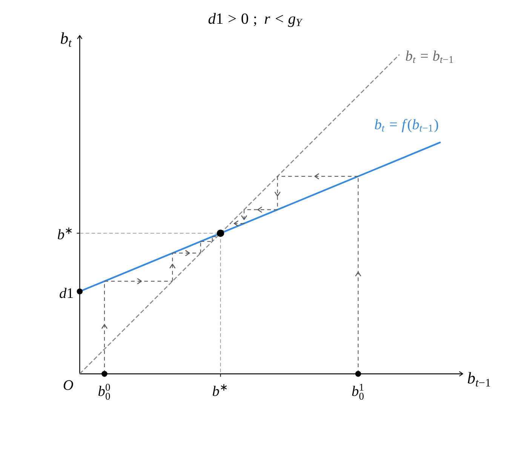
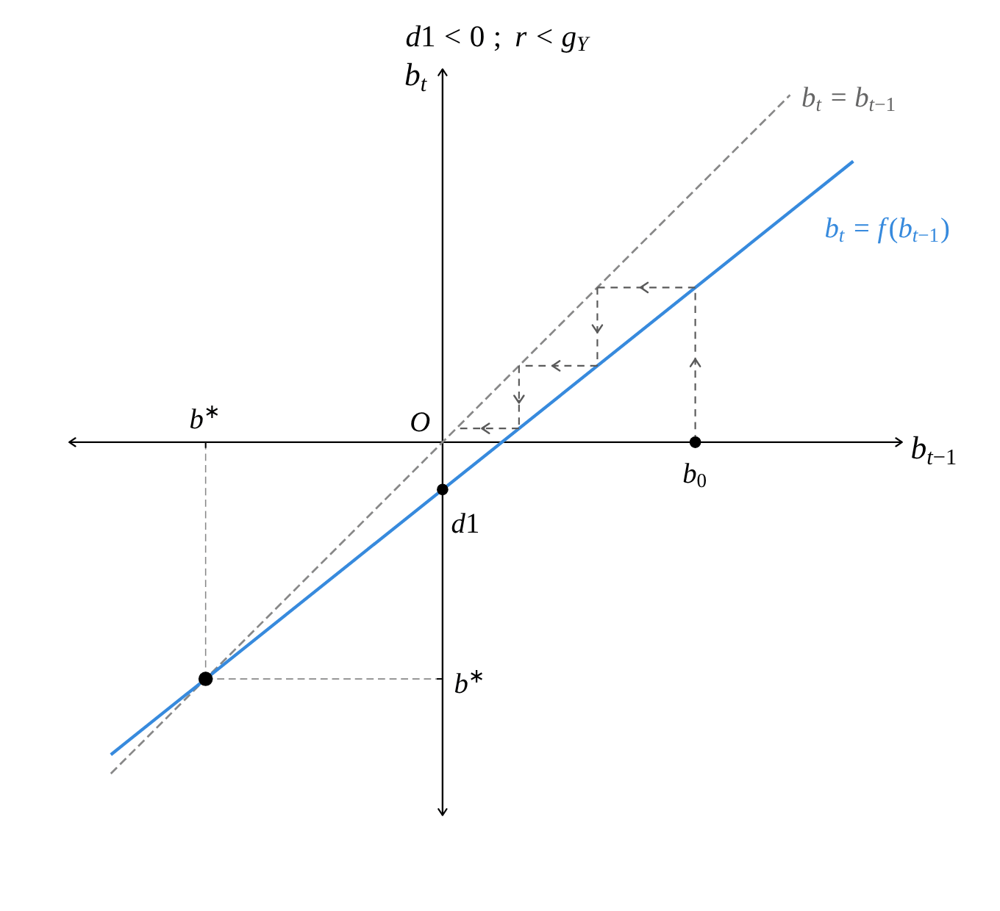
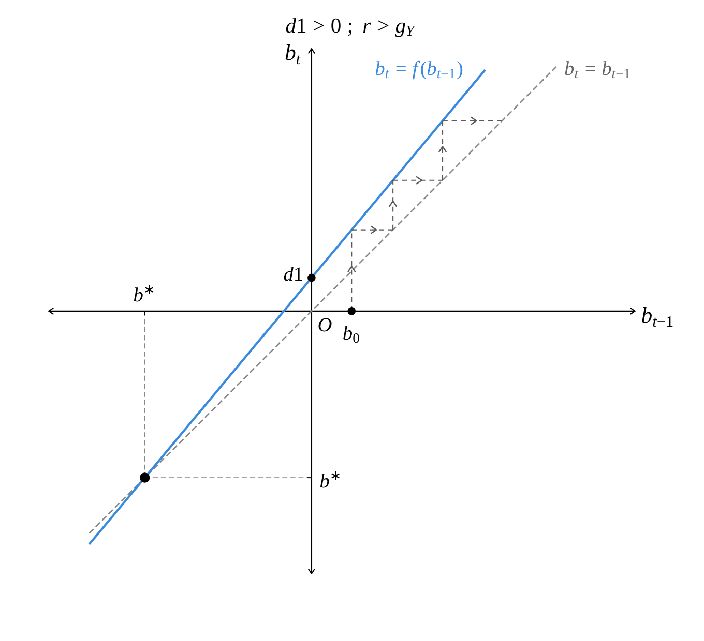
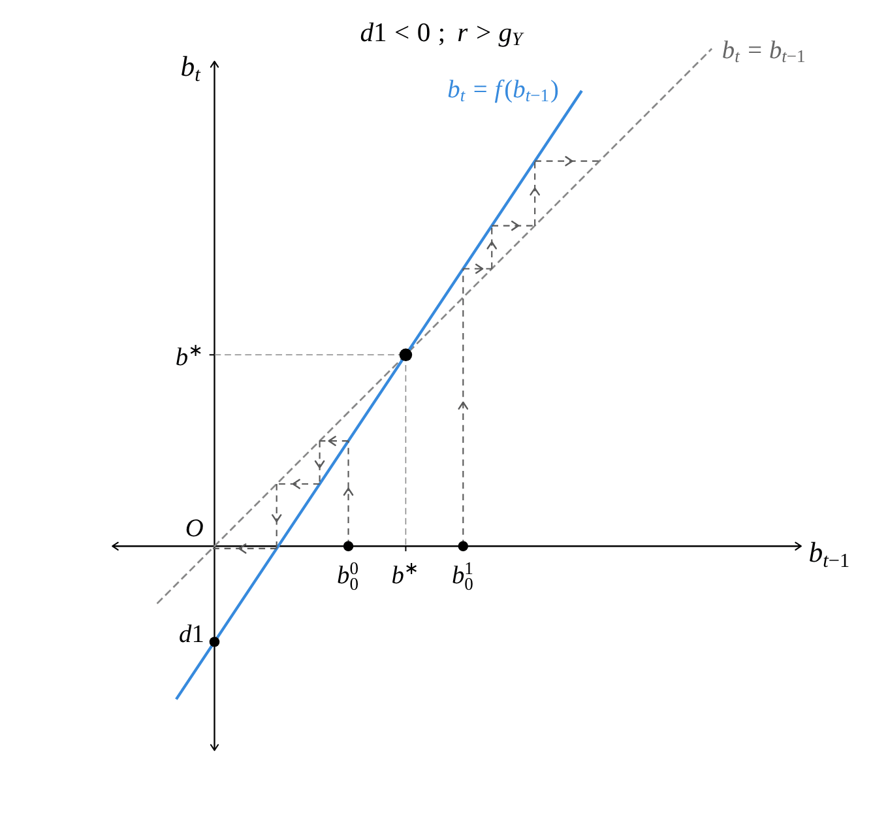
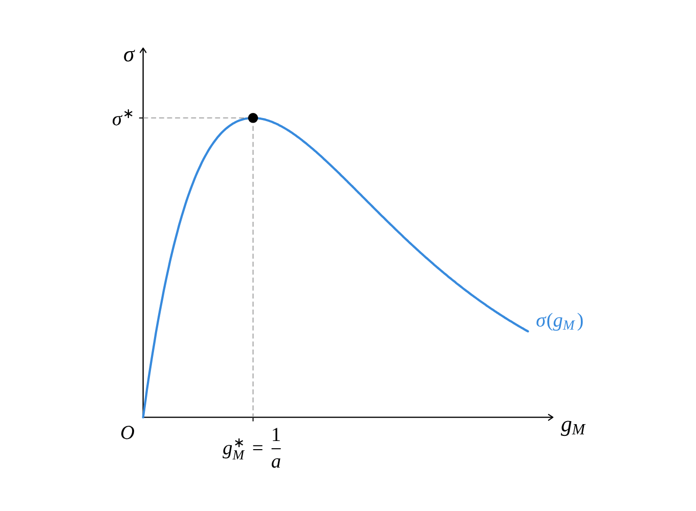
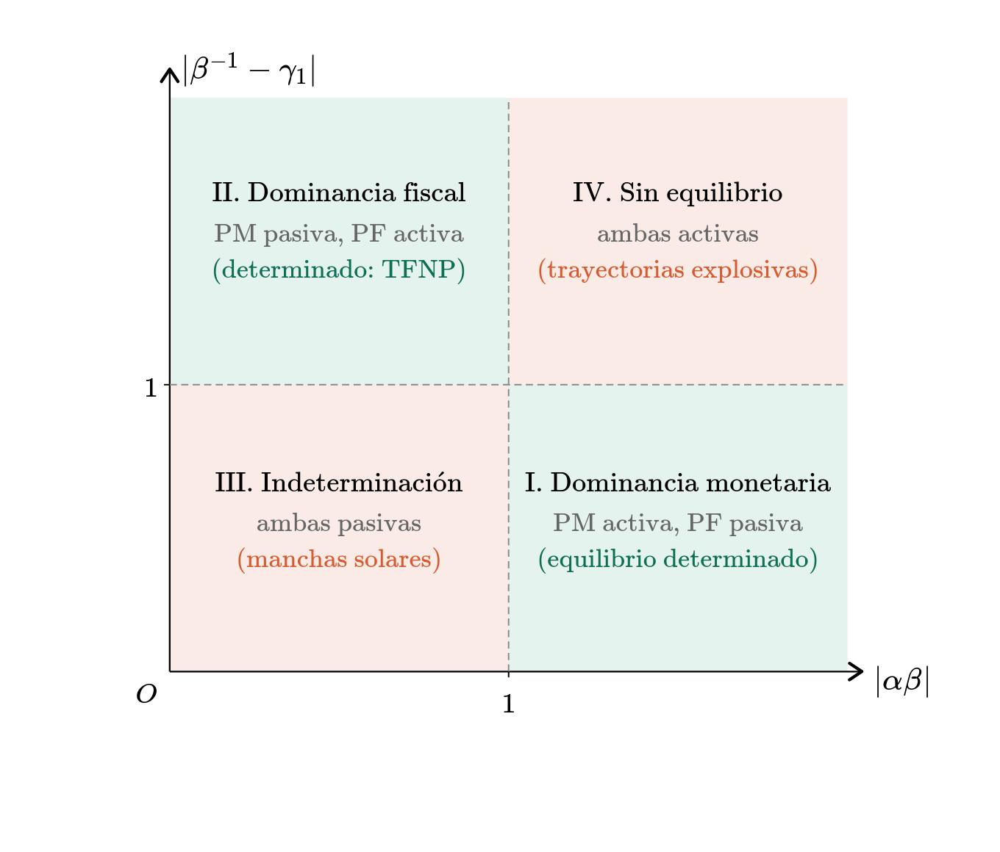

## Introducción

::: {.callout-note appearance="simple" icon=false}

:::

Siguiendo a De Viti de Marco (1936), una vez el Estado ha recurrido a la deuda, es probable que lo vuelva a hacer.

El **déficit público** se puede definir como un desequilibrio en el cual los gastos del Estado superan a sus ingresos netos de transferencias. El concepto está unido al de política fiscal, que está en su origen.

Este desequilibrio debe financiarse[^a39-2][^a39-3], habitualmente mediante la emisión de deuda. Se distingue entre[^a39-4]:

1. *Financiación ortodoxa*: cuando el sector público recurre al sector privado (familias, empresas o resto del mundo). Incluye la emisión de deuda pública, el incremento de la presión fiscal (que, en rigor, reduce el déficit en lugar de financiarlo) y las privatizaciones.

2. *Financiación heterodoxa*: cuando el adquiriente es el banco central, el cual compra los títulos mediante la creación de base monetaria, en cuyo caso se habla de *monetización del déficit*.

El estudio del déficit público es relevante dado que el crecimiento del sector público en países desarrollados durante el s. XX ha sido muy intenso. Así, el peso del gasto público se ha multiplicado por más de tres, desde en torno al 13 % del PIB en 1913 hasta cerca del 45 % a finales del siglo (Tanzi y Schuknecht, 2000). En torno al 60 % de ese gasto se destina a gasto social.

La crisis financiera global y la pandemia llevaron la deuda pública de muchas economías avanzadas a niveles muy elevados, y la subida de los tipos de interés posterior ha devuelto al primer plano su sostenibilidad. Esta depende, sobre todo, de la diferencia entre el tipo de interés de la deuda y el crecimiento de la economía, que fija el **superávit primario** necesario para estabilizar la ratio de deuda. En la UE, la reforma del Pacto de Estabilidad y Crecimiento (2024) traduce ese análisis en sendas de gasto neto con un ancla de sostenibilidad de la deuda, y las compras de deuda de los bancos centrales han reavivado el debate sobre la **dominancia fiscal** y la monetaria.

El tema estudia el déficit público, su financiación y sus consecuencias macroeconómicas, y se ordena en tres partes:

- *Fundamentos*: se presentan los conceptos esenciales y el debate sobre la efectividad de la política fiscal y su financiación.

- *Financiación y sostenibilidad*: se aborda la financiación vía deuda y vía monetización y la sostenibilidad del déficit en su formulación analítica, con sus extensiones a la economía abierta.

- *Dominancia monetaria y fiscal* (“dominación” en el título oficial del tema): se estudia la interrelación entre las autoridades fiscal y monetaria a través del modelo de Leeper y de las teorías de la dominancia monetaria y fiscal.

## 1. Fundamentos del análisis del déficit público y de la deuda

Antes de abordar la financiación del déficit y la dominancia, se fijan los conceptos esenciales del análisis del déficit y de la deuda y se repasa el debate sobre la efectividad de la política fiscal y su financiación.

::: {.callout-note appearance="simple" icon=false}
Esta sección fija los conceptos y el debate previo que el resto del tema da por sabidos. El desarrollo del tema está en las secciones 2 y 3, que son las que responden al título.
:::

### 1.1. Conceptos esenciales

Los conceptos esenciales son los saldos presupuestarios, el señoraje y el impuesto inflacionario, y la dominancia monetaria y fiscal, con su formalización como políticas activas y pasivas.

**Saldo presupuestario**: analíticamente, el saldo presupuestario público observado es:

$$\text{SP}_t = T_t - (G1_t + iB_{t-1}) + \varepsilon(y_t - \bar{y}_t) + \varphi_t$$
donde $T_t$ y $G1_t$ son la recaudación impositiva y el gasto público primario netos del componente cíclico y de las medidas *one-off*, $iB_{t-1}$ es el coste del servicio de la deuda y $\varepsilon(y_t - \bar{y}_t)$ es el saldo primario cíclico. Por último, $\varphi_t$ es el efecto de las medidas *one-off*, es decir, de carácter puntual[^a39-6] o contingente[^a39-7].

El parámetro $\varepsilon > 0$ recoge la semielasticidad del saldo presupuestario a la brecha de producción (*output gap*), es decir, cuántos puntos de PIB mejora el saldo por cada punto de brecha positiva a través de los estabilizadores automáticos (mayor recaudación, menor gasto en prestaciones). La Comisión Europea la estima en torno a 0,5-0,6 para España y la media de la UE.

A partir de esta expresión se pueden derivar los conceptos fundamentales:

1. *Saldo primario*: $\text{SP}_t + iB_{t-1} = T_t - G1_t + \varepsilon(y_t - \bar{y}_t) + \varphi_t$, es el saldo observado corregido del coste del servicio de la deuda. Por tanto, excluye los intereses de la deuda y se aproxima más a las variables bajo control del Gobierno, aunque aún incluye el componente cíclico.

2. *Saldo primario cíclicamente ajustado*: $\text{SP}_t + iB_{t-1} - \varepsilon(y_t - \bar{y}_t) = T_t - G1_t + \varphi_t$, es el saldo primario corregido del componente cíclico.

3. *Saldo primario estructural*: $\text{SP}_t + iB_{t-1} - \varepsilon(y_t - \bar{y}_t) - \varphi_t = T_t - G1_t$, que corrige además las medidas *one-off* y es el relevante para evaluar la orientación de la política fiscal.

**Señoraje e impuesto inflacionario**: el ingreso real que el Estado obtiene al emitir dinero y el gravamen implícito que la inflación impone a los tenedores de saldos monetarios. No son idénticos y se desarrollan en el apartado 2.2.1.

**Dominancia monetaria y fiscal** (Sargent y Wallace, 1981):

- *Dominancia monetaria*: el banco central fija la senda de la cantidad de dinero (o de los tipos) y el Tesoro ajusta déficits y superávits para que la deuda sea sostenible dada esa senda, lo que constituye la conducta “habitual” de la política monetaria.

- *Dominancia fiscal*: el Tesoro fija la senda de déficits y superávits y el banco central tiene que generar el señoraje necesario para que la deuda no siga una dinámica explosiva, con lo que pierde el control del nivel de precios.

**Políticas activas y pasivas** (Leeper, 1991): formalizan la distinción anterior. Una autoridad sigue una *política activa* cuando fija su instrumento con independencia de la restricción presupuestaria intertemporal del sector público y una *política pasiva* cuando lo ajusta para garantizar su cumplimiento. Por tanto, la dominancia monetaria equivale a una política monetaria activa con una fiscal pasiva, y la dominancia fiscal, a la combinación inversa.

### 1.2. Debates sobre la efectividad de la política fiscal

La efectividad de la política fiscal y los efectos de su financiación han sido objeto de un intenso debate, primero en el paradigma IS-LM y, posteriormente, en los modelos con microfundamentos de la nueva macroeconomía clásica (NMC) y de la nueva economía keynesiana (NEK).

::: {.callout-note appearance="simple" icon=false}
Los efectos de la política fiscal en el IS-LM, el modelo del ciclo real con sector público y el modelo IS-PC-MR con gasto público se desarrollan en el tema [A38](a38-politica-fiscal.qmd), apartados 1.1 a 1.3. Aquí se retiene, de cada perspectiva, lo que interesa a la financiación del déficit.
:::

#### 1.2.1. Antecedentes: el modelo IS-LM

En el marco IS-LM de economía cerrada y con precios fijos, una política fiscal expansiva desplaza la IS hacia la derecha y genera un efecto multiplicador y un efecto expulsión (*crowding out*). La importancia relativa de ambos efectos depende de cuán sensibles sean al tipo de interés la inversión ($v$) y la demanda de dinero ($h$). 

La forma en que se financie el déficit añade una serie de efectos adicionales, que difieren según la escuela:

1. *Financiación vía impuestos*: tiene un efecto contractivo que no anula el expansivo, pues el gasto actúa directamente sobre la demanda y los impuestos solo a través de la propensión marginal a consumir (*teorema del multiplicador del presupuesto equilibrado*, Haavelmo, 1945)[^a39-9]. Por tanto, la IS se desplaza hacia la derecha, pero menos que sin financiación impositiva. Para los monetaristas, esta financiación hace aún más ineficaz la política fiscal.

2. *Financiación vía emisión de deuda*: el keynesianismo contempla el *efecto reajuste de cartera*, según el cual el aumento de la oferta de bonos reduce el precio de los ya emitidos[^a39-10], eleva la rentabilidad exigida y desplaza la LM hacia la izquierda (figura -@fig-a398-pf-deuda). El efecto contractivo es tanto mayor cuanto menor sea la sustituibilidad entre bonos y dinero. Por su parte, el monetarismo añade dos efectos riqueza ligados a la hipótesis de la renta permanente:

    - *Efecto riqueza directo*: más tenencias de bonos elevan la riqueza y el consumo, de modo que la IS se desplaza a la derecha.

    - *Efecto riqueza indirecto*: la subida del tipo de interés reduce el valor de mercado de los bonos ya emitidos y, con él, la riqueza y el consumo, lo que hace la IS más elástica al tipo de interés y refuerza la expulsión. Con los parámetros monetaristas la expulsión es completa, y la política fiscal puede llegar incluso a contraer la actividad.

::: {#fig-a398-pf-deuda}

::: {.content-visible when-format="html"}
```{=html}
<div class="graph-frame">
<iframe src="../graphs/a398_PF_deuda.html" style="height:580px" loading="lazy" title="fig-a398-pf-deuda"></iframe>
</div>
```
:::

::: {.content-visible unless-format="html"}

:::

Financiación del déficit vía deuda en el IS-LM. El aumento del gasto ($\Delta G_0 > 0$) desplaza la IS de $\text{IS}_0$ a $\text{IS}_1$ y lleva la economía del punto 0 al 0′. La mayor oferta de bonos ($\Delta B > 0$) desplaza la LM a la izquierda, de $\text{LM}_0$ a $\text{LM}_1$ (efecto reajuste de cartera), y la economía pasa al punto 1, con un tipo de interés $i_1$ más alto y más expulsión.
:::

3. *Financiación heterodoxa vía monetización*: añade el *efecto liquidez* o *efecto Keynes*, por el cual el aumento de la oferta monetaria desplaza la LM hacia la derecha[^a39-13] y presiona a la baja el tipo de interés. Como hay más dinero para atender en parte la mayor demanda de saldos, el tipo de interés sube menos y el efecto expulsión es menor. En consecuencia, a corto plazo la renta aumenta más que con cualquier otra forma de financiación (los efectos a largo plazo se estudian en el apartado 2.2.3).

Para los primeros keynesianos, la política monetaria es eficaz para financiar el gasto público pero, debido a los dos eslabones débiles (la trampa de liquidez y la escasa sensibilidad de la inversión al tipo de interés), no lo es para estimular la demanda agregada. Para los monetaristas, en cambio, lo es únicamente en el corto plazo, pues sus efectos se diluyen a largo plazo por la teoría cuantitativa, y el efecto liquidez va acompañado de los efectos riqueza y del efecto cartera.

#### 1.2.2. Perspectiva NMC: la financiación en el modelo del ciclo real

La principal limitación del marco IS-LM es que ofrece un enfoque estático. Por eso, tras la crítica de Lucas, el debate se traslada a modelos dinámicos con expectativas racionales, en los cuales lo relevante no es el efecto impacto de una medida sino la respuesta de los agentes a la senda esperada de impuestos, déficits y deuda. Del modelo del ciclo real con sector público se derivan tres resultados sobre la financiación:

1. *Equivalencia ricardiana* (Barro, 1974): bajo mercados de capitales completos y perfectos, agentes con expectativas racionales y altruismo intergeneracional perfecto, e impuestos de suma fija, los bonos no aparecen en la restricción presupuestaria intertemporal de los hogares. Por ello, no constituyen riqueza neta y, dada la senda de gasto público, la elección entre impuestos y deuda para financiarla es irrelevante[^a39-15]. Con apertura al exterior, una rebaja de impuestos a gasto dado abre un déficit que el mayor ahorro de los hogares financia por completo, y el saldo por cuenta corriente queda igual (no hay déficits gemelos).

    Las limitaciones de la equivalencia hacen que la financiación tenga efectos. Por ejemplo, con restricciones de liquidez el sector público obtiene financiación más barata que el privado, de ahí que la deuda sí constituya riqueza neta. Asimismo, la ilusión fiscal y el altruismo imperfecto trasladan la carga a generaciones posteriores. Otras limitaciones son los impuestos distorsionantes y el gasto productivo.

2. *Efectos no keynesianos* (Giavazzi y Pagano, 1990): con agentes ricardianos, un ajuste fiscal que recorte gasto de forma creíble y duradera puede estimular la actividad. Al anticipar una menor carga tributaria futura, los agentes se sienten más ricos y perciben menos incertidumbre, y las primas de riesgo bajan, con un efecto atracción (*crowding in*) sobre la inversión privada.

3. *Suavización impositiva* (Barro, 1979): si los impuestos son distorsionantes y su coste de eficiencia es convexo en el tipo impositivo, la política fiscal óptima mantiene constante el tipo impositivo esperado y utiliza el déficit como amortiguador de los *shocks* transitorios de gasto (guerras, recesiones). El déficit es, así, el resultado de una política óptima y no un síntoma de indisciplina. El Gobierno se endeuda en las recesiones y amortiza en las expansiones, y el tipo impositivo sigue un paseo aleatorio (martingala), al igual que la ratio de deuda, pues cada *shock* no anticipado altera permanentemente su nivel.

::: {.callout-note appearance="simple" icon=false}
La equivalencia ricardiana como resultado de la nueva macroeconomía clásica se desarrolla en el tema [A06](a06-nmc.qmd), apartado 3.2, y como frontera entre los modelos de horizonte infinito y los de generaciones solapadas en el tema [A29](a29-mhi-mgs.qmd), apartado 3.3.
:::

#### 1.2.3. Perspectiva NEK: la financiación en el modelo IS-PC-MR

Las rigideces nominales y las fricciones financieras devuelven a la política fiscal una función estabilizadora, y hacen que el efecto de una misma medida, y de su financiación, dependa del entorno:

1. *Restricciones de liquidez*: una fracción de hogares no ricardianos (*hand-to-mouth*) consume su renta corriente, de modo que las transferencias y las rebajas impositivas tienen efectos reales y la equivalencia ricardiana falla en proporción a esa fracción.

2. *Objetivo de inflación*: con política monetaria activa, el banco central contrarresta el impulso fiscal elevando el tipo de interés, por lo que el multiplicador es inferior a la unidad.

3. *Tipo de cambio fijo*: en este régimen o en una unión monetaria, la política monetaria no reacciona al impulso fiscal de un país y el multiplicador es mayor.

4. *Límite inferior de los tipos de interés* (*zero lower bound*, ZLB): el tipo nominal no sube ante el impulso fiscal y la mayor inflación esperada reduce el tipo real, por lo que el multiplicador puede superar la unidad.

::: {.callout-note appearance="simple" icon=false}
La evidencia empírica sobre el valor de los multiplicadores fiscales, su dependencia del estado de la economía y la experiencia desde la Gran Recesión se desarrollan en el tema [A40](a40-interrelacion.qmd), apartado 3.
:::

### 1.3. Conclusiones

El saldo observado se depura de los intereses, del componente cíclico y de las medidas *one-off* hasta llegar al saldo primario estructural, el relevante para juzgar la orientación de la política fiscal. La dominancia monetaria y la fiscal se formalizan, por su parte, como la combinación de una política activa con otra pasiva.

Del debate sobre la efectividad de la política fiscal se extraen dos lecciones. La primera es que la financiación del déficit no es neutral salvo bajo equivalencia ricardiana estricta. Así, en el IS-LM la monetización es la vía más expansiva a corto plazo, y con impuestos distorsionantes la suavización impositiva hace del déficit el resultado de una política óptima. La segunda es que el efecto de una misma medida depende del régimen monetario en el que se aplica, desde un multiplicador inferior a la unidad bajo objetivo de inflación hasta uno que puede superarla en el límite inferior de los tipos. Ambas lecciones conducen a las preguntas de las secciones 2 y 3, la de si puede sostenerse el déficit y la de qué relación guardan las dos autoridades.

## 2. Financiación del déficit y su sostenibilidad

Actualmente, el debate no gira en torno a cómo financiar el déficit público y qué financiación es más expansiva, sino en torno a la sostenibilidad del déficit y de la deuda pública y sus efectos sobre el crecimiento[^a39-16].

1. *Déficit público sostenible*: aquel que resulta de una política, fiscal y monetaria, capaz de mantenerse sin límite de tiempo, lo que equivale a estabilizar el peso de la deuda pública en el PIB a precios corrientes (PIB nominal). Por esa razón, la ratio deuda-PIB pesa mucho en la valoración del riesgo-país.

2. *Déficit público insostenible*: en cambio, si el tipo de interés real supera al crecimiento ($r > g_Y$), un déficit primario estructural y permanente desencadena un *efecto bola de nieve*, con una ratio deuda pública-PIB nominal que no deja de crecer.

### 2.1. Financiación vía deuda: la dinámica de la deuda pública y su sostenibilidad

**Origen**: la lógica de sostenibilidad de la restricción presupuestaria intertemporal del Gobierno (RPIG) se remonta a Domar (1944), y Blanchard (1990) la sistematizó en los indicadores fiscales que utilizan hoy los organismos internacionales.

**Idea**: los efectos macroeconómicos de la financiación vía deuda pueden entenderse a partir de la RPIG. El déficit es sostenible si la ratio deuda-PIB se estabiliza, lo que depende del saldo primario, del señoraje y de la relación entre el tipo de interés real y el crecimiento.

#### 2.1.1. Supuestos

**Entorno**: economía cerrada, en la que el déficit solo puede financiarse con emisión de deuda o de base monetaria. Los agentes privados absorben la deuda emitida al tipo de interés de mercado y se cumple la ecuación de Fisher de tipos de interés. Los tipos de interés, la inflación y el crecimiento se consideran constantes en el análisis gráfico.

**Agentes**: el Gobierno se comporta de acuerdo con su restricción presupuestaria periodo a periodo.

#### 2.1.2. Modelo

**Planteamiento**: el modelo parte de la restricción presupuestaria del Gobierno en términos nominales, la expresa en proporción del PIB para obtener la ecuación dinámica de la deuda y deriva de ella la condición de sostenibilidad:

- *Restricción presupuestaria del Gobierno*: en términos nominales es:

    $$\underbrace{G1_t + i_t B_{t-1}}_{\text{Gasto total}} - T_t = (B_t - B_{t-1}) + (H_t - H_{t-1})$$

    donde $G1_t$ es el gasto público primario (gasto en bienes y servicios), $i_t B_{t-1}$ el pago de intereses sobre la deuda heredada, $T_t$ la recaudación fiscal, $B_t$ el *stock* de deuda pública y $H_t$ la base monetaria. En cada periodo, el déficit público debe ser financiado vía emisión de deuda o creación de base monetaria. En una economía abierta, las reservas internacionales podrían considerarse una fuente de financiación adicional[^a39-17].

    Alternativamente, la expresión se puede reescribir como:

    $$\underbrace{G1_t - T_t}_{\text{Déficit primario}} = (B_t - B_{t-1}) + (H_t - H_{t-1}) - i_t B_{t-1}$$

- *Ecuación dinámica de la deuda*: para trabajar en términos de PIB[^a39-18] se procede en tres pasos:

    1. *División por el PIB nominal*: se divide la restricción presupuestaria entre $P_t Y_t$ y se expresan las variables en minúsculas como ratios sobre el PIB. La deuda heredada queda valorada sobre el PIB corriente, es decir, $B_{t-1}/P_t Y_t = b_{t-1}\,(P_{t-1}Y_{t-1}/P_t Y_t)$.

    2. *Ecuación de Fisher*: se utiliza $1 + i_t = (1 + r_t)(1 + \pi_t)$ y la descomposición del crecimiento nominal, $P_t Y_t / P_{t-1}Y_{t-1} = (1 + \pi_t)(1 + g_{Y,t})$, con lo que el coste de la deuda heredada es $(1+i_t)/[(1+\pi_t)(1+g_{Y,t})] = (1+r_t)/(1+g_{Y,t})$.

    3. *Señoraje*: se agrupa la financiación monetaria en un único término, el señoraje en porcentaje del PIB, aplicando a $H_{t-1}$ la misma valoración que a $B_{t-1}$.

    El resultado es la *ecuación dinámica de la deuda* (EDD):

    $$b_t = d1_t + \frac{1+r_t}{1+g_{Y,t}} b_{t-1} - \underbrace{\left[h_t - \frac{h_{t-1}}{(1+\pi_t)(1+g_{Y,t})}\right]}_{\sigma_t}$$

    donde $b_t = B_t / P_t Y_t$ es la ratio deuda-PIB, $d1_t = g1_t - \tau_t$ el déficit primario en porcentaje del PIB (con $\tau_t$ la recaudación impositiva en porcentaje del PIB), $r_t$ el tipo de interés real *ex post*[^a39-19] y $g_{Y,t}$ la tasa de crecimiento del PIB real. En cuanto a la financiación monetaria, $h_t = H_t / P_t Y_t$ es la base monetaria en porcentaje del PIB y $\sigma_t$ el señoraje en porcentaje del PIB.

    Restando a ambos lados el *stock* de deuda en el periodo anterior se obtiene la variación de la ratio:

    $$\underbrace{b_t - b_{t-1}}_{\Delta b_t} = \underbrace{g1_t - \tau_t}_{d1_t} + \frac{r_t - g_{Y,t}}{1+g_{Y,t}} b_{t-1} - \sigma_t$$

    Por tanto, la dinámica de la deuda depende de tres factores:

    1. *Déficit primario*: dado por la diferencia entre el gasto primario (excluido el pago de intereses) y la recaudación impositiva.

    2. *Relación entre tipo de interés real y crecimiento*: mide cuánto cuesta en realidad la deuda viva una vez descontado el crecimiento del PIB. Si $g_{Y,t} > r_t$, el segundo término es negativo y la deuda va perdiendo peso en porcentaje del PIB. En cambio, si $r_t > g_{Y,t}$, el segundo término es positivo, de modo que los pagos por intereses pesan cada vez más en el PIB y es necesaria más deuda para financiar el déficit público. El proceso se realimenta así en un círculo vicioso, conocido como *efecto bola de nieve* o *financiación estilo Ponzi*[^a39-24].

    3. *Señoraje*: supone un alivio, al menos transitorio, del recurso a la financiación vía emisión de deuda pública.

**Equilibrio**: cuando el Estado carece de la facultad de emitir dinero ($\sigma_t = 0$), p. ej. por haber cedido la política monetaria a una autoridad independiente, la sostenibilidad del déficit solo exige una ratio deuda-PIB estable ($b_t = b_{t-1}$). Se obtiene así la *condición de sostenibilidad de la deuda pública*:

$$-d1_t = \frac{r_t - g_{Y,t}}{1+g_{Y,t}} b_{t-1}$$

El superávit primario en porcentaje del PIB ($-d1_t$) ha de cubrir el coste efectivo de la deuda viva, $(r_t - g_{Y,t}) b_{t-1}$, dividido entre el factor de crecimiento del PIB, $(1+g_{Y,t})$. Prescindiendo del denominador, cercano a la unidad, el superávit primario requerido es $(r - g_Y)\,b$.

Intuitivamente, el crecimiento del PIB agranda el denominador de la ratio y “paga” así parte de la deuda. La condición es útil porque el saldo primario recoge los pagos y cobros que el Gobierno controla.

**Estática comparativa**: la condición de sostenibilidad ordena las soluciones de política económica frente a una deuda insostenible según la variable de la EDD sobre la que inciden:

- *Política monetaria*: la monetización eleva el señoraje ($\sigma$) y reduce la deuda que es preciso emitir, a costa de más inflación.

- *Política fiscal*: la consolidación fiscal reduce el déficit primario ($d1$).

- *Otras políticas*: el *default*, la quita de deuda o la reprogramación reducen el *stock* de deuda ($b$), las políticas de fomento del crecimiento elevan $g_Y$ y la *represión financiera* contiene el tipo de interés real ($r$)[^a39-23].

**Dinámica**: fuera del equilibrio, la EDD es una ecuación en diferencias de primer orden en $b_t$ con pendiente $(1+r)/(1+g_Y)$. Si $r < g_Y$, la pendiente es menor que uno y la ratio converge a un valor estacionario, $b^* = d1(1+g_Y)/(g_Y-r)$, cualquiera que sea el punto de partida. Si $r > g_Y$, la pendiente es mayor que uno y la ratio diverge, salvo que el superávit primario la compense exactamente. El análisis gráfico ordena los casos.

Gráficamente, la dinámica de la deuda se representa en el plano deuda inicial-deuda final sobre el PIB, $b_{t-1}$-$b_t$ (figuras -@fig-a391-sostenibilidad-i a -@fig-a394-sostenibilidad-iv):

1. *Ecuación dinámica de la deuda*, $b_t = f(b_{t-1})$: recoge la ratio de deuda que resulta de cada ratio heredada. Esta ecuación es una recta con ordenada en el origen $d1_t - \sigma_t$, que, si no existe monetización ($\sigma_t = 0$), equivale al déficit primario ($d1$). Su pendiente, $(1+r)/(1+g_Y)$, compara el tipo de interés real con el ritmo de crecimiento del PIB real. Cuanto más alto sea el tipo de interés real respecto al crecimiento, más crecerá la deuda.

2. *Bisectriz*, $b_t = b_{t-1}$: recoge los puntos en los que la ratio de deuda es estable. Los puntos a la derecha de la bisectriz reflejan que la ratio de deuda del periodo anterior es superior a la actual, y los puntos a la izquierda, lo contrario.

3. *Equilibrio*: en el corte de la recta con la bisectriz, $b^*$, la ratio de deuda es estacionaria. Las líneas discontinuas recogen la senda de la ratio desde cada ratio inicial ($b_0$, o $b_0^0$ y $b_0^1$ cuando se parte de dos).

Caben cuatro situaciones, según exista déficit o superávit primario y según el tipo de interés real ($r$) sea superior o inferior a la tasa de crecimiento económico ($g_Y$), suponiendo constantes $r, g_Y, \pi$:

1. *Déficit primario y crecimiento robusto* ($d1_t > 0$, $r < g_Y$): cuando el PIB avanza a un ritmo superior al tipo de interés real, la ratio de deuda tiende a un valor estacionario, tanto si se parte de una ratio superior como inferior a él (figura -@fig-a391-sostenibilidad-i). El déficit público es, así, sostenible.

::: {#fig-a391-sostenibilidad-i}

::: {.content-visible when-format="html"}
```{=html}
<div class="graph-frame">
<iframe src="../graphs/a391_Sostenibilidad_i.html" style="height:640px" loading="lazy" title="fig-a391-sostenibilidad-i"></iframe>
</div>
```
:::

::: {.content-visible unless-format="html"}

:::

Dinámica de la deuda pública con déficit primario y crecimiento robusto ($d1 > 0$, $r < g_Y$). La ratio deuda/PIB converge a su valor estacionario, cualquiera que sea el punto de partida.
:::

2. *Superávit primario y crecimiento robusto* ($d1_t < 0$, $r < g_Y$): la deuda converge hacia un valor estacionario negativo, es decir, el sector público acumula activos financieros y el superávit es sostenible. Basta con mantener la situación (figura -@fig-a392-sostenibilidad-ii).

::: {#fig-a392-sostenibilidad-ii}

::: {.content-visible when-format="html"}
```{=html}
<div class="graph-frame">
<iframe src="../graphs/a392_Sostenibilidad_ii.html" style="height:660px" loading="lazy" title="fig-a392-sostenibilidad-ii"></iframe>
</div>
```
:::

::: {.content-visible unless-format="html"}

:::

Dinámica de la deuda pública con superávit primario y crecimiento robusto ($d1 < 0$, $r < g_Y$). La ratio converge a un valor estacionario negativo y el sector público acumula activos.
:::

3. *Déficit primario y crecimiento débil* ($d1_t > 0$, $r > g_Y$): si el tipo de interés real es superior a la tasa de crecimiento del PIB, la deuda sigue una senda explosiva, sea cual sea el punto de partida (figura -@fig-a393-sostenibilidad-iii). Se genera el efecto bola de nieve del segundo factor de la dinámica de la deuda. Por ello, el déficit no es sostenible y será necesaria una consolidación fiscal.

::: {#fig-a393-sostenibilidad-iii}

::: {.content-visible when-format="html"}
```{=html}
<div class="graph-frame">
<iframe src="../graphs/a393_Sostenibilidad_iii.html" style="height:660px" loading="lazy" title="fig-a393-sostenibilidad-iii"></iframe>
</div>
```
:::

::: {.content-visible unless-format="html"}

:::

Dinámica de la deuda pública con déficit primario y crecimiento débil ($d1 > 0$, $r > g_Y$). La ratio deuda/PIB sigue una senda explosiva (efecto bola de nieve).
:::

4. *Superávit primario y crecimiento débil* ($d1_t < 0$, $r > g_Y$): el resultado es ambiguo. Existe un nivel umbral de deuda, $b^* = d1(1+g_Y)/(g_Y-r)$ (positivo, pues $d1 < 0$ y $g_Y < r$), por debajo del cual la deuda cae y por encima del cual crece. Es necesario ajustar el superávit en función de $b_0$ para compensar el diferencial $r - g_Y$ (figura -@fig-a394-sostenibilidad-iv).

::: {#fig-a394-sostenibilidad-iv}

::: {.content-visible when-format="html"}
```{=html}
<div class="graph-frame">
<iframe src="../graphs/a394_Sostenibilidad_iv.html" style="height:680px" loading="lazy" title="fig-a394-sostenibilidad-iv"></iframe>
</div>
```
:::

::: {.content-visible unless-format="html"}

:::

Dinámica de la deuda pública con superávit primario y crecimiento débil ($d1 < 0$, $r > g_Y$). El umbral $b^*$ separa las ratios iniciales que se reducen de las que crecen sin límite.
:::

**Extensiones**: las dos siguientes relajan los supuestos del modelo:

- *Incidencia del sector privado*: la EDD supone que el sector privado absorbe toda la deuda emitida al tipo vigente. Sin embargo, en una economía cerrada la capacidad de absorción está limitada por el ahorro privado neto de inversión, de modo que la emisión neta de deuda no puede superar el excedente financiero del sector privado, $(B_t - B_{t-1})/P_t Y_t \leq (S^p_t - I^p_t)/P_t Y_t$. En la expresión, $S^p_t$ e $I^p_t$ son el ahorro y la inversión privados nominales. De este modo, la ecuación dinámica de la deuda con sector privado (EDDSP) hace depender la sostenibilidad de la capacidad de ahorro de la economía. Un déficit primario puede no ser sostenible, aun con $r < g_Y$, si el sector privado no puede o no quiere absorber la deuda al tipo vigente. El ajuste se produce entonces vía tipo de interés (prima de riesgo) o vía recurso a los mercados internacionales.

- *Función de reacción fiscal* (Bohn, 1998, 2007): como análisis empírico, la condición de sostenibilidad puede contrastarse estimando la respuesta del saldo primario a la deuda heredada:

    $$-d1_t = \mu_t + \eta\, b_{t-1} + \varepsilon_t$$

    donde $-d1_t$ es el saldo primario en porcentaje del PIB, $\mu_t$ recoge los determinantes exógenos (ciclo, gasto transitorio), $\eta$ la respuesta del saldo primario a la deuda y $\varepsilon_t$ un término de error. Bohn demuestra que $\eta > 0$ es condición suficiente para que se cumpla la restricción presupuestaria intertemporal, con independencia de la relación entre $r$ y $g_Y$. Basta con que el Gobierno reaccione sistemáticamente a los aumentos de deuda con mayores superávits primarios. Para EE. UU., Bohn estima $\eta \approx 0{,}05$. En las economías avanzadas, Ghosh et al. (2013) encuentran además *fatiga fiscal*, es decir, una respuesta decreciente a partir de niveles elevados de deuda.

#### 2.1.3. Conclusiones

**Aspectos positivos**: el análisis pone de manifiesto la importancia de destinar los fondos públicos a gasto corriente o a inversión pública, por su distinta capacidad de incidir en el crecimiento del PIB real.

También pone de manifiesto la importancia de obtener un tipo de interés competitivo, que reduce el diferencial $r - g_Y$. Generar confianza y credibilidad en los mercados de capitales permite obtener ese tipo más bajo.

**Limitaciones**: tal y como se ha definido (ratio deuda-PIB constante), el análisis de sostenibilidad es incompleto, porque ignora el valor que alcanza dicha ratio. El análisis indica la condición necesaria para que la ratio no crezca, pero una ratio del 20 % no equivale a una del 100 %, ya que en este último caso el superávit requerido supone un esfuerzo muy superior. Además, el análisis toma $r$ y $g_Y$ como dados cuando, en realidad, la propia deuda afecta a ambos (prima de riesgo, efecto expulsión sobre el capital privado). Cuanto mayor es la ratio deuda-PIB, mayor es, generalmente, el tipo que exigen los mercados, de modo que deuda y tipo se retroalimentan.

### 2.2. Financiación vía monetización en una economía cerrada

La monetización del déficit, es decir, la adquisición de deuda pública por la autoridad monetaria con dinero de nueva emisión, puede ser una práctica inflacionaria, lo que obliga a desarrollar los dos conceptos monetarios introducidos en el apartado 1.1, el señoraje y el impuesto inflacionario.

#### 2.2.1. Señoraje e impuesto inflacionario

**Señoraje**: es el ingreso, en términos reales, que el Estado obtiene al crear dinero, medido por los bienes y servicios que su monopolio de emisión le permite adquirir[^a39-27]. Formalmente, se puede definir como el valor real del aumento de la cantidad nominal de dinero:

$$\sigma_t = \frac{\Delta M_t}{P_t} \;\rightarrow\; \sigma_t = g_{M,t} \frac{M_t}{P_t}$$

donde $\Delta M_t$ es la emisión de dinero en el periodo, $P_t$ el nivel de precios, $g_{M,t} = \Delta M_t / M_{t-1}$ la tasa de crecimiento monetario y $M_t/P_t$ los saldos reales (la segunda igualdad es exacta en tiempo continuo, $\sigma = \dot{M}/P = (\dot{M}/M)(M/P)$). El señoraje es, así, el producto del ritmo de emisión por los saldos reales sobre los que recae. Nótese que en este apartado el señoraje se mide en términos reales, mientras que en la EDD se medía en porcentaje del PIB.

**Impuesto inflacionario**: es el impuesto implícito que el señoraje representa, medido por la inflación. La inflación grava a los agentes privados, porque merma el valor real de sus saldos monetarios. Existen diferentes planteamientos a la hora de medir el impuesto implícito:

- *Criterio de Friedman* (1971): dada la producción total de la economía y la velocidad de circulación del dinero, la inflación vendrá dada por la tasa de crecimiento de la cantidad de dinero, de acuerdo con la teoría cuantitativa del dinero:

    $$MV_0 = PY_0 \;\xrightarrow{\ln}\; \ln M + \ln V_0 = \ln P + \ln Y_0 \;\xrightarrow{d/dt}\; g_{M,t} = \pi_t \;\rightarrow\; T_t^{\pi} = \pi_t \frac{M}{P}$$

    donde $V_0$ e $Y_0$ son la velocidad de circulación y la producción, constantes. El impuesto inflacionario, $T_t^{\pi}$, es el producto de la inflación (que representa el “tipo de gravamen”) y los saldos reales de los agentes económicos, $M/P$ (que representan la “base imponible”). Con producción constante, coincide con el señoraje.

- *Criterio de Marty* (1967): si la producción crece a una tasa $g_{Y,t}$, la emisión de dinero genera impuesto inflacionario solo si la masa monetaria crece más que el PIB. Si $g_{M,t} = g_{Y,t}$, la oferta monetaria aumenta lo mismo que la demanda de dinero, que crece con la renta, y no hay inflación. En cambio, si $g_{M,t} > g_{Y,t}$, la oferta crece más que la demanda, se produce inflación y aparece el impuesto inflacionario. Formalmente, con elasticidad renta unitaria de la demanda de dinero, $g_{M,t} = \pi_t + g_{Y,t}$, de modo que:

    $$\sigma_t = (\pi_t + g_{Y,t})\frac{M}{P} \;\rightarrow\; T_t^{\pi} = \sigma_t - g_{Y,t} \frac{M}{P}$$

    donde $g_{Y,t} M/P$ es el *señoraje no inflacionario*, la parte de la emisión que acompaña al crecimiento real de la demanda de dinero, y $T^{\pi}_t = \pi_t M/P$ el impuesto inflacionario propiamente dicho.

#### 2.2.2. Señoraje óptimo: el modelo de Cagan (1956)

::: {.callout-note appearance="simple" icon=false}
El modelo de Cagan se desarrolla en el tema [A41](a41-inflacion.qmd), apartado 3.1.2. Aquí se retiene lo que interesa a la financiación del déficit, el señoraje óptimo.
:::

**Origen**: P. Cagan (1956) estudió siete episodios de hiperinflación en seis países europeos durante el s. XX[^a39-31].

**Idea**: Cagan se preguntaba si el crecimiento de la masa monetaria y la inflación generada afectan, a su vez, a la demanda de dinero debido a las expectativas crecientes de inflación, de modo que la demanda de dinero se reduce y se perpetúa la inflación.

**Supuestos**:

- *Entorno*: el mercado monetario está en equilibrio en todo momento y las variables reales ($y_t$, $r_t$) presentan, durante las hiperinflaciones, variaciones insignificantes con respecto a las nominales[^a39-32].

- *Agentes*: forman sus expectativas de inflación según la hipótesis de expectativas adaptativas, $\dot{\pi}^e_t = \lambda(\pi_t - \pi^e_t)$, donde $\lambda > 0$ es la velocidad de ajuste[^a39-33]. Los agentes demandan saldos reales según la función de Cagan, $m_t - p_t = c - a\pi_t^e$, donde $m_t$ y $p_t$ son los logaritmos de la cantidad nominal de dinero y del nivel de precios.

    En la función de Cagan, $c > 0$ recoge la demanda de dinero por factores reales distintos de la inflación esperada ($c = \kappa_0 + \kappa_1 y_t - ar_t$) y $a > 0$ mide la sensibilidad de la demanda de dinero a la inflación esperada e, indirectamente, al tipo de interés nominal[^a39-34]. Si la inflación esperada sube, la demanda de saldos reales baja, pues los agentes demandan sustitutivos del dinero. Además, la relación es exponencial ($M_t/P_t = e^{c - a\pi^e_t}$), por lo que la semielasticidad de los saldos reales respecto a la inflación esperada es constante ($-a$). Por tanto, cada punto adicional de inflación esperada los reduce en torno a un $a$ %, lo que, con las tasas propias de una hiperinflación, se traduce en caídas muy intensas.

**Planteamiento**: el Gobierno elige la tasa de crecimiento monetario que maximiza el señoraje de estado estacionario. Dado que la demanda de saldos reales depende inversamente de $\pi^e$, conforme aumenta la tasa de crecimiento monetario el señoraje primero aumenta y, a partir de cierto punto, disminuye. Se parte de la definición de señoraje, $\sigma_t = g_{M,t} (M_t / P_t)$. Como en estado estacionario la inflación esperada coincide con la tasa de crecimiento monetario, la demanda de dinero es $M_t/P_t = e^{c - a g_{M,t}}$, y el programa es:

$$\max_{g_M} \; \sigma = g_M\, e^{c - a g_M}$$

donde $g_M$ es la variable de decisión y $e^{c - a g_M}$ la demanda de saldos reales en estado estacionario ($c$ y $a$, como en la función de Cagan).

**CPO**: $\partial \sigma / \partial g_M = e^{c - a g_M}(1 - a g_M) = 0$. Elevar $g_M$ aumenta el “tipo” del impuesto, pero reduce su base (los saldos reales). El óptimo iguala en el margen ambos efectos, el de tipo y el de base.

**CSO**: $\partial^2 \sigma / \partial (g_M)^2 = -a\, e^{c - a g_M}(2 - a g_M) < 0$ en el punto crítico, por lo que este es un máximo.

**Solución**: la tasa de crecimiento monetario que maximiza el señoraje y el señoraje máximo son:

$$g_M^* = \frac{1}{a} \;\rightarrow\; \sigma^* = \frac{e^{c-1}}{a} = f(c^{+}, a^{-})$$

La tasa óptima es inversa a la sensibilidad de la demanda de dinero a la inflación esperada, de forma que el comportamiento de los agentes restringe la creación de oferta monetaria.

**Desarrollo gráfico**: en el plano crecimiento monetario-señoraje, $g_M$-$\sigma$ (figura -@fig-a396-cagan-ii), la *curva de Laffer del señoraje*, $\sigma(g_M)$, recoge el señoraje de estado estacionario para cada tasa de crecimiento monetario. Alcanza su máximo, $\sigma^*$, en $g_M^* = 1/a$, donde la elasticidad de la base impositiva respecto al tipo impositivo es igual a $-1$ (unitaria en valor absoluto), lo que coincide con la condición de recaudación máxima de cualquier impuesto.

::: {#fig-a396-cagan-ii}

::: {.content-visible when-format="html"}
```{=html}
<div class="graph-frame">
<iframe src="../graphs/a396_Cagan_ii.html" style="height:580px" loading="lazy" title="fig-a396-cagan-ii"></iframe>
</div>
```
:::

::: {.content-visible unless-format="html"}

:::

Modelo de Cagan. El señoraje de estado estacionario en función del crecimiento monetario tiene forma de curva de Laffer, con máximo en $g_M^* = 1/a$.
:::

**Estática comparativa**: el señoraje máximo depende positivamente de la demanda de dinero por factores reales ($c$), pues una mayor demanda de saldos reales amplía la base sobre la que recae el impuesto (la tasa óptima, $g_M^* = 1/a$, no depende de $c$), y negativamente de $a$.

**Dinámica**: con expectativas adaptativas, la estabilidad del estado estacionario, $\pi^e = \pi = g_M$, depende de $a\lambda$. Si $a\lambda < 1$, el equilibrio es estable y la hiperinflación solo puede deberse a un crecimiento excesivo de la masa monetaria. En cambio, si $a\lambda > 1$, es inestable, porque un salto en la inflación revisa al alza la expectativa, reduce la demanda de saldos reales y genera más inflación, de modo que la hiperinflación es una profecía autocumplida.

::: {.callout-note appearance="simple" icon=false}
La condición de estabilidad, con su derivación y su análisis gráfico, se desarrolla en el tema [A41](a41-inflacion.qmd), apartado 3.1.2.
:::

**Conclusiones**:

- *Aspectos positivos*: el modelo muestra que la financiación monetaria del déficit está acotada, porque existe un señoraje máximo y, más allá de él, emitir más dinero recauda menos. Explica, además, las hiperinflaciones como el resultado de un Gobierno que intenta extraer más señoraje del que la demanda de dinero permite.

- *Limitaciones*: maximizar el señoraje no equivale a maximizar el bienestar social. La tasa $g_M^*$ genera una inflación con elevados costes de bienestar, que deben pesar al elegir la tasa recomendable. Ahora bien, sustituir la emisión de dinero por la de deuda no evita necesariamente la inflación, y puede incluso agravarla, como muestra la aritmética monetarista desagradable (apartado 3.2.1).

#### 2.2.3. Efectos de la monetización a largo plazo (Blinder y Solow, 1973)

**Origen**: Blinder y Solow cuestionan la idea de que la monetización del déficit es más expansiva que su financiación a través de la emisión de bonos, y sistematizan la incorporación de la restricción presupuestaria del Gobierno (RPG) al análisis IS-LM.

**Idea**: la RPG obliga a que el déficit se cierre a largo plazo, y la forma de financiación determina el *stock* de activos que acaba en manos del sector privado y, con él, la renta de equilibrio:

$$PG + iB = PT + \dot{B} + \dot{M}$$

donde $PG$ es el gasto corriente en términos nominales, $iB$ los pagos por intereses de la deuda, $PT$ la recaudación impositiva nominal, con $T = \tau Y$ creciente en la renta, $\dot{B}$ la emisión de deuda y $\dot{M}$ los ingresos de señoraje.

**Razonamiento**: el equilibrio a largo plazo se define por el presupuesto equilibrado, en el que los *stocks* de bonos y de dinero dejan de variar ($\dot{B} = \dot{M} = 0$). Imponiendo esta condición a la RPG, con financiación monetaria el multiplicador a largo plazo del gasto es $dY/dG = 1/\tau$, porque la renta debe crecer hasta que la recaudación adicional cubra el gasto. Con financiación vía bonos, el gasto a cubrir incluye los intereses de la deuda acumulada, $dY/dG = [1 + i\,(dB/dG)]/\tau > 1/\tau$.

Con financiación vía bonos, el público acumula más títulos y el tipo de interés sube. Si el *stock* de dinero no varía, la mayor riqueza financiera impulsa además el consumo y, con él, la renta. Con monetización, en cambio, el tipo de interés sube menos. Como el *stock* de bonos no cambia, el efecto riqueza solo procede de los nuevos saldos monetarios y no hay intereses adicionales que pagar. El efecto liquidez de la monetización hace que la renta se expanda antes. Con un horizonte largo, sin embargo, financiar el déficit con deuda resulta más expansivo, porque, hasta que el presupuesto se equilibra, obliga a crear un volumen total de activos mayor.

Los monetaristas sostenían que el efecto expulsión anula por completo un déficit que se cubre con deuda. Frente a esa tesis, los efectos riqueza y de cartera tienen en conjunto un sesgo expansivo, y la renta crece hasta que la recaudación adicional cubre el déficit. Ese resultado exige, no obstante, un sistema estable, algo que la financiación con bonos no asegura. Con un efecto riqueza débil, la carga de intereses aumenta más deprisa que los ingresos fiscales y la deuda se vuelve explosiva.

**Conclusiones**:

- *Aspectos positivos*: incorpora los efectos riqueza y la dinámica de la deuda al debate sobre la eficacia de la política fiscal.

- *Limitaciones*: hereda los supuestos del modelo IS-LM, con precios fijos y sin expectativas sobre la senda futura de impuestos, por lo que ignora la respuesta de los agentes que subraya la equivalencia ricardiana (apartado 1.2.2).

### 2.3. Financiación en una economía abierta

En una economía abierta, el Gobierno puede financiarse también en los mercados internacionales, y los efectos de la monetización dependen del régimen cambiario.

**Deuda externa**: si el sector privado nacional no absorbe la deuda, la economía acude a los mercados internacionales, con lo que la restricción presupuestaria del Gobierno incorpora la deuda externa, denominada en divisas y valorada al tipo de cambio nominal:

$$G1_t - T_t = \left[B_t - (1+i_t)B_{t-1}\right] + (H_t - H_{t-1}) + E_t\left[B^f_t - (1+i^f_t)B^f_{t-1}\right]$$

donde $B^f_t$ es la deuda externa denominada en divisas, $i^f_t$ el tipo de interés que paga y $E_t$ el tipo de cambio nominal (unidades de moneda nacional por divisa). Dividiendo por el PIB nominal se obtiene una EDD para la deuda externa análoga a la interna, en la que el coste efectivo incorpora la depreciación observada.

El endeudamiento externo puede ser beneficioso a corto plazo, pero debe presentar una senda no explosiva que garantice su sostenibilidad. En ella influyen especialmente dos factores adicionales. El primero es la prima de riesgo, que eleva $i^f$ con el nivel de deuda y puede convertir en explosiva una senda que no lo era. El segundo es el tipo de cambio, pues una depreciación ($\uparrow E_t$) eleva el valor en moneda nacional de la deuda en divisas (*efecto hoja de balance*).

El FMI desarrolló el *enfoque de la hoja de balance* (*balance sheet approach*) tras las crisis emergentes de finales de los años noventa. Frente al análisis tradicional de la balanza de pagos, centrado en flujos, el enfoque estudia los balances (*stocks* de activos y pasivos) del sector público, el financiero y el privado no financiero, y su posición frente al resto del mundo. El objetivo es detectar descalces de plazos, de divisas y de estructura del capital.

**Monetización con tipo de cambio fijo**: la autoridad monetaria da prioridad a la financiación del déficit y puede elegir entre dos opciones (con $\text{CI}$ el crédito interno y $R$ las reservas exteriores):

- *No esterilizar la financiación*: se amplía la base monetaria ($\uparrow H = \uparrow \text{CI} + R$) y, en consecuencia, la oferta monetaria.

- *Esterilizarla*: el banco central retira, a cambio de divisas, tanta moneda nacional como ha prestado al Gobierno, y la base monetaria se mantiene ($\overline{H} = \uparrow \text{CI} + \downarrow R$).

La defensa de la paridad exige esterilizar la monetización, y cada operación consume reservas, de modo que los fundamentos se deterioran poco a poco. Con unas reservas finitas, antes o después financiar el déficit y defender la paridad dejarían de ser compatibles para el banco central. Como los agentes lo prevén, un ataque especulativo se lleva de una vez las reservas que quedan sin esperar a su agotamiento gradual (crisis de balanza de pagos). Fiel a su prioridad, la financiación del déficit, el banco central renuncia entonces a la paridad (devaluación).

::: {.callout-note appearance="simple" icon=false}
Esta secuencia corresponde al modelo de crisis cambiarias de primera generación (Krugman, 1979a), desarrollado en el tema [B17](b17-crisis-bp.qmd), apartado 1.
:::

**Monetización con tipo de cambio flexible**: no se producen variaciones de reservas ni es necesario esterilizar. Sin embargo, la monetización amplía la oferta monetaria y baja el tipo de interés, con la consiguiente salida de capitales y depreciación de la moneda ($\downarrow i \;\rightarrow\; \uparrow E$, unidades de moneda nacional por divisa). La depreciación encarece las importaciones y puede elevar la inflación (inflación importada)[^a39-36].

### 2.4. Conclusiones

El análisis de la financiación arroja dos conclusiones. En primer lugar, la sostenibilidad de la deuda depende fundamentalmente de la relación $r - g_Y$ y de la respuesta del saldo primario a la deuda. Si el crecimiento supera al tipo de interés real, la deuda es sostenible incluso con déficit primario y, en caso contrario, se requiere un superávit primario permanente. En todo caso, la función de reacción fiscal (Bohn, 1998) muestra que lo decisivo es que el Gobierno reaccione a la deuda. Con deuda externa, la sostenibilidad depende además de la prima de riesgo y del tipo de cambio, por el efecto hoja de balance.

En segundo lugar, la monetización puede aliviar transitoriamente la carga de la deuda, pero está acotada por el señoraje máximo (curva de Laffer) y genera inflación, con efectos que dependen del régimen cambiario. Queda por ver qué forma de financiación elegir y, sobre todo, quién decide, es decir, si existe dominancia de una autoridad sobre la otra.

## 3. Dominancia monetaria y dominancia fiscal

La restricción presupuestaria intertemporal del sector público vincula a la autoridad fiscal y a la monetaria, de modo que, si una de ellas sigue una política activa, la otra debe seguir una pasiva para que la restricción se cumpla (apartado 1.1). El concepto de dominancia fiscal y monetaria puede entenderse a través del modelo de Leeper (1991), que ofrece el marco en el que se ordenan las teorías posteriores.

### 3.1. El modelo de Leeper (1991)

**Origen**: Leeper (1991) formaliza la distinción de Sargent y Wallace (1981) entre dominancia monetaria y fiscal en un modelo dinámico con expectativas racionales en el que cada autoridad sigue una regla de política.

**Idea**: la combinación de las reglas de ambas autoridades, activas o pasivas (apartado 1.1), determina el régimen. Solo las combinaciones de una política activa y otra pasiva producen un equilibrio determinado.

#### 3.1.1. Supuestos

**Entorno**: mundo neoclásico (plena flexibilidad de precios y tipos de interés, mercados de capitales perfectos y completos, racionalidad) en el que existe incertidumbre en cuanto a posibles *shocks* fiscales o monetarios.

**Agentes**: los consumidores tienen expectativas racionales, maximizan su utilidad intertemporalmente y sus preferencias se modelan con una función *money-in-utility* (MIU). El sector público engloba a la autoridad fiscal y a la autoridad monetaria, cada una de las cuales se guía por una regla de comportamiento.

**Tecnología**: economía de dotación, en la que la renta $y_t$ es exógena, de modo que el modelo aísla la determinación de la inflación y la deuda.

#### 3.1.2. Modelo

**Planteamiento**: el modelo se resume en la decisión de los hogares, la restricción presupuestaria del sector público y las dos reglas de política, de cuya combinación resulta el régimen. Los hogares resuelven un programa de optimización intertemporal de la senda de consumo y saldos reales de dinero:

$$\begin{aligned} &\max_{\mathbf{c,m}} \; u^{d} = \sum_{t=0}^{\infty} \beta^t u(c_t, m_t), \qquad \beta \in (0, 1) \\ &\text{s.a.:} \begin{cases} c_t + (b_t-b_{t-1})+\left(m_t-\frac{m_{t-1}}{1+\pi_t}\right)=y_t - T_t + r_t b_{t-1} \\ b_{-1},\ m_{-1} \text{ dados} \\ \lim_{T \to \infty} b_T / R_T \geq 0 \end{cases} \end{aligned}$$

donde $c_t$ es el consumo real, $m_t$ los saldos reales, $\beta$ el factor de descuento, $u^d$ la utilidad descontada y $u$ la instantánea. En la restricción, $b_t$ es el *stock* real de bonos públicos en manos del agente, $\pi_t$ la inflación (que erosiona el valor real de los saldos heredados), $y_t$ su renta y $T_t$ los impuestos de suma fija. Por último, $r_t$ es el tipo de interés real que rinde en $t$ la deuda adquirida en $t-1$ (los bonos adquiridos en $t$ rinden $r_{t+1}$). Los activos iniciales, $b_{-1}$ y $m_{-1}$, están dados, y la condición de no-Ponzi, con $R_T \equiv \prod_{s=1}^{T}(1+r_s)$, impide endeudarse indefinidamente.

**CPO**: con solución interior, sustituyendo la restricción en la función objetivo y derivando respecto a $m_t$ y $b_t$, se obtienen dos condiciones:

1. *Demanda de dinero*: $\partial u^{d}/\partial m_t = 0 \;\Rightarrow\; \dfrac{\partial u}{\partial c_t} = \dfrac{\partial u}{\partial m_t} + \beta\, \dfrac{\partial u/\partial c_{t+1}}{1+\pi_{t+1}}$, es decir, el coste de una unidad de dinero hoy (consumo sacrificado) iguala a su utilidad como liquidez más su valor real mañana.

2. *Ecuación de Euler*: $\partial u^{d}/\partial b_t = 0 \;\Rightarrow\; \text{RMSI} \equiv \dfrac{1}{\beta} \dfrac{\partial u/\partial c_t}{\partial u/\partial c_{t+1}} = 1 + r_{t+1}$, es decir, la relación marginal de sustitución intertemporal iguala al rendimiento bruto de los bonos.

**CSO**: $u$ estrictamente cóncava en $(c, m)$, restricción lineal y condición de transversalidad sobre bonos y dinero, por lo que las CPO son necesarias y suficientes.

**Solución**: sustituyendo la segunda en la primera y reordenando:

$$\frac{\partial u/\partial m_t}{\partial u/\partial c_t} = \frac{i_t}{1+i_t}$$

donde $i_t$ es el tipo de interés nominal, con $1 + i_t = (1+r_{t+1})(1+\pi_{t+1})$. Es decir, se demandan saldos reales hasta que la relación marginal de sustitución entre saldos reales y consumo se iguala al coste de oportunidad (en valor presente) de mantener una unidad de dinero en lugar de ahorro que rinde un interés $i_t$. Por tanto, la demanda de dinero depende negativamente del tipo nominal y, a través de él, de la inflación esperada. Por este canal, el del señoraje, la política fiscal puede acabar influyendo en los precios.

**Sector público**: se modela con su restricción presupuestaria y, a diferencia de otros modelos dinámicos, cada autoridad sigue una regla:

- *Restricción presupuestaria*: refleja las dos formas de financiación del déficit, vía emisión de deuda pública y vía emisión de masa monetaria:

    $$(g_t - T_t) + r_t b_{t-1} = (b_t - b_{t-1}) + \left(m_t - \frac{m_{t-1}}{1+\pi_t}\right)$$

    donde $g_t$ es el gasto público. El déficit primario más los intereses reales de la deuda (lado izquierdo) se financian con la emisión neta de bonos y con el señoraje (lado derecho).

- *Regla de la autoridad monetaria*: fija el tipo de interés como una función de la inflación corriente y de los *shocks* monetarios no anticipados:

    $$i_t = \alpha_0 + \alpha \pi_t + \varepsilon^{m}_{t}, \qquad \varepsilon^{m}_{t}=\rho_1\varepsilon^{m}_{t-1} + \varphi_{1,t}, \quad |\rho_1| < 1, \quad \varphi_{1,t}\sim N(0,\sigma_1^2)$$

    donde $\alpha_0$ es el tipo de interés objetivo a medio plazo, $\alpha$ la sensibilidad del tipo oficial a la inflación corriente y $\varepsilon^m_t$ el *shock* monetario, que sigue un proceso AR(1) con persistencia $\rho_1$ e innovación $\varphi_{1,t}$.

- *Regla de la autoridad fiscal*: ajusta los impuestos de suma fija en respuesta al nivel de deuda heredado y a los *shocks* fiscales no anticipados:

    $$T_t = \gamma_0 + \gamma_1 b_{t-1} + \varepsilon^{f}_{t}, \qquad \varepsilon^{f}_{t}=\rho_2\varepsilon^{f}_{t-1} + \varphi_{2,t}, \quad |\rho_2| < 1, \quad \varphi_{2,t}\sim N(0,\sigma_2^2)$$

    donde $\gamma_0$ es el nivel de impuestos de estado estacionario, $\gamma_1$ la sensibilidad de los impuestos al *stock* de deuda heredado y $\varepsilon^f_t$ el *shock* fiscal, AR(1) con persistencia $\rho_2$ e innovación $\varphi_{2,t}$.

**Equilibrio**: linealizando el modelo en torno al estado estacionario se obtiene un sistema en $(\pi_t, b_t)$ cuya solución depende de dos parámetros, la respuesta de la política monetaria a la inflación ($\alpha\beta$) y la respuesta de la política fiscal a la deuda ($\beta^{-1} - \gamma_1$). Cada autoridad puede ser *activa* o *pasiva*:

1. *Autoridad monetaria*: es activa si $|\alpha\beta| > 1$, es decir, si responde a la inflación elevando el tipo de interés real (principio de Taylor), y pasiva en caso contrario.

2. *Autoridad fiscal*: es pasiva si $|\beta^{-1} - \gamma_1| < 1$, es decir, si los impuestos responden a la deuda en más de lo que cuesta su servicio ($\gamma_1 > \beta^{-1} - 1 \approx r$), de modo que la deuda se estabiliza, y activa en caso contrario.

**Desarrollo gráfico**: el modelo de Leeper se representa en el plano respuesta monetaria-respuesta fiscal, $|\alpha\beta|$-$|\beta^{-1}-\gamma_1|$ (figura -@fig-a397-leeper):

1. *Fronteras*: las rectas $|\alpha\beta| = 1$ y $|\beta^{-1}-\gamma_1| = 1$ separan la postura activa de la pasiva de cada autoridad y delimitan cuatro regiones, según la postura de la política monetaria (PM) y la de la política fiscal (PF).

2. *Región I: dominancia monetaria* (PM activa, PF pasiva): la autoridad monetaria reacciona agresivamente a la inflación y la fiscal ajusta los impuestos para estabilizar la deuda. La inflación queda determinada por la política monetaria y la restricción presupuestaria se cumple vía impuestos. Corresponde al caso convencional estudiado por la nueva macroeconomía clásica y la nueva economía keynesiana. El equilibrio es único y determinado.

3. *Región II: dominancia fiscal* (PM pasiva, PF activa): la autoridad fiscal no ajusta los impuestos ante variaciones de la deuda y la monetaria acomoda la inflación. El nivel de precios queda determinado por la restricción presupuestaria del Gobierno, y en ello consiste el mecanismo central de la teoría fiscal del nivel de precios. El equilibrio es único y determinado.

4. *Región III: indeterminación* (ambas pasivas): las dos autoridades acomodan. El equilibrio está indeterminado, ya que múltiples trayectorias de inflación y deuda son compatibles con las reglas, lo que hace posibles equilibrios de manchas solares (*sunspots*).

5. *Región IV: sin equilibrio* (ambas activas): ni la autoridad monetaria ni la fiscal acomodan. De ahí que no exista equilibrio estacionario. La deuda sigue una senda explosiva, pues nadie garantiza la restricción presupuestaria.

6. *Equilibrio*: la determinación del equilibrio requiere que exactamente una de las dos autoridades sea activa y la otra pasiva (regiones I y II). La estimación de los parámetros de las reglas permite determinar si rige la dominancia monetaria o la fiscal, y la coordinación entre ambas políticas no es opcional sino un requisito de la determinación del equilibrio.

::: {#fig-a397-leeper}

::: {.content-visible when-format="html"}
```{=html}
<div class="graph-frame">
<iframe src="../graphs/a397_Leeper.html" style="height:580px" loading="lazy" title="fig-a397-leeper"></iframe>
</div>
```
:::

::: {.content-visible unless-format="html"}

:::

Modelo de Leeper (1991). El plano se divide en regiones de política monetaria activa/pasiva y fiscal activa/pasiva. Solo las combinaciones PM activa-PF pasiva y PM pasiva-PF activa generan un equilibrio determinado.
:::

**Dinámica**: las funciones de respuesta a los *shocks* dependen del régimen, pues la combinación de posturas determina quién absorbe cada perturbación:

1. *Dominancia monetaria* (PM activa, PF pasiva): un *shock* fiscal (una rebaja de impuestos financiada con deuda) lo absorben los impuestos futuros. La deuda se estabiliza vía $\gamma_1$ y la inflación no varía (equivalencia ricardiana). Un *shock* monetario contractivo reduce la inflación, como en el análisis convencional.

2. *Dominancia fiscal* (PM pasiva, PF activa): el mismo *shock* fiscal no será compensado con impuestos futuros, de modo que la deuda emitida solo puede ser absorbida si su valor real cae, por lo que la inflación sube en el impacto. También un *shock* monetario contractivo eleva la inflación, porque la subida del tipo de interés aumenta la carga de intereses y, con ella, la deuda nominal que ningún impuesto respalda, que debe licuarse vía precios.

**Extensiones**: si las reglas pueden cambiar de régimen a lo largo del tiempo (*regime switching*), la expectativa de un régimen futuro de dominancia fiscal afecta a la inflación presente incluso bajo dominancia monetaria.

#### 3.1.3. Conclusiones

**Aspectos positivos**: el modelo de Leeper ofrece un marco unificado que integra la interacción entre política monetaria y fiscal en un contexto dinámico con expectativas racionales. Su principal virtud es demostrar formalmente que la estabilidad de precios no depende exclusivamente de la política monetaria, sino de la combinación de reglas monetarias y fiscales. La idea tiene implicaciones para el diseño institucional (p. ej. la arquitectura de la Unión Económica y Monetaria, UEM). Además, el modelo fundamenta la teoría fiscal del nivel de precios y proporciona una taxonomía clara de regímenes.

**Limitaciones**: el modelo supone reglas lineales y no contempla el sector exterior ni el tipo de cambio. Además, los agentes son homogéneos (agente representativo ricardiano), por lo que el modelo no captura las restricciones de liquidez que reforzarían la dominancia fiscal.

### 3.2. Dominancia fiscal

El modelo de Leeper permite entender diferentes teorías que han buscado explicar situaciones en cada una de las regiones. En la región II se sitúan dos aportaciones.

#### 3.2.1. Aritmética monetarista desagradable (Sargent y Wallace, 1981)

**Origen**: Sargent y Wallace, en *Some Unpleasant Monetarist Arithmetic*, plantean el problema de un banco central monetarista que intenta controlar la inflación frente a una autoridad fiscal que mantiene déficits permanentes.

**Idea**: si la política fiscal es expansiva de manera persistente, el banco central pierde el dominio sobre la inflación, hasta el punto de que endeudarse para cubrir el déficit puede generar más inflación que monetizarlo.

**Razonamiento**: la secuencia es la siguiente:

1. *Financiación vía deuda*: cuando la expansión fiscal no puede monetizarse (p. ej. porque la autoridad monetaria mantiene una política restrictiva), al Gobierno no le queda otra vía que emitir deuda para cubrir sus déficits.

2. *Efecto bola de nieve*: como $r > g_Y$, los déficits crecen año tras año (apartado 2.1.2). La deuda acumulada ensancha además la diferencia entre $r$ y $g_Y$, porque el Estado disputa al sector privado el ahorro disponible.

3. *Monetización final*: cuando la deuda deja de ser sostenible, el mercado ya no la absorbe. Los intereses acumulados pueden ser entonces tan altos que solo la emisión de dinero permite atenderlos, y el Gobierno termina por recurrir a ella, lo que dispara la inflación.

4. *Expectativas racionales*: los agentes anticipan esa monetización, y la mayor inflación esperada reduce desde hoy la demanda de saldos reales y eleva los precios. Ni siquiera la inflación actual queda, por tanto, bajo el control del banco central.

Paradójicamente, una política monetaria contractiva hoy puede generar más inflación a largo plazo si la autoridad fiscal no coopera, pues la política monetaria contractiva exige mayor endeudamiento y, dado el límite a la absorción de deuda por el sector privado, un mayor crecimiento de $M^s$ mañana.

Dentro de este modelo, la inflación resulta así un fenómeno más fiscal que monetario, y sin disciplina fiscal no hay estabilidad de precios. Si la monetización futura no puede evitarse, retrasarla agrava sus efectos, porque aumentan los intereses que habrá que monetizar.

**Conclusiones**:

- *Aspectos positivos*: muestra que el control de la inflación no depende solo del banco central sino también de la política fiscal, y sienta la distinción entre dominancia monetaria y dominancia fiscal que Leeper (1991) formaliza después. Fundamenta así la exigencia de disciplina fiscal como complemento de la independencia del banco central.

- *Limitaciones*: el resultado descansa en supuestos fuertes, como un tipo de interés real superior al crecimiento, un límite exógeno a la deuda que el público está dispuesto a absorber y una autoridad fiscal que fija su política en primer lugar sin reaccionar a la monetaria. Si alguno de ellos falla, la paradoja deja de estar garantizada.

#### 3.2.2. Teoría fiscal del nivel de precios (Leeper, 1991; Sims, 1994; Woodford, 1995; Cochrane, 2001)

**Origen**: la teoría fiscal del nivel de precios (TFNP) formaliza y generaliza la intuición de Sargent y Wallace en el marco del modelo de Leeper.

**Idea**: en el régimen de dominancia fiscal, el nivel de precios queda determinado no por la oferta monetaria sino por la restricción presupuestaria intertemporal del Gobierno, que deja de ser una restricción para convertirse en una condición de equilibrio. A diferencia de Sargent y Wallace, el mecanismo no requiere señoraje futuro, sino que opera a través del valor real de la deuda nominal, que el nivel de precios revalúa.

**Razonamiento**: la ecuación de valoración de la deuda pública establece que el valor real de la deuda nominal heredada debe igualar el valor actual de los superávits primarios esperados:

$$\frac{B_{t-1}}{P_t} = \mathbb{E}_t \sum_{s=0}^{\infty} \beta^s \left(T_{t+s} - G_{t+s}\right)$$

donde $B_{t-1}$ es la deuda nominal heredada, $P_t$ el nivel de precios, $\beta$ el factor de descuento y $T_{t+s} - G_{t+s}$ los superávits primarios futuros. Si la autoridad fiscal fija la senda de superávits con independencia de la deuda (política activa) y la monetaria no reacciona (política pasiva), un aumento del gasto sin ajuste fiscal futuro reduce el lado derecho. El ajuste recae entonces en el nivel de precios, que sube hasta reducir el valor real de la deuda y restaurar la igualdad.

La inflación es, así, un fenómeno fiscal, porque la senda de $T$ y $G$ y la deuda heredada $B_{t-1}$ determinan $P_t$ y, con él, $\pi$. La implicación de política económica es que la independencia del banco central es condición necesaria pero no suficiente, porque sin coordinación fiscal la estabilidad de precios no está garantizada, tensión que se encuentra en el centro del debate sobre la arquitectura de la UEM.

**Conclusiones**:

- *Aspectos positivos*: integra la política fiscal en la determinación del nivel de precios y explica por qué la estabilidad de precios exige que la política fiscal sea coherente con la monetaria. Proporciona, además, el marco con el que se analizan la madurez de la deuda y la coordinación de ambas políticas.

- *Limitaciones*: su supuesto central, que la restricción presupuestaria intertemporal del Gobierno actúa como condición de equilibrio y no como una restricción que debe cumplirse para cualquier nivel de precios, es objeto de controversia (Buiter, 2002). Asimismo, su contraste empírico es difícil, porque los regímenes de dominancia fiscal y monetaria pueden generar datos observacionalmente equivalentes.

### 3.3. Dominancia monetaria

En la región I se sitúan el argumento simétrico al de Sargent y Wallace y el debate institucional sobre cómo garantizar una política fiscal pasiva.

#### 3.3.1. Aritmética fiscal desagradable (King, 1995)

**Origen**: King plantea el argumento simétrico e inverso al de Sargent y Wallace, en el contexto de los bancos centrales independientes con objetivos de inflación de los años noventa.

**Idea**: cuando la autoridad monetaria es activa y se compromete de forma creíble con un objetivo de inflación, queda disciplinada la autoridad fiscal, ya que la restricción presupuestaria intertemporal del Gobierno se convierte en una restricción efectiva sobre la política fiscal.

**Razonamiento**: si el Gobierno eleva el gasto sin subir impuestos, no puede esperar que la inflación licúe la deuda (el banco central no lo permitirá), por lo que los mercados anticipan un ajuste fiscal futuro inevitable. En este contexto, la autoridad monetaria fija tipos altos, lo que compromete la capacidad de financiación vía deuda de la autoridad fiscal. Si el ajuste no se materializa, la prima de riesgo soberana sube con fuerza.

Una política monetaria creíble puede forzar la disciplina fiscal, pero al precio de que la carga del ajuste recaiga sobre el presupuesto, con sus costes políticos y sociales (p. ej. crisis de deuda soberana en la periferia de la zona del euro, 2010-2014).

**Conclusiones**:

- *Aspectos positivos*: completa la aritmética de Sargent y Wallace con el caso simétrico de dominancia monetaria y muestra que un banco central independiente y creíble puede disciplinar la política fiscal. Ofrece así un fundamento a las reglas fiscales que acompañan a los regímenes de objetivos de inflación.

- *Limitaciones*: el resultado presupone que la autoridad fiscal acaba cediendo. Si no ajusta, el conflicto entre ambas autoridades puede desembocar en una crisis de deuda o en una presión sobre el banco central para que acomode la política fiscal, es decir, en una dominancia fiscal *de facto* que el argumento no excluye.

#### 3.3.2. Debate sobre las reglas fiscales

**Reglas fiscales**: Kopits y Symansky (1998) definen una *regla fiscal* como una restricción permanente sobre la política fiscal expresada mediante un indicador sintético de los resultados presupuestarios. Su generalización acompaña a la independencia de los bancos centrales en los años noventa.

La dominancia monetaria funciona mejor cuando se complementa con reglas fiscales que anclan las expectativas sobre la sostenibilidad de la deuda y construyen espacio fiscal.

Entre las reglas fiscales se incluyen cuatro tipos:

1. *Reglas de saldo*: límites al déficit público, es decir, reglas de equilibrio presupuestario (p. ej. la regla chilena de superávit estructural).

2. *Reglas de deuda*: límites a la deuda pública para garantizar su sostenibilidad.

3. *Reglas de gasto*: techos de gasto (p. ej. la regla suiza o la regla de gasto española, que limita el crecimiento del gasto computable a la tasa de referencia de crecimiento del PIB a medio plazo, $g_G \leq \bar g_Y$).

4. *Reglas de ingresos*: modulación de los ingresos públicos.

Otra solución es la creación de instituciones fiscales independientes (*watchdogs*) como la Autoridad Independiente de Responsabilidad Fiscal (AIReF) en España (2013). El Pacto de Estabilidad y Crecimiento (PEC, 1997) y el Pacto Presupuestario Europeo (2012) son ejemplos de marcos institucionales diseñados para garantizar la coherencia entre una política monetaria activa (BCE) y una política fiscal pasiva (Estados miembros).

**Conclusiones**:

- *Aspectos positivos*: limitan la tendencia de la política discrecional a acumular déficits y refuerzan la credibilidad del compromiso con la sostenibilidad de la deuda, lo que permite a la política fiscal comportarse como pasiva y al banco central centrarse en la estabilidad de precios.

- *Limitaciones*: la rigidez de estas reglas ha sido cuestionada por su carácter procíclico. La reforma del PEC (2024) introduce un esquema en dos niveles: un ancla de sostenibilidad (que la ratio de deuda quede en una senda descendente verosímil al final del periodo de ajuste) y una senda de gasto neto como instrumento principal para lograrlo gradualmente. El esquema se aplica mediante planes fiscales nacionales a medio plazo.

::: {.callout-note appearance="simple" icon=false}
El marco de gobernanza fiscal de la UEM y su reforma se desarrollan en el tema [B45](b45-politica-fiscal-ue.qmd), apartados 1.2 y 1.3.5, y la relación entre el BCE y las políticas fiscales nacionales, en el tema [B43](b43-politica-monetaria-ue.qmd).
:::

### 3.4. Otros desarrollos y evidencia empírica

Dos resultados cualifican el marco anterior. El primero acota lo que puede lograr el balance del banco central, y el segundo subraya el papel de la estructura de los pasivos públicos. La evidencia empírica sobre el régimen de dominancia vigente cierra el apartado.

#### 3.4.1. Teorema de irrelevancia (Wallace, 1981)

**Origen**: el teorema de Wallace (1981), también conocido como *teorema de Modigliani-Miller de la banca central*, traslada al balance del banco central la lógica de la irrelevancia de la estructura financiera.

**Idea**: bajo ciertas condiciones restrictivas (mercados completos, ausencia de fricciones, agentes ricardianos con expectativas racionales e información perfecta), la composición del balance del banco central es irrelevante para el equilibrio real.

**Razonamiento**: las operaciones de mercado abierto (intercambio de bonos por dinero) no afectan a la senda futura de déficits, a la deuda pública neta, a la demanda agregada ni a los precios. La razón es que los agentes neutralizan la operación ajustando su propia cartera, de modo que la asignación de equilibrio no varía.

**Extensiones**: Eggertsson y Woodford (2003) extienden el resultado al ZLB, donde las compras de activos son irrelevantes si no alteran las expectativas sobre la senda futura de tipos. Por ello, la potencia de la política monetaria, convencional y no convencional, descansa precisamente en el incumplimiento de las condiciones del teorema (fricciones financieras, restricciones de liquidez, segmentación de mercados e información imperfecta).

**Conclusiones**:

- *Aspectos positivos*: trata las operaciones de mercado abierto como cambios en la composición de los pasivos del sector público consolidado. Ofrece, además, un resultado de referencia, análogo al de Modigliani-Miller, frente al que se evalúa la eficacia de la política de balance del banco central.

- *Limitaciones*: la evidencia sobre los programas de compras de activos apunta a efectos sobre los tipos a largo plazo que no proceden solo de la señal sobre la senda futura de tipos (tema [A40](a40-interrelacion.qmd), apartado 3.3). Esos efectos sugieren que, en la práctica, la composición del balance sí puede importar.

#### 3.4.2. Composición y madurez de los pasivos públicos (Cochrane, 2001)

**Origen**: Cochrane (2001) extiende el análisis de la interacción monetario-fiscal al estudiar cómo la composición de los pasivos del sector público (dinero, deuda a corto y deuda a largo plazo), y no solo su nivel, condiciona el régimen y la transmisión de los *shocks*.

**Idea**: bajo dominancia fiscal, un *shock* fiscal debe reducir el valor real de los pasivos públicos, pero, según la madurez de la deuda, el ajuste puede recaer sobre el nivel de precios corriente o sobre el precio de los bonos, que refleja la inflación futura.

**Razonamiento**: con deuda a corto plazo, la revaluación solo puede producirse vía un salto inmediato del nivel de precios. Además, una subida de tipos encarece de inmediato el servicio de la deuda, lo que hace al Gobierno más vulnerable a la dominancia fiscal. En cambio, con deuda a largo plazo, la expectativa de inflación futura reduce hoy el precio de los bonos, de modo que el ajuste se reparte en el tiempo y el presupuesto queda parcialmente aislado de las decisiones del banco central.

La gestión de la madurez media de la deuda es, por tanto, un instrumento de política económica en sí mismo, con implicaciones para la coordinación monetario-fiscal. Por ejemplo, los programas de compras de activos, al sustituir deuda a largo plazo por reservas a corto, acortan la madurez efectiva de los pasivos consolidados del sector público.

**Conclusiones**:

- *Aspectos positivos*: incorpora la estructura de vencimientos de la deuda al análisis de la interacción monetario-fiscal y explica por qué un mismo *shock* fiscal puede traducirse en inflación inmediata o repartida en el tiempo. Conecta así la gestión de la deuda pública con la política monetaria.

- *Limitaciones*: se apoya en la teoría fiscal del nivel de precios y comparte, por tanto, sus críticas.

#### 3.4.3. Evidencia empírica

**Déficit estructural como determinante**: la relación empírica entre el déficit observado y la inflación no es concluyente. Lo relevante es, en cambio, el déficit estructural, que, cuando es persistente, tiende a acompañarse de un mayor crecimiento monetario y de más inflación.

Esa asociación es coherente con la aritmética monetarista desagradable, pues, cuando el déficit es persistente, la autoridad monetaria termina acomodando, es decir, se produce dominancia fiscal *de facto*.

**Independencia del banco central y monetización**: en los países de la OCDE tras Bretton Woods, la monetización del déficit fue más frecuente donde el banco central era menos independiente que donde lo era más, como en Alemania con el Bundesbank. En Italia, por ejemplo, el “divorcio” entre el Tesoro y la Banca d’Italia (1981), que suprimió la obligación de esta de adquirir los títulos no colocados en subasta, precedió a la desinflación de los años ochenta. En la misma línea, el Tratado de Maastricht prohibió la financiación monetaria del sector público (hoy artículo 123 del Tratado de Funcionamiento de la Unión Europea, TFUE).

En consecuencia, el grado de independencia del banco central es un factor determinante del régimen de dominancia, y cuanto mayor es la independencia, mayor es la probabilidad de dominancia monetaria.

::: {.callout-note appearance="simple" icon=false}
La evidencia sobre la interrelación de ambas políticas desde la Gran Recesión (crisis de deuda soberana, respuesta a la pandemia y ciclo de endurecimiento posterior) se desarrolla en el tema [A40](a40-interrelacion.qmd), apartado 3.4.
:::

### 3.5. Conclusiones

El modelo de Leeper ordena las teorías de la dominancia. La aritmética monetarista desagradable y la teoría fiscal del nivel de precios describen la dominancia fiscal, mientras que la aritmética fiscal desagradable y las reglas fiscales describen la dominancia monetaria. La evidencia asocia una mayor independencia del banco central con una inflación media más baja (Alesina y Summers, 1993), lo que inclina el régimen hacia la dominancia monetaria. Un déficit estructural persistente puede, sin embargo, imponer la dominancia fiscal *de facto*, como predice la aritmética monetarista desagradable.

## Conclusiones

El déficit público exige financiación, y la forma de financiarlo no es neutral salvo bajo equivalencia ricardiana estricta, porque impuestos, deuda y monetización tienen efectos distintos sobre la renta, el tipo de interés y la riqueza. La sostenibilidad de la deuda depende de la diferencia $r - g_Y$ y de la respuesta del saldo primario a la deuda heredada, y la monetización alivia transitoriamente su carga, pero está acotada por el señoraje máximo y genera inflación. En el modelo de Leeper solo hay un equilibrio determinado si una autoridad es activa y la otra pasiva, y la aritmética monetarista desagradable muestra que, sin disciplina fiscal, el banco central no puede controlar la inflación. Las reglas fiscales y las instituciones independientes construyen el espacio fiscal que hace compatible la dominancia monetaria con la sostenibilidad de la deuda. Esa compatibilidad es especialmente difícil en la UEM, con una política monetaria única y veintiuna políticas fiscales nacionales.

La financiación del déficit prolonga el análisis de los efectos del gasto y de los impuestos (tema [A38](a38-politica-fiscal.qmd)) y pone a prueba la equivalencia ricardiana (tema [A06](a06-nmc.qmd)). La monetización enlaza con la demanda de dinero, cuya sensibilidad a la inflación esperada acota el señoraje (tema [A35](a35-demanda-dinero.qmd)), y con la hiperinflación, que aparece cuando el Estado intenta superar ese máximo (tema [A41](a41-inflacion.qmd)). Por su parte, el modelo de Leeper y las teorías de la dominancia ordenan la interacción entre las autoridades monetaria y fiscal, y la experiencia posterior a 2008 permite contrastarlas (tema [A40](a40-interrelacion.qmd)). Por último, la compatibilidad entre una política monetaria única y políticas fiscales nacionales es el problema central del marco fiscal de la UEM (tema [B45](b45-politica-fiscal-ue.qmd)).

Los largos periodos con tipos de interés inferiores al crecimiento ($r < g_Y$) han llevado a reconsiderar el coste de la deuda. Blanchard (2019) sostiene que, si el tipo seguro se mantiene por debajo del crecimiento, la deuda puede no tener coste fiscal y su coste en bienestar es menor de lo que se suponía. La fatiga fiscal documentada por Ghosh et al. (2013) implica en cambio un límite al endeudamiento (apartado 2.1.2). Sigue abierta también la validez de la teoría fiscal del nivel de precios. Buiter (2002) la considera mal especificada por su supuesto central (apartado 3.2.2), mientras que Bianchi, Faccini y Melosi (2023) la emplean para explicar parte de la inflación posterior a la pandemia (tema [A40](a40-interrelacion.qmd), apartado 3.4.3).

[^a39-2]: No confundir con la financiación del gasto. El gasto se financia mediante impuestos, mientras que el déficit (diferencia entre el gasto y los impuestos) se financia mediante la emisión de deuda o de dinero.

[^a39-3]: Alternativamente, el Gobierno puede optar por no pagar la deuda (*default*), con costes para los tenedores de los títulos, para la economía en su conjunto y para la credibilidad del sector público.

[^a39-4]: La diferencia entre ambos tipos, hoy en día, es difusa debido a la aplicación de políticas económicas no convencionales tanto en materia fiscal como monetaria.

[^a39-6]: Son medidas puntuales las ayudas a la reestructuración del sector financiero, los ingresos extraordinarios de amnistías fiscales o las ventas de activos públicos no financieros.

[^a39-7]: Ejemplos de pasivos contingentes son garantías públicas y pasivos de empresas públicas productoras de mercado (fuera del sector de las administraciones públicas, AAPP). Lo son también las obligaciones pendientes de pago relativas a proyectos de asociación público-privada (*public-private partnerships*, PPP) en que los activos no están registrados en los balances de las AAPP, y los préstamos de dudoso cobro.

[^a39-9]: Analíticamente, $\partial Y / \partial G_0 + \partial Y / \partial T_0 = (1 - c)/[1 - c(1-\tau) + vk/h] > 0$, porque la caída de renta disponible se reparte entre menor consumo y menor ahorro según la propensión marginal a consumir.

[^a39-10]: Siempre y cuando los nuevos bonos y los bonos antiguos tengan las mismas características.

[^a39-13]: El efecto final sobre el tipo de interés, $i = (1/h)(kY - M^s/P)$, es ambiguo, aunque, si sube, lo hace menos que con financiación vía deuda.

[^a39-15]: Con emisión de deuda, aumentará el ahorro privado, que compensará el desahorro público, ante el previsible aumento futuro de impuestos. Con una reducción de impuestos, los agentes ahorrarán íntegramente la renta disponible liberada. Con monetización, las expectativas de emisión continua en el futuro generan un aumento del ahorro privado en previsión del impuesto inflacionario asociado.

[^a39-16]: La sostenibilidad del déficit remite a la solvencia, no a la liquidez (los problemas de liquidez pueden resolverse reestructurando los pagos). La solvencia se refiere al sujeto (que el valor actual de sus superávits primarios futuros cubra su deuda) y la sostenibilidad a la política (que pueda mantenerse sin una senda explosiva de la deuda). Se puede ser solvente sin que la política sea sostenible, al menos durante un tiempo, pero no al revés.

[^a39-17]: Las reservas se incorporan a la restricción distinguiendo entre deuda bruta y deuda neta, que descuenta de la bruta los activos del Gobierno (reservas internacionales y depósitos en el sistema financiero y en el banco central).

[^a39-18]: Exigir la amortización de la deuda puede ser un criterio demasiado estricto, por lo que no se pide al Gobierno generar superávits futuros para devolverla, sino que el peso de la deuda sobre el PIB no crezca indefinidamente. Como el nivel absoluto de deuda no indica por sí solo el riesgo de insolvencia (importan los precios y el crecimiento real), se usa la ratio deuda-PIB.

[^a39-19]: El tipo *ex post* utiliza la inflación observada y no la esperada. Solo las sorpresas inflacionistas ($\pi_t > \pi_t^e$) reducen la carga real de la deuda, pues una mayor inflación esperada se traslada a los tipos nominales exigidos.

[^a39-23]: La represión financiera canaliza el ahorro privado hacia la deuda pública para contener sus tipos de interés. Para ello recurre a topes a los tipos de los depósitos, a la nacionalización de fondos de pensiones privados para invertirlos en deuda pública o a límites a la inversión exterior que generan ahorro cautivo. La consolidación fiscal también reduce los tipos, pero de forma indirecta.

[^a39-24]: La situación preocupante, $r > g_Y$, se dio en las economías avanzadas en los años ochenta y noventa, aunque en el conjunto de la posguerra ha sido más frecuente $r < g_Y$ (Blanchard, 2019).

[^a39-27]: Otras posibles definiciones del señoraje en la práctica podrían ser los ingresos del Tesoro Público procedentes del Banco Central o los ahorros que se obtienen por la emisión de deuda al Banco Central en comparación con la emisión al sector privado.

[^a39-31]: Cagan estudió hiperinflaciones en Alemania, Austria, Hungría, Polonia, Rusia y Grecia. Cuando estimó los coeficientes, encontró que en la mayoría de los episodios el producto $a\lambda$ era inferior a la unidad y la dinámica se explicaba, esencialmente, por los fundamentos (el crecimiento monetario). No obstante, para Rusia (1921-1924) y Alemania (1922-1923) el producto $a\lambda$ superaba ligeramente la unidad, lo que apuntaba a un componente autoalimentado de las expectativas.

[^a39-32]: Se parte de la demanda canónica $m_t - p_t = \kappa_0 + \kappa_1 y_t - a i_t + \rho_t$, con $y_t$ el logaritmo de la renta real, $\rho_t$ una perturbación e $i_t = r_t + \pi_t^e$, de donde $c = \kappa_0 + \kappa_1 y_t - a r_t$.

[^a39-33]: En tiempo discreto: $\pi_{t+1}^e = \pi_t^e + \lambda(\pi_t - \pi_t^e)$, o $\pi_{t+1}^e = \lambda \pi_t + (1-\lambda)\pi_t^e$. La principal limitación de esta forma de modelar las expectativas es que es *backward looking*. Por ello, en versiones posteriores la ecuación de precios se formuló con expectativas racionales, $\pi_{t+1}^e = \mathbb{E}_t[p_{t+1}|\Omega_t] - p_t$.

[^a39-34]: Las estimaciones de Cagan, con la inflación medida en tasa mensual, sitúan $a$ aproximadamente entre 2 y 9 meses. Los sustitutivos del dinero pueden ser activos reales (p. ej. vivienda, obras de arte).

[^a39-36]: La teoría monetaria moderna, heterodoxa (Wray, Mitchell), sostiene que un Estado que emite su propia moneda puede financiar el déficit con emisión de dinero, con la inflación como único límite.
