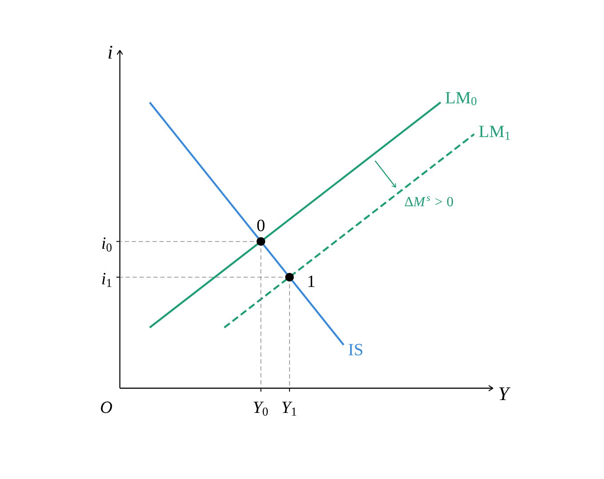
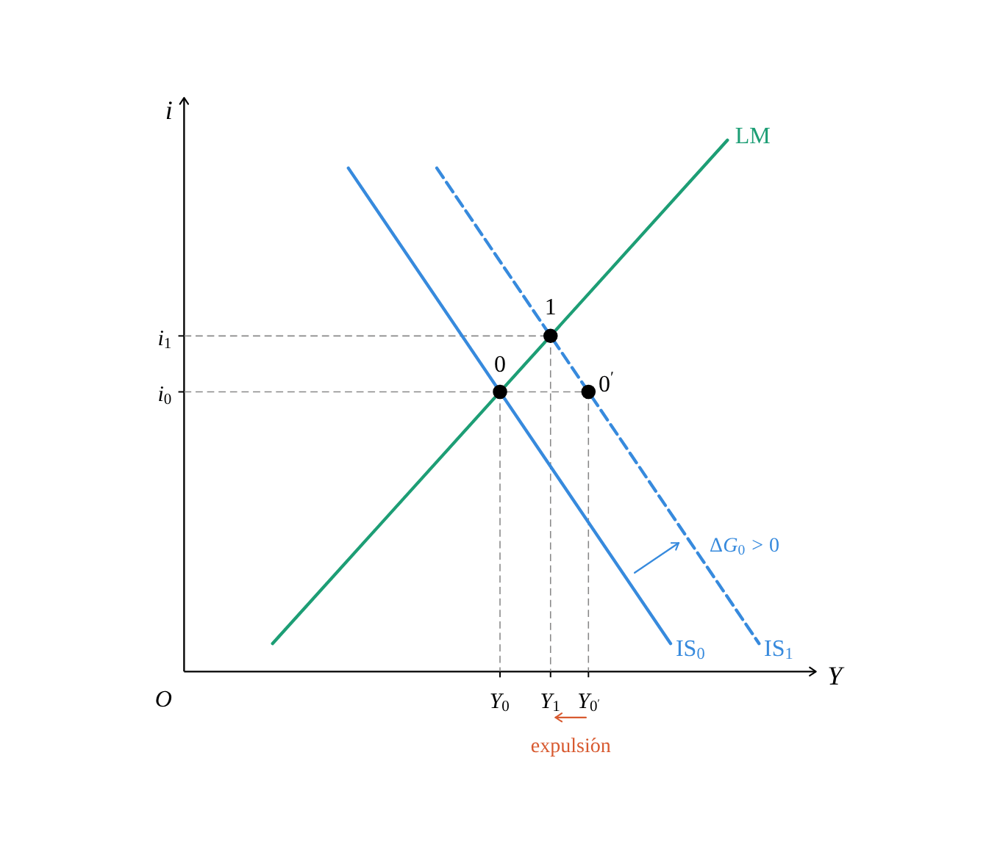

## Introducción



Las políticas monetaria y fiscal son los dos grandes instrumentos de la política de estabilización macroeconómica. La **política monetaria** actúa sobre la cantidad y el precio del dinero y está en manos de bancos centrales generalmente independientes, mientras que la **política fiscal** actúa sobre los ingresos y gastos públicos y depende de los Gobiernos y de los Parlamentos. Ambas inciden sobre la demanda agregada, pero lo hacen a través de canales, con retardos y bajo restricciones distintas.

Además, sus efectos no son independientes, porque el tipo de interés que fija el banco central condiciona el coste de la deuda pública. El déficit y la deuda que genera la política fiscal condicionan, a su vez, el margen de maniobra de la política monetaria. Por ello, su efectividad, que se mide sobre todo con el multiplicador, y su interrelación (la forma en que se combinan en el *policy mix*) son dos cuestiones inseparables.

El debate arranca con la síntesis neoclásica, que discutió la eficacia relativa de ambas políticas en el modelo IS-LM, y con Mundell y Fleming, que mostraron que depende del régimen cambiario y de la movilidad del capital. Tinbergen (1952) estableció que la política económica necesita tantos instrumentos como objetivos, y Mundell (1962) propuso asignar cada instrumento al objetivo sobre el que es relativamente más eficaz.

Más tarde, Sargent y Wallace (1981) advirtieron, con su “aritmética monetarista desagradable”, que una política fiscal insostenible puede acabar imponiendo la monetización de la deuda. Leeper (1991) formalizó las combinaciones de políticas activas y pasivas que dan lugar a la dominancia monetaria o a la dominancia fiscal. Durante la Gran Moderación, en consecuencia, el consenso asignó la estabilización a la política monetaria y la disciplina a la fiscal.

La Gran Recesión de 2008 reabrió ese consenso. Con los tipos de interés en su límite inferior, la política monetaria recurrió a instrumentos no convencionales y la política fiscal recuperó protagonismo, mientras la evidencia sobre el valor de los multiplicadores en las recesiones se revisaba al alza. Poco después, la crisis de deuda soberana europea mostró los riesgos de la interacción entre bancos, Estados y banco central. Por último, la respuesta a la pandemia de 2020, con una coordinación sin precedentes entre ambas políticas, y el posterior repunte de la inflación han devuelto al centro del debate la cuestión de la dominancia fiscal.

El objetivo del tema es analizar esta cuestión en tres bloques:

- *Efectividad*: la de ambas políticas, articulada en torno al concepto de multiplicador.

- *Interrelación*: la que se da entre ambas autoridades.

- *Evidencia empírica*: lo que muestran los datos desde la Gran Recesión.

## 1. Análisis de la efectividad de las políticas monetaria y fiscal

Antes de estudiar su interrelación, la efectividad de cada política se mide por separado a través de su multiplicador, primero el monetario y después el fiscal.

### 1.1. Multiplicador monetario

Del multiplicador monetario interesan su concepto, que tiene dos acepciones, y las perspectivas teóricas sobre su valor.

#### 1.1.1. Concepto

El término **multiplicador monetario** admite dos acepciones, una operativa, que lo liga a la base monetaria, y otra teórica, que lo liga a la renta de equilibrio.

**Enfoque operativo**: en sentido estricto, designa la relación entre la base monetaria y la oferta monetaria, que depende de los coeficientes de efectivo ($c_D = E/D$) y de reservas ($q$) del sistema bancario:

$$M^s = \frac{1 + c_D}{c_D + q} H \quad \rightarrow \quad m = f(c_D^{-}, q^{-})$$

donde $H$ es la base monetaria, $E$ el efectivo en manos del público, $D$ los depósitos y $m$ el multiplicador monetario, el cociente que multiplica a la base.

Su relevancia se debe a que la autoridad controla de forma imperfecta la oferta monetaria, ya que el multiplicador depende del comportamiento del público y de los bancos, es procíclico y cae bruscamente en las crisis financieras como la de 2008 (tema [A36](a36-politica-monetaria-i.qmd), apartado 1.4).

**Enfoque teórico**: en el contexto de este tema, sin embargo, la acepción relevante es la de *multiplicador de la política monetaria*, es decir, la variación del *output* de equilibrio ante una variación unitaria de la oferta real de dinero. En el marco IS-LM de economía cerrada, con $v, k, h > 0$:

$$M_M \equiv \frac{\partial Y}{\partial (M^s/P)} = \frac{v/h}{1-c(1-\tau)+v\frac{k}{h}} > 0 \quad \rightarrow \quad M_M \equiv f(v^{+}, h^{-}, k^{-}, c^{+}, \tau^{-})$$

donde $c$ es la propensión marginal al consumo, $\tau$ el tipo impositivo, $v$ el grado en que la inversión responde al tipo de interés, y $k$ y $h$ la sensibilidad a la renta y al tipo de interés, respectivamente, de la demanda de dinero.

La cadena de transmisión es indirecta ($\uparrow M^s \rightarrow \downarrow i \rightarrow \uparrow I \rightarrow \uparrow Y$). De ahí que la efectividad de la política monetaria dependa de la fortaleza de cada eslabón:

- *Fortaleza de los eslabones*: la política monetaria es tanto más efectiva cuanto más sensible es la inversión al tipo de interés ($\uparrow v$, IS más plana en el plano $(Y, i)$) y cuanto menos lo es la demanda de dinero ($\downarrow h$, LM más rígida).

- *Casos extremos*: en la *trampa de liquidez* ($h \rightarrow \infty$), el multiplicador monetario es nulo, porque la expansión monetaria no reduce el tipo de interés. En el caso clásico ($h = 0$), en cambio, el multiplicador alcanza su valor máximo ($M_M = 1/k$, la velocidad de circulación), coherente con la teoría cuantitativa.

Gráficamente, en el plano renta-tipo de interés (figura -@fig-a402-pm-expansiva-islm), la curva IS recoge las combinaciones que equilibran el mercado de bienes y es decreciente, porque un tipo de interés menor eleva la inversión. La curva LM recoge las que equilibran el mercado de dinero y es creciente, porque una renta mayor eleva la demanda de dinero y, con la oferta dada, el tipo de interés. Una expansión monetaria ($\Delta M^s > 0$) desplaza la curva LM de $\text{LM}_0$ a $\text{LM}_1$ a lo largo de la curva IS. El tipo de interés baja de $i_0$ a $i_1$, la inversión aumenta y el equilibrio pasa del punto 0 al 1, con una renta mayor ($Y_1 > Y_0$).

::: {#fig-a402-pm-expansiva-islm}

::: {.content-visible when-format="html"}
```{=html}
<div class="graph-frame">
<iframe src="../graphs/a402_PM_expansiva_ISLM.html" style="height:540px" loading="lazy" title="fig-a402-pm-expansiva-islm"></iframe>
</div>
```
:::

::: {.content-visible unless-format="html"}

:::

Multiplicador monetario en el IS-LM. La efectividad depende de las pendientes relativas de IS y LM.
:::

#### 1.1.2. Perspectivas teóricas sobre el multiplicador

**Multiplicador monetario en la visión keynesiana**: la política monetaria es poco efectiva. La cadena de transmisión es larga e incierta, porque la demanda de dinero es muy sensible al tipo de interés (motivo especulación, $h$ elevada, con la trampa de liquidez como caso límite). A ello se suma que la inversión responde poco al tipo de interés (dominada por los *animal spirits*, $v$ baja). La imagen clásica es que la política monetaria es como una cuerda, que sirve para tirar (frenar una expansión) pero no para empujar (estimular en una recesión). En consecuencia, los keynesianos priorizan la política fiscal.

**Multiplicador monetario en la visión de la teoría del ciclo real** (TCR): es nulo incluso a corto plazo. Con precios plenamente flexibles y agentes racionales, rige la dicotomía clásica, de modo que el dinero es neutral y los ciclos se explican por perturbaciones reales (tecnológicas). Por ello, la correlación observada entre dinero y *output* se reinterpreta como causalidad inversa (King y Plosser, 1984), en el sentido de que el dinero interno responde endógenamente a la actividad y no la causa.

**Multiplicador monetario en la visión de la nueva economía keynesiana** (NEK): esta escuela microfundamenta un multiplicador positivo a corto plazo mediante rigideces nominales (costes de menú, fijación escalonada de precios a la Calvo, salarios rígidos). Como los precios no se ajustan de inmediato, las variaciones del dinero y del tipo de interés nominal alteran el tipo real y la demanda, aunque a largo plazo se recupera la neutralidad. Esta visión fundamenta el consenso de política previo a 2008, con la política monetaria como instrumento principal de estabilización, articulada mediante reglas de tipo de interés (principio de Taylor) en el marco IS-PC-MR, y la fiscal limitada a los estabilizadores automáticos.

**Multiplicador monetario y crecimiento**: a largo plazo, la cuestión es si la tasa de crecimiento monetario afecta a las variables reales (*superneutralidad*). Sidrauski (1967) demuestra la superneutralidad del dinero en un modelo de optimización con dinero en la función de utilidad, en el que el capital y el consumo de estado estacionario son independientes de la inflación. Tobin (1965), en cambio, obtiene un efecto real positivo (*efecto Tobin*), porque la inflación encarece mantener dinero y desplaza la cartera hacia capital, elevando el *stock* de capital por trabajador. La evidencia empírica matiza ambos resultados, pues la inflación elevada perjudica el crecimiento, con efectos no lineales a partir de ciertos umbrales.

### 1.2. Multiplicador fiscal

Como el monetario, el multiplicador fiscal se presenta a través de su concepto, por el lado del gasto y del ingreso, y de las perspectivas teóricas sobre su valor.

#### 1.2.1. Concepto

El **multiplicador fiscal** mide la variación del *output* de equilibrio ante una variación unitaria del instrumento fiscal (gasto público, impuestos o transferencias). Conviene distinguir entre el multiplicador de impacto (efecto contemporáneo), el acumulado (cociente entre la variación acumulada del *output* y la del instrumento en un horizonte) y el de valor presente. Salvo indicación contraria, la evidencia empírica de la sección 3 se refiere al multiplicador acumulado del gasto.

**Perspectiva teórica del marco IS-LM, lado del gasto**:

$$M_G\equiv \frac{\partial Y}{\partial G_0}=\frac{1}{1-c(1-\tau)+v \frac{k}{h}}>0 \quad \rightarrow \quad M_G \equiv f(c^{+},\tau^{-},v^{-},(k/h)^{-})$$

El numerador recoge el impulso inicial del gasto, y la expresión en su conjunto refleja el mecanismo multiplicador keynesiano (el gasto genera renta, que genera consumo, que a su vez genera renta).

El denominador recoge, en cambio, las filtraciones que amortiguan ese mecanismo, que son el ahorro ($1-c$), los impuestos ($c\tau$) y el *efecto expulsión* (*crowding out*) monetario ($v\frac{k}{h}$). Por este último, el mayor nivel de renta incrementa la demanda de dinero y, con ella, el tipo de interés, lo que desplaza inversión privada. De ahí se siguen los determinantes del multiplicador y sus casos extremos:

- *Determinantes*: el multiplicador es mayor cuanto mayor es la propensión al consumo ($c$) y menores el tipo impositivo ($\tau$), la sensibilidad de la inversión ($v$) y la pendiente de la LM ($k/h$).

- *Casos extremos*: en la trampa de liquidez ($h \rightarrow \infty$), el efecto expulsión desaparece y el multiplicador alcanza su máximo keynesiano ($M_G = 1/[1-c(1-\tau)]$). En el caso clásico ($h = 0$), por el contrario, el efecto expulsión es total y $M_G = 0$.

Gráficamente, en el plano renta-tipo de interés (figura -@fig-a403-pf-expansiva-islm), la IS recoge el equilibrio del mercado de bienes y la LM, el del mercado de dinero, con las pendientes de la figura -@fig-a402-pm-expansiva-islm. Un aumento del gasto público ($\Delta G_0 > 0$) desplaza la curva IS de $\text{IS}_0$ a $\text{IS}_1$ a lo largo de la curva LM. Con el tipo de interés constante en $i_0$, la renta llegaría a $Y_{0'}$ (punto 0′), pero el alza del tipo hasta $i_1$ expulsa inversión privada y el equilibrio pasa del punto 0 al 1. La diferencia entre $Y_{0'}$ e $Y_1$ mide el efecto expulsión.

::: {#fig-a403-pf-expansiva-islm}

::: {.content-visible when-format="html"}
```{=html}
<div class="graph-frame">
<iframe src="../graphs/a403_PF_expansiva_ISLM.html" style="height:580px" loading="lazy" title="fig-a403-pf-expansiva-islm"></iframe>
</div>
```
:::

::: {.content-visible unless-format="html"}

:::

Multiplicador fiscal en el IS-LM. La efectividad depende de las pendientes relativas de IS y LM.
:::

**Perspectiva teórica del marco IS-LM, lado del ingreso**:

$$M_\tau\equiv \frac{\partial Y}{\partial \tau}=\frac{-cY}{1-c(1-\tau)+v \frac{k}{h}}<0 \quad \rightarrow \quad M_\tau \equiv f(c^{-},\tau^{+})$$

Una subida del tipo impositivo reduce la renta disponible y, con ella, el consumo y la renta de equilibrio. Cabe hacer dos observaciones:

- *Menor valor absoluto*: para un impuesto de suma fija ($T_0$), el multiplicador impositivo es menor en valor absoluto que el del gasto:

    $$M_T \equiv \frac{\partial Y}{\partial T_0} = \frac{-c}{1-c(1-\tau)+v\frac{k}{h}}, \qquad |M_T| < M_G$$

    La razón es que los impuestos operan indirectamente, a través del consumo (una parte $1-c$ de la variación de renta disponible se filtra al ahorro), mientras que el gasto impacta directamente sobre la demanda.

- *Presupuesto equilibrado*: de esta asimetría se deriva el *multiplicador del presupuesto equilibrado* (Haavelmo, 1945). En el modelo keynesiano simple (sin impuestos proporcionales ni efecto expulsión), un aumento del gasto financiado íntegramente con impuestos de suma fija tiene un multiplicador exactamente igual a la unidad, pues el efecto directo del gasto domina al efecto renta de los impuestos.

#### 1.2.2. Perspectivas teóricas sobre el multiplicador

**Multiplicador fiscal en la visión keynesiana**: es elevado (superior a la unidad) y la política fiscal es el instrumento principal de estabilización. Los supuestos que lo sostienen son la capacidad ociosa (la oferta acomoda la demanda sin presiones de precios), el consumo dependiente de la renta corriente (propensiones estables, expectativas estáticas) y un efecto expulsión limitado (LM plana, especialmente en recesión).

**Multiplicador fiscal en la visión TCR**: es reducido (inferior a la unidad a corto plazo) o nulo. Dos mecanismos lo fundamentan:

- *Equivalencia ricardiana* (Barro, 1974): con agentes optimizadores de horizonte infinito (altruismo intergeneracional), expectativas racionales, mercados completos e impuestos de suma fija, los hogares anticipan los impuestos futuros que implica el déficit público y lo compensan con un mayor ahorro privado. Financiar el gasto con deuda o con impuestos es, por tanto, equivalente, y el consumo no reacciona a la forma de financiación.

- *Canal neoclásico del gasto*: un aumento permanente de $G$ genera un efecto riqueza negativo (mayores impuestos presentes o futuros) que eleva la oferta de trabajo. El *output* aumenta, pero menos que el gasto y a costa de una caída del consumo privado, de modo que el multiplicador es positivo pero, a corto plazo, inferior a la unidad. A largo plazo, en cambio, puede superarla por la acumulación de capital. Además, si los impuestos son distorsionantes, la financiación del gasto reduce la producción potencial.

**Multiplicador fiscal en la visión NEK**: es *estado-dependiente*. Con rigideces nominales depende de la respuesta de la política monetaria, y es reducido con una regla de Taylor activa y elevado en el límite inferior de los tipos de interés (*zero lower bound*, ZLB), según el modelo del apartado 2.1. Además, la existencia de hogares no ricardianos con restricciones de liquidez (consumidores *rule-of-thumb*) refuerza el canal keynesiano del consumo y eleva el multiplicador.

**Multiplicador fiscal y crecimiento**: a largo plazo, el efecto de la política fiscal depende de su composición y del nivel de deuda. Por ejemplo, la inversión pública productiva puede elevar la productividad del sector privado y la producción potencial (Aschauer, 1989), con multiplicadores de largo plazo superiores a los del gasto corriente.

La hipótesis de las *consolidaciones fiscales expansivas* (Giavazzi y Pagano, 1990) sostiene que un ajuste fiscal creíble puede ser expansivo vía expectativas (menores impuestos futuros, menor prima de riesgo). La evidencia posterior del FMI concluye, sin embargo, que las consolidaciones son, en general, contractivas a corto plazo.

Por último, el debate sobre deuda y crecimiento ilustra la dificultad de establecer relaciones robustas entre posición fiscal y crecimiento a largo plazo. Así, Reinhart y Rogoff (2010) asociaron una deuda superior al 90 % del PIB con un crecimiento sensiblemente menor, un resultado que cuestionaron Herndon et al. (2013).

### 1.3. Conclusiones

La principal conclusión es que la magnitud de los multiplicadores, y con ella la efectividad de las políticas monetaria y fiscal, no es absoluta, sino condicional. Depende del régimen cambiario, el grado de movilidad del capital, la posición cíclica, la formación de expectativas y el marco institucional.

- *Política monetaria*: en condiciones normales (economía cerrada o abierta con tipo flexible y libre movilidad de capital), es el instrumento principal de estabilización (Mundell-Fleming, principio de Taylor). Sin embargo, en el ZLB la política monetaria convencional pierde eficacia y la política fiscal recupera protagonismo, un resultado coherente tanto con el modelo IS-LM (trampa de liquidez) como con los modelos de equilibrio general dinámico y estocástico (DSGE) de la NEK.

- *Política fiscal*: su efectividad depende, a su vez, de las expectativas.

    - *Agentes ricardianos*: con equivalencia ricardiana, el multiplicador de una rebaja impositiva financiada con deuda tiende a cero.

    - *Agentes no ricardianos*: sin embargo, si existen restricciones de liquidez, agentes no ricardianos o rigideces nominales, el multiplicador es positivo y potencialmente superior a la unidad.

En consecuencia, la pregunta relevante no es cuál de las dos políticas es más efectiva “en abstracto”, sino cuál es la combinación óptima (*policy mix*) dadas las condiciones del momento. Mundell (1962) formuló esta cuestión como el **principio de asignación**, y Leeper (1991) la formalizó como la necesidad de coordinación activa-pasiva entre ambas autoridades.

## 2. Análisis de la interrelación de las políticas monetaria y fiscal

Analizados sus efectos por separado, queda por ver cómo se interrelacionan ambas políticas. Lo hacen en dos planos:

- *Plano a corto plazo*: a través de la respuesta de la política monetaria al impulso fiscal, que el modelo IS-PC-MR permite analizar y que se vuelve crítica en el límite inferior de los tipos de interés.

- *Plano intertemporal*: a través de la restricción presupuestaria del sector público, que vincula a ambas autoridades y da lugar a los regímenes de dominancia.

### 2.1. Interrelación a corto plazo: el modelo IS-PC-MR y el límite inferior de los tipos de interés

::: {.callout-note appearance="simple" icon=false}
El modelo IS-PC-MR en economía cerrada se desarrolla en el tema [A07](a07-nek.qmd), apartado 2.1, y su extensión a la economía abierta, en el tema [A32](a32-precios-output.qmd), apartado 3. Aquí se retiene lo que interesa a la interrelación de políticas.
:::

**Origen**: el modelo es el canónico de tres ecuaciones de la nueva economía keynesiana, en la versión con límite inferior de los tipos de interés de Eggertsson y Woodford (2003).

**Idea**: la efectividad de la política fiscal depende del régimen de la política monetaria. Es baja cuando esta es activa, pues el banco central contrarresta el impulso fiscal, y alta cuando está restringida por el límite inferior de los tipos de interés.

**Planteamiento**: el modelo de tres ecuaciones de la nueva economía keynesiana describe la economía con una IS dinámica, una curva de Phillips neokeynesiana y una regla de tipo de interés:

$$\tilde{y}_t = \mathbb{E}_t[\tilde{y}_{t+1}] - \frac{1}{\theta}(i_t - \mathbb{E}_t[\pi_{t+1}] - \bar{r}_t) + g_t$$

$$\pi_t = \beta \mathbb{E}_t[\pi_{t+1}] + \kappa\tilde{y}_t, \qquad \kappa > 0,\; \beta \in (0, 1)$$

$$i_t = \bar{i}_t + \alpha_\pi\tilde{\pi}_t + \alpha_y\tilde{y}_t, \qquad \alpha_\pi > 1,\; \alpha_y \geq 0$$

donde $\tilde{y}_t$ es la brecha de producción (*output gap*), $\theta$ el coeficiente de aversión relativa al riesgo, $\bar{r}_t$ el tipo de interés real natural, $g_t$ el impulso fiscal, $\beta$ el factor de descuento y $\kappa$ la pendiente de la curva de Phillips. En la regla, $\bar{i}_t = \bar{r}_t + \pi^T$ es el tipo nominal neutral y $\tilde{\pi}_t = \pi_t - \pi^T$ la desviación de la inflación respecto de su objetivo, $\pi^T$. Los coeficientes $\alpha_\pi$ y $\alpha_y$ miden la respuesta del tipo de interés a la inflación y a la brecha, con $\alpha_\pi > 1$ (principio de Taylor)[^a40-1].

La política fiscal entra como un desplazamiento de la IS ($g_t$) y, en su caso, como una variación del tipo de interés natural, $\bar{r}_t$.

**Estática comparativa**: el efecto de un impulso fiscal difiere en condiciones normales y en el límite inferior de los tipos de interés:

- *Interrelación en condiciones normales*: ante un impulso fiscal ($\uparrow g_t$), la brecha de producción y la inflación aumentan y el banco central, siguiendo su regla, eleva el tipo de interés nominal más que proporcionalmente a la inflación, de modo que el tipo real sube y contrarresta parte del impulso. El multiplicador fiscal es, por tanto, reducido (inferior a la unidad), porque la política monetaria activa contrarresta en parte a la fiscal (véase la figura del tema [A38](a38-politica-fiscal.qmd), apartado 1.3.2).

- *El problema del límite inferior de los tipos de interés (ZLB)*: un *shock* negativo de demanda puede ser lo bastante grande como para que el tipo de interés natural caiga por debajo de $-\pi^T$ ($\bar{i}_t = \bar{r}_t + \pi^T < 0$). En ese caso, la regla de Taylor prescribe un tipo nominal negativo (véase la figura del tema [A37](a37-politica-monetaria-ii.qmd), apartado 3.5.1). Sin embargo, el banco central no puede fijarlo, pues $i_t \geq 0$ (los agentes pueden mantener efectivo).

    En consecuencia, el tipo real, $i_t - \mathbb{E}_t[\pi_{t+1}]$, queda por encima del natural, la brecha de producción es negativa y la inflación cae. La menor inflación esperada eleva, a su vez, el tipo real y agrava la brecha, en una espiral deflacionista. En este régimen, la interrelación se invierte:

    1. *La política monetaria convencional pierde eficacia*: el banco central solo puede actuar sobre las expectativas, mediante el *forward guidance* (orientación prospectiva), o sobre los tipos a largo plazo y las primas de riesgo, mediante compras de activos, como se desarrolla en el apartado 3.3. El *forward guidance* es el compromiso de mantener el tipo en cero más allá de lo que la regla prescribiría.

    2. *El multiplicador fiscal es elevado*: el tipo nominal no sube ante el impulso fiscal, y la mayor inflación esperada que este genera reduce el tipo real, con lo que el efecto expulsión desaparece y se convierte en un efecto atracción (*crowding in*).

        Christiano, Eichenbaum y Rebelo (2011) obtienen en el ZLB multiplicadores muy superiores a la unidad (unos 3,7 en su modelo simple y 2,3 en su modelo de escala media), frente a valores en torno a la unidad o inferiores fuera de él. En general, el multiplicador supera la unidad siempre que el estímulo se limite al periodo en que el tipo permanece en el ZLB.

    3. *La coordinación se vuelve necesaria*: la combinación de una expansión fiscal con un compromiso monetario de no reaccionar a la inflación resultante es la forma más efectiva de escapar del ZLB. Esa combinación difumina la frontera entre ambas políticas y anticipa la cuestión de la dominancia.

**Conclusiones**:

- *Aspectos positivos*: explica por qué la política fiscal volvió a ser un instrumento de estabilización cuando la Gran Recesión y la pandemia situaron a las principales economías desarrolladas en el límite inferior de los tipos durante más de una década.

- *Limitaciones*: descansa en dos simplificaciones:

    - *Límite inferior*: supone $i_t \geq 0$, cuando el límite efectivo se sitúa algo por debajo de cero.

    - *Política fiscal exógena*: entra como un desplazamiento de la IS, sin restricción presupuestaria intertemporal del sector público, por lo que el modelo no puede analizar la sostenibilidad del impulso fiscal ni los regímenes de dominancia, que se estudian a continuación.

### 2.2. Interrelación intertemporal: el modelo de Leeper (1991)

El modelo de Leeper (1991) cubre esa carencia al analizar la interrelación intertemporal de ambas políticas, a través de la restricción presupuestaria del sector público que vincula a las dos autoridades.

::: {.callout-note appearance="simple" icon=false}
El modelo de Leeper se desarrolla en el tema [A39](a39-deficit.qmd), apartado 3.1, y aquí se retiene su resultado central.
:::

**Origen**: Leeper (1991) formaliza la distinción de Sargent y Wallace (1981) entre dominancia monetaria y fiscal en un modelo dinámico con expectativas racionales en el que cada autoridad sigue una regla de política.

**Idea**: la restricción presupuestaria intertemporal del sector público vincula a la autoridad fiscal y a la monetaria.

**Planteamiento**: Leeper modela consumidores con expectativas racionales y dinero en la función de utilidad y un sector público que financia el déficit vía deuda o vía base monetaria. La autoridad monetaria fija el tipo de interés en función de la inflación corriente, y la autoridad fiscal, los impuestos en función de la deuda heredada:

$$i_t = \alpha_0 + \alpha\pi_t + \varepsilon^m_t$$

$$T_t = \gamma_0 + \gamma_1 b_{t-1} + \varepsilon^f_t$$

donde $\alpha$ es la sensibilidad del tipo de interés a la inflación, $\gamma_1$ la de los impuestos al *stock* real de deuda heredado, $b_{t-1}$; $\alpha_0$ y $\gamma_0$, las constantes de cada regla; y $\varepsilon^m_t$ y $\varepsilon^f_t$ los *shocks* monetario y fiscal.

Cada autoridad es *activa* si fija su instrumento con independencia de la restricción presupuestaria y *pasiva* si lo ajusta para garantizar su cumplimiento.

**Equilibrio**: en el plano de los dos parámetros de respuesta, expresados como $|\alpha\beta|$ y $|\beta^{-1}-\gamma_1|$, con $\beta$ el factor de descuento (figura -@fig-a401-leeper), el modelo delimita cuatro regiones, de las cuales solo dos generan un equilibrio determinado:

- *Dominancia monetaria*: la política monetaria es activa ($|\alpha\beta| > 1$) y la fiscal, pasiva ($|\beta^{-1}-\gamma_1| < 1$). La inflación la determina el banco central y los impuestos estabilizan la deuda.

- *Dominancia fiscal*: la política fiscal es activa y la monetaria, pasiva. El nivel de precios se ajusta para que la restricción presupuestaria se cumpla.

En las otras dos regiones no hay un equilibrio determinado. Si ambas autoridades son activas, la deuda es explosiva, y si ambas son pasivas, el equilibrio está indeterminado. La estabilidad macroeconómica requiere, por tanto, que exactamente una autoridad sea activa, de modo que la coordinación no es opcional sino un requisito de la determinación del equilibrio.

::: {#fig-a401-leeper}

::: {.content-visible when-format="html"}
```{=html}
<div class="graph-frame">
<iframe src="../graphs/a401_Leeper.html" style="height:580px" loading="lazy" title="fig-a401-leeper"></iframe>
</div>
```
:::

::: {.content-visible unless-format="html"}

:::

Modelo de Leeper (1991). En el plano de $|\alpha\beta|$ y $|\beta^{-1} - \gamma_1|$, las fronteras en 1 delimitan cuatro regiones. Solo la dominancia monetaria (I, política monetaria activa y fiscal pasiva) y la dominancia fiscal (II, política fiscal activa y monetaria pasiva) dan un equilibrio determinado. Si ambas son pasivas (III), el equilibrio está indeterminado, y si ambas son activas (IV), las trayectorias son explosivas.
:::

**Conclusiones**:

- *Aspectos positivos*: demuestra que la estabilidad de precios depende de la combinación de reglas monetarias y fiscales, y no solo del banco central, y ofrece una taxonomía clara de regímenes en la que se apoya la teoría fiscal del nivel de precios.

- *Limitaciones*: supone reglas lineales, una economía cerrada y un agente representativo ricardiano, por lo que no recoge las restricciones de liquidez que reforzarían la dominancia fiscal.

### 2.3. Teorías de dominancia monetaria y fiscal

Al modelo de Leeper le siguen las teorías de la dominancia fiscal y de la dominancia monetaria, junto con otros desarrollos.

::: {.callout-note appearance="simple" icon=false}
Las teorías de la dominancia se desarrollan en el tema [A39](a39-deficit.qmd), apartados 3.2 a 3.4.
:::

Cada una de ellas explica situaciones propias de una región del modelo de Leeper:

1. *Dominancia fiscal*: la *aritmética monetarista desagradable* (Sargent y Wallace, 1981) muestra que, si la autoridad fiscal no ajusta sus déficits, una política monetaria restrictiva hoy exige más deuda y más monetización mañana. Como los agentes lo anticipan, la inflación surge hoy como fenómeno fiscal y la autoridad monetaria es incapaz de controlarla.

    La *teoría fiscal del nivel de precios* (Leeper, 1991; Sims, 1994; Woodford, 1995) generaliza el argumento, pues los precios se ajustan para que el valor real de la deuda nominal iguale al valor actual de los superávits primarios esperados.

2. *Dominancia monetaria*: la *aritmética fiscal desagradable* (King, 1995) es el caso opuesto, en el que un banco central comprometido de forma creíble con la estabilidad de precios fija tipos altos que comprometen la capacidad de financiación de la autoridad fiscal y fuerzan el ajuste presupuestario. El debate sobre las reglas fiscales (el Pacto de Estabilidad y Crecimiento, PEC, y su reforma de 2024) es su corolario institucional.

3. *Otros desarrollos*: el *teorema de irrelevancia* (Wallace, 1981) establece que, con mercados perfectos e información perfecta, las operaciones de mercado abierto no afectan a la senda de déficits, a la deuda neta ni a los precios, resultado que Eggertsson y Woodford (2003) extienden al ZLB. De ello se sigue que la potencia de la política monetaria descansa en el incumplimiento de esos supuestos.

    Por su parte, el análisis de la madurez de los pasivos públicos (Cochrane, 2001) muestra que, bajo dominancia fiscal, el ajuste a un *shock* fiscal recae sobre el nivel de precios corriente si la deuda es a corto plazo. Si es a largo plazo, en cambio, el ajuste se reparte en la inflación futura a través del precio de los bonos.

El teorema de irrelevancia y el análisis de la madurez razonan con el balance consolidado del banco central y el Tesoro, una perspectiva que, desde 2022, ha tenido consecuencias prácticas sobre el presupuesto (apartado 3.4.4).

### 2.4. Conclusiones

La interacción entre política monetaria y fiscal constituye uno de los debates centrales de la macroeconomía moderna, y opera en dos planos. Los resultados de ambos planos tienen implicaciones directas para el diseño institucional de uniones monetarias como la Unión Económica y Monetaria (UEM). En ella, la independencia del BCE coexiste con veintiuna políticas fiscales nacionales y un marco de reglas fiscales en permanente evolución (véanse los temas [B43](b43-politica-monetaria-ue.qmd) y [B45](b45-politica-fiscal-ue.qmd)).

## 3. Evidencia empírica desde la Gran Recesión: el valor de los multiplicadores y la interrelación de las políticas

Queda por contrastar con los datos lo que predice la teoría. Tras repasar las técnicas de medición, se recogen las estimaciones de los multiplicadores fiscal y monetario y la evidencia sobre la interrelación entre ambas políticas desde la Gran Recesión.

### 3.1. Técnicas de medición

**Técnicas basadas en modelos de vectores autorregresivos** (VAR): los VAR estructurales (SVAR) estiman el multiplicador fiscal y monetario a partir de las funciones de impulso-respuesta ante *shocks* identificados. El enfoque estándar (Blanchard y Perotti, 2002) explota los retardos institucionales de la política fiscal para identificar *shocks* exógenos de gasto e impuestos, bajo el supuesto de que el gasto público no reacciona contemporáneamente al *output*.

Esta identificación ha sido cuestionada porque los agentes anticipan los cambios fiscales, de modo que los *shocks* VAR están mal fechados y sesgan las respuestas estimadas (en particular, la del consumo privado). Ramey (2011) lo muestra al comprobar que tanto las previsiones profesionales como los *shocks* narrativos anticipan (causan en el sentido de Granger) los *shocks* VAR.

En política monetaria, la identificación canónica se debe a Christiano, Eichenbaum y Evans (1999). Su descomposición de Cholesky ordena el tipo de interés detrás del *output* y los precios y delante de los agregados de reservas y de dinero (la política monetaria reacciona contemporáneamente al *output* y los precios, pero no a la inversa). La principal limitación del enfoque es que los resultados son sensibles al esquema de identificación, al número de retardos y a la muestra temporal.

**Técnicas basadas en narrativas**: el enfoque narrativo identifica cambios exógenos de política a partir de registros históricos (actas de reuniones de política monetaria, discursos, documentos legislativos). Busca así aislar las decisiones motivadas por objetivos de largo plazo (p. ej. consolidación fiscal, lucha contra la inflación) de las respuestas endógenas al ciclo.

En el ámbito fiscal, Romer y Romer (2010) identifican cambios impositivos exógenos en EE. UU. (1945-2007) y estiman un multiplicador impositivo de alrededor de 3, es decir, cada dólar de subida de impuestos reduce el PIB en tres dólares a los dos años y medio. En el ámbito monetario, el mismo enfoque permite identificar *shocks* de política monetaria a partir de los registros y las previsiones internas de la Fed.

- *Ventaja*: evita los problemas de endogeneidad de los VAR.

- *Limitación*: subjetividad en la clasificación de los episodios y dificultad de replicación en países con menor tradición documental.

**Técnicas basadas en experimentos naturales**: explotan variaciones exógenas de política generadas por circunstancias institucionales o geográficas. Destacan tres ejemplos:

- *Gasto militar regional*: la distribución geográfica del gasto militar en EE. UU. permite estimar multiplicadores fiscales regionales (Nakamura y Steinsson, 2014).

- *Disolución de ayuntamientos*: la que se produce en Italia por infiltración mafiosa se ha utilizado como *shock* exógeno de gasto.

- *Trilema en un panel histórico*: en el ámbito monetario, Jordà, Schularick y Taylor (2015) explotan el trilema de Mundell-Fleming (trinidad imposible) con datos de 17 economías avanzadas desde 1870. Lo usan para estudiar los efectos de la política monetaria sobre el crédito hipotecario y los precios de la vivienda. Según el trilema, los países con tipo fijo y libre movilidad de capital importan la política monetaria del país ancla.

El enfoque presenta una ventaja y una limitación:

- *Ventaja*: identificación causal robusta.

- *Limitación*: validez externa limitada, pues los resultados locales no siempre son extrapolables al agregado nacional.

### 3.2. Evidencia empírica sobre el multiplicador fiscal

La Gran Recesión reavivó el debate sobre el tamaño del multiplicador fiscal, que había perdido centralidad durante la Gran Moderación. Los principales estudios, ordenados por técnica, son los siguientes:

**Enfoque narrativo** (Ramey y Shapiro, 1998; Ramey, 2011): identifica los episodios de aumento exógeno del gasto militar en EE. UU. (Corea, 1950-1953; Vietnam, 1965-1975; rearme de Carter-Reagan, 1980-1984) a partir de fuentes periodísticas y estima su efecto sobre el PIB. Ramey (2011) lo amplía con una serie de noticias que mide, desde 1939, el valor actual esperado del gasto militar futuro, de modo que el *shock* se fecha cuando se anuncia y no cuando se ejecuta.

Los multiplicadores del gasto así obtenidos se sitúan entre 0,6 y 1,2 según la muestra. El gasto militar eleva el *output*, pero el consumo privado y los salarios reales caen, en línea con el canal neoclásico del efecto riqueza negativo.

**Enfoque SVAR** (Blanchard y Perotti, 2002): con la identificación ya descrita y datos de EE. UU. (1960-1997)[^a40-3], en la especificación con tendencia determinista obtienen un multiplicador del gasto $M_G \in [0{,}84;\, 1{,}29]$ y un multiplicador impositivo $M_T \in [-0{,}78;\, -0{,}7]$. Con tendencia estocástica, el efecto máximo de los impuestos alcanza $M_T \approx -1{,}33$.

A diferencia del enfoque narrativo, el gasto público eleva el consumo privado (efecto multiplicador keynesiano) pero reduce la inversión privada (efecto expulsión). Lo difícil de conciliar con la teoría keynesiana estándar es que también las subidas de impuestos reduzcan la inversión.

**Enfoque de VAR de transición suave** (STVAR, Auerbach y Gorodnichenko, 2012): los modelos de cambio de régimen (*smooth transition VAR*) permiten que el multiplicador varíe con la posición cíclica y encuentran que el del gasto es mucho más expansivo en recesiones que en expansiones. Con datos trimestrales de EE. UU. de posguerra, alcanza 2,2-2,5 en recesión y no pasa de 0,6 en expansión. Este resultado cobró especial relevancia en el debate sobre los estímulos fiscales de la Gran Recesión. La explicación es que, en recesiones, la capacidad ociosa reduce el efecto expulsión y las restricciones de liquidez amplifican el canal keynesiano.

**Enfoque de proyecciones locales** (Ramey y Zubairy, 2018): cuestiona ese resultado con datos trimestrales de EE. UU. de 1889-2015, que incluyen varias guerras y recesiones profundas, y con regresiones separadas para cada horizonte. Con los *shocks* de noticias militares, el multiplicador se sitúa en 0,6-0,7 tanto con desempleo alto como bajo, y con los de Blanchard y Perotti queda también por debajo de la unidad.

Los autores atribuyen la discrepancia sobre todo a que Auerbach y Gorodnichenko suponen que la economía sigue en recesión durante los 20 trimestres del horizonte, cuando en los datos de Auerbach y Gorodnichenko las recesiones duran 3,3 trimestres de media. Con esos mismos datos, el multiplicador a cinco años en recesión baja a 0,84. En el límite inferior de los tipos, en cambio, la evidencia es menos concluyente. Excluidos los años de racionamiento de la Segunda Guerra Mundial, algunas especificaciones dan hasta 1,5.

**Enfoque de metarregresiones** (Gechert y Will, 2012): a partir de una muestra de 89 estudios, cuyas estimaciones del multiplicador presentan una dispersión muy elevada, concluyen que el tamaño del multiplicador depende sobre todo del contexto y del método elegidos. La dispersión se explica por el tipo de instrumento, la técnica de estimación y la posición cíclica. Por instrumentos, la inversión pública presenta los multiplicadores más elevados, y las transferencias y los impuestos, los más bajos.

**Enfoque SVAR del FMI**: con VAR de cambio de régimen, el FMI ha estimado multiplicadores para EE. UU., Japón y Europa y ha encontrado también que el multiplicador es mayor en recesiones que en expansiones, especialmente en Japón (situación de ZLB prolongada). Además, ha propuesto un procedimiento en dos pasos para calibrar el multiplicador de un país según sus características estructurales (apertura, rigidez laboral, tamaño de los estabilizadores automáticos, régimen cambiario, nivel de deuda) y su posición cíclica.

**Enfoque de panel internacional** (Ilzetzki, Mendoza y Végh, 2013): con datos trimestrales de 44 países (1960-2007), muestran que el multiplicador del consumo público depende de las características del país:

- *Desarrollo*: es mayor en los países de renta alta que en los países en desarrollo.

- *Régimen cambiario*: es relativamente grande con tipo de cambio predeterminado y nulo con tipo flexible, como predice el modelo de Mundell-Fleming (tema [A32](a32-precios-output.qmd), apartado 1.3).

- *Apertura*: es menor en las economías más abiertas, por la filtración del impulso hacia las importaciones.

- *Endeudamiento*: es negativo a largo plazo cuando la deuda supera el 60 % del PIB.

**Enfoque regional** (Nakamura y Steinsson, 2014): aprovechan que las movilizaciones militares elevan el gasto de defensa más en unos estados de EE. UU. que en otros y estiman un *multiplicador relativo de economía abierta* en torno a 1,5 (aumento del *output* de un estado respecto de los demás por dólar de gasto adicional).

El multiplicador relativo no es el multiplicador agregado, porque la respuesta de la política monetaria y de la fiscal federal, común a todos los estados, se cancela al comparar regiones, mientras que el multiplicador agregado depende de cuánto se oponga esa respuesta al impulso. Por eso el multiplicador relativo informa sobre el estímulo fiscal dentro de una unión monetaria y respalda los modelos en los que los *shocks* de demanda tienen efectos grandes (tema [A38](a38-politica-fiscal.qmd), apartado 1.3.2).

**Análisis del valor del multiplicador según el contexto**: de los estudios anteriores se desprende que el multiplicador depende críticamente del contexto:

1. *Régimen monetario*: Christiano, Eichenbaum y Rebelo (2011) demuestran teóricamente que el multiplicador puede superar ampliamente la unidad en el ZLB, pues la política monetaria no contrarresta la expansión fiscal (apartado 2.1).

2. *Tipo de instrumento*: Coenen et al. (2012) comparan siete modelos DSGE de bancos centrales y organismos internacionales. Encuentran que el multiplicador de gasto, en torno a 1,0-1,5 en el primer año, supera sistemáticamente al de transferencias y al de impuestos, que rondan, respectivamente, 0,3-0,8 y 0,2-0,5.

3. *Debate FMI*: Blanchard y Leigh (2013) estimaron que el FMI había subestimado sistemáticamente los multiplicadores en sus previsiones de crecimiento para las economías europeas al comienzo de la crisis (2010-2011). El FMI había utilizado valores de unos 0,5, cuando los reales se situaban entre 0,9 y 1,7. De hecho, los programas de austeridad aplicados en Grecia, Portugal, Irlanda y España (2010-2014) generaron contracciones del PIB superiores a las previstas, coherentes con multiplicadores elevados en contextos de recesión, ZLB y restricciones crediticias simultáneas.

**Persistencia del multiplicador**: la evidencia sobre cuánto duran los efectos indica que la persistencia del multiplicador no coincide con la del impulso fiscal. En particular, se observan tres resultados:

- *Perfil temporal*: el efecto sobre el *output* sigue una senda en forma de U invertida, con un máximo entre el primer y el segundo año y una duración máxima en torno a los cinco años.

- *Histéresis*: cuando existe, el efecto es mayor, pues la recesión evitada no destruye capital ni empleo de forma permanente (DeLong y Summers, 2012).

- *Acomodación monetaria*: el efecto es mayor cuando la política monetaria acompaña al impulso fiscal, en lugar de contrarrestarlo.

La tabla -@tbl-a40-multiplicador resume la evidencia sobre el multiplicador del gasto por contexto (normalidad, recesión, límite inferior de los tipos, régimen cambiario y deuda elevada).

| Contexto | Multiplicador del gasto | Estudios |
|---|---|---|
| Normalidad, con política monetaria activa | Inferior a la unidad (0,6-0,7 en EE. UU.) | Ramey y Zubairy (2018) |
| Recesión | En discusión: 2,2-2,5 o inferior a la unidad | Auerbach y Gorodnichenko (2012); Ramey y Zubairy (2018) |
| Límite inferior de los tipos | Superior a la unidad en los modelos (2,3-3,7); evidencia empírica mixta (hasta 1,5) | Christiano, Eichenbaum y Rebelo (2011); Ramey y Zubairy (2018) |
| Tipo de cambio fijo o unión monetaria | Relativamente elevado (relativo regional: 1,5) | Ilzetzki, Mendoza y Végh (2013); Nakamura y Steinsson (2014) |
| Tipo de cambio flexible o economía muy abierta | Nulo o reducido | Ilzetzki, Mendoza y Végh (2013) |
| Deuda pública superior al 60 % del PIB | Negativo a largo plazo | Ilzetzki, Mendoza y Végh (2013) |

: Multiplicador del gasto público según el contexto. {#tbl-a40-multiplicador .table-sm}

### 3.3. Evidencia empírica sobre el multiplicador monetario

A diferencia del fiscal, el multiplicador monetario se ha medido sobre todo con modelos SVAR y, tras la Gran Recesión, a través de los efectos de las medidas no convencionales.

**Enfoque SVAR** (Bernanke y Mihov, 1998): antes de medir los efectos de la política monetaria es necesario medir la propia política. Para ello, Bernanke y Mihov proponen un VAR semiestructural del mercado de reservas bancarias que permite identificar las innovaciones de política monetaria sin imponer *a priori* cuál es el indicador de la Fed, y concluyen que deben utilizarse distintas medidas según el periodo[^a40-5].

Con el indicador resultante, un *shock* monetario expansivo eleva el *output* con relativa rapidez, con un máximo entre los doce y los dieciocho meses, y los precios responden más tarde (con poco efecto el primer año) y de forma persistente.

La Gran Recesión supuso un desafío sin precedentes para la política monetaria, ya que los tipos de interés alcanzaron el ZLB y los canales de transmisión convencionales se deterioraron. Por ello, la evidencia empírica posterior se centra en la efectividad de las medidas no convencionales, cuyos canales de transmisión se analizan en el tema [A37](a37-politica-monetaria-ii.qmd), apartado 3.5.

**Expansión cuantitativa y tipos a largo plazo**: Gagnon et al. (2011) estiman que la primera ronda de expansión cuantitativa (*quantitative easing*, QE) de la Fed (QE1, 2008-2010, unos 1,7 BN\$) redujo la prima por plazo a diez años entre 30 y 100 puntos básicos.

Krishnamurthy y Vissing-Jorgensen (2011) analizan varios canales (señalización, duración, liquidez, demanda de activos seguros, prepago, riesgo de impago e inflación) y concluyen que el efecto depende de los activos comprados. Encuentran evidencia de los canales de señalización, de demanda de activos seguros y de inflación, y de un canal hipotecario específico en el QE1, mientras que relativizan el de duración.

Para el BCE, Altavilla, Carboni y Motto (2015) estudian los 17 anuncios sobre el programa de compras de activos (APP) entre septiembre de 2014 y marzo de 2015. Estiman que, en conjunto, los anuncios redujeron los tipos soberanos a diez años en 30-50 pb en la zona del euro.

**Efectividad real**: la transmisión a la economía real fue más débil de lo esperado. Por ejemplo, según estimaciones del Banco de Inglaterra (Joyce, Tong y Woods, 2011), la primera ronda de QE (200.000 M£, 2009-2010) elevó el nivel del PIB del Reino Unido en torno a un 1,5-2 % en su efecto máximo. La asimetría entre el impacto financiero (elevado) y el real (moderado) se explica por las restricciones crediticias del sector bancario y el desapalancamiento del sector privado.

***Forward guidance***: complementó al QE. El compromiso de la Fed de mantener tipos bajos hasta 2014 buscaba reducir los tipos esperados y, con ellos, los tipos a largo plazo, más allá de lo que permitía el ZLB. No obstante, su efectividad depende de la credibilidad del compromiso, un problema de inconsistencia dinámica (*time inconsistency*) que formalizaron Kydland y Prescott (1977).

**Tipos negativos**: el BCE mantuvo el tipo de la facilidad de depósito en terreno negativo entre junio de 2014 y julio de 2022, con un mínimo de -0,50 % desde septiembre de 2019. Su experiencia y las del Riksbank, el Banco Nacional Suizo y el Banco de Japón (BoJ) mostraron que el límite inferior efectivo (*effective lower bound*) se sitúa por debajo de cero. Los tipos negativos tienen, sin embargo, rendimientos decrecientes y efectos adversos sobre la rentabilidad bancaria (*reversal rate*, Brunnermeier y Koby, 2018).

### 3.4. Evidencia empírica sobre la interrelación entre ambas políticas

**Evidencia previa a la Gran Recesión**: el análisis de las funciones de reacción de los bancos centrales de la OCDE tras Bretton Woods apunta a la monetización del déficit donde los bancos centrales eran menos independientes (como Italia), pero no donde lo eran más (EE. UU., Alemania).

::: {.callout-note appearance="simple" icon=false}
Esta evidencia se desarrolla en el tema [A39](a39-deficit.qmd), apartado 3.4.3.
:::

**Evidencia pos-2008**: la Gran Recesión y la crisis de deuda soberana en la zona del euro proporcionaron un laboratorio natural para estudiar la interrelación, que se recorre por etapas.

#### 3.4.1. La Gran Recesión en EE. UU. y el Reino Unido (2009-2015)

**EE. UU.**: la respuesta inicial combinó ambas políticas. Por un lado, la ley de recuperación de febrero de 2009 (American Recovery and Reinvestment Act, ARRA) ascendía a 787.000 M\$ en la estimación inicial de la Oficina de Presupuesto del Congreso (CBO). Por otro lado, la Reserva Federal mantuvo el tipo de los fondos federales en el 0-0,25 % de diciembre de 2008 a diciembre de 2015, con tres programas de compras de activos (QE1 a QE3, 2008-2014) y *forward guidance*.

Desde 2011, sin embargo, la política fiscal giró hacia la restricción. Tras el pulso sobre el límite de deuda, la ley de control presupuestario (Budget Control Act, agosto de 2011) fijó techos al gasto y recortes automáticos (*sequester*), que entraron en vigor en marzo de 2013. El déficit federal bajó del 9,8 % del PIB en 2009 al 2,8 % en 2014 (CBO). Esa consolidación se produjo con el tipo oficial en su límite inferior, el caso en que el modelo del apartado 2.1 predice multiplicadores más altos.

**Reino Unido**: el presupuesto de emergencia de junio de 2010 abrió una consolidación plurianual. Mientras tanto, el Banco de Inglaterra, con el tipo oficial en el 0,5 % desde marzo de 2009, ampliaba sus compras de deuda pública de 200.000 M£ a 375.000 M£ entre octubre de 2011 y julio de 2012. Como en EE. UU., la restricción fiscal coincidió con una política monetaria que solo podía actuar mediante compras de activos.

#### 3.4.2. La crisis de deuda soberana europea y Japón (2010-2024)

**Zona del euro (2010-2012)**: la combinación de consolidación fiscal agresiva (dominancia monetaria, pues el BCE mantuvo su mandato de estabilidad de precios) con multiplicadores fiscales elevados generó una espiral recesión-austeridad. El *whatever it takes* de Draghi (julio de 2012) y el posterior anuncio de las operaciones monetarias de compraventa (OMT) marcaron un punto de inflexión. A partir de entonces, la política monetaria asumió un papel cuasifiscal al reducir las primas de riesgo soberano y relajar así la restricción presupuestaria de los Gobiernos periféricos sin monetización directa.

**Japón (Abenomics, 2013-2020)**: la coordinación explícita de política monetaria expansiva (expansión monetaria cuantitativa y cualitativa del BoJ, QQE), política fiscal expansiva (estímulo fiscal) y reformas estructurales (las tres flechas de Abe) representa el caso más claro de interacción deliberada. Los resultados fueron mixtos, porque hubo un éxito parcial en romper las expectativas deflacionistas, pero la inflación objetivo del 2 % no se alcanzó de forma sostenida hasta 2022, y por un *shock* de oferta externo (energía), no por las políticas domésticas.

El Banco de Japón cerró esa etapa el 19 de marzo de 2024, al juzgar que el objetivo del 2 % estaba a la vista de forma sostenible. Abandonó entonces los tipos negativos (el tipo a un día pasó al 0-0,1 %), el control de la curva de rendimientos y las compras de fondos cotizados.

#### 3.4.3. La respuesta a la pandemia de COVID-19 (2020-2021)

La coordinación monetario-fiscal alcanzó niveles sin precedentes en tiempos de paz. Los Gobiernos aumentaron con fuerza el gasto (estímulos fiscales equivalentes al 10-20 % del PIB en las principales economías). Al mismo tiempo, los bancos centrales compraban cantidades récord de deuda soberana en mercado secundario, más de 1,7 BN€ en el programa de compras de emergencia frente a la pandemia (PEPP) del BCE y unos 3,5 BN\$ en el caso de la Fed. La línea entre política monetaria y fiscal se difuminó, y en la zona del euro las compras llegaron a calificarse de financiación monetaria, prohibida por los Tratados, una lectura que el BCE rechazó (Schnabel, 2020). Con ese precedente, la inflación pospandemia (2021-2023) reavivó el debate sobre si se había producido un episodio de dominancia fiscal.

**Inflación de origen fiscal**: el debate admite una lectura en clave de la teoría fiscal del nivel de precios (tema [A39](a39-deficit.qmd), apartado 3.2.2). Bianchi, Faccini y Melosi (2023) distinguen la deuda respaldada por superávits futuros de la que no lo está y estiman que, tras la pandemia, los *shocks* fiscales no financiados sostuvieron la recuperación, pero causaron un aumento persistente de la inflación. Su modelo predice, además, fuera de muestra, el efecto inflacionista del plan de rescate de marzo de 2021 (American Rescue Plan Act, ARPA, de 1,9 BN\$ según la CBO).

La lectura rival atribuye la mayor parte del repunte a *shocks* de precios dados los salarios (energía, alimentos, escasez de bienes) y reserva a la tensión del mercado de trabajo un efecto menor, aunque más persistente (Bernanke y Blanchard, 2025).

#### 3.4.4. El endurecimiento posterior a la pandemia (2022-2026)

La inflación pospandemia (impulsada por cuellos de botella, energía y estímulos fiscales) provocó el ciclo de subidas de tipos más rápido en décadas. La Fed elevó el tipo de referencia de 0-0,25 % a 5,25-5,50 % en 16 meses (de marzo de 2022 a julio de 2023). El BCE, por su parte, elevó el tipo de las operaciones principales de financiación de 0 % a 4,50 % (y el de la facilidad de depósito, de -0,50 % a 4 %) en 14 meses (de julio de 2022 a septiembre de 2023).

Sin embargo, los déficits fiscales permanecieron elevados, en torno al 6 % del PIB en EE. UU. en 2023 y al 3,5 % en la zona del euro. En términos del modelo de Leeper, la autoridad monetaria actuaba de forma activa sin que la fiscal se comportara, todavía, de forma pasiva.

Las consecuencias fueron las predichas por la aritmética fiscal desagradable de King (1995). El coste del servicio de la deuda aumentó con rapidez, y en EE. UU. pasó de unos 350.000 M\$ en 2021 a unos 900.000 M\$ en 2024. En Italia, la prima de riesgo repuntó hasta unos 250 pb en otoño de 2022. Todo ello intensificó la presión por un ajuste fiscal futuro.

**Reino Unido (2022)**: ofrece el ejemplo más nítido de conflicto entre la estabilidad financiera y el tono de la política monetaria causado por un fallo de credibilidad fiscal. El “minipresupuesto” del 23 de septiembre, con rebajas de impuestos financiadas con deuda, elevó unos 130 pb en tres sesiones el rendimiento de los bonos del Tesoro británico (*gilts*) a 30 años. La caída de su precio obligó a los fondos de inversión guiada por pasivos (*liability-driven investment*, LDI) de los planes de pensiones a vender *gilts* para atender peticiones de garantías, lo que realimentó la caída.

El Banco de Inglaterra compró 19.300 M£ de *gilts* entre el 28 de septiembre y el 14 de octubre, con indemnización del Tesoro, y aplazó las ventas de su cartera, pero el 3 de noviembre subió el tipo oficial 75 pb, hasta el 3 %. Separó así los instrumentos, con compras temporales para la estabilidad financiera y tipos de interés para la inflación.

En la zona del euro, el Instrumento para la Protección de la Transmisión (TPI, julio de 2022) buscó evitar la fragmentación financiera para preservar la dominancia monetaria sin desencadenar una crisis de deuda soberana. Este episodio ilustra la tensión central del modelo de Leeper, pues el endurecimiento monetario es sostenible solo si la autoridad fiscal se comporta de forma pasiva, es decir, si finalmente ajusta el déficit.

Tras un ciclo de bajadas en 2024-2025, la Fed y el BCE volvieron a subir los tipos en 2026. El BCE lo hizo en junio y en septiembre, hasta situar la facilidad de depósito en el 2,50 %, y la Fed, en septiembre, hasta un rango del 3,75-4,00 %.

**Pérdidas de los bancos centrales**: el endurecimiento abrió, además, un canal de interrelación a través del balance (apartado 2.3). Los bancos centrales habían financiado sus compras de activos con reservas remuneradas al tipo oficial. Cuando este superó el rendimiento de unas carteras compradas a tipo fijo y con tipos bajos, incurrieron en pérdidas, que llegan al Tesoro como menores transferencias de beneficios o como pagos directos:

- *BCE*: perdió 7944 M€ en 2024 y 1254 M€ en 2025. No reparte beneficios a los bancos centrales nacionales y compensará esas pérdidas con beneficios futuros.

- *Reserva Federal*: suspendió en 2022 sus transferencias al Tesoro y registra las pérdidas como un activo diferido, que alcanzó 243.481 M\$ a finales de 2025, según sus estados financieros auditados, y bajaba ya a 232.751 M\$ el 16 de septiembre de 2026, según su balance semanal (H.4.1). Ha de compensarlo con beneficios futuros antes de reanudar las transferencias.

- *Banco de Inglaterra*: el Tesoro indemniza al fondo de compra de activos del banco (Asset Purchase Facility, APF) y le transfiere fondos cada trimestre desde octubre de 2022. Las transferencias netas acumuladas a favor del Tesoro, 123.900 M£ en septiembre de 2022, se habían reducido a 21.300 M£ en marzo de 2026.

El episodio reabre el debate sobre si deben remunerarse todas las reservas al tipo oficial o solo un tramo. Asimismo, reabre otro sobre si el endurecimiento cuantitativo, que materializa pérdidas al vender bonos por debajo de su precio de compra, es también una decisión con efectos fiscales. El BCE dejó de remunerar las reservas mínimas en 2023 (tema [A36](a36-politica-monetaria-i.qmd), apartado 3.1.3), y el Banco de Inglaterra, que vende bonos además de dejarlos vencer, rebajó en septiembre de 2025 de 100.000 a 70.000 M£ la reducción anual de su cartera.

## Conclusiones

La efectividad de las políticas monetaria y fiscal es condicional. El multiplicador fiscal tiende a ser inferior a la unidad en condiciones normales y puede superarla cuando la política monetaria no contrarresta el impulso, en el límite inferior de los tipos o con tipo de cambio fijo. La inversión pública presenta, además, multiplicadores más altos que las transferencias y las rebajas de impuestos. Por su parte, la política monetaria no convencional relajó las condiciones financieras y evitó una espiral deflacionista, aunque con un efecto real más moderado. Ambas políticas están ligadas por la restricción presupuestaria del sector público. Según el modelo de Leeper, solo hay un equilibrio determinado si una autoridad es activa y la otra pasiva. La experiencia posterior a 2008 lo ilustra con la recesión de la austeridad sin acomodación monetaria en la zona del euro (2010-2012), los resultados mixtos de la coordinación explícita y la presión sobre la deuda del endurecimiento monetario sin consolidación fiscal (2022-2024). La independencia del banco central es, por ello, condición necesaria pero no suficiente de la estabilidad de precios.

Los multiplicadores fiscales proceden del análisis de la política fiscal (tema [A38](a38-politica-fiscal.qmd)), y su dependencia del régimen cambiario, del modelo de Mundell-Fleming, en el que, con movilidad perfecta del capital, la política fiscal solo es eficaz con tipo fijo (tema [A32](a32-precios-output.qmd)). En el modelo de tres ecuaciones, la regla monetaria determina si el impulso fiscal se transmite o se neutraliza (tema [A07](a07-nek.qmd)), y en el límite inferior las medidas no convencionales desdibujan la frontera entre ambas políticas (tema [A37](a37-politica-monetaria-ii.qmd)). La restricción presupuestaria del sector público que las liga es el núcleo del modelo de Leeper y de las teorías de la dominancia (tema [A39](a39-deficit.qmd)). Por último, la UEM es el caso extremo, con una política monetaria única y políticas fiscales nacionales (temas [B43](b43-politica-monetaria-ue.qmd) y [B45](b45-politica-fiscal-ue.qmd)).

El tamaño del multiplicador fiscal en las recesiones divide a la literatura (apartado 3.2). Auerbach y Gorodnichenko (2012) sostienen que es mayor que en las expansiones, y Ramey y Zubairy (2018) lo niegan, pues atribuyen la discrepancia sobre todo al supuesto de que la economía sigue en recesión durante todo el horizonte de cálculo. Sigue abierto también el origen de la inflación posterior a la pandemia (apartado 3.4.3), en el que la lectura fiscal de Bianchi, Faccini y Melosi (2023) se opone a la de los *shocks* de precios de Bernanke y Blanchard (2025), que reservan a la tensión del mercado de trabajo un efecto menor, aunque más persistente.

[^a40-1]: La regla de Leeper del apartado 2.2, $i_t = \alpha_0 + \alpha\pi_t + \varepsilon^m_t$, es una regla de Taylor sin término de brecha ($\alpha_y = 0$), en la que $\alpha_0 = \bar{r} + (1-\alpha_\pi)\pi^T$ recoge la constante y $\alpha = \alpha_\pi$. Por ello, la condición de política monetaria activa de Leeper, $|\alpha\beta| > 1$, equivale aproximadamente al principio de Taylor, pues $\beta$ es próximo a la unidad.

[^a40-3]: Los *shocks* impositivos se identifican con elasticidades externas de los impuestos al ciclo, que depuran el componente automático de la recaudación.

[^a40-5]: El estudio abarca EE. UU. entre 1965 y 1996. El tipo de los fondos federales es un buen indicador para 1965-1979 y 1988-1996, y el volumen de reservas no prestadas lo es para 1979-1982 (en parte debido a la política de Volcker de control de agregados). Para el conjunto del periodo 1979-1996, que mezcla varios procedimientos operativos, el que mejor se ajusta es el de Strongin (1995), basado en el componente de las reservas no prestadas ortogonal a las reservas totales.
