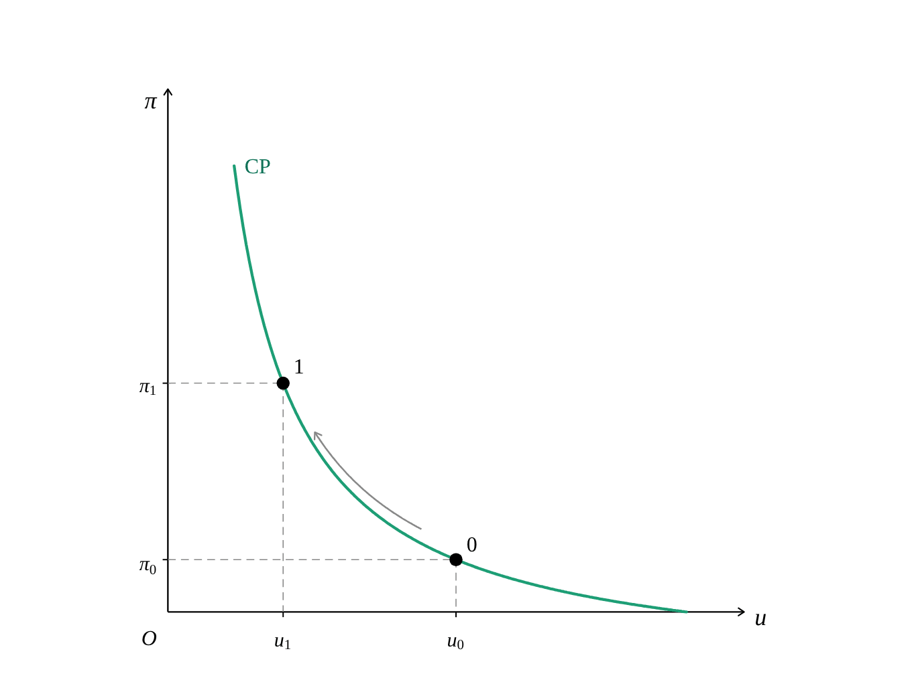
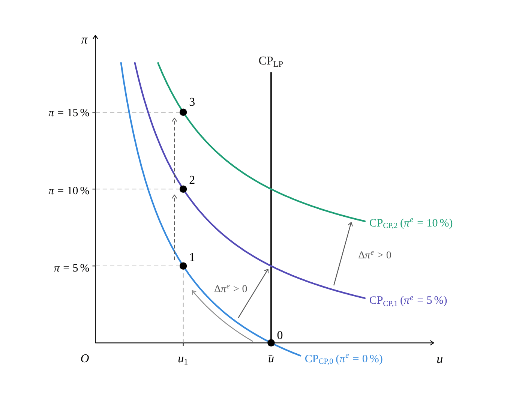
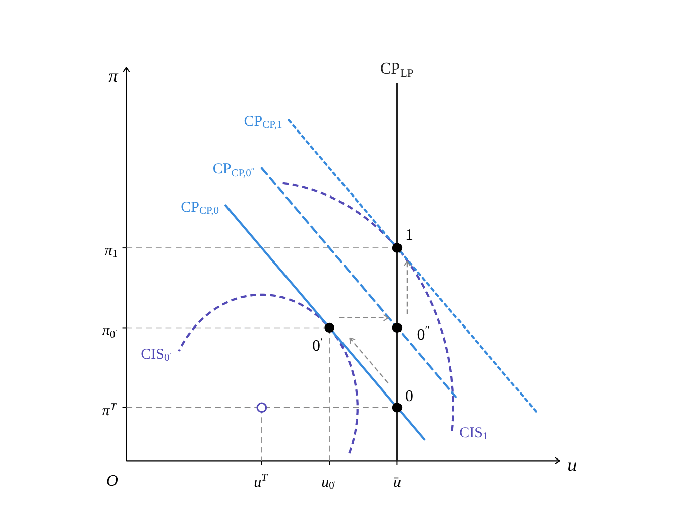
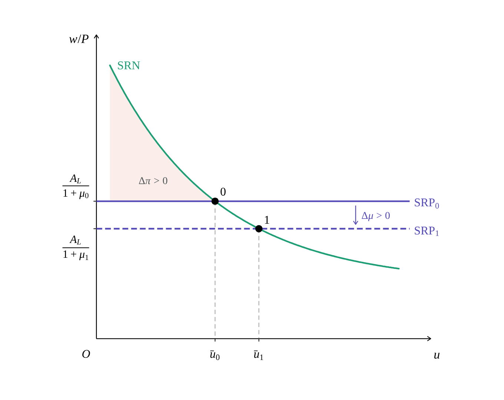
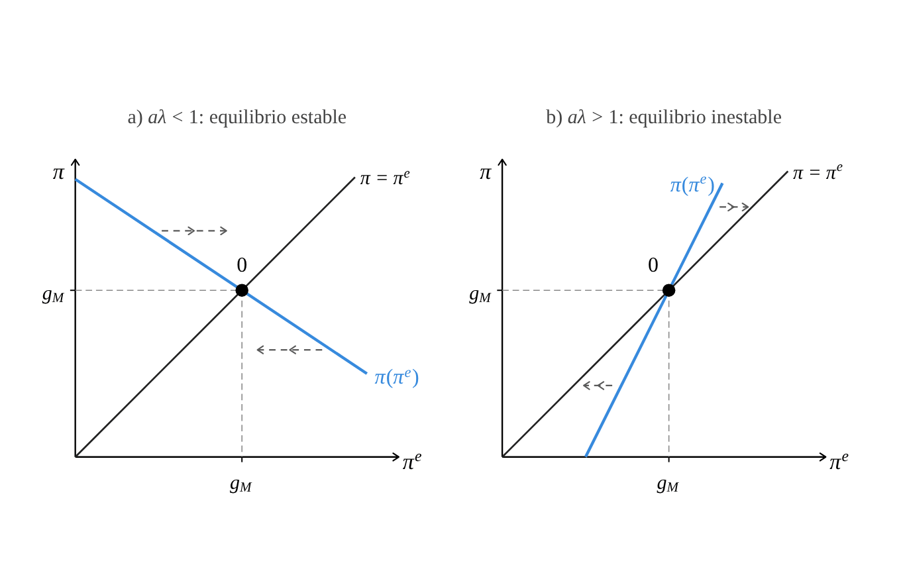

## Introducción

::: {.callout-note appearance="simple" icon=false}

:::

La **inflación** es el aumento sostenido del nivel general de precios a lo largo del tiempo, y es una de las variables macroeconómicas de mayor relevancia. En exceso, distorsiona la función señalizadora de los precios, envilece la moneda y redistribuye la renta de forma arbitraria. En el extremo opuesto, la deflación enfría el consumo y agrava las deudas. De ahí que exista un amplio consenso sobre la conveniencia de una inflación reducida y controlada, en torno al 2 %.

Históricamente, la inflación ha acompañado a los grandes cambios monetarios. La llegada de metales preciosos americanos provocó en Europa, desde mediados del siglo XVI hasta mediados del XVII, la llamada *revolución de los precios*, que inspiró las primeras formulaciones de la teoría cuantitativa del dinero en la Escuela de Salamanca y en Jean Bodin. En el siglo XX, las hiperinflaciones de entreguerras, la estanflación de los años setenta y la posterior desinflación de los ochenta hicieron de la inflación uno de los ejes del debate macroeconómico, desde la curva de Phillips hasta las expectativas racionales. Tras dos décadas de inflación baja y estable, e incluso de riesgo de deflación después de la Gran Recesión, el repunte de 2021-2023 devolvió la inflación al primer plano y puso a prueba la credibilidad de los bancos centrales.

La inflación se mide con índices de precios de consumo, como el **índice armonizado de precios de consumo** (IPCA) que usa el BCE, y su control es hoy el objetivo principal de la mayoría de los bancos centrales. Sobre sus causas, la teoría ha oscilado entre explicaciones por el exceso de demanda, por los costes y por las expectativas. Para la tradición cuantitativa y el monetarismo, a largo plazo precios y dinero se mueven a la par, de modo que la inflación es siempre un fenómeno monetario. Las escuelas posteriores han puesto el acento, en cambio, en las expectativas y en las rigideces, y el repunte reciente ha reabierto el debate sobre el peso de las perturbaciones de oferta y de la política fiscal.

El tema estudia la inflación en tres bloques:

- *Concepto y costes*: qué es la inflación y qué cuesta.

- *Causas*: las teorías que la explican, de la clásica a la nueva economía keynesiana.

- *Formas extremas*: la hiperinflación y la deflación.

::: {.callout-note appearance="simple" icon=false}
Los modelos del mercado de trabajo en que se apoya la teoría moderna de la inflación se desarrollan en el tema [A28](a28-tnp-nairu.qmd). Aquí solo se recogen sus implicaciones para la inflación.
:::

## 1. La inflación: concepto, costes y efectos sobre la eficiencia y el bienestar

El análisis empieza por definir y medir la inflación y sigue con sus costes, entre ellos los que impone su persistencia, y sus beneficios, de cuya comparación resulta la inflación óptima.

### 1.1. Concepto y medición

El carácter sostenido de la subida del precio medio de los bienes y servicios de la economía distingue la inflación de un aumento aislado o de una sola vez, que altera el nivel de precios y solo transitoriamente su tasa de variación. Como fenómeno dinámico, su análisis exige considerar el comportamiento intertemporal de los agentes y la formación de sus expectativas. 

La inflación puede medirse de diferentes formas[^a41-1]:

- *Índice de precios de consumo* (IPC): es un índice de Laspeyres que mide la evolución de los precios de una cesta de bienes nacionales y extranjeros representativa del consumo de la sociedad. Sirve de medida de referencia a la mayoría de los objetivos de inflación y de la indiciación de salarios y pensiones. El BCE usa el índice armonizado de precios de consumo (IPCA), y la Reserva Federal es una excepción, pues usa el deflactor del consumo privado (PCE).

- *Deflactor del PIB*: es un índice de Paasche que mide la evolución de los precios de todos los bienes producidos en el país, y excluye por tanto los importados.

- *Inflación subyacente*: excluye del IPC los componentes más volátiles, energía y alimentos no elaborados, para aproximar la tendencia de los precios sobre la que actúa la política monetaria.

Para el análisis económico importan tres distinciones:

- *Intensidad*: la inflación es moderada (un dígito anual), galopante (dos o tres dígitos) o hiperinflación (más del 50 % mensual, según el umbral de Cagan que se usa en el apartado 3). 

- *Previsibilidad*: es esperada, si los agentes la anticipan e incorporan a sus contratos, o no esperada, si los sorprende, y los costes de una y otra son distintos.

- *Causa*: es de demanda, de costes, estructural, inercial o monetaria, según la causa que la teoría del apartado 2 identifique.

La inflación relevante para la política económica es la sostenida y esperada, que los agentes incorporan a sus decisiones. La no esperada, en cambio, tiene efectos redistributivos y sobre la actividad, pero no puede mantenerse con una inflación estable, pues los agentes acaban anticipándola.

### 1.2. Los costes de la inflación

La inflación genera costes que dependen de su magnitud, de su volatilidad y de si es esperada o no. Conviene distinguir los costes de la inflación esperada, que subsisten aunque los agentes la anticipen perfectamente, de los costes adicionales de la inflación no esperada, que proceden de la sorpresa.

#### 1.2.1. Costes microeconómicos

**Conducta de los agentes**: en el contexto de un ciclo expansivo, la inflación puede dar lugar, especialmente a corto plazo, a una aceleración del consumo y de la inversión que alimenta burbujas especulativas. La causa es que los agentes anticipan sus compras sabiendo que los precios futuros serán más altos. 

Además, existen indicios de que los agentes sufren cierto grado de *ilusión monetaria*. Al confundir magnitudes nominales y reales, ignoran muchos efectos de la inflación y no optimizan adecuadamente.

**Mercado de bienes y servicios**: salvo que sea pura, la inflación hace que los precios informen peor de qué bienes son relativamente escasos. Como cuesta saber cuánto vale de verdad cada bien, los agentes incurren en costes de búsqueda y deciden con más incertidumbre, lo que sesga sus elecciones. Además, la necesidad de revisar los precios con frecuencia impone a las empresas *costes de menú*.

**Mercado de trabajo y de factores**: la inflación supone una pérdida del valor real de las rentas del trabajo, si los salarios no se ajustan, y también de la riqueza mantenida en activos nominales, lo que puede enfriar el consumo. Si se concentra en ciertos consumos intermedios, como las materias primas o la energía, produce disrupciones en las cadenas de valor por el encarecimiento de los insumos.

**Mercados financieros y monetarios**: la inflación afecta a las tres funciones del dinero:

- *Medio de pago*: al dudarse de su valor, el dinero se acepta peor en las transacciones.

- *Unidad de cuenta*: pierde fiabilidad como referencia de los precios.

- *Depósito de valor*: pierde poder de compra, se mantienen menos saldos reales y surgen los llamados *costes de suela de zapatos*. Los agentes reducen sus tenencias de efectivo, acuden a otros activos y multiplican las conversiones en saldos líquidos, con sus costes de transacción[^a41-3]. 

**Coste de bienestar de la inflación anticipada** (Bailey, 1956): mantener saldos reales cuesta el tipo de interés nominal, $i = r + \pi$, aunque crear dinero casi no cuesta nada. Con una demanda de saldos reales en proporción de la renta, $m(i)$, decreciente, la pérdida es el excedente al que los agentes renuncian al economizar efectivo, es decir, el área comprendida entre la curva de demanda y el eje del tipo de interés, desde $i = 0$ hasta el tipo vigente, menos el rectángulo $i \cdot m(i)$, que es una transferencia al emisor. Esa pérdida irrecuperable, $\text{PB}(i)$, es:

$$\text{PB}(i) = \int_0^{i} m(x)\, dx - i\, m(i)$$

Con la demanda semilogarítmica de Cagan (apartado 3.1.2), la pérdida crece aproximadamente con el cuadrado del tipo nominal, de modo que es pequeña con inflación moderada y crece deprisa con la alta. Así, Lucas (2000) estima que pasar de una inflación del 10 % a la nula equivale a algo menos del 1 % de la renta. La pérdida desaparece con $i = 0$, que es la regla de Friedman.

Sobre los *stocks* de deuda, la inflación no anticipada reduce el valor real de la deuda en moneda nacional, perjudica a los acreedores y favorece a los deudores, con un efecto redistributivo arbitrario. Además, una inflación alta y volátil lleva a los prestamistas a exigir primas de riesgo sobre los tipos nominales, lo que encarece la financiación en términos reales.

#### 1.2.2. Costes macroeconómicos

**Tipo de interés real e inversión**: con inflación esperada, el tipo de interés nominal incorpora una prima que compensa la pérdida de valor del dinero, $i = r + \pi^e$. Por ello, a largo plazo la inflación se traslada íntegramente a los tipos nominales y el tipo real permanece determinado por factores reales (*efecto Fisher* completo), salvo el pequeño efecto de cartera de Mundell-Tobin (apartado 1.3.2). En cambio, una inflación no esperada reduce el tipo real *ex post*, lo que favorece a los deudores.

**Sector exterior**: con tipo de cambio fijo, o con una traslación incompleta al tipo de cambio, una inflación superior a la de los socios comerciales encarece los productos nacionales frente a los extranjeros. La pérdida de competitividad-precio deteriora la balanza comercial si se cumple la condición de Marshall-Lerner (tema [B12](b12-ajuste-bp.qmd)).

**Crecimiento**: la incertidumbre que la inflación genera sobre los precios relativos y sobre la rentabilidad real de los proyectos acorta los horizontes de decisión y reduce la inversión productiva. En consonancia, la evidencia entre países muestra que las inflaciones elevadas y volátiles se asocian a un crecimiento menor, aunque el umbral a partir del cual el efecto es apreciable está por encima de las tasas moderadas.

#### 1.2.3. Costes desde la política económica

**Política monetaria**: una inflación alta y volátil desancla las expectativas, con lo que la curva de Phillips de corto plazo se desplaza y la política pierde su capacidad de estabilizar. Además, volver a la estabilidad de precios tiene un coste en producción y empleo, la *ratio de sacrificio* (apartado 2.4.3).

Ese coste depende de la *persistencia de la inflación*, la tendencia de la tasa de inflación a permanecer próxima a su valor anterior, que puede asemejarse a la inercia física, la resistencia de un cuerpo a cambiar la dirección y la velocidad de su movimiento. Según la distinción de Fuhrer (2006), la persistencia tiene dos fuentes:

1. *Persistencia intrínseca*: la que proviene de la propia inflación y obliga a incluir los retardos de la inflación pasada entre los determinantes de la actual. Se manifiesta en dos ámbitos:

    - *Desinflaciones*: cuanto mayor es la persistencia intrínseca, más intensa o prolongada ha de ser la restricción monetaria del banco central para desacelerar la inflación, y mayor es su coste en producción.

    - *Respuesta a los shocks*: si los agentes revisan los precios de sus contratos en función de la inflación pasada, la inflación responde a los *shocks* con mayor persistencia.

2. *Persistencia heredada*: la que procede de los determinantes de la inflación como el desempleo, la brecha de producción (*output gap*) o el coste marginal, que tienen su propia dinámica temporal.

La distinción importa para la política monetaria, porque la persistencia heredada desaparece cuando lo hacen sus causas, mientras que la intrínseca subsiste y obliga a una desinflación gradual y costosa, cuya magnitud se mide con la ratio de sacrificio. Qué parte de la persistencia observada es intrínseca es el punto en que las teorías del apartado 2 discrepan, y el criterio con el que la evidencia las juzga.

**Política fiscal**: la inflación distorsiona el sistema tributario por dos vías:

- *Efecto Tanzi-Olivera*: como la recaudación tiene lugar con demora respecto al devengo, mientras los gastos corrientes crecen con la inflación, el valor real de lo recaudado resulta inferior al de lo gastado, y el déficit se amplía[^a41-4]. 

- *Rémora fiscal* o *progresividad en frío* (*fiscal drag*): con impuestos progresivos no indiciados, los aumentos nominales de salarios y rentas trasladan a los contribuyentes a tramos superiores y redistribuyen renta del sector privado al público sin decisión legislativa. Con todo, este coste no se debe a la inflación *per se* sino al diseño del sistema impositivo.

En suma, los costes de la inflación esperada son los de “suela de zapatos”, los costes de menú y las distorsiones fiscales, pequeños a tasas moderadas pero crecientes con ella. 

Los de la inflación no esperada son la redistribución arbitraria entre acreedores y deudores, la incertidumbre y la pérdida de contenido informativo de los precios, que distorsionan la asignación de recursos. 

Ambos tipos justifican que la estabilidad de precios sea el objetivo central de la política monetaria, y la distinción explica por qué una inflación moderada y estable cuesta menos que una baja pero volátil.

### 1.3. Los beneficios de la inflación y la inflación óptima

La solución a muchos de los costes de la inflación pasa por la indiciación (de salarios, de tramos impositivos, de deuda). No obstante, la inflación no solo supone costes. Una tasa moderada tiene efectos beneficiosos, que se presentan desde las mismas tres perspectivas y que explican por qué el objetivo de los bancos centrales no es la inflación nula.

#### 1.3.1. Beneficios microeconómicos

**Conducta de los agentes**: a tasas bajas, muchos agentes no incorporan del todo la inflación a sus decisiones de salarios y precios, porque ignorarla apenas les cuesta. Akerlof, Dickens y Perry (2000) muestran que esta conducta *casi racional* (*near-rational*) permite que, con una inflación baja y positiva, el desempleo sostenible sea menor que con inflación nula. El beneficio, sin embargo, se agota a tasas más altas, cuando ignorar la inflación sale caro y los agentes la incorporan a sus contratos.

**Mercado de trabajo**: siguiendo a James Tobin, en presencia de rigideces nominales de los salarios a la baja, la inflación permite reducir los salarios reales sin recortar los nominales. De este modo, “engrasa” el ajuste del mercado de trabajo y, si no es excesiva ni inestable, puede reducir el desempleo.

**Economía sumergida**: comprende las actividades legales que se ocultan a la Administración para eludir impuestos, cotizaciones y regulaciones. Estrecha las bases imponibles, de modo que los contribuyentes que cumplen soportan tipos más altos, y da a quien evade una ventaja de costes frente a sus competidores. Como estas actividades se pagan sobre todo en efectivo, la inflación, al erosionar el valor del dinero, las grava de forma indirecta y alcanza una base que los impuestos ordinarios no tocan. Nicolini (1998) muestra que este argumento justifica una inflación óptima positiva, aunque la ganancia de bienestar es pequeña incluso en economías con un sector informal amplio.

#### 1.3.2. Beneficios macroeconómicos

**Tipo de interés real e inversión**: a corto plazo, mientras la traslación de la inflación esperada al tipo nominal es incompleta, una inflación esperada superior al tipo de interés nominal ($\pi^e > i$) hace negativo el tipo de interés real ($r = i - \pi^e < 0$). Un tipo real negativo estimula la inversión y, con ella, el empleo.

**Acumulación de capital**: según el *efecto Mundell-Tobin*, la inflación esperada reduce la demanda de saldos reales y desplaza la cartera de los agentes hacia activos reales, lo que eleva la acumulación de capital y reduce el tipo de interés real. Por este canal, la inflación esperada puede tener efectos reales permanentes en un modelo con dinero, aunque su magnitud se considera pequeña.

**Desapalancamiento**: por el mismo efecto redistributivo que perjudica a los acreedores, la inflación reduce el valor real de las deudas de hogares, empresas y Estado, y facilita la salida de las crisis de sobreendeudamiento. Este efecto es la contrapartida de la deflación de deuda del apartado 3.2.2.

#### 1.3.3. Beneficios desde la política económica y la inflación óptima

**Política monetaria**: una inflación positiva mantiene los tipos nominales alejados del límite inferior de los tipos de interés (*zero lower bound*), y da al banco central margen para bajarlos en las recesiones sin caer en la trampa de liquidez.

**Política fiscal**: la creación de dinero es una de las vías de financiación del Estado, junto con los impuestos y la deuda. El *señoraje* es el ingreso real que obtiene el Estado por la emisión de moneda, y le permite cubrir gasto público sin alterar los impuestos (tema [A39](a39-deficit.qmd)).

Frente a estos beneficios, la teoría monetaria clásica ofrece un resultado opuesto, la *regla de Friedman* (1969), que establece que la cantidad óptima de dinero se alcanza con un tipo de interés nominal nulo, es decir, con una deflación igual al tipo de interés real. Solo así el coste de mantener dinero coincide con su coste de producción, que es nulo.

El consenso de la política monetaria moderna se aparta de ese óptimo teórico por tres razones: el sesgo al alza de los índices de precios, la rigidez a la baja de los salarios nominales (el argumento de Tobin) y la necesidad de un margen sobre el límite inferior de los tipos nominales para poder bajarlos en las recesiones. De ahí procede el objetivo del 2 %, una inflación reducida, controlada y anticipable.

### 1.4. Conclusiones

**Aspectos positivos**: el análisis de los costes y beneficios muestra que la inflación no es un fenómeno neutral, y ofrece el criterio con el que se fija el objetivo de la política monetaria.

**Limitaciones**: la magnitud de los costes es difícil de estimar, y los estudios empíricos encuentran costes reducidos para tasas moderadas y estables (Lucas, 2000), lo que hace que el debate sobre el nivel óptimo (2 %, 3 %, 4 %) siga abierto. Por su parte, la persistencia muestra que la inflación tiene una dinámica propia que las teorías estáticas no captan, lo que motiva las teorías dinámicas del apartado siguiente.

## 2. Las causas de la inflación: las escuelas y sus curvas de Phillips

Las causas de la inflación pueden ordenarse en una taxonomía de cinco tipos:

- *Inflación de demanda*: la demanda agregada crece más deprisa que la capacidad productiva de la economía.

- *Inflación de costes*: aumentan los costes de producción, salarios o insumos, con independencia de la demanda.

- *Inflación estructural*: el poder de mercado de trabajadores y empresas genera una puja distributiva sobre el reparto de la renta que se resuelve en precios.

- *Inflación inercial o de expectativas*: la inflación pasada se transmite a la presente a través de las expectativas y de la indiciación de contratos.

- *Inflación monetaria*: la causa última es el crecimiento de la cantidad de dinero por encima del de la producción.

Las escuelas de pensamiento difieren en cuál de esas causas destacan y en cómo la fundamentan. El recorrido sigue el mismo orden que el del mercado de trabajo en el tema [A28](a28-tnp-nairu.qmd), con los fundamentos clásico y keynesiano, la síntesis neoclásica y el monetarismo, la nueva macroeconomía clásica y la nueva economía keynesiana. La diferencia de énfasis es que allí la variable es el desempleo y aquí la producción, unidas por la ley de Okun.

### 2.1. Los fundamentos: teoría clásica y teoría keynesiana

Las dos teorías tradicionales de la inflación son la teoría cuantitativa del dinero, de raíz neoclásica, y la teoría keynesiana de la inflación de demanda y de costes.

#### 2.1.1. La teoría neoclásica: la teoría cuantitativa del dinero

**Origen**: la teoría cuantitativa es la más antigua de las teorías de la inflación y nace en la Escuela de Salamanca, donde Martín de Azpilcueta (1556) atribuyó la subida de los precios españoles a la llegada de la plata americana, antes que Jean Bodin (1568). 

Su formulación moderna procede de Irving Fisher (1911) y de la escuela de Cambridge (Marshall, Pigou), que dieron forma algebraica a la relación entre dinero y precios que Hume (1752) había formulado en términos causales.

**Idea**: a largo plazo, precios y dinero se mueven a la par, en idéntica proporción, de ahí que la inflación sea siempre un fenómeno monetario.

**Razonamiento**: la teoría parte de una identidad contable y la reinterpreta como una relación causal, en dos versiones. La primera es la *ecuación de cambio* (Newcomb, 1885; Fisher, 1911). El valor de las transacciones de la economía puede escribirse de dos formas, como el dinero que circula por las veces que cambia de manos, o como las transacciones por su precio:

$$M \cdot V_T = P \cdot T$$

donde $M$ es la cantidad de dinero, $V_T$ su velocidad-transacción, $P$ el nivel general de precios y $T$ el volumen de transacciones. 

Como identidad, es siempre cierta. Fisher, sin embargo, la convierte en una relación causal al leerla de izquierda a derecha y suponer que $V_T$ está determinada por la tecnología de los pagos y $T$ por factores reales, de modo que ambas son estables ($V_0$, $T_0$). 
Esto da lugar a una relación de proporcionalidad entre la cantidad de dinero en la economía y el índice de precios a razón de $V_0/T_0$:
$P = (V_0/T_0)\,M$.

De ahí que los economistas clásicos considerasen que *el dinero es un velo*, es decir, que se cumpliese la *neutralidad monetaria*
(pues los cambios en la cantidad de dinero solo afectan al nivel de precios) y la *dicotomía clásica*, pues las variables reales se determinan con independencia de las monetarias.

La segunda versión es la *ecuación de Cambridge* (Marshall, Pigou). La escuela de Cambridge escribe la misma relación en términos de renta y no de transacciones,

$$M = k \cdot P \cdot Y, \quad  k = 1/V_Y$$
donde $Y$ es la renta real y $k$ la fracción de la renta nominal que los agentes desean mantener en forma de dinero, el inverso de la velocidad-renta ($k = 1/V_Y$, distinta de $V_T$). 

La diferencia con Fisher no está en la conclusión, que es la misma si $k$ e $Y$ son estables, sino en la lectura. La ecuación de Cambridge es una demanda de dinero, en la que $k$ recoge una decisión de los agentes y no una tecnología, y por ello puede depender del tipo de interés y de las expectativas. De esa dependencia partirá Keynes (tema [A35](a35-demanda-dinero.qmd)).

De cualquiera de las dos versiones se sigue, por tanto, que, con la cantidad de dinero exógena, sus cambios se trasladan proporcionalmente a los precios a largo plazo.

**Conclusiones**:

- *Aspectos positivos*: fija la conclusión de largo plazo que ninguna teoría posterior ha desmentido, la de que la inflación sostenida es un fenómeno monetario.

- *Limitaciones*: como se limita a comparar equilibrios estáticos, sirve para explicar el nivel de precios, o un salto aislado de este, más que la inflación, que es una subida sostenida. Para dar cuenta de esta última haría falta una política monetaria expansiva mantenida durante mucho tiempo, y la neutralidad del dinero que la propia teoría postula deja a esa política sin una justificación clara.

#### 2.1.2. La teoría keynesiana: inflación de demanda y de costes

**Origen**: la Gran Depresión puso en duda el paradigma neoclásico, y la teoría keynesiana trajo consigo las rigideces de precios y salarios, con las que el equilibrio entre oferta y demanda deja de estar garantizado.

**Idea**: la inflación no es solo un fenómeno monetario. Un aumento de la cantidad de dinero puede tener efectos reales, porque con salarios nominales rígidos abarata el salario real y eleva la demanda de trabajo, y la inflación puede tener su origen en la demanda o en los costes con independencia del dinero.

**Razonamiento**: la teoría keynesiana distingue dos orígenes de la inflación. Keynes (1940) y Smithies (1942) formalizaron el primero con la *brecha inflacionista*, y el segundo procede del debate posterior sobre la inflación de costes (*cost-push*):

1. *Inflación de demanda*: aparece con pleno empleo de los recursos productivos o cerca de él. En esta situación, si la oferta no es capaz de adaptarse inmediatamente al aumento de la demanda agregada, los consumidores compiten por los productos y presionan al alza los precios de la economía.

2. *Inflación de costes*: aparece aun en épocas de elevado desempleo, es decir, cuando todavía existen recursos infrautilizados, por la fijación de *mark-ups* (poder de mercado). Así ocurre cuando los países productores de petróleo aumentan sus precios y, con ellos, suben los costes de producción de todas las empresas que utilizan el combustible en su proceso productivo.

**Desarrollo gráfico**: en el plano renta-precios (figura -@fig-a416-inflacion-demanda-costes), la oferta agregada keynesiana es casi horizontal con desempleo elevado, creciente al acercarse al pleno empleo y vertical en la renta de pleno empleo, $Y_{\text{PE}}$. Un aumento de la demanda cerca del pleno empleo (panel a) eleva mucho los precios y poco la renta, y una subida de costes con desempleo elevado (panel b) desplaza la oferta hacia arriba y eleva los precios aunque la renta caiga.

::: {#fig-a416-inflacion-demanda-costes}

::: {.content-visible when-format="html"}
```{=html}
<div class="graph-frame wide">
<iframe src="../graphs/a416_Inflacion_demanda_costes.html" style="--r:1.744" loading="lazy" title="fig-a416-inflacion-demanda-costes"></iframe>
</div>
```
:::

::: {.content-visible unless-format="html"}

:::

Inflación de demanda y de costes en la teoría keynesiana. La oferta agregada es casi horizontal con desempleo, creciente al acercarse al pleno empleo y vertical en $Y_{\text{PE}}$. Un aumento de la demanda cerca del pleno empleo (a) lleva de 0 a 1 con una fuerte subida de $P$ y poca de $Y$. Una subida de costes con desempleo elevado (b) desplaza la oferta de $\text{OA}_0$ a $\text{OA}_1$ y eleva $P$ aunque $Y$ caiga.
:::

**Conclusiones**:

- *Aspectos positivos*: la distinción entre demanda y costes amplía el marco analítico e introduce el poder de mercado como factor explicativo. Además, sigue siendo relevante para el diagnóstico de política económica, porque un mismo nivel de inflación puede requerir respuestas de política muy distintas según su origen.

- *Limitaciones*: tampoco sale de la comparación de equilibrios estáticos, así que da cuenta de saltos puntuales de los precios mejor que de la inflación, cuya dinámica incluye retardos. Una subida continuada de los precios requeriría que el exceso de demanda, o la escasez de oferta, durase también.

### 2.2. Síntesis neoclásica y monetarismo: la curva de Phillips y sus expectativas

::: {.callout-note appearance="simple" icon=false}
La curva de Phillips, su ampliación por las expectativas y la tasa natural de paro se desarrollan en el tema [A28](a28-tnp-nairu.qmd), apartados 1.2 y 1.3. Aquí se presentan como teoría de la inflación.
:::

Las dos escuelas comparten el instrumento, la curva de Phillips, pero discrepan en su lectura. Para la síntesis es una relación estable y explotable, para el monetarismo una relación transitoria que solo las expectativas erróneas sostienen.

#### 2.2.1. Síntesis neoclásica: la curva de Phillips como teoría de la inflación

**Origen**: Alban Phillips (1958) observó una relación inversa entre el crecimiento de los salarios nominales y el desempleo en el Reino Unido, Richard Lipsey (1960) la fundamentó y Paul Samuelson y Robert Solow (1960) la convirtieron en una relación entre inflación y desempleo[^a41-7].

**Idea**: la inflación nace de la presión que la demanda ejerce sobre el mercado de trabajo. Con desempleo bajo, los salarios crecen, las empresas trasladan los costes a los precios y la inflación sube, mientras que con desempleo alto ocurre lo contrario. La relación es estable, y ofrece a la política económica un menú entre inflación y desempleo.

**Razonamiento**: la curva de Phillips original relaciona la inflación con el desempleo cíclico, y por la ley de Okun con la brecha de producción:

$$\pi_t = -\kappa_u(u_t - \bar{u}) \qquad \Longleftrightarrow \qquad \pi_t = \kappa\,(y_t - \bar{y}), \qquad \kappa_u, \kappa > 0$$
Como teoría de la inflación es una teoría de demanda, en la medida en que la inflación es positiva cuando la producción supera a su nivel potencial, nula cuando lo iguala y negativa cuando se sitúa por debajo.

Su implicación de política, que la síntesis explotó, es que una expansión monetaria o fiscal sostenida permite mantener la producción por encima del potencial a cambio de una inflación más alta pero estable, y la autoridad elige el punto de la curva que prefiere.

**Desarrollo gráfico**: en el plano desempleo-inflación (figura -@fig-a411-curva-phillips), la curva de Phillips, $\text{CP}$, recoge la inflación asociada a cada tasa de desempleo. Su pendiente es negativa, porque un desempleo menor acelera los salarios y las empresas trasladan los costes a los precios, y cada uno de sus puntos es una combinación de inflación y desempleo entre las que la autoridad puede elegir.

**Estática comparativa**: una expansión monetaria o fiscal lleva la economía a lo largo de la curva del punto 0 al 1, con menos desempleo ($u_1 < u_0$) y más inflación ($\pi_1 > \pi_0$).

::: {#fig-a411-curva-phillips}

::: {.content-visible when-format="html"}
```{=html}
<div class="graph-frame">
<iframe src="../graphs/a411_Curva_Phillips.html" style="height:560px" loading="lazy" title="fig-a411-curva-phillips"></iframe>
</div>
```
:::

::: {.content-visible unless-format="html"}

:::

Curva de Phillips original (Samuelson y Solow, 1960). La relación estable entre inflación y desempleo ofrece un menú a la política económica, y una expansión de la demanda lleva la economía de 0 a 1.
:::

**Conclusiones**:

- *Aspectos positivos*: la síntesis dio a la inflación una teoría operativa y una ecuación estimable.

- *Limitaciones*: la relación se apoyaba en el supuesto implícito de que los trabajadores no incorporan la inflación a sus demandas salariales. La estanflación de los años setenta, con inflación y desempleo crecientes a la vez, mostró que la curva se había desplazado.

#### 2.2.2. Monetarismo: la reformulación de la teoría cuantitativa y la curva ampliada

**Origen**: el monetarismo de Milton Friedman cuestionó la síntesis en dos planos. Por un lado, en su ensayo de 1956 recuperó la teoría cuantitativa como teoría de la demanda de dinero. Por otro lado, en *The Role of Monetary Policy* (1968), a la vez que Edmund Phelps (1967) y de forma independiente, introdujo las expectativas en la curva de Phillips.

**Idea**: la inflación sostenida es siempre un fenómeno monetario, y la curva de Phillips solo existe a corto plazo, mientras los agentes se equivocan sobre la inflación, por lo que a largo plazo no hay *trade-off* que explotar.

**Razonamiento**: el argumento tiene dos pasos. El primero es la *reformulación cuantitativa*. Friedman lee la ecuación de Cambridge como una demanda de dinero, $M/P = k(\cdot)\,Y$, dependiente de la renta permanente y de los rendimientos de los activos alternativos, y sostiene que esa función es empíricamente estable, más que la función de consumo keynesiana. La ecuación cuantitativa, que como identidad se cumple siempre, se escribe en tasas de variación:

$$\pi = g_M + g_V - g_Y$$
de modo que, con velocidad estable y crecimiento real determinado por factores reales, la inflación es el exceso del crecimiento monetario sobre el crecimiento real. En esa ecuación se basa la afirmación de que la inflación es “siempre y en todas partes un fenómeno monetario” (Friedman, 1963). Por tanto, la política monetaria determina la inflación a largo plazo, y las causas de demanda o de costes solo pueden sostenerla si el dinero las acomoda.

El segundo paso es la *curva de Phillips ampliada por las expectativas*. Si los trabajadores negocian en términos reales, incorporan la inflación que esperan a sus demandas salariales, y la curva de Phillips se desplaza con las expectativas:

$$\pi_t = \pi_t^e - \kappa_u(u_t - \bar{u}) \qquad \Longleftrightarrow \qquad \pi_t = \pi_t^e + \kappa\,(y_t - \bar{y}), \qquad \kappa_u > 0,\; \kappa > 0$$

donde $\bar{u}$ es la tasa natural de paro, e $\bar{y}$ la producción potencial que le corresponde. Como teoría de la inflación, la curva ampliada dice tres cosas:

1. *Componente inercial*: la inflación esperada, que con expectativas adaptativas es la inflación pasada[^a41-8], con lo que la inflación se autoalimenta.

2. *Componente de demanda*: la brecha de producción. Solo una producción por encima del potencial genera presión inflacionista, y la curva original es el caso $\pi_t^e = 0$.

3. *Aceleración*: en consecuencia, mantener la producción por encima del potencial exige una inflación creciente, pues cada periodo la esperada alcanza a la observada. La *teoría aceleracionista*[^a41-9] enlaza así con el primer paso, porque solo un crecimiento monetario cada vez mayor puede sostener las sorpresas.

**Desarrollo gráfico**: la curva de Phillips ampliada por las expectativas se representa en el plano desempleo-inflación (figura -@fig-a414-aceleracionista):

1. *Curva de Phillips de largo plazo*, $\text{CP}_{\text{LP}}$: es vertical en la tasa natural $\bar{u}$, donde la inflación observada coincide con la esperada.

2. *Curvas de Phillips de corto plazo*, $\text{CP}_{\text{CP},0}$, $\text{CP}_{\text{CP},1}$ y $\text{CP}_{\text{CP},2}$: una para cada inflación esperada (0 %, 5 % y 10 %). Son decrecientes, porque, dada la inflación esperada, solo una inflación superior a ella lleva el desempleo por debajo de la tasa natural, y cada una corta a la de largo plazo en su inflación esperada.

3. *Equilibrio*: en el punto 0, sobre $\text{CP}_{\text{LP}}$, el desempleo está en $\bar{u}$ y la inflación es nula, igual a la esperada.

**Dinámica**: si la autoridad quiere mantener el desempleo en $u_1 < \bar{u}$, la economía pasa del punto 0 al 1 a lo largo de $\text{CP}_{\text{CP},0}$, con una inflación del 5 %. En el periodo siguiente la inflación esperada alcanza ese 5 % ($\Delta \pi^e > 0$), la curva se desplaza a $\text{CP}_{\text{CP},1}$ y sostener $u_1$ exige una inflación del 10 % (punto 2). Después, con $\text{CP}_{\text{CP},2}$, la inflación sube al 15 % (punto 3). Dicho de otro modo, el desempleo solo se mantiene por debajo de la tasa natural con una inflación cada vez mayor, y cuando la autoridad deja de acelerarla la economía vuelve a $\bar{u}$ con la inflación ya alcanzada.

::: {#fig-a414-aceleracionista}

::: {.content-visible when-format="html"}
```{=html}
<div class="graph-frame">
<iframe src="../graphs/a414_Aceleracionista.html" style="height:580px" loading="lazy" title="fig-a414-aceleracionista"></iframe>
</div>
```
:::

::: {.content-visible unless-format="html"}

:::

Hipótesis aceleracionista. Mantener el desempleo en $u_1$, por debajo de la tasa natural, exige una inflación creciente (puntos 1, 2 y 3), porque cada aumento de la inflación esperada desplaza hacia arriba la curva de Phillips de corto plazo.
:::

**Conclusiones**:

- *Aspectos positivos*: la curva ampliada es el punto de partida de toda la teoría moderna de la inflación.

- *Limitaciones*: las de las expectativas adaptativas, que suponen errores sistemáticos, y la ausencia de una explicación de la tasa natural, que el modelo de Layard y Nickell sí aporta.

### 2.3. Nueva macroeconomía clásica: información imperfecta e inconsistencia dinámica

Las dos teorías de la inflación que aporta la nueva macroeconomía clásica son la oferta agregada de Lucas, basada en la información imperfecta, y la inconsistencia dinámica (*time inconsistency*) de la política monetaria.

#### 2.3.1. Información imperfecta: la oferta agregada de Lucas (1972)

::: {.callout-note appearance="simple" icon=false}
El modelo de Lucas y la curva de Phillips con expectativas racionales se desarrollan en el tema [A28](a28-tnp-nairu.qmd), apartado 2.1.3.
:::

**Origen**: Robert Lucas (1972) formuló el modelo de información imperfecta de la nueva macroeconomía clásica, del que se deriva la oferta agregada con sorpresas de precios, y Sargent y Wallace (1975) extrajeron de él la proposición de inefectividad de la política monetaria.

**Idea**: en la nueva macroeconomía clásica los agentes forman expectativas racionales en lugar de adaptativas, aprovechan cuanta información tienen y sus errores no siguen ningún patrón sistemático. Si aun así existe un *trade-off* a corto plazo, ha de deberse a que su información sobre los precios agregados es incompleta.

**Razonamiento**: como les falta información sobre variables agregadas (la tasa de inflación y el crecimiento monetario), los productores no pueden distinguir con certeza las variaciones de su precio relativo de las del nivel general, es decir, afrontan un problema de extracción de señales. Por eso, ante una variación de su precio provocada por un *shock* de demanda, el productor no sabe a cuál de dos causas atribuirla:

- *Shock específico*: puede que los consumidores hayan cambiado sus preferencias y demanden más o menos de su producto, y en ese caso lo racional es ajustar la producción.

- *Shock general*: puede que haya variado la demanda agregada, y entonces lo conveniente es mantener la producción.

Los productores atribuirán al componente específico una fracción $\vartheta$ de la variación observada de su precio (coeficiente de extracción de señales):

$$\vartheta = \frac{\sigma_i^2}{\sigma_i^2 + \sigma_p^2}$$

Con la experiencia acumulada, los productores estiman qué parte de la variabilidad total de los precios procede de los precios relativos ($\sigma_i^2$). Cuanto mayor sea esa parte, más verosímil les parecerá que el *shock* sea específico.

El valor de $\vartheta$ depende del grado general de variabilidad de los precios:

- *Inflación muy variable* ($\sigma_p^2$ grande): en una economía habituada a ella, como suele suceder cuando es elevada, el empresario interpreta casi cualquier variación de su precio como un *shock* global ($\vartheta$ cercana a cero) y no la traslada a la producción.

- *Precios estables* ($\sigma_p^2$ pequeña): $\vartheta$ es alta, y las sorpresas monetarias surten efectos reales transitorios.

La oferta agregada resultante (en logaritmos), $y_t = \bar{y}_t + \zeta\,(p_t - p_t^e) + \varepsilon_t^s$, con $\zeta > 0$ creciente en $\vartheta$, muestra que solo las sorpresas de precios tienen efectos reales, y que su efecto es menor cuanto más variable es la inflación. En consecuencia, la política monetaria sistemática es inefectiva y, como teoría de la inflación, el modelo implica que la inflación anticipada no compra actividad alguna.

El modelo de Lucas cierra así la vía de la inflación como instrumento, porque una autoridad que intente sorprender de forma sistemática deja de sorprender. El modelo siguiente plantea exactamente ese problema.

**Conclusiones**:

- *Aspectos positivos*: explica, con agentes racionales, por qué solo la inflación no anticipada tiene efectos reales y por qué el *trade-off* entre inflación y producción es más débil donde la inflación es más variable, implicación contrastable entre países. Con ello sitúa las expectativas y la credibilidad en el centro de la teoría de la inflación.

- *Limitaciones*: la confusión entre precios relativos y nivel general es poco plausible cuando los índices de precios se publican cada mes, y el modelo no explica por qué los efectos reales de las sorpresas persisten. Además, con datos de EE. UU., Mishkin (1982) encuentra que también la política monetaria anticipada tiene efectos reales.

#### 2.3.2. Inconsistencia dinámica de la política monetaria (Kydland y Prescott, 1977; Barro y Gordon, 1983a)

**Origen**: Finn Kydland y Edward Prescott (*Rules Rather than Discretion*, 1977) mostraron que una política óptima anunciada puede dejar de serlo cuando llega el momento de aplicarla, y Robert Barro y David Gordon (1983a) aplicaron la idea a la inflación.

**Idea**: una política anunciada es *dinámicamente inconsistente* cuando, una vez que los agentes han actuado confiando en ella, a la autoridad le conviene incumplirla. Como los agentes lo anticipan, la política no es creíble y el resultado es peor que el prometido. Aplicada a la política monetaria, la falta de credibilidad genera por sí sola inflación, sin ganancia alguna de empleo, lo que se conoce como *sesgo inflacionista*.

**Supuestos**:

- *Agentes*:

    - *Sociedad*: los agentes eligen sus expectativas de inflación según la hipótesis de expectativas racionales (HER), $\pi_t^e = \mathbb{E}_{t-1}[\pi_t]$, y sobre ellas fijan sus contratos de precios y salarios.

    - *Gobierno*: intenta minimizar la pérdida social derivada de las fluctuaciones del nivel de desempleo y del nivel de inflación. Así, tiene un objetivo de inflación, $\pi^T$, y un objetivo de desempleo, $u^T$, inferior a la tasa natural ($u^T < \bar{u}$).

**Planteamiento**: el juego se analiza con las curvas de Phillips de corto plazo (CP$_{\text{CP}}$) del tema [A28](a28-tnp-nairu.qmd) y las curvas de indiferencia de la sociedad (CIS), elipses en torno al objetivo del Gobierno, $(u^T, \pi^T)$, tanto mejores cuanto más cerca de él. Las etapas del juego son cuatro:

1. *Punto 0*: al principio, la autoridad monetaria anuncia su compromiso de controlar la inflación. Los agentes toman ese anuncio como base de sus expectativas y pactan precios y salarios nominales.

2. *Punto 0′*: firmados los contratos, a la autoridad monetaria le conviene a corto plazo faltar a su palabra. Con los salarios nominales ya fijados, una inflación superior a la esperada abarata el trabajo en términos reales y reduce el desempleo. Si la autoridad monetaria faltara a su palabra, la economía se situaría en el punto 0′.

3. *Punto 0″*: sin embargo, los agentes revisan al alza sus expectativas de inflación y reclaman salarios más altos. Esto provoca un desplazamiento de la CP$_{\text{CP}}$ hacia la derecha, de $\text{CP}_{\text{CP},0}$ a $\text{CP}_{\text{CP},0''}$, hasta el punto 0″.

4. *Punto 1*: tras repetirse la secuencia durante varios periodos, la economía alcanza el punto 1. Allí la inflación iguala a la esperada ($u = \bar{u}$) y la CP$_{\text{CP}}$ toca la curva de indiferencia social (CIS) sin cortarla, de modo que ese punto es un equilibrio de Nash. Frente al punto 0, el empleo es el mismo, la inflación es más alta (*inflation bias*) y la CIS queda más alejada del objetivo $(u^T, \pi^T)$, lo que supone un empeoramiento.

**Equilibrio**: con expectativas racionales, los agentes anticipan la secuencia completa y piden desde el momento $t$ el salario propio del punto 1. Por eso el punto inicial queda descartado como equilibrio de Nash perfecto en subjuegos. Para estos autores, la inflación puede nacer de que el público no se fíe de los anuncios de política económica.

**Desarrollo gráfico**: la inconsistencia dinámica de la política monetaria se representa en el plano desempleo-inflación (figura -@fig-a412-modelo-barro-gordon):

1. *Curva de Phillips de largo plazo*, $\text{CP}_{\text{LP}}$: recoge los puntos en que la inflación coincide con la esperada y es vertical en la tasa natural de paro, $\bar{u}$, porque entonces el desempleo no depende de la inflación.

2. *Curvas de Phillips de corto plazo*, $\text{CP}_{\text{CP},0}$, $\text{CP}_{\text{CP},0''}$ y $\text{CP}_{\text{CP},1}$: una para cada inflación esperada, con pendiente negativa, porque solo una inflación superior a la esperada reduce el salario real y, con él, el desempleo.

3. *Curvas de indiferencia social*, $\text{CIS}_{0'}$ y $\text{CIS}_1$: elipses en torno al objetivo $(u^T, \pi^T)$, que representan una pérdida social mayor cuanto más se alejan de él.

4. *Equilibrio*: en el punto 1, la $\text{CP}_{\text{CP},1}$ es tangente a la $\text{CIS}_1$ sobre la curva de largo plazo, con el desempleo en $\bar{u}$ y una inflación $\pi_1$ superior al objetivo $\pi^T$ del punto 0.

::: {#fig-a412-modelo-barro-gordon}

::: {.content-visible when-format="html"}
```{=html}
<div class="graph-frame">
<iframe src="../graphs/a412_Modelo_Barro_Gordon.html" style="height:560px" loading="lazy" title="fig-a412-modelo-barro-gordon"></iframe>
</div>
```
:::

::: {.content-visible unless-format="html"}

:::

Modelo de Barro y Gordon (1983a). Desde el compromiso anunciado (0), el incentivo a incumplir (0′) y la revisión de expectativas (0″) llevan al equilibrio discrecional (1), con sesgo inflacionista y sin ganancia de empleo.
:::

**Estática comparativa**: el sesgo inflacionista del equilibrio discrecional (punto 1) es tanto mayor:

- *Objetivo de desempleo*: cuanto más por debajo de la tasa natural fija el Gobierno su objetivo (mayor $\bar{u} - u^T$), porque mayor es la ganancia que promete una sorpresa inflacionista.

- *Preferencias del Gobierno*: cuanto más peso da el Gobierno al desempleo frente a la inflación en su función de pérdida, porque más inflación está dispuesto a aceptar a cambio de reducirlo. De ahí procede la solución del banquero conservador.

- *Pendiente de la curva de Phillips de corto plazo*: cuanto más reduce el desempleo una sorpresa de inflación dada, porque mayor es el incentivo a provocarla.

En todos los casos, el desempleo de equilibrio sigue siendo la tasa natural, y los parámetros solo alteran la inflación.

**Extensiones**: las soluciones al sesgo son cuatro:

- *Independencia del banco central*: separar el decisor de la presión política.

- *Reglas transparentes*: anclar las expectativas.

- *Banquero conservador* (Rogoff, 1985): nombrar un gobernador con mayor aversión a la inflación que la sociedad.

- *Contratos de desempeño* (Walsh, 1995): vincular la remuneración del gobernador al cumplimiento del objetivo de inflación.

**Conclusiones**:

- *Aspectos positivos*: el modelo explica el sesgo inflacionista de la política discrecional sin recurrir a errores de los agentes ni a perturbaciones, solo a la falta de compromiso, y fundamenta el diseño institucional de la política monetaria moderna.

- *Limitaciones*: supone que el objetivo de desempleo del Gobierno está por debajo de la tasa natural ($u^T < \bar{u}$), lo que no siempre ocurre, y que la sociedad conoce las preferencias del Gobierno. Con incertidumbre sobre ellas surgen la reputación y la señalización (Backus y Driffill, 1985).

### 2.4. Nueva economía keynesiana: rigideces reales y nominales

::: {.callout-note appearance="simple" icon=false}
El modelo de la tasa de paro que no acelera la inflación (NAIRU) de Layard y Nickell y la curva de Phillips neokeynesiana à la Calvo se desarrollan en el tema [A28](a28-tnp-nairu.qmd), apartados 2.2 y 3.2. Aquí se presentan como teorías de la inflación.
:::

La nueva economía keynesiana explica la inflación por las rigideces reales, en su primera generación, y por las nominales, en la segunda. Sus desarrollos posteriores recuperan la inercia con las curvas de Phillips híbridas.

#### 2.4.1. Primera generación: la puja distributiva (Layard y Nickell, 1985)

**Origen**: Richard Layard y Stephen Nickell (1985) formalizaron la NAIRU como resultado de la negociación salarial y de la fijación de precios con poder de mercado (tema [A28](a28-tnp-nairu.qmd), apartado 2.2).

**Idea**: la nueva economía keynesiana de primera generación explica la inflación como el resultado de una *puja distributiva*. En esa puja, los trabajadores negocian un salario real que crece con su poder negociador y las empresas fijan un margen sobre el coste. Cuando ambas aspiraciones son incompatibles, porque el desempleo es bajo, la puja se resuelve en inflación. La tasa de desempleo a la que son compatibles es la NAIRU[^a41-12].

**Razonamiento**: combinando la ecuación de salarios y la de precios se obtiene la misma curva de Phillips con expectativas, $\pi_t = \pi_t^e - \kappa_u(u_t - \bar{u})$, con la diferencia de que $\bar{u}$ ya no es un dato sino una función de los parámetros estructurales. En concreto, crece con el margen empresarial y con los factores institucionales que elevan las aspiraciones salariales (prestaciones, salario mínimo, cotizaciones), y decrece con la productividad. La inflación es aquí estructural, porque, para cada tasa de desempleo, depende del grado de competencia en los mercados de bienes y de trabajo, y solo las políticas que actúan sobre ellos reducen de forma permanente la NAIRU.

**Desarrollo gráfico**: la puja distributiva se representa en el plano desempleo-salario real (figura -@fig-a415-puja-distributiva):

1. *Salario real negociado*, SRN: recoge el salario real que reclaman los trabajadores, $w/P^e = f(u, z)$, y es decreciente, porque un desempleo menor refuerza su poder negociador.

2. *Salario real pagado*, SRP: recoge el salario real que conceden las empresas al fijar su margen, $A_L/(1+\mu)$, y es horizontal, porque no depende del desempleo.

3. *Equilibrio*: en el punto 0 se cortan ambas curvas, y el desempleo es la NAIRU, $\bar{u}_0$.

    - *Desempleo inferior a la NAIRU* ($u < \bar{u}_0$): el salario negociado supera al pagado, las aspiraciones son incompatibles y la puja se resuelve en una inflación creciente (zona sombreada).

    - *Desempleo superior a la NAIRU* ($u > \bar{u}_0$): el salario negociado queda por debajo del pagado, y la inflación se reduce.

**Estática comparativa**: un aumento del margen empresarial ($\Delta\mu > 0$) reduce el salario real pagado y desplaza la curva de $\text{SRP}_0$ a $\text{SRP}_1$. Con ello, el equilibrio pasa del punto 0 al 1, con una NAIRU mayor ($\bar{u}_1 > \bar{u}_0$). Un aumento de los factores institucionales $z$, que desplaza el SRN hacia arriba, tiene el mismo efecto.

::: {#fig-a415-puja-distributiva}

::: {.content-visible when-format="html"}
```{=html}
<div class="graph-frame">
<iframe src="../graphs/a415_Puja_distributiva.html" style="height:580px" loading="lazy" title="fig-a415-puja-distributiva"></iframe>
</div>
```
:::

::: {.content-visible unless-format="html"}

:::

Puja distributiva (Layard y Nickell, 1985). Con un desempleo inferior a la NAIRU, el salario real negociado (SRN) supera al pagado (SRP) y la inflación crece, y un aumento del margen ($\Delta\mu > 0$) eleva la NAIRU de $\bar{u}_0$ a $\bar{u}_1$.
:::

**Conclusiones**:

- *Aspectos positivos*: el modelo explica por qué economías con la misma política monetaria tienen inflaciones distintas, y fundamenta las políticas de rentas y las reformas estructurales como instrumentos antiinflacionistas.

- *Limitaciones*: la NAIRU de la que depende la inflación no es observable y sus estimaciones varían en el tiempo, lo que dificulta usarla como guía de la política. Además, el modelo explica la tasa de desempleo compatible con una inflación estable, pero no la dinámica del ajuste de los precios, que la segunda generación microfundamenta.

#### 2.4.2. Segunda generación: la fijación escalonada de precios (Calvo, 1983)

**Origen**: Guillermo Calvo (1983) propuso, como alternativa a los contratos de Fischer (1977) y Taylor (1980), el modelo de fijación escalonada de precios (tema [A28](a28-tnp-nairu.qmd), apartado 3.2) que se ha convertido en el estándar de los modelos de equilibrio general dinámico y estocástico (DSGE).

**Idea**: la nueva economía keynesiana de segunda generación microfundamenta la curva de Phillips en la conducta de empresas con poder de mercado que no pueden ajustar sus precios en todo momento. Cada periodo solo una fracción $1 - \xi$ de ellas los revisa[^a41-14], y al hacerlo fija un margen sobre los costes marginales presentes y esperados[^a41-15], porque el precio quedará vigente durante un tiempo.

**Razonamiento**: agregando los precios y loglinealizando se obtiene la *curva de Phillips neokeynesiana* (CP-NEK):

$$\pi_t = \beta \mathbb{E}_t[\pi_{t+1}] + \kappa\, \tilde{y}_t, \qquad \kappa > 0,\; \beta \in (0, 1)$$

donde $\tilde{y}_t$ es la brecha de producción y $\kappa$ crece con la frecuencia de ajuste de precios[^a41-16]. Como teoría de la inflación, la curva dice que la inflación de hoy depende de la inflación esperada para mañana y del exceso de demanda actual. La curva es puramente prospectiva (*forward looking*)[^a41-17], y la inflación actual resume toda la senda esperada de brechas de producción futuras. De ahí que no haya inercia y que la inflación pueda reducirse sin coste si la política es creíble.

**Conclusiones**:

- *Aspectos positivos*: la curva neokeynesiana es la relación de oferta de los modelos con los que los bancos centrales analizan la política monetaria, y su carácter prospectivo hace de la credibilidad y la comunicación los instrumentos centrales de la desinflación.

- *Limitaciones*: no reproduce la persistencia observada de la inflación (limitación empírica).

#### 2.4.3. Desarrollos: las curvas de Phillips híbridas (Galí y Gertler, 1999; Mankiw y Reis, 2002; Christiano, Eichenbaum y Evans, 2005)

**Origen**: los desarrollos de Galí y Gertler (1999), Mankiw y Reis (2002) y Christiano, Eichenbaum y Evans (2005) responden a las críticas empíricas a la curva de Phillips neokeynesiana pura, y recuperan la inercia que ya recogía el modelo del triángulo de Gordon (1982).

**Idea**: la CP-NEK pura (*forward looking*) se enfrenta a tres tipos de críticas, todas relacionadas con su carácter prospectivo:

- *Inmediatez del ajuste*: por su carácter prospectivo, predice un ajuste inmediato, mientras que la inflación cae con retraso y de forma gradual tras una contracción monetaria (Mankiw, 2001).

- *Ausencia de persistencia*: debido a su carácter prospectivo, no es capaz de explicar la persistencia de la inflación.

- *Evidencia empírica*: las encuestas a empresas muestran que la inflación apenas se percibe como importante para sus decisiones, por lo que las empresas dedican poco esfuerzo a informarse sobre ella y sus creencias son muy dispersas (Coibion, Gorodnichenko y Kumar, 2018).

**Razonamiento**: el modelo del triángulo, anterior a la CP-NEK, y varios desarrollos que la reformulan incorporan la inercia de la inflación:

- *Gordon (1982)* (“modelo del triángulo”): antes incluso de la CP-NEK, Robert Gordon formalizó la persistencia de la inflación (apartado 1.2.3) con una curva de Phillips con un retardo distribuido de la inflación, a la que la literatura ha vuelto para recoger la inercia. La persistencia se convirtió después en el principal contraste empírico de las teorías de la inflación. En la curva, $\pi_t = \sum_{i=1}^{n} a_i \pi_{t-i} - b(u_t - \bar{u}) + c \cdot s_t + \varepsilon_t$, la inflación $\pi_t$ depende de los tres vértices del triángulo, la inercia (base), la demanda y la oferta, más un componente estocástico:

    - *Inflación pasada*: las tasas de inflación de los $n$ periodos anteriores, ponderadas respectivamente por los parámetros $a_i$. Recogen la persistencia intrínseca, que recuerda a la hipótesis aceleracionista de la escuela monetarista, basada en la hipótesis de expectativas adaptativas (HEA).

    - *Diferencial de paro*: la diferencia entre la tasa de desempleo $u_t$ y la NAIRU $\bar{u}$, ponderada por un parámetro $b$.

    - *Factores de oferta*: la incidencia de otros factores de oferta ($s_t$), ponderados por un parámetro $c$.

    - *Término error*: un componente estocástico $\varepsilon_t$.

- *Galí y Gertler (1999)*: parten del modelo de Calvo e introducen reglas de ajuste sencillas. Así, llegan a una especificación de la CP-NEK con un solo retardo de la inflación (en lugar de un retardo distribuido) y con el coste marginal real, aproximado por la participación del trabajo en la renta, en lugar de la brecha de producción. Esta especificación es la más utilizada empíricamente.

- *Christiano, Eichenbaum y Evans (2005)*: consideran la indiciación generalizada, en la que las empresas que no ajustan su precio de modo óptimo en cada periodo sí lo ajustan con base en la inflación pasada, lo que genera persistencia endógena.

- *Mankiw y Reis (2002)*: sustituyen la rigidez de los precios por la de la información. Como informarse es costoso, en cada periodo solo una parte de las empresas actualiza la información con la que fija sus precios, y el resto los fija con información atrasada, lo que genera un ajuste gradual.

La curva híbrida, $\pi_t = \gamma_b \pi_{t-1} + \gamma_f \mathbb{E}_t[\pi_{t+1}] + \kappa \tilde{y}_t$, con un componente inercial y otro prospectivo, es la especificación que se usa en la práctica. Con ella, la desinflación tiene un coste, medido por la ratio de sacrificio (los puntos de producción perdidos por cada punto de inflación reducida), que es tanto mayor cuanto mayor es el peso de la inercia y menor la credibilidad de la política.

**Conclusiones**:

- *Aspectos positivos*: reconcilia la curva de Phillips neokeynesiana con la persistencia observada de la inflación y con el carácter gradual de las desinflaciones, y explica por qué la credibilidad reduce, pero no elimina, el coste de desinflar. El modelo del triángulo integra, además, en una sola ecuación la inercia, la demanda y los *shocks* de oferta, lo que le permite explicar episodios como la estanflación, que la curva de Phillips original no recogía. Su forma reducida se presta a la estimación y es una referencia empírica para medir la NAIRU y la ratio de sacrificio.

- *Limitaciones*: el componente inercial descansa en retardos de la inflación sin fundamento microeconómico, en el modelo del triángulo, o en la indiciación o en rigideces de información postuladas. Sus coeficientes y el grado de indiciación pueden cambiar con el régimen de política monetaria, lo que expone estas curvas a la crítica de Lucas. Además, el peso estimado de la inercia frente a las expectativas varía con la especificación y con la medida del coste marginal.

### 2.5. Conclusiones

Las teorías modernas de la inflación convergen en una estructura común, $\pi_t = \pi_t^e - \kappa_u(u_t - \bar{u})$, coinciden a largo plazo con la teoría cuantitativa y difieren en tres cosas:

- *Expectativas*: cómo se forman (adaptativas, racionales, con información imperfecta).

- *Tasa natural*: de qué depende (de factores reales, de la puja distributiva).

- *Inflación observada*: de dónde proceden sus efectos reales o su nivel (de las sorpresas, de la falta de credibilidad, de las rigideces).

Las dos teorías de la nueva macroeconomía clásica comparten la lección de que la inflación anticipada carece de efectos reales y difieren en lo que explican. Lucas explica los efectos reales, que proceden de las sorpresas, y Barro y Gordon, la inflación observada, que procede de la falta de credibilidad.

La segunda teoría ha organizado la política monetaria de las últimas décadas, ya que los bancos centrales independientes, los objetivos de inflación explícitos y la comunicación de la política son los mecanismos con los que se resuelve la inconsistencia dinámica. El éxito de esos mecanismos en anclar las expectativas contribuye a explicar la baja inflación de las economías avanzadas entre 1990 y 2020 (temas [A36](a36-politica-monetaria-i.qmd) y [A37](a37-politica-monetaria-ii.qmd)).

Las dos teorías de la nueva macroeconomía clásica descansan, sin embargo, en expectativas racionales y en precios flexibles, por lo que predicen que una desinflación creíble no cuesta desempleo y no explican la persistencia de la inflación, que la nueva economía keynesiana atribuye a las rigideces de precios y salarios. Con todo, ninguna de las teorías explica bien la persistencia sin recurrir a supuestos *ad hoc* sobre la indiciación o la información, y la inflación importada y de oferta que domina los episodios recientes solo entra en ellas como perturbación exógena. Además, todas tratan la inflación como un fenómeno de economía cerrada, cuando en economías abiertas el tipo de cambio y los precios de las materias primas son canales de primer orden (tema [B12](b12-ajuste-bp.qmd)).

## 3. Hiperinflación y deflación

Los dos extremos de la inflación tienen en común que en ellos el dinero deja de cumplir sus funciones. En la hiperinflación pierde la de depósito de valor y acaba perdiendo la de medio de pago. En la deflación, por el contrario, su valor crece y los agentes lo atesoran. Ambos extremos son fenómenos monetarios en su mecánica y fiscales o financieros en su origen.

### 3.1. La hiperinflación

Del primero de esos extremos, la hiperinflación, se ven su concepto y origen, el modelo de Cagan, que formaliza su dinámica, y su estabilización.

#### 3.1.1. Concepto y origen

La **hiperinflación** es, según el criterio de Cagan (1956), una inflación superior al 50 % mensual, que equivale a multiplicar los precios por más de cien en un año. Se trata de un fenómeno raro, asociado a guerras, revoluciones y colapsos del Estado (Alemania en 1923, Hungría en 1946, Zimbabue en 2008, Venezuela entre 2017 y 2020), y en él las variables reales pierden relevancia frente a las nominales.

El origen de las hiperinflaciones es fiscal. Un Estado que no puede financiar su gasto con impuestos ni con deuda recurre al señoraje, la creación de dinero, y la inflación resultante reduce la demanda de dinero, lo que obliga a crear más dinero para obtener el mismo ingreso real. El proceso se retroalimenta y, cuando los agentes anticipan la inflación, puede acelerarse sin límite.

La hiperinflación es, por tanto, la forma extrema de la inflación monetaria, con la particularidad de que en ella las expectativas y la demanda de dinero, y no solo la oferta, son las que la aceleran. El modelo de Cagan formaliza ese mecanismo.

#### 3.1.2. El modelo de Cagan (1956)

**Origen**: Phillip Cagan (1956) estudió siete episodios de hiperinflación del siglo XX en seis países europeos (Alemania, Austria, Hungría, Polonia, Rusia, Grecia).

**Idea**: Cagan se preguntaba si el crecimiento de la masa monetaria y la inflación consiguiente afectan, a su vez, a la demanda de dinero a través de las expectativas crecientes de inflación, de modo que esa demanda se reduce y la inflación se perpetúa.

**Supuestos**:

- *Entorno*: una economía en hiperinflación, en la que las variables reales (renta, tipo de interés real) varían de forma insignificante respecto a las nominales, de modo que pueden tomarse como constantes.

- *Agentes*: los individuos demandan saldos reales en función únicamente de la inflación esperada, y forman sus expectativas de forma adaptativa. El Gobierno fija exógenamente el crecimiento monetario $g_M$ para financiar su déficit, y la oferta de dinero se ajusta a la demanda a través del nivel de precios.

**Planteamiento**: el modelo consta de dos ecuaciones, la demanda de saldos reales y la formación de expectativas, y se cierra con el equilibrio del mercado monetario, en el que la cantidad de dinero crece a la tasa $g_M$:

- *Demanda de dinero*: con las variables reales constantes, la demanda de saldos reales depende solo de la inflación esperada,

    $$m_t - p_t = c - a\pi^e_t$$

    donde $m_t$ y $p_t$ son los logaritmos de la cantidad de dinero y del nivel de precios, $c > 0$ recoge la demanda de dinero por factores reales (componente autónomo, renta real y tipo de interés real) y $a > 0$ es la sensibilidad de la demanda de dinero a la inflación esperada. Por la relación de Fisher, una mayor inflación esperada eleva el tipo de interés nominal y, con él, el coste de oportunidad de mantener dinero, de modo que reduce la demanda de saldos reales.

- *Expectativas*: en la formulación original, Cagan se apoyó en la HEA, con la que la inflación esperada se revisa en proporción al error cometido,

    $$\dot{\pi}^e = \lambda\,(\pi - \pi^e)$$

    donde $\pi$ y $\pi^e$ son la inflación observada y la esperada y $\lambda > 0$ es la velocidad de aprendizaje, la fracción del error que se corrige por unidad de tiempo. Los desarrollos posteriores incluyen también la HER.

**Equilibrio**: despejando el nivel de precios en la demanda de dinero,

$$p_t = m_t - c + a\pi^e_t$$

el nivel de precios depende de la cantidad de dinero, de la demanda por factores reales y de la inflación esperada. En tasas de variación, la demanda de dinero se escribe $g_M - \pi = -a\,\dot{\pi}^e$, y al sustituir la HEA la inflación observada queda en función de la esperada:

$$\pi = \frac{g_M - a\lambda\,\pi^e}{1 - a\lambda}$$

En el estado estacionario la inflación esperada no cambia, y la observada, la esperada y el crecimiento monetario coinciden, $\pi^e = \pi = g_M$.

**Desarrollo gráfico**: el equilibrio del modelo se representa en el plano inflación esperada-inflación observada (figura -@fig-a413-cagan-estabilidad):

1. *Inflación observada*, $\pi(\pi^e)$: recoge la inflación que corresponde a cada inflación esperada según la ecuación anterior. Su pendiente, $-a\lambda/(1 - a\lambda)$, es negativa si $a\lambda < 1$ (panel a) y positiva y mayor que uno si $a\lambda > 1$ (panel b).

2. *Bisectriz*, $\pi = \pi^e$: recoge los puntos en que la inflación observada y la esperada coinciden, de modo que la inflación esperada no cambia.

3. *Equilibrio*: en el punto 0 se cortan ambas rectas, con $\pi^e = \pi = g_M$.

**Estática comparativa**: de la ecuación de precios se deduce que:

- *Demanda por factores reales*: el nivel de precios es menor cuanto mayor es la demanda de dinero por factores reales ($c$).

- *Crecimiento monetario*: el nivel de precios aumenta con la cantidad de dinero ($m_t$), y la inflación de equilibrio, con su tasa de crecimiento ($g_M$). Por ello el modelo fue un argumento en favor del control de los agregados monetarios, ya que, si la cantidad de dinero se estabiliza y el equilibrio es estable, el nivel de precios también lo hace.

- *Sensibilidad y velocidad de aprendizaje*: cuando la inflación se acelera, el nivel de precios aumenta más cuanto mayores son la sensibilidad de la demanda de dinero a la inflación esperada ($a$) y la velocidad de aprendizaje ($\lambda$). La razón es que ambos parámetros intensifican la retroalimentación entre la inflación observada y la esperada.

**Dinámica**: con la HEA, la inflación esperada evoluciona según $\dot{\pi}^e = \lambda(g_M - \pi^e)/(1 - a\lambda)$, y la estabilidad del equilibrio depende de $a\lambda$ (flechas de la figura -@fig-a413-cagan-estabilidad):

- *Equilibrio estable* ($a\lambda < 1$, panel a): la inflación esperada converge a $g_M$ tras cualquier perturbación. Una hiperinflación exige, en este caso, que la emisión de dinero sea excesiva y cada vez mayor.

- *Equilibrio inestable* ($a\lambda > 1$, panel b): un salto en la inflación revisa rápidamente al alza la expectativa y reduce la demanda de saldos reales. El exceso de oferta de dinero lleva a una inflación aún mayor que la esperada, que eleva de nuevo las expectativas. En consecuencia, la hiperinflación se explica sin que la cantidad de dinero crezca de forma continua, como una profecía autocumplida.

::: {#fig-a413-cagan-estabilidad}

::: {.content-visible when-format="html"}
```{=html}
<div class="graph-frame wide">
<iframe src="../graphs/a413_Cagan_estabilidad.html" style="--r:1.545" loading="lazy" title="fig-a413-cagan-estabilidad"></iframe>
</div>
```
:::

::: {.content-visible unless-format="html"}

:::

Estabilidad en el modelo de Cagan con expectativas adaptativas. Si $a\lambda < 1$ la inflación esperada converge a $g_M$ (a), mientras que si $a\lambda > 1$ se aleja de ella y la hiperinflación se autoalimenta (b).
:::

**Extensiones**: el modelo admite dos desarrollos:

- *Expectativas racionales*: con la HER, las expectativas sobre el nivel de precios futuro, y no la inflación ya observada, determinan el nivel de precios en cada momento. Por ello, si el Gobierno carece de credibilidad, las expectativas de inflación pueden elevarla por sí solas, y la inflación se perpetúa no solo por el lado de la oferta de dinero, sino también por el de su demanda.

- *Señoraje*: el modelo permite calcular cuánto puede recaudar el Gobierno con la creación de dinero (tema [A39](a39-deficit.qmd), apartado 2.2.2). El señoraje, $\sigma = \dot{M}/P = g_M \cdot (M/P)$, es el producto de la tasa de crecimiento monetario, que actúa como tipo impositivo, por los saldos reales, que actúan como base imponible. En estado estacionario, $\pi^e = g_M$ y $M/P = e^{c - a g_M}$, con lo que $\sigma = g_M\, e^{c - a g_M}$. Aumentar $g_M$ eleva el tipo pero reduce la base, porque los agentes huyen del dinero.

En el señoraje, la condición de primer orden, $e^{c - a g_M}(1 - a g_M) = 0$, da la tasa que maximiza la recaudación, $g_M^* = 1/a$, en la que la elasticidad de la base respecto al tipo es $-1$, como en la cima de la curva de Laffer. La condición de segundo orden se cumple, pues $\sigma''(g_M^*) = -a\,e^{c-1} < 0$. El señoraje máximo, $\sigma^* = e^{c-1}/a$, crece con la demanda por factores reales ($c$) y decrece con la sensibilidad a la inflación esperada ($a$). Las hiperinflaciones aparecen cuando el Gobierno intenta extraer más señoraje del que la demanda de dinero permite, y en los episodios que estudió Cagan el crecimiento monetario superó con mucho ese máximo.

**Conclusiones**:

- *Aspectos positivos*: es el primer modelo formal de la dinámica hiperinflacionaria, y conecta la política monetaria con la teoría de la imposición al tratar la inflación como un impuesto sobre los saldos reales.

- *Limitaciones*: el modelo trata la economía como cerrada. Si el tipo de cambio fuera fijo, monetizar el déficit haría perder reservas y acabaría forzando el abandono de la paridad. Además, ni la tasa $g_M^*$ que maximiza el señoraje es necesariamente la socialmente óptima ni endeudarse en lugar de emitir dinero evita la inflación, según la “aritmética monetarista desagradable” de Sargent y Wallace (1981). Las dos cuestiones se tratan en el tema [A39](a39-deficit.qmd), apartados 2.2.2 y 3.2.1.

#### 3.1.3. La estabilización de las hiperinflaciones (Sargent, 1982)

**Origen**: Thomas Sargent (1982) estudió el final de las hiperinflaciones de Austria, Hungría, Polonia y Alemania en los años veinte.

**Idea**: las hiperinflaciones terminan de forma abrupta, no gradual, y con un coste en producción menor del que la ratio de sacrificio predeciría, cuando se produce un *cambio de régimen* creíble en la política fiscal y monetaria.

**Razonamiento**: la explicación es la del apartado 2.3. Si la inflación procede de las expectativas de financiación monetaria del déficit, lo que la detiene es cambiar esas expectativas, y solo un cambio institucional visible lo consigue. Por ello, el programa de estabilización combina tres elementos:

1. *Ajuste fiscal*: una reforma que elimina el déficit, la causa de la inflación.

2. *Independencia del banco central*: la prohibición de financiar al Tesoro, que hace creíble el ajuste.

3. *Ancla nominal*: a menudo una nueva moneda o un anclaje cambiario, que da a los agentes una referencia para fijar precios.

Los programas *heterodoxos* de los años ochenta (Argentina, Brasil, Israel) añadieron controles de precios y salarios para romper la inercia, con éxito solo cuando el ajuste fiscal los acompañó.

La estabilización de las hiperinflaciones es, por tanto, el caso extremo en que la credibilidad, y no la contracción monetaria gradual, es el instrumento.

**Conclusiones**:

- *Aspectos positivos*: aporta evidencia histórica sobre el papel de las expectativas en la dinámica de la inflación y muestra que el coste de una desinflación depende del régimen de política y no solo de la inercia. Ese resultado respalda la visión de la desinflación basada en la credibilidad y las expectativas racionales.

- *Limitaciones*: la evidencia procede de episodios extremos, en los que la inercia de la inflación es pequeña. Por eso, sus conclusiones se trasladan peor a las inflaciones moderadas, en las que los contratos y la indiciación hacen la desinflación más gradual y costosa.

### 3.2. La deflación

En el extremo opuesto, de la deflación interesan su concepto y causas, sus costes y la respuesta de la política económica.

#### 3.2.1. Concepto y causas

La **deflación** es la caída sostenida del nivel general de precios. Tradicionalmente se ha analizado por analogía con la inflación, con efectos inversos y las mismas causas:

- *Shocks de oferta positivos* (mayor productividad, abaratamiento de las importaciones): generan una deflación benigna, acompañada de crecimiento.

- *Shocks de demanda negativos* (una crisis financiera, una contracción del crédito): generan una deflación recesiva, que es la que preocupa.

La analogía se rompe en un punto, porque la inflación y la deflación no son simétricas en sus efectos. Tres asimetrías, las deudas fijadas en términos nominales, la rigidez a la baja de los salarios nominales y el límite inferior de los tipos de interés nominales, hacen a la deflación más dañina y más difícil de combatir.

#### 3.2.2. Los costes: la deflación de deuda y la trampa de liquidez

**Origen**: Irving Fisher (*The Debt-Deflation Theory of Great Depressions*, 1933) explicó la Gran Depresión por la interacción entre deflación y endeudamiento, y Keynes (1936) describió como caso límite, del que no conocía ejemplos, la trampa de liquidez, que acota la política monetaria.

**Idea**: la deflación eleva el valor real de las deudas y el tipo de interés real, y ambos efectos se refuerzan hasta convertir una recesión en una depresión.

**Razonamiento**: tres mecanismos actúan:

- *Deflación de deuda*: con deudas nominales fijas, la caída de precios eleva su valor real, los deudores venden activos para pagarlas, la venta deprime los precios de los activos y de los bienes, y la deflación se agrava. Así, cuanto más pagan los deudores, más deben.

- *Rigidez salarial*: si los salarios nominales no bajan, la deflación eleva el salario real y reduce el empleo, lo que reduce la demanda y alimenta la caída de precios.

- *Trampa de liquidez*: con tipos nominales en su límite inferior ($i = 0$), una deflación esperada eleva el tipo real, $r = i - \pi^e$, y contrae la inversión precisamente cuando la política monetaria convencional no puede bajar más los tipos. El banco central pierde así su instrumento, y la espiral deflacionista se autoalimenta.

La deflación recesiva es el principal escenario en el que la política monetaria convencional es inoperante, lo que explica que los bancos centrales la teman más que a una inflación moderada y que fijen su objetivo por encima de cero. Japón desde los años noventa es el caso de referencia, y la “japonización” el término con que se designa el riesgo de una deflación prolongada con tipos en cero y crecimiento débil.

**Conclusiones**:

- *Aspectos positivos*: explica por qué una deflación recesiva puede autoalimentarse y convertir una recesión en una depresión, y conecta la teoría de la inflación con las fricciones financieras y el límite inferior de los tipos. La deflación de deuda es, además, precursora del acelerador financiero (tema [A42](a42-ciclos.qmd), apartado 2.3.2).

- *Limitaciones*: la deflación de deuda redistribuye riqueza de deudores a acreedores, de modo que su efecto agregado depende de que los deudores tengan una propensión al gasto mayor que la de los acreedores. Asimismo, la experiencia reciente muestra que el límite inferior efectivo se sitúa algo por debajo de cero y que las medidas no convencionales conservan cierta capacidad de actuación.

#### 3.2.3. La política económica ante la deflación

::: {.callout-note appearance="simple" icon=false}
Los instrumentos no convencionales de la política monetaria se desarrollan en el tema [A36](a36-politica-monetaria-i.qmd), apartados 3.2 y 3.3.1, y los objetivos de PIB nominal y de nivel de precios, en los apartados 2.2.3 y 2.2.4.
:::

Si la política monetaria convencional está agotada, la respuesta ha de venir de instrumentos no convencionales o de la política fiscal. La visión tradicional, keynesiana y monetarista, sostiene que es posible salir de la deflación con políticas expansivas, y el debate se ha centrado en cuáles:

1. *Política monetaria*: los instrumentos no convencionales actúan sobre las expectativas y sobre los tipos a largo plazo.

    - *Forward guidance* (orientación prospectiva): compromete a mantener los tipos bajos.

    - *Expansión cuantitativa* (*quantitative easing*, QE): compra activos a largo plazo para bajar sus tipos.

    - *Tipos negativos*: rompen el límite inferior a costa de los bancos.

    - *Objetivo de nivel de precios o de PIB nominal*: sustituye al objetivo de inflación y compromete al banco central a compensar la deflación pasada con inflación futura.

2. *Política fiscal*: recupera su eficacia, porque con tipos en cero el multiplicador es mayor, al no haber expulsión vía tipos de interés (tema [A40](a40-interrelacion.qmd)).

La experiencia de Japón, de la zona del euro en 2014-2016 y de EE. UU. tras 2008 muestra que las políticas no convencionales evitan la espiral pero no siempre devuelven la inflación al objetivo, y que la combinación con la política fiscal es la que ha resultado eficaz. Por tanto, la deflación es el argumento más fuerte a favor de la coordinación de políticas.

### 3.3. Conclusiones

La hiperinflación y la deflación, los dos extremos de la dinámica de los precios, iluminan la teoría desde lados opuestos. La hiperinflación muestra que la inflación extrema tiene un origen fiscal y que las expectativas la aceleran, y la deflación, que las rigideces nominales y el límite inferior de los tipos hacen a la caída de precios más peligrosa que su subida. Ambos extremos justifican así un objetivo de inflación positivo y creíble.

Los episodios son, sin embargo, pocos y heterogéneos, lo que limita la generalización. Además, la frontera entre deflación benigna y recesiva no siempre es nítida en tiempo real, lo que dificulta la respuesta de política.

## Conclusiones

Los costes de la inflación recaen sobre la eficiencia, a través de las señales de precios y las distorsiones fiscales, y sobre el bienestar, a través de la redistribución y la incertidumbre. Aun así, sus beneficios, sobre todo el margen frente al límite inferior de los tipos, justifican un objetivo positivo y reducido. Cada escuela ha añadido un mecanismo a sus causas. La distinción keynesiana entre inflación de demanda y de costes orienta el diagnóstico. Friedman hace transitorio el *trade-off* de la curva de Phillips y Lucas lo limita a las sorpresas de precios. Barro y Gordon explican el sesgo inflacionista por la falta de credibilidad, y la nueva economía keynesiana atribuye la dinámica de corto plazo a las rigideces reales y nominales. A largo plazo, en cambio, la inflación sostenida es un fenómeno monetario y la curva de Phillips es vertical en la tasa natural. En la hiperinflación y la deflación, la credibilidad de las instituciones decide el desenlace más que la cantidad de dinero.

Cada causa de la inflación tiene su desarrollo propio. La tasa natural y la NAIRU proceden de los modelos del mercado de trabajo (tema [A28](a28-tnp-nairu.qmd)), y la curva de Phillips neokeynesiana, del modelo de tres ecuaciones (tema [A07](a07-nek.qmd)). En el origen monetario y fiscal de las grandes inflaciones, la demanda de dinero de Cagan acota el señoraje (tema [A35](a35-demanda-dinero.qmd)), y la teoría fiscal del nivel de precios explica la inflación cuando la deuda no está respaldada por superávits futuros (tema [A39](a39-deficit.qmd)). Por último, la independencia del banco central y los objetivos de inflación, que resuelven la inconsistencia dinámica, organizan la política monetaria actual (tema [A36](a36-politica-monetaria-i.qmd)).

El nivel del objetivo de inflación sigue en discusión. Blanchard, Dell'Ariccia y Mauro (2010) plantearon elevarlo hacia el 4 % para ganar margen sobre el límite inferior de los tipos, a costa de una inflación más costosa y peor anclada. También se discute el origen del repunte de 2021-2023. Bernanke y Blanchard (2025) lo atribuyen sobre todo a perturbaciones de precios, como las de la energía y los alimentos, con un efecto menor pero más persistente de la tensión del mercado de trabajo. Bianchi, Faccini y Melosi (2023), en cambio, lo explican con la teoría fiscal del nivel de precios, por el efecto de un gasto público no respaldado por superávits futuros.

[^a41-1]: Si el IPC crece más que el deflactor, el país importa inflación (los bienes extranjeros encarecen la cesta de consumo). Ambos índices pueden divergir de forma persistente si cambia la relación real de intercambio. El IPC tiene sesgos al alza conocidos, de sustitución (la cesta fija no recoge los cambios en el consumo) y de calidad y nuevos bienes. El informe Boskin (1996) estimó la sobreestimación total del IPC de EE. UU. en 1,1 pp anuales.

[^a41-3]: Bailey (1956) trata la inflación como un impuesto sobre las tenencias de efectivo, cuyo coste se mide a continuación.

[^a41-4]: Olivera (1967) y Tanzi (1977). El efecto es especialmente grave con inflación alta, cuando el desfase entre devengo y cobro pesa más.

[^a41-7]: Phillips (1958) utilizó datos del Reino Unido de 1861-1957. Irving Fisher (1926) había hallado ya, con datos de Estados Unidos, una relación inversa entre las variaciones de los precios y el desempleo.

[^a41-8]: Con expectativas adaptativas, $\pi_t^e = \pi_{t-1}^e + \lambda(\pi_{t-1} - \pi_{t-1}^e)$, con $0 < \lambda \le 1$, lo que equivale a una media de la inflación pasada con pesos geométricamente decrecientes, $\lambda(1-\lambda)^{i-1}$ para $\pi_{t-i}$.

[^a41-9]: La prescripción de política es que solo las políticas de oferta (formación, desregulación, reducción de costes institucionales) pueden reducir $\bar{u}$ de forma permanente.

[^a41-12]: La NAIRU del modelo Layard-Nickell difiere de la tasa natural de Friedman en que es compatible con desempleo involuntario (por poder de mercado bilateral), no solo friccional y estructural. Esto la hace más realista para describir los mercados laborales europeos.

[^a41-14]: En Calvo la revisión de precios es estocástica (no depende del tiempo transcurrido desde la última), a diferencia de los contratos de duración fija de Fischer (1977) y Taylor (1980). Los tres generan dinámicas parecidas, aunque no idénticas (en el de Fischer la inflación depende de expectativas formadas en periodos anteriores), pero el de Calvo es analíticamente más manejable.

[^a41-15]: El margen puede variar con el ciclo. Si los costes marginales son procíclicos y los precios se ajustan con retraso, en las expansiones los costes crecen más rápido que los precios y los márgenes se comprimen.

[^a41-16]: Calibración típica (Galí, 2008): $\xi = 2/3$ (precios fijos durante unos tres trimestres), $\beta = 0{,}99$ y una elasticidad de sustitución entre variedades de seis (*mark-up* en torno al 20 %). La pendiente $\kappa$ es estrictamente decreciente con la rigidez ($\xi$) y, cuando el trabajo tiene rendimientos decrecientes (como en la calibración de Galí), con la sustituibilidad entre variedades, mientras que con rendimientos constantes no depende de esta.

[^a41-17]: La formulación con la brecha ($\kappa \tilde{y}_t$) es la más utilizada en los modelos DSGE por su conexión directa con las variables de política, aunque la brecha de producción no es directamente observable.

