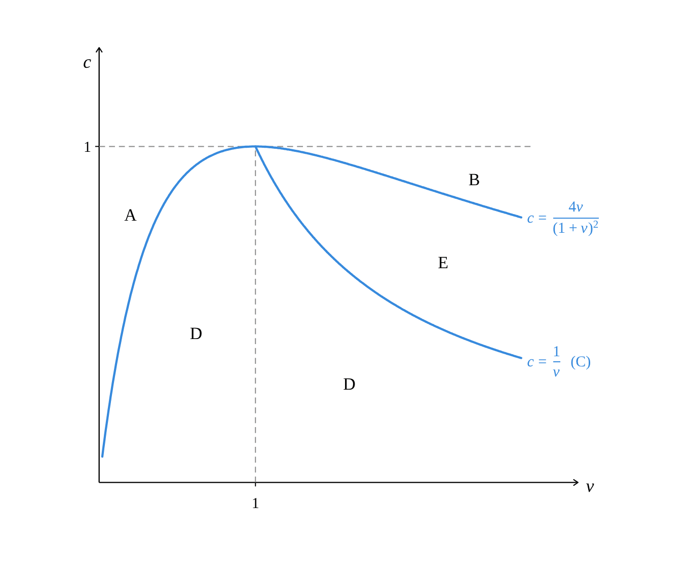
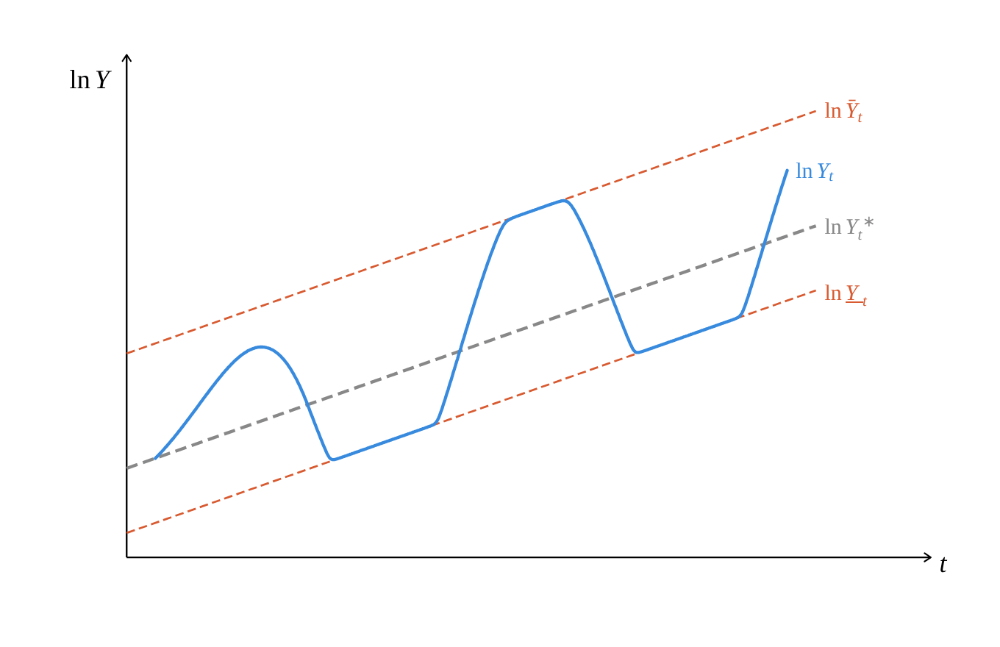

## Introducción

::: {.callout-note appearance="simple" icon=false}

:::

Burns y Mitchell (1946) definieron los **ciclos económicos** como fluctuaciones recurrentes pero no periódicas de la actividad agregada, con fases de expansión y contracción que se suceden sin una duración fija. Su estudio interesa por sus costes, porque las recesiones destruyen empleo y renta y su huella puede durar años, y porque de su explicación depende la respuesta de la política económica. Medir el ciclo exige además separar la tendencia de las fluctuaciones, con métodos como el filtro de Hodrick-Prescott, que suponen una tendencia que varía suavemente, y la elección del método condiciona tanto el diagnóstico de la coyuntura como la contrastación de las teorías.

La teoría del ciclo se ha movido entre dos visiones. Para las teorías de equilibrio, el ciclo es la respuesta óptima de los agentes a perturbaciones, monetarias mal percibidas en Lucas o reales de productividad en Kydland y Prescott, y la política de estabilización tiene poco que corregir. Para las de desequilibrio, en cambio, las rigideces y los fallos de coordinación hacen que las fluctuaciones sean ineficientes y justifican la intervención. La nueva síntesis neoclásica reúne ambas tradiciones en el modelo de tres ecuaciones, la referencia actual de los bancos centrales.

Cada gran crisis, de la Gran Depresión a la crisis financiera global, ha renovado la teoría del ciclo, y la última añadió una tercera dimensión. Las fricciones financieras amplifican las perturbaciones, y el **ciclo financiero**, que Borio (2014) mide con el crédito al sector privado y los precios de los inmuebles, es más largo y más amplio que el ciclo económico y anticipa las crisis más graves. Las teorías se juzgan, en último término, por su capacidad para reproducir los **hechos estilizados** del ciclo, como la mayor volatilidad de la inversión que la del consumo, el carácter procíclico del empleo o la persistencia de las fluctuaciones.

El tema se organiza en tres partes:

- *Concepto y antecedentes*: el tema presenta el concepto de ciclo y sus antecedentes, desde las primeras aportaciones hasta los modelos del acelerador.

- *Teorías modernas*: se exponen los ciclos nominales del modelo de información imperfecta de Lucas, los ciclos reales de Kydland y Prescott y de Long y Plosser, los ciclos de desequilibrio de la nueva economía keynesiana, con las fricciones financieras y el ciclo financiero, y el modelo IS-PC-MR de la nueva síntesis neoclásica.

- *Análisis empírico*: el tema termina con la medición del ciclo, sus hechos estilizados y la contrastación de las teorías con esos hechos.

## 1. Concepto y antecedentes

El punto de partida es la definición de ciclo económico y los conceptos con que las teorías modernas lo analizan. Sobre esa base se repasan las primeras explicaciones del ciclo y los modelos del acelerador, que dieron su primera formalización.

### 1.1. Concepto de ciclo económico

Los **ciclos económicos** (*business cycles*) pueden definirse formalmente como fluctuaciones recurrentes pero no periódicas de la actividad económica agregada de un país, cuya duración es superior a un año (Burns y Mitchell, 1946). El análisis moderno los mide como desviaciones respecto de la tendencia secular.

Esta definición lleva a que las teorías modernas estudien tres conceptos:

1. *Impulso*: la perturbación que causa la desviación, sea exógena o endógena.

2. *Propagación*: los mecanismos de amplificación, difusión y persistencia que canalizan la perturbación a otras variables, entre ellos la suavización del consumo, los retardos en la comprensión de los *shocks*, la sustitución intertemporal de ocio y trabajo o la existencia de costes de ajuste.

3. *Comovimientos*: los movimientos conjuntos del PIB y de otras variables, medidos por el coeficiente de correlación $\rho$ entre el componente cíclico de cada variable y el del PIB. Según su signo, las variables son:

    - *Procíclicas* ($\rho > 0$): evolucionan en la misma dirección que el ciclo (p. ej. el consumo, la inversión, el empleo, las importaciones o los beneficios empresariales).

    - *Contracíclicas* ($\rho < 0$): evolucionan en sentido opuesto (p. ej. la tasa de desempleo, por la ley de Okun, las existencias no deseadas o el déficit público, por los estabilizadores automáticos).

    - *Acíclicas* ($\rho \approx 0$): no muestran una correlación sistemática con el ciclo (p. ej. el gasto público en consumo, el salario real en muchas estimaciones o los tipos de interés reales).

    Además, la correlación puede calcularse desfasando la variable $j$ periodos respecto del PIB, $\rho(x_t, y_{t+j})$, lo que permite clasificar las variables según su temporalidad:

    - *Coincidentes* ($j = 0$): la correlación es máxima con el PIB contemporáneo (p. ej. la producción industrial, el empleo o las ventas al por menor).

    - *Adelantadas* (*leads*, $j > 0$): la correlación es máxima con el PIB de periodos posteriores, es decir, la variable se mueve antes que el ciclo. Por ello son especialmente útiles para la predicción (p. ej. la inversión residencial, los índices de confianza como el de gestores de compras (PMI), la pendiente de la curva de tipos o los índices bursátiles).

    - *Retrasadas* (*lags*, $j < 0$): la correlación es máxima con el PIB de periodos anteriores, es decir, la variable se mueve después del ciclo (p. ej. la inflación, los tipos de interés a corto plazo, los costes laborales unitarios o, ligeramente, el consumo).

### 1.2. Primeras aportaciones

Hasta la década de 1890 los economistas no abordaron de forma sistemática el análisis de la depresión o del ciclo económico. Una excepción es Clément Juglar (1862), que atribuyó el ciclo a fuerzas internas del propio sistema económico, no a factores externos, y propuso tres fases: prosperidad, crisis y liquidación.

Las aportaciones posteriores a Juglar pueden clasificarse, siguiendo a Gottfried von Haberler (1937), según la naturaleza del impulso que pone en marcha el ciclo.

#### 1.2.1. Teorías no monetarias

**Teorías de fenómenos naturales** (Jevons, 1878; Moore, 1914): los ciclos responden a causas meteorológicas periódicas (las manchas solares, con un ciclo de unos once años, en Jevons; las lluvias, en Moore). Esas causas afectan a las cosechas y, a través de las rentas y los precios agrícolas, al conjunto de la actividad económica. Aunque hoy parecen inverosímiles, introdujeron la idea de un impulso exógeno regular y, por tanto, predecible.

**Teoría de la desproporcionalidad o de la sobreinversión no monetaria** (Tugan-Baranowsky, 1894; Spiethoff, 1902; Cassel, 1918b): el ciclo es un ciclo de crédito e inversión. El capital prestable acumulado durante la depresión se vuelca en la inversión fija y desata un auge concentrado en el sector de bienes de capital, que crece más deprisa que el de bienes de consumo (desproporción entre sectores). El auge dura hasta que el agotamiento de los fondos prestables interrumpe la inversión y provoca una crisis endógena al capitalismo.

**Teoría del infraconsumo** (Hobson, 1909): la desigualdad en la distribución de la renta lleva a que las rentas altas ahorren más de lo que puede invertirse rentablemente. Ese ahorro sobrante se convierte en una capacidad productiva excesiva, cuya producción el consumo no llega a absorber, y el desajuste termina en depresión. De ahí que el remedio sea redistributivo.

**Principio de aceleración** (Aftalion, 1909; Clark, 1917): la demanda de bienes de capital depende de la variación de la demanda de bienes de consumo, no de su nivel, por lo que pequeñas fluctuaciones del consumo se amplifican en grandes fluctuaciones de la inversión. Los retardos en la construcción del capital hacen que la respuesta llegue tarde y resulte excesiva. Sobre este mecanismo de propagación se construyen los modelos del acelerador y de ciclos endógenos.

**Teorías psicológicas** (Marshall, 1923; Pigou, 1927): las fluctuaciones se propagan por errores de optimismo y de pesimismo de los empresarios que se contagian y se generan mutuamente (el error de optimismo del auge engendra el de pesimismo de la crisis).

**Teoría keynesiana** (Keynes, 1936): el ciclo tiene su origen en las fluctuaciones de la eficiencia marginal del capital, que depende de expectativas formadas bajo incertidumbre y, por ello, volátiles (los *espíritus animales*). Por ejemplo, un colapso de la confianza hunde la inversión, y el multiplicador transmite la caída a la renta y al empleo. Sobre estas ideas se levantan después las teorías keynesianas que explican el ciclo endógenamente, entre ellas la de Kaldor.

**Teoría de la innovación** (Schumpeter, 1939): las innovaciones aparecen en racimos y se financian con crédito bancario, y su imitación por otros empresarios difunde la inversión y genera el auge. Al generalizarse la innovación, los beneficios extraordinarios se erosionan, el crédito se devuelve y los precios caen. La recesión es el proceso por el que la economía absorbe la innovación y liquida las estructuras obsoletas (la *destrucción creativa*). Schumpeter superpone tres ciclos de distinta duración (Kitchin, Juglar y Kondratiev).

#### 1.2.2. Teorías monetarias

**Teoría puramente monetaria** (Hawtrey, 1919): el ciclo es un fenómeno del crédito. La expansión del crédito bancario reduce el tipo de interés y estimula la acumulación de existencias por parte de los comerciantes, cuya demanda es muy sensible al coste de financiación. La expansión continúa hasta que la pérdida de reservas obliga a los bancos a restringir el crédito, y la contracción sigue el camino inverso.

**Teoría de la sobreinversión monetaria** (Mises, 1912; Hayek, 1929): la expansión del crédito bancario sitúa el tipo de interés de mercado por debajo del natural (el que igualaría ahorro e inversión voluntarios). El tipo artificialmente bajo induce a alargar la estructura de producción (más bienes de capital, procesos más indirectos) sin que haya aumentado el ahorro real, de modo que el auge se financia con ahorro forzoso. Cuando la expansión crediticia se detiene, los proyectos resultan insostenibles (malinversión) y la crisis es la liquidación necesaria para readaptar la estructura productiva a las preferencias de los consumidores[^a42-2].

**Teoría monetarista** (Friedman y Schwartz, 1963): los ciclos tienen un origen eminentemente monetario, dada la estabilidad de la velocidad de circulación del dinero. Las variaciones de la oferta monetaria se transmiten al gasto nominal y, con retardos largos y variables, a la producción.

### 1.3. Modelos del acelerador y ciclos endógenos

Las teorías del apartado anterior identificaban impulsos y mecanismos plausibles, pero no los formalizaban. Con la *Teoría general* aparece el multiplicador, que, unido al principio de aceleración de Aftalion y Clark, permite hacerlo.

Combinados, ambos forman un sistema dinámico que se retroalimenta y cuya expresión matemática es una ecuación en diferencias, de modo que el ciclo se deriva de la estructura formal del modelo. Se presentan aquí el modelo de Samuelson, su revisión por Hicks y la alternativa de Kaldor.

#### 1.3.1. Modelo del oscilador (Samuelson, 1939)

**Origen**: Paul Samuelson (1939) formaliza la combinación del multiplicador y el acelerador.

**Idea**: las fluctuaciones nacen de la interacción entre el multiplicador keynesiano y el principio de aceleración. Un impulso al gasto autónomo eleva la renta más que el propio impulso (multiplicador) y ese aumento induce nueva inversión (acelerador), y así sucesivamente.

**Planteamiento**: sobre el marco keynesiano, Samuelson especifica dos funciones de comportamiento:

- *Función de consumo keynesiana*: el consumo tiene una parte autónoma, $C_0$, y otra endógena, cuya respuesta a la renta mide la propensión marginal a consumir, $c$:

    $$C_t = C_0 + cY_{t-1}, \quad c\in (0, 1)$$

- *Inversión de Aftalion-Clark*: a una inversión autónoma constante se suma otra inducida, que, conforme al principio del acelerador, reacciona a las variaciones del consumo:

    $$I_t = I_0 + v\,(C_t - C_{t-1}), \quad v > 0$$

    donde $v$ es la sensibilidad de la inversión a las variaciones del consumo (el acelerador). A diferencia de la función de inversión keynesiana estándar, que responde al tipo de interés, la inversión inducida depende aquí de la variación del consumo, no de su nivel. Por ello, es positiva mientras el consumo crece, se anula cuando se estabiliza y se vuelve negativa cuando cae. Esta dependencia introduce la dinámica en el modelo.

**Equilibrio**: llevadas ambas funciones a la condición de equilibrio, $Y_t = C_t + I_t$, resulta una ecuación en diferencias de segundo orden, que vincula la producción corriente con sus dos valores retardados:

$$Y_t - c(1+v)Y_{t-1} + vcY_{t-2} = I_0 + C_0$$

**Estática comparativa**: el nivel estacionario de la renta es $Y^* = (C_0 + I_0)/(1 - c)$ (Anexo A.1). Un aumento permanente del gasto autónomo lo eleva en el multiplicador keynesiano, $\partial Y^*/\partial I_0 = 1/(1-c)$, que no depende del acelerador. El acelerador solo decide cómo se recorre el camino hacia el nuevo nivel (Dinámica), de forma monótona o con ciclos amortiguados en las regiones A y D, y sin alcanzarlo nunca en las regiones B, C y E.

**Dinámica**: la ecuación de equilibrio es la *ecuación fundamental del ciclo de Samuelson*, cuya dinámica se lee en las raíces de su ecuación característica, $r^2 - c(1+v)\,r + vc = 0$ (véase el Anexo):

- *Raíces reales*: la trayectoria no presenta oscilaciones (no hay ciclos) y es convergente o divergente según su valor absoluto sea menor o mayor que la unidad.

- *Raíces complejas*: la trayectoria es cíclica, y el ciclo es amortiguado, constante o explosivo según su módulo, $\sqrt{vc}$, sea menor, igual o mayor que la unidad.

Como la dinámica depende solo de la propensión marginal a consumir ($c$), que determina el multiplicador, y del acelerador ($v$), las situaciones posibles se clasifican en el plano acelerador-propensión marginal a consumir, $v$-$c$ (figura -@fig-a421-samuelson):

1. *Frontera entre raíces reales y complejas*, $c = 4v/(1+v)^2$: recoge los pares con discriminante nulo, $c(1+v)^2 = 4v$. Por encima de ella las raíces son reales y, por debajo, complejas.

2. *Hipérbola*, $c = 1/v$: recoge las combinaciones con $vc = 1$, en las que el módulo de las raíces complejas es la unidad, y separa las trayectorias convergentes de las explosivas.

3. *Regiones*: las dos fronteras delimitan cinco regiones:

    - *Región A*: convergencia sin oscilaciones (sin ciclos).

    - *Región B*: divergencia sin oscilaciones (sin ciclos).

    - *Región C*: ciclos de amplitud constante (sobre la hipérbola $c = 1/v$).

    - *Región D*: ciclos amortiguados.

    - *Región E*: ciclos explosivos.

::: {#fig-a421-samuelson}

::: {.content-visible when-format="html"}
```{=html}
<div class="graph-frame">
<iframe src="../graphs/a421_Samuelson.html" style="height:620px" loading="lazy" title="fig-a421-samuelson"></iframe>
</div>
```
:::

::: {.content-visible unless-format="html"}

:::

Modelo del oscilador (Samuelson, 1939). El plano de parámetros (acelerador, propensión marginal a consumir) se divide en regiones con trayectorias monótonas, cíclicas amortiguadas o explosivas.
:::

**Conclusiones**:

- *Aspectos positivos*: es la primera aproximación formal basada en la concepción tradicional del ciclo e introduce la interacción multiplicador-acelerador como mecanismo de propagación.

- *Limitaciones*: los valores de los parámetros necesarios para que los ciclos sean estables (amortiguados) no casaban con la evidencia empírica. Con una propensión al consumo realista ($c \approx 0{,}8$) y un acelerador superior a $1/c = 1{,}25$, se tiene $vc > 1$ y la economía cae en la región E (o, si $v$ supera aproximadamente $2{,}62$, en la B). El modelo predice, por tanto, ciclos explosivos (o una divergencia monótona) y no los ciclos persistentes pero acotados que se observan.

#### 1.3.2. Modelo del oscilador revisado (Hicks, 1950)

**Origen**: John Hicks (1950) parte del modelo de Samuelson y, para conciliarlo con la evidencia empírica, lo hace explosivo (región E) pero lo contiene con límites no lineales.

**Idea**: el ciclo nace explosivo y rebota entre un techo y un suelo. Como ambos crecen con la tendencia (la senda de equilibrio $Y^*_t$, que crece a la tasa $\bar{g}_Y$), el ciclo se superpone a una senda de crecimiento en lugar de oscilar en torno a un nivel fijo.

**Planteamiento**: Hicks mantiene la estructura de Samuelson y añade dos restricciones no lineales:

- *Función de consumo*: se mantiene la expresión keynesiana, $C_t = C_0 + cY_{t-1}$.

- *Función de inversión y suelo*: la inversión tiene un componente inducido por el acelerador y un componente autónomo que crece a una tasa constante y exógena,

    $$I_t = I_{0,t} + v\,(Y_{t-1} - Y_{t-2}), \quad I_{0,t} = I_0(1+\bar{g}_Y)^t$$

    El *suelo* procede de que la desinversión inducida está acotada. La inversión bruta inducida no puede ser negativa, por lo que el *stock* de capital solo puede reducirse al ritmo de la depreciación. Mientras la inversión inducida toca ese mínimo, la inversión autónoma sigue creciendo, lo que define un nivel mínimo de renta, el suelo $\underline{Y}_t$, que crece con la tendencia.

- *Restricción de capacidad y techo*: cuando todos los factores están plenamente empleados, la producción topa con su *techo*, $Y_t \leq \bar{Y}_t = \bar{Y}_0(1+\bar{g}_Y)^t$, que avanza, como la inversión autónoma, al ritmo exógeno $\bar{g}_Y$ con que crece la dotación de factores.

**Desarrollo gráfico**: el modelo de Hicks se representa en el plano tiempo-logaritmo de la renta, $t$-$\ln Y$, en el que toda magnitud que crece a tasa constante es una recta (figura -@fig-a422-hicks):

1. *Techo*, $\ln \bar{Y}_t$: la producción de pleno empleo, que crece a la tasa $\bar{g}_Y$.

2. *Tendencia*, $\ln Y^{*}_t$: la senda de equilibrio, que crece a la misma tasa.

3. *Suelo*, $\ln \underline{Y}_t$: el nivel mínimo de renta que sostiene la inversión autónoma.

4. *Senda del PIB*, $\ln Y_t$: oscila entre el techo y el suelo en torno a la tendencia.

::: {#fig-a422-hicks}

::: {.content-visible when-format="html"}
```{=html}
<div class="graph-frame">
<iframe src="../graphs/a422_Hicks.html" style="height:480px" loading="lazy" title="fig-a422-hicks"></iframe>
</div>
```
:::

::: {.content-visible unless-format="html"}

:::

Modelo de Hicks (1950). El ciclo queda limitado por el techo de pleno empleo y el suelo de la inversión autónoma.
:::

**Dinámica**: en la fase expansiva, el PIB crece por encima de la tendencia impulsado por la interacción del acelerador y el multiplicador hasta alcanzar el techo. A partir de ahí, el crecimiento se limita al ritmo de la oferta de factores y, como el acelerador solo responde a la variación de la renta, la inversión inducida cae y el PIB comienza a caer.

La caída se detiene en el suelo, donde la desinversión ya no puede acelerarse mientras la inversión autónoma sigue creciendo. En consecuencia, la renta vuelve a crecer, el acelerador se reactiva y se inicia un nuevo ciclo.

**Conclusiones**:

- *Aspectos positivos*: introduce límites realistas que impiden las oscilaciones explosivas del modelo de Samuelson e integra el ciclo en una senda de crecimiento.

- *Limitaciones*: se basa en el principio del acelerador rígido y en una interacción mecánica entre el multiplicador y la inversión que no ofrece una base satisfactoria para explicar los ciclos. Además, el techo y el suelo son restricciones impuestas, no derivadas del comportamiento de los agentes.

#### 1.3.3. Ciclos endógenos (Kaldor, 1940)

**Origen**: Nicholas Kaldor (1940) ofrece la primera teoría keynesiana del ciclo plenamente endógeno, anterior a Hicks y sin recurrir al acelerador. Toma de Keynes las funciones de ahorro e inversión como determinantes de la renta y de Kalecki la idea de que la inversión depende del *stock* de capital acumulado.

**Idea**: el ahorro y la inversión planeados no guardan una relación lineal con el nivel de actividad, $Y$. Esa forma curva, sumada a los desplazamientos que la acumulación de capital provoca en ambas funciones, permite que el sistema oscile por sí solo, sin impulsos externos.

**Razonamiento**: el modelo muestra tres equilibrios, de los cuales solo los extremos son estables, y solo temporalmente:

- *Actividad baja*: el exceso de capacidad mantiene reducida la propensión marginal a invertir, mientras que la resistencia de los hogares a recortar su consumo, que les lleva a desahorrar cuando la renta cae, eleva la de ahorrar, y por eso este equilibrio es estable.

- *Actividad intermedia*: la propensión marginal a invertir supera a la de ahorrar, de modo que el equilibrio es inestable y cualquier desviación se amplifica hacia uno de los extremos.

- *Actividad alta*: ahora los límites de oferta deprimen la propensión marginal a invertir, y la saturación del consumo mantiene elevada la de ahorrar, con lo que también este equilibrio es estable.

La acumulación o desacumulación de capital desplaza las funciones de ahorro e inversión y vuelve inestables los equilibrios extremos, de modo que las fluctuaciones se generan de forma endógena (figura en el Anexo, apartado A.6).

**Conclusiones**:

- *Aspectos positivos*: muestra que la no linealidad de las funciones de ahorro e inversión basta para generar fluctuaciones endógenas y persistentes sin impulsos externos ni valores particulares de los parámetros, y anticipa el análisis del ciclo mediante la dinámica no lineal.

- *Limitaciones*: la forma de las funciones de ahorro e inversión se postula y no se deriva del comportamiento optimizador de los agentes, y el modelo genera un ciclo regular, mientras que los ciclos observados son recurrentes pero no periódicos.

::: {.callout-note appearance="simple" icon=false}
El principio del acelerador y sus versiones flexibles se estudian, como teorías de la inversión, en el tema [A34](a34-demanda-inversion.qmd).
:::

### 1.4. Conclusiones

Las teorías tradicionales dejaron dos legados que el análisis moderno conserva, la distinción entre el impulso que desencadena el ciclo y el mecanismo que lo propaga y la primera formalización de este último en los modelos del acelerador. Las primeras aportaciones identifican, sin embargo, mecanismos plausibles que no formalizan ni contrastan, y los modelos del acelerador, que sí los formalizan, solo generan ciclos persistentes y acotados mediante supuestos *ad hoc*. Además, estos modelos descansan en reglas de comportamiento mecánicas, sin fundamento en la optimización de los agentes ni en la formación de sus expectativas.

La superación de ambas carencias, la microeconómica y la empírica, define, respectivamente, las teorías modernas del ciclo (apartado 2) y el análisis empírico con el que se contrastan (apartado 3).

## 2. Teorías modernas del ciclo

Las teorías tradicionales no son coherentes con el ciclo como fenómeno empírico. Por ello, y a raíz de la crítica de Lucas (1976), las teorías modernas del ciclo se basan en las aportaciones de la nueva macroeconomía clásica (NMC) y de la nueva economía keynesiana (NEK).

Las *teorías del ciclo de equilibrio* son la aportación de la NMC, con dos variantes según el impulso sea nominal (Lucas) o real (teoría del ciclo real). Las *teorías del ciclo de desequilibrio*, aportación de la NEK, conciben el ciclo como aumentos o disminuciones de los excesos de oferta y de demanda a lo largo del tiempo. La nueva síntesis neoclásica integra ambas tradiciones.

::: {.callout-note appearance="simple" icon=false}
Este apartado desarrolla los modelos como teorías del ciclo. Los fundamentos de las dos escuelas de las que proceden y sus implicaciones de política económica se estudian en los temas [A06](a06-nmc.qmd) (nueva macroeconomía clásica) y [A07](a07-nek.qmd) (nueva economía keynesiana).
:::

### 2.1. Ciclos nominales: el modelo de información imperfecta (Lucas, 1972; 1973; 1975)

**Origen**: el modelo de oferta agregada de Lucas (1972; 1973; 1975) precedió al desarrollo de los modelos del ciclo real. Se apoya en dos trabajos previos: el de Edmund Phelps (1969), del que nace la *parábola de las islas*, y el de Lucas con Leonard Rapping (1969), del que toma la importancia de la *elasticidad de sustitución intertemporal* en las decisiones de trabajo[^a42-5].

**Idea**: Lucas puso el énfasis en los determinantes nominales del ciclo. El impulso es una perturbación monetaria, el mecanismo de transmisión es el problema de extracción de señales y la persistencia no queda bien explicada.

#### 2.1.1. Supuestos

::: {.callout-note appearance="simple" icon=false}
Los supuestos y la derivación del modelo se desarrollan en el tema [A06](a06-nmc.qmd), apartados 2.1.1 y 2.1.2.
:::

**Entorno**: el modelo supone un mundo neoclásico (competencia perfecta y plena flexibilidad de precios, salarios y tipo de interés), pero con información imperfecta. Los agentes, distribuidos en “islas”, conocen el precio de su mercado, $p_{it}$, pero no el nivel general de precios, $p_t$. No pueden distinguir, por ello, un *shock específico* (un cambio en la demanda de su producto, ante el que lo racional es alterar la producción) de un *shock general* de demanda agregada (ante el que conviene no alterarla), dificultad denominada *problema de extracción de señales*. Todas las variables se expresan en logaritmos.

**Agentes**: cada agente produce y vende un único bien en su mercado y forma su expectativa del nivel general de precios según la hipótesis de expectativas racionales (HER), $p_t^e \equiv \mathbb{E}_{t-1}[p_t]$. En los periodos de mayor precio relativo sacrifica ocio para producir y consumir más (sustitución intertemporal de ocio y trabajo). En cuanto a la autoridad monetaria, la cantidad de dinero nominal tiene un componente previsible y otro no previsible, $\varepsilon_t$, que recoge las sorpresas monetarias (la política monetaria no anticipada por los agentes o los errores del banco central al controlar el dinero):

$$m_t = \mathbb{E}_{t-1}[m_t \mid \Omega_{t-1}] + \varepsilon_t, \qquad \varepsilon_t \sim N(0, \sigma_m^2)$$

#### 2.1.2. Modelo

**Planteamiento**: el modelo se resume en una función de oferta agregada, derivada del problema de extracción de señales, y una función de demanda agregada, derivada de la teoría cuantitativa.

**Oferta agregada**: con lo aprendido en el pasado, los productores estiman la probabilidad $\vartheta \in [0, 1]$ de que un *shock* sea específico. Esa probabilidad coincide con el peso de la varianza de los precios relativos en la de todos los precios:

$$\vartheta = \frac{\sigma_i^2}{\sigma_i^2 + \sigma_p^2}$$

El grado de variabilidad de los precios determina $\vartheta$:

- *Economía habituada a precios muy volátiles* ($\sigma_p^2$ grande): el productor atribuye casi todo cambio de precios a *shocks* globales ($\vartheta \rightarrow 0$) y apenas ajusta su oferta.

- *Economía con precios estables*: sucede lo opuesto ($\vartheta \rightarrow 1$).

La oferta de cada mercado suma un componente tendencial común ($\bar{y}_t$, el *output* asociado a la tasa natural de paro) y un componente cíclico. El componente cíclico depende del precio relativo percibido, de la probabilidad de que el *shock* sea específico ($\vartheta$) y de la capacidad de los productores para ajustar su producción ($\eta$). Formalmente, $y_{it} = \bar{y}_t + \zeta\,(p_{it} - p_t^e)$, con $\zeta \equiv \vartheta\eta > 0$. Agregando (el componente específico promedia a cero) y añadiendo los *shocks* exógenos de oferta, $\varepsilon_t^s$, se obtiene la oferta agregada de Lucas:

$$\text{OA: } y_t = \bar{y}_t + \zeta\,(p_t - p_t^e) + \varepsilon_t^s$$

Salvo por los *shocks* de oferta, no hay desviación respecto del nivel de largo plazo si $\vartheta = 0$ (p. ej. hiperinflación), si $\eta = 0$ o si los cambios en el nivel de precios están completamente anticipados ($p_t = p_t^e$).

**Demanda agregada**: de forma simplificada, se parte de la teoría cuantitativa del dinero, $m_t + v_t = p_t + y_t$, donde $v_t$ es una perturbación de la velocidad de circulación (de esperanza nula) que recoge los *shocks* exógenos de demanda[^a42-9]:

$$\text{DA: } y_t = m_t - p_t + v_t$$

**Equilibrio**: igualando oferta y demanda agregadas, imponiendo la HER y despejando el precio, se obtiene la producción como función de los *shocks* de la economía[^a42-10]:

$$y_t = \bar{y}_t + \frac{\zeta}{1+\zeta}(\varepsilon_t + v_t - \varepsilon_t^s) + \varepsilon_t^s \;\rightarrow\; \tilde{y}_t = \frac{\zeta}{1+\zeta}(\varepsilon_t + v_t - \varepsilon_t^s) + \varepsilon_t^s$$

**Desarrollo gráfico**: el modelo de Lucas se representa en el plano renta-nivel general de precios (figura -@fig-a061-pm-no-anticipada):

1. *Oferta agregada de largo plazo*, $\text{OA}_{\text{LP}}$: vertical en la producción tendencial, $\bar{Y}$, porque los cambios de precios anticipados ($p_t = p_t^e$) no alteran la producción.

2. *Oferta agregada de corto plazo*, $\text{OA}_{\text{CP},0}$: creciente, porque solo las sorpresas de precios llevan la producción por encima de su tendencia.

3. *Demanda agregada*, $\text{DA}_0$: decreciente en el nivel de precios, dada la cantidad de dinero, porque un precio mayor reduce los saldos reales ($y_t = m_t - p_t + v_t$).

4. *Equilibrio*: en el punto 0, sobre la tendencia, con precios $P_0$.

**Estática comparativa**:

$$\frac{\partial y_t}{\partial \varepsilon_t} = \frac{\partial y_t}{\partial v_t} = \frac{\zeta}{1+\zeta} > 0, \qquad \frac{\partial y_t}{\partial \varepsilon_t^s} = \frac{1}{1+\zeta} > 0$$

Los efectos dependen del tipo de perturbación:

- *Política monetaria y perturbaciones de demanda*: un cambio anticipado se traslada íntegramente a los precios y es neutral, y solo la parte no anticipada ($\varepsilon_t$, $v_t$) altera transitoriamente la producción.

- *Perturbación de oferta*: los *shocks* de oferta ($\varepsilon_t^s$) afectan a la propia capacidad productiva, por lo que sus efectos no son necesariamente transitorios.

En la figura -@fig-a061-pm-no-anticipada, una expansión monetaria ($\Delta M^s > 0$) desplaza la demanda agregada de $\text{DA}_0$ a $\text{DA}_1$, con efectos distintos según los agentes la anticipen o no:

- *Expansión anticipada*: la oferta de corto plazo se desplaza en la misma medida, a $\text{OA}_{\text{CP},1}$, y la economía pasa del punto 0 al 1, sobre la tendencia y con precios más altos (neutralidad).

- *Expansión no anticipada*: los agentes forman sus expectativas con la información de $t-1$, la oferta de corto plazo no se desplaza (o solo parcialmente) y la producción supera transitoriamente su tendencia en el punto 0′. Cuando conocen la verdadera cuantía de la perturbación, revisan sus expectativas ($\Delta P^e > 0$), la oferta de corto plazo se desplaza a $\text{OA}_{\text{CP},1}$ y la economía pasa de 0′ a 1. Se produce así un ciclo, resultado de una sucesión de equilibrios.

::: {#fig-a061-pm-no-anticipada}

::: {.content-visible when-format="html"}
```{=html}
<div class="graph-frame">
<iframe src="../graphs/a061_PM_no_anticipada.html" style="height:580px" loading="lazy" title="fig-a061-pm-no-anticipada"></iframe>
</div>
```
:::

::: {.content-visible unless-format="html"}

:::

Modelo de Lucas. Solo una expansión monetaria no anticipada desplaza la producción por encima de su nivel natural, mientras que una expansión anticipada se traslada íntegramente a precios. El gráfico representa las variables en niveles ($P$, $Y$, $\bar{Y}$) y el texto las expresa en logaritmos.
:::

#### 2.1.3. Conclusiones

**Aspectos positivos**:

- *Primer modelo microfundamentado del ciclo*: con expectativas racionales, la oferta agregada se deriva del comportamiento optimizador de agentes racionales, y el modelo formaliza el papel de la información incompleta.

- *No neutralidad sin rigideces*: obtiene efectos reales de los *shocks* monetarios a corto plazo con precios plenamente flexibles y vaciado continuo, conciliando la evidencia de corto plazo con la hipótesis de la tasa natural y la neutralidad de largo plazo.

- *Predicción contrastable*: la dependencia de $\vartheta$ respecto de $\sigma_p^2$ implica que la disyuntiva producción-inflación es menos favorable (un mismo impulso nominal tiene menos efectos reales) en los países con demanda agregada más volátil, predicción que Lucas (1973) respaldó con datos de dieciocho países. Barro (1977) halló, además, que solo el crecimiento monetario no anticipado afecta al desempleo. Ball, Mankiw y Romer (1988) mostraron después que la pendiente depende sobre todo de la inflación media y no de la varianza de la demanda, como predicen los costes de menú (tema [A07](a07-nek.qmd), apartado 1.3.2).

**Limitaciones**:

- *Persistencia*: no explica la duración de los ciclos, debido a la actuación de la HER y a la ausencia de un mecanismo de propagación. Por ello, para que el ajuste no sea inmediato, deben introducirse mecanismos *ad hoc* (costes de ajuste, retardos de información).

- *Plausibilidad de la fricción informativa*: dada la difusión rápida y barata de las estadísticas de precios, es difícil sostener que los agentes confundan de forma persistente las variaciones relativas y agregadas hasta el punto de generar ciclos.

- *Naturaleza real de muchos ciclos*: no explica las perturbaciones reales, como las crisis del petróleo.

- *Evidencia empírica*: las sorpresas monetarias solo dan cuenta de una parte de las fluctuaciones observadas, y el modelo necesita una oferta de trabajo más elástica de lo que indican los estudios microeconómicos.

Estas limitaciones, y en especial la incapacidad para generar persistencia, motivaron el segundo enfoque de la NMC sobre el ciclo.

### 2.2. Ciclos reales: la teoría del ciclo real (Kydland y Prescott, 1982; Long y Plosser, 1983)

**Origen**: Kydland y Prescott (1982) y Long y Plosser (1983) sientan las bases de la teoría del ciclo real (TCR) intentando replicar la dinámica observada en la economía estadounidense entre 1950 y 1979.

**Idea**: los ciclos se generan no por un problema de extracción de señales, sino por el comportamiento optimizador de los agentes ante perturbaciones reales, de carácter tecnológico, estocásticas y autocorrelacionadas. En el modelo se distinguen tres elementos:

- *Impulso*: las perturbaciones tecnológicas.

- *Mecanismo de transmisión*: el comportamiento optimizador (concretamente, la sustitución intertemporal del consumo y el ocio y la acumulación de capital).

- *Persistencia*: se explica por la autocorrelación de las perturbaciones y por los largos periodos de realización de los proyectos de inversión (*time to build*).

#### 2.2.1. Supuestos

::: {.callout-note appearance="simple" icon=false}
Los supuestos y la solución analítica del modelo básico se desarrollan en el tema [A06](a06-nmc.qmd), apartado 2.2. Aquí se recogen para estudiar su dinámica.
:::

**Entorno**: la economía es cerrada, con información perfecta, tiempo discreto y horizonte infinito, competencia perfecta, mercados completos y plena flexibilidad de precios, salarios y tipo de interés[^a42-12].

**Agentes**: idénticos, con expectativas racionales y vida infinita, que consumen, ofrecen trabajo y alquilan a las empresas el capital, su único activo. Su utilidad, logarítmica y separable en el tiempo, depende del consumo y del ocio[^a42-13]. No hay sector público.

**Tecnología**: la producción sigue una función Cobb-Douglas con progreso técnico aumentador del trabajo y rendimientos constantes a escala, afectada por perturbaciones tecnológicas autocorrelacionadas. La depreciación completa ($\delta = 1$), el caso de Long y Plosser, permite resolver el modelo analíticamente.

#### 2.2.2. Modelo

El modelo se resume en cuatro ecuaciones de comportamiento de hogares y empresas, tres ecuaciones que describen la tecnología y una condición de equilibrio competitivo.

**Hogares**: el hogar representativo consume, trabaja y ahorra.

- *Planteamiento*: maximiza el valor actual esperado de su utilidad, sujeto a su restricción presupuestaria intertemporal[^a42-15]:

    $$\begin{aligned} &\max_{c_t,\, l_t,\, k_{t+1}} U = \mathbb{E}_0 \sum_{t=0}^{\infty} \beta^t u(c_t, 1-l_t), \qquad \beta \in (0, 1) \\ &\text{s.a.:} \begin{cases} c_t + k_{t+1} - k_t = w_t l_t + r_t k_t \\ k_0 \text{ dado} \end{cases} \end{aligned}$$

    donde $c_t$ es el consumo, $l_t$ el trabajo y $k_{t+1}$ el capital del periodo siguiente (las variables de decisión), $u(\cdot)$ la utilidad instantánea en consumo y ocio, $\beta$ el factor de descuento, $w_t$ el salario, $r_t$ el rendimiento del capital y $k_0$ el capital inicial.

- *CPO*: con solución interior y la restricción agotada, del lagrangiano resultan la condición intratemporal entre ocio y consumo (la oferta de trabajo) y la ecuación de Euler estocástica. La condición de transversalidad, según la cual el valor actual esperado del capital que queda al final del horizonte es nulo, completa las condiciones de óptimo. La ecuación de Euler iguala la utilidad marginal del consumo presente con la esperada de invertir esa unidad al tipo $r_{t+1}$ y consumirla el periodo siguiente[^a42-16]:

    $$\begin{aligned} &\text{RMS}_{c_t,\,1-l_t} = \frac{\partial u/\partial (1-l_t)}{\partial u/\partial c_t} = w_t, \qquad \frac{\partial u}{\partial c_t} = \beta\, \mathbb{E}_t\!\left[\frac{\partial u}{\partial c_{t+1}}\,(1+r_{t+1})\right] \\ &\lim_{t\to\infty}\mathbb{E}_0\!\left[\beta^t \frac{\partial u}{\partial c_t}\,k_{t+1}\right]=0 \end{aligned}$$

- *CSO*: la concavidad estricta de $u$ en consumo y ocio y la de la tecnología garantizan que las CPO, con la condición de transversalidad, son necesarias y suficientes.

**Empresas**: producen con trabajo y capital.

- *Planteamiento*: maximizan su beneficio[^a42-17], $\max_{l_t, k_t} \Pi_t = y_t - w_t l_t - (r_t + \delta) k_t$.

- *CPO*: cada factor se remunera según su productividad marginal, el trabajo al salario y el capital a su coste de uso, es decir, $\partial f/\partial l_t = w_t$ y $\partial f/\partial k_t = r_t + \delta$.

- *CSO*: la tecnología Cobb-Douglas es cóncava en $(k, l)$ y estrictamente cóncava en cada factor, luego las CPO caracterizan el máximo.

**Tecnología**: la producción es Cobb-Douglas y la tecnología crece en torno a un nivel tendencial, $\bar{A}$, a un ritmo exógeno y constante, $g_A$. La tecnología está afectada también por un componente aleatorio, $a_t$, que sigue un proceso AR(1) con ruido blanco $\phi_t$:

$$\begin{aligned} &y_t = k_t^{\alpha} (A_t l_t)^{1-\alpha}, \qquad \alpha \in (0, 1) \\ &\ln A_t = \ln\bar{A} + g_A\,t + a_t, \qquad a_t = \rho_A a_{t-1} + \phi_t, \quad \rho_A \in (-1, 1) \end{aligned}$$

**Equilibrio**: con vaciado de los mercados de trabajo y capital y depreciación completa, el gasto en consumo e inversión coincide con la renta, $c_t + k_{t+1} = y_t$. Al resolver el modelo se obtienen los valores solución de las variables en función de los parámetros:

$$k_{t+1}^* = s\,y_t, \quad s = \alpha\beta, \qquad c_t^* = (1-\alpha\beta)\,y_t, \qquad l_t^* = \bar{l}(\alpha, \beta, b)$$

donde $b$ es el peso del ocio en la utilidad, $u(c_t, 1-l_t) = \ln c_t + b\ln(1-l_t)$. El consumidor trabaja una cantidad constante de horas y ahorra una fracción constante de la renta, porque los cambios que la tecnología o el capital provocan en el tipo de interés y en el salario real se cancelan entre sí[^a42-18]. En cambio, el ahorro (el capital acumulado al final de cada periodo) y el consumo sí se ven afectados por los *shocks* tecnológicos.

**Estática comparativa**: en el plano renta-nivel general de precios (figura -@fig-a062-shock-tecnologico), un *shock* tecnológico positivo ($\Delta A > 0$) desplaza a la derecha la oferta agregada a largo plazo (vertical en la producción potencial, que fija la tecnología), de $\text{OA}_{\text{LP},0}$ a $\text{OA}_{\text{LP},1}$, y a corto plazo, de $\text{OA}_{\text{CP},0}$ a $\text{OA}_{\text{CP},1}$. En menor medida, desplaza también la demanda agregada, de $\text{DA}_0$ a $\text{DA}_1$, porque la mayor productividad eleva la renta esperada y la rentabilidad de la inversión. La economía pasa del punto 0 al 1, con más producción ($\bar{Y}_1 > \bar{Y}_0$) y un nivel de precios algo menor ($P_1 < P_0$).

Como el equilibrio se sitúa siempre sobre la oferta a largo plazo, el *shock* no abre una brecha respecto del potencial, y la fluctuación del *output* es la del propio potencial, que se desvía de su tendencia determinista con la persistencia que marca $\rho_A$.

::: {#fig-a062-shock-tecnologico}

::: {.content-visible when-format="html"}
```{=html}
<div class="graph-frame">
<iframe src="../graphs/a062_shock_tecnologico.html" style="height:580px" loading="lazy" title="fig-a062-shock-tecnologico"></iframe>
</div>
```
:::

::: {.content-visible unless-format="html"}

:::

Ciclo real en el plano OA-DA. Un *shock* tecnológico positivo ($\Delta A > 0$) desplaza a la derecha la oferta agregada a largo y a corto plazo (la producción potencial pasa de $\bar{Y}_0$ a $\bar{Y}_1$) y, en menor medida, la demanda agregada. La economía pasa del equilibrio 0 al 1, con más producción y un nivel de precios algo menor. El gráfico representa las variables en niveles ($P$, $Y$, $\bar{Y}$) y el texto las expresa en logaritmos.
:::

**Dinámica**: a partir de los valores solución se obtienen las ecuaciones dinámicas y estocásticas de cada variable endógena[^a42-19], expresadas en logaritmos y en desviaciones respecto de su trayectoria determinista[^a42-20]. En el caso del *output*, $\tilde{y}_t = \alpha\,\tilde{y}_{t-1} + (1-\alpha)\,a_t$ y, sustituyendo el AR(1) de la tecnología, la ecuación dinámica estocástica de la desviación del *output* respecto de su tendencia determinista es:

$$\tilde{y}_t = (\alpha + \rho_A)\,\tilde{y}_{t-1} - \alpha\rho_A\,\tilde{y}_{t-2} + (1-\alpha)\,\phi_t$$

El ciclo sigue un proceso autorregresivo de orden 2, de modo que, cuando se produce una perturbación tecnológica, el PIB se desvía de su tendencia en función de los ciclos de los dos periodos anteriores y de la persistencia de la perturbación. La duración del ciclo será mayor cuanto mayor sea la autocorrelación de la perturbación, $\rho_A$, que depende de la calibración del modelo[^a42-21].

Un aumento de la productividad total de los factores (un *shock* tecnológico positivo no anticipado) tiene efectos según su duración:

- *Transitorio*: produce efectos reales de carácter temporal y es expansivo sobre la producción, el consumo, la inversión y los salarios. Con tasa de ahorro constante ($s = \alpha\beta$), consumo e inversión varían en la misma proporción que la producción. Sobre el tipo de interés real el efecto es mixto, porque el tipo sube inicialmente, al aumentar la productividad marginal del capital, y cae en periodos posteriores, dado que el mayor *stock* de capital reduce su productividad marginal.

- *Permanente*: eleva duraderamente la producción potencial, con lo que se desplaza la trayectoria tendencial y no se genera un ciclo en sentido estricto. De hecho, Nelson y Plosser (1982) muestran que las series del PIB se caracterizan mejor como procesos con raíz unitaria, en los que las innovaciones afectan permanentemente a su valor futuro. Si los *shocks* de productividad son frecuentes y permanentes (caso límite $\rho_A = 1$), explican tanto el ciclo a corto plazo como el crecimiento a largo plazo, y las causas de ambos no son esencialmente distintas[^a42-22].

**Bienestar**: como la economía es walrasiana, las fluctuaciones no constituyen un fracaso de los mercados, sino la respuesta óptima de los agentes a las perturbaciones (el propio óptimo de Pareto fluctúa). En consecuencia, toda intervención pública para mitigarlas reduce el bienestar.

**Extensiones**: las versiones posteriores levantan los supuestos simplificadores del modelo básico para mejorar su ajuste al mercado de trabajo:

- *Indivisibilidades del trabajo* (Hansen, 1985; Rogerson, 1988): generan una mayor elasticidad de la oferta de trabajo agregada y, además, justifican la existencia de desempleo.

- *Depreciación incompleta* ($\delta < 1$): vuelve la inversión y el empleo más sensibles a las perturbaciones y reduce la prociclicidad del salario. Un *shock* positivo de productividad eleva la inversión y la tasa de ahorro, lo que modera la subida del consumo y eleva la oferta de trabajo. La mayor oferta de trabajo modera, a su vez, la subida del salario.

- *Sector público* (Christiano y Eichenbaum, 1992)[^a42-23]: rompe el vínculo directo entre producción y salario real, porque el efecto riqueza negativo de un aumento del gasto público eleva la oferta de trabajo y, sin cambio tecnológico, reduce el salario real. Producción y salario real se mueven así en direcciones opuestas (tema [A38](a38-politica-fiscal.qmd), apartado 1.2).

#### 2.2.3. Conclusiones

**Aspectos positivos**: con modelos relativamente sencillos se reproducía gran parte de los hechos estilizados del ciclo de EE. UU. (1950-1979):

- *PIB*: los autores concluían que los *shocks* tecnológicos podían explicar en torno al 70 % de la volatilidad del PIB de posguerra en EE. UU. (Kydland y Prescott, 1991). Los modelos del ciclo real aportaron, además, un método que después adoptó también la NEK.

- *Consumo e inversión*: en sus versiones calibradas[^a42-11] (con depreciación incompleta), el modelo recoge la suavización del consumo y el exceso de volatilidad de la inversión.

**Limitaciones**: el modelo falla en el impulso, en variables distintas del PIB y en el papel del dinero:

- *Mecanismo de impulso*: descansa en perturbaciones tecnológicas, pero a corto plazo el progreso técnico avanza con regularidad, y por eso resulta difícil atribuirle los ciclos y, sobre todo, las recesiones (¿una regresión tecnológica explica realmente una recesión?). Además, el modelo básico carece de un mecanismo de propagación que convierta una perturbación transitoria en una variación significativa y duradera de la producción.

- *Tasa de ahorro y oferta de trabajo constantes*: en la versión básica, inversión y consumo serían igualmente volátiles y el empleo no fluctuaría, en contra de la evidencia.

- *Mercado de trabajo*: la volatilidad de la oferta de trabajo es menor que la observada, y productividad y oferta de trabajo están mucho más correlacionadas que en los datos (donde parecen independientes). Además, el salario real y la productividad resultan excesivamente procíclicos y se requiere una elasticidad de la oferta de trabajo irrealistamente elevada.

- *Neutralidad del dinero*: se mantiene incluso en las versiones con dinero (p. ej. modelos *cash-in-advance*), en contra de la evidencia de efectos reales a corto plazo (p. ej. la ecuación de St. Louis o los modelos de vectores autorregresivos, VAR).

### 2.3. Ciclos de desequilibrio y fricciones financieras

Los modelos de la NEK parten de fallos de mercado (poder de mercado, información asimétrica) que se traducen en rigideces nominales y reales. En consecuencia, no hay vaciado continuo de los mercados, el ajuste es lento y se realiza vía cantidades, y pueden darse equilibrios múltiples subóptimos (fallos de coordinación).

En los mercados financieros, la información asimétrica raciona el crédito. Además, cuando las condiciones de financiación dependen del balance de los prestatarios, la información asimétrica amplifica las perturbaciones y enlaza el ciclo económico con el ciclo financiero. Cierran el apartado otras dos aportaciones de la NEK, los contratos escalonados y los fallos de coordinación.

::: {.callout-note appearance="simple" icon=false}
Los rasgos de la escuela y la fundamentación microeconómica de las rigideces reales y nominales se desarrollan en el tema [A07](a07-nek.qmd), apartado 1. Aquí se presentan sus modelos como teorías del ciclo.
:::

#### 2.3.1. Racionamiento del crédito (Stiglitz y Weiss, 1981)

**Origen**: el modelo se debe a Joseph Stiglitz y Andrew Weiss (1981), en la línea de la NEK.

**Idea**: la información asimétrica lleva a los bancos a racionar el crédito en lugar de subir el tipo de interés. En el modelo se distinguen tres elementos:

- *Impulso*: perturbaciones de demanda agregada, tanto reales como monetarias (p. ej. un *shock* negativo en el flujo de caja, una política monetaria restrictiva o una innovación financiera).

- *Mecanismo de transmisión*: la rigidez del tipo de interés, que lleva a los bancos a ajustar la cantidad de crédito (racionamiento) en lugar de su precio.

- *Persistencia*: procede del ajuste escalonado de los precios en la economía real.

**Supuestos**:

- *Entorno*: información asimétrica. Los inversores conocen la probabilidad de éxito de su proyecto, pero los bancos no.

- *Agentes*: numerosos bancos en competencia perfecta, que conceden préstamos a un tipo de interés $i$, e inversores con proyectos arriesgados y sin financiación alternativa a la bancaria (p. ej. pymes), ambos neutrales al riesgo.

- *Tecnología*: los proyectos tienen el mismo vencimiento (un periodo) y la misma cuantía, $B$, y solo se diferencian por su probabilidad de éxito. El proyecto $j$ rinde $X_j$ con probabilidad $p_j$ y cero si fracasa (cuanto más seguro, menor el retorno), con un rendimiento esperado, $\bar{X} = p_j X_j$, idéntico para todos.

El banco presta la cuantía $B$ y el inversor se compromete a devolver $(1+i)B$, con responsabilidad limitada (si el proyecto fracasa, el inversor quiebra y el banco no recupera nada). Esta asimetría en los pagos genera el incentivo a asumir riesgos excesivos.

**Inversores**: demandan crédito para su proyecto.

- *Planteamiento*: cada inversor pide el préstamo si su beneficio esperado, $\mathbb{E}[\Pi_j] = p_j\,[X_j - (1+i)B] = \bar{X} - p_j(1+i)B$, no es negativo (no invertir rinde cero). Como $\bar{X}$ es común, el beneficio esperado es mayor cuanto más arriesgado es el proyecto (menor $p_j$).

- *CPO*: la elección es binaria, y la condición marginal se sustituye por la de participación, $p_j \leq \hat{p}(i) \equiv \bar{X}/[(1+i)B]$, con un umbral de probabilidad de éxito decreciente en el tipo de interés.

- *CSO*: el beneficio esperado es lineal y decreciente en $p_j$, así que el umbral es único y separa a quienes piden crédito de quienes no.

- *Solución*: al subir el tipo, el umbral baja y los proyectos seguros quedan expulsados (selección adversa), y la demanda de crédito, $L^d(i)$, tiene pendiente negativa.

**Bancos**: captan depósitos y ofrecen crédito.

- *Planteamiento*: eligen el tipo de interés que maximiza su rendimiento esperado por unidad prestada, $\bar{R}^e(i) = (1+i)\,\bar{p}(i)$, donde $\bar{p}(i)$ es la probabilidad media de éxito de los proyectos que demandan crédito a ese tipo, decreciente en $i$ por la selección adversa. Del rendimiento se obtiene la oferta de crédito, $L^s(i)$.

- *CPO*: en el tipo óptimo, $i^*$, se cumple $\bar{p}(i^*) + (1+i^*)\,(d\bar{p}/di)|_{i^*} = 0$. El primer sumando es el *efecto recaudación* (positivo), pues el banco cobra más por los proyectos que tienen éxito. El segundo es el *efecto deterioro de cartera* (negativo), pues la subida expulsa a los proyectos seguros.

- *CSO*: con un rendimiento esperado de un solo máximo, como suponen Stiglitz y Weiss (1981), domina el efecto recaudación por debajo de $i^*$ y el de deterioro de cartera por encima, así que $i^*$ es el máximo.

**Equilibrio**: el banco prefiere racionar a subir $i$ más allá de $i^*$. Si a ese tipo la demanda supera a la oferta, el resultado es un equilibrio con racionamiento del crédito, es decir, con exceso de demanda y ajuste vía cantidades, no vía precios.

**Desarrollo gráfico**: el modelo completo se representa en cuatro cuadrantes, con el tipo de interés ($i$) y los depósitos ($D$) en el eje horizontal y el rendimiento esperado ($\bar{R}^e$) y el crédito ($L$) en el vertical (figura -@fig-a071-stiglitz-weiss):

1. *Rendimiento esperado del banco*, $\bar{R}^e(i)$: en el cuadrante I, creciente mientras domina el efecto recaudación y decreciente cuando domina el de deterioro de cartera, con su máximo en $i^*$.

2. *Oferta de depósitos*, $D^s(\bar{R}^e)$: en el cuadrante II, creciente en la rentabilidad.

3. *Conversión de depósitos en créditos*, $L = \chi D$, con $0 < \chi \leq 1$: en el cuadrante III, una recta, pues el banco presta una fracción constante de los depósitos.

4. *Oferta y demanda de crédito*, $L^s(i)$ y $L^d(i)$: en el cuadrante IV. La oferta se obtiene de los tres cuadrantes anteriores y es también máxima en $i^*$.

5. *Equilibrio*: en $i^*$, inferior al tipo walrasiano $i^W$, la diferencia $Z = L^d(i^*) - L^s(i^*)$ es el racionamiento del crédito.

::: {#fig-a071-stiglitz-weiss}

::: {.content-visible when-format="html"}
```{=html}
<div class="graph-frame">
<iframe src="../graphs/a071_Stiglitz_Weiss.html" style="height:700px" loading="lazy" title="fig-a071-stiglitz-weiss"></iframe>
</div>
```
:::

::: {.content-visible unless-format="html"}
![Racionamiento del crédito (Stiglitz y Weiss, 1981). El rendimiento esperado del banco, $\bar{R}^e(i)$, alcanza su máximo en $i^*$ (cuadrante I). A través de la oferta de depósitos, $D^s(\bar{R}^e)$ (cuadrante II), y del factor de conversión de depósitos en créditos, $L = \chi D$ (cuadrante III), se obtiene la oferta de crédito, $L^s(i)$, que también es máxima en $i^*$ y decrece por encima de ese tipo (cuadrante IV). En $i^*$, inferior al tipo walrasiano $i^W$ ($L^d = L^s$), la demanda de crédito, $L^d(i)$, excede a la oferta, y ese exceso de demanda, $Z$, es el racionamiento del crédito.](../graphs/static/a071_Stiglitz_Weiss.png)
:::

Racionamiento del crédito (Stiglitz y Weiss, 1981). El rendimiento esperado del banco, $\bar{R}^e(i)$, alcanza su máximo en $i^*$ (cuadrante I). A través de la oferta de depósitos, $D^s(\bar{R}^e)$ (cuadrante II), y del factor de conversión de depósitos en créditos, $L = \chi D$ (cuadrante III), se obtiene la oferta de crédito, $L^s(i)$, que también es máxima en $i^*$ y decrece por encima de ese tipo (cuadrante IV). En $i^*$, inferior al tipo walrasiano $i^W$ ($L^d = L^s$), la demanda de crédito, $L^d(i)$, excede a la oferta, y ese exceso de demanda, $Z$, es el racionamiento del crédito.
:::

**Estática comparativa**:

- *Perturbación negativa en la oferta de depósitos* (p. ej. un aumento del desempleo, que reduce la renta de los hogares): desplaza hacia arriba la curva de oferta de depósitos en el segundo cuadrante. Como el tipo de interés permanece en $i^*$, el ajuste se produce vía cantidad. Aumenta el racionamiento, se contraen el crédito, la inversión y el consumo y el PIB se desvía negativamente de su tendencia (ciclo recesivo).

- *Perturbación monetaria positiva* (p. ej. una política monetaria expansiva): desplaza hacia abajo la curva de oferta de depósitos, sin que varíe $i^*$. El racionamiento disminuye, se conceden más créditos y se realizan más proyectos, lo que aumenta la inversión y provoca un ciclo expansivo.

Los efectos son asimétricos, pues el coste del crédito y su racionamiento recaen sobre todo en las empresas más endeudadas y las percibidas como más arriesgadas. Así, en las restricciones monetarias, las pequeñas, dependientes del crédito bancario, se ven más afectadas que las grandes, con acceso al mercado de capitales. Además, la inversión agregada resulta sensible a los flujos de caja pasados.

**Conclusiones**:

- *Aspectos positivos*: ofrece un mecanismo de transmisión de las perturbaciones nominales y reales fundado en la información asimétrica, sin rigideces de precios en el mercado de bienes. Explica, además, el canal del crédito de la política monetaria y la asimetría de sus efectos entre empresas, y anticipa la literatura del acelerador financiero.

- *Limitaciones*: el racionamiento depende de que los bancos no puedan discriminar entre prestatarios, cuando en la práctica exigen garantías que revelan parcialmente el tipo de prestatario y atenúan la asimetría. Además, el modelo es de equilibrio parcial y la persistencia del ciclo se importa de fuera del mercado de crédito.

#### 2.3.2. Acelerador financiero (Bernanke y Gertler, 1989; Kiyotaki y Moore, 1997)

::: {.callout-note appearance="simple" icon=false}
El acelerador financiero se presenta como determinante de la inversión en el tema [A34](a34-demanda-inversion.qmd), apartado 3.2.4, y como canal del crédito de la política monetaria en el tema [A37](a37-politica-monetaria-ii.qmd), apartado 1.2. Aquí se desarrolla como mecanismo de propagación del ciclo.
:::

**Origen**: el modelo de Stiglitz y Weiss aísla la fricción microeconómica, pero es estático y de equilibrio parcial. Bernanke y Gertler (1989) dan el paso siguiente al mostrar que el patrimonio neto de los prestatarios reduce los costes de agencia de la financiación y puede, por ello, propagar el ciclo. Por su parte, Kiyotaki y Moore (1997) llegan a un resultado análogo a través del colateral.

Bernanke, Gertler y Gilchrist, que denominan al mecanismo *acelerador financiero* (1996), lo integran después en un modelo de equilibrio general dinámico y estocástico (DSGE) neokeynesiano cuantitativo (1999). El mecanismo no es exclusivo de la NEK, pues también se obtiene en modelos de precios flexibles.

**Idea**: si el coste de la financiación depende del patrimonio de los prestatarios, y este cae en las recesiones, la fricción financiera amplifica y propaga el ciclo. Como el prestamista no puede observar sin coste el resultado de los proyectos, la financiación externa es más cara que la interna. La diferencia, la *prima de financiación externa*, disminuye con la parte de la compra de capital que el prestatario financia con recursos propios:

$$\rho_{\text{fe},t} = \rho_{\text{fe}}\!\left(\frac{\text{PN}_t}{q_t K_t}\right), \qquad \rho_{\text{fe}}'(\cdot) < 0$$

donde $\rho_{\text{fe},t}$ es la prima de financiación externa (la diferencia entre el coste de los fondos externos y el tipo sin riesgo), $\text{PN}_t$ el patrimonio neto de las empresas, $q_t$ el precio del capital (la *q* de Tobin) y $K_t$ el capital que adquieren. Así, $q_t K_t - \text{PN}_t$ es la financiación externa que necesitan.

**Razonamiento**: una perturbación negativa (tecnológica, monetaria o de demanda) pone en marcha un bucle de amplificación que opera por dos canales:

- *Patrimonio neto* (Bernanke y Gertler, 1989): la perturbación reduce los beneficios y el precio de los activos y, con ellos, el patrimonio neto. La prima sube, la inversión cae más de lo que justificaría la perturbación y la menor actividad deprime de nuevo beneficios y precios.

- *Colateral* (Kiyotaki y Moore, 1997): un mismo activo duradero (la tierra o los inmuebles) sirve para producir y garantizar la deuda. Así, la caída de su precio endurece el límite de endeudamiento y fuerza ventas, y esas ventas vuelven a hundir el precio.

Como el patrimonio se recompone despacio, el efecto persiste. Por tanto, el mecanismo aporta lo que le faltaba al modelo de Stiglitz y Weiss, porque con el acelerador financiero perturbaciones pequeñas y transitorias generan fluctuaciones amplias y persistentes.

**Conclusiones**:

- *Aspectos positivos*: integra las fricciones financieras en los modelos de equilibrio general y explica por qué los precios de los activos y los balances de los prestatarios amplifican y prolongan el ciclo. La crisis financiera de 2008 confirmó su relevancia e impulsó su incorporación a los modelos de los bancos centrales.

- *Limitaciones*: la fricción se sitúa en el balance de los prestatarios no financieros, sin un papel propio para el capital de los intermediarios, que aquella crisis reveló decisivo. Además, estos modelos suelen resolverse en torno al estado estacionario, lo que capta mal la dinámica no lineal de las crisis.

#### 2.3.3. Ciclo financiero

::: {.callout-note appearance="simple" icon=false}
La hipótesis de la inestabilidad financiera de Minsky se desarrolla en el tema [B26](b26-crisis-financieras.qmd), apartado 1.2.1. Aquí se recoge su idea central.
:::

**Inestabilidad financiera** (Minsky, 1986): en el acelerador financiero las perturbaciones son exógenas. Para Minsky, en cambio, la fragilidad nace del propio auge, que desplaza la financiación de posiciones cubiertas a especulativas y Ponzi hasta que una perturbación menor desencadena ventas forzosas de activos y la crisis.

**Ciclo financiero**: ambas ideas confluyen en este concepto empírico, que Borio (2014) define como el conjunto de interacciones, mutuamente reforzadas, entre la percepción del valor y del riesgo, la actitud ante el riesgo y las restricciones de financiación, que generan auges seguidos de contracciones.

El ciclo financiero se mide por el componente de medio plazo de las fluctuaciones conjuntas del crédito al sector privado (en relación con el PIB) y de los precios de los inmuebles (Drehmann, Borio y Tsatsaronis, 2012). Sus hechos estilizados son tres:

- *Duración*: es mucho mayor que la del ciclo económico (de uno a ocho años). En siete economías avanzadas desde los años sesenta ha sido de unos 16 años en promedio, y de casi 20 en los ciclos con máximo posterior a 1998.

- *Crisis*: todas las crisis financieras de origen interno de la muestra se produjeron en un máximo del ciclo financiero o cerca de él.

- *Amplitud*: ha aumentado, como la duración, desde mediados de los años ochenta, con la liberalización financiera y los cambios en los marcos de política monetaria.

**Interacción con el ciclo económico**: las recesiones que coinciden con la fase contractiva del ciclo financiero son mucho más profundas, con caídas del PIB en torno a un 50 % mayores (Drehmann, Borio y Tsatsaronis, 2012). Tras las crisis bancarias graves, el producto cae en promedio más de un 9 %, el desempleo sube unos 7 puntos porcentuales en algo más de cuatro años y el precio real de la vivienda cae un 35 % en unos seis años (Reinhart y Rogoff, 2009).

::: {.callout-note appearance="simple" icon=false}
El fundamento de la política macroprudencial y el colchón de capital anticíclico de Basilea III se tratan en el tema [B27](b27-regulacion-financiera.qmd), Anexo A.4 y apartado 3.1.3. Aquí se recoge su relación con el ciclo financiero.
:::

**Política macroprudencial**: como el ciclo financiero es más largo que el económico, una economía puede crecer con inflación baja y estable mientras acumula desequilibrios que solo afloran en la crisis, y estabilizar el ciclo económico no basta para evitarlos.

El instrumento macroprudencial más ligado al ciclo financiero es el colchón de capital anticíclico, cuya referencia común es la desviación de la ratio de crédito sobre el PIB respecto de su tendencia[^a42-24].

#### 2.3.4. Otras aportaciones: contratos escalonados y fallos de coordinación

Dos aportaciones más de la NEK explican por qué las perturbaciones nominales tienen efectos reales persistentes o se amplifican:

- *Contratos escalonados* (Fischer, 1977; Taylor, 1980): si los salarios nominales se fijan mediante contratos multiperiodo, la política monetaria posterior a la firma altera el salario real y genera desequilibrios que persisten hasta la renegociación. Además, si las negociaciones no están sincronizadas, cada empresa evita alejar sus salarios de los ya pactados por las demás, y las perturbaciones tienen efectos reales más allá de la duración de los contratos.

- *Fallos de coordinación* (Blanchard y Kiyotaki, 1987; Cooper y John, 1988): con competencia monopolística, las externalidades de demanda agregada hacen que el equilibrio sea subóptimo y, cuando hay complementariedades estratégicas, pueden generar equilibrios múltiples ordenados en el sentido de Pareto.

::: {.callout-note appearance="simple" icon=false}
Estas aportaciones se desarrollan en el tema [A07](a07-nek.qmd), apartados 1.3.3 (Blanchard-Kiyotaki) y 1.4.1 (Fischer, Taylor y Calvo).
:::

### 2.4. La nueva síntesis neoclásica: el modelo IS-PC-MR

**Origen**: el modelo canónico de la NEK (Clarida, Galí y Gertler, 1999) sintetiza tres ecuaciones, una curva IS dinámica, la curva de Phillips de la NEK y una regla de política monetaria, en un modelo DSGE con rigideces nominales y competencia monopolística. Carlin y Soskice (2005) le dieron su exposición gráfica y el nombre de IS-PC-MR.

**Idea**: integra, así, ambas tradiciones, pues acepta la HER y la microfundamentación de la NMC, pero incorpora las rigideces de la NEK, de modo que el ciclo es a la vez resultado de *shocks* reales y de la no neutralidad del dinero a corto plazo.

::: {.callout-note appearance="simple" icon=false}
El modelo, su microfundamentación, su desarrollo gráfico, sus extensiones y sus implicaciones de política se desarrollan en el tema [A07](a07-nek.qmd), apartados 2 y 3. Aquí se recogen sus tres ecuaciones, su lectura como teoría del ciclo y la respuesta a un *shock* tecnológico.
:::

#### 2.4.1. Supuestos

**Entorno**: competencia monopolística en el mercado de bienes y servicios (las empresas son precio-determinantes) y rigideces nominales en el mercado de bienes finales (precios *à la* Calvo), mientras que el mercado de trabajo es competitivo.

**Agentes**: se acepta la HER y hay cuatro: hogares (consumidores y oferentes de trabajo, aversos al riesgo), empresas en competencia monopolística, sector público y banco central.

**Tecnología**: por simplicidad, se prescinde del capital como factor productivo y, con ello, de la inversión privada.

#### 2.4.2. Modelo

**Planteamiento**: las tres ecuaciones recogen la demanda de bienes, la fijación de precios y la conducta del banco central.

**Curva IS dinámica**: se obtiene de la ecuación de Euler de los hogares y de la condición de equilibrio en el mercado de bienes, log-linealizadas en torno al estado estacionario. En términos de la brecha de producción (*output gap*):

$$\tilde{y}_t = \mathbb{E}_t[\tilde{y}_{t+1}] - \frac{1}{\theta}\left(r_t - \bar{r}_t\right)$$

donde $\tilde{y}_t$ es la brecha de producción, $\mathbb{E}_t[\tilde{y}_{t+1}]$ su valor esperado (con $\mathbb{E}_t[\cdot]$ la esperanza condicionada a la información disponible en $t$), $\theta$ el coeficiente de aversión relativa al riesgo (inversa de la elasticidad de sustitución intertemporal), $r_t = i_t - \mathbb{E}_t[\pi_{t+1}]$ el tipo de interés real esperado ($i_t$ es el nominal a corto plazo y $\mathbb{E}_t[\pi_{t+1}]$ la inflación esperada) y $\bar{r}_t$ el tipo de interés real natural. La demanda agregada depende positivamente de la brecha esperada (los hogares alisan su consumo) y negativamente del tipo de interés real. El gasto público, que esta forma omite por simplicidad, desplaza la IS.

En línea con la concepción wickselliana, el tipo de interés real natural, determinado por factores reales, es el que, en ausencia de *shocks* de costes, garantiza la estabilidad de precios con el *output* de precios flexibles. En el modelo canónico, $\bar{r}_t = \rho + \theta\,\mathbb{E}_t[\Delta \bar{y}_{t+1}]$, que aumenta con la impaciencia ($\rho$) y con el crecimiento esperado del *output* natural, de modo que un *shock* tecnológico transitorio, que eleva el *output* natural hoy más que mañana, reduce el tipo natural. Cuando $r_t > \bar{r}_t$, la brecha de producción se vuelve negativa, y por ese canal el banco central afecta a la actividad real.

**Curva de Phillips de la NEK**: se obtiene de la fijación de precios *à la* Calvo y determina la inflación dada la senda de la brecha de producción:

$$\pi_t = \beta\, \mathbb{E}_t[\pi_{t+1}] + \kappa\, \tilde{y}_t, \qquad \kappa > 0,\; \beta \in (0, 1)$$

donde $\beta$ es el factor de descuento de los hogares y $\kappa$ recoge la velocidad de ajuste de la inflación. La inflación depende positivamente de la inflación esperada, porque las empresas anticipan que el precio que fijan hoy permanecerá fijo y tienen en cuenta sus costes futuros, y de la brecha de producción, que presiona al alza los costes.

**Regla de política monetaria**: el comportamiento del banco central se resume en una regla de tipos de interés, la regla de Taylor:

$$i_t = \bar{i}_t + \alpha_\pi\,\tilde{\pi}_t + \alpha_y\,\tilde{y}_t, \qquad \alpha_\pi > 1$$

donde $\bar{i}_t = \bar{r}_t + \pi^T$ es el tipo de interés nominal neutral, $\pi^T$ el objetivo de inflación y $\tilde{\pi}_t = \pi_t - \pi^T$ la desviación de la inflación respecto del objetivo.

Si la inflación se desvía por encima de su objetivo, el tipo de interés nominal debe aumentar más que la inflación ($\alpha_\pi > 1$, el *principio de Taylor*) para que suba el tipo real y se estabilice la economía. Esta condición garantiza, además, la unicidad del equilibrio.

**Equilibrio**: al sustituir la regla de política en la IS dinámica se obtiene una relación negativa entre la brecha de producción y la desviación de la inflación respecto del objetivo, que hace las veces de curva MR (regla monetaria). En consecuencia, el compromiso del banco central con la estabilidad de precios se traduce, ante mayor inflación, en un menor *output*.

**Estática comparativa**:

- *Perturbación de costes*: la curva de Phillips se desplaza hacia arriba y el banco central acepta transitoriamente una brecha negativa, moviéndose a lo largo de la MR, para devolver la inflación al objetivo.

- *Política fiscal*: ante una expansión fiscal, la IS se desplaza y el banco central eleva el tipo, de modo que el multiplicador depende del grado de acomodación monetaria.

- *Perturbación tecnológica*: un *shock* tecnológico positivo transitorio ($\Delta a > 0$) reduce el tipo de interés natural. Si la regla traslada esa caída al tipo de interés, como la anterior ($\bar{i}_t = \bar{r}_t + \pi^T$), la brecha no se abre y no hay conflicto entre objetivos. En cambio, si no la traslada (p. ej. con un tipo neutral constante), el tipo real queda por encima del natural.

    La figura -@fig-a423-ispcmr-tech muestra arriba, en el plano brecha de producción-desviación del tipo de interés real respecto del natural, la IS, decreciente porque un tipo real más alto reduce la demanda. Abajo, en el plano brecha de producción-inflación, la curva de Phillips (CP) crece porque la brecha presiona los costes, y la MR, decreciente, da la brecha que la regla monetaria fija para cada inflación. Sin esa traslación, la MR se desplaza a la izquierda, de $\text{MR}_0$ a $\text{MR}_1$, y la economía pasa del punto 0 al 1, con brechas negativas de producción y de inflación.

::: {#fig-a423-ispcmr-tech}

::: {.content-visible when-format="html"}
```{=html}
<div class="graph-frame">
<iframe src="../graphs/a423_ISPCMR_tech.html" style="height:1010px" loading="lazy" title="fig-a423-ispcmr-tech"></iframe>
</div>
```
:::

::: {.content-visible unless-format="html"}

:::

Modelo IS-PC-MR ante un *shock* tecnológico positivo ($\Delta a > 0$). Si la regla de Taylor no traslada la caída del tipo de interés natural, el tipo real queda por encima del natural y la MR se desplaza a la izquierda, de $\text{MR}_0$ a $\text{MR}_1$. La economía pasa de 0 a 1, con brechas de producción e inflación negativas. Con acomodación plena, la economía permanece en 0.
:::

El mismo *shock* que en la teoría del ciclo real eleva el potencial sin abrir brecha (figura -@fig-a062-shock-tecnologico) genera aquí, con precios rígidos y una política monetaria que no lo acomoda, una brecha negativa, porque la demanda crece menos que el *output* natural. Por tanto, a diferencia de lo que sostiene esa teoría, la fluctuación depende de la respuesta del banco central y no solo del impulso real.

#### 2.4.3. Conclusiones

**Aspectos positivos**: el modelo integra las dos tradiciones anteriores en un modelo DSGE con expectativas racionales (en principio, robusto a la crítica de Lucas). Permite estudiar la interrelación entre *output*, inflación y tipo de interés en un marco coherente, lo que lo ha convertido en la referencia de los bancos centrales.

**Limitaciones**: como teoría del ciclo, hereda las de sus componentes. La curva de Phillips puramente *forward-looking* no explica la persistencia de la inflación, y el modelo básico prescinde del capital, la inversión y el sector financiero. Sus supuestos (agente representativo, log-linealización) limitan, además, su capacidad ante grandes perturbaciones o el límite inferior de los tipos de interés (*zero lower bound*).

### 2.5. Conclusiones

Las cuatro teorías comparten, en mayor o menor medida, la exigencia de microfundamentación asociada a las expectativas racionales y a la crítica de Lucas. Sin embargo, se distinguen por el impulso y el mecanismo de propagación que privilegian:

- *Lucas*: una sorpresa nominal filtrada por la extracción de señales.

- *TCR*: una perturbación tecnológica propagada por la sustitución intertemporal y la acumulación de capital.

- *NEK*: perturbaciones de demanda transmitidas por la rigidez del tipo de interés y el racionamiento del crédito, y amplificadas por el acelerador financiero.

- *Nueva síntesis*: *shocks* reales y nominales que actúan sobre una economía con rigideces de precios y un banco central que sigue una regla.

A todas ellas se superpone el ciclo financiero, más largo que el económico, cuya fase contractiva hace más profundas las recesiones con las que coincide. Cuál de las cuatro teorías describe mejor el ciclo es una cuestión empírica, que exige medir el ciclo y confrontar cada modelo con los hechos estilizados.

## 3. Análisis empírico del ciclo

Medir el ciclo exige separar la tendencia del componente cíclico y estimar la brecha de producción. Con esa medida se obtienen los hechos estilizados que toda teoría debe ser capaz de reproducir, y frente a ellos se confrontan finalmente las teorías modernas.

### 3.1. Medición de los ciclos

La medición de los ciclos parte de las series temporales del PIB observado, cuyo componente de especial interés es el tendencial-cíclico. La **tendencia** ilustra la evolución a largo plazo del PIB (la producción potencial, cuyo estudio lleva al análisis del crecimiento) y el **componente cíclico**, su evolución a corto y medio plazo (la **brecha de producción** u *output gap*, cuyo estudio lleva al análisis del ciclo). Dado que interesan las fluctuaciones recurrentes pero no periódicas, el primer paso es la desestacionalización de la serie, seguida de la separación tendencia-ciclo.

#### 3.1.1. Descomposición y desestacionalización de series

**Descomposición de la serie**: la serie observada, $Y_t$, se descompone en una tendencia, $T_t$, un componente cíclico, $C_t$, un componente estacional, $S_t$, y un componente irregular o residual, $\varepsilon_t$, que se combinan de dos formas:

1. *Aditiva* ($Y_t = T_t + S_t + C_t + \varepsilon_t$): apropiada cuando la magnitud de las fluctuaciones no varía en el tiempo.

2. *Multiplicativa* ($Y_t = T_t \cdot S_t \cdot C_t \cdot \varepsilon_t$): mejor cuando las fluctuaciones son proporcionales al nivel de la serie, como en la mayoría de los agregados macroeconómicos, y tomando logaritmos se convierte en aditiva.

**Desestacionalización**: la estacionalidad es la variación periódica y predecible de la serie con un periodo de hasta un año, debida a causas como el clima, las vacaciones o los festivos. El componente estacional se estima como el patrón que se repite cada año (habitualmente mediante medias móviles centradas o modelos autorregresivos integrados de media móvil, ARIMA) y se elimina de la serie, restándolo o dividiendo por él según el modelo sea aditivo o multiplicativo.

#### 3.1.2. Estimación de la tendencia y el ciclo

Una vez desestacionalizada la serie del PIB real, y expresada en logaritmos para que su descomposición sea aditiva, quedan dos componentes no observables, la tendencia y el ciclo. 

Formalmente, con $y_t = \ln Y_t$ y $\tau_t = \ln \bar{Y}_t$, la brecha de producción es:

$$\tilde{y}_t = y_t - \tau_t \approx \frac{Y_t - \bar{Y}_t}{\bar{Y}_t}$$

es decir, la desviación porcentual del PIB observado respecto del potencial. Toda la dificultad está en $\tau_t$, que debe estimarse. 

La producción potencial (PIB potencial, en las estimaciones oficiales) admite una doble lectura. En la lectura estadística es el componente tendencial de la serie, de oscilaciones más suaves, y en la económica, el nivel de *output* compatible con una inflación estable, con los factores de oferta o con el uso pleno de los recursos. A cada lectura corresponde una familia de métodos.

**Métodos univariantes**: extraen la tendencia de la propia serie del PIB, sin información económica adicional:

- *Tendencia lineal* ($y_t = \tau_0 + \bar{g}_Y\,t + \varepsilon_t$): supone que la tendencia es determinista, es decir, que la producción potencial crece a una tasa constante, supuesto que la evidencia de raíz unitaria pone en duda (apartado 2.2.2).

- *Filtro de Hodrick-Prescott* (1997): supone que la tendencia es estocástica y varía suavemente. Se elige la senda $\tau_t$ que equilibra dos objetivos contrapuestos, ajustarse a los datos y ser suave:

    $$\min_{\{\tau_t\}} \sum_{t=1}^{T}(y_t - \tau_t)^2 + \lambda \sum_{t=2}^{T-1}[(\tau_{t+1} - \tau_t) - (\tau_t - \tau_{t-1})]^2$$

    donde $y_t$ es la serie observada del PIB, $\tau_t$ la tendencia que se elige, $T$ el número de observaciones y $\lambda$ el parámetro que penaliza los cambios en la pendiente de la tendencia.

    - *CPO*: derivando respecto a cada $\tau_t$ se obtiene un sistema lineal cuya solución es $\boldsymbol{\tau} = (I + \lambda K'K)^{-1}\mathbf{y}$, donde $K$ es la matriz de segundas diferencias, de modo que la tendencia es un promedio ponderado de la serie observada, tanto más suave cuanto mayor es $\lambda$.

    - *CSO*: el objetivo es una suma de cuadrados, estrictamente convexa en $\boldsymbol{\tau}$, por lo que la CPO caracteriza el mínimo.

Si $\lambda \rightarrow \infty$, la tendencia es lineal y, si $\lambda = 0$, coincide con la serie y no hay ciclo. Las convenciones habituales son $\lambda = 1600$ para datos trimestrales, $6{,}25$ para anuales (Ravn y Uhlig, 2002) y $129\,600$ para mensuales.

**Métodos multivariantes**: incorporan la lectura económica de la producción potencial. Los métodos basados en la función de producción (FMI, Comisión Europea, OCDE) estiman el nivel de *output* compatible con la utilización plena de los factores. Para ello especifican una función de producción agregada con el capital, el trabajo ajustado por la tasa de paro que no acelera la inflación (NAIRU) y la productividad tendencial. Con todo, no existe un único método correcto para separar la tendencia del ciclo.

**Usos de la brecha de producción**: la importancia de su análisis es triple:

- *Posición cíclica*: informa de si la economía se encuentra en una situación de infrautilización de recursos (brecha negativa) o de sobreutilización (brecha positiva).

- *Política monetaria*: sirve de guía, pues una brecha positiva anticipa presiones inflacionistas, y viceversa.

- *Política fiscal*: es el paso previo para medir el tono de la política fiscal, pues el saldo estructural se obtiene descontando del saldo observado el componente cíclico (véase el tema [A39](a39-deficit.qmd)).

### 3.2. Hechos estilizados

Estimados los componentes cíclicos de los principales agregados, pueden calcularse los hechos estilizados de las fluctuaciones, que se resumen en la volatilidad, los comovimientos y la persistencia de cada serie[^a42-25]:

- *Volatilidad*: se mide como la cuasidesviación típica del componente cíclico de cada agregado, en relación con la del PIB. En muchas economías de la OCDE, la inversión, el consumo de bienes duraderos y el volumen de comercio (exportaciones más importaciones) son más volátiles que el PIB, y el empleo es de volatilidad similar. Por el contrario, el *stock* de capital, la productividad del trabajo, el salario real, el consumo de bienes no duraderos y el gasto público son menos volátiles que el PIB.

- *Comovimientos*: además de las regularidades del apartado 1.1, la productividad del trabajo es débilmente procíclica y el salario real es débilmente procíclico o acíclico, según la estimación. La inflación es débilmente procíclica cuando dominan los *shocks* de demanda y contracíclica cuando dominan los de oferta.

- *Persistencia*: se calcula como el coeficiente de autocorrelación de primer orden del componente cíclico de cada serie, y en el PIB es elevada.

### 3.3. Las teorías frente a los hechos

Medidas frente a los hechos estilizados, las teorías modernas se complementan más que se excluyen:

- *Ciclos nominales (Lucas)*: el modelo explica los efectos reales de las perturbaciones monetarias no anticipadas, pero no la persistencia, ya que, sin un mecanismo de propagación, la brecha de producción que genera es ruido blanco, cuando la autocorrelación de primer orden observada es elevada.

- *Ciclos reales (TCR)*: el modelo calibrado reproduce la ordenación de volatilidades, la prociclicidad del consumo y la inversión y la persistencia del *output* (que hereda de $\rho_A$), pero falla en el mercado de trabajo y en los efectos reales del dinero (apartado 2.2.3).

- *Ciclos de desequilibrio (NEK)*: explican la no neutralidad del dinero y sus efectos asimétricos (apartado 2.3.1), pero no generan por sí mismos el conjunto de comovimientos agregados.

- *Nueva síntesis (IS-PC-MR)*: recoge a la vez los efectos reales de los *shocks* tecnológicos y de la política monetaria y la prociclicidad de la inflación ante perturbaciones de demanda, pero no la persistencia de la inflación sin indexación (apartado 2.4.3).

Ninguna teoría reproduce por sí sola todos los hechos. De ahí la evolución hacia modelos DSGE de tamaño medio (Smets y Wouters, 2007) que combinan *shocks* reales y nominales, rigideces de precios y salarios, hábitos de consumo y costes de ajuste de la inversión, y que se estiman con los datos observados.

### 3.4. Conclusiones

La medición del ciclo es inseparable de su teoría, porque el filtro con que se separa la tendencia y la definición de producción potencial que se adopte condicionan los hechos estilizados que después sirven de criterio. Así, una tendencia lineal supone un potencial que crece a tasa constante, el filtro de Hodrick-Prescott deja la suavidad de la tendencia al valor de $\lambda$ y los métodos de función de producción dependen de una NAIRU que también se estima. Por eso las estimaciones de la brecha se revisan con frecuencia.

Con esa cautela, los hechos estilizados ofrecen un banco de pruebas común a todas las teorías, y cada una acierta en unos hechos y falla en otros. La respuesta han sido los modelos DSGE de tamaño medio, que reúnen elementos de todas ellas.

## Conclusiones

Las teorías del ciclo distinguen el impulso que lo desencadena del mecanismo que lo propaga. Los modelos del multiplicador y el acelerador formalizan por primera vez la propagación, pero solo generan ciclos persistentes y acotados con supuestos *ad hoc* y reglas de conducta mecánicas. Las teorías modernas responden a la crítica de Lucas con microfundamentos. Para la nueva macroeconomía clásica el ciclo es una sucesión de equilibrios, provocada por sorpresas nominales (Lucas) o por perturbaciones tecnológicas (ciclo real), y la política estabilizadora sobra. Para la nueva economía keynesiana, en cambio, es un fenómeno de desequilibrio, en el que las rigideces justifican la intervención y en el que las fricciones financieras, del racionamiento del crédito al ciclo financiero, amplifican las perturbaciones. La nueva síntesis integra ambas tradiciones en el modelo IS-PC-MR. Sin embargo, ninguna teoría reproduce todos los hechos estilizados, lo que explica el paso a los modelos DSGE de tamaño medio.

Las teorías del ciclo proceden de las escuelas macroeconómicas, el equilibrio con sorpresas de Lucas y el ciclo real de la nueva macroeconomía clásica (tema [A06](a06-nmc.qmd)) y las rigideces dinámicas y el modelo de tres ecuaciones de la nueva economía keynesiana (tema [A07](a07-nek.qmd)). El acelerador es la versión agregada de la teoría de la inversión (tema [A34](a34-demanda-inversion.qmd)), y el ciclo real es el modelo de Ramsey-Cass-Koopmans sometido a perturbaciones tecnológicas (tema [A43](a43-crecimiento-i.qmd)). Por su parte, las fricciones financieras unen el ciclo con las crisis. La inestabilidad de Minsky y el racionamiento del crédito explican cómo el endeudamiento acumulado en la expansión desemboca en crisis bancarias (tema [B26](b26-crisis-financieras.qmd)), y el colchón de capital anticíclico intenta suavizar esa dinámica (tema [B27](b27-regulacion-financiera.qmd)).

Está en discusión si la política monetaria debe “luchar contra el viento” del ciclo financiero. Borio (2014) sostiene que estabilizar la inflación no basta para evitar los desequilibrios que ese ciclo acumula. Svensson (2017), en cambio, estima que los costes de subir los tipos para frenar el crédito superan con holgura sus beneficios en menor probabilidad de crisis, y reserva esa tarea a la política macroprudencial. Sigue abierta también la separación entre tendencia y ciclo. Blanchard, Cerutti y Summers (2015) documentan que muchas recesiones van seguidas de una producción duraderamente inferior a la tendencia previa, lo que cuestiona tratar el ciclo como una desviación transitoria y aproxima su teoría a la del crecimiento.

## Anexo. Ecuación característica, raíces y ciclo

El comportamiento cíclico de un modelo dinámico lineal se lee en las raíces de su ecuación característica. El resultado se aplica tanto al modelo de Samuelson (apartado 1.3.1) como a la ecuación de la desviación del *output* respecto de su tendencia en la teoría del ciclo real (apartado 2.2.2), ya que ambos son ecuaciones en diferencias lineales de segundo orden.

### A.1. La ecuación en diferencias y su solución

Una ecuación en diferencias lineal de segundo orden con coeficientes constantes tiene la forma general:

$$Y_t = a_1\,Y_{t-1} + a_2\,Y_{t-2} + b$$

En el modelo de Samuelson, $a_1 = c(1+v)$, $a_2 = -vc$ y $b = I_0 + C_0$. En la ecuación del ciclo real, $a_1 = \alpha + \rho_A$, $a_2 = -\alpha\rho_A$ y el término independiente es la perturbación $(1-\alpha)\phi_t$. La solución se descompone en dos partes: una *solución particular*, que es el valor de equilibrio o estado estacionario ($Y^* = b/(1 - a_1 - a_2)$, constante), y la *solución de la ecuación homogénea* ($Y_t = a_1 Y_{t-1} + a_2 Y_{t-2}$), que describe cómo se comporta la desviación respecto de ese equilibrio a lo largo del tiempo. El ciclo, si existe, está en la segunda.

### A.2. La ecuación característica

Para resolver la ecuación homogénea se ensaya una solución de la forma $Y_t = r^t$, es decir, una trayectoria que en cada periodo se multiplica por un factor constante $r$. Sustituyendo, $r^t = a_1 r^{t-1} + a_2 r^{t-2}$, y dividiendo por $r^{t-2}$ se obtiene la **ecuación característica**:

$$r^2 - a_1\,r - a_2 = 0$$

que en el caso de Samuelson es $r^2 - c(1+v)\,r + vc = 0$. La ecuación es de segundo grado en $r$, y sus dos raíces, $r_1$ y $r_2$, se obtienen con la fórmula cuadrática:

$$r_{1,2} = \frac{a_1 \pm \sqrt{a_1^2 + 4a_2}}{2}$$

La solución general de la ecuación homogénea es una combinación lineal de las dos trayectorias, $Y_t = A_1 r_1^t + A_2 r_2^t$, donde las constantes $A_1$ y $A_2$ quedan fijadas por las dos condiciones iniciales ($Y_0$, $Y_1$). Todo lo que hay que saber sobre la dinámica del modelo está, por tanto, en $r_1$ y $r_2$, pues cada raíz es el factor por el que se multiplica su componente de la desviación en cada periodo.

### A.3. Raíces reales: basta el valor absoluto

Si el discriminante es positivo o nulo ($a_1^2 + 4a_2 \geq 0$, que en Samuelson equivale a $c(1+v)^2 \geq 4v$), las raíces son reales. Cada componente $A_i r_i^t$ crece o decrece geométricamente sin cambiar de signo (si $r_i > 0$) o alternando de signo cada periodo (si $r_i < 0$, un caso sin interés económico aquí). La trayectoria no oscila y no hay ciclos. Con raíces positivas no es necesariamente monótona, pues la suma de las dos componentes puede presentar un único punto de giro (la “joroba” del ciclo real, apartado A.4) antes de converger o divergir. Que la desviación se extinga o se amplifique depende solo de la magnitud de las raíces, de modo que el análisis se reduce a comparar el valor absoluto de cada raíz con la unidad:

- *$|r_1| < 1$ y $|r_2| < 1$*: ambas componentes tienden a cero y la economía converge sin oscilaciones al equilibrio (región A del plano $(v, c)$).

- *Alguna raíz con $|r_i| > 1$*: esa componente domina y la desviación crece sin límite, con divergencia sin oscilaciones (región B).

### A.4. Raíces complejas: hace falta el módulo

Si el discriminante es negativo ($a_1^2 + 4a_2 < 0$, que en Samuelson equivale a $c(1+v)^2 < 4v$), la raíz cuadrada no existe en los reales y las raíces son un par de números complejos conjugados, $r_{1,2} = h \pm \omega i$, con parte real $h = a_1/2$ y parte imaginaria $\omega = \sqrt{-(a_1^2 + 4a_2)}/2$. Para interpretarlos, se escriben en forma polar, $r_{1,2} = R\,(\cos\varphi \pm i\,\sin\varphi)$, donde:

$$R = \sqrt{h^2 + \omega^2} = \sqrt{-a_2} \qquad \text{y} \qquad \cos\varphi = \frac{h}{R}$$

$R$ es el **módulo** de las raíces (su distancia al origen en el plano complejo) y $\varphi$ su argumento. Por la fórmula de De Moivre, $r^t = R^t(\cos\varphi t \pm i\,\sin\varphi t)$, de modo que, combinando ambas raíces para que la solución sea real, la desviación sigue la trayectoria:

$$Y_t = A\,R^t \cos(\varphi t + \psi)$$

Aquí se ve por qué las raíces complejas generan ciclos y por qué el criterio cambia. El coseno hace que la desviación oscile con un periodo de $2\pi/\varphi$ periodos, de modo que la trayectoria es cíclica por construcción, cualquiera que sea el valor de las raíces. Además, la amplitud de esas oscilaciones viene multiplicada en cada periodo por $R$, por lo que ya no tiene sentido hablar del valor absoluto de cada raíz por separado (un número complejo no tiene signo ni orden), sino de su módulo común:

- *$R < 1$*: la amplitud decrece y el ciclo es amortiguado. La economía oscila en torno al equilibrio y converge a él (región D). En Samuelson, $R = \sqrt{vc} < 1$, es decir, $vc < 1$.

- *$R = 1$*: la amplitud es constante y el ciclo se mantiene indefinidamente (región C, un caso límite sin relevancia empírica, pues exige $vc = 1$ exactamente).

- *$R > 1$*: la amplitud crece y el ciclo es explosivo (región E).

En la ecuación del ciclo real, con $a_1 = \alpha + \rho_A$ y $a_2 = -\alpha\rho_A$, el discriminante es $(\alpha + \rho_A)^2 - 4\alpha\rho_A = (\alpha - \rho_A)^2 \geq 0$, por lo que las raíces son siempre reales ($r_1 = \alpha$, $r_2 = \rho_A$) y menores que la unidad. El modelo del ciclo real no genera, por tanto, oscilaciones propias, sino, tras cada perturbación, una respuesta sin oscilaciones (que, cuando $\alpha + \rho_A > 1$, primero crece y luego decrece, en forma de “joroba”), cuya duración depende de la mayor de las dos raíces, en la práctica $\rho_A$. Que el ciclo observado sea recurrente se debe a la llegada continua de perturbaciones $\phi_t$, no a la dinámica interna del modelo, lo que ilustra la distinción moderna entre impulso y mecanismo de propagación (apartado 1.1).

### A.5. Resumen

| Discriminante | Raíces | Trayectoria | Criterio de estabilidad |
|---|---|---|---|
| $a_1^2 + 4a_2 \geq 0$ | Reales | Sin oscilaciones (sin ciclos) | $\lvert r_i \rvert < 1$ para ambas raíces |
| $a_1^2 + 4a_2 < 0$ | Complejas conjugadas | Cíclica, de periodo $2\pi/\varphi$ | Módulo $R = \sqrt{-a_2} < 1$ |

: Raíces de la ecuación característica, trayectoria y criterio de estabilidad. {#tbl-a42-raices}

La misma lógica se extiende a ecuaciones de orden superior (tantas raíces como orden) y a los procesos autorregresivos de la econometría de series temporales. Un proceso AR(p) es estacionario cuando todas las raíces de su ecuación característica tienen módulo menor que la unidad, y presenta oscilaciones cuando alguna de ellas es compleja.

### A.6. Representación gráfica del modelo de Kaldor (1940)

El modelo del apartado 1.3.3 se representa en el plano renta-ahorro e inversión, $Y$-($S$, $I$), con las funciones de ahorro e inversión planeados (figura -@fig-a424-kaldor):

1. *Función de inversión*, $I(Y)$: tiene forma de S. Es plana en los extremos, porque el exceso de capacidad y los límites de oferta deprimen la propensión marginal a invertir, y empinada en el tramo intermedio.

2. *Función de ahorro*, $S(Y)$: tiene la forma contraria. Es empinada en los extremos, por el desahorro cuando la renta cae y la saturación del consumo cuando es alta, y más plana en el tramo intermedio.

3. *Equilibrios* (panel a): las dos funciones se cortan tres veces. En A (actividad baja) y en 0 (actividad alta), la pendiente de $S(Y)$ supera a la de $I(Y)$ y el equilibrio es estable, mientras que en B (actividad intermedia) ocurre lo contrario y el equilibrio es inestable. Las flechas indican el sentido del ajuste, pues la renta sube cuando $I > S$ y baja cuando $I < S$.

4. *Acumulación de capital* (panel b): en el equilibrio alto la inversión es elevada y el *stock* de capital crece, lo que desplaza $I(Y)$ hacia abajo, de $I_0(Y)$ a $I_1(Y)$, y $S(Y)$ hacia arriba, de $S_0(Y)$ a $S_1(Y)$. Los equilibrios alto e intermedio se acercan hasta fundirse en 0′, donde ambas funciones son tangentes, y la economía cae al único equilibrio que queda, el bajo (punto 1). Allí el capital se desacumula, los desplazamientos se invierten y el proceso se repite en sentido contrario hasta que la economía salta de nuevo al equilibrio alto, lo que cierra el ciclo.

::: {#fig-a424-kaldor}

::: {.content-visible when-format="html"}
```{=html}
<div class="graph-frame">
<iframe src="../graphs/a424_Kaldor.html" style="height:990px" loading="lazy" title="fig-a424-kaldor"></iframe>
</div>
```
:::

::: {.content-visible unless-format="html"}

:::

Modelo del ciclo de Kaldor (1940). En el panel (a), $S(Y)$ e $I(Y)$ se cortan en dos equilibrios estables, A y 0, y en uno inestable, B. En el panel (b), la acumulación de capital desplaza $I(Y)$ hacia abajo y $S(Y)$ hacia arriba hasta que 0 y B se funden en 0′ y la economía cae al equilibrio bajo (de 0 a 1).
:::

[^a42-2]: De ahí la recomendación austriaca de no intervenir, porque sostener el auge con más crédito solo pospone y agrava la liquidación.

[^a42-5]: En el artículo de Lucas y Rapping, no obstante, todavía se considera que la formación de expectativas se realiza de forma adaptativa.

[^a42-9]: Aunque en el modelo original $m$ es la cantidad de dinero, puede interpretarse como cualquier variable de política que desplace la demanda agregada (en la práctica, el tipo de interés fijado por el banco central).

[^a42-10]: Derivación. (i) En equilibrio, $\text{OA}=\text{DA}$: $\bar{y}_t + \zeta(p_t - \mathbb{E}_{t-1}p_t) + \varepsilon_t^s = m_t - p_t + v_t$. (ii) Desagregando el dinero ($m_t = \mathbb{E}_{t-1}m_t + \varepsilon_t$) y tomando expectativas con la HER, todo lo anticipable se cancela, de modo que la sorpresa de precios depende únicamente de los componentes no anticipados: $p_t - \mathbb{E}_{t-1}p_t = \tfrac{1}{1+\zeta}(\varepsilon_t + v_t - \varepsilon_t^s)$. (iii) Sustituyendo esta expresión en la OA se obtiene la producción de equilibrio como función de los *shocks* de la economía.

[^a42-11]: A diferencia del modelo de Lucas, en el que apenas tiene peso, la calibración es el método central de la TCR.

[^a42-12]: Los agentes pueden, así, prestar o endeudarse sin límite entre periodos al tipo de mercado $r$.

[^a42-13]: La separabilidad temporal facilita el tratamiento analítico, pero excluye la inercia y los hábitos de consumo que muestran los estudios empíricos.

[^a42-15]: Los autores de la NMC se apoyan en el modelo de Ramsey-Cass-Koopmans (tema [A43](a43-crecimiento-i.qmd)) con dos diferencias fundamentales: la consideración del ocio en la función de utilidad y la aleatoriedad de la rentabilidad y del salario debida a la aleatoriedad de la tecnología. La segunda diferencia introduce la esperanza en la función objetivo.

[^a42-16]: La expectativa de $r_{t+1}$ no es independiente de $c_{t+1}$ (a diferencia del modelo de Hall), ya que $r_t$ no es constante y depende de los *shocks* tecnológicos del modelo.

[^a42-17]: Se considera que el *shock* se realiza antes de que las empresas tomen sus decisiones de empleo y capital, por lo que no hace falta el operador de expectativas.

[^a42-18]: Un *shock* tecnológico positivo eleva el salario actual respecto al futuro esperado, lo que aumenta la oferta de trabajo, pero el *shock* eleva simultáneamente el ahorro y reduce el tipo de interés esperado, lo que la reduce. Con utilidad logarítmica y depreciación completa, ambos efectos se cancelan exactamente. Este resultado es propio de esta versión, ya que con una función de utilidad más general y depreciación incompleta, el empleo también fluctúa.

[^a42-19]: Como se estudia el ciclo, el análisis se centra en el *output*, pero puede demostrarse que el ahorro y el consumo, en este modelo, también siguen un AR(2).

[^a42-20]: Esquema de la derivación (variables en logaritmos, desviaciones respecto de la tendencia). (i) Log-linealizando la función de producción: $\ln y_t = \alpha \ln k_t + (1-\alpha)\ln A_t + (1-\alpha)\ln l_t$, con $\ln l_t = \ln \bar{l}$ constante. (ii) Con depreciación total y utilidad logarítmica, la tasa de ahorro es constante, $k_{t+1} = s\,y_t$, de modo que $\ln k_t = \ln s + \ln y_{t-1}$. (iii) Sustituyendo y restando la tendencia se llega a $\tilde{y}_t = \alpha\,\tilde{y}_{t-1} + (1-\alpha)\,a_t$ e, introduciendo el proceso AR(1) de la tecnología, $a_t = \rho_A a_{t-1} + \phi_t$, se obtiene el AR(2) del cuerpo del tema.

[^a42-21]: Con $\alpha = 1/3$, si $\rho_A = 0$, bastan dos periodos para que desaparezca casi el 90 % del efecto inicial, y con $\rho_A = 0{,}5$, dos tercios desaparecen en tres periodos. La calibración típica usa $\rho_A \in [0{,}9;\, 0{,}95]$ para replicar la persistencia observada.

[^a42-22]: Sobre la separación entre tendencia estocástica y ciclo, véase el apartado 3.1.2. Sobre los efectos permanentes de las recesiones en el crecimiento endógeno, véase el tema [A44](a44-crecimiento-ii.qmd), apartado 1.1. La magnitud de la respuesta del empleo depende de la persistencia del *shock*. Cuanto más persistente, mayor es el efecto riqueza (que reduce la oferta de trabajo) y menor el peso de la sustitución intertemporal, por lo que la respuesta del empleo se atenúa. Además, cuanto mayor sea la elasticidad de sustitución intertemporal de la oferta de trabajo, mayor será la fluctuación.

[^a42-23]: La ampliación mejora el ajuste a los datos y reduce la correlación entre horas trabajadas y productividad, excesiva en el modelo básico.

[^a42-24]: La guía orientativa de Basilea (2010) fija el colchón en cero mientras la desviación no supera 2 puntos porcentuales y lo eleva linealmente hasta el 2,5 % de los activos ponderados por riesgo cuando alcanza 10, aunque las autoridades no la aplican de forma mecánica.

[^a42-25]: La inversión es unas tres veces más volátil que el PIB y el volumen de comercio, entre dos y tres veces. Las horas por trabajador, en cambio, son menos volátiles que el PIB.

