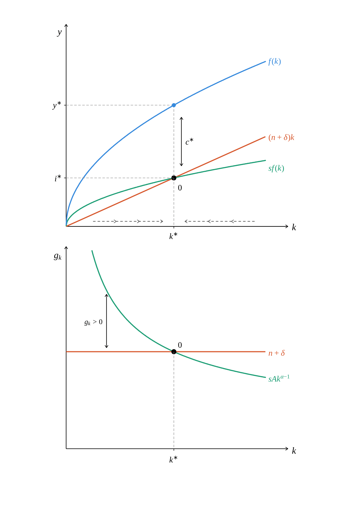
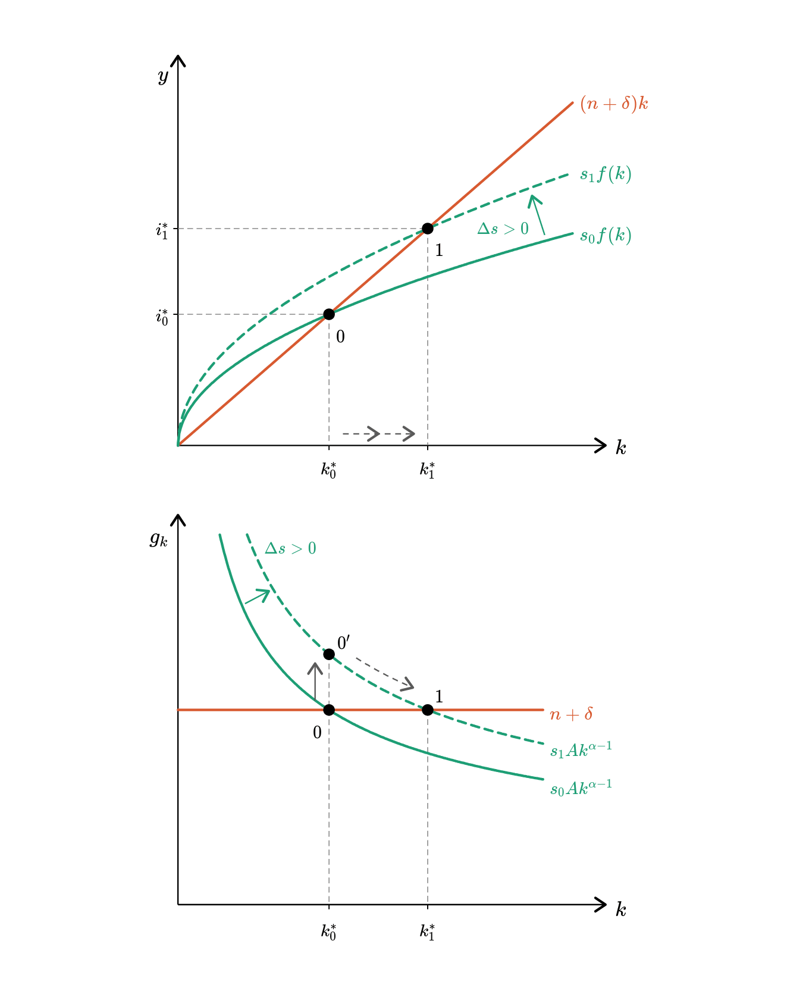
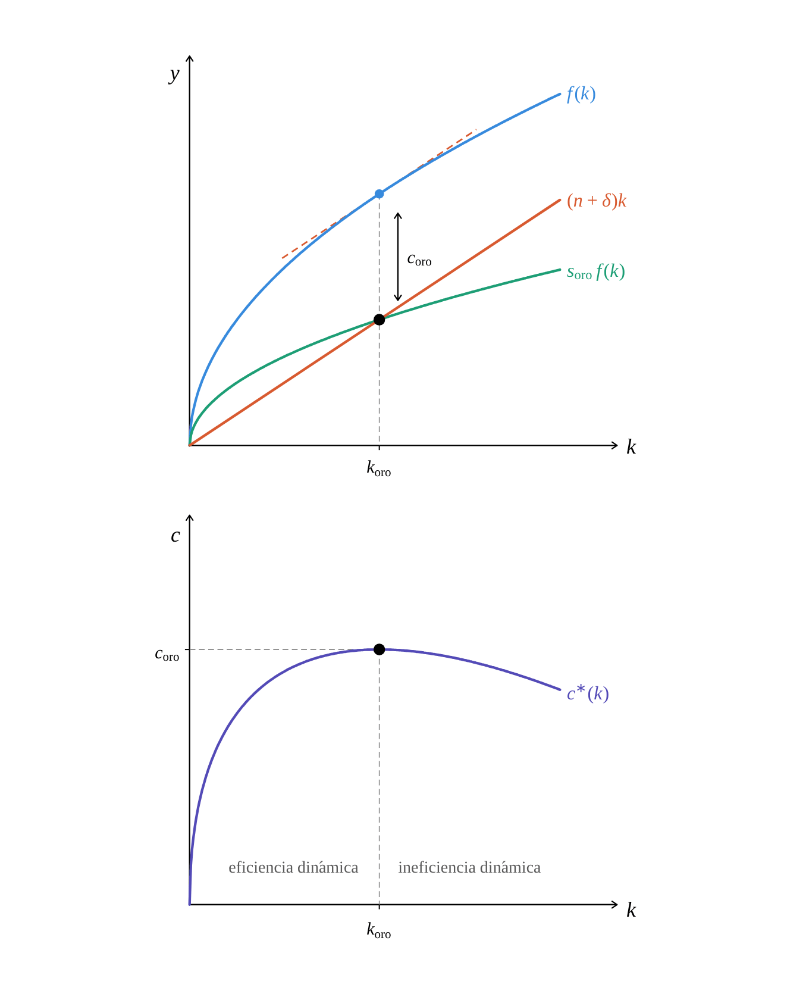
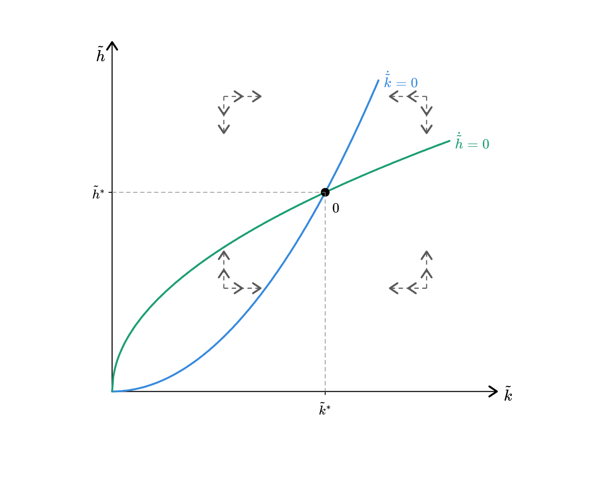
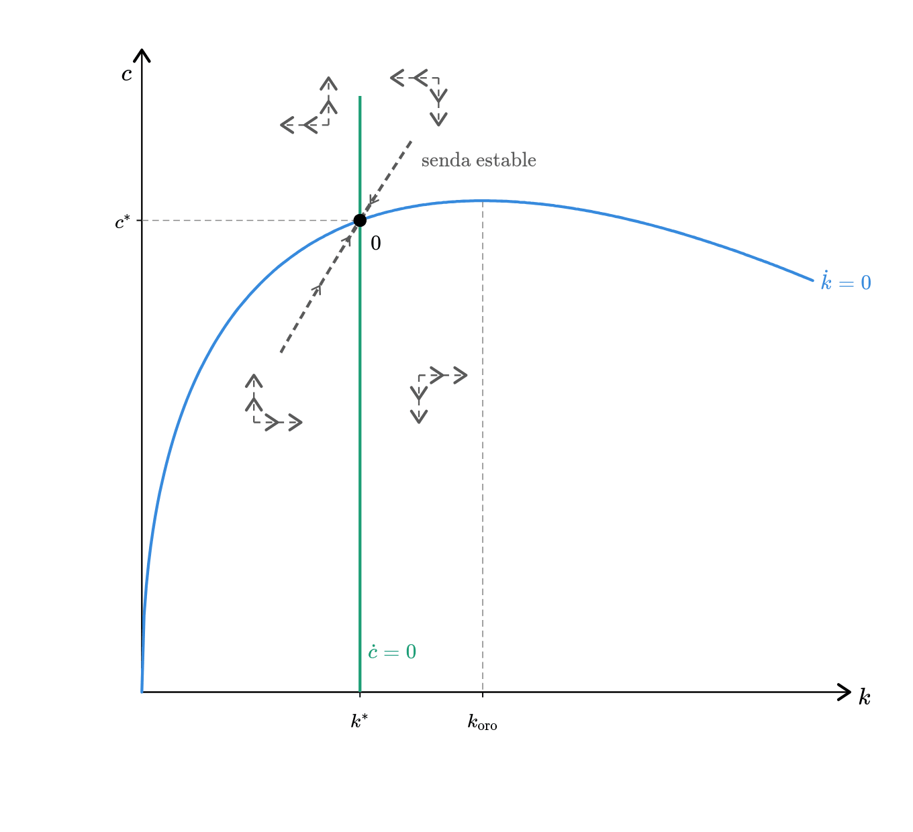
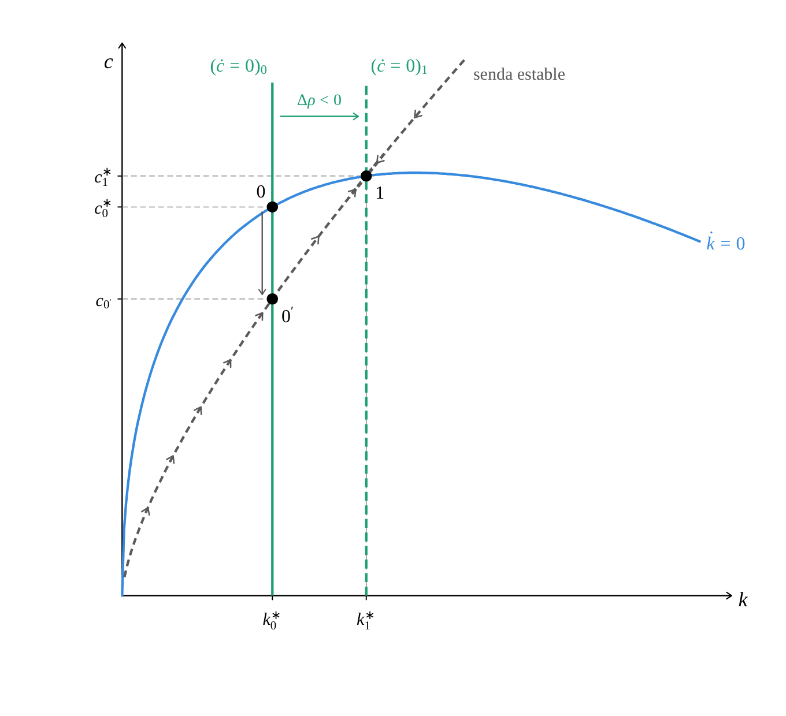

## Introducción



El tema estudia los modelos de crecimiento con progreso tecnológico exógeno en el orden en que la teoría los produjo:

- *Modelo de Harrod-Domar*: el modelo keynesiano relaciona el crecimiento con el ahorro y con la relación entre capital y producto.

- *Modelo de Solow-Swan*: el modelo neoclásico se estudia junto con su extensión posterior, el modelo aumentado con capital humano (Mankiw, Romer y Weil, 1992).

- *Modelo de Ramsey-Cass-Koopmans*: este modelo microfundamenta la decisión sobre la tasa de ahorro.

## 1. Modelo de Harrod-Domar (1939, 1946)

::: {.callout-note collapse="true" appearance="simple" title="Sobre esta sección"}
El modelo de Harrod-Domar se expone por su valor conceptual, pues plantea el problema de la estabilidad del crecimiento al que responde el modelo de Solow-Swan. Desde la revisión del programa de 2022 no figura en el título del tema, de modo que en la exposición conviene tratarlo con brevedad.
:::

**Origen**: Roy Harrod (1939) y Evsey Domar (1946) propusieron, con pocos años de diferencia, dos modelos de raíz keynesiana, que varían en detalles pero cuyas implicaciones coinciden.

**Idea**: la inversión tiene una naturaleza dual, crea demanda vía multiplicador y capacidad vía acelerador, y solo una tasa de crecimiento concreta, la garantizada, hace que ambas crezcan al mismo ritmo. 

Nada asegura, sin embargo, que la economía se sitúe en ella, y si se desvía se aleja. En consecuencia, el crecimiento basado en la acumulación del capital es inestable, y la economía transita al filo de la navaja.

### 1.1. Supuestos

**Entorno**: mundo keynesiano en tiempo discreto, con variables fechadas por periodos, a diferencia de los modelos de Solow-Swan y de Ramsey-Cass-Koopmans, que se formulan en tiempo continuo. Los precios relativos no ajustan las proporciones de factores ni el ahorro a la inversión, y las decisiones de inversión dependen de las expectativas de los empresarios. La economía es cerrada, desarrollada, con rendimientos constantes a escala y sin sector público, de modo que la producción se destina a consumo e inversión, $Y = C + I$, y el ahorro iguala *ex post* a la inversión, $S = I$. *Ex ante*, la igualdad entre ahorro e inversión deseados es la condición de equilibrio. Familias y empresas no se modelizan por separado.

**Agentes**: las familias ahorran una fracción constante y exógena de la renta, $S = sY$. Las empresas ajustan su *stock* de capital al deseado periodo a periodo según el principio del acelerador, $K^* = vY$, donde $v$ es la ratio capital-output deseada, constante y determinada por la tecnología. Se cumple el multiplicador keynesiano, $\Delta Y = \Delta I/s$.

**Tecnología**: la producción sigue una función de Leontief con dos factores complementarios, $Y = \min(K/v, L/u)$, sin sustituibilidad entre ellos. El capital no se deprecia ($I_{\text{neta}} = I_{\text{bruta}}$), la fuerza de trabajo crece a la tasa constante y exógena $n$, $L_{t+1} = (1+n)L_t$, y no hay progreso tecnológico.

### 1.2. Modelo

**Planteamiento**: no hay programa de optimización. Los rendimientos constantes permiten trabajar con la función de producción agregada en forma intensiva, $y = \min(k/v, 1/u)$. El modelo se reduce a comparar tres tasas de crecimiento que se derivan de esta expresión: la que exige el equilibrio entre ahorro e inversión, la que permite la población y la que efectivamente se produce:

- *Tasa garantizada* (Harrod): de la igualdad entre ahorro e inversión, $S_t = sY_t = I_t = K_{t+1} - K_t = v(Y_{t+1} - Y_t)$, se obtiene la tasa de crecimiento que mantiene el equilibrio del mercado de bienes en cada periodo,

    $$g_w = \frac{Y_{t+1} - Y_t}{Y_t} = \frac{s}{v}$$

    donde $s \in (0, 1)$ es la tasa de ahorro y $v$ la ratio capital-output, por lo que la tasa garantizada aumenta con la propensión al ahorro y disminuye con la intensidad de capital de la tecnología.

- *Tasa natural*: es la máxima compatible con el pleno empleo, dada por el crecimiento de la fuerza de trabajo, $g_n = n$ (con progreso técnico, $n + g_A$).

- *Tasa efectiva*: $g_Y = (Y_{t+1} - Y_t)/Y_t$, la que resulta de las decisiones de inversión de los empresarios, guiadas por los *animal spirits*.

- *Condición de Domar*: la tasa garantizada se obtiene también partiendo del doble efecto de la inversión. Su aumento amplía la demanda agregada a través del multiplicador, $\Delta Y^d = \Delta I/s$, mientras que su nivel añade una capacidad productiva igual a $I/v$, donde $1/v$ es la productividad del capital. Igualando ambos incrementos, la inversión ha de crecer a la tasa $\Delta I/I = s/v$, es decir, a la tasa garantizada.

**Dinámica**: Harrod argumenta que el equilibrio $g_Y = g_w$ es inestable, y la economía discurre por el *filo de la navaja* (*knife-edge*). Concretamente, identifica dos desviaciones:

- *Exceso de ahorro* ($g_Y < g_w$, $S > I$): la producción no encuentra comprador suficiente. Ante ese excedente, los empresarios rebajan la producción que esperan vender y, como trabajan con proporciones fijas de capital, el acelerador reduce el capital que desean tener. Invierten entonces menos, la demanda se contrae aún más y el desequilibrio inicial se amplía, de modo que el crecimiento se frena periodo tras periodo en una espiral implosiva, con la que Harrod y Domar explicaban la década de 1930.

- *Exceso de inversión* ($g_Y > g_w$, $S < I$): el proceso opera al revés y el crecimiento se vuelve explosivo.

A largo plazo se añade un segundo problema. Nada garantiza que $g_w = g_n$, pues $s$, $v$ y $n$ son parámetros independientes. Caben dos casos:

- *$g_w > g_n$*: el capital crece más deprisa que el trabajo y, sin sustituibilidad, aparece capacidad ociosa permanente.

- *$g_w < g_n$*: aparece desempleo creciente y permanente.

**Extensiones**: dada la inestabilidad intrínseca de la economía, la intervención pública se vuelve imprescindible. Además, si el ahorro no basta para financiar el crecimiento objetivo, $g_Y^T$ (es decir, si $g_w = s/v < g_Y^T$), existe un *savings gap*, una brecha entre la tasa de ahorro corriente, $s$, y la necesaria para financiar la inversión que exige ese crecimiento, $v\,g_Y^T$.

- *Política fiscal anticíclica*: cuando sobra ahorro, la inversión pública debe aumentar, y debe reducirse cuando escasea.

- *Políticas de desarrollo*: la brecha de ahorro, en cambio, solo se cierra elevando el ahorro disponible, ya sea interno (ahorro público) o externo (ayuda exterior).

Ante la inestabilidad del filo de la navaja, surgen dos soluciones. O bien se adopta una función de producción continua, que permite que $v$ se ajuste (solución adoptada por Solow-Swan), o bien se endogeniza la tasa de ahorro y se permite que $s$ se ajuste.

La segunda vía es la de la escuela de Cambridge (Kaldor, 1956; Pasinetti, 1962), en la que $s$ depende de la distribución de la renta entre salarios y beneficios. Si los perceptores de beneficios ahorran una fracción $s_\pi$ mayor que la de los asalariados, $s_w$, la tasa de ahorro agregada es $s = s_w + (s_\pi - s_w)\,\Pi/Y$, con $\Pi$ los beneficios. La condición $s/v = n$ determina entonces la participación de los beneficios que hace compatible la tasa garantizada con la natural, $\Pi/Y = (nv - s_w)/(s_\pi - s_w)$, lo que exige $s_w < nv < s_\pi$. Con pleno empleo, el ajuste lo realizan los precios, ya que un exceso de inversión eleva los precios respecto de los salarios nominales, aumenta la participación de los beneficios y, con ella, el ahorro.

Si los asalariados no ahorran, la tasa de beneficio es $\Pi/K = n/s_\pi$. Pasinetti demostró que, con propensiones al ahorro por clase social y no por tipo de renta, el resultado se mantiene aunque los asalariados ahorren, siempre que su ahorro obtenga la misma tasa de beneficio (*teorema de Pasinetti*). La tasa de beneficio de equilibrio, $\Pi/K = n/s_c$, depende entonces solo de la tasa de crecimiento natural y de la propensión al ahorro de los capitalistas, $s_c$. Ramsey-Cass-Koopmans endogeniza también el ahorro, pero sobre una función de producción neoclásica en la que $v$ ya se ajusta.

### 1.3. Conclusiones

**Aspectos positivos**: con Harrod-Domar arranca la teoría moderna del crecimiento. El modelo lleva además la interacción entre multiplicador y acelerador a un marco dinámico y formula la cuestión que vertebra el tema, la de si el crecimiento equilibrado es estable. Su noción de brecha de ahorro sirvió de fundamento a las políticas de desarrollo apoyadas en la ayuda exterior.

**Limitaciones**: la función de producción de coeficientes fijos genera la inestabilidad del filo de la navaja, que la evidencia no respalda, pues las economías no siguen sendas de crecimiento explosivas ni implosivas. Asimismo, como $s$, $v$ y $n$ son parámetros independientes, la igualdad entre la tasa garantizada y la natural sería fortuita, y fuera de ella el modelo predice capacidad ociosa o desempleo permanentes.

De las dos salidas del filo de la navaja, la escuela de Cambridge ajusta la tasa de ahorro mediante la distribución de la renta. La sección 2 sigue la otra y deja que la ratio capital-output se ajuste con la función de producción neoclásica de Solow-Swan, y la sección 3 endogeniza el ahorro sobre esa misma función.

## 2. Modelo de Solow-Swan (1956)

**Origen**: lo propusieron Robert Solow (1956) y, de forma independiente, Trevor Swan (1956).

**Idea**: el modelo sustituye la función de Leontief por una función de producción neoclásica con sustituibilidad entre capital y trabajo. Con ello, la ratio capital-output se ajusta y la inestabilidad del filo de la navaja desaparece.

El modelo estudia el papel de la inversión como motor del crecimiento y concluye que, por los rendimientos decrecientes del capital, solo el progreso técnico sostiene el crecimiento per cápita a largo plazo.

### 2.1. Supuestos

**Entorno**: el modelo se formula en tiempo continuo, con información y competencia perfectas. La economía es cerrada, desarrollada y sin sector público, como en Harrod-Domar.

**Agentes**: las familias son agentes del tipo Robinson Crusoe, a la vez productores, consumidores y propietarios de los factores y de la tecnología. Ahorran e invierten una fracción constante de la renta, $S = I = sY$. Esa fracción es un parámetro exógeno y no se deriva de ninguna decisión.

**Tecnología**: la función de producción es una Cobb-Douglas neoclásica:

$$Y = AK^\alpha L^{1-\alpha}, \quad \alpha \in (0, 1)$$

donde $A$ es la tecnología (Hicks-neutral, inicialmente constante, $\dot{A} = 0$), y $\alpha$ y $(1-\alpha)$ son las participaciones de capital y trabajo en la renta (constantes, dadas por la tecnología). El capital se deprecia a una tasa constante $\delta$ y la población crece a una tasa constante $n$. 

La función cumple tres propiedades neoclásicas: 

- *Rendimientos constantes a escala*: $f(\lambda K, \lambda L) = \lambda f(K,L)$.

- *Productividades marginales positivas y decrecientes*: $f_K' > 0$, $f_K'' < 0$, con productividades marginales cruzadas positivas, $f_{KL}'' = f_{LK}'' > 0$ (la simetría se sigue del teorema de Young).

- *Condiciones de Inada*: 

    - *Condición de Inada en el origen*: la productividad marginal del capital tiende a ser infinita cuando el *stock* de capital tiende a ser nulo, $\lim_{K \rightarrow 0} f_K' = \infty$.

    - *Condición de Inada en el infinito*: la productividad marginal del capital tiende a ser nula cuando el *stock* de capital tiende a ser infinito, $\lim_{K \rightarrow \infty} f_K' = 0$.

### 2.2. Modelo sin progreso técnico

**Planteamiento**: no hay programa de optimización, porque la tasa de ahorro es exógena. La economía no tiene sector exterior ni sector público, por lo que la renta se destina a consumo o a inversión:

$$Y = C + I$$

El modelo determina estas tres variables con una ecuación de comportamiento para cada una. Cada ecuación se escribe en niveles, en términos per cápita ($x = X/L$) y en tasas de crecimiento ($g_x \equiv \dot{x}/x$), que se obtienen tomando logaritmos y derivando respecto al tiempo con las reglas que recoge el Anexo.

- *Renta*: la genera la función de producción, que, con rendimientos constantes a escala, se escribe en forma intensiva dividiendo por $L$:

    $$Y = AK^\alpha L^{1-\alpha} \quad \Rightarrow \quad y = Ak^\alpha \quad \Rightarrow \quad g_y = \alpha g_k$$

    La renta per cápita depende solo del capital per cápita, y su tasa de crecimiento es una fracción $\alpha$ de la de este. Por eso, entender el comportamiento del capital equivale a entender el crecimiento.

- *Inversión*: las familias invierten la fracción $s$ de la renta, $I = sY$, y el capital aumenta con la inversión bruta y disminuye con la depreciación:

    $$\dot{K} = sY - \delta K \quad \Rightarrow \quad \dot{k} = sAk^\alpha - (n + \delta)k \quad \Rightarrow \quad g_k = sAk^{\alpha-1} - (n+\delta)$$

    La forma per cápita es la *ecuación fundamental de Solow-Swan* o ley de acumulación del capital per cápita. A diferencia de la renta, no basta con dividir por $L$, porque el capital per cápita cae también cuando crece la población (Anexo). La variación del capital per cápita es la diferencia entre el ahorro bruto per cápita, $sAk^\alpha = sf(k)$, y la inversión de reposición, $(n+\delta)k$, que mantiene constante el *stock* de capital per cápita ante el crecimiento de la población y la depreciación. Así, mientras el ahorro bruto supere la reposición ($\dot{k} > 0$), la economía acumula capital y crece.

    En tasas, la economía crece siempre que la tasa de ahorro bruto por unidad de capital, $sAk^{\alpha-1}$, supere la tasa de reposición, $n+\delta$. La tasa de crecimiento depende positivamente de $s$ y $A$, y negativamente de $n$ y $\delta$. El efecto de $\alpha$, en cambio, es ambiguo, porque $\partial g_k/\partial \alpha = sAk^{\alpha-1}\ln k$ es positivo solo si $k > 1$.

- *Consumo*: es la parte de la renta que no se ahorra:

    $$C = (1-s)Y \quad \Rightarrow \quad c = (1-s)Ak^\alpha \quad \Rightarrow \quad g_c = g_y$$

    Con una tasa de ahorro constante, el consumo per cápita crece al mismo ritmo que la renta per cápita, y ambos siguen la evolución del capital per cápita.

**Equilibrio**: la renta per cápita crece hasta que $\dot{k} = 0$. En ese punto el ahorro bruto iguala la inversión de reposición y no quedan recursos para incrementar el capital per cápita una vez reemplazado el depreciado y equipados los nuevos trabajadores. Esa situación, en la que las tasas de crecimiento de todas las variables son constantes, es el *estado estacionario*. Sus valores per cápita son

$$k^* = \left(\frac{sA}{n+\delta}\right)^{1/(1-\alpha)}, \quad y^* = A^{1/(1-\alpha)}\left(\frac{s}{n+\delta}\right)^{\alpha/(1-\alpha)}, \quad c^* = (1-s)y^*$$

y los precios de los factores, que retribuyen a cada uno según su productividad marginal, son constantes, $w^* = (1-\alpha)Ak^{*\alpha}$ y $r^* = \alpha Ak^{*(\alpha-1)} - \delta$. Sin progreso tecnológico, $g_y^* = g_k^* = g_c^* = 0$ y, en agregado, $g_Y^* = g_K^* = n$. El estado estacionario tiene cuatro propiedades.

- *Existencia*: gracias a las dos condiciones de Inada. La del origen garantiza que el ahorro supere a la inversión de reposición para $k$ pequeño, y la del infinito, que quede por debajo para $k$ grande, de modo que ambas curvas se cortan en un $k^* > 0$.

- *Unicidad*: porque la función de ahorro por trabajador es cóncava y la de reposición lineal.

- *Estabilidad*: la economía gravita automáticamente hacia $k^*$ desde cualquier punto de partida, lo que constituye la diferencia fundamental con Harrod-Domar.

- *Ausencia de crecimiento endógeno*: gracias a la condición de Inada en el infinito (la productividad marginal del capital tiende a cero), que impide que la acumulación sostenga por sí sola el crecimiento per cápita. Por los rendimientos decrecientes del capital, solo el progreso técnico exógeno lo mantiene.

**Desarrollo gráfico**: el estado estacionario se representa en el plano capital por trabajador-producto por trabajador (figura -@fig-a431-solow-i):

1. *Función de producción*, $f(k)$: recoge la producción por trabajador y es cóncava, por los rendimientos decrecientes del capital.

2. *Curva de ahorro*, $sf(k)$: recoge el ahorro y la inversión bruta por trabajador, una fracción $s$ de la producción, y es cóncava como ella.

3. *Recta de reposición*, $(n+\delta)k$: recoge la inversión que mantiene constante el capital por trabajador ante el crecimiento de la población y la depreciación, y es lineal porque es proporcional a $k$.

4. *Tasa de crecimiento del capital*: en el panel inferior, en el plano $k$-$g_k$, es la distancia vertical entre la curva $sAk^{\alpha-1}$ y la recta $n + \delta$.

5. *Equilibrio*: en el punto 0, el cruce de la curva de ahorro y la recta de reposición determina $k^*$ y la inversión por trabajador del estado estacionario, $i^* = sf(k^*) = (n+\delta)k^*$, y el consumo es $c^* = y^* - i^*$. A la izquierda el ahorro supera a la reposición y $k$ crece ($g_k > 0$), mientras que a la derecha $k$ cae.

::: {#fig-a431-solow-i}

::: {.content-visible when-format="html"}
```{=html}
<div class="graph-frame">
<iframe src="../graphs/a431_Solow_i.html" style="height:1020px" loading="lazy" title="fig-a431-solow-i"></iframe>
</div>
```
:::

::: {.content-visible unless-format="html"}

:::

Modelo de Solow-Swan. El estado estacionario se alcanza donde el ahorro por trabajador iguala a la inversión de reposición.
:::

**Estática comparativa**: la alteración permanente de un parámetro produce un efecto *nivel* permanente y un efecto *tasa* solo transitorio sobre las variables per cápita.

- *Aumento del ahorro* ($\Delta s > 0$): gráficamente, en el plano $k$-$y$ (figura -@fig-a438-solow-ahorro, panel superior), la curva de ahorro pivota hacia arriba, de $s_0 f(k)$ a $s_1 f(k)$, y corta a la recta de reposición en un capital estacionario mayor, del punto 0 al 1 ($k^*_0 < k^*_1$). En el plano $k$-$g_k$ (panel inferior), la curva de ahorro por unidad de capital se desplaza también hacia arriba, de $s_0Ak^{\alpha-1}$ a $s_1Ak^{\alpha-1}$. En $k^*_0$ la tasa de crecimiento del capital salta de cero a un valor positivo (del punto 0 al 0′) y después decrece a lo largo de la nueva curva hasta anularse en el punto 1.

    Por tanto, durante la transición la economía crece más deprisa, y una vez alcanzado el nuevo estado estacionario la tasa per cápita vuelve a ser la inicial. El consumo cae a corto plazo, porque la inversión absorbe una fracción mayor de la producción, y a largo plazo el consumo solo aumenta si $k^*_0$ era inferior al capital de la regla de oro, que se define en este mismo apartado. Según el modelo, la recomendación habitual de los organismos internacionales a los países pobres, ahorrar más, eleva su nivel de renta, pero no su tasa de crecimiento a largo plazo.

::: {#fig-a438-solow-ahorro}

::: {.content-visible when-format="html"}
```{=html}
<div class="graph-frame">
<iframe src="../graphs/a438_Solow_ahorro.html" style="height:880px" loading="lazy" title="fig-a438-solow-ahorro"></iframe>
</div>
```
:::

::: {.content-visible unless-format="html"}

:::

Aumento de la tasa de ahorro ($\Delta s > 0$) en el modelo de Solow-Swan. El capital estacionario pasa de $k^*_0$ a $k^*_1$ (0 → 1), y la tasa de crecimiento del capital salta en $k^*_0$ (0 → 0′) y se anula de nuevo en 1.
:::

- *Caída de la tasa de crecimiento de la población* ($\downarrow n$): hace pivotar hacia abajo la recta de reposición, pues hay que equipar a menos trabajadores nuevos, y el capital estacionario por trabajador aumenta, con el mismo patrón.

- *Mejora tecnológica*: un aumento de $A$ de una vez desplaza la curva de ahorro y tiene el mismo patrón. En cambio, solo un crecimiento continuo de $A$ genera un efecto tasa permanente.

- *Destrucción de capital*: una pérdida de una vez del *stock* de capital (una guerra, una catástrofe) no altera ninguna curva. La economía se sitúa a la izquierda de $k^*$ y vuelve a él creciendo transitoriamente por encima de su tasa estacionaria. Así interpreta el modelo la reconstrucción de Alemania y Japón tras 1945.

**Bienestar**: la *regla de oro* (Phelps, 1961) es la tasa de ahorro que maximiza el consumo de estado estacionario. Partiendo de $c^* = f(k^*) - (n+\delta)k^*$ y maximizando respecto a $k$,

$$\frac{df}{dk}\bigg|_{k_{\text{oro}}} = n + \delta \quad \Rightarrow \quad s_{\text{oro}} = \alpha$$
La tasa de ahorro oro coincide con la participación del capital en la renta (ahorrar toda la renta del capital y consumir toda la renta laboral), y el *stock* de capital oro es $k_{\text{oro}} = (\alpha A/(n+\delta))^{1/(1-\alpha)}$.

Gráficamente, la regla de oro se representa en el plano capital por trabajador-producto por trabajador (figura -@fig-a437-regla-oro-consumo, panel superior):

1. *Función de producción*, $f(k)$: la producción por trabajador, cóncava por los rendimientos decrecientes del capital.

2. *Recta de reposición*, $(n+\delta)k$: la inversión necesaria para mantener constante el capital por trabajador.

3. *Curva de ahorro de la regla de oro*, $s_{\text{oro}}\,f(k)$: la inversión bruta por trabajador con la tasa $s_{\text{oro}} = \alpha$, que corta a la recta de reposición en $k_{\text{oro}}$.

4. *Consumo de estado estacionario*, $c^*(k) = f(k) - (n+\delta)k$: en el plano $k$-$c$ (panel inferior), recoge para cada capital estacionario la distancia vertical entre $f(k)$ y $(n+\delta)k$ del panel superior. Crece mientras $df/dk > n+\delta$ y decrece a partir de $k_{\text{oro}}$.

5. *Óptimo*: en $k_{\text{oro}}$ las pendientes de $f(k)$ y de $(n+\delta)k$ coinciden y el consumo alcanza su máximo, $c_{\text{oro}}$, en la cima de $c^*(k)$.

::: {#fig-a437-regla-oro-consumo}

::: {.content-visible when-format="html"}
```{=html}
<div class="graph-frame">
<iframe src="../graphs/a437_Regla_oro_consumo.html" style="height:880px" loading="lazy" title="fig-a437-regla-oro-consumo"></iframe>
</div>
```
:::

::: {.content-visible unless-format="html"}

:::

Regla de oro (Phelps, 1961). El consumo de estado estacionario, $c^*(k)$, alcanza su máximo, $c_{\text{oro}}$, en $k_{\text{oro}}$, donde la pendiente de la función de producción iguala a $n+\delta$.
:::

Caben dos situaciones, a cada lado de $k_{\text{oro}}$ en el panel inferior:

- *Exceso de ahorro* ($k^* > k_{\text{oro}}$, $r^* < n$): reducir $s$ hasta $s_{\text{oro}}$ produce un salto inmediato del consumo hacia arriba, seguido de una convergencia al nuevo $c_{\text{oro}}$, superior al consumo inicial en todos los periodos. La economía era *dinámicamente ineficiente*, pues acumulaba capital que no le servía para consumir más. En la práctica, esto podría corregirse penalizando fiscalmente el ahorro financiero privado.

- *Insuficiencia de ahorro* ($k^* < k_{\text{oro}}$): aumentar $s$ hasta $s_{\text{oro}}$ requiere un periodo de sacrificio a corto plazo, pues el consumo cae al absorber la inversión más producción, aunque a largo plazo aumenta. A diferencia del caso anterior, ninguna trayectoria factible eleva el consumo en todos los periodos, de modo que la economía es *dinámicamente eficiente*. Ahorrar más es entonces una elección que depende de la impaciencia de los consumidores, porque una sociedad que valore mucho el presente puede preferir no sacrificar consumo corriente.

En el modelo de Solow nada garantiza que se ahorre exactamente $s_{\text{oro}}$, pues la tasa de ahorro es exógena. En el de Ramsey-Cass-Koopmans, en cambio, el ahorro óptimo excluye el exceso de ahorro (apartado 3.2).

**Extensiones**: tres corolarios del estado estacionario completan el modelo:

- *Tipo de interés e ineficiencia dinámica*: como $r^* = df/dk|_{k^*} - \delta$ y en la regla de oro $df/dk|_{k_{\text{oro}}} = n + \delta$, la zona de exceso de ahorro ($k^* > k_{\text{oro}}$) es aquella en la que $r^* < n = g_Y^*$. Gráficamente, en el plano capital por trabajador-tipo de interés y crecimiento, $k$-$(r, n)$ (figura -@fig-a436-ineficiencia-dinamica), la curva $df/dk - \delta$ es el tipo de interés real, decreciente por los rendimientos decrecientes del capital. Corta en $k_{\text{oro}}$ a la recta horizontal $n = g_Y^*$, la tasa de crecimiento de la economía, que no depende de $k$. A la izquierda de $k_{\text{oro}}$ la economía es dinámicamente eficiente ($r > n$). A la derecha es dinámicamente ineficiente ($r < n$), como en el $k^*$ de la figura, con un tipo $r^*$.

    En esa zona el capital rinde menos de lo que crece la economía. Para contrastarlo, Abel, Mankiw, Summers y Zeckhauser (1989) propusieron comparar la renta bruta del capital con la inversión bruta, y en las economías avanzadas la primera supera sistemáticamente a la segunda, lo que indica eficiencia dinámica. Aun así, el debate se ha reabierto con los tipos de interés inferiores al crecimiento posteriores a 2008 (tema [A39](a39-deficit.qmd)).

::: {#fig-a436-ineficiencia-dinamica}

::: {.content-visible when-format="html"}
```{=html}
<div class="graph-frame">
<iframe src="../graphs/a436_Ineficiencia_dinamica.html" style="height:500px" loading="lazy" title="fig-a436-ineficiencia-dinamica"></iframe>
</div>
```
:::

::: {.content-visible unless-format="html"}

:::

Eficiencia e ineficiencia dinámica en el modelo de Solow. A la derecha de la regla de oro ($k^* > k_{\text{oro}}$) el tipo de interés real queda por debajo del crecimiento de la economía ($r^* < n$) y reducir el ahorro elevaría el consumo en todos los periodos.
:::

- *Rentabilidad del capital y flujos internacionales*: con la Cobb-Douglas, $df/dk = \alpha A k^{\alpha - 1}$ y $y = A k^\alpha$, de donde $df/dk \propto y^{(\alpha-1)/\alpha}$. Por ejemplo, si la renta per cápita de un país es diez veces la de otro y $\alpha = 1/3$, su capital per cápita es mil veces mayor y el rendimiento del capital cien veces menor. Con esas diferencias el capital debería fluir masivamente hacia los países pobres, y no lo hace (*paradoja de Lucas*, 1990). Sin riesgos ni fricciones en los mercados de capitales, la explicación exige que las diferencias de renta se deban a la tecnología o al capital humano y no al capital físico, o que la elasticidad de sustitución sea mayor que la unidad.

- *Elasticidad de sustitución*: la Cobb-Douglas impone una elasticidad de sustitución entre capital y trabajo $\sigma = 1$. Con una función de elasticidad de sustitución constante (CES), $Y = [\alpha K^{(\sigma-1)/\sigma} + (1-\alpha)(AL)^{(\sigma-1)/\sigma}]^{\sigma/(\sigma-1)}$, las conclusiones cambian en los extremos:

    - *$\sigma > 1$*: la productividad marginal del capital está acotada inferiormente por una constante positiva, se incumple la condición de Inada en el infinito y el crecimiento per cápita puede sostenerse sin progreso técnico (tema [A44](a44-crecimiento-ii.qmd)).

    - *$\sigma < 1$*: el estado estacionario puede no existir para tasas de ahorro bajas.

    Además, con $\sigma \neq 1$ las participaciones factoriales dejan de ser constantes, lo que la evidencia reciente sobre la participación del trabajo hace relevante (tema [A45](a45-crecimiento-empirica.qmd)).

### 2.3. Modelo con progreso técnico

El modelo anterior supone $\dot{A} = 0$ y concluye que el crecimiento per cápita se agota. Para que exista crecimiento sostenido, el modelo incorpora un **progreso técnico exógeno** que crece a la tasa constante $g_A = \dot{A}/A$ y que, como el maná, no consume recursos.

**Planteamiento**: la forma en que el progreso técnico entra en la función de producción importa. Puede ser:

- *Neutral en el sentido de Hicks*, $Y = AF(K, L)$: eleva la productividad de ambos factores por igual.

- *Aumentador del trabajo* o *neutral en el sentido de Harrod*, $Y = F(K, AL)$: equivale a disponer de más trabajadores.

- *Aumentador del capital* o *neutral en el sentido de Solow*, $Y = F(AK, L)$.

Con la Cobb-Douglas las tres formas son indistinguibles, pero en general no lo son. El *teorema de Uzawa* (1961) establece que solo el progreso técnico aumentador del trabajo es compatible con un estado estacionario de crecimiento equilibrado, es decir, con tasas de crecimiento constantes y participaciones factoriales constantes. Cualquier otra forma haría variar la relación capital-producto sin límite. Por ello el modelo se escribe $Y = K^\alpha (AL)^{1-\alpha}$, donde $AL$ es el *trabajo efectivo* o trabajo en unidades de eficiencia.

Las tres ecuaciones de comportamiento son las del modelo sin progreso técnico (renta, inversión y consumo, por este orden), pero se expresan por unidad de trabajo efectivo, $\tilde{x} = X/(AL)$, en lugar de por trabajador:

$$\begin{alignedat}{3} &Y = K^\alpha (AL)^{1-\alpha} \; && \Rightarrow \; \tilde{y} = \tilde{k}^\alpha \; && \Rightarrow \; g_{\tilde{y}} = \alpha g_{\tilde{k}}, \qquad \alpha \in (0, 1) \\ &\dot{K} = sY - \delta K \; && \Rightarrow \; \dot{\tilde{k}} = s\tilde{k}^\alpha - (g_A + n + \delta)\tilde{k} \; && \Rightarrow \; g_{\tilde{k}} = s\tilde{k}^{\alpha-1} - (g_A + n + \delta) \\ &C = (1-s)Y \; && \Rightarrow \; \tilde{c} = (1-s)\tilde{k}^\alpha \; && \Rightarrow \; g_{\tilde{c}} = g_{\tilde{y}} \end{alignedat}$$

La ley de acumulación es formalmente idéntica a la anterior, con la tasa de progreso técnico añadida a la de reposición, porque ahora hay que equipar no solo a los nuevos trabajadores sino también a las nuevas unidades de eficiencia. Las variables per cápita se recuperan multiplicando por $A$, $y = A\tilde{y}$, de modo que $g_y = g_A + g_{\tilde{y}}$ (Anexo).

**Equilibrio**: el estado estacionario, $\tilde{k}^* = [s/(g_A+n+\delta)]^{1/(1-\alpha)}$, es constante en unidades efectivas, lo que implica que las variables per cápita crecen a la tasa del progreso técnico y las agregadas a la del progreso técnico más la población:

$$g_{\tilde{y}}^* = g_{\tilde{k}}^* = 0, \qquad g_y^* = g_k^* = g_c^* = g_A, \qquad g_Y^* = g_K^* = g_A + n$$

El *crecimiento equilibrado* resultante reproduce los hechos estilizados de Kaldor, pues la relación capital-producto, el tipo de interés y las participaciones factoriales son constantes, mientras que el salario real crece a la tasa $g_A$ (tema [A45](a45-crecimiento-empirica.qmd)).

**Estática comparativa**: un aumento de $g_A$ eleva permanentemente la tasa de crecimiento per cápita, no solo el nivel, y $g_A$ es el único parámetro del modelo con ese efecto, mientras que la acumulación de capital explica la transición, no el estado estacionario. Esa conclusión es a la vez el mayor logro del modelo, pues coincide con el residuo que la contabilidad del crecimiento atribuye a la tecnología, y su mayor limitación, pues deja sin explicar la variable que lo explica todo. Esta laguna motivará los modelos de crecimiento endógeno (tema [A44](a44-crecimiento-ii.qmd)).

### 2.4. Dinámica de transición y convergencia

**Velocidad de convergencia**: la economía converge gradualmente al estado estacionario, y la velocidad mide la tasa a la que la renta por unidad de trabajo efectivo, $\tilde{y}$, se aproxima a su nivel estacionario (la per cápita, a su senda de crecimiento equilibrado).

La velocidad se obtiene log-linealizando la ecuación fundamental en torno al estado estacionario. La tasa de crecimiento del capital, $g_{\tilde{k}} = s\tilde{k}^{\alpha-1} - (g_A+n+\delta)$, es decreciente en $\tilde{k}$, y su pendiente respecto a $\ln \tilde{k}$ en $\tilde{k}^*$ es $-(1-\alpha)(g_A+n+\delta)$, de modo que, para desviaciones pequeñas, $\dot{\ln \tilde{k}} \approx -\lambda(\ln \tilde{k} - \ln \tilde{k}^*)$ con

$$\lambda = (1-\alpha)(g_A + n + \delta)$$

La solución, $\ln \tilde{k}(t) - \ln \tilde{k}^* = e^{-\lambda t}(\ln \tilde{k}(0) - \ln \tilde{k}^*)$, muestra que la distancia al estado estacionario se cierra a un ritmo exponencial constante, de modo que cada año se recorre una fracción $\lambda$ de la distancia que queda, y el tiempo para recorrer la mitad es $t_{1/2} = \ln 2 / \lambda$.

La velocidad es mayor cuanto menor es la participación del capital, porque con $\alpha$ pequeña los rendimientos decrecientes son más intensos. Con parametrización estándar ($\alpha \approx 1/3$, $g_A + n + \delta \approx 0{,}06$), el modelo predice $\lambda \approx 4\ \%$ ($t_{1/2} \approx 17$ años), el doble de la observada empíricamente (en torno al 2 %). Con capital ampliado, en cambio, $\lambda$ baja a la velocidad observada.

**Convergencia entre países**: la predicción admite tres formulaciones:

- *$\beta$-convergencia absoluta*: los países pobres crecen más que los ricos. Se estima con $g_y = \beta_0 - \beta \ln y_0 + \varepsilon$ y existe si $\beta > 0$. Requiere parámetros estructurales idénticos, es decir, el mismo estado estacionario (véase la figura del tema [A45](a45-crecimiento-empirica.qmd), apartado 2.1).

    La evidencia de 1960-1990 no la apoya para muestras grandes de países (sí la de las últimas décadas, tema [A45](a45-crecimiento-empirica.qmd)), lo que en un principio se leyó como evidencia contraria al modelo neoclásico. En cambio, entre regiones de un mismo país sí se observa, a tasas de alrededor del 2 %, como ocurre entre los estados de EE. UU. (Barro y Sala-i-Martin, 1991), con resultados similares para las regiones europeas y las prefecturas japonesas.

- *$\beta$-convergencia condicional*: controlando por las diferencias en parámetros, $g_y = \beta_0 - \beta \ln y_0 + \boldsymbol{\gamma z} + \varepsilon$, sí se obtiene una correlación parcial negativa. Basta con que un parámetro no coincida para que cada país se dirija a su propio estado estacionario (véase la figura del tema [A45](a45-crecimiento-empirica.qmd), apartado 2.1), y deje de estar asegurado que los pobres crezcan más. Con esos controles, Barro y Sala-i-Martin (1992a) obtienen en 98 países una tasa de alrededor del 2 % ($t_{1/2} \approx 35$ años).

- *$\sigma$-convergencia*: la dispersión de la renta per cápita entre países disminuye con el tiempo. La $\beta$-convergencia absoluta es condición necesaria pero no suficiente para la $\sigma$-convergencia.

### 2.5. Extensiones

La primera extensión añade el capital humano, y las demás llevan el modelo a la economía abierta e incorporan la tierra y los recursos naturales.

#### 2.5.1. Modelo de Solow aumentado con capital humano (Mankiw, Romer y Weil, 1992)

**Origen**: Gregory Mankiw, David Romer y David Weil (1992) propusieron, ante los fallos cuantitativos del modelo canónico, una versión aumentada con capital humano que conserva la estructura neoclásica.

**Idea**: la participación del capital en la renta, en torno a un tercio, es lo que hace que el modelo de Solow prediga una convergencia demasiado rápida y unos diferenciales de renta entre países demasiado pequeños. Si el capital relevante incluye el capital humano, la participación del capital en sentido amplio se acerca a dos tercios, los rendimientos decrecientes de la acumulación son más suaves y ambas predicciones se corrigen sin renunciar al progreso técnico exógeno.

**Supuestos**:

- *Agentes*: las familias destinan fracciones constantes y exógenas de la renta a acumular cada tipo de capital, $s_k$ y $s_h$, y ambos capitales se deprecian a la misma tasa $\delta$.

- *Tecnología*: la función de producción incorpora el capital humano $H$ como tercer factor, $Y = K^\alpha H^\beta (AL)^{1-\alpha-\beta}$, con $\alpha + \beta < 1$, de modo que se mantienen los rendimientos decrecientes del capital en sentido amplio y la condición de Inada, lo que excluye el crecimiento endógeno. El resto de supuestos son los del modelo con progreso técnico.

**Planteamiento**: la renta se reparte ahora entre el consumo y la inversión en cada tipo de capital, $Y = C + I_K + I_H$, con $I_K = s_k Y$ e $I_H = s_h Y$. En unidades de trabajo efectivo ($\tilde{k} = K/(AL)$, $\tilde{h} = H/(AL)$), las ecuaciones de comportamiento de la renta, de la inversión en cada capital y del consumo son, por este orden:

$$\begin{alignedat}{2} &Y = K^\alpha H^\beta (AL)^{1-\alpha-\beta} \; && \Rightarrow \; \tilde{y} = \tilde{k}^\alpha \tilde{h}^\beta \;\Rightarrow\; g_{\tilde{y}} = \alpha g_{\tilde{k}} + \beta g_{\tilde{h}}, \quad \alpha, \beta > 0,\; \alpha + \beta < 1 \\ &\dot{K} = s_k Y - \delta K \; && \Rightarrow \; \dot{\tilde{k}} = s_k \tilde{y} - (g_A+n+\delta)\tilde{k} \\ &\dot{H} = s_h Y - \delta H \; && \Rightarrow \; \dot{\tilde{h}} = s_h \tilde{y} - (g_A+n+\delta)\tilde{h} \\ &C = (1-s_k-s_h)Y \; && \Rightarrow \; \tilde{c} = (1-s_k-s_h)\tilde{y} \;\Rightarrow\; g_{\tilde{c}} = g_{\tilde{y}} \end{alignedat}$$

Cada capital tiene su propia ley de acumulación, con la forma de la del modelo canónico, y ambas se enlazan a través de la producción, de la que se financian. Dividiendo cada una por su capital se obtienen sus tasas de crecimiento, $g_{\tilde{k}} = s_k \tilde{y}/\tilde{k} - (g_A+n+\delta)$ y $g_{\tilde{h}} = s_h \tilde{y}/\tilde{h} - (g_A+n+\delta)$.

**Equilibrio**: resolviendo simultáneamente $\dot{\tilde{k}} = 0$ y $\dot{\tilde{h}} = 0$,

$$\tilde{k}^* = \left(\frac{s_k^{1-\beta} s_h^\beta}{g_A+n+\delta}\right)^{1/(1-\alpha-\beta)}, \quad \tilde{h}^* = \left(\frac{s_k^\alpha s_h^{1-\alpha}}{g_A+n+\delta}\right)^{1/(1-\alpha-\beta)}$$

y, sustituyendo ambos valores en $\tilde{y} = \tilde{k}^\alpha \tilde{h}^\beta$ y deshaciendo el cambio a unidades de trabajo efectivo, $y = A\tilde{y}$ con $A = A_0 e^{g_A t}$, la renta per cápita estacionaria en logaritmos es

$$\begin{aligned} \ln y^* = \; & \ln A_0 + g_A t + \frac{\alpha}{1-\alpha-\beta}\ln s_k + \frac{\beta}{1-\alpha-\beta}\ln s_h \\ & - \frac{\alpha+\beta}{1-\alpha-\beta}\ln(g_A+n+\delta) \end{aligned}$$

Las tasas de crecimiento estacionarias son las del modelo canónico, $g_{\tilde{y}}^* = 0$ en unidades efectivas y $g_y^* = g_A$ per cápita.

**Desarrollo gráfico**: el estado estacionario con dos tipos de capital se representa en el plano capital físico-capital humano por unidad de trabajo efectivo, $\tilde{k}$-$\tilde{h}$ (figura -@fig-a433-solow-hc):

1. *Locus* $\dot{\tilde{k}} = 0$: combinaciones en las que el capital físico por unidad de trabajo efectivo no varía, porque su inversión, $s_k\tilde{y}$, iguala su reposición. Es creciente, porque un capital físico mayor exige más reposición, que solo una producción mayor cubre, obtenida con más capital humano. Es convexo porque, con $\alpha + \beta < 1$, cada aumento de $\tilde{k}$ exige un aumento mayor de $\tilde{h}$.

2. *Locus* $\dot{\tilde{h}} = 0$: combinaciones en las que el capital humano por unidad de trabajo efectivo no varía, porque su inversión, $s_h\tilde{y}$, iguala su reposición. Es creciente, porque un capital físico mayor eleva la producción y la inversión en capital humano, que solo se compensan con un capital humano mayor. Es cóncavo porque, con $\alpha + \beta < 1$, ese aumento de $\tilde{h}$ es cada vez menor.

3. *Equilibrio*: en el punto 0, $(\tilde{k}^*, \tilde{h}^*)$, ambos *loci* se cortan en el estado estacionario, hacia el que la economía converge desde cualquier punto.

::: {#fig-a433-solow-hc}

::: {.content-visible when-format="html"}
```{=html}
<div class="graph-frame">
<iframe src="../graphs/a433_Solow_HC.html" style="height:580px" loading="lazy" title="fig-a433-solow-hc"></iframe>
</div>
```
:::

::: {.content-visible unless-format="html"}

:::

Estado estacionario con dos tipos de capital en el modelo de Solow-Swan con capital humano (Mankiw, Romer y Weil, 1992).
:::

**Estática comparativa**: como en el modelo canónico, la alteración permanente de un parámetro tiene efecto nivel y no tasa, es decir, cambia la renta per cápita estacionaria, pero su tasa de crecimiento a largo plazo sigue siendo $g_A$.

- *Tasas de inversión*: un aumento de $s_k$ o de $s_h$ eleva $y^*$, con elasticidades $\alpha/(1-\alpha-\beta)$ y $\beta/(1-\alpha-\beta)$. La elasticidad respecto a $s_k$ es mayor que en el modelo canónico, $\alpha/(1-\alpha)$, porque el mayor ahorro eleva la renta y, con ella, el capital humano estacionario, aunque $s_h$ no varíe.

- *Crecimiento de la población*: un aumento de $n$ reduce $y^*$, con una elasticidad respecto a $g_A+n+\delta$ de $-(\alpha+\beta)/(1-\alpha-\beta)$, mayor en valor absoluto que en el modelo canónico.

**Dinámica**: log-linealizando en torno al estado estacionario, la tasa de crecimiento entre dos fechas depende de la renta inicial y de los determinantes del estado estacionario,

$$\ln \tilde{y}_t - \ln \tilde{y}_0 = (1 - e^{-\lambda t})\left[\ln \tilde{y}^* - \ln \tilde{y}_0\right], \qquad \lambda = (1-\alpha-\beta)(g_A+n+\delta)$$

de modo que la velocidad de convergencia se reduce con la participación conjunta del capital físico y humano. La literatura empírica estima esta ecuación como regresión de convergencia condicional (tema [A45](a45-crecimiento-empirica.qmd)).

**Conclusiones**:

- *Aspectos positivos*: Mankiw, Romer y Weil (MRW) obtienen $\alpha \approx \beta \approx 1/3$, de modo que la participación del capital en sentido amplio es de unos dos tercios. Ello supone tres mejoras. La velocidad de convergencia cae, aproximadamente, del 4 % al 2 %, coherente con la evidencia, y el $R^2$ de las regresiones del nivel de renta por persona en edad de trabajar sube de unos 0,6 (modelo canónico, 98 países) a unos 0,8. Además, los diferenciales de renta predichos se aproximan más a los observados.

- *Limitaciones*: MRW aproximan la tasa de inversión en capital humano, $s_h$ (un flujo, no el *stock* de capital humano), mediante el producto de la tasa de escolarización secundaria por la proporción de la población en edad de trabajar que está en edad escolar. Esta medida ha sido ampliamente criticada por imprecisa, ya que no captura la calidad de la educación, la experiencia laboral ni el aprendizaje en el puesto de trabajo.

#### 2.5.2. Otras extensiones

**Economía abierta** (Barro, Mankiw y Sala-i-Martin, 1995): en una economía pequeña y abierta con movilidad perfecta del capital, el tipo de interés mundial fija de inmediato el capital por trabajador, $df/dk = r^w + \delta$, y la convergencia sería instantánea, lo que la evidencia desmiente. Si, por el contrario, el capital humano no puede usarse como colateral y solo el capital físico se financia en el exterior, la economía salta de inmediato al capital físico deseado, pero acumula capital humano con ahorro interno. La velocidad de convergencia es entonces mayor que en la economía cerrada, pero finita. Con la participación del capital físico en torno a un tercio, el efecto cuantitativo es pequeño y la velocidad predicha sigue próxima al 2 %.

**Tierra y recursos naturales**: con tierra ($T$, de oferta fija) y recursos no renovables ($R$, que se agotan a la tasa $b$), $Y = AK^\alpha T^\gamma R^\eta L^{1-\alpha-\gamma-\eta}$, la tasa de crecimiento per cápita estacionaria es $g_y^* = [g_A - (\gamma + \eta)n - \eta b]/(1-\alpha)$. La expresión se obtiene tomando tasas de crecimiento en la función de producción a lo largo de una senda de crecimiento equilibrado, con $g_T = 0$, $g_R = -b$ y $g_L = n$, y restando $n$. El progreso técnico es aquí neutral en el sentido de Hicks, de modo que $g_A$ mide el crecimiento de la productividad total de los factores (PTF) y no el del progreso aumentador del trabajo.

La tierra fija y el agotamiento de recursos actúan, pues, como un freno proporcional al crecimiento de la población y a la tasa de extracción, y el crecimiento per cápita solo es positivo si el progreso técnico los compensa, $g_A > (\gamma + \eta)n + \eta b$. Así responde el enfoque neoclásico a la predicción maltusiana y al Informe Meadows (1972). Los límites físicos son reales, pero la experiencia de los dos últimos siglos muestra que el progreso técnico los ha superado con holgura. La economía de los recursos agotables, de la regla de Hotelling al modelo de Solow ampliado con recursos naturales, se examina en el tema [B31](b31-ma-bpg.qmd) §2.1.

### 2.6. Conclusiones

**Aspectos positivos**: toda la literatura posterior toma el modelo como referencia. Al admitir que capital y trabajo se sustituyen, el modelo prueba que el estado estacionario es estable y deja atrás el filo de la navaja de Harrod-Domar. Muestra, además, que solo el avance tecnológico hace que la renta por habitante siga aumentando a largo plazo, por mucho capital que se acumule.

**Limitaciones**: el modelo tiene cinco:

- *Progreso tecnológico exógeno*: el teorema de Euler implica que, con rendimientos constantes y competencia perfecta, la innovación no tiene con qué financiarse. El propio Solow (1957) atribuyó al “residuo de Solow”, es decir, al progreso tecnológico no explicado, el 87,5 % del crecimiento de la producción por hora trabajada en EE. UU. entre 1909 y 1949.

- *Calibración*: con $\alpha \approx 1/3$, la velocidad de convergencia y los diferenciales de renta son irrealistas.

- *Modelo unisectorial*: no captura la transformación estructural (ley de Engel, industrialización en U invertida, ley de Wagner).

- *Ahorro exógeno*: la tasa de ahorro es un parámetro y no el resultado de una decisión de las familias, carencia que corrige el modelo de Ramsey-Cass-Koopmans (sección 3).

- *Rentabilidad del capital*: los diferenciales entre países predichos son muy superiores a los observados (paradoja de Lucas).

## 3. Modelo de Ramsey-Cass-Koopmans (1928, 1965)

**Origen**: Frank Ramsey (1928) planteó el problema del ahorro óptimo. David Cass (1965) y Tjalling Koopmans (1965) lo formalizaron como modelo de crecimiento con optimización intertemporal, el modelo de Ramsey-Cass-Koopmans (RCK).

**Idea**: el modelo endogeniza la tasa de ahorro a partir de la decisión intertemporal de las familias. Su principal resultado es una tasa de ahorro óptima que puede subir, bajar o mantenerse a lo largo de la transición, sin que cambien las conclusiones cualitativas de Solow.

### 3.1. Supuestos

**Entorno**: el modelo comparte los supuestos neoclásicos de Solow (competencia perfecta, tiempo continuo, horizonte infinito).

**Agentes**:

- *Familias*: en ellas está el principal elemento diferenciador respecto al modelo de Solow-Swan, pues la tasa de ahorro es una variable endógena. En cada momento del tiempo los consumidores-productores deciden la fracción de su renta que destinan a ahorrar. Los hogares son idénticos y su tamaño crece a la tasa de la población, $n$, con $L(t) = e^{nt}$. Operan bajo altruismo intergeneracional puro (dinastías), lo que justifica el horizonte infinito. Alternativamente, este puede interpretarse como el de agentes con una probabilidad de muerte constante, de tipo Poisson. Los hogares poseen activos $a$ (positivos si prestan, negativos si se endeudan) que generan un tipo de interés real $r$, y fuerza de trabajo que alquilan a un salario real $w$.

- *Preferencias*: utilidad instantánea isoelástica (CRRA), $u(c) = (c^{1-\theta} - 1)/(1-\theta)$, con $\theta > 0$ el coeficiente de aversión relativa al riesgo, constante, y $1/\theta$ la elasticidad de sustitución intertemporal (ESI). Si $\theta = 1$, la utilidad es logarítmica. Si $\theta$ es bajo, los hogares toleran más variabilidad en el consumo, mientras que si $\theta$ es alto desean alisar fuertemente. La tasa de descuento $\rho>0$ cumple $\rho > n>0$, lo que garantiza que la utilidad no diverge.

- *Empresas*: alquilan $K$ a su coste de uso, $r + \delta$, y contratan $L$ al salario $w$.

**Tecnología**: la función de producción es la Cobb-Douglas del modelo de Solow-Swan (apartado 2.1).

### 3.2. Modelo

**Hogares**: eligen en cada momento cuánto consumen y, con ello, qué fracción de su renta ahorran.

- *Planteamiento*: maximizan la utilidad descontada en un horizonte infinito, sujetos a la restricción presupuestaria dinámica, a sus activos iniciales y a la condición de no-Ponzi, que impide acabar endeudados en el límite:

    $$\max_{\{c\}} \int_0^\infty e^{-(\rho - n)t} \frac{c^{1-\theta} - 1}{1-\theta} dt, \qquad \theta > 0$$

    $$\text{s.a.:} \begin{cases} c + \dot{a} = w + (r-n)a \\ a_0 \text{ dado} \\ \lim_{t \to \infty} \lambda(t)\, a(t) \geq 0 \end{cases}$$

    donde $c$ y $a$ son el consumo y los activos per cápita[^a43-1], $a_0$ los activos iniciales, dados, y el factor $e^{-(\rho - n)t}$ descuenta la utilidad a la tasa $\rho$ y la pondera por el tamaño del hogar, $e^{nt}$. El hamiltoniano en valor presente u origen es $\mathcal{H} = e^{-(\rho-n)t} u(c) + \lambda[(r-n)a + w - c]$, donde $\lambda$, el multiplicador dinámico, actúa como precio sombra de los activos y expresa cuánto vale en $t=0$ para el consumidor disponer de una unidad más de ellos. La condición de no-Ponzi se escribe con este multiplicador[^a43-2].

- *CPO*: por el principio del máximo,

    $$\frac{\partial \mathcal{H}}{\partial c} = 0 \quad \Rightarrow \quad e^{-(\rho-n)t} c^{-\theta} = \lambda \tag{1}$$

    $$\frac{\partial \mathcal{H}}{\partial a} = -\dot{\lambda} \quad \Rightarrow \quad (r-n)\lambda = -\dot{\lambda} \tag{2}$$

    $$\lim_{t \to \infty} \lambda(t)\, a(t) = 0 \tag{3}$$

    La condición (3), de transversalidad[^a43-3], excluye conservar activos sin consumirlos nunca, de manera que en el óptimo la condición de no-Ponzi se cumple con igualdad.

    Tomando logaritmos en (1), derivando respecto al tiempo y sustituyendo (2), se obtiene la *ecuación de Keynes-Ramsey*:

    $$g_c = \frac{\dot{c}}{c} = \frac{1}{\theta}(r - \rho) \tag{KR}$$

    Según (KR), el consumo per cápita crece cuando $r > \rho$, es decir, cuando la rentabilidad del ahorro supera a la impaciencia y los agentes ahorran hoy para consumir más mañana, y el consumo decrece en el caso contrario, $r < \rho$.

    En ambos casos, la variación del consumo es más pronunciada cuanto menor sea $\theta$, es decir, cuanto mayor sea la elasticidad de sustitución intertemporal, $1/\theta$, lo que implica también mayor volatilidad de la senda de consumo ante *shocks*.

- *CSO*: el hamiltoniano es estrictamente cóncavo en $c$ y lineal en $a$, lo que hace que (1), (2) y (3) sean condiciones necesarias y suficientes.

**Empresas**: maximizan el beneficio en mercados competitivos.

- *Planteamiento*: alquilan el capital a su coste de uso y contratan el trabajo al salario, que toman como dados, $\max_{K,\,L} \; AK^\alpha L^{1-\alpha} - (r+\delta)K - wL$, con la tecnología Cobb-Douglas del modelo de Solow-Swan (apartado 2.1).

- *CPO*: contratan cada factor hasta que su productividad marginal iguala a su coste real, $r = df/dk - \delta = \alpha Ak^{\alpha-1} - \delta$ y $w = f(k) - k\, df/dk = (1-\alpha)Ak^\alpha$. Con rendimientos constantes a escala, los pagos a los factores agotan el producto y el beneficio es nulo.

- *CSO*: la tecnología Cobb-Douglas es cóncava en $(K, L)$ y estrictamente cóncava en cada factor, luego las CPO caracterizan el máximo.

**Equilibrio**: en el mercado de capitales la riqueza de las familias iguala al capital, $a = k$, porque en una economía cerrada sin sector público el único activo es el capital físico y la deuda neta entre familias es cero. La ley de acumulación del capital es, con ahorro endógeno, la restricción de recursos de la economía, $c + \dot{k} + (n+\delta)k = f(k)$. A diferencia de Solow, $c$ no es una fracción fija de $f(k)$ sino una variable de control. El sistema en $(k, c)$ formado por (KR) y esta ecuación describe el modelo.

En el estado estacionario, imponiendo $\dot{c} = 0$ en (KR), el tipo de interés iguala la tasa de descuento, $r = \rho$, y la productividad marginal del capital cubre la impaciencia y la depreciación, $df/dk|_{k^*} = \rho + \delta$, de donde

$$k^* = \left(\frac{\alpha A}{\rho + \delta}\right)^{1/(1-\alpha)}$$

El *stock* de capital estacionario es inferior al de la regla de oro, $k^* < k_{\text{oro}}$, siempre que $\rho > n$, porque la regla de oro impone $df/dk = n + \delta$ mientras que RCK impone $df/dk = \rho + \delta$, de modo que la productividad marginal exigida es mayor y, por rendimientos decrecientes, el capital menor. Intuitivamente, los agentes impacientes acumulan menos capital del que prescribe la regla de oro porque los sacrificios a corto plazo para alcanzarla son demasiado grandes. Sin progreso técnico, $g_c^* = g_k^* = 0$.

En cuanto a la tasa de ahorro, en el estado estacionario el ahorro repone exactamente el capital, $s^* = (n+\delta)k^*/f(k^*)$, y sustituyendo $df/dk|_{k^*} = \alpha A k^{*\alpha-1} = \rho + \delta$:

$$s^* = \alpha \, \frac{n + \delta}{\rho + \delta}$$

La tasa de ahorro estacionaria es inferior a la de la regla de oro, $s^* < s_{\text{oro}} = \alpha$, precisamente porque $\rho > n$, y decrece con la impaciencia.

Fuera del estado estacionario, en cambio, la tasa de ahorro no es constante. Con la Cobb-Douglas se demuestra (Barro y Sala-i-Martin, 2004) que $s(t)$ es monótona a lo largo de la transición y que su sentido depende de la comparación entre $s^*$ y $1/\theta$.

La intuición descansa en los efectos sustitución y renta. En una economía pobre el capital es escaso y el tipo de interés alto, lo que por efecto sustitución incentiva el ahorro, mientras que por efecto renta los agentes, que se saben más ricos en el futuro, desean adelantar consumo y ahorrar menos. Cuanto mayor es la elasticidad de sustitución intertemporal, $1/\theta$, más pesa el primero. Caben tres casos:

- *$s^* < 1/\theta$* (elasticidad de sustitución intertemporal alta): los agentes de una economía pobre prefieren consumir poco y acumular deprisa, de modo que la tasa de ahorro decrece hacia $s^*$.

- *$s^* > 1/\theta$* (fuerte deseo de alisar): consumen relativamente más al principio y la tasa de ahorro crece.

- *$s^* = 1/\theta$*: la tasa de ahorro es constante y el modelo reproduce exactamente a Solow.

Endogenizar el ahorro no altera las conclusiones cualitativas del modelo neoclásico, y en un caso particular ni siquiera las cuantitativas.

**Desarrollo gráfico**: la dinámica del modelo se representa en el plano capital por trabajador-consumo por trabajador, $k$-$c$ (figura -@fig-a434-rck-i):

1. *Locus $\dot{c} = 0$*: línea vertical en el $k^*$ que cumple $df/dk|_{k^*} = \rho + \delta$. A su izquierda el capital es escaso, su productividad marginal supera a $\rho + \delta$, el tipo de interés supera a la impaciencia y el consumo crece, mientras que a su derecha ocurre lo contrario.

2. *Locus $\dot{k} = 0$*: curva cóncava $c = f(k) - (n+\delta)k$, que alcanza su máximo en $k_{\text{oro}}$ y corta el eje horizontal, a la derecha del área representada, en el capital máximo sostenible, $\bar{k}$, donde $f(\bar{k}) = (n+\delta)\bar{k}$. Por encima de la curva el consumo es demasiado alto y el capital disminuye, y por debajo aumenta.

3. *Senda estable*: la trayectoria, creciente, que lleva al estado estacionario.

4. *Equilibrio*: hay tres. El origen es inestable y el punto $(\bar{k}, 0)$ es estable pero indeseable, pues todo se invierte y nada se consume. El tercero, $(k^*, c^*)$, el punto 0, es un *punto de silla*.

Existe una única trayectoria estable (*saddle path*) que converge al punto de silla. Las trayectorias por encima agotan el capital en un tiempo finito (sobreconsumo), tras lo cual el consumo tendría que caer bruscamente a cero, lo que incumple la ecuación de Keynes-Ramsey y la restricción de recursos. Las de abajo llevan a $k \rightarrow \bar{k}$ y $c \rightarrow 0$ (sobreahorro) e incumplen la condición de transversalidad. Así, $c$ es una *variable de salto*, que se sitúa de inmediato sobre la senda estable, y $k$ una *variable predeterminada*.

::: {#fig-a434-rck-i}

::: {.content-visible when-format="html"}
```{=html}
<div class="graph-frame">
<iframe src="../graphs/a434_RCK_i.html" style="height:540px;max-width:555px" loading="lazy" title="fig-a434-rck-i"></iframe>
</div>
```
:::

::: {.content-visible unless-format="html"}

:::

Diagrama de fases del modelo de Ramsey-Cass-Koopmans y senda estable hacia el estado estacionario.
:::

La economía puede converger desde la región de desacumulación ($k > k^*$, $c > c^*$) o desde la de crecimiento ($k < k^*$, $c < c^*$). En esta, el capital crece a tasa decreciente, y el tipo de interés baja gradualmente hasta $\rho$ y el crecimiento del consumo, hasta cero. La forma de la senda estable depende de $\theta$:

- *$\theta$ elevado* (fuerte deseo de alisar): la senda estable discurre muy cerca del *locus* $\dot{k} = 0$, porque los hogares prefieren un consumo alto desde el principio aunque $k$ apenas aumente.

- *$\theta$ reducido*: la senda estable es más empinada, porque los hogares toleran un consumo variable y lo recortan al principio para acumular deprisa.

Por ello la velocidad de convergencia es tanto mayor cuanto menor es $\theta$[^a43-4]. Con $\alpha \approx 1/3$ y valores plausibles del resto de parámetros se obtienen velocidades muy superiores al 2 % observado, y, como en Solow, solo un concepto amplio de capital ($\alpha \approx 2/3$, como en el apartado 2.5.1) reconcilia el modelo con la evidencia.

**Estática comparativa**: se analizan tres perturbaciones no anticipadas:

- *Caída de la tasa de descuento* ($\downarrow \rho$): es el *shock* más relevante en RCK, lo más parecido a un aumento de $s$ en Solow. Gráficamente, en el plano $k$-$c$ (figura -@fig-a435-rck-ii), solo se desplaza el *locus* $\dot{c} = 0$, porque el $\dot{k} = 0$ depende de la tecnología y no de las preferencias. El *locus* $\dot{c} = 0$ pasa a la derecha, de $(\dot{c} = 0)_0$ a $(\dot{c} = 0)_1$, y el capital estacionario, de $k^*_0$ a $k^*_1$.

    En el momento del cambio el consumo salta hacia abajo, de $c^*_0$ a $c_{0'}$ (del punto 0 al 0′), pues los agentes previsores se sitúan sobre la nueva senda estable ahorrando más. A partir de ahí, $k$ y $c$ crecen hasta el punto 1, con valores estacionarios superiores a los originales. Por tanto, a corto plazo el consumo cae y a largo plazo capital y consumo aumentan, el patrón de Solow con $k < k_{\text{oro}}$.

::: {#fig-a435-rck-ii}

::: {.content-visible when-format="html"}
```{=html}
<div class="graph-frame">
<iframe src="../graphs/a435_RCK_ii.html" style="height:540px;max-width:555px" loading="lazy" title="fig-a435-rck-ii"></iframe>
</div>
```
:::

::: {.content-visible unless-format="html"}

:::

Caída no anticipada de la tasa de descuento en el modelo de Ramsey-Cass-Koopmans. El consumo salta a la nueva senda estable (0 → 0′) y la economía converge al nuevo estado estacionario (1).
:::

- *Mejora tecnológica permanente* ($\uparrow A$): afecta a ambos *loci*. El *locus* $\dot{c} = 0$ se desplaza a la derecha, pues $df/dk$ aumenta para todo $k$, y el $\dot{k} = 0$, hacia arriba, pues para cada $k$ hay más producción y más consumo compatible con un capital constante. El consumo salta de inmediato sobre el nuevo *saddle path*, hacia arriba o hacia abajo según la magnitud relativa de los desplazamientos, y a largo plazo $k^*$ y $c^*$ son ambos mayores.

- *Mejora tecnológica transitoria*: si el aumento de $A$ se revierte en $t_1$, los agentes lo anticipan. Por ello, en $t_0$ el consumo salta sobre una trayectoria intermedia, que no es el *saddle path* del estado transitorio ni el del permanente, y que garantiza que en $t_1$ la economía se encuentre exactamente sobre el *saddle path* original. Solow no puede generar este resultado, característico de RCK, en el que los agentes incorporan la naturaleza temporal del *shock* desde el primer momento.

**Bienestar**: dado que se cumplen las condiciones del primer teorema fundamental de la economía del bienestar (competencia perfecta, ausencia de externalidades, mercados completos), el equilibrio descentralizado es Pareto-eficiente y coincide con la solución del planificador benevolente. Esa solución impone $g_c = (1/\theta)[df/dk - \delta - \rho]$ y en el equilibrio descentralizado $r = df/dk - \delta$, de modo que las ecuaciones de Euler coinciden y la asignación es la misma. A diferencia de Solow, donde nada garantiza una tasa de ahorro eficiente, en RCK el mercado genera endógenamente la tasa de ahorro óptima, que corresponde a la *regla de oro modificada*, $df/dk|_{k^*} = \rho + \delta$, no a la regla de oro. En consecuencia, no puede darse la ineficiencia dinámica del exceso de ahorro.

Con impuestos distorsionantes, externalidades o competencia imperfecta, en cambio, la equivalencia se rompe y el equilibrio descentralizado deja de ser eficiente, lo que deja margen a la política económica en los modelos de crecimiento endógeno.

**Extensiones**:

- *Horizonte finito*: Dorfman, Samuelson y Solow (1958) formularon el *teorema de la autopista* para el modelo multisectorial de von Neumann, y Cass (1966) lo demostró para este modelo agregado. Según el teorema, cuando el final del horizonte queda muy lejos, la senda óptima se mantiene casi todo el tiempo en las proximidades del estado estacionario y solo al acercarse el final se desvía hacia el capital terminal. Si ese capital es nulo, la senda arranca por encima del *saddle path*, porque el capital ha de agotarse en el último periodo.

- *Progreso técnico*: con progreso técnico aumentador del trabajo a la tasa $g_A$, el modelo se escribe en unidades de trabajo efectivo y la condición de transversalidad exige $\rho > n + (1-\theta)g_A$. La ecuación de Keynes-Ramsey pasa a ser $g_{\tilde{c}} = (1/\theta)[df/d\tilde{k} - \delta - \rho - \theta g_A]$, y el capital estacionario cumple $df/d\tilde{k}|_{\tilde{k}^*} = \rho + \delta + \theta g_A$. El crecimiento eleva así el tipo de interés exigido, porque los agentes, que saben que serán más ricos, descuentan más el futuro. En el estado estacionario el consumo per cápita crece a la tasa $g_A$, como en Solow, y la tasa de ahorro es $s^* = \alpha(g_A+n+\delta)/(\rho+\delta+\theta g_A)$.

- *Sector público*: con gasto público $g$ por trabajador financiado con impuestos de suma fija, la restricción de recursos es $c + g + \dot{k} + (n+\delta)k = f(k)$. El *locus* $\dot{k} = 0$ se desplaza hacia abajo en $g$ y el consumo privado es expulsado uno a uno a largo plazo, sin efecto sobre $k^*$. Por la equivalencia ricardiana, el resultado es el mismo si el gasto se financia con deuda (tema [A38](a38-politica-fiscal.qmd)).

    Con un impuesto proporcional sobre la renta del capital a la tasa $\tau$, en cambio, el rendimiento neto es $(1-\tau)[df/dk - \delta]$ y el capital estacionario cae, $df/dk|_{k^*} = \delta + \rho/(1-\tau)$. El impuesto tiene efecto nivel, no tasa, y el consumo estacionario disminuye.

- *Oferta de trabajo endógena*: si la utilidad incluye el ocio, $u(c, 1-l)$, se añade una condición intratemporal, $-u_l/u_c = w$, y el estado estacionario determina también las horas trabajadas. El modelo así ampliado es el núcleo de los modelos del ciclo real (tema [A42](a42-ciclos.qmd)).

- *Política económica*: como en Solow, las políticas que alteran los parámetros, como la fiscalidad del ahorro (que actúa como $\rho$) o las que afectan a la población, tienen efectos nivel y no tasa sobre las variables per cápita. La novedad es que, sin fallos de mercado, no hay motivo para intervenir.

### 3.3. Conclusiones

**Aspectos positivos**: el modelo dota de microfundamentos al de Solow, prueba la eficiencia del equilibrio descentralizado e incorpora las preferencias intertemporales (impaciencia y suavización del consumo) que determinan cuánto se ahorra y con qué rapidez se converge.

**Limitaciones**: comparte con Solow la exogeneidad del progreso tecnológico, y la mayor complejidad analítica no altera la conclusión de que sin tecnología exógena no hay crecimiento per cápita sostenido. También predice convergencia condicional con una velocidad similar a la de Solow. El agente representativo con horizonte infinito excluye, además, la heterogeneidad y los efectos intergeneracionales que estudian los modelos de generaciones solapadas (tema [A29](a29-mhi-mgs.qmd)).

## Conclusiones

Los modelos de crecimiento exógeno comparten la conclusión de que la acumulación de capital determina el nivel de la renta per cápita, pero su crecimiento sostenido solo puede proceder de un progreso técnico que los modelos no explican. Harrod y Domar plantean si el crecimiento equilibrado es estable y, con coeficientes fijos, concluyen que no lo es, pues la economía discurre por el filo de la navaja. Solow y Swan resuelven esa inestabilidad con la sustituibilidad entre factores. Con ello, el estado estacionario es estable, aunque la velocidad de convergencia que predicen duplica la observada salvo que el capital se amplíe con el humano (Mankiw, Romer y Weil). Ramsey, Cass y Koopmans endogenizan el ahorro y muestran que el equilibrio descentralizado es eficiente, sin alterar el papel exógeno de la tecnología. La predicción empírica central es la convergencia condicional, en torno al 2 % anual, según la cual cada país converge a su estado estacionario. Que el residuo de Solow absorba el 87,5 % del crecimiento de la productividad del trabajo resume el límite de estos modelos.

El crecimiento exógeno abre un bloque que sigue con los modelos que endogenizan la tecnología (tema [A44](a44-crecimiento-ii.qmd)) y con la contrastación empírica, donde se mide el residuo y se estiman las convergencias $\beta$ y $\sigma$ (tema [A45](a45-crecimiento-empirica.qmd)). El modelo de Ramsey-Cass-Koopmans aplica al crecimiento el consumidor de horizonte infinito (tema [A29](a29-mhi-mgs.qmd)) y, sometido a perturbaciones tecnológicas, es también la base de la teoría del ciclo real (tema [A42](a42-ciclos.qmd)), de modo que crecimiento y ciclo comparten un mismo modelo. Por último, la ampliación del modelo de Solow con recursos naturales plantea si el crecimiento es compatible con un recurso agotable (tema [B31](b31-ma-bpg.qmd)).

La convergencia absoluta, ausente en las muestras de 1960-1990, tiende a aparecer desde 1990 y es clara desde 2000, a la vez que las instituciones y las políticas de los países pobres se aproximan a las de los ricos (Kremer, Willis y You, 2022). Ese cambio sugiere que la falta de convergencia anterior fue un rasgo del periodo. También se discute la tasa de descuento social, que aplica la ecuación de Keynes-Ramsey al cambio climático. El Informe Stern (2006) fija por razones éticas una tasa de preferencia temporal casi nula y pide una acción inmediata, mientras que Nordhaus (2007) calibra los parámetros con los rendimientos de mercado y obtiene una senda de mitigación gradual.

## Anexo. De los niveles a las tasas de crecimiento

Los modelos de crecimiento escriben cada ecuación de comportamiento en niveles, en términos per cápita o por unidad de trabajo efectivo y en tasas de crecimiento. El paso de una forma a otra descansa en una sola herramienta. La tasa de crecimiento de una variable es la derivada respecto al tiempo de su logaritmo, porque, por la regla de la cadena, $d\ln x/dt = (1/x)(dx/dt)$:

$$g_x \equiv \frac{\dot{x}}{x} = \frac{d \ln x}{dt}, \qquad \dot{x} \equiv \frac{dx}{dt}$$

Como el logaritmo convierte los productos en sumas y las potencias en productos, tomar logaritmos y derivar respecto al tiempo da tres reglas:

1. *Producto*: si $z = xy$, entonces $\ln z = \ln x + \ln y$ y $g_z = g_x + g_y$.

2. *Cociente*: si $z = x/y$, entonces $\ln z = \ln x - \ln y$ y $g_z = g_x - g_y$.

3. *Potencia*: si $z = x^a$, entonces $\ln z = a \ln x$ y $g_z = a\,g_x$.

Una suma no sigue ninguna de ellas. Si $z = x + y$, su tasa de crecimiento es la media de las tasas de los sumandos ponderada por su peso, $g_z = \frac{x}{x+y}\,g_x + \frac{y}{x+y}\,g_y$, como en la producción del modelo Sobelow (tema [A44](a44-crecimiento-ii.qmd)).

El modelo de Solow-Swan (apartado 2.2) aplica las tres reglas. En la producción, $Y = AK^\alpha L^{1-\alpha}$ con $A$ constante, las reglas del producto y de la potencia dan $g_Y = \alpha g_K + (1-\alpha) n$. En términos per cápita, la regla del cociente da $g_y = g_Y - n = \alpha(g_K - n) = \alpha g_k$.

La acumulación del capital exige un paso más. El capital per cápita es un cociente, $k = K/L$, de modo que $g_k = g_K - n$. Como $\dot{K} = sY - \delta K$, la tasa de crecimiento del capital es $g_K = sY/K - \delta$, y, dividiendo por $L$ el numerador y el denominador, $Y/K = y/k$. Por tanto:

$$g_k = \frac{sy}{k} - (n+\delta) \quad \Rightarrow \quad \dot{k} = g_k\,k = sAk^\alpha - (n+\delta)k$$

El término $nk$ aparece porque, aunque $K$ no varíe, el capital per cápita cae al ritmo al que crece la población.

Con progreso técnico (apartado 2.3), el capital por unidad de trabajo efectivo es $\tilde{k} = K/(AL)$, y las reglas del cociente y del producto dan $g_{\tilde{k}} = g_K - g_A - n$. El mismo razonamiento lleva a $\dot{\tilde{k}} = s\tilde{k}^\alpha - (g_A+n+\delta)\tilde{k}$. Para volver a las variables per cápita, $y = A\tilde{y}$ implica $g_y = g_A + g_{\tilde{y}}$, de modo que, en el estado estacionario, con $g_{\tilde{y}}^* = 0$, la renta per cápita crece a la tasa $g_A$.

[^a43-1]: En tiempo continuo se omite el argumento temporal: $c \equiv c(t)$, $a \equiv a(t)$, $w \equiv w(t)$, $r \equiv r(t)$ y $\lambda \equiv \lambda(t)$; se escribe solo en las condiciones inicial y terminal.

[^a43-2]: Por la CPO (2), $\lambda(t) = \lambda(0)\, e^{-[R(t) - nt]}$, donde $R(t) \equiv \int_0^t r(v)\,dv$ es el tipo de interés acumulado hasta $t$, y como $\lambda(0) > 0$, la condición equivale a $\lim_{t \to \infty} a(t)\, e^{-[R(t) - nt]} \geq 0$, es decir, que el valor presente de los activos no sea negativo en el límite.

[^a43-3]: La condición de transversalidad es la holgura complementaria de la no-Ponzi (tema [A08](a08-consumidor.qmd), apartado 1.4.1, condiciones (4) a (6)) llevada al límite. Con horizonte finito $T$, la restricción terminal sería $a(T) \geq 0$, con multiplicador $\lambda(T) \geq 0$, y la holgura complementaria exigiría $\lambda(T)\, a(T) = 0$, es decir, que no se dejen activos o que su valor sombra sea nulo. Con horizonte infinito, la misma condición se escribe en el límite y, como $\lambda(t) > 0$, obliga a que la no-Ponzi se cumpla con igualdad (Barro y Sala-i-Martin, 2004, apéndice matemático, A.3).

[^a43-4]: Log-linealizando el sistema en torno al estado estacionario, la velocidad de convergencia es el valor absoluto de la raíz característica negativa de su matriz jacobiana, $\frac{1}{2}\left[\sqrt{(\rho - n)^2 + 4\,\frac{1-\alpha}{\theta}(\rho+\delta)\left(\frac{\rho+\delta}{\alpha} - (n+\delta)\right)} - (\rho - n)\right]$ (Barro y Sala-i-Martin, 2004), decreciente en $\theta$ y en $\alpha$. Con $\theta$ bajo supera a la de Solow para la misma parametrización.
