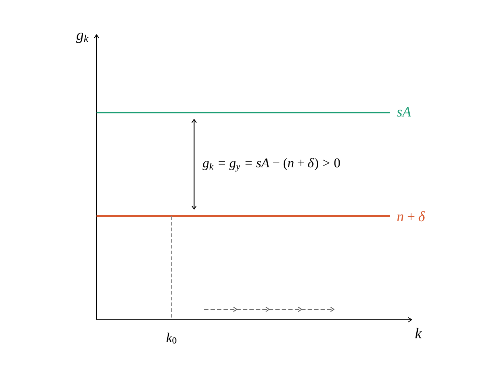
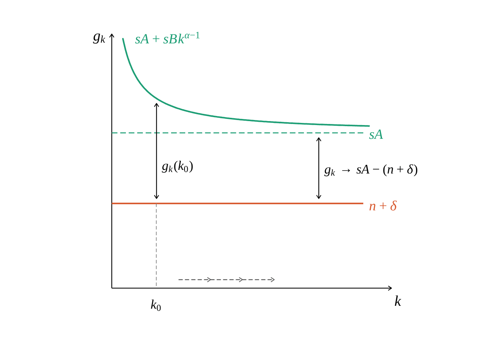
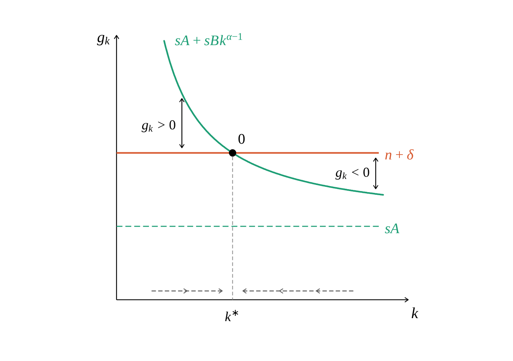
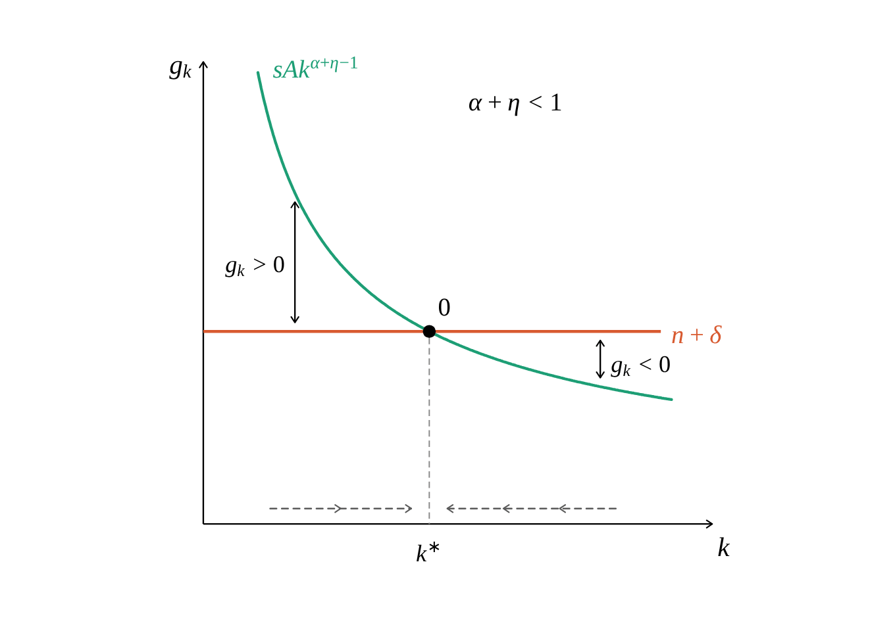
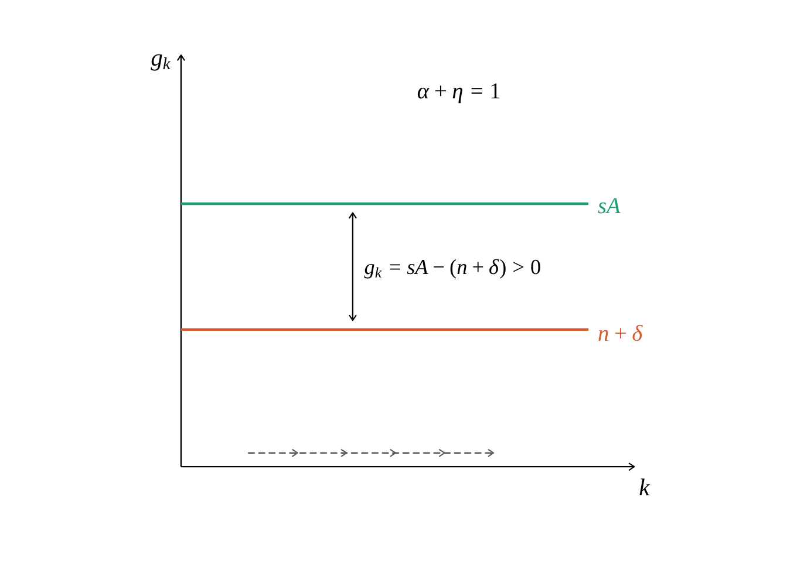
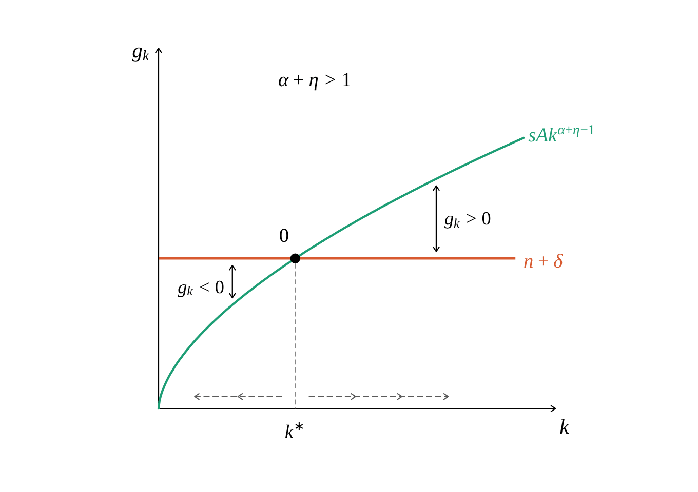
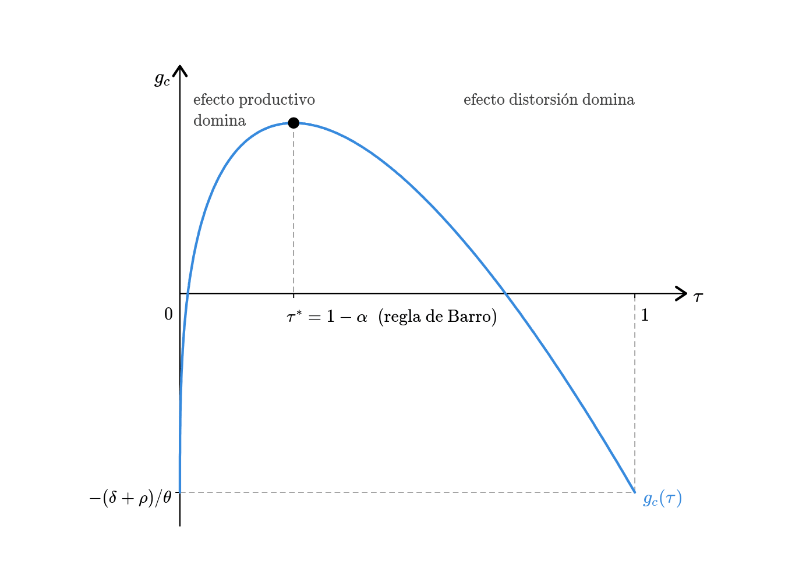
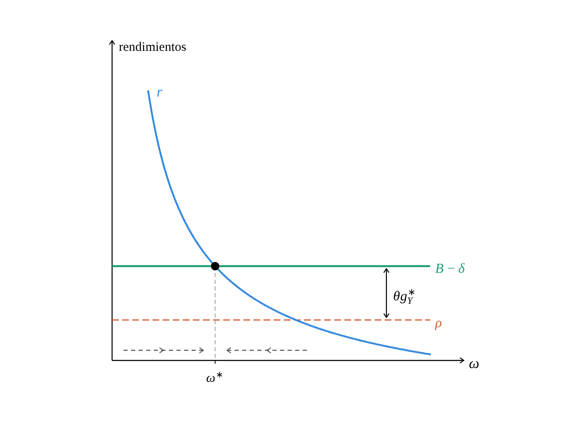

## Introducción

::: {.callout-note appearance="simple" icon=false}

:::

El modelo de Solow-Swan (1956) ofrece una explicación elegante del crecimiento a largo plazo, pero deja fuera del análisis precisamente aquello que pretende explicar. De hecho, el propio Solow (1957), en su célebre ejercicio de contabilidad del crecimiento, cuantificó el problema. Del crecimiento del producto por hora trabajada en EE. UU. entre 1909 y 1949, la mayor dotación de capital físico daba cuenta de apenas un 12,5 %. Casi nueve décimas partes (el 87,5 %, conocido como *residuo de Solow*) correspondían a un “progreso técnico” que el modelo trata como maná caído del cielo, una variable exógena que crece a una tasa dada, sin coste y sin explicación económica alguna.

Esta conclusión resulta doblemente insatisfactoria. En primer lugar, porque convierte la teoría del crecimiento en una teoría de todo aquello que no es crecimiento. El modelo explica bien la transición y la convergencia, pero el motor último del crecimiento sostenido de la renta per cápita queda fuera del modelo. En segundo lugar, porque el progreso técnico no cae del cielo, sino que es el resultado de decisiones deliberadas de inversión en educación, investigación e innovación tomadas por agentes económicos que responden a incentivos.

Los **modelos de crecimiento endógeno**, que se desarrollan desde mediados de los años ochenta, responden a esa doble carencia. Su propósito es que la renta per cápita crezca de forma sostenida gracias al funcionamiento del propio modelo y no a un progreso tecnológico supuesto desde fuera.

Esa explicación interna devuelve a la política económica un papel que el modelo neoclásico le negaba a largo plazo. La educación, la investigación, la protección de la propiedad intelectual, la competencia o el gasto público productivo pueden alterar la tasa de crecimiento de la renta per cápita, y no solo su nivel. La importancia de esta línea de trabajo la refleja el Premio Nobel de Economía de 2025, que Aghion y Howitt compartieron con Joel Mokyr “por haber explicado el crecimiento económico impulsado por la innovación”.

Con ese fin, este tema estudia las tres grandes familias de modelos de crecimiento endógeno según el siguiente esquema:

- *Función de producción no neoclásica*: los modelos AK, Sobelow, de externalidades del capital y de gasto público productivo.

- *Capital humano*: el modelo de Uzawa-Lucas, con tasa de ahorro endógena.

- *Innovación tecnológica*: los modelos de I+D.

::: {.callout-note appearance="simple" icon=false}
Sobre los modelos de crecimiento exógeno (Solow-Swan y Ramsey-Cass-Koopmans), véase el tema [A43](a43-crecimiento-i.qmd). Sobre la contrastación empírica del crecimiento y la convergencia, véase el tema [A45](a45-crecimiento-empirica.qmd).
:::

## 1. Función de producción no neoclásica

Esta primera familia de modelos parte de un diagnóstico preciso, según el cual los propios supuestos neoclásicos sobre la función de producción (rendimientos constantes a escala, rendimientos marginales decrecientes de cada factor y condiciones de Inada) impiden que el crecimiento se genere endógenamente. Con rendimientos marginales decrecientes que tienden a cero, la acumulación de capital se agota a sí misma, porque cada unidad adicional de capital aporta cada vez menos producto, hasta que la inversión apenas alcanza para reponer la depreciación y el crecimiento per cápita se detiene.

Una primera solución consiste, por tanto, en abandonar alguna de estas propiedades, manteniendo el resto del andamiaje de Solow y, en particular, la tasa de ahorro exógena. Así lo hacen el modelo AK, el modelo Sobelow y los de externalidades del capital. La excepción es el modelo de Barro (1990), que incorpora familias a la Ramsey.

### 1.1. Modelo AK (Rebelo, 1991)

**Origen**: lo propuso Rebelo (1991). La microfundamentación del modelo AK mediante el *aprendizaje por la práctica* procede de Arrow (1962) y Romer (1986).

**Idea**: los supuestos son idénticos a los del modelo de Solow-Swan, con la única excepción de la función de producción, que pasa a ser lineal en un único factor, el capital:

$$Y = AK$$

donde $K$ debe entenderse como capital *en sentido amplio*, es decir, no solo capital físico, sino también capital humano, conocimientos, infraestructuras y, en general, todo factor acumulable[^a44-1].

**Supuestos**:

- *Entorno*: el habitual, con tecnología constante, tasa de ahorro exógena $s$, economía cerrada y sin sector público, población que crece a la tasa $n$ y depreciación $\delta$.

- *Tecnología*: de las propiedades neoclásicas, $Y = AK$ conserva solo los rendimientos constantes a escala. Pierde los rendimientos marginales decrecientes (el capital tiene siempre un producto marginal igual a $A$) y también las condiciones de Inada, ya que ese producto marginal no tiende a cero por mucho que crezca el capital.

**Planteamiento**: como en el modelo de Solow-Swan, la renta se reparte entre consumo e inversión, $Y = C + I$, y cada ecuación de comportamiento (renta, inversión y consumo, por este orden) se escribe en niveles, per cápita y en tasas de crecimiento (tema [A43](a43-crecimiento-i.qmd), apartado 2.2 y Anexo):

$$\begin{alignedat}{3} &Y = AK \; && \Rightarrow \; y = Ak \; && \Rightarrow \; g_y = g_k \\ &\dot{K} = sY - \delta K \; && \Rightarrow \; \dot{k} = sAk - (n+\delta)k \; && \Rightarrow \; g_k = sA - (n+\delta) \\ &C = (1-s)Y \; && \Rightarrow \; c = (1-s)Ak \; && \Rightarrow \; g_c = g_y \end{alignedat}$$

La renta y el consumo per cápita son proporcionales al capital per cápita y crecen a su mismo ritmo. La diferencia con el modelo de Solow-Swan está en la tasa de crecimiento del capital, que ya no depende de $k$, porque el producto medio del capital, $A$, no disminuye al acumularlo.

**Desarrollo gráfico**: en el plano capital por trabajador-tasa de crecimiento, $k$-$g_k$ (figura -@fig-a441-ak), las curvas de ahorro y de depreciación se representan divididas por $k$. La diferencia con el modelo de Solow es inmediata. En Solow, la curva de ahorro $sf(k)$ es cóncava (por los rendimientos decrecientes) y acaba cruzándose con la recta de depreciación $(n+\delta)k$ en un estado estacionario sin crecimiento per cápita. En el modelo AK, en cambio, ambas son rectas que parten del origen:

1. *Curva de ahorro*: recoge la inversión bruta por trabajador, $sAk$, una recta de pendiente $sA$, de modo que, dividida por $k$, es la recta horizontal $sA$.

2. *Recta de depreciación*: recoge la inversión que mantiene constante el capital por trabajador, $(n+\delta)k$, de pendiente $(n+\delta)$, y, dividida por $k$, es la recta horizontal $n+\delta$.

3. *Equilibrio*: si $sA > n+\delta$, las rectas no se cruzan y la distancia vertical entre ellas, $g_k$, es la misma cualquiera que sea el capital inicial, $k_0$. Por tanto, la economía crece indefinidamente a una tasa constante y positiva, común a todas las variables per cápita, $g_k = g_y = g_c = sA - (n+\delta)$.

::: {#fig-a441-ak}

::: {.content-visible when-format="html"}
```{=html}
<div class="graph-frame">
<iframe src="../graphs/a441_AK.html" style="height:546px" loading="lazy" title="fig-a441-ak"></iframe>
</div>
```
:::

::: {.content-visible unless-format="html"}

:::

Modelo AK. Con rendimientos constantes del capital la tasa de crecimiento es positiva y permanente, sin convergencia.
:::

**Dinámica**: las diferencias con el modelo de Solow-Swan son profundas:

1. *Crecimiento sostenido*: la renta per cápita aumenta de manera indefinida sin que haga falta un progreso técnico exógeno, rasgo que define el crecimiento endógeno.

2. *Política económica*: las políticas que eleven la tasa de ahorro o de inversión afectan a la tasa de crecimiento a largo plazo, y no solo al nivel de renta de estado estacionario, como ocurría en el modelo neoclásico. El alcance de la política económica es, por tanto, cualitativamente mayor.

3. *Sin dinámica de transición*: la economía crece desde el primer instante a un ritmo invariable, $sA - (n+\delta)$, tenga mucho o poco capital al empezar.

4. *Sin convergencia* (ni absoluta ni condicional): dos economías con parámetros idénticos crecen al mismo ritmo, partan de la renta que partan, y la distancia relativa entre ellas se mantiene para siempre.

5. *Efectos permanentes de las recesiones*: una recesión temporal tiene efectos permanentes sobre el nivel de renta. Al no existir un estado estacionario que actúe como atractor, no hay reversión a la tendencia previa.

6. *Sin ineficiencia dinámica*: dado que $s < 1$, se cumple siempre que $r = A - \delta > sA - \delta = g_Y$, por lo que la economía no puede sobreacumular capital.

**Conclusiones**:

- *Aspectos positivos*: el modelo AK es la formulación más sencilla y transparente del crecimiento endógeno, e ilustra con nitidez su mecanismo esencial, que consiste en impedir que la productividad marginal del capital tienda a cero con la acumulación. Además, admite una microfundamentación, pues el AK es el caso $\alpha + \eta = 1$ del modelo de externalidades, lo que da a su linealidad un contenido económico.

- *Limitaciones*: no predice convergencia, cuando la evidencia empírica, desde Barro y Sala-i-Martin (1992a) y Mankiw, Romer y Weil (1992), apoya la existencia de convergencia condicional. Tampoco distingue entre capital físico y capital humano, lo que equivale a suponer, de forma poco realista, que ambos son sustitutos perfectos en su acumulación (una unidad de producto se convierte indistintamente en uno u otro).

### 1.2. Modelo Sobelow (Jones y Manuelli, 1990)

**Origen**: procede del modelo de Jones y Manuelli (1990), bautizado por Sala-i-Martin como modelo *Sobelow* por combinar las funciones de producción de Solow y de Rebelo.

**Idea**: aislar la propiedad tecnológica sin la cual no hay crecimiento endógeno. Jones y Manuelli muestran que eliminar los rendimientos marginales decrecientes (como en el AK) basta, pero no es imprescindible. Lo indispensable es que falle la condición de Inada en el infinito, es decir, que el capital conserve una productividad marginal superior a cierta constante positiva, y el crecimiento se sostiene si ese suelo es suficientemente alto ($sA > n+\delta$).

**Supuestos**:

- *Entorno*: el del modelo AK.

- *Tecnología*: la función de producción suma un componente neoclásico y un componente lineal, $Y = AK + BK^\alpha L^{1-\alpha}$. Sus rendimientos a escala son constantes y los marginales del capital, decrecientes, pero la condición de Inada en el infinito falla, $\lim_{K \rightarrow \infty} f'_K = A \neq 0$.

**Planteamiento**: las ecuaciones de comportamiento son las del modelo AK, en el mismo orden, con la nueva función de producción:

$$\begin{alignedat}{2} &Y = AK + BK^\alpha L^{1-\alpha} \; && \Rightarrow \; y = Ak + Bk^\alpha \;\Rightarrow\; g_y = \varepsilon(k)\, g_k, \quad A, B > 0,\; \alpha \in (0, 1) \\ &\dot{K} = sY - \delta K \; && \Rightarrow \; \dot{k} = sy - (n+\delta)k \;\Rightarrow\; g_k = sA + sBk^{\alpha-1} - (n+\delta) \\ &C = (1-s)Y \; && \Rightarrow \; c = (1-s)y \;\Rightarrow\; g_c = g_y \end{alignedat}$$

donde $\varepsilon(k) = (Ak + \alpha Bk^\alpha)/(Ak + Bk^\alpha)$ es la elasticidad de la renta per cápita respecto al capital per cápita. Como la producción es una suma, su tasa de crecimiento es la media de las de sus dos componentes, $g_k$ y $\alpha g_k$, ponderada por su peso en la renta (tema [A43](a43-crecimiento-i.qmd), Anexo). Si $sA > n+\delta$, el capital crece sin límite, el peso del componente lineal tiende a uno y $g_y$ se acerca a $g_k$.

**Desarrollo gráfico**: el modelo Sobelow se representa en el plano capital por trabajador-tasa de crecimiento, $k$-$g_k$ (figuras -@fig-a442-sobelow-i y -@fig-a443-sobelow-ii):

1. *Curva de ahorro por unidad de capital*, $sA + sBk^{\alpha-1}$: recoge la inversión bruta por unidad de capital. Es decreciente, porque el componente neoclásico tiene rendimientos decrecientes, y tiende a la recta horizontal $sA$, su asíntota, porque el componente lineal no los tiene.

2. *Recta de depreciación*, $n+\delta$: recoge la inversión por unidad de capital que mantiene constante el capital por trabajador, y es horizontal porque no depende de $k$.

3. *Equilibrio*: la distancia vertical entre ambas es $g_k$. Si $sA < n+\delta$, se cortan en el estado estacionario, $k^*$ (punto 0), mientras que si $sA > n+\delta$ no se cortan y $g_k$ tiende a $sA - (n+\delta)$.

::: {#fig-a442-sobelow-i}

::: {.content-visible when-format="html"}
```{=html}
<div class="graph-frame">
<iframe src="../graphs/a442_Sobelow_i.html" style="height:520px" loading="lazy" title="fig-a442-sobelow-i"></iframe>
</div>
```
:::

::: {.content-visible unless-format="html"}

:::

Modelo Sobelow (Jones-Manuelli). La curva de ahorro por unidad de capital no corta a la de depreciación ampliada y el crecimiento es sostenido.
:::

::: {#fig-a443-sobelow-ii}

::: {.content-visible when-format="html"}
```{=html}
<div class="graph-frame">
<iframe src="../graphs/a443_Sobelow_ii.html" style="height:520px" loading="lazy" title="fig-a443-sobelow-ii"></iframe>
</div>
```
:::

::: {.content-visible unless-format="html"}

:::

Modelo Sobelow con $sA < n+\delta$. La curva de ahorro por unidad de capital corta a la de depreciación ampliada en $k^*$ y la economía converge, como en Solow, a un estado estacionario sin crecimiento per cápita.
:::

**Dinámica**: el comportamiento de la economía depende del signo de $sA - (n+\delta)$. Caben dos casos:

1. *$sA > n+\delta$*: a corto plazo la economía crece más deprisa que un modelo AK puro, pues el segundo término ($sBk^{\alpha-1}$) contribuye positivamente mientras el capital es escaso. A largo plazo, ese término se desvanece asintóticamente (por los rendimientos decrecientes del componente neoclásico) y la tasa de crecimiento converge a $g_k \rightarrow sA - (n+\delta) > 0$. La economía exhibe, así, una dinámica de transición con crecimiento decreciente hacia una tasa de largo plazo positiva (figura -@fig-a442-sobelow-i).

2. *$sA < n+\delta$*: el componente lineal no alcanza para mantener el crecimiento y, igual que en Solow, la renta per cápita acaba estancada en su nivel de estado estacionario (figura -@fig-a443-sobelow-ii).

**Conclusiones**:

- *Aspectos positivos*: el modelo combina convergencia y dinámica transicional (herencia neoclásica) con crecimiento endógeno a largo plazo (herencia AK). Por ello, su ajuste empírico es mejor que el del modelo AK puro, que no puede dar cuenta de la evidencia de convergencia condicional.

- *Limitaciones*: sigue sin distinguir entre tipos de capital y descansa en una propiedad tecnológica (la cota inferior de la productividad marginal) que se postula sin microfundamentar.

### 1.3. Externalidades del capital (Romer, 1986; Lucas, 1988)

**Origen**: Romer (1986) y Lucas (1988) propusieron el modelo a partir del aprendizaje por la práctica (*learning by doing*) de Arrow (1962).

**Idea**: la tercera vía para escapar de los rendimientos decrecientes deja intacta la tecnología de cada empresa y añade efectos externos entre ellas. Invertir enseña a producir, y lo aprendido, al ser no rival y difícil de apropiar, no se queda en la empresa que invierte, sino que se filtra al resto de la economía (*knowledge spillovers*). Por eso la inversión de cada empresa eleva también la producción de las demás.

**Supuestos**:

- *Entorno*: el del modelo AK.

- *Tecnología*: la función de producción de la empresa incorpora un término de externalidad $E$, en la forma $Y = AK^\alpha L^{1-\alpha} E^\eta$, con $\eta > 0$, donde $\eta$ mide la importancia de la externalidad. La empresa individual percibe rendimientos constantes en sus factores privados ($K$, $L$) y toma $E$ como dado, pero en el agregado la externalidad eleva los rendimientos del capital. Las dos formulaciones clásicas difieren en la variable que genera el desbordamiento:

    - *Visión de Romer* (1986): la externalidad procede del *stock* agregado de capital, $E = K$. En forma intensiva, $y = Ak^{\alpha+\eta}L^{\eta}$, de modo que la tasa de crecimiento depende del tamaño de la población. Según este *efecto escala*, el ritmo de crecimiento debería aumentar con la población del país, algo que los datos no confirman y que la variante siguiente elimina.

    - *Visión de Lucas* (1988): la externalidad procede del capital per cápita, $E = k$, con lo que $y = Ak^{\alpha+\eta}$ y el efecto escala desaparece. Se trata de una estilización habitual en los manuales, pues en Lucas (1988) la externalidad procede en realidad del capital humano medio de la economía, $H_a$, como se recoge en el apartado 2.2.

**Planteamiento**: tomando la visión de Lucas, las ecuaciones de comportamiento son las del modelo AK, en el mismo orden, con la nueva función de producción:

$$\begin{alignedat}{2} &Y = AK^\alpha L^{1-\alpha} k^\eta \; && \Rightarrow \; y = Ak^{\alpha+\eta} \;\Rightarrow\; g_y = (\alpha+\eta)\, g_k, \quad A > 0,\; \alpha \in (0, 1),\; \eta > 0 \\ &\dot{K} = sY - \delta K \; && \Rightarrow \; \dot{k} = sAk^{\alpha+\eta} - (n+\delta)k \;\Rightarrow\; g_k = sAk^{\alpha+\eta-1} - (n+\delta) \\ &C = (1-s)Y \; && \Rightarrow \; c = (1-s)Ak^{\alpha+\eta} \;\Rightarrow\; g_c = g_y \end{alignedat}$$

La externalidad eleva el exponente del capital per cápita de $\alpha$ a $\alpha+\eta$, y con él la respuesta de la renta a la acumulación.

**Desarrollo gráfico**: el modelo de externalidades se representa en el plano capital por trabajador-tasa de crecimiento, $k$-$g_k$ (figuras -@fig-a444-romer-i a -@fig-a446-romer-iii):

1. *Curva de ahorro por unidad de capital*, $sAk^{\alpha+\eta-1}$: recoge la inversión bruta por unidad de capital, y su pendiente depende de los rendimientos del capital ampliado. Es decreciente si $\alpha + \eta < 1$ (rendimientos decrecientes), horizontal en $sA$ si $\alpha + \eta = 1$ (constantes) y creciente si $\alpha + \eta > 1$ (crecientes).

2. *Recta de depreciación*, $n+\delta$: recoge la inversión por unidad de capital que mantiene constante el capital por trabajador, y es horizontal porque no depende de $k$.

3. *Equilibrio*: la distancia vertical entre ambas es $g_k$. Si $\alpha + \eta \neq 1$, se cortan en el estado estacionario, $k^*$ (punto 0), que es estable en el primer caso e inestable en el tercero.

::: {#fig-a444-romer-i}

::: {.content-visible when-format="html"}
```{=html}
<div class="graph-frame">
<iframe src="../graphs/a444_Romer_i.html" style="height:520px" loading="lazy" title="fig-a444-romer-i"></iframe>
</div>
```
:::

::: {.content-visible unless-format="html"}

:::

Externalidades del capital con $\alpha+\eta<1$. La curva de ahorro por unidad de capital es decreciente, corta a la de depreciación ampliada en $k^*$ y el crecimiento per cápita a largo plazo es nulo, como en Solow.
:::

::: {#fig-a445-romer-ii}

::: {.content-visible when-format="html"}
```{=html}
<div class="graph-frame">
<iframe src="../graphs/a445_Romer_ii.html" style="height:520px" loading="lazy" title="fig-a445-romer-ii"></iframe>
</div>
```
:::

::: {.content-visible unless-format="html"}

:::

Externalidades del capital con $\alpha+\eta=1$. La externalidad compensa exactamente los rendimientos decrecientes, la tecnología es lineal en $k$ y la economía crece a la tasa constante $sA-(n+\delta)$, como en el modelo AK.
:::

::: {#fig-a446-romer-iii}

::: {.content-visible when-format="html"}
```{=html}
<div class="graph-frame">
<iframe src="../graphs/a446_Romer_iii.html" style="height:520px" loading="lazy" title="fig-a446-romer-iii"></iframe>
</div>
```
:::

::: {.content-visible unless-format="html"}

:::

Externalidades del capital con $\alpha+\eta>1$. La curva de ahorro por unidad de capital es creciente y el estado estacionario $k^*$ es inestable. Por encima de él la senda es explosiva y por debajo, implosiva.
:::

**Dinámica**: el comportamiento de la economía depende críticamente del tamaño de la externalidad, es decir, de la suma $\alpha + \eta$. Caben tres casos:

1. *Externalidad pequeña* ($\alpha + \eta < 1$): el capital ampliado sigue presentando rendimientos marginales decrecientes, el ahorro por unidad de capital, $sAk^{\alpha+\eta-1}$, es decreciente en $k$ y existe un estado estacionario estable con crecimiento per cápita nulo ($g_k^* = 0$). El modelo es cualitativamente equivalente a Solow, ya que la externalidad amplifica el efecto de la acumulación de capital (el estado estacionario se sitúa más lejos), pero no genera crecimiento endógeno (figura -@fig-a444-romer-i).

2. *Externalidad media* ($\alpha + \eta = 1$): compensa exactamente los rendimientos decrecientes y el modelo se vuelve formalmente idéntico al AK, con $g_k = sA - (n+\delta)$. Hay crecimiento endógeno si $sA > n+\delta$ (figura -@fig-a445-romer-ii).

3. *Externalidad grande* ($\alpha + \eta > 1$): el capital ampliado presenta rendimientos crecientes, el ahorro por unidad de capital es creciente en $k$ y el estado estacionario es inestable. Por encima de él la economía entra en una senda explosiva y por debajo, en una senda implosiva (figura -@fig-a446-romer-iii). El interés empírico de este caso es limitado.

**Extensiones**: en política económica, la existencia de externalidades da margen a la intervención pública para elevar la tasa de crecimiento por dos vías:

- *Subvenciones a la inversión*: junto con las desgravaciones, aumentan el capital en sentido amplio. Se justifican porque las empresas privadas no capturan toda la externalidad y, por ello, con ahorro endógeno (como en Romer, 1986), invierten menos de lo socialmente óptimo.

- *Promoción de los efectos externos*: mediante el fomento de agrupaciones tecnológicas (*clusters*), centros de investigación o relaciones universidad-empresa que faciliten la difusión del conocimiento.

**Conclusiones**:

- *Aspectos positivos*: los modelos de externalidades endogenizan el progreso técnico con un mecanismo económicamente plausible (el desbordamiento del conocimiento) y sin abandonar la competencia perfecta, pues la empresa individual sigue operando con rendimientos constantes en sus factores privados.

- *Limitaciones*: la evidencia de *learning by doing* procede de sectores concretos, como los semiconductores, donde Irwin y Klenow (1994) estiman tasas de aprendizaje del 20 %, y no mide un desbordamiento de conocimientos de la escala necesaria para sostener el crecimiento agregado. Además, el progreso técnico sigue siendo un subproducto no buscado de la inversión, cuando en la realidad una parte sustancial de la innovación se realiza ex profeso, mediante inversión deliberada en I+D.

### 1.4. Gasto público productivo (Barro, 1990)

**Origen**: Robert Barro (1990) propuso el modelo.

**Idea**: el factor que sostiene la productividad marginal del capital privado es la provisión de servicios públicos (infraestructuras, seguridad jurídica, orden público), financiada con impuestos. El sector público es, así, a la vez un factor productivo y una distorsión, y de ese doble papel resulta un tamaño óptimo del Estado para el crecimiento.

**Supuestos**:

- *Entorno*: economía cerrada con familias a la Ramsey (utilidad con aversión relativa al riesgo constante, CRRA, de parámetro $\theta$ y tasa de descuento $\rho$), población constante y depreciación $\delta$. A diferencia de los modelos anteriores del apartado, la tasa de ahorro es aquí endógena.

- *Agentes*: el sector público provee un flujo de servicios públicos por trabajador $g$, no rival ni congestionable, financiado con un impuesto proporcional sobre la renta al tipo $\tau$ bajo presupuesto equilibrado, $g = \tau y$.

- *Tecnología*: la producción privada emplea capital y servicios públicos, con rendimientos constantes en el conjunto de ambos y decrecientes en el capital privado, $y = A k^{\alpha} g^{1-\alpha}$, con $\alpha \in (0, 1)$ la participación del capital, como en el tema [A38](a38-politica-fiscal.qmd) (Barro, 1990, escribe $y = Ak^{1-\alpha}g^{\alpha}$, de modo que en su notación $\tau^* = \alpha$). Sustituyendo la restricción presupuestaria del sector público, $g = \tau y$, y despejando, la función de producción es lineal en el capital privado, $y = \tilde{A}(\tau)\, k$, con $\tilde{A}(\tau) \equiv A^{1/\alpha} \tau^{(1-\alpha)/\alpha}$, creciente en $\tau$. Se obtiene así un modelo AK en el que la constante depende de la política fiscal.

**Planteamiento**: las familias toman $\tau$ y $g$ como dados y maximizan la utilidad intertemporal sujetas a la acumulación de capital neta de impuestos:

$$\begin{aligned} &\max_{\{c\}} \int_0^\infty e^{-\rho t} \frac{c^{1-\theta} - 1}{1-\theta}\, dt, \qquad \theta > 0 \\ &\text{s.a.:} \begin{cases} c + \dot{k} + \delta k = (1-\tau) A k^{\alpha} g^{1-\alpha}, \qquad A > 0,\; \alpha \in (0, 1) \\ k_0 \text{ dado} \end{cases} \end{aligned}$$

donde $c$ es el consumo por trabajador (la variable de control)[^a44-2], $k$ el capital privado por trabajador (la variable de estado, con $k_0$ dado), $g$ los servicios públicos por trabajador, $\tau$ el tipo impositivo sobre la renta, $A$ y $\alpha$ los parámetros de la tecnología, $\theta$ el parámetro de la utilidad CRRA, $\rho$ la tasa de descuento y $\delta$ la depreciación.

**CPO**: por el principio del máximo, la ecuación de Keynes-Ramsey con el rendimiento neto del capital privado, $r = (1-\tau)\, \partial y/\partial k - \delta = (1-\tau)\,\alpha\tilde{A}(\tau) - \delta$, y la condición de transversalidad, que anula en el límite el valor descontado del capital:

$$\begin{aligned} &g_c = \frac{1}{\theta}\big[\underbrace{(1-\tau)\,\alpha\tilde{A}(\tau) - \delta}_{\text{rendimiento neto del capital}} - \rho\big] \\ &\lim_{t \to \infty} e^{-\rho t}\, c(t)^{-\theta}\, k(t) = 0 \end{aligned}$$

La ecuación de Keynes-Ramsey iguala el rendimiento neto del capital privado, una vez descontados el impuesto y la depreciación, a la tasa de descuento más el crecimiento del consumo ponderado por $\theta$. El consumo crece mientras la última unidad de capital, tras pagar el impuesto, rinde más de lo que la familia exige por posponer su consumo. El consumo crece tanto más deprisa cuanto menor es $\theta$.

**CSO**: el hamiltoniano es estrictamente cóncavo en $c$ y cóncavo en $k$ dado $g$ (la tecnología privada, $Ak^{\alpha}g^{1-\alpha}$, lo es), de modo que la CPO y la condición de transversalidad son suficientes. El crecimiento es positivo si $(1-\tau)\,\alpha\tilde{A} - \delta > \rho$ y la utilidad está acotada si $\rho > (1-\theta) g_c$.

**Equilibrio**: como la tecnología es lineal en $k$, no hay dinámica de transición, y consumo, capital y renta crecen desde el principio a la misma tasa constante $g_c$. La tasa de crecimiento depende de $\tau$ a través de dos efectos contrapuestos, ya que el impuesto reduce el rendimiento privado de la inversión (efecto *distorsión*, el factor $1-\tau$) y financia un factor que eleva la productividad del capital (efecto *productivo*, el factor $\tilde{A}(\tau)$). Maximizando $(1-\tau)\tau^{(1-\alpha)/\alpha}$ respecto a $\tau$:

$$\tau^* = 1-\alpha$$

El tipo impositivo que maximiza el crecimiento iguala la elasticidad del producto respecto al gasto público (*regla de Barro*), de modo que el sector público debe tener el tamaño que corresponde a su contribución productiva. Ese tipo maximiza también la utilidad, porque, sin dinámica de transición, tanto la tasa de crecimiento como el consumo inicial dependen de $\tau$ solo a través del producto neto de impuestos por unidad de capital, $(1-\tau)\tilde{A}(\tau)$, y la utilidad de equilibrio es creciente en él.

**Desarrollo gráfico**: en el plano tipo impositivo-tasa de crecimiento, $\tau$-$g_c$ (figura -@fig-a447-barro), la curva $g_c(\tau)$ tiene forma de U invertida, con máximo en $\tau^* = 1-\alpha$ (regla de Barro). En $\tau = 0$ (sin servicios públicos no hay producción) y en $\tau = 1$ (sin rendimiento privado no hay inversión) se anula el rendimiento del capital privado después de impuestos, $(1-\tau)\,\alpha\tilde{A}(\tau)$, y la tasa de crecimiento alcanza su mínimo, $-(\delta+\rho)/\theta < 0$. A la izquierda del máximo domina el efecto productivo y un sector público mayor acelera el crecimiento, mientras que a la derecha domina el efecto distorsión y un sector público mayor lo frena.

::: {#fig-a447-barro}

::: {.content-visible when-format="html"}
```{=html}
<div class="graph-frame">
<iframe src="../graphs/a447_Barro.html" style="height:500px" loading="lazy" title="fig-a447-barro"></iframe>
</div>
```
:::

::: {.content-visible unless-format="html"}

:::

Modelo de Barro (1990). La tasa de crecimiento es una función en U invertida del tipo impositivo, con máximo en $\tau^* = 1-\alpha$. A su izquierda un sector público mayor acelera el crecimiento y a su derecha lo frena.
:::

**Estática comparativa**: un aumento de $A$ o una reducción de $\rho$ o $\delta$ elevan la tasa de crecimiento para todo $\tau$ (una reducción de $\theta$, allí donde la tasa es positiva), sin alterar $\tau^*$, que solo depende de la tecnología.

**Extensiones**: el modelo separa el gasto público productivo del gasto en consumo público, que no eleva $\tilde{A}$ y solo distorsiona. Con ello ofrece una lectura de la evidencia de Barro (1991), que encuentra un efecto negativo del consumo público sobre el crecimiento y no de la inversión pública (tema [A45](a45-crecimiento-empirica.qmd)).

En política fiscal, por tanto, la composición del gasto importa más que su volumen. La financiación con impuestos de suma fija en lugar de proporcionales elimina el efecto distorsión y eleva la tasa de crecimiento, aunque el tamaño óptimo del sector público sigue siendo $g/y = 1-\alpha$ (condición de eficiencia productiva $\partial y/\partial g = 1$). Con impuestos proporcionales, por el contrario, el equilibrio descentralizado es ineficiente porque las familias no internalizan que su inversión, al elevar la recaudación, financia servicios públicos para todos (tema [A38](a38-politica-fiscal.qmd)). Si los servicios públicos son congestionables (el servicio que prestan a cada empresa depende de $g/k$, Barro y Sala-i-Martin, 1992b), el tamaño óptimo es el mismo. En ese caso, sin embargo, el impuesto sobre la renta pasa a ser el instrumento eficiente, porque internaliza la congestión que cada unidad de capital privado provoca.

**Conclusiones**:

- *Aspectos positivos*: el modelo de Barro es la referencia sobre la relación entre tamaño del sector público y crecimiento, y fundamenta la distinción entre gasto productivo e improductivo que utiliza la política fiscal orientada al crecimiento.

- *Limitaciones*: la no rivalidad de los servicios públicos es un supuesto fuerte, porque la congestión es la regla en las infraestructuras. Además, el resultado depende de que el gasto sea un flujo y no un *stock* de capital público, que introduciría dinámica de transición, y la evidencia sobre la relación entre tamaño del Estado y crecimiento es débil y muy sensible a la muestra.

### 1.5. Conclusiones

Los modelos de esta sección muestran con la mayor sencillez que el crecimiento sostenido exige que el rendimiento del capital en sentido amplio no decrezca hasta cero y que, con ahorro exógeno, se mantenga por encima de $(n+\delta)/s$. La tasa de ahorro, y con ella la política económica (en Barro, el tipo impositivo que financia el gasto público productivo), determina entonces la tasa de crecimiento y no solo el nivel de renta.

Esa tasa de ahorro sigue siendo, sin embargo, exógena (salvo en Barro, 1990), de modo que los modelos no explican por qué se ahorra. Además, la externalidad del capital de Romer (1986) implica un efecto escala que la evidencia no respalda, y ninguno de ellos distingue el capital humano del físico ni explica cómo se genera el conocimiento, cuestiones que abordan, respectivamente, los apartados 2 y 3.

## 2. Capital humano con tasa de ahorro endógena: el modelo de Uzawa-Lucas (1965; 1988)

**Origen**: procede del modelo de Uzawa (1965), recuperado y popularizado por Lucas (1988).

**Idea**: la segunda familia de modelos aborda la principal limitación común del bloque anterior, la ausencia de distinción entre capital físico y capital humano. El modelo introduce esta distinción de manera explícita y, además, endogeniza la tasa de ahorro mediante hogares optimizadores a la Ramsey.

### 2.1. Supuestos

**Entorno**: la economía es cerrada, sin sector público, y las familias son propietarias de los factores de producción. Por simplicidad la población es constante ($n = 0$) y se normaliza a la unidad, de modo que las variables agregadas y per cápita coinciden.

**Agentes**: los hogares maximizan una utilidad intertemporal CRRA con dos variables de control, el consumo $c$ y la fracción de tiempo $u$ dedicada a la producción, y dos variables de estado, $K$ y $H$.

**Tecnología**:

- *Factores*: se distingue entre capital físico ($K$) y capital humano ($H$), ambos factores rivales (lo que se emplea en una actividad no está disponible para la otra), que se acumulan mediante tecnologías distintas:

    - *Capital físico*: se acumula a partir de la producción no consumida, neta de depreciación.

    - *Capital humano*: es un factor que se distribuye entre dos sectores. Una fracción $u \in (0, 1)$ se dedica a la producción de bienes finales ($H_Y = uH$) y la fracción restante, al sector educativo ($H_H = (1-u)H$)[^a44-3].

- *Sector de bienes finales*: produce con una tecnología Cobb-Douglas que combina capital físico y capital humano, $Y = AK^\alpha (uH)^{1-\alpha}$. El capital físico se acumula a partir de la producción no consumida, $c + \dot{K} + \delta K = Y$.

- *Sector educativo*: acumula capital humano con una tecnología específica de productividad $B$. En general, esta tecnología podría emplear ambos capitales, con una participación $\alpha_H$ del capital físico. Uzawa y Lucas, no obstante, parten de que, comparada con la producción de bienes, la educación hace un uso mucho más intensivo del capital humano ($\alpha_H < \alpha$), y se quedan con el caso extremo en que solo emplea ese factor ($\alpha_H = 0$):

    $$\dot{H} = B(1-u)H - \delta H$$

    El supuesto tiene consecuencias, porque convierte la tecnología educativa en un AK encubierto (lineal en el factor acumulable), y de ahí nace precisamente el crecimiento endógeno.

### 2.2. Modelo

**Hogares**: propietarios de los dos capitales, eligen el consumo, $c$, y la fracción del capital humano que dedican a producir, $u$.

- *Planteamiento*: maximizan la utilidad intertemporal sujetos a las leyes de acumulación de ambos tipos de capital:

    $$\max_{\{c, u\}} \int_0^\infty e^{-\rho t} \frac{c^{1-\theta}-1}{1-\theta} \, dt, \qquad \theta > 0$$

    $$\text{s.a.:} \begin{cases} c + \dot{K} + \delta K = AK^\alpha (uH)^{1-\alpha}, \qquad A > 0,\; \alpha \in (0, 1) \\ \dot{H} = B(1-u)H - \delta H \\ K_0,\ H_0 \text{ dados} \end{cases}$$

    donde $c$ es el consumo y $u$ la fracción del capital humano dedicada a la producción de bienes (las variables de control), $K$ el capital físico y $H$ el capital humano (las variables de estado, con $K_0$ y $H_0$ dados), $A$ y $\alpha$ los parámetros de la tecnología del sector final, $B$ la productividad del sector educativo, $\theta$ el parámetro de la utilidad CRRA, $\rho$ la tasa de descuento y $\delta$ la tasa de depreciación.

    El hamiltoniano en valor corriente tiene dos multiplicadores de coestado, $\lambda$ para el capital físico y $\mu$ para el capital humano:

    $$\mathcal{H} = \frac{c^{1-\theta}-1}{1-\theta} + \lambda\left[AK^\alpha (uH)^{1-\alpha} - c - \delta K\right] + \mu\left[B(1-u)H - \delta H\right]$$

- *CPO*: por el principio del máximo de Pontryagin, se obtienen las cuatro condiciones siguientes, a las que se suman las dos de transversalidad[^a44-4], $\lim_{t \to \infty} e^{-\rho t}\lambda K = \lim_{t \to \infty} e^{-\rho t}\mu H = 0$:

    $$\frac{\partial \mathcal{H}}{\partial c} = 0 \;\Rightarrow\; c^{-\theta} = \lambda \tag{1}$$

    $$\frac{\partial \mathcal{H}}{\partial u} = 0 \;\Rightarrow\; \lambda (1-\alpha) A K^\alpha u^{-\alpha} H^{1-\alpha} = \mu B H \tag{2}$$

    $$\frac{\partial \mathcal{H}}{\partial K} = \rho\lambda - \dot{\lambda} \;\Rightarrow\; \lambda\left[\alpha A K^{\alpha-1}(uH)^{1-\alpha} - \delta\right] = \rho\lambda - \dot{\lambda} \tag{3}$$

    $$\frac{\partial \mathcal{H}}{\partial H} = \rho\mu - \dot{\mu} \;\Rightarrow\; \mu(B - \delta) = \rho\mu - \dot{\mu} \tag{4}$$

    Las condiciones (1) y (3) dan la ecuación de Keynes-Ramsey habitual, $g_c = (1/\theta)(r - \rho)$ con $r = \alpha A K^{\alpha-1}(uH)^{1-\alpha} - \delta$. La condición (2) es la de asignación del tiempo e iguala el valor de una unidad de capital humano en la producción de bienes (su productividad marginal, valorada en $\lambda$) con su valor en la educación (la productividad $B$, valorada en $\mu$). Por último, la condición (4) es la ecuación de Euler del capital humano, cuyo precio sombra decrece a la tasa $B - \delta - \rho$, el rendimiento de la educación neto de depreciación y de la tasa de descuento[^a44-5].

- *CSO*: el término $uH$ impide que el hamiltoniano sea conjuntamente cóncavo, de modo que se supone que se cumple la condición de suficiencia de Arrow, con la que las condiciones de Pontryagin y las de transversalidad son suficientes[^a44-6].

**Empresas**: resuelven el programa habitual de los entornos dinámicos neoclásicos.

- *Planteamiento*: alquilan capital físico y capital humano tomando como dados sus precios, $\max_{K,\,uH} \; AK^\alpha (uH)^{1-\alpha} - (r+\delta)K - w_H\, uH$, donde $w_H$ es la remuneración de cada unidad de capital humano empleada en producción.

- *CPO*: contratan cada factor hasta que su productividad marginal iguala su coste real, de donde $r = \alpha A K^{\alpha-1}(uH)^{1-\alpha} - \delta$ para el capital físico y $w_H = (1-\alpha)AK^\alpha(uH)^{-\alpha}$ para el capital humano empleado en producción. Con rendimientos constantes a escala, ambas remuneraciones agotan el producto y el beneficio es nulo.

- *CSO*: la tecnología Cobb-Douglas es cóncava en $(K, uH)$ y estrictamente cóncava en cada factor, luego las CPO caracterizan el máximo.

**Equilibrio**: en una senda de crecimiento equilibrado la ratio $K/H$ y la fracción $u$ son constantes, de modo que $r$ es constante. Diferenciando la condición (2) respecto al tiempo (con $K/H$ y $u$ constantes) e igualando con las condiciones (3) y (4) se obtiene la condición de arbitraje entre los dos capitales, $r = B - \delta$. Según esta condición, el rendimiento del capital físico iguala al del capital humano, que es la productividad del sector educativo neta de depreciación. Sustituyendo en Keynes-Ramsey, todas las variables crecen a la misma tasa constante:

$$g_c^* = g_K^* = g_H^* = g_Y^* = \frac{1}{\theta}(B - \delta - \rho)$$

y la fracción de tiempo dedicada a producir se obtiene de la ley de acumulación del capital humano, $g_H^* = B(1-u^*) - \delta$:

$$u^* = 1 - \frac{g_H^* + \delta}{B} = 1 - \frac{B - \delta - \rho + \theta\delta}{\theta B}$$

Para que la renta per cápita crezca hace falta $B > \delta + \rho$, es decir, que el sistema educativo rinda lo bastante como para cubrir la depreciación del capital humano (el “olvido” de conocimientos, $\delta$) y la impaciencia de los hogares ($\rho$). De todos los parámetros, solo $B$ empuja al alza el crecimiento a largo plazo, y por eso la educación hace aquí de motor. La lógica es la del AK, pues la tecnología educativa es lineal en el factor acumulable, pero el modelo no exige suponer que capital físico y humano sean sustitutos perfectos.

Con $\theta = 1$ (utilidad logarítmica), $u^* = \rho/B$, y los agentes más impacientes producen más y estudian menos. Por último, la solución descentralizada coincide con la del planificador benevolente, porque, al no existir externalidades ni bienes públicos, se cumple el primer teorema fundamental de la economía del bienestar.

**Desarrollo gráfico**: el equilibrio del modelo se representa en el plano ratio de capitales-rendimientos, con $\omega \equiv K/H$ en el eje horizontal (figura -@fig-a448-uzawa-lucas):

1. *Rendimiento del capital físico*, $r = \alpha A\omega^{\alpha-1}u^{1-\alpha} - \delta$: decreciente en $\omega$, por los rendimientos decrecientes del capital físico.

2. *Rendimiento del capital humano*, $B - \delta$: recta horizontal que no decrece con la acumulación, la recta AK que sostiene el crecimiento.

3. *Tasa de descuento*, $\rho$: la impaciencia de los hogares, una recta horizontal porque no depende de $\omega$.

4. *Equilibrio*: en $\omega^*$ se igualan los rendimientos de ambos capitales, $r = B - \delta$, y la distancia entre $B - \delta$ y $\rho$ es $\theta g_Y^*$.

::: {#fig-a448-uzawa-lucas}

::: {.content-visible when-format="html"}
```{=html}
<div class="graph-frame">
<iframe src="../graphs/a448_Uzawa_Lucas.html" style="height:500px" loading="lazy" title="fig-a448-uzawa-lucas"></iframe>
</div>
```
:::

::: {.content-visible unless-format="html"}

:::

Modelo de Uzawa-Lucas. El rendimiento del capital humano, $B - \delta$, no decrece con la acumulación y sostiene el crecimiento. En $\omega^*$ se igualan los rendimientos de ambos capitales y la economía crece a $g_Y^* = (B - \delta - \rho)/\theta$.
:::

**Estática comparativa**: la tasa de crecimiento aumenta con la productividad educativa ($B$) y disminuye con la impaciencia ($\rho$), la tasa de olvido ($\delta$) y, si es positiva, con el deseo de alisar el consumo ($\theta$). La fracción $u^*$ se mueve en sentido contrario a $g_Y^*$ para cambios en $\rho$ y, siempre que $\rho > (\theta-1)\delta$ (lo que se cumple, p. ej., con utilidad logarítmica o sin olvido), también en $B$. Una mayor productividad educativa reduce entonces $u^*$ (conviene dedicar más tiempo a estudiar), mientras que una mayor impaciencia lo eleva (los agentes impacientes prefieren producir y consumir hoy). Los parámetros de la tecnología de bienes ($A$, $\alpha$), en cambio, no afectan a la tasa de crecimiento de largo plazo, solo al nivel de la senda y a la ratio $\omega^*$.

**Extensiones**: Lucas (1988) añade una *externalidad del capital humano*, $Y = AK^\alpha(uH)^{1-\alpha}H_a^\zeta$, donde $H_a$ es el capital humano medio de la economía, que cada agente toma como dado. Dicho de otro modo, la productividad de un trabajador crece con la cualificación de quienes le rodean. Por ello, con $\zeta > 0$ la solución de mercado dedica menos tiempo a la educación que la del planificador y crece por debajo del óptimo.

Rebelo (1991) muestra que el resultado se mantiene si la educación usa también capital físico ($\alpha_H > 0$), siempre que la tecnología educativa presente rendimientos constantes en el conjunto de los factores acumulables. Por su parte, Lucas interpreta el modelo como explicación de las diferencias persistentes de crecimiento entre países y de las migraciones de trabajadores cualificados hacia los países con más capital humano.

En política educativa, en consecuencia, toda mejora permanente de la productividad del sistema educativo ($B$) eleva permanentemente la tasa de crecimiento. Con la externalidad de Lucas, además, la subvención a la educación acerca $u$ a su valor óptimo (tema [A25](a25-oferta-trabajo.qmd), apartado 3.1.3).

### 2.3. Dinámica

La representación habitual de la dinámica usa dos variables estacionarias, la ratio de capitales, $\omega$, y la ratio consumo-capital $\chi \equiv c/K$, junto con $u$. En el plano $(\omega, \chi)$ el sistema tiene un único estado estacionario $(\omega^*, \chi^*)$, que es un punto de silla. La variable predeterminada es $\omega$ y la de salto, $\chi$ (con $u$). Por ello, la economía se sitúa de inmediato sobre la senda estable y converge a lo largo de ella, mientras $K$, $H$ y $c$ crecen a la tasa $g_Y^*$ en el límite.

Los procesos de ajuste surgen cuando un *shock* aleja la ratio $\omega$ de su valor estacionario. Con $\theta > \alpha$, el caso empíricamente relevante, son los siguientes:

1. *Ratio inferior a la estacionaria*: el caso $\omega < \omega^*$ se da, por ejemplo, tras una destrucción de capital físico (como un conflicto armado que arrasa las infraestructuras pero no el conocimiento de la población). El rendimiento del capital físico es entonces alto, los agentes dedican más tiempo a producir ($u > u^*$) y la economía crece transitoriamente por encima de su tasa estacionaria mientras reconstruye el capital físico[^a44-7].

2. *Ratio superior a la estacionaria*: si $\omega > \omega^*$, como ocurre tras una fuga de cerebros que reduce el capital humano, el rendimiento del capital físico es bajo y los agentes estudian más ($u < u^*$) mientras se reconstruye el capital humano.

El modelo presenta, por tanto, una dinámica de transición no trivial, a diferencia del AK, aunque la convergencia es hacia una tasa de crecimiento común y no hacia un nivel de renta. Así, dos economías con los mismos parámetros y distinta dotación inicial crecen a la misma tasa a largo plazo pero mantienen su diferencia de nivel.

### 2.4. Conclusiones

**Aspectos positivos**: el modelo genera crecimiento endógeno distinguiendo entre capitales con tecnologías de acumulación diferenciadas y hace de la asignación del tiempo entre producir y aprender la decisión que determina el crecimiento. Presenta, además, dinámica transicional (lo que mejora su ajuste empírico frente al AK), y su solución descentralizada es óptima. El modelo dota así de microfundamentos a la relación entre educación y crecimiento y explica por qué economías con la misma tecnología de producción de bienes pueden crecer a ritmos distintos de forma permanente si difieren en la productividad de su sistema educativo o en sus preferencias.

**Limitaciones**: no predice convergencia entre economías. Sus implicaciones de política, aunque potentes, descansan de manera crítica en el supuesto de que la tecnología educativa presenta rendimientos constantes en los factores acumulables (en el caso básico, que emplea solo capital humano), supuesto que la evidencia sobre los rendimientos de la educación no confirma. El modelo tampoco distingue entre el capital humano que produce y el que innova, distinción que introducen los modelos de ideas.

## 3. Innovación tecnológica: modelos de I+D con competencia imperfecta

La tercera familia de modelos da el paso que las anteriores evitaban, al modelizar la innovación como una actividad económica deliberada, para lo que resulta imprescindible abandonar la competencia perfecta. Bajo competencia perfecta, el teorema de Euler garantiza que la retribución de los factores rivales (capital y trabajo) a su productividad marginal agota exactamente el valor de la producción, de modo que no queda renta alguna con la que financiar la I+D.

Además, la tecnología tiene una estructura de costes peculiar. Producir una idea exige costes fijos elevados, pero reproducirla tiene un coste marginal casi nulo, lo que genera economías de escala y hace que los bienes tecnológicos tiendan a ser producidos por empresas con poder de mercado. Los modelos de innovación introducen, por tanto, competencia imperfecta y empresas que invierten explícitamente en progreso tecnológico a cambio de rentas de monopolio protegidas por patentes.

Dentro de esta familia se distinguen dos enfoques según la naturaleza de la innovación. La innovación es *horizontal* en Romer (1990), donde aumenta el número de variedades, y *vertical* en el enfoque schumpeteriano de Aghion y Howitt (1992), donde mejora la calidad de los productos existentes. La crítica del efecto escala de Jones (1995) cierra la sección.

### 3.1. Aumento del número de variedades (Romer, 1990)

**Origen**: Romer (1990) propuso el primer modelo en el que la innovación es el resultado de una inversión deliberada en I+D.

**Idea**: en este modelo, la innovación consiste en el aumento del número $N$ de variedades de bienes de capital intermedios disponibles para la producción.

#### 3.1.1. Supuestos

**Entorno**: el análisis es de equilibrio general con horizonte infinito y, por simplicidad, población constante ($n = 0$).

**Agentes**: hay tres clases. Los productores de bienes finales operan en competencia perfecta, cada inventor de un bien intermedio disfruta, gracias a una patente perpetua, del monopolio de la variedad que ha creado, y los consumidores optimizan a la Ramsey.

**Tecnología**: el bien final se produce con trabajo y con las $N$ variedades de bienes intermedios disponibles, $Y = A L^{1-\alpha} \sum_{j=1}^{N} x_j^\alpha$, con $\alpha \in (0, 1)$. Inventar una variedad nueva exige un coste fijo $F$, y producirla después, un coste marginal constante normalizado a uno.

#### 3.1.2. Modelo

La tasa de crecimiento de equilibrio resulta de la interacción entre lo que deciden los inventores, los productores de bienes finales y los consumidores.

**Productores de bienes finales**: operan en competencia perfecta.

- *Planteamiento*: maximizan su beneficio tomando como dados el salario y los precios de los intermedios, con el bien final como numerario:

    $$\max_{L,\,\{x_j\}} \; A\, L^{1-\alpha} \sum_{j=1}^{N} x_j^\alpha - wL - \sum_{j=1}^{N} p_j x_j$$

    donde el primer término es la producción, $Y$, $A$ la productividad, $L$ el empleo, $w$ el salario, $N$ el número de variedades, $x_j$ la cantidad empleada del bien intermedio $j$, $p_j$ su precio y $\alpha \in (0, 1)$ el exponente de cada intermedio.

- *CPO*: el productor final contrata trabajo y cada bien intermedio hasta que su productividad marginal iguala su precio, $\partial Y/\partial L = w$ y $\partial Y/\partial x_j = p_j$. De ahí se obtienen la demanda de trabajo y la de cada bien intermedio, creciente en la productividad $A$ y el empleo $L$ y decreciente en el precio $p_j$, $x_j^d = L\,(\alpha A/p_j)^{1/(1-\alpha)}$. La demanda de cada intermedio es la isoelástica a la que se enfrenta cada inventor al fijar su precio.

- *CSO*: con $\alpha<1$ la tecnología es estrictamente cóncava en $L$ y en cada $x_j$, de modo que las CPO definen las demandas de factores.

**Inventores**: incurren en un coste fijo $F$ para inventar una nueva variedad y obtienen a cambio una patente perpetua que les confiere el monopolio de su producción. Su toma de decisiones se analiza por inducción hacia atrás. Primero se determina el precio que fijarán una vez inventada la variedad y, después, si compensa incurrir en el coste de inventarla.

- *Planteamiento*: en la decisión de precio, el monopolista elige el precio que maximiza su beneficio por periodo frente a la demanda del productor final, $\max_{p_j} \; (p_j - 1)\,x_j^d(p_j)$, con el coste marginal normalizado a uno. En la de participación, compara el valor de la patente con su coste, $F$.

- *CPO*: con una demanda isoelástica, de elasticidad $1/(1-\alpha)$, el monopolista fija su precio aplicando un margen (*mark-up*) fijo al coste marginal, $p_j = 1/\alpha > 1$. Como todas las variedades comparten la misma demanda y el mismo coste, tienen el mismo precio, se venden en igual cantidad y dejan idéntico beneficio.

- *CSO*: la demanda isoelástica, con elasticidad $1/(1-\alpha)>1$, garantiza que el precio con margen constante maximiza el beneficio del monopolista.

- *Solución*: en la decisión de participación, con una patente que no caduca y un beneficio $\Pi$ por periodo constante y común a todas las variedades, inventar vale $\Pi/r$ en valor presente. Como la actividad inventora está abierta a cualquiera, se crean variedades hasta que ese valor coincide con el coste fijo, $\Pi/r = F$, es decir, hasta que la última variedad rinde, descontada, lo mismo que cuesta crearla[^a44-8].

**Consumidores**: optimizan a la Ramsey, como en el modelo de Ramsey-Cass-Koopmans (tema [A43](a43-crecimiento-i.qmd), apartado 3.2), con población constante.

- *Planteamiento*: maximizan la utilidad CRRA descontada, $\int_0^\infty e^{-\rho t}\,(c^{1-\theta}-1)/(1-\theta)\,dt$, sujetos a $c + \dot{a} = w + ra$ y a la condición de no-Ponzi, donde $a$ son los activos per cápita.

- *CPO*: dan la condición de Keynes-Ramsey estándar, $g_c = (1/\theta)(r - \rho)$, según la cual el consumo crece mientras el rendimiento del ahorro, que aquí financia las invenciones, supere a la impaciencia.

- *CSO*: el hamiltoniano es estrictamente cóncavo en $c$ y lineal en $a$, y con la transversalidad las CPO son suficientes.

**Equilibrio**: sustituyendo $p_j = 1/\alpha$ en la demanda se obtiene $x_j^d = A^{1/(1-\alpha)} \alpha^{2/(1-\alpha)} L$ para toda variedad $j$. Introduciendo esta cantidad común en la función de producción, la producción agregada resulta proporcional al número de variedades:

$$Y = A^{1/(1-\alpha)} \alpha^{2\alpha/(1-\alpha)} L \cdot N \qquad \Rightarrow \qquad g_Y = g_N$$

La tasa de crecimiento del PIB coincide con la tasa de creación de variedades. Intuitivamente, al incorporar continuamente nuevas variedades de capital, la I+D evita que la productividad marginal del capital físico existente vaya disminuyendo. De este modo, la expansión horizontal del abanico de bienes intermedios es el mecanismo que genera el crecimiento endógeno y desempeña aquí el mismo papel que la linealidad de la tecnología en el modelo AK.

Combinando la condición de Keynes-Ramsey con la de libre entrada se obtiene la tasa de crecimiento de equilibrio, común a todas las variables:

$$g_Y^* = g_y^* = g_N^* = g_c^* = f(A^+, L^+, \theta^-, F^-, \rho^-, \alpha)$$

**Estática comparativa**: la tasa de crecimiento aumenta con la productividad ($A$) y el tamaño de la economía ($L$), y disminuye con el coste de inventar ($F$), la impaciencia ($\rho$) y, si es positiva, con el deseo de alisar el consumo ($\theta$).

**Dinámica**: como la producción es proporcional a $N$, no existe una fase de ajuste distinta del crecimiento equilibrado, y todas las variables avanzan desde el inicio al mismo ritmo, igual que en el AK.

**Extensiones**: en la formulación original de Romer el coste de inventar no es un coste fijo en bienes sino trabajo (capital humano) dedicado a la investigación. Esta versión se escribe con trabajo homogéneo y con una tecnología del bien final en la que, como antes, $\alpha$ es el exponente de cada intermedio:

$$Y = L_Y^{1-\alpha} \int_0^{N} x_i^{\alpha}\, di$$

donde $L_Y$ es el trabajo empleado en la producción del bien final, $x_i$ la cantidad de la variedad $i$ y $N$ el número de variedades. La versión coincide con el modelo de Romer (1990) con un único tipo de trabajo ($\beta = 0$, $H \to L$) y con el $\alpha$ de Romer igual a $1-\alpha$. La fuerza de trabajo se reparte entre producción e investigación, $L = L_Y + L_A$, y las nuevas variedades se producen con la *función de producción de ideas*

$$\dot{N} = \nu L_A N$$

lineal en el *stock* de conocimiento $N$, porque las ideas son no rivales y cada investigador se apoya en todas las existentes (*standing on the shoulders of giants*). La productividad de los investigadores es $\nu > 0$ ($\delta$ en Romer, 1990). La tasa de creación de variedades es entonces $g_N = \nu L_A$, y la asignación de trabajo se determina por el arbitraje salarial. En ese arbitraje, el salario en investigación es el valor de los diseños que un investigador produce, $w_A = \nu N P_N$ con $P_N = \Pi/r$, y debe igualar al salario en producción, $w_Y = (1-\alpha) Y/L_Y$. Con utilidad logarítmica ($\theta = 1$) el resultado es

$$L_A^* = \frac{L - \Lambda\rho/\nu}{1 + \Lambda}, \qquad g_Y^* = \nu L_A^* = \frac{\nu L - \Lambda\rho}{1 + \Lambda}, \qquad \Lambda \equiv \frac{1}{\alpha}$$

(Romer, 1990, ecuaciones 12 y 13, con $\beta = 0$), de modo que la tasa de crecimiento es proporcional al trabajo dedicado a investigar y crece con el tamaño de la economía $L$, lo que da la forma explícita del efecto escala, que se critica en el apartado 3.3. Ambas versiones, con coste fijo $F$ o con sector de I+D, comparten la estructura de tres sectores y la conclusión de que la producción es proporcional a $N$.

#### 3.1.3. Análisis normativo e implicaciones de política económica

El poder de mercado impide que el equilibrio descentralizado sea Pareto-eficiente. El margen que los inventores cargan sobre el coste marginal encarece los bienes intermedios, los productores finales usan menos de los que convendría a la sociedad y, con ello, se investiga menos y se crece por debajo del óptimo. Las soluciones se ordenan, de menor a mayor eficacia, como sigue.

1. *Solución de mercado*: sin intervención, es la que arroja el menor crecimiento.

2. *Subvención a la I+D*: al abaratar el coste efectivo $F$ de inventar, acelera la aparición de variedades, pero deja intacta la distorsión de las cantidades, pues el precio de monopolio sigue vigente y los productores finales continúan adquiriendo pocos intermedios.

3. *Subvención a la compra de bienes intermedios*: ataca la distorsión donde nace, porque el precio neto que pagan los productores finales baja hasta el competitivo. En la versión con coste fijo $F$, la subvención reproduce la asignación del planificador social y sitúa la economía en el óptimo (con sector de I+D subsiste, además, la externalidad del conocimiento sobre la investigación futura).

#### 3.1.4. Conclusiones

**Aspectos positivos**: el modelo de Romer (1990) es el primero que trata la innovación como el resultado de una inversión deliberada guiada por incentivos de mercado, integrando en equilibrio general la competencia imperfecta, las patentes y la no rivalidad de las ideas. Asimismo, sus implicaciones normativas (subvencionar la I+D y el uso de tecnología) han sido influyentes.

**Limitaciones**: su ajuste a la evidencia empírica estadounidense es pobre, porque predice un efecto escala (como Romer, 1986) que los datos refutan. Además, no predice convergencia y carece de dinámica de transición.

### 3.2. Enfoque schumpeteriano (Aghion y Howitt, 1992)

**Origen**: Philippe Aghion y Peter Howitt (1992), junto con Grossman y Helpman (1991), formalizaron la intuición de Schumpeter sobre la *destrucción creativa* con los instrumentos de la economía industrial moderna. Por esta línea de trabajo, Aghion y Howitt compartieron con Joel Mokyr el Premio Nobel de Economía de 2025, concedido “por haber explicado el crecimiento económico impulsado por la innovación”.

**Idea**: a diferencia del modelo de Romer (1990), donde la innovación es horizontal (las nuevas variedades coexisten con las anteriores), en el enfoque schumpeteriano la innovación es vertical. La calidad de cada producto mejora escalón a escalón a lo largo de una “escalera de calidad” (*quality ladder*). Cada innovación exitosa, además, vuelve obsoleta la generación anterior y destruye las rentas de monopolio del productor incumbente al que desplaza.

De esta estructura nace la tensión central del enfoque. La innovación crea valor (productos de mayor calidad, cuyo excedente se apropia en parte el consumidor), pero también destruye valor (las rentas del incumbente). Del balance de ambos efectos depende que la tasa de innovación de mercado sea inferior o superior a la socialmente óptima.

#### 3.2.1. Supuestos

**Entorno**: economía cerrada, tiempo continuo, población constante $L$ y agentes neutrales al riesgo con tasa de descuento $r$ (de modo que el tipo de interés es constante e igual a $r$).

**Agentes**: como en Romer (1990), son de tres tipos. Los productores del bien final actúan en competencia perfecta, un productor del bien intermedio es monopolista mientras posee la tecnología de mejor calidad y los investigadores compiten por obtener la siguiente innovación.

**Tecnología**: el bien final se produce con el bien intermedio de la generación vigente $t$, $Y = A_t x^\alpha$, donde $A_t$ es la calidad de la generación $t$ y $x$ la cantidad de intermedio, producida uno a uno con trabajo. Cada innovación multiplica la calidad por $\gamma > 1$, $A_{t+1} = \gamma A_t$ (escalera de calidad). Si se dedican $L_A$ unidades de trabajo a investigar, las innovaciones llegan según un proceso de Poisson con intensidad $\lambda_I L_A$, de modo que el tiempo hasta la siguiente es aleatorio con media $1/(\lambda_I L_A)$. El innovador obtiene una patente que le confiere el monopolio del intermedio hasta que la siguiente innovación lo desplace. El trabajo se reparte entre producir el intermedio e investigar, $L = x + L_A$.

#### 3.2.2. Modelo

**Monopolista del intermedio**: el problema se resuelve en dos pasos, y en el primero decide el monopolista de la generación $t$.

- *Planteamiento*: elige la cantidad de intermedio que maximiza su beneficio dado el salario $w_t$:

    $$\max_{x} \; \Pi_t = p_t(x)\, x - w_t x, \qquad p_t(x) = \alpha A_t x^{\alpha-1}$$

    donde $x$ es la cantidad de intermedio (la variable de decisión), $\Pi_t$ el beneficio del monopolista de la generación $t$, $p_t(x)$ la demanda inversa del intermedio, $w_t$ el salario, $A_t$ la calidad de la generación vigente y $\alpha$ el parámetro de la tecnología del bien final (la demanda del intermedio es la productividad marginal del sector final).

- *CPO*: del programa del monopolista, $\alpha^2 A_t x^{\alpha-1} = w_t$, de donde la cantidad y el beneficio son funciones decrecientes del salario en unidades de productividad, $\tilde{w}_t \equiv w_t/A_t$, es decir, $x = \tilde{x}(\tilde{w}_t)$ y $\Pi_t = A_t\, \tilde{\Pi}(\tilde{w}_t)$, con $\tilde{x}' < 0$, $\tilde{\Pi}' < 0$.

- *CSO*: el beneficio del monopolista es estrictamente cóncavo en $x$ para $\alpha < 1$.

**Investigadores**: en el segundo paso, deciden cuánto trabajo dedicar a la investigación comparando su valor esperado con el salario.

- *Condición de arbitraje*: iguala el salario al valor esperado de investigar:

    $$w_t = \lambda_I V_{t+1}, \qquad V_{t+1} = \frac{\Pi_{t+1}}{r + \lambda_I L_{A,t+1}}$$

    donde $V_{t+1}$ es el valor de la siguiente innovación, es decir, sus rentas de monopolio descontadas al tipo de interés más la tasa de llegada de la innovación que la destruirá. Dividiendo por $A_t$ y usando $A_{t+1} = \gamma A_t$, la condición se escribe en términos estacionarios:

    $$\tilde{w}_t = \frac{\lambda_I \gamma\, \tilde{\Pi}(\tilde{w}_{t+1})}{r + \lambda_I L_{A,t+1}}$$

    La condición es de equilibrio de libre entrada en la investigación (no de optimización) y, con $\tilde{\Pi}' < 0$, tiene solución única en el estado estacionario.

**Equilibrio**: en el estado estacionario $L_{A,t} = L_A$ y $\tilde{w}_t = \tilde{w}$ son constantes y se determinan con dos ecuaciones que se representan en el plano $(L_A, \tilde{w})$ (figura -@fig-a449-aghion-howitt):

- *Arbitraje en investigación* (curva $\text{RA}$): $\tilde{w} = \lambda_I\gamma\tilde{\Pi}(\tilde{w})/(r + \lambda_I L_A)$, de pendiente negativa en el plano $(L_A, \tilde{w})$, porque cuanto más se investiga, más corta es la vida esperada de cada monopolio y menor el valor de innovar, de modo que el salario que la investigación puede pagar es menor.

- *Equilibrio del mercado de trabajo* (curva $\text{LL}$): $L = \tilde{x}(\tilde{w}) + L_A$, creciente, porque un salario mayor reduce la demanda de trabajo del monopolista y libera trabajo para la investigación.

Su intersección, única porque $\text{RA}$ es decreciente y $\text{LL}$ creciente, determina el esfuerzo investigador $L_A^*$ y, con él, la tasa media de crecimiento de la economía, que es el producto de la frecuencia de las innovaciones por su tamaño:

$$g_Y^* = \lambda_I L_A^* \ln \gamma$$

El crecimiento es estocástico (el logaritmo de la renta crece a saltos de tamaño $\ln\gamma$ en instantes aleatorios) y su tasa media es constante, de modo que se trata de crecimiento endógeno sostenido por la destrucción creativa.

**Estática comparativa**: un aumento de $\lambda_I$ o de $\gamma$ desplaza hacia arriba la curva $\text{RA}$, porque eleva, para cada $L_A$, el salario que la investigación puede pagar, y con ello eleva $L_A^*$ (de $\text{RA}_0$ a $\text{RA}_1$ y del punto 0 al 1). Un aumento de $L$ desplaza la curva $\text{LL}$ hacia la derecha, libera trabajo para la investigación y eleva también $L_A^*$, mientras que un aumento de $r$ desplaza $\text{RA}$ hacia abajo y reduce $L_A^*$.

Por tanto, la tasa de crecimiento crece con la productividad de la investigación ($\lambda_I$), con el tamaño de las innovaciones ($\gamma$) y con la oferta de trabajo ($L$, efecto escala). En cambio, decrece con el tipo de interés ($r$), que reduce el valor presente de las rentas futuras, y con la intensidad de la competencia de los rivales, porque una mayor capacidad de competir con el monopolista titular reduce $\tilde{\Pi}$ y el valor de innovar. Los determinantes institucionales operan a través de estos parámetros:

1. *Educación superior*: reduce el coste de investigar (eleva $\lambda_I$) y aumenta la capacidad de absorción de nuevas tecnologías.

2. *Protección de la propiedad intelectual*: una mayor protección de las patentes eleva los costes de imitación, lo que prolonga la vida esperada del monopolio y eleva $V$.

3. *Grado de competencia*: trabajos posteriores matizan la predicción básica de que la competencia frena la innovación. En particular, la evidencia para el Reino Unido documenta una relación en forma de U invertida entre competencia e innovación, en la que niveles moderados de competencia la estimulan (para “escapar de la competencia”) mientras que niveles muy altos la desincentivan[^a44-9]. Sin embargo, estudios posteriores con otras muestras no siempre confirman esa relación.

::: {#fig-a449-aghion-howitt}

::: {.content-visible when-format="html"}
```{=html}
<div class="graph-frame">
<iframe src="../graphs/a449_Aghion_Howitt.html" style="height:560px" loading="lazy" title="fig-a449-aghion-howitt"></iframe>
</div>
```
:::

::: {.content-visible unless-format="html"}

:::

Modelo de Aghion y Howitt (1992). La curva de arbitraje en investigación, $\text{RA}$, decreciente, y la de equilibrio del mercado de trabajo, $\text{LL}$, creciente, fijan $L_A^*$ y $\tilde{w}^*$ (punto 0), y un aumento de $\lambda_I$ o de $\gamma$ desplaza $\text{RA}$ hacia arriba y eleva $L_A^*$ (de 0 a 1). Un aumento de $L$ desplaza $\text{LL}$ hacia la derecha y uno de $r$ desplaza $\text{RA}$ hacia abajo.
:::

**Extensiones**: el equilibrio descentralizado puede innovar de más o de menos respecto al planificador por la acción de tres externalidades:

- *Desbordamiento intertemporal*: cada innovación eleva la base sobre la que se construyen las siguientes, y el innovador no lo internaliza, lo que tiende a la subinversión.

- *Apropiación de negocio* (*business stealing*): el innovador no internaliza la pérdida de rentas que inflige al incumbente desplazado, lo que tiende a la sobreinversión.

- *Apropiabilidad incompleta*: el innovador no captura todo el excedente del consumidor, lo que tiende también a la subinversión.

El signo neto es ambiguo, a diferencia de la subinversión inequívoca del modelo de Romer (1990). El modelo schumpeteriano se ha extendido a muchos sectores y a la acumulación de capital, y Grossman y Helpman (1991) obtienen resultados análogos con escaleras de calidad en un continuo de bienes.

En política de innovación, en consecuencia, la subvención a la I+D solo es deseable si los efectos de desbordamiento y de apropiabilidad incompleta dominan al de *business stealing*. Por su parte, la política de competencia debe buscar el nivel intermedio de la U invertida, y la protección de patentes tiene un óptimo interior, porque una protección excesiva prolonga monopolios y frena la difusión.

#### 3.2.3. Conclusiones

**Aspectos positivos**: el enfoque schumpeteriano describe la innovación tal y como se observa en la realidad industrial (mejoras de calidad que desplazan a productos anteriores) e incorpora de forma natural la rotación empresarial y la obsolescencia. Genera, además, predicciones ricas y contrastables sobre la relación entre estructura de mercado e innovación.

**Limitaciones**: el resultado normativo es ambiguo y depende de la calibración. Además, las versiones básicas comparten el efecto escala y la ausencia de convergencia de los demás modelos de innovación.

### 3.3. La crítica del efecto escala y el crecimiento semiendógeno (Jones, 1995)

**Origen**: la crítica se debe a Charles Jones (1995) y se dirige a los modelos de innovación de primera generación.

**Idea**: en el modelo de Romer (1990) y en el de Aghion-Howitt, duplicar la población dedicada a investigar duplica la tasa de crecimiento, y en eso consiste el efecto escala. Sin embargo, el número de investigadores en las economías avanzadas se ha multiplicado desde 1950 sin que la tasa de crecimiento de la productividad haya aumentado, lo que refuta la predicción.

**Razonamiento**: la solución de Jones es suponer rendimientos decrecientes en la producción de ideas, $\dot{N} = \nu L_A N^\phi$, con $\nu$ la productividad de la investigación y $\phi < 1$, de modo que las ideas son cada vez más difíciles de encontrar. En ese caso la tasa de crecimiento de largo plazo es $g_y = n/(1-\phi)$, que depende solo de la tasa de crecimiento de la población, exógena, y no de la fracción de recursos dedicada a la investigación, que solo afecta al nivel de la renta.

El modelo es *semiendógeno*, porque la tasa de crecimiento se determina dentro del modelo pero no responde a la política económica, como en Solow. A diferencia de Jones, los modelos schumpeterianos de segunda generación (Young, 1998; Peretto, 1998; Aghion y Howitt, 1998; Dinopoulos y Thompson, 1998) eliminan el efecto escala suponiendo que el número de variedades crece con la población y diluye la investigación por producto. Así preservan la endogeneidad de la tasa de crecimiento respecto a la política.

El debate sobre el efecto escala es la principal frontera empírica de la teoría del crecimiento endógeno, ya que decide si las políticas de I+D elevan permanentemente la tasa de crecimiento o solo el nivel de renta.

**Conclusiones**:

- *Aspectos positivos*: la solución de Jones concilia los modelos de crecimiento basados en la I+D con una tasa de crecimiento estable pese al aumento del esfuerzo investigador, y conserva su mecanismo central, la acumulación de ideas no rivales. La hipótesis de que las ideas son cada vez más difíciles de encontrar ha recibido, además, apoyo empírico (tema [A45](a45-crecimiento-empirica.qmd), apartado 3.1.5).

- *Limitaciones*: el crecimiento de largo plazo vuelve a depender de una variable exógena, la tasa de crecimiento de la población, de modo que, si esta deja de crecer, el crecimiento per cápita tiende a desaparecer.

## Conclusiones

Los modelos de crecimiento endógeno dan cuenta de un aumento continuado de la renta per cápita sin apoyarse en un progreso técnico exógeno, y lo consiguen por tres vías. La primera impide que el rendimiento del capital en sentido amplio caiga hasta cero, con una tecnología lineal (AK), con una cota inferior a la productividad marginal (Sobelow), con externalidades o con gasto público productivo. La segunda, la de Uzawa y Lucas, hace del capital humano un factor acumulable y de la asignación del tiempo entre producir y aprender la decisión que fija el crecimiento. La tercera trata la innovación como una inversión deliberada, que exige competencia imperfecta y rentas protegidas por patentes, ya sea por aumento de variedades (Romer, 1990) o por mejoras de calidad que destruyen las rentas anteriores (Aghion y Howitt, 1992). Como las condiciones iniciales importan, las diferencias de renta pueden perpetuarse. Además, la política económica (educación, I+D, propiedad intelectual) afecta a la tasa de crecimiento y no solo al nivel. Frente a ello, la mayoría no predice la convergencia condicional, y el efecto escala que Jones (1995) refuta conduce a los modelos semiendógenos.

El crecimiento endógeno toma como punto de partida el ahorro óptimo de Ramsey y nace de los límites del modelo exógeno, que deja sin explicar el residuo de Solow (tema [A43](a43-crecimiento-i.qmd)). Su contrastación, de la contabilidad del crecimiento a la desaceleración de la productividad, ha favorecido los modelos semiendógenos (tema [A45](a45-crecimiento-empirica.qmd)). Por su parte, la disyuntiva entre la eficiencia dinámica que crean las patentes y la estática que destruyen reaparece en la justificación del Acuerdo sobre los Aspectos de los Derechos de Propiedad Intelectual relacionados con el Comercio, el TRIPS (tema [B34](b34-gats-trips.qmd)).

Bloom, Jones, Van Reenen y Webb (2020) documentan una caída sostenida de la productividad investigadora, que apoya la hipótesis semiendógena de que las ideas son cada vez más difíciles de encontrar. De esa hipótesis, Jones (2022) deduce que, si la población mundial deja de crecer, el crecimiento basado en ideas puede agotarse. El efecto de la inteligencia artificial está por determinar. Aghion, Jones y Jones (2019) muestran que automatizar la producción de ideas podría acelerar el crecimiento, aunque las tareas no automatizadas pueden frenarlo. Acemoglu (2025), en cambio, estima un aumento de la productividad total de los factores (PTF) de no más del 0,66 % en diez años.

## Anexo. La función de producción CES y la condición de Inada

**Origen**: Arrow, Chenery, Minhas y Solow (1961) introdujeron la función de elasticidad de sustitución constante (CES).

**Idea**: la Cobb-Douglas es el caso $\sigma = 1$ de la familia CES, $Y = A\left[\alpha K^{\psi} + (1-\alpha) L^{\psi}\right]^{1/\psi}$ con $\sigma = 1/(1-\psi)$. La elasticidad de sustitución decide si se cumplen las condiciones de Inada y, con ello, si el crecimiento se agota.

**Razonamiento**: en forma intensiva, la función se escribe $f(k) = A[\alpha k^\psi + (1-\alpha)]^{1/\psi}$. Se distinguen dos casos:

- *$\sigma > 1$ ($0 < \psi < 1$)*: la productividad marginal del capital tiende, cuando $k \to \infty$, a $A\alpha^{1/\psi} > 0$ y no a cero, de modo que se incumple la condición de Inada en el infinito. La curva de ahorro $sf(k)/k$ tiende a una constante positiva y, si $sA\alpha^{1/\psi} > n + \delta$, hay crecimiento endógeno con dinámica de transición, exactamente como en el modelo Sobelow, del que la CES es una versión suave.

- *$\sigma < 1$ ($\psi < 0$)*: la productividad marginal del capital tiende a cero, pero la del capital en el origen está acotada, $\lim_{k \to 0} f'(k) = A\alpha^{1/\psi}$, de modo que se incumple la condición de Inada en el origen. Si $sA\alpha^{1/\psi} < n + \delta$, no existe estado estacionario con capital positivo y la economía se vacía de capital desde cualquier punto de partida.

La elasticidad de sustitución gobierna, por tanto, la cota inferior de la productividad marginal del capital que exige el crecimiento endógeno (apartado 1.2).

**Conclusiones**:

- *Aspectos positivos*: generaliza la Cobb-Douglas sin imponer una elasticidad de sustitución unitaria y reúne en una sola familia el caso neoclásico y los dos incumplimientos de la condición de Inada. Ofrece así un marco único, y estimable, para discutir cuándo el crecimiento puede ser endógeno.

- *Limitaciones*: la evidencia sitúa $\sigma$ por debajo de la unidad en la mayoría de las estimaciones, lo que hace de la CES una fundamentación poco probable del crecimiento endógeno y sitúa la explicación en las ideas y el capital humano (temas [A43](a43-crecimiento-i.qmd) y [A45](a45-crecimiento-empirica.qmd)).

[^a44-1]: La función $Y = BK^\alpha H^{1-\alpha}$, que combina capital físico y humano, equivale a una AK siempre que una unidad de producto pueda convertirse indistintamente en cualquiera de los dos capitales y estos se acumulen en la proporción que hace iguales sus rendimientos netos (con igual depreciación, $K/H = \alpha/(1-\alpha)$).

[^a44-2]: En tiempo continuo se omite el argumento temporal: $c \equiv c(t)$, $k \equiv k(t)$ y $\lambda \equiv \lambda(t)$; se escribe solo en las condiciones inicial y terminal.

[^a44-3]: Con la noción de capital humano, elaborada por la escuela de Chicago entre finales de los cincuenta y los sesenta, el trabajo, antes visto como no acumulable, pasa a ser un factor acumulable.

[^a44-4]: La condición de transversalidad es la holgura complementaria de las restricciones de no negatividad de los *stocks* de capital llevada al límite (tema [A43](a43-crecimiento-i.qmd), apartado 3.2).

[^a44-5]: La condición (4) muestra que, con $\alpha_H = 0$, el precio sombra del capital humano evoluciona con independencia de la tecnología de bienes, que es lo que aísla la tasa de crecimiento de $A$ y $\alpha$.

[^a44-6]: La utilidad es estrictamente cóncava en $c$, pero el producto $uH$ impide aplicar la condición de Mangasarian, que exige la concavidad conjunta del hamiltoniano en controles y estados. La condición de Arrow solo exige la concavidad del hamiltoniano maximizado en las variables de estado, $(K, H)$.

[^a44-7]: Así se interpreta habitualmente la rápida reconstrucción de Alemania y Japón tras la Segunda Guerra Mundial.

[^a44-8]: Mientras $\Pi/r > F$, entran nuevos inventores y se acelera la creación de variedades. El proceso eleva la demanda de fondos y el tipo de interés de equilibrio hasta restaurar la igualdad $\Pi/r = F$.

[^a44-9]: Véase Aghion, Bloom, Blundell, Griffith y Howitt (2005).
