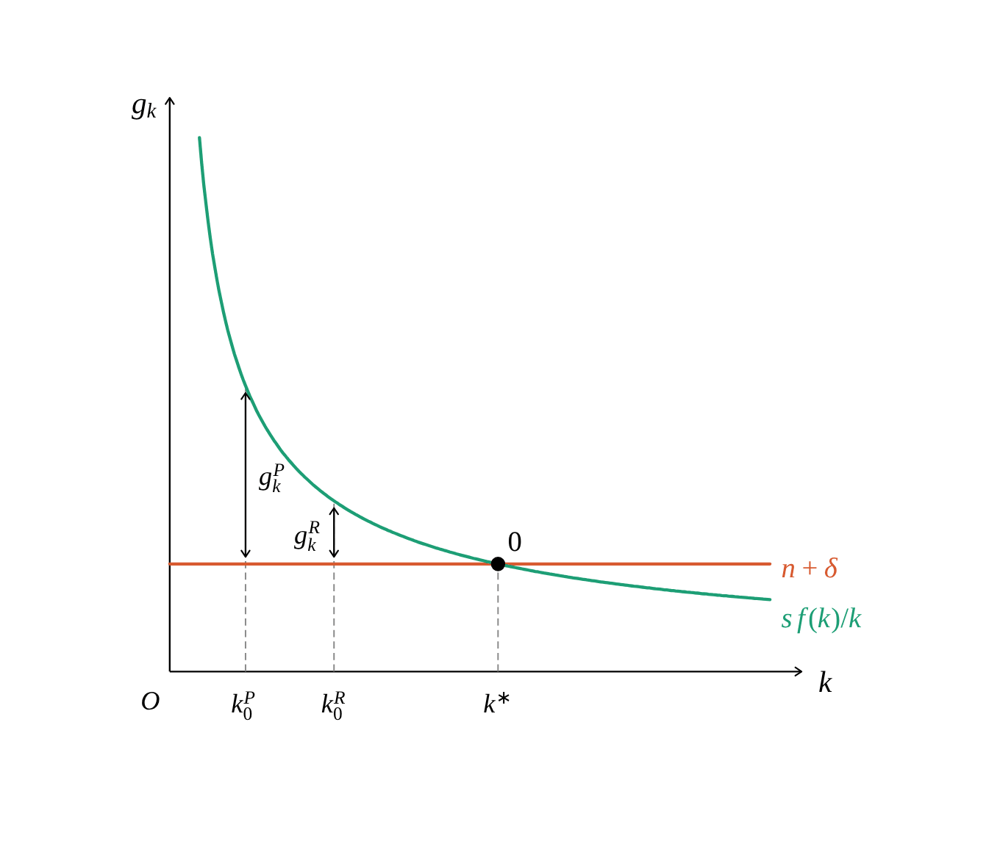
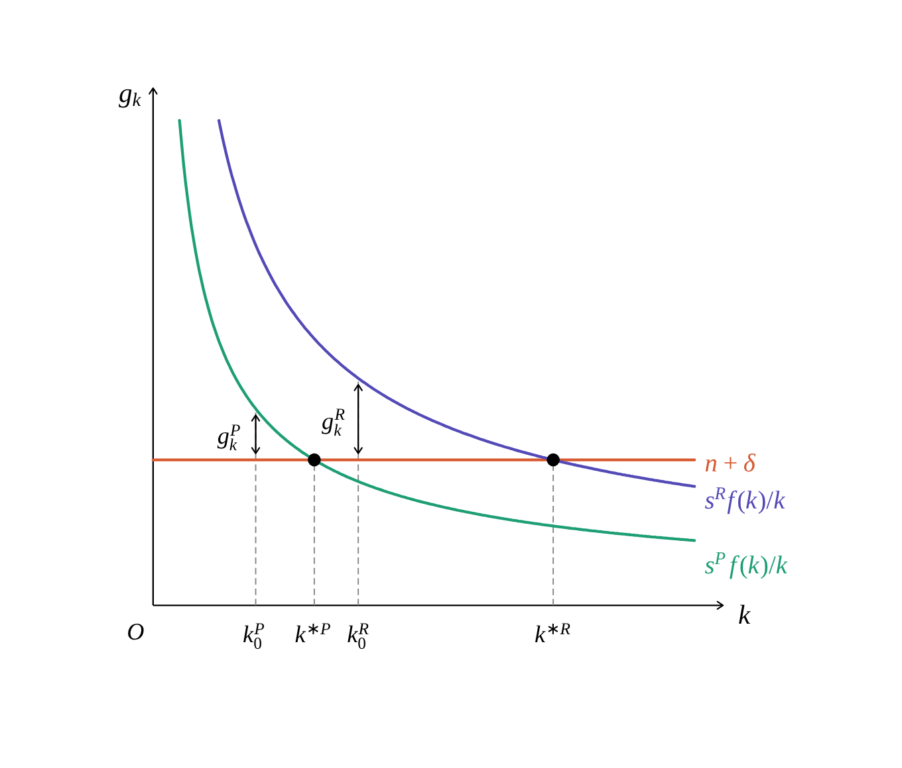
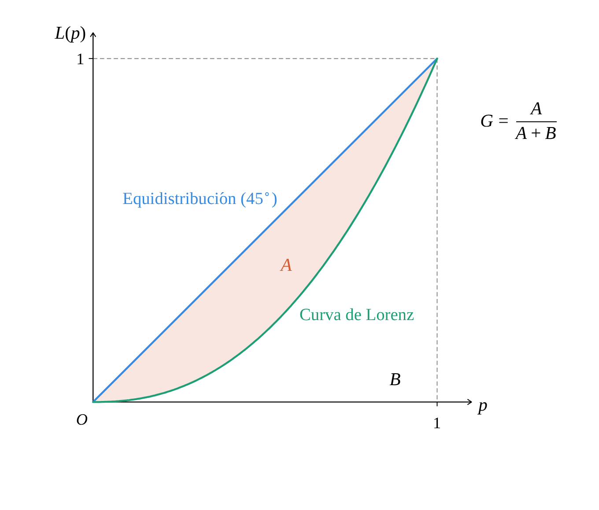

## Introducción

::: {.callout-note appearance="simple" icon=false}

:::

Las teorías del crecimiento (temas [A43](a43-crecimiento-i.qmd) y [A44](a44-crecimiento-ii.qmd)) solo valen lo que valgan frente a los datos. Kaldor (1961) resumió el crecimiento de las economías avanzadas en seis **hechos estilizados**, entre ellos el crecimiento sostenido de la renta per cápita y la estabilidad de las participaciones del trabajo y del capital en la renta, que cualquier modelo debía reproducir. Desde entonces, la **contabilidad del crecimiento** descompone el crecimiento en la aportación de los factores y el residuo de Solow, y el análisis de la **convergencia** pregunta si los países pobres crecen más deprisa que los ricos.

La respuesta ha cambiado con los datos y los métodos, que hoy permiten comparar la renta de casi todos los países durante décadas con bases como la Penn World Table. Baumol (1986) encontró convergencia entre los países industrializados, pero no en el conjunto del mundo, y los trabajos de Barro y Sala-i-Martin (1992a) y de Mankiw, Romer y Weil (1992) mostraron que los países convergen hacia su propio estado estacionario (convergencia condicional) y no hacia uno común. La evidencia apunta también a **clubes de convergencia**, grupos de países que convergen entre sí según sus condiciones iniciales.

Piketty documentó el aumento de la desigualdad en las economías avanzadas desde los años ochenta y devolvió la distribución de la renta al centro del debate. Desde entonces, la participación del trabajo en la renta ha caído en muchas de ellas, lo que cuestiona uno de los hechos de Kaldor. China, que desde la reforma y apertura de 1978 creció a una media próxima al 10 % anual durante más de tres décadas, protagoniza el mayor episodio de convergencia de la historia económica, y su paso de la agricultura a la industria y los servicios ilustra la **transformación estructural** que acompaña al desarrollo.

Este tema repasa la evidencia empírica sobre el crecimiento económico:

- *Predicciones teóricas y contabilidad del crecimiento*: las del modelo neoclásico y la descomposición del crecimiento entre la acumulación de factores y el progreso técnico.

- *Herramientas*: las del análisis de la convergencia y de la distribución de la renta.

- *Evidencia empírica*: sobre el crecimiento, la convergencia, la distribución de la renta y la transformación estructural.

::: {.callout-note appearance="simple" icon=false}
Los modelos de crecimiento exógeno se desarrollan en el tema [A43](a43-crecimiento-i.qmd) y los de crecimiento endógeno, en el tema [A44](a44-crecimiento-ii.qmd).
:::

## 1. Predicciones teóricas y contabilidad del crecimiento

El modelo de Solow-Swan fija las hipótesis que contrasta el análisis empírico, y la contabilidad del crecimiento mide la aportación de los factores y el residuo que el modelo atribuye al progreso técnico, la productividad total de los factores.

### 1.1. Las predicciones del modelo de Solow-Swan

El punto de partida del estudio empírico del crecimiento es el modelo canónico de Solow-Swan (1956) con progreso tecnológico exógeno. El modelo considera un entorno sin imperfecciones en el que la función de producción agregada es de tipo Cobb-Douglas con progreso técnico aumentador del trabajo, $Y = K^\alpha(AL)^{1-\alpha}$, y en el que los agentes ahorran de acuerdo con una tasa de ahorro exógena y constante.

Definiendo el capital por unidad de trabajo efectivo como $\tilde{k} = K/AL$, la ecuación fundamental del modelo resulta:

$$\dot{\tilde{k}} = s\tilde{k}^\alpha - (g_A+n+\delta)\tilde{k}$$

donde $g_A$ es la tasa de progreso técnico, $n$ el crecimiento de la población y $\delta$ la depreciación. En el estado estacionario ($\dot{\tilde{k}} = 0$), las tasas de crecimiento de las variables en unidades de trabajo efectivo son nulas ($g_{\tilde{k}}^* = g_{\tilde{y}}^* = 0$) y las variables per cápita crecen al ritmo del progreso tecnológico ($g_k^* = g_y^* = g_c^* = g_A$).

De este resultado se desprenden cinco predicciones fundamentales, que constituyen las hipótesis a contrastar por el análisis empírico:

1. *Acumulación de capital*: determina en gran medida el nivel de renta per cápita, pero no explica su crecimiento a largo plazo, que solo puede proceder del progreso tecnológico exógeno.

2. *Automatismo*: cualquier economía llega por sí sola a su estado estacionario, sin que el sector público intervenga, aunque nada garantiza que el estado estacionario alcanzado coincida con el de la regla de oro.

3. *Alcance de la política económica*: la política económica puede situar la renta de largo plazo en un nivel más alto (efectos de nivel), pero no acelerar de forma permanente su crecimiento (los efectos sobre la tasa son solo transitorios, durante la transición entre estados estacionarios).

4. *Exogeneidad del progreso técnico*: bajo rendimientos constantes a escala y competencia perfecta, el teorema de Euler implica que pagar a cada factor su productividad marginal absorbe toda la producción, y nada sobra para costear desde dentro el progreso tecnológico. Por tanto, el progreso técnico ha de suponerse exógeno, y empíricamente se mide como residuo.

5. *Convergencia condicional*: el modelo anticipa que cada país se aproxima a su propio estado estacionario, no que el crecimiento de los pobres supere siempre al de los ricos (*convergencia absoluta*, apartado 2.1).

### 1.2. Contabilidad del crecimiento

La **contabilidad del crecimiento** mide empíricamente qué parte del aumento observado del PIB procede de una mayor dotación de factores productivos y qué parte del progreso técnico. Admite un enfoque primal, basado en cantidades, y otro dual, basado en precios. Se completa con los problemas de medición que comparten ambos, con la contabilidad del desarrollo, que compara países, y con la estimación econométrica de la función de producción.

#### 1.2.1. Enfoque primal

**Versión con capital físico** (Solow, 1957): se parte de una función de producción $Y = Af(K,L)$ con rendimientos constantes a escala, en la que $A$ es la productividad total de los factores (PTF), neutral en el sentido de Hicks. La tasa de crecimiento de la PTF se denota $g_{\text{PTF}}$ y, con una Cobb-Douglas, es $1-\alpha$ veces la del progreso técnico aumentador del trabajo. Tomando logaritmos y derivando respecto al tiempo se obtiene la descomposición fundamental:

$$g_Y = g_{\text{PTF}} + \alpha g_K + (1-\alpha) g_L$$

donde $\alpha = A\,(\partial f/\partial K)\,K/Y$ y $(1-\alpha) = A\,(\partial f/\partial L)\,L/Y$ son, bajo competencia perfecta, las participaciones de las rentas del capital y del trabajo en la renta nacional, observables en la contabilidad nacional (en las economías avanzadas, $\alpha$ se sitúa en torno a un tercio). El *residuo de Solow*, es decir, la tasa de crecimiento de la PTF, se obtiene entonces como diferencia:

$$g_{\text{PTF}} = g_Y - \alpha g_K - (1-\alpha) g_L$$

Precisamente porque se obtiene como residuo, la PTF debe interpretarse con cautela, pues es “una especie de medida de nuestra ignorancia” (Abramovitz, 1956) y puede recoger no solo el progreso tecnológico en sentido estricto, sino también factores organizativos, institucionales, culturales o simples errores de medición. Con datos de EE. UU. entre 1909 y 1949, Solow (1957) atribuyó al residuo el 87,5 % del crecimiento del producto por hora trabajada.

**Versión con capital humano** (Jorgenson y Griliches, 1967): una extensión natural sustituye el trabajo bruto $L$ por el capital humano $H = hL$, que ajusta la cantidad de trabajo por su calidad. La participación del capital humano se aproxima por el peso de la masa salarial en la renta nacional, y el residuo pasa a ser $g_{\text{PTF}} = g_Y - \alpha g_K - (1-\alpha) g_H$. Al imputar a los factores parte de lo que antes era residuo (la mejora de la calidad del trabajo), esta corrección tiende a reducir la contribución estimada de la PTF.

#### 1.2.2. Enfoque dual

El enfoque dual parte de la identidad de la renta bajo rendimientos constantes, $Y \equiv rK + wH$. Diferenciando y reordenando se obtiene una expresión del residuo en función del crecimiento de los precios de los factores:

$$g_{\text{PTF}} = \alpha g_r + (1-\alpha) g_w$$

donde $g_r$ y $g_w$ son las tasas de crecimiento del rendimiento del capital y del salario. La intuición es que, con rendimientos decrecientes, acumular un factor abarata su remuneración, de modo que una subida duradera y simultánea de ambos precios delata progreso técnico. Así, si el crecimiento se debiera únicamente a la acumulación de capital, los rendimientos decrecientes reducirían $r$ y elevarían $w$, mientras que si se debiera únicamente a la acumulación de capital humano ocurriría lo contrario. La ventaja práctica del enfoque, además, es que la medición de los precios de los factores (tipos de interés, salarios) suele ser más sencilla y fiable que la de sus cantidades (*stock* de capital).

**Discrepancias primal-dual**: si la medición contable es correcta y la tecnología presenta rendimientos constantes, ambos enfoques deberían arrojar el mismo resultado. Sin embargo, en el “milagro” de los tigres asiáticos difieren radicalmente (apartado 3.1.2), y las causas de la discrepancia se han buscado en la medición del *stock* de capital y en el tratamiento de los impuestos sobre el capital.

#### 1.2.3. Problemas de medición

La contabilidad del crecimiento es tan fiable como la medición de sus insumos, y la del capital es la más problemática. El *stock* de capital físico no se observa, sino que se construye por el método del inventario permanente, $K_t = (1-\delta)K_{t-1} + I_t$, acumulando la inversión a precios constantes y restando una depreciación supuesta. Depende, por tanto, de la tasa de depreciación elegida y del *stock* de partida, $K_0$, el punto débil del método, aunque su peso se pierde con el paso del tiempo. Además, la mejora de la calidad de los bienes de capital (un ordenador de hoy no es el de 1990) obliga a deflactar la inversión con índices de precios hedónicos, y la contribución del capital cambia sustancialmente según se haga o no.

La heterogeneidad de los bienes de capital, muy distintos entre sí, complica su agregación en una sola magnitud, problema que alimentó la controversia de Cambridge (Joan Robinson). En la práctica se usan dos índices, el de volumen de servicios de capital (IVSC), ponderado con el coste de arrendamiento, y el índice capital-riqueza (ICR), ponderado con el de adquisición. El *servicio del capital* tampoco coincide con el *stock*, porque el grado de utilización varía con el ciclo, lo que hace que la PTF medida sea procíclica aunque la tecnología no lo sea.

En el trabajo, las horas trabajadas son la medida idónea, aunque su evolución mezcla varios componentes (participación laboral, paro y jornada por trabajador). El capital humano se aproxima por los años de escolarización, que ignoran la experiencia y la calidad de la educación, distinta en cada país, o por el peso de la masa salarial, que confunde calidad del trabajo con poder de negociación.

Las participaciones factoriales se toman de la contabilidad nacional, que exige repartir la renta mixta de los autónomos entre trabajo y capital y supone competencia perfecta para identificar participaciones con elasticidades. Cada una de esas decisiones desplaza crecimiento entre los factores y el residuo, lo que explica que las estimaciones de la contribución de la PTF varíen tanto entre estudios.

#### 1.2.4. Contabilidad del desarrollo (Hall y Jones, 1999; Caselli, 2005)

**Origen**: Robert Hall y Charles Jones (1999) desarrollaron la contabilidad del desarrollo, y Francesco Caselli (2005) la sintetizó.

**Idea**: la contabilidad del crecimiento descompone la variación de la renta de un país en el tiempo. La *contabilidad del desarrollo* (*development accounting*), en cambio, aplica la misma lógica a las diferencias de renta entre países en un momento dado. Mide qué parte de la brecha entre un país rico y uno pobre se debe a que el primero tiene más capital físico y humano por trabajador, y qué parte a que los usa con mayor productividad.

**Razonamiento**: con $Y = K^\alpha (AH)^{1-\alpha}$ y $H = hL$, donde $h$ es el capital humano por trabajador (obtenido de los años de escolarización con rendimientos mincerianos), la renta por trabajador se escribe

$$y = \left(\frac{K}{Y}\right)^{\alpha/(1-\alpha)} h \, A$$

Hall y Jones usan la ratio capital-producto en lugar del capital por trabajador porque en el estado estacionario aquella es proporcional a la tasa de inversión, $K/Y = s/(n+g_A+\delta)$, y no depende de $A$. Así se evita atribuir al capital lo que es consecuencia de la productividad. Con datos de 127 países, la ratio de renta por trabajador entre los cinco países más ricos y los cinco más pobres es de 31,7. Esa ratio se descompone en un factor 1,8 de capital físico, 2,2 de capital humano y 8,3 de productividad (Hall y Jones, 1999, cuadro V). Por tanto, la PTF explica la mayor parte de la brecha.

Caselli (2005) formaliza la medida de éxito de los factores, $\text{success} = \text{var}(\ln y_{KH})/\text{var}(\ln y)$, donde $y_{KH}$ es la renta que se observaría si todos los países tuvieran la misma $A$, y la sitúa en torno a 0,4. Dicho de otro modo, los factores explican el 40 % de la dispersión de la renta y la PTF, el 60 %.

**Conclusiones**:

- *Aspectos positivos*: el resultado desplaza la pregunta del crecimiento desde la acumulación hacia la productividad, y esta hacia sus determinantes últimos (instituciones, tecnología, asignación de recursos entre empresas).

- *Limitaciones*: la PTF sigue siendo un residuo, como en la contabilidad del crecimiento, y el reparto es sensible a la elasticidad de sustitución supuesta y a la medición del capital humano, que, como muestra Caselli, pueden alterar sustancialmente el reparto.

#### 1.2.5. Enfoque econométrico

**Origen**: la estimación econométrica de funciones de producción agregadas se remonta a Cobb y Douglas (1928) y a la estimación de la función CES de Arrow, Chenery, Minhas y Solow (1961), mientras que su versión moderna utiliza datos de empresa.

**Idea**: la contabilidad del crecimiento impone las participaciones factoriales observadas como elasticidades, lo que exige competencia perfecta y rendimientos constantes. El enfoque econométrico, sin embargo, estima la función de producción directamente, $\ln Y_t = \ln A_0 + g_{\text{PTF}} t + \alpha \ln K_t + \alpha_L \ln L_t + \varepsilon_t$, de modo que las elasticidades y los rendimientos a escala son resultados y no supuestos, y el progreso técnico se identifica como tendencia.

**Razonamiento**: la estimación permite contrastar la hipótesis $\alpha + \alpha_L = 1$ y comparar la elasticidad estimada del capital con su participación en la renta. Una elasticidad superior a la participación es evidencia de rendimientos crecientes o de externalidades del capital, o bien de poder de mercado, pues con un margen sobre el coste marginal las participaciones en la renta infravaloran las elasticidades (Hall, 1988).

**Conclusiones**:

- *Aspectos positivos*: el enfoque econométrico es el complemento necesario de la contabilidad del crecimiento cuando los supuestos de esta son dudosos. Además, con datos de empresa se ha convertido en la vía principal para medir la dispersión de productividad y la mala asignación de recursos (*misallocation*, Hsieh y Klenow, 2009), que explica una parte sustancial de las diferencias de PTF entre países.

- *Limitaciones*: sus problemas son tres:

    - *Endogeneidad de los factores*: las empresas eligen los factores conociendo su productividad, lo que sesga las estimaciones. Para corregirlo, la literatura ha propuesto estimadores de función de control con datos de empresa.

    - *Colinealidad*: la del capital con la tendencia.

    - *Forma funcional*: los resultados son sensibles a la especificación elegida (Cobb-Douglas frente a la función de elasticidad de sustitución constante, CES, o la translog).

#### 1.2.6. Conclusiones

**Aspectos positivos**: la contabilidad del crecimiento es una técnica sencilla, transparente y con requisitos de información relativamente modestos, que proporciona descomposiciones comparables entre países y periodos. Constituye el primer paso natural de cualquier análisis empírico del crecimiento, ya que permite acotar dónde hay que buscar sus fuentes (en la acumulación o en la productividad) antes de investigar las causas últimas.

**Limitaciones**:

- *Medición de los factores*: el residuo hereda los problemas de medición (*stock* y heterogeneidad del capital, horas y calidad del trabajo).

- *Variables omitidas*: no existe consenso sobre si los factores incluidos son los únicos relevantes (tierra, recursos naturales, capital público, capital organizativo).

- *Ausencia de causalidad*: la contabilidad identifica las fuentes *próximas* del crecimiento, pero no sus causas *fundamentales*. Constatar que un país creció acumulando capital, por ejemplo, no explica por qué acumuló capital. Esta limitación motiva los estudios de determinantes profundos del apartado 3.1.3.

### 1.3. Conclusiones

La contabilidad del crecimiento separa la aportación de los factores de la de la PTF, pero esta se obtiene como residuo y hereda los errores de medición del capital, del trabajo y de las participaciones factoriales. En las diferencias de renta entre países, la contabilidad del desarrollo atribuye a la PTF la mayor parte de la brecha, y el enfoque econométrico contrasta los supuestos que la contabilidad impone. Ninguna de esas vías identifica, sin embargo, las causas fundamentales del crecimiento. El apartado 3.1 aplica la contabilidad a la evidencia sobre el crecimiento.

## 2. Herramientas para el análisis de la convergencia y la distribución

El análisis empírico del crecimiento se completa con dos herramientas: el análisis de convergencia y el de la distribución de la renta.

### 2.1. Análisis de convergencia

El análisis de convergencia nació para poner a prueba unas familias de modelos de crecimiento frente a otras. Los modelos neoclásicos, con rendimientos marginales decrecientes del capital, predicen convergencia (condicional), mientras que los endógenos de tipo AK, con rendimientos constantes del capital ampliado, no predicen ninguna. Se distinguen varios conceptos de convergencia.

**Convergencia en el modelo de Solow-Swan**: el concepto puede ilustrarse gráficamente a partir del modelo neoclásico, partiendo de la tasa de crecimiento del capital per cápita, $g_k = sf(k)/k - (n+\delta)$.

Gráficamente, la convergencia se representa en el plano capital per cápita-tasa de crecimiento, $k$-$g_k$ (figuras -@fig-a451-convergencia-absoluta y -@fig-a452-convergencia-condicional):

1. *Curva de ahorro por unidad de capital*, $s\,f(k)/k$: recoge la inversión bruta por unidad de capital y es decreciente, por los rendimientos decrecientes del capital. Con tasas de ahorro distintas hay una curva por país, $s^{R}f(k)/k$ y $s^{P}f(k)/k$.

2. *Recta de depreciación*, $n+\delta$: recoge la inversión por unidad de capital necesaria para mantener $k$ constante y es horizontal.

3. *Equilibrio*: el corte de ambas determina el estado estacionario, $k^{*}$ (punto 0 en la figura -@fig-a451-convergencia-absoluta), o $k^{*P}$ y $k^{*R}$ si las curvas difieren. La distancia vertical entre ellas es la tasa de crecimiento de cada economía, $g_k^{P}$ para el país pobre, que parte de $k_0^{P}$, y $g_k^{R}$ para el rico, que parte de $k_0^{R}$.

::: {#fig-a451-convergencia-absoluta}

::: {.content-visible when-format="html"}
```{=html}
<div class="graph-frame">
<iframe src="../graphs/a451_Convergencia_absoluta.html" style="height:620px" loading="lazy" title="fig-a451-convergencia-absoluta"></iframe>
</div>
```
:::

::: {.content-visible unless-format="html"}

:::

Convergencia absoluta. La tasa de crecimiento está correlacionada negativamente con el nivel inicial de renta per cápita.
:::

::: {#fig-a452-convergencia-condicional}

::: {.content-visible when-format="html"}
```{=html}
<div class="graph-frame">
<iframe src="../graphs/a452_Convergencia_condicional.html" style="height:620px" loading="lazy" title="fig-a452-convergencia-condicional"></iframe>
</div>
```
:::

::: {.content-visible unless-format="html"}

:::

Convergencia condicional. Cada economía converge hacia su propio estado estacionario, determinado por sus parámetros.
:::

Caben dos casos:

1. *Parámetros iguales*: si las economías comparten los mismos parámetros estructurales ($s$, $n$, $\delta$, $\alpha$ y el nivel tecnológico), comparten también las mismas curvas y el mismo estado estacionario. En tal caso, cuanto menor sea el *stock* de capital inicial, mayor será la tasa de crecimiento, de modo que los países pobres crecen más rápido y se produce $\beta$-convergencia absoluta (figura -@fig-a451-convergencia-absoluta). Así ocurrió tras la Segunda Guerra Mundial con Alemania y Japón. Ambos países diferían de los aliados esencialmente en su *stock* de capital, destruido por la guerra, y crecieron sistemáticamente más rápido.

2. *Parámetros distintos*: basta con que un parámetro varíe de una economía a otra (p. ej. la tasa de ahorro) para que sus estados estacionarios se separen, y entonces el más pobre no tiene por qué crecer más. En la figura -@fig-a452-convergencia-condicional, el país rico, todavía lejos de su estado estacionario, puede crecer más que el pobre, ya próximo al suyo. De ahí que la hipótesis relevante sea la convergencia condicional (apartado 3.2), una correlación parcial negativa entre crecimiento y renta inicial, una vez se controla por el estado estacionario de cada país.

**$\beta$-convergencia**: recoge la relación inversa entre el nivel inicial de renta y la tasa de crecimiento posterior, que es mayor cuanto mayor es la distancia al estado estacionario. Su contraste empírico habitual es la regresión:

$$g_y^j = \beta_0 - \beta \ln y_0^j + \gamma Z^j + \varepsilon^j$$

donde $y_0^j$ es la renta inicial del país $j$ y $Z^j$ un vector de variables estructurales que aproximan su estado estacionario. Un coeficiente $\beta$ positivo indica convergencia. Ha de ser, además, menor que $1/T$ si $g_y^j$ es la tasa media anual de un periodo de $T$ años, para evitar adelantamientos sistemáticos. La especificación determina el tipo de convergencia contrastada:

- *Sin controles* ($Z = 0$): se contrasta la convergencia absoluta.

- *Con controles* $Z$: se contrasta la convergencia condicional.

Alternativamente, puede estimarse la versión no lineal del contraste, en la que $\beta = (1-e^{-\lambda T})/T$, lo que permite obtener directamente la velocidad de convergencia $\lambda$.

**$\sigma$-convergencia**: exige que la dispersión de la renta per cápita entre países disminuya con el tiempo, $\sigma_t > \sigma_{t+T}$. La relación entre ambos conceptos es asimétrica, ya que la $\beta$-convergencia absoluta es condición necesaria pero no suficiente para la $\sigma$-convergencia. La razón es que un país pobre puede “adelantar” al rico y seguir creciendo más deprisa, en cuyo caso habría $\beta$-convergencia (el inicialmente pobre creció más) y, sin embargo, la dispersión podría estar aumentando.

**$\gamma$-convergencia**: mide la movilidad ordinal mediante la varianza de los cambios de posición en la clasificación (*ranking*) de rentas (índice de concordancia de Kendall). Si los países cambian sus posiciones relativas a lo largo del tiempo, existe convergencia en términos de orden, es decir, la jerarquía internacional de rentas no es fija.

**Velocidad de convergencia**: $\lambda$ mide el ritmo al que una economía cierra la brecha con su estado estacionario. En el modelo de Solow-Swan, la aproximación log-lineal en torno al estado estacionario arroja:

$$\lambda \approx (1-\alpha)(g_A+n+\delta)$$

El resultado tiene una lectura empírica importante. Si se toma $\alpha \approx 1/3$ y valores plausibles para el resto de parámetros, el modelo básico arroja una velocidad cercana al 4 % anual, muy por encima del 2 % que miden, con notable regularidad, los estudios empíricos (Barro y Sala-i-Martin, 1992a). Sin embargo, el desajuste desaparece en la versión con capital humano de Mankiw, Romer y Weil (1992). Si el capital incluye el físico y el humano, su participación conjunta ronda dos tercios y la velocidad teórica baja al entorno del 2 % anual que se observa. A ese ritmo, cerrar la mitad de la distancia al estado estacionario lleva unos 35 años ($t_{1/2} = \ln 2 / \lambda$), lo que hace de la convergencia un proceso lento.

**Problemas econométricos**: las regresiones de convergencia de corte transversal presentan tres dificultades:

- *Heterogeneidad no observada*: si los determinantes del estado estacionario omitidos de $Z$ están correlacionados con la renta inicial, la estimación de $\beta$ está sesgada. De hecho, las estimaciones con datos de panel y efectos fijos por país, que permiten a cada economía un estado estacionario propio, arrojan velocidades de convergencia sensiblemente superiores al 2 % (Islam, 1995).

- *Endogeneidad de los regresores*: la inversión o la escolarización responden al propio crecimiento, lo que obliga a recurrir a variables instrumentales.

- *Falacia de Galton* (Quah, 1993): un coeficiente $\beta$ positivo es compatible con una dispersión constante o creciente, por simple regresión a la media. En consecuencia, la $\beta$-convergencia debe completarse con el análisis de la $\sigma$-convergencia y de la dinámica de toda la distribución.

### 2.2. Análisis de la distribución personal de la renta

::: {.callout-note appearance="simple" icon=false}
La medición de la desigualdad y sus fundamentos en la economía del bienestar se desarrollan en el tema [A24](a24-eb-iii.qmd), apartado 1.4, y su uso en la medición del desarrollo, la pobreza y la desigualdad, en el tema [B28](b28-desarrollo.qmd), apartado 1.2.
:::

El análisis empírico del crecimiento se completa con el de la distribución de la renta, pues el mismo crecimiento agregado es compatible con evoluciones distributivas muy distintas. Para medirla se usan, sobre todo, cinco instrumentos.

**Curva de Lorenz** (Lorenz, 1905): representa la proporción acumulada de la renta total (eje de ordenadas) que percibe cada proporción acumulada de la población, ordenada de menor a mayor renta (eje de abscisas). La diagonal de 45 grados representa la equidistribución perfecta, y cuanto más se aleja la curva de la diagonal, mayor es la desigualdad. Su principal limitación es que solo proporciona una ordenación parcial, porque cuando dos curvas de Lorenz se cruzan no permite decir qué distribución es más desigual.

**Coeficiente o índice de Gini** (Gini, 1912): sintetiza la curva de Lorenz en un escalar, definido como el cociente entre el área comprendida entre la curva y la diagonal y el área total bajo la diagonal. Toma valores entre 0 (equidistribución) y 1 (concentración total de la renta en un individuo). El índice es la medida más utilizada, si bien, cuando las curvas de Lorenz se cruzan, dos distribuciones muy distintas pueden arrojar el mismo Gini. Además, el índice es más sensible a las transferencias en el centro de la distribución que en las colas.

**Índice de Theil** (Theil, 1967): medida basada en el concepto de entropía de la teoría de la información, $T = \frac{1}{H}\sum_{h=1}^{H} \frac{y^h}{\bar{y}} \ln\frac{y^h}{\bar{y}}$, donde $H$ es el número de individuos, $y^h$ la renta del individuo $h$ y $\bar{y}$ la renta media. Su gran ventaja es la *descomponibilidad aditiva*, es decir, la desigualdad total puede descomponerse exactamente en la suma de la desigualdad dentro de los grupos y la desigualdad entre grupos (p. ej. entre regiones o entre niveles educativos). Esa propiedad resulta especialmente útil para el análisis de las fuentes de la desigualdad.

**Índice de Atkinson** (Atkinson, 1970): a diferencia de las medidas anteriores, puramente estadísticas, es una medida normativa, construida a partir de una función de bienestar social con un parámetro explícito de aversión a la desigualdad ($\varepsilon$). Se define como $A_\varepsilon = 1 - y_e/\bar{y}$, donde $y_e$ es la renta “equivalente igualmente distribuida”, aquella que, repartida por igual, generaría el mismo bienestar social que la distribución observada. Se interpreta como la fracción de la renta total que la sociedad estaría dispuesta a sacrificar a cambio de la equidistribución.

**Cuentas nacionales distributivas** (Piketty, Saez y Zucman, 2018): constituyen la frontera reciente de la medición. Frente a las encuestas de hogares, que infrarrepresentan las rentas altas y no agotan la renta nacional, las *Distributional National Accounts* asignan el 100 % de la renta nacional de la contabilidad nacional a los individuos. Garantizan así la coherencia entre los agregados macroeconómicos y los datos distributivos, permiten el análisis de la distribución antes y después de impuestos y transferencias, y son la base metodológica del *Informe sobre la Desigualdad Mundial* (*World Inequality Report*).

Gráficamente, la curva de Lorenz y el coeficiente de Gini se representan en el plano proporción acumulada de la población-proporción acumulada de la renta, $p$-$L(p)$ (figura -@fig-a453-lorenz):

1. *Diagonal de equidistribución* (45°): recoge el caso en que cada proporción de la población percibe la misma proporción de la renta.

2. *Curva de Lorenz*, $L(p)$: recoge la proporción acumulada de la renta que percibe cada proporción acumulada $p$ de la población. Es convexa y queda por debajo de la diagonal porque la población se ordena de menor a mayor renta.

3. *Coeficiente de Gini*: $G = A/(A+B)$, donde $A$ es el área entre la diagonal y la curva y $B$, el área bajo la curva.

::: {#fig-a453-lorenz}

::: {.content-visible when-format="html"}
```{=html}
<div class="graph-frame">
<iframe src="../graphs/a453_Lorenz.html" style="height:620px" loading="lazy" title="fig-a453-lorenz"></iframe>
</div>
```
:::

::: {.content-visible unless-format="html"}

:::

Curva de Lorenz y coeficiente de Gini como medidas de la desigualdad en la distribución de la renta.
:::

### 2.3. Conclusiones

El análisis de convergencia traduce en contrastes las predicciones del modelo de Solow-Swan. La $\beta$-convergencia es condicional o absoluta según se controle o no por el estado estacionario, y debe completarse con la $\sigma$-convergencia, porque un $\beta$ positivo es compatible con una dispersión creciente. Las medidas de desigualdad van, por su parte, de la ordenación parcial de la curva de Lorenz a la descomposición del índice de Theil y al juicio normativo del de Atkinson. La sección 3 aplica estas herramientas a la evidencia sobre la convergencia y la distribución de la renta.

## 3. Evidencia empírica

La evidencia empírica se ordena en cinco ámbitos: el crecimiento y sus fuentes, la convergencia, la distribución personal de la renta, la distribución factorial y la transformación estructural.

### 3.1. Evidencia empírica sobre el crecimiento

La evidencia sobre el crecimiento abarca los hechos estilizados, la contribución de la PTF y de la acumulación de factores, los determinantes profundos, el enfoque institucional y la desaceleración de la productividad.

#### 3.1.1. Estudios generales: hechos estilizados

Kaldor (1961) sintetizó la evidencia disponible en seis regularidades empíricas, entendidas como promedios históricos y no como constantes válidas en todo momento:

1. *Renta per cápita*: su tasa de crecimiento es aproximadamente constante (en EE. UU., en torno al 2 % anual).

2. *Capital per cápita*: su tasa de crecimiento es aproximadamente constante.

3. *Ratio capital-producto*: $K/Y$ es aproximadamente constante (lo que se deriva de las dos anteriores si ambas tasas de crecimiento coinciden).

4. *Tasa de retorno*: la del capital es aproximadamente constante.

5. *Diferencias entre países*: las tasas de crecimiento de la productividad difieren de forma importante y persistente (del orden del 2 % al 5 %).

6. *Participaciones factoriales*: las del capital y del trabajo en la renta nacional son aproximadamente constantes.

Los hechos primero a cuarto y sexto son coherentes con el modelo neoclásico con progreso técnico exógeno y tecnología Cobb-Douglas, y de hecho contribuyeron a fijarlo como modelo canónico. El quinto, en cambio, solo encaja en él como fenómeno transitorio, asociado a la dinámica de transición hacia estados estacionarios distintos. El sexto es hoy el más controvertido, porque desde los años ochenta, y con especial intensidad desde comienzos de la década de 2000, la participación del trabajo ha caído de forma apreciable en EE. UU. y otros países avanzados.

Jones y Romer (2010) actualizaron la lista con seis “nuevos hechos de Kaldor”, adaptados a las teorías modernas del crecimiento:

1. *Extensión del mercado*: ha aumentado mucho (globalización, urbanización).

2. *Aceleración del crecimiento*: durante milenios, el crecimiento de la población y de la renta per cápita se ha acelerado, desde tasas casi nulas hasta las del último siglo.

3. *Variabilidad de las tasas*: la dispersión de las tasas de crecimiento entre países aumenta con la distancia a la frontera tecnológica.

4. *Papel de la PTF*: la acumulación de factores (capital físico y humano) explica menos de la mitad de las diferencias de renta per cápita entre países, por lo que la PTF explica la mayor parte.

5. *Capital humano*: su dotación por trabajador ha aumentado con fuerza.

6. *Premio salarial*: ese aumento del capital humano relativo no ha ido acompañado de una caída de su precio relativo (el premio salarial de la cualificación no ha caído), lo que sugiere una demanda creciente de cualificación sesgada por la tecnología.

Los tres primeros hechos motivan los modelos de crecimiento endógeno basados en ideas (tema [A44](a44-crecimiento-ii.qmd)), y el cuarto resume los resultados de la contabilidad del desarrollo (apartado 1.2.4).

#### 3.1.2. Estudios sobre la PTF y la acumulación de factores

La cuestión de si el crecimiento se debe principalmente a la acumulación de factores o a la PTF dista de estar resuelta, y los resultados dependen de la metodología, la muestra y el periodo.

**Los factores dominan**: tres estudios clásicos atribuyen a la acumulación de factores la mayor parte del crecimiento o de las diferencias de renta entre países:

- *Denison (1985)*: la mayor parte del crecimiento de EE. UU. durante el periodo 1929-1982.

- *Maddison (1991)*: una conclusión similar (en torno a dos tercios) para seis países avanzados (Alemania, EE. UU., Francia, Japón, Países Bajos y Reino Unido) entre 1913 y 1987.

- *Mankiw, Romer y Weil (1992)*: el modelo de Solow con capital físico explica en torno al 60 % de las diferencias internacionales de renta ($R^2 = 0{,}6$), proporción que se eleva a cerca del 80 % cuando se amplía con capital humano ($R^2 = 0{,}8$).

**La crítica de Jorgenson y Griliches** (1967): sostuvieron que el residuo de Solow es en gran medida un artefacto de la mala medición de los factores. Corrigiendo el capital por su utilización y por la calidad de los bienes de equipo, y el trabajo por su composición (educación, edad, sexo), la contribución de la PTF al crecimiento estadounidense (1945-1965) se reducía de casi la mitad a apenas un 3 %. La réplica de Denison y el debate posterior, sin embargo, fijaron la posición intermedia que hoy se acepta, según la cual una parte sustancial del residuo es medición, pero no toda.

**El debate sobre los tigres asiáticos**: Alwyn Young (1995) mostró que el crecimiento de Hong Kong, Singapur, Corea y Taiwán entre 1966 y 1990 se explicaba sobre todo por la acumulación de factores (inversión, participación laboral, educación). El crecimiento de la PTF no era excepcional (casi nulo en Singapur). Este resultado, anticipado en trabajos previos del propio Young, había llevado a Krugman (1994) a comparar el crecimiento de los tigres asiáticos con el soviético y a predecir el agotamiento del crecimiento asiático.

La réplica llegó desde el enfoque dual (apartado 1.2.2), cuya PTF, muy superior a la primal, sugería que las series de capital de Young sobrestimaban la acumulación. Young (1998) sostiene, en cambio, que, corregidos los errores de cálculo y de método, las estimaciones duales no se alejan tanto de las primales. El episodio ilustra por qué los dos enfoques son complementarios y por qué la pregunta “acumulación o PTF” sigue abierta.

**La PTF domina**: otros tantos estudios llegan a la conclusión contraria:

- *Solow (1957)*: el residuo del 87,5 % (apartado 1.2.1).

- *Hall y Jones (1999)*: la PTF explica la mayor parte de las diferencias internacionales de renta. La discrepancia con Mankiw, Romer y Weil se debe a la medición del capital humano. Mankiw, Romer y Weil usan la tasa de escolarización secundaria como aproximación de la tasa de inversión en capital humano (un flujo), con un efecto muy pronunciado sobre la renta. Hall y Jones, en cambio, convierten los años de escolarización (un *stock*) mediante los rendimientos salariales de la educación (ecuación de Mincer), que arrojan diferencias de capital humano mucho menores entre países.

- *Caselli (2005)*: el reparto entre factores y PTF de la contabilidad del desarrollo, con una parte de los factores mayor dentro de la OCDE (en torno al 60 %) que fuera de ella (algo más de un tercio).

**Las economías en convergencia**: en las economías europeas que se aproximaron a la frontera tecnológica en las décadas posteriores a la Segunda Guerra Mundial, la contribución de la PTF al crecimiento fue sensiblemente superior a la de EE. UU., reflejo de un intenso proceso de modernización y absorción de tecnología.

#### 3.1.3. Estudios sobre determinantes profundos

Una segunda línea de investigación abandona la contabilidad y busca directamente los determinantes del crecimiento mediante regresiones de corte transversal entre países:

1. *Primeras regresiones*: los trabajos fundacionales de esta literatura, que condicionan a la renta inicial, encuentran como factores positivamente correlacionados con el crecimiento la escolarización primaria y secundaria y la tasa de inversión. Como factores negativos encuentran el consumo público (que no debe confundirse con la inversión pública), la inflación, las distorsiones del precio relativo de los bienes de inversión, el crecimiento de la población y la inestabilidad política (revoluciones, golpes de Estado, asesinatos políticos).

2. *Límites extremos*: Levine y Renelt (1992) aplican el *análisis de límites extremos* (*extreme bounds analysis*) de Leamer, según el cual una variable solo es robusta si su coeficiente mantiene el signo y la significatividad para cualquier combinación de variables de control. Con este criterio, la inmensa mayoría de las más de cincuenta variables identificadas por la literatura como “determinantes” del crecimiento no son robustas a cambios de especificación, y solo la renta inicial y la tasa de inversión sobreviven al test. En consecuencia, no cabe depositar demasiada confianza en las regresiones de crecimiento para identificar determinantes.

3. *Dos millones de regresiones*: Sala-i-Martin (1997) propone un criterio menos exigente que el todo-o-nada de Levine-Renelt, basado en la distribución completa de los coeficientes estimados. Con él, en torno a una veintena de las casi sesenta variables examinadas aparecen sólida y sistemáticamente correlacionadas con el crecimiento (entre ellas, variables geográficas, institucionales y de apertura).

#### 3.1.4. El enfoque institucional del crecimiento

La búsqueda de las causas fundamentales (frente a las próximas) culmina en el enfoque institucional, cuyo trabajo de referencia es el de Acemoglu, Johnson y Robinson (2001). La dificultad central de esta literatura es la endogeneidad, porque los países ricos pueden permitirse buenas instituciones, de modo que la correlación entre instituciones y renta no prueba causalidad. Ante esa dificultad, la aportación de los autores es una estrategia de identificación mediante variables instrumentales. La ecuación estimada es del tipo:

$$\ln y_i = \beta_0 + \beta_1 R_i + \mathbf{X}_i'\gamma + \varepsilon_i$$

donde $y_i$ es la renta per cápita actual del país $i$ y $R_i$ es un indicador de calidad institucional (la protección frente al riesgo de expropiación), que se instrumenta con la mortalidad de los colonos europeos en los siglos XVII-XIX. La lógica del instrumento es histórica. Donde la mortalidad era alta, los europeos no se asentaron y establecieron instituciones *extractivas*, diseñadas para expoliar recursos, mientras que donde era baja se asentaron y replicaron instituciones *inclusivas*, con protección de la propiedad. Esas instituciones persistieron tras la independencia y determinan la renta actual.

Los resultados atribuyen a las instituciones un efecto causal de primer orden sobre la renta per cápita. El trabajo posterior de los mismos autores (la “reversión de la fortuna”, 2002) refuerza la conclusión, al mostrar que las zonas colonizadas más ricas en 1500 son hoy relativamente más pobres. Ello es incompatible con explicaciones basadas en efectos geográficos invariables en el tiempo y apunta a las instituciones como causa fundamental del desarrollo.

#### 3.1.5. La desaceleración de la productividad

**Origen**: la *paradoja de la productividad* de Solow (1987), “la era del ordenador se ve en todas partes menos en las estadísticas de productividad”, y el debate sobre el *estancamiento secular* reabierto por Gordon (2016) y Summers (2014).

**Idea**: el crecimiento de la PTF en las economías avanzadas no ha sido constante. Fue elevado entre 1920 y 1970 (en torno al 2 % anual en EE. UU.) y cayó hasta aproximadamente un tercio de ese ritmo entre 1973 y 1995. Repuntó transitoriamente entre 1995 y 2004 con la difusión de las tecnologías de la información y la comunicación (TIC). Desde mediados de la década de 2000 ha vuelto a desacelerarse, hasta tasas del orden del 0,5 % anual en EE. UU. y próximas a cero en buena parte de Europa (Gordon, 2016). De ahí que el primer hecho de Kaldor (crecimiento constante de la renta per cápita) sea, visto a esta escala, una aproximación.

**Razonamiento**: las explicaciones se agrupan en tres:

- *Pesimista* (Gordon): las grandes invenciones de la segunda revolución industrial (electricidad, motor de combustión, saneamiento) tuvieron efectos únicos que las TIC no igualan, y vientos de cara (demografía, educación estancada, desigualdad, deuda) reducen el crecimiento tendencial.

- *Medición*: la producción digital, gratuita o de calidad creciente, está infravalorada en el PIB, aunque los principales estudios concluyen que la mala medición no explica la mayor parte de la desaceleración, que es común a países con distinta intensidad digital.

- *Difusión y asignación*: la productividad de las empresas de la frontera ha seguido creciendo mientras la del resto se estanca, lo que apunta a fallos de difusión, a la caída del dinamismo empresarial y a la concentración. En la misma línea, las ideas parecen cada vez más difíciles de encontrar (Bloom, Jones, Van Reenen y Webb, 2020), de modo que mantener la tasa de crecimiento de la productividad exige un esfuerzo investigador cada vez mayor.

La desaceleración es el hecho estilizado que la teoría del crecimiento debe explicar hoy. Sus lecturas tienen implicaciones opuestas. Así, si es tecnológica y permanente, las políticas de oferta tienen poco recorrido, mientras que, si es de difusión y asignación, la inversión pública en I+D, la formación y la política de competencia pueden revertirla. La evidencia contra el efecto escala de los modelos de primera generación (Jones, 1995) y la caída de la productividad investigadora favorecen los modelos semiendógenos, en los que sostener el crecimiento exige un esfuerzo investigador creciente (tema [A44](a44-crecimiento-ii.qmd)).

**Conclusiones**:

- *Aspectos positivos*: el debate muestra que el crecimiento tendencial de la productividad no es constante y ordena sus posibles causas en tres hipótesis contrastables, de las que se siguen recomendaciones de política opuestas.

- *Limitaciones*: las tres explicaciones no se excluyen y la evidencia no permite aún ponderarlas. Además, el diagnóstico descansa en la PTF, un residuo sensible a los problemas de medición del apartado 1.2.3.

### 3.2. Evidencia empírica sobre convergencia

La evidencia sobre la convergencia se resume en los puntos siguientes:

1. *La ausencia de convergencia mundial*: en los datos de la *Penn World Table* (Summers y Heston, 1991), tomado el mundo en su conjunto, los países pobres no crecen sistemáticamente más que los ricos, y no aparece convergencia $\beta$ ni $\sigma$. Esa falta de convergencia se leyó al principio como un argumento a favor del crecimiento endógeno.

2. *La contrarrevolución neoclásica* (Barro, Sala-i-Martin y Mankiw-Romer-Weil, 1990-1992): replicó que la predicción del modelo neoclásico había sido siempre la convergencia condicional. A su juicio, contrastar la absoluta equivale a ignorar que cada país tiene sus propios parámetros estructurales y, por tanto, su propio estado estacionario.

    - *Mankiw, Romer y Weil* (1992): sin controles, el $\beta$ estimado es positivo ($0{,}34$, con el crecimiento acumulado de 1960-1985 como variable dependiente, no la tasa media anual) y significativo entre los 22 países de la OCDE. En la muestra amplia de 98 países (1960-1985), en cambio, no hay convergencia absoluta, con un $\beta$ incluso ligeramente negativo ($-0{,}094$, con la convención de signo de la regresión del apartado 2.1). La semejanza estructural de los países de la OCDE explica la diferencia. Cuando se añaden como controles la escolarización, la tasa de inversión y el crecimiento demográfico, el coeficiente es positivo y significativo en las tres muestras (las dos anteriores y una intermedia de 75 países). La convergencia condicional avanza entonces a un 2 % anual, aproximadamente, la velocidad coherente con el modelo de Solow con capital humano.

    - *Barro y Sala-i-Martin* (1991-1992): recurren a las regiones de un mismo país, cuyos parámetros (ahorro, demografía, tecnología, gobierno e instituciones) son muy parecidos, lo que permite contrastar la convergencia absoluta en condiciones casi de laboratorio. En 73 regiones europeas, los estados de EE. UU., los *Länder* alemanes, las prefecturas japonesas y las comunidades autónomas españolas, todas las muestras arrojan $\beta$-convergencia absoluta, y lo hacen a un ritmo sorprendentemente parecido, cercano al 2 % anual (unos 35 años para recortar a la mitad la brecha). Tanta uniformidad ha convertido ese 2 % en poco menos que un hecho estilizado.

3. *Sesgo de selección y clubes de convergencia*:

    - *Sesgo de selección* (De Long, 1988): la convergencia que Baumol (1986) había encontrado entre los países hoy ricos era un artefacto de selección, pues la muestra incluía solo a los que habían acabado convergiendo. De hecho, con una muestra definida *ex ante* por la renta de 1870, la convergencia desaparece.

    - *Clubes de convergencia* (Quah, 1993, 1996): el análisis de la dinámica de la distribución va más lejos. La distribución mundial de la renta per cápita no se comprime hacia un centro, sino que tiende a una forma bimodal, los *picos gemelos*, con un club de países ricos y otro de pobres y un centro que se vacía. Ello sugiere *convergencia de clubes*, es decir, los países convergen hacia el estado estacionario de su grupo y no hacia uno común, porque el estado estacionario depende no solo de sus parámetros estructurales sino también de sus condiciones iniciales (p. ej. su capital humano). El resultado es coherente con los modelos de trampas de pobreza y de umbrales (tema [B28](b28-desarrollo.qmd), apartado 2.1.2).

4. *La convergencia desde 2000*: la evidencia reciente ha cambiado el diagnóstico. Desde finales de los años noventa los países en desarrollo han crecido sistemáticamente más que los ricos, con lo que la convergencia absoluta, ausente en las muestras de 1960-1990, tiende a aparecer desde 1990 y es clara desde 2000 (Kremer, Willis y You, 2022). Las instituciones y las políticas de los países pobres han convergido también hacia las de los ricos. El resultado sugiere que la no convergencia de las décadas anteriores fue un fenómeno del periodo y no una propiedad del crecimiento.

5. *El caso de China*: constituye el mayor episodio de convergencia de la historia económica. Desde la reforma y apertura de 1978, la economía china creció a una media próxima al 10 % anual durante más de tres décadas, con el ingreso en la OMC (2001) como punto de inflexión de su integración comercial. En la década de 2010 se moderó hasta el entorno del 7 %. Su PIB agregado medido en paridad de poder adquisitivo supera al de EE. UU. desde mediados de esa década. Su PIB per cápita en paridad de poder adquisitivo, en cambio, se situaba en 2025 en torno a un tercio del estadounidense (y en torno a la sexta parte a tipos de cambio de mercado). Por tanto, la convergencia, aunque muy intensa, dista de haberse completado.

### 3.3. Evidencia empírica sobre distribución de la renta: desigualdad y crecimiento

La evidencia sobre la distribución personal de la renta se ocupa de la relación entre desigualdad y crecimiento, en ambos sentidos, y del nivel y la evolución de la desigualdad.

**Curva de Kuznets** (1955): la hipótesis clásica sobre la relación entre crecimiento y desigualdad sostiene que esta describe una U invertida a lo largo del desarrollo. Aumenta en las primeras fases, cuando la población se desplaza de la agricultura de baja productividad y renta homogénea a la industria de alta productividad y renta dispersa. Disminuye después, cuando la mayoría ya está en el sector moderno y operan la educación y la redistribución.

La evidencia de corte transversal de los años sesenta y setenta apoyó la hipótesis, pero la de series temporales largas la ha desmentido. Así, Piketty (2014) muestra que la caída de la desigualdad entre 1914 y 1970 en los países ricos se debió a las guerras, la inflación y la fiscalidad, no a una ley del desarrollo. Muestra también que desde 1980 la desigualdad ha vuelto a crecer sin que el desarrollo se detuviera. Milanovic (2016) propone en su lugar *ondas de Kuznets* sucesivas, impulsadas por las revoluciones tecnológicas y la globalización.

**Desigualdad global** (Lakner y Milanovic, 2016): la *curva del elefante* representa el crecimiento de la renta real entre 1988 y 2008 para cada percentil de la distribución mundial. Muestra ganancias elevadas para las clases medias de los países emergentes (Asia) y estancamiento para las clases medias y bajas de los países ricos (el “valle” de la trompa). Para el 1 % superior mundial (la punta de la trompa), las ganancias son también elevadas, aunque inferiores a las del centro de la distribución. La desigualdad entre países, ponderada por población, ha caído por la convergencia de China e India, mientras que la desigualdad dentro de los países ha aumentado. El resultado neto es una ligera reducción de la desigualdad global desde 2000, la primera desde la Revolución Industrial.

**Desigualdad y crecimiento**: la causalidad inversa, de la desigualdad al crecimiento, se ha estudiado con regresiones de corte transversal. Los principales resultados son los siguientes:

- *Efecto negativo*: Alesina y Rodrik (1994) y Persson y Tabellini (1994) lo encuentran y lo explican por la economía política (mayor desigualdad, mayor demanda de redistribución distorsionante). Otros trabajos (Galor y Zeira, 1993) añaden las restricciones de crédito que impiden a los pobres invertir en capital humano.

- *Efecto dependiente del desarrollo*: Barro (2000) matiza que el efecto es negativo en los países pobres y positivo en los ricos.

- *Duración del crecimiento*: otros estudios muestran que la desigualdad acorta la duración de los episodios de crecimiento.

La evidencia es frágil por los problemas de medición de la desigualdad y de identificación, pero el consenso actual es que la desigualdad elevada no favorece el crecimiento.

**Estado de la desigualdad**: el *Informe sobre la Desigualdad Mundial 2022* (Chancel, Piketty y otros) ofreció una descripción muy completa de la desigualdad contemporánea. La mitad inferior de la distribución obtiene menos del 15 % del ingreso nacional (con la excepción de Europa) y apenas el 2 % de la riqueza, mientras que el 10 % superior concentra más de la mitad del ingreso mundial (52 %) y el 76 % de la riqueza. Oriente Medio y el Norte de África (MENA) es la región más desigual del mundo. Los niveles actuales de desigualdad se aproximan a los de comienzos del s. XX. La edición de 2026 confirma esta descripción en lo esencial, pues el 10 % superior percibe más renta que el 90 % restante y posee tres cuartas partes de la riqueza mundial.

En paralelo, durante los últimos cuarenta años la riqueza del sector privado ha crecido mientras la del sector público caía. La pandemia de COVID-19 agravó esta tendencia, y durante ella los gobiernos se endeudaron con el sector privado por magnitudes del orden del 10-20 % del PIB.

Según Piketty, la ratio riqueza-renta ha aumentado sin que cayera la tasa de retorno del capital. Ello, a su juicio, eleva la participación del capital en la renta nacional, igual al producto de ambas (la “primera ley fundamental del capitalismo”), y explica el crecimiento de la desigualdad desde el final del sistema de Bretton Woods. A largo plazo, la ratio riqueza-renta tiende al cociente entre la tasa de ahorro neto y la tasa de crecimiento (la “segunda ley”), de modo que un menor crecimiento la eleva para un ahorro dado. Por último, si el rendimiento del capital supera de forma persistente al crecimiento de la renta ($r > g_Y$), la riqueza heredada tiende a crecer más deprisa que la renta y a concentrarse, que es la tesis central de Piketty. Esa acumulación de riqueza se ha visto alimentada, según el autor, por el incremento del valor inmobiliario, la competencia por bienes posicionales y la ventaja fiscal del capital sobre el trabajo.

### 3.4. Evidencia empírica sobre la distribución factorial: la participación del trabajo

**Origen**: el sexto hecho estilizado de Kaldor (1961) y la literatura que documenta su quiebra desde los años ochenta.

**Idea**: la distribución de la renta entre los factores es distinta de la distribución personal, pues mide qué fracción de la renta nacional remunera al trabajo y qué fracción al capital. La estabilidad de esa fracción, en torno a dos tercios para el trabajo en las economías avanzadas, es el hecho estilizado de Kaldor que la función Cobb-Douglas reproduce y que la contabilidad del crecimiento usa como ponderación.

**Razonamiento**: la evidencia de las últimas cuatro décadas ha puesto en cuestión esa constancia. La participación del trabajo ha caído en la mayoría de las economías avanzadas y emergentes desde principios de los años ochenta, en torno a cinco puntos del PIB en el conjunto de la OCDE, y la literatura ha propuesto las siguientes explicaciones complementarias:

- *Abaratamiento del capital*: una primera explicación atribuye la caída al menor precio relativo de los bienes de capital, singularmente los ligados a las TIC. Con una elasticidad de sustitución entre capital y trabajo superior a la unidad, ese menor precio induce la sustitución de trabajo por capital (Karabarbounis y Neiman, 2014).

- *Deslocalización*: para EE. UU., la caída se ha atribuido a la deslocalización de las fases intensivas en trabajo.

- *Empresas superestrella*: Autor, Dorn, Katz, Patterson y Van Reenen (2020) la atribuyen a la concentración del mercado en empresas *superestrella* de márgenes altos y participación del trabajo baja.

- *Otros factores*: otros trabajos apuntan al debilitamiento del poder de negociación de los trabajadores y a la medición. En cuanto a la medición, una parte de la caída obedece a cómo se imputan la renta mixta y la de la vivienda, y a la capitalización de los productos de la propiedad intelectual, antes tratados como gasto intermedio (Koh, Santaeulàlia-Llopis y Zheng, 2020). El FMI y la Organización Internacional del Trabajo (OIT) documentan la caída con datos comparables desde 1990, con la excepción parcial de algunos países europeos.

La caída de la participación del trabajo conecta la teoría del crecimiento con la de la desigualdad. Si la renta del capital está más concentrada que la del trabajo, un desplazamiento de la distribución factorial hacia el capital eleva la desigualdad personal, como en el mecanismo de Piketty. Además, la caída obliga a revisar dos supuestos de la teoría, la elasticidad de sustitución unitaria de la Cobb-Douglas y la competencia perfecta que identifica participaciones con elasticidades.

**Conclusiones**:

- *Aspectos positivos*: la literatura, desde Karabarbounis y Neiman (2014), documenta en la mayoría de los países y sectores la quiebra de un hecho estilizado que la teoría daba por constante. Además, la literatura conecta esa quiebra con la desigualdad personal y con los supuestos de la función de producción.

- *Limitaciones*: las explicaciones son complementarias y la evidencia no permite aún ponderarlas.

### 3.5. Evidencia empírica sobre la transformación estructural

**Origen**: Kuznets (1966) y Chenery y Syrquin (1975) desarrollaron el estudio empírico de la transformación estructural.

**Idea**: el marco neoclásico es unisectorial y no captura la *transformación estructural*, la reasignación de la actividad económica entre sectores que acompaña al crecimiento y presenta con él una fuerte correlación. Este proceso opera a través de dos canales:

- *Demanda*: el patrón de consumo cambia con la renta, y las preferencias se sesgan primero hacia los productos industriales y después hacia los servicios. Capturar este efecto exige funciones de utilidad no homotéticas, en las que los consumos relativos dependan del nivel de renta.

- *Oferta*: el progreso técnico es diferenciado, es decir, algunos sectores se vuelven más productivos que otros a lo largo del tiempo. Con demandas poco sustituibles, el empleo se desplaza hacia los sectores de productividad estancada (la *enfermedad de los costes* de Baumol, 1967).

**Razonamiento**: desde Kuznets (1966) y Chenery y Syrquin (1975), la evidencia empírica muestra tres patrones regulares a lo largo del desarrollo:

- *Agricultura*: su peso en el empleo y el valor añadido decrece con el PIB per cápita (ley de Engel, según la cual la elasticidad-renta de la demanda de alimentos es inferior a la unidad).

- *Manufacturas*: su peso tiene forma de U invertida (*hump-shaped*), creciendo en las primeras fases del desarrollo y decayendo después. Rodrik (2016) documenta que el máximo se alcanza hoy a niveles de renta y con pesos del empleo menores que en los países que se industrializaron antes (*desindustrialización prematura*).

- *Servicios*: su peso aumenta de manera sostenida y, en particular, el del sector público crece con la renta (ley de Wagner).

La transformación estructural es a la vez causa y consecuencia del crecimiento. Por una parte, la reasignación del trabajo desde la agricultura hacia sectores de mayor productividad es una fuente de crecimiento agregado. En esa línea, McMillan y Rodrik (2011) concluyen que el cambio estructural explica una parte sustancial del crecimiento asiático y que ha actuado como freno en América Latina y África, donde el trabajo se ha desplazado hacia servicios informales de baja productividad. Por otra, la enfermedad de los costes de Baumol implica que, a medida que los servicios de productividad estancada absorben el empleo, la tasa de crecimiento agregado tiende a reducirse, lo que enlaza con la desaceleración de la productividad.

**Conclusiones**:

- *Aspectos positivos*: los tres patrones son regularidades sólidas, comunes a países y periodos, y explican parte de las diferencias de crecimiento entre regiones, algo que el marco unisectorial no captura.

- *Limitaciones*: los patrones son correlaciones entre el peso de cada sector y la renta per cápita, y la evidencia no permite separar con precisión el canal de la demanda del de la oferta. Además, la productividad de los servicios es difícil de medir, lo que condiciona la lectura de la enfermedad de los costes.

## Conclusiones

El crecimiento económico procede tanto de la acumulación de factores como de la mejora de la productividad, pero la contribución de cada fuente es difícil de precisar por los problemas de medición. Los enfoques primal y dual arrojan resultados distintos según la metodología y el periodo, y los estudios de determinantes son frágiles ante cambios de especificación (Levine y Renelt, 1992). Aun así, de esta literatura se extrae una lección de política económica, pues una buena política no garantiza más crecimiento, pero una mala (inestabilidad, inflación, consumo público improductivo) sí lo daña con claridad. La contabilidad del desarrollo y el enfoque institucional han desplazado además el foco hacia la productividad y sus causas fundamentales. La convergencia condicional es lenta, en torno al 2 % anual, y la absoluta a escala mundial solo aparece desde finales de los años noventa. Por último, ni la curva de Kuznets ni la constancia de las participaciones factoriales de Kaldor resisten la evidencia de las últimas décadas.

Las hipótesis que contrasta la literatura empírica proceden del modelo de Solow-Swan y de su versión ampliada con capital humano (tema [A43](a43-crecimiento-i.qmd)). A su vez, la evidencia ha orientado la teoría, porque la ausencia de convergencia absoluta y el peso de la PTF motivaron los modelos de crecimiento endógeno, y la caída de la productividad investigadora favorece hoy los semiendógenos (tema [A44](a44-crecimiento-ii.qmd)). Por su parte, los clubes de convergencia son la versión empírica de las trampas de pobreza de la economía del desarrollo (tema [B28](b28-desarrollo.qmd)), y el índice de Atkinson descansa en un juicio sobre la aversión a la desigualdad, el de la función de bienestar social (tema [A24](a24-eb-iii.qmd)).

La desaceleración de la productividad tiene explicaciones rivales. Gordon (2016) la atribuye al agotamiento de las grandes invenciones, mientras que la creciente dificultad de encontrar ideas (Bloom, Jones, Van Reenen y Webb, 2020) y los fallos de difusión dejan margen a la política de innovación y de competencia. Sigue abierta también la relación entre convergencia y desigualdad. Desde finales de los años noventa las economías emergentes crecen más que las avanzadas (Kremer, Willis y You, 2022) y la desigualdad global ha empezado a caer (Lakner y Milanovic, 2016). Dentro de los países, en cambio, la concentración de la riqueza (Piketty, 2014) y la caída de la participación del trabajo (Autor et al., 2020) plantean si el crecimiento futuro será compartido.
