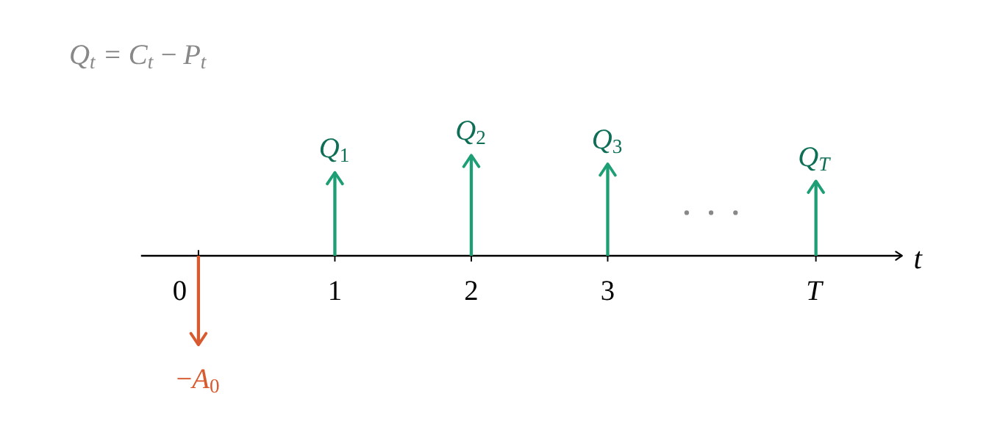
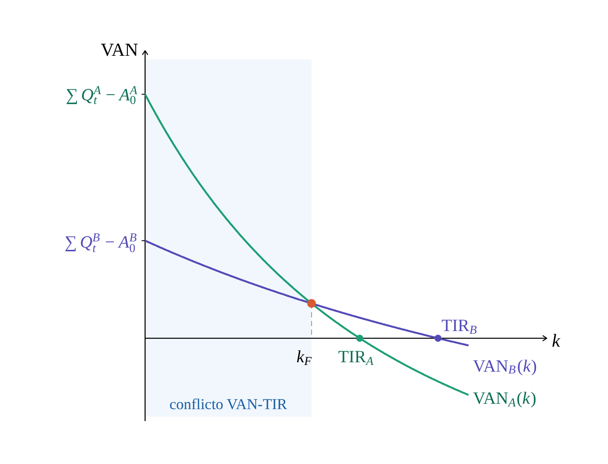
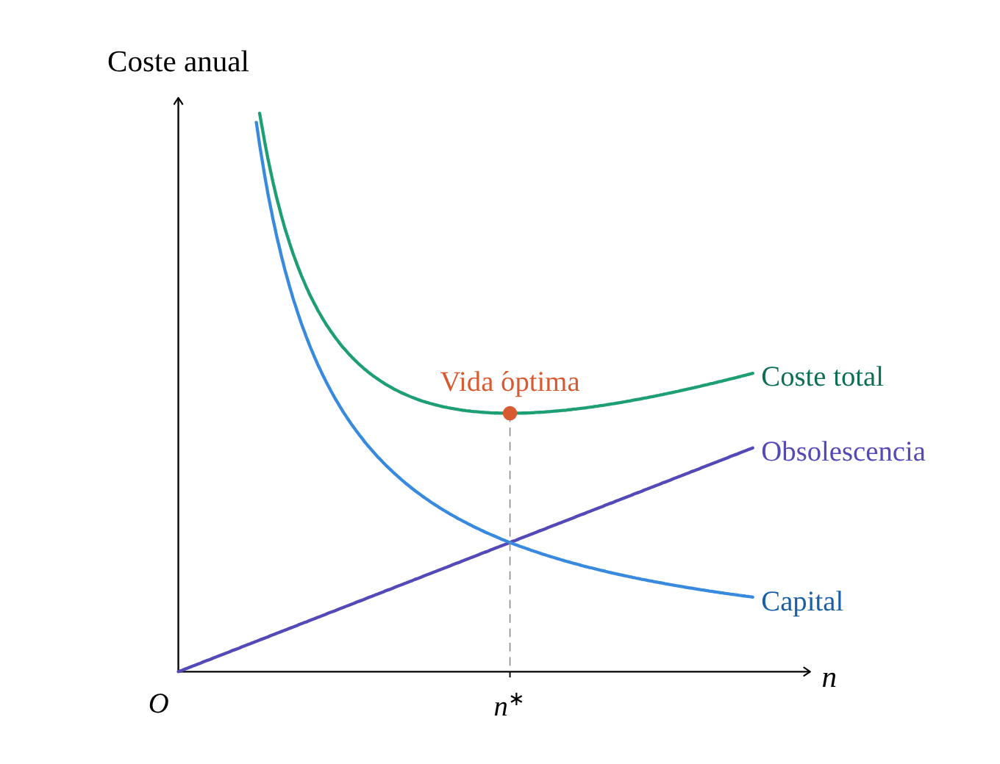
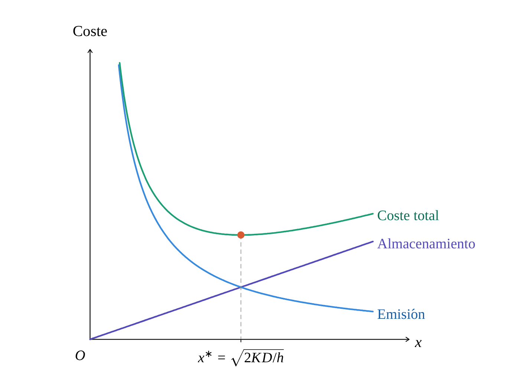

## Introducción

::: {.callout-note appearance="simple" icon=false}

:::

Las **decisiones de inversión**, que responden a la primera pregunta de Solomon, consisten en comprometer recursos financieros en la adquisición de activos con la expectativa de obtener rendimientos futuros. Pocas decisiones condicionan tanto el porvenir de la empresa, porque estas inmovilizan recursos durante largos periodos, a menudo de forma difícilmente reversible, y fijan los activos de cuyos flujos dependerá la retribución de accionistas y acreedores.

Toda inversión puede describirse como una corriente de **flujos de caja**, con un desembolso inicial y unos cobros y pagos posteriores, que se juzga por su **rentabilidad** y por su **riesgo**. El criterio de referencia es el **valor actual neto** (VAN), que descuenta esos flujos al **coste del capital**, la rentabilidad mínima que exigen quienes financian la empresa. Su fundamento es el teorema de la separación de Fisher (1930), que justifica la maximización del valor como criterio único de decisión. Junto al VAN, la **tasa interna de rentabilidad** (TIR) y el plazo de recuperación siguen muy extendidos en la práctica.

Los criterios clásicos tratan la inversión como una decisión de ahora o nunca. Frente a ellos, la teoría de las **opciones reales** (Myers, 1977; Dixit y Pindyck, 1994) añade el valor de la flexibilidad, es decir, de la posibilidad de esperar, ampliar o abandonar un proyecto, que cobra importancia cuando la inversión es irreversible y el futuro incierto. En la inversión financiera, la teoría de carteras de Markowitz (1952) y los modelos de valoración de activos permiten medir qué parte del riesgo remunera el mercado y, con ello, estimar el coste del capital que sirve de tasa de descuento a los proyectos.

Las decisiones de cada empresa tienen, además, una dimensión agregada, porque de ellas depende la inversión privada, el componente más volátil de la demanda. El Informe Draghi (2024) estimó que la UE necesita entre 750.000 y 800.000 millones de euros anuales de inversión adicional, entre el 4,4 % y el 4,7 % de su PIB de 2023, y advirtió de que el sector privado difícilmente podrá financiar la mayor parte sin apoyo público.

El objetivo del tema es triple:

- *Fundamentos*: describir la inversión por sus flujos de caja, su rentabilidad y su riesgo.

- *Criterios de valoración*: exponer cómo se valoran y se ordenan los proyectos.

- *Inversión financiera y coste del capital*: presentar la selección de carteras y la valoración de activos y su enlace con el coste del capital.

## 1. Fundamentos

Antes de valorar un proyecto hay que precisar qué se entiende por inversión, cómo se describe mediante sus flujos de caja y con qué medidas se juzgan su rentabilidad y su riesgo.

### 1.1. Concepto de inversión

Siguiendo a Andrés Suárez, la inversión, que constituye una adición al *stock* de capital, puede entenderse desde, al menos, tres puntos de vista:

- *En sentido jurídico*: adquisición de capital, entendido este como todo aquello que puede ser objeto de propiedad de personas físicas y jurídicas.

- *En sentido financiero*: adquisición de capital, entendido como el conjunto de valores financieros que sirven para obtener una rentabilidad.

- *En sentido económico*: adquisición de capital, entendido como el conjunto de bienes que sirven para producir otros bienes.

Además, Joel Dean señala que la inversión puede entenderse en un sentido funcional-empresarial, lo que da lugar a varios subtipos:

- *De renovación o reemplazo*: dirigida a mantener la capacidad productiva de la empresa.

- *De expansión*: dirigida a ampliar dicha capacidad.

- *De innovación o modernización*: dirigida a mejorar productos o procesos.

- *Estratégica*: dirigida al control de recursos y a la reducción del riesgo.

Finalmente, la inversión puede clasificarse según su horizonte temporal (a corto o a largo plazo), su relación de sustituibilidad (inversiones complementarias, sustitutivas o independientes) o su objeto (p. ej. activos tangibles frente a intangibles).

### 1.2. Inversión como corriente de flujos de caja

Para valorarla, la inversión se describe por su corriente de flujos de caja, cuyo signo sirve además para clasificar las inversiones.

#### 1.2.1. Concepto

Una de las definiciones más populares se debe a Erich Schneider (1944), según la cual toda inversión se define por su corriente de cobros y pagos. La corriente se compone de un desembolso inicial en un momento del tiempo, $-A_0$, y de los flujos netos de caja, $Q_t = C_t - P_t$ ($t = 1, \ldots, T$), generados a lo largo de un periodo. Este concepto recuerda a la idea de **cuasirrenta** (Marshall, 1890), la renta temporal que obtiene un factor de producción por encima de su coste de oportunidad.

Desde un punto de vista contable, el flujo de caja bruto puede computarse como:

$$\text{FCB}_t = \text{BAIT}_t - T_{\text{IS},t} + \text{Am}_t$$

donde $\text{FCB}$ es el flujo de caja bruto (*cash flow*), $\text{BAIT}_t$ el beneficio antes de intereses e impuestos, $T_{\text{IS},t}$ el impuesto sobre sociedades calculado sobre el resultado de explotación (es decir, sin escudo fiscal de la deuda) y $\text{Am}_t$ las dotaciones a la amortización (gasto de explotación que no supone salida de caja).

El flujo de caja bruto no debe confundirse con el **flujo de caja libre** (*free cash flow*), que es la corriente de fondos disponible para todos los inversores o solo para los accionistas. En el primer caso se habla de flujo de caja libre de la empresa, que omite los gastos financieros, y en el segundo, de flujo de caja libre del accionista, que incorpora los ajustes financieros. El flujo de caja libre de la empresa se obtiene deduciendo la inversión bruta del periodo:

$$\text{FCL}_t = \text{FCB}_t - \text{IB}_t, \qquad \text{IB}_t = \text{CAPEX}_t + \Delta \text{NOF}_t$$

donde $\text{IB}_t$ es la inversión bruta, que comprende el **CAPEX** (*capital expenditure*, inversión en la compra, el mantenimiento o la mejora del activo no corriente) y la variación de las **necesidades operativas de fondos** ($\Delta \text{NOF}$). Esta última es la inversión adicional en el circulante operativo (existencias más deudores comerciales menos financiación espontánea de proveedores) que exige el crecimiento de la actividad[^b02-1].

Para valorar un proyecto no basta con conocer sus flujos, sino que hay que delimitar los **flujos relevantes**, es decir, los flujos incrementales después de impuestos que la aceptación del proyecto añade a los de la empresa o le resta. Por un lado, se excluyen los costes hundidos, como un estudio de mercado ya pagado, porque no dependen de la decisión. Por otro lado, se incluyen los costes de oportunidad de los recursos de la empresa que el proyecto ocupa, como un terreno que podría venderse, y sus efectos inducidos sobre otras actividades, como la pérdida de ventas de un producto existente. Finalmente, se omiten los flujos de la financiación (intereses y devoluciones de principal), porque su coste ya lo recoge la tasa de descuento y restarlos lo contaría dos veces.

#### 1.2.2. Tipos de inversiones según sus flujos de caja

Atendiendo al signo de la corriente de flujos, se distinguen:

- *Inversiones simples*: presentan un único cambio de signo, es decir, al desembolso inicial le siguen flujos netos de caja no negativos ($Q_t \geq 0 \; \forall t$), y por ello su tasa interna de rentabilidad es única.

- *Inversiones no simples*: presentan más de un cambio de signo (alternan flujos positivos y negativos). A su vez se subdividen en:

    - *Puras*: aquellas en las que, a la tasa de retorno, el saldo financiero del proyecto es siempre deudor (el proyecto adeuda fondos a la empresa, que es siempre prestamista neta de aquel). De ahí que admitan una única tasa de retorno con sentido económico, independiente del tipo de reinversión o financiación.

    - *Mixtas*: aquellas en las que el saldo del proyecto se vuelve acreedor en algún momento (la empresa pasa a ser prestataria del proyecto). En ellas la tasa interna de rentabilidad puede no ser única ni tener significado económico, por lo que su rentabilidad depende también del tipo de reinversión o financiación[^b02-2].

Gráficamente, sobre el eje del tiempo (figura -@fig-b021-flujos-caja), una inversión simple se representa con una flecha hacia abajo en $t = 0$, el desembolso inicial $-A_0$, seguida de flechas hacia arriba, los flujos netos $Q_1, Q_2, \ldots, Q_T$, con $Q_t = C_t - P_t$.

::: {#fig-b021-flujos-caja}

::: {.content-visible when-format="html"}
```{=html}
<div class="graph-frame">
<iframe src="../graphs/b021_Flujos_caja.html" style="height:340px" loading="lazy" title="fig-b021-flujos-caja"></iframe>
</div>
```
:::

::: {.content-visible unless-format="html"}

:::

Inversión como corriente de cobros y pagos (Schneider, 1944). La inversión comprende un desembolso inicial $-A_0$ y flujos netos $Q_t = C_t - P_t$. Con un único cambio de signo, es una inversión simple.
:::

### 1.3. Rentabilidad y riesgo

Descrita la inversión por sus flujos, quedan por medir los dos rasgos que la caracterizan, su rentabilidad y su riesgo, del que depende la tasa a la que se descuentan esos flujos.

::: {.callout-note appearance="simple" icon=false}
El análisis económico-financiero, con las ratios de rentabilidad, riesgo, solvencia y equilibrio de balance, se desarrolla en el tema [B01](b01-estados-ratios.qmd), apartado 3. Aquí se recapitulan los conceptos en la medida en que condicionan la decisión de inversión.
:::

#### 1.3.1. Rentabilidad

La rentabilidad de una inversión admite tres formas complementarias de medición, dos contables, sobre beneficios y sobre flujos de caja, y una matemático-financiera, basada en el rendimiento de los títulos.

**Rentabilidad contable sobre beneficios**: se mide con las ratios $\text{ROA}$ (rentabilidad económica) y $\text{ROE}$ (rentabilidad financiera), con su descomposición de DuPont y el factor de apalancamiento financiero.

La *rentabilidad económica* relaciona el resultado de la actividad con el activo total empleado, al margen de cómo se financie este:

$$\text{ROA} = \frac{\text{BAIT}}{A} = \frac{\text{BAIT}}{V} \cdot \frac{V}{A} = \mu_{\text{operativo}} \cdot \frac{V}{A}$$

donde $\text{BAIT}$ es el beneficio antes de intereses e impuestos, $V$ la cifra de negocios y $A$ el activo total. Al prescindir de la estructura financiera, la rentabilidad económica permite comparar la eficiencia de empresas con distinto grado de endeudamiento, y su descomposición muestra que puede mejorarse elevando el margen o la rotación.

La *rentabilidad financiera* relaciona el beneficio neto con los fondos propios e incorpora, a diferencia de la anterior, la estructura financiera:

$$\text{ROE} = \frac{\text{BN}}{E} = \frac{\text{BN}}{V} \cdot \frac{V}{A} \cdot \frac{A}{E} = \mu_{\text{neto}} \cdot \frac{V}{A} \cdot \frac{A}{E}$$

Esta descomposición de DuPont ampliada identifica como palancas de gestión el margen neto (política de precios y control de costes), la rotación (eficiencia en el uso del activo) y el multiplicador del patrimonio ($A/E$), que recoge el endeudamiento. Una empresa puede alcanzar una $\text{ROE}$ elevada por cualquiera de las tres vías, de modo que la cifra agregada no informa por sí sola de la calidad de la gestión.

Prescindiendo del efecto impositivo y suponiendo que todo el pasivo es deuda financiera ($A = D_f + E$), el *apalancamiento financiero* conecta formalmente ambas rentabilidades:

$$\text{ROE} = \text{ROA} + (\text{ROA} - k_a)\,L, \qquad L = \frac{D_f}{E}$$

donde $k_a$ es el coste de la deuda financiera y $L$ la ratio de apalancamiento. Se distinguen tres casos:

- *$\text{ROA} > k_a$*: el endeudamiento eleva la rentabilidad del accionista.

- *$\text{ROA} < k_a$*: el endeudamiento la deteriora.

- *$\text{ROA} = k_a$*: la estructura financiera resulta neutral.

Las tres palancas de gestión explican patrones sectoriales característicos:

- *Distribución minorista*: opera con márgenes estrechos y rotación elevada.

- *Marcas de lujo*: exhiben el patrón inverso.

- *Utilities e industria pesada*: intensivas en capital, presentan rotaciones y $\text{ROA}$ reducidas aunque estables.

- *Banca*: sustenta su $\text{ROE}$ en un apalancamiento muy elevado.

- *Tecnológicas ligeras en activos*: combinan márgenes amplios con escaso activo, lo que se traduce en $\text{ROA}$ altas.

**Rentabilidad contable sobre flujos de caja**: las versiones de las ratios anteriores en términos de flujo de caja (FC-ROA, FC-ROE, FC-ROI), que sustituyen el beneficio contable por el flujo de caja (FC), y la ratio FC/CAPEX, que mide la capacidad de la empresa para autofinanciar su inversión.

**Rentabilidad matemático-financiera**: se mide con el rendimiento de un título, $R_i = (\text{DIV}_{i,t+1} + P_{i,t+1} - P_{i,t})/P_{i,t}$, su valor esperado, $R^e_i = \sum_s p_s R_{i,s}$, y el rendimiento esperado de una cartera, $R^e_c = \sum w_i R^e_i$.

#### 1.3.2. Riesgo

El **riesgo** de una inversión es la variabilidad de su resultado, y admite una descomposición paralela a la de la rentabilidad, según proceda de la actividad productiva o de la forma de financiarla.

**Riesgo económico o de negocio**: mide la inestabilidad de la rentabilidad económica derivada de la propia actividad, con independencia de la estructura financiera, y se aproxima por $\sigma_{\text{ROA}} = \sigma_{\text{BAIT}}/A$.

Depende de la volatilidad de la demanda del sector y de la estructura de costes, pues cuanto mayor sea la proporción de costes fijos, más amplificará el resultado operativo cualquier variación de las ventas.

Esa amplificación se cuantifica mediante el *grado de apalancamiento operativo*, $\text{GAO} = (\Delta \text{BAIT}/\text{BAIT})/(\Delta V/V)$, cuya referencia es la unidad, y cuanto más la supere el GAO, mayor será el riesgo económico.

A ello se añade el *punto muerto*, $x_{\text{pm}} = \text{CF}/(p - c_v)$ (con $\text{CF}$ los costes fijos, $p$ el precio y $c_v$ el coste variable unitario), es decir, el nivel de ventas a partir del cual el resultado operativo se vuelve positivo.

**Riesgo financiero**: mide la variabilidad adicional que la estructura de financiación añade a la anterior, $\sigma_{\text{ROE}} = \sigma_{\text{ROA}} \cdot (1 + L)$, de modo que una empresa sin deuda presenta $\sigma_{\text{ROE}} = \sigma_{\text{ROA}}$ y todo endeudamiento amplifica el riesgo económico en proporción a $L$.

Su medida de sensibilidad es el *grado de apalancamiento financiero*, $\text{GAF} = \text{BAIT}/\text{BAT}$, donde $\text{BAT}$ es el beneficio antes de impuestos.

El producto de ambos, $\text{GAT} = \text{GAO} \cdot \text{GAF}$, recoge la sensibilidad del beneficio neto ante variaciones de las ventas y revela que la empresa dispone de un margen de sustitución entre ambos riesgos. Así, un sector con elevados costes fijos debería compensar su alto $\text{GAO}$ con un endeudamiento moderado, y a la inversa.

**Riesgo y tasa de descuento**: para el objeto de este tema, la relevancia del riesgo es que determina la tasa a la que se descuentan los flujos, pues el inversor exige un rendimiento tanto mayor cuanto más incierto sea el resultado esperado. Dos proyectos con idénticos flujos previstos pueden tener, por ello, valores actuales netos muy distintos. Ahora bien, el riesgo relevante no es el total del proyecto aislado, sino su contribución al riesgo de la cartera del inversor, cuestión que se examina en el apartado 3.

La medida estadística habitual del riesgo es la *varianza del rendimiento*, $\sigma_i^2 = \sum_s p_s (R_{i,s} - R^e_i)^2$ y, para una cartera, $\sigma_c^2 = \sum_i \sum_j w_i w_j \sigma_{ij}$.

### 1.4. Conclusiones

Cualquier inversión, sea cual sea el sentido en que se entienda o la función que cumpla en la empresa, se describe por una corriente de cobros y pagos, con un desembolso inicial y unos flujos netos posteriores. El flujo de caja libre, distinto del bruto, resta de este la inversión en activo no corriente y en necesidades operativas de fondos. El signo de la corriente condiciona ya los criterios, porque solo las inversiones simples y las no simples puras tienen una tasa de retorno única.

Descrito por sus flujos, el proyecto se juzga por su rentabilidad esperada y su riesgo. El riesgo económico, que depende de la estructura de costes, y el financiero, que añade el endeudamiento, admiten un margen de sustitución entre sí. En la valoración, el riesgo determina la tasa de descuento, el coste del capital, y el riesgo relevante es la contribución del proyecto al de la cartera del inversor (apartado 3). Sobre esta base común se construyen los criterios de valoración.

## 2. Criterios generales de valoración

La pregunta siguiente es cómo decidir qué proyectos aceptar, cuáles rechazar y cómo ordenarlos cuando compiten por recursos escasos. De ello se ocupan los criterios de valoración de inversiones, que comparan los flujos del proyecto con su coste a través del tiempo. En esta sección se presentan, en primer lugar, sus fundamentos teóricos (2.1), desde la teoría del interés hasta el nacimiento del *capital budgeting*. Después se exponen los criterios propiamente dichos (2.2), desde los métodos estáticos hasta los dinámicos (valor actual neto y tasa interna de rentabilidad), que constituyen el estándar actual. Por último, se tratan la incorporación del riesgo (2.3), la flexibilidad y las opciones reales (2.4) y otros criterios, según la liquidez del activo o para la inversión pública (2.5).

### 2.1. Fundamento teórico

Los criterios modernos de valoración de inversiones no surgieron de la nada, sino que condensan más de medio siglo de teoría del capital y del interés. Su genealogía puede ordenarse en tres hitos:

1. *Antecedentes*: la pregunta de fondo, por qué vale más una unidad monetaria hoy que mañana, la responde la teoría del interés.

    - *Böhm-Bawerk* (1884, 1889): en su teoría del capital y del interés, el autor austriaco fundamenta el tipo de interés en el mayor valor de los bienes presentes frente a los futuros (el *agio*). Atribuye ese mayor valor a tres causas: la mayor abundancia esperada de bienes en el futuro, la infravaloración sistemática de las necesidades futuras y la superioridad técnica de los bienes presentes, que permiten adoptar métodos de producción más indirectos y productivos. Por ello, posponer el consumo debe ser remunerado, idea sin la cual no hay descuento posible.

    - *Fisher* (1930): Irving Fisher formaliza esa intuición y la convierte en herramienta operativa. El valor de cualquier activo es el valor actual de su corriente de rentas futuras, descontadas al tipo de interés de mercado, y de ahí se deriva directamente el criterio del valor actual neto.

    - *Teorema de la separación* (Fisher, 1930): de la misma obra se sigue un resultado de alcance mayor. En presencia de un mercado de capitales perfecto en el que puede prestarse y endeudarse al mismo tipo, la decisión de inversión de la empresa es independiente de las preferencias de consumo de sus propietarios. Cualquiera que sea la impaciencia de cada accionista, todos coinciden en que la empresa debe aceptar los proyectos de valor actual neto positivo, pues es esa regla la que maximiza la riqueza de los accionistas. Cada uno ajustará después su perfil temporal de consumo prestando o endeudándose en el mercado. Por tanto, el teorema legitima la maximización del valor como criterio único de gestión y, con ella, el criterio del valor actual neto.

    - *Keynes* (1936): en la *Teoría general* introduce la eficiencia marginal del capital (EMK), el tipo de descuento al que la suma actualizada de los rendimientos previstos de un bien de capital iguala su precio de oferta. La EMK es el antecedente directo de la tasa interna de rentabilidad, y la inversión será rentable mientras la EMK supere el tipo de interés.

2. *Teoría de la inversión* (Schneider, 1944): a partir de estas ideas, Erich Schneider elabora el considerado primer estudio sistemático de la materia, que recoge los modelos de inversión más importantes hasta la fecha bajo el supuesto de previsión perfecta. La obra marca el comienzo de la teoría moderna de la inversión y consagra la definición del proyecto como corriente de cobros y pagos vista en el apartado 1.2.

3. *Capital Budgeting* (Joel Dean, 1951): finalmente, Joel Dean traslada la teoría a la práctica empresarial. Este autor es el primero en dar un tratamiento sistemático y conjunto a los problemas de inversión y financiación. Con ello, inaugura la disciplina del presupuesto de capital y populariza el uso de los flujos de caja descontados en la empresa. Desde entonces, la valoración de inversiones deja de ser un capítulo de la teoría económica para convertirse en el núcleo de las finanzas corporativas.

### 2.2. Métodos tradicionales

Los métodos tradicionales, estáticos (2.2.1) o dinámicos (2.2.2), valoran cada proyecto por separado. En cambio, cuando los fondos no alcanzan para todos los proyectos rentables, la elección pasa a ser conjunta y se resuelve con programación matemática (2.2.3).

#### 2.2.1. Métodos estáticos

Los **métodos estáticos** no tienen en cuenta el momento en que se producen los flujos (no descuentan), por lo que agregan cantidades heterogéneas, y su valor es sobre todo orientativo.

**Ratio coste-beneficio**: $\text{RCB} = \sum Q_t / A_0$. Criterio de aceptación: $\text{RCB} > 1$.

- *Conclusiones*:

    - *Aspectos positivos*: sencillez de cálculo e interpretación. Además, es útil como primera referencia y en operaciones apalancadas (LBO, *leveraged buyout*), donde sobrevive como el múltiplo sobre el capital invertido (MOIC) empleado en el capital riesgo.

    - *Limitaciones*: como todo método estático, ignora la distribución temporal de los flujos.

**Plazo de recuperación** (*payback*): mide el tiempo necesario para recuperar el desembolso inicial. Con flujos constantes, $\text{PB} = A_0/Q$, y con flujos variables, $\text{PB} = (n-1) + \left(A_0 - \sum_{t=1}^{n-1} Q_t\right)/Q_n$, donde $n$ es el primer año en que los flujos acumulados igualan o superan $A_0$.

- *Conclusiones*:

    - *Aspectos positivos*: es sencillo e intuitivo y prioriza la liquidez y la recuperación rápida, por lo que resulta útil en entornos de elevada incertidumbre o inestabilidad política.

    - *Limitaciones*: ignora los flujos posteriores al plazo de recuperación, no mide la rentabilidad y, en su versión simple, tampoco descuenta.

**Tasa de rendimiento contable**: se calcula como cociente entre el beneficio contable medio anual y la inversión (media o inicial).

- *Conclusiones*:

    - *Aspectos positivos*: utiliza datos contables directamente disponibles y es de cálculo inmediato.

    - *Limitaciones*: emplea el beneficio contable en lugar del flujo de caja, no descuenta y es sensible a los criterios contables (amortización, valoración).

#### 2.2.2. Métodos dinámicos

Los **métodos dinámicos** descuentan los flujos y, con ello, incorporan el valor temporal del dinero y homogeneizan cantidades de distintos periodos. Entre ellos están el valor actual neto y la tasa interna de rentabilidad, que constituyen el estándar actual.

**Valor actual neto** (VAN): $\text{VAN} = -A_0 + \sum_{t=1}^T Q_t/(1+k)^t$. Criterio de aceptación: $\text{VAN} > 0$.

- *Conclusiones*:

    - *Aspectos positivos*: tiene en cuenta los vencimientos y el valor temporal del dinero, y es un criterio de valor absoluto, coherente con el objetivo de maximización del valor y aditivo entre proyectos.

    - *Limitaciones*: según la interpretación tradicional, supone la reinversión de los flujos intermedios a la propia tasa $k$, supuesto discutido porque el VAN mide el valor de los flujos con independencia de su destino. Exige, además, estimar $k$, que es exógena, y, al medir valor absoluto, no informa de la rentabilidad por unidad invertida, que es lo relevante cuando el capital está racionado.

**Tasa interna de rentabilidad** (TIR): tasa de descuento que hace $\text{VAN} = 0$, concepto análogo a la eficiencia marginal del capital de Keynes. Criterio de aceptación: $\text{TIR} > k$.

- *Conclusiones*:

    - *Aspectos positivos*: expresa la rentabilidad en términos relativos (porcentaje), resultado intuitivo y de fácil comunicación.

    - *Limitaciones*: según la interpretación tradicional, supone la reinversión de los flujos a la propia TIR. Además, en las inversiones no simples mixtas puede haber múltiples TIR o ninguna real[^b02-5], y al jerarquizar proyectos puede entrar en conflicto con el VAN.

**Comparación VAN-TIR**: para las inversiones simples, los criterios de aceptación siempre coinciden. En la jerarquización, en cambio, pueden diferir si existe un *punto de Fisher* (la tasa de descuento que iguala los VAN de dos proyectos)[^b02-6]. Para las inversiones no simples puras, con tasa de retorno única (apartado 1.2.2), TIR y VAN coinciden en la aceptación, y en las mixtas conviene recurrir al VAN.

Gráficamente, la comparación VAN-TIR se representa en el plano tasa de descuento-VAN (figura -@fig-b022-van-fisher):

1. *Perfil del VAN del proyecto A*, $\text{VAN}_A(k)$: recoge el VAN del proyecto para cada tasa de descuento. Decrece con ella, porque una tasa mayor reduce el valor actual de los flujos futuros. Parte de $\sum Q_t^A - A_0^A$ en $k = 0$ y corta el eje horizontal en $\text{TIR}_A$, la tasa que anula el VAN.

2. *Perfil del VAN del proyecto B*, $\text{VAN}_B(k)$: tiene la misma forma, con ordenada en el origen $\sum Q_t^B - A_0^B$ y corte en $\text{TIR}_B$.

3. *Punto de Fisher*: los perfiles se cortan en la tasa $k_F$, a la que ambos proyectos tienen el mismo VAN.

    - *Derecha del punto de Fisher*: ambos criterios ordenan igual los proyectos.

    - *Izquierda del punto de Fisher* (zona de conflicto VAN-TIR): los criterios discrepan, y debe preferirse el VAN por su coherencia con la creación de valor.

::: {#fig-b022-van-fisher}

::: {.content-visible when-format="html"}
```{=html}
<div class="graph-frame">
<iframe src="../graphs/b022_VAN_Fisher.html" style="height:560px" loading="lazy" title="fig-b022-van-fisher"></iframe>
</div>
```
:::

::: {.content-visible unless-format="html"}

:::

Perfil del VAN en función de la tasa de descuento. El gráfico señala la TIR y la intersección de Fisher entre dos proyectos mutuamente excluyentes, cada uno con su propio desembolso inicial ($A_0^A$, $A_0^B$).
:::

**Índice de rentabilidad** (IR): se calcula como cociente entre el valor actual de los flujos y el desembolso inicial, $\text{IR} = (\sum Q_t/(1+k)^t)/A_0$ (equivalentemente, $1 + \text{VAN}/A_0$). Criterio de aceptación: $\text{IR} > 1$.

- *Conclusiones*:

    - *Aspectos positivos*: expresa el valor actual de los flujos por unidad monetaria invertida, por lo que es especialmente útil en situaciones de racionamiento de capital.

    - *Limitaciones*: al ser una medida relativa, puede contradecir la jerarquización del VAN cuando los proyectos tienen escalas muy distintas.

**Plazo de recuperación descontado** (*discounted payback*): se calcula como el *payback* simple, pero sobre los flujos descontados.

- *Conclusiones*:

    - *Aspectos positivos*: corrige el principal defecto del *payback* simple al incorporar el valor temporal del dinero, manteniendo el foco en la liquidez.

    - *Limitaciones*: sigue ignorando los flujos posteriores al plazo de recuperación.

**TIR modificada** (TIRM): tasa que iguala el valor capitalizado de los flujos positivos (a una tasa de reinversión explícita, habitualmente $k$) con el valor actual de los negativos, $\text{TIRM} = \left(\text{VF}^+ / \text{VA}^-\right)^{1/T} - 1$. Criterio de aceptación: $\text{TIRM} > k$.

- *Conclusiones*:

    - *Aspectos positivos*: corrige las dos grandes debilidades de la TIR, pues sustituye el supuesto de reinversión a la propia TIR por una tasa realista y es siempre única, incluso en inversiones mixtas.

    - *Limitaciones*: exige elegir explícitamente la tasa de reinversión, y su resultado depende de esa elección.

**Homogeneización de proyectos**: la comparación entre proyectos solo es legítima si estos son homogéneos. Cuando no lo son, caben dos situaciones:

- *Distinta vida útil*: los proyectos deben homogeneizarse mediante la cadena de reemplazo (repetir cada proyecto hasta un horizonte común) o, de forma equivalente, mediante el coste (o beneficio) anual equivalente, que convierte el VAN en una anualidad comparable.

- *Distinta escala*: si no hay racionamiento de capital, prevalece el VAN, y si lo hay, la contradicción entre VAN e IR se resuelve como se expone en el apartado 2.2.3.

**Inflación**: los flujos y la tasa de descuento deben expresarse en los mismos términos. Los flujos proyectados en términos nominales se descuentan a la tasa nominal, y los proyectados a precios constantes, a la tasa real, ligadas ambas por la relación de Fisher:

$$\begin{aligned}
\text{VAN} &= -A_0 + \sum_{t=1}^T \frac{Q_t^{\text{nom}}}{(1+k^{\text{nom}})^t} = -A_0 + \sum_{t=1}^T \frac{Q_t^{\text{real}}}{(1+k^{\text{real}})^t} \\
1 + k^{\text{nom}} &= (1+k^{\text{real}})(1+\pi), \qquad Q_t^{\text{nom}} = Q_t^{\text{real}}(1+\pi)^t
\end{aligned}$$

donde $\pi$ es la tasa de inflación esperada. Mezclar ambos términos sesga la decisión, pues descontar flujos reales a la tasa nominal infravalora el proyecto y descontar flujos nominales a la tasa real lo sobrevalora. La proyección a precios constantes supone, además, que todos los flujos crecen con la inflación. Las amortizaciones fiscales no cumplen esa condición, porque se calculan sobre el coste histórico, y su ahorro fiscal pierde valor real con la inflación. Por ello conviene proyectarlas en términos nominales y descontarlas a la tasa nominal.

::: {.callout-tip collapse="true" appearance="simple" title="Ejemplo: VAN, TIR y punto de Fisher"}
Dos proyectos exigen 100 € hoy. El A rinde 20 € dentro de un año y 120 € dentro de dos, y el B, 100 € y 30 €. El coste del capital es del 10 %.

- *VAN*: el de A es $-100 + 20/1{,}1 + 120/1{,}1^2 \approx 17{,}36$ € y el de B, $-100 + 100/1{,}1 + 30/1{,}1^2 \approx 15{,}70$ €. Los dos son aceptables y el VAN prefiere A.

- *TIR*: la de A es del 20 % y la de B, del 24,2 %. La TIR prefiere B, que devuelve antes el dinero.

- *Punto de Fisher*: los VAN se igualan al 12,5 %, la TIR de la diferencia de flujos, que es de $-80$ € en el año 1 y $+90$ € en el año 2. Por debajo de esa tasa manda A y, por encima, B. Con un coste del capital del 10 % prevalece el VAN, por su coherencia con la creación de valor.
:::

#### 2.2.3. Selección de proyectos con racionamiento de capital

**Origen**: Lorie y Savage (1955) plantearon cómo elegir entre proyectos cuando los fondos están limitados en uno o varios periodos, y Weingartner (1963) formuló el problema como un programa matemático.

**Idea**: con racionamiento, los fondos no alcanzan para todos los proyectos con VAN positivo, por lo que hay que elegir la combinación que maximiza el VAN total sin exceder el presupuesto de cada periodo.

**Supuestos**:

- *Entorno*: proyectos independientes e indivisibles, con desembolsos y VAN conocidos, y con una rentabilidad exigida $k$ exógena.

- *Restricciones*: un límite fijo de fondos en cada periodo.

**Planteamiento**: la empresa elige qué proyectos acepta para maximizar el VAN total sujeto a los presupuestos de cada periodo:

$$\max_{x_1, \ldots, x_J} \; \sum_{j=1}^{J} \text{VAN}_j\, x_j \quad \text{s.a.:} \begin{cases} \sum_{j=1}^{J} A_{jt}\, x_j \leq B_t \;\; (t = 0, 1, \ldots, T) \\ x_j \in \{0, 1\} \end{cases}$$

donde $x_j$ vale $1$ si se acepta el proyecto $j$ y $0$ si se rechaza, $\text{VAN}_j$ es su valor actual neto a la tasa $k$, $A_{jt}$ el desembolso que exige en el periodo $t$, $B_t$ el presupuesto disponible en ese periodo, $J$ el número de proyectos y $T$ el último periodo con restricción.

**CPO**: el programa relajado, que admite $0 \leq x_j \leq 1$, es lineal. Si $\lambda_t \geq 0$ es el *precio sombra* del presupuesto del periodo $t$, las condiciones de Kuhn-Tucker (tema [A08](a08-consumidor.qmd), apartado 1.4.1) implican:

$$x_j = 1 \;\; \text{si} \;\; \text{VAN}_j > \sum_{t=0}^{T} \lambda_t A_{jt}, \qquad x_j = 0 \;\; \text{si} \;\; \text{VAN}_j < \sum_{t=0}^{T} \lambda_t A_{jt}$$

donde $\lambda_t$ mide cuánto aumentaría el VAN total con un euro más de presupuesto en $t$ y es nulo si ese presupuesto no se agota. Un proyecto se acepta si su VAN supera el coste de oportunidad de los fondos que absorbe, valorados a los precios sombra de cada periodo. En particular, con un único presupuesto, en $t = 0$, la condición es $\text{VAN}_j/A_{j0} > \lambda_0$, de modo que se ordenan los proyectos por su índice de rentabilidad y se aceptan hasta agotar los fondos.

**CSO**: el programa relajado es lineal, por lo que las condiciones de Kuhn-Tucker son suficientes[^b02-17]. Sin embargo, con indivisibilidades, la solución relajada es solo una cota superior y el óptimo exige programación entera.

**Solución**: con fondos limitados, el VAN deja de bastar como criterio de aceptación y debe compararse con el coste de oportunidad de los fondos, medido por sus precios sombra.

**Conclusiones**:

- *Aspectos positivos*: hace explícito el coste de oportunidad del capital escaso y admite como restricciones lineales las relaciones entre proyectos, como la exclusión mutua ($x_A + x_B \leq 1$) o la dependencia ($x_B \leq x_A$).

- *Limitaciones*: el índice de rentabilidad falla con indivisibilidades, que pueden dejar fondos ociosos, y con varios presupuestos, porque los precios sombra solo se conocen al resolver el programa. Además, Baumol y Quandt (1965) señalaron que, con *racionamiento duro*, impuesto por el mercado, el coste de oportunidad de los fondos lo dan los precios sombra y no la tasa $k$, que deja de ser exógena. Propusieron, por ello, maximizar la utilidad de las retiradas de fondos de los propietarios. En cambio, con *racionamiento blando*, un límite que fija la dirección para controlar a sus divisiones, $k$ sigue siendo la tasa de mercado y el presupuesto no debería impedir proyectos con VAN positivo.

### 2.3. Criterios de decisión con información imperfecta

En condiciones de incertidumbre, ni los flujos de caja ni la tasa de descuento se conocen con certeza. Caben entonces dos estrategias complementarias, (i) ajustar la valoración para incorporar el riesgo dentro del propio VAN, o (ii) analizar el riesgo de forma explícita, describiendo cómo se distribuyen los resultados posibles.

#### 2.3.1. Ajustes por riesgo

Los ajustes por riesgo, primera de las dos estrategias, incorporan el riesgo dentro del propio VAN. Para ello penalizan la tasa de descuento (prima de riesgo) o los flujos (equivalente cierto).

**Prima de riesgo**: se añade una prima $\rho_r$ a la tasa de descuento, de modo que los proyectos más arriesgados se valoran con un tipo mayor:

$$\text{VAN} = -A_0 + \sum_{t=1}^{T} \frac{Q_t}{(1+r_f+\rho_r)^t}$$

Este método es el más extendido, y la prima suele derivarse del modelo de valoración de activos de capital (CAPM), a través del coste del capital.

- *Conclusiones*:

    - *Aspectos positivos*: es sencillo y coherente con la práctica, pues resume el riesgo en un único tipo de descuento que se obtiene del coste del capital y permite comparar proyectos con el mismo criterio.

    - *Limitaciones*: al componerse la prima año tras año, supone implícitamente que el riesgo crece geométricamente con el horizonte temporal, lo que no siempre es realista.

**Equivalente cierto**: en lugar de penalizar la tasa, se reducen los flujos multiplicándolos por un coeficiente $\alpha_t \in [0, 1]$ (inversamente relacionado con el riesgo) y se descuentan al tipo sin riesgo $r_f$:

$$\text{VAN} = -A_0 + \sum_{t=1}^{T} \frac{\alpha_t\, Q_t}{(1+r_f)^t}$$

Ambos enfoques coinciden cuando $\alpha_t = \left[(1+r_f)/(1+r_f+\rho_r)\right]^t$, expresión que muestra que la prima de riesgo equivale a suponer un $\alpha_t$ decreciente con $t$.

- *Conclusiones*:

    - *Aspectos positivos*: separa la preferencia temporal (recogida en $r_f$) del riesgo (recogido en $\alpha_t$), y permite que este varíe libremente a lo largo del tiempo.

    - *Limitaciones*: los coeficientes $\alpha_t$ son subjetivos y difíciles de estimar, porque dependen de la aversión al riesgo del decisor y no se observan en el mercado. Por eso el equivalente cierto se usa menos que la prima de riesgo.

#### 2.3.2. Análisis explícito del riesgo

En vez de resumir el riesgo en un único número, los métodos de análisis explícito describen el abanico de resultados posibles:

- *Análisis de sensibilidad*: recalcula el VAN variando un supuesto cada vez (p. ej. ±10 % en ventas o en costes) para identificar las variables críticas. Es sencillo, pero ignora las correlaciones entre variables.

- *Análisis de escenarios*: combina varios supuestos en escenarios coherentes (optimista, central y pesimista), superando la principal limitación del análisis de sensibilidad.

- *Simulación de Monte Carlo* (Hertz, 1964): asigna distribuciones de probabilidad a las variables de entrada y genera miles de iteraciones y obtiene así la distribución completa del VAN (media, varianza y probabilidad de que sea negativo).

- *Árboles de decisión* (Magee, 1964): representan decisiones secuenciales y los nudos de azar asociados, y permiten valorar la flexibilidad de la dirección, de donde surge el enfoque de las opciones reales.

### 2.4. Flexibilidad y opciones reales (Myers, 1977; Dixit y Pindyck, 1994)

**Origen**: Stewart Myers (1977) acuñó el término *opciones reales* para designar el valor de la flexibilidad, y Avinash Dixit y Robert Pindyck (1994) desarrollaron su formalización.

**Idea**: los criterios anteriores suponen implícitamente que el desembolso es reversible o, si no lo es, que la decisión de invertir es de tipo ahora o nunca, y que la dirección adopta una actitud pasiva una vez ejecutado el proyecto. Cuando esos supuestos no se cumplen, el valor actual neto infravalora sistemáticamente el proyecto, pues ignora el valor de la flexibilidad.

Tras las ideas principales (2.4.1), se cuantifica la más relevante de las opciones reales, la de diferir o esperar (2.4.2), y se valora el alcance del enfoque (2.4.3).

#### 2.4.1. Principales ideas

**Razonamiento**: la analogía con las opciones financieras es directa, porque la empresa que dispone de una oportunidad de inversión posee, en realidad, una opción de compra sobre los flujos futuros del proyecto, cuyo precio de ejercicio es el desembolso requerido. De ello se derivan dos consecuencias.

La primera es que el valor de esa opción crece con la incertidumbre, de modo que, a diferencia del análisis convencional, un entorno más volátil puede aumentar el valor del proyecto en lugar de reducirlo. La segunda es que ejercer la opción destruye su valor de espera, por lo que la regla correcta no es invertir cuando el VAN es positivo, sino cuando supera el valor de la opción de esperar:

$$\text{VAN}_{\text{ampliado}} = \text{VAN}_{\text{tradicional}} + \text{valor de las opciones reales}$$

Sobre la base de estas ideas se distinguen cinco modalidades principales:

1. *Opción de diferir*: permite esperar a que se resuelva la incertidumbre antes de comprometer recursos. Esta opción es la más relevante y explica por qué numerosas empresas posponen proyectos con VAN positivo, conducta que el análisis convencional calificaría de irracional.

2. *Opción de ampliar o de crecimiento*: un proyecto de rentabilidad modesta puede justificarse si da acceso a inversiones posteriores, como sucede con la entrada en un mercado nuevo o con el gasto en investigación y desarrollo.

3. *Opción de abandono*: la posibilidad de liquidar el proyecto y recuperar su valor residual actúa como una opción de venta que acota la pérdida máxima.

4. *Opción de contraer o de escalonar*: la opción de contraer permite reducir la escala de operación si las condiciones empeoran. La de escalonar (*time-to-build*) fracciona la inversión en etapas condicionadas y permite abandonar tras cada una de ellas. Esta última es característica de los sectores farmacéutico y de exploración de recursos naturales.

5. *Opción de intercambio*: la flexibilidad para alternar entre insumos, productos o localizaciones tiene valor cuando sus precios relativos son volátiles.

#### 2.4.2. El valor de esperar

McDonald y Siegel (1986) calcularon el momento óptimo de una inversión irreversible cuyo valor sigue un proceso estocástico, y Dixit y Pindyck (1994, cap. 2) divulgaron la intuición con un ejemplo binomial. Si la inversión es irreversible y puede aplazarse, la regla correcta compara invertir hoy con la mejor estrategia de espera, no con no invertir nunca.

**Razonamiento**: en el ejemplo siguiente, un proyecto con VAN positivo vale más si se aplaza un año, porque la espera permite no invertir si las noticias son malas.

::: {.callout-tip collapse="true" appearance="simple" title="Ejemplo: el valor de esperar en un árbol binomial"}
Una fábrica cuesta 1600 €, se construye al instante y produce una unidad al año a perpetuidad, sin costes de explotación. El precio es hoy de 200 €. Dentro de un año subirá a 300 € o bajará a 100 €, con igual probabilidad, y no volverá a cambiar. El tipo de interés es del 10 %.

- *Invertir hoy*: el precio esperado es siempre 200 €, cuyo valor actual a perpetuidad, empezando hoy, es $200 \cdot 1{,}1/0{,}1 = 2200$ €, de modo que el VAN es $2200 - 1600 = 600$ €.

- *Esperar un año*: solo se invierte si el precio sube. Los 300 € anuales desde el año 1 valen hoy $300/0{,}1 = 3000$ € y el desembolso aplazado, $1600/1{,}1 \approx 1455$ €, de modo que el VAN esperado es $\tfrac{1}{2}(3000 - 1455) \approx 773$ €.

- *Valor de la opción*: esperar vale $773 - 600 = 173$ € más, aunque el VAN de invertir hoy sea positivo.
:::

En tiempo continuo, si el valor actual de los flujos del proyecto, $\text{VA}$, sigue un movimiento browniano geométrico con volatilidad $\sigma$, la empresa invierte cuando

$$\text{VA} \geq \text{VA}^* = \frac{\varphi}{\varphi - 1}\,A_0 > A_0$$

donde $A_0$ es el desembolso, $\text{VA}^*$ el umbral de inversión y $\varphi > 1$ un parámetro que depende del tipo de interés sin riesgo, de la rentabilidad que el proyecto deja de generar durante la espera y de $\sigma$, y que disminuye al aumentar $\sigma$. El multiplicador $\varphi/(\varphi - 1)$ crece, así, con la incertidumbre. En cambio, sin incertidumbre ni crecimiento esperado de $\text{VA}$, $\varphi$ tiende a infinito y se recupera la regla del VAN ($\text{VA}^* = A_0$).

McDonald y Siegel encontraron que, con parámetros razonables, puede ser óptimo esperar hasta que el valor del proyecto duplique su coste. El resultado cuantifica el umbral de inversión con opción de espera del tema [A34](a34-demanda-inversion.qmd), apartado 3.1.2.

#### 2.4.3. Conclusiones

**Aspectos positivos**: el enfoque de las opciones reales reconcilia la teoría con la conducta empresarial observada, al explicar decisiones que el VAN convencional no justifica, y proporciona un marco riguroso para valorar la irreversibilidad y la flexibilidad. Su relevancia es máxima en los sectores intensivos en investigación, en la industria extractiva y en la inversión sujeta a incertidumbre regulatoria.

**Limitaciones**: la valoración descansa en supuestos exigentes, pues los modelos de opciones financieras presuponen un activo subyacente negociado y una volatilidad observable, condiciones que rara vez concurren en un proyecto real. Además, el enfoque puede emplearse para justificar cualquier proyecto, sin más que atribuir valor a opciones difícilmente verificables.

### 2.5. Otros criterios

Los criterios generales se completan con otros propios de ciertos ámbitos, unos según la liquidez del activo y otros para las inversiones públicas.

#### 2.5.1. Criterios según la liquidez del activo

**Valoración de inversiones en activo no corriente**: el problema central es la determinación de la vida óptima (económica) del equipo, que maximiza el VAN, frente a su vida útil (técnica).

- *En ausencia de progreso técnico* (modelo simple de renovación o retiro): la vida óptima es aquella que minimiza el coste medio anual equivalente del activo. Por ello, procede la renovación cuando el coste de mantener el equipo un año más supera el coste medio de un equipo nuevo.

- *En presencia de progreso técnico* (método del Machinery and Allied Products Institute o MAPI, Terborgh, 1949): la obsolescencia adelanta la renovación. El método fija la vida óptima como aquella que minimiza el coste total anualizado, suma de las cargas de obsolescencia y de las cargas del capital.

Gráficamente, la determinación de la vida óptima se representa en el plano vida del equipo-coste anual (figura -@fig-b023-mapi-vida-optima):

1. *Curva de obsolescencia*: recoge las cargas de obsolescencia, que crecen de forma lineal con la vida del equipo, $n$, porque cada año que se conserva aumenta su desventaja frente a los equipos nuevos que incorporan el progreso técnico.

2. *Curva de capital*: recoge las cargas del capital, que decrecen con $n$ de forma no lineal, porque el desembolso inicial se reparte entre más años de servicio.

3. *Curva de coste total*: suma de las dos anteriores, primero decreciente, mientras pesa más el reparto del desembolso, y después creciente, cuando pesa más la obsolescencia.

4. *Óptimo*: el mínimo del coste total fija la vida óptima, $n^*$.

::: {#fig-b023-mapi-vida-optima}

::: {.content-visible when-format="html"}
```{=html}
<div class="graph-frame">
<iframe src="../graphs/b023_MAPI_vida_optima.html" style="height:560px" loading="lazy" title="fig-b023-mapi-vida-optima"></iframe>
</div>
```
:::

::: {.content-visible unless-format="html"}

:::

Vida óptima de un equipo (método MAPI). El momento de sustitución minimiza el coste medio anual equivalente.
:::

**Valoración de inversiones en activo corriente o circulante**: se aplica la lógica de los modelos de inventario.

En la *inversión en existencias* (modelo de Harris-Wilson; Harris, 1913, difundido por Wilson, 1934), el lote económico de pedido minimiza el coste total (coste de emisión de pedidos más coste de almacenamiento), $x^* = \sqrt{2 K D / h}$. En la fórmula, $K$ es el coste por pedido, $D$ la demanda y $h$ el coste unitario de almacenamiento.

Gráficamente, la determinación del lote económico se representa en el plano lote de pedido-coste (figura -@fig-b024-wilson-lote-optimo):

1. *Curva de emisión*: recoge el coste de emisión de pedidos, $KD/x$, que decrece con el lote, $x$, porque un lote mayor exige menos pedidos.

2. *Curva de almacenamiento*: recoge el coste de almacenamiento, $hx/2$, que crece de forma lineal con el lote, porque las existencias medias son la mitad de este.

3. *Curva de coste total*: suma de las dos anteriores, primero decreciente, mientras pesa más el ahorro en pedidos, y después creciente, cuando pesa más el coste de almacenamiento.

4. *Óptimo*: el mínimo del coste total fija el lote económico, $x^*$.

::: {#fig-b024-wilson-lote-optimo}

::: {.content-visible when-format="html"}
```{=html}
<div class="graph-frame">
<iframe src="../graphs/b024_Wilson_lote_optimo.html" style="height:560px" loading="lazy" title="fig-b024-wilson-lote-optimo"></iframe>
</div>
```
:::

::: {.content-visible unless-format="html"}

:::

Lote óptimo de pedido (Wilson). El lote óptimo minimiza la suma de los costes de pedido y de almacenamiento.
:::

En la *inversión en tesorería*, el modelo de Baumol-Tobin (Baumol, 1952; Tobin, 1956) trata el dinero como un inventario para transacciones. La empresa arbitra entre el coste de conversión ($b\,Y/M$) y el coste de oportunidad de mantener saldos ($i\,M/2$, con $i$ el tipo de interés nominal). La retirada óptima es $M^* = \sqrt{2 b Y / i}$, y el saldo medio, $M^*/2$. De él se derivan unas elasticidades de la demanda de dinero de $0{,}5$ respecto a la renta y de $-0{,}5$ respecto al tipo de interés, la primera de las cuales revela economías de escala en la gestión de la tesorería[^b02-8].

#### 2.5.2. Criterios de inversiones públicas

Cuando el inversor es el sector público, el análisis se realiza en términos sociales, con dos tipos de criterios:

- *Análisis coste-beneficio (ACB)*: computa los costes y beneficios sociales del proyecto (no solo los financieros), valorándolos a precios sombra que corrigen las distorsiones del mercado e incorporando las externalidades y la disposición a pagar. Los flujos se descuentan a una tasa social de descuento y el proyecto se acepta si su VAN social es positivo.

- *Otros criterios*: el análisis coste-eficacia (cuando los beneficios son difíciles de monetizar), el análisis multicriterio y la evaluación de impacto.

### 2.6. Conclusiones

Los criterios descansan en la teoría del interés. De Fisher proceden el valor actual y, con el teorema de la separación, la maximización del valor como regla única, mientras que la eficiencia marginal del capital de Keynes anticipa la TIR. El VAN prevalece entre los métodos dinámicos porque es coherente con ese objetivo y aditivo. La TIR, en cambio, puede no ser única en las inversiones mixtas y discrepa del VAN al ordenar proyectos a la izquierda del punto de Fisher. Con capital racionado, el VAN de cada proyecto debe superar además el coste de oportunidad de los fondos que absorbe.

La incertidumbre se incorpora ajustando la tasa o los flujos, o describiendo el abanico de resultados, y los árboles de decisión conducen a las opciones reales. Con irreversibilidad y posibilidad de esperar, un VAN positivo deja de bastar, porque invertir extingue la opción de esperar. Todos estos criterios dan por conocida la tasa de descuento, que la sección 3 obtiene de la teoría de carteras, la valoración de activos y el coste del capital.

## 3. Inversión financiera y coste del capital

La última parte del tema pasa de la inversión real a la inversión financiera y al coste del capital. La teoría de selección de carteras y los métodos de valoración de activos dan paso, al final, al coste de las fuentes de financiación.

### 3.1. Teoría de selección de carteras

La teoría moderna de carteras parte del modelo media-varianza de Markowitz, que Tobin amplió al introducir un activo sin riesgo.

::: {.callout-note appearance="simple" icon=false}
Los modelos de selección de carteras y de valoración de activos se desarrollan en el tema [B23](b23-renta-variable.qmd), apartados 2 y 3.
:::

#### 3.1.1. Modelo media-varianza (Markowitz, 1952)

**Origen**: Harry Markowitz (1952) sentó las bases de la teoría moderna de carteras al formalizar cómo decide un inversor racional, que busca, para un riesgo dado, el mayor rendimiento esperado o, visto al revés, el menor riesgo con que lograr un rendimiento dado.

**Idea**: su aportación fue demostrar que el riesgo relevante de un título no es el suyo propio, sino su contribución al riesgo del conjunto de la cartera.

**Razonamiento**: la *frontera eficiente* se obtiene del programa $\max R^e_c = \sum w_i R^e_i$ sujeto a $\sigma_c^2 = \sum_i \sum_j w_i w_j \sigma_{ij} = \bar{\sigma}_c^2$, $\sum w_i = 1$ y $w_i \geq 0$, resuelto para cada nivel de riesgo $\bar{\sigma}_c^2$. Con dos títulos A y B, la forma del conjunto de carteras posibles (cuyo tramo superior es la frontera eficiente) en el plano $(\sigma_c, R^e_c)$ depende del coeficiente de correlación $\rho_{AB}$:

- *$\rho = 1$*: es una recta (la diversificación no reduce el riesgo).

- *$\rho = -1$*: es una cuña (el riesgo puede eliminarse por completo).

- *$-1 < \rho < 1$*: es una curva cóncava (ganancias parciales de diversificación).

La cartera óptima es el punto de tangencia entre la frontera eficiente y la curva de indiferencia más elevada alcanzable (figura -@fig-b025-markowitz-tangencia). Lo determinante para el riesgo de la cartera no es la varianza individual $\sigma_i^2$, sino la covarianza $\sigma_{ic}$ de cada título con la cartera[^b02-9].

::: {#fig-b025-markowitz-tangencia}

::: {.content-visible when-format="html"}
```{=html}
<div class="graph-frame">
<iframe src="../graphs/b025_Markowitz_tangencia.html" style="height:540px" loading="lazy" title="fig-b025-markowitz-tangencia"></iframe>
</div>
```
:::

::: {.content-visible unless-format="html"}

:::

Cartera óptima en el modelo de Markowitz (1952). En el plano $(\sigma_c, R^e_c)$, el inversor elige el punto 0, donde la curva de indiferencia más elevada a su alcance, $U_0$, es tangente a la frontera eficiente. El tramo inferior del conjunto de carteras, en trazo discontinuo, no es eficiente, y la curva $U_1$ no es alcanzable.
:::

**Conclusiones**:

- *Aspectos positivos*: fundó la teoría moderna de carteras (Nobel 1990), dio rigor matemático a la intuición de la diversificación y sigue siendo el pilar de la gestión de inversiones.

- *Limitaciones*: el cálculo es muy exigente, pues requiere estimar todas las covarianzas entre pares de títulos ($N(N-1)/2$). Presupone, además, que media y varianza describen por completo la distribución de rendimientos (normalidad) o las preferencias del inversor (utilidad cuadrática) y que estos parámetros son estables, cuando sus estimaciones resultan inestables. Por último, es un modelo estático de un solo periodo. El modelo de la diagonal de Sharpe (1963) simplificaría el cálculo, y Tobin (1958) ampliaría el modelo de Markowitz con el activo sin riesgo.

#### 3.1.2. Carteras mixtas y CML (Tobin, 1958; Sharpe, 1964; Lintner, 1965)

**Origen**: James Tobin (1958) amplió el modelo de Markowitz introduciendo un activo libre de riesgo, el dinero, sin rendimiento. Sharpe (1964) y Lintner (1965) admitieron después un activo de rendimiento $r_f$ con el que prestar o endeudarse de forma ilimitada.

**Idea**: Tobin dedujo de ahí que la elección de la cartera de activos con riesgo puede separarse de las preferencias del inversor, resultado de gran alcance.

**Razonamiento**: la cartera mixta se sitúa sobre la *CML* (*Capital Market Line*), $R^e_c = r_f + [(R^e_m - r_f)/\sigma_m]\,\sigma_c$, cuya pendiente en el plano $(\sigma_c, R^e_c)$ es la ratio de Sharpe de la cartera de mercado, $(R^e_m - r_f)/\sigma_m$. El punto de tangencia de la CML con la frontera eficiente determina la *cartera de mercado* (figura -@fig-b026-tobin), objetiva e idéntica para todos los inversores si sus expectativas son homogéneas.

El *teorema de la separación* de Tobin distingue entonces la decisión de inversión (elegir la cartera de mercado), objetiva, de la decisión de financiación (repartir el presupuesto entre el activo sin riesgo y la cartera de mercado según las preferencias), subjetiva. A la izquierda del punto de tangencia se sitúan las carteras prestamistas (*lending*), y a la derecha, las prestatarias (*borrowing*).

::: {#fig-b026-tobin}

::: {.content-visible when-format="html"}
```{=html}
<div class="graph-frame">
<iframe src="../graphs/b026_Tobin.html" style="height:540px" loading="lazy" title="fig-b026-tobin"></iframe>
</div>
```
:::

::: {.content-visible unless-format="html"}

:::

Carteras mixtas y CML. En el plano $(\sigma_c, R^e_c)$, la CML parte de $r_f$ y es tangente a la frontera eficiente en la cartera de mercado, $M$, por encima de cualquier otra recta desde $r_f$, como la CAL. El inversor de la figura (punto 0, tangencia con $U_0$) es prestamista y se sitúa en la CML entre $r_f$ y $M$.
:::

**Conclusiones**:

- *Aspectos positivos*: el teorema de la separación de Tobin, premio Nobel en 1981, simplificó el problema de inversión y abrió el camino al CAPM.

- *Limitaciones*: supone que se puede prestar y pedir prestado al mismo tipo sin riesgo, cuando el tipo de endeudamiento suele ser superior, y hereda los supuestos restrictivos de Markowitz.

### 3.2. Métodos de valoración de activos

Sobre la teoría de carteras se construyen los modelos de valoración, desde el modelo de la diagonal de Sharpe y el CAPM hasta la teoría de valoración de activos por arbitraje (APT), a los que se añaden las medidas de rendimiento de las carteras.

#### 3.2.1. Modelo de la diagonal (Sharpe, 1963)

**Origen**: William Sharpe (1963) simplificó el cálculo de la frontera eficiente.

**Idea**: relacionando cada título con un índice bursátil común (modelo de índice único), se reduce drásticamente el número de estimaciones necesarias.

**Razonamiento**: cada título se expresa como $R_i = a_i + b_i I + \varepsilon_i$. El riesgo total se descompone así en *riesgo sistemático* ($b_i^2 \sigma_I^2$, no diversificable, ligado al índice) y *riesgo específico* ($\sigma_{\varepsilon_i}^2$, diversificable, pues $\lim_{N \rightarrow \infty} \sum (1/N)^2 \sigma_{\varepsilon_i}^2 = 0$). La diversificación elimina el riesgo específico, pero no el sistemático. El modelo reduce además la estimación de $2N + N(N-1)/2$ parámetros (rendimientos esperados, varianzas y covarianzas) a $3N+2$ ($a_i$, $b_i$ y $\sigma_{\varepsilon_i}^2$ de cada título, más la media y la varianza del índice). Por ejemplo, para 400 activos, se pasa de 80.600 a 1202. En la formulación de Sharpe, que trata el índice como un activo adicional, la matriz de varianzas-covarianzas solo tiene valores distintos de cero en la diagonal, de donde procede el nombre del modelo.

**Conclusiones**:

- *Aspectos positivos*: rebajó el número de parámetros a estimar del orden de $N^2$ a $3N$ e hizo operativa la teoría de carteras. Además, la descomposición en riesgo sistemático y específico es el antecedente directo de la beta del CAPM.

- *Limitaciones*: al resumir toda la covarianza en un único índice, ignora las correlaciones entre títulos no capturadas por este y presupone que los términos de error $\varepsilon_i$ están incorrelacionados entre sí.

#### 3.2.2. CAPM (Treynor, 1962; Sharpe, 1964; Lintner, 1965; Mossin, 1966)

**Origen**: el CAPM lo desarrollaron de forma independiente Treynor (1962), Sharpe (1964), Lintner (1965) y Mossin (1966).

**Idea**: el CAPM generaliza la relación riesgo-rentabilidad a cualquier activo, sea o no eficiente, en un mercado en equilibrio.

**Razonamiento**: la relación se expresa a través de la *SML* (*Security Market Line*), $R^e_i = r_f + \beta_i(R^e_m - r_f)$, con $\beta_i = \sigma_{im}/\sigma_m^2$ (véase la figura del tema [B23](b23-renta-variable.qmd), apartado 3.1.2). Solo el riesgo sistemático es remunerado por el mercado, ya que el específico se elimina por diversificación. Según su beta, un activo es defensivo ($0 < \beta < 1$), neutro ($\beta = 1$) o agresivo ($\beta > 1$). Un activo situado por encima de la SML está infravalorado (procede comprar), y uno situado por debajo, sobrevalorado (procede vender). A diferencia de la CML, que emplea el riesgo total ($\sigma$) y solo es válida para carteras eficientes, la SML emplea el riesgo sistemático ($\beta$) y es válida para cualquier activo[^b02-12].

**Conclusiones**:

- *Aspectos positivos*: es la piedra angular de las finanzas modernas. Ofrece una relación de equilibrio sencilla y contrastable que reduce el riesgo remunerado a una única magnitud, la beta, y constituye la base del coste de los fondos propios en la valoración de empresas y proyectos.

- *Limitaciones*: descansa en supuestos muy restrictivos (expectativas homogéneas, un único periodo, ausencia de fricciones, endeudamiento ilimitado a $r_f$). Por otra parte, la crítica de Roll (1977) señala que la cartera de mercado es inobservable, lo que dificulta su contraste empírico. Además, la evidencia revela anomalías (efectos tamaño y valor) que dieron pie a los modelos multifactoriales de Fama y French, en la línea abierta por la APT (Ross, 1976).

#### 3.2.3. APT (Ross, 1976)

**Origen**: Stephen Ross (1976) propuso la *Arbitrage Pricing Theory*.

**Idea**: en lugar de apoyarse en la optimización media-varianza y en la cartera de mercado, este modelo multifactorial deriva la valoración del principio de ausencia de arbitraje.

**Razonamiento**: la rentabilidad esperada depende de varias betas asociadas a distintos factores de riesgo (actividad industrial, tipo de interés real, inflación, etc.), de modo que $R^e_i = r_f + \sum_j \lambda_{j}\,\beta_{ij}$, donde $\lambda_j$ es la prima asociada al factor $j$. El CAPM es un caso particular, con un único factor.

**Conclusiones**:

- *Aspectos positivos*: es más general que el CAPM y se apoya en un supuesto más débil y robusto (la ausencia de arbitraje), sin necesidad de identificar la cartera de mercado ni de suponer la optimización media-varianza, y admite múltiples fuentes de riesgo.

- *Limitaciones*: la teoría no especifica cuántos ni cuáles son los factores, lo que hace ambigua su selección, y la evidencia empírica es mixta. Esta indefinición condujo a los modelos de factores explícitos (Fama-French, *momentum* de Carhart).

#### 3.2.4. Medidas de rendimiento

::: {.callout-note appearance="simple" icon=false}
Las medidas de evaluación de carteras se desarrollan en el tema [B23](b23-renta-variable.qmd), apartado 3.3.
:::

Las medidas de rendimiento permiten evaluar los resultados de una cartera ajustados por el riesgo. Las principales son:

- *Ratio de Sharpe*: $(R^e_c - r_f)/\sigma_c$, prima por unidad de riesgo total.

- *Ratio de Treynor*: $(R^e_c - r_f)/\beta_c$, prima por unidad de riesgo sistemático.

- *Alfa de Jensen*: $R^e_c - [r_f + \beta_c(R^e_m - r_f)]$, exceso de rentabilidad sobre la predicha por el CAPM.

- *VaR* (*Value at Risk*): medida de riesgo, no de rendimiento, que recoge la pérdida que no se superará con un nivel de confianza dado en un horizonte determinado (un cuantil de la distribución de pérdidas, no su valor esperado), popularizada por JP Morgan en 1994[^b02-14].

### 3.3. Coste del capital

Los criterios de la sección 2 dan por conocida la tasa de descuento, que es el coste del capital. Para obtenerlo, la empresa necesita conocer el coste de cada fuente, ajena y propia, y su media ponderada.

::: {.callout-note appearance="simple" icon=false}
El coste del capital se desarrolla en el tema [B03](b03-financiacion.qmd), apartado 2.1.
:::

#### 3.3.1. Coste del capital ajeno

El **coste de la deuda** ($k_a$) es la tasa de descuento que iguala los fondos recibidos con el valor actual del servicio de la deuda. Alternativamente, puede estimarse como $k_a = r_f + \rho_d$, es decir, el tipo libre de riesgo más una prima de la deuda ($\rho_d$) obtenida de la TIR de los bonos corporativos, de las permutas de incumplimiento crediticio o de los diferenciales de las agencias de calificación. Ese coste se corrige por dos efectos:

- *Efecto de los impuestos*: con impuesto sobre sociedades, el escudo fiscal reduce su coste efectivo, $k_a^{\text{ef}} = k_a(1-t_{\text{IS}})$[^b02-15].

- *Efecto de la inflación*: combinado con el anterior, el coste efectivo en términos reales es $k_a^{\text{ef,real}} = [k_a(1-t_{\text{IS}}) - \pi]/(1+\pi)$, con $\pi$ la tasa de inflación.

#### 3.3.2. Coste del capital propio

El **coste del capital propio** ($k_p$) es un coste de oportunidad implícito y se estima por dos métodos. El primero es el modelo de Gordon-Shapiro, $k_p = \text{DIV}_1/P_0$ (dividendos constantes) o $k_p = \text{DIV}_1/P_0 + g_D$ (dividendos crecientes a una tasa constante $g_D$). El segundo es el CAPM, $k_p = r_f + \beta_i(R^e_m - r_f)$, con $\beta_i = \sigma_{im}/\sigma_m^2$ (riesgo sistemático)[^b02-16].

#### 3.3.3. Coste medio ponderado del capital (WACC)

El **coste medio ponderado del capital** pondera ambas fuentes por su peso, a valor de mercado, en la estructura del capital, de modo que $\text{WACC} = k_a\,\dfrac{D_f}{D_f+E} + k_p\,\dfrac{E}{D_f+E}$ (con impuesto sobre sociedades, $k_a$ se sustituye por su coste efectivo, $k_a^{\text{ef}} = k_a(1-t_{\text{IS}})$). Minimizar el WACC equivale a encontrar la estructura óptima del capital, $L^*$, que maximiza el valor de la empresa. Esa estructura, con las proposiciones de Modigliani-Miller, y la política de dividendos se desarrollan en el tema [B03](b03-financiacion.qmd), apartados 2 y 3.

## Conclusiones

Toda decisión de inversión se reduce a una corriente de flujos de caja con una rentabilidad esperada y un riesgo, que se valora descontándola al coste del capital. El VAN es el criterio más robusto por su coherencia con la maximización del valor, que el teorema de la separación de Fisher legitima, y la TIR y el plazo de recuperación lo complementan en la práctica. El riesgo se incorpora ajustando la tasa o los flujos, o describiendo el abanico de resultados. Las opciones reales añaden el valor de la flexibilidad, de modo que, con irreversibilidad e incertidumbre, un VAN positivo deja de bastar. En la inversión financiera, la secuencia de Markowitz a Tobin, Sharpe, el CAPM y la APT enseña que la diversificación elimina el riesgo específico pero no el sistemático, el único que el mercado remunera.

El tema traslada a la empresa la teoría de la inversión. La eficiencia marginal del capital de Keynes es el antecedente de la TIR, y la inversión como opción real es la versión macroeconómica del valor de esperar (tema [A34](a34-demanda-inversion.qmd)). La teoría de carteras descansa en la utilidad esperada, cuya curvatura mide la aversión al riesgo que el mercado remunera (tema [A10](a10-riesgo-incertidumbre.qmd)). La teoría de carteras se prolonga en la valoración de las acciones (tema [B23](b23-renta-variable.qmd)). El mismo razonamiento de inventarios del modelo de Baumol-Tobin explica la demanda de dinero por motivo transacción (tema [A35](a35-demanda-dinero.qmd)). Por último, la tasa de descuento que exige el VAN conduce a la estructura del capital y a los dividendos (tema [B03](b03-financiacion.qmd)), y el descuento de flujos, a la valoración de empresas (tema [B04](b04-crecimiento-ma.qmd)).

La práctica del presupuesto de capital no siempre sigue a la teoría. En la encuesta de Graham y Harvey (2001) a 392 directores financieros estadounidenses, las grandes empresas emplean sobre todo el valor actual y el CAPM, mientras que las pequeñas recurren con frecuencia al plazo de recuperación. Sigue en discusión, además, la validez del CAPM para estimar el coste de los fondos propios. Las anomalías de tamaño y valor condujeron a los modelos de Fama y French de tres (1993) y cinco factores (2015). Sin embargo, la proliferación de factores propuestos, el *zoo de factores* de Cochrane (2011), muchos de los cuales no superan los contrastes fuera de muestra, deja abierta la cuestión de qué riesgos remunera realmente el mercado.

[^b02-1]: Los flujos de caja libres se proyectan desde la cuenta de resultados o desde el estado de flujos de efectivo. Por la primera vía, se pasa del BAIT al resultado operativo después de impuestos (NOPLAT, *Net Operating Profit Less Adjusted Taxes*) y de este al flujo de caja bruto y al libre.

[^b02-2]: En estos casos se recurre a la tasa de retorno sobre el capital invertido o, directamente, al VAN.

[^b02-5]: Para las inversiones no simples mixtas, la ecuación $\text{VAN}(k) = 0$ es polinómica en $1/(1+k)$ y puede tener varias raíces reales positivas, de modo que la TIR no es única.

[^b02-6]: El punto de Fisher solo existe si las curvas de VAN de los dos proyectos se cruzan para una tasa de descuento positiva. Para que la comparación sea pertinente, los proyectos deben ser mutuamente excluyentes.

[^b02-8]: A diferencia del planteamiento keynesiano, en el que la demanda de dinero para transacciones es proporcional a la renta.

[^b02-9]: Frente a la diversificación ingenua (ley de los grandes números), lo determinante es la correlación entre los rendimientos, no el número de activos.

[^b02-12]: Cuando una cartera es eficiente ($\rho_{cm} = 1$), la CML y la SML le asignan la misma rentabilidad esperada.

[^b02-14]: JP Morgan lo difundió con su sistema RiskMetrics. El VaR exige especificar el nivel de confianza, la moneda y la metodología de cálculo.

[^b02-15]: El escudo fiscal (*tax shield*) no opera en las empresas sin beneficios, que no tienen impuesto que ahorrar.

[^b02-16]: La beta no debe confundirse con $\sigma_{im}/\sigma_m = \rho_{im}\sigma_i$, contribución marginal del título al riesgo de la cartera de mercado, ni con la pendiente de la CML, $(R^e_m - r_f)/\sigma_m$.

[^b02-17]: El óptimo de un programa lineal está en un vértice del conjunto factible, de modo que la solución relajada tiene a lo sumo tantos proyectos fraccionarios como presupuestos activos (Weingartner, 1963).
