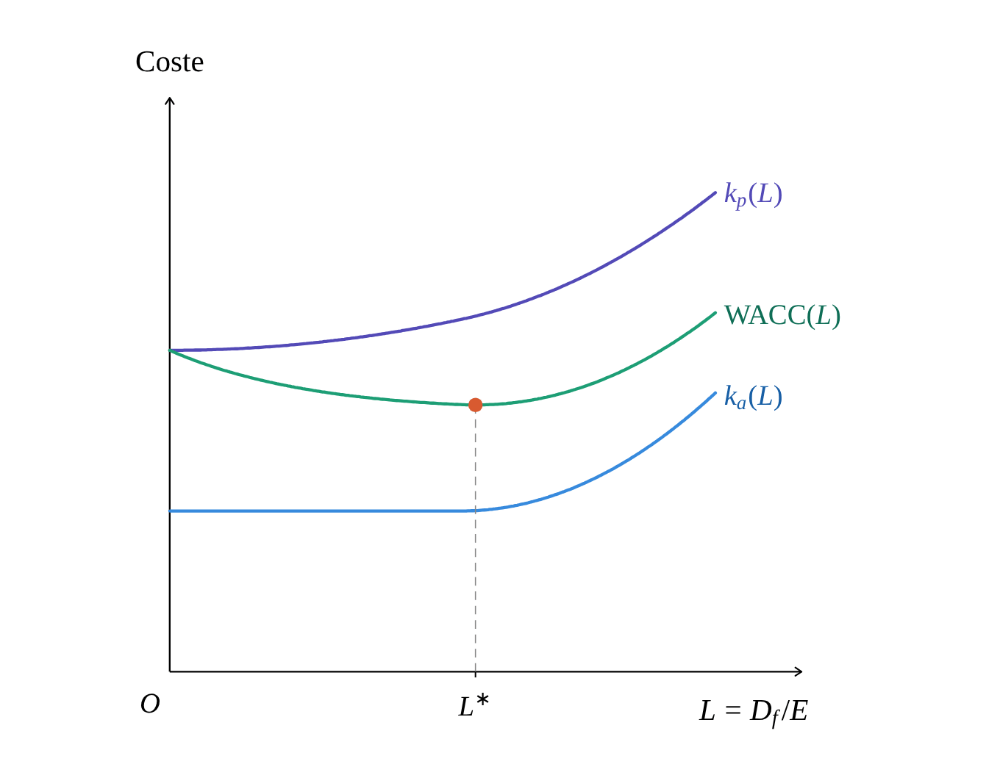
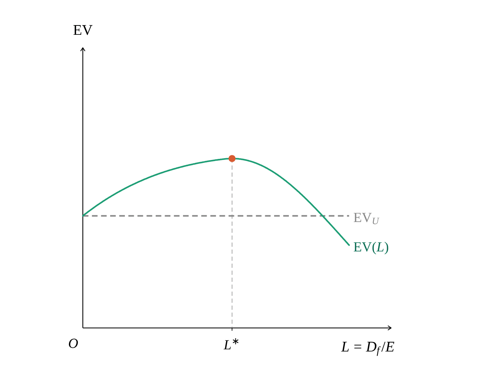
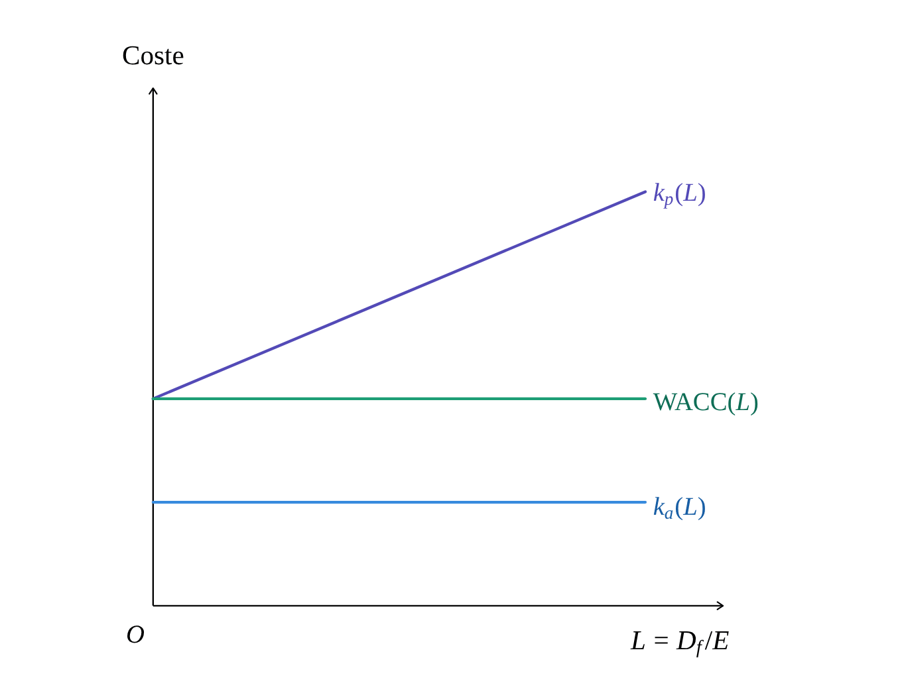
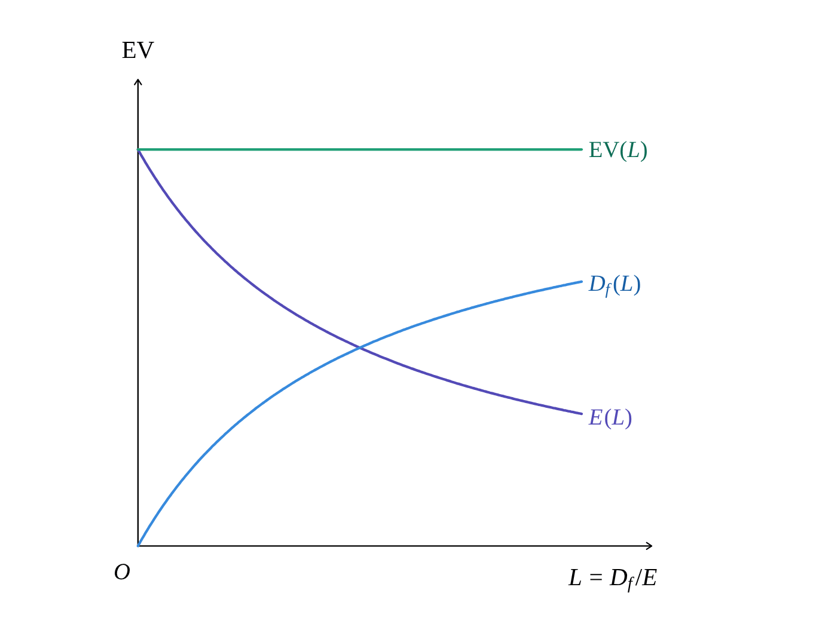
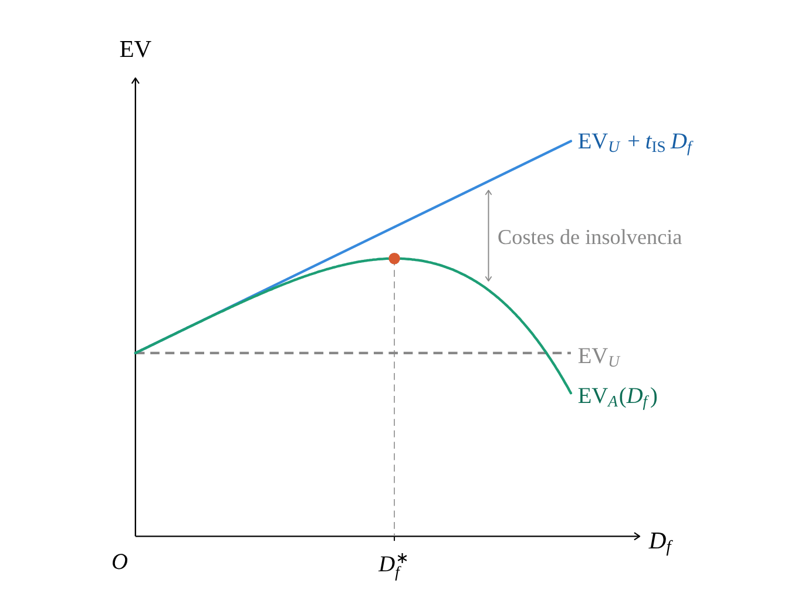
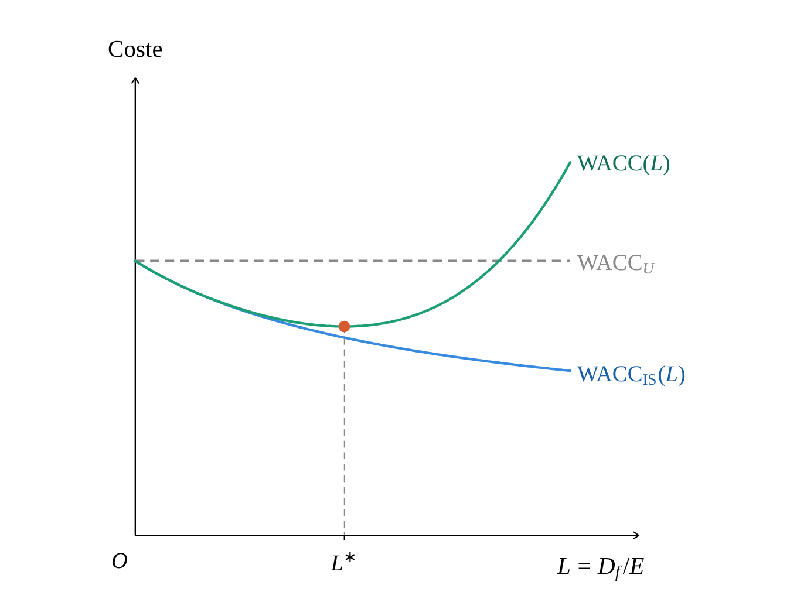
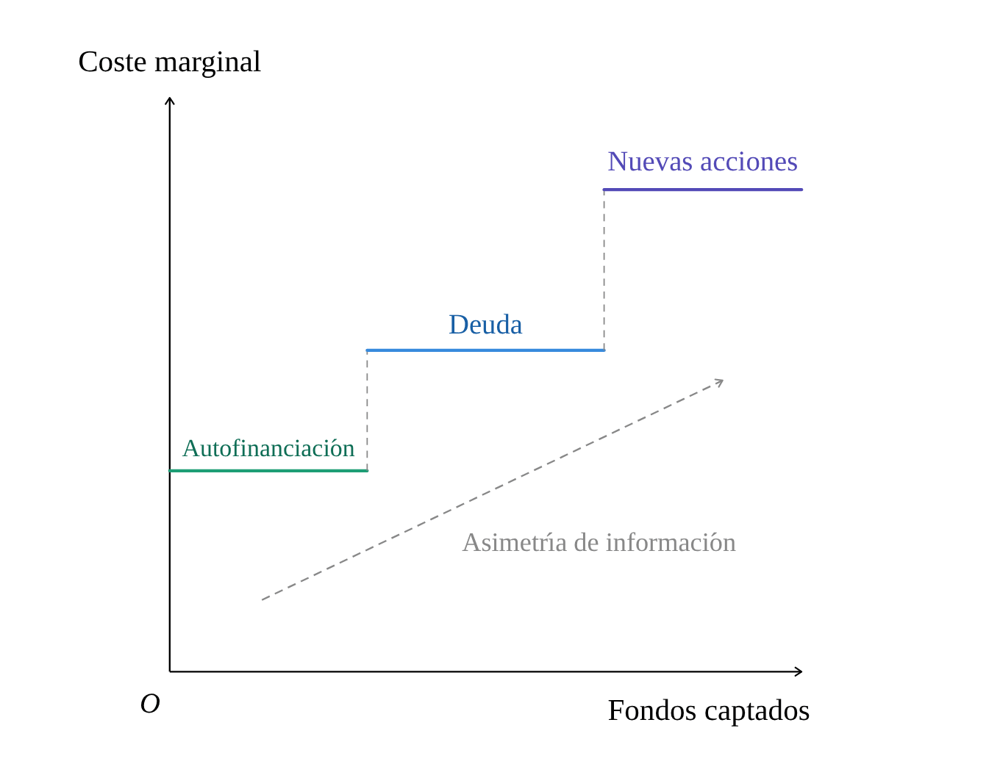

## Introducción

::: {.callout-note appearance="simple" icon=false}

:::

Las **decisiones de financiación** responden a la segunda pregunta de Solomon, la de cómo debe obtener la empresa los fondos que necesitan sus inversiones. Puede recurrir a **recursos propios**, aportados por los socios o retenidos de los beneficios, que no obligan a devolución, o a **recursos ajenos**, procedentes de terceros, que deben devolverse y se cobran antes en caso de liquidación. La proporción entre ambos, la **estructura del capital**, reparte la renta y el riesgo entre accionistas y acreedores y, a través del coste del capital, condiciona qué proyectos resultan rentables (tema [B02](b02-inversion.qmd)).

El debate moderno arranca con Modigliani y Miller (1958), que demostraron que, en un mercado de capitales perfecto, el valor de la empresa no depende de cómo se financie, frente a la tesis tradicional, que admitía un endeudamiento óptimo. Tres años después extendieron el resultado a la **política de dividendos** (Miller y Modigliani, 1961). Su aportación fue sobre todo de método, porque, al precisar las condiciones en que la financiación es irrelevante, señalaron dónde buscar las razones por las que sí importa. Las teorías posteriores incorporan esas razones, que son los impuestos, los costes de insolvencia, los conflictos de agencia (Jensen y Meckling, 1976) y la información asimétrica (Myers y Majluf, 1984). Según la **teoría del equilibrio estático**, la empresa busca el endeudamiento que iguala el ahorro fiscal de la deuda con los costes de insolvencia y de agencia. Según la **teoría de la jerarquía financiera**, en cambio, prefiere la autofinanciación a la deuda y la deuda a las nuevas acciones, sin un endeudamiento objetivo. Myers (1984) llamó a esa pugna el enigma de la estructura del capital (*the capital structure puzzle*).

El debate sigue vigente en la fiscalidad, porque, como los intereses son deducibles en el impuesto sobre sociedades y los dividendos no, el impuesto favorece la deuda frente a los fondos propios. La ley limita, no obstante, esa ventaja. En España, desde 2012, los gastos financieros netos solo son deducibles hasta el 30 % del beneficio operativo, con un mínimo de un millón de euros (art. 16 de la Ley 27/2014), una regla análoga a la que la Directiva (UE) 2016/1164 impuso en toda la UE.

El tema se organiza en tres partes:

- *Tipos de financiación*: el tema presenta las fuentes de financiación, propias y ajenas.

- *Estructura de financiación óptima*: se analiza si existe una combinación de recursos propios y ajenos que maximice el valor de la empresa.

- *Política de dividendos*: la última parte estudia el reparto del beneficio entre dividendos y reservas.

## 1. Tipos de financiación

Las decisiones de financiación nacen de una necesidad de la empresa, la de contar con fondos mientras desarrolla su actividad. Los **recursos financieros** son el efectivo y los equivalentes líquidos que llevan asociado un coste, sea financiero o de capital.

Atendiendo a quién es su titular, se distinguen dos categorías:

- *Financiación propia*: de los socios y sin obligación de devolución.

- *Financiación ajena*: de terceros y con obligación de devolución.

Según el horizonte temporal, la financiación es a corto plazo cuando el vencimiento es inferior a un año (p. ej. crédito bancario y línea de descuento). Es a largo plazo cuando el vencimiento es superior a un año (p. ej. préstamos a largo plazo o empréstitos) o no existe, como en las ampliaciones de capital.

### 1.1. Financiación propia

La financiación propia comprende los recursos que no generan obligación de devolución y que integran los fondos propios de la empresa o, en el caso de las amortizaciones y provisiones, quedan retenidos en ella. Sus titulares son los socios, que participan en el control y ocupan el último lugar en el orden de prelación. Según su origen, puede ser de dos tipos:

- *Interna o autofinanciación*: generada por la propia empresa a partir de su actividad, se divide a su vez en autofinanciación de mantenimiento y de enriquecimiento (1.1.1).

- *Externa*: aportada por los socios desde fuera mediante operaciones de capital (1.1.2).

#### 1.1.1. Autofinanciación

**Autofinanciación de mantenimiento**: busca evitar las disminuciones en el patrimonio neto y tiene su origen en el ciclo de explotación. Responde a la depreciación que sufren los bienes de equipo empleados en la producción. Tiene dos componentes:

1. *Provisiones*: fondos dotados con cargo a resultados para cubrir riesgos y obligaciones ciertos o probables en su existencia, pero indeterminados en su cuantía o fecha de materialización.

2. *Amortización técnica o económica*: consiste en emplear como recursos los fondos de amortización, dotados para cubrir la pérdida de valor o depreciación de ciertos elementos patrimoniales. Este proceso de amortización se puede realizar mediante el método lineal de cuotas fijas ($\text{Am} = (V_{\text{adq}} - V_R)/n$), que es el más utilizado y en el que la cuota resulta del cociente entre el valor amortizable y la vida útil, o mediante métodos acelerados, donde la cuota de amortización es decreciente.

Entre estos últimos destacan el método de la suma de dígitos y el del tanto fijo sobre el valor contable pendiente. El primero reparte el valor amortizable en proporción a una serie de dígitos decrecientes y concentra así la amortización en los primeros años. El segundo aplica un porcentaje constante a una base neta cada vez menor. Los métodos acelerados anticipan el ahorro fiscal ligado a la amortización, lo que eleva su valor actual.

La autofinanciación de mantenimiento asegura, así, que la empresa tenga a mano los fondos necesarios en el momento de reponer los bienes amortizables o de hacer frente a una contingencia.

La amortización económica genera un efecto multiplicador, el **efecto Lohmann-Ruchti** (1949, 1953). Para que aparezca, la empresa ha de estar creciendo (necesitar cada vez más equipos), los bienes de equipo no deben perder capacidad productiva a lo largo de su vida útil y no puede haber ni inflación ni obsolescencia tecnológica. Cumplido todo ello, reinvertir en equipos nuevos las cuotas retenidas eleva la capacidad productiva por periodo, más allá de la simple reposición, aunque la capacidad total (las unidades de servicio que les quedan al conjunto de los equipos) no varíe.

**Autofinanciación de enriquecimiento**: consiste en la retención de beneficios en forma de reservas, con el fin de aumentar los fondos propios y, por extensión, el patrimonio neto. Puede provenir del ciclo de explotación o de operaciones de capital, si bien lo más habitual es lo primero.

Las reservas procedentes del ciclo de explotación son legales (de dotación obligatoria), estatutarias (impuestas por los estatutos), voluntarias (dotadas libremente por acuerdo de la junta) o especiales (exigidas por normas concretas).

En cuanto a su destino, pueden mantenerse indefinidamente o dedicarse a la compensación de pérdidas o al pago de dividendos. Cuando provienen de operaciones de capital, el ejemplo característico es la prima de emisión, que, en rigor, no procede de beneficios retenidos sino de aportaciones de los socios (1.1.2).

La autofinanciación de enriquecimiento tiene un efecto multiplicador sobre la financiación:

1. *Regla financiera*: lo habitual es que la empresa se fije una proporción entre fondos propios y deuda y procure respetarla. Esa regla de balance equivale a una ratio de apalancamiento objetivo, $L = D_f/E$, donde $D_f$ es la deuda financiera y $E$ son los fondos propios o *equity*.

2. *Aumento de recursos ajenos*: de ahí que todo incremento de los fondos propios vía reservas ($\Delta E$) lleve consigo nueva deuda, en la cuantía que conserva intacta esa proporción.

3. *Efecto multiplicador*: la financiación total de la empresa crece, en consecuencia, más que las reservas, según $\Delta(E + D_f) = \Delta E(1+L)$, donde $E + D_f$ es la financiación total (patrimonio neto y deuda financiera). El efecto es tanto mayor cuanto mayor sea la ratio de apalancamiento deseada.

**Conclusiones**:

- *Aspectos positivos*:

    - *Autonomía*: la empresa gana independencia y margen de maniobra en sus decisiones.

    - *Pymes*: para una pyme, puede ser la única vía de financiarse al margen de la banca.

    - *Sin remuneración explícita*: los fondos retenidos no llevan aparejado ningún pago explícito a quien los aporta.

- *Limitaciones*:

    - *Insuficiencia*: los recursos internos se acumulan poco a poco, pero las necesidades de inversión llegan a saltos, así que pueden quedarse cortos.

    - *Coste de oportunidad*: que la autofinanciación no tenga un coste explícito no la convierte necesariamente en la opción más barata. Su coste implícito es el rendimiento que esos fondos darían en su mejor uso alternativo, y el problema se agrava si acaban financiando proyectos de escasa rentabilidad.

    - *Autofinanciación de enriquecimiento*: cada euro retenido es un euro menos de dividendo para el accionista, y esa merma puede castigar la cotización.

    - *Autofinanciación de mantenimiento*: su peso como fuente de fondos varía con la coyuntura de la empresa. Así, resulta mucho mayor en las fases expansivas, en que los recursos se generan con facilidad, que cuando la actividad se estanca o retrocede.

#### 1.1.2. Emisión de acciones y participaciones

Dadas las limitaciones de la autofinanciación, es habitual que la empresa busque financiación externa en los mercados de capitales. Por el lado de los recursos propios, esa financiación externa se obtiene mediante **ampliaciones de capital**, que aumentan los fondos propios de la sociedad mediante el incremento de su capital social y pueden realizarse principalmente de dos formas:

1. *Emisión de acciones o participaciones nuevas*: los antiguos accionistas y el público en general pueden acudir a la ampliación. Si las aportaciones son dinerarias, los antiguos accionistas tienen derecho de suscripción preferente sobre las acciones nuevas (de asunción preferente sobre las participaciones, en las sociedades de responsabilidad limitada), que evita el efecto dilución. No obstante, la junta puede excluirlo cuando lo exija el interés social (arts. 304 y 308 de la Ley de Sociedades de Capital, LSC). El valor teórico del derecho de suscripción preferente compensa a los antiguos accionistas de la dilución que provoca emitir nuevas acciones a un precio inferior al de mercado, y equivale a la diferencia entre la cotización antes de la ampliación y el valor tras ella.

2. *Incremento del valor nominal de las acciones existentes*: en este caso, no se crean acciones nuevas, sino que se eleva el nominal de las que ya existen. Exige el consentimiento de todos los socios, salvo que el aumento se haga íntegramente con cargo a beneficios o reservas que ya figuraban en el último balance aprobado (art. 296.2 LSC).

Según el precio de emisión, la ampliación puede ser a la par (al valor nominal), con prima de emisión (por encima del nominal) o liberada, total o parcialmente, cuando se realiza con cargo a reservas y el accionista no desembolsa la totalidad. En cuanto a su contravalor, puede realizarse mediante aportaciones dinerarias o no dinerarias, compensación de créditos de los acreedores, cargo a reservas o beneficios, conversión de obligaciones en acciones, o una combinación de estos elementos.

### 1.2. Financiación ajena

La financiación ajena comprende los recursos aportados por terceros (banca comercial o privada, Estado u otros agentes privados) con obligación de devolución, cuya retribución (el interés) es independiente del resultado de la empresa y cuyos titulares no participan en su control. Puede obtenerse a través de dos grandes canales. En el canal bancario o intermediado, una entidad financiera concede los fondos y asume el riesgo, mientras que en el canal de mercado la empresa capta los recursos directamente de los inversores mediante la emisión de valores.

#### 1.2.1. Canal bancario: préstamos, créditos y financiación del circulante

**Préstamos**: con ellos, la empresa obtiene de terceros recursos financieros cuyo principal reembolsará, junto con los intereses, en los plazos y por las cuantías previamente establecidos. Si bien presentan similitudes con las obligaciones, se diferencian en que el préstamo es concedido por un único acreedor y no se incorpora a un valor negociable, mientras que las obligaciones son títulos emitidos en el mercado con tantos acreedores como tenedores.

**Línea de crédito**: también llamada crédito, se distingue del préstamo por la forma de disponer de los fondos. En el préstamo, la entidad entrega de una vez la totalidad del principal, sobre el que se pagan intereses. En la línea de crédito, en cambio, la empresa dispone de los fondos a medida que los necesita, hasta un límite, y solo paga intereses por lo dispuesto, lo que la hace idónea para cubrir desfases de tesorería.

**Instrumentos ligados al ciclo de explotación**: entre los de financiación a corto plazo destacan los siguientes:

- *Crédito comercial*: aplazamiento de pago que conceden los proveedores, gratuito salvo que se renuncie a un descuento por pronto pago. Aunque no es financiación bancaria en sentido estricto, se incluye aquí por su papel central en la financiación del ciclo.

- *Descuento comercial*: la línea de descuento permite anticipar el importe de efectos comerciales (letras, pagarés) antes de su vencimiento, deduciendo intereses y comisiones, con la cláusula “salvo buen fin”.

- *Factoring*: cesión de los derechos de cobro a una entidad (el *factor*) que gestiona su cobro y anticipa su importe. Puede ser sin recurso (el *factor* asume el riesgo de impago) o con recurso (lo asume la empresa cedente).

- *Confirming*: también llamado *factoring* inverso, es la operación simétrica, en la que una empresa encomienda a una entidad la gestión de los pagos a sus proveedores, a los que la entidad ofrece la posibilidad de anticipar el cobro.

***Leasing***: el arrendamiento es otra forma de financiación de activos no corrientes, mediante la cual la empresa disfruta de un bien a cambio del pago de rentas periódicas al arrendador. Cabe distinguir dos modalidades:

- *Leasing financiero*: una entidad financiera adquiere el bien elegido por la empresa y se lo arrienda durante un plazo que cubre la mayor parte de su vida económica, con una opción de compra al término (habitualmente por el valor residual). El contrato es irrevocable durante su vigencia, de modo que los riesgos y beneficios del bien se transfieren *de facto* al arrendatario. Económicamente, equivale a una compra financiada y, contablemente, el bien se registra en el activo del arrendatario con su correspondiente pasivo.

- *Leasing operativo* (*renting*): el fabricante o una entidad especializada cede el uso del bien por periodos cortos (habitualmente entre seis meses y tres años), sin opción de compra o con una opción no predeterminada, asumiendo el arrendador el mantenimiento y el riesgo de obsolescencia. El contrato es revocable y, en las cuentas individuales conforme al Plan General de Contabilidad (PGC), sus cuotas se registran como gasto del ejercicio. En cambio, la Norma Internacional de Información Financiera (NIIF) 16, aplicable desde 2019 a las cuentas consolidadas de los grupos cotizados, obliga al arrendatario a reconocer en balance un activo por derecho de uso y el pasivo correspondiente. Pueden quedar fuera, no obstante, los arrendamientos a corto plazo o de escaso valor.

El *leasing* aporta alivio financiero, pues permite disponer del bien sin un gran desembolso inicial, y sus cuotas son deducibles en el impuesto sobre sociedades. En la modalidad financiera se deducen la carga financiera y la parte de recuperación del coste, esta con el límite del doble de la amortización lineal (art. 106 de la Ley del Impuesto sobre Sociedades, LIS). En la modalidad operativa, además, el arrendatario se libra del riesgo de obsolescencia, algo muy valioso en equipos tecnológicos. Como contrapartida, su coste total suele ser mayor que el de una compra financiada, y no todos los activos no corrientes pueden arrendarse.

::: {.callout-tip collapse="true" appearance="simple" title="Ejemplo: cuota de un *leasing* frente a un préstamo"}
Una máquina cuesta 100.000 €. La empresa puede arrendarla con un *leasing* financiero a cinco años, con cuotas anuales vencidas, un tipo implícito del 7 % y una opción de compra final de 5000 €, o comprarla con un préstamo a cinco años al 5 %. En miles de euros:

- *Cuotas*: la del arrendamiento se obtiene igualando el precio al valor actual al 7 % de las cinco cuotas y de la opción, $100 = C \sum_{t=1}^{5} 1{,}07^{-t} + 5 \cdot 1{,}07^{-5}$, de donde $C \approx 23{,}52$, y la del préstamo, al 5 %, es de 23,10.

- *Comparación*: descontados al 5 %, los pagos del *leasing* valen 105,75, frente a los 100 del préstamo. El *leasing* solo compensa si su ventaja fiscal, o el acceso a un bien que la empresa no podría financiar con un préstamo, vale más que esa diferencia.
:::

#### 1.2.2. Canal de mercado (no bancario): emisión de bonos y nuevas plataformas

**Bonos y obligaciones**: son valores que representan partes alícuotas de un empréstito, es decir, de una deuda emitida por la empresa. Su rentabilidad y riesgo previstos tienen que ver con la calificación crediticia del emisor y también con el plazo de reembolso y los tipos de interés. En España, cuando estos títulos se emiten a medio plazo (convencionalmente, hasta cinco años), se denominan bonos y, a plazos superiores, obligaciones. En el corto plazo, el instrumento análogo son los pagarés de empresa, emitidos al descuento en los mercados monetarios.

Entre las figuras híbridas entre deuda y capital destacan las siguientes:

- *Obligaciones convertibles*: otorgan el derecho a convertirlas en acciones del emisor en condiciones predeterminadas.

- *Préstamos participativos*: figura contractual, no de mercado, cuya remuneración se liga a los resultados y que, a efectos mercantiles, se asimila a fondos propios.

- *Deuda subordinada o mezzanine*: intermedia entre la deuda ordinaria y el capital en el orden de prelación.

El obligacionista asume menos riesgo que el accionista porque su posición es la de un acreedor, no la de un socio. Así, tiene derecho a sus intereses haya o no beneficios, mientras que el dividendo requiere que los haya y que la junta acuerde repartirlos. Al obligacionista se le devuelve, además, el principal al vencimiento (al accionista, solo al liquidarse la sociedad o vendiendo el título) y el obligacionista cobra con preferencia en el orden de prelación.

**Nuevos instrumentos**: junto a la emisión tradicional de bonos, han cobrado protagonismo los mercados y plataformas alternativos de financiación no bancaria. Se tratan aquí en conjunto, aunque algunos de ellos (el *equity crowdfunding* y el capital riesgo) aportan recursos propios y no ajenos.

- *Mercados alternativos de renta fija*: facilitan a las empresas medianas la emisión de títulos con requisitos más flexibles.

- *Crowdfunding*: agrupa la aportación de multitud de pequeños financiadores y adopta modalidades de recompensa, de donación, de inversión o *equity crowdfunding* (a cambio de participaciones) y de préstamo o *crowdlending* (a cambio de la devolución con intereses).

- *Capital riesgo* (*private equity* y *venture capital*): aporta recursos propios, a cambio de una participación temporal, a empresas no cotizadas con elevado potencial de crecimiento.

::: {.callout-note appearance="simple" icon=false}
La valoración y la negociación de las acciones y los bonos se desarrollan en los temas [B23](b23-renta-variable.qmd), apartado 1 (renta variable), y [B24](b24-renta-fija.qmd), apartado 1 (renta fija).
:::

### 1.3. Conclusiones

La diferencia fundamental entre ambas categorías es que la financiación propia no genera deuda, es decir, no es exigible. A ello se añade una **asimetría fiscal** relevante, pues los intereses de la financiación ajena son deducibles en el impuesto sobre sociedades, mientras que los dividendos no lo son.

La coexistencia de ambas fuentes ofrece a la empresa un menú amplio para diseñar su estructura del capital, combinando instrumentos según el plazo, el coste, el riesgo y el grado de control que se desea conservar. La financiación propia aporta estabilidad y autonomía, mientras que la ajena permite acelerar el crecimiento y aprovechar el apalancamiento y el escudo fiscal, además de imponer una disciplina financiera a la dirección. Dentro de la financiación ajena, el canal bancario descansa en la relación con un único acreedor, que asume el riesgo, y el de mercado coloca valores negociables directamente entre los inversores.

No existe, sin embargo, una combinación óptima universal de fuentes, pues la estructura del capital adecuada depende del sector, del ciclo y de la naturaleza de los activos, cuestión que aborda el apartado 2. La asimetría fiscal introduce, además, un sesgo hacia el endeudamiento (*debt bias*) que puede elevar la fragilidad financiera agregada.

## 2. Estructura de financiación óptima de la empresa: estructura del capital

Revisadas las principales fuentes de financiación de la empresa, la cuestión es cómo combinarlas de manera óptima. La sección parte del coste del capital, expone las teorías sobre la estructura óptima del capital y sus extensiones y termina con la teoría de la jerarquía financiera.

La financiación no crea por sí misma valor para la empresa, sino que es una fuente de costes. Por tanto, la **estructura óptima del capital** puede definirse como la combinación de fuentes financieras que minimiza los costes de financiación, resumidos en el coste del capital medio ponderado, y maximiza con ello el valor para los accionistas.

### 2.1. Coste del capital

El **coste del capital** es el rendimiento mínimo que deben dar las inversiones de la empresa para retribuir a quienes le han cedido fondos, y por eso tiene la naturaleza de un coste de oportunidad. La formulación clásica lo expresa en términos bursátiles, como el umbral de rentabilidad que deja inalterada la cotización cuando la empresa acomete un proyecto. Este concepto único se aplica en dos niveles.

- *Coste de capital en sentido aislado*: en primer lugar, el de cada fuente de financiación por separado, el del capital ajeno (2.1.1) y el del capital propio (2.1.2).

- *Coste de capital en sentido conjunto*: en segundo lugar, el que soporta la empresa por toda su financiación, el coste del capital medio ponderado (2.1.3).

#### 2.1.1. Coste del capital ajeno

**Concepto**: el coste de capital ajeno es la rentabilidad exigida por los acreedores de la empresa a la hora de ceder fondos a esta. Es un *coste explícito*, determinado por variables observables, es decir, un coste que queda reflejado en los contratos entre las partes. Para medir este coste hay dos vías, una basada en flujos y otra en primas.

**Método basado en flujos**: la primera vía lo calcula como el tipo de descuento que hace coincidir el dinero recibido con el valor actual de los pagos comprometidos por intereses y principal, es decir, del servicio de la deuda. Formalmente,

$$k_a: \quad Q_{E,0} = \sum_{t=1}^{T} \frac{Q_{S,t}}{(1 + k_a)^{t}}$$

donde $k_a$ es el coste del capital ajeno (nominal y antes de impuestos), $Q_{E,0}$ son las entradas de fondos a valor actual y $Q_{S,t}$ las salidas de fondos en cada momento $t$.

A partir de este coste, el coste efectivo del capital ajeno se verá influido por la imposición, a través del tipo impositivo que la empresa paga sobre sus beneficios, $t_{\text{IS}}$ (impuesto sobre sociedades), y por la tasa de inflación, $\pi$:

- *Efecto de los impuestos*: los intereses son gasto deducible en el impuesto sobre sociedades, así que, siempre que la empresa tenga beneficios, cada euro de intereses rebaja su factura fiscal. Ese ahorro, conocido como *escudo fiscal* o *tax shield*, abarata la deuda, cuyo coste neto es $k_a^{\text{ef}} = k_a(1 - t_{\text{IS}})$. Sin embargo, en España la deducción tiene un tope, pues los gastos financieros netos solo se deducen hasta el 30 % del beneficio operativo o, si es mayor, hasta un millón de euros, y el exceso se traslada a ejercicios siguientes (art. 16 LIS).

- *Efecto de la inflación*: como la deuda se salda devolviendo únicamente su importe nominal, una mayor inflación merma su valor real, de modo que $k_a^{\text{real}} \approx k_a - \pi$, aproximación de Fisher cuya expresión exacta es $k_a^{\text{real}} = (1 + k_a)/(1 + \pi) - 1$.

- *Efecto conjunto*: $k_a^{\text{ef,real}} \approx k_a(1 - t_{\text{IS}}) - \pi$.

**Método basado en primas**: el coste del capital ajeno puede calcularse también como suma del tipo de interés de un activo libre de riesgo y una prima. Formalmente,

$$k_a=r_f+\rho_d$$

donde $k_a$ es el coste del capital ajeno, $r_f$ el tipo de interés de un activo libre de riesgo y $\rho_d$ la prima de riesgo. La prima puede estimarse de diferentes formas: a través de la tasa interna de rentabilidad (TIR) de los bonos corporativos emitidos por una empresa comparable, a través del último préstamo suscrito, de *swaps* de tipos de interés o de *credit default swaps*, o a partir de los diferenciales publicados por las agencias de calificación.

::: {.callout-note appearance="simple" icon=false}
Los *swaps* de tipos de interés y los *credit default swaps* se desarrollan en el tema [B25](b25-derivados.qmd), apartado 3.
:::

#### 2.1.2. Coste del capital propio

**Concepto**: el coste de capital propio es la rentabilidad exigida por los propietarios de la empresa a la hora de aportar o mantener fondos en ella. A diferencia del capital ajeno, no responde a un compromiso contractual y, por tanto, no es un coste explícito sino un *coste implícito o coste de oportunidad*, que no se observa y ha de inferirse. En la práctica, se identifica con el rendimiento que los accionistas exigen como mínimo para conservar sus títulos. Si no lo obtuvieran, los venderían en masa y, en el mercado secundario, su precio caería. Para medir este coste se aplican las mismas dos vías que al capital ajeno.

**Método basado en flujos**: por analogía con la deuda, se busca la tasa con la que el valor actual de los flujos que la acción promete a su tenedor (los dividendos futuros) coincide con su cotización, y esa tasa es el coste del capital propio. Formalmente,

$$k_p: \quad P_{0} = \sum_{t=1}^{\infty} \frac{\text{DIV}_{t}}{(1+k_{p})^{t}}$$

donde $k_p$ es el coste del capital propio, $P_0$ es la cotización de la acción en el momento actual y $\text{DIV}_t$ el dividendo esperado en cada momento $t$.

El horizonte infinito no exige suponer una tenencia indefinida porque, si el accionista prevé vender en el año $T$, el precio de venta $P_T$ es el valor actualizado en $T$ de los dividendos posteriores y, sustituyendo recursivamente, se recupera la misma expresión.

Sin embargo, la expresión general anterior no es operativa sin una hipótesis sobre la senda de $\text{DIV}_t$. La *metodología de Gordon-Shapiro* (1956) se centra en el caso particular que resulta de suponer que los dividendos crecen a una tasa constante $g_D < k_p$, es decir, $\text{DIV}_t = \text{DIV}_1(1+g_D)^{t-1}$. La suma de la progresión geométrica arroja:

$$P_{0} = \frac{\text{DIV}_{1}}{k_{p} - g_D} \qquad \Longrightarrow \qquad k_{p} = \frac{\text{DIV}_{1}}{P_{0}} + g_D$$

donde el caso de dividendos constantes ($g_D = 0$) se obtiene sin más que anular la tasa de crecimiento, lo que da $P_0 = \text{DIV}_1/k_p$. La aplicabilidad de esta metodología se limita, por tanto, a empresas cotizadas con una política de dividendos estable y predecible.

Al igual que en el caso del capital ajeno, el coste efectivo se ve influido por la imposición y por la inflación, si bien con una diferencia sustancial en el primer caso:

- *Efecto de los impuestos*: frente a los intereses, que sí se deducen, los dividendos no reducen la base del impuesto sobre sociedades, y la financiación propia carece por ello de escudo fiscal. Antes al contrario, los rendimientos del accionista soportan una segunda imposición en sede personal (IRPF), lo que eleva la rentabilidad bruta que este exigirá. La asimetría en el impuesto sobre sociedades es, precisamente, el punto de partida de la extensión de Modigliani y Miller (1963) que se examina en el apartado 2.3.1.

- *Efecto de la inflación*: a diferencia de lo que ocurre con el capital ajeno, la inflación no abarata la financiación propia, pues la retribución del accionista no está fijada en términos nominales. Por ello, el accionista exigirá una rentabilidad nominal mayor que compense la pérdida de poder adquisitivo.

**Método basado en primas**: el coste del capital propio puede calcularse también como suma del tipo de interés de un activo libre de riesgo y una prima. Formalmente,

$$k_{p} = r_{f} + \rho_{p}$$

donde $r_f$ es el tipo de interés de un activo libre de riesgo y $\rho_p$ la prima de riesgo exigida por el accionista. La diferencia con el capital ajeno estriba en la obtención de la prima. Allí, $\rho_d$ podía leerse directamente de precios de mercado observables, porque existe un contrato con flujos fijados de antemano al que el mercado pone precio. Aquí no existe tal contrato, de modo que la prima ha de modelizarse. La formulación estándar es el modelo de valoración de activos de capital (CAPM, tema [B23](b23-renta-variable.qmd), apartado 3.1), utilizado por los reguladores europeos y aplicable con carácter general, incluso a empresas que no reparten dividendos. Se basa en la idea de que la rentabilidad esperada de un activo para un riesgo sistemático concreto coincidirá con la rentabilidad mínima que cualquier inversor racional le exigirá a dicha inversión:

$$\rho_{p} = \beta(R^e_{m} - r_{f}) \qquad \Longrightarrow \qquad k_{p} = r_{f} + \beta(R^e_{m} - r_{f})$$

donde $(R^e_m - r_f)$ es la prima de mercado y $\beta$ mide el riesgo sistemático, es decir, no diversificable (p. ej. ciclo económico, tipos de interés, inflación o tipo de cambio).

La beta empleada recoge tanto el riesgo económico del negocio como el riesgo financiero derivado del apalancamiento. A su vez, la ecuación de Hamada permite separar ambos, relacionando la beta apalancada ($\beta_A$) con la no apalancada o del activo ($\beta_U$):

$$\beta_{A} = \beta_{U}\left[1 + (1 - t_{\text{IS}})\frac{D_{f}}{E}\right]$$

donde $\beta_A$, la beta observada en el mercado, recoge el riesgo económico y el financiero, $\beta_U$ aísla el riesgo económico del negocio, $t_{\text{IS}}$ es el tipo del impuesto sobre sociedades y $D_f/E$ es la ratio de apalancamiento, $L$, a valores de mercado, distinta del peso $w_D = D_f/(D_f + E)$ empleado en el coste medio ponderado.

#### 2.1.3. Coste del capital medio ponderado (WACC)

**Concepto**: el coste del capital medio ponderado o *weighted average cost of capital* (WACC) resume en una sola tasa lo que le cuesta a la empresa toda su financiación, pues promedia el coste de cada fuente con su peso relativo como ponderación.

Su relevancia es doble. Por un lado, representa el coste de financiar un proyecto de inversión de riesgo análogo al del negocio y opera como tasa de descuento o tasa de corte en el análisis dinámico. Así, una inversión solo creará valor si su rentabilidad esperada supera el WACC. Por otro, al depender de las ponderaciones, es la magnitud a través de la cual la estructura del capital incide sobre el valor de la empresa, lo que enlaza directamente con las teorías sobre la estructura óptima del capital.

El WACC no se estima por un procedimiento propio e independiente, sino que resulta de agregar los costes ya calculados. No obstante, cabe también recuperarlo de forma implícita a partir de los flujos de la empresa en su conjunto, en aplicación de la misma lógica seguida para la deuda y para las acciones.

**Método por agregación**: es el procedimiento habitual. Formalmente,

$$\text{WACC} = k_{a}(1-t_{\text{IS}}) \cdot w_D + k_{p} \cdot (1 - w_D), \quad \text{con} \quad w_D = \frac{D_{f}}{D_{f} + E}$$

donde $k_a$ y $k_p$ son los costes del capital ajeno y propio, $D_f$ es la deuda financiera, $E$ son los fondos propios y $w_D$ es el peso de la deuda en la financiación total (distinto de la ratio de apalancamiento $L = D_f/E$ empleada en el apartado 1.1.1 y en el tema [B01](b01-estados-ratios.qmd)).

El coste del capital ajeno se computa neto de impuestos, de modo que la expresión incorpora el escudo fiscal de la deuda. En cambio, la versión sin corrección fiscal, $\text{WACC} = k_a \cdot w_D + k_p(1-w_D)$, solo resulta pertinente en el mundo sin impuestos del teorema de Modigliani y Miller que se examina en el apartado 2.2.2.

Abordados los costes, resta determinar las ponderaciones, lo que plantea tres cuestiones:

1. *Valores de mercado, no contables*: las ponderaciones deben computarse así porque el WACC pretende recoger la retribución exigida por los aportantes de fondos sobre el valor actual de su inversión, y no sobre su coste histórico. Para los fondos propios ello supone emplear la capitalización bursátil y, para la deuda, su valor de mercado, que en la práctica suele aproximarse por el valor contable cuando la calidad crediticia no se ha deteriorado apreciablemente.

2. *Estructura objetivo, no coyuntural*: dado que el WACC se emplea para descontar flujos de larga duración, procede utilizar la estructura del capital objetivo a la que la empresa tiende a largo plazo, y no la observada en un momento puntual, que puede reflejar situaciones transitorias.

3. *Circularidad*: el cálculo de $w_D$ exige conocer $E$ a valor de mercado, que es precisamente la magnitud que a menudo se desea determinar. A ello se añade que la ecuación de Hamada requiere igualmente la ratio $D_f/E$ para reapalancar la beta. El problema se resuelve por iteración o, más habitualmente, fijando de partida las ponderaciones objetivo.

**Método basado en flujos**: por analogía con los dos apartados anteriores, el WACC es también la tasa que, aplicada a los flujos de caja libres que generan los activos, hace que su valor actual coincida con lo que vale en el mercado el conjunto de la empresa. Formalmente,

$$\text{EV}_{0} = D_{f} + E = \sum_{t=1}^{\infty} \frac{\text{FCL}_{t}}{(1+\text{WACC})^{t}}$$

donde $\text{FCL}_t$ es el flujo de caja libre esperado en cada momento $t$, es decir, el generado por los activos antes de atender la retribución de acreedores y accionistas. Esta vía tiene un uso más limitado como método de cálculo, pero resulta útil para inferir el WACC implícito en las valoraciones de mercado y como comprobación de coherencia del obtenido por agregación.

**Aplicación y límites**: el empleo del WACC como tasa de descuento presupone que el proyecto evaluado presenta un riesgo económico análogo al del negocio existente y que no altera la estructura del capital objetivo. Cuando no es así, procede ajustar la tasa al riesgo específico del proyecto, típicamente reapalancando la beta de empresas comparables del sector correspondiente. Dos precisiones adicionales son relevantes:

1. *Coste marginal del capital*: para evaluar un nuevo proyecto, lo pertinente es el coste de los fondos adicionales necesarios para financiarlo, que puede superar al coste medio si la empresa ha de acudir a fuentes más caras o incurrir en costes de emisión (*flotation costs*).

2. *Valor actual ajustado*: cuando la estructura del capital varía de forma apreciable en el tiempo, la ponderación fija deja de ser representativa. En tal caso se prefiere a menudo el método del *valor actual ajustado* (*adjusted present value*, Myers, 1974). Este método valora primero el proyecto como si se financiara íntegramente con recursos propios y añade después, por separado, el valor actual del escudo fiscal de la deuda y de los demás efectos de la financiación.

### 2.2. Teorías económicas sobre la estructura óptima del capital

Salvo en mercados perfectos, la composición del pasivo determina el WACC, de modo que coste del capital y estructura del capital son dos caras de un mismo problema. Por eso las decisiones de inversión y las de financiación no pueden tomarse por separado.

La cuestión es si la estructura óptima del capital existe. De las dos corrientes que han dominado el debate, la tradicional responde que sí, y la de Modigliani y Miller, que no.

#### 2.2.1. Perspectiva tradicional (Durand, 1952)

**Origen**: la tesis tradicional se asocia habitualmente a David Durand (1952). Sin embargo, Durand no defiende propiamente una tesis, sino que contrapone dos criterios de valoración. El del *resultado neto* (*net income approach*), que supone constantes los costes de los recursos propios y ajenos, implica que el WACC disminuye de forma continuada con el endeudamiento. El del *resultado neto de explotación* (*net operating income approach*), en cambio, anticipa la irrelevancia posteriormente demostrada por Modigliani y Miller. La “perspectiva tradicional” es, por tanto, una posición intermedia entre ambos criterios, reconstruida *ex post* y sistematizada por contraste con el teorema de 1958.

**Idea**: existe una estructura óptima del capital que minimiza el coste del capital y maximiza el valor para los accionistas. La dirección financiera puede, por tanto, crear valor mediante decisiones de financiación.

**Supuestos**:

- *Entorno*: los mercados no son perfectos. En particular, los inversores no pueden replicar por su cuenta el apalancamiento de la empresa en idénticas condiciones, de modo que el arbitraje no disciplina las valoraciones.

- *Agentes*: el coste de capital ajeno es inferior al del capital propio y permanece constante hasta un determinado umbral de endeudamiento, a partir del cual crece por efecto del riesgo de insolvencia. El coste de capital propio crece con el endeudamiento, pero menos que proporcionalmente en los tramos bajos de deuda. Este es el supuesto crítico, porque solo si los accionistas no penalizan de inmediato y en toda su cuantía el mayor riesgo financiero puede la sustitución de recursos propios por ajenos abaratar el conjunto.

**Razonamiento**: mientras el coste de los fondos propios crezca menos que proporcionalmente, sustituirlos por deuda, de menor coste, reduce el coste del conjunto de la financiación. A partir del umbral en que el riesgo de insolvencia encarece ambas fuentes, el efecto se invierte. En consecuencia, existe una estructura óptima del capital, y las decisiones de inversión y de financiación no son independientes, pues la segunda determina la tasa de descuento aplicable a la primera.

**Desarrollo gráfico**: la perspectiva tradicional se representa en el plano ratio de apalancamiento-coste del capital (figura -@fig-b031-tradicional):

1. *Curva de coste de capital propio*, $k_p(L)$: creciente con el endeudamiento, dado que un mayor endeudamiento implica que los accionistas exigirán una mayor rentabilidad. Es, además, convexa, puesto que conforme aumenta el endeudamiento la rentabilidad exigida crece a un ritmo cada vez mayor.

2. *Curva de coste de capital ajeno*, $k_a(L)$: constante hasta un determinado nivel de endeudamiento. A partir de ahí, el riesgo de insolvencia es tal que los acreedores exigen una rentabilidad creciente y cada vez mayor.

3. *Curva de coste medio ponderado*, $\text{WACC}(L)$: presenta dos tramos. En el primero es decreciente, debido a que el bajo coste del capital ajeno compensa la mayor rentabilidad exigida por los accionistas, pues se sustituye financiación más cara por otra más barata. Después es creciente, a partir del nivel de endeudamiento en que el riesgo de insolvencia lleva tanto a acreedores como a accionistas a exigir una rentabilidad cada vez mayor.

4. *Óptimo*: el coste medio ponderado alcanza su mínimo en el endeudamiento $L^*$.

::: {#fig-b031-tradicional}

::: {.content-visible when-format="html"}
```{=html}
<div class="graph-frame">
<iframe src="../graphs/b031_Tradicional.html" style="height:560px" loading="lazy" title="fig-b031-tradicional"></iframe>
</div>
```
:::

::: {.content-visible unless-format="html"}

:::

Perspectiva tradicional (Durand, 1952). El coste medio ponderado del capital alcanza un mínimo en un nivel óptimo de endeudamiento $L^*$.
:::

En el plano ratio de apalancamiento-valor (figura -@fig-b035-tradicional-valor), la curva $\text{EV}(L)$ refleja el valor de la empresa, el beneficio de explotación esperado capitalizado al $\text{WACC}(L)$. Como ese beneficio no depende de la financiación, la curva crece mientras el WACC baja y alcanza su máximo en el mismo $L^*$. La recta discontinua $\text{EV}_U$ marca el valor sin deuda.

::: {#fig-b035-tradicional-valor}

::: {.content-visible when-format="html"}
```{=html}
<div class="graph-frame">
<iframe src="../graphs/b035_Tradicional_valor.html" style="height:560px" loading="lazy" title="fig-b035-tradicional-valor"></iframe>
</div>
```
:::

::: {.content-visible unless-format="html"}

:::

Perspectiva tradicional. El valor de la empresa es máximo en el endeudamiento $L^*$.
:::

**Conclusiones**:

- *Aspectos positivos*: su principal virtud es la plausibilidad descriptiva, ya que recoge el comportamiento efectivamente observado en las empresas, que operan con ratios de endeudamiento objetivo, y ofrece una justificación intuitiva del recurso a la deuda.

- *Limitaciones*: son de método, pues la forma de las curvas se postula, no se deduce. No se explica por qué el coste del capital propio habría de crecer menos que proporcionalmente en los tramos bajos, ni se identifica mecanismo alguno que impida a los inversores deshacer por su cuenta las decisiones de financiación de la empresa. Modigliani y Miller vinieron a corregir esta carencia de fundamentación.

#### 2.2.2. Perspectiva de Modigliani y Miller: teorema de Modigliani y Miller (1958)

**Origen**: el artículo de Franco Modigliani y Merton Miller (1958) se considera el trabajo fundacional de las finanzas corporativas modernas y la primera aplicación sistemática del principio de ausencia de arbitraje a la valoración de empresas.

**Idea**: el valor de la empresa nace de lo que generan sus activos (sus flujos de caja) y no del modo en que estos se financian, es decir, del lado del pasivo, y por eso la estructura del capital es irrelevante.

**Supuestos**:

- *Entorno*:

    - *Mercados perfectos*: sin impuestos, sin costes de transacción y con información simétrica. Además, los particulares pueden endeudarse en los mismos términos que las empresas.

    - *Clases de rendimiento equivalente*: las empresas se reparten en grupos homogéneos según su riesgo. Intuitivamente, cada grupo equivale a una industria, en la que la rentabilidad económica de todas las empresas sigue una misma distribución de probabilidad, que depende sobre todo del producto vendido y de la tecnología. Sus acciones son, así, sustitutos perfectos entre sí, y como su riesgo económico es idéntico, sus flujos se descuentan a una misma tasa.

    - *Beneficio*: es una variable aleatoria subjetiva, pero todos los inversores le asignan la misma esperanza.

- *Agentes*: son racionales (maximizan su riqueza) y les es indiferente cobrar en dividendos o en plusvalías. El modelo no exige neutralidad frente al riesgo, de modo que los inversores pueden ser aversos al riesgo, y la irrelevancia descansa en las expectativas homogéneas y en la agrupación por clases de rendimiento equivalente.

**Planteamiento**: sean dos empresas de la misma clase de riesgo. La empresa $U$ no está apalancada (su valor de mercado coincide con el de sus fondos propios, $\text{EV}_U = E_U$) y la empresa $A$ sí lo está ($\text{EV}_A = E_A + D_f$), si bien ambas generan el mismo beneficio esperado y se diferencian únicamente en su estructura del capital.

El mecanismo que garantiza $\text{EV}_U = \text{EV}_A$ es el *apalancamiento casero* (*homemade leverage*). Si la empresa apalancada cotizara con prima, un inversor podría vender sus acciones de $A$, comprar acciones de $U$ y endeudarse por su cuenta replicando ese apalancamiento, obteniendo la misma renta a menor coste. La operación inversa corregiría un eventual descuento. El arbitraje elimina así cualquier diferencia de valoración atribuible a la sola estructura del capital.

Formalmente, el valor de la empresa puede entenderse como corriente descontada de renta, $\text{EV}_i = \mathbb{E}[\text{BAIT}_i]/\text{WACC}$. En ese caso, la igualdad de numeradores y de valores implica que el WACC de $A$ coincide con el de $U$, es decir, con la rentabilidad exigida a los fondos propios de la empresa sin deuda.

**Solución**: del modelo anterior se desprenden tres resultados, conocidos como *proposiciones de Modigliani y Miller* (M&M):

- *Proposición I (irrelevancia de la estructura del capital)*: si los mercados son perfectos, cambiar la mezcla de deuda y fondos propios no altera la valoración de mercado de la empresa, determinada solo por lo que rinden sus activos. Da igual, por tanto, financiarse con beneficios retenidos, con deuda o con una ampliación de capital. Como corolario inmediato, el WACC es constante y no existe estructura óptima.

- *Proposición II (la rentabilidad exigida por el accionista crece con el apalancamiento)*: la rentabilidad esperada de las acciones ordinarias de una empresa endeudada crece linealmente con su ratio de apalancamiento si la deuda es sin riesgo ($k_a$ constante), $k_p = \text{WACC} + (\text{WACC} - k_a)\,D_f/E$. M&M no afirman aquí que el apalancamiento determine el valor de la empresa, sino que eleva la rentabilidad esperada de las acciones. Ahora bien, ese incremento no crea valor, pues compensa exactamente el mayor riesgo financiero soportado por el accionista, de modo que el WACC permanece constante. El efecto sobre $k_p$ es positivo mientras $\text{WACC} > k_a$.

- *Proposición III (independencia de las decisiones de inversión y de financiación)*: el coste del capital medio ponderado actúa como tasa de corte única, sea cual sea la fuente con que se financie cada proyecto. Para maximizar su valor, la empresa ha de aceptar los proyectos cuya rentabilidad esperada (su TIR) llegue al menos a esa tasa y rechazar todos los demás.

**Desarrollo gráfico**: las proposiciones de Modigliani y Miller se representan en el plano ratio de apalancamiento-coste del capital (figura -@fig-b032-mm):

1. *Curva de coste de capital ajeno*, $k_a(L)$: horizontal, porque la deuda es sin riesgo.

2. *Curva de coste de capital propio*, $k_p(L)$: recta creciente de pendiente $\text{WACC} - k_a$ (proposición II), porque el accionista exige una prima por el riesgo financiero, que crece en proporción al endeudamiento.

3. *Curva de coste medio ponderado*, $\text{WACC}(L)$: horizontal, porque el mayor coste de los fondos propios compensa exactamente la sustitución por deuda más barata, por lo que no hay endeudamiento óptimo (proposición I).

::: {#fig-b032-mm}

::: {.content-visible when-format="html"}
```{=html}
<div class="graph-frame">
<iframe src="../graphs/b032_MM.html" style="height:560px" loading="lazy" title="fig-b032-mm"></iframe>
</div>
```
:::

::: {.content-visible unless-format="html"}

:::

Proposiciones de Modigliani-Miller sin impuestos. El WACC es independiente del endeudamiento y el coste de los recursos propios crece linealmente con el apalancamiento.
:::

En el plano ratio de apalancamiento-valor (figura -@fig-b036-mm-valor), la recta horizontal $\text{EV}(L)$ refleja el valor de la empresa, que no depende del endeudamiento (proposición I). Las curvas $E(L)$, decreciente, y $D_f(L)$, creciente, reflejan el reparto de ese valor entre accionistas y acreedores. Su suma no cambia, porque la deuda reparte los flujos de los activos sin aumentarlos.

::: {#fig-b036-mm-valor}

::: {.content-visible when-format="html"}
```{=html}
<div class="graph-frame">
<iframe src="../graphs/b036_MM_valor.html" style="height:560px" loading="lazy" title="fig-b036-mm-valor"></iframe>
</div>
```
:::

::: {.content-visible unless-format="html"}

:::

Modigliani-Miller sin impuestos. El valor de la empresa no depende del endeudamiento.
:::

**Conclusiones**:

- *Aspectos positivos*: la aportación del teorema es sobre todo metodológica. Al identificar con precisión los supuestos bajo los cuales la financiación es irrelevante, M&M transforman el problema. La cuestión deja de ser si existe una estructura óptima y pasa a ser cuál de esos supuestos falla en la realidad y con qué consecuencias. Toda la literatura posterior, incluidas las extensiones que siguen, se ordena en torno a esa pregunta.

- *Limitaciones*: son las de sus propios supuestos, todos ellos contrafácticos, ya que existen impuestos, existen costes de insolvencia y existen asimetrías informativas. El supuesto más frágil es el del apalancamiento casero. El endeudamiento personal no es un sustituto perfecto del societario, pues carece de la responsabilidad limitada de que goza el accionista y se contrata en condiciones peores que las de la empresa.

### 2.3. Extensiones: impuesto sobre sociedades, costes de insolvencia, impuesto sobre la renta y costes de agencia

Las cuatro extensiones que siguen comparten estructura. Cada una relaja uno de los supuestos del teorema de 1958 y examina las consecuencias, manteniendo los restantes, si bien los costes de insolvencia y el impuesto personal se analizan conservando el impuesto sobre sociedades ya incorporado.

#### 2.3.1. Incorporación del impuesto sobre sociedades (Modigliani y Miller, 1963)

**Origen**: la extensión se debe a Modigliani y Miller (1963), *Corporate Income Taxes and the Cost of Capital: A Correction*. El propio título revela el alcance del trabajo, una rectificación del tratamiento fiscal contenido en el artículo de 1958.

**Idea**: si se considera la fiscalidad, el valor de la empresa aumenta con su ratio de apalancamiento, debido al escudo fiscal, hasta tal punto que la estructura óptima sería una compuesta únicamente por deuda.

**Supuestos**:

- *Supuesto relajado*: la ausencia de impuestos societarios.

- *Supuestos que se mantienen*: los del teorema de 1958.

**Razonamiento**: el impuesto sobre sociedades grava el beneficio antes de impuestos (BAT), es decir, el resultado una vez deducidos los gastos financieros. Dado que los intereses son deducibles de la base imponible mientras que la retribución de los fondos propios no lo es, la financiación ajena disfruta de una ventaja fiscal frente a la propia. En consecuencia, el valor de la empresa apalancada supera al que tendría sin deuda en el valor actual del ahorro fiscal, que, si la deuda es permanente y de importe constante, asciende a $t_{\text{IS}} \cdot D_f$:

$$\text{EV}_A = \text{EV}_U + t_{\text{IS}} \cdot D_f$$

El mismo efecto se aprecia a través del coste del capital, pues la expresión $\text{WACC} = k_a(1-t_{\text{IS}}) \cdot w_D + k_p \cdot (1-w_D)$ es decreciente en $w_D$ aun teniendo en cuenta que $k_p$ aumenta con el apalancamiento.

::: {.callout-tip collapse="true" appearance="simple" title="Ejemplo: valor de la empresa y WACC con impuesto sobre sociedades"}
Una empresa sin deuda genera un flujo de caja libre perpetuo de 10 millones de euros y sus accionistas exigen un 10 %, así que $\text{EV}_U = 10/0{,}1 = 100$ millones. Emite deuda permanente por 40 millones al 5 % y recompra acciones con ella. El tipo del impuesto sobre sociedades es del 25 %.

- *Valor*: $\text{EV}_A = 100 + 0{,}25 \cdot 40 = 110$ millones, y los fondos propios valen $E = 110 - 40 = 70$ millones.

- *Coste del capital propio*: sube con el apalancamiento según la proposición II de Modigliani y Miller con la corrección fiscal, $k_p = k_U + (k_U - k_a)(1 - t_{\text{IS}})\, D_f/E = 10 + 5 \cdot 0{,}75 \cdot 40/70 \approx 12{,}14$ %, donde $k_U$ es el coste del capital de la empresa sin deuda.

- *WACC*: $5 \cdot 0{,}75 \cdot 40/110 + 12{,}14 \cdot 70/110 \approx 9{,}09$ %, y descontar a esa tasa el mismo flujo da de nuevo $10/0{,}0909 = 110$ millones. El escudo fiscal aparece igual en el valor que en el coste del capital.
:::

**Conclusiones**:

- *Aspectos positivos*: la corrección fiscal redujo la distancia entre los defensores de una estructura óptima y M&M, ya que admite que, con impuesto sobre sociedades, la estructura del capital sí afecta a lo que vale la empresa y a su coste de capital.

- *Limitaciones*: la conclusión extrema (un endeudamiento del 100 %) carece de todo respaldo empírico, lo que revela que la fiscalidad societaria no es el único supuesto que conviene levantar. El efecto positivo del escudo fiscal se ve contrarrestado, al menos, por los costes de insolvencia y por el tratamiento desfavorable de los rendimientos de la deuda en el impuesto personal.

#### 2.3.2. Incorporación de los costes de insolvencia (Kraus y Litzenberger, 1973)

**Origen**: la intuición se debe a Baxter (1967) y su formalización a Kraus y Litzenberger (1973).

**Idea**: existe una disyuntiva entre las ventajas fiscales del endeudamiento y los costes esperados asociados a la probabilidad de quiebra.

**Supuestos**:

- *Supuesto relajado*: la inexistencia de costes de quiebra, implícita en el supuesto de mercados perfectos.

- *Supuestos que se mantienen*: los del teorema de 1958, con el impuesto sobre sociedades ya incorporado.

**Razonamiento**: cabe distinguir dos tipos de coste asociados al endeudamiento excesivo:

1. *Costes de insolvencia directos*: costes explícitos y cuantificables derivados del aumento del riesgo (p. ej. costes legales, judiciales y administrativos del proceso concursal).

2. *Costes de insolvencia indirectos*: costes implícitos y de difícil cuantificación (p. ej. pérdida de clientes y proveedores, deterioro de imagen y reputación, salida de empleados clave o distracción de la dirección).

Conforme aumenta el endeudamiento, aumenta la probabilidad de quiebra y, con ella, el valor esperado de ambos tipos de coste. El valor de la empresa pasa a ser:

$$\text{EV}_A = \text{EV}_U + t_{\text{IS}} \cdot D_f - \text{VA}(\text{costes de insolvencia})$$

Por ello, existe una estructura óptima del capital que no supone un endeudamiento del 100 %, situada allí donde el ahorro fiscal marginal iguala al incremento marginal de los costes esperados de insolvencia.

**Conclusiones**:

- *Aspectos positivos*: recupera una solución interior, pero por una vía muy distinta de la tradicional, ya que se deduce de un mecanismo identificado y no se postula sobre la forma de unas curvas.

- *Limitaciones*: la principal dificultad es de medición, pues los costes indirectos (que, según sugiere la evidencia, son los cuantitativamente relevantes) no son directamente observables.

#### 2.3.3. Incorporación del impuesto sobre la renta (Miller, 1977)

**Origen**: el propósito declarado de Merton Miller (1977) es corregir lo que consideraba una sobreestimación de la ventaja fiscal de la deuda en la literatura del *trade-off*.

**Idea**: el escudo fiscal societario no puede evaluarse aisladamente. La ventaja que el impuesto sobre sociedades concede a la deuda ha de contraponerse al inconveniente del impuesto personal sobre la renta, cuyo trato no es el mismo para los intereses que cobran los obligacionistas que para los rendimientos que obtienen los accionistas (dividendos y plusvalías).

**Supuestos**:

- *Supuesto relajado*: la ausencia de imposición personal sobre las rentas del capital.

- *Supuestos que se mantienen*: los del teorema de 1958, con el impuesto sobre sociedades ya incorporado.

**Razonamiento**: si plusvalías, dividendos e intereses tributaran al mismo tipo en el impuesto personal, este dejaría intacta la ventaja fiscal del endeudamiento empresarial. Sin embargo, el trato fiscal no es el mismo, y por eso lo que accionistas y obligacionistas reciben en conjunto, una vez pagados todos los impuestos, cambia con la composición del pasivo. La ganancia por apalancamiento pasa a ser:

$$G_L = \left[1 - \frac{(1 - t_{\text{IS}})(1 - t_{\text{pe}})}{1 - t_{\text{pd}}}\right] D_f$$

donde $t_{\text{pe}}$ es el tipo personal efectivo sobre los rendimientos del capital propio y $t_{\text{pd}}$ el aplicable a los intereses. La ventaja fiscal de la deuda es tanto mayor cuanto más elevado sea el tipo del impuesto sobre sociedades y cuanto menor sea la penalización relativa de los intereses en el impuesto personal frente a los rendimientos del capital propio.

En el equilibrio agregado de Miller, la oferta de deuda de las empresas se ajusta hasta que el tipo marginal del inversor indiferente anula el corchete. Existe entonces un volumen óptimo de deuda para el conjunto de la economía, pero la estructura del capital vuelve a ser irrelevante para la empresa individual.

**Conclusiones**:

- *Aspectos positivos*: al incorporar la imposición personal, muestra que la ventaja fiscal de la deuda debe valorarse sobre la renta neta que perciben los inversores y no solo sobre el impuesto sobre sociedades. También introduce la idea de clientelas fiscales formadas por inversores con tipos marginales distintos.

- *Limitaciones*: el retorno a la irrelevancia exige condiciones fiscales muy específicas, como una tributación personal efectiva de los rendimientos de las acciones próxima a cero. De hecho, Graham (2000) estima que, en las empresas estadounidenses, el valor capitalizado del escudo fiscal de la deuda equivale al 9,7 % del valor de la empresa y que, neto del impuesto personal, puede bajar al 4,3 %. La deuda conserva, por tanto, una ventaja fiscal neta, aunque menor que la que se deduce del impuesto sobre sociedades por sí solo.

#### 2.3.4. Costes de agencia (Jensen y Meckling, 1976)

**Origen**: el análisis de los costes de agencia se debe a Michael Jensen y William Meckling (1976), *Theory of the Firm: Managerial Behavior, Agency Costs and Ownership Structure*.

**Idea**: la estructura del capital influye en el valor de la empresa a través de los conflictos de intereses entre agentes.

**Supuestos**:

- *Supuesto relajado*: la ausencia de conflictos de intereses entre los partícipes de la empresa, implícita en el supuesto de que la dirección maximiza el valor.

- *Supuestos que se mantienen*: los del teorema de 1958.

**Razonamiento**: Jensen y Meckling distinguen dos tipos de costes de agencia, de signo opuesto respecto del endeudamiento:

1. *Costes de agencia del capital propio*: derivados del conflicto entre directivos y accionistas cuando aquellos no son propietarios plenos (consumo de prebendas, construcción de imperios empresariales, inversión en proyectos de escaso valor). La deuda ayuda a mitigarlos, pues el compromiso de atender su servicio disciplina a la dirección y reduce el flujo de caja libre discrecional (hipótesis del *free cash flow*, Jensen, 1986).

2. *Costes de agencia de la deuda*: derivados del conflicto entre accionistas y acreedores cuando el endeudamiento es elevado. Destacan dos:

    - *Sustitución de activos o traslación del riesgo*: los accionistas prefieren proyectos más arriesgados, cuya ganancia captan mientras las pérdidas recaen en los acreedores.

    - *Subinversión por exceso de deuda* (*debt overhang*, Myers, 1977): la empresa renuncia a proyectos rentables cuyo beneficio iría a parar a los acreedores.

El nivel óptimo de deuda equilibra la reducción de los costes de agencia del capital propio con el aumento de los costes de agencia de la deuda, lo que ofrece una justificación adicional de una solución interior, independiente de la fiscal.

**Conclusiones**:

- *Aspectos positivos*: su aportación va más allá de la estructura del capital, ya que, al vincular la financiación con el gobierno corporativo, abre la vía al análisis de la deuda como instrumento de control y no solo como fuente de fondos.

- *Limitaciones*: los costes de agencia son difíciles de medir, de modo que la teoría predice el signo de los efectos, pero no permite cuantificar el nivel óptimo de deuda.

#### 2.3.5. Síntesis: la teoría del equilibrio estático (*static trade-off theory*)

El conjunto de estas extensiones (escudo fiscal frente a costes de insolvencia y de agencia) configura la **teoría del equilibrio estático**. Según esta teoría, existe una estructura óptima interior que iguala, en el margen, los beneficios fiscales de la deuda con sus costes de insolvencia y de agencia. En su versión dinámica, la empresa no permanece siempre en ese óptimo, sino que ajusta su endeudamiento hacia él de forma gradual, en función de los costes de transacción.

Gráficamente, el equilibrio estático se representa en el plano deuda-valor de la empresa (figura -@fig-b033-tradeoff-estatico):

1. *Valor de la empresa no endeudada*, $\text{EV}_U$: horizontal, pues no depende de la deuda.

2. *Recta del escudo fiscal*, $\text{EV}_U + t_{\text{IS}}\, D_f$: recoge el valor que tendría la empresa con solo el impuesto sobre sociedades (Modigliani y Miller, 1963). Es creciente con pendiente $t_{\text{IS}}$, porque cada unidad de deuda permanente añade $t_{\text{IS}}$ al valor por el escudo fiscal.

3. *Valor de la empresa endeudada*, $\text{EV}_A(D_f)$: se separa de la recta anterior en los costes de insolvencia, despreciables con poca deuda y cada vez mayores después, porque la probabilidad de quiebra crece con el endeudamiento.

4. *Óptimo*: el valor alcanza su máximo en $D_f^*$, donde el ahorro fiscal marginal iguala el aumento marginal de los costes de insolvencia.

::: {#fig-b033-tradeoff-estatico}

::: {.content-visible when-format="html"}
```{=html}
<div class="graph-frame">
<iframe src="../graphs/b033_Tradeoff_estatico.html" style="height:560px" loading="lazy" title="fig-b033-tradeoff-estatico"></iframe>
</div>
```
:::

::: {.content-visible unless-format="html"}

:::

Teoría del equilibrio estático. El valor de la empresa aumenta con el escudo fiscal de la deuda hasta que los costes de insolvencia lo compensan.
:::

En el plano ratio de apalancamiento-coste del capital (figura -@fig-b037-tradeoff-coste), la recta discontinua $\text{WACC}_U$ refleja el coste de la empresa sin deuda, constante en Modigliani y Miller (1958). La curva $\text{WACC}_{\text{IS}}(L)$ añade el impuesto sobre sociedades y decrece por el escudo fiscal. La curva $\text{WACC}(L)$ suma los costes de insolvencia, por lo que baja con poca deuda, alcanza su mínimo en $L^*$, equivalente a la deuda óptima $D_f^*$, y sube después.

::: {#fig-b037-tradeoff-coste}

::: {.content-visible when-format="html"}
```{=html}
<div class="graph-frame">
<iframe src="../graphs/b037_Tradeoff_coste.html" style="height:560px" loading="lazy" title="fig-b037-tradeoff-coste"></iframe>
</div>
```
:::

::: {.content-visible unless-format="html"}

:::

Teoría del equilibrio estático. El coste medio ponderado del capital es mínimo en el endeudamiento $L^*$.
:::

### 2.4. Teoría de la jerarquía financiera (*pecking order theory*) (Myers y Majluf, 1984)

**Origen**: la observación empírica se remonta a Donaldson (1961), quien documentó que las empresas norteamericanas recurrían sistemáticamente a la autofinanciación antes que a los mercados, y su formalización se debe a Stewart Myers y Nicholas Majluf (1984).

**Idea**: los costes de financiación aumentan con la asimetría de la información. Ello da lugar a que las empresas ordenen jerárquicamente sus fuentes de financiación, en lugar de perseguir una ratio objetivo.

**Supuestos**:

- *Entorno*: existe asimetría informativa, pues los directivos conocen mejor que los inversores externos el valor de los activos y de las oportunidades de inversión de la empresa.

- *Agentes*: los directivos actúan en interés de los accionistas existentes, no de los potenciales nuevos accionistas. Los inversores son racionales y saben que se encuentran en desventaja informativa, por lo que anticipan el comportamiento de los directivos.

**Razonamiento**: el modelo distingue tres fuentes de financiación, la autofinanciación (beneficios retenidos), la deuda y la ampliación de capital. La financiación interna se utiliza en primer lugar. Cuando se agota, se recurre a la deuda y, agotada esta, se emiten acciones, que constituyen la financiación de último recurso.

El mecanismo es de selección adversa. Un directivo que sepa que sus acciones están sobrevaloradas tendrá incentivos a emitir, y uno que las sepa infravaloradas, no. Anticipándolo, los inversores aplican un descuento a toda nueva emisión, lo que encarece esta fuente y puede llevar a la empresa a renunciar a proyectos rentables antes que a transferir valor a los nuevos accionistas (subinversión). En cambio, la deuda, cuyo valor es menos sensible a la información privada, sufre este problema en menor medida, y la autofinanciación no lo sufre en absoluto. El recurso a las fuentes situadas en lo alto de la jerarquía actúa además como señal de la confianza de los directivos en su empresa.

De la teoría se siguen cuatro resultados:

- *Sin ratio objetivo*: no existe estructura óptima del capital. El endeudamiento observado es el resultado acumulado de los déficits de financiación pasados.

- *Reacción bursátil*: el anuncio de una ampliación de capital deprime la cotización, mientras que el de una emisión de deuda apenas la altera. Esta reacción es una de las predicciones empíricamente mejor contrastadas de la teoría.

- *Rentabilidad y deuda*: las empresas más rentables estarán menos endeudadas, pues generan recursos internos suficientes. Nótese que esta predicción es opuesta a la del equilibrio estático, según la cual una mayor rentabilidad implica más base imponible que escudar y, por tanto, más deuda.

- *Holgura financiera*: la tesorería acumulada y la capacidad de endeudamiento no utilizada (*financial slack*) tienen valor, porque permiten acometer proyectos rentables sin recurrir a emisiones costosas.

**Desarrollo gráfico**: en el plano fondos captados-coste marginal (figura -@fig-b034-pecking-order), el coste marginal de la financiación forma una escalera de tres tramos:

1. *Autofinanciación*: primer tramo, el más barato porque no sufre la selección adversa, hasta agotar los beneficios retenidos.

2. *Deuda*: segundo tramo, más caro que el anterior porque la deuda ya sufre la selección adversa, aunque en menor medida que las acciones.

3. *Nuevas acciones*: último tramo, el más caro, porque sufre el mayor descuento por asimetría de información, que crece de un tramo al siguiente (flecha discontinua).

::: {#fig-b034-pecking-order}

::: {.content-visible when-format="html"}
```{=html}
<div class="graph-frame">
<iframe src="../graphs/b034_Pecking_order.html" style="height:560px" loading="lazy" title="fig-b034-pecking-order"></iframe>
</div>
```
:::

::: {.content-visible unless-format="html"}

:::

Jerarquía financiera (Myers y Majluf, 1984). La empresa financia la inversión primero con recursos internos, después con deuda y en último lugar con acciones.
:::

**Extensiones**: la asimetría informativa admite también una lectura en clave de señales. En el modelo de Ross (1977), la retribución de los directivos se penaliza si la empresa quiebra, de modo que solo los directivos de empresas con buenas perspectivas eligen un endeudamiento elevado, y el mercado valora más a las empresas más endeudadas. Leland y Pyle (1977), por su parte, atribuyen ese papel de señal a la proporción del capital que retiene el promotor.

Una hipótesis más reciente, la del oportunismo de mercado (*market timing*, Baker y Wurgler, 2002), sostiene que las empresas emiten acciones cuando consideran que su valor de mercado es elevado en relación con su valor contable, y recompran o se endeudan cuando lo consideran bajo. La estructura del capital observada sería, así, el resultado acumulado de esas decisiones oportunistas más que el fruto de un óptimo estable.

**Conclusiones**:

- *Aspectos positivos*: la teoría explica satisfactoriamente hechos que el equilibrio estático no acomoda bien (los tres últimos resultados de la jerarquía). Shyam-Sunder y Myers (1999) contrastan las dos teorías con grandes empresas cotizadas estadounidenses entre 1971 y 1989. En su muestra, el modelo básico de la jerarquía, en el que la deuda emitida responde al déficit de financiación interna, tiene un poder explicativo mucho mayor que el del ajuste gradual hacia una ratio objetivo que predice el equilibrio estático.

- *Limitaciones*: al no contemplar una ratio objetivo, no explica la reversión a la media que se observa en los niveles de endeudamiento, ni por qué empresas con capacidad de endeudamiento no agotada emiten acciones. Su capacidad explicativa se deteriora, además, precisamente en las empresas pequeñas y de alto crecimiento, donde la asimetría informativa es mayor y cabría esperar que funcionase mejor.

### 2.5. Conclusiones

En la práctica, al decidir cuánta deuda asumir, la empresa debe sopesar también otros factores, como su sector, su tamaño, la fase de su ciclo de vida, su presencia internacional o la coyuntura económica. La evidencia empírica señala algunas regularidades del endeudamiento (Frank y Goyal, 2009):

- *Factores que lo elevan*: el endeudamiento tiende a crecer con el de su sector, con la dimensión y con la tangibilidad de los activos, que sirven de garantía.

- *Factores que lo reducen*: tiende a disminuir con la rentabilidad, lo que es coherente con la jerarquía financiera, pues las empresas más rentables se autofinancian, y con las oportunidades de crecimiento (medidas por la ratio entre valor de mercado y valor contable).

Las principales teorías son complementarias, pues cada una explica un aspecto distinto:

- *Equilibrio estático*: la existencia de un objetivo de endeudamiento.

- *Jerarquía financiera*: el orden de preferencia entre fuentes ante asimetrías de información.

- *Señales*: el endeudamiento como indicio de la calidad de la empresa.

- *Costes de agencia*: el papel disciplinante de la deuda.

- *Oportunismo de mercado*: la influencia de la valoración bursátil.

## 3. Política de dividendos

La política financiera examinada hasta aquí es, fundamentalmente, una política de gestión de los costes. Queda por ver la gestión de los beneficios de una empresa cotizada, que puede repartirlos entre los accionistas como dividendos o bien reinvertirlos. La **política de dividendos** engloba las decisiones acerca de la proporción que se asigna a cada destino, es decir, acerca de la relación entre beneficios retenidos y distribuidos. La sección expone el concepto y las características del dividendo, su relación con el valor de la empresa, las imperfecciones que hacen relevante su pago y el comportamiento observado.

### 3.1. Concepto y características de un dividendo

Los **dividendos** son la parte de los beneficios de una empresa que se reparte entre los accionistas. La fracción del beneficio que se destina a dividendos es lo que se conoce en inglés como *payout ratio* ($1 - b = \text{DIV}/\text{BN}$), por lo que el dividendo es $\text{DIV} = (1-b) \cdot \text{BN}$, siendo $b$ la fracción retenida o *plowback ratio*. Otra ratio habitual es la rentabilidad por dividendo (*dividend yield*), cociente entre el dividendo por acción y la cotización, que permite comparar la retribución entre empresas de distinto tamaño. El importe del dividendo tiene que ser aprobado por la junta general de accionistas, a propuesta del consejo de administración, salvo el dividendo a cuenta, que puede acordar el propio órgano de administración.

Según su relación con el beneficio, se distinguen dos tipos de dividendo:

- *Dividendo ordinario*: se deriva del beneficio del ejercicio y se compone de un dividendo a cuenta (entregado como anticipo de los resultados esperados) y un complementario (entregado una vez aprobado el reparto definitivo).

- *Dividendo extraordinario*: se deriva de beneficios de carácter extraordinario.

Según su forma de pago, se distingue entre:

- *Dividendo en efectivo*: la empresa retribuye mediante efectivo.

- *Dividendo en acciones* (*stock dividend*): la empresa retribuye directamente con acciones, sin opción de elección.

- *Dividendo elección* (*scrip dividend*): se diferencia del anterior en que el accionista elige. La empresa realiza una ampliación de capital liberada y entrega a los accionistas derechos de asignación gratuita. Cada accionista tiene entonces tres opciones: vender los derechos a la propia empresa a un precio garantizado (equivalente al dividendo en efectivo), recibir las acciones nuevas (equivalente al dividendo en acciones) o vender los derechos en el mercado.

### 3.2. Dividendos y el valor de la empresa

La cuestión es si el reparto de dividendos altera lo que valen las acciones y, con ello, la empresa. Hay dos respuestas enfrentadas, la tesis del beneficio y la tesis de los dividendos.

#### 3.2.1. Tesis del beneficio: irrelevancia de la política de dividendos (Miller y Modigliani, 1961)

**Origen**: Miller y Modigliani (1961) extienden a la política de dividendos el teorema de irrelevancia de la estructura del capital de 1958 (apartado 2.2.2).

**Idea**: la política de dividendos, como la financiera, resulta irrelevante (ni añade ni resta valor) cuando los mercados de capitales son perfectos. Lo determinante es la capacidad de la empresa para generar beneficio, que depende de su política de inversiones, y no qué parte de ese beneficio se reparte y qué parte se retiene.

**Supuestos**:

- *Entorno*: mercados perfectos, ausencia de incertidumbre y una política de inversión dada, de modo que un mayor dividendo se financia emitiendo nuevas acciones.

- *Agentes*: conducta racional y, en ausencia de incertidumbre, un dividendo futuro es tan seguro como uno actual o más próximo.

**Planteamiento**: con estos supuestos, el arbitraje mueve los precios hasta que todas las acciones ofrecen, en cualquier periodo, idéntica rentabilidad total (dividendo más ganancia de capital). Si una rindiera más, los accionistas ganarían riqueza vendiendo las demás para comprarla, y las condiciones del mercado aseguran que esa operación sea posible.

**Equilibrio**: formalmente, la condición que se deriva para el mercado financiero es:

$$k_p = \frac{\text{DIV}_{i,t} + (P_{i,t+1} - P_{i,t})}{P_{i,t}}$$

donde $k_p$ es la tasa de retorno exigida por el mercado, $\text{DIV}_{i,t}$ refleja el dividendo de la empresa $i$ y $(P_{i,t+1} - P_{i,t})$ la ganancia de capital. La rentabilidad no depende del título adquirido.

Si se calcula el valor de la empresa como flujo de renta descontado a la tasa de retorno del mercado, se obtiene:

$$\text{EV}_t = \frac{\text{EV}_{t+1} + \text{BN}_t - I_t}{1+k_p}$$

donde $\text{EV}_t$ es el valor de mercado de la empresa en el momento actual, $\text{EV}_{t+1}$ es el valor de mercado de la empresa en el futuro, $\text{BN}_t$ representa su beneficio neto e $I_t$ refleja la inversión o incremento de activos durante el periodo considerado.

**Estática comparativa**: el valor de la empresa no depende, por tanto, de la política de dividendos, pues $\text{DIV}$ no aparece en la relación. Intuitivamente, el arbitraje hace que el beneficio que no se reparte, y queda en reservas, se traslade íntegro al precio de la acción. El argumento se apoya, además, en los dividendos “caseros” (*homemade dividends*). Un accionista que desee liquidez puede generarla vendiendo una fracción de sus acciones, y otro que no la desee puede reinvertir el dividendo recibido, por lo que la política de la empresa resulta indiferente en un mercado sin fricciones ni impuestos.

**Conclusiones**:

- *Aspectos positivos*: los autores demuestran que, incluso en condiciones de incertidumbre, se podría cumplir la irrelevancia de la política de dividendos debido a que todavía puede existir arbitraje.

- *Limitaciones*: la tesis de Miller y Modigliani ha recibido duras críticas por lo restrictivo de los supuestos. En la realidad, se observan imperfecciones en los mercados financieros. Así, las rigideces en el mercado bancario pueden llevar a una falta de liquidez que impida a los agentes aprovechar las oportunidades de arbitraje.

#### 3.2.2. Tesis de los dividendos: importancia de la política de dividendos (Gordon, 1959; 1962)

**Origen**: en contraposición a la visión de Miller y Modigliani se encuentra la de Myron Gordon (1959, 1962). Su planteamiento se asocia al argumento del “pájaro en mano” (*bird-in-the-hand*), según el cual los inversores prefieren un dividendo presente y cierto a una ganancia de capital futura e incierta.

**Idea**: los dividendos tienen una clara influencia sobre el valor de las acciones, influencia que depende del rendimiento de las inversiones de la empresa y de la tasa de descuento del mercado (es decir, del coste del capital de mercado).

**Supuestos**:

- *Entorno*: el tiempo es continuo y la tasa de descuento de mercado $k_p$ se considera constante y exógena.

- *Agentes*: se retiene una tasa constante y exógena de los beneficios, $b$. Los beneficios retenidos son reinvertidos y generan también una tasa constante y exógena de rendimiento $r$, idéntica para cualquier inversión.

**Planteamiento**: el beneficio en cada periodo vendrá dado por una relación que puede expresarse en tiempo continuo como $\text{BN}_t = \text{BN}_0 e^{rbt}$, y el dividendo, por $\text{DIV}_t = (1-b)\text{BN}_t$. El valor de la empresa será igual al valor actual de la corriente de dividendos futuros descontados[^b03-11]:

$$\text{EV}_0 = \int_0^\infty e^{-k_p t}(1-b)\text{BN}_0 e^{rbt} \, dt$$

**Estática comparativa**: derivando respecto de $b$ se obtiene la relación entre el valor de la empresa y la tasa de retención, cuyo signo depende de la comparación entre $r$ y la tasa de descuento de mercado:

$$\frac{\partial \text{EV}}{\partial b} = \frac{\text{BN}_0(r - k_p)}{(k_p - rb)^2}$$

De forma que cabe distinguir tres casos:

- *$r = k_p$*: la política de dividendos no altera el valor de la empresa, caso en el que el resultado coincide con el de Miller y Modigliani.

- *$r > k_p$*: elevar la tasa de retención de beneficios ($\uparrow b$) incrementa el valor de la empresa, puesto que las nuevas inversiones financiadas con esos fondos adicionales rinden más que su reparto como dividendos. La política de dividendos óptima consiste, por tanto, en no repartirlos, aunque solo en el límite del modelo. La condición de acotación $k_p > rb$ impide llegar a $b = 1$, pues el valor crece sin cota cuando $b$ se aproxima a $k_p/r < 1$.

- *$r < k_p$*: una mayor tasa de retención de beneficios hace caer el valor de la empresa, de modo que lo conveniente es repartir el máximo de dividendos posible.

**Conclusiones**:

- *Aspectos positivos*: muestra que la política de dividendos puede influir sobre el valor de mercado de las empresas y precisa en qué sentido, según la rentabilidad de las inversiones frente al coste del capital.

- *Limitaciones*:

    - *Evidencia*: solo respalda el modelo de forma limitada. Irwin Friend y Marshall Puckett (1964) concluyen que buena parte del aparente efecto superior de los dividendos frente a los beneficios retenidos se debe a sesgos estadísticos. Corregidos estos, hallan que la preferencia del mercado por los dividendos es escasa, aunque algo mayor en empresas de sectores sin crecimiento o estacionarios, que sí podrían elevar su cotización aumentando los dividendos.

    - *Supuestos*: la hipótesis del rendimiento constante de las inversiones no parece sostenible. Además, es necesario suponer que $k_p > rb$ para que el valor de la empresa esté acotado.

    - *Pájaro en mano*: con $k_p$ constante, el modelo no recoge por sí mismo ese argumento, que exigiría una tasa de descuento creciente con la retención ($k_p'(b) > 0$).

### 3.3. Imperfecciones y política de dividendos

Fuera del mundo de Miller y Modigliani, varias imperfecciones hacen relevante el reparto:

**Teoría de la señalización**: figura entre las más citadas, aunque su respaldo empírico es desigual. El beneficio contable puede maquillarse con contabilidad creativa y dar así una imagen engañosa de la situación de la empresa. El dividendo, en cambio, sirve al accionista de indicador fiable, porque solo una compañía sana puede permitirse pagarlo elevado y mantenerlo estable a lo largo del tiempo.

**Teoría de los costes de agencia**: plantea el problema de la separación entre propiedad y control. Tener que repartir beneficios restringe el margen discrecional con el que los directivos gestionan los flujos de caja, al sustraer de su control una parte de ellos.

**Fiscalidad**: el efecto del reparto depende del trato fiscal relativo de los dividendos y de las ganancias de capital (plusvalías por la venta de acciones). Si las plusvalías tributan más que los dividendos, el inversor puede inclinarse por acciones que repartan dividendos elevados. Si, al contrario, los dividendos tributan más, su efecto sobre el valor de las acciones es negativo (*teoría de la preferencia impositiva*), y la empresa maximiza el valor para sus accionistas si reparte pocos dividendos y retribuye sus ganancias mediante la recompra de acciones. Las recompras (*share buybacks*) se han convertido, de hecho, en una vía de retribución cada vez más importante, en especial en EE. UU. Frente al dividendo, ofrecen varias ventajas:

- *Flexibilidad*: no generan la expectativa de continuidad que hace tan costoso recortar un dividendo.

- *Fiscalidad*: su tratamiento es a menudo más favorable, pues difieren la tributación hasta la venta y la someten al régimen de las plusvalías.

- *Beneficio por acción*: lo elevan al reducir el número de títulos en circulación, siempre que el cociente entre el beneficio por acción y el precio supere el coste después de impuestos de los fondos empleados.

- *Señal*: pueden indicar que la dirección considera infravaloradas las acciones.

**Teoría de la captación de inversores institucionales**: algunas instituciones tienen vedada la inversión en empresas cuyos dividendos no alcancen un determinado umbral.

A las teorías anteriores se añade el *efecto clientela*, según el cual distintos grupos de inversores prefieren distintas políticas de dividendos (por motivos fiscales o de necesidad de renta). Por ello, cada empresa tiende a atraer una clientela afín a su política de dividendos, y un cambio brusco de política puede penalizar la cotización. En conjunto, la coexistencia de argumentos a favor y en contra del reparto ha llevado a hablar de un “rompecabezas de los dividendos” (*dividend puzzle*, Black, 1976). El nombre alude a que no resulta evidente por qué las empresas pagan tantos dividendos cuando fiscalmente suelen ser menos eficientes que las recompras.

### 3.4. El comportamiento observado: el alisamiento de dividendos (Lintner, 1956)

**Origen**: al margen del debate teórico sobre si los dividendos crean valor, John Lintner (1956) estudió cómo fijan en la práctica las empresas su dividendo.

**Idea**: Lintner halló un patrón muy robusto, según el cual las empresas alisan los dividendos.

**Razonamiento**: las empresas fijan una ratio de reparto objetivo a largo plazo y ajustan el dividendo solo parcialmente hacia el nivel que correspondería al beneficio del ejercicio, según un modelo de ajuste parcial, $\Delta \text{DIV}_t = c\,[(1-b)\, \text{BN}_t - \text{DIV}_{t-1}]$, donde $c \in (0, 1)$ es la velocidad de ajuste. Cuanto menor es $c$, más gradual es el ajuste y más estable la senda de dividendos.

La dirección es muy reacia a recortar el dividendo, porque el mercado interpretaría el recorte como una señal negativa, y la dirección prefiere elevarlo solo cuando confía en poder sostener el nuevo nivel.

**Conclusiones**:

- *Aspectos positivos*: este comportamiento, ampliamente confirmado por la evidencia posterior, casa con la teoría de la señalización y explica la rigidez a la baja (*sticky dividends*) característica de los dividendos.

- *Limitaciones*: el modelo describe la regla de ajuste, pero no deriva de un problema de optimización la ratio objetivo ni la velocidad de ajuste, que se estiman empíricamente.

## Conclusiones

La empresa se financia con recursos propios, que no generan deuda, y con recursos ajenos, que deben devolverse y se cobran antes en caso de liquidación. Modigliani y Miller demuestran que, en un mercado perfecto, ni la estructura del capital ni los dividendos afectan al valor de la empresa, y así identifican por exclusión las imperfecciones que los hacen relevantes. El escudo fiscal de la deuda, frente a los costes de insolvencia y de agencia, da una estructura óptima interior (el equilibrio estático), mientras que la asimetría informativa lleva a ordenar las fuentes de financiación sin ratio objetivo (la jerarquía financiera de Myers y Majluf). Aun así, ninguna de las dos teorías explica por sí sola toda la evidencia. En los dividendos, la tesis de la irrelevancia convive con las que les atribuyen valor, y la conducta observada es el alisamiento que documentó Lintner.

Las decisiones de financiación completan las de inversión, con las que comparten el coste del capital (tema [B02](b02-inversion.qmd)). Sus teorías aplican a la empresa los problemas de información, pues los costes de agencia de Jensen y Meckling son un problema de principal-agente y la jerarquía financiera, uno de selección adversa (tema [A13](a13-informacion.qmd)). Esa misma jerarquía, junto con el racionamiento del crédito, explica por qué la inversión agregada depende de la financiación interna y del colateral (tema [A34](a34-demanda-inversion.qmd)). Por último, el valor de la empresa que Modigliani y Miller declaran independiente de su estructura es la suma del valor de sus acciones y de sus bonos, cuya valoración se estudia por separado (temas [B23](b23-renta-variable.qmd) y [B24](b24-renta-fija.qmd)).

Las regularidades de la estructura del capital que recogen Frank y Goyal (2009) no permiten decidir qué teoría la describe mejor. Encajan con algunas versiones del equilibrio estático, salvo en el signo de la rentabilidad, propio de la jerarquía financiera (apartado 2.5). Sigue abierta, además, la discusión sobre si las recompras han desplazado a los dividendos. Fama y French (2001) documentan que la proporción de cotizadas estadounidenses que pagan dividendos cayó del 66,5 % en 1978 al 20,8 % en 1999, sobre todo por una menor propensión a pagar. Grullon y Michaely (2002), por su parte, muestran que las recompras se financian con fondos que habrían ido a dividendos.

[^b03-11]: El beneficio y el dividendo crecen a la tasa $g_D = rb$ (la tasa de crecimiento sostenible, $b \cdot \text{ROE}$), y la integral da $\text{EV}_0 = (1-b)\text{BN}_0/(k_p - rb)$, versión en tiempo continuo de la fórmula de Gordon-Shapiro (apartado 2.1.2).
