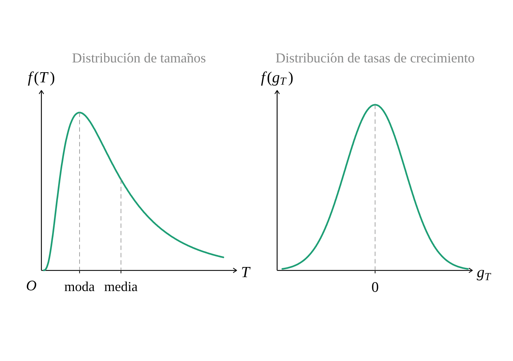

## Introducción

::: {.callout-note appearance="simple" icon=false}

:::

El **crecimiento empresarial**, objeto de la tercera pregunta de Solomon, es el aumento de la dimensión de la empresa, medida habitualmente por su activo, su cifra de ventas o su número de empleados. Resulta de las decisiones de inversión y financiación, pero constituye también una decisión estratégica en sí misma, porque modifica la posición competitiva de la empresa y su capacidad para aprovechar las economías de escala y de alcance. Las empresas crecen para ganar poder de mercado, financiarse en mejores condiciones o acceder a mejor tecnología, pero también para cumplir las metas de sus directivos.

La primera cuestión, si existe una dimensión óptima hacia la que deba tender la empresa, divide a las teorías del crecimiento, desde la planta óptima de la teoría neoclásica hasta la ley de Gibrat (1931), que trata el crecimiento como un proceso aleatorio e independiente del tamaño, y las de Penrose (1959) y Marris (1964), que lo explican por los recursos ociosos de la empresa y por los objetivos de sus directivos. La segunda es la vía para crecer. El **crecimiento interno u orgánico** se apoya en nuevas inversiones dentro de la propia empresa, mientras que el **crecimiento externo o inorgánico** se logra uniendo fuerzas con otras empresas, mediante **alianzas estratégicas** o mediante **fusiones y adquisiciones**. El primero preserva el control y la autonomía de la empresa. El segundo permite ganar tiempo y acceder a recursos de los que la empresa carece, pero en el caso de las fusiones y adquisiciones exige valorar la empresa objetivo.

La actividad de fusiones y adquisiciones avanza por oleadas. Martynova y Renneboog (2008) identifican cinco completas desde finales del siglo XIX, que coinciden con expansiones del crédito y auges bursátiles y terminan con caídas de las bolsas. Las dos primeras fueron sobre todo estadounidenses, y la quinta, a finales de los años noventa, la primera de alcance verdaderamente internacional. Observan, además, que las operaciones del final de cada oleada responden con frecuencia a decisiones poco racionales, guiadas por el interés propio de los directivos, lo que ayuda a entender por qué muchas adquisiciones no crean valor para el comprador.

El tema se organiza en tres partes:

- *Teorías explicativas*: el tema presenta las teorías del crecimiento empresarial.

- *Crecimiento interno u orgánico*: se analiza el que la empresa genera con sus propias inversiones.

- *Crecimiento inorgánico*: la última parte estudia los procesos de concentración empresarial y los métodos de valoración de empresas en que se apoyan.

## 1. Teorías explicativas sobre el crecimiento empresarial

Las aportaciones teóricas sobre el crecimiento empresarial pueden agruparse en dos vertientes. La primera reúne las que consideran la existencia de una **dimensión o tamaño óptimo** de la empresa, o al menos una horquilla de capacidad, y la segunda, las que niegan que exista una dimensión óptima y atribuyen el crecimiento a otros factores. Esta segunda vertiente desemboca, además, en una pregunta distinta, la de la dirección del crecimiento, cuyo marco clásico de respuesta (la matriz de Ansoff) cierra la sección, mientras que los modos de ejecutarlo, interno o externo, ocupan el resto del tema.

### 1.1. Búsqueda de la dimensión óptima

El primer grupo reúne las teorías que buscan definir y encontrar una dimensión óptima que guíe el crecimiento, desde la teoría neoclásica de la planta óptima hasta el enfoque transaccional de Coase y Williamson.

**Teoría neoclásica** (Marshall, 1890; Viner, 1931; Robinson, 1931): el crecimiento empresarial es el proceso de ajuste hacia la dimensión óptima de planta. Así, mientras le queden economías de escala por aprovechar, la empresa sigue creciendo, y se detiene cuando la combinación de factores con que opera lleva su coste medio a largo plazo al mínimo (véase la figura del tema [A12](a12-costes.qmd), apartado 2.2.1).

**Horquilla de dimensión óptima** (Stigler, 1939): la teoría de los costes de George Stigler amplió este enfoque incorporando la incertidumbre de la demanda. Ante fluctuaciones coyunturales, averías o variaciones cíclicas, la empresa no elige la planta más eficiente para un único nivel de producción, sino una planta flexible, con una curva de costes medios más plana, que resulta aproximadamente igual de eficiente dentro de un rango de producción (véase la figura del tema [A12](a12-costes.qmd), apartado 3.1.1). Por tanto, no existe una dimensión óptima única, sino una horquilla o sucesión de dimensiones óptimas. La evidencia empírica apunta en la misma dirección, pues el coste medio a largo plazo suele tener forma de L, y a partir de la escala mínima eficiente coexisten con costes parecidos empresas de tamaños muy distintos (tema [A12](a12-costes.qmd), apartado 3.4).

**Enfoque transaccional** (Coase, 1937; Williamson, 1975): las aportaciones de Ronald Coase y Oliver Williamson permitieron introducir la importancia de las relaciones contractuales en la determinación del tamaño de la empresa. En esta visión, la empresa y el mercado son mecanismos alternativos de asignación. De ahí que la empresa crezca, internalizando transacciones, hasta que el coste marginal de organizar una transacción adicional en su interior (costes de coordinación y gestión, ligados a las deseconomías gerenciales) iguale al coste de realizarla a través del mercado (coste de transacción). Los costes de transacción comprenden la previsión de contingencias, la negociación, la supervisión del cumplimiento y los costes legales, y pueden ser *ex ante* (negociación) o *ex post* (ejecución en caso de incumplimiento).

En resumen, las tres aproximaciones comparten la premisa de que existe una dimensión óptima que limita el crecimiento, pero difieren en la naturaleza de esa dimensión. Puede tratarse de un punto (el mínimo de la curva de costes medios a largo plazo), una horquilla (el tramo plano de una curva flexible) o un margen (el tamaño en el que se igualan los costes de organización internos y los del mercado). Además, su fundamento es tecnológico en las dos primeras y contractual en la tercera.

### 1.2. Crecimiento sin dimensión óptima: el crecimiento como proceso estocástico

Frente al primer grupo, otras teorías consideran que no existe un tamaño óptimo que guíe el crecimiento empresarial. El crecimiento sería, en cambio, fruto del azar o respondería al deseo de ganar poder de mercado, de financiarse en mejores condiciones en los mercados de capitales o de acceder a mejor tecnología, o bien a las metas propias de los directivos. Dentro de este grupo, la divisoria relevante es otra, la de si el crecimiento es un proceso estocástico o un proceso intencional.

#### 1.2.1. Ley del efecto proporcional (Gibrat, 1931)

**Origen**: Robert Gibrat planteó en 1931 uno de los trabajos sobre crecimiento empresarial que más atención ha recibido. Este autor fue, además, el primero en tratar el crecimiento como un fenómeno estadístico y no como una decisión.

**Idea**: el crecimiento empresarial no es intencional, sino el resultado de un proceso aleatorio multiplicativo en el que la tasa de crecimiento de cada empresa es independiente de su tamaño.

**Razonamiento**: Gibrat parte de una regularidad empírica. Si se clasifican las empresas según su tamaño, su distribución es positivamente asimétrica, con pocas empresas grandes, unas cuantas medianas y muchas pequeñas, y se aproxima a una lognormal. Por tanto, los logaritmos de los tamaños se distribuyen normalmente, y las tasas de crecimiento (diferencias de los logaritmos) suelen representarse también como una normal.

Para explicar este patrón, Gibrat supone que la tasa de crecimiento de una empresa es independiente de su tamaño absoluto. Formalmente, $T_t = T_{t-1}(1+g_{T,t})$, donde las tasas $g_{T,t}$ son independientes entre sí y del tamaño $T_{t-1}$, con media y varianza comunes, de modo que $\ln T_n = \ln T_0 + \sum_{t=1}^{n} \ln(1+g_{T,t})$. El logaritmo del tamaño es entonces una suma de perturbaciones independientes que, por el teorema central del límite, tiende a distribuirse normalmente, sea cual sea la distribución de cada perturbación.

En consecuencia, la evolución del tamaño es estocástica, y la probabilidad de crecer a un ritmo dado no depende de la dimensión de partida. Esta *ley del efecto proporcional* o *ley de Gibrat* implica que las diferencias de tamaño entre empresas se ensanchan con los años (la varianza de $\ln T_n$ aumenta con $n$), lo que supone una tendencia espontánea a la concentración.

**Desarrollo gráfico**: la ley de Gibrat se representa en los planos tamaño-densidad y tasa de crecimiento-densidad (figura -@fig-b041-gibrat):

1. *Distribución de tamaños*, $f(T)$: recoge la frecuencia de cada tamaño de empresa. Es lognormal, porque el logaritmo del tamaño es una suma de perturbaciones independientes que tiende a la normal, y asimétrica a la derecha, con muchas empresas pequeñas y pocas grandes, de modo que la moda queda por debajo de la media.

2. *Distribución de tasas de crecimiento*, $f(g_T)$: normal y simétrica en la representación habitual. Es la misma para todas las empresas, porque la tasa de crecimiento no depende del tamaño.

::: {#fig-b041-gibrat}

::: {.content-visible when-format="html"}
```{=html}
<div class="graph-frame wide">
<iframe src="../graphs/b041_Gibrat.html" style="--r:1.417" loading="lazy" title="fig-b041-gibrat"></iframe>
</div>
```
:::

::: {.content-visible unless-format="html"}

:::

Ley de Gibrat (1931). El crecimiento proporcional independiente del tamaño genera una distribución lognormal de tamaños empresariales, y las tasas de crecimiento se distribuyen aproximadamente como una normal.
:::

**Conclusiones**:

- *Aspectos positivos*: la ley de Gibrat fundó la demografía empresarial y sigue siendo la referencia frente a la que se contrasta todo estudio empírico del crecimiento, pues explica la concentración observada sin apelar a dimensión óptima alguna.

- *Limitaciones*: la evidencia posterior rechaza la ley, sobre todo para las empresas pequeñas y jóvenes. El crecimiento medio disminuye con el tamaño y la edad, y su volatilidad, con la edad, aunque el incumplimiento se atenúa en las empresas grandes (Evans, 1987; Hall, 1987). Como las pequeñas también desaparecen más, las muestras de supervivientes exageran su crecimiento, pero la relación negativa resiste a la corrección de ese sesgo. Por ello, Sutton (1997) considera la ley de Gibrat una referencia útil más que una ley.

#### 1.2.2. Hipótesis de la impredecibilidad de las innovaciones (Geroski, 2000)

**Origen**: Paul Geroski, desde la economía industrial empírica, buscó dotar de contenido económico al paseo aleatorio de Gibrat, cuya principal carencia era ser una regularidad estadística sin mecanismo.

**Idea**: el crecimiento sigue un proceso aparentemente aleatorio porque su motor último, la innovación, es en sí mismo impredecible.

**Razonamiento**: las empresas innovan de tarde en tarde y a intervalos imprevisibles. Cada novedad desplaza la demanda o los costes de quien la introduce, de modo que las tasas de crecimiento apenas se correlacionan en el tiempo y el tamaño evoluciona como un paseo aleatorio.

**Conclusiones**:

- *Aspectos positivos*: dota de un mecanismo económico a la regularidad estadística de Gibrat y la conecta con la literatura de la innovación.

- *Limitaciones*: la propia innovación no es enteramente aleatoria, pues persiste en ciertas empresas e industrias, lo que reintroduce elementos sistemáticos y da paso a las teorías del crecimiento intencional.

### 1.3. Crecimiento sin dimensión óptima: el crecimiento como proceso intencional

Un segundo conjunto de teorías coincide en la inexistencia de dimensión óptima, pero rechaza la aleatoriedad. Para ellas, el crecimiento responde a decisiones deliberadas, cuyo fundamento puede situarse en los directivos, en los recursos o en la organización y su entorno.

#### 1.3.1. Teorías gerenciales, la maximización del crecimiento (Marris, 1964)

**Origen**: Robert Marris desarrolló en 1964 la teoría gerencial del crecimiento, en la estela de la separación entre propiedad y control identificada por Berle y Means.

**Idea**: los directivos buscan maximizar la tasa de crecimiento de la empresa, a la que van ligados su retribución, su poder y su prestigio.

**Razonamiento**: los accionistas, en cambio, persiguen la maximización del dividendo y del precio de la acción. El conflicto de intereses resultante explica un crecimiento que persigue el tamaño por sí mismo, con el límite de la seguridad, pues un precio de la acción demasiado castigado expone a la empresa a una oferta pública de adquisición hostil y al directivo a su destitución.

**Conclusiones**:

- *Aspectos positivos*: la hipótesis contribuyó a fundar las teorías gerenciales de la empresa y anticipó los problemas de agencia que la literatura de gobierno corporativo desarrollaría después.

- *Limitaciones*: es el reverso de esa aportación, ya que presupone mecanismos de control débiles, por lo que su vigencia depende del desarrollo del mercado de control corporativo y de los incentivos (p. ej. retribución en acciones) que alinean a directivos y accionistas.

#### 1.3.2. Teoría de los recursos, del crecimiento desequilibrado al enfoque de recursos y capacidades (Penrose, 1959; Wernerfelt, 1984)

**Origen**: Edith Penrose publicó *The Theory of the Growth of the Firm* (1959) como reacción a la visión estática neoclásica. Concebía la empresa no como una función de producción, sino como una colección de recursos productivos coordinados administrativamente. Este planteamiento sería retomado décadas después por Birger Wernerfelt (1984) como fundamento del enfoque de recursos y capacidades.

**Idea**: para Penrose, el crecimiento empresarial es como un rompecabezas cuyas piezas, los recursos de la empresa, se encuentran siempre desencajadas y deben ser reordenadas. En consecuencia, existen desequilibrios internos que se retroalimentan y generan un crecimiento sucesivo.

**Razonamiento**: tres causas impiden alcanzar el equilibrio:

- *Indivisibilidad*: los factores productivos no pueden fraccionarse a voluntad.

- *Usos alternativos*: un mismo recurso admite aplicaciones diferentes.

- *Expansión*: al crecer, la empresa crea nuevos recursos infrautilizados.

Por ello, la tasa de crecimiento no depende de la dimensión de la empresa, sino de su capacidad de mantener la coordinación administrativa ante los desequilibrios. El beneficio es, para Penrose, condición necesaria del crecimiento, y el deseo de aumentar el beneficio a largo plazo, su motor. Por su parte, los límites del crecimiento proceden de una dirección inadecuada, de las condiciones del mercado y de la escasez de recursos financieros.

**Extensiones**: el enfoque de recursos y capacidades de Wernerfelt se apoya en estas ideas y las completa. Según este enfoque, cada empresa es heterogénea en función de su dotación de recursos, y las combinaciones únicas e inimitables de estos actúan como barreras a la entrada que permiten obtener beneficios extraordinarios incluso a largo plazo. Por tanto, la senda de crecimiento óptima equilibra la explotación de los recursos actuales y el desarrollo de nuevos recursos. Para analizarla, Wernerfelt propone una matriz recursos-productos (*resource-product matrix*), que relaciona los recursos de la empresa con los productos en que se emplean. La matriz permite estudiar las opciones estratégicas de la empresa (p. ej. de diversificación) desde el lado de los recursos y no desde el de los productos.

**Conclusiones**:

- *Aspectos positivos*: esta línea ha tenido una gran influencia. De hecho, el límite gerencial a la velocidad del crecimiento (el *efecto Penrose*) y la visión de la empresa como conjunto de recursos fundamentan buena parte de la dirección estratégica moderna.

- *Limitaciones*: carece de formalización, presta escasa atención al entorno competitivo y ofrece pocas predicciones contrastables sobre qué empresas crecerán.

#### 1.3.3. Enfoques organizativos y estratégicos

Finalmente, un conjunto de aportaciones sitúa el fundamento del crecimiento intencional en la organización y su relación con el entorno:

- *Estabilización del beneficio* (Alexander, 1949): las decisiones empresariales buscan reducir la variabilidad del beneficio, y el crecimiento, al diversificar actividades y mercados, disminuye el riesgo.

- *Enfoque contingente* (Lawrence y Lorsch, 1967): señala la influencia del entorno en el diseño organizativo. No existe una forma óptima de organizar, por lo que no son válidos los planteamientos universalistas.

- *Escuela de la configuración* (Galbraith y Nathanson, 1978): la empresa crece por la necesidad estratégica de adaptarse y transformarse para sobrevivir.

- *Escuela cultural* (Schein, 1985): pone el énfasis en la influencia de la cultura empresarial en los cambios organizativos y en la estrategia de crecimiento.

En conjunto, las teorías del crecimiento intencional desplazan el debate. La pregunta relevante deja de ser cuál es el tamaño óptimo y pasa a ser qué dirección y ritmo de crecimiento resultan coherentes con los recursos, el entorno y la estrategia de cada empresa. Este planteamiento domina la dirección estratégica actual y enlaza con las estrategias de crecimiento.

### 1.4. Direcciones del crecimiento: la matriz de Ansoff (1957)

**Origen**: Igor Ansoff (1957) propuso el marco clásico para ordenar la dirección del crecimiento.

**Idea**: la dirección del crecimiento se elige sobre dos dimensiones, productos (actuales o nuevos) y mercados (actuales o nuevos), cuya combinación arroja cuatro estrategias (tabla -@tbl-ansoff).

| | **Productos actuales** | **Productos nuevos** |
|:---|:---|:---|
| **Mercados actuales** | Penetración de mercado (ganar cuota) | Desarrollo de productos |
| **Mercados nuevos** | Desarrollo de mercados (geográficos o de segmento) | Diversificación (relacionada o conglomerada) |

: Matriz de crecimiento de Ansoff (1957). {#tbl-ansoff tbl-colwidths="[24,38,38]"}

**Razonamiento**: las tres primeras estrategias (penetración de mercado, desarrollo de mercados y desarrollo de productos) constituyen la *expansión*, que mantiene una relación estrecha con la actividad actual. La cuarta, la *diversificación*, puede ser relacionada, cuando existen sinergias productivas, comerciales o tecnológicas con la actividad original que permiten aprovechar las economías de alcance, o no relacionada (conglomerada), guiada por motivos puramente financieros de reducción del riesgo global.

**Extensiones**: la evidencia posterior añadió dos lecciones sobre la diversificación. La relacionada tiende a generar mejores resultados que la conglomerada (Rumelt, 1974), y los mercados de capitales suelen penalizar a los conglomerados con un descuento de valoración, al que contribuyen la sobreinversión y las subvenciones cruzadas entre divisiones. Además, como el accionista puede diversificar por su cuenta a menor coste, la diversificación conglomerada no le añade valor.

**Conclusiones**:

- *Aspectos positivos*: la matriz sirve como lenguaje común de la dirección estratégica para ordenar las opciones de crecimiento.

- *Limitaciones*: reduce la decisión a dos dimensiones y, aunque ordena las opciones según su distancia a la actividad actual, no indica cuál elegir ni tiene en cuenta la respuesta de los competidores.

### 1.5. Conclusiones

El conjunto de teorías analizado ofrece enfoques complementarios que, lejos de excluirse, explican facetas distintas del fenómeno. Así, las teorías de la dimensión óptima permiten entender, sobre todo, los procesos de crecimiento interno (la expansión de la capacidad hasta agotar las economías de escala y de transacción). En cambio, las teorías sin dimensión óptima, con su corolario de tendencia a la concentración, ayudan a entender, sobre todo, el crecimiento externo y las alianzas estratégicas (apartado 3).

No existe, sin embargo, una teoría unificada del crecimiento empresarial. Los enfoques descansan en supuestos dispares (racionalidad optimizadora, azar, conflicto de agencia, recursos idiosincrásicos…) y su capacidad predictiva es reducida. La evidencia empírica rechaza las regularidades más simples (la ley de Gibrat), pero tampoco valida un modelo alternativo general. Por ello, la pregunta de por qué unas empresas crecen y otras no sigue respondiéndose caso a caso, combinando recursos, entorno y estrategia. Esta pluralidad, incómoda para la teoría, justifica el análisis de la dirección del crecimiento (apartado 1.4) y de las formas y estrategias concretas que ocupan el resto del tema.

## 2. Crecimiento interno u orgánico

El primer modo de ejecutar las direcciones de crecimiento es la vía interna. Tras su concepto y su justificación, se examinan su límite financiero, mediante el modelo de crecimiento sostenible, y sus crisis organizativas, mediante el modelo de Greiner.

### 2.1. Concepto

El **crecimiento interno** hace referencia al aumento de la dimensión de una compañía mediante la inversión de recursos económicos en su propia estructura productiva. Por eso, es el resultado natural de la inversión interna y no supone una pérdida o reducción del grado de autonomía a la hora de tomar decisiones empresariales, e incluso puede producirse con el ánimo de reforzar dicha autonomía.

En lo que se refiere al crecimiento interno, la medida del crecimiento es, en general, la tasa de crecimiento de la magnitud elegida para medir la dimensión, habitualmente el activo total, el activo fijo, la cifra de ventas o el número de empleados.

### 2.2. Justificación

En la práctica, las inversiones que derivan en crecimiento interno responden a varias razones, asociadas al tipo de inversión de que se trate.

Siguiendo a Dean (1951), según la finalidad de la inversión se distinguen cuatro tipos de inversión principales:

- *Renovación o reemplazo*: sustituir elementos productivos.

- *Expansión*: hacer frente a una demanda creciente.

- *Modernización o innovación*: mejorar los productos existentes o lanzar nuevos productos.

- *Motivos estratégicos*: reafirmar la empresa en el mercado.

Según el objeto de la inversión interna, también pueden establecerse distinciones que ayudan a explicar el crecimiento interno:

- *Inversiones en activos intangibles* (marcas, I+D, patentes, propiedad industrial, valor de cartera de clientes, organización, *know-how*): han cobrado especial relevancia a raíz de la inteligencia artificial, la robotización, el *big data*, el *blockchain* y la cuarta revolución industrial.

- *Inversiones en inmovilizado material* (infraestructuras o bienes de equipo): su condición necesaria es la existencia de demanda insatisfecha.

- *Inversiones en activo corriente*: vinculadas al ciclo de explotación y dependientes del grado de ocupación del activo fijo y del periodo medio de maduración.

### 2.3. Modelo de crecimiento sostenible (Higgins, 1977)

**Origen**: la proposición III de Modigliani y Miller establece la independencia entre las decisiones de inversión y de financiación de la empresa cuando los mercados financieros son perfectos (tema [B03](b03-financiacion.qmd), apartado 2.2.2). Sin embargo, las imperfecciones de los mercados de capitales condicionan la inversión a variables financieras y, muy especialmente, al acceso a los mercados según el tamaño. Por ello, el crecimiento interno busca, en general, un crecimiento sostenible desde el punto de vista financiero, maximizando el crecimiento para una política financiera dada. La formalización clásica es la *tasa de crecimiento sostenible de Higgins* (1977), heredera del modelo de crecimiento equilibrado con el que Marris (1964) formalizó su teoría gerencial (apartado 1.3.1), que equilibraba el crecimiento de la demanda con el de la capacidad financiera.

**Idea**: la tasa máxima a la que la empresa puede crecer sin alterar su política operativa (margen y rotación de activos) ni la financiera (retención y apalancamiento) y sin ampliar capital viene dada por el producto de la tasa de retención de beneficios y la rentabilidad financiera.

**Supuestos**:

- *Agentes*:

    - *Políticas financiera y operativa*: para que el crecimiento sea sostenible desde el punto de vista financiero, la empresa las mantiene estables, lo que se concreta en la estabilidad de tres variables:

        - *Tasa de retención de beneficios* ($b$).

        - *Apalancamiento* ($L = D_f/E$): cualquier aumento del patrimonio neto permite un aumento proporcional de la deuda.

        - *Rotación de activos* ($V/A$): cualquier aumento del activo requiere un aumento proporcional de las ventas para evitar capacidad ociosa.

    - *Emisión de acciones*: se excluye, por lo que los fondos propios solo crecen por beneficios retenidos.

    - *Margen neto* ($\mu_{\text{neto}}$): se supone constante, de modo que el beneficio neto crece al mismo ritmo que las ventas.

**Planteamiento**: el crecimiento sostenible exige la condición de crecimiento equilibrado, $g_{\text{dem}} = g_V = g_A = g_P$, según la cual la demanda, las ventas, el activo y el pasivo crecen al mismo ritmo. La primera igualdad evita perder cuota, la segunda garantiza la capacidad productiva y la tercera asegura financiación suficiente. Si se cumplen los supuestos, el proceso de crecimiento interno tiene tres etapas básicas:

1. *Retención*: primero, la parte del beneficio que no se distribuye ($b \cdot \text{BN}$) se suma al patrimonio neto ($\uparrow E$).

2. *Endeudamiento*: a continuación, la deuda financiera puede crecer al mismo ritmo que los fondos propios ($\uparrow D_f$), porque la ratio de endeudamiento no varía.

3. *Inversión y ventas*: por último, con más financiación total la empresa amplía su activo ($\uparrow A$), y una rotación invariable hace que las ventas crezcan en idéntica proporción ($\uparrow V$).

**Equilibrio**: estas relaciones hacen que los objetivos de ventas (política comercial) y los objetivos financieros (política financiera) resulten compatibles. A partir de ellas se obtiene la tasa de crecimiento sostenible:

$$g^* = b \cdot \text{ROE} = b \cdot \mu_{\text{neto}} \cdot \frac{V}{A} \cdot \frac{A}{E}$$

donde $b$ es la tasa de retención de beneficios (el complementario del *payout*), $\text{ROE}$ la rentabilidad financiera sobre el patrimonio neto al inicio del periodo (con el del final, $g^* = b \cdot \text{ROE}/(1 - b \cdot \text{ROE})$, que es la forma original de Higgins), $\mu_{\text{neto}}$ el margen neto, $V/A$ la rotación y $A/E$ el multiplicador del patrimonio.

**Estática comparativa**: la descomposición muestra las cuatro palancas del crecimiento orgánico, pues $g^*$ aumenta al retener más beneficio, mejorar el margen, usar mejor los activos o apalancarse más. Crecer por encima de $g^*$ exige romper alguno de los supuestos (ampliar capital, elevar el endeudamiento), mientras que crecer por debajo genera recursos ociosos.

::: {.callout-note appearance="simple" icon=false}
Las ratios que integran la tasa de crecimiento sostenible (la ROE y su descomposición de DuPont) se desarrollan en el tema [B01](b01-estados-ratios.qmd), apartado 3.1.
:::

**Extensiones**: a escala de la empresa, a todas estas variables se suman rasgos cualitativos que también condicionan su crecimiento, como la etapa de su ciclo de vida o su presencia internacional. En el plano agregado cuentan el entorno económico en su conjunto (inflación esperada, momento del ciclo, riesgo país) y la facilidad para obtener crédito. Esta última varía con el clima financiero, con el tono de la política monetaria y con la dimensión empresarial, en detrimento de las pymes.

**Conclusiones**:

- *Aspectos positivos*: convierte la coherencia entre la política comercial y la financiera en una regla sencilla y operativa, muy utilizada en la planificación financiera, que permite contrastar los objetivos de ventas con la capacidad de la empresa para financiarlos.

- *Limitaciones*: descansa en supuestos fuertes, como la constancia de la política financiera, del margen y de la rotación, y en magnitudes contables. Además, no distingue el crecimiento que crea valor del que lo destruye, pues crecer solo aumenta el valor de la empresa si la rentabilidad de las nuevas inversiones supera el coste del capital.

### 2.4. El proceso de crecimiento y sus crisis: el modelo de Greiner (1972)

**Origen**: el crecimiento orgánico no es solo una cuestión financiera, sino también organizativa. Larry Greiner (1972) propuso el modelo clásico de las fases del crecimiento empresarial.

**Idea**: el crecimiento no es un proceso continuo, sino una sucesión de evoluciones y revoluciones organizativas.

**Razonamiento**: la empresa atraviesa fases sucesivas de crecimiento estable (creatividad, dirección, delegación, coordinación y colaboración). Cada una termina en una crisis característica (de liderazgo, de autonomía, de control y de burocracia), cuya superación exige transformar la organización, aunque Greiner dejó abierta la crisis de la quinta fase.

**Conclusiones**:

- *Aspectos positivos*: el modelo conecta el crecimiento con el diseño organizativo (en línea con los enfoques contingente y de configuración del apartado 1.3.3) y explica por qué empresas financieramente capaces de crecer fracasan al hacerlo.

- *Limitaciones*: la habitual de los modelos de ciclo de vida, pues las fases son estilizadas y no toda empresa las recorre en ese orden ni a ese ritmo.

### 2.5. Conclusiones

**Aspectos positivos**: el crecimiento interno permite evitar fallos de coordinación con otras entidades, ofrece un mayor control sobre el propio proceso de crecimiento y, en general, mayor autonomía en la toma de decisiones. Asimismo, según qué inversiones, resulta menos arriesgado, debido al mejor conocimiento de los procesos internos, y permite un desarrollo gradual de recursos y capacidades coherente con la senda penrosiana.

**Limitaciones**: puede suponer un mayor riesgo cuando la estrategia abarca mercados o áreas en los que la empresa no cuenta con *know-how* suficiente (lo que da lugar a las alianzas estratégicas). Sobre todo, requiere mucho más tiempo para alcanzar un tamaño determinado (lo que da lugar a las fusiones y adquisiciones). Además, la capacidad de acceso al crédito depende de la coyuntura y del tamaño, con las pymes más restringidas, y el propio proceso organizativo impone sus crisis (Greiner). Estas limitaciones explican, precisamente, el recurso al crecimiento externo (apartado 3).

## 3. Crecimiento inorgánico: procesos de concentración empresarial

Tanto las alianzas estratégicas como las fusiones y adquisiciones se pueden considerar **procesos de concentración empresarial**. Las alianzas constituyen una forma más temprana de concentración y las fusiones y adquisiciones, una etapa más avanzada. Estas últimas exigen, además, valorar la empresa objetivo, y los métodos de valoración cierran la sección.

### 3.1. Alianzas estratégicas o acuerdos de cooperación

Las alianzas estratégicas, la forma más temprana de concentración, admiten fórmulas muy diversas, desde la subcontratación hasta las *joint ventures*. Se ven primero su concepto y justificación, y después sus principales formas.

#### 3.1.1. Concepto y justificación

Las **alianzas estratégicas** ocupan una posición intermedia entre el crecimiento interno y el externo. En ellas, dos o más empresas llegan a algún tipo de contrato por el que comparten parte de sus recursos, capacidades o actividades. La principal diferencia con las fusiones y adquisiciones se halla en que las empresas que forman los acuerdos conservan su personalidad jurídica y el control de sus decisiones. Así, aumenta el grado de concentración empresarial, pero no existe crecimiento empresarial propiamente dicho.

El objetivo último de las alianzas es ganar ventajas competitivas, si bien pueden buscar el mutuo aprendizaje o intercambio de *know-how*. Pueden realizarse en cualquiera de las actividades que componen la cadena de valor (cooperación tecnológica, de producto, de aprovisionamiento, en la producción, en el *marketing*, en la comercialización o en el servicio posventa).

#### 3.1.2. Formas de acuerdos de cooperación

**Subcontratación** (*outsourcing*): una empresa principal encarga a una empresa subcontratada la producción de una parte de los componentes de sus productos o servicios.

- *Conclusiones*:

    - *Aspectos positivos*: permite aumentar la flexibilidad del proceso de producción y reducir costes.

    - *Limitaciones*: la empresa puede perder el control sobre el proceso productivo, y el *know-how* permanece con el proveedor.

***Piggyback***: acuerdo por el que se cede el derecho de utilización de una red de distribución propiedad de una empresa canalizadora a otra empresa suministradora a cambio de una comisión sobre las ventas.

- *Conclusiones*:

    - *Aspectos positivos*: resulta útil para empresas que no tienen capacidad para crear sus propias redes comerciales y tiene un gran potencial para la internacionalización del sector de las tecnologías de la información y la comunicación (TIC).

    - *Limitaciones*: pérdida del control sobre la red de comercialización y ventas.

***Joint ventures***: dos o más empresas se unen para desarrollar conjuntamente una actividad o proyecto, a menudo de gran tamaño, bien mediante un contrato, bien creando una empresa conjunta, y aportan recursos a cambio de una participación en los beneficios.

En el ordenamiento español, las *joint ventures* contractuales se corresponden con las uniones temporales de empresas (UTE), que carecen de personalidad jurídica. Los miembros de una UTE responden frente a terceros de forma solidaria e ilimitada por los actos y operaciones en beneficio común (art. 8 de la Ley 18/1982). Frente a las contractuales, las *joint ventures* societarias adoptan la forma de una sociedad conjunta. Las agrupaciones de interés económico (AIE), a diferencia de las UTE, tienen personalidad jurídica, pero se limitan a actividades auxiliares de las de sus socios.

- *Conclusiones*:

    - *Aspectos positivos*: mayor competitividad, minimización de riesgos, intercambio de conocimientos, facilitación de la accesibilidad a la financiación y a mercados exteriores.

    - *Limitaciones*: necesidad de inversión en capital y recursos humanos y conflictos de interés debidos a los precios de transferencia.

**Licencias**: contrato entre dos partes (licenciante y licenciatario) en el que el licenciante otorga al licenciatario el derecho de explotación, generalmente, de una marca o una tecnología patentada a cambio de una retribución.

- *Conclusiones*:

    - *Aspectos positivos*: permite sortear barreras de acceso al mercado, costes de transporte y aranceles, y permite la recuperación de inversiones en I+D.

    - *Limitaciones*: el licenciante corre el riesgo de que el licenciatario llegue a convertirse en un competidor.

**Franquicias**: una empresa franquiciadora cede a una empresa franquiciada un derecho de comercialización de productos o servicios a cambio del pago de un canon.

- *Conclusiones*:

    - *Aspectos positivos*: sistema eficaz, muy extendido en los últimos años, para llevar negocios a un mercado exterior con la inversión del franquiciado.

    - *Limitaciones*: implica compartir nombre comercial, *know-how* y asistencia técnica, lo cual puede suponer un problema de riesgo moral.

**Acuerdos entre pymes, SGR y bancos**: las sociedades de garantía recíproca (SGR) son entidades financieras sin ánimo de lucro cuyo objeto principal es procurar el acceso al crédito de las pymes y mejorar sus condiciones de financiación mediante la prestación de avales. Surgieron en España en 1978 (Real Decreto 1885/1978) y están sujetas a la supervisión del Banco de España.

- *Conclusiones*:

    - *Aspectos positivos*: benefician a las tres partes:
        - *Pyme*: es avalada y recibe el seguimiento de viabilidad.
        - *SGR*: invierte con un riesgo razonable y cuenta con capital de socios protectores (comunidades autónomas, cámaras de comercio).
        - *Banco*: percibe un riesgo inferior.

    - *Limitaciones*: costes de transacción altos, obligación de ser socio y proceso de gestión largo.

**Consorcios**: asociación de varias empresas que ponen en marcha un proyecto colectivo que de forma individual no sería viable. Se crea una sociedad con personalidad jurídica propia, si bien las empresas que forman el consorcio mantienen la suya. Los consorcios son populares en la realización de obras públicas internacionales.

- *Conclusiones*:

    - *Aspectos positivos*: favorece la accesibilidad a mercados exteriores.

    - *Limitaciones*: problemas de liderazgo e imagen de equipo y problemas de riesgo moral.

***Holdings***: sociedad tenedora o sociedad cartera que no produce nada por sí misma y existe para dirigir y controlar un grupo de empresas, que conservan su personalidad jurídica, pero ceden la capacidad de decisión. Los hay financieros, patrimoniales, estatales y de empresas.

- *Conclusiones*:

    - *Aspectos positivos*: de tipo fiscal, pues pueden acogerse al régimen de consolidación fiscal, de modo que si una de las sociedades registra pérdidas se pueden compensar con las ganancias de otra.

    - *Limitaciones*: falta de información y de comunicación entre las empresas del grupo. Además, en rigor, más que un acuerdo de cooperación, constituye una estructura de control y concentración, frontera ya con el crecimiento externo.

**Alianzas público-privadas**: un Gobierno y uno o varios agentes privados cooperan de forma voluntaria para alcanzar objetivos comunes y mejorar la eficiencia. La alianza supone compartir responsabilidades en materia de decisión, inversión, riesgo y beneficios, generalmente en proyectos de infraestructura y servicios públicos.

- *Conclusiones*:

    - *Aspectos positivos*: ganancias potenciales de eficiencia.

    - *Limitaciones*: mayor complejidad a la hora de diseñar la ejecución del proyecto y la distribución de riesgos.

La tabla -@tbl-cooperacion compara las principales formas de cooperación por su objetivo, su uso típico y un ejemplo. Abarcan desde simples contratos, como la subcontratación o la licencia, hasta estructuras de control como el *holding*.

| Forma | Objetivo | Uso típico | Ejemplo |
|:---|:---|:---|:---|
| Subcontratación | Flexibilidad y reducción de costes | Manufactura, componentes, servicios informáticos | Apple y los fabricantes de semiconductores (TSMC) |
| *Piggyback* | Acceso a canales comerciales | Internacionalización de pymes y sector TIC | Fabricantes de accesorios distribuidos en las tiendas de Apple |
| *Joint venture* | Acometer proyectos de gran tamaño | Grandes obras, entrada en mercados exteriores | NUMMI, de General Motors y Toyota, para fabricar vehículos en California (1984) |
| Licencia | Rentabilizar intangibles | Tecnología, farmacia, bienes de consumo | ARM y las licencias de sus arquitecturas de chips |
| Franquicia | Expansión comercial rápida | Restauración, comercio minorista | Expansión internacional de McDonald's |
| Pymes-SGR-banca | Acceso al crédito de las pymes | Financiación de circulante e inversión | Avales de sociedades de garantía reafianzados por entidades públicas |
| Consorcio | Sumar capacidades | Obras públicas internacionales | Consorcio franco-británico que construyó el Eurotúnel |
| *Holding* | Control y dirección unificados | Grupos empresariales, cabeceras familiares y estatales | Berkshire Hathaway; Temasek en el sector público |
| Alianza público-privada | Proveer infraestructuras y servicios | Autopistas, hospitales, agua | Concesiones hospitalarias y de autopistas |

: Comparativa de las formas de acuerdos de cooperación. {#tbl-cooperacion tbl-colwidths="[17,23,26,34]"}

#### 3.1.3. Conclusiones

**Aspectos positivos**: los acuerdos de cooperación son flexibles y reversibles, permiten conservar la especialización y la personalidad jurídica, y ofrecen una vía intermedia para acceder a recursos, mercados y tecnologías sin el coste ni la irreversibilidad del crecimiento externo.

**Limitaciones**: suponen compartir información con quien puede convertirse en competidor (el efecto “caballo de Troya”), lo que los hace frágiles e inestables. Exigen, además, mecanismos de gobernanza propios (reparto de control y de resultados), cuya negociación consume los mismos costes de transacción que pretendían ahorrarse.

### 3.2. Fusiones y adquisiciones (*mergers and acquisitions*, M&A)

En una fase más avanzada de la concentración empresarial se sitúa el crecimiento externo propiamente dicho, el de las fusiones y adquisiciones. Se ven su concepto, su justificación y sus formas.

#### 3.2.1. Concepto

El **crecimiento externo** hace referencia al aumento de la dimensión de una empresa mediante la adquisición de capacidad productiva ya existente (otras empresas o sus activos), en operaciones de gran importe que alteran la propiedad o el patrimonio de las entidades que intervienen. Las principales diferencias con las alianzas estratégicas residen en que se altera el control de las empresas implicadas (y, en las fusiones, su propia personalidad jurídica) y en que este tipo de operaciones tiene una mayor vocación de largo plazo.

**Tipología**: según la fase o parte de la cadena de valor, se distinguen tres tipos:

- *Integración horizontal*: misma fase del mismo proceso productivo.

- *Integración vertical*: distintas fases del mismo proceso.

- *Conglomerado*: distintos procesos productivos.

**Financiación**:

- *Operaciones no apalancadas*: se financian con fondos propios (compra e intercambio de acciones o pago de excedentes líquidos), forma más común en las fusiones.

- *Operaciones apalancadas* (*leveraged buyout* o LBO): se financian con deuda, que una filial de la compradora emite en forma de obligaciones respaldadas por los activos de la empresa adquirida y por la caja que esta vaya a generar. Por eso los prestamistas conceden los fondos mirando sobre todo a lo que la empresa comprada podrá pagar.

#### 3.2.2. Justificación

La principal razón que justifica los procesos de crecimiento externo es el **efecto sinérgico**, por el que la acción combinada produce unos resultados superiores a la suma de los resultados considerados aisladamente. En fusiones, la operación beneficia a los accionistas de la absorbente si $\text{EV}^{1+2} > \text{EV}^1 + \text{EV}^2 + \text{CF} + \rho_{\text{adq}}$, donde $\text{EV}$ es el valor de la empresa (*enterprise value*), $1$ y $2$ son las sociedades que se fusionan, $1+2$ la resultante, $\text{CF}$ = costes fijos de fusión y $\rho_{\text{adq}}$ = prima de adquisición pagada a los accionistas de la sociedad absorbida. En adquisiciones, el valor actual neto (VAN) de la operación ha de ser positivo, $\text{VAN}^{1+2} > 0$.

El efecto sinérgico se debe a un aumento de los ingresos (mayor *mark-up* derivado de un mayor poder de mercado, aumento de la cuota de mercado, aprovechamiento del *know-how*) o a una reducción de costes que puede deberse a diferentes factores:

- *Dimensión*: aprovechar economías de escala y de alcance.

- *Financiación*: acceso más sencillo a los mercados de capitales.

- *Comerciales y operativas*: superación de barreras arancelarias y otras barreras comerciales como patentes.

- *Fiscales*: la fusión con una sociedad rentable puede permitir a una empresa con pérdidas continuadas aprovechar la compensación de bases imponibles negativas. Esta compensación se regula en el art. 26 de la Ley 27/2014 del Impuesto sobre Sociedades, sin límite temporal, aunque con límites cuantitativos según el tamaño de la empresa. La normativa antiabuso, no obstante, restringe este motivo cuando la operación carece de motivo económico válido[^b04-11].

- *Recursos humanos*: eliminación de ineficiencias directivas, gracias a la función disciplinaria que la toma de control ejerce sobre los directivos.

Hay además motivos menos justificables. Uno es diversificar y reducir riesgos uniendo empresas de sectores con rentabilidades imperfectamente correlacionadas, algo que el accionista puede lograr por sí mismo con su cartera (apartado 1.4). Otro es el interés de los directivos en maximizar su propia utilidad, ya que suelen preferir dirigir empresas grandes. La evidencia empírica matiza estos motivos. En promedio, las operaciones crean algo de valor conjunto, pero lo capturan sobre todo los accionistas de la adquirida a través de la prima, mientras que el rendimiento anormal del comprador en el anuncio es próximo a cero (Andrade, Mitchell y Stafford, 2001), resultado compatible con el pago de primas excesivas por exceso de confianza de los directivos (Roll, 1986).

#### 3.2.3. Formas de crecimiento externo

**Fusiones** (*mergers*): operaciones de concentración en las que dos sociedades, hasta entonces independientes desde el punto de vista jurídico, integran sus patrimonios en una única sociedad, que puede ser una de ellas o una creada al efecto. Las fusiones suelen darse entre empresas de tamaño similar. Según cómo se vea afectada la personalidad jurídica, cabe distinguir dos tipos:

- *Fusión por absorción*: sobrevive una de las sociedades, que incorpora a su patrimonio el de la otra (p. ej. UBS-Credit Suisse, 2023).

- *Fusión por creación*: ambas sociedades se disuelven y sus patrimonios se transmiten en bloque a una sociedad de nueva creación.

**Adquisiciones** (*acquisitions* o *takeovers*): una empresa toma el control de otra mediante la compra de un paquete significativo de sus acciones o de todo o parte de sus activos. La principal diferencia con una fusión es que la adquisición implica un cambio de propiedad pero no la unión de los patrimonios. Otra diferencia es que se suelen dar entre empresas de diferente tamaño (p. ej. Disney-Pixar, 2006).

La forma característica de adquirir una sociedad cotizada son las *ofertas públicas de adquisición* (OPA), es decir, ofertas de compra de acciones dirigidas a la totalidad de los accionistas de otra empresa durante un tiempo determinado. El precio por acción es fijo (normalmente con una prima sobre el precio de mercado) y se paga en efectivo, en valores (canje) o de forma mixta. Según la forma en la que se lleven a cabo, cabe distinguir entre OPA voluntarias u obligatorias y entre OPA amistosas u hostiles.

En las OPA hostiles, la oferta se dirige directamente a los accionistas sin contar con los directivos. La empresa objetivo puede defenderse mediante la reestructuración de la sociedad para hacerla más atractiva para sus accionistas, la búsqueda de un caballero blanco (una empresa amiga que adquiera la empresa objetivo), las píldoras venenosas (medidas estatutarias o financieras que encarecen la toma de control) o la ejecución de cláusulas de protección (*covenants*) de la deuda. En la UE, no obstante, la Directiva de OPA (2004/25/CE) prevé, con carácter opcional para los Estados miembros, el deber de pasividad del consejo. Conforme a ese deber, una vez anunciada la OPA, las medidas defensivas requieren la autorización de la junta general, salvo la búsqueda de ofertas competidoras.

### 3.3. Métodos de valoración de empresas

Los procesos de fusión y adquisición, como cualquier compraventa de una empresa, exigen valorarla. Para ello se apoyan en el **análisis fundamental**, un tipo de análisis bursátil que intenta establecer el precio teórico de un título a través del estudio de las variables que afectan a su valor, tanto microeconómicas como macroeconómicas. Lo realizan analistas que consideran que el mercado presenta, a lo sumo, eficiencia débil y que, por tanto, el precio de mercado no incorpora toda la información pública relevante sobre el valor de los activos.

El análisis fundamental se puede llevar a cabo con un enfoque *bottom-up* (empresa → sector → mercado → país) o un enfoque *top-down* (país → mercado → sector → empresa). En ambos casos, el análisis se apoya en métodos estáticos (para evaluar los elementos patrimoniales), métodos dinámicos (para evaluar la capacidad de generación de valor en el futuro) y métodos comparativos o por múltiplos (para valorar la empresa por comparación con el precio de empresas u operaciones semejantes). A ellos se añaden métodos para situaciones particulares: el valor de liquidación, la suma de partes y las opciones reales.

#### 3.3.1. Métodos estáticos: valor contable y fondo de comercio

**Método del valor contable**: estima el valor intrínseco de una acción por su valor en libros, $P_0 = \text{PN}/n_a$, donde $\text{PN}$ es el patrimonio neto y $n_a$ el número de acciones.

- *Conclusiones*:

    - *Aspectos positivos*: es aplicable a cualquier empresa, pues todas llevan contabilidad.

    - *Limitaciones*: depende de los criterios contables usados (coste histórico frente a valor de mercado) y no tiene en cuenta las expectativas de beneficio.

**Métodos basados en el fondo de comercio o *goodwill***: los fondos propios de la empresa valen lo que su activo neto más su fondo de comercio (reputación, valor de marca, propiedad intelectual), es decir, $E = \text{AN} + n \cdot \text{BN}$. En la fórmula, $\text{AN}$ es el activo neto ajustado, es decir, el patrimonio neto con activos y pasivos a valor de mercado (el valor contable ajustado del tema [B23](b23-renta-variable.qmd), apartado 1.2.1), $\text{BN}$ el beneficio neto anual y $n$ el número de años de beneficio que se pagan como fondo de comercio.

- *Tipos*: los más conocidos son dos:

    - *Método indirecto o alemán*: promedia el activo neto y el valor de capitalización del beneficio, $E = (\text{AN} + \text{BN}/i)/2$, donde $i$ es el tipo de interés sin riesgo.

    - *Método directo o anglosajón*: suma al activo neto el superbeneficio (el exceso del beneficio sobre la rentabilidad sin riesgo del activo neto) capitalizado a un tipo mayor, $E = \text{AN} + (\text{BN} - i \cdot \text{AN})/t_m$, donde $t_m$ es un tipo que incorpora una prima de riesgo.

- *Conclusiones*:

    - *Aspectos positivos*: pueden tener sentido para empresas que no cotizan en bolsa.

    - *Limitaciones*: muchos expertos los consideran poco rigurosos.

#### 3.3.2. Métodos dinámicos: dividendos y PER

**Método de Gordon y Shapiro** (1956): el valor intrínseco de la acción es el valor actual de los dividendos esperados. Si estos crecen a una tasa constante $g_D < k_p$,

$$P_0 = \frac{\text{DIV}_1}{k_p - g_D}$$

donde $\text{DIV}_1$ es el dividendo esperado del próximo periodo, $k_p$ el coste de los fondos propios y $g_D$ la tasa de crecimiento de los dividendos. El modelo, el efecto de la retención de beneficios sobre el precio y su valoración se desarrollan en el tema [B23](b23-renta-variable.qmd), apartado 1.2.2. En la valoración de empresas sirve, sobre todo, de base para los múltiplos teóricos (PER y P/VC).

**PER** (*price-to-earnings ratio*): cociente entre el precio de la acción y el beneficio por acción (BPA), $\text{PER} = P/\text{BPA}$, es decir, el precio que el mercado paga por cada euro de beneficio. Con el BPA esperado, el modelo de Gordon y Shapiro da su valor teórico,

$$\text{PER} = \frac{P_0}{\text{BPA}_1} = \frac{1-b}{k_p-g_D}$$

donde $b$ es la tasa de retención. *Ceteris paribus*, el PER crece con $g_D$ y decrece con $k_p$, y si $g_D = b \cdot \text{ROE}$ (apartado 2.3), sube con la retención solo si $\text{ROE} > k_p$. Un PER elevado puede reflejar, por tanto, mayores expectativas de crecimiento, una menor rentabilidad exigida o un BPA transitoriamente bajo, y no necesariamente sobrevaloración. Su uso en el análisis bursátil y su valoración se desarrollan en el tema [B23](b23-renta-variable.qmd), apartado 1.2.3. En las operaciones corporativas, el PER observado se contrasta con el teórico, con el histórico de la empresa y con el de comparables.

#### 3.3.3. Método de flujos de caja libres (DCF)

Frente a los métodos basados en el dividendo o en el beneficio, hoy se acepta de forma bastante general que valorar una empresa por sus flujos de caja libres es más adecuado que hacerlo por su BPA. La caja que genera la actividad y que queda a disposición de todos los que han aportado capital, es decir, de los accionistas y también de los acreedores, constituye el **flujo de caja libre** de la empresa (FCL). Por ello, se descuenta al coste medio ponderado de todas las fuentes de financiación (WACC), que pondera el coste de los fondos propios, estimado habitualmente con el CAPM (tema [B23](b23-renta-variable.qmd), apartado 3.1), y el de la deuda después de impuestos por sus pesos a valor de mercado. El escudo fiscal de los intereses entra así en la tasa de descuento y no en el flujo, que se calcula con el impuesto sobre el resultado de explotación (paso 2). La estimación del WACC se desarrolla en el tema [B03](b03-financiacion.qmd), apartado 2.1.3.

Los flujos de caja libres se calculan en cinco pasos:

1. *Beneficio de explotación*: se parte del beneficio antes de intereses e impuestos (BAIT).

2. *Resultado operativo después de impuestos*: se obtiene el NOPLAT (*Net Operating Profit Less Adjusted Taxes*), $\text{NOPLAT} = \text{BAIT} - \text{IS}_{\text{operativo}}$, que excluye la parte financiera del impuesto sobre sociedades (IS) para aislar la rentabilidad operativa.

3. *Flujo de caja bruto*: se suman de nuevo las dotaciones por amortizaciones y provisiones (gasto contable, no pagos a terceros), $\text{FCB} = \text{NOPLAT} + \text{amortizaciones} + \text{provisiones}$.

4. *Inversión en activo fijo*: se resta la adquisición de activo fijo (CAPEX o *capital expenditure*).

5. *Variación del circulante*: se elimina el efecto de los ingresos devengados no cobrados y de los gastos devengados no pagados a través de la variación del *working capital* operativo, es decir, de las necesidades operativas de fondos (NOF), de modo que $\text{FCL} = \text{FCB} - \text{CAPEX} - \Delta \text{NOF}$.

El valor actualizado de la empresa es:

$$\text{EV} = \sum_{t=1}^{T} \frac{\text{FCL}_t}{(1+\text{WACC})^t} + \text{EV}_R$$

donde $\text{EV}_R$ es el valor actual del valor residual, que capitaliza los FCL posteriores al último año proyectado como una perpetuidad creciente de tipo Gordon,

$$\text{EV}_R = \frac{\text{FCL}_{T+1}}{(\text{WACC} - g_{\text{FCL}})(1+\text{WACC})^T}$$

con una tasa de crecimiento a largo plazo $g_{\text{FCL}}$ inferior al WACC, no superior a la del PIB nominal y coherente con la inversión que la sostiene. Como el valor residual suele concentrar más de la mitad del valor total, el resultado es muy sensible a $g_{\text{FCL}}$ y al WACC.

Nótese que $\text{EV}$ es el valor de la empresa en su conjunto, por lo que el valor de los fondos propios se obtiene restando la deuda financiera neta, $E = \text{EV} - \text{DN}$, y el precio teórico de la acción es $P_0 = E/n_a$. Alternativamente, $E$ se obtiene de forma directa descontando a $k_p$ el flujo de caja para el accionista (el FCL menos los intereses después de impuestos más el aumento neto de la deuda). Ambas vías coinciden si las hipótesis sobre el endeudamiento son coherentes, porque cada flujo se descuenta a la rentabilidad que exigen quienes lo reciben. La condición de compra de la acción vendrá dada por $\text{VAN} \geq 0$, es decir, por un precio teórico no inferior a la cotización.

::: {.callout-tip collapse="true" appearance="simple" title="Ejemplo: valoración por descuento de flujos de caja libres"}
Se proyectan unos FCL de 8, 9 y 10 millones de euros para los tres próximos años, que después crecerán al 2 % anual. El WACC es del 9 %, la deuda financiera neta, de 40 millones, y hay 10 millones de acciones.

- *Flujos proyectados*: $8/1{,}09 + 9/1{,}09^2 + 10/1{,}09^3 \approx 22{,}64$ millones.

- *Valor residual*: $\text{EV}_R = 10{,}2/[(0{,}09 - 0{,}02) \cdot 1{,}09^3] \approx 112{,}52$ millones, el 83 % del total.

- *Valor*: $\text{EV} \approx 135{,}15$ millones, $E = 135{,}15 - 40 = 95{,}15$ millones y $P_0 \approx 9{,}52$ € por acción. Con $g_{\text{FCL}} = 3$ %, el precio sube a 11,52 €, un 21 % más, lo que muestra la sensibilidad del método al crecimiento a largo plazo.
:::

**Conclusiones**:

- *Aspectos positivos*: valora la capacidad de generar caja, magnitud menos manipulable que el beneficio contable, aplica a la empresa la regla del VAN del tema [B02](b02-inversion.qmd), apartado 2.2.2, y permite incorporar de forma explícita la estrategia y la estructura del capital.

- *Limitaciones*: proyectar los FCL con acierto es muy difícil, lo que introduce un componente subjetivo. No obstante, un análisis de sensibilidad de los resultados puede atenuar en parte este problema.

#### 3.3.4. Múltiplos y comparables

Los **métodos comparativos** valoran la empresa objetivo aplicando a una de sus magnitudes el múltiplo al que el mercado valora empresas semejantes, bajo el supuesto de que activos comparables deben tener precios comparables. Su uso en el análisis bursátil se presenta en el tema [B23](b23-renta-variable.qmd), apartado 1.2.3. En las operaciones corporativas, el múltiplo de referencia es el EV/EBITDA:

$$\text{EV}_{\text{obj}} = m_{\text{comp}} \cdot \text{EBITDA}_{\text{obj}}$$

donde $\text{EV}_{\text{obj}}$ es el valor de la empresa objetivo, $\text{EBITDA}_{\text{obj}}$ su resultado bruto de explotación (tema [B01](b01-estados-ratios.qmd)) y $m_{\text{comp}}$ el múltiplo EV/EBITDA de la muestra de comparables, habitualmente su mediana, menos sensible a los valores extremos.

La muestra se construye de dos formas, que en una fusión o adquisición se combinan para acotar el rango de precios negociable:

- *Comparables cotizados* (*trading comparables*): múltiplos a los que cotizan empresas del mismo sector y de tamaño, crecimiento y riesgo similares. Como el precio bursátil corresponde a paquetes minoritarios, estos múltiplos no incorporan prima de control.

- *Transacciones precedentes* (*precedent transactions*): múltiplos pagados en adquisiciones recientes de empresas semejantes. Incluyen la prima de control y parte de las sinergias, por lo que suelen ser más altos, pero dependen de las circunstancias de cada operación y las muestras son pequeñas.

Según el numerador, los múltiplos forman dos familias:

- *Múltiplos de la empresa*: el EV/EBITDA, el más extendido porque no depende de la estructura del capital, de la amortización ni de la fiscalidad, y el $\text{EV}/V$ (sobre ventas), para empresas con pérdidas, a costa de ignorar las diferencias de margen.

- *Múltiplos de los fondos propios*: el PER y el precio sobre valor contable (P/VC), propio de bancos y aseguradoras, cuyos balances se aproximan a valores de mercado.

Como el PER, el P/VC se deriva del modelo de Gordon y Shapiro. Si $g_D = b \cdot \text{ROE}$, el dividendo esperado por acción es $(1-b) \cdot \text{ROE} \cdot \text{VC} = (\text{ROE} - g_D) \cdot \text{VC}$, y por tanto:

$$\frac{P_0}{\text{VC}} = \frac{\text{ROE} - g_D}{k_p - g_D}$$

donde $\text{VC} = \text{PN}/n_a$ es el valor contable por acción al inicio del periodo, sobre el que se calcula la ROE, $\text{ROE}$ la rentabilidad financiera, $k_p$ el coste del capital propio y $g_D$ la tasa de crecimiento de los dividendos. Con $k_p > g_D$, condición del modelo de Gordon, la acción cotiza por encima de su valor contable si, y solo si, $\text{ROE} > k_p$, es decir, si la empresa crea valor.

Los múltiplos de la empresa conducen al valor de la empresa, y de este se pasa al de los fondos propios, que es el que se paga a los accionistas:

$$E = \text{EV} - \text{DN} - \text{PND} + \text{ANO}$$

donde $E$ es el valor de los fondos propios, $\text{EV}$ el valor de la empresa, $\text{DN}$ la deuda financiera neta, $\text{PND}$ las participaciones no dominantes (socios externos) de las filiales consolidadas y $\text{ANO}$ los activos no operativos, como las participaciones en asociadas, cuyo rendimiento no queda recogido en el EBITDA. La expresión completa así la relación $E = \text{EV} - \text{DN}$. Por coherencia, los múltiplos de la empresa emplean magnitudes anteriores a la remuneración de la deuda (ventas, EBITDA), y los de los fondos propios, magnitudes posteriores (beneficio neto, patrimonio neto).

**Conclusiones**:

- *Aspectos positivos*: rapidez, anclaje en precios observados y facilidad de comunicación. Las transacciones precedentes revelan, además, la prima de control que el mercado ha estado dispuesto a pagar.

- *Limitaciones*: la valoración es relativa, pues traslada a la empresa objetivo cualquier error de valoración del sector. Además, la elección de comparables es discrecional y el EBITDA “ajustado” de partidas no recurrentes se presta a la manipulación. Por último, cada múltiplo encierra supuestos implícitos de crecimiento, riesgo e inversión que conviene contrastar con el descuento de flujos.

#### 3.3.5. Otros métodos: liquidación, suma de partes y opciones reales

Tres métodos completan el instrumental para situaciones particulares, el valor de liquidación en las empresas en crisis, la suma de partes en los grupos diversificados y las opciones reales en las empresas con oportunidades de crecimiento no ejercidas.

**Valor de liquidación**: es lo que obtendrían los accionistas si la empresa cesara en su actividad, vendiera sus activos por separado y atendiera todas sus deudas:

$$E_{\text{liq}} = \text{VR} - \text{PE} - \text{CL}$$

donde $\text{VR}$ es el valor neto de realización de los activos, $\text{PE}$ el pasivo exigible y $\text{CL}$ los costes de liquidación (indemnizaciones, impuestos y honorarios). El valor de liquidación actúa como suelo de la valoración porque, si el valor de la empresa en funcionamiento es inferior, a los accionistas les conviene liquidar, y la empresa atrae a compradores que buscan desmembrarla. En las empresas en crisis, es el método de referencia.

**Suma de partes** (*sum of the parts*): valora por separado cada unidad de negocio de un grupo diversificado, con el método o el múltiplo propio de su sector, y agrega los resultados:

$$E = \sum_{j=1}^{J} \text{EV}_j - \text{VA}_{\text{CC}} - \text{DN} - \text{PND} + \text{ANO}$$

donde $\text{EV}_j$ es el valor de la unidad de negocio $j$, $J$ el número de unidades, $\text{VA}_{\text{CC}}$ el valor actual de los costes centrales no imputados, $\text{DN}$ la deuda financiera neta del grupo, y $\text{PND}$ y $\text{ANO}$ los mismos ajustes del puente anterior. La comparación de la suma de partes con la capitalización bursátil mide el *descuento de conglomerado* citado en el apartado 1.4. Con este método, Berger y Ofek (1995) estimaron una pérdida media de valor de entre el 13 % y el 15 % en las empresas diversificadas estadounidenses de 1986-1991. Parte de ese descuento refleja, no obstante, que se diversifican empresas que ya cotizaban con descuento, por lo que su lectura causal se discute (Campa y Kedia, 2002; Villalonga, 2004). Un descuento elevado indica que el grupo vale más dividido, argumento habitual de escisiones y desinversiones.

::: {.callout-note appearance="simple" icon=false}
Las opciones reales se desarrollan en el tema [B02](b02-inversion.qmd), apartado 2.4. Aquí se recoge su aplicación a la valoración de empresas.
:::

**Opciones reales**: el descuento de flujos ignora el valor de poder ampliar, aplazar, reducir o abandonar actividades a medida que se resuelve la incertidumbre, porque supone que la dirección seguirá un plan fijo. En una adquisición, ese valor es relevante cuando la empresa objetivo posee oportunidades de crecimiento no ejercidas (proyectos de I+D, patentes, licencias, reservas de recursos naturales) o cuando la compra abre opciones futuras, como la entrada en un mercado nuevo. El valor de la empresa es entonces el del descuento de flujos más el de sus opciones, con la lógica del VAN ampliado. El riesgo, sin embargo, es justificar primas excesivas con opciones difícilmente verificables.

## Conclusiones

Las teorías del crecimiento empresarial se dividen entre las que fijan una dimensión óptima, sea un punto, una horquilla o un margen, y las que la niegan. Las segundas lo hacen porque el crecimiento sigue un proceso aleatorio (Gibrat, Geroski) o responde a la decisión de los directivos y a los recursos ociosos (Marris, Penrose). Con todo, ninguna ofrece una explicación unificada. El crecimiento interno da control y autonomía, pero es lento, y su ritmo sostenible depende de la rentabilidad y de la retención de beneficios. El externo, por el contrario, gana tiempo. Las alianzas son flexibles, pero frágiles, porque obligan a compartir información con posibles competidores, y las fusiones y adquisiciones se justifican por sinergias de ingresos o de costes. La diversificación del riesgo, en cambio, no es un motivo válido, porque el accionista puede diversificar por su cuenta, y el descuento de conglomerado apunta en la misma dirección.

Las teorías de la dimensión aplican a la empresa la teoría de costes, de la que proceden la dimensión óptima de planta y la horquilla de Stigler (tema [A12](a12-costes.qmd)), y la economía de los costes de transacción, que explica dónde acaba la empresa y empieza el mercado (tema [A15](a15-toi.qmd)). La valoración de empresas aplica, por su parte, el descuento de flujos y las opciones reales (tema [B02](b02-inversion.qmd)) con el coste del capital como tasa de descuento (tema [B03](b03-financiacion.qmd)). Por último, las concentraciones plantean el dilema entre sinergias y poder de mercado que resuelve el control de concentraciones, ejercido en la UE por la Comisión con el Reglamento 139/2004 y en España por la Comisión Nacional de los Mercados y la Competencia (tema [B39](b39-miue.qmd)).

Las fusiones y adquisiciones no siempre crean valor para el comprador. Moeller, Schlingemann y Stulz (2005) estiman que, entre 1998 y 2001, los accionistas de las adquirentes estadounidenses perdieron en el anuncio 12 centavos por cada dólar invertido, aunque la pérdida se concentró en unas pocas operaciones de compradores con valoraciones muy elevadas. Sigue abierto, además, el debate sobre el equilibrio entre escala y competencia en el control de concentraciones. El reducido tamaño medio de la empresa europea, asociado a una menor productividad, ha llevado al Informe Draghi (2024) a pedir más peso para la escala y la innovación. En sentido contrario, la evidencia sobre las adquisiciones asesinas (Cunningham, Ederer y Ma, 2021), que buscan interrumpir proyectos rivales, aconseja extender el control a operaciones que hoy escapan a los umbrales.

[^b04-11]: Art. 26 de la Ley 27/2014: límite general del 70 % de la base imponible previa a la compensación (50 % o 25 % para las empresas de mayor cifra de negocios, DA 15.ª); la cláusula antiabuso es el art. 89.2 de la misma ley.
