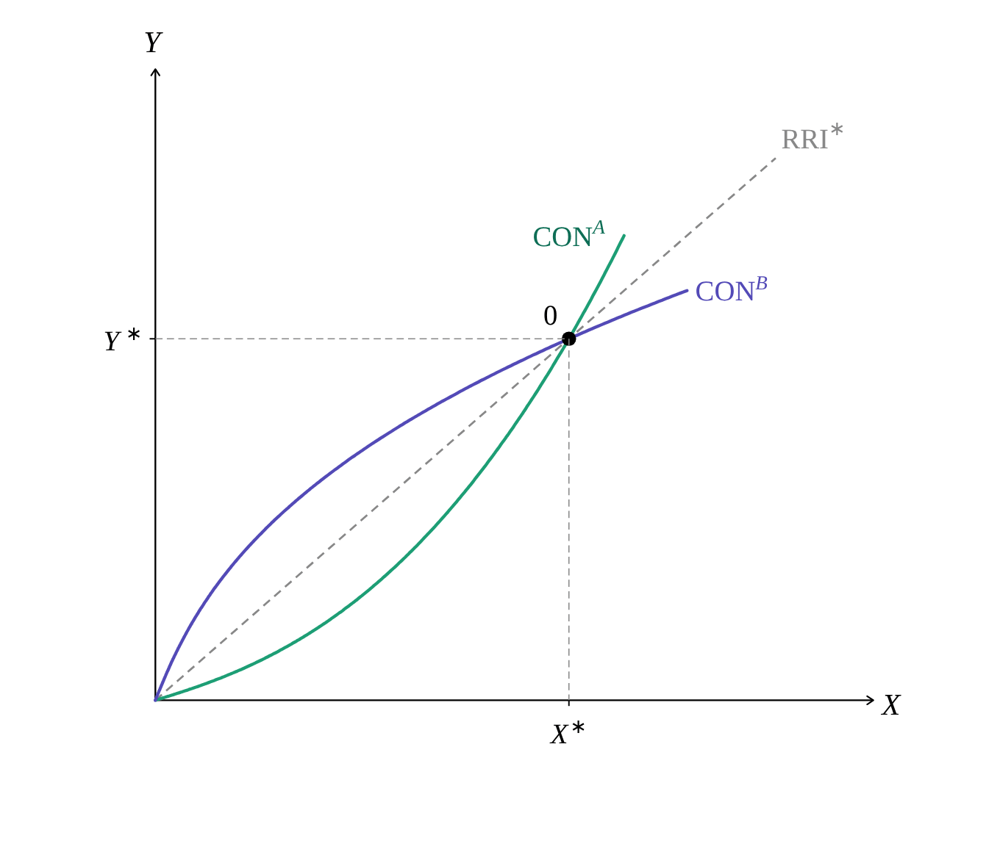
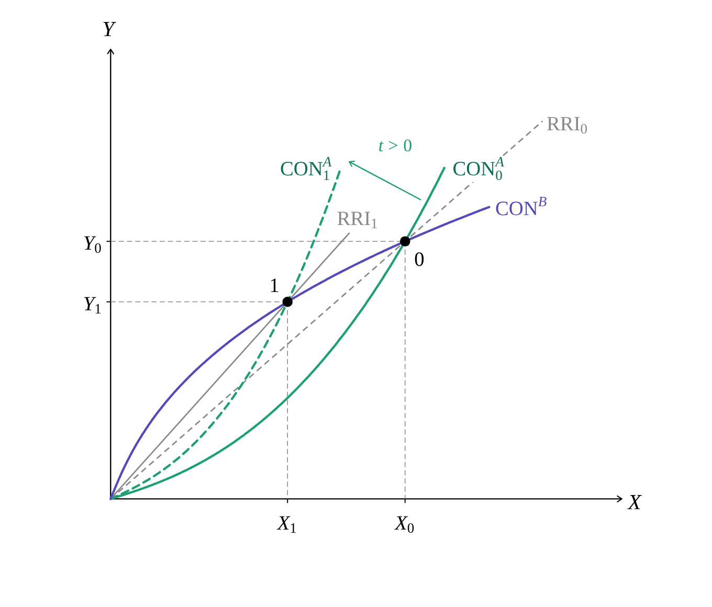
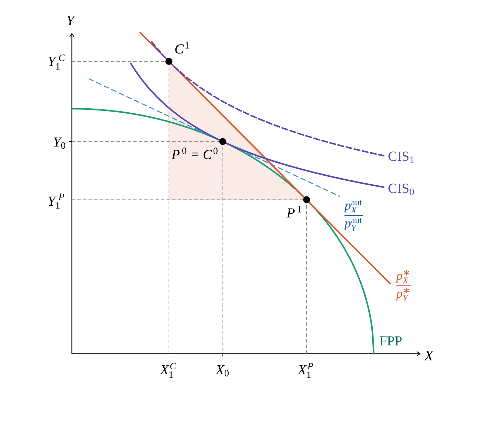
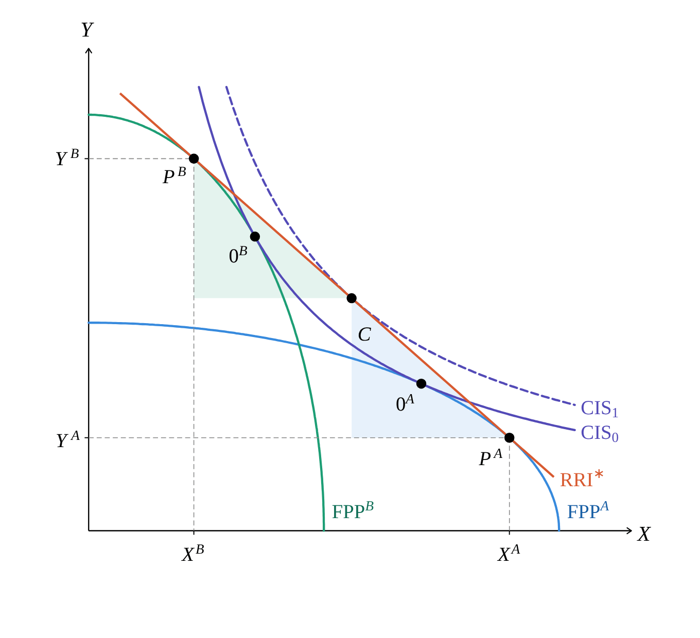
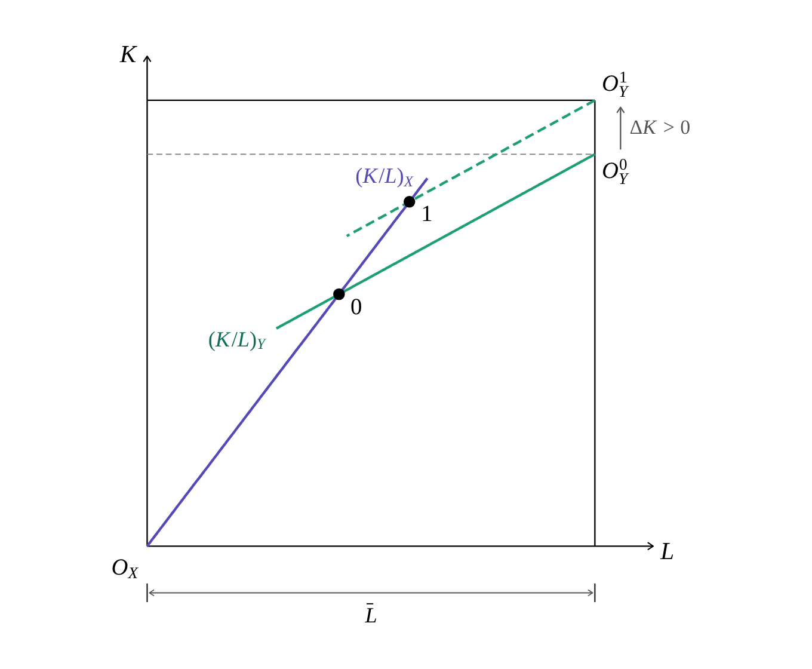
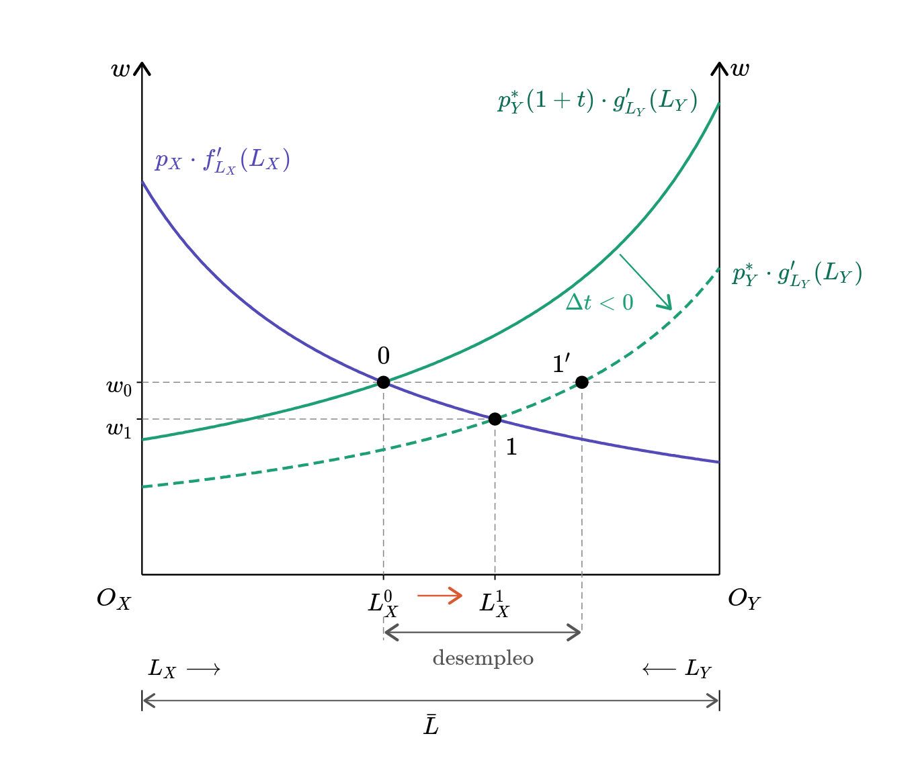

## Introducción



Este tema recorre en orden cronológico la teoría tradicional del comercio internacional:

- *Antecedentes clásicos*: se estudian las teorías de Smith, Ricardo y Mill.

- *Teoría neoclásica*: el tema expone las teorías de Marshall y Haberler y el modelo de Heckscher-Ohlin-Samuelson (HOS), con sus teoremas, y el modelo de factores específicos.

- *Revisiones de la teoría tradicional*: la última sección recoge las revisiones que levantan sus supuestos.

En todos sus modelos el comercio surge porque cada bien tiene un precio relativo de autarquía distinto en cada país, y lo que cambia entre ellos son las causas de esa disparidad.

## 1. Antecedentes y fundamentos de la teoría neoclásica: teorías clásicas sobre el comercio internacional

Las teorías clásicas sentaron los fundamentos de la teoría neoclásica. Smith explicó el comercio por la ventaja absoluta y Ricardo por la ventaja comparativa, mientras que Mill completó el análisis con las demandas recíprocas, que determinan la relación real de intercambio.

### 1.1. Teoría de la ventaja absoluta (Smith, 1776)

**Origen**: la principal motivación que llevó a Smith a contribuir a la teoría comercial fue refutar las ideas mercantilistas sobre el librecambio[^b05-1]. Para el mercantilismo, una economía crecía por causas monetarias más que reales, de modo que acumular oro y riqueza debía guiar la política económica. Esa acumulación exigía vender al exterior más de lo que se compraba, y el superávit comercial se buscaba con medidas proteccionistas. En consecuencia, esta escuela de pensamiento consideraba el comercio exterior un *juego de suma cero*, es decir, lo que un país ganaba con el intercambio, otro lo perdía necesariamente.

**Idea**: frente al mercantilismo, Smith rechaza el proteccionismo y ve en el libre comercio, tanto interior como exterior, un *juego de suma positiva*, y su argumento descansa en el concepto de *ventaja absoluta*.

**Razonamiento**: este concepto puede ilustrarse a través de un conocido ejemplo en el que Inglaterra y Portugal producen paño y vino, inicialmente en autarquía:

| | Paño (metros/h) | Vino (litros/h) |
|---|---|---|
| Inglaterra | 2 | 4 |
| Portugal | 1 | 8 |

: Producción por hora de trabajo en el ejemplo de la ventaja absoluta. {#tbl-b05-ventaja-absoluta}

Un país posee ventaja absoluta en un bien cuando lo produce con un coste unitario, medido en horas de trabajo, inferior al de cualquier otro país o, lo que es lo mismo, con un producto medio del trabajo más alto. Ese país puede entonces destinar todos sus recursos al bien en cuestión y vendérselo después a los demás países, en un intercambio que beneficia a todas las partes.

En el ejemplo, la ventaja absoluta en paño corresponde a Inglaterra (2 metros por hora frente a 1) y la del vino a Portugal (8 litros por hora frente a 4). A cada país le conviene, así, volcarse por completo en su bien y conseguir el otro comerciando.

El *precio relativo internacional* o *relación real de intercambio* (*terms of trade*, RRI)[^b05-2] equivale a la inversa del tipo de cambio real[^b05-3]. Siempre que la RRI se encuentre estrictamente entre los precios relativos de autarquía de cada país, intervalo beneficioso para ambos, les convendrá especializarse y comerciar. Smith resume esta idea en una conocida frase, según la cual “todo padre de familia prudente tendrá como máxima nunca producir en su casa un bien que sea más barato comprar”.

En Smith conviven, además, dos argumentos de naturaleza distinta a favor del libre comercio. Uno es estático, el de la ventaja absoluta, que reasigna recursos dados hacia sus usos más productivos. El otro es dinámico, el de la extensión del mercado, según el cual la apertura amplía el mercado y, con él, la división del trabajo. Además, la apertura da empleo a recursos que en autarquía quedarían ociosos y eleva la productividad a lo largo del tiempo. Este segundo argumento, menos formalizado, anticipa la literatura moderna sobre comercio y crecimiento (véase el tema [B09](b09-comercio-crecimiento.qmd)).

**Conclusiones**:

- *Aspectos positivos*: constituye una primera aproximación a la explicación de las causas del comercio internacional y del patrón de comercio. La causa del comercio es la posibilidad de ganancias mutuas en un juego de suma positiva, pues la especialización que permite el comercio aumenta el producto total. El patrón de comercio (qué produce cada país) se explica, a su vez, por las diferencias tecnológicas absolutas.

- *Limitaciones*: no explica por qué países con ventaja absoluta en todos los sectores participan en el comercio internacional, ni cómo se fija la relación real de intercambio, y solo admite la especialización total por considerar una tecnología de proporciones fijas.

### 1.2. Teoría de la ventaja comparativa (Ricardo, 1817)

**Origen**: David Ricardo, en sus *Principios de economía política y tributación* (1817), amplía la visión de Smith al introducir el concepto de *ventaja comparativa*. La ventaja comparativa resuelve la primera de las limitaciones anteriores, pues explica que un país sin ventaja absoluta alguna participe, con beneficio, en el comercio internacional.

**Idea**: la ventaja comparativa descansa en el concepto de *coste de oportunidad*[^b05-7]. El coste de oportunidad de un bien en términos de otro hace referencia al número de unidades del “otro bien” que podrían haberse producido con los recursos destinados a producir una unidad del bien “de referencia”.

La ventaja comparativa aplica el concepto de coste de oportunidad al ámbito internacional como criterio de producción e intercambio. Un país tiene ventaja comparativa en la producción de un bien si el coste de oportunidad de producir ese bien (en términos de otros bienes) en ese país es menor que en otros países.

**Razonamiento**: la ventaja comparativa se puede calcular de dos formas equivalentes:

1. *Intrapaís*: como el coste relativo o la productividad relativa de la fabricación de los dos bienes en el mismo país. Esto significa calcular una ratio de los costes unitarios absolutos o de las productividades medias de cada bien.

2. *Interpaís*: como el coste relativo o la productividad relativa de la fabricación del mismo bien en cada país. De nuevo, esto significa calcular la ratio de los costes unitarios absolutos o de las productividades medias del mismo bien en ambos países.

El concepto se puede ilustrar mediante una variante del ejemplo anterior, en la que se supone una mejora tecnológica en Inglaterra, como la derivada de su industrialización durante los siglos XVIII y XIX, que le otorga ventaja absoluta en la producción de ambos bienes:

| | Paño (metros/h) | Vino (litros/h) | C.O. del paño (en vino) | C.O. del vino (en paño) |
|---|---|---|---|---|
| Inglaterra | 6 | 12 | 2 | 1/2 |
| Portugal | 1 | 8 | 8 | 1/8 |

: Producción por hora de trabajo y coste de oportunidad en el ejemplo de la ventaja comparativa. {#tbl-b05-ventaja-comparativa}

El razonamiento procede en tres pasos:

1. *Ventaja absoluta doble*: Inglaterra produce ahora más paño y más vino por hora de trabajo que Portugal.

2. *Costes de oportunidad*: sin embargo, el del paño es menor en Inglaterra (2 litros de vino por metro) que en Portugal (8 litros), y el del vino es menor en Portugal (1/8 de metro de paño por litro) que en Inglaterra (1/2 metro).

3. *Ganancias mutuas*: por tanto, aunque Inglaterra tiene ventaja absoluta en la producción de ambos bienes, los dos países ganan con el comercio siempre que la RRI internacional se sitúe, de nuevo, estrictamente entre sus precios relativos de autarquía. Cada país se especializará totalmente en el sector en el que tenga ventaja comparativa, e industrias de países tecnológicamente menos avanzados en términos absolutos podrán competir internacionalmente si tienen ventaja comparativa.

En conclusión, lo relevante no es la productividad de cada una de las industrias (las diferencias tecnológicas absolutas), sino el coste de oportunidad de fabricar una cosa u otra (las diferencias tecnológicas relativas).

**Extensiones**: Dornbusch, Fischer y Samuelson (1977) generalizan el modelo a un continuo de bienes ordenados según la ventaja comparativa. La tecnología y la demanda determinan juntas el salario relativo, y este fija el bien frontera que separa los bienes que produce cada país. Con costes de transporte surge, además, una franja endógena de bienes no comerciables (Anexo A.3).

**Conclusiones**:

- *Aspectos positivos*: la causa del comercio sigue siendo la misma que en Smith, la existencia de ganancias mutuas en un juego de suma positiva. El patrón de comercio (qué produce cada país) pasa, en cambio, a explicarse por las diferencias tecnológicas relativas, lo que extiende las ganancias del comercio incluso a los países sin ventaja absoluta alguna. La ventaja comparativa se convertirá, desde entonces, en la piedra angular de toda la teoría pura del comercio.

- *Limitaciones*: sigue sin determinar la relación de precios internacionales, que queda simplemente acotada entre los precios de autarquía, y sigue considerando la especialización total, consecuencia de la tecnología lineal de un solo factor.

### 1.3. Teoría de las demandas recíprocas (Mill, 1848)

**Origen**: John Stuart Mill partió del germen contenido en la obra de su padre, James Mill (1821). Sobre esa base, definió con precisión el concepto de relación real de intercambio y dio una explicación teórica de las causas que la determinaban. Lo hizo primero en 1844 y, de forma definitiva, en sus *Principios de economía política* (1848)[^b05-9][^b05-10].

**Idea**: según Mill, la relación real de intercambio depende de la fuerza relativa de la demanda de productos importados de cada país, puesto que esta, a su vez, determina la oferta de productos exportados con la que pagarlos. Estas demandas se conocen como *demandas recíprocas*, pues la demanda de importaciones de un país constituye, simultáneamente, su oferta de exportaciones.

**Razonamiento**: el equilibrio internacional se alcanza en aquella RRI para la cual la cantidad que cada país desea importar coincide exactamente con la cantidad que el otro desea exportar.

De este planteamiento se derivan dos implicaciones de interés:

1. *Determinación de la RRI dentro de los límites ricardianos*: la relación real de intercambio de equilibrio se sitúa en algún punto del intervalo definido por los precios relativos de autarquía, y su posición concreta depende de la intensidad relativa de las demandas recíprocas.

2. *El reparto de las ganancias*: de lo anterior se sigue que el reparto no tiene por qué ser igualitario. En particular, un país pequeño cuya demanda apenas influye en los precios mundiales tenderá a comerciar a una RRI próxima a los precios de autarquía del país grande, con lo que capturará la mayor parte de las ganancias del intercambio. Este resultado se conoce en la literatura como la “importancia de ser poco importante”.

**Conclusiones**:

- *Aspectos positivos*: los historiadores del pensamiento económico han elogiado a Mill por sus aportaciones teóricas al comercio internacional, pues cerró, conceptualmente, el problema que Ricardo había dejado abierto, la determinación de la relación real de intercambio.

- *Limitaciones*: sin embargo, aunque ofrece una definición precisa de la RRI y una teoría verbal de su determinación, su aportación no proporciona un instrumento analítico que permita obtenerla. Esa formalización habrá de esperar a las curvas de oferta neta de Marshall (apartado 2.1).

### 1.4. Conclusiones

Los autores clásicos habían explicado tres cuestiones fundamentales, por qué comercian los países, cuál es su patrón de comercio y qué determina la relación real de intercambio. Ricardo extendió las ganancias del comercio a los países sin ventaja absoluta, y Mill explicó la RRI, que Ricardo solo acotaba entre los precios de autarquía.

Sus planteamientos adolecían, sin embargo, de dos carencias:

- *Supuestos restrictivos*: consideraban, fundamentalmente, una tecnología lineal, de proporciones fijas y coste unitario constante, de manera que la especialización siempre era completa.

- *Falta de formalismo*: sus argumentos eran esencialmente verbales y numéricos, sin un aparato analítico que permitiera derivar los resultados con generalidad.

La revolución marginalista permitió superar ambas carencias y plantear modelos más próximos a la realidad, con varios factores de producción y especialización parcial. Surgieron así dos líneas de aportaciones, las que siguieron un enfoque de equilibrio parcial, debidas a Alfred Marshall, y las que siguieron un enfoque de equilibrio general, que ofrecen una panorámica más completa.

## 2. Teoría neoclásica del comercio internacional de bienes y servicios

La teoría neoclásica parte de las curvas de oferta neta, en equilibrio parcial con Marshall y en equilibrio general con Edgeworth. Siguen, ya en equilibrio general, la reformulación de la ventaja comparativa de Haberler y las ventajas dotacionales del modelo Heckscher-Ohlin-Samuelson, y la sección termina con los teoremas derivados del modelo y con el modelo de factores específicos, su versión a corto plazo.

### 2.1. Determinación de la relación real de intercambio: las curvas de oferta neta (Marshall, 1879; Edgeworth, 1894)

**Origen**: la primera aportación destacada se debe a Alfred Marshall (1879), que presenta las curvas de oferta neta (*offer curves*), formalización del concepto de demanda recíproca de Mill que permite obtener la RRI de equilibrio por vía gráfica. Francis Edgeworth (1894) las incorporó después a su teoría de los valores internacionales, con un enfoque que puede considerarse de equilibrio general, pues las combina con las curvas de indiferencia que había introducido en 1881.

**Idea**: la *curva de oferta neta* es el lugar geométrico de las combinaciones de exportaciones e importaciones que un país desea intercambiar a cada relación real de intercambio internacional, es decir, de las exportaciones que entregaría a cambio de cada volumen de importaciones[^b05-13].

#### 2.1.1. Supuestos

**Entorno**: se consideran dos bienes, X exportable e Y importable, con libre movilidad intersectorial de los factores y pleno empleo[^b05-14].

**Agentes**: no se considera el destino que el sector público da a los ingresos arancelarios[^b05-15].

**Mercados**: hay competencia perfecta en todos los mercados, nacionales e internacionales, y no hay costes de transporte.

**Sector exterior**: no existen pagos ni deuda al margen de los flujos de mercancías, de modo que la balanza comercial está equilibrada en todo momento y $Y = (p_X / p_Y) \cdot X$.

#### 2.1.2. Modelo

**Planteamiento**: las curvas de oferta neta pasan por el origen[^b05-16] y son simétricas entre sí, pues los ejes de exportaciones e importaciones de un país son, respectivamente, los de importaciones y exportaciones del otro[^b05-17]. Presentan además dos rasgos:

1. *Ambigüedad*: pueden presentar un tramo elástico de pendiente positiva y otro inelástico de pendiente negativa[^b05-18]. En el *tramo elástico*, cuantas más importaciones se deseen, más exportaciones se requieren para adquirirlas, de modo que la curva es creciente y se califica de normal. En el *tramo inelástico*, por el contrario, la RRI resulta tan favorable que pueden importarse más unidades aunque las exportaciones caigan, caso que suele calificarse de anómalo[^b05-19]. La elasticidad relevante, cuyo valor determina tanto la forma de la curva como la estabilidad del equilibrio, es la de la demanda de importaciones respecto de la RRI.

2. *Convexidad*: siempre que la frontera de posibilidades de producción (FPP) sea cóncava[^b05-20], las curvas de oferta neta serán convexas en el plano exportaciones-importaciones de cada país. En el tramo elástico, la convexidad implica que, ante un aumento de la RRI, aumentan tanto las exportaciones como las importaciones, si bien estas últimas proporcionalmente más que las primeras.

Como caso límite, una curva perfectamente elástica (creciente y recta) describe a una economía dispuesta a comerciar cualquier volumen a la RRI dada. Así ve un país pequeño la curva del resto del mundo, pues la oferta neta del país pequeño no basta para alterar la RRI.

**Equilibrio**: se parte de precios relativos de autarquía distintos en cada país, pues de lo contrario no habría comercio[^b05-23], con $p_X^B / p_Y^B > p_X^A / p_Y^A$, de donde resulta un exceso de oferta del bien Y en B y un exceso de demanda en A. El intercambio solo tendrá lugar si la RRI internacional se sitúa estrictamente entre ambos precios de autarquía, $\text{RRI}^* \in (p_X^A/p_Y^A, \; p_X^B/p_Y^B)$. El equilibrio se alcanza en el corte de ambas curvas, con la balanza comercial equilibrada tanto en el conjunto del mundo como en cada país, y presenta tres propiedades:

- *Unicidad*: exige que las curvas se corten una sola vez, lo que queda garantizado si ambas son elásticas en todo su recorrido.

- *Estabilidad*: exige el cumplimiento de la *condición de Marshall-Lerner*, es decir, que la suma de las elasticidades, en valor absoluto, de las demandas de importaciones de ambos países supere la unidad. En términos cambiarios, partiendo de una balanza comercial equilibrada y con ofertas infinitamente elásticas, equivale a exigir que las depreciaciones reales mejoren la balanza comercial.

- *Reparto de las ganancias*: los precios de equilibrio definen dos *triángulos de comercio* congruentes, cuyos catetos son las exportaciones e importaciones de cada país. El reparto depende de dónde quede la RRI dentro del intervalo de participación. Así, cuanto más próxima al precio de autarquía de un país, menor será su ganancia, en línea con Mill.

En el equilibrio se alcanza un óptimo paretiano en el que las ganancias del intercambio están agotadas. El mecanismo de precios vacía todos los mercados y, por la ley de Walras, que se cumple a cualquier RRI, basta con que se vacíe uno para que se vacíe el otro.

**Desarrollo gráfico**: la determinación de la RRI se representa en el plano bien X-bien Y (figura -@fig-b051-cons):

1. *Curva de oferta neta de A*, $\text{CON}^A$: recoge las exportaciones de X que A ofrece a cambio de cada volumen de importaciones de Y. Sale del origen con pendiente igual a su precio relativo de autarquía, $p_X^A/p_Y^A$, porque con volúmenes de comercio muy pequeños el país solo intercambia a su coste de oportunidad interno. Es convexa, porque la FPP es cóncava.

2. *Curva de oferta neta de B*, $\text{CON}^B$: simétrica de la anterior, recoge las exportaciones de Y que B ofrece a cambio de importaciones de X y sale del origen con pendiente $p_X^B/p_Y^B$, por la misma razón.

3. *Equilibrio*: el corte de ambas curvas fija los volúmenes de comercio, $X^*$ e $Y^*$, y la RRI de equilibrio, $\text{RRI}^*$, pendiente del radio vector que pasa por él.

::: {#fig-b051-cons}

::: {.content-visible when-format="html"}
```{=html}
<div class="graph-frame">
<iframe src="../graphs/b051_CONs.html" style="height:620px" loading="lazy" title="fig-b051-cons"></iframe>
</div>
```
:::

::: {.content-visible unless-format="html"}

:::

Curvas de oferta neta (Marshall-Edgeworth). La relación real de intercambio de equilibrio se determina en la intersección de ambas curvas.
:::

**Estática comparativa**:

::: {.callout-note appearance="simple" icon=false}
Los instrumentos de política comercial y sus efectos se desarrollan en los temas [B07](b07-politica-comercial-i.qmd) y [B08](b08-politica-comercial-ii.qmd), y el crecimiento empobrecedor, en el tema [B09](b09-comercio-crecimiento.qmd), apartado 1.3.2.
:::

- *Arancel en un país pequeño*: al no poder influir sobre la RRI, la curva de oferta neta del país se contrae hacia el origen mientras la del resto del mundo permanece inalterada. Aumenta la producción del bien importable protegido, se reducen tanto exportaciones como importaciones y el Estado recauda el arancel. La curva de indiferencia social alcanzada queda así más próxima al origen, y la pérdida de bienestar es inequívoca, pues el país soporta íntegramente el coste de la distorsión sin ganancia alguna a cambio.

- *Arancel en un país grande*: al pesar su demanda en el mercado mundial, la contracción de su curva altera la RRI de equilibrio. Gráficamente, en el plano bien X-bien Y (figura -@fig-b052-cons-tariff), el arancel de A ($t > 0$) hace girar su curva de oferta neta hacia dentro, de $\text{CON}^A_0$ a $\text{CON}^A_1$, y el equilibrio pasa del punto 0 al 1. El comercio se reduce, de $X_0$ e $Y_0$ a $X_1$ e $Y_1$, y la RRI mejora para A, de $\text{RRI}_0$ a $\text{RRI}_1$.

    Operan así dos efectos contrapuestos. El *efecto distorsión* reduce el bienestar como en el caso anterior, mientras que el *efecto relación real de intercambio* lo eleva, pues la caída del precio internacional del bien importable traslada parte de la carga a los productores extranjeros. De su combinación resulta la existencia teórica de un *arancel óptimo* positivo, aquel que maximiza la diferencia entre ambos[^b05-25]. El efecto sobre el bienestar mundial es, en cambio, inequívocamente negativo, porque la ganancia de RRI de un país es exactamente la pérdida del otro, mientras que la pérdida de eficiencia es común.

::: {#fig-b052-cons-tariff}

::: {.content-visible when-format="html"}
```{=html}
<div class="graph-frame">
<iframe src="../graphs/b052_CONs_tariff.html" style="height:620px" loading="lazy" title="fig-b052-cons-tariff"></iframe>
</div>
```
:::

::: {.content-visible unless-format="html"}

:::

Efecto de un arancel sobre las curvas de oferta neta. La curva del país que lo impone gira hacia dentro y, si el país es grande, mejora su relación real de intercambio.
:::

- *Corolario*: en ambos casos, si hay dos factores de producción, se aplica además el teorema de Stolper-Samuelson. El factor que el sector protegido emplea con mayor intensidad ve crecer, pues, su retribución real. En el país grande ello exige que el precio interno del importable suba pese a la mejora de la RRI, lo que equivale a descartar la paradoja de Metzler (1949). En ella, el precio mundial del importable cae tanto que su precio interno desciende y el efecto distributivo se invierte.

- *Perturbación tecnológica*: una mejora que permita producir ambos bienes con mayor eficiencia desplaza, salvo que su sesgo sea ultra-anticomercial, la curva de oferta neta hacia la derecha. El desplazamiento significa que el país está dispuesto a exportar más por cada volumen de importaciones. Si el país es grande, ello deteriora su relación real de intercambio.

#### 2.1.3. Conclusiones

**Aspectos positivos**: completa el análisis clásico al permitir determinar la RRI a partir de la interacción de las curvas, admite una función de producción no lineal e ilustra visualmente las ganancias del comercio. 

**Limitaciones**: la versión marshalliana[^b05-26] sigue un enfoque de equilibrio parcial, centrado en determinar la RRI al margen de las interrelaciones con el resto de la economía.

### 2.2. Enfoque de equilibrio general: la reformulación de la ventaja comparativa (Haberler, 1936)

**Origen**: Gottfried von Haberler (1936; edición alemana de 1933) reformuló la ventaja comparativa en términos de coste de oportunidad, apoyándose en una tecnología no lineal con dos factores. Su contribución es doble. Representa el lado de la oferta mediante la frontera de posibilidades de producción, cuya pendiente mide el coste de oportunidad, e ilustra, junto con el lado de la demanda, los efectos de la apertura en un modelo reducido de equilibrio general.

**Idea**: la ventaja comparativa se debe tanto a la tecnología como a las preferencias, pues ambas determinan el precio relativo de autarquía, cuya comparación con el internacional fija el patrón de comercio.

#### 2.2.1. Supuestos

**Entorno**: la economía es pequeña, con competencia perfecta y libre comercio sin restricciones ni costes de transporte.

**Agentes**: los consumidores son propietarios de los factores y de la tecnología, con función de utilidad continua, creciente, cuasicóncava y diferenciable.

**Tecnología**: se producen dos bienes comerciables, X exportable e Y importable, ambos normales, con dos factores (K y L). Las productividades marginales son positivas y decrecientes, con rendimientos constantes a escala, y la intensidad factorial difiere entre bienes, requisito sin el cual la FPP no resultaría cóncava. Los factores son homogéneos, perfectamente divisibles y de dotación dada.

#### 2.2.2. Modelo

**Planteamiento**: el modelo combina la oferta y la demanda de la economía:

- *Oferta*: la FPP recoge las cantidades máximas de bienes que el país puede producir dada su tecnología y dotación[^b05-28]. Es cóncava por las propiedades de la función de producción, y su pendiente en el plano $(X, Y)$ es, en valor absoluto, la relación marginal de transformación (el coste de oportunidad de X en términos de Y).

- *Demanda*: las curvas de indiferencia social representan combinaciones de igual utilidad, tanto mayor cuanto más alejadas del origen.

**Equilibrio**:

- *Autarquía*: exige la coincidencia de las pendientes de la FPP, de la curva de indiferencia y de la restricción presupuestaria[^b05-29]:

    $$\text{RMT}_{YX}^{\text{aut}} = \text{RMS}_{YX}^{\text{aut}} = p_X^{\text{aut}} / p_Y^{\text{aut}}$$

    En autarquía, el precio relativo viene determinado por las condiciones interiores de oferta y demanda y, en competencia perfecta, no existen excesos de oferta ni de demanda, por lo que se consume exactamente lo que se produce.

- *Apertura*: la economía pequeña toma los precios exteriores, que en general difieren de los de autarquía, con lo que la triple tangencia se rompe y producción y consumo se separan:

    $$\text{RMT}_{YX}(P^1) = p_X^*/p_Y^* = \text{RMS}_{YX}(C^1), \qquad P^1 \neq C^1$$

    Si el bien X es relativamente más caro en el exterior, el país produce más X y menos Y, y la diferencia entre producción y consumo se cubre mediante exportaciones e importaciones. A diferencia del modelo ricardiano, la especialización no tiene por qué ser completa, al no ser lineal la tecnología. El país alcanza una curva de indiferencia superior a la de autarquía, si bien la teoría solo garantiza la mejora del bienestar y no el aumento del consumo de ambos bienes, pues el efecto sustitución podría reducir el del bien exportable, ahora relativamente más caro.

**Desarrollo gráfico**: los efectos de la apertura se representan en el plano bien X-bien Y (figura -@fig-b053-haberler):

1. *Frontera de posibilidades de producción*, $\text{FPP}$: recoge las cantidades máximas de ambos bienes que permiten la tecnología y la dotación. Es cóncava, porque el coste de oportunidad de X crece a medida que se produce más, al diferir la intensidad factorial entre bienes, y su pendiente es la relación marginal de transformación.

2. *Curvas de indiferencia social*, $\text{CIS}_0$ y $\text{CIS}_1$: representan un bienestar tanto mayor cuanto más alejadas del origen.

3. *Rectas de precios*: la de autarquía, de pendiente $p_X^{\text{aut}}/p_Y^{\text{aut}}$, y la internacional, más inclinada, de pendiente $p_X^*/p_Y^*$.

4. *Equilibrio*: en autarquía, producción y consumo coinciden en $P^0 = C^0$, sobre la $\text{CIS}_0$. Con apertura, la producción pasa a $P^1$ y el consumo a $C^1$, sobre la $\text{CIS}_1$. La ganancia queda reflejada en el paso de la $\text{CIS}_0$ a la $\text{CIS}_1$, y el intercambio, en el triángulo de comercio, cuya hipotenusa es la recta de la RRI internacional y cuyos catetos son las exportaciones, $X_1^P - X_1^C$, y las importaciones, $Y_1^C - Y_1^P$.

::: {#fig-b053-haberler}

::: {.content-visible when-format="html"}
```{=html}
<div class="graph-frame">
<iframe src="../graphs/b053_Haberler.html" style="height:575px;max-width:591px" loading="lazy" title="fig-b053-haberler"></iframe>
</div>
```
:::

::: {.content-visible unless-format="html"}

:::

Reformulación de Haberler (1936). Con costes de oportunidad crecientes la frontera de posibilidades de producción es cóncava y la especialización es incompleta.
:::

**Estática comparativa**:

- *Arancel*: eleva el precio relativo interno del bien importable por encima del internacional, lo que genera una *doble distorsión*. En la producción, los productores se desplazan a lo largo de la FPP hacia el bien protegido, con lo que la economía deja de maximizar el valor de su producción a precios mundiales. En el consumo, los consumidores igualan su relación marginal de sustitución al precio interno distorsionado y no a la RRI. El resultado es la contracción del triángulo de comercio y una curva de indiferencia más próxima al origen. Esta descomposición constituye la principal aportación del marco respecto del anterior, pues permite separar ambas fuentes de pérdida.

- *Perturbación tecnológica*: desplaza la FPP hacia afuera, de forma neutral o sesgada hacia el sector favorecido. Para la economía pequeña, que toma la RRI como dada, la ganancia de bienestar es inequívoca, y el volumen de comercio aumentará en la medida en que la mejora esté sesgada hacia el sector exportador.

#### 2.2.3. Conclusiones

**Aspectos positivos**: incorpora las decisiones de consumo, muestra que las ganancias del comercio proceden tanto de la especialización en la producción como del intercambio en el consumo y que las preferencias intervienen en la determinación del precio relativo de autarquía. Además, su marco de equilibrio general reducido (FPP más curvas de indiferencia social) se convertirá en el instrumental estándar sobre el que se construye el modelo de Heckscher-Ohlin-Samuelson.

**Limitaciones**: no explica por qué difieren los costes relativos entre países. Si el trabajo es el único factor, como en Ricardo, las diferencias solo pueden proceder de la productividad, pero en la realidad el comercio se ve influido también por las dotaciones de recursos. Responder a esa cuestión será la aportación del modelo de las ventajas dotacionales.

### 2.3. Enfoque de equilibrio general: las ventajas dotacionales (Heckscher, 1919; Ohlin, 1933; Stolper y Samuelson, 1941)

**Origen**: el modelo se debe a los economistas suecos Eli Heckscher (1919) y Bertil Ohlin (1933) y, posteriormente, a Paul Samuelson (Stolper y Samuelson, 1941; Samuelson, 1948b), que formalizó matemáticamente sus intuiciones.

**Idea**: las diferencias de ventaja comparativa proceden de las distintas dotaciones relativas de factores y de las distintas intensidades factoriales de cada bien. Frente a la tradición ricardiana, que la localizaba en las diferencias tecnológicas, el modelo supone tecnologías idénticas y desplaza la explicación hacia los recursos, de donde su denominación alternativa de teoría de las *proporciones factoriales*.

#### 2.3.1. Supuestos

**Entorno**: existen dos países que comercian libremente, sin costes de transporte y en competencia perfecta en todos los mercados, con dotaciones absolutas de factores fijas. El país A es relativamente abundante en capital y el B en trabajo, abundancia que admite doble definición:

- *En términos físicos*: $(K^A/L^A) > (K^B/L^B)$[^b05-30].

- *En términos de precios*: $(r/w)^A < (r/w)^B$ en autarquía.

**Agentes**: las preferencias son homotéticas[^b05-31] e idénticas entre países, con función de utilidad continua, creciente, cuasicóncava y diferenciable.

**Tecnología**: ambos países emplean la misma tecnología, con propiedades neoclásicas de buen comportamiento[^b05-33], lo que hace que la especialización completa no sea necesaria con carácter general. Los factores son homogéneos, divisibles, perfectamente móviles dentro de cada país e inmóviles internacionalmente. El bien X es relativamente intensivo en capital y el Y en trabajo, y esa intensidad es irreversible (un cambio en los precios relativos de los factores no puede invertir la clasificación).

De ello se sigue que A tendrá ventaja comparativa en X y B en Y. Ambos países son idénticos salvo en su dotación relativa, de modo que cualquier diferencia en su comportamiento comercial ha de atribuirse necesariamente a esa única asimetría.

#### 2.3.2. Modelo

El **teorema de Heckscher-Ohlin** establece que un país exportará el bien cuya producción es intensiva en el factor que le resulta relativamente abundante.

**Planteamiento**: los países presentan un *sesgo de producción*, es decir, sus FPP están sesgadas hacia el eje del bien que usa intensivamente su factor abundante, de modo que ante una misma RRI adoptan decisiones de producción distintas[^b05-35]. El mapa de curvas de indiferencia es, sin embargo, común, por ser las preferencias idénticas, y cualquier rayo desde el origen corta todas las curvas en puntos de igual pendiente, por ser homotéticas.

**Equilibrio**:

- *Autarquía*: cada país se sitúa en su equilibrio con triple tangencia, de modo que A queda relativamente especializado en X y B en Y, y el precio relativo de X resulta menor en A que en B[^b05-36].

- *Apertura*: si la RRI queda comprendida entre ambos precios de autarquía, los países participan. En ausencia de costes de transporte la RRI es común, lo que produce una convergencia de los precios relativos. Así, el precio de X sube en A, donde era barato, y baja en B, donde era caro. Esa convergencia de los precios de los bienes es el mecanismo que transmitirá sus efectos a los precios de los factores, como muestran los teoremas de Stolper-Samuelson y de igualación del precio de los factores.

De ahí resultan tres conclusiones:

1. *Oferta*: se cumple el teorema, pues cada país se especializa en el bien intensivo en su factor abundante, sin que la especialización llegue a ser completa[^b05-37]. 

2. *Demanda*: ambos consumen X e Y en la misma proporción, sobre el mismo rayo desde el origen, en puntos que solo difieren según su renta. En la figura, ambos países tienen la misma renta a precios internacionales y consumen en el mismo punto C. 

3. *Bienestar*: los triángulos de comercio son iguales y ambos países alcanzan curvas de indiferencia superiores a las de autarquía.

**Desarrollo gráfico**: el teorema de Heckscher-Ohlin se representa en el plano bien X-bien Y (figura -@fig-b054-hos):

1. *Fronteras de posibilidades de producción*, $\text{FPP}^A$ y $\text{FPP}^B$: la de A, sesgada hacia el eje de X, y la de B, hacia el eje de Y, cada una hacia el bien intensivo en el factor abundante del país.

2. *Curvas de indiferencia social*, $\text{CIS}_0$ y $\text{CIS}_1$: un mapa común a ambos países, por ser las preferencias idénticas y homotéticas.

3. *Recta de la RRI*, $\text{RRI}^*$: común a ambos países y tangente a las dos fronteras.

4. *Equilibrio*: en autarquía, cada país se sitúa en la tangencia de su frontera con la $\text{CIS}_0$ (puntos $0^A$ y $0^B$). Con apertura, A produce en $P^A$ y B en $P^B$, y ambos consumen en el punto C, sobre la $\text{CIS}_1$.

::: {#fig-b054-hos}

::: {.content-visible when-format="html"}
```{=html}
<div class="graph-frame">
<iframe src="../graphs/b054_HOS.html" style="height:550px;max-width:567px" loading="lazy" title="fig-b054-hos"></iframe>
</div>
```
:::

::: {.content-visible unless-format="html"}

:::

Modelo Heckscher-Ohlin-Samuelson. Cada país exporta el bien intensivo en su factor abundante, y el gráfico muestra las ganancias del comercio con especialización incompleta.
:::

**Estática comparativa**: los efectos de un cambio en los precios relativos y en las dotaciones de factores los recogen los teoremas de Stolper-Samuelson y de Rybczynski.

#### 2.3.3. Conclusiones

**Aspectos positivos**: el modelo es una de las contribuciones neoclásicas más influyentes, y la idea de que el comercio viene determinado en gran medida por las diferencias de recursos constituye una de las teorías centrales de la economía internacional.

**Limitaciones**: su contraste empírico ha generado una literatura propia. En 1953, Wassily Leontief contrastó el modelo con la tabla *input-output* estadounidense de 1947 y obtuvo el resultado opuesto al previsto. Estados Unidos, relativamente abundante en capital, exportaba bienes relativamente intensivos en trabajo, mientras que la producción nacional que sustituía a sus importaciones era relativamente intensiva en capital. Entre las explicaciones propuestas figuran la omisión del capital humano (Kenen, 1965), la proximidad del periodo a la Segunda Guerra Mundial, las diferencias de productividad del trabajo y la posible reversión de la intensidad factorial (apartado 3.3.2). 

La literatura posterior refinó el diagnóstico, sobre todo mediante el contraste de la versión de Heckscher-Ohlin-Vanek (HOV, apartado 3.3.1):

- *Leamer (1980)*: mostró que, con comercio no equilibrado, el contraste estaba mal planteado y que con el test correcto los datos de 1947 resultaban compatibles con la teoría.

- *Bowen, Leamer y Sveikauskas (1987)*: en el primer contraste completo del modelo HOV, con doce factores y veintisiete países, encontraron, en cambio, que las predicciones de signo se cumplían poco más que por azar.

- *Trefler (1995)*: documentó el *comercio perdido* (*missing trade*), es decir, que el contenido factorial del comercio observado es muy inferior al previsto. El ajuste mejora, no obstante, al admitir diferencias tecnológicas y sesgo doméstico del consumo.

- *Davis y Weinstein (2001)*: mostraron que, al admitir diferencias tecnológicas entre países, la falta de igualación del precio de los factores y los costes del comercio, el modelo HOV acierta en el signo y, aproximadamente, en la magnitud del comercio de servicios factoriales.

### 2.4. Teoremas derivados del modelo HOS

El modelo dio lugar a tres teoremas que lo completan: Stolper y Samuelson (1941), igualación del precio de los factores (Samuelson, 1948b) y Rybczynski (1955), a los que se añade la relación de reciprocidad que vincula al primero con el tercero. 

Junto al propio teorema de Heckscher-Ohlin, estos teoremas forman las cuatro proposiciones centrales del modelo de proporciones factoriales. Dos describen las consecuencias del comercio, y dos, la estática comparativa ante cambios en los precios y en las dotaciones.

#### 2.4.1. Teorema de Stolper y Samuelson (1941)

**Origen**: lo formularon Wolfgang Stolper y Paul Samuelson, en *Protection and Real Wages* (1941).

**Idea**: si se producen ambos bienes, un aumento del precio relativo de un bien eleva la retribución real unitaria del factor utilizado intensivamente en su producción y reduce la del otro factor.

**Razonamiento**: el aumento del precio relativo de X que sigue a la apertura en el país A expande el sector X y contrae el Y. Como los factores se mueven libremente dentro del país, el sector Y libera trabajo y capital en la proporción en que los empleaba, intensiva en trabajo. El sector X, intensivo en capital, emplea a los precios vigentes de los factores menos trabajo por unidad de capital que el Y, por lo que, para absorber el capital liberado, solo necesita una parte del trabajo liberado. En el mercado de factores sobra entonces trabajo y aumenta la demanda relativa de capital, de modo que la retribución del capital sube y el salario baja.

**Extensiones**:

- *Efecto magnificación* (Jones, 1965): el incremento del precio nominal del factor beneficiado es proporcionalmente mayor que el del precio del bien, $\hat{r} > \hat{p}_X > \hat{p}_Y > \hat{w}$, lo que garantiza que su ganancia sea real y no solo nominal (Anexo A.1.1).

- *Oposición al libre comercio*: el teorema explica por qué determinados grupos se oponen a la apertura dentro de cada país. Así, en las economías avanzadas, relativamente abundantes en capital y trabajo cualificado, la apertura beneficia a estos y perjudica al trabajo poco cualificado, mientras que en los países en desarrollo ocurre lo contrario.

- *Políticas compensatorias*: siendo positivas las ganancias agregadas del comercio, existe en principio una redistribución que deja a todos mejor que en autarquía. Este resultado procede del teorema de las ganancias del comercio (Samuelson, 1962), no del de Stolper-Samuelson, que identifica a quiénes habría que compensar.

**Conclusiones**:

- *Aspectos positivos*: muestra que el comercio, además de generar ganancias agregadas, las reparte de forma desigual entre factores y produce así ganadores y perdedores identificables dentro de cada país.

- *Limitaciones*: supone que los factores se desplazan sin coste entre sectores y que ambos bienes siguen produciéndose, por lo que describe el ajuste a largo plazo. En cambio, a corto plazo, con factores específicos, ganadores y perdedores se definen por sectores y no solo por factores.

#### 2.4.2. Teorema de igualación del precio de los factores (Samuelson, 1948b)

**Origen**: lo formuló Paul Samuelson, en *International Trade and the Equalisation of Factor Prices* (1948b).

**Idea**: en ausencia de especialización completa y bajo los supuestos del modelo, el comercio internacional iguala los precios relativos y absolutos de los factores, pese a que estos sean internacionalmente inmóviles (Anexo A.1.2).

**Razonamiento**: la ley del precio único, la irreversibilidad factorial y la tecnología idéntica con rendimientos constantes igualan, por este orden, los precios de los bienes, los precios relativos de los factores y sus retribuciones absolutas.

**Extensiones**:

- *Sustituibilidad*: el libre comercio de bienes es un sustitutivo perfecto de la libre movilidad internacional de factores, pues el intercambio de bienes encierra un intercambio implícito de los factores incorporados en ellos.

- *Reciprocidad de la sustitución*: Robert Mundell (1957) demostró que, a la inversa, la libre movilidad de factores sustituye también al libre comercio de bienes.

**Conclusiones**:

- *Aspectos positivos*: pone de relieve que el comercio de bienes actúa sobre los precios de los factores aunque estos no crucen fronteras, pues los bienes incorporan los servicios de los factores con que se producen.

- *Limitaciones*: la evidencia muestra, sin embargo, la coexistencia de comercio y movimientos de factores, así como la persistencia de amplias diferencias salariales internacionales. Ambos hechos responden al incumplimiento de varios supuestos, en particular la ausencia de costes de transporte, la identidad tecnológica y la ausencia de especialización completa.

::: {.callout-note appearance="simple" icon=false}
Los movimientos internacionales de factores se desarrollan en el tema [B18](b18-globalizacion.qmd), apartados 2 (trabajo) y 3 (capital).
:::

#### 2.4.3. Teorema de Rybczynski (1955)

**Origen**: lo formuló Tadeusz Rybczynski (1955).

**Idea**: manteniendo constantes los precios relativos de bienes y factores, un aumento de la dotación de un factor eleva la producción del bien intensivo en él y reduce la del otro bien.

**Razonamiento**: al mantenerse constantes los precios, los requerimientos unitarios de factores por unidad de producto no varían. El factor adicional solo puede emplearse, por tanto, expandiendo el sector que lo usa intensivamente, y esa expansión exige a su vez cantidades del otro factor que únicamente pueden proceder de la contracción del sector rival.

Gráficamente, en el plano trabajo-capital (figura -@fig-b057-rybczynski), la caja de Edgeworth de producción recoge el reparto de las dotaciones entre sectores:

1. *Caja*: su anchura es la dotación de trabajo, $\bar{L}$, y su altura la de capital. El empleo del sector X se mide desde $O_X$ y el del sector Y desde el origen opuesto, $O_Y^0$.

2. *Rayos de intensidad factorial*, $(K/L)_X$ y $(K/L)_Y$: salen de cada origen con la pendiente que fijan los precios de los factores, más inclinada la de X por ser intensivo en capital.

3. *Equilibrio*: el corte de ambos rayos (punto 0) emplea todo el trabajo y todo el capital. Con rendimientos constantes, la producción de cada bien es proporcional a la distancia entre su origen y el punto a lo largo de su rayo.

Un aumento de la dotación de capital ($\Delta K > 0$) eleva el origen del sector Y, de $O_Y^0$ a $O_Y^1$, y su rayo se traslada en paralelo, de modo que el equilibrio pasa del punto 0 al 1. El alargamiento del rayo de X y el acortamiento del de Y indican que la producción de X crece más que proporcionalmente al capital y la de Y cae.

::: {#fig-b057-rybczynski}

::: {.content-visible when-format="html"}
```{=html}
<div class="graph-frame">
<iframe src="../graphs/b057_Rybczynski.html" style="height:600px" loading="lazy" title="fig-b057-rybczynski"></iframe>
</div>
```
:::

::: {.content-visible unless-format="html"}

:::

Teorema de Rybczynski en la caja de Edgeworth de producción. Con precios constantes, un aumento del capital (de $O_Y^0$ a $O_Y^1$) expande más que proporcionalmente el sector X, intensivo en capital, y contrae el sector Y (de 0 a 1).
:::

**Extensiones**:

- *Efecto magnificación* (Jones, 1965): la producción del sector en expansión crece más que proporcionalmente al aumento del factor, $\hat{X} > \hat{K} > 0 > \hat{Y}$ (Anexo A.1.3).

- *Aplicaciones*: permite analizar los efectos de los movimientos migratorios o de la acumulación de capital sobre la estructura productiva. Constituye, además, la base analítica de la *enfermedad holandesa*, en la que el auge de un sector intensivo en recursos naturales contrae la producción del resto de sectores comerciables.

**Conclusiones**: la acumulación de un solo factor tiene efectos sesgados sobre la estructura productiva, y no meramente expansivos, pues, a precios constantes, el crecimiento de un sector se produce necesariamente a costa del otro.

- *Aspectos positivos*: traduce los cambios de las dotaciones en cambios de la estructura productiva sin necesidad de especificar la demanda, y es la base de las aplicaciones anteriores y del crecimiento por acumulación de factores (tema [B09](b09-comercio-crecimiento.qmd), apartado 1.4.1).

- *Limitaciones*: supone constantes los precios de los bienes, lo que solo vale para un país pequeño. En un país grande, en cambio, si crece el factor intensivo en el bien exportable, la expansión de ese sector deteriora la relación real de intercambio y puede llegar a empobrecer al país (tema [B09](b09-comercio-crecimiento.qmd), apartado 1.3.2).

#### 2.4.4. Relación de reciprocidad de Samuelson (1953)

**Origen**: Paul Samuelson (1953) formuló esta relación.

**Idea**: los teoremas de Stolper-Samuelson y de Rybczynski se vinculan, pues el efecto de un aumento del precio de un bien sobre la retribución del factor intensivo equivale al efecto de un aumento de la dotación de ese factor sobre la producción del bien.

**Razonamiento**: la relación de reciprocidad lo expresa formalmente:

$$\frac{\partial r}{\partial p_X} = \frac{\partial X}{\partial K}$$

donde $r$ es la retribución del capital, $p_X$ el precio del bien X, intensivo en capital, $K$ la dotación de capital y $X$ la cantidad producida de ese bien. La relación vale para cualquier par bien-factor. Por ejemplo, para el trabajo y el bien Y, $\partial w / \partial p_Y = \partial Y / \partial L$.

**Conclusiones**:

- *Aspectos positivos*: basta conocer uno de los dos teoremas para deducir el otro, ya que ambos son las dos caras de una misma matriz de derivadas cruzadas.

- *Limitaciones*: relaciona solo efectos marginales en torno al equilibrio y descansa en los mismos supuestos que los dos teoremas, por lo que comparte sus límites.

### 2.5. Modelo de factores específicos (Samuelson, 1971, y Jones, 1971)

**Origen**: lo desarrollaron Paul Samuelson (1971) y Ronald Jones (1971), y Michael Mussa (1974) lo extendió al ajuste hacia el largo plazo.

**Idea**: el modelo de los factores específicos, también llamado de Ricardo-Viner, puede verse como el modelo HOS llevado al corto plazo, un periodo en que la movilidad dentro del país no alcanza a todos los factores. Así, mientras que el trabajo puede desplazarse libremente entre sectores, el capital y la tierra están “atrapados” en sus usos actuales.

#### 2.5.1. Supuestos

**Entorno**:

- *Bienes*: un país pequeño produce dos, el exportable X (p. ej. manufacturas) y el importable Y (p. ej. alimentos).

- *Arancel*: protege el bien Y frente al sector exterior, de modo que $p_Y = p_Y^* (1+t)$.

- *Otras imperfecciones*: no hay ninguna, salvo el arancel.

- *Dotaciones sectoriales*: no son necesariamente iguales, por lo que tampoco lo son las productividades marginales de ambos sectores. Esa diferencia determina la posición inicial de las curvas de demanda de trabajo.

- *Dotación de trabajo*: equivale a la oferta de trabajo y se considera constante y exógena en todo momento (no existe crecimiento poblacional), por lo que el análisis puede centrarse en la demanda de trabajo de ambos sectores.

**Tecnología**: la tecnología es no lineal y neoclásica de buen comportamiento en cada sector, $X = f(K, L_X)$, con $f_{L_X}' > 0$ y $f_{L_X}'' < 0$, e $Y = g(T, L_Y)$, con $g_{L_Y}' > 0$ y $g_{L_Y}'' < 0$.

**Mercados**: hay competencia perfecta en el mercado de bienes y servicios y en el mercado de factores productivos. Por lo tanto, los factores se retribuyen de acuerdo con el valor de su productividad marginal, $p_X \cdot f_{L_X}' = w$ y $p_Y \cdot g_{L_Y}' = w$. Junto al trabajo, factor móvil entre sectores, existen dos factores específicos, capital y tierra, totalmente inmóviles. Cada uno de ellos se usa solo en un sector (p. ej. la tierra en la producción de alimentos y el capital en la de manufacturas).

#### 2.5.2. Modelo

**Planteamiento**: el trabajo se desplaza entre sectores hasta igualar su retribución, con pleno empleo,

$$p_X \cdot f'_{L_X} = w = p_Y \cdot g'_{L_Y}, \qquad L_X + L_Y = \bar{L}$$

donde $p_Y = p_Y^*(1+t)$ es el precio interior del bien protegido y $\bar{L}$ la dotación total de trabajo.

**Equilibrio**: ambas condiciones determinan el salario y el reparto del empleo, y cada factor específico percibe el residuo del valor de la producción de su sector, $r_K = (p_X X - w L_X)/K$ y $r_T = (p_Y Y - w L_Y)/T$.

**Desarrollo gráfico**: en el plano trabajo-salario (figura -@fig-b055-factores-especificos), la anchura del gráfico es la dotación total de trabajo, $\bar{L}$, y cada sector mide su empleo desde un origen opuesto, $O_X$ y $O_Y$:

1. *Demanda de trabajo del sector X*, $p_X \cdot f'_{L_X}(L_X)$: coincide con el valor de la productividad marginal del trabajo, porque la condición de primer orden del problema de la empresa exige que el salario nominal sea igual a ese valor. Es decreciente, por la productividad marginal decreciente, y convexa, supuesto habitual que cumplen tecnologías como la Cobb-Douglas (la mera concavidad de la función de producción solo garantiza que la curva sea decreciente).

2. *Demanda de trabajo del sector Y*, $p_Y^*(1+t) \cdot g'_{L_Y}(L_Y)$: tiene la misma forma, medida desde $O_Y$, y valora la productividad al precio interior del bien protegido.

3. *Equilibrio*: con protección, el cruce de ambas curvas (punto 0) fija el salario $w_0$, idéntico en ambos sectores, y el empleo, $L_X^0$ en X y el resto en Y.

**Estática comparativa**: si uno de los bienes se encarece en términos relativos, la retribución real por unidad del factor específico de su sector aumenta y la del factor específico del otro sector disminuye. Para el factor móvil, a diferencia de los específicos, el resultado es ambiguo. Como el factor móvil se desplaza entre sectores hasta que el salario se iguala, su salario nominal sube porcentualmente menos que el precio del bien encarecido. Su poder de compra cae, por tanto, medido en ese bien y aumenta medido en el otro.

La eliminación del arancel ($\Delta t < 0$) disminuye el precio interno del bien Y y la curva de demanda de trabajo de ese sector se desplaza hacia abajo, hasta $p_Y^* \cdot g'_{L_Y}(L_Y)$:

- *Flexibilidad salarial*: el equilibrio pasa del punto 0 al 1. El salario nominal de la economía disminuye, de $w_0$ a $w_1$, y el trabajo se reasigna desde el sector Y hacia el sector X, de $L_X^0$ a $L_X^1$.

- *Rigidez salarial*: el salario no baja y, por tanto, no amortigua la contracción de la demanda de trabajo del sector importador. Con $w_0$ fijo, el sector Y emplea hasta el punto 1′ y surge desempleo.

::: {#fig-b055-factores-especificos}

::: {.content-visible when-format="html"}
```{=html}
<div class="graph-frame">
<iframe src="../graphs/b055_Factores_especificos.html" style="height:580px" loading="lazy" title="fig-b055-factores-especificos"></iframe>
</div>
```
:::

::: {.content-visible unless-format="html"}

:::

Modelo de factores específicos. La eliminación del arancel desplaza hacia abajo la demanda de trabajo del sector Y. Con salarios flexibles el salario cae y el trabajo se reasigna hacia X (0 → 1), mientras que con salario rígido surge desempleo (1′).
:::

Con salarios flexibles, el resultado de rentas presenta un efecto magnificación sobre los factores específicos (Jones, 1971). El salario varía según una media ponderada de los precios de los bienes, $\hat{w} = \gamma \, \hat{p}_X + (1 - \gamma) \, \hat{p}_Y$, con $0 < \gamma < 1$, y el precio de cada bien, según una media de las retribuciones de sus factores, $\hat{p}_Y = \theta_{LY} \, \hat{w} + \theta_{TY} \, \hat{r}_T$. Con la eliminación del arancel ($\hat{p}_Y < 0 = \hat{p}_X$) resulta

$$\hat{r}_T < \hat{p}_Y < \hat{w} < 0 < \hat{r}_K$$

donde $\gamma$ depende del peso y de la elasticidad de la demanda de trabajo de cada sector y $\theta_{jY}$ es la participación del factor $j$ en el coste de Y. La renta de la tierra, factor específico de Y, cae más que el precio de Y, el salario cae menos (de $w_0$ a $w_1$ en la figura) y la renta del capital sube.

Por ello, la liberalización da lugar a ganadores y perdedores claramente identificables por sectores, y no solo por factores, lo que explica que las resistencias políticas al libre comercio se organicen, con frecuencia, sectorialmente. Esta situación se puede ver agravada si existen, además, rigideces internas.

#### 2.5.3. Conclusiones

**Aspectos positivos**: completa el modelo HOS con un horizonte de corto plazo más realista para analizar la liberalización, pues capta a la vez los efectos distributivos por sectores y, si los salarios son rígidos, el desempleo de ajuste.

**Limitaciones**: la especificidad de los factores es transitoria, por lo que sus resultados son esencialmente de corto plazo. A medida que los factores específicos se reasignan entre sectores, el análisis converge hacia el del modelo HOS (Mussa, 1974).

### 2.6. Conclusiones

La teoría neoclásica supera las dos carencias de los clásicos. Por un lado, las curvas de oferta neta de Marshall y Edgeworth dan a las demandas recíprocas de Mill un instrumento para obtener la relación real de intercambio. Por otro lado, la frontera de posibilidades de producción de Haberler, cóncava, da cuenta de la especialización incompleta y hace intervenir las preferencias en el precio de autarquía. Haberler deja sin explicar, sin embargo, por qué difieren los costes relativos entre países.

El modelo HOS lo atribuye a las dotaciones, pues con tecnologías y preferencias comunes cada país exporta el bien intensivo en su factor abundante. Sus teoremas derivan de ahí los efectos de los cambios de precios y de dotaciones. El comercio redistribuye la renta entre factores (Stolper-Samuelson) e iguala sus precios aunque no crucen fronteras (Samuelson, 1948b), y el aumento de una dotación cambia de forma sesgada la estructura productiva (Rybczynski). A corto plazo, con factores específicos, la apertura favorece a los factores específicos del sector exportador y perjudica a los del importador. Esos resultados descansan en supuestos exigentes, y la paradoja de Leontief puso en duda su ajuste a los datos. La sección 3 levanta esos supuestos en el entorno, la oferta y la demanda.

## 3. Revisiones de la teoría tradicional: levantamiento de supuestos

Los supuestos neoclásicos son, en muchos sentidos, restrictivos. Por ello, diferentes desarrollos posteriores enriquecen las contribuciones anteriores al levantar algunos de sus supuestos[^b05-43]. Estas revisiones se agrupan en tres bloques, las relativas al entorno, que incluyen sus implicaciones de política económica, las relativas al lado de la oferta y las relativas al lado de la demanda.

### 3.1. Revisiones relativas al entorno: competencia imperfecta y distorsiones domésticas

La teoría tradicional presupone un entorno sin distorsiones. Levantar ese supuesto afecta tanto a la explicación positiva del comercio, cuando los mercados no son competitivos, como a su lectura normativa, cuando existen distorsiones internas que el libre comercio no corrige.

#### 3.1.1. Competencia imperfecta

En ausencia de competencia perfecta, los precios relativos no reflejarán necesariamente los costes relativos, pues incorporarán márgenes sobre el coste marginal que pueden diferir entre sectores y entre países. Por lo tanto, la dirección de los flujos comerciales ya no se guía necesariamente por los costes comparativos.

En consecuencia, que un país tenga abundancia relativa de capital no implica necesariamente que el bien intensivo en capital le resulte relativamente más barato que en el otro país, de modo que el teorema de Heckscher-Ohlin puede no cumplirse. El tratamiento sistemático de las estructuras de mercado imperfectamente competitivas constituirá, precisamente, el punto de partida de la nueva teoría del comercio internacional (tema [B06](b06-nueva-teoria.qmd)).

#### 3.1.2. Teoría de las distorsiones domésticas (Bhagwati y Ramaswami, 1963)

**Origen**: la ausencia de distorsiones en la teoría tradicional justifica implícitamente el *laissez faire* (la no intervención en política comercial). Cuando estas existen (externalidades, rigideces salariales, fallos en los mercados de factores), la prescripción librecambista debe matizarse, y Jagdish Bhagwati y V. K. Ramaswami (1963) estudian qué instrumento las corrige mejor.

**Idea**: la política óptima (*first best*) es la que ataca la distorsión en su origen (p. ej. una subvención a la producción o al empleo), y el arancel constituye, a lo sumo, un instrumento de *second best*.

**Razonamiento**: el óptimo de una economía abierta exige que se igualen la relación marginal de transformación interna, la relación a la que el comercio transforma un bien en otro (la RRI, en el país pequeño) y la relación marginal de sustitución de los consumidores. Una distorsión interna, como una externalidad en la producción, separa la primera de las otras dos. Un impuesto o una subvención a la producción, o al uso del factor si la distorsión está en su mercado, vuelve a igualarlas. El arancel también corrige la producción, pero al precio de introducir una distorsión nueva en el consumo, pues los consumidores pasan a igualar su relación marginal de sustitución a un precio interno distinto de la RRI. Por ello el arancel puede incluso dejar al país peor que con libre comercio.

**Extensiones**: Harry Johnson (1965) y Bhagwati (1971) generalizaron el resultado en la *teoría general de las distorsiones*, según la cual cada distorsión se corrige con un impuesto o una subvención dirigidos directamente a su origen. De ahí que el arancel solo sea la política óptima ante una distorsión exterior, el poder de mercado del país en el comercio (arancel óptimo, apartado 2.1.2).

**Conclusiones**:

- *Aspectos positivos*: ordena los instrumentos de política según la distorsión que corrigen y muestra que la mayoría de los argumentos a favor de la protección justifican, en realidad, una intervención interna y no comercial.

- *Limitaciones*: exige identificar la distorsión y medir su magnitud, y supone que las subvenciones pueden financiarse sin coste, cuando recaudar los ingresos que exigen introduce nuevas distorsiones.

### 3.2. Revisiones por el lado de la oferta: bienes y tecnología

Por el lado de la oferta, las revisiones afectan a la homogeneidad de los bienes, a la tecnología y al número de bienes, con la cadena de ventajas comparativas, mientras que las relativas a los factores se tratan después.

#### 3.2.1. Relativas a la homogeneidad de los bienes: modelo neo-HOS (Falvey, 1981)

**Origen**: Rodney Falvey (1981) desarrolla un modelo que se aleja del modelo HOS únicamente en dos supuestos.

**Idea**: las diferencias de dotaciones factoriales explican también el comercio intraindustrial de variedades de distinta calidad.

**Supuestos**:

- *Entorno*: dos países, dos bienes y dos factores, en competencia perfecta. Un bien está verticalmente diferenciado en dos calidades, inferior y superior. La calidad de cada variedad aumenta con su intensidad de capital, de modo que la superior es intensiva en capital.

- *Mercado de factores*: el capital es específico de cada industria (puede moverse entre las distintas calidades de un mismo bien, pero no entre sectores).

**Razonamiento**: si sucede que $(r/w)^A < (r/w)^B$, entonces el país A será relativamente abundante en capital y, en consecuencia, contará con ventaja comparativa en el bien de calidad superior. Así, exportará este último e importará el de calidad inferior, lo que da lugar a comercio intraindustrial, en el que ambos países exportan e importan, simultáneamente, variedades del mismo bien.

**Conclusiones**:

- *Aspectos positivos*: llega a la misma conclusión que el teorema de Heckscher-Ohlin, pero considera la diferenciación vertical de productos en el ámbito internacional. Permite así explicar el comercio intraindustrial con supuestos muy próximos a los del modelo HOS original, sin abandonar la competencia perfecta ni los rendimientos constantes.

- *Limitaciones*: la principal es que la diferenciación vertical genera, en la práctica, importantes costes fijos (diseño, calidad, marca) que impiden mantener en el tiempo la estructura de competencia perfecta propia del modelo HOS.

#### 3.2.2. Relativas a la tecnología

Las explicaciones tradicionales de los patrones de comercio, ya sea en los modelos ricardianos o en el modelo HOS, se basan en la existencia de rendimientos constantes a escala. Sin embargo, buena parte de la producción moderna se caracteriza por la presencia de rendimientos crecientes.

Los rendimientos crecientes pueden ser de dos tipos con implicaciones muy distintas: 

- *Economías de escala externas*: asociadas a la concentración geográfica de una industria y no al tamaño de la empresa, resultan compatibles con la competencia perfecta y dan lugar a patrones de comercio potencialmente arbitrarios, dependientes de la historia.

- *Economías de escala internas*: en cambio, son incompatibles con la competencia perfecta y exigen modelizar mercados imperfectos. La nueva teoría del comercio internacional introduce el papel de los rendimientos crecientes a escala y de otras dimensiones tecnológicas del coste como causa autónoma del comercio, independiente de la ventaja comparativa (tema [B06](b06-nueva-teoria.qmd), apartado 1.2.2).

#### 3.2.3. Relativas al número de bienes: cadena de Jones o cadenas de ventajas comparativas (Jones, 1956; Deardorff, 1979)

**Origen**: Ronald Jones (1956) extiende el análisis a *n* bienes, con dos factores y dos países.

**Idea**: la *proposición de la cadena de Jones* parte de ordenar los bienes según su intensidad en el factor relativamente abundante del país, de más a menos intensivos. Establece que, en esa ordenación, los que el país exporta en términos netos quedan todos por delante de los que importa.

**Razonamiento**: la ventaja comparativa del país en cada bien es tanto mayor cuanto más intensivo es el bien en su factor abundante, de modo que decrece a lo largo de la cadena. Por tanto, la dotación factorial determina no ya qué bien se exporta, sino en qué punto de la cadena de ventajas comparativas se “corta” entre exportables e importables. En el continuo ricardiano del Anexo A.3, ese corte lo fija el salario relativo.

**Extensiones**: la proposición no se cumple con carácter general cuando el libre comercio iguala los precios de los factores. En cambio, Deardorff (1979) mostró que, si los precios de los factores difieren entre países, no hay obstáculos al comercio y solo se intercambian bienes finales, los intercambios siguen la ordenación por intensidad factorial. La cadena resiste a los obstáculos al comercio o a los bienes intermedios por separado, pero no a ambos a la vez, y con muchos países basta con los obstáculos al comercio para romperla.

**Conclusiones**:

- *Aspectos positivos*: generaliza el teorema de Heckscher-Ohlin a muchos bienes y traslada su predicción a la ordenación de los bienes por intensidad factorial.

- *Limitaciones*: con más de dos factores los bienes ya no pueden ordenarse por una única intensidad, y la predicción contrastable pasa a ser el contenido factorial del comercio.

### 3.3. Revisiones por el lado de la oferta: factores

Las revisiones relativas a los factores levantan, una a una, tres hipótesis del modelo HOS: el número de factores (dos), la ausencia de reversión de las intensidades factoriales y la inmovilidad internacional de los factores.

#### 3.3.1. Multiplicidad de factores (Vanek, 1968)

**Origen**: Jaroslav Vanek (1968) parte de los mismos supuestos que el teorema original de Heckscher-Ohlin pero considera, además, varios países y varios factores de producción.

**Idea**: este modelo reformula el teorema de Heckscher-Ohlin a partir del concepto de *contenido factorial* del comercio, entendido este como la cantidad de factor incorporada en los bienes exportados menos la cantidad de factor incorporada en los bienes importados.

**Razonamiento**: de su aportación se desprende el llamado *teorema de Heckscher-Ohlin-Vanek* (1968), según el cual cada país vende en términos netos al exterior los servicios de sus factores relativamente abundantes y compra, también en términos netos, los de sus factores relativamente escasos. Con tecnologías idénticas, precios de los factores igualados y preferencias homotéticas idénticas, el contenido factorial neto del comercio del país A es

$$\mathbf{F}^A = \mathbf{V}^A - s^A \, \mathbf{V}^w$$

donde $\mathbf{F}^A$ es el vector de contenido factorial neto de su comercio, $\mathbf{V}^A$ y $\mathbf{V}^w$ los vectores de dotaciones del país y del mundo, y $s^A$ su participación en el consumo mundial. Un factor $k$ es, por tanto, relativamente abundante si $V_k^A/V_k^w > s^A$, y entonces su contenido neto exportado es positivo. Con múltiples bienes y factores puede no ser posible predecir la dirección del comercio de cada bien, pero sí su contenido factorial neto, que la ecuación anterior liga a las dotaciones.

**Conclusiones**:

- *Aspectos positivos*: generaliza la teoría de las proporciones factoriales a cualquier número de bienes, factores y países y la convierte en una predicción contrastable sobre el contenido factorial del comercio, que es la base de los contrastes empíricos modernos del modelo HOS.

- *Limitaciones*: conserva los supuestos más exigentes del modelo HOS, como la identidad de tecnologías, las preferencias idénticas y homotéticas y la igualación del precio de los factores, cuyo incumplimiento explica buena parte de su escaso ajuste empírico (apartado 2.3.3).

#### 3.3.2. Reversión de las intensidades factoriales (Minhas, 1962)

**Origen**: Bagicha S. Minhas (1962) estima por industrias funciones de elasticidad de sustitución constante (CES) y obtiene elasticidades distintas entre ellas. Halla además una correlación de rangos de 0,73 entre las intensidades de capital de veinte industrias de EE. UU. y Japón, a su juicio lo bastante baja para dar cabida a reversiones.

**Idea**: si la elasticidad de sustitución difiere entre industrias, un bien puede ser intensivo en capital a unos precios de los factores e intensivo en trabajo a otros, contra el supuesto de irreversibilidad del modelo HOS (apartado 2.3.1).

**Razonamiento**: con funciones CES, el logaritmo de la relación capital-trabajo de cada industria es lineal en el del precio relativo de los factores, con pendiente igual a su elasticidad de sustitución. Si las elasticidades difieren, las rectas se cortan y, al pasar el corte, se invierte la ordenación de los bienes por intensidad factorial (figura en el Anexo, apartado A.4). El precio relativo de los bienes deja entonces de corresponderse de forma unívoca con el de los factores, y el comercio no tiene por qué igualar el precio absoluto de estos. Si los dos países quedan a uno y otro lado del corte, el teorema de Heckscher-Ohlin falla para uno de ellos, pues ambos tendrían que exportar el mismo bien.

**Conclusiones**:

- *Aspectos positivos*: convierte la irreversibilidad en una hipótesis contrastable y ofrece una explicación posible de la paradoja de Leontief.

- *Limitaciones*: Leontief (1964) rehízo los cálculos y concluyó que los datos no confirman a Minhas, y Ball (1966) mostró que el resultado es sensible a la inclusión de la agricultura.

#### 3.3.3. Movilidad internacional de factores productivos (Markusen, 1983)

**Origen**: James Markusen (1983) revisa la sustituibilidad entre comercio y movilidad de factores que Mundell (1957) había demostrado en el modelo HOS (apartado 2.4.2).

**Idea**: la sustituibilidad procede del modelo de dotaciones, pero si el comercio se debe a otras causas (rendimientos crecientes, competencia imperfecta, impuestos o diferencias tecnológicas), la movilidad de factores puede aumentar el volumen de comercio, de modo que ambos resultan complementarios.

**Razonamiento**: en el modelo HOS, la movilidad internacional de los factores no altera las conclusiones cualitativas, porque se limita a reemplazar en parte al comercio de bienes. Si, en cambio, el país A exporta X por su ventaja tecnológica en ese bien, el comercio eleva en A la retribución del factor que X emplea con intensidad. Ese factor acude desde el exterior y, por el teorema de Rybczynski (apartado 2.4.3), expande todavía más el sector exportador, de modo que el volumen de comercio aumenta.

**Conclusiones**:

- *Aspectos positivos*: explica la coexistencia de comercio y movimientos de factores que muestra la evidencia y advierte de que un patrón de comercio acorde con las dotaciones puede ser consecuencia de esos movimientos, y no su causa.

- *Limitaciones*: el signo de la relación depende de la causa del comercio, que debe identificarse primero. Además, los factores se mueven solo por diferencias de retribución, sin las decisiones de localización de las empresas que estudia la teoría de la empresa multinacional (tema [B18](b18-globalizacion.qmd), apartado 3.1.3).

### 3.4. Revisiones por el lado de la demanda

Las revisiones por el lado de la demanda levantan la identidad y la homoteticidad de las preferencias, que en el modelo HOS impiden que la demanda altere el patrón de comercio (apartado 2.3.1). Sin ellas, la demanda puede invertir el patrón que predicen las dotaciones o explicar por sí misma el comercio entre países de renta parecida.

#### 3.4.1. No identidad de las demandas y no homoteticidad de las preferencias

Sea un país A con abundancia física de capital. Cuando las demandas no son idénticas o las preferencias no son homotéticas, puede surgir un sesgo de demanda a favor del bien intensivo en capital que eleve su precio relativo interno. En virtud del teorema de Stolper-Samuelson, ello incrementa la remuneración del capital frente a la del trabajo. El sesgo de demanda puede llegar a invertir el patrón de comercio predicho por el teorema de Heckscher-Ohlin, de modo que el país exportaría el bien intensivo en su factor escaso.

#### 3.4.2. Hipótesis de la demanda representativa (Linder, 1961)

**Origen**: Staffan Burenstam Linder (1961) propone una explicación del comercio de manufacturas basada en la demanda y reserva la de las dotaciones para el de productos primarios.

**Idea**: los países exportan los bienes para los que existe una demanda interna amplia, que es la que permite desarrollar la industria, y comercian, sobre todo, con países de nivel de renta similar, cuyas estructuras de demanda se asemejan.

**Razonamiento**: las empresas desarrollan sus productos para el mercado interno, cuya cercanía les da la información necesaria para concebirlos y mejorarlos, y solo después los venden fuera. La gama de exportaciones potenciales queda así acotada por la demanda interna, y el comercio entre dos países es tanto más intenso cuanto más se solapan sus estructuras de demanda, que dependen sobre todo de la renta per cápita.

**Conclusiones**:

- *Aspectos positivos*: esta hipótesis, de naturaleza puramente de demanda, anticipa la explicación del intenso comercio entre países desarrollados de dotaciones parecidas, que la teoría de las proporciones factoriales deja sin explicar, y el efecto mercado interno de la nueva teoría (tema [B06](b06-nueva-teoria.qmd), apartado 2.1.3).

- *Limitaciones*: es una hipótesis verbal, sin modelo formal, y su contraste empírico ha dado resultados dispares.

## Conclusiones

La teoría tradicional atribuye el comercio a las diferencias de precios relativos en autarquía y discrepa sobre su causa. Smith la sitúa en los costes absolutos, y Ricardo demuestra que basta la ventaja comparativa para que el intercambio beneficie a ambos países. Ricardo deja, sin embargo, indeterminada la relación real de intercambio, que Mill fija con las demandas recíprocas y Marshall formaliza con las curvas de oferta neta. Después, Haberler expresa la ventaja comparativa en costes de oportunidad, y el modelo HOS la funda en las dotaciones. Sus teoremas (Stolper-Samuelson, igualación del precio de los factores y Rybczynski) muestran que el comercio, aunque eleve el bienestar agregado, redistribuye la renta entre factores. La paradoja de Leontief obligó a levantar supuestos, y el modelo de factores específicos traslada el conflicto distributivo al sector en el corto plazo. Aun así, queda sin explicar el comercio intraindustrial entre países de dotaciones parecidas y el papel de las multinacionales.

La teoría tradicional nace de la economía clásica, con la ventaja comparativa de Ricardo y las demandas recíprocas de Mill (tema [A02](a02-clasicos-marx.qmd)). Su argumento normativo descansa en los teoremas del bienestar y en el *second best* (tema [A22](a22-eb-i.qmd)), y la teoría de las distorsiones domésticas explica por qué una distorsión interna se corrige mejor en su origen que con aranceles. Sus teoremas tienen largo recorrido. Stolper-Samuelson explica quién gana y quién pierde con un arancel (tema [B07](b07-politica-comercial-i.qmd)), Rybczynski, cómo cambia el comercio cuando se acumula un factor (tema [B09](b09-comercio-crecimiento.qmd)), y el corolario de Mundell, por qué el comercio y las migraciones pueden sustituirse (tema [B18](b18-globalizacion.qmd)). Por último, las limitaciones que quedan abiertas son el punto de partida de la nueva y la novísima teoría (tema [B06](b06-nueva-teoria.qmd)).

La competencia de las importaciones chinas ha puesto de relieve cómo se reparten los costes del comercio. Autor, Dorn y Hanson (2013) muestran que esa competencia elevó el paro y redujo la participación laboral y los salarios en los mercados de trabajo locales de EE. UU. más expuestos. Ese resultado está más cerca de la inmovilidad del modelo de factores específicos que del ajuste sin fricciones del modelo HOS. Sigue abierto, además, el debate sobre la vigencia empírica de la ventaja comparativa. Los modelos ricardianos cuantitativos (Eaton y Kortum, 2002; Costinot, Donaldson y Komunjer, 2012) la han convertido en la base de la cuantificación del comercio. La teoría de las dotaciones, por su parte, solo se ajusta a los datos de contenido factorial si admite diferencias tecnológicas entre países (Trefler, 1995).

## Anexos

### A.1. Demostraciones formales de los teoremas de la teoría neoclásica

Las demostraciones de los tres teoremas enunciados en el apartado 2.4 se reúnen en este anexo para no interrumpir el argumento del cuerpo del tema.

#### A.1.1. Teorema de Stolper y Samuelson (1941)

El resultado se deriva de las condiciones de beneficio nulo que impone la competencia perfecta, que ligan el precio de cada bien a las retribuciones factoriales ponderadas por sus requerimientos unitarios:

$$p_i = a_{Li} \, w + a_{Ki} \, r$$

donde $a_{Li}$ y $a_{Ki}$ son las cantidades de trabajo y capital necesarias por unidad del bien $i$. Diferenciando en tasas de variación (Jones, 1965), la variación porcentual del precio de cada bien es un promedio ponderado, por las participaciones en el coste, de las variaciones porcentuales de las retribuciones de los factores:

$$\hat{p}_X = \theta_{LX} \, \hat{w} + \theta_{KX} \, \hat{r}, \qquad \hat{p}_Y = \theta_{LY} \, \hat{w} + \theta_{KY} \, \hat{r}, \qquad \theta_{ji} \in [0, 1]$$

donde $\theta_{ji}$ es la participación del factor $j$ en el coste del bien $i$, con $\theta_{Li} + \theta_{Ki} = 1$ y $\theta_{KX} > \theta_{KY}$ por ser X intensivo en capital.

Como una media ponderada queda siempre entre sus componentes, un aumento del precio relativo de X, intensivo en capital, solo resulta compatible con ambas condiciones si $r$ aumenta proporcionalmente más que $p_X$ y $w$ menos que $p_Y$ (cae si $p_Y$ permanece constante). De ahí se siguen simultáneamente el resultado distributivo y el efecto magnificación de Jones (1965):

$$\hat{r} > \hat{p}_X > \hat{p}_Y > \hat{w}$$

donde el acento circunflejo denota variación porcentual. Que $\hat{r}$ supere a $\hat{p}_X$ es lo que garantiza que la ganancia del factor beneficiado sea real y no meramente nominal, pues su retribución crece por encima del precio de cualquier bien.

#### A.1.2. Teorema de igualación del precio de los factores (Samuelson, 1948b)

La demostración procede en cinco pasos encadenados, uno por cada supuesto que interviene:

1. *Libre comercio*: iguala internacionalmente el precio de los bienes por la ley del precio único, $p_X^A = p_X^B = p_X$ y $p_Y^A = p_Y^B = p_Y$, de modo que el precio relativo $p_X/p_Y$ es común a ambos países.

2. *Irreversibilidad factorial*: como a cada precio relativo de los bienes le corresponde un único precio relativo de los factores, la igualdad del primero entre países arrastra la del segundo, $(w/r)^A = (w/r)^B$.

3. *Tecnología idéntica*: como, en términos relativos, los factores cuestan lo mismo en ambos países, cada bien se fabrica en ellos con la misma relación capital-trabajo óptima:

    $$(K/L)_X^A = (K/L)_X^B, \qquad (K/L)_Y^A = (K/L)_Y^B$$

4. *Rendimientos constantes a escala*: bajo este supuesto, las productividades marginales dependen exclusivamente de las proporciones factoriales. Siendo estas idénticas, también lo serán las productividades marginales de cada factor en cada sector, $\text{Pmg}_{L,X}^A = \text{Pmg}_{L,X}^B$.

5. *Competencia perfecta*: el valor de la productividad marginal iguala al precio del factor, $p_X \cdot \text{Pmg}_{L,X}^A = w^A$ y $p_X \cdot \text{Pmg}_{L,X}^B = w^B$. La libre movilidad de los factores dentro de cada país iguala, además, su retribución entre sectores, de modo que $w_X^A = w_Y^A = w^A$.

Siendo iguales las productividades marginales y los precios de los bienes, el precio absoluto de los factores se iguala asimismo entre países, $w^A = w^B$ y $r^A = r^B$.

#### A.1.3. Teorema de Rybczynski (1955)

**Demostración formal**: el resultado se deriva de las condiciones de pleno empleo de ambos factores:

$$a_{KX} X + a_{KY} Y = K, \qquad a_{LX} X + a_{LY} Y = L$$

Al mantenerse constantes los precios relativos de bienes y factores, los requerimientos unitarios $a_{ij}$ no varían, y en tasas de variación las condiciones se escriben

$$\lambda_{KX} \, \hat{X} + \lambda_{KY} \, \hat{Y} = \hat{K}, \qquad \lambda_{LX} \, \hat{X} + \lambda_{LY} \, \hat{Y} = \hat{L}, \qquad \lambda_{ji} \in [0, 1]$$

donde $\lambda_{ji}$ es la fracción de la dotación del factor $j$ empleada en el sector $i$, con $\lambda_{KX} > \lambda_{LX}$ por ser X intensivo en capital. Cada variación de las dotaciones es así una media ponderada de las variaciones de la producción. Un aumento de $K$ con $L$ constante solo puede absorberse, por tanto, expandiendo la producción del bien intensivo en capital y contrayendo la del otro, que libera el trabajo adicional que el sector en expansión necesita. De ahí se sigue el efecto magnificación:

$$\hat{X} > \hat{K} > 0 > \hat{Y}$$

**Demostración mediante la caja de Edgeworth**: se recoge en la figura -@fig-b057-rybczynski del apartado 2.4.3.

**Demostración mediante la frontera de posibilidades de producción**: con más capital, la FPP se expande sobre todo en la dirección del bien X, que es el que usa ese factor de forma intensiva. Con la RRI inicial, la nueva tangencia exige producir más X y menos Y, como predice el teorema.

### A.2. Formalización del modelo ricardiano

El modelo ricardiano del apartado 1.2 admite una formalización sencilla. Sea $a_{Li}$ el requerimiento unitario de trabajo del bien $i$, es decir, las horas de trabajo necesarias para producir una unidad del bien (la inversa del producto medio del trabajo). Con el trabajo como único factor y tecnología lineal:

**Precios de autarquía**: en competencia perfecta, el precio de cada bien iguala su coste laboral unitario, $p_i = w \cdot a_{Li}$, de modo que el precio relativo de autarquía coincide con el coste de oportunidad, $p_X / p_Y = a_{LX} / a_{LY}$.

**Patrón de comercio**: el país A tiene ventaja comparativa en X si $a_{LX}^A / a_{LY}^A < a_{LX}^B / a_{LY}^B$. Abierta la economía, si la RRI internacional supera el coste de oportunidad interno del bien X, todo el trabajo del país A se asigna a ese sector, pues su remuneración es allí mayor. La especialización es completa precisamente porque la FPP es lineal.

**Salarios relativos**: el país con ventaja absoluta en ambos bienes disfrutará de salarios más altos. En concreto, su salario relativo queda acotado entre las ratios de productividad de ambos sectores (en el ejemplo del apartado 1.2, entre 1,5 y 6 veces el salario portugués), mientras que el país atrasado compensa su menor productividad con salarios menores. De aquí se desprende la refutación de dos falacias proteccionistas simétricas. Ni la competencia de los países de salarios bajos es “desleal” para el país avanzado (falacia del *pauper labor argument*), ni el país atrasado queda excluido del comercio por su menor productividad. La razón es que sus salarios se ajustan hasta hacerlo competitivo en el sector de su ventaja comparativa.

**Ganancias del comercio**: la vía indirecta de obtención del bien importable (producir el bien exportable e intercambiarlo) rinde más unidades que su producción directa siempre que la RRI difiera del coste de oportunidad interno. El resultado demuestra las ganancias del comercio sin recurrir a consideraciones de demanda. Con los datos del ejemplo, supóngase que la RRI internacional se fija en 4 litros de vino por metro de paño, dentro del intervalo (2, 8). Una hora de trabajo inglesa dedicada al paño obtiene entonces, vía intercambio, 24 litros de vino frente a los 12 que produciría directamente. A su vez, una hora portuguesa dedicada al vino obtiene 2 metros de paño frente al metro que produciría por sí misma. Ambos países duplican así el rendimiento de su trabajo en el bien importado.

### A.3. Modelo ricardiano con un continuo de bienes (Dornbusch, Fischer y Samuelson, 1977)

**Origen**: Rudiger Dornbusch, Stanley Fischer y Paul Samuelson (1977) generalizan el modelo ricardiano de dos bienes a un continuo de bienes.

**Idea**: con muchos bienes, la ventaja comparativa los ordena en una cadena, y el salario relativo, que depende también de la demanda, decide dónde se corta entre los bienes de cada país.

**Supuestos**:

- *Entorno*: dos países, el nacional, A, y el extranjero, B, en competencia perfecta y sin costes de transporte.

- *Agentes*: preferencias Cobb-Douglas e idénticas en ambos países, con una fracción constante $\alpha(x)$ del gasto dedicada a cada bien.

- *Tecnología*: el trabajo es el único factor, con dotaciones $L^A$ y $L^B$. Los bienes se indexan por $x \in [0, 1]$, con requerimientos unitarios de trabajo $a_L^A(x)$ y $a_L^B(x)$, y se ordenan de forma que la ventaja comparativa de A decrezca con $x$.

**Planteamiento**: el país A produce el bien $x$ si su coste unitario no supera al de B, $w^A a_L^A(x) \le w^B a_L^B(x)$, es decir, si

$$\omega \equiv \frac{w^A}{w^B} \le C(x) \equiv \frac{a_L^B(x)}{a_L^A(x)}, \qquad C'(x) < 0$$

donde $\omega$ es el salario relativo de A y $C(x)$ la curva de costes relativos, decreciente por la ordenación de los bienes. Dado $\omega$, el bien frontera $\tilde{x}$ cumple $\omega = C(\tilde{x})$, de modo que A produce los bienes de $[0, \tilde{x}]$ y B los de $(\tilde{x}, 1]$.

Por el lado de la demanda, sea $G(\tilde{x}) = \int_0^{\tilde{x}} \alpha(x) \, dx$ la fracción del gasto mundial que recae en bienes de A. El equilibrio del mercado de trabajo de A, equivalente al de la balanza comercial, exige que su renta iguale el gasto mundial en esos bienes, $w^A L^A = G(\tilde{x}) \, (w^A L^A + w^B L^B)$, de donde

$$\omega = \frac{G(\tilde{x})}{1 - G(\tilde{x})} \cdot \frac{L^B}{L^A} \equiv D\left(\tilde{x}; \, \frac{L^B}{L^A}\right)$$

donde $D$ es la demanda relativa de trabajo de A. Es creciente en $\tilde{x}$, pues una gama más amplia de bienes de A reduce las importaciones, eleva las exportaciones y, con ello, el salario relativo compatible con la balanza equilibrada.

**Equilibrio**: el corte de ambas curvas, $C(\tilde{x}) = D(\tilde{x}; L^B/L^A)$, determina a la vez el salario relativo y el bien frontera y, por tanto, el patrón de comercio. A diferencia del modelo de dos bienes, en el que la tecnología solo acota el salario relativo (Anexo A.2), aquí lo fija la interacción con la demanda.

**Desarrollo gráfico**: en el plano $x$-$\omega$ (figura -@fig-b056-dfs):

1. *Curva de costes relativos*, $C(x)$: recoge, para cada bien, la productividad relativa de A, $a_L^B(x)/a_L^A(x)$, es decir, el salario relativo máximo con el que A sigue produciéndolo. Es decreciente, porque los bienes se ordenan de mayor a menor ventaja comparativa de A.

2. *Curva de demanda relativa de trabajo*, $D(x; L^B/L^A)$: creciente desde el origen, porque una gama más amplia de bienes de A eleva la demanda de su trabajo.

3. *Equilibrio*: el corte de ambas curvas (punto 0) fija el salario relativo $\omega_0$ y el bien frontera $\tilde{x}_0$.

**Estática comparativa**:

- *Crecimiento relativo del extranjero*: un aumento de $L^B/L^A$ desplaza hacia arriba la curva $D$, de $D(x; (L^B/L^A)_0)$ a $D(x; (L^B/L^A)_1)$, y el equilibrio pasa del punto 0 al 1. El salario relativo de A sube, de $\omega_0$ a $\omega_1$, y la gama de bienes de A se estrecha, de $\tilde{x}_0$ a $\tilde{x}_1$. La renta real de A aumenta, por la mejora de su relación real de intercambio, mientras que la renta real por trabajador de B cae.

::: {#fig-b056-dfs}

::: {.content-visible when-format="html"}
```{=html}
<div class="graph-frame">
<iframe src="../graphs/b056_DFS.html" style="height:540px" loading="lazy" title="fig-b056-dfs"></iframe>
</div>
```
:::

::: {.content-visible unless-format="html"}

:::

Modelo ricardiano con un continuo de bienes (Dornbusch, Fischer y Samuelson, 1977). El corte de $C(x)$ y $D(x; L^B/L^A)$ fija el salario relativo, $\omega = w^A/w^B$, y el bien frontera, $\tilde{x}$, y un aumento de $L^B/L^A$ eleva $\omega$ y reduce $\tilde{x}$ (de 0 a 1).
:::

- *Progreso técnico uniforme en el extranjero*: la caída proporcional de $a_L^B(x)$ desplaza $C(x)$ hacia abajo. El salario relativo de A cae, pero menos que los costes relativos, de modo que la gama de bienes de A se reduce y aun así mejora su relación real de intercambio. En consecuencia, ambos países ganan renta real.

- *Costes de transporte*: con costes de tipo *iceberg* ($\tau > 1$ unidades enviadas por unidad recibida), A exporta los bienes con $C(x) \ge \tau \, \omega$ y B los bienes con $C(x) < \omega / \tau$. Los bienes situados entre ambos umbrales no se comercian y cada país los produce para su propio mercado. La franja de bienes no comerciables surge así de forma endógena.

**Conclusiones**:

- *Aspectos positivos*: extiende la ventaja comparativa a cualquier número de bienes, determina el salario relativo con ayuda de la demanda y sirve de base a los modelos ricardianos cuantitativos (Eaton y Kortum, 2002).

- *Limitaciones*: conserva un único factor y la tecnología lineal, por lo que no explica la distribución de la renta dentro de cada país ni el papel de las dotaciones.

### A.4. Reversión de las intensidades factoriales (Minhas, 1962)

Con una función CES en cada industria, $X_i = A_i\left[\alpha_i K_i^{\psi_i} + (1-\alpha_i) L_i^{\psi_i}\right]^{1/\psi_i}$, con $\sigma_i = 1/(1-\psi_i)$, la minimización de costes iguala la relación marginal de sustitución técnica al precio relativo de los factores, de donde

$$\ln\left(\frac{K}{L}\right)_i = \sigma_i \ln\frac{\alpha_i}{1-\alpha_i} + \sigma_i \ln\frac{w}{r}, \qquad i = X, Y$$

Gráficamente, en el plano $\ln(w/r)$-$\ln(K/L)$ (figura -@fig-b058-reversion-intensidades):

1. *Rectas de intensidad factorial*, $\ln(K/L)_X$ y $\ln(K/L)_Y$: son crecientes, porque un trabajo relativamente más caro lleva a ambas industrias a emplear más capital por trabajador, y su pendiente es la elasticidad de sustitución de cada industria. Se dibuja $\sigma_X > \sigma_Y$.

2. *Precio relativo crítico*, $(w/r)^c$: las rectas se cortan. A su derecha X es intensivo en capital, como supone el modelo HOS (apartado 2.3.1), y a su izquierda es intensivo en trabajo.

3. *Países*: A, abundante en capital, tiene en autarquía un salario relativo alto, $(w/r)^A$, a la derecha del corte, y B, abundante en trabajo, uno bajo, $(w/r)^B$, a la izquierda. A exportaría el bien intensivo en capital a sus precios, que es X, y B el intensivo en trabajo a los suyos, que también es X. Como ambos no pueden exportar el mismo bien, el teorema de Heckscher-Ohlin falla para uno de ellos.

::: {#fig-b058-reversion-intensidades}

::: {.content-visible when-format="html"}
```{=html}
<div class="graph-frame">
<iframe src="../graphs/b058_Reversion_intensidades.html" style="height:560px" loading="lazy" title="fig-b058-reversion-intensidades"></iframe>
</div>
```
:::

::: {.content-visible unless-format="html"}

:::

Reversión de las intensidades factoriales (Minhas, 1962). Con funciones CES, $\ln(K/L)_X$ y $\ln(K/L)_Y$ son rectas de pendiente $\sigma_X > \sigma_Y$ que se cortan en $(w/r)^c$, de modo que X es intensivo en trabajo a la izquierda del corte y en capital a la derecha. Si $(w/r)^B$ y $(w/r)^A$ quedan a uno y otro lado, ambos países exportan X y el teorema de Heckscher-Ohlin falla para uno de ellos.
:::

[^b05-1]: De acuerdo con Landreth y Colander (2002), un cuarto de *La riqueza de las naciones* (1776) está dedicado a refutar las ideas comerciales proteccionistas del mercantilismo.

[^b05-2]: La RRI es el cociente entre los precios de exportación y de importación, expresados ambos en moneda nacional: $\text{RRI} = p_X / p_Y$, es decir, las unidades de importaciones que se obtienen por unidad exportada ($\text{RRI} = Y/X$). Véase Gandolfo (2014, p. 94) y Bajo y Monés (2000, p. 474).

[^b05-3]: Esa equivalencia no implica causalidad y solo es exacta en el modelo de trueque con especialización completa, en el que el precio de las exportaciones coincide con el nivel de precios interno y el de las importaciones con el exterior. Fuera de ese caso, ambas magnitudes pueden divergir, pues el tipo de cambio real compara índices generales de precios y la RRI solo precios de exportación e importación.

[^b05-7]: Esta es la interpretación moderna basada en ideas de la escuela austriaca. El concepto de coste de oportunidad apareció después de Ricardo en la literatura.

[^b05-9]: Mill abordó la cuestión de cómo se distribuirían las ganancias del comercio y llegó a una solución notablemente acertada, sobre todo si se considera que no empleó técnica matemática alguna y que la noción de elasticidad aún no se había formulado. Véase Landreth y Colander (2002, p. 178).

[^b05-10]: En palabras de Mill: “las cantidades demandadas por cada país de los artículos que importa de su vecino son exactamente suficientes para pagarse mutuamente”. Véase Landreth y Colander (2002, p. 178).

[^b05-13]: Pueden obtenerse de dos formas. Marshall partió de los excesos de oferta y demanda nacionales de cada bien para cada RRI, y James Meade, en equilibrio general, de las tangencias de la RRI con la frontera de posibilidades de producción y con las curvas de indiferencia social.

[^b05-14]: Este supuesto, junto con la posibilidad de producir ambos bienes en el país, permite que exportaciones e importaciones varíen en el mismo sentido, por ejemplo, que caigan ambas al introducirse un arancel.

[^b05-15]: En general, la recaudación arancelaria puede distribuirse entre los consumidores o gastarse íntegramente en el bien importable, íntegramente en el exportable o en una combinación de ambos (Gandolfo, 2014, p. 229).

[^b05-16]: En el origen, el país no es ni oferente neto ni demandante neto de ninguno de los bienes, puesto que no hay excesos en el mercado nacional (Gandolfo, 2014, p. 48).

[^b05-17]: La simetría de las curvas no exige que los países tengan las mismas preferencias o la misma tecnología, pues las curvas simplemente recogen la disposición a comerciar de cada país.

[^b05-18]: Nada garantiza *a priori* que las curvas de oferta neta sean siempre crecientes, ni siquiera cuando ambos bienes son normales (Gandolfo, 2014, p. 438). Entre ambos tramos hay un punto de elasticidad unitaria.

[^b05-19]: Estos casos anómalos pueden darse aun cuando, en el mercado nacional, las curvas de oferta y demanda de bienes tengan buen comportamiento (Gandolfo, 2014, p. 439).

[^b05-20]: La FPP es cóncava siempre que existan rendimientos decrecientes a escala en la producción de ambos bienes, factores específicos o distinta intensidad factorial.

[^b05-23]: Como la tecnología, las preferencias y las dotaciones factoriales difieren entre países, es poco plausible que coincidan sus precios relativos de autarquía.

[^b05-25]: La existencia del arancel óptimo no constituye, sin embargo, una recomendación práctica de política comercial, pues se trata de una política de empobrecimiento del vecino. Esa política invita a la represalia y, generalizada, suele dejar a todos los países en peor situación que el libre comercio.

[^b05-26]: A diferencia de Edgeworth, Marshall no explicita las curvas de indiferencia social, de modo que su análisis, aunque descansa en ideas de equilibrio general, es de equilibrio parcial o, a lo sumo, de equilibrio general incompleto.

[^b05-28]: Véase Nicholson y Snyder (2012, p. 429).

[^b05-29]: La restricción presupuestaria de la economía es $p_X^{\text{aut}} X + p_Y^{\text{aut}} Y = \text{RN}$, donde $\text{RN}$ es la renta nacional.

[^b05-30]: La abundancia se define comparando ratios, no cantidades absolutas: EE. UU., con 80 millones de trabajadores y 200 millones de acres, tiene una ratio trabajo-tierra de 2/5, y R. U., con 20 millones de trabajadores y 20 millones de acres, de 1/1, de modo que R. U. es abundante en trabajo aunque tenga menos trabajadores.

[^b05-31]: Con preferencias homotéticas, la cesta consumida mantiene sus proporciones cuando cambia la renta y solo las alteran los precios relativos. El supuesto choca con la ley de Engel (1857), pero resulta útil en los modelos de equilibrio general.

[^b05-33]: Al tener la función de producción rendimientos constantes a escala, la senda de expansión de cada bien es un rayo desde el origen. Si, además, las isocuantas unitarias de X e Y se cortan una sola vez, para cualquier ratio de precios de los factores la ratio capital-trabajo empleada en X es siempre superior a la empleada en Y. Esa condición excluye la reversión de las intensidades factoriales (Gandolfo, 2014, p. 65).

[^b05-35]: Que las FPP se crucen en la figura es arbitrario.

[^b05-36]: Véase Gandolfo (2014, p. 71).

[^b05-37]: La especialización incompleta no es un supuesto del modelo, sino el resultado habitual de la FPP cóncava que generan dos factores con intensidades distintas. Solo si la RRI queda fuera del rango de pendientes de la FPP se especializa el país por completo.

[^b05-43]: Los intentos de extender el teorema de Heckscher-Ohlin y el de igualación del precio de los factores al caso de múltiples bienes, factores y países han generado una literatura inmensa (Gandolfo, 2014, p. 456).
