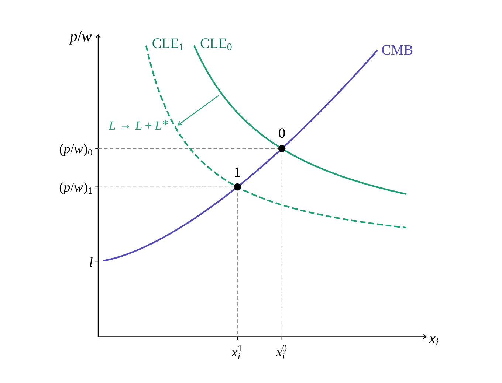
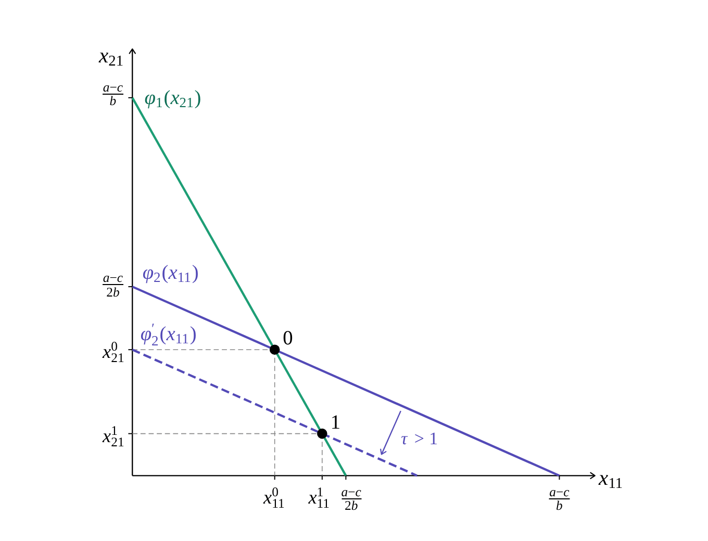
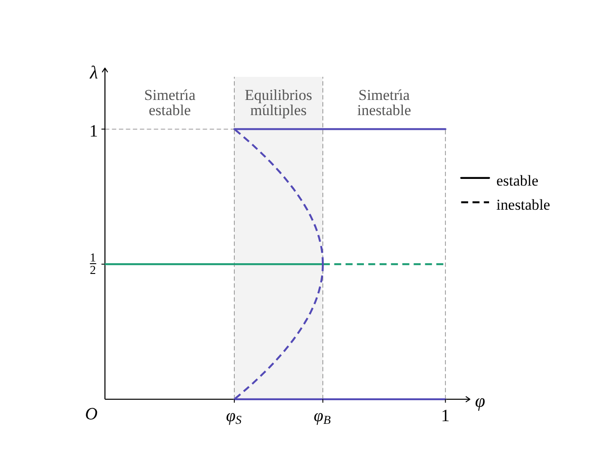
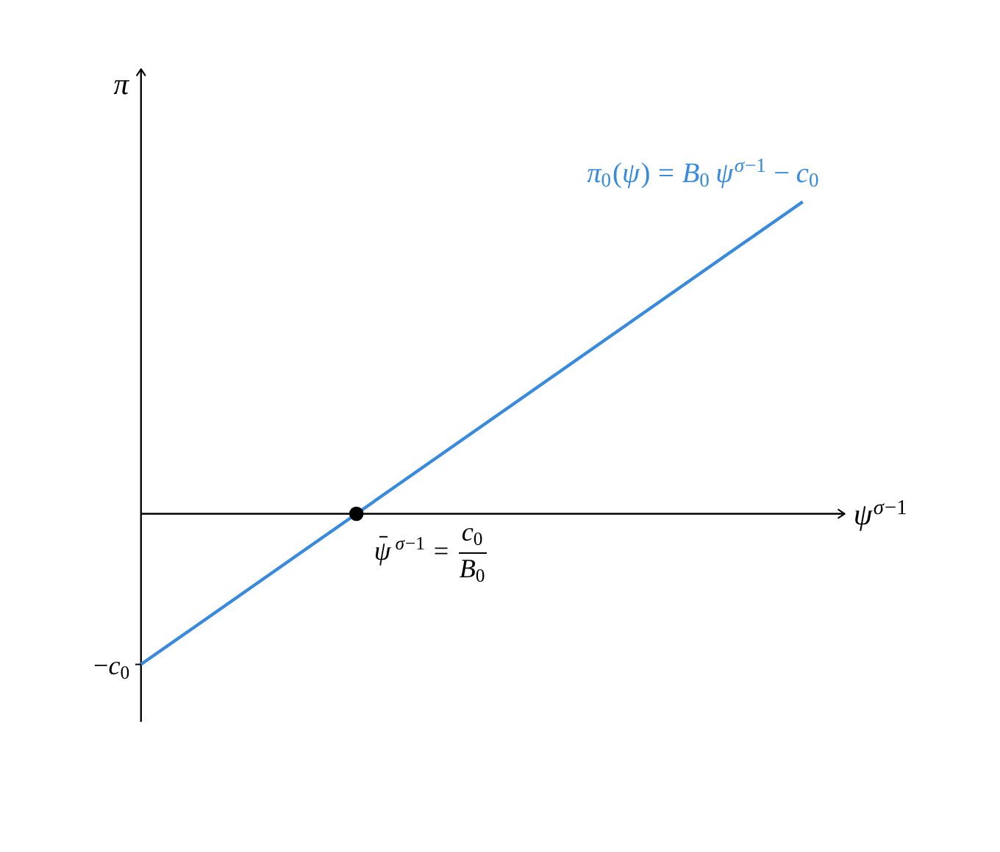
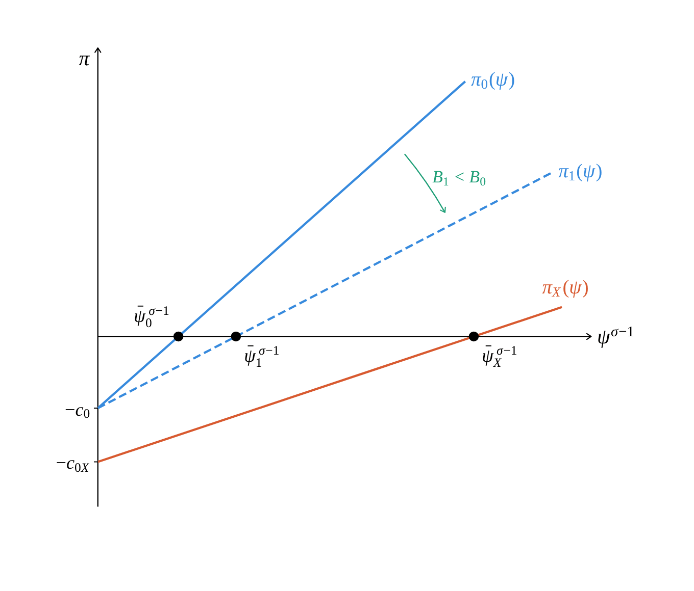
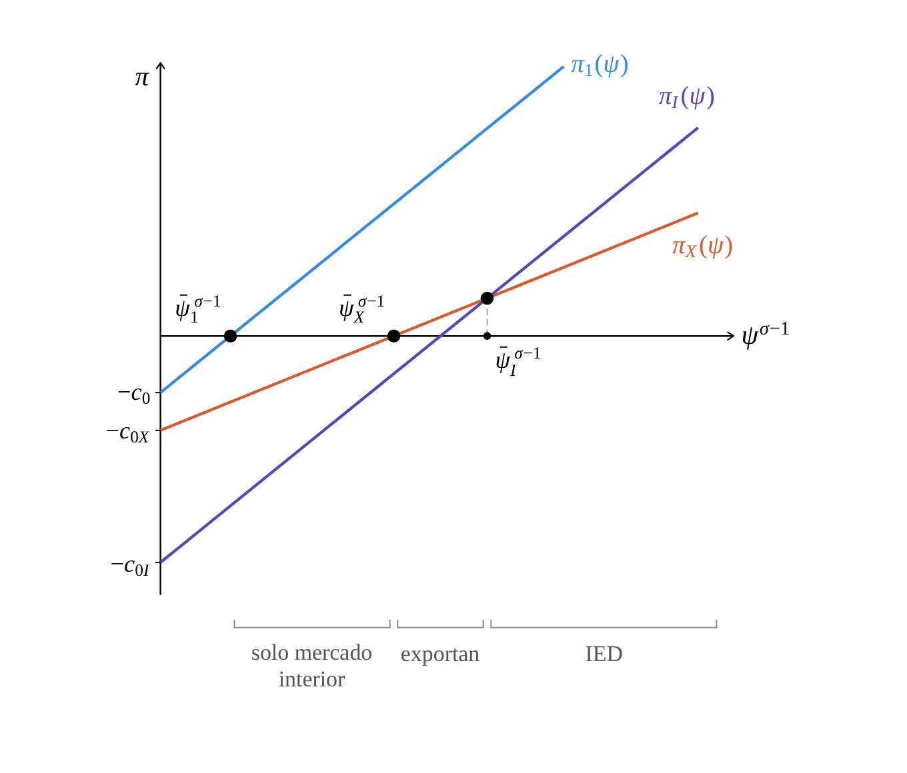

## Introducción

::: {.callout-note appearance="simple" icon=false}

:::

La teoría tradicional explica bien el comercio entre países distintos, pero no el que se da entre economías parecidas. Desde los años sesenta, los datos mostraron que buena parte del comercio entre países industrializados era **comercio intraindustrial**, es decir, intercambio de variedades de un mismo producto, cuyo peso permitió medir el índice de Grubel y Lloyd (1975).

La **nueva teoría del comercio internacional** responde a esa evidencia con dos supuestos que la teoría tradicional excluía, las **economías de escala** y la **competencia imperfecta**. Con ellos, el comercio ya no necesita diferencias de tecnología ni de dotaciones, porque basta con que los consumidores valoren la variedad y con que producir a gran escala abarate los costes. Al combinar las economías de escala internas con los costes de transporte y la movilidad de los factores, la **nueva economía geográfica** explica además por qué la producción se concentra en unas regiones y no en otras. Krugman recibió en 2008 el Premio Nobel “por su análisis de los patrones del comercio y de la localización de la actividad económica”.

La **novísima teoría** desciende del país y de la industria a la empresa. Los microdatos revelaron que exportar es una actividad excepcional. Así, de los 5,5 millones de empresas que operaban en EE. UU. en 2000, solo un 4 % exportaba, y el 10 % de los exportadores que más vendían concentraba el 96 % de las exportaciones (Bernard, Jensen, Redding y Schott, 2007). El modelo de **heterogeneidad de empresas** de Melitz (2003) explica ese patrón, porque solo las empresas más productivas pueden cubrir los costes fijos de vender en el exterior, y muestra que la apertura eleva la productividad agregada al reasignar recursos hacia ellas y expulsar del mercado a las menos productivas.

Este tema recorre la nueva teoría y la novísima teoría:

- *Fundamentos*: se estudia el punto de partida de las nuevas teorías, que comprende los hechos empíricos que ponían en cuestión las predicciones de la teoría comercial tradicional y algunas teorías precursoras de la nueva teoría.

- *Nueva teoría*: recalca el papel de las economías de escala internas en marcos de competencia monopolística y de oligopolio. Destaca también el de las economías de escala externas o de aglomeración. En la llamada *nueva economía geográfica* (modelo centro-periferia), que se estudia junto con los modelos gravitatorios, la aglomeración resulta de la interacción entre economías de escala internas, costes de transporte y movilidad de factores.

- *Novísima teoría*: se introducen sus modelos, con énfasis en los que derivan del modelo de comercio internacional con heterogeneidad de empresas de Marc Melitz.

## 1. Fundamentos de la nueva teoría

Diversas aportaciones posteriores a la teoría tradicional están en el origen de la nueva teoría, unas empíricas, que ponían en cuestión las predicciones de la teoría tradicional, y otras teóricas, que destacaban las economías de escala y la competencia imperfecta.

### 1.1. Punto de vista empírico

La teoría tradicional supone competencia perfecta y bienes homogéneos e idénticos en todos los países. Sin embargo, a mediados de los años setenta se hizo patente la necesidad de contrastar sus predicciones y de acercar la teoría a los datos, fundamentalmente para explicar el notable aumento del comercio intraindustrial.

#### 1.1.1. Medición de la especialización y del comercio intraindustrial: índice de Balassa (1965b) e índice de Grubel y Lloyd (1975)

Cuantificar el comercio intraindustrial exige resolver antes dos cuestiones, cómo delimitar los sectores o industrias y con qué indicador medir su comercio.

**Definición de sectores**: lo habitual es delimitar cada industria con uno de estos dos criterios:

- *Proceso de producción*: pertenecen a una misma industria los productores que comparten fases de fabricación y que, en consecuencia, combinan los factores en proporciones parecidas (p. ej. coches y camiones).

- *Uso del producto*: forman una misma industria los bienes que el consumidor destina al mismo fin, como un libro de papel y uno electrónico.

En la práctica, las estadísticas de comercio se elaboran conforme a clasificaciones jerárquicas armonizadas, principalmente la *Clasificación Uniforme para el Comercio Internacional* (CUCI o SITC, por sus siglas en inglés) de Naciones Unidas y el *Sistema Armonizado* (SA) de la Organización Mundial de Aduanas.

Para medir los tipos de comercio se emplean dos índices de referencia, uno de especialización y otro de comercio intraindustrial.

**Índice de Balassa** (1965b): busca determinar los sectores débiles y fuertes de un país a través de la identificación de su *ventaja comparativa revelada* (o desventaja). Formalmente, relaciona el valor relativo de las exportaciones de un sector *k* de un país *i* con el valor relativo de las exportaciones de dicho sector *k* de un grupo de países de referencia:

$$\text{IB}_{ik} = \frac{X_{ik}/X_i}{X_{0k}/X_0} \geq 0$$

donde $X_{ik} \geq 0$ refleja el valor total de las exportaciones del bien *k* realizadas por el país *i* y $X_i > 0$, el valor total de todas sus exportaciones. Para el grupo de países de referencia, $X_{0k} > 0$ es el valor total de sus exportaciones del bien *k* y $X_0 > 0$, el de todas sus exportaciones. Si $\text{IB}_{ik} > 1$, el país tiene ventaja comparativa revelada en el sector y, si $\text{IB}_{ik} < 1$, desventaja comparativa.

El índice “puro” es asimétrico (de 0 a 1 sin especialización y de 1 a $\infty$ con ella), por lo que se normaliza como $\text{IB}^N_{ik} = (\text{IB}_{ik} - 1)/(\text{IB}_{ik} + 1) \in [-1, +1)$, que vale $-1$ si el país no exporta el bien.

**Índice de Grubel y Lloyd** (1975): mide la proporción del comercio de una industria que está “solapada”, es decir, la parte de las exportaciones que se corresponde con importaciones simultáneas de productos de la misma industria:

$$\text{IGL}_k = \frac{(X_k + M_k) - |X_k - M_k|}{X_k + M_k} \in [0, 1]$$

donde $\text{IGL}_k$ es el índice de comercio intraindustrial de la industria *k* y $X_k$ y $M_k$ son los valores de las exportaciones y las importaciones de la industria *k*. Cuanto más próximos entre sí estén los valores de las exportaciones y de las importaciones, más próximo estará el índice a 1 y mayor será el peso del comercio intraindustrial en el comercio total del bien considerado[^b06-2]. Para un país en el que solo se exporta o solo se importa un determinado bien, por el contrario, el $\text{IGL}_k$ será nulo.

#### 1.1.2. Hechos estilizados

A finales de los años setenta, los datos sobre el comercio internacional discrepaban de la teoría tradicional en cinco dimensiones:

1. *Ventaja comparativa*: los contrastes empíricos de la teoría tradicional arrojaban resultados desconcertantes, el más conocido de los cuales es la *paradoja de Leontief* (1953). Con las tablas *input-output* de EE. UU., Wassily Leontief encontró que las exportaciones estadounidenses eran relativamente más intensivas en trabajo que la producción nacional que sustituía a sus importaciones, justo lo contrario de lo que predecía el teorema de Heckscher-Ohlin para el país más abundante en capital del mundo.

2. *Peso creciente del comercio intraindustrial*: buena parte del crecimiento del comercio de posguerra se producía entre países desarrollados con dotaciones factoriales y tecnologías similares y, además, dentro de las mismas industrias (intercambio bidireccional de variedades de un mismo tipo de producto). Sin embargo, la teoría tradicional predecía justo lo contrario. Los estudios sobre la integración europea (Balassa, 1966) mostraron, además, que el ajuste a la liberalización se producía vía especialización intraindustrial, con costes de ajuste menores a los esperados.

3. *Determinantes del comercio intraindustrial*: según los estudios empíricos de la época (p. ej. Loertscher y Wolter, 1980), el comercio intraindustrial crecía con la proximidad física entre países, que abarata el transporte, y con la semejanza de sus gustos, que facilita el abastecimiento internacional. Era también mayor entre economías grandes, con más margen para diferenciar, y desarrolladas, cuyos consumidores aprecian más la variedad.

4. *Buen ajuste de los modelos gravitatorios*: estudios como el de Jan Tinbergen (1962) mostraban que estos modelos se ajustaban bien a los hechos observados. Los flujos bilaterales crecen con el tamaño económico de los socios y caen con la distancia, con independencia de sus diferencias en dotaciones factoriales.

5. *Comercio norte-sur y comercio norte-norte*: el intercambio entre países desarrollados (norte) y en desarrollo (sur) se ajustaba razonablemente al patrón interindustrial de la teoría tradicional (manufacturas por productos primarios). Representaba, sin embargo, una fracción decreciente del total frente al comercio norte-norte de carácter intraindustrial (punto 2).

### 1.2. Punto de vista teórico

Desde el punto de vista teórico, la nueva teoría se apoya en las aportaciones de varios autores de los años cincuenta y sesenta. Se distingue por dos rasgos, la importancia de las economías de escala internas (o rendimientos crecientes) y las estructuras de mercado no competitivas.

#### 1.2.1. Antecedentes: indisponibilidad relativa, desfases tecnológicos y ciclo del producto

**Indisponibilidad relativa** (Kravis, 1956): según Irving Kravis, los países importan los bienes que no están disponibles en el propio país o que solo lo están a un coste mucho mayor, por la inelasticidad de su oferta interna.

**Desfases tecnológicos** (Posner, 1961; Hufbauer, 1966): Michael Posner y Gary Hufbauer enfatizan el papel de los desfases tecnológicos (*technology gaps*) como origen del comercio internacional. Como consecuencia de la I+D y de la iniciativa empresarial, los países innovadores producen nuevos bienes y disfrutan de un monopolio temporal hasta que otros países aprenden a producirlos (*imitation lag*). En ese lapso, los países seguidores deben importar dichos bienes y se crea comercio. Estas aportaciones, que integran los llamados *modelos neotecnológicos*, influyeron en el desarrollo posterior de las teorías del crecimiento endógeno en economía abierta (véase el tema [B09](b09-comercio-crecimiento.qmd)).

**Variabilidad de la intensidad factorial a lo largo del ciclo del producto** (Vernon, 1966; Hirsch, 1967): Raymond Vernon y Seev Hirsch se preguntan por qué las innovaciones nacen sobre todo en los países desarrollados y acaban filtrándose después a las economías menos avanzadas. Su respuesta es que cada fase de la vida del producto (introducción, madurez y estandarización) pide una intensidad factorial distinta. Que un país desarrollado o en desarrollo exporte o importe el bien depende, así, de la fase en que este se encuentre.

#### 1.2.2. Importancia de las economías de escala: externas e internas

**Economías de escala externas**: suelen ser el resultado de la proximidad espacial de las empresas, por lo que también se las conoce como *economías de aglomeración*. Estas economías pueden dar lugar a comercio internacional aunque no difieran las dotaciones factoriales relativas, simplemente por las externalidades positivas que se derivan de la concentración de actividad productiva en clústeres.

El coste medio de cada empresa no depende de su tamaño sino del de la industria nacional, por tres vías que ya señaló Marshall (1890), los proveedores especializados, un mercado de trabajo cualificado común y la difusión del conocimiento. Como las empresas son pequeñas, la industria puede ser competitiva y el precio iguala su coste medio, de modo que estas economías no exigen competencia imperfecta. Sus consecuencias para el comercio son tres:

1. *Dependencia de la historia*: el país que creó antes la industria y alcanzó gran escala produce más barato y conserva la ventaja, aunque otro país pudiera producir con menor coste a la misma escala. Por tanto, el patrón de especialización lo fija una ventaja inicial, a menudo accidental, y no las dotaciones.

2. *Posibles pérdidas del comercio*: si la industria se queda en el país menos eficiente, el otro puede pagar por el bien importado más de lo que le costaría producirlo en autarquía y salir perdiendo con el comercio (Graham, 1923; Ethier, 1982).

3. *Economías dinámicas*: cuando el coste cae con la producción acumulada (curva de aprendizaje), la ventaja del pionero es aún mayor, lo que fundamenta el argumento de la industria naciente (tema [B08](b08-politica-comercial-ii.qmd), apartado 2.3.2).

**Economías de escala internas**: su papel en el crecimiento del comercio de posguerra entre países desarrollados ya se había señalado antes de la nueva teoría. Lo propio de los nuevos desarrollos es incorporarlas al análisis formal como rendimientos crecientes a escala en la empresa.

Los costes medios son, en consecuencia, decrecientes a medida que aumenta la escala de producción de la empresa, por la indivisibilidad de factores o por la existencia de costes fijos. Formalmente, esta idea se introduce en los modelos a través de funciones de coste lineales con un coste fijo, $\text{CT}(x) = c_0 + cx$.

Para aprovechar sus economías de escala internas, cada país puede especializarse en un número limitado de bienes, producirlos a mayor escala e intercambiarlos, de modo que la producción mundial aumenta sin sacrificar variedades. Las economías de escala internas explican así que haya comercio internacional aunque no exista ventaja comparativa.

Con todo, esto supone que habrá ganadores y perdedores. La gran empresa, al aprovechar sus economías de escala, produce con costes más bajos que la pequeña, y esta ve mermada así su competitividad. Además, como con economías de escala internas el coste marginal queda por debajo del coste medio y fijar el precio igual al coste marginal generaría pérdidas, la estructura de mercado compatible con ellas es la de competencia imperfecta.

#### 1.2.3. Importancia de la estructura de mercado: competencia monopolística y mercados oligopolísticos

Este segundo rasgo se deriva del anterior.

**Competencia monopolística**: por un lado, se consideran entornos en los que un elevado número de empresas con capacidad para ejercer poder de mercado sobre su nicho o clientela, mediante la diferenciación de sus productos, puede afectar al comercio internacional. Para modelar la competencia monopolística existen dos visiones teóricas[^b06-4], la horizontal (variedades) y la vertical (calidad), que se desarrollan en el tema [A18](a18-competencia-monopolistica.qmd).

**Mercados oligopolísticos**: por otro lado, se estudia cómo la interdependencia estratégica entre empresas de distintos países puede explicar el comercio internacional.

### 1.3. Conclusiones

La teoría tradicional descansa en la competencia perfecta y en bienes homogéneos, y la evidencia de finales de los años setenta resultaba difícil de conciliar con ella. La paradoja de Leontief contradecía el teorema de Heckscher-Ohlin. El comercio intraindustrial crecía, además, entre países desarrollados con dotaciones y tecnologías similares, sobre todo si eran próximos, grandes y de gustos parecidos. Finalmente, los modelos gravitatorios explicaban bien los flujos con el tamaño y la distancia, sin recurrir a las dotaciones.

En el plano teórico, tras precursores como los desfases tecnológicos y el ciclo del producto, la explicación se apoya en las economías de escala. Las externas o de aglomeración generan comercio aunque las dotaciones no difieran. Por su parte, las internas permiten que cada país produzca menos bienes a mayor escala y comercie sin ventaja comparativa, y, como sitúan el coste marginal por debajo del medio, exigen competencia imperfecta. La organización industrial permitió formalizar esa combinación. La sección 2 lo hace primero con competencia monopolística y con oligopolio y después con la nueva economía geográfica.

## 2. Nueva teoría del comercio internacional

La nueva teoría formaliza los dos rasgos del apartado 1.2, primero con competencia monopolística. Paul Krugman (1979b) parte para ello del modelo neochamberliniano y lo extiende a la economía abierta. Siguen los modelos de oligopolio y, por último, el equilibrio integrado con dotaciones distintas, los modelos gravitatorios y la nueva economía geográfica.

### 2.1. Modelos de competencia monopolística en economía abierta

Los modelos de competencia monopolística se distinguen por el tipo de diferenciación del producto. Los tres primeros, desde el marco neochamberliniano hasta el efecto mercado interno de Krugman, lo hacen por variedades (**diferenciación horizontal**), y el de Shaked y Sutton, por calidades (**diferenciación vertical**).

#### 2.1.1. Diferenciación horizontal: modelo neochamberliniano de competencia monopolística (Spence, 1976; Dixit y Stiglitz, 1977)

::: {.callout-note appearance="simple" icon=false}
Sobre el modelo de Dixit y Stiglitz en economía cerrada y su bienestar, véase el tema [A18](a18-competencia-monopolistica.qmd), apartado 2.2.
:::

**Origen**: las ideas de Edward Chamberlin fueron reformuladas con una mayor microfundamentación por Michael Spence (1976) y, un año más tarde, por Avinash Dixit y Joseph Stiglitz (1977) en un modelo de equilibrio general con agentes representativos.

**Idea**: en presencia de economías de escala internas y de preferencia por la variedad, el número de variedades que sostiene una economía queda limitado por el tamaño de su mercado.

**Supuestos**:

- *Entorno*: existe pleno empleo de recursos.

- *Agentes*:

    - *Empresas*: se modelan mediante una empresa representativa, dada la simetría del planteamiento.

        - *Variedades*: cada empresa fabrica y vende una variedad diferenciada, de modo que hay tantas variedades como empresas. Las variedades son sustitutivos imperfectos, con elasticidad de sustitución finita, $\sigma \in (1, \infty)$.

        - *Miopía*: cada empresa toma el precio de las demás como dado y no considera el efecto de sus decisiones sobre las rivales (variación conjetural nula). Su curva de ventas presenta, en consecuencia, pendiente negativa aunque poco pronunciada en el plano $(X_i^d, p_i)$.

    - *Consumidores*: preferencias idénticas y equidistribuidas, de donde se sigue que las curvas de demanda individuales, y por extensión las de ventas de las empresas, son idénticas. Los consumidores presentan además *preferencia por la variedad*, es decir, la utilidad del consumo de $n$ variedades supera a la de $n-1$[^b06-8], de modo que cada consumidor demanda todas las variedades existentes y adquirirá también las de nueva creación. El grado de sustituibilidad se recoge en el parámetro $\theta \in (0, 1)$, cuya restricción a valores inferiores a la unidad excluye que la elasticidad de sustitución, $\sigma = 1/(1-\theta)$, sea infinita y que las variedades sean, por tanto, sustitutivos perfectos.

- *Tecnología*: idéntica, lo que implica la misma función de costes para todas, lineal y con rendimientos crecientes a escala, que emplea únicamente trabajo y de la que resultan economías de escala internas.

- *Mercado de bienes*: competencia monopolística en el mercado de bienes. Cada empresa es relativamente grande respecto de su nicho o clientela y dispone, por ello, de poder para fijar el precio de su variedad.

**Consumidores**: el consumidor representativo elige cuánto demanda de cada variedad.

- *Planteamiento*: maximiza una utilidad con elasticidad de sustitución constante (CES) sobre las $n$ variedades sujeto a su restricción presupuestaria:

    $$\max_{x_i} \; u = \left(\sum_{i=1}^n x_i^\theta\right)^{1/\theta} \quad \text{s.a.:} \quad \sum_{i=1}^n p_i x_i = M_0$$

    donde $x_i > 0$ es la cantidad demandada de cada variedad, $\theta \in (0, 1)$ el parámetro de sustituibilidad[^b06-10], $p_i > 0$ el precio de cada variedad y $M_0 > 0$ la renta monetaria.

- *CPO*: de las condiciones de primer orden[^b06-12] se obtienen tres expresiones:

    $$x_i = (\lambda p_i)^{1/(\theta - 1)} \tag{1}$$

    $$\frac{x_i}{x_j} = \left(\frac{p_i}{p_j}\right)^{1/(\theta-1)} \tag{2}$$

    $$x_i^d = \left(\frac{p_i}{P}\right)^{-\sigma} \frac{M_0}{P} \tag{3}$$

    donde $\lambda$ es el multiplicador de Lagrange, es decir, el precio sombra de la renta, y $P$ el índice de precios de las variedades.

    La expresión (1) es la *demanda frischiana*, que relaciona la cantidad demandada con el precio y el precio sombra de la renta.

    La expresión (2) es la demanda relativa de dos variedades $i \neq j$, que también puede escribirse como $x_i/x_j = (p_j/p_i)^{\sigma}$[^b06-13] y refleja la dependencia de la senda de expansión del consumo respecto de los precios relativos y del grado de sustituibilidad[^b06-14].

    La expresión (3) es la *demanda marshalliana*. Según ella, la cantidad demandada de cada variedad decrece con su precio relativo y crece con la renta real, $x_i = f(p_i^-, P^+, M_0^+)$.

- *CSO*: la función de utilidad CES es estrictamente cuasicóncava para $\theta \in (0, 1)$ y la restricción presupuestaria es lineal, por lo que las condiciones de primer orden son suficientes para un máximo.

- *Función de demanda agregada*: dado que los consumidores son también trabajadores y son idénticos, la demanda agregada resulta de multiplicar la individual por el tamaño de mercado, $X_i^d = x_i^d \cdot L$, siendo $L > 0$ el número de trabajadores-consumidores.

**Empresas**: la simetría en costes permite trabajar con una empresa representativa, que fija el precio de su variedad.

- *Planteamiento*: elige el precio de su variedad que maximiza su beneficio, tomando como dados el salario y el índice de precios (miopía), sujeta a la demanda isoelástica de mercado que resulta del lado de los consumidores:

    $$\max_{p_i} \; \pi_i = p_i x_i^s - w(l_0 + l x_i^s) \quad \text{s.a.:} \quad x_i^s = L\left(\frac{p_i}{P}\right)^{-\sigma}\frac{M_0}{P}$$

    donde $\pi_i$ es el beneficio, $x_i^s$ la producción de la empresa (en equilibrio, $x_i^s = X_i^d$), $w > 0$ el salario nominal, $l_0 > 0$ los empleados fijos y $l > 0$ los empleados por unidad de producto. La función de costes, $\text{CT}(x_i^s) = w(l_0 + lx_i^s)$, tiene coste medio decreciente y coste marginal constante, $wl$, lo que ilustra las economías de escala internas[^b06-15].

- *CPO*: como la producción depende del precio a través de la demanda, $\partial \pi_i/\partial p_i = x_i^s + (p_i - wl)\,\partial x_i^s/\partial p_i = 0$, y con $\partial x_i^s/\partial p_i = -\sigma x_i^s/p_i$ la condición se reduce a $(p_i - wl)/p_i = 1/\sigma$. El ingreso marginal, $p_i(\sigma - 1)/\sigma$, iguala al coste marginal, $wl$, y el índice de Lerner es la inversa de la elasticidad de la demanda.

- *CSO*: la derivada del beneficio es proporcional a $\sigma wl - (\sigma - 1)p_i$, positiva por debajo del precio óptimo y negativa por encima, así que este es el máximo global. Por eso se exige $\sigma > 1$, pues con $\sigma \leq 1$ el beneficio crecería siempre con el precio.

- *Solución*: despejando el precio se obtiene la regla de fijación de precios:

    $$p_i = \frac{\sigma}{\sigma - 1} \cdot wl = \frac{1}{\theta} \cdot wl, \qquad \sigma > 1 \tag{4}$$

    Según (4), la estrategia óptima consiste en aplicar un margen $\mu$, con $1 + \mu = \sigma/(\sigma - 1) > 1$, sobre el coste marginal $wl$, con independencia de los precios ajenos, y el margen es tanto mayor cuanto menor es la elasticidad.

**Equilibrio**: el precio superior al coste marginal podría generar beneficios extraordinarios, pero la libre entrada los elimina. Imponiendo $\pi(p_i^*, x_i^s) = 0$ se obtiene[^b06-17]:

$$x_i^s = \frac{l_0}{l}(\sigma - 1), \quad \text{es decir,} \quad x_i^s = f(l_0^+, \sigma^+, l^-)$$

La escala de cada empresa queda determinada exclusivamente por la tecnología ($l_0$, $l$) y por la elasticidad de sustitución, por lo que, con elasticidad constante, es independiente del tamaño de mercado. El tamaño de mercado actúa por otra vía, la condición de pleno empleo $L = \sum_{i=1}^n l_i(x_i^s)$, con $l_i(x_i^s) = l_0 + lx_i^s$, que determina el número de empresas:

$$n = \frac{L}{l_0 + l \cdot x_i^s} = \frac{L}{l_0 \sigma}, \quad \text{es decir,} \quad n = f(L^+, l_0^-, \sigma^-) \tag{5}$$

Según (5), el número de variedades está restringido por el tamaño de mercado y es finito. La intuición es que más consumidores implican, dada su preferencia por la variedad, mayor demanda de variedades, y como esos consumidores trabajan, esa demanda encuentra la producción que la atienda.

**Extensiones** (economía abierta): la apertura sin costes de transporte a un país idéntico, con $L^*$ trabajadores-consumidores, crea un mercado integrado de tamaño $L + L^*$. La escala $x_i^s = (l_0/l)(\sigma - 1)$ y el precio (4) no cambian, y por (5) el mercado integrado sostiene $(L + L^*)/(l_0 \sigma)$ variedades, la suma de las de ambas autarquías. Por ello, ninguna empresa sale ni crece, surge comercio intraindustrial con un patrón indeterminado y la ganancia procede solo de la mayor variedad. Krugman (1980) parte de este caso y le añade costes de transporte.

**Conclusiones**:

- *Aspectos positivos*: el modelo proporciona la microfundamentación de la competencia monopolística en equilibrio general y establece con la ecuación (5) el resultado que vertebra toda la literatura posterior. Constituye, por ello, la base analítica del análisis de la apertura comercial en competencia imperfecta.

- *Limitaciones*: la elasticidad de sustitución constante fija la escala de cada empresa y el margen, de modo que un mercado mayor, también el de la apertura (Extensiones), se traduce solo en más variedades y no en empresas mayores, sin efecto escala ni efecto procompetitivo. Superar ambas restricciones exige abandonar ese supuesto, como hace Krugman (1979b).

#### 2.1.2. Diferenciación horizontal: competencia monopolística en economía abierta (Krugman, 1979b)

**Origen**: el objetivo de Paul Krugman (1979b) es mostrar cómo esta estructura de mercado da lugar a comercio internacional aun cuando no haya ventaja comparativa.

**Idea**: lo esencial de la apertura es que amplía el mercado, pues al comerciar los países forman un único mercado integrado, más amplio que el de cada uno por separado.

**Supuestos**:

- *Simetría*: el modelo elimina toda fuente posible de ventaja comparativa, al suponer tecnología, intensidad factorial y preferencias idénticas entre países.

- *Elasticidad variable*: el modelo comparte los demás supuestos de Spence-Dixit-Stiglitz, salvo que la elasticidad-precio de la demanda de cada variedad es decreciente en la cantidad demandada, $\partial |\varepsilon_{x_i p_i}| / \partial x_i < 0$. La intuición es que, al aumentar el número de variedades, cae el volumen consumido de cada una y los individuos reaccionan con mayor intensidad ante cambios de precio, de modo que el poder de mercado de cada empresa disminuye. El margen deja así de ser constante.

**Planteamiento**: el equilibrio se resume en dos condiciones de la empresa ya descrita, escritas en función del consumo per cápita de cada variedad, $x_i$, y de la ratio precio-salario, $p/w$, con una producción por empresa $x_i^s = L x_i$:

$$\frac{p}{w} = \frac{|\varepsilon_{x_i p_i}|}{|\varepsilon_{x_i p_i}| - 1} \cdot l \tag{6}$$

$$\frac{p}{w} = l + \frac{l_0}{L \, x_i} \tag{7}$$

donde $|\varepsilon_{x_i p_i}| > 1$ es la elasticidad-precio de la demanda de cada variedad en valor absoluto, decreciente en $x_i$, y $l_0$, $l$ y $L$ son los ya definidos. La (6) generaliza la regla de precios (4), a la que se reduce con elasticidad constante, $|\varepsilon_{x_i p_i}| = \sigma$, y la (7) es la condición de libre entrada (precio igual a coste medio). En economía abierta, $L$ pasa a ser $L + L^*$ en (7) y en el pleno empleo, $n = (L + L^*)/(l_0 + l \cdot x_i^s)$, y los consumidores incorporan las variedades extranjeras.

**Desarrollo gráfico**: el equilibrio del modelo se representa en el plano $(x_i, p/w)$ (figura -@fig-b064-krugman-1979):

1. *Curva de maximización del beneficio* (CMB): deriva de la ecuación (6) y recoge el *efecto competición*. Es creciente, porque, al aumentar la cantidad demandada de una variedad, cae su elasticidad-precio y, dada la relación inversa con el margen, sube el precio.

2. *Curva de libre entrada* (CLE), $\text{CLE}_0$: deriva de la ecuación (7) y recoge el *efecto escala*. Es decreciente, porque al aumentar la cantidad cae el coste medio y, con él, el precio compatible con beneficio nulo.

3. *Equilibrio*: el cruce de ambas curvas determina el equilibrio de autarquía (punto 0), con un consumo per cápita de cada variedad $x_i^0$ y una ratio precio-salario $(p/w)_0$.

**Estática comparativa**: la apertura a un país idéntico y sin costes de transporte amplía el mercado de $L$ a $L + L^*$ y desplaza hacia abajo la curva de libre entrada, de $\text{CLE}_0$ a $\text{CLE}_1$, pues el coste fijo se reparte entre más consumidores. El equilibrio pasa del punto 0 al 1, con un consumo per cápita de cada variedad menor, $x_i^1$, porque el consumidor reparte su gasto entre más variedades, y una ratio precio-salario más baja, $(p/w)_1$. Con elasticidad constante, la CMB sería horizontal y la apertura solo añadiría variedades. En cambio, con elasticidad decreciente se siguen tres resultados[^b06-19]:

- *Número de empresas*: el menor consumo de cada variedad eleva su elasticidad-precio y comprime el margen, de modo que salen empresas hasta que el beneficio vuelve a ser nulo. Su número cae en cada país y también respecto del total combinado de las dos autarquías, pues cada país se especializa en un rango más estrecho de variedades e importa el resto.

- *Escala de producción*: como la ratio precio-salario baja y, por (7), es igual al coste medio por unidad de salario, $l + l_0/x_i^s$, la producción de cada superviviente, $x_i^s = (L + L^*)\,x_i^1$, supera a la de autarquía, $L\,x_i^0$. Con ello, las supervivientes aprovechan mejor las economías de escala y reducen los precios. Su expansión constituye el efecto escala, y la salida de las demás, una *racionalización* de la industria (no un efecto selección en sentido estricto, pues todas las empresas son iguales).

- *Número de variedades*: aunque haya menos empresas, los consumidores de los dos países pueden elegir entre más variedades que en autarquía.

::: {#fig-b064-krugman-1979}

::: {.content-visible when-format="html"}
```{=html}
<div class="graph-frame">
<iframe src="../graphs/b064_Krugman_1979.html" style="height:520px" loading="lazy" title="fig-b064-krugman-1979"></iframe>
</div>
```
:::

::: {.content-visible unless-format="html"}

:::

Modelo de Krugman (1979b). La apertura desplaza la curva de libre entrada (CLE) y, sobre la curva de maximización del beneficio (CMB), reduce el consumo per cápita de cada variedad y la ratio precio-salario (0 → 1).
:::

**Bienestar**: como la libre entrada mantiene el beneficio nulo antes y después de la apertura, la salida de empresas no supone pérdida de bienestar. La ganancia recae en los consumidores-trabajadores, cuyo salario real ($w/p$) aumenta y que disponen de más variedades. Basta, pues, con que existan economías de escala internas para que ambos países ganen bienestar al comerciar, aun siendo idénticos en recursos y tecnología.

**Conclusiones**:

- *Aspectos positivos*: constituye una de las obras fundacionales de la nueva teoría del comercio. Captura los elementos esenciales de los mercados con economías de escala y competencia imperfecta, y ofrece la primera explicación teórica del elevado volumen de comercio intraindustrial que se observa entre países similares.

- *Limitaciones*: el patrón de comercio queda indeterminado, pues al ser los países idénticos y no existir costes de transporte los precios relativos no se alteran y no cabe determinar qué país produce qué variedades. El modelo tampoco resulta apropiado para analizar el efecto selección, ya que todas las empresas son iguales salvo en la variedad que producen, de modo que no predice cuál sobrevive. Además, el margen variable descansa en un supuesto específico sobre la demanda (elasticidad decreciente en la cantidad). La indeterminación del patrón motivó la extensión de 1980.

#### 2.1.3. Diferenciación horizontal: el efecto mercado interno (Krugman, 1980)

**Origen**: Krugman (1980) introduce costes de transporte de tipo iceberg[^b06-21] para resolver la indeterminación anterior.

**Idea**: si una región presenta economías de escala internas en la producción de un bien, afronta costes de transporte al exportarlo y cuenta con una demanda interna fuerte, la producción tiende a concentrarse en ella. La concentración permite aprovechar a la vez las economías de escala y minimizar los costes de transporte.

**Razonamiento**: el resultado principal de su aportación es que el país con mayor mercado interno para un bien concentra una cuota de la producción mundial de ese bien superior a su cuota de la demanda. Ese país se convierte, por tanto, en exportador neto del bien. Este *efecto mercado interno* (*home market effect*) establece un nexo entre tamaño de mercado y exportaciones ajeno por completo a la ventaja comparativa. En las versiones con movilidad factorial, el país grande atrae además empresas y capital procedentes de las economías menores, resultado que constituye el fundamento de la nueva economía geográfica.

**Conclusiones**:

- *Aspectos positivos*: resuelve la indeterminación del patrón de comercio que arrastraba el modelo de 1979 y proporciona una predicción contrastable, la de que la especialización exportadora se correlaciona con el tamaño del mercado interno.

- *Limitaciones*: la evidencia empírica sobre los efectos de escala es débil, aunque sí la hay sobre el efecto selección. A ello se añade que la competencia monopolística describe la estructura de pocas industrias, pues lo habitual es el oligopolio con un número reducido de empresas.

#### 2.1.4. Diferenciación vertical: calidad y oligopolio natural (Shaked y Sutton, 1982, 1983, 1984)

**Origen**: Avner Shaked y John Sutton analizan la diferenciación por calidad en contexto autárquico (1982, 1983) e internacional (1984). La exposición que sigue combina estos resultados con la versión de Sutton (1991), en la que la calidad se elige junto con un coste fijo de I+D creciente en ella.

**Idea**: cuando la diferenciación es por calidad y su coste recae sobre los costes fijos de I+D, la competencia en precios solo deja sobrevivir a un número finito de empresas, con independencia del tamaño del mercado.

**Supuestos**:

- *Agentes*:

    - *Consumidores*: un continuo de consumidores con preferencias idénticas, todos los cuales prefieren mayor calidad, uniformemente distribuidos sobre un intervalo de renta. Presentan demandas unitarias, es decir, cada uno adquiere una unidad de su bien favorito o ninguna. Pese a compartir preferencias, su disposición a pagar difiere por el nivel de renta, de modo que, fijado un valor crítico[^b06-23], el mercado se divide con nitidez, y los bienes de calidad superior los adquieren quienes superan ese umbral.

    - *Empresas*: inicialmente numerosas, cada una fabrica un producto verticalmente diferenciado[^b06-22].

**Planteamiento**: la conducta de las empresas se modela como un juego no cooperativo en tres etapas[^b06-24]:

1. *Entrada*: deciden si entrar, decisión que comporta una inversión en I+D que, una vez realizada, constituye un coste hundido irrecuperable.

2. *Calidad*: observan quién ha entrado y eligen qué calidad fabricar, elección que fija la cuantía de esa I+D (creciente y convexa en la calidad) y no afecta al coste variable.

3. *Precio*: con la I+D ya hundida, fijan el precio de venta atendiendo solo al coste variable, sin incurrir en la falacia del Concorde[^b06-25].

**Equilibrio**: a corto plazo la competencia en precios expulsa a algunas empresas. A largo plazo el proceso se repite y, si la distribución de renta es suficientemente estrecha[^b06-26], se alcanza un equilibrio de Nash perfecto en subjuegos en el que solo dos empresas cubren el mercado, lo que los autores denominan *oligopolio natural*.

Este resultado es un caso particular de la *propiedad de finitud*. Bajo diferenciación vertical, el número de empresas o calidades con cuota de mercado positiva está acotado por un máximo, independiente del tamaño de mercado y del coste de entrada. La condición es que todo consumidor elija la máxima calidad cuando se le ofrece a un precio igual a su coste marginal. A diferencia de lo que ocurre con la diferenciación horizontal, un mercado mayor no implica, por tanto, más variedades. Los autores demuestran asimismo que la propiedad de finitud es tanto más probable cuanto más recaiga el coste de la calidad sobre los costes fijos de I+D en lugar de sobre los variables.

**Desarrollo gráfico**: la elección de calidad de las dos empresas se representa en el plano calidad-ingresos y costes (figura -@fig-b065-shaked-sutton):

1. *Curva de coste total*, $\text{CT}(s)$: común a ambas empresas, creciente y convexa en la calidad, porque la I+D que exige cada calidad crece, y cada vez más, con ella (Planteamiento).

2. *Curva de ingreso total de la empresa 1*, $\text{IT}_1(s)$: en forma de cueva. La empresa 1 fabrica la calidad baja y su ingreso alcanza el máximo en calidades bajas.

3. *Curva de ingreso total de la empresa 2*, $\text{IT}_2(s)$: también en forma de cueva, más amplia y con el máximo en calidades altas. Por debajo de $\tilde{s}$ la empresa 2 no cubre costes.

4. *Equilibrio*: cada empresa elige la calidad en la que su ingreso marginal iguala al coste marginal (tangentes paralelas), $s_1^*$ y $s_2^*$, y su beneficio es la distancia vertical entre ambas curvas. Ese beneficio es positivo en los dos casos y mayor para la empresa 2 ($\pi_2 > \pi_1$), y la empresa 1 pierde ingresos si se acerca a la calidad de la 2, con lo que se verifica el *principio de diferenciación máxima*.

::: {#fig-b065-shaked-sutton}

::: {.content-visible when-format="html"}
```{=html}
<div class="graph-frame">
<iframe src="../graphs/b065_Shaked_Sutton.html" style="height:540px" loading="lazy" title="fig-b065-shaked-sutton"></iframe>
</div>
```
:::

::: {.content-visible unless-format="html"}

:::

Modelo de Shaked y Sutton. El gráfico combina una curva de coste común, $\text{CT}(s)$, y dos curvas de ingreso en forma de cueva, $\text{IT}_1(s)$ e $\text{IT}_2(s)$. Cada empresa elige la calidad en la que su ingreso marginal iguala al coste marginal ($s_1^*$, $s_2^*$) y obtiene beneficios positivos, mayores para la de calidad alta (diferenciación máxima).
:::

**Extensiones** (economía abierta, 1984): surge comercio intraindustrial de calidades (comercio vertical), y los resultados difieren según el horizonte:

- *Corto plazo*: se mantiene la propiedad de finitud, de modo que el mercado integrado sostiene menos empresas que la suma de las que operaban en las dos economías cerradas y algunas deben salir.

- *Largo plazo*: se reproduce el resultado autárquico y se alcanza un duopolio natural internacional, sin que quepa determinar en qué país se sitúa cada empresa[^b06-27].

**Conclusiones**:

- *Aspectos positivos*: aporta nuevas intuiciones sobre la diferenciación de productos y muestra cómo los costes fijos de I+D concentran la estructura de mercado con independencia de su tamaño, resultado relevante para las industrias intensivas en investigación.

- *Limitaciones*: Giacomo Bonanno (1986) demuestra que el oligopolio natural no se sostiene si la variable estratégica de la última etapa es la cantidad en lugar del precio. El modelo tampoco determina la localización de las empresas en el caso internacional, limitación que comparte con los de diferenciación horizontal.

#### 2.1.5. Conclusiones

**Aspectos positivos**: los modelos de competencia monopolística en economía abierta podrían servir para explicar el *dumping*, pues, con mercados segmentados, una empresa que afronte una demanda exterior más elástica y sea capaz de competir fuera cargará un precio exterior inferior al nacional.

**Limitaciones**: ese proceso sería, sin embargo, accidental, al depender de factores externos al modelo como la elasticidad de la demanda exterior. La razón de fondo es que la competencia monopolística no contempla la interacción estratégica. La competencia monopolística excluye además la posibilidad de comercio internacional de bienes idénticos, que sí aparece bajo otras estructuras de competencia imperfecta.

### 2.2. Modelos de oligopolio en economía abierta

Si se considera la interdependencia estratégica entre empresas de distintos países, el análisis se enriquece. Ello conduce a las aportaciones de la nueva teoría en mercados oligopolísticos y al concepto de *dumping* recíproco.

#### 2.2.1. Duopolio y competencia en cantidades: el *dumping* recíproco (Brander, 1981; Brander y Krugman, 1983)

**Origen**: James Brander (1981) y, más adelante, James Brander y Paul Krugman (1983) estudiaron la interdependencia estratégica en el comercio internacional.

**Idea**: la interdependencia estratégica entre dos duopolistas situados en países distintos genera comercio intraindustrial de un bien idéntico y, con costes de transporte, *dumping* recíproco.

**Supuestos**:

- *Entorno*: dos empresas oligopolísticas situadas en países distintos compiten en ambos mercados con un bien homogéneo, con la misma información y la misma tecnología.

- *Agentes*:

    - *Consumidores*: demanda decreciente e idéntica en ambos países, con función inversa lineal $p_j = a - b(x_{1j} + x_{2j})$, donde $x_{ij}$ es la cantidad ofrecida por la empresa $i$ en el mercado $j$ y $a, b > 0$. La demanda de cada país se cubre en parte con producción nacional y en parte con importaciones.

    - *Empresas*: la variable estratégica es la cantidad. Cada empresa elige cuánto vender en su país y cuánto en el extranjero, si bien todo el producto se fabrica en el país de origen, y los precios se ajustan después[^b06-31]. Las empresas son miopes, es decir, reconocen que su cantidad afecta al precio pero no que afecte a la conducta rival, de modo que las variaciones conjeturales son nulas. Se cumplen las condiciones de Hahn[^b06-32], de las que se sigue que las cantidades son *sustitutos estratégicos*[^b06-33] y que las *funciones de reacción* tienen pendiente negativa e inferior a la unidad en valor absoluto. Se sigue también que la función de beneficios es estrictamente cóncava, lo que garantiza la continuidad de las funciones de reacción.

- *Tecnología*: función de costes lineal e idéntica, $\text{CT}(X_1) = c_0 + c(x_{11} + x_{12})$, con $c_0 > 0$ el coste fijo y $c > 0$ el coste marginal constante.

**Planteamiento** (sin costes de transporte): cada empresa maximiza el beneficio obtenido en ambos mercados. Para la empresa 1:

$$\max_{x_{11}, x_{12}} \; \pi_1 = \underbrace{[a - b(x_{11} + x_{21})] \cdot x_{11}}_{\text{IT}_{11}} + \underbrace{[a - b(x_{12} + x_{22})] \cdot x_{12}}_{\text{IT}_{12}} - \underbrace{[c_0 + c(x_{11} + x_{12})]}_{\text{CT}(X_1)}$$

donde $x_{ij}$ es la cantidad vendida por la empresa $i$ en el mercado $j$, $a$ y $b$ los parámetros de la demanda inversa, $c_0$ el coste fijo y $c$ el coste marginal constante.

**CPO**: en cada mercado, el ingreso marginal se iguala al coste marginal común, $a - 2bx_{11} - bx_{21} - c = 0$ y $a - 2bx_{12} - bx_{22} - c = 0$. De ellas resultan funciones de reacción del tipo $x_{11} = \frac{a-c}{2b} - \frac{1}{2}x_{21}$, decrecientes en la cantidad de la rival por ser las cantidades sustitutos estratégicos. Su intersección da la solución simétrica $x_{11} = x_{12} = x_{21} = x_{22} = (a-c)/(3b)$.

**CSO**: la función de beneficios es estrictamente cóncava en las cantidades propias, $\partial^2 \pi_1 / \partial x_{1j}^2 = -2b < 0$, por lo que las condiciones de primer orden son suficientes.

**Equilibrio**: las dos empresas fabrican la misma cantidad y reparten su producción a partes iguales entre ambos mercados, igual que en el modelo lineal-simétrico de Cournot de economía cerrada. Lo nuevo es que cada productor está en un país distinto, y de ahí surge comercio intraindustrial de un bien idéntico, algo que ninguna forma de competencia monopolística puede explicar.

**Desarrollo gráfico**: el equilibrio del duopolio se representa en el plano $(x_{11}, x_{21})$ del mercado nacional de la empresa 1 (figura -@fig-b066-brander-krugman):

1. *Función de reacción de la empresa 1*, $\varphi_1(x_{21})$: decreciente, porque las cantidades son sustitutos estratégicos, y continua por las condiciones de Hahn. Corta el eje horizontal en $(a-c)/(2b)$ y el vertical en $(a-c)/b$.

2. *Función de reacción de la empresa 2*, $\varphi_2(x_{11})$: simétrica de la anterior, con el mismo intercepto en el eje opuesto.

3. *Equilibrio*: en el corte de ambas (punto 0), cada empresa vende $x_{11}^0 = x_{21}^0 = (a-c)/(3b)$.

**Estática comparativa** (costes de transporte): el planteamiento anterior, sin costes de transporte, equivale a tratar el mercado mundial como integrado, cuando lo habitual es que esté segmentado por barreras comerciales, geográficas o costes de transporte. La introducción de estos últimos, de tipo iceberg[^b06-34], produce dos efectos:

1. *Coste marginal*: abastecer el mercado exterior cuesta más, en el margen, que abastecer el nacional.

2. *Ingreso marginal*: el exterior resulta superior al nacional, lo que genera un incentivo a vender fuera. La razón es que los costes de transporte reducen la cuota de la empresa en el mercado exterior respecto de la que tiene en el propio, y con menor cuota la empresa percibe allí una demanda más elástica. Por ello, una rebaja del precio de exportación contribuye más al beneficio que una del precio nacional, siempre que se cubra el coste marginal.

Ambas empresas tienen, por tanto, incentivos para practicar *dumping*, y el resultado, el *dumping* recíproco, es un caso particular de discriminación de precios.

En el mercado nacional de la empresa 1 (figura -@fig-b066-brander-krugman), la función de reacción de esta no varía. La de la empresa 2, en cambio, se desplaza hacia el origen, de $\varphi_2(x_{11})$ a $\varphi_2'(x_{11})$, pues el coste de transporte ($\tau > 1$) eleva su coste marginal. El equilibrio pasa del punto 0 al 1, de modo que aumenta la cantidad vendida por la empresa nacional, de $x_{11}^0$ a $x_{11}^1$, y disminuye la de la extranjera, de $x_{21}^0$ a $x_{21}^1$, con caída neta de la cantidad total.

::: {#fig-b066-brander-krugman}

::: {.content-visible when-format="html"}
```{=html}
<div class="graph-frame">
<iframe src="../graphs/b066_Brander_Krugman.html" style="height:520px" loading="lazy" title="fig-b066-brander-krugman"></iframe>
</div>
```
:::

::: {.content-visible unless-format="html"}

:::

Modelo de Brander y Krugman. En el mercado de la empresa 1, los costes de transporte desplazan hacia el origen la curva de reacción de la empresa extranjera. La empresa nacional vende más, la extranjera menos y la cantidad total cae (0 → 1).
:::

Como en cada mercado rige un único precio y, por simetría, el del mercado nacional de la empresa 1 coincide con el del mercado propio de la extranjera (donde la curva de reacción de esta no varía), la empresa extranjera absorbe el coste de transporte. Por eso, el precio neto (*free on board*, FOB) que percibe por sus exportaciones es inferior al que obtiene en su propio mercado, lo que constituye *dumping*. Por simetría, ambas empresas actúan igual.

**Conclusiones**:

- *Aspectos positivos*: el modelo proporciona el fundamento analítico del *dumping* recíproco como fenómeno de equilibrio y no como práctica desleal.

- *Limitaciones*: el efecto sobre el bienestar no es concluyente. El comercio introduce competencia donde, en autarquía, cada empresa sería monopolista en su país, produciría menos y vendería más caro. A cambio, el *cross-hauling* despilfarra factores reales al transportar en ambos sentidos bienes idénticos, sin ampliar la gama disponible. El signo final depende de cuál de los dos efectos pese más.

#### 2.2.2. Política comercial estratégica: orientaciones ofensivas y defensivas

La interdependencia estratégica hace posible, además, una intervención pública que incline el resultado en favor de las empresas nacionales.

::: {.callout-note appearance="simple" icon=false}
La política comercial estratégica se desarrolla en el tema [B08](b08-politica-comercial-ii.qmd), apartados 2.2 y 2.3, y los instrumentos tradicionales de política comercial, en el tema [B07](b07-politica-comercial-i.qmd). Aquí se recogen sus resultados principales.
:::

**Orientación ofensiva con competencia en cantidades: subvenciones a la exportación** (Brander y Spencer, 1985): cuando dos empresas de países distintos compiten a la Cournot en un tercer mercado, una subvención a la exportación desplaza la curva de reacción de la empresa nacional. El sector público puede comprometerse de forma creíble, cosa que la empresa no logra por sí sola. Con la subvención óptima, el equilibrio pasa al resultado de Stackelberg, con la empresa subvencionada como líder, aunque la competencia sigue siendo a la Cournot.

La producción total aumenta, el precio cae y los consumidores del tercer país ganan, mientras que el país subvencionador gana a costa de la empresa rival (*rent shifting*), como ilustra la rivalidad entre Airbus y Boeing. Se trata, con todo, de una política de empobrecimiento del vecino que invita a la represalia.

**Orientación ofensiva con competencia en precios: impuestos a la exportación** (Eaton y Grossman, 1986): con bienes ligeramente diferenciados y precios que son complementarios estratégicos, el instrumento óptimo se invierte. Un impuesto a la exportación hace creíble la subida del precio de la empresa nacional, que la rival secunda. Así, ambos precios suben, y el país que grava gana (beneficio de su empresa más recaudación) a costa de los consumidores del tercer país. Como subrayó Krugman, el instrumento óptimo depende del modo de competencia, que el Gobierno rara vez conoce, por lo que la política puede resultar contraproducente.

**Orientación defensiva: aranceles a la importación** (Eaton y Kierzkowski, 1984): en una estructura de mercado mixta, un arancel puede resultar socialmente óptimo si induce la entrada de un productor nacional del bien diferenciado.

La nueva teoría da, además, fundamento moderno al argumento de la industria naciente (Hamilton, 1791; List, 1841). Con economías de escala, internas o externas por *learning by doing*, y fallos en los mercados de capitales, la protección transitoria permite a la industria descender por su curva de aprendizaje, siempre que se cumplan los criterios de Mill y de Bastable. Aun así, el arancel no suele ser el instrumento de *first best* y la protección invita a la captura de rentas.

#### 2.2.3. Conclusiones

**Aspectos positivos**: los modelos de oligopolio muestran que la interacción estratégica genera comercio intraindustrial incluso de bienes idénticos y ofrecen un marco riguroso para evaluar la política comercial cuando existen rentas oligopolísticas susceptibles de desplazamiento entre países.

**Limitaciones**: no existe un modelo general de oligopolio. Las empresas pueden actuar en colusión o de forma no cooperativa, y en este último caso el resultado depende de la variable de decisión, de la naturaleza de las variaciones conjeturales, de la especificación del producto y del carácter segmentado o integrado del mercado. No cabe, por tanto, un análisis general de los efectos del oligopolio sobre el comercio, sino únicamente resultados particulares. Esa dependencia de los supuestos constituye la principal debilidad práctica de la política comercial estratégica.

### 2.3. Equilibrio integrado, modelos gravitatorios y nueva economía geográfica

El equilibrio integrado devuelve las diferencias de dotaciones a la competencia monopolística, los modelos gravitatorios explican los flujos bilaterales por el tamaño y la distancia, y la nueva economía geográfica, las economías de aglomeración por la interacción entre economías de escala internas, costes de transporte y movilidad de factores.

#### 2.3.1. Dotaciones distintas y comercio intraindustrial: el equilibrio integrado (Helpman y Krugman, 1985)

**Origen**: Elhanan Helpman y Paul Krugman (1985) integran la competencia monopolística en el modelo de Heckscher-Ohlin y devuelven a las dotaciones factoriales el papel que les habían quitado los modelos anteriores, con países idénticos.

**Idea**: el comercio interindustrial y el intraindustrial conviven y responden a causas distintas. Las diferencias de dotaciones explican el primero, y las economías de escala con diferenciación del producto, el segundo.

**Razonamiento**: la economía mundial tiene dos factores, capital y trabajo, y dos sectores, uno de bienes homogéneos con rendimientos constantes y otro de manufacturas diferenciadas, más intensivo en capital, con economías de escala internas y competencia monopolística. Si las dotaciones de los países no difieren demasiado, el comercio reproduce el *equilibrio integrado*, el que alcanzaría una economía mundial sin fronteras, con igualación de los precios de los factores. De ese equilibrio se derivan tres resultados:

1. *Comercio neto*: sigue a Heckscher-Ohlin, pues el país abundante en capital es exportador neto de manufacturas e importador neto del bien homogéneo.

2. *Comercio intraindustrial*: los dos países producen variedades distintas de manufacturas y las intercambian, de modo que el comercio de manufacturas es bidireccional. Su peso en el total, que mide el índice de Grubel y Lloyd, aumenta cuanto más se parecen las dotaciones y es total si son idénticas, el caso de Krugman (1979b).

3. *Volumen de comercio*: Helpman (1987) deduce que, entre países con dotaciones relativas parecidas, el volumen de comercio en proporción de su PIB conjunto crece con la semejanza de sus tamaños[^b06-68]. La razón es que cada país exporta la parte de su producción que compran los demás, igual al peso de estos en el PIB del grupo, y la media ponderada de esas partes es máxima cuando los tamaños se igualan.

**Conclusiones**:

- *Aspectos positivos*: reúne en un solo modelo las dos explicaciones del comercio y da cuenta de los hechos estilizados 2 y 5 del apartado 1.1.2, pues el comercio entre países desarrollados de dotaciones parecidas es sobre todo intraindustrial y el comercio norte-sur, interindustrial. Sus predicciones sobre el índice de Grubel y Lloyd y sobre el volumen de comercio son, además, contrastables, y Helpman (1987) las encontró coherentes con los datos de catorce países industrializados.

- *Limitaciones*: exige que las dotaciones permitan la igualación de los precios de los factores y mantiene empresas idénticas, supuesto que abandonan Bernard, Redding y Schott (2007) (apartado 3.3.2). Su contraste empírico es, además, menos concluyente de lo que parece (apartado 2.4).

#### 2.3.2. Modelos gravitatorios (Isard, 1954; Tinbergen, 1962; Anderson, 1979)

**Origen**: los modelos gravitatorios de comercio están inspirados en la ley de la gravitación universal (1687) de Isaac Newton. Nacen con el trabajo de Walter Isard (1954), si bien fueron popularizados por Jan Tinbergen (1962).

**Idea**: por analogía con la ley de Newton, el flujo comercial entre dos economías es proporcional a su tamaño económico e inversamente proporcional a la distancia que las separa.

**Razonamiento**: el modelo gravitatorio simple se puede aplicar tanto a flujos comerciales como a flujos de factores y establece que el flujo entre dos regiones guarda una relación del tipo:

$$X_{ij} = G \cdot \frac{Y_i^\alpha \cdot Y_j^\beta}{d_{ij}^\delta}$$

donde $X_{ij}$ es el flujo del país o región *i* al *j*, $G$ la “constante gravitacional”, $Y_i$ e $Y_j$ el PIB de cada uno, $d_{ij}$ la distancia entre ambos y $\alpha$, $\beta$ y $\delta$ las elasticidades respectivas. El término $Y_i^\alpha$ puede interpretarse como lo que *i* está dispuesto a vender a *j*, e $Y_j^\beta$, como lo que *j* está dispuesto a comprar a *i*.

La naturaleza multiplicativa de la fórmula hace que sus parámetros puedan estimarse tras una log-linealización, $\ln X_{ij} = \ln G + \alpha \ln Y_i + \beta \ln Y_j - \delta \ln d_{ij} + \varepsilon_{ij}$, donde $\varepsilon_{ij}$ es un error de predicción sin interpretación económica.

De entre los parámetros estimados, los más relevantes son dos. Por un lado, la constante gravitacional $G$ recoge los factores que afectan a los flujos con independencia de la distancia. Por otro lado, la elasticidad-distancia $\delta$ mide la sensibilidad de los flujos bilaterales a la distancia, de modo que un valor elevado implica que la proximidad es decisiva.

**Conclusiones**:

- *Aspectos positivos*: el principal atractivo de estos modelos es la calidad de su ajuste empírico, que los ha convertido en la herramienta de referencia de la economía internacional aplicada. Las estimaciones confirman que la proximidad geográfica es, junto con el tamaño económico, un determinante fundamental de los flujos comerciales:

    - *Anderson y van Wincoop* (2004): cifran los costes totales de comercio en las economías desarrolladas en un equivalente *ad valorem* del 170 % sobre el precio en fábrica.

    - *Disdier y Head* (2008): en un metanálisis sobre 1467 estimaciones, sitúan la elasticidad-distancia media en 0,9[^b06-50]. Con ese valor, duplicar la distancia reduce los flujos casi a la mitad, con un efecto más acusado en los países en desarrollo por la menor calidad de sus infraestructuras.

- *Limitaciones*: se manifiestan en dos planos:

    - *Plano teórico*: los modelos adolecen de falta de microfundamentación, pues la distancia opera como una caja negra que abarca desde las infraestructuras hasta los lazos culturales. La literatura posterior ha subsanado esa carencia derivando la ecuación desde fundamentos muy distintos, ya sean preferencias Armington (Anderson, 1979), competencia monopolística (Krugman, 1980) o un marco ricardiano (Eaton y Kortum, 2002), lo que explica su ubicuidad empírica pero dificulta emplearla para discriminar entre teorías.

    - *Plano empírico*: muchas estimaciones simples están sesgadas, en particular por omitir la *resistencia multilateral*, es decir, los costes de comercio de cada país con el resto del mundo (Anderson y van Wincoop, 2003).

#### 2.3.3. Nueva economía geográfica y modelo centro-periferia (Krugman, 1991a)

**Origen**: la *nueva economía geográfica*, inaugurada por Paul Krugman en *Increasing Returns and Economic Geography* (1991a), parte del hecho observado de que la riqueza, la población y el empleo se distribuyen espacialmente de forma muy desigual, tanto en el ámbito internacional como en el regional.

**Idea**: esos desequilibrios responden a dos clases de determinantes. Los de *primera naturaleza* derivan de la distribución desigual de los recursos y de factores geográficos, como la presencia de materias primas o la proximidad a vías naturales de comunicación. Los de *segunda naturaleza* proceden de la acción humana y, señaladamente, de la estructura de mercado y de las reglas de fijación de precios.

A su vez, existen dos tipos de fuerzas. Las *centrípetas* o de aglomeración concentran la actividad en los mercados mayores y más productivos, mientras que las *centrífugas* o de dispersión, como los costes de transporte, la congestión y la demanda inmóvil, la esparcen por el territorio.

**Razonamiento**: el modelo considera dos regiones, un bien homogéneo producido por trabajadores inmóviles y un bien diferenciado producido en competencia monopolística por trabajadores móviles, que migran hacia la región de mayor salario real, con costes de transporte de tipo iceberg. De la interacción entre ambas fuerzas resultan dos equilibrios posibles, el simétrico, con la actividad repartida, y el de aglomeración, con toda la industria concentrada en el centro y la otra región reducida a periferia.

El equilibrio depende del grado de libertad comercial, y la transición entre uno y otro no es gradual sino abrupta. A medida que caen los costes de comercio, es decir, que aumenta la libertad comercial, $\varphi$ (de 0, con costes prohibitivos, a 1, con libre comercio), se suceden tres tramos:

1. *Simetría estable*: con costes de comercio elevados ($\varphi < \varphi_S$), el equilibrio estable es el reparto simétrico de la actividad entre las dos regiones.

2. *Equilibrios múltiples*: superado el *punto de sostenimiento*, $\varphi_S$, la aglomeración pasa a ser sostenible sin que el reparto simétrico deje de ser estable, con dos equilibrios asimétricos inestables entre ellos, y el resultado presenta histéresis y depende de los accidentes históricos.

3. *Simetría inestable*: superado el *punto de ruptura*, $\varphi_B$, cualquier perturbación del reparto simétrico desencadena la aglomeración completa.

La figura -@fig-b069-centro-periferia (diagrama de *tomahawk*) los representa, con la cuota de la región 1 en la industria, $\lambda$, en ordenadas.

::: {#fig-b069-centro-periferia}

::: {.content-visible when-format="html"}
```{=html}
<div class="graph-frame">
<iframe src="../graphs/b069_Centro_periferia.html" style="height:520px" loading="lazy" title="fig-b069-centro-periferia"></iframe>
</div>
```
:::

::: {.content-visible unless-format="html"}

:::

Modelo centro-periferia (Krugman, 1991a). La simetría ($\lambda = 1/2$) es estable hasta $\varphi_B$ y la aglomeración ($\lambda = 0$ o $1$), desde $\varphi_S$. Los equilibrios inestables van en trazo discontinuo.
:::

**Conclusiones**:

- *Aspectos positivos*: el modelo formaliza intuiciones estructuralistas que carecían de fundamento microeconómico, explica la concentración espacial de la actividad sin apelar a diferencias exógenas y constituye la base analítica para estudiar los efectos regionales de la integración. Estas aportaciones, junto con la nueva teoría del comercio, valieron a Krugman el Premio Nobel de Economía en 2008.

- *Limitaciones*: son de tres tipos:

    - *Movilidad del trabajo*: el supuesto de movilidad perfecta del trabajo industrial resulta poco realista en el plano internacional, dadas las restricciones migratorias, por lo que el modelo se aplica mejor a regiones dentro de un mismo país.

    - *Formas funcionales*: los resultados dependen de la especificación elegida.

    - *Contraste empírico*: la existencia de equilibrios múltiples dificulta contrastar el modelo.

### 2.4. Conclusiones

**Aspectos positivos**: la nueva teoría altera el resultado neoclásico según el cual, en ausencia de economías de escala y con competencia perfecta, el equilibrio es Pareto-eficiente y ninguna intervención mejora el bienestar nacional, salvo el arancel óptimo de un país grande. En cambio, con economías de escala y competencia imperfecta existen ganancias potenciales que la política industrial puede tratar de materializar[^b06-53], reasignando recursos hacia las industrias con rendimientos crecientes. En el plano empírico, la evidencia sobre el comercio entre países industrializados es coherente con que la competencia monopolística y las economías de escala expliquen el crecimiento del comercio intraindustrial, fenómeno que la teoría neoclásica no podía justificar.

**Limitaciones**: la intervención así justificada comporta dos costes. Uno es interno, pues la reasignación desvía recursos desde las demás industrias y genera ganadores y perdedores. El otro es externo, pues en economía abierta la política que beneficia a un país empobrece al vecino e invita a la represalia.

El respaldo empírico es, además, más débil de lo que parece. David Hummels y James Levinsohn (1995) observan la relación de Helpman (1987) entre el volumen de comercio y la semejanza de tamaño también entre países en desarrollo, a los que el modelo no debería aplicarse porque apenas tienen comercio intraindustrial, lo que cuestiona que el buen ajuste constituya validación del mecanismo teórico.

La objeción de fondo es, sin embargo, que estos modelos tratan a las empresas como idénticas, de modo que tras una apertura comercial todas pasarían a exportar. Por ello no pueden explicar tres hechos firmemente establecidos a nivel de empresa:

- *Pocas exportadoras*: solo unas pocas empresas exportan.

- *Primas del exportador*: las exportadoras son sistemáticamente mayores, más productivas y más intensivas en capital y en trabajo cualificado que el resto, y pagan salarios superiores[^b06-54].

- *Productividad agregada*: aumenta con la apertura.

## 3. Novísima teoría del comercio internacional

La novísima teoría explica el comercio por las diferencias entre empresas de una misma industria y desplaza así la unidad de análisis a la empresa (véase la introducción). Su premisa es que la evidencia a nivel de empresa (apartado 2.4) desmiente el supuesto de homogeneidad. De ahí resulta un mecanismo de ganancia del comercio distinto de los conocidos, ya que la apertura no opera únicamente reasignando recursos entre sectores o aprovechando economías de escala, sino seleccionando dentro de cada sector.

### 3.1. Modelo de competencia monopolística y heterogeneidad de empresas (Melitz, 2003)

**Origen**: el modelo de Marc Melitz se desarrolla en su artículo de 2003.

**Idea**: la apertura comercial selecciona dentro de cada sector al expulsar a las empresas menos productivas y desplazar la cuota de mercado hacia las más productivas, con lo que la productividad agregada aumenta sin que ninguna empresa mejore individualmente.

#### 3.1.1. Supuestos

En su trabajo, Melitz parte del modelo de Krugman (1980), del que conserva la competencia monopolística, los rendimientos crecientes, la preferencia por la variedad y la simetría, si bien introduce tres diferencias.

**Heterogeneidad**: las empresas difieren en su productividad.

**Costes de exportar**: comprenden un coste fijo, $c_{0X} > 0$, por prospección, segmentación o promoción, que debe asumirse antes de exportar, y un coste variable unitario de tipo iceberg, $\tau > 1$.

**Salario**: se normaliza a la unidad en todo momento.

#### 3.1.2. Modelo en autarquía

**Consumidores**: son idénticos a los del modelo de Spence-Dixit-Stiglitz (apartado 2.1.1).

- *Planteamiento*: maximizan la utilidad CES sujetos a su renta, $M_0$.

- *CPO*: dan la demanda isoelástica de cada variedad, $x_i = (p_i/P)^{-\sigma} \cdot M_0/P$, y la agregada, $X_i = x_i L$, que afronta cada empresa al fijar su precio.

- *CSO*: la del mismo modelo (CES estrictamente cuasicóncava).

**Empresas**: cada una produce una variedad, fija su precio y decide si opera según su productividad.

- *Planteamiento*: la tecnología incorpora un parámetro de productividad $\psi$ propio de cada empresa:

    $$\text{CT}(\psi) = c_0 + \frac{1}{\psi} \, x^s(\psi)$$

    donde $x^s(\psi)$ es la producción de la empresa (en equilibrio, la demanda agregada de su variedad, $X_i$), $c_0 > 0$ es el coste fijo y $1/\psi$ el coste marginal constante (la inversa de la productividad). La empresa elige el precio que maximiza su beneficio, $\pi = p\,x^s - \text{CT}(\psi)$, frente a esa demanda, y opera si el beneficio máximo no es negativo.

- *CPO*: la del mismo modelo, con coste marginal $1/\psi$ (el salario es unitario), da la regla de precios:

    $$p(\psi) = \frac{\sigma}{\sigma - 1} \cdot \frac{1}{\psi}$$

    La regla sigue siendo un margen proporcional al coste marginal, si bien ahora las empresas más productivas fijan precios más bajos.

- *CSO*: la del mismo modelo, con $\sigma > 1$.

- *Solución*: sustituyendo la regla de precios y la demanda, el beneficio máximo en función de la productividad resulta[^b06-57]:

    $$\pi_0(\psi) = B_0 \cdot \psi^{\sigma-1} - c_0, \quad B_0 > 0$$

    donde $B_0$ recoge la facilidad de obtener beneficios en el mercado y depende del tamaño de este, $L$, y del índice de precios, $P$ ($B_0 = f(L^+, P^+)$). Valores elevados de $B_0$ señalan menor competencia y, por tanto, mayores beneficios para las empresas establecidas.

    Dado que $B_0 > 0$ y $\sigma > 1$, el beneficio es creciente en la productividad y las empresas más productivas venden además mayor cantidad[^b06-58]. Existe, en consecuencia, una *productividad de corte* $\bar{\psi}$ a partir de la cual el beneficio es no negativo y la empresa decide operar.

**Equilibrio**: existe un continuo de entrantes potenciales, idénticos antes de entrar, que para obtener su productividad de una distribución aleatoria $\psi \sim g(\psi)$ deben realizar una inversión previa $c_{0e}$, que se convierte en coste hundido y cabe interpretar como gasto en I+D[^b06-60]. La libre entrada iguala los beneficios esperados a ese coste, $\pi_e = c_{0e}$.

Conocida su realización, la empresa produce si $\psi \geq \bar{\psi}$ y abandona sin llegar a operar si $\psi < \bar{\psi}$. Este mecanismo aleatorio genera la heterogeneidad, de modo que empresas idénticas *ex ante* resultan distintas *ex post*.

**Desarrollo gráfico**: en el plano $(\psi^{\sigma-1}, \pi)$ (figura -@fig-b061-melitz-i), el beneficio, $\pi_0(\psi) = B_0\,\psi^{\sigma-1} - c_0$, es una recta de pendiente $B_0$ y ordenada en el origen $-c_0$. Su corte con el eje horizontal marca la productividad de corte, $\bar{\psi}^{\,\sigma-1} = c_0/B_0$, punto en que la empresa alcanza el umbral de rentabilidad (*break-even*).

::: {#fig-b061-melitz-i}

::: {.content-visible when-format="html"}
```{=html}
<div class="graph-frame">
<iframe src="../graphs/b061_Melitz_i.html" style="height:620px" loading="lazy" title="fig-b061-melitz-i"></iframe>
</div>
```
:::

::: {.content-visible unless-format="html"}

:::

Modelo de Melitz (2003) en autarquía. La empresa opera a partir de una productividad de corte.
:::

#### 3.1.3. Modelo abierto: efectos del comercio internacional

Supóngase ahora que la economía comercia con un país idéntico, con el mismo salario normalizado[^b06-61]. Surgen dos productividades de corte, una que determina quién produce para el mercado interior y otra quién exporta[^b06-62], y el índice de precios pasa a recoger también las variedades importadas.

**Empresas**: además de producir para el mercado interior, cada una decide si exporta.

- *Planteamiento*: como el coste marginal es constante, la empresa maximiza por separado el beneficio interior y el de exportación, que tiene coste marginal $\tau/\psi$ y coste fijo $c_{0X}$. La empresa exporta si el beneficio de exportación no es negativo.

- *CPO*: dan en cada mercado la regla de precios de autarquía, con el coste iceberg en el de exportación:

    $$p(\psi) = \frac{\sigma}{\sigma-1} \cdot \frac{1}{\psi} \qquad \text{y} \qquad p_X(\psi) = \frac{\sigma}{\sigma-1} \cdot \frac{\tau}{\psi}$$

- *CSO*: la de autarquía, en cada mercado.

- *Solución*: el beneficio máximo de cada mercado es lineal en $\psi^{\sigma-1}$:

    - *Beneficio interior*: la apertura eleva la competencia y reduce el índice de precios respecto de la autarquía, de modo que $B_1 < B_0$ y el beneficio interior pasa a ser $\pi_1(\psi) = B_1 \psi^{\sigma-1} - c_0$, con lo que la productividad mínima para operar resulta mayor que en autarquía.

    - *Umbral de exportación*: el beneficio de exportar adopta la misma forma, $\pi_X(\psi) = B_X \psi^{\sigma-1} - c_{0X}$, con $B_X = B_1 \tau^{1-\sigma}$. Comparando ambos umbrales:

        $$\frac{\bar{\psi}_X}{\bar{\psi}_1} = \left(\frac{c_{0X} \, \tau^{\sigma-1}}{c_0}\right)^{1/(\sigma-1)} = \tau \left(\frac{c_{0X}}{c_0}\right)^{1/(\sigma-1)}$$

        Siempre que los costes de exportación sean suficientemente elevados ($\tau^{\sigma-1} c_{0X} > c_0$), el umbral exportador supera al de producción y solo las empresas más productivas exportan, pues únicamente ellas encuentran rentable pagar el coste fijo correspondiente.

**Desarrollo gráfico**: los efectos de la apertura se representan en el plano $(\psi^{\sigma-1}, \pi)$ (figura -@fig-b062-melitz-ii):

1. *Recta de beneficios interiores*: rota a la baja sobre su ordenada en el origen, $-c_0$, de $\pi_0(\psi)$ a $\pi_1(\psi)$, al reducirse su pendiente ($B_1 < B_0$), porque la apertura eleva la competencia y reduce el índice de precios.

2. *Recta de beneficios de exportación*, $\pi_X(\psi)$: recoge el beneficio de servir el mercado exterior. Es menos inclinada, con pendiente $B_X = B_1 \tau^{1-\sigma}$, porque el coste iceberg encarece cada unidad exportada, y su ordenada en el origen, $-c_{0X}$, es el coste fijo de exportar.

3. *Productividades de corte*: el umbral interior sube de $\bar{\psi}_0^{\,\sigma-1}$ a $\bar{\psi}_1^{\,\sigma-1}$, y el de exportación, $\bar{\psi}_X^{\,\sigma-1}$, queda a su derecha.

::: {#fig-b062-melitz-ii}

::: {.content-visible when-format="html"}
```{=html}
<div class="graph-frame">
<iframe src="../graphs/b062_Melitz_ii.html" style="height:620px" loading="lazy" title="fig-b062-melitz-ii"></iframe>
</div>
```
:::

::: {.content-visible unless-format="html"}

:::

Modelo de Melitz. La apertura eleva el umbral de supervivencia y reasigna cuota de mercado hacia las empresas más productivas.
:::

**Estática comparativa**: de la caída del beneficio interior y del acceso a la exportación se derivan las cuatro predicciones que constituyen la aportación del modelo:

1. *Efecto selección*: la elevación del umbral interior expulsa del mercado a las empresas menos productivas, que en autarquía sobrevivían.

2. *Efecto reasignación*: la cuota de mercado liberada por las salientes, junto con la demanda exterior, se desplaza hacia las empresas más productivas, que expanden su producción.

3. *Productividad agregada*: en consecuencia, la productividad media de la industria aumenta sin que ninguna empresa mejore su productividad individual, progreso puramente composicional que constituye el hallazgo central del modelo.

4. *Ganadores y perdedores*: las empresas exportadoras ganan cuota de mercado (y beneficio, salvo las más próximas al umbral de exportación), las que solo abastecen el mercado interior pierden beneficio y las menos productivas desaparecen. La apertura genera, por tanto, una ganancia agregada con perjuicio para una parte identificable del tejido empresarial.

#### 3.1.4. Conclusiones

**Aspectos positivos**: el modelo explica los tres hechos que la nueva teoría no podía justificar (apartado 2.4), con un ajuste empírico notable.

**Limitaciones**: la productividad se obtiene de una distribución aleatoria exógena, de modo que el modelo no explica de dónde procede ni cómo puede mejorarse, cuestión que aborda la literatura posterior sobre inversión en productividad. La distinción entre exportar y no exportar es además binaria, sin considerar la elección entre exportar e invertir en el exterior, que desarrollarán Helpman, Melitz y Yeaple (2004). Por último, el ajuste, tanto por el margen extensivo como por el intensivo, se produce sin fricciones laborales ni costes de reasignación, lo que omite precisamente los costes de transición que el efecto selección impone sobre los trabajadores desplazados.

### 3.2. Extensiones al modelo de heterogeneidad de empresas

El marco de heterogeneidad ha dado lugar a extensiones que enriquecen el análisis, entre las que destacan el modelo de inversión extranjera directa (IED) y el de elección de la forma organizativa óptima.

#### 3.2.1. Exportar o invertir: modelo de IED horizontal (Helpman, Melitz y Yeaple, 2004)

**Origen**: Elhanan Helpman, Marc Melitz y Stephen Yeaple (2004) propusieron el modelo.

**Idea**: para vender en el exterior, una empresa puede exportar o instalarse en el país de destino mediante inversión extranjera directa horizontal. La elección plantea la *disyuntiva entre proximidad y concentración* (*proximity-concentration trade-off*). Unos costes de exportación elevados incentivan la instalación en destino, pero las economías de escala internas aconsejan concentrar la producción en origen y exportar.

**Supuestos**: se mantienen los del modelo de heterogeneidad, al que se añade la decisión sobre la forma de acceso. La disyuntiva nace de la estructura de costes, ya que exportar comporta menores costes fijos pero mayores costes variables, mientras que invertir comporta mayores costes fijos, al duplicar la planta, pero menores costes variables, al evitarse el transporte.

**Razonamiento**: sean $\text{CT}_X = c_{0X} + c_X \cdot x$ y $\text{CT}_I = c_{0I} + c_I \cdot x$ los costes de servir el mercado exterior por una y otra vía. Simplificando con $c_{0X} = 0$ y $c_I = 0$, la empresa resulta indiferente cuando $\bar{x} = c_{0I}/c_X$. Por encima de ese umbral, el coste variable de exportar excede el coste fijo de invertir y conviene la inversión directa, y por debajo conviene exportar.

**Desarrollo gráfico**: la elección entre exportar e invertir se representa en el plano $(\psi^{\sigma-1}, \pi)$ (figura -@fig-b063-melitz-iii):

1. *Rectas de beneficios interiores y de exportación*, $\pi_1(\psi)$ y $\pi_X(\psi)$: las del modelo abierto, con ordenadas en el origen $-c_0$ y $-c_{0X}$.

2. *Recta de beneficios de la inversión directa*, $\pi_I(\psi)$: más inclinada que la de exportación, al ahorrarse el coste variable, pero con menor ordenada en el origen, $-c_{0I}$, por el mayor coste fijo.

3. *Productividades de corte*: $\bar{\psi}_1^{\,\sigma-1}$ separa a las empresas que salen de las que sirven solo el mercado interior, y $\bar{\psi}_X^{\,\sigma-1}$, a estas de las que exportan. Para productividades bajas la inversión rinde menos que la exportación, pero ambas rectas se cruzan en $\bar{\psi}_I^{\,\sigma-1}$, a partir de la cual la inversión pasa a ser la opción más rentable.

::: {#fig-b063-melitz-iii}

::: {.content-visible when-format="html"}
```{=html}
<div class="graph-frame">
<iframe src="../graphs/b063_Melitz_iii.html" style="height:620px" loading="lazy" title="fig-b063-melitz-iii"></iframe>
</div>
```
:::

::: {.content-visible unless-format="html"}

:::

Exportar o invertir (Helpman, Melitz y Yeaple, 2004). Las empresas más productivas realizan IED, las intermedias exportan y las menos productivas sirven solo el mercado interno.
:::

**Conclusiones**:

- *Aspectos positivos*: el modelo predice una ordenación completa de las empresas por productividad, en la que las menos productivas atienden solo el mercado nacional, las intermedias exportan y las más productivas invierten en el exterior. Los propios autores la contrastaron con datos de empresas estadounidenses y confirmaron que las multinacionales más productivas sustituyen exportación por inversión, especialmente en sectores con costes de transporte elevados y economías de escala de planta débiles.

- *Limitaciones*: el modelo se ocupa únicamente de la inversión horizontal, que replica la producción en destino, y no de la vertical, que fragmenta el proceso productivo entre países. Tampoco considera formas intermedias de acceso, como la licencia o la empresa conjunta, que en la práctica son frecuentes.

#### 3.2.2. Elección de la forma de organización óptima (Antràs y Helpman, 2004)

**Origen**: Pol Antràs y Elhanan Helpman (2004) abordan dónde realizar el proceso productivo y cómo estructurarlo (qué actividades internalizar y cuáles subcontratar). La respuesta descansa en la teoría de los contratos incompletos.

**Idea**: al no poder especificarse contractualmente todas las contingencias, la propiedad del activo determina el poder de negociación y, con él, los incentivos a invertir de cada parte.

**Supuestos**: un bien final, un único factor puro (el trabajo), dos *inputs* que reflejan las funciones de la empresa (servicios centrales o estratégicos y servicios de manufactura) y dos regiones, norte y sur, con salarios inferiores en el sur.

**Razonamiento**: la combinación de las decisiones de propiedad y de localización genera cuatro formas organizativas:

| | Subsidiaria | Empresa independiente |
| --- | --- | --- |
| Región norte | Integración nacional | Externalización nacional |
| Región sur | IED vertical | Externalización exterior (*foreign outsourcing*) |

: Formas organizativas según la propiedad y la localización de la producción. {#tbl-b06-formas-organizativas}

De ahí resultan dos predicciones. La localización depende de la relación entre los diferenciales salariales y los costes fijos de cada opción y, en último término, de la productividad, con el mismo criterio del modelo de heterogeneidad. Así, solo las empresas más productivas pueden asumir los costes fijos de trasladar actividad al sur. La propiedad depende además de la intensidad en servicios centrales, de modo que en los sectores intensivos en ellos las empresas más productivas tienden a integrarse verticalmente en el sur.

**Conclusiones**:

- *Aspectos positivos*: el modelo proporciona el fundamento microeconómico de la fragmentación internacional de la producción en cadenas globales de valor (CGV). Explica, además, por qué una misma decisión de deslocalización adopta la forma de filial en unos casos y de proveedor independiente en otros. Su implicación conceptual es de alcance, pues el objeto del comercio deja de ser el bien terminado para ser la tarea, lo que difumina la distinción entre comercio de bienes y de servicios.

- *Limitaciones*: el marco es estático y no explica la dinámica de las cadenas una vez constituidas, ni su reconfiguración ante perturbaciones. Prescinde asimismo del papel de las instituciones del país receptor, cuya calidad contractual condiciona precisamente la viabilidad de la externalización, y del reparto del valor a lo largo de la cadena. Ese reparto puede ser muy desigual, como en el caso del iPod, en el que Apple, la empresa líder, capta buena parte del valor (Dedrick, Kraemer y Linden, 2010).

::: {.callout-note appearance="simple" icon=false}
Las cadenas globales de valor, su concepto, tipología, medición y evolución reciente se desarrollan en el tema [B18](b18-globalizacion.qmd) §1.3.
:::

#### 3.2.3. Conclusiones

**Aspectos positivos**: los modelos de heterogeneidad de empresas se han convertido en el marco de referencia del análisis moderno del comercio internacional. Permiten estudiar de forma unificada los márgenes extensivo (cuántas empresas y productos participan en el comercio) e intensivo (cuánto exporta cada una), las decisiones de exportación, inversión y organización, y los efectos del comercio sobre la productividad agregada. Ninguno de estos aspectos es visible, en cambio, en los modelos de empresa representativa.

**Limitaciones**: las extensiones heredan del modelo de Melitz la productividad exógena y el ajuste sin costes de reasignación. Además, el modelo de IED se ciñe a la inversión horizontal y el de forma organizativa es estático.

### 3.3. Otras aportaciones de la novísima teoría

Dos trabajos extienden el análisis de la liberalización comercial con empresas heterogéneas. Baldwin y Forslid (2010) estudian sus efectos sobre la variedad de productos y el reparto de la renta, y Bernard, Redding y Schott (2007), su interacción con la ventaja comparativa y con la remuneración de los factores.

#### 3.3.1. Efecto antivariedad (Baldwin y Forslid, 2010)

**Origen**: Richard Baldwin y Rikard Forslid (2010) examinan la liberalización comercial en el marco de Melitz (2003).

**Idea**: con empresas heterogéneas, la liberalización redistribuye la renta y puede reducir el número de variedades consumidas, aunque, con preferencias CES, siempre eleva el bienestar.

**Razonamiento**: la liberalización recíproca tiene dos efectos destacados:

1. *Efecto redistributivo*: un efecto de tipo Stolper-Samuelson eleva el salario real y la remuneración de los propietarios de las empresas exportadoras, y puede reducir la de los propietarios de las que solo venden en el mercado interior.

2. *Efecto antivariedad*: la selección expulsa más variedades nacionales de las que se ganan vía importación, porque cada variedad importada, más barata, desplaza a más de una nacional. El número de variedades consumidas puede así caer, sobre todo en los países pequeños, aunque el bienestar aumenta porque la selección reduce el índice de precios.

**Conclusiones**:

- *Aspectos positivos*: muestra que la ganancia del comercio con empresas heterogéneas procede de la selección y no exige más variedad, y el análisis conecta con la crítica antiglobalización que asocia la globalización a la homogeneización de los productos.

- *Limitaciones*: la utilidad CES trata igual a todas las variedades, de modo que perder las locales no tiene un coste propio, y los autores admiten que el apego cultural a ellas podría atenuar o invertir la ganancia.

#### 3.3.2. Ventaja comparativa y heterogeneidad de empresas (Bernard, Redding y Schott, 2007)

**Origen**: Andrew Bernard, Stephen Redding y Peter Schott (2007) integran el modelo de Melitz en el de Heckscher-Ohlin-Samuelson, con países que difieren en dotaciones relativas e industrias que difieren en intensidad factorial.

**Idea**: la selección de empresas que provoca la apertura es más intensa en las industrias con ventaja comparativa y amplía esa ventaja.

**Razonamiento**: la apertura tiene dos efectos principales:

1. *Darwinismo empresarial*: la selección, la reasignación y la subida composicional de la productividad media del modelo de Melitz son mayores en las industrias con ventaja comparativa, lo que crea diferencias de productividad de tipo ricardiano que amplían la ventaja comparativa inicial.

2. *Encarecimiento de los factores*: la expansión de las empresas exportadoras eleva la demanda de factores y su precio, con lo que las de baja productividad dejan de cubrir sus costes fijos y salen, de modo que el mercado de factores es un canal adicional del efecto selección. Además, las ganancias de productividad atenúan, e incluso pueden invertir, la caída del salario real del factor escaso que predice el teorema de Stolper-Samuelson.

**Conclusiones**:

- *Aspectos positivos*: une la ventaja comparativa con la heterogeneidad de empresas y explica a la vez la reasignación entre industrias y dentro de ellas.

- *Limitaciones*: hereda las del modelo de Melitz y se ciñe a dos países, dos factores y dos industrias.

### 3.4. Conclusiones

**Aspectos positivos**: la evidencia a nivel de empresa ha respaldado ampliamente el planteamiento. Andrew Bernard y Bradford Jensen (1995, 1999) documentaron para Estados Unidos las primas del exportador descritas en el apartado 2.4. Mostraron, además, que la productividad elevada precede a la entrada en los mercados exteriores, lo que apunta a la autoselección como mecanismo dominante, en línea con Melitz[^b06-67].

En cuanto a los efectos agregados, Daniel Trefler (2004) documenta para el acuerdo entre Canadá y Estados Unidos ganancias notables de productividad manufacturera. Las ganancias se deben tanto a la contracción y salida de las plantas menos productivas como, en los sectores exportadores, a mejoras dentro de las propias plantas.

**Limitaciones**: la propia evidencia matiza el alcance del planteamiento, pues el modelo excluye el aprendizaje por la exportación (*learning by exporting*). La revisión de Wagner (2007), con 54 estudios de datos de empresa, no lo encuentra de forma sistemática, a diferencia de la autoselección (véanse las Conclusiones del tema). A ello se añade que la liberalización genera ganadores y perdedores dentro de cada industria, con costes de ajuste transitorios sobre el empleo que Trefler documenta junto a las ganancias. Las políticas de acompañamiento en formación, movilidad y protección social se convierten, así, en complemento necesario de la apertura para sostener su viabilidad política.

## Conclusiones

La nueva teoría parte de hechos que la teoría tradicional no podía acomodar, como el comercio intraindustrial entre países de dotaciones parecidas. Con economías de escala internas y competencia monopolística, Krugman (1979b, 1980) muestra que el comercio surge aunque los países sean idénticos, que amplía la variedad disponible y que concentra la producción en el mercado mayor. Los modelos de oligopolio explican el *dumping* recíproco, y la nueva economía geográfica hace depender la localización de la historia y de los costes de transporte. En cambio, la novísima teoría traslada el análisis a la empresa. En el modelo de Melitz (2003) solo las empresas más productivas cubren el coste fijo de exportar, y la apertura eleva la productividad agregada al reasignar cuota hacia ellas y expulsar a las menos productivas. Las ganancias de la intervención resultan frágiles y las de la apertura, robustas, aunque generan ganadores y perdedores dentro de cada industria.

La nueva teoría importa al comercio los modelos de la organización industrial, la competencia monopolística con preferencia por la variedad (tema [A18](a18-competencia-monopolistica.qmd)) y el oligopolio (tema [A19](a19-oligopolio.qmd)), para explicar lo que la teoría de las dotaciones no podía (tema [B05](b05-tnc-comercio.qmd)). La competencia imperfecta abre, a su vez, la puerta a la intervención. Los beneficios extraordinarios justifican la política comercial estratégica, y los costes fijos de exportar, la promoción exterior (tema [B08](b08-politica-comercial-ii.qmd)). Por su parte, los efectos de variedad y de selección explican las ganancias dinámicas de la integración económica (tema [B10](b10-integracion.qmd)) y la reasignación de recursos hacia las empresas más productivas que vincula el comercio con el crecimiento (tema [B09](b09-comercio-crecimiento.qmd)).

Arkolakis, Costinot y Rodríguez-Clare (2012) muestran que, en una amplia clase de modelos, bastan la participación del gasto interior y la elasticidad del comercio para medir las ganancias del comercio. Dados esos datos, los nuevos modelos no las aumentan. Melitz y Redding (2015) replican que la selección de empresas es un canal adicional de ganancia y que esos dos estadísticos dejan de bastar si se relajan los supuestos paramétricos que los hacen suficientes. Sigue abierta, además, la causalidad entre productividad y exportación. Bernard y Jensen (1999) atribuyen la prima del exportador a la autoselección, pero Atkin, Khandelwal y Osman (2017), en un experimento aleatorio con productores egipcios de alfombras, encuentran aprendizaje por la exportación (*learning by exporting*).

[^b06-2]: En general, los bienes más intensivos en capital y con mayor valor añadido tienen un IGL mayor, mientras que los intensivos en trabajo tienen un IGL menor. Por ejemplo, en EE. UU. el IGL es alto en maquinaria y productos químicos y bajo en confección, calzado y juguetes (Krugman, Obstfeld y Melitz, 2018, cap. 8).

[^b06-4]: Dentro de la visión horizontal existen, a su vez, dos enfoques. En el enfoque neohotelliano o de Lancaster (variedad de gustos), cada consumidor tiene una variedad ideal y demanda la más próxima a ella de las disponibles. Como los consumidores son diferentes entre sí, hay demanda para todas las variedades. En el enfoque neochamberliniano o de Spence-Dixit-Stiglitz (gusto por la variedad), los consumidores tienen preferencia por la variedad, de modo que un mismo consumidor prefiere consumir varias variedades al mismo tiempo.

[^b06-8]: Spence, Dixit y Stiglitz argumentan que la preferencia por la variedad se encuentra ya implícita en las curvas de indiferencia tradicionales cuando estas son convexas hacia el origen. La razón es que entonces se cumple el axioma de convexidad y las combinaciones equilibradas de bienes son preferidas a las combinaciones extremas. La función de utilidad con elasticidad de sustitución constante recoge formalmente esta idea, pues con ella, *ceteris paribus*, el índice de utilidad crece cuantas más variedades se consumen. En efecto, si todas las variedades tienen el mismo precio $p$, de (3) se deduce que la renta se divide a partes iguales, $x_i = M_0/(np)$. Sustituyendo en la función de utilidad se obtiene $u^* = n^{(1-\theta)/\theta} \cdot M_0/p$, que es creciente con el número de variedades.

[^b06-10]: Por extensión, la preferencia por la variedad queda reflejada en $1 - \theta$.

[^b06-12]: El factor $\left(\sum_j x_j^\theta\right)^{(1-\theta)/\theta}$ que aparece en la utilidad marginal de cada variedad es común a todas ellas, por lo que puede absorberse en el multiplicador $\lambda$ (renormalizado) para obtener (1).

[^b06-13]: A su vez, (2) se puede reescribir como $x_i = x_j p_j^{\sigma} \cdot p_i^{-\sigma} = k \, p_i^{-\sigma}$, es decir, como una función de demanda isoelástica del tipo $x = k \cdot p^{-\sigma}$, con $k > 0$, cuya elasticidad-precio es constante e igual, en valor absoluto, a la elasticidad de sustitución, $\varepsilon_{x_i p_i} = -\sigma$. Por ello, cuanto mayor es la preferencia por la variedad ($1-\theta$), menor es $\sigma$ y menos elástica (más rígida) es la demanda de cada variedad, con $\sigma \rightarrow 1$ en el límite $\theta \rightarrow 0$.

[^b06-14]: Para obtener (3) a partir de (2) es necesario usar el gasto total en todas las variedades y un índice de precios CES del tipo $P = \left(\sum_i p_i^{\,\theta/(\theta-1)}\right)^{(\theta-1)/\theta}$.

[^b06-15]: Aunque hay economías de escala internas, no hay economías de alcance, de modo que cada empresa fabrica una sola variedad. Además, dada la preferencia por la variedad, producir la misma que un competidor supondría perder beneficios frente a mantenerse en el propio nicho.

[^b06-17]: Para obtener la cantidad ofertada de cada variedad basta con combinar la condición de libre entrada con la regla de precios (4): $\pi = \frac{1}{\theta} wl \cdot x_i^s - w l_0 - wl x_i^s = 0 \Rightarrow wl x_i^s \left(\frac{1}{\theta} - 1\right) = w l_0 \Rightarrow x_i^s \, \frac{1-\theta}{\theta} = \frac{l_0}{l} \Rightarrow \frac{x_i^s}{\sigma - 1} = \frac{l_0}{l}$.

[^b06-19]: Por ejemplo, en autarquía el país A produce cerezas, peras y manzanas, y el país B produce peras, manzanas y naranjas, de modo que existen tres empresas y tres variedades en cada país. Tras la apertura, A produce cerezas y manzanas y B produce peras y naranjas. Hay dos empresas en cada país, pero se intercambian cuatro variedades.

[^b06-21]: Esta modelización de los costes se debe a Paul Samuelson (1954b) y se utiliza ampliamente en economía internacional. Supone que, para que una unidad llegue a su destino, debe exportarse más de una unidad, dado que parte del bien se “derrite” por el camino (p. ej. el hielo).

[^b06-22]: Con $n$ bienes verticalmente diferenciados, $0 < s_1 < s_2 < \dots < s_n$, donde $s_i$ es la calidad del bien $i$.

[^b06-23]: Este valor crítico sería el nivel de renta que deja a un consumidor indiferente entre consumir un bien no diferenciado y un bien diferenciado verticalmente con la calidad más baja posible.

[^b06-24]: La intuición que subyace a esta secuencia es que, mientras que los precios se pueden cambiar con facilidad, la elección de la calidad requiere cambios en las instalaciones, y la entrada a la industria requiere su construcción.

[^b06-25]: La falacia del Concorde o falacia del coste hundido hace referencia a cómo, en ocasiones, los decisores tienen en cuenta los costes hundidos en sus decisiones. La expresión se asocia a las decisiones del Reino Unido y Francia sobre la continuación del programa del avión supersónico Concorde.

[^b06-26]: A la vez, la distribución debe ser lo suficientemente “ancha” para que una empresa de calidad baja pueda abastecer al estrato inferior de la distribución de renta.

[^b06-27]: Estos resultados se cumplen al margen de que las distribuciones de renta de los países considerados sean idénticas o no.

[^b06-31]: Este supuesto es fundamental. Al competir en cantidades tomando como dadas las de la rival, los precios se ajustan para sostenerlas. Por tanto, $\partial p/\partial x$ es relativamente grande y la elasticidad percibida es relativamente pequeña.

[^b06-32]: El cumplimiento de las condiciones de Hahn garantiza la existencia, unicidad y estabilidad del equilibrio del modelo de Cournot.

[^b06-33]: Las cantidades y las capacidades suelen ser sustitutos estratégicos, mientras que los precios suelen ser complementarios estratégicos.

[^b06-34]: Formalmente, la función de costes es del tipo $\text{CT}(X_i) = c_0 + c\left[x_{ii} + \tau \, x_{ij}\right]$, donde $\tau > 1$ es el coste de transporte de tipo iceberg, es decir, las unidades que deben enviarse desde $i$ para que llegue una a $j$.

[^b06-50]: Este valor estimado engloba, no obstante, una gran heterogeneidad de bienes. Es previsible, por ejemplo, que los bienes de construcción tengan una elasticidad-distancia mayor que la media.

[^b06-53]: Autores como Paul Krugman o Joseph Stiglitz, que se suelen encuadrar en la escuela neokeynesiana, han mostrado que, con competencia imperfecta y rendimientos crecientes, existen argumentos teóricos a favor de la intervención, también en el ámbito internacional. Ello no equivale a recomendarla como regla general, y el propio Krugman, por las objeciones recogidas en el apartado 2.2.2, siguió defendiendo el libre comercio como pauta práctica.

[^b06-54]: La alta productividad precede a la exportación (véase el apartado 3.4), si bien muchas decisiones para aumentarla, como la innovación, se toman con la perspectiva de exportar después.

[^b06-57]: Sustituyendo la regla de precios y la demanda en la definición del beneficio: $\pi = p x^s - c_0 - \frac{x^s}{\psi} = \frac{x^s}{\psi(\sigma-1)} - c_0$. Sustituyendo a su vez la demanda agregada $x^s = X_i = L (p/P)^{-\sigma} M_0/P$ y la regla de precios, se obtiene $\pi = L \, \sigma^{-\sigma} (\sigma-1)^{\sigma-1} P^{\sigma-1} M_0 \cdot \psi^{\sigma-1} - c_0 \equiv B_0 \, \psi^{\sigma-1} - c_0$.

[^b06-58]: De la demanda y la regla de precios se obtiene $x^s(\psi) = L \left(\frac{p(\psi)}{P}\right)^{-\sigma} \frac{M_0}{P} \propto \psi^{\sigma}$, función creciente de la productividad porque $\sigma > 1$. En el punto de corte, $\pi = \frac{1}{\sigma-1} \frac{x^s(\bar{\psi})}{\bar{\psi}} - c_0 = 0 \Rightarrow x^s(\bar{\psi}) = c_0 (\sigma - 1) \bar{\psi}$, que es la escala mínima para operar.

[^b06-60]: De esta forma se evita que las empresas repitan indefinidamente la “lotería” para obtener mejores productividades.

[^b06-61]: La simetría y la normalización de los salarios garantizan que todas las variables agregadas relevantes ($L$, $M_0$ y $P$) son idénticas entre países y que se produce la igualación de los precios de los factores. Ello permite abstraerse de las diferencias salariales relativas que se derivarían de las diferencias de productividad.

[^b06-62]: Los costes de comercio son esenciales, porque sin ellos se alcanzaría el equilibrio integrado. La apertura reproduciría entonces el caso del apartado 2.1.1 (Extensiones).

[^b06-67]: Las primas de Bernard y Jensen se mantienen controlando por sector y región.

[^b06-68]: Si todos los bienes son diferenciados y cada país produce sus propias variedades, el país $j$, con una proporción $s_j$ del PIB del grupo, $Y$, exporta la parte $1 - s_j$ de su producción. El volumen de comercio es entonces $V = \sum_j s_j (1 - s_j)\,Y$, es decir, $V/Y = 1 - \sum_j s_j^2$, máximo cuando todos los países tienen el mismo tamaño.
