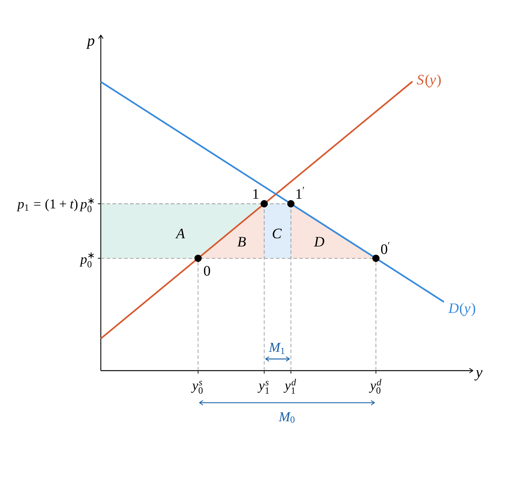
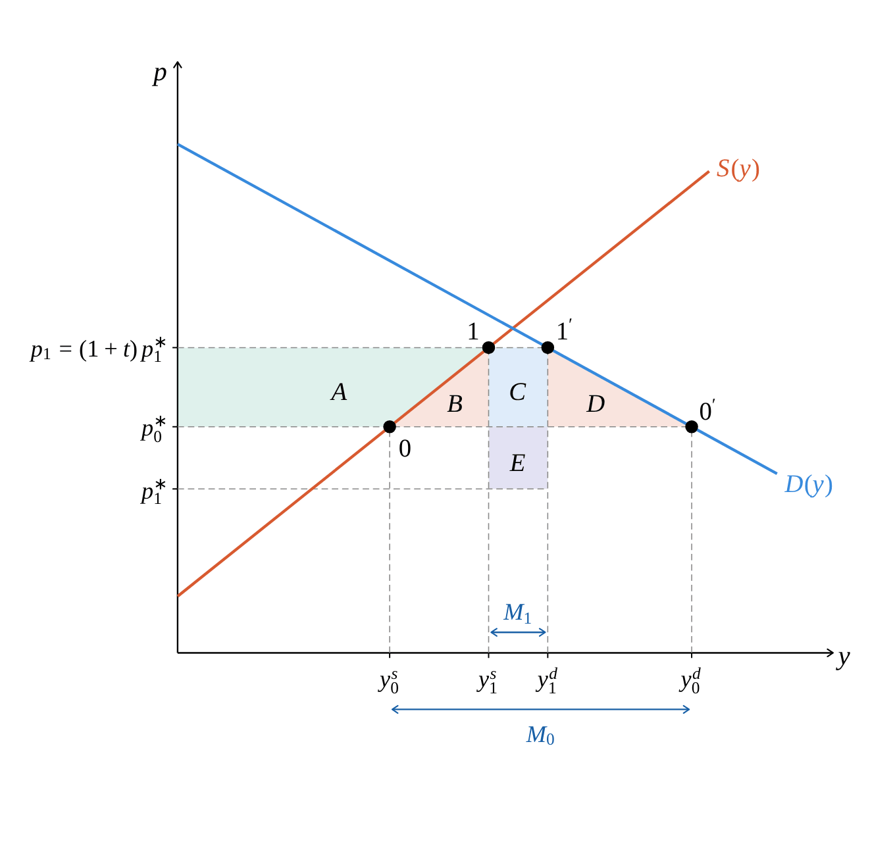
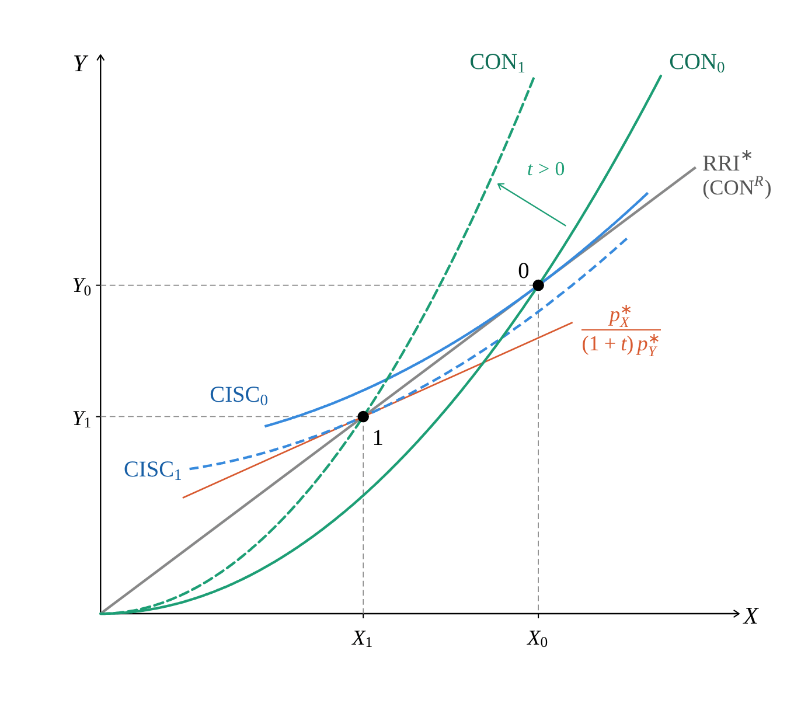
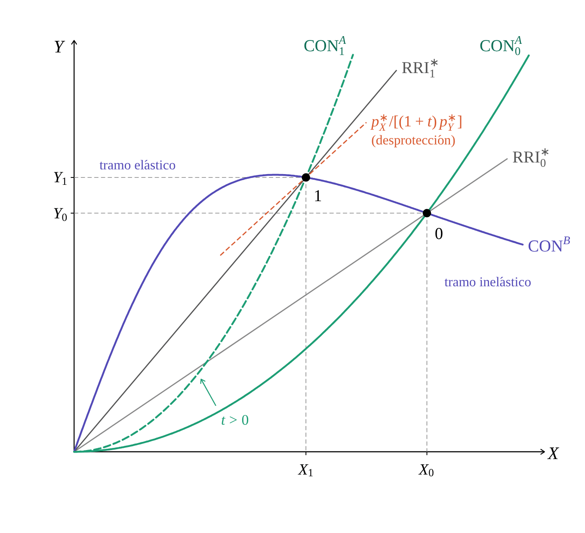
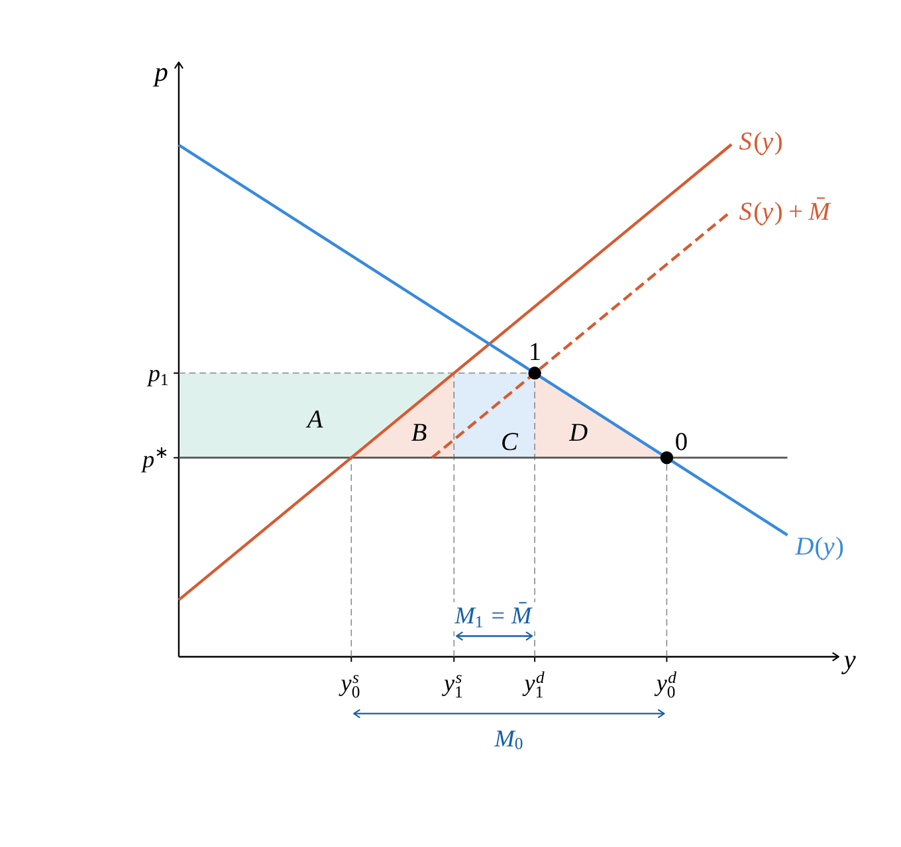
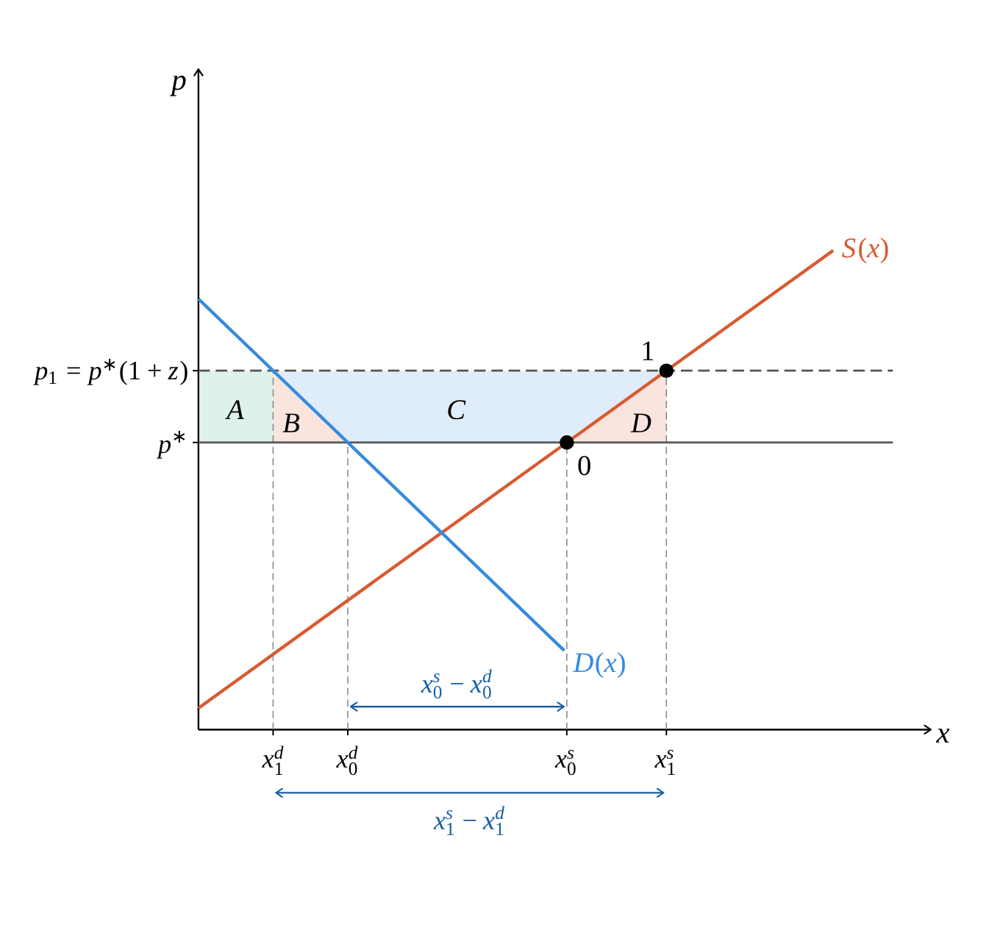
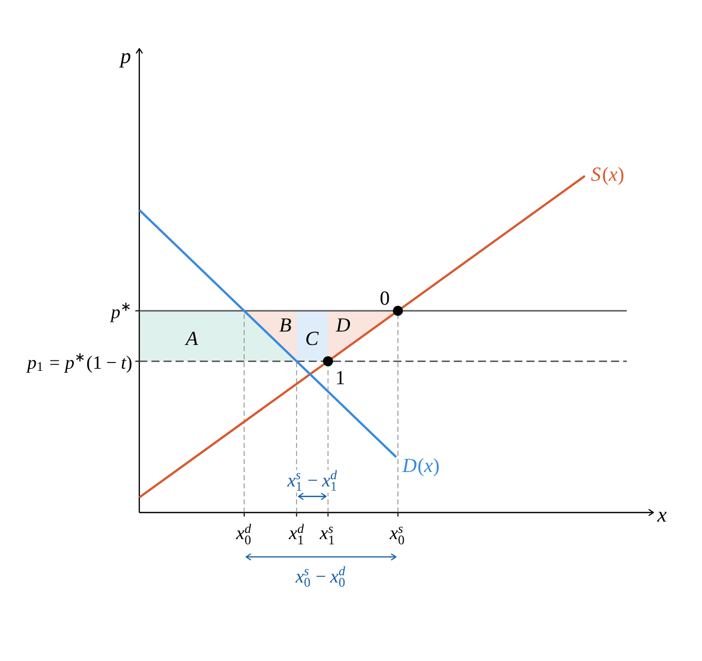
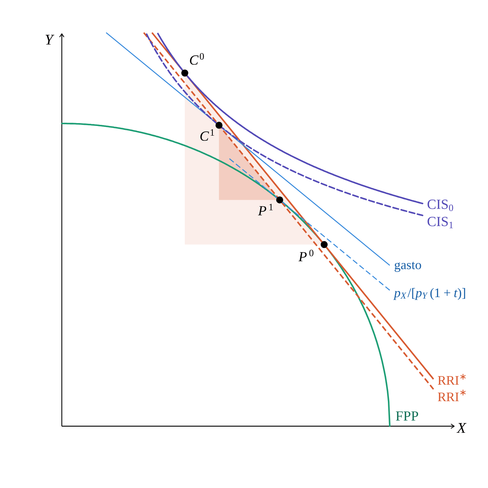

## Introducción



Este tema examina los instrumentos de la política comercial y sus efectos:

- *Justificación*: breve repaso del debate entre el proteccionismo y el libre cambio para entender por qué se recurre a la política comercial.

- *Barreras arancelarias*: el arancel como instrumento y sus efectos en equilibrio parcial y general.

- *Barreras no arancelarias y otros instrumentos tradicionales*: cuotas, subvenciones e impuestos a la exportación, restricciones voluntarias y demás barreras no arancelarias, y sus efectos.

## 1. Justificación de la política comercial

El debate normativo sobre la política comercial se ha articulado, históricamente, en torno a dos grandes familias de argumentos, los favorables al librecambismo y los favorables a la intervención.

### 1.1. Argumentos en favor del librecambismo

Desde las aportaciones de Adam Smith (1776) y David Ricardo (1817), la teoría ha defendido el libre comercio como política comercial óptima, incluso cuando se adopta de forma unilateral.

#### 1.1.1. Argumentos relacionados con efectos estáticos

**Ventaja comparativa**: la especialización conforme a la ventaja comparativa y el posterior intercambio generan ganancias mutuas de bienestar, con independencia de cuál sea la fuente de esa ventaja, tecnológica o dotacional (tema [B05](b05-tnc-comercio.qmd), apartados 1.2 y 2.3).

**Eficiencia económica**: las barreras arancelarias y no arancelarias actúan como costes de transacción que distorsionan los precios relativos y generan pérdidas irrecuperables de eficiencia, por lo que, en ausencia de otras distorsiones, su eliminación restaura el óptimo paretiano. A ello se añade el efecto procompetitivo de las importaciones, que disciplinan el poder de mercado interno, y la mayor variedad disponible para consumidores y empresas.

#### 1.1.2. Argumentos relacionados con efectos dinámicos

**Tamaño de mercado**: la apertura amplía el mercado de cada empresa y le permite aprovechar economías de escala internas, que crean comercio y ganancias aun en ausencia de ventaja comparativa. Por ejemplo, en el modelo de Krugman (1979b), cada empresa produce a mayor escala y menor coste medio, y la ganancia llega a los trabajadores como mayor salario real (tema [B06](b06-nueva-teoria.qmd), apartado 2.1.2).

**Crecimiento económico**: las economías de aprendizaje y los efectos desbordamiento del conocimiento asociados al libre flujo internacional de bienes e ideas pueden elevar la tasa de crecimiento, no solo el nivel de renta. La integración amplía el mercado de cada innovación y el acervo de ideas disponible para investigar (Rivera-Batiz y Romer, 1991), aunque el signo del efecto depende de la ventaja comparativa de cada país (tema [B09](b09-comercio-crecimiento.qmd), apartado 3.1).

### 1.2. Argumentos en favor del proteccionismo

Frente a ello, los argumentos en favor de la intervención pueden agruparse en dos bloques, los derivados de los fallos del mercado nacional y los derivados del propio proceso de liberalización.

#### 1.2.1. Argumentos derivados de los fallos del mercado nacional

Los mercados nacionales de capital o de trabajo pueden presentar imperfecciones (un sistema financiero ineficiente, rigideces laborales). En ese caso, el trasvase del ahorro y de los factores desde los sectores tradicionales hacia los sectores nuevos con mayores beneficios potenciales puede no producirse, lo que restringe el crecimiento de las industrias emergentes y justificaría, en principio, su protección.

Incluso en estos casos, no obstante, el proteccionismo comercial es un instrumento de *second best*, puesto que la solución de *first best* consiste en corregir el fallo del mercado en su origen (Bhagwati y Ramaswami, 1963), sin introducir una distorsión adicional en el comercio.

#### 1.2.2. Argumentos derivados del proceso de liberalización (I): la industria naciente (Hamilton, 1791; Raymond, 1820; List, 1841)

**Origen**: Alexander Hamilton enunció el argumento de la industria naciente en su *Informe sobre las manufacturas* (1791), y Daniel Raymond (1820) y Friedrich List (1841) lo desarrollaron.

**Idea**: el argumento sostiene que algunas industrias en etapas tempranas necesitan protección temporal frente a rivales más competitivos, pues la capitalización y el aprendizaje requieren tiempo durante el cual esas industrias aún no disponen de ventaja comparativa.

**Razonamiento**: para que la protección esté justificada, la industria candidata debe superar un doble filtro:

- *Criterio de Mill*: la protección debe ser estrictamente temporal y la industria debe ser capaz, transcurrido el periodo de aprendizaje, de competir internacionalmente sin ayuda pública[^b07-2].

- *Criterio de Bastable* (1891): las ganancias futuras descontadas de la industria madura deben superar los costes acumulados que la protección impone a la economía.

**Conclusiones**:

- *Aspectos positivos*: el argumento justifica una protección compatible con la ventaja comparativa a largo plazo, y los criterios de Mill y de Bastable permiten contrastar cuándo procede.

- *Limitaciones*: el argumento está sujeto a dos críticas:

    - *Momento de la inversión*: no siempre conviene invertir hoy en industrias que tendrán ventaja comparativa en el futuro, pues puede ser preferible esperar a que se acumule el capital humano necesario.

    - *Capacidad de selección*: es dudoso que el sector público, expuesto a la captura y a problemas de información, identifique mejor que los inversores privados a las industrias prometedoras[^b07-3].

#### 1.2.3. Argumentos derivados del proceso de liberalización (II): la distribución de la renta

**Teorema de Stolper y Samuelson** (1941): con dos bienes, dos factores y producción diversificada, si un bien se encarece en términos relativos, mejora la retribución real del factor que su producción emplea con más intensidad y empeora la del otro. En la medida en que el comercio altera los precios relativos, el reparto de las ganancias de la apertura es desigual, ya que ganan los propietarios del factor abundante y pierden los del factor escaso.

**Modelo de factores específicos** (Samuelson, 1971, y Jones, 1971): con un factor móvil entre sectores (el trabajo) y otros específicos de cada sector, la apertura beneficia a los propietarios de los factores específicos de los sectores exportadores. Perjudica, en cambio, a los de los sectores que compiten con las importaciones.

**Efecto selección** (Melitz, 2003; tema [B06](b06-nueva-teoria.qmd), apartado 3.1): la liberalización expulsa del mercado a las empresas menos productivas, lo que, pese a su ganancia agregada de eficiencia, puede generar destrucción de empresas y desempleo transitorio de recursos.

#### 1.2.4. Argumentos derivados del proceso de liberalización (III): la balanza de pagos

**Efectos sobre el ahorro público**: la liberalización supone la pérdida de los ingresos arancelarios, relevantes en países con administraciones tributarias débiles, y la renuncia, en el caso de un país grande, a la ganancia potencial del arancel óptimo.

**Efecto absorción interna**: la apertura aumenta el consumo, la inversión y el gasto público y, con ello, la absorción interna, lo que deteriora la cuenta corriente durante la transición.

**Efectos apreciatorios reales**: la falta de credibilidad institucional del proceso liberalizador puede provocar el adelanto de las compras de importaciones, presiones inflacionistas y una apreciación real que erosione la competitividad exterior.

#### 1.2.5. Evidencia empírica

La evidencia empírica ofrece apoyo matizado a ambas posiciones. De un lado, los estudios transversales que recoge el tema [B09](b09-comercio-crecimiento.qmd), apartado 3.2, asocian apertura y crecimiento (Sachs y Warner, 1995), si bien la robustez de esa correlación ha sido cuestionada por problemas de medición y causalidad (Rodríguez y Rodrik, 2000). De otro, la experiencia de la protección a la industria naciente es ambivalente. La protección fracasó de forma generalizada en la industrialización por sustitución de importaciones latinoamericana, pero formó parte del éxito exportador de Asia oriental. Allí, la protección selectiva se combinó con disciplina exportadora y retirada efectiva de las ayudas.

### 1.3. Conclusiones

Los argumentos librecambistas presentan el comercio como un juego de suma positiva. En el plano estático, la especialización según la ventaja comparativa genera ganancias mutuas y la supresión de las barreras elimina pérdidas de eficiencia. En el dinámico, el mercado ampliado permite aprovechar economías de escala, y la difusión del conocimiento puede elevar la tasa de crecimiento.

Los argumentos proteccionistas parten, en cambio, de los fallos del mercado nacional, de la industria naciente y de los ganadores, perdedores y desequilibrios que genera la apertura. Sus condiciones son exigentes, pues frente a un fallo del mercado la protección es un instrumento de *second best* y la industria naciente solo la justifica si supera los criterios de Mill y de Bastable. La evidencia apoya con matices ambas posiciones, ya que la protección fracasó en la sustitución de importaciones latinoamericana y acompañó, con disciplina exportadora, el éxito de Asia oriental. Cuando se interviene, la política comercial recurre a **barreras arancelarias**, cuyos efectos estudia la sección 2, y a **barreras no arancelarias** (p. ej. cuotas o restricciones voluntarias), objeto de la sección 3.

## 2. Barreras arancelarias: el arancel como instrumento y sus efectos

Se empieza por las barreras arancelarias, pues el arancel ha sido históricamente uno de los instrumentos más extendidos.

### 2.1. El arancel como instrumento

Antes de estudiar los efectos del arancel conviene precisar qué es y cómo se mide la carga arancelaria, con aranceles promedio o con la tasa de protección efectiva.

#### 2.1.1. Definición

Un **arancel** es un impuesto o gravamen que se aplica sobre mercancías que cruzan la frontera. Los aranceles pueden clasificarse según el objeto de gravamen o según la forma de aplicación.

1. *Según el objeto de gravamen*:

    - *A la importación*: gravan la mercancía que entra en un país (es decir, las importaciones), con carácter general con el doble objetivo de proteger la industria nacional y conseguir recaudación. Estos aranceles son, con gran diferencia, los más habituales.

    - *A la exportación*: gravan la mercancía que sale de un país (es decir, las exportaciones), generalmente con el objetivo de impulsar el abastecimiento nacional, mejorar la relación real de intercambio (RRI) o conseguir recaudación. Estos aranceles son poco frecuentes y se denominan derechos aduaneros a la exportación.

    - *De tránsito*: gravan las mercancías que atraviesan el territorio nacional con destino a un tercer país. Estos aranceles fueron históricamente relevantes como fuente de recaudación, pero hoy han desaparecido casi por completo.

2. *Según la forma en que se aplica*:

    - *Ad valorem*: aplican un porcentaje arancelario fijo sobre el valor de un bien, de forma que $\text{CT}(x) = (1+t) \cdot p \cdot x \rightarrow p_p = (1+t) p$, con $t > 0$ la tasa fija arancelaria, $p_p$ el precio protegido y $p$ el precio desprotegido. Este arancel es el más común y su principal ventaja es que el nivel de protección nominal que ofrece es siempre conocido y siempre el mismo, puesto que coincide con la tarifa aplicada y es independiente del nivel general de precios. Como contrapartida, el arancel *ad valorem* exige la valoración en aduana de la mercancía, lo que encarece su administración y facilita la manipulación de las facturas (subfacturación).

    - *Fijos o específicos*: aplican una cantidad monetaria arancelaria fija por unidad del bien. Así, $\text{CT}(x) = (p + t_e) \cdot x \rightarrow p_p = p + t_e$, con $t_e > 0$ la cantidad monetaria fija por unidad y $x$ la cantidad (sea de importaciones o de exportaciones). La ventaja de este arancel es que resulta más sencillo de administrar, pues no exige valorar la mercancía. Sus dos desventajas, en cambio, son que es menos equitativo (regresivo)[^b07-4] y que la protección real que ofrece varía con el nivel de precios, porque la inflación erosiona una cuantía fija (y la deflación la amplifica).

    - *Mixtos*: consisten en una combinación de ambos.

#### 2.1.2. Medición (I): enfoque basado en el arancel promedio

El arancel promedio es el indicador seguido por la teoría tradicional del comercio internacional y se puede calcular de dos formas:

1. *Media simple*: cociente entre la suma de los aranceles nominales de cada categoría y el número de categorías, $\bar{t} = \frac{1}{n} \sum_{i=1}^n t_i$.

2. *Media ponderada*: ponderación de los tipos arancelarios en función del valor de las importaciones de cada categoría, $\bar{t} = \sum_{i=1}^n \omega_i t_i$, donde $\omega_i$ es la participación de las importaciones de la categoría $i$ en las importaciones totales.

**Conclusiones**:

- *Aspectos positivos*: se trata de indicadores sencillos de calcular y de comparar internacionalmente, por lo que son los utilizados habitualmente en las estadísticas de organismos como la OMC o el Banco Mundial.

- *Limitaciones*: ambos indicadores presentan sesgos conocidos. La media simple puede sobrestimar la protección si unas pocas categorías con aranceles bajos concentran el comercio del país y las muchas categorías con aranceles altos apenas comercian. La media ponderada, por su parte, puede subestimarla, ya que un arancel prohibitivo reduce mucho la importación del producto y, con ella, el peso que recibe en la media.

#### 2.1.3. Medición (II): enfoque basado en la protección efectiva o arancel implícito

Harry Johnson (1965), Béla Balassa (1965a) y Max Corden (1966) critican el enfoque del arancel promedio porque no tiene en cuenta el comercio de bienes intermedios[^b07-5]. Por ello, el arancel nominal sobre un producto puede ser muy diferente del arancel implícito que protege a la actividad que lo produce.

La **tasa de protección efectiva** es el incremento porcentual en el valor añadido unitario de un bien con respecto a una situación en la que no existen aranceles, manteniendo el tipo de cambio y todas las variables relevantes constantes.

Formalmente[^b07-6], la tasa o grado de protección efectiva se define como:

$$t_{\text{PE}} \equiv \frac{\text{VA}_{\text{CON}} - \text{VA}_{\text{SIN}}}{\text{VA}_{\text{SIN}}} \tag{1}$$

donde $\text{VA}_{\text{CON}}$ y $\text{VA}_{\text{SIN}}$ son el valor añadido unitario con arancel y sin él, de modo que (1) mide el “exceso” de valor añadido que genera el arancel.

Además, operando, se puede demostrar que:

$$(t_{\text{PE}} - t) = \beta(t - t_I), \qquad \beta = \frac{\alpha}{1-\alpha} > 0 \tag{2}$$

donde $t$ y $t_I$ son los aranceles nominales sobre el bien final y sobre los bienes intermedios, $\alpha \in (0, 1)$ es la participación de los bienes intermedios en el valor del bien final y $\beta$ crece con ella. La expresión (2) muestra cómo el exceso del arancel efectivo sobre el arancel nominal del bien final equivale al exceso del arancel nominal del bien final sobre el arancel nominal de los bienes intermedios, ponderado por $\beta$.

::: {.callout-tip collapse="true" appearance="simple" title="Ejemplo: tasa de protección efectiva"}
Con una participación de los bienes intermedios de $\alpha = 0{,}5$, un arancel nominal del 10 % sobre el bien final y del 5 % sobre el bien intermedio, la tasa de protección efectiva es $t_{\text{PE}} = (0{,}10 - 0{,}5 \cdot 0{,}05)/(1-0{,}5) = 0{,}15$, es decir, un 15 %. Con (2), $t_{\text{PE}} - t = 1 \cdot (0{,}10 - 0{,}05) = 0{,}05$, de modo que la protección efectiva sobre el valor añadido supera a la nominal.
:::

De la expresión (2) se deduce que la tasa de protección efectiva o arancel implícito depende de:

**Estructura o diseño arancelario**: el arancel implícito depende positivamente del arancel nominal sobre el bien final y negativamente del arancel nominal sobre los bienes intermedios. Por ello, podría llegar a ser negativo si $\beta t_I > (1+\beta) t$. El caso de un arancel implícito negativo no es una mera disquisición teórica, ya que las estimaciones empíricas de la protección efectiva lo registran en algunos sectores.

**Grado de participación**: cuanto mayor sea la participación de los bienes intermedios, mayor será el grado de protección efectiva, para una misma brecha positiva entre aranceles nominales ($t > t_I$).

**Grado de sustituibilidad**: la expresión (2) supone coeficientes fijos, de modo que este efecto no se deduce de ella. Cuanto mayor sea el grado de sustituibilidad, mayor será la protección efectiva de la que disfruta realmente la industria, porque la empresa podrá sustituir más fácilmente el bien intermedio gravado por otros no gravados.

**Conclusiones**:

- *Aspectos positivos*: el enfoque mide la protección allí donde importa, sobre la actividad productiva y su valor añadido. Además, permite identificar el fenómeno de la *escalada arancelaria* (*tariff escalation*), en el que estructuras con aranceles nominales crecientes con el grado de elaboración, moderadas en apariencia, esconden tasas de protección efectiva muy elevadas sobre las fases finales de transformación. Ello dificulta la industrialización exportadora de los países en desarrollo.

- *Limitaciones*: el indicador supone, por un lado, que el país es pequeño, por lo que sus aranceles no afectan a los precios mundiales de los *outputs* ni de los *inputs*. Por otro, supone una función de producción de tipo Leontief, sin sustituibilidad entre *inputs* intermedios, lo que sesga la medición cuando las empresas pueden recomponer su cesta de insumos.

#### 2.1.4. Conclusiones

**Aspectos positivos**: el arancel es un instrumento transparente, pues figura en el precio, a diferencia de la cuota (apartado 3.1.1), y en su forma *ad valorem* ofrece un nivel de protección nominal conocido.

**Limitaciones**: el tipo nominal no mide la protección de cada actividad, que depende también de los aranceles sobre sus bienes intermedios, y los promedios que resumen la estructura arancelaria están sesgados.

Entendido el concepto de arancel y cómo medir el grado de restricción que supone, se analizan sus efectos económicos:

1. *Enfoques*: primero, los efectos sobre la industria de un bien importable Y, en equilibrio parcial, y, después, los efectos sobre la economía en su conjunto, en equilibrio general.

2. *Bienestar*: cada unidad monetaria ganada o perdida por cada agente económico (consumidores, sector público o empresas) tiene la misma importancia[^b07-7].

3. *Tamaño del país*: en ambos casos se distingue entre un país pequeño, que no puede afectar a los precios mundiales a través de su volumen comercial, y un país grande, que sí puede.

### 2.2. Análisis en equilibrio parcial: efectos sobre la industria del bien importable

**Metodología y herramientas**: el análisis se apoya en la herramienta propia del equilibrio parcial, la cruz marshalliana de oferta y demanda de la industria del bien importable.

**Supuestos**: salvo en la mención a la competencia imperfecta del apartado 2.2.3, se considera un mundo neoclásico (competencia perfecta, ausencia de costes de transporte y de otras fricciones).

#### 2.2.1. Análisis de los efectos en un país pequeño y en competencia perfecta

**Desarrollo gráfico**: los efectos de un arancel en un país pequeño se representan en el plano cantidad-precio del bien importable Y (figura -@fig-b072-aranceles-i):

1. *Curva de oferta nacional*, $S(y)$: recoge la producción nacional del bien a cada precio y es creciente, porque en competencia perfecta refleja el coste marginal de la industria, que crece con la producción.

2. *Curva de demanda nacional*, $D(y)$: recoge el consumo nacional a cada precio y es decreciente, porque mide lo que los consumidores están dispuestos a pagar por cada unidad adicional, que disminuye conforme consumen más.

3. *Precio internacional*, $p_0^*$: horizontal, porque el país pequeño importa cualquier cantidad a ese precio sin alterarlo.

4. *Equilibrio inicial*: el país, pequeño y abierto al exterior, toma como dado el precio internacional, de modo que $p_0 = p_0^*$. A ese precio produce $y_0^s$ (punto 0) y consume $y_0^d$ (punto 0′), es decir, es importador neto del bien Y e importa una cantidad $M_0 = y_0^d - y_0^s > 0$.

::: {#fig-b072-aranceles-i}

::: {.content-visible when-format="html"}
```{=html}
<div class="graph-frame">
<iframe src="../graphs/b072_Aranceles_i.html" style="height:680px" loading="lazy" title="fig-b072-aranceles-i"></iframe>
</div>
```
:::

::: {.content-visible unless-format="html"}

:::

Arancel en un país pequeño (equilibrio parcial). El arancel tiene efectos producción, consumo y recaudación y genera una pérdida neta de bienestar.
:::

**Estática comparativa**: se introduce un arancel *ad valorem* que eleva el precio nacional por encima del internacional, $p_1 = (1+t)p_0^* > p_0^*$, de modo que se alcanza un nuevo equilibrio dado por los puntos 1 y 1′. El arancel afecta en cuatro dimensiones:

- *Producción (nacional)*: aumenta de $y_0^s$ a $y_1^s$ y el excedente del productor aumenta en el área A, pues los productores nacionales cubren parte de la demanda antes atendida con importaciones.

- *Consumo*: se reduce de $y_0^d$ a $y_1^d$ y el excedente del consumidor se reduce en las áreas A, B, C y D.

- *Recaudación*: el área C representa la recaudación del sector público, que vendrá dada por el producto de la cuantía monetaria del impuesto *ad valorem* por unidad del bien ($t\,p_0^*$)[^b07-10] y la cantidad importada ($M_1$).

- *Comercio internacional*: las importaciones se reducen debido a la mayor producción nacional y al menor consumo ($M_1 = y_1^d - y_1^s > 0$).

El efecto neto sobre el bienestar será una pérdida de bienestar recogida en las áreas B y D ($\text{EN} = -(B+D)$). La pérdida del área B puede entenderse como la pérdida por el efecto producción (recursos nacionales empleados a un coste superior al precio mundial) y la del área D como la pérdida por el efecto consumo (consumo socialmente valioso al que se renuncia).

La magnitud y la distribución del efecto neto dependen de dos factores:

1. *Elasticidad-precio de la oferta y de la demanda* (+): cuanto mayor sea la sensibilidad de las cantidades al precio, mayores serán las distorsiones del arancel sobre el consumo y la producción.

2. *Cuantía del arancel* (++): las distorsiones aumentan de forma más que proporcional, pues la pérdida de eficiencia crece, aproximadamente, con el cuadrado del tipo. Por tanto, conviene repartir la imposición entre varios productos antes que concentrarla en uno solo.

**Bienestar**:

- *Pérdida de eficiencia nacional*: en un país pequeño, un arancel siempre reduce el bienestar social, puesto que se produce un exceso de gravamen[^b07-11] derivado de la fijación de un precio de mercado artificial.

- *Pérdida de eficiencia mundial*: *ceteris paribus*, dada la incapacidad del país para alterar la RRI, se reducirá el bienestar mundial.

- *Efecto redistributivo*: los consumidores transfieren a los productores el área A, como una subvención equivalente, y al sector público el área C, como recaudación. El arancel equivale, así, a la combinación de un impuesto sobre el consumo y una subvención a la producción del bien importable, ambos al mismo tipo, lo que explica su doble distorsión.

- *Efectos adicionales*: habría que añadir los costes de administración del impuesto y los efectos sobre el empleo[^b07-12].

#### 2.2.2. Análisis de los efectos en un país grande y en competencia perfecta

Un país grande puede alterar la RRI, pues, al disminuir su demanda del bien importable en los mercados internacionales, el precio de sus importaciones cae.

**Desarrollo gráfico**: los efectos de un arancel en un país grande se representan en el plano cantidad-precio del bien importable (figura -@fig-b073-aranceles-ii):

1. *Curvas de oferta y de demanda nacionales*, $S(y)$ y $D(y)$: recogen la producción y el consumo nacionales a cada precio, y son, respectivamente, creciente y decreciente, como en el caso anterior.

2. *Equilibrio inicial*: un país grande y abierto al exterior importa un bien. Al precio $p_0 = p_0^*$, que ahora depende de la demanda del país, produce $y_0^s$ (punto 0) y consume $y_0^d$ (punto 0′), de modo que importa una cantidad $M_0 = y_0^d - y_0^s$.

::: {#fig-b073-aranceles-ii}

::: {.content-visible when-format="html"}
```{=html}
<div class="graph-frame">
<iframe src="../graphs/b073_Aranceles_ii.html" style="height:680px" loading="lazy" title="fig-b073-aranceles-ii"></iframe>
</div>
```
:::

::: {.content-visible unless-format="html"}

:::

Arancel en un país grande (equilibrio parcial). La mejora de la relación real de intercambio puede compensar la pérdida de eficiencia.
:::

**Estática comparativa**: en este caso, el arancel eleva el precio nacional pero, además, afecta al precio internacional. El precio internacional cae, de $p_0^*$ a $p_1^*$, en la cuantía que los exportadores extranjeros absorben del arancel, y el precio nacional pasa a $p_1 = (1+t)\,p_1^*$ (puntos 1 y 1′). Los efectos son similares a los del caso anterior, con una ganancia adicional para el país que impone el arancel:

- *Consumo*: el país importador consume menos y pierde las áreas A, B, C y D. El consumo crece, en cambio, en el país exportador, cuyo mercado interno se abarata.

- *Producción*: el país importador produce más (ganancia del área A) y el exportador, menos.

- *Comercio internacional*: las importaciones del país que impone el arancel se reducen y, con ellas, las exportaciones del país exportador, que son su contrapartida.

- *Recaudación*: en el país importador nace una nueva fuente de ganancia para el sector público, el área E, que representa la parte de la carga arancelaria que asumen los exportadores extranjeros como consecuencia de la caída del precio internacional del bien importable. Así, la recaudación total es C + E. En cambio, en el país exportador la recaudación no cambia.

- *Efecto neto*: en el país importador será ambiguo y dependerá de si la ganancia de relación real de intercambio (E) es mayor o menor que la suma de la distorsión sobre la producción (B) y la distorsión sobre el consumo (D). En el país exportador se suman sus propias distorsiones internas de producción y consumo y la pérdida de relación real de intercambio (E), que coincide exactamente con la ganancia que obtiene el país importador, por lo que su efecto neto es inequívocamente negativo. Para el mundo en su conjunto, las transferencias se cancelan y solo quedan las distorsiones, de modo que la pérdida mundial es inequívoca.

**Bienestar**: a diferencia del país pequeño, un país grande puede obtener con el arancel ganancias potenciales de bienestar social, por lo que podría existir un arancel socialmente óptimo.

#### 2.2.3. Mención a la competencia imperfecta

**Libre comercio**: en un entorno de monopolio, la apertura elimina el comportamiento monopolista, pues el precio internacional pone un techo al precio y reemplaza a la curva de demanda de autarquía. Por ello, la mejor estrategia del monopolista pasa a ser producir hasta igualar su coste marginal al precio mundial, como cualquier otra empresa.

**Fijación de un arancel**: el monopolista sigue viendo limitada su capacidad para aumentar el precio y, por tanto, se seguirá comportando como si estuviera en competencia perfecta internacional.

No obstante, si el arancel es prohibitivo, es decir, tan elevado que elimina completamente las importaciones, los efectos serán diferentes en función de la naturaleza de la industria:

1. *Competitiva*: una vez eliminadas las importaciones, cualquier aumento posterior del arancel no tendrá efecto.

2. *Monopolista*: un arancel prohibitivo permitirá al monopolista aumentar su precio, acercándose a su precio de máximo beneficio.

#### 2.2.4. Conclusiones

En equilibrio parcial, el arancel reduce siempre el bienestar de un país pequeño, y en uno grande su efecto depende de que la ganancia de relación real de intercambio supere las distorsiones.

**Aspectos positivos**: el análisis mide con áreas de excedente lo que gana o pierde cada agente y separa la pérdida de eficiencia de la ganancia de relación real de intercambio.

**Limitaciones**: no considera la interrelación entre distintas industrias, que se aborda a continuación, de modo que omite la caída de las exportaciones y los efectos sobre la renta de los factores que muestra el equilibrio general.

### 2.3. Análisis en equilibrio general: efectos sobre la economía en su conjunto

El equilibrio general requiere herramientas propias, las curvas de oferta neta y las de indiferencia social comerciales. Con ellas se repiten los casos del país pequeño y del país grande, y se llega al arancel óptimo, a la guerra arancelaria y a las paradojas de Lerner y Metzler.

#### 2.3.1. Instrumentos de análisis

**Metodología y herramientas**: la frontera de posibilidades de producción (FPP) subyace a las dos herramientas del análisis, las curvas de oferta neta o demandas recíprocas y las curvas de indiferencia social comerciales, pero queda implícita por claridad expositiva.

**Curvas de indiferencia social comerciales (CISC)**: cada una reúne las combinaciones de importaciones y exportaciones (volúmenes de comercio) que reportan al país igual bienestar social[^b07-13]. En cuanto a su forma, estas son:

- *Crecientes*: tienen pendiente positiva en el plano $(X, Y)$ porque las exportaciones pueden considerarse un mal (bienes a los que se renuncia para pagar las importaciones sin incurrir en déficit comercial[^b07-14]). Por ello, para mantener constante el bienestar, cantidades adicionales de bienes importados (un bien) deben compensarse con cantidades adicionales de bienes exportados (un sacrificio).

- *Convexas*: se supone que aumentos sucesivos e idénticos de las importaciones requieren, para mantener el bienestar constante, un aumento cada vez menor de las exportaciones (es decir, la relación marginal de sustitución entre exportaciones e importaciones es decreciente)[^b07-15].

::: {.callout-note appearance="simple" icon=false}
Las curvas de oferta neta y los supuestos de este análisis se desarrollan en el tema [B05](b05-tnc-comercio.qmd), apartado 2.1. Aquí se recogen las propiedades imprescindibles para seguir el análisis del arancel.
:::

**Curvas de oferta neta (CON) o demandas recíprocas**: recogen, para cada RRI internacional, las exportaciones que un país está dispuesto a entregar a cambio de cada volumen de importaciones. Pasan por el origen y se representan en orientación especular, pues el bien que exporta un país es el que importa el otro. En el plano $(X, Y)$, presentan un tramo elástico o “normal”, de pendiente positiva, y pueden presentar otro inelástico o “anómalo”, de pendiente negativa, en el que la RRI es tan favorable que se puede seguir importando aunque las exportaciones disminuyan.

Si la FPP es cóncava, las curvas de oferta neta son convexas, y una curva perfectamente elástica (una recta desde el origen) describe a quien comercia cualquier volumen a la RRI dada, como el resto del mundo frente a un país pequeño.

**Supuestos**:

- *Entorno*: dos bienes (X, Y), exportables e importables, cuyos excesos reflejan las exportaciones y las importaciones.

- *Agentes*: se prescinde de cómo reparte el sector público los ingresos arancelarios[^b07-21].

- *Mercados*: competencia perfecta en todos los mercados, nacionales e internacionales, sin costes de transporte, con libre movilidad nacional y pleno empleo de los recursos[^b07-22].

- *Sector exterior*: la balanza comercial está siempre equilibrada, ya que no existen pagos ni deuda más allá de los flujos comerciales de mercancías y el valor se mide a través de los propios bienes, es decir, se produce trueque. Por ello, la RRI equivale a la ratio de importaciones frente a exportaciones. El país tiene ventaja comparativa en X frente al resto del mundo, de modo que exporta X e importa Y.

#### 2.3.2. Análisis de los efectos en un país pequeño y en competencia perfecta

**Desarrollo gráfico**: los efectos de un arancel en un país pequeño se representan en el plano exportaciones-importaciones[^b07-23] (figura -@fig-b071-con-tariff-ge):

1. *Curva de oferta neta del país*, $\text{CON}_0$: recoge las exportaciones que el país entrega a cambio de cada volumen de importaciones y es normal, es decir, creciente (tramo elástico).

2. *Curva de oferta neta del resto del mundo*, $\text{CON}^R$: perfectamente elástica, una recta desde el origen de pendiente igual a la RRI internacional, $\text{RRI}^*$, porque, al ser el país pequeño, las alteraciones de su volumen comercial no afectan a la RRI internacional.

3. *Curvas de indiferencia social comerciales*, $\text{CISC}_0$ y $\text{CISC}_1$: reúnen los volúmenes de comercio con un mismo bienestar social y son crecientes y convexas.

4. *Equilibrio inicial* (punto 0): el país exporta $X_0$ e importa $Y_0$, y la $\text{CISC}_0$ es tangente a la relación real de intercambio internacional. El precio relativo nacional (es decir, la RRI nacional) coincide, por tanto, con la RRI internacional ($p_X^0/p_Y^0 = p_X^{*0}/p_Y^{*0} \equiv \text{RRI}^*$), de modo que se cumple la ley del precio único. Los volúmenes de comercio quedan reflejados en los dos triángulos de comercio simétricos, cuyos vértices son el origen, el punto 0 y la proyección de este sobre cada uno de los ejes ($X_0$ e $Y_0$).

::: {#fig-b071-con-tariff-ge}

::: {.content-visible when-format="html"}
```{=html}
<div class="graph-frame">
<iframe src="../graphs/b071_CON_tariff_GE.html" style="height:660px" loading="lazy" title="fig-b071-con-tariff-ge"></iframe>
</div>
```
:::

::: {.content-visible unless-format="html"}

:::

Arancel en un país pequeño (equilibrio general). El precio interior se aparta del mundial y la economía pasa a una curva de indiferencia social inferior.
:::

**Estática comparativa**: un arancel *ad valorem* ($t > 0$) hace que el precio relativo nacional ya no coincida con la RRI internacional[^b07-25]. Concretamente, el precio relativo nacional será menor que el internacional ($p_X^{*0}/[(1+t)p_Y^{*0}] < p_X^{*0}/p_Y^{*0}$) en la cuantía del arancel.

El coste de oportunidad de comerciar con el exterior aumenta, porque a los productores les resulta más rentable producir el bien importable que seguir produciendo el exportable. Por ello, la curva de oferta neta del país se contrae, de $\text{CON}_0$ a $\text{CON}_1$, y el nuevo equilibrio se produce en el punto 1, con exportaciones $X_1$ e importaciones $Y_1$. La introducción del arancel tiene cinco efectos principales:

- *Producción*: aumenta la producción del bien importable Y (ahora protegido) y disminuye la del bien exportable X.

- *Consumo*: con bienes normales, disminuye el consumo del bien importable, ahora más caro, y el efecto sobre el del exportable es ambiguo (Anexo).

- *Recaudación*: el Gobierno recauda ingresos arancelarios equivalentes al arancel por unidad multiplicado por el volumen de importaciones.

- *Comercio internacional*: se producirá un descenso tanto de las exportaciones como de las importaciones. Por tanto, el triángulo de comercio será menor.

- *Efecto neto*: el país sufre una pérdida inequívoca de bienestar, pues la CISC alcanzada está más próxima al origen dada la nueva relación de precios nacionales. La pérdida de bienestar del mundo en su conjunto es exactamente la que sufre el propio país.

**Bienestar**: en un marco con dos factores de producción, el teorema de Stolper y Samuelson (1941) implica que la retribución real unitaria del factor usado intensivamente en la producción del bien importable aumentará.

#### 2.3.3. Análisis de los efectos en un país grande y en competencia perfecta

**Desarrollo gráfico**: en el plano exportaciones-importaciones (figura -@fig-b074-con-tariff-ge), dos países grandes (A, B) comercian dos bienes (X, Y):

1. *Curva de oferta neta de A*, $\text{CON}^A_0$: recoge los intercambios que A está dispuesto a realizar a cada RRI y es normal.

2. *Curva de oferta neta de B*, $\text{CON}^B$: también normal. A diferencia del caso del país pequeño, restringe las posibilidades comerciales del país A, cuyas combinaciones factibles se encuentran sobre esa curva o por debajo de ella.

3. *Curvas de indiferencia social comerciales*, $\text{CISC}^A_0$ y $\text{CISC}^B_0$: reúnen, para cada país, los volúmenes de comercio con un mismo bienestar social, y las dibujadas son las de libre comercio.

4. *Equilibrio inicial* (punto 0): del cruce de las curvas de oferta neta se determina la RRI internacional de equilibrio, $\text{RRI}_0^*$. En este punto, las CISC son tangentes entre sí y también tangentes a la $\text{RRI}_0^*$, y los triángulos de comercio son idénticos. Sin embargo, aunque la $\text{CISC}^A_0$ es tangente a la $\text{CISC}^B_0$, no es tangente a la $\text{CON}^B$. Esa falta de tangencia refleja, como en el análisis de equilibrio parcial, que existen ganancias potenciales de bienestar para A realizables mediante aranceles.

::: {#fig-b074-con-tariff-ge}

::: {.content-visible when-format="html"}
```{=html}
<div class="graph-frame">
<iframe src="../graphs/b074_CON_tariff_GE.html" style="height:660px" loading="lazy" title="fig-b074-con-tariff-ge"></iframe>
</div>
```
:::

::: {.content-visible unless-format="html"}

:::

Arancel en un país grande (equilibrio general). La curva de oferta neta del país que impone el arancel gira y la relación real de intercambio mejora frente al resto del mundo. En libre comercio (punto 0) las CISC de ambos países son tangentes entre sí y a $\text{RRI}_0^*$, pero no a $\text{CON}^B$. En el punto 1 dejan de ser tangentes entre sí.
:::

**Estática comparativa**: un arancel *ad valorem* ($t > 0$) sobre el bien importable Y hace que el país A ya no desee tantas importaciones del país B. Por lo tanto, la demanda recíproca o curva de oferta neta de A pivotará hacia la izquierda, de $\text{CON}^A_0$ a $\text{CON}^A_1$.

Ya que el país es grande, esto tiene efectos sobre la RRI internacional y sobre la RRI nacional:

- *Mejora de la RRI internacional*: se debe a la conjunción de dos efectos de explotación ($\uparrow \text{RRI} = \uparrow p_X^* / \downarrow p_Y^*$):

    - *Efecto monopsonio* ($\downarrow p_Y^*$): la reducción de la demanda del bien importable tendrá un efecto significativo sobre la demanda mundial de dicho bien debido al tamaño del país, lo que provoca una disminución de su precio mundial.

    - *Efecto monopolio* ($\uparrow p_X^*$): al reducirse las importaciones se reducen también las exportaciones del país, pues ya no es necesario exportar tanto para mantener la balanza comercial equilibrada. Así, sube el precio mundial del bien exportable.

- *Aumento del precio relativo nacional del bien importable*: induce un aumento de la producción del bien importable y una disminución de la del bien exportable.

El equilibrio final se alcanzará en un nuevo punto (punto 1), en el que, de nuevo, la curva de oferta neta distorsionada del país A corta a la del país B, con una RRI internacional $\text{RRI}_1^*$. En este punto, las CISC de ambos países, $\text{CISC}^A_1$ y $\text{CISC}^B_1$, ya no son tangentes entre sí, lo cual refleja la pérdida de bienestar mundial derivada de la imposición.

**Bienestar**:

- *Bienestar nacional*: el efecto sobre el bienestar del país grande es ambiguo y depende de qué efecto domine, si la mejora de la relación real de intercambio o la pérdida de eficiencia derivada de la contracción del comercio.

- *Pérdida de eficiencia mundial*: es inequívoca, pues la ganancia de bienestar del país importador que impone el arancel será siempre inferior a la pérdida que sufre el resto del mundo. Lo que uno gana en RRI es exactamente lo que el otro pierde, mientras que la pérdida de eficiencia la soportan ambos.

- *Efecto redistributivo*: además, dado que el precio relativo nacional del bien importable habrá aumentado, opera de nuevo el efecto redistributivo de Stolper-Samuelson en favor del factor utilizado intensivamente en el sector protegido.

#### 2.3.4. Arancel óptimo y guerra arancelaria

**Origen**: la cuestión se remonta a Robert Torrens y John Stuart Mill, si bien el primer tratamiento riguroso se debe a Francis Edgeworth (1894).

**Idea**: por *arancel óptimo* se entiende aquel que maximiza el bienestar social de un país, dado su tamaño, es decir, el que iguala la ganancia marginal derivada de la mejora de la RRI con la pérdida marginal derivada del menor volumen importado.

**Razonamiento**: el arancel óptimo se puede obtener a través de un programa de maximización del bienestar social restringido por la curva de oferta neta del país B, que recoge el conjunto de intercambios que este está dispuesto a realizar. Concretamente, se puede demostrar[^b07-27] que este arancel es:

$$t^{A*} = \frac{1}{\varepsilon_{XY}^B - 1} \geq 0$$

donde $t^{A*}$ es el arancel óptimo del país A y $\varepsilon_{XY}^B$ la elasticidad de la curva de oferta neta del país B en el sentido de Marshall. Esta elasticidad mide, en valor absoluto, la respuesta de la demanda de importaciones de X de B al precio de X en unidades de Y, el bien que B exporta, es decir, a la RRI, a lo largo de su curva de oferta neta.

Existe, así, una relación inversa entre el arancel óptimo y la elasticidad de la curva de oferta neta del país extranjero, de la que se derivan cuatro casos[^b07-28]:

1. *$\varepsilon_{XY}^B = \infty$*: la $\text{CON}^B$ es perfectamente elástica y el arancel óptimo es nulo ($\lim_{\varepsilon \rightarrow \infty} 1/(\varepsilon - 1) = 0$) y corresponde al caso del país pequeño.

2. *$\varepsilon_{XY}^B \in (1, \infty)$*: la $\text{CON}^B$ es elástica y el arancel óptimo es positivo y moderado, tanto menor cuanto mayor sea la elasticidad[^b07-33], lo que corresponde al caso típico del país grande.

3. *$\varepsilon_{XY}^B \rightarrow 1^+$*: el arancel óptimo tiende a infinito, aunque no llega a ser prohibitivo, pues en el óptimo sigue habiendo comercio.

4. *$\varepsilon_{XY}^B \leq 1$*: si el equilibrio se sitúa en el tramo rígido o “anómalo” de la $\text{CON}^B$, la fórmula anterior deja de ser directamente aplicable. En ese rango, al país A le conviene seguir elevando el arancel, contrayendo el comercio, hasta que el equilibrio se desplace al tramo elástico de la curva del rival, donde el óptimo interior vuelve a estar definido.

**Desarrollo gráfico**: sin reacción exterior, el arancel óptimo se representa en el plano exportaciones-importaciones (figura -@fig-b075-guerra-arancelaria):

1. *Curva de oferta neta de B*, $\text{CON}^B$: recoge los intercambios que B está dispuesto a realizar y restringe los de A.

2. *Curvas de oferta neta de A*: la de libre comercio, $\text{CON}^A_0$, y la distorsionada por el arancel óptimo, $\text{CON}^A_m$.

3. *Curvas de indiferencia social comerciales de A*: la de libre comercio, $\text{CISC}^A_0$, que pasa por el punto 0, y la más alejada del origen que A puede alcanzar sobre la $\text{CON}^B$, $\text{CISC}^A_m$.

4. *Óptimo*: el arancel óptimo será aquel con el que la $\text{CON}^A_m$ interseque a la $\text{CON}^B$ en el punto en que la $\text{CISC}^A_m$ es tangente a la $\text{CON}^B$ (punto m).

El punto m es óptimo para A, pero no es un óptimo de Pareto mundial. A diferencia del equilibrio de libre comercio, las curvas de indiferencia comerciales de ambos países ya no son tangentes entre sí, por lo que existirían reasignaciones que mejorarían a ambos.

Si A continúa elevando el arancel, su bienestar disminuirá y, más allá del punto *e′*, situado sobre la $\text{CISC}^A_0$, quedará por debajo del alcanzado en libre comercio, pese a la mejora de la RRI.

Hasta ahora se ha supuesto que el resto del mundo no responde ni adopta represalias frente al país A. Sin embargo, el punto m no constituye un equilibrio de Nash, ya que el país B tiene incentivos para tomar represalias contra A, sobre todo por ser también un país grande.

**Extensiones**: con reacción exterior, el arancel óptimo desemboca en una guerra arancelaria (Johnson, 1953), que la figura -@fig-b075-guerra-arancelaria recoge en tres pasos:

1. *Represalia*: si el arancel del país A desplaza el equilibrio a *E′* (el punto m), el país grande B podría responder imponiendo a su vez un arancel que desplace su curva de oferta neta. El equilibrio pasa entonces a *E″*, donde B obtiene más bienestar que en *E′*.

2. *Equilibrio de Nash*: la escalada podría prolongarse hasta un punto N en el que a ningún país le conviene subir su arancel. La curva de indiferencia de cada país es allí tangente a la curva de oferta neta del otro (la $\text{CISC}^A_N$ a la $\text{CON}^B_1$ y la $\text{CISC}^B_N$ a la $\text{CON}^A_N$). En ese equilibrio, por lo general, el bienestar de los dos países resulta inferior al de partida. No obstante, Johnson (1953) mostró que uno de ellos puede salir ganando frente al libre comercio si su curva de oferta neta es suficientemente más elástica que la de su rival. El mundo en su conjunto, en cambio, pierde siempre.

3. *Subóptimo de Pareto*: el equilibrio de Nash responde a la lógica del dilema del prisionero. Con todo, según advirtió Johnson (y como recoge la figura), la guerra arancelaria no llega a suprimir por completo el comercio.

::: {#fig-b075-guerra-arancelaria}

::: {.content-visible when-format="html"}
```{=html}
<div class="graph-frame">
<iframe src="../graphs/b075_Guerra_arancelaria.html" style="height:620px" loading="lazy" title="fig-b075-guerra-arancelaria"></iframe>
</div>
```
:::

::: {.content-visible unless-format="html"}

:::

Arancel óptimo y guerra arancelaria (Johnson, 1953). El arancel óptimo lleva a A al punto m, tangencia de su CISC con la CON de B. La represalia de B (E″) y las sucesivas conducen a un equilibrio de Nash (N) subóptimo en el sentido de Pareto, sin suprimir el comercio.
:::

Esta estructura de dilema del prisionero constituye, precisamente, la justificación teórica de la cooperación comercial multilateral. La razón es que los acuerdos negociados y vinculantes del tipo GATT-OMC permiten a los países comprometerse de forma creíble con el resultado cooperativo (aranceles bajos recíprocos), que ninguno sostendría unilateralmente.

**Ejemplo** (aranceles de Trump, desde 2018): la guerra comercial entre EE. UU. y China refleja esta lógica. Durante su primer mandato (2017-2021), el presidente estadounidense Donald Trump impuso unilateralmente una serie de aranceles que abarcaban numerosas industrias (p. ej. acero, aluminio, paneles solares y un amplio abanico de bienes chinos). Ello dio lugar a una guerra arancelaria con represalias por parte de China y de otros socios.

Según una estimación para 2018, los aranceles y las represalias afectaban a más de 400.000 M\$ de importaciones y exportaciones, y los compradores de importaciones perdían unos 51.000 M\$ anuales[^b07-36].

Los estudios sobre la guerra arancelaria iniciada en 2018 (Amiti, Redding y Weinstein, 2019) documentan que los aranceles estadounidenses de 2018 se trasladaron de forma prácticamente completa a los precios interiores de EE. UU. La carga recayó, así, sobre consumidores y empresas importadoras estadounidenses, sin la mejora de relación real de intercambio que predice la lógica del arancel óptimo, al menos a corto plazo.

En la misma línea, Fajgelbaum, Goldberg, Kennedy y Khandelwal (2020) estiman una pérdida agregada neta para la economía estadounidense una vez computadas la recaudación arancelaria y las ganancias de los productores protegidos, junto con importantes efectos redistributivos regionales. La evidencia también confirma la lógica estratégica de las represalias, pues los aranceles de respuesta de los socios comerciales se concentraron en productos con relevancia política para el país iniciador[^b07-37].

Tras su regreso a la Casa Blanca en enero de 2025, la segunda Administración Trump amplió esta política, con aranceles generalizados a la práctica totalidad de sus socios comerciales y una fuerte escalada de represalias cruzadas con China. En febrero de 2026, el Tribunal Supremo declaró que la Ley de Poderes Económicos de Emergencia Internacional (IEEPA) no autoriza a imponer aranceles, y la Administración recurrió a otras bases legales para mantener parte de ellos.

**Conclusiones**:

- *Aspectos positivos*: el modelo formaliza el argumento de la relación real de intercambio, el único por el que un arancel puede elevar el bienestar de un país sin distorsiones internas. Precisa, además, que la cuantía del arancel óptimo depende de la elasticidad de la curva de oferta neta del resto del mundo.

- *Limitaciones*: la ganancia se obtiene a costa del resto del mundo, solo está al alcance de países con poder de mercado y exige conocer una elasticidad difícil de estimar. Asimismo, la represalia puede anularla, y la evidencia sobre los aranceles estadounidenses de 2018 no muestra la mejora de la relación real de intercambio que el modelo predice.

#### 2.3.5. Corolarios: las paradojas de Lerner (1936) y Metzler (1949)

Los resultados anteriores para un país grande suponen que ambas CON son normales y que la recaudación arancelaria no se gasta de forma preferente en el bien importado. Si no se cumplen estas condiciones, se puede llegar a dos predicciones paradójicas.

**Paradoja de Lerner** (1936):

- *Origen*: Abba Lerner la formula en *The Symmetry between Import and Export Taxes* (1936), al examinar cómo influye el destino de la recaudación en los efectos del arancel.

- *Idea*: bajo ciertas condiciones, el arancel de un país grande no mejora su RRI internacional, sino que la empeora.

- *Supuestos*: el sector público gasta en el bien importado una parte muy elevada de lo que recauda con el arancel (en el límite, todo).

- *Razonamiento*: el gasto de la recaudación en el propio bien importado sostiene su demanda mundial y eleva su precio ($p_X^{*0} / \uparrow p_Y^{*0} \rightarrow \downarrow \text{RRI}$), lo que anula la lógica del arancel óptimo.

- *Conclusiones*:

    - *Aspectos positivos*: pone de relieve que el efecto de un arancel sobre la RRI depende de cómo se gasta la recaudación y de la forma de las curvas de oferta neta, de modo que su mejora en el país grande no es un resultado general.

    - *Limitaciones*: la condición que exige, un gasto de la recaudación concentrado en el bien importado, es poco plausible, por lo que su interés es sobre todo teórico.

**Paradoja de Metzler** (1949):

- *Origen*: Lloyd Metzler la formula en 1949, al estudiar los efectos del arancel sobre la distribución de la renta.

- *Idea*: el arancel puede hacer que el precio relativo nacional del bien importable disminuya, de modo que, lejos de proteger a la industria nacional del bien importable, la desprotege.

- *Supuestos*:

    - *CON*: la CON del país grande debe ser normal, pero la del resto del mundo debe ser anómala, y el equilibrio inicial debe darse en su tramo inelástico.

    - *Distribución nacional*: los ingresos arancelarios, los gaste el sector público o se transfieran a los consumidores, deben destinarse en proporción suficiente al consumo del bien exportable.

    - *Condición analítica*: el país que no aplica el arancel debe tener una elasticidad de su demanda de importaciones inferior a la propensión marginal del país que lo aplica a consumir el bien exportable. En el modelo, $\varepsilon_{XY}^B < c_X^A$, donde $c_X^A$ es la propensión marginal del país A a gastar en X, es decir, la fracción de cada unidad adicional de renta que A destina al bien X[^b07-38].

- *Desarrollo gráfico*: la paradoja se representa en el plano exportaciones-importaciones (figura -@fig-b079-metzler):

    1. *Curva de oferta neta de A*, $\text{CON}^A_0$: recoge los intercambios que A está dispuesto a realizar a cada RRI y es normal.

    2. *Curva de oferta neta de B*, $\text{CON}^B$: anómala, con un tramo elástico, creciente, y un tramo inelástico, decreciente, en el que B importa más aunque exporte menos.

    3. *Equilibrio inicial* (punto 0): el de libre comercio, en el tramo inelástico de la $\text{CON}^B$, con una RRI internacional $\text{RRI}_0^*$.

::: {#fig-b079-metzler}

::: {.content-visible when-format="html"}
```{=html}
<div class="graph-frame">
<iframe src="../graphs/b079_Metzler.html" style="height:620px" loading="lazy" title="fig-b079-metzler"></iframe>
</div>
```
:::

::: {.content-visible unless-format="html"}

:::

Paradoja de Metzler. Con el equilibrio inicial en el tramo inelástico de la CON de B, el arancel mejora tanto la RRI de A que el precio relativo nacional del bien importable disminuye.
:::

- *Estática comparativa*: con el arancel ($t > 0$), A contrae su curva de oferta neta hacia el origen, de $\text{CON}^A_0$ a $\text{CON}^A_1$, y el equilibrio pasa del punto 0 al 1, con dos efectos:

    1. *Precio mundial*: el precio relativo mundial de Y (el bien que importa A) disminuye intensamente, debido al exceso de oferta en el mercado internacional tras el arancel, por lo que la RRI de A mejora, de $\text{RRI}_0^*$ a $\text{RRI}_1^*$.

    2. *Precio nacional*: la caída del precio mundial es tan acusada que, incluso sumado el arancel, el precio relativo nacional de Y disminuye, pues $p_X^*/[(1+t)\,p_Y^*]$ supera a $\text{RRI}_0^*$, con lo que, a diferencia del caso ordinario, la industria nacional queda desprotegida.

- *Conclusiones*:

    - *Aspectos positivos*: advierte de que el arancel no protege necesariamente al sector importador y, a través del teorema de Stolper-Samuelson, de que puede perjudicar incluso al factor empleado intensivamente en ese sector, cuya renta real pretendía elevar.

    - *Limitaciones*: como la paradoja de Lerner, exige condiciones poco plausibles, en particular la condición analítica anterior, por lo que se considera un caso improbable en la práctica.

### 2.4. Conclusiones

Del análisis del arancel se extraen cuatro implicaciones:

1. *País pequeño*: sin distorsiones internas, el arancel genera siempre una pérdida inequívoca de bienestar, tanto en equilibrio parcial como en equilibrio general.

2. *País grande*: existen ganancias potenciales vía relación real de intercambio, que fundamentan la existencia teórica de un arancel óptimo.

3. *Distorsión interna*: frente a ella, el arancel es, en el mejor de los casos, un instrumento de *second best*, pues la política óptima la ataca en su origen (apartado 1.2.1).

4. *Cooperación multilateral*: el dilema del prisionero de la guerra arancelaria justifica reglas comerciales multilaterales vinculantes, que se retoman con los acuerdos de la OMC (apartado 3.3.1).

## 3. Barreras no arancelarias y otros instrumentos tradicionales

Desde los años sesenta, la Ronda Kennedy[^b07-39] y la reforma del GATT que trajo consigo impulsaron la reducción de aranceles, mientras surgían instrumentos proteccionistas nuevos, distintos del arancel. En los años setenta, con la crisis del petróleo, el proteccionismo regresó bajo formas no arancelarias, fenómeno que recibe el nombre de **neoproteccionismo**. Más tarde, la Gran Recesión dio lugar a un nuevo repunte de medidas de todo tipo, también de barreras no arancelarias (BNA).

### 3.1. Instrumentos tradicionales distintos del arancel

Los instrumentos tradicionales distintos del arancel son las cuotas, las subvenciones y los impuestos a la exportación, y las restricciones voluntarias de exportaciones y las expansiones voluntarias de las importaciones. Las cuotas y las medidas voluntarias (RVE y EVI) actúan como barreras no arancelarias, y las subvenciones y los impuestos a la exportación son otros instrumentos tradicionales de la política comercial.

#### 3.1.1. Cuotas

Las **cuotas** limitan cuántas unidades de un bien puede importar un país. El art. XI del GATT las prohíbe con carácter general (tema [B33](b33-omc-gatt.qmd), apartado 1.2.1).

**Ejemplo**: el Acuerdo Multifibras (1974) permitió a los países desarrollados fijar cuotas bilaterales a sus importaciones de textiles y prendas de vestir de los países en desarrollo. Las cuotas rigieron hasta el 1 de enero de 2005, cuando el Acuerdo sobre los Textiles y el Vestido de la OMC las eliminó.

**Desarrollo gráfico**: los efectos de una cuota se representan en el plano cantidad-precio (figura -@fig-b076-cuota), como en el caso del arancel y para un país pequeño:

1. *Curvas de oferta y de demanda nacionales*, $S(y)$ y $D(y)$: recogen la producción y el consumo nacionales a cada precio, y son, respectivamente, creciente y decreciente, como en el apartado 2.2.1.

2. *Oferta con la cuota*, $S(y) + \bar{M}$: suma a la oferta nacional, por encima del precio mundial, la cantidad que la cuota permite importar.

3. *Equilibrio inicial*: el precio del bien importado viene dado exógenamente por el precio mundial, $p^*$, al que se consume $y_0^d$ (punto 0) y se importa $M_0$.

::: {#fig-b076-cuota}

::: {.content-visible when-format="html"}
```{=html}
<div class="graph-frame">
<iframe src="../graphs/b076_Cuota.html" style="height:640px" loading="lazy" title="fig-b076-cuota"></iframe>
</div>
```
:::

::: {.content-visible unless-format="html"}

:::

Cuota a la importación en un país pequeño. El precio interior sube hasta $p_1$. El productor gana A, el consumidor pierde A, B, C y D, la renta de la cuota es C y la pérdida neta, B y D.
:::

**Estática comparativa**: se introduce una cuota que limita la cantidad importada al tramo $y_1^d - y_1^s$, $M_1 = \bar{M}$, y el precio interior sube hasta $p_1$, donde la oferta con la cuota corta a la demanda (punto 1). La cuota afecta en tres dimensiones de forma similar al caso de los aranceles:

- *Consumo*: se reduce de $y_0^d$ a $y_1^d$. El excedente del consumidor cae en las áreas A, B, C y D, debido a la caída del consumo y al encarecimiento del bien.

- *Producción*: aumenta de $y_0^s$ a $y_1^s$. El excedente del productor aumenta en el área A, debido al aumento de la producción protegida.

- *Rentas de la cuota*: surge una renta equivalente al área C que no tiene por qué ir destinada al Gobierno, sino que su destino depende de cómo se administre la cuota, lo que constituye la principal diferencia con respecto al arancel. El Gobierno del país importador puede:

    - *Subastar las licencias*: con una subasta perfecta, se apropia de la totalidad de las rentas de la cuota y la equivalencia con el arancel es completa.

    - *Conceder directamente los derechos de importación a los importadores nacionales*[^b07-40]: estos capturan la renta y aumentan su bienestar.

    - *Conceder directamente los derechos de importación a los exportadores extranjeros*: la renta sale al exterior y el bienestar del país disminuye.

    - *Subdividir las licencias*: las reparte entre los importadores en proporción a las cantidades importadas antes de la cuota.

Una variante híbrida son los *contingentes arancelarios* (*tariff-rate quotas*), en los que las importaciones realizadas dentro del contingente pagan un arancel reducido y las que lo exceden soportan un arancel muy superior. Son frecuentes en el comercio agrícola desde la “arancelización” de las restricciones cuantitativas acordada en la Ronda Uruguay.

**Conclusiones**:

- *Aspectos positivos*: las cuotas representan una medida más certera que los aranceles para reducir las importaciones, pues el efecto del arancel depende de las elasticidades de la oferta y de la demanda del bien, mientras que la cuota limita directamente la cantidad. En condiciones de competencia perfecta y con oferta y demanda dadas, además, Bhagwati (1965) demostró la *equivalencia entre aranceles y cuotas*, según la cual para toda cuota existe un arancel que replica exactamente sus efectos sobre precios y cantidades.

- *Limitaciones*: dicha equivalencia se rompe fuera de la competencia perfecta, y con ello aparecen los costes propios de la cuota:

    - *Extranjero*: si los exportadores extranjeros no operan bajo competencia perfecta y tienen capacidad para alterar los precios internacionales, frente a un arancel podrían absorber parte de él reduciendo su precio para no perder cuota de mercado. Frente a una cuota, que fija la cantidad, bajar el precio no les permite vender más, pero sí pueden elevarlo y apropiarse de parte de la renta de la cuota.

    - *Nación*: a diferencia de los aranceles, la cuota puede alterar profundamente la estructura de mercado. Al fijar la cantidad importada, suprime la disciplina que impone el precio internacional, y quien solo era un monopolista potencial puede convertirse en uno efectivo. Además, si ya existe competencia imperfecta, una cuota produce una mayor pérdida de bienestar que el arancel equivalente, puesto que amplifica el poder de mercado.

    - *Redistribución*: se pueden producir diferencias redistributivas relevantes en función de a quién se le asignen las licencias, incluidas conductas de captura de rentas (*rent seeking*).

    - *Transparencia*: la cuota resulta más difícil de identificar para los consumidores que el arancel, puesto que no figura explícitamente en el precio, lo que la hace políticamente más atractiva y económicamente más opaca.

#### 3.1.2. Subvenciones a la exportación

Las **subvenciones a la exportación** son pagos públicos que reciben los productores nacionales de un bien por cada unidad que exportan. La OMC las prohíbe[^b07-41], también en la agricultura desde que la Conferencia Ministerial de Nairobi (2015) acordó eliminarlas, y su aplicación puede dar lugar a derechos compensatorios (tema [B33](b33-omc-gatt.qmd), apartados 2.3.3 y 2.3.4).

**Ejemplo**: la política agrícola común (PAC) de los años ochenta, cuya intervención productivista en el mercado agrícola generó excedentes que tuvieron que ser absorbidos por programas de compras públicas y subvenciones a la exportación.

**Desarrollo gráfico**: los efectos de una subvención a la exportación se representan en el plano cantidad-precio del bien exportable (figura -@fig-b077-subsidio-exportacion), para un país pequeño que subvenciona sus exportaciones *ad valorem*:

1. *Curvas de oferta y de demanda nacionales*, $S(x)$ y $D(x)$: recogen la producción y el consumo nacionales del bien exportable a cada precio, y son, respectivamente, creciente y decreciente.

2. *Equilibrio inicial* (punto 0): en libre comercio, el precio nacional es igual al precio internacional ($p_0 = p^*$) y se exporta $x_0^s - x_0^d$.

::: {#fig-b077-subsidio-exportacion}

::: {.content-visible when-format="html"}
```{=html}
<div class="graph-frame">
<iframe src="../graphs/b077_Subsidio_exportacion.html" style="height:640px" loading="lazy" title="fig-b077-subsidio-exportacion"></iframe>
</div>
```
:::

::: {.content-visible unless-format="html"}

:::

Subvención a la exportación en un país pequeño. El precio interior sube hasta $p^*(1+z)$. El consumidor pierde A y B, el productor gana A, B y C, el coste fiscal es B, C y D y la pérdida neta, B y D.
:::

**Estática comparativa**: si se introduce una subvención *ad valorem* a la tasa $z > 0$, el precio percibido por los productores pasa a ser $p_1 = p^*(1+z)$, por lo que el precio interior y la cantidad ofrecida para exportar, $x_1^s - x_1^d$, aumentan (punto 1). De nuevo, se producirán efectos en varios sentidos:

- *Consumo*: disminuye de $x_0^d$ a $x_1^d$, pues el precio interior sube. El excedente del consumidor se reduce en las áreas A y B.

- *Producción*: aumenta de $x_0^s$ a $x_1^s$. El excedente del productor aumenta en las áreas A, B y C.

- *Coste fiscal*: a diferencia del arancel, la subvención no genera recaudación, sino un gasto público equivalente a las áreas B, C y D, que financia la brecha entre el precio percibido por los productores y el precio mundial.

- *Efecto neto*: la pérdida inequívoca de bienestar nacional asciende a las áreas B y D (distorsiones de consumo y de producción). En el caso de un país grande, a ello se añade el deterioro de la relación real de intercambio, pues el aumento de la oferta exportada deprime el precio mundial del bien. La subvención es, así, la imagen especular del arancel.

**Conclusiones**:

- *Aspectos positivos*: con competencia imperfecta, puede trasladar beneficios hacia la empresa nacional (Brander y Spencer, 1985), como desarrolla el tema [B08](b08-politica-comercial-ii.qmd), apartado 2.2.1.

- *Limitaciones*: en un país grande, parte de su coste presupuestario beneficia a los consumidores extranjeros, y la subvención invita a la represalia, con derechos compensatorios o con subvenciones rivales.

#### 3.1.3. Impuestos a la exportación

Además de las importaciones, es posible gravar las exportaciones. El **impuesto a la exportación** (derecho aduanero a la exportación, apartado 2.1.1) equivale al arancel, pero aplicado a los bienes exportados. La OMC no lo prohíbe con carácter general, pues el art. XI del GATT excluye de la prohibición de restricciones los derechos, impuestos y otras cargas.

**Ejemplo**: en noviembre de 1995, con precios mundiales del trigo superiores a los de apoyo comunitarios, la UE gravó por primera vez en más de una década sus exportaciones de trigo para contener los precios interiores.

**Desarrollo gráfico**: los efectos de un impuesto a la exportación se representan en el plano cantidad-precio del bien exportable (figura -@fig-b078-impuesto-exportacion), para un país pequeño:

1. *Curvas de oferta y de demanda nacionales*, $S(x)$ y $D(x)$: recogen la producción y el consumo nacionales del bien exportable a cada precio, y son, respectivamente, creciente y decreciente.

2. *Equilibrio inicial* (punto 0): al precio mundial, $p^*$, el país exporta $x_0^s - x_0^d$.

::: {#fig-b078-impuesto-exportacion}

::: {.content-visible when-format="html"}
```{=html}
<div class="graph-frame">
<iframe src="../graphs/b078_Impuesto_exportacion.html" style="height:640px" loading="lazy" title="fig-b078-impuesto-exportacion"></iframe>
</div>
```
:::

::: {.content-visible unless-format="html"}

:::

Impuesto a la exportación en un país pequeño. El precio interior cae hasta $p^*(1-t)$. El consumidor gana A, el productor pierde A, B, C y D, la recaudación es C y el coste social, B y D.
:::

**Estática comparativa**: el impuesto reduce el precio que perciben los productores a $p_1 = p^*(1-t)$ (punto 1), y la exportación, a $x_1^s - x_1^d$. Sus efectos son los siguientes:

- *Consumo*: aumenta de $x_0^d$ a $x_1^d$ y el excedente del consumidor aumenta en el área A.

- *Producción*: se reduce de $x_0^s$ a $x_1^s$ y el excedente del productor se reduce en las áreas A, B, C y D.

- *Recaudación*: el Estado recauda el área C.

- *Efecto neto*: las áreas B y D representan el coste social del impuesto, una pérdida inequívoca de bienestar nacional.

**Extensiones**: según el *teorema de la simetría de Lerner* (1936), en equilibrio general y con balanza comercial equilibrada, gravar las exportaciones con un impuesto *ad valorem* de tipo $t$ produce los mismos efectos reales que gravar las importaciones con un arancel *ad valorem* de tipo $t/(1-t)$. Ese arancel altera el precio relativo interior en la misma proporción que el impuesto.

**Conclusiones**:

- *Aspectos positivos*: por esa simetría, un país grande puede obtener con el impuesto a la exportación la mejora de la relación real de intercambio del arancel óptimo.

- *Limitaciones*: el impuesto grava el sector de ventaja comparativa y desincentiva su inversión, y, si varios exportadores lo aplican a la vez para contener sus precios interiores, el precio mundial sube y se vuelve más inestable, un problema de acción colectiva (Martin y Anderson, 2012).

#### 3.1.4. Restricciones voluntarias de exportaciones (RVE) y expansiones voluntarias de las importaciones (EVI)

**Restricciones voluntarias de exportaciones**: el país exportador fija “voluntariamente” una cuota a sus exportaciones hacia un país importador.

Este tipo de medida se hizo popular en los años ochenta dado que eludía las disciplinas del GATT (medidas de “zona gris”). Sin embargo, en la Ronda Uruguay (1986-1994) se acordó ir desmantelándolas. Conviene distinguir las RVE negociadas de las restricciones unilaterales:

- *Restricciones negociadas*: el país exportador y el país importador negocian bilateralmente, con la amenaza del importador de imponer cuotas o aranceles. Esta forma es la más común (p. ej. la restricción de Japón a la exportación de automóviles hacia EE. UU. en los años ochenta).

- *Restricciones unilaterales a la exportación*: se deben a motivos internos del país exportador, sin presión del importador (p. ej. la prohibición de exportar grano que Rusia impuso en agosto de 2010, tras una sequía, para aumentar su oferta nacional y contener el precio interior). En rigor no son RVE, sino restricciones a la exportación[^b07-42].

Este tipo de medidas tiene efectos sobre los dos países:

1. *Sobre el país exportador*: la RVE reduce sus exportaciones como lo haría un impuesto a la exportación. Sin embargo, la renta que genera la restricción, que es la diferencia entre el precio, más alto, del mercado importador y el precio interno del exportador, no va al Estado, sino a las propias empresas exportadoras. Así ocurrió con los automóviles japoneses, vendidos en EE. UU. en menor número pero a precios más altos, de modo que el país exportador puede incluso salir ganando.

2. *Sobre el país importador*: los efectos son los de una cuota a la importación cuyos derechos se conceden a los exportadores extranjeros, el caso más costoso de los analizados, pues la renta de la restricción sale del país. En la figura -@fig-b076-cuota, la renta de la cuota (área C) va a los exportadores extranjeros, de modo que el país importador pierde las áreas B, C y D.

**Expansiones voluntarias de las importaciones**: el país importador aumenta “voluntariamente” sus compras al exportador. Las EVI siguen los mismos criterios que las RVE y tendrán efectos análogos, pero para el caso de importaciones.

### 3.2. Otras barreras no arancelarias

Además de las barreras tradicionales, el comercio afronta otras de naturaleza muy diversa, como las físicas o administrativas, las técnicas o regulatorias, las restricciones a la contratación pública, las barreras fiscales y otras medidas como el *dumping* o las sanciones.

#### 3.2.1. Barreras físicas o administrativas: *red tape*

**Barreras administrativas**: consisten en trámites burocráticos (*red tape*)[^b07-43] a los que se enfrentan las empresas en su actividad comercial internacional. En su versión explícita, son controles de aduana.

**Controles**: el principal es la inspección previa a la expedición, por la que empresas especializadas comprueban, antes del envío, aspectos de las mercancías destinadas a la exportación (p. ej. su cantidad o su clasificación aduanera).

**Normas de origen**: criterios técnicos que establecen de qué país procede un producto importado, dato del que dependen el régimen comercial aplicable o las medidas antidumping[^b07-44].

#### 3.2.2. Barreras técnicas o regulatorias: SPS y TBT

Por **barreras técnicas** se entiende el conjunto de normas y regulaciones sobre aspectos concretos que, al diferir de un país a otro, obstaculizan la circulación de los bienes. Han sido especialmente relevantes históricamente en sectores punta[^b07-45]. Incluyen las medidas sanitarias y fitosanitarias (SPS) y los obstáculos técnicos al comercio (TBT), como las normas de embalaje o etiquetado.

Las barreras técnicas presentan un triple problema:

- *Empresas fabricantes*: soportan sobrecostes, porque deben producir series más cortas adaptadas a las exigencias técnicas de cada mercado de destino, con la consiguiente pérdida de eficiencia productiva.

- *Exportadores*: afrontan obstáculos a la exportación.

- *Sector público*: soporta costes de información.

#### 3.2.3. Restricciones a la contratación pública

Las **restricciones a la contratación pública** favorecen a los proveedores nacionales frente a los extranjeros cuando se adjudican contratos públicos, un mercado que supone una fracción muy sustancial del PIB de las economías avanzadas. En el marco de la OMC, el Acuerdo sobre Contratación Pública (ACP), de carácter plurilateral, extiende los principios de no discriminación y transparencia a los contratos públicos cubiertos por los compromisos de sus partes.

#### 3.2.4. Barreras fiscales

Las **barreras fiscales** comprenden el uso discriminatorio de la imposición interior contra los productos importados. Los ajustes fiscales en frontera, es decir, la aplicación del IVA en destino y la devolución de la imposición indirecta soportada por las exportaciones, son, en principio, neutrales. Sin embargo, la fiscalidad puede convertirse en instrumento proteccionista en dos casos:

- *Impuestos especiales discriminatorios*: cuando los impuestos especiales o las accisas se diseñan de forma que gravan, *de facto*, características propias de los productos extranjeros (p. ej. tramos impositivos definidos sobre cilindradas, graduaciones alcohólicas o categorías que la producción nacional apenas ocupa).

- *Devoluciones excesivas*: cuando las devoluciones a la exportación exceden la carga efectivamente soportada, operando como una subvención encubierta.

#### 3.2.5. Otras medidas: *dumping*, salvaguardias, medidas compensatorias, tipos de cambio múltiples, ayudas condicionadas, sanciones y embargos

***Dumping***: tiene lugar cuando una mercancía se exporta a otro país a un precio de exportación inferior a su valor normal en el país de origen, y el art. VI del GATT lo condena si causa o amenaza causar un daño importante a la industria nacional del país importador. Se distinguen tres tipos:

- *Dumping esporádico*: liquidación puntual de excedentes.

- *Dumping persistente*: discriminación internacional de precios sostenida, posible cuando los mercados están segmentados y la demanda exterior es más elástica.

- *Dumping predatorio*: precios bajo coste para expulsar a los rivales y explotar después el poder de mercado adquirido. Este tipo es el único inequívocamente dañino desde el punto de vista teórico.

La respuesta prevista son los *derechos antidumping*, cuya imposición exige, conforme al Acuerdo Antidumping de la OMC, probar la existencia de *dumping*, de daño a la industria nacional y de relación causal entre ambos.

**Medidas de salvaguardia**: se aplican como medidas de urgencia (art. XIX del GATT) cuando un aumento de las importaciones causa daño grave, o amenaza con causarlo, a la rama de producción nacional, aunque no exista práctica desleal alguna.

Su objetivo es dar a la industria un respiro para reajustarse, por lo que el Acuerdo sobre Salvaguardias de la OMC exige que sean temporales[^b07-46].

**Medidas compensatorias**: consisten en derechos arancelarios adicionales destinados a neutralizar el beneficio que las subvenciones concedidas por el país exportador otorgan a sus productos, en los términos del Acuerdo sobre Subvenciones y Medidas Compensatorias, que se estudia en el tema [B33](b33-omc-gatt.qmd). Al igual que en el antidumping, su imposición exige acreditar la subvención, el daño y la causalidad.

**Tipos de cambio múltiples**: el Gobierno puede exigir que toda entrada o salida de divisas se tramite ante una autoridad de control de cambios, la cual fija un tipo diferente según el bien objeto del intercambio.

**Ayudas condicionadas** (*tied aid*): son, por lo general, ayudas al desarrollo cuyos fondos deben gastarse en productos del país donante, lo que distorsiona los flujos comerciales y encarece los proyectos financiados.

**Embargos y sanciones comerciales**: por razones de política exterior o de defensa, el Gobierno puede prohibir el comercio de ciertos bienes, en exportación o en importación, con ciertos países. Los embargos y las sanciones han cobrado especial relevancia tras la invasión rusa de Ucrania en 2022:

- *EE. UU.*: retiró a Rusia el trato de nación más favorecida, lo que permitió imponer nuevos aranceles y controles a la importación.

- *UE*: aprobó embargos escalonados, que comenzaron por el carbón ruso (importaciones de unos 8000 M€ anuales) y se extendieron después al petróleo, en el marco de sucesivos paquetes de sanciones.

### 3.3. Soluciones a las barreras no arancelarias

Para evitar las barreras no arancelarias caben dos vías, los Acuerdos de la OMC, que las disciplinan, y la integración económica y comercial, que les hace frente entre sus miembros.

#### 3.3.1. Los Acuerdos de la OMC

Desde el nacimiento del GATT (1947) y, después, con la OMC (1995), el sistema multilateral promueve la competencia leal en el comercio internacional y combate las barreras arancelarias y no arancelarias.

Esto se ha visto reflejado en una serie de acuerdos que cabe agrupar en tres bloques: los relativos a los procedimientos aduaneros, los relativos a las barreras técnicas y los relativos a los instrumentos de defensa comercial.

::: {.callout-note appearance="simple" icon=false}
Sobre el GATT y la OMC, véase el tema [B33](b33-omc-gatt.qmd). Sobre el Acuerdo General sobre el Comercio de Servicios (GATS) y el Acuerdo sobre los Aspectos de los Derechos de Propiedad Intelectual relacionados con el Comercio (TRIPS), véase el tema [B34](b34-gats-trips.qmd).
:::

#### 3.3.2. Integración económica y comercial

Además de estos acuerdos multilaterales, la integración comercial (áreas de libre comercio, uniones aduaneras o mercados comunes) permite hacer frente a las barreras arancelarias y no arancelarias entre sus miembros.

Esa misma vía tiene un coste, porque los procesos de integración bilateral pueden hacer proliferar las barreras no arancelarias y dar lugar a lo que Jagdish Bhagwati (1995) llamó **problema del bol de espaguetis**. Cada acuerdo de libre comercio genera nuevas normas de origen. Por ello, la proliferación de estos acuerdos, cada uno con su propio entramado de reglas superpuestas, puede terminar siendo un obstáculo al comercio al elevar los costes de transacción y de cumplimiento de las empresas.

::: {.callout-note appearance="simple" icon=false}
Sobre la teoría de la integración económica y los acuerdos comerciales preferenciales, véase el tema [B10](b10-integracion.qmd), y sobre los procesos de integración no comunitarios, el tema [B35](b35-no-comunitarios.qmd), cuyo apartado 1.2.2 trata el bilateralismo.
:::

### 3.4. Conclusiones

Como el proteccionismo tiene costes económicos y también sociales, la elección del responsable de la política económica (*policy-maker*) entre proteccionismo y libre comercio puede razonarse desde el teorema del *second best* (Lipsey y Lancaster, 1956; tema [A22](a22-eb-i.qmd), apartado 3.1). Según este teorema, si al menos una de las condiciones necesarias para alcanzar la optimalidad paretiana no se cumple, puede resultar deseable no perseguir el cumplimiento del resto. Por tanto, en determinados contextos puede ser preferible un *second best* (p. ej. con aranceles) a perseguir a toda costa el *first best* del libre comercio. En el mundo real no cabe determinar *a priori* qué alternativa de política económica es la ideal. En todo caso, puede convenir realizar análisis coste-beneficio que eviten las recetas uniformes (*one-size-fits-all*).

La respuesta desde el *second best* se completa hoy con dos marcos, desarrollados en el tema [B21](b21-sei-despues-bw.qmd), Anexo A.1, que sitúan la disyuntiva en el terreno de la gobernanza global. Por un lado, según el trilema de Rodrik (2011), no cabe simultáneamente hiperglobalización, soberanía nacional y democracia. Por otro lado, la tesis de la parálisis o *gridlock* (Hale, Held y Young, 2013) sostiene que las instituciones multilaterales son incapaces de producir cooperación cuando más se necesita.

## Conclusiones

La política comercial parte del debate entre librecambio y proteccionismo, en el que los argumentos a favor de la intervención justifican, en general, medidas que ataquen la distorsión en su origen y no barreras al comercio. El arancel reduce siempre el bienestar de un país pequeño. En uno grande, en cambio, puede elevarlo al mejorar la relación real de intercambio, lo que fundamenta el arancel óptimo, pero la represalia conduce a una guerra arancelaria con estructura de dilema del prisionero. Las paradojas de Lerner y Metzler muestran que, en casos poco plausibles, el arancel puede empeorar la relación real de intercambio (Lerner) o desproteger al sector importador (Metzler). Las cuotas, las subvenciones y los impuestos a la exportación y las restricciones voluntarias tienen efectos parecidos a los del arancel, pero reparten las rentas de otro modo, y las barreras técnicas, administrativas y fiscales elevan los costes de transacción. Desde el *second best*, la elección entre proteccionismo y libre comercio depende de cada caso.

La política comercial se evalúa con los instrumentos de la economía del bienestar. Los excedentes miden sus efectos, y el *second best* fundamenta la regla de atacar la distorsión en su origen (tema [A22](a22-eb-i.qmd)). Sus efectos distributivos descansan en el teorema de Stolper-Samuelson, por el que el arancel eleva la remuneración del factor escaso (tema [B05](b05-tnc-comercio.qmd)), y la versión moderna de la política comercial, con oligopolios y empresas heterogéneas, da lugar a la política comercial estratégica y a la promoción exterior (tema [B08](b08-politica-comercial-ii.qmd)). Por último, como el arancel óptimo invita a la represalia, la cooperación entre países es necesaria. El regionalismo la busca con el riesgo de un bol de espaguetis de acuerdos (tema [B10](b10-integracion.qmd)), y el multilateralismo, con las reglas de la OMC, puestas a prueba por la guerra arancelaria de 2025 (tema [B33](b33-omc-gatt.qmd)).

Amiti, Redding y Weinstein (2019) documentan que el coste de los aranceles estadounidenses de 2018 recayó en los compradores del país y no, como promete el arancel óptimo, en los exportadores extranjeros, al menos a corto plazo (apartado 2.3.4). Sigue abierto, además, si las instituciones multilaterales pueden todavía gobernar el comercio mundial, algo que Hale, Held y Young (2013) ponen en duda con su tesis de la parálisis (apartado 3.4).

## Anexo. Arancel en un país pequeño en el plano de los bienes

Gráficamente, en el plano bien X-bien Y (figura -@fig-b0710-arancel-bienes), el análisis de los aranceles en un país pequeño parte de los siguientes elementos:

1. *Frontera de posibilidades de producción*, $\text{FPP}$: recoge las combinaciones máximas de X e Y que el país puede producir y es cóncava, porque el coste de oportunidad de cada bien crece con su producción.

2. *Recta de balance internacional*: valor de la producción a precios internacionales, con pendiente igual a la RRI, $\text{RRI}^*$.

3. *Curvas de indiferencia social*, $\text{CIS}_0$ y $\text{CIS}_1$: representan un bienestar tanto mayor cuanto más alejadas del origen.

4. *Equilibrio inicial*: el país consume $C^0$ y produce $P^0$ y los excesos de oferta y demanda se cubren a través del comercio exterior, cuyo volumen se refleja en el triángulo de comercio. El precio relativo nacional coincide con la RRI[^b07-47], es decir, $p_X^0/p_Y^0 = p_X^{*0}/p_Y^{*0} \equiv \text{RRI}^*$. Con competencia perfecta, sin costes de transporte y con libre comercio, los bienes deben tener los mismos precios en el mercado interior y en el exterior, es decir, se cumple la ley del precio único.

::: {#fig-b0710-arancel-bienes}

::: {.content-visible when-format="html"}
```{=html}
<div class="graph-frame">
<iframe src="../graphs/b0710_Arancel_bienes.html" style="height:680px" loading="lazy" title="fig-b0710-arancel-bienes"></iframe>
</div>
```
:::

::: {.content-visible unless-format="html"}

:::

Arancel en un país pequeño en el plano de los bienes. La producción se desplaza hacia el bien protegido ($P^0 \rightarrow P^1$), el consumo se sitúa en $C^1$ sobre la recta de balance internacional y el bienestar cae ($\text{CIS}_1 < \text{CIS}_0$).
:::

Un arancel *ad valorem* sobre el bien importable rompe con esta equivalencia, porque eleva el precio interior del bien importable. Como el país es pequeño y el arancel no afecta a la RRI, el precio relativo nacional pasa a ser menor que la relación real de intercambio, $p_X^0/[p_Y^0(1+t)] < p_X^{*0}/p_Y^{*0} \equiv \text{RRI}^*$.

Gráficamente, ello hace que[^b07-48]:

1. *Recta de balance internacional*: se desplace en paralelo, ya que la RRI no cambia.

2. *Recta de balance nacional*: su pendiente disminuya en valor absoluto en el plano $(X, Y)$, puesto que el precio nacional del bien importable aumenta.

**Efectos**: el comercio y el bienestar caen como en el apartado 2.3.2, y el plano de los bienes precisa los otros tres efectos del arancel:

- *Producción*: aumenta la producción del bien importable o protegido y disminuye la producción del bien exportable X, de modo que la economía se sitúa en el punto $P^1$, con los efectos sobre la renta de los factores vistos en el apartado 2.3.2.

- *Consumo*: disminuye el consumo del bien importable o protegido, puesto que ahora resulta más caro, mientras que el efecto sobre el consumo del bien exportable es ambiguo, porque el efecto sustitución lo eleva y el efecto renta, por la pérdida de bienestar, lo reduce. El consumo no se sitúa en un punto de tangencia con la nueva recta de balance nacional, sino sobre la recta de balance internacional, porque el comercio se equilibra a precios mundiales. El consumo se sitúa allí donde la recta de balance internacional corta a la recta del gasto nacional a precios nacionales, a la que es tangente la curva de indiferencia social.

- *Recaudación*: el Estado puede utilizar los ingresos del arancel para aumentar sus compras o redistribuirlos entre los consumidores, en cuyo caso se expande la frontera de posibilidades de consumo de estos y aumenta su gasto. En ambos casos, el arancel eleva el gasto de la economía, por lo que el equilibrio del consumo se dará en el punto $C^1$.

[^b07-2]: Por competitiva internacionalmente se entiende que, dados los precios internacionales, tenga la suficiente productividad media.

[^b07-3]: Por ambas razones (momento de la inversión y capacidad de selección), en lugar de proteger cabe fomentar antes la competencia interna (liberalización de sectores, defensa de la competencia), y así las empresas nacionales maduran sin que las extranjeras las expulsen.

[^b07-4]: El arancel específico grava con la misma cuantía por unidad las variedades baratas y las caras, de modo que su equivalente *ad valorem* es mayor en las baratas, que pesan más en el consumo de los hogares de renta baja.

[^b07-5]: Ese comercio supone más de la mitad del comercio de bienes (el 56 % en los países de la OCDE, según Miroudot, Lanz y Ragoussis, 2009).

[^b07-6]: Se supone una tecnología de coeficientes fijos (Gandolfo, 2014, p. 244). Sin aranceles, el valor añadido unitario es $\text{VA}_{\text{SIN}} = p - \alpha p_I$, con $p$ el precio del bien final, $p_I$ el del intermedio y $\alpha \in (0, 1)$ la participación del intermedio. Normalizando $p_I = p$, $\text{VA}_{\text{SIN}} = p(1-\alpha)$. Si se gravan ambos, $\text{VA}_{\text{CON}} = (1+t)p - (1+t_I)\alpha p$. Sustituyendo en (1), $t_{\text{PE}} = \dfrac{t - \alpha t_I}{1-\alpha}$ y, operando, se llega a (2).

[^b07-7]: Este supuesto resulta fundamental para resolver los problemas de agregación y poder utilizar curvas de indiferencia social (Södersten y Reed, 1994, p. 13).

[^b07-10]: En el caso de un impuesto específico, la idea es la misma, solo que la cuantía monetaria por unidad de bien importable viene dada directamente por $t_e$.

[^b07-11]: El exceso de gravamen es la pérdida adicional de bienestar social, medida en términos monetarios, en relación con la pérdida de bienestar social que se hubiera producido en el caso de un impuesto neutral (es decir, de suma fija) de igual recaudación.

[^b07-12]: Si existe pleno empleo de recursos, el aumento de la producción nacional del bien importable exige detraer recursos de otros sectores, por lo que no genera empleo neto. Solo con recursos ociosos podría el arancel elevar el empleo nacional.

[^b07-13]: Ni la homoteticidad de las preferencias ni una distribución de la renta constante garantizan por sí solas la agregación (Södersten y Reed, 1994, pp. 13-14). De ahí el supuesto de que la redistribución no es costosa.

[^b07-14]: El déficit comercial queda excluido porque, en el modelo estático de trueque, la balanza comercial equilibrada no es un objetivo, sino la restricción presupuestaria del país. Esta visión se contrapone a la mercantilista, que busca el superávit comercial.

[^b07-15]: Intuitivamente, el país “prefiere la variedad”, es decir, combinaciones equilibradas de volúmenes exportados e importados frente a combinaciones extremas.

[^b07-21]: La recaudación puede repartirse entre los consumidores o gastarse en el bien importable, en el exportable o en una combinación de ambos (Gandolfo, 2014, p. 229).

[^b07-22]: Este supuesto, junto con el hecho de que los bienes sean susceptibles de ser fabricados nacionalmente, permite ilustrar el descenso de las exportaciones a la vez que las importaciones cuando se introduce un arancel.

[^b07-23]: El análisis gráfico de Marshall-Edgeworth se realiza, por tanto, en el plano de los excesos de bienes. A diferencia de él, el de Haberler se realiza en el plano de los bienes importables y exportables, y los excesos (es decir, exportaciones e importaciones) se obtienen por diferencia.

[^b07-25]: Se aprecia mejor en el plano de los bienes, con la FPP (véase el anexo).

[^b07-27]: La demostración puede consultarse en Gandolfo (2014). El resultado es análogo a la regla del margen del monopolista, pues el país actúa como monopolista de sus exportaciones y monopsonista de sus importaciones sobre la curva de oferta neta del rival. Fija así un “margen” (el arancel) inversamente proporcional a la elasticidad de la oferta de exportaciones del rival, $\varepsilon_{XY}^B - 1$.

[^b07-28]: Si se representa el bienestar en función del arancel, se obtiene una curva en forma de U invertida, con el máximo en el arancel óptimo.

[^b07-33]: La semejanza de esta relación inversa con la regla de Ramsey (1927) es solo formal, pues el arancel óptimo explota poder de mercado frente al exterior y no minimiza el exceso de gravamen de una recaudación dada.

[^b07-36]: Según Fajgelbaum et al. (2020), los aranceles cubrían 303.000 M\$ de importaciones (el 12,7 % del total) y las represalias, 127.000 M\$ de exportaciones (el 8,2 %). La pérdida de los compradores equivale al 0,27 % del PIB.

[^b07-37]: Véase Fajgelbaum et al. (2020), cit., según los cuales los trabajadores de los sectores comerciables de los condados de mayoría republicana fueron los más perjudicados por las represalias.

[^b07-38]: Si A gasta gran parte de la recaudación en X y la demanda de X por parte de B es muy inelástica, surge un exceso de demanda de X que eleva su precio relativo en A y abarata, en términos relativos, el bien importado Y.

[^b07-39]: Sexta ronda del GATT (Ginebra, 1964-1967).

[^b07-40]: La concesión directa no tiene por qué ser discrecional, pues existen varios criterios de asignación, como el orden de llegada.

[^b07-41]: En este contexto, los países utilizan diferentes formas opacas de conceder subvenciones a la exportación, como condiciones de crédito favorables, seguros de riesgo (p. ej. contra posibles impagos de importadores extranjeros) o actividades promocionales (ferias, publicidad).

[^b07-42]: El GATT las admite con carácter temporal para prevenir o remediar una escasez aguda de alimentos u otros productos esenciales (art. XI:2(a), tema [B33](b33-omc-gatt.qmd), apartado 1.2.2).

[^b07-43]: Término peyorativo para la burocracia excesiva o redundante que obstaculiza las decisiones de los agentes.

[^b07-44]: Por ejemplo, en productos textiles, EE. UU. exige en sus acuerdos de libre comercio tres transformaciones (hilo, tejido y confección) dentro de la zona para que una prenda sea considerada originaria (regla *yarn forward*).

[^b07-45]: En 1985, las barreras técnicas eran cuantitativamente más importantes que los controles aduaneros, ya que afectaban a buena parte del comercio intracomunitario. Los más perjudicados eran los sectores punteros, porque en ellos la fragmentación de los mercados suponía una desventaja considerable frente a competidores como EE. UU. o Japón.

[^b07-46]: Su duración es de hasta cuatro años, prorrogable hasta un máximo de ocho (diez para los países en desarrollo). Si duran más de un año deben liberalizarse progresivamente, y su prórroga exige demostrar que la rama de producción se está reajustando.

[^b07-47]: Sobre la definición y propiedades de la relación real de intercambio, véase el tema [B05](b05-tnc-comercio.qmd).

[^b07-48]: La recta de balance nacional refleja el valor de la producción a precios nacionales. La recta del gasto nacional refleja el valor del gasto agregado de la economía a precios nacionales, incluida la renta arancelaria redistribuida.
