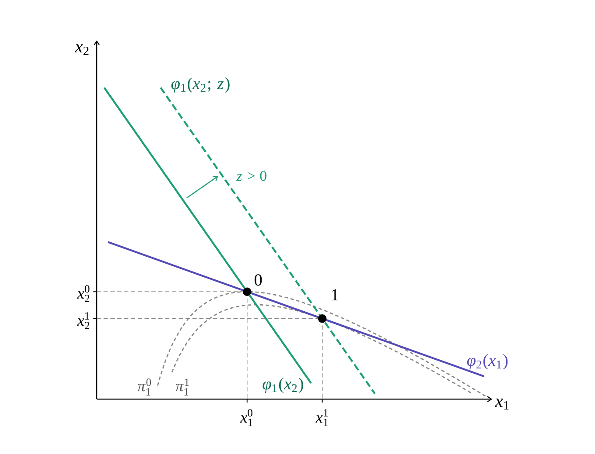
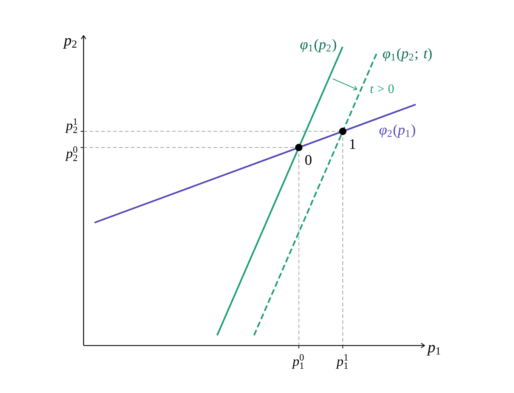
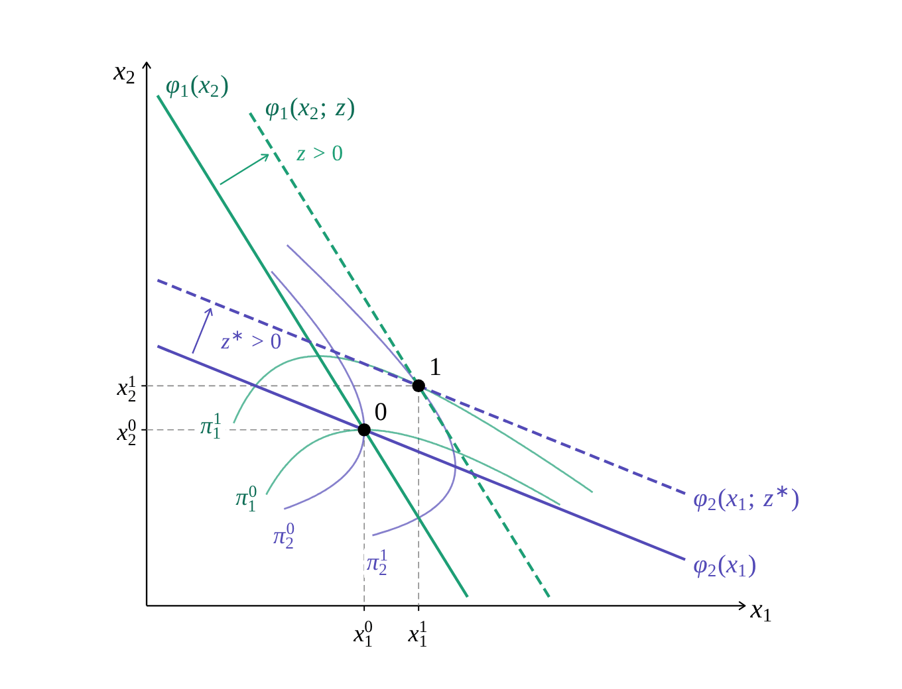
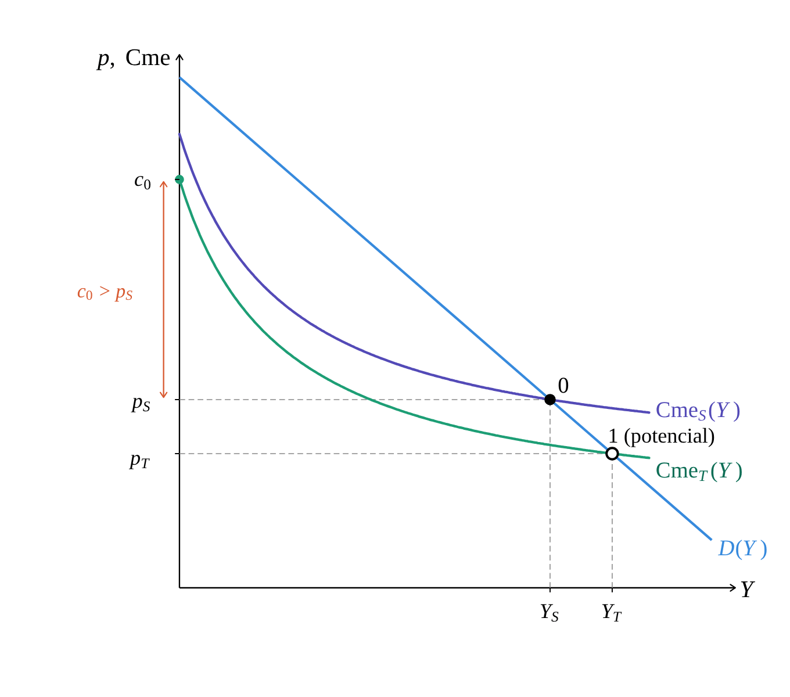
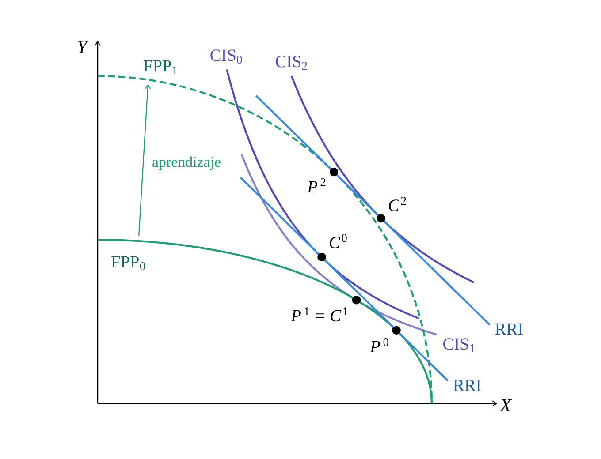

## Introducción

::: {.callout-note appearance="simple" icon=false}

:::

La **política comercial estratégica** nace de la nueva teoría del comercio. En los mercados de competencia imperfecta hay beneficios extraordinarios, y Brander y Spencer (1985) mostraron que una subvención a la exportación puede trasladarlos de la empresa extranjera a la nacional cuando ambas compiten en cantidades. Sin embargo, el argumento resultó frágil, porque Eaton y Grossman (1986) probaron que, si las empresas compiten en precios, la política óptima es un impuesto, y las represalias y la entrada de nuevas empresas pueden anular la ganancia. Krugman (1987a) concluyó, por ello, que el libre comercio seguía siendo una buena regla práctica, aunque hubiera dejado de ser la política óptima en teoría. El caso que inspiró estos modelos, el apoyo europeo a Airbus frente a Boeing, terminó en la disputa más prolongada y cuantiosa de la historia de la OMC.

La idea ha vuelto con fuerza bajo la forma de política industrial. La Ley CHIPS y de Ciencia de EE. UU. (2022) destinó 52.700 M\$ a la investigación y la fabricación de semiconductores, y la UE respondió con el Reglamento (UE) 2023/1781, de chips, que aspira a movilizar 43.000 M€ entre fondos públicos y privados para que la UE produzca en 2030 el 20 % de los semiconductores del mundo. Ambas responden, en parte, a la lógica estratégica de asegurar a las empresas propias un lugar en un sector de rendimientos crecientes, junto a razones de seguridad del suministro.

La **política de promoción exterior** parte, en cambio, de otro fundamento. No busca desplazar rentas de un competidor concreto, sino corregir los fallos de mercado que encarecen la internacionalización, como la falta de información sobre los mercados de destino o los problemas de coordinación entre empresas, y rebaja así el umbral de productividad a partir del cual exportar resulta rentable. Por eso ayuda por igual a todas ellas, mediante agencias como el ICEX y estrategias plurianuales como la Estrategia de Internacionalización de la Economía Española 2017-2027.

Este tema trata la política comercial estratégica y la política de promoción exterior. Aunque el título solo nombra la primera, la segunda entra aquí porque es, como se ha visto, la versión actual de la política comercial ofensiva y la que hoy prefieren los países desarrollados (apartado 2.5). Ambas se estudian en tres secciones:

- *Justificación*: fundamentos de la política comercial estratégica y de la política de promoción exterior.

- *Política comercial estratégica*: objetivos, instrumentos y efectos.

- *Promoción exterior*: objetivos, instrumentos y efectos.

## 1. Justificación de la política comercial moderna

La política comercial estratégica se justifica por la interdependencia estratégica entre empresas, y la de promoción exterior, por razones históricas y por fallos de mercado.

### 1.1. Política comercial estratégica

La justificación de la política comercial estratégica depende de la orientación que se considere (defensiva u ofensiva). No obstante, en cualquiera de sus dos versiones, la justificación está relacionada con la interdependencia estratégica.

#### 1.1.1. Vertiente ofensiva: interdependencia estratégica y credibilidad

En primer lugar, la política comercial estratégica, en su vertiente ofensiva, puede justificarse por los **comportamientos estratégicos** que mantienen aquellos agentes económicos entre los que existe interdependencia estratégica en un tercer mercado. En esta situación, las empresas extranjeras pueden estar apropiándose de beneficios extraordinarios en detrimento de las empresas nacionales. Esto da lugar a un reparto desigual de dichos beneficios y, por tanto, la autoridad fiscal nacional puede buscar el estímulo de la renta nacional (y, por ende, del empleo) mediante la redistribución de dichos beneficios.

El mecanismo de esa redistribución descansa en la **credibilidad del compromiso**. Una empresa que anuncia que expandirá su producción para disuadir a su rival puede no resultar creíble, pues la amenaza no necesariamente es su mejor respuesta ante el comportamiento del rival. El sector público, en cambio, puede alterar de forma creíble los incentivos de su empresa nacional, porque sus instrumentos (presupuestarios y normativos) son públicos, vinculantes y difíciles de revertir.

Mediante una subvención a la exportación o a la producción, un crédito blando, ayudas a la I+D o la protección del mercado doméstico como plataforma, la autoridad reduce el coste marginal (efectivo) de la empresa nacional y puede convertirla en líder estratégico. Desplaza así hacia ella beneficios extraordinarios del tercer mercado, que pueden superar el coste de la ayuda. Brander y Spencer (1985) formalizan este mecanismo, que exige competencia en cantidades (a la Cournot) y se desarrolla en el apartado 2.2.1.

#### 1.1.2. Vertiente defensiva: interdependencia estratégica y economías de escala externas

En su vertiente defensiva, no solo deben existir comportamientos estratégicos, sino también otro tipo de fallo de mercado como, por ejemplo, economías de aglomeración que dificultan la competitividad de las empresas nacionales. En este caso, la política comercial estratégica defensiva se dirige a reequilibrar la falta de competitividad internacional en línea con el **argumento de la industria naciente**.

El argumento (Hamilton, 1791; Raymond, 1820; List, 1841) y sus criterios de validez, de Mill y de Bastable, se exponen en el tema [B07](b07-politica-comercial-i.qmd), apartado 1.2.2, pero aquí interesa su versión estratégica (apartado 2.3.2).

En lugar de la protección, puede fomentarse primero la competencia, para que las compañías nacionales ganen competitividad y no las desplacen las extranjeras (p. ej. liberalizando sectores o mediante organismos de defensa de la competencia).

### 1.2. Política de promoción de las exportaciones

La justificación de la política de promoción de las exportaciones es doble y va más allá del fallo de mercado, pues incluye también razones históricas que llevaron al desarrollo de este tipo de políticas.

#### 1.2.1. Razones históricas

Desde los años sesenta, la Ronda Kennedy (1964-1967) y la reforma del GATT que la siguió redujeron los aranceles de forma progresiva, al tiempo que aparecían nuevos instrumentos proteccionistas no arancelarios. La crisis del petróleo de los setenta reavivó después el proteccionismo, ahora sobre todo por vías no arancelarias, y dio origen al llamado **neoproteccionismo**.

En el nuevo paradigma comercial, la OMC ha ido prohibiendo o disciplinando progresivamente los instrumentos arancelarios y no arancelarios, pero no se ha enfrentado tan abiertamente a las políticas de promoción de exportaciones. La razón es que estas no restringen el acceso a los mercados sino que lo facilitan, de modo que ningún socio comercial resulta perjudicado de forma directa y evidente. Por ello, solo quedan sujetas a disciplina cuando adoptan la forma de subvención específica en el sentido del Acuerdo sobre Subvenciones y Medidas Compensatorias (ASMC). 

Lo anterior explica, en parte, que los países hayan desplazado su intervención hacia este tipo de políticas. No obstante, también existen razones que permiten justificar la promoción exterior desde el punto de vista de los fallos de mercado.

#### 1.2.2. Fallos de mercado: imperfecciones en los mercados de factores y costes de acceso al mercado de bienes

Además de las razones históricas, la teoría económica ofrece motivos por los cuales la política de promoción es justificable:

**Imperfecciones en el mercado de capitales o de trabajo**: un país puede carecer de un sistema financiero eficiente o tener un mercado de trabajo con rigideces. En ese caso, el trasvase del ahorro y de los factores productivos desde sectores tradicionales (p. ej. manufacturas maduras) hacia sectores nuevos con mayores beneficios potenciales puede no producirse adecuadamente. Por lo tanto, el crecimiento de las nuevas industrias se verá restringido por su incapacidad para obtener la financiación y la mano de obra que les permitirían generar mayores flujos de caja en el futuro, pues solo cuentan con sus reducidos flujos de caja actuales.

Estas dificultades pueden ser un argumento en favor de políticas de apoyo horizontal (que no directo) a los exportadores o a los sectores que se vean lastrados por esas dificultades. Entre esas políticas figuran las líneas públicas de financiación a la internacionalización y los programas públicos de formación de especialistas en comercio exterior.

**Costes de acceso al mercado de bienes finales**: en sus procesos de internacionalización, las empresas se enfrentan a barreras informacionales y legales[^b08-1]. La política de promoción de exportaciones puede justificarse por múltiples causas:

- *Información*: la información útil para internacionalizarse tiene naturaleza de bien público, así que, si su suministro queda en manos privadas, puede resultar ineficiente (p. ej. por infraprovisión). El sector público, por su parte, puede ofrecer a las empresas un conocimiento que les costaría mucho reunir por su cuenta.

- *Incentivos*: cuando los agentes son distintos entre sí y conocen poco el mercado de destino, a los exportadores puede no compensarles tejer allí una red de contactos. El sector público puede suplir esa carencia con mecanismos que faciliten a las empresas el acceso a los mercados exteriores.

- *Implementación práctica y capital humano*: cuando una empresa carece del “saber hacer” (*know-how*) necesario, puede costarle llevar a la práctica sus proyectos en el exterior. En esa tarea puede apoyarse en lo que la Administración conoce de los mercados exteriores y de su legislación.

### 1.3. Conclusiones

En síntesis, la política comercial estratégica descansa en dos rasgos de los oligopolios internacionales, la interdependencia estratégica entre empresas y los beneficios extraordinarios que generan. Su variante defensiva exige, además, otro fallo de mercado, como las economías de escala externas. La promoción exterior se apoya, en cambio, en cómo ha evolucionado el marco comercial multilateral y en los fallos de mercado que entorpecen la decisión de internacionalizarse.

Que haya un fallo de mercado es, en los dos casos, un requisito previo, pero no basta para que la intervención esté justificada. También el sector público falla, y por eso cada medida debe superar un análisis coste-beneficio. Identificadas las causas, los apartados 2 y 3 estudian los objetivos, instrumentos y efectos de cada política.

## 2. La política comercial estratégica: objetivos, instrumentos y efectos

La política comercial estratégica se aborda a partir de sus objetivos e instrumentos, para estudiar después sus tres vertientes, la ofensiva, la defensiva y la de la I+D.

### 2.1. Objetivos e instrumentos

Se exponen primero los objetivos de la política comercial estratégica, que busca desviar hacia el país nacional los beneficios extraordinarios de las empresas extranjeras, y después sus dos instrumentos, el impuesto y la subvención.

#### 2.1.1. Objetivos

Como se adelantó en el apartado 1.1, la justificación de la política comercial estratégica es la existencia de comportamientos estratégicos en los mercados oligopolísticos internacionales. Ante esta situación, el objetivo último de la política comercial estratégica es desviar los beneficios extraordinarios obtenidos por las empresas extranjeras en favor del país nacional. Esta “repatriación” de beneficios puede redundar en un mayor beneficio para las empresas nacionales (p. ej. vía subvenciones) o derivar en una mayor recaudación del sector público (p. ej. vía impuestos a la exportación). El mayor beneficio puede mejorar la competitividad de esas empresas.

#### 2.1.2. Instrumentos

La política comercial estratégica dispone de dos instrumentos, el impuesto y la subvención. Lo habitual es que recaigan sobre las exportaciones, aunque nada impide aplicarlos a la producción. En teoría, la elección entre una y otra base (exportación o producción) carece de importancia cuando las empresas estudiadas no venden en su propio país y colocan toda su producción en un tercer mercado, porque en ese caso los resultados son idénticos. La vertiente defensiva recurre, en cambio, al arancel a la importación, y la de la I+D, al apoyo público a la investigación.

### 2.2. Vertiente ofensiva

Si existen comportamientos estratégicos en un mercado, estos pueden derivar de la existencia de barreras a la entrada. Lo óptimo sería, por tanto, suprimirlas, algo que a menudo resulta inviable (p. ej. cuando la I+D exige costes muy altos, como en la industria aeronáutica). Por ello, el objetivo de la política comercial estratégica no es corregir el fallo de mercado, sino tan solo capturar esos beneficios extraordinarios, por lo que se trata de una política de *second best* (en concreto, la denominada de **desplazamiento de rentas** o *rent shifting*).

::: {.callout-note appearance="simple" icon=false}
Los modelos de oligopolio en economía abierta que fundamentan esta sección se desarrollan en el tema [B06](b06-nueva-teoria.qmd).
:::

#### 2.2.1. Competencia a la Cournot en bienes homogéneos: subvenciones a la exportación (Brander y Spencer, 1985)

**Origen**: James Brander y Barbara Spencer (1985) estudian la política comercial estratégica basada en subvenciones a la exportación.

**Idea**: las subvenciones a la exportación pueden alterar el resultado de la interacción estratégica, dado que el sector público cuenta con credibilidad institucional suficiente como para desplazar el equilibrio hacia una solución de Stackelberg en favor de la empresa nacional.

**Supuestos**: los habituales del modelo canónico de Cournot:

- *Entorno*: duopolio con un bien homogéneo. A diferencia del modelo de Brander y Krugman (1983), ambas empresas compiten en un tercer mercado[^b08-3].

- *Agentes*: competencia en cantidades, con expectativas miopes. Se cumplen las condiciones de Hahn (funciones de reacción continuas, cantidades que son sustitutos estratégicos y estabilidad, $\lvert \partial \varphi_i/\partial x_j \rvert < 1$), de modo que las funciones de reacción tienen pendiente negativa en el plano $(x_1, x_2)$.

**Planteamiento**: con una subvención $z$ a favor de la empresa 1, los programas de maximización de las dos empresas son:

$$\max_{x_1} \; \pi_1 = p(x_1 + x_2) \cdot x_1 - \text{CT}_1(x_1) + zx_1$$

$$\max_{x_2} \; \pi_2 = p(x_1 + x_2) \cdot x_2 - \text{CT}_2(x_2)$$

donde $p(x_1 + x_2)$ es la función inversa de demanda del tercer mercado, que depende de la producción total $X = x_1 + x_2$, $x_i$ la cantidad exportada por la empresa $i$, $\text{CT}_i(x_i)$ su función de costes y $z$ la subvención por unidad exportada.

**CPO**: las condiciones de primer orden son $(dp/dX)\,x_1 + p - d\text{CT}_1/dx_1 + z = 0$ y $(dp/dX)\,x_2 + p - d\text{CT}_2/dx_2 = 0$. Es decir, cada empresa iguala su ingreso marginal a su coste marginal, que la subvención reduce de forma efectiva para la empresa 1. De ellas se obtienen las *funciones de reacción* $\varphi_1(x_2)$, con $\partial \varphi_1/\partial x_2 < 0$ y $\partial \varphi_1/\partial z > 0$, y $\varphi_2(x_1)$, con $\partial \varphi_2/\partial x_1 < 0$.

**CSO**: las condiciones de Hahn garantizan la concavidad estricta de la función de beneficios de cada empresa en su propia cantidad, por lo que las condiciones de primer orden son suficientes.

**Equilibrio**: el equilibrio de Nash-Cournot es el par de cantidades $(x_1^*, x_2^*)$ que resuelve a la vez $x_1 = \varphi_1(x_2;\,z)$ y $x_2 = \varphi_2(x_1)$, de modo que cada empresa produce su mejor respuesta a la cantidad de la otra. Como la función de reacción de la empresa 1 depende de la subvención, también lo hacen las cantidades de equilibrio, $x_1^*(z)$ y $x_2^*(z)$.

**Desarrollo gráfico**: los efectos de una subvención a la exportación se representan en el plano de cantidades, $(x_1, x_2)$ (figura -@fig-b081-brander-spencer):

1. *Función de reacción de la empresa 1*, $\varphi_1(x_2)$: recoge la cantidad que maximiza el beneficio de la empresa 1 para cada cantidad de su rival (CPO) y es decreciente, porque las cantidades son sustitutos estratégicos.

2. *Función de reacción de la empresa 2*, $\varphi_2(x_1)$: recoge la mejor respuesta de la empresa 2 a cada cantidad de la empresa 1 y es también decreciente, por la misma razón.

3. *Curvas de isobeneficio de la empresa 1*, $\pi_1^0$ y $\pi_1^1$: recogen el beneficio de mercado de la empresa 1 (sin contar la subvención), tanto mayor cuanto menor es la cantidad de la rival.

4. *Equilibrio*: el corte de ambas funciones de reacción es el equilibrio de Nash-Cournot inicial (punto 0), con cantidades $x_1^0$ y $x_2^0$.

::: {#fig-b081-brander-spencer}

::: {.content-visible when-format="html"}
```{=html}
<div class="graph-frame">
<iframe src="../graphs/b081_Brander_Spencer.html" style="height:560px" loading="lazy" title="fig-b081-brander-spencer"></iframe>
</div>
```
:::

::: {.content-visible unless-format="html"}

:::

Modelo de Brander y Spencer (1985). La subvención a la exportación desplaza la curva de reacción de la empresa nacional y le permite alcanzar el resultado de Stackelberg.
:::

**Estática comparativa**: la subvención a la exportación ($z > 0$) desplaza a la derecha la función de reacción de la empresa 1, de $\varphi_1(x_2)$ a $\varphi_1(x_2;\,z)$. Dicho de otro modo, para cualquier nivel de producción de su rival, la empresa subvencionada lanza al mercado una cantidad superior. El equilibrio pasa así del punto 0 al 1 ($x_1^1$, $x_2^1$). Se puede demostrar que la subvención aumenta $x_1^*$ y la producción total, $X^* = x_1^* + x_2^*$, y reduce $x_2^*$. En consecuencia, el precio cae, $\pi_1$ aumenta y $\pi_2$ disminuye.

**Bienestar**: el bienestar del país que subvenciona se define como $W_s = \pi_1(z) - z \cdot x_1(z)$, donde $z \cdot x_1(z)$ es el coste presupuestario de la subvención, de modo que $W_s$ coincide con el beneficio de mercado de la empresa 1 (sin contar la subvención). La subvención que maximiza $W_s$ (subvención óptima) es positiva y lleva el equilibrio al punto 1, donde la curva de isobeneficio $\pi_1^1$ es tangente a $\varphi_2(x_1)$, es decir, al resultado de Stackelberg con la empresa nacional como líder[^b08-4].

En ese resultado los consumidores del tercer país ganan, porque la producción total de Stackelberg es mayor que la de Cournot, y la empresa nacional aumenta su beneficio a costa de su competidora[^b08-5]. La subvención es, por tanto, una política de empobrecimiento del vecino (*beggar thy neighbour*)[^b08-6].

**Conclusiones**:

- *Aspectos positivos*: el modelo de Brander-Spencer muestra cómo la credibilidad de la autoridad fiscal puede dar lugar a ganancias de bienestar para el país mediante una subvención a las exportaciones que desplaza rentas desde la empresa rival hacia la nacional. Un ejemplo clásico de este tipo de apoyo es la industria aeronáutica. Durante décadas, el sector aeroespacial comercial ha sido objeto de subvenciones a la producción con base en el argumento del fallo de mercado[^b08-7]. Así, tras los acuerdos intergubernamentales de finales de los años sesenta, en 1970 se constituyó el consorcio europeo Airbus con el objetivo de ganar cuota en el mercado internacional (es decir, un “tercer mercado”) frente a la empresa estadounidense entonces hegemónica, Boeing. El apoyo recibido por Airbus consistía, esencialmente, en la financiación de la I+D.

    A raíz de este apoyo, Airbus comenzó a ganar cuota de mercado en detrimento de Boeing, lo cual dio lugar a disputas comerciales entre EE. UU. y la UE. Las planteadas en el seno del GATT desembocaron en el acuerdo bilateral de 1992, que limitó el apoyo público a ambos fabricantes. Las posteriores ante la OMC (desde 2004) quedaron en suspenso con la tregua de 2021, y en julio de 2026, al vencer su plazo de cinco años, la UE prorrogó la suspensión de sus aranceles de represalia.

- *Limitaciones*: por un lado, el modelo pasa por alto cómo se paga la subvención a la exportación. Cuando los fondos proceden de impuestos distorsionantes, el coste de eficiencia que estos generan (el exceso de gravamen) puede neutralizar una parte del bienestar nacional ganado en el tercer mercado. Por otro, este tipo de políticas da lugar a riesgo de *dumping*, puesto que la empresa subvencionada tiene incentivos para cobrar un precio menor en el mercado extranjero que en el mercado nacional. De ahí el riesgo de represalias (derechos antidumping o, frente a la propia subvención, derechos compensatorios al amparo del ASMC).

#### 2.2.2. Competencia a la Bertrand en bienes diferenciados: impuestos a la exportación (Eaton y Grossman, 1986)

El modelo anterior supone que la variable estratégica son las cantidades. Sin embargo, nada asegura que las empresas se comporten así y, a corto plazo, lo habitual es que compitan en precios.

**Origen**: Jonathan Eaton y Gene Grossman (1986) estudian el papel de los impuestos a la exportación, es decir, de los derechos aduaneros a la exportación, en un marco de competencia oligopolística en precios.

**Idea**: cuando las empresas compiten en precios y los precios son complementarios estratégicos, el instrumento óptimo se invierte y pasa a ser un impuesto a la exportación, que eleva los precios de ambas rivales. De este modo, el país nacional (beneficio neto de su empresa más recaudación) gana a costa de los consumidores del tercer país.

**Supuestos**: son similares a los de la competencia a la Cournot en un tercer mercado, salvo en tres aspectos:

- *Entorno*: duopolio en un tercer mercado con bienes ligeramente diferenciados. La diferenciación imperfecta hace que las empresas descarten vender a coste marginal.

- *Agentes*:

    - *Comportamiento*: competencia en precios, con expectativas miopes.

    - *Tratamiento*: los precios son complementarios estratégicos, de modo que las funciones de reacción tienen pendiente positiva en el plano $(p_1, p_2)$[^b08-9]. Cuando un rival aumenta su precio, parte de su demanda se desplaza hacia la otra empresa, lo que eleva el beneficio marginal de subir el propio precio. Por ello, la mejor respuesta es aumentarlo también[^b08-10].

**Planteamiento**: el programa de maximización con un impuesto a la exportación de tipo $t$ sobre la empresa 1 es:

$$\max_{p_1} \; \pi_1 = (1-t) \, p_1 \, x_1(p_1, p_2) - \text{CT}_1[x_1(p_1, p_2)]$$

$$\max_{p_2} \; \pi_2 = p_2 \, x_2(p_1, p_2) - \text{CT}_2[x_2(p_1, p_2)]$$

donde $p_i$ es el precio fijado por la empresa $i$, $x_i(p_1, p_2)$ su demanda, $\text{CT}_i$ su función de costes y $t$ el tipo del impuesto a la exportación.

**CPO**: las condiciones de primer orden son $\partial \pi_1 / \partial p_1 = 0$ y $\partial \pi_2 / \partial p_2 = 0$. Es decir, cada empresa elige el precio que iguala el ingreso marginal, neto del impuesto en el caso de la empresa 1, al coste marginal de las unidades que a ese precio vende. De ellas se obtienen las funciones de reacción $\varphi_1(p_2)$, con $\partial \varphi_1/\partial p_2 > 0$ y $\partial \varphi_1/\partial t > 0$, y $\varphi_2(p_1)$, con $\partial \varphi_2/\partial p_1 > 0$.

**CSO**: se supone que la función de beneficios de cada empresa es estrictamente cóncava en su propio precio, de modo que las condiciones de primer orden son suficientes.

**Equilibrio**: el equilibrio de Nash-Bertrand es el par de precios $(p_1^*, p_2^*)$ que resuelve a la vez $p_1 = \varphi_1(p_2;\,t)$ y $p_2 = \varphi_2(p_1)$, en el que cada empresa fija el precio que mejor responde al de la otra. Los precios de equilibrio dependen, por tanto, del tipo del impuesto, $p_1^*(t)$ y $p_2^*(t)$.

**Desarrollo gráfico**: los efectos de un impuesto a la exportación se representan en el plano de precios, $(p_1, p_2)$ (figura -@fig-b083-eaton-grossman):

1. *Función de reacción de la empresa 1*, $\varphi_1(p_2)$: recoge el precio que maximiza el beneficio de la empresa 1 para cada precio de su rival (CPO) y es creciente, porque los precios son complementarios estratégicos.

2. *Función de reacción de la empresa 2*, $\varphi_2(p_1)$: recoge la mejor respuesta de la empresa 2 a cada precio de la empresa 1 y es también creciente, por la misma razón.

3. *Equilibrio*: el corte de ambas funciones es el equilibrio de Nash-Bertrand inicial (punto 0), con precios $p_1^0$ y $p_2^0$.

::: {#fig-b083-eaton-grossman}

::: {.content-visible when-format="html"}
```{=html}
<div class="graph-frame">
<iframe src="../graphs/b083_Eaton_Grossman.html" style="height:560px" loading="lazy" title="fig-b083-eaton-grossman"></iframe>
</div>
```
:::

::: {.content-visible unless-format="html"}

:::

Modelo de Eaton y Grossman (1986). Con competencia a la Bertrand el instrumento óptimo es un impuesto a la exportación.
:::

**Estática comparativa**: un impuesto a la exportación ($t > 0$) sobre la empresa 1 produce un desplazamiento hacia la derecha de su curva de reacción, de $\varphi_1(p_2)$ a $\varphi_1(p_2;\,t)$. La razón es que la empresa nacional traslada el impuesto a un aumento de su precio para cualquier precio fijado por su rival. Dado que los precios son complementarios estratégicos, la subida de $p_1$ da lugar a un aumento del beneficio marginal de la empresa 2 ($\partial^2 \pi_2 / \partial p_1 \partial p_2 > 0$), por lo que esta también sube su precio. Al final, ambas empresas fijan un precio superior, $p_1^1$ y $p_2^1$, y el equilibrio pasa del punto 0 al 1.

**Bienestar**: el bienestar del país nacional es el beneficio neto de su empresa más la recaudación, $W = \pi_1(t) + t \, p_1 x_1$, es decir, el beneficio bruto (antes del impuesto) de la empresa 1. Con el impuesto óptimo, el punto 1 corresponde a la solución de Stackelberg en precios con la empresa nacional como líder, con mayores beneficios brutos para ambas empresas y mayor bienestar para el país nacional.

Esta situación no sería posible sin intervención, porque la rival no creería una promesa de subida del precio de la empresa nacional, pues sabe que subir el precio unilateralmente lleva a perder cuota de mercado. El impuesto, en cambio, es un compromiso público que la rival sí toma como vinculante. Los consumidores del tercer país, por su parte, pierden bienestar debido a la reducción de la presión competitiva (es decir, al comportamiento cuasicolusorio de los duopolistas). En resumen, el país nacional sale ganando con esta política a expensas de los consumidores extranjeros.

**Conclusiones**:

- *Aspectos positivos*: el modelo permite estudiar otro tipo de instrumentos y obtener intuiciones adicionales sobre la política comercial estratégica. Hasta el s. XIX, los impuestos a la exportación fueron comunes en Europa como medio de recaudación y como forma de conservar recursos para la manufactura local, y con la liberalización comercial se eliminaron. No obstante, a pesar de su declive en Europa, se mantuvieron en muchas colonias africanas y asiáticas con un doble objetivo. Por un lado, garantizar que las exportaciones desde las colonias no se destinaran a terceros países y, en su lugar, se dirigieran a las metrópolis (p. ej. Reino Unido, España o Francia). Por otro, obtener recaudación, como en el caso de los impuestos a las materias primas exportadas desde esas colonias. Esta herencia explica que muchos países en desarrollo todavía mantengan este tipo de impuestos con el fin de obtener ingresos adicionales para el sector público.

- *Limitaciones*: la principal crítica, subrayada por Paul Krugman, es que el resultado de la política comercial estratégica depende del instrumento y del modo de competencia. Así, bajo Cournot el instrumento óptimo es una subvención a la exportación y bajo Bertrand, un impuesto. Dado que el Gobierno rara vez conoce el verdadero modo de competencia de las empresas, la política puede resultar contraproducente.

#### 2.2.3. Extensiones a los modelos anteriores: guerras comerciales estratégicas, libre entrada y consumo nacional

Por último, tres extensiones de los modelos anteriores aportan intuiciones adicionales, la reacción del Gobierno extranjero, la libre entrada de empresas y la existencia de consumo nacional.

**Reacción extranjera: guerra comercial estratégica**: hasta aquí se ha supuesto que el Gobierno extranjero permanece pasivo ante cualquiera de las dos políticas, aunque en la práctica los países suelen responder a la política comercial de sus rivales (p. ej. China y EE. UU.). En el plano teórico, si el Gobierno rival replica con el mismo instrumento (subvención $z^*$ o impuesto, según el caso), su empresa ve desplazarse en paralelo su propia función de reacción. El desplazamiento se produce por igual en Brander y Spencer (1985) y en Eaton y Grossman (1986), pero lo que cambia de un modelo a otro son las consecuencias.

- *Brander y Spencer*: ambos países salen perdiendo, en una situación de dilema del prisionero. El bienestar de cada país (beneficio de su empresa neto del coste de la subvención) es el beneficio de mercado de su empresa, que cae porque ambas producen más y el precio baja. Queda así por debajo del alcanzado sin intervención.

- *Eaton y Grossman*: ambas empresas obtienen beneficios brutos (antes de impuestos) mayores y los consumidores del tercer país sufren una nueva pérdida de bienestar, señal de que el resultado queda aún más lejos del de competencia perfecta.

Gráficamente, en el plano de cantidades, $(x_1, x_2)$, del modelo de Brander y Spencer (figura -@fig-b082-guerra-comercial), cada función de reacción recoge la cantidad que maximiza el beneficio de una empresa dada la de su rival. Cada curva de isobeneficio reúne las combinaciones de cantidades que dan a una empresa el mismo beneficio de mercado. Las subvenciones de ambos Gobiernos ($z > 0$ y $z^* > 0$) desplazan hacia fuera las dos funciones de reacción, a $\varphi_1(x_2;\,z)$ y $\varphi_2(x_1;\,z^*)$. Así, el equilibrio pasa del punto 0 al 1, en el que ambas empresas se sitúan en curvas de isobeneficio de mercado (sin contar la subvención) peores, $\pi_1^1$ y $\pi_2^1$.

::: {#fig-b082-guerra-comercial}

::: {.content-visible when-format="html"}
```{=html}
<div class="graph-frame">
<iframe src="../graphs/b082_Guerra_comercial.html" style="height:560px" loading="lazy" title="fig-b082-guerra-comercial"></iframe>
</div>
```
:::

::: {.content-visible unless-format="html"}

:::

Guerra de subvenciones. Cuando ambos Gobiernos intervienen, el resultado es peor para los dos que el equilibrio sin intervención.
:::

**Endogenización del número de empresas** (Horstmann y Markusen, 1986): otra línea de trabajo, en la que se inscriben varios autores, admite la libre entrada, con lo que puede haber más de dos competidores. Bajo ese supuesto, y siempre que todas las empresas sean homogéneas, los beneficios extraordinarios que genera la subvención atraen a nuevas empresas y alimentan la búsqueda de rentas, hasta que, con el paso del tiempo, esos beneficios acaban por desaparecer.

La entrada intensifica la competencia entre las empresas nacionales. La producción conjunta aumenta (aunque la de cada empresa no aumenta e incluso se reduce), el precio de las exportaciones se reduce y, con él, los beneficios. En consecuencia, la subvención se disipa en un exceso de entrada con plantas de escala ineficiente. No obstante, este resultado no es general, pues Venables (1985) obtiene que, con mercados segmentados y libre entrada, aranceles y subvenciones pueden elevar el bienestar del país que los aplica.

**Existencia de consumo nacional**: por último, si cada país consume también el bien en su propio territorio, la política comercial estratégica suma objetivos nuevos, porque ha de procurar que la ineficiencia del mercado doméstico, medida frente a la competencia perfecta, sea la menor posible.

#### 2.2.4. Conclusiones

**Aspectos positivos**: en sentido amplio, la vertiente ofensiva de la política comercial estratégica suele asociarse a la experiencia de los cuatro tigres asiáticos (Corea del Sur, Hong Kong, Singapur y Taiwán) bajo la doctrina de la *industrialización orientada a la exportación* (IOE, *export-oriented industrialization*). No obstante, Hong Kong es una excepción parcial, pues su política comercial se aproximó más al *laissez faire*. La IOE tiene el objetivo de acelerar la industrialización de un país a través del fomento de las exportaciones, de modo que este pueda explotar su ventaja comparativa. Para ello combina la liberalización y la protección comercial. Dado que la expansión de los sectores exportadores habitualmente requería mejoras del capital humano y de la tecnología, en la práctica la IOE se combinó con elementos de la industrialización por sustitución de importaciones.

**Limitaciones**: hasta ahora solo se han considerado dos diferencias respecto a los mercados de competencia perfecta, los comportamientos estratégicos derivados de la interdependencia y el poder de mercado con bienes diferenciados. Sin embargo, la consideración de elementos adicionales habituales en el mundo real (p. ej. economías de escala externas) permite justificar la política comercial estratégica en su vertiente defensiva a través del argumento de la industria naciente.

### 2.3. Vertiente defensiva

La vertiente defensiva se estudia a partir de cuatro argumentos, la estructura de mercado mixta, la industria naciente, el argumento centro-periferia y la protección de las importaciones como promoción de las exportaciones.

#### 2.3.1. Estructura de mercado mixta y bienes diferenciados: aranceles a la importación (Eaton y Kierzkowski, 1984)

**Origen**: Jonathan Eaton y Henryk Kierzkowski (1984) estudian estructuras de mercado mixtas.

**Idea**: en una estructura de mercado mixta, un arancel a la importación puede resultar socialmente óptimo si induce la entrada de un productor nacional del bien diferenciado.

**Supuestos**:

- *Entorno*: la economía tiene dos sectores. Uno fabrica en competencia perfecta un bien homogéneo y el otro, en régimen de oligopolio, un bien diferenciado.

- *Agentes*: la demanda del bien diferenciado responde al enfoque de características (Lancaster, 1966). Cada consumidor fija un umbral o precio crítico que decide su elección entre uno y otro bien. Con un precio por debajo de ese umbral demanda el bien diferenciado y, con uno por encima, se queda con el homogéneo.

**Razonamiento**: con costes fijos de entrada, la apertura al comercio puede conducir incluso a un resultado inferior en el sentido de Pareto. El modelo admite, además, un caso particular, aquel en que el bien diferenciado no se produce en el país. En esa situación, gravar las importaciones con un arancel, como medida de política comercial estratégica, puede ser lo socialmente óptimo, porque empuja a una empresa nacional a entrar en el sector.

**Conclusiones**:

- *Aspectos positivos*: el modelo completa el análisis de los apartados anteriores al considerar una estructura de mercado mixta, con un sector competitivo y otro oligopolístico.

- *Limitaciones*: como los modelos de Brander y Spencer y de Eaton y Grossman, no estudia los efectos de equilibrio general de la política.

#### 2.3.2. Argumento de la industria naciente: aranceles a la importación (Hamilton, 1791; List, 1841)

**Origen**: Alexander Hamilton (1791) y Friedrich List (1841), como se indicó en el apartado 1.1.2.

**Idea**: una industria nueva que opera con economías de escala externas puede necesitar protección temporal frente a rivales ya establecidos hasta alcanzar la escala y el aprendizaje que le permitan competir.

**Supuestos**:

- *Entorno*: existen dos países (Suiza y Tailandia) que pueden producir un mismo bien (relojes) para el mercado mundial, del que forma parte la demanda tailandesa. Además, un accidente histórico ha hecho que Suiza comenzase a producir antes.

- *Tecnología*: ambos países producen en un régimen de economías de escala externas[^b08-14], si bien su estructura de costes difiere. En Suiza los salarios son comparativamente elevados, mientras que en Tailandia son bajos.

**Planteamiento**: la situación inicial se representa en el plano cantidad agregada-precio y coste (figura -@fig-b085-naciente-escala):

1. *Curva de demanda*, $D(Y)$: refleja la demanda de relojes en el mercado internacional y es decreciente, porque a un precio menor el mercado absorbe más relojes.

2. *Curva de coste medio de Suiza*, $\text{Cme}_S(Y)$: tiene pendiente negativa, dado que las economías de escala externas hacen que el coste medio caiga conforme aumenta la producción agregada del país.

3. *Curva de coste medio de Tailandia*, $\text{Cme}_T(Y)$: también decreciente, queda por debajo de la de Suiza, puesto que Tailandia goza de una mayor competitividad salarial. El coste medio de su primera unidad es $c_0$.

4. *Equilibrio*: con libre entrada, el precio se iguala al coste medio de la industria, no a su coste marginal, que generaría pérdidas. Suiza abastece el mercado mundial al precio $p_S$, con la cantidad $Y_S$ (punto 0). Por su mayor competitividad salarial, Tailandia podría abastecerlo al precio $p_T$, con la cantidad $Y_T$ (punto 1, potencial). Sin embargo, el accidente histórico se lo impide, a pesar de su ventaja comparativa potencial, porque el coste medio de su primera unidad está por encima del precio internacional fijado por la industria suiza ($c_0 > p_S$)[^b08-15].

::: {#fig-b085-naciente-escala}

::: {.content-visible when-format="html"}
```{=html}
<div class="graph-frame">
<iframe src="../graphs/b085_Naciente_escala.html" style="height:600px" loading="lazy" title="fig-b085-naciente-escala"></iframe>
</div>
```
:::

::: {.content-visible unless-format="html"}

:::

Industria naciente con economías de escala externas. Suiza abastece el mercado mundial al precio $p_S$ (punto 0) aunque Tailandia tiene costes medios menores, porque el coste de la primera unidad tailandesa, $c_0$, supera $p_S$.
:::

**Desarrollo gráfico**: los efectos de un arancel se representan en el plano bien X-bien Y (figura -@fig-b084-naciente-fpp):

1. *Frontera de posibilidades de producción inicial*, $\text{FPP}_0$: recoge las combinaciones máximas de X e Y que el país puede producir antes de proteger la industria, y es cóncava, porque el coste de oportunidad de cada bien crece con su producción.

2. *Recta de la relación real de intercambio*, $\text{RRI}$: la internacional, que el país toma como dada. Su pendiente, en valor absoluto, es el precio relativo de X en términos de Y en el mercado mundial.

3. *Curvas de indiferencia social*, $\text{CIS}_0$, $\text{CIS}_1$ y $\text{CIS}_2$: representan un bienestar tanto mayor cuanto más alejadas del origen.

4. *Equilibrio inicial*: se parte de una situación de libre comercio, con la producción en $P^0$ y el consumo en $C^0$, sobre la $\text{CIS}_0$. En esta situación, existe un exceso de oferta del bien X que se exporta y un exceso de demanda del bien Y que se cubre con importaciones (p. ej. los relojes en el caso tailandés anterior). La diferencia esencial con la representación habitual es que el país produce una gran cantidad del bien X y una escasa cantidad del bien Y, si bien este último es susceptible de ser exportado en el futuro.

::: {#fig-b084-naciente-fpp}

::: {.content-visible when-format="html"}
```{=html}
<div class="graph-frame">
<iframe src="../graphs/b084_Naciente_FPP.html" style="height:560px" loading="lazy" title="fig-b084-naciente-fpp"></iframe>
</div>
```
:::

::: {.content-visible unless-format="html"}

:::

Argumento de la industria naciente. La protección temporal permite el desplazamiento de la frontera de posibilidades de producción por aprendizaje.
:::

**Estática comparativa**: la protección temporal de la industria del bien Y se desarrolla en tres etapas:

1. *Arancel*: un arancel prohibitivo sobre el bien Y eleva el precio relativo nacional de este y hace que producción y consumo coincidan en un mismo punto, $P^1 = C^1$, sobre la $\text{CIS}_1$, es decir, se regresa a la autarquía. Esto provoca un aumento de la producción nacional del bien Y, pero reduce el bienestar total del país, pues la curva de indiferencia alcanzada está más próxima al origen.

2. *Desarrollo*: al amparo del arancel, que reserva a los productores nacionales la demanda interior, la industria del bien Y alcanza la escala con la que su coste medio queda por debajo del precio internacional ($p_S$ en la figura -@fig-b085-naciente-escala), y crece gracias al progreso tecnológico que generan el efecto aprendizaje y las economías de escala dinámicas. Así, el país gana competitividad en la producción de ese bien, lo cual se traduce en una expansión sesgada hacia el bien Y de la frontera de posibilidades de producción, de $\text{FPP}_0$ a $\text{FPP}_1$.

3. *Apertura*: una vez desarrollada la industria nacional, el país vuelve a abrirse al comercio internacional. Su patrón de comercio se invierte y el país exporta ahora el bien Y (producción en $P^2$ y consumo en $C^2$). El bienestar, además, supera el de partida y alcanza la $\text{CIS}_2$.

**Bienestar**: sin intervención, el accidente histórico de la figura -@fig-b085-naciente-escala produce una especialización “perversa” y una doble pérdida de eficiencia. Por un lado, existen ganancias potenciales de bienestar global desaprovechadas, ya que el mercado internacional está abastecido por Suiza, lo que conlleva una menor cantidad de relojes disponible a un mayor precio. Por otro, existen ganancias potenciales de bienestar para Tailandia, ya que, al no ser capaz de competir, no puede desarrollar su industria relojera, con el consecuente desaprovechamiento de puestos de trabajo y de participación en la renta mundial. La protección temporal (figura -@fig-b084-naciente-fpp) busca recuperar esas ganancias a cambio de la pérdida transitoria de la etapa del arancel.

**Extensiones**: como se expone en el tema [B07](b07-politica-comercial-i.qmd), apartado 1.2.2, el argumento solo es válido si la industria supera los criterios de Mill y de Bastable, es decir, si llega a ser competitiva sin apoyo y si las ganancias descontadas superan los costes del arancel. De ahí que lo prioritario sea escoger industrias cuya demanda tenga amplio margen de crecimiento. Si además la industria tiene abundantes eslabonamientos hacia delante y hacia atrás, genera efectos desbordamiento o posee un valor estratégico que trasciende lo económico (p. ej. la aeronáutica), puede reportar beneficios añadidos.

**Conclusiones**:

- *Aspectos positivos*: el argumento de la industria naciente ha persuadido a muchos Gobiernos. Así, Estados Unidos mantuvo elevados aranceles sobre las manufacturas durante buena parte del s. XIX y Alemania adoptó una protección más moderada a partir del giro proteccionista de Bismarck (1879), lo que favoreció su industrialización. Tras la Segunda Guerra Mundial, Japón mantuvo amplios controles de importaciones hasta los años setenta. También suele citarse el arancel Smoot-Hawley (1930) de Estados Unidos, aunque es más bien un ejemplo de proteccionismo defensivo generalizado (agrícola e industrial), no de protección de industrias nacientes. Las represalias que provocó contribuyeron al colapso del comercio durante la Gran Depresión.

- *Limitaciones*: existen diversas críticas al argumento, tanto teóricas como empíricas:

    - *Instrumentos alternativos*: incluso si se cumplen los criterios de Mill y de Bastable, podría conseguirse el desarrollo de la industria naciente a través de una política no arancelaria (p. ej. una subvención que disminuyese los costes de la industria sin gravar al consumidor).

    - *Descuento intertemporal*: el criterio de Bastable exige la utilización de un factor de descuento intertemporal social, ya que es necesario descontar las ganancias del libre comercio posteriores al desarrollo de la industria. Determinar dicho factor puede exigir, en la práctica, elevados costes informacionales.

    - *Fallo de mercado*: James Meade (1955b) y, posteriormente, Robert Baldwin (1969) muestran que las economías de escala internas o dinámicas[^b08-16] no son condición suficiente para la protección. Hace falta algún fallo de mercado adicional (p. ej. imperfecciones en el mercado de capitales que dificulten el endeudamiento inicial, imposibilidad de apropiarse de los desbordamientos de conocimiento o imperfecciones en el mercado de trabajo). De hecho, si se cumple el criterio de Bastable, los inversores privados racionales descontarán las ganancias futuras e invertirán en la industria naciente aunque no esté protegida y aunque incurran inicialmente en pérdidas:

        - *Economías de escala internas*: los productores, sabiendo que en el futuro obtendrán beneficios, están dispuestos a endeudarse para lograr el tamaño de planta óptimo.
        - *Economías de escala dinámicas*: están dispuestos a soportar pérdidas hasta alcanzar la experiencia necesaria.

    - *Ámbito empírico*: no siempre es buena idea intentar desplazarse hacia industrias que tendrán ventaja comparativa en el futuro, ya que es condición necesaria que la protección del sector propicie efectivamente su competitividad. Si el país aún no dispone de una masa crítica de capital humano y productivo cualificado, proteger la industria resulta contraproducente, pues la protección no crea por sí sola esa capacidad y solo prolonga la supervivencia de empresas ineficientes.

#### 2.3.3. Argumento centro-periferia y deterioro de la relación real de intercambio (Prebisch, 1949; Singer, 1950)

**Origen**: Raúl Prebisch (1949), en la Comisión Económica para América Latina (CEPAL), y Hans Singer (1950), en la sede de las Naciones Unidas, formularon casi a la vez el *argumento centro-periferia*.

**Idea**: la relación real de intercambio de la periferia, exportadora de productos primarios, tiende a deteriorarse frente al centro industrial.

**Razonamiento**: el deterioro se explica por la baja elasticidad-renta de la demanda de esos productos (ley de Engel) y por la asimetría en el reparto de las ganancias de productividad (tema [B28](b28-desarrollo.qmd), apartado 2.1.3). La recomendación defensiva derivada, industrializarse mediante protección en lugar de especializarse en productos primarios según la ventaja comparativa estática, fundamentó la industrialización por sustitución de importaciones.

**Conclusiones**:

- *Aspectos positivos*: la intuición de Prebisch y Singer de que la composición de la especialización condiciona el desarrollo reaparece en la ley de Thirlwall (tema [B28](b28-desarrollo.qmd), apartado 2.1.3) y en el modelo de Grossman y Helpman (tema [B09](b09-comercio-crecimiento.qmd), apartado 3.1.3).

- *Limitaciones*: su apoyo empírico es mixto, pues las series largas muestran un deterioro débil de los precios relativos de las materias primas, interrumpido por rupturas estructurales y superciclos alcistas, lo que debilita el argumento como justificación permanente de la protección.

#### 2.3.4. Protección de las importaciones como promoción de las exportaciones (Krugman, 1984)

**Origen**: Paul Krugman (1984) formalizó un argumento frecuente en el debate sobre la industria japonesa, según el cual proteger el mercado interior puede hacer más competitiva a la empresa nacional también fuera de él.

**Idea**: en oligopolio, con mercados segmentados y coste marginal decreciente en la producción total, reservar el mercado interior a la empresa nacional le permite producir más, bajar su coste marginal y ganar cuota en todos los mercados, incluidos los de exportación.

**Supuestos**:

- *Entorno*: una empresa nacional y otra extranjera compiten a la Cournot en varios mercados segmentados, entre ellos el nacional.

- *Tecnología*: el coste marginal de cada empresa decrece con su producción total, por economías de escala estáticas, por aprendizaje o porque el gasto en I+D se reparte entre más unidades.

**Razonamiento**: un arancel o una cuota en el mercado nacional encarece o limita las ventas de la empresa extranjera en ese mercado, cuya función de reacción se desplaza hacia el origen, de modo que la empresa nacional vende más en casa. Al vender más en casa, produce más en total, su coste marginal baja y se vuelve más agresiva en los demás mercados. A la extranjera le ocurre lo contrario, pues pierde ventas, su coste marginal sube y la empresa extranjera retrocede en todos ellos. La protección de las importaciones acaba así elevando las exportaciones.

**Conclusiones**:

- *Aspectos positivos*: el modelo da a la vertiente defensiva un mecanismo propio, el vínculo entre mercados a través del coste marginal decreciente, y explica por qué un mercado interior grande y protegido puede convertirse en una ventaja competitiva internacional.

- *Limitaciones*: el resultado depende de la forma de competencia y de que el coste marginal sea decreciente. Además, la ganancia para el país no está garantizada, porque los consumidores pagan precios más altos en el mercado protegido, y la represalia del otro país la anula.

#### 2.3.5. Conclusiones

**Aspectos positivos**: entre 1950 y 1975, principalmente, los países en desarrollo llevaron a la práctica el argumento de la industria naciente con la *industrialización por sustitución de importaciones* (ISI), que tuvo gran difusión en Latinoamérica. Mediante la protección del mercado interior, la ISI perseguía dos fines, el de dar a ciertas industrias margen para lograr economías de escala y de aprendizaje y el de desviar la demanda nacional de manufacturas de los productos extranjeros hacia la producción propia.

**Limitaciones**: la ISI presentó resultados desiguales. En muchos países latinoamericanos, la protección sostenida generó ineficiencias, comportamientos de búsqueda de rentas y dependencia del sector público, sin lograr la competitividad internacional esperada. El contraste con la orientación exportadora de los tigres asiáticos se convirtió en uno de los argumentos empíricos clásicos contra la protección prolongada.

### 2.4. Vertiente de la I+D

Por último, dada la importancia de los efectos dinámicos para defender la política comercial estratégica, este apartado trata la vertiente que busca aprovechar la I+D. Su modelo estratégico es el de Spencer y Brander (1983), mientras que el de Romer (1990) fundamenta esa vertiente en una externalidad y no en el desplazamiento de rentas.

#### 2.4.1. La I+D como compromiso estratégico (Spencer y Brander, 1983)

**Origen**: Barbara Spencer y James Brander (1983) trasladaron a la I+D el argumento del desplazamiento de rentas.

**Idea**: si la I+D se decide antes que la producción y reduce el coste marginal, sirve como compromiso para ganar cuota frente a la rival, y una subvención pública puede reforzar ese compromiso.

**Supuestos**: una empresa nacional y otra extranjera compiten a la Cournot en un tercer mercado, en un juego en dos etapas. Primero eligen su gasto en I+D, que reduce su coste marginal, y después sus cantidades.

**Razonamiento**: el juego se resuelve hacia atrás. Como la I+D de cada empresa desplaza su función de reacción en la segunda etapa y reduce la producción de la rival, las empresas invierten en I+D más de lo que minimizaría el coste de producir la cantidad elegida. De ahí se siguen dos resultados de política:

- *Solo subvención a la I+D*: si el Gobierno no puede subvencionar las exportaciones, una subvención a la I+D desplaza rentas hacia la empresa nacional y eleva el bienestar del país, como la subvención a la exportación de Brander y Spencer (1985).

- *Con subvención a la exportación*: si dispone de ella, lo óptimo es subvencionar la exportación y gravar la I+D, porque la subvención a la exportación logra el compromiso directamente y la sobreinversión estratégica en I+D despilfarra recursos.

**Conclusiones**:

- *Aspectos positivos*: el modelo muestra que la I+D tiene un valor estratégico, además del productivo, y explica por qué los Gobiernos compiten en subvenciones a la investigación en sectores como el aeronáutico.

- *Limitaciones*: comparte las debilidades del desplazamiento de rentas, pues depende de la competencia a la Cournot, exige información que el Gobierno no suele tener y provoca represalias que anulan la ganancia.

#### 2.4.2. Externalidades positivas: modelo de crecimiento con variedades de *inputs* (Romer, 1990)

::: {.callout-note appearance="simple" icon=false}
El modelo de aumento del número de variedades de *inputs* (Romer, 1990) y su extensión a la economía abierta (Rivera-Batiz y Romer, 1991) se desarrollan en el tema [B09](b09-comercio-crecimiento.qmd), apartado 3.1.2. Aquí interesa únicamente su implicación para la política comercial.
:::

**Origen**: Paul Romer (1990) explica como resultado deliberado de la I+D, movida por incentivos, el progreso técnico que el modelo de Solow toma como exógeno.

**Idea**: el modelo de Romer establece que la investigación solo se produce si existe competencia imperfecta que permita apropiarse de sus frutos, y que aun así el equilibrio descentralizado innova por debajo del óptimo social. La razón es que el inventor captura los beneficios de su patente, pero no el excedente que su descubrimiento genera para los consumidores ni el efecto que produce sobre la productividad de la investigación ajena. Existe, por tanto, una brecha entre rendimiento privado y social que justifica la intervención pública.

**Razonamiento** (aplicación a la política comercial): si la política comercial estratégica logra que empresas de alta tecnología se asienten y operen en el país, el beneficio no se agota en ellas. Los desbordamientos de conocimiento alcanzan al conjunto del tejido productivo, y alrededor de esas empresas tienden a localizarse clústeres industriales, con proveedores y actividades complementarias que refuerzan el efecto mediante encadenamientos.

**Conclusiones**:

- *Aspectos positivos*: la brecha entre el rendimiento privado y el social de la investigación da al apoyo público a la I+D un fundamento de eficiencia que no depende del desplazamiento de rentas.

- *Limitaciones*: la externalidad justifica subvencionar la investigación, no proteger el sector, que son cosas distintas. Además, el razonamiento solo sostiene una política comercial si el desbordamiento es específico de que la actividad se localice en el territorio nacional. En cambio, si el conocimiento se difunde internacionalmente, la subvención genera un beneficio global financiado por el contribuyente propio, lo que constituye la objeción principal que la literatura opone a la política comercial estratégica de la I+D.

#### 2.4.3. Costes fijos de I+D y oligopolio natural (Shaked y Sutton, 1982; 1983)

Los oligopolios naturales pueden estudiarse con el modelo de diferenciación vertical de Shaked y Sutton. Cuando la mejora de la calidad descansa sobre costes fijos de I+D, el número de empresas que sobrevive en el mercado está acotado por un máximo independiente del tamaño de este, lo que concentra la estructura de mercado y genera beneficios extraordinarios persistentes. La política estratégica de I+D puede, en este contexto, tratar de influir sobre qué país acoge a las empresas supervivientes del duopolio natural internacional.

::: {.callout-note appearance="simple" icon=false}
El modelo de Shaked-Sutton y la propiedad de finitud se desarrollan en el tema [B06](b06-nueva-teoria.qmd).
:::

#### 2.4.4. Regulación

Al igual que ocurre con el monopolio natural, en la medida en que el duopolio natural sea sostenible, conviene regularlo, con instrumentos análogos a los empleados en la regulación de los monopolios naturales (control de precios, obligaciones de acceso o supervisión de la conducta).

::: {.callout-note appearance="simple" icon=false}
Sobre la regulación de los mercados no competitivos, véase el tema [A20](a20-regulacion.qmd).
:::

### 2.5. Conclusiones

Pese a sus numerosas virtudes teóricas, contra la política comercial estratégica se han formulado varias críticas:

- *Sector público*: hay que tener en cuenta la financiación de muchas de las políticas y, además, todos los posibles fallos del sector público (p. ej. búsqueda de rentas o influencia de los grupos de presión).

- *Eficiencia económica*: proteger a la industria naciente no garantiza que el país llegue a desarrollar su ventaja comparativa, los instrumentos considerados son distorsionantes y muchas de las políticas dan lugar a un empobrecimiento del vecino.

- *Sostenibilidad*: las políticas de este tipo generan diferencias artificiales de productividad, difícilmente sostenibles a largo plazo.

- *Discrecionalidad*: puede dar lugar a fallos de coordinación en el ámbito internacional. Entre otras normas, el comercio internacional se rige por los acuerdos multilaterales que se pactan en las rondas negociadoras de la OMC, los cuales tienden a limitar las actuaciones de política comercial estratégica.

Justamente a causa de estas críticas, los países (en particular, los desarrollados) optan preferentemente por políticas de promoción exterior.

## 3. La política de promoción exterior: objetivos, instrumentos y efectos

La política de promoción exterior se estudia en sus objetivos, instrumentos e instituciones y en sus efectos.

### 3.1. Objetivos, instrumentos e instituciones

La **política de promoción exterior** pone al alcance de las empresas herramientas para internacionalizarse, sin condicionar directamente la ayuda a lo que cada una exporte.

#### 3.1.1. Objetivos

**Objetivo microeconómico**: en cada empresa, la política de promoción exterior intenta reducir los costes de la internacionalización y aumentar sus beneficios, de modo que aumente el valor actual neto (VAN) de la inversión o de la actividad exportadora hacia el extranjero. Con información imperfecta sobre el mercado de destino, ese VAN es

$$\text{VAN} = -(A_0 + C_I) + \sum_{t=1}^{T} \frac{\mathbb{E}[Q_t]}{(1+k+\rho)^t}$$

donde $A_0$ es la inversión inicial, $C_I$ el coste de reunir la información necesaria para exportar (estudios de mercado, prospección, requisitos legales del destino), $\mathbb{E}[Q_t]$ el valor esperado del flujo de caja que genera el proyecto en el año $t$ y $T$ su horizonte. La tasa de descuento o coste del capital es $k$, y $\rho$, la prima de riesgo que añade la incertidumbre sobre el mercado exterior (tema [B02](b02-inversion.qmd), apartado 2.3).

La promoción reduce el coste de la información ($C_I$) y la prima de riesgo ($\rho$), porque atenúa las barreras informacionales del apartado 1.2.2, y eleva los flujos de caja esperados ($\mathbb{E}[Q_t]$). Con los instrumentos financieros rebaja, además, el desembolso inicial ($A_0$) y el coste del capital ($k$).

**Objetivo macroeconómico**: la política busca la *internacionalización*, entendida aquí en sentido amplio, del conjunto de la economía. En lugar de perseguir éxitos puntuales, la ayuda se concentra en los primeros pasos de cada empresa en el exterior, con la meta de que la empresa arraigue de forma duradera en esos mercados y pueda después prescindir del respaldo público.

Por el lado del gasto, el PIB es $Y = C + I + G + (X - M)$, donde $C$ es el consumo privado, $I$ la inversión, $G$ el consumo público y $X$ y $M$ las exportaciones y las importaciones de bienes y servicios. La promoción actúa sobre $X$, y su impulso eleva, *ceteris paribus*, la demanda agregada y el saldo exterior, $X - M$, cuya relación con la cuenta corriente y con el ahorro y la inversión nacionales se estudia en el tema [B11](b11-balanza-pagos.qmd), apartado 2.1.1.

#### 3.1.2. Instrumentos

Las administraciones de los distintos países han traducido esa justificación teórica en instrumentos concretos, que aquí se agrupan en cuatro tipos.

**Instrumentos que facilitan el acceso a la información**: comprenden el suministro público de información útil para las empresas que quieren acceder a mercados exteriores (p. ej. estudios de mercado, servicios de alertas de oportunidades de negocio y canales de distribución de información). Destaca, además, el “acceso a redes”, puesto que el sector público está en una posición ventajosa para facilitar contactos en los mercados extranjeros gracias a sus redes de contactos en los países de destino.

**Instrumentos de formación**: el sector público puede ofrecer también recursos de formación y experiencia que facilitan la internacionalización (p. ej. los másteres y becas de ICEX España Exportación e Inversiones, seminarios o cursos de formación). Su finalidad es que la empresa conozca su potencial en el exterior y gane las competencias que le permitan medirse con rivales internacionales.

**Instrumentos financieros**: el sector público puede reducir la barrera financiera a través de líneas de crédito a la internacionalización (p. ej. las líneas del Instituto de Crédito Oficial).

::: {.callout-note appearance="simple" icon=false}
Sobre el crédito oficial a la exportación y los instrumentos españoles de apoyo financiero a la internacionalización, véase el tema [B34](b34-gats-trips.qmd), apartado 3.4 (Consenso OCDE).
:::

**Instrumentos de promoción de la marca o imagen de los productos nacionales**: buscan incrementar el valor añadido de los productos exportados haciendo que sean más valorados por los consumidores extranjeros. Entre ellos destacan:

- *Ferias comerciales*: han adquirido una importancia creciente.

- *Planes integrales de desarrollo de mercados*: persiguen estrechar los lazos comerciales con los países que se consideran prioritarios (p. ej. el ICEX ha mantenido planes de este tipo con Brasil, China, India, Rusia, EE. UU. o los países del Golfo).

- *Marca país*: el objetivo es mejorar la imagen del país para que no quede sometida a círculos viciosos. Si la marca país no es favorable, las empresas tratarán de desmarcarse de ella (que no se les asocie), porque no actúa como una buena carta de presentación. Como resultado, los éxitos de las empresas en el extranjero no mejoran la imagen del país, porque no se asocian a la marca, y se genera un círculo vicioso que el sector público puede tratar de romper. En España, esta función correspondió al Alto Comisionado del Gobierno para la Marca España, sustituido en 2018 por la Secretaría de Estado de la España Global, que fue suprimida en 2021 (Real Decreto 585/2021). A ello se suman las acciones del ICEX para mejorar la imagen de los bienes y servicios españoles, como la marca Foods and Wines from Spain en mercados como EE. UU.

- *Misiones comerciales*: tanto directas como inversas (misiones de inversores, en las que se trae a inversores extranjeros para que conozcan las empresas nacionales).

- *Organismos autonómicos de promoción*: tratan de impulsar la imagen de su comunidad autónoma mediante campañas específicas que ponen el énfasis en sus rasgos distintivos.

**La política de promoción de exportaciones en España: la Estrategia de Internacionalización de la Economía Española 2017-2027**: además de estos instrumentos, los países diseñan estrategias de internacionalización. En el caso español, la *Estrategia de Internacionalización de la Economía Española 2017-2027* fija las principales líneas de acción para la internacionalización de la economía en su conjunto con un horizonte temporal de largo plazo, y se despliega mediante planes de acción bienales. Sus objetivos son asegurar que la contribución positiva del sector exterior al crecimiento económico se convierta en un fenómeno estructural y revierta en creación de empleo, y apoyar a los exportadores y atraer inversión hacia España. La Estrategia actúa en colaboración con otras instituciones y con el sector privado, con un enfoque principal hacia la pyme. 

En su versión original, la Estrategia se articulaba en torno a seis grandes ejes de actuación. Los dos primeros eran el apoyo a la internacionalización adaptado al perfil de la empresa y la incorporación de la innovación, la tecnología, la marca y la digitalización. Les seguían el desarrollo del capital humano para la internacionalización y el aprovechamiento de las oportunidades de la política comercial común y de las instituciones financieras multilaterales. Los dos últimos eran la captación y consolidación de inversión extranjera de alto valor añadido y el refuerzo de la coordinación y complementariedad de todos los actores.

Tras su evaluación intermedia, la Estrategia fue actualizada y reagrupó su actuación en cinco líneas. Las dos primeras son la adaptación constante e innovadora a las necesidades de las empresas y el talento, la marca y la innovación como factores de competitividad. Las otras tres atienden a los foros internacionales y la política comercial europea, a la atracción de inversión extranjera de alto valor añadido y a la inteligencia económica. Las cinco líneas se guían por cinco principios rectores, la coordinación, la sostenibilidad, la digitalización, la igualdad de género y la seguridad económica.

#### 3.1.3. Instituciones dedicadas a la promoción exterior

Expuestos los objetivos y los instrumentos de la política de promoción de exportaciones, queda por ver qué instituciones la aplican en la práctica. El edificio institucional para la promoción de la exportación cambia en función del país:

- *España*: la principal institución es ICEX España Exportación e Inversiones, entidad pública empresarial cuyo diseño original se inspiró en el Istituto nazionale per il Commercio Estero (ICE) italiano. 

- *Reino Unido, Alemania y Estados Unidos*: en el Reino Unido, estas funciones correspondieron a UK Trade and Investment, integrada desde 2016 en el departamento ministerial de comercio internacional (el actual Department for Business and Trade). En Alemania desempeñan un papel central las Cámaras de Comercio en el exterior (AHK). En Estados Unidos, finalmente, existe una estructura descentralizada de una veintena de organizaciones encargadas de la promoción, directa o indirecta, de las actividades de exportación de las empresas estadounidenses.

### 3.2. Efectos de la promoción de exportaciones: el modelo de Melitz (2003)

Los modelos de oligopolio explican los efectos de la política comercial estratégica (apartado 2.2), mientras que, para los de la promoción exterior, el marco de referencia es el modelo de heterogeneidad de empresas de Melitz (2003). En él, la actividad exportadora exige asumir unos costes fijos de entrada en los mercados exteriores (prospección, adaptación del producto, redes de distribución), de modo que solo las empresas con una productividad superior a un determinado umbral exportan. Los instrumentos de la promoción exterior (información, formación, redes de contactos, financiación) actúan precisamente reduciendo esos costes fijos y, con ello, el umbral de productividad exportadora. Así, empresas que antes quedaban fuera de los mercados exteriores pasan a poder exportar, y se amplía el margen extensivo del comercio.

::: {.callout-note appearance="simple" icon=false}
El modelo de heterogeneidad de empresas se desarrolla por completo en el tema [B06](b06-nueva-teoria.qmd).
:::

**Conclusiones**:

- *Aspectos positivos*: el modelo de Melitz es el marco teórico moderno para analizar los efectos del apoyo horizontal a la internacionalización. Predice qué empresas responden a la promoción, las situadas cerca del umbral de exportación (con frecuencia, pymes), y que su efecto se concentra en el margen extensivo del comercio.

- *Limitaciones*: la rebaja de los costes fijos de exportar eleva también el umbral de supervivencia en el mercado interior, porque los nuevos exportadores intensifican la competencia. Por ello, la promoción expulsa a las empresas menos productivas que solo venden en el país, y la ganancia agregada tiene perdedores identificables. Además, el modelo trata esos costes como un parámetro exógeno, sin explicar qué parte de ellos puede reducir el sector público, de modo que la eficacia de cada instrumento es una cuestión empírica.

## Conclusiones

La política comercial moderna se aparta del *laissez faire* tanto por la vía estratégica como por la de la promoción exterior. Por un lado, la política comercial estratégica se justifica en oligopolios internacionales con interdependencia estratégica y beneficios extraordinarios. En su vertiente ofensiva, una subvención a la exportación desplaza rentas hacia la empresa nacional si compite a la Cournot (Brander y Spencer, 1985), mientras que el instrumento óptimo pasa a ser un impuesto si compite a la Bertrand (Eaton y Grossman, 1986). Con todo, la represalia y la libre entrada debilitan el argumento. En su vertiente defensiva, las economías de escala externas y la industria naciente solo justifican aranceles si se cumplen los criterios de Mill y Bastable. Por otro lado, la promoción exterior responde a fallos de mercado que encarecen la internacionalización, y en el modelo de Melitz actúa rebajando el umbral de productividad para exportar. En ambos casos, sin embargo, el fallo de mercado es condición necesaria pero no suficiente, porque el sector público también falla, y por eso los países desarrollados prefieren la promoción.

La política comercial estratégica aplica al comercio los modelos de oligopolio, de modo que el signo del instrumento óptimo depende de si se compite en cantidades o en precios (tema [A19](a19-oligopolio.qmd)). Asimismo, amplía el *dumping* recíproco de la nueva teoría (tema [B06](b06-nueva-teoria.qmd)), de la que procede también la heterogeneidad de empresas en que se apoya la promoción exterior. Prolonga, además, el análisis de los instrumentos clásicos de protección, entre cuyos argumentos figura la industria naciente (tema [B07](b07-politica-comercial-i.qmd)). En todo caso, su justificación exige comparar fallos de mercado y fallos del sector público (tema [A23](a23-eb-ii.qmd)). Por último, los rendimientos crecientes que sustentan la industria naciente reaparecen en el modelo de Romer (tema [B09](b09-comercio-crecimiento.qmd)) y en la elección entre la sustitución de importaciones y la orientación exportadora (tema [B28](b28-desarrollo.qmd)).

La evidencia reciente sobre la industria naciente ha renovado el debate sobre la política industrial. Juhász (2018) muestra que las regiones francesas más aisladas de la competencia británica durante el bloqueo napoleónico ampliaron más su capacidad de hilatura mecánica del algodón y la mantuvieron tras el fin del bloqueo. A partir de esta evidencia, Juhász, Lane y Rodrik (2024) sostienen que la comparación entre fallos de mercado y fallos del sector público vuelve a estar abierta. Sigue en discusión, además, la eficacia de la promoción exterior. Lederman, Olarreaga y Payton (2010), con datos de 103 países, encuentran que las agencias de promoción de exportaciones elevan en promedio las exportaciones, aunque con rendimientos fuertemente decrecientes.

[^b08-1]: Entre las barreras legales destaca el exceso de burocracia (*red tape*), es decir, la regulación excesiva, rígida o redundante que obstaculiza las decisiones de los agentes económicos.

[^b08-3]: El tercer mercado aísla el desplazamiento de rentas del comercio intraindustrial (Brander y Krugman, 1983).

[^b08-4]: No se trata de una competición a la Stackelberg, sino a la Cournot con un resultado como el de Stackelberg. La distinción es relevante porque en Stackelberg la empresa líder no se sitúa sobre su propia curva de reacción $\varphi_1(x_2)$, sino que elige directamente el punto de $\varphi_2(x_1)$ en que esta es tangente a su curva de isobeneficio. Aquí, en cambio, la empresa 1 sigue sobre su curva de reacción, y la subvención desplaza $\varphi_1(x_2)$ hasta que corta a $\varphi_2(x_1)$ exactamente en ese punto de tangencia con la curva de isobeneficio correspondiente al liderazgo.

[^b08-5]: O a costa de las exportaciones de un tercer país, pues $\varphi_2(x_1)$ puede representar la reacción de la producción del país de destino o de las exportaciones de un tercer competidor.

[^b08-6]: La idea aparece ya en *La riqueza de las naciones* (1776) de Adam Smith. En referencia a la doctrina mercantilista, Smith critica que se haya enseñado a las naciones que su interés consiste en empobrecer a todos sus vecinos (*beggaring all their neighbours*).

[^b08-7]: Concretamente, en la industria aeronáutica aparecen dos tipos de barreras a la entrada, las importantes economías de escala internas y las cuantiosas inversiones en I+D.

[^b08-9]: Además, en este caso las curvas de isobeneficio más alejadas del origen conllevan mayores beneficios, a diferencia del caso con pendientes negativas.

[^b08-10]: En la competencia en cantidades ocurre lo contrario. Cuando el rival produce más, el precio de mercado cae y el ingreso marginal de la propia empresa disminuye, por lo que su mejor respuesta es producir menos (sustituibilidad estratégica).

[^b08-14]: Con economías externas, cada empresa sigue siendo precio-aceptante. Se consideran externas porque se razona en términos de industrias nacionales y no de empresas individuales.

[^b08-15]: Ninguna empresa tailandesa querrá dar el primer paso, porque hay equilibrios múltiples y un fallo de coordinación impide pasar al de menor coste. Caben dos soluciones: la cooperativa (entrada simultánea, que sitúa de inmediato el coste medio por debajo del precio internacional) y la proteccionista (un precio interior superior a los costes medios iniciales hace de la entrada una estrategia dominante, y la protección se retira cuando los costes medios caen por debajo del precio internacional).

[^b08-16]: Este argumento no opera, sin embargo, con economías de escala externas, donde los costes medios no descienden porque una empresa aumente su tamaño o gane experiencia con el tiempo, sino por la entrada de más empresas. El descenso de costes es, por tanto, un efecto externo del que ninguna empresa puede apropiarse, por bien que funcionen los mercados de capitales.
