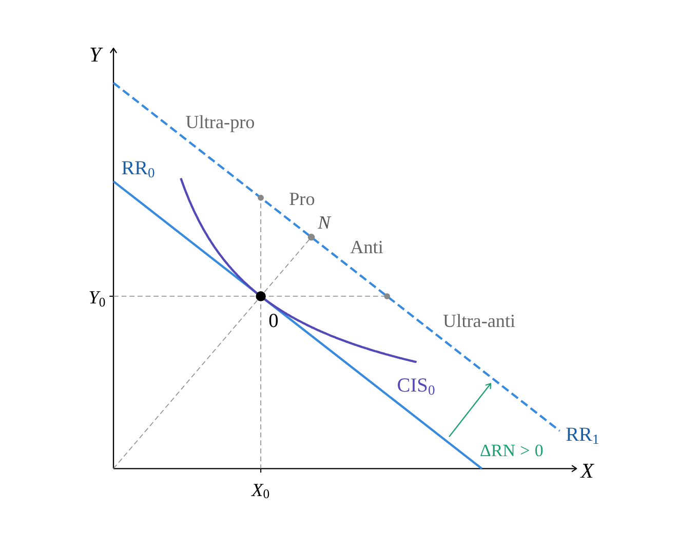
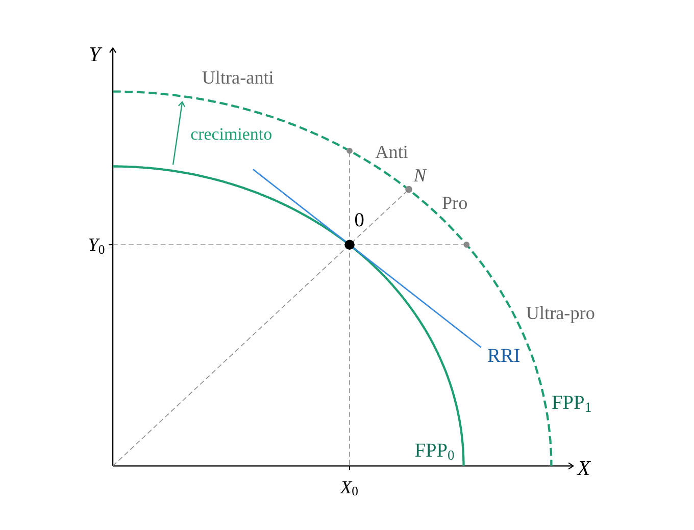
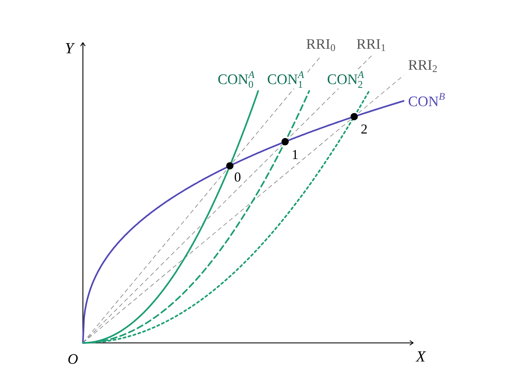
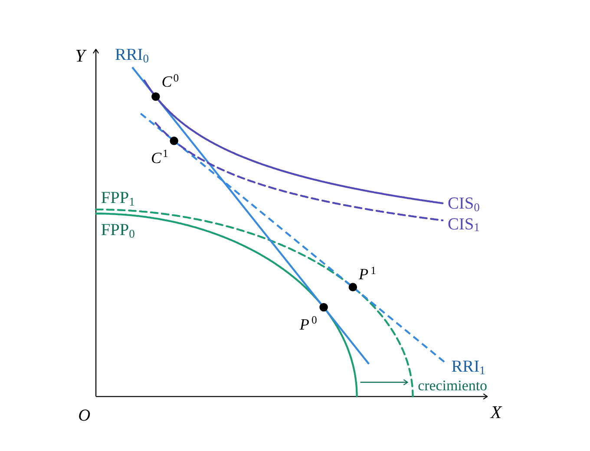
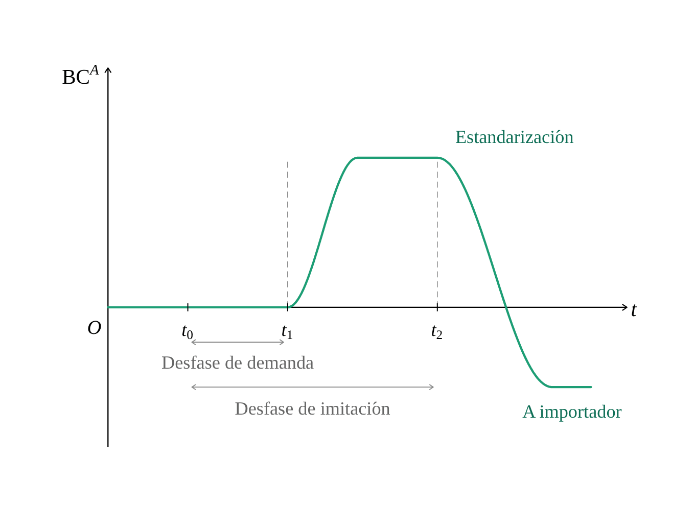
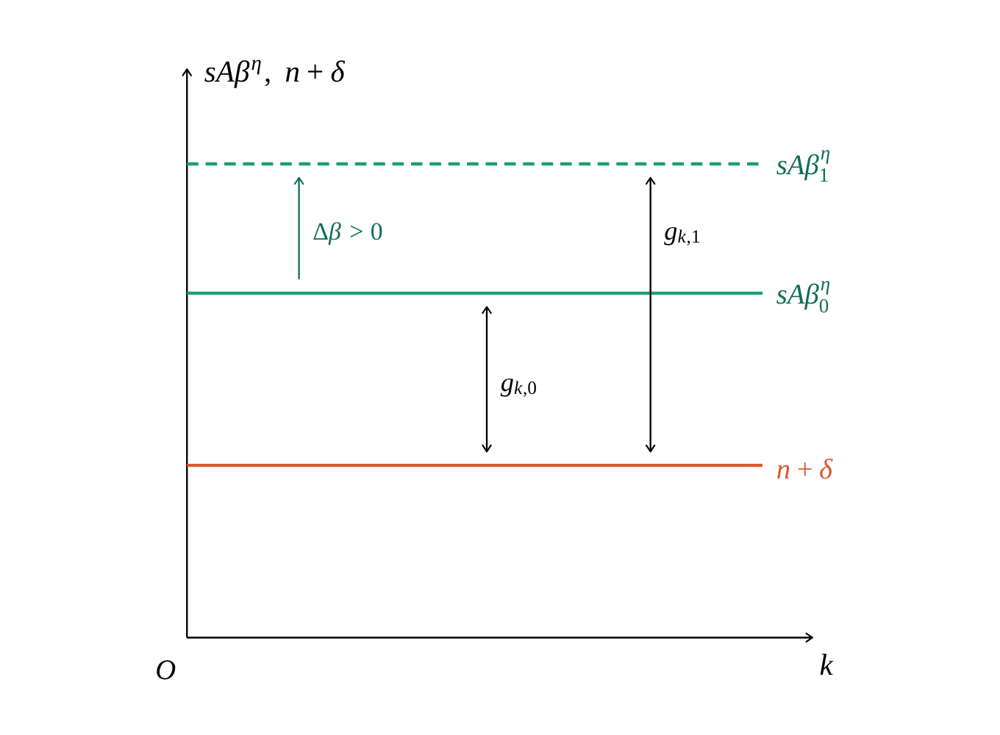

## Introducción

::: {.callout-note appearance="simple" icon=false}

:::

La relación entre el **comercio internacional** y el **crecimiento económico** funciona en los dos sentidos. Crecer cambia lo que un país produce y demanda, y con ello su comercio y su relación real de intercambio. Comerciar, a su vez, puede elevar la renta y su ritmo de crecimiento.

En el primer sentido, el efecto depende del **sesgo del crecimiento**, procomercial si amplía sobre todo la producción del bien exportable y anticomercial si favorece al que compite con las importaciones, y de si el país es lo bastante grande para alterar los precios mundiales. Bhagwati (1958) llevó el argumento a su extremo con el **crecimiento empobrecedor**, el caso en que un país grande pierde bienestar porque el abaratamiento de sus exportaciones pesa más que el aumento de su producción.

En el segundo sentido, la pregunta es si el comercio solo eleva el nivel de la renta o también su ritmo de crecimiento. La teoría neoclásica apenas ofrecía efectos de nivel, ligados a la especialización, mientras que los **modelos de crecimiento endógeno en economía abierta** (Rivera-Batiz y Romer, 1991; Grossman y Helpman, 1990) muestran que el comercio puede elevar la tasa de crecimiento, porque amplía el mercado de las innovaciones y permite aprovechar el conocimiento generado en otros países. La evidencia empírica, desde Frankel y Romer (1999), respalda una relación positiva entre apertura y renta, aunque la identificación de la causalidad sigue siendo difícil, porque los países más ricos también comercian más.

La cuestión ha recobrado actualidad con la fragmentación geoeconómica, es decir, con la reorganización del comercio en torno a bloques geopolíticos. Según el FMI (2023), una fragmentación grave del comercio mundial podría costar hasta un 7 % del PIB mundial a largo plazo, y las pérdidas recaerían sobre todo en las economías emergentes y de renta baja.

Este tema analiza, en los dos sentidos, cómo se relacionan el comercio exterior y el crecimiento:

- *Del crecimiento al comercio*: análisis estático de sus efectos sobre el volumen de comercio, los precios relativos internacionales y el bienestar, según su origen y el tamaño del país.

- *Del comercio al crecimiento*: las principales aportaciones del pensamiento económico, de los clásicos a la novísima teoría.

- *Análisis dinámico*: los efectos del comercio internacional sobre el crecimiento económico, con especial atención a los modelos de crecimiento endógeno en economía abierta y a la evidencia empírica.

## 1. Efectos del crecimiento económico sobre el comercio internacional

El **crecimiento económico**, entendido como el incremento de la renta nacional de un país, tiene un efecto total sobre el volumen de comercio que se puede descomponer en dos efectos, el efecto sobre el consumo y el efecto sobre la producción. El crecimiento, además, puede tener repercusiones sobre la relación real de intercambio (RRI) con el resto de países en función del tamaño del país. Por ello se considera primero un país pequeño y después un país grande. En ambos casos, el análisis es primero positivo (los efectos sobre el volumen de comercio) y después normativo (los efectos sobre el bienestar). El origen del crecimiento económico, es decir, si se debe a la acumulación de factores o al progreso tecnológico, se deja inicialmente de lado, y al final se examina si influye en las predicciones.

### 1.1. Supuestos

En cualquiera de los dos casos, a la hora de entender los efectos del crecimiento económico sobre el comercio internacional se parte de un modelo base simplificado de equilibrio general competitivo con un país, el cual, independientemente de su tamaño, cumple los siguientes supuestos.

**Entorno**: la economía es abierta, con competencia perfecta en todos los mercados y libre comercio sin restricciones ni costes de transporte.

**Agentes**: los individuos son propietarios de los factores de producción y de la tecnología (economía de tipo Robinson Crusoe). Sus preferencias vienen dadas por una función de utilidad continua, creciente, cuasicóncava y diferenciable.

**Tecnología**: el país produce dos bienes (X e Y) con dos factores de producción (K y L). El bien X es el bien exportable y el bien Y el bien importable, y ambos son bienes normales. Las funciones de producción presentan productividades marginales positivas pero decrecientes y rendimientos constantes a escala. Los factores son homogéneos y perfectamente divisibles, y su cantidad total está dada.

### 1.2. País pequeño

En el contexto de un país pequeño, los efectos se caracterizan porque la relación real de intercambio no cambia. Se distinguen el análisis positivo, de los efectos sobre el volumen de comercio, y el normativo, de los efectos sobre el bienestar.

#### 1.2.1. Análisis positivo: efectos sobre el volumen de comercio

Los efectos del crecimiento económico sobre el volumen de comercio pueden representarse gráficamente en el plano de bienes (figura -@fig-b097-crecimiento-neutral). Se parte de una situación de equilibrio en esta economía abierta en la cual las decisiones de consumo y producción están separadas. El crecimiento económico supone un desplazamiento hacia afuera de la frontera de posibilidades de producción (FPP) y un desplazamiento paralelo de la restricción de recursos de la economía, al aumentar la renta nacional[^b09-1]. Pueden trazarse rayos-vectores desde el origen que pasen por el equilibrio inicial de consumo, $C^0$, y por el equilibrio inicial de producción, $P^0$. Si se supone que los nuevos equilibrios se sitúan sobre esos rayos, los triángulos de comercio son semejantes (es decir, las exportaciones y las importaciones han crecido proporcionalmente). Los triángulos que describen el conjunto presupuestario de la economía también lo son.

Esto significa que el incremento relativo del comercio es idéntico al incremento relativo de la renta nacional, y se dice que el crecimiento económico es **neutral** con el comercio internacional. La neutralidad se puede comprobar observando que la ratio de crecimiento de las exportaciones y la ratio de crecimiento de la renta nacional medida en unidades del bien exportable son iguales, y análogamente para las importaciones:

$$\frac{\Delta \text{Exp}}{\text{Exp}} = \frac{\Delta \text{RN}_X}{\text{RN}_X} \qquad \text{y} \qquad \frac{\Delta \text{Imp}}{\text{Imp}} = \frac{\Delta \text{RN}_Y}{\text{RN}_Y}$$

::: {#fig-b097-crecimiento-neutral}

::: {.content-visible when-format="html"}
```{=html}
<div class="graph-frame">
<iframe src="../graphs/b097_Crecimiento_neutral.html" style="height:580px" loading="lazy" title="fig-b097-crecimiento-neutral"></iframe>
</div>
```
:::

::: {.content-visible unless-format="html"}

:::

Crecimiento neutral en un país pequeño. Con precios constantes, la frontera se desplaza de $\text{FPP}_0$ a $\text{FPP}_1$ y la restricción de recursos, en paralelo, de $\text{RR}_0$ a $\text{RR}_1$, y los nuevos equilibrios de producción, $P^1$, y de consumo, $C^1$, quedan sobre los rayos que pasan por $P^0$ y $C^0$. Los triángulos de comercio (exportaciones de X e importaciones de Y) son semejantes, de modo que el comercio crece en la misma proporción que la renta nacional.
:::

Sin embargo, hasta aquí se ha supuesto que tanto el consumo como la producción se desplazaban sobre una línea recta. El desplazamiento en línea recta no es condición necesaria para la neutralidad, ya que bastan sendas curvas cuyos puntos finales den lugar igualmente a triángulos de comercio y conjuntos presupuestarios semejantes. Cuando esto no ocurre, el crecimiento económico no es neutral con el comercio internacional y se dice que tiene un **sesgo**, cuyo tipo depende del efecto del crecimiento sobre el consumo y sobre la producción. Concretamente, se pueden dar cuatro casos:

1. *Sesgo anticomercial*: el incremento relativo del comercio internacional es menor que el incremento relativo de la renta nacional, es decir, $(\Delta \text{Com}/\text{Com}) < (\Delta \text{RN}/\text{RN})$.

2. *Sesgo ultra-anticomercial*: el crecimiento económico produce una caída absoluta del comercio internacional ($\Delta \text{Com} < 0$).

3. *Sesgo procomercial*: el incremento relativo del comercio internacional es mayor que el incremento relativo de la renta nacional, es decir, $(\Delta \text{Com}/\text{Com}) > (\Delta \text{RN}/\text{RN})$.

4. *Sesgo ultra-procomercial*: el crecimiento económico produce un incremento absoluto del comercio internacional mayor que el incremento absoluto de la renta nacional ($\Delta \text{Com} > \Delta \text{RN}$).

**Efectos sobre el consumo**: la relación entre el incremento de la renta nacional y el incremento de la demanda del bien importable Y determina el grado de autosuficiencia en el consumo de la economía. Se pueden dar cinco situaciones:

1. *Sesgo procomercial*: con el crecimiento, el consumo del bien importable aumenta más deprisa que la renta nacional, y, *ceteris paribus*, las importaciones absorben una fracción mayor de la renta.

2. *Sesgo ultra-procomercial*: el aumento del consumo del bien importable supera incluso el incremento absoluto de la renta, y el bien exportable pasa a consumirse menos[^b09-2].

3. *Sesgo anticomercial*: caso opuesto al primero, con un consumo del importable que crece a menor ritmo que la renta.

4. *Sesgo ultra-anticomercial*: el consumo del bien importable Y llega a reducirse en términos absolutos[^b09-3].

5. *Sesgo neutral*: en el caso de que la decisión de consumo se sitúe sobre el rayo-vector que pasa por el consumo inicial.

Gráficamente, en el plano bien X-bien Y (figura -@fig-b091-sesgos-consumo), esto se puede ilustrar observando dónde se sitúa la decisión de consumo en relación con la restricción de recursos:

1. *Restricción de recursos inicial*, $\text{RR}_0$: recoge las cestas al alcance de la economía dados la renta nacional y los precios relativos iniciales, y es una recta con pendiente $-p_X^0/p_Y^0$, el precio relativo inicial.

2. *Curva de indiferencia social*, $\text{CIS}_0$: reúne las cestas con un mismo bienestar social y es convexa, porque la función de utilidad es cuasicóncava. La dibujada es la más alta compatible con esa restricción.

3. *Equilibrio inicial*: la decisión de consumo viene determinada por el punto de tangencia entre la curva de indiferencia social y la restricción de recursos (punto 0), en el que se consumen $X_0$ e $Y_0$.

El crecimiento económico ($\Delta\text{RN} > 0$) provoca un desplazamiento en paralelo de la restricción de recursos, de $\text{RR}_0$ a $\text{RR}_1$, y, en función de dónde se sitúe la nueva tangencia con la curva de indiferencia social, se dará una situación u otra:

- *A la izquierda de la línea de neutralidad* (el rayo que pasa por 0 y $N$): el crecimiento habrá tenido un sesgo procomercial sobre el consumo.

- *A la derecha*: el sesgo será anticomercial.

- *Fuera del cono que describen los ejes trazados por el equilibrio inicial*: se estará en alguno de los casos extremos (ultra).

::: {#fig-b091-sesgos-consumo}

::: {.content-visible when-format="html"}
```{=html}
<div class="graph-frame">
<iframe src="../graphs/b091_Sesgos_consumo.html" style="height:560px" loading="lazy" title="fig-b091-sesgos-consumo"></iframe>
</div>
```
:::

::: {.content-visible unless-format="html"}

:::

Sesgos del crecimiento en el consumo en un país pequeño. El crecimiento puede ser procomercial, neutral o anticomercial.
:::

Sin embargo, el efecto que el incremento de la renta tenga sobre el consumo no es suficiente para determinar el sesgo comercial del crecimiento, puesto que es necesario saber qué efecto tiene también sobre la producción.

**Efectos sobre la producción**: el grado de autosuficiencia en la producción del bien importable viene dado, en este caso, por la relación entre el incremento de la renta nacional y el incremento de la producción del bien importable.

Gráficamente, los efectos sobre la producción se representan en el plano bien X-bien Y (figura -@fig-b092-sesgos-produccion):

1. *Frontera de posibilidades de producción inicial*, $\text{FPP}_0$: recoge las combinaciones máximas de X e Y que la economía puede producir con sus factores, y es cóncava, porque los costes de oportunidad son crecientes (tema [B05](b05-tnc-comercio.qmd), apartado 2.2).

2. *Recta de la RRI*, $\text{RRI}$: los precios internacionales, que el país pequeño toma como dados. Su pendiente es el precio relativo internacional, $-p_X/p_Y$.

3. *Equilibrio inicial*: la producción se sitúa en la tangencia entre ambas (punto 0), con $X_0$ e $Y_0$.

El tipo de efecto que el crecimiento económico tiene sobre la producción depende de la zona de la nueva frontera, $\text{FPP}_1$, en la que se sitúe el nuevo punto de producción, con dos diferencias respecto al caso del consumo. Primera, los nombres se invierten. Un crecimiento más que proporcional de la producción del importable es anticomercial, porque el país necesita importar menos. Segunda, el crecimiento desplaza la FPP y no la restricción de recursos, dado que el punto de producción está siempre sobre la frontera.

::: {#fig-b092-sesgos-produccion}

::: {.content-visible when-format="html"}
```{=html}
<div class="graph-frame">
<iframe src="../graphs/b092_Sesgos_produccion.html" style="height:560px" loading="lazy" title="fig-b092-sesgos-produccion"></iframe>
</div>
```
:::

::: {.content-visible unless-format="html"}

:::

Sesgos del crecimiento en la producción en un país pequeño. El crecimiento puede ser procomercial, neutral o anticomercial.
:::

Por último, si existe especialización completa (p. ej. con costes de oportunidad constantes, como en el modelo ricardiano), el país no produce nada del bien importable. En este caso, el aumento de la renta no tiene efecto sobre la composición de la producción y los efectos sobre el volumen de comercio vienen determinados exclusivamente por los efectos sobre el consumo. El sesgo del crecimiento sobre el comercio coincide así con el sesgo sobre el consumo, de modo que un crecimiento procomercial en el consumo es también procomercial en el comercio.

Los sesgos de la producción y del consumo no se combinan de forma sencilla en un sesgo del comercio internacional. Si ambos coinciden en su signo, se deduce de inmediato qué ocurre, en términos netos, con el volumen de comercio (p. ej. dos sesgos procomerciales arrojan un resultado global también procomercial). Cuando los signos se oponen, en cambio, el efecto global solo puede conocerse estimando las elasticidades-renta de demanda y de producción del importable.

#### 1.2.2. Análisis normativo: efectos sobre el bienestar

Para un país pequeño, la variación de sus importaciones o exportaciones no altera el precio relativo internacional de los bienes ($p_X/p_Y$), que es la relación real de intercambio. Cualquiera que sea su tipo, el crecimiento económico aumenta entonces el bienestar social, porque eleva la curva de indiferencia social que el país alcanza.

### 1.3. País grande

Para un país grande se distinguen, como en el caso del país pequeño, el análisis positivo, ahora de los efectos sobre la relación real de intercambio, y el normativo, de los efectos sobre el bienestar, que pueden llegar a ser negativos.

#### 1.3.1. Análisis positivo: efectos sobre la RRI

Si el país es grande, tendrá capacidad para alterar la relación real de intercambio. Así, además del efecto del crecimiento económico, se produce un efecto derivado del cambio en los precios relativos internacionales que dependerá del sesgo del crecimiento.

Gráficamente, en el plano bien X-bien Y (figura -@fig-b093-con-crecimiento-rri), el análisis se apoya en las curvas de oferta neta o demandas recíprocas. Las curvas muestran, para cada relación real de intercambio, la cantidad de exportaciones que cada país está dispuesto a ofrecer a cambio de las importaciones que desea obtener:

1. *Curva de oferta neta del país A*, $\text{CON}^A_0$: pasa por el origen y tiene dos tramos (la figura recoge solo el primero, en el que se producen los cortes).

    - *Tramo inicial elástico*: al aumentar el precio relativo del bien exportado, el país ofrece más X para importar más Y.

    - *Tramo final inelástico*: si el precio relativo de X es ya muy alto, el país no necesita exportar tanta cantidad de X para obtener las importaciones de Y que desea.

2. *Curva de oferta neta del país B*, $\text{CON}^B$: análoga a la de A, si bien para B las cantidades de X representan sus importaciones y las de Y sus exportaciones.

3. *Equilibrio*: el corte de ambas curvas (punto 0), en el que, para ambos países, lo que se ofrece en exportaciones coincide con lo que se demanda en importaciones. La $\text{RRI}_0$ es la pendiente de la recta que une el origen con ese punto.

::: {#fig-b093-con-crecimiento-rri}

::: {.content-visible when-format="html"}
```{=html}
<div class="graph-frame">
<iframe src="../graphs/b093_CON_crecimiento_RRI.html" style="height:560px" loading="lazy" title="fig-b093-con-crecimiento-rri"></iframe>
</div>
```
:::

::: {.content-visible unless-format="html"}

:::

Crecimiento en un país grande. La curva de oferta neta se desplaza y la relación real de intercambio se deteriora.
:::

**Crecimiento económico**: salvo en el caso ultra-anticomercial, eleva en términos absolutos la demanda de importaciones, sea cual sea su tipo. Por eso, cuando la curva de oferta neta de A pasa a $\text{CON}^A_1$ o $\text{CON}^A_2$, los nuevos cruces con la de B (puntos 1 y 2) quedan a la derecha del equilibrio inicial. Cuanto más procomercial es el crecimiento económico, más empeora la RRI, de $\text{RRI}_0$ a $\text{RRI}_1$ y $\text{RRI}_2$, puesto que su pendiente disminuye y se obtienen menos importaciones por cada unidad exportada.

Intuitivamente, un crecimiento más procomercial se traduce en más demanda de importaciones por parte de A. Como A es grande, el bien importable registra en el mundo un aumento apreciable de demanda y su precio internacional sube. Por la ley de Walras, A ofrece a la vez una mayor cantidad del bien exportable, cuyo precio cae. El encarecimiento del importable y el abaratamiento del exportable deterioran conjuntamente la relación real de intercambio.

Desde el punto de vista de la política económica se derivan dos implicaciones:

- *Orientación exportadora*: si un país grande orienta su política comercial a exportar, la oferta mundial del bien exportable supera lo que absorbe la demanda a los precios iniciales, lo que deteriora su relación real de intercambio.

- *Sustitución de importaciones*: si la política busca, en cambio, reemplazar importaciones con producción propia, el crecimiento adquiere un sesgo anticomercial que suaviza la caída de la RRI. Cuando ese sesgo es ultra-anticomercial, la RRI llega incluso a mejorar.

#### 1.3.2. Análisis normativo: efectos sobre el bienestar (crecimiento neutral, aumentador o empobrecedor)

Hasta aquí se ha analizado en términos positivos el comportamiento de la relación real de intercambio. Ese comportamiento tiene, por extensión, efectos sobre el bienestar, que dependen de dos fuerzas contrapuestas, la ganancia de bienestar producida por el crecimiento económico y la pérdida derivada del deterioro de la relación real de intercambio. Se distinguen así dos casos, el primero de los cuales agrupa el crecimiento aumentador y el neutral en términos de bienestar:

1. *Crecimiento que aumenta o mantiene el bienestar*: la caída de la RRI es relativamente pequeña, de manera que el efecto del desplazamiento de la FPP domina y el bienestar del país aumenta. En el caso límite, ambos efectos se compensan y el bienestar se mantiene.

2. *Crecimiento empobrecedor*[^b09-4]: las pérdidas causadas por el deterioro de la RRI superan a las ganancias derivadas del crecimiento económico. Por lo tanto, la curva de indiferencia social final se sitúa más próxima al origen que la inicial.

El deterioro de la RRI es imprescindible para que haya crecimiento empobrecedor, pero no basta. La probabilidad de que la pérdida por ese deterioro pese más que las ganancias del crecimiento aumenta cuando se dan, además, otras condiciones:

- *Crecimiento débil*: la FPP se desplaza poco, de modo que el crecimiento, por sí solo, no permite acceder a una cesta de consumo mucho mejor que la de partida.

- *Elevada dependencia del comercio*: cuanto mayor es el peso del comercio en la economía, mayor es el impacto de un deterioro de la RRI.

- *Demanda exterior inelástica* del bien exportable (p. ej. alimentos o materias primas), de forma que el aumento de la oferta exportada provoca una caída más que proporcional de su precio relativo y reduce el valor de las exportaciones del país.

- *Ausencia de arancel óptimo*: el país no explota su poder de mercado mediante el arancel óptimo, que le permitiría contrarrestar el deterioro.

- *Sesgo muy procomercial* del crecimiento económico, pues cuanto más procomercial es el crecimiento, más se deteriora la RRI.

Gráficamente, en el plano bien X-bien Y (figura -@fig-b094-crecimiento-empobrecedor), se puede ilustrar un caso de crecimiento empobrecedor:

1. *Frontera de posibilidades de producción inicial*, $\text{FPP}_0$: recoge las combinaciones máximas de X e Y que el país puede producir y es cóncava, como en la figura -@fig-b092-sesgos-produccion.

2. *Recta de la RRI inicial*, $\text{RRI}_0$: la relación real de intercambio de partida, una recta cuya pendiente es el precio relativo internacional inicial.

3. *Curva de indiferencia social inicial*, $\text{CIS}_0$: reúne las cestas con el bienestar social alcanzado antes del crecimiento.

4. *Equilibrio inicial*: con la FPP y la RRI iniciales, la producción se sitúa en $P^0$ y el consumo en $C^0$.

Un crecimiento procomercial amplía la FPP con un sesgo hacia el sector exportador, de $\text{FPP}_0$ a $\text{FPP}_1$[^b09-5]. Como el país es grande, la RRI empeora y pasa de $\text{RRI}_0$ a $\text{RRI}_1$, con una pendiente menor en valor absoluto en el plano $(X, Y)$. La producción se traslada a $P^1$ y el consumo a $C^1$, y la curva de indiferencia alcanzada, $\text{CIS}_1$, queda más cerca del origen que la inicial, con lo que el crecimiento resulta empobrecedor.

::: {#fig-b094-crecimiento-empobrecedor}

::: {.content-visible when-format="html"}
```{=html}
<div class="graph-frame">
<iframe src="../graphs/b094_Crecimiento_empobrecedor.html" style="height:560px" loading="lazy" title="fig-b094-crecimiento-empobrecedor"></iframe>
</div>
```
:::

::: {.content-visible unless-format="html"}

:::

Crecimiento empobrecedor (Bhagwati, 1958). El deterioro de la relación real de intercambio más que compensa la expansión productiva.
:::

El sesgo del crecimiento se define, no obstante, a los precios relativos iniciales. Una vez incorporada la variación de la RRI, la producción final se desplaza a lo largo de la nueva FPP de vuelta hacia el bien importable, por lo que la asignación finalmente observada puede diferir del sesgo definido a precios constantes.

### 1.4. Efectos en función de la causa del crecimiento económico

Hasta ahora no se ha tenido en cuenta el origen del crecimiento económico al evaluar sus efectos sobre el comercio internacional. Se distinguen dos orígenes, la acumulación de factores y el progreso tecnológico.

#### 1.4.1. Crecimiento económico generado por la acumulación de factores

El análisis del crecimiento económico debido a la acumulación de factores parte del teorema de Rybczynski (1955). Según este teorema, si con precios relativos de bienes y factores constantes crece la dotación de un solo factor, aumenta la producción del bien que lo usa con más intensidad y disminuye la del otro (véase la figura del tema [B05](b05-tnc-comercio.qmd), apartado 2.4.3). Se mantiene el modelo base, con el supuesto adicional de que el bien X (exportable) es relativamente intensivo en capital y el bien Y (importable) es relativamente intensivo en trabajo. De nuevo, los efectos varían según se trate de un país pequeño o de uno grande.

**País pequeño (aumento del capital)**: si, desde el equilibrio inicial, aumenta la dotación de capital, la FPP se expande sobre todo en la dirección del bien X, cuya producción máxima posible crece más que la de Y. El efecto, por el teorema de Rybczynski, es un aumento de la producción del bien exportable y una disminución absoluta de la producción del bien importable, lo que supone un efecto ultra-procomercial sobre la producción (figura -@fig-b092-sesgos-produccion).

**País pequeño (aumento del trabajo)**: si aumenta la dotación del factor que se utiliza intensivamente en el bien importable, la producción máxima posible de Y aumenta más que la de X. Por el mismo teorema, la producción de X cae en términos absolutos, con un efecto ultra-anticomercial sobre la producción.

En resumen, el crecimiento provocado por el aumento de la dotación de un factor es o bien ultra-procomercial o bien ultra-anticomercial en la producción, en función de si dicho factor se utiliza intensivamente en la industria exportadora o en la importadora.

En términos de distribución de la renta, dado que la RRI permanece constante, los precios relativos de los factores no se mueven y, por tanto, tampoco lo hacen las ratios capital-trabajo de cada sector. Puesto que existen rendimientos constantes y competencia perfecta, los productos marginales no cambian ni, con ellos, los rendimientos reales del capital y del trabajo. Los únicos cambios que produce el crecimiento son, pues, los relativos a la producción de ambos bienes y a la distribución de los factores entre las dos industrias.

**País grande (aumento del capital)**: el país, al ofrecer más exportaciones, empuja $p_X$ a la baja, y al demandar más importaciones, empuja $p_Y$ al alza y, en consecuencia, la RRI empeora ($\downarrow p_X / \uparrow p_Y$). Es más, si se admite el desplazamiento interno de factores de un sector a otro, el sector del bien exportable se desarrolla mientras que el sector del bien importable se ve perjudicado. Esta relación entre la expansión del sector favorecido por la dotación y el declive del resto de sectores se conoce como *enfermedad holandesa*. *The Economist* acuñó el término en 1977 para referirse a la desindustrialización experimentada por los Países Bajos tras el descubrimiento de los yacimientos de gas natural de Groninga en 1959[^b09-6].

**País grande (aumento del trabajo)**: la disminución de la demanda de importaciones hace bajar $p_Y$ y la disminución de la oferta de exportaciones hace subir $p_X$, por lo que la RRI mejora ($\uparrow p_X / \downarrow p_Y$).

**Crecimiento de ambos factores de producción**: si se produce un crecimiento equilibrado, es decir, si crecen ambos factores en la misma proporción, la FPP se expande de forma homotética y el efecto sobre la producción es neutral.

#### 1.4.2. Crecimiento económico generado por el progreso tecnológico

En el muy largo plazo la tecnología no tiene por qué ser constante y, por ello, se puede considerar que la función de producción incluye un factor que hace que esta no sea estable en el tiempo. Por **progreso técnico** se puede entender la posibilidad de producir en tres sentidos:

1. *Innovación de producto*: nuevas variedades de bienes ya existentes o bienes completamente nuevos.

2. *Innovación de proceso*: más producción con los mismos factores o la misma producción con menos factores.

3. *Mejora de la calidad*: versiones mejores de los productos existentes.

Entendido en la segunda acepción, el progreso técnico admite la misma distinción que el crecimiento económico. El progreso técnico es neutral cuando reduce en igual proporción el uso de ambos factores productivos y sesgado cuando economiza relativamente el de uno de ellos. Aquí se adopta el **criterio de Hicks**, según el cual, con una ratio capital-trabajo dada, una innovación tecnológica es neutral respecto al capital y al trabajo si y solo si deja constante el cociente de productividades marginales. En cambio, en el caso de que la productividad marginal de uno de los factores aumente en mayor proporción que la del otro, se habla de progreso técnico *sesgado*. En él, la relación marginal de sustitución técnica a lo largo del rayo-vector cambia y la isocuanta se desplaza hacia el origen de forma sesgada. Concretamente, el progreso técnico sesgado puede ser:

- *Intensificador del capital o ahorrador de trabajo*: en este caso, la productividad marginal del capital crece en mayor proporción que la del trabajo. Así, la $\text{RMST}_{KL} = \text{Pmg}_L/\text{Pmg}_K$ disminuye a lo largo del rayo-vector.

- *Intensificador del trabajo o ahorrador de capital*: ahora la productividad marginal del trabajo crece en mayor proporción que la del capital. Así, la RMST aumenta a lo largo del rayo-vector.

Para estudiar cómo afecta el progreso técnico al comercio internacional, se parte de nuevo del modelo reducido de equilibrio general con una economía abierta y dos sectores. Se distinguen dos casos, según el progreso técnico afecte a los dos sectores o solo a uno de ellos.

**Progreso técnico en ambos sectores**: si el progreso técnico es neutral y se produce al mismo ritmo en ambos sectores, el efecto es análogo al de un crecimiento equilibrado de las dotaciones y, por tanto, el efecto sobre la producción también es neutral.

**Progreso técnico neutral en un solo sector**: sus efectos sobre la producción coinciden cualitativamente con los que tendría una mayor dotación del factor que el sector usa intensivamente. En primer lugar, la producción crece en el sector innovador y cae en el otro, como en el teorema de Rybczynski. Si el sector innovador es el exportador, el sesgo sobre la producción es ultra-procomercial y el volumen de comercio internacional se amplía. En segundo lugar, cuando el país es grande, el producto del sector innovador se abarata y el otro bien se encarece, por lo que la RRI empeora cuando la innovación tiene lugar en el sector exportador.

**Progreso técnico sesgado en un solo sector**: se distinguen dos situaciones:

- *Ahorrador de capital en el sector intensivo en capital*: tiene los mismos efectos cualitativos que el progreso técnico neutral en dicho sector.

- *Ahorrador de trabajo en el sector intensivo en capital*: su efecto es ambiguo, pues, a precios constantes, la producción del otro sector puede aumentar o disminuir según la intensidad de los efectos contrapuestos sobre la oferta y la demanda de factores.

### 1.5. Conclusiones

La sección analiza cómo afecta el crecimiento al volumen de comercio, a la relación real de intercambio y al bienestar. Su aportación es descomponer el efecto total en un efecto consumo y un efecto producción, y ligar el sesgo de este último a la causa del crecimiento, el factor que se acumula o el sector en el que se innova. El mismo esquema explica la enfermedad holandesa y las condiciones del crecimiento empobrecedor.

Su límite es que el crecimiento entra como un dato exógeno, de modo que la sección no explica sus causas ni la senda entre el equilibrio inicial y el final. El sentido inverso, cómo el comercio altera el crecimiento, es el objeto de las secciones 2 y 3.

## 2. Efectos del comercio sobre el crecimiento (I): de los clásicos a la novísima teoría

Hasta este punto se han analizado las consecuencias del crecimiento económico para el comercio internacional. Este apartado invierte la perspectiva y examina, a partir de las principales contribuciones del pensamiento económico, cómo influye el comercio internacional en el crecimiento.

### 2.1. Pensamiento clásico y neoclásico

Se repasan primero las aportaciones del pensamiento clásico, centradas en la especialización y la extensión del mercado, y después las del neoclásico, cuyo análisis de estática comparativa reduce las ganancias de la apertura a un efecto de nivel.

::: {.callout-note appearance="simple" icon=false}
Sobre la teoría tradicional del comercio internacional, véase el tema [B05](b05-tnc-comercio.qmd).
:::

#### 2.1.1. Pensamiento clásico

Las aportaciones clásicas giran en torno a dos conceptos, la **ventaja absoluta** (Adam Smith, 1776) y la **ventaja comparativa** (David Ricardo, 1817). La especialización completa en los bienes en que se posee ventaja tecnológica, absoluta o relativa, y el posterior intercambio elevan la producción global. Por la vía de la división del trabajo, el comercio incrementa así la producción de ambos países y tiene un efecto positivo sobre el crecimiento.

John Stuart Mill añadió dos matizaciones:

- *Demanda recíproca*: esta teoría completa a Ricardo, porque explica en qué punto del intervalo de intercambio mutuamente ventajoso se sitúa la relación real de intercambio. Si los costes comparativos delimitan ese intervalo, la intensidad relativa de la demanda de cada país determina el punto y, con él, cómo se reparte la ganancia. 

- *Industria naciente*: este argumento, principal excepción admitida por la escuela clásica al libre comercio, justifica la protección temporal de una industria mientras adquiere la escala y experiencia necesarias. Esa protección queda condicionada a su carácter transitorio y a que la industria alcance la viabilidad sin ella.

De estas aportaciones, la que más interesa a este tema es la de Smith, que contiene una intuición genuinamente dinámica. Su tesis es que la división del trabajo está limitada por la extensión del mercado. De ello se infiere que especializarse solo compensa si existe mercado (demanda) suficiente para absorber la producción resultante, de modo que en un mercado reducido la especialización extrema no resulta rentable. De ahí se sigue una secuencia que se realimenta:

1. *Punto de partida*: la apertura amplía el mercado al que puede venderse.

2. *División del trabajo*: ese mercado mayor hace rentable una división del trabajo más fina.

3. *Productividad*: la especialización eleva la productividad, por la mayor destreza del trabajador, el ahorro de tiempo en los cambios de tarea y el estímulo a la mecanización.

4. *Realimentación*: la mayor productividad genera más renta, que amplía de nuevo el mercado.

Esa circularidad convierte el planteamiento en una teoría del crecimiento y no meramente de la asignación, pues la productividad deja de ser un dato previo al comercio para ser un resultado de él. 

Parte de estas intuiciones fueron recuperadas por Allyn Young (1928) y por Kaldor bajo la noción de causación acumulativa, y constituyen el antecedente directo de los modelos de crecimiento endógeno que se examinan en el apartado 3. El argumento de la industria naciente de Mill añade una segunda intuición dinámica, la de que la ventaja comparativa no es un dato, sino algo que puede adquirirse mediante el aprendizaje, premisa sobre la que descansará buena parte de la literatura posterior del desarrollo.

#### 2.1.2. Pensamiento neoclásico

El pensamiento neoclásico mantuvo la defensa del libre comercio con varias matizaciones derivadas de la teoría marginalista del valor. Por ejemplo, los costes de oportunidad crecientes hacen que la especialización deje de ser necesariamente completa, y la ventaja comparativa puede residir en dotaciones relativas de factores.

El crecimiento no ocupa, sin embargo, un lugar central en este cuerpo teórico, y la razón es de método. El análisis neoclásico del comercio es de **estática comparativa**, es decir, compara dos equilibrios con dotaciones y tecnología dadas, de modo que las ganancias de la apertura son de nivel y no de tasa de crecimiento. Por tanto, el comercio permite un consumo superior al de autarquía, pero agotado ese salto la economía no crece más deprisa por estar abierta. El interés se desplaza así hacia la asignación eficiente y los efectos redistributivos entre factores. Habrá que esperar a la nueva teoría del comercio y, sobre todo, a los modelos de crecimiento endógeno en economía abierta para que la apertura altere la tasa de crecimiento y no solo el nivel de renta.

::: {.callout-note appearance="simple" icon=false}
El modelo de Heckscher-Ohlin-Samuelson, los teoremas de Stolper-Samuelson y de Rybczynski y la paradoja de Leontief se desarrollan en el tema [B05](b05-tnc-comercio.qmd).
:::

### 2.2. Nueva teoría

Dentro de la nueva teoría, la relación entre comercio y crecimiento se aborda primero con dos precursores, los desfases tecnológicos y el ciclo del producto, y después con la diferenciación vertical y la I+D.

::: {.callout-note appearance="simple" icon=false}
Sobre la nueva teoría del comercio internacional, véase el tema [B06](b06-nueva-teoria.qmd).
:::

De la nueva teoría interesan aquí las aportaciones relacionadas con los factores que afectan a la relación entre comercio y crecimiento, como el progreso tecnológico, la I+D y la productividad.

#### 2.2.1. Precursores de la nueva teoría: desfases tecnológicos (Posner, 1961; Hufbauer, 1966)

**Origen**: Michael Posner (1961) y Gary Hufbauer (1966) estudian los desfases tecnológicos (*technology gaps*) como origen del comercio internacional.

**Idea**: la innovación da al país que la genera una ventaja comparativa temporal en el nuevo producto, mientras los demás países no aprenden a imitarlo.

**Razonamiento**: concretamente, estos autores distinguen dos desfases y el desfase global neto que resulta de compararlos:

1. *Desfase de imitación* (*imitation lag*)[^b09-7]: la I+D y la iniciativa empresarial hacen que los países innovadores produzcan nuevos bienes y disfruten de un monopolio sobre ellos hasta que otros países aprenden a producirlos.

2. *Desfase de demanda*: mide cuánto tarda en aparecer demanda del producto en el país importador desde que se inventa en el innovador. Puede deberse, entre otras causas, a que la información circula despacio o a que las preferencias tardan en adaptarse a la novedad.

3. *Desfase global neto*: comparar ambos desfases indica si la innovación dará lugar a intercambios internacionales. Cuando imitar (copiar la técnica) lleva más tiempo que empezar a demandar, los países seguidores quieren el bien antes de saber fabricarlo, de modo que tienen que comprarlo fuera y surge el comercio. En el caso contrario, la copia llega antes que la demanda exterior, así que los seguidores pueden abastecerse solos y no hay comercio.

En resumen, aunque los países tengan preferencias y dotaciones relativas de factores idénticas, el progreso técnico que los innovadores generan de forma endógena les da una ventaja comparativa y, con ella, una base para comerciar.

Si existe una asimetría importante entre países, los países poco dinámicos, es decir, aquellos cuyos flujos de incorporación de innovaciones por unidad de tiempo son más lentos, se ven obligados a exportar bienes tradicionales a cambio de bienes innovadores. Esto puede dar lugar a un círculo vicioso, pues, al ser los bienes tradicionales de bajo valor añadido, la renta que esos países obtienen del comercio no es suficiente para invertir en I+D y mejorar su dinamismo. En cambio, cuando el dinamismo es similar en todos los países, el comercio internacional estimula el crecimiento económico, ya que las innovaciones se difunden rápidamente entre ellos.

**Desarrollo gráfico**: en el plano tiempo-saldo comercial del país A en el nuevo producto (figura -@fig-b096-desfases-tecnologicos), el saldo, $\text{BC}^A$, recorre tres fases:

1. *Desfase de demanda*: el país A innova en $t_0$, pero sus exportaciones no aumentan inmediatamente, puesto que la demanda exterior solo nace en $t_1$.

2. *Desfase de imitación*: a partir de $t_1$, y mientras este desfase siga corriendo, las exportaciones del país A crecen, es decir, existe comercio internacional precisamente porque imitar lleva más tiempo que demandar. Las exportaciones alcanzan un máximo y se mantienen en meseta mientras los costes de aprendizaje y otras barreras (informacionales, licencias) retrasan la transferencia tecnológica y la demanda exterior está ya cubierta.

3. *Estandarización*: cuando el país B completa la imitación y comienza a fabricar localmente ($t_2$), se produce la estandarización del producto y las exportaciones del país A disminuyen. En función de los costes relativos, la situación puede incluso revertirse y el país A pasar a ser importador del bien.

::: {#fig-b096-desfases-tecnologicos}

::: {.content-visible when-format="html"}
```{=html}
<div class="graph-frame">
<iframe src="../graphs/b096_Desfases_tecnologicos.html" style="height:560px" loading="lazy" title="fig-b096-desfases-tecnologicos"></iframe>
</div>
```
:::

::: {.content-visible unless-format="html"}

:::

Desfases tecnológicos y ciclo del producto (Posner, 1961; Vernon, 1966). El país innovador exporta hasta que la imitación traslada la producción al exterior.
:::

**Conclusiones**:

- *Aspectos positivos*: desde el punto de vista teórico, el modelo de desfases tecnológicos fue relevante para el desarrollo posterior de las teorías del crecimiento endógeno en un contexto internacional. Desde el punto de vista empírico, se ha usado para explicar la época dorada de crecimiento europeo de 1950 a 1973, basada en la absorción del desfase tecnológico con EE. UU., aunque existen otras hipótesis complementarias sobre aquel episodio.

- *Limitaciones*: los desfases (de imitación y de demanda) son exógenos al modelo, que no explica su duración ni los mecanismos de difusión de la tecnología. Se trata, pues, de un marco descriptivo más que de un modelo microfundamentado, carencia que abordarían más adelante los modelos norte-sur de ciclo del producto (Krugman, 1979) y la literatura de crecimiento endógeno.

#### 2.2.2. Precursores de la nueva teoría: ciclo del producto (Vernon, 1966; Hirsch, 1967)

**Origen**: Raymond Vernon (1966) y Seev Hirsch (1967) desarrollaron una teoría con la que explicar por qué las innovaciones suelen concentrarse en los países desarrollados y acaban filtrándose después a economías menos avanzadas.

**Idea**: las proporciones de factores que exige un producto no son iguales en cada fase de su ciclo de vida, y en esa intensidad factorial cambiante está, según estos autores, la explicación.

**Razonamiento**:

1. *Etapa inicial*: solo las empresas de los países más avanzados reúnen lo que pide un producto recién inventado (un fuerte gasto en I+D, trabajadores cualificados, información que circule deprisa y capacidad para gestionar el riesgo). Los primeros compradores, además, suelen ser los hogares con más ingresos. Por eso, lo normal es que el producto se fabrique en un país desarrollado y que este lo exporte al resto del mundo.

2. *Etapa de madurez*: la tecnología se difunde y empiezan a fabricar el bien los países que pueden hacerlo más barato[^b09-8], con lo que las ventas exteriores del innovador comienzan a retroceder.

3. *Etapa de estandarización*[^b09-9]: la mano de obra cualificada deja de ser necesaria y la fabricación se desplaza a los países menos desarrollados, donde abunda el trabajo no cualificado. Los papeles se invierten, pues ahora estos países exportan el bien y los desarrollados lo importan.

**Conclusiones**:

- *Aspectos positivos*: la teoría del ciclo del producto analiza también, de manera implícita, la localización de la producción en los distintos países y, por tanto, se considera precursora de los modelos de la economía geográfica.

- *Limitaciones*: se trata de una teoría descriptiva, sin un modelo formal subyacente en su formulación original. Además, el propio Vernon (1979) reconoció que su vigencia se había debilitado, pues las empresas multinacionales, con redes globales de producción, lanzan hoy los productos de forma casi simultánea en múltiples mercados, lo que acorta o elimina las fases del ciclo.

#### 2.2.3. Diferenciación vertical e I+D (Shaked y Sutton, 1982; 1983)

::: {.callout-note appearance="simple" icon=false}
El modelo de diferenciación vertical de Shaked-Sutton se desarrolla en el tema [B06](b06-nueva-teoria.qmd).
:::

En un marco de diferenciación vertical con costes fijos de I+D, la competencia da lugar a un oligopolio natural internacional. Desde la óptica de este tema, el oligopolio natural puede redundar en crecimiento económico, debido a las inversiones en I+D que realizan las empresas para mantener su posición de calidad en el mercado.

### 2.3. Novísima teoría

La novísima teoría se ilustra con el modelo de heterogeneidad de empresas (Melitz, 2003), que añade la reasignación de recursos hacia las empresas más productivas, y con sus extensiones a la elección entre exportar e invertir y a la organización de la producción.

#### 2.3.1. Modelo de heterogeneidad de empresas (Melitz, 2003)

::: {.callout-note appearance="simple" icon=false}
El modelo de heterogeneidad de empresas se desarrolla por completo en el tema [B06](b06-nueva-teoria.qmd).
:::

Desde la perspectiva de la relación entre comercio y crecimiento, el modelo de Melitz ofrece dos predicciones fundamentales, a las que la literatura posterior añade un canal complementario:

1. *Efecto selección*: la apertura comercial separa a las empresas en tres grupos según su productividad (véase la figura del tema [B06](b06-nueva-teoria.qmd), apartado 3.1.3).

    - *Menos productivas*: aunque producían en autarquía, abandonan el mercado.

    - *Productividad intermedia*: más productivas, pero no lo suficiente, venden solo en el mercado nacional.

    - *Más productivas*: obtienen beneficios en los mercados de exportación, con lo que crecen y se convierten en exportadoras.

2. *Efecto productividad*: el hecho de que las empresas menos productivas abandonen el mercado y las más productivas ganen cuota hace que la productividad agregada del país sea mayor con comercio internacional. La razón es que los recursos que antes empleaban las empresas menos productivas pasan a las más productivas, que los utilizan más eficientemente.

3. *Efecto aprendizaje*: aunque en el modelo original la productividad de cada empresa es fija, el efecto productividad se puede ver reforzado por el aprendizaje asociado a la exportación (*learning by exporting*). Con ese aprendizaje, las empresas exportadoras adquieren conocimientos y habilidades que les permiten aumentar aún más su productividad.

En consecuencia, las ganancias de productividad agregada derivadas del comercio internacional, reforzadas en su caso por el efecto aprendizaje, elevan el nivel de la renta. En Melitz (2003) se trata de un efecto de nivel y no de tasa de crecimiento, pues la apertura eleva una sola vez la productividad agregada sin alterar su ritmo de crecimiento a largo plazo. El resultado, además, es general, ya que las mismas intuiciones se obtienen si se analiza un aumento del número de países a los que se puede exportar o una caída de los costes fijos o variables de exportación.

#### 2.3.2. Extensiones: exportar o invertir (Helpman, Melitz y Yeaple, 2004) y organización óptima (Antràs y Helpman, 2004)

::: {.callout-note appearance="simple" icon=false}
Los modelos de Helpman, Melitz y Yeaple (2004) y de Antràs y Helpman (2004) se desarrollan en el tema [B06](b06-nueva-teoria.qmd), apartado 3.2.
:::

**Exportar o invertir**: la principal predicción del modelo de Helpman, Melitz y Yeaple (2004) es que las empresas más productivas no solo son capaces de exportar, sino que las más eficientes de entre ellas pueden llevar a cabo inversión extranjera directa (IED). La sustitución de exportaciones por IED resulta tanto más probable cuanto mayores son los costes de transporte (dilema proximidad-concentración).

**Organización óptima**: Pol Antràs y Elhanan Helpman (2004) se preguntan dónde realizar el proceso productivo en un marco internacional y cómo estructurarlo (qué procesos realizar internamente y cuáles externalizar). Los autores estudian los determinantes de la internalización de procesos (la IED vertical) frente a su externalización o subcontratación. Entre esos determinantes destacan los conflictos de interés entre las partes, las diferencias en los costes de producción y el saber hacer de cada agente.

#### 2.3.3. Conclusiones

**Aspectos positivos**: la novísima teoría identifica un canal específico por el que el comercio eleva la productividad agregada, la reasignación intraindustrial de recursos hacia las empresas más productivas. El canal resulta invisible tanto para la teoría tradicional (centrada en la reasignación entre sectores) como para la nueva teoría con empresas idénticas.

**Limitaciones**: en Melitz (2003), la productividad de cada empresa es fija y la reasignación eleva una sola vez el nivel de la productividad agregada, sin alterar su tasa de crecimiento. Además, en una amplia clase de modelos que incluye el de Melitz con distribución de Pareto, la heterogeneidad de las empresas no añade ganancias de bienestar a las de los modelos con empresas idénticas (Arkolakis, Costinot y Rodríguez-Clare, 2012).

### 2.4. Conclusiones

No todo canal del comercio eleva la tasa de crecimiento además del nivel de renta. Para los clásicos, la especialización aumenta la producción, y Smith le da un alcance dinámico, pues un mercado mayor permite dividir más el trabajo y eleva una productividad que vuelve a ampliar el mercado. La industria naciente de Mill añade que la ventaja comparativa puede adquirirse mediante el aprendizaje. El análisis neoclásico, de estática comparativa, reduce en cambio las ganancias de la apertura a un efecto de nivel.

En la nueva teoría, los desfases tecnológicos dan al innovador una ventaja temporal. Si los países tienen un dinamismo parecido, el comercio difunde deprisa las innovaciones y estimula el crecimiento, y, si no, puede encerrar a los rezagados en un círculo vicioso. La I+D que sostiene la calidad en la diferenciación vertical puede redundar también en crecimiento. La novísima teoría suma la reasignación hacia las empresas más productivas, cuyo efecto en Melitz (2003) es, sin embargo, de nivel. Los efectos sobre la tasa los formalizan los modelos de crecimiento endógeno del apartado 3.1 y los contrasta la evidencia del apartado 3.2.

## 3. Efectos del comercio sobre el crecimiento (II): crecimiento endógeno y evidencia empírica

Los modelos de crecimiento endógeno formalizan esos canales en economía abierta, y la evidencia empírica permite contrastar si la apertura se asocia, de hecho, a un mayor crecimiento.

### 3.1. Modelos de crecimiento endógeno en economía abierta

Se exponen tres modelos: el de externalidades del capital, el de aumento del número de variedades de *inputs* y el de comercio, ventaja comparativa y crecimiento.

::: {.callout-note appearance="simple" icon=false}
Sobre los modelos de crecimiento endógeno, véase el tema [A44](a44-crecimiento-ii.qmd).
:::

#### 3.1.1. Modelo de externalidades del capital con comercio internacional (Arrow, 1962; Romer, 1986; Lucas, 1988)

**Origen**: el modelo procede de los modelos de crecimiento endógeno de primera generación de Arrow (1962), Romer (1986) y Lucas (1988), extendidos a la economía abierta.

**Idea**: en esta primera generación de modelos de crecimiento endógeno nadie se propone innovar. La inversión en capital genera progreso tecnológico como efecto secundario, sin que medie una actividad deliberada. Así, la empresa invierte para producir, y al hacerlo acumula experiencia y conocimiento que no puede retener en exclusiva, de modo que el progreso técnico se modela como una externalidad positiva. La diferencia con la segunda generación es de mecanismo, porque allí la innovación se busca y se remunera mediante patentes, mientras que aquí sencillamente ocurre.

**Supuestos**:

- *Entorno*: economía abierta al exterior, con una función de producción agregada que incorpora, junto a los factores convencionales, un término de externalidad.

- *Agentes*: la tasa de ahorro $s$ es exógena y constante, al igual que las tasas de crecimiento de la población $n$ y de depreciación $\delta$.

- *Tecnología*: cuando una empresa acumula capital per cápita, genera externalidades positivas para el resto de la economía, porque las demás pueden aprovechar la experiencia, los conocimientos y la tecnología que ese capital incorpora[^b09-10]. Cada empresa toma el nivel agregado de la externalidad como dado, de modo que no lo internaliza en su decisión de inversión.

- *Sector exterior*: el comercio internacional opera como catalizador de esas externalidades, al ampliar los canales de difusión del conocimiento mediante la importación de bienes de capital, la imitación y el contacto con la frontera tecnológica. Se representa por el parámetro $\beta$, que mide el grado de apertura comercial.

**Planteamiento**: la función de producción incorpora la externalidad $E$, proporcional al capital per cápita y amplificada por el grado de apertura.

$$Y = A K^{\alpha} L^{1-\alpha} E^{\eta}, \qquad E = \beta k, \qquad A > 0,\; \alpha \in (0, 1)$$

Es decir, $Y = A K^{\alpha} L^{1-\alpha} (\beta k)^{\eta}$, donde $A$ es la tecnología, $K$ el *stock* de capital, $L$ el de trabajo, $k$ el capital per cápita, $\alpha$ la elasticidad-producto del capital y $\eta$ la de la externalidad[^b09-11]. Expresada en términos per cápita, la función de producción es:

$$y = A k^{\alpha + \eta} \beta^{\eta}, \qquad A > 0,\; \alpha \in (0, 1)$$

La elasticidad relevante del capital deja de ser $\alpha$ y pasa a ser $\alpha + \eta$. La empresa percibe rendimientos decrecientes, pero la economía en su conjunto los experimenta mayores por efecto de la externalidad. De esa divergencia entre lo privado y lo social depende el resultado del modelo. El capital per cápita se acumula según la ecuación:

$$\dot{k} = sA k^{\alpha+\eta} \beta^{\eta} - (n+\delta)k$$

donde $s$ es la tasa de ahorro, $n$ la de crecimiento de la población y $\delta$ la de depreciación. Dividiendo por $k$, la tasa de crecimiento del capital per cápita es:

$$\frac{\dot{k}}{k} = sA k^{\alpha+\eta-1} \beta^{\eta} - (n+\delta)$$

Dado que $\beta^{\eta}$ multiplica al término de ahorro, cuanto mayor es el grado de apertura comercial, mayor es la tasa de crecimiento del capital per cápita en cada momento.

**Equilibrio**: en el caso límite, si $\alpha + \eta = 1$, es decir, cuando el peso de la externalidad en el producto iguala a la participación del trabajo, el capital en sentido amplio presenta rendimientos marginales constantes y el modelo se reduce al modelo AK. La tasa de crecimiento de largo plazo resulta entonces

$$g_k = sA\beta^{\eta} - (n+\delta)$$

**Desarrollo gráfico**: el equilibrio del modelo se representa en el plano capital per cápita-tasa de crecimiento (figura -@fig-b095-apertura-crecimiento):

1. *Curva de ahorro*, $sAk^{\alpha+\eta-1}\beta^{\eta}$: recoge la inversión por unidad de capital financiada con el ahorro, y es decreciente en general, porque con $\alpha+\eta<1$ el capital tiene rendimientos decrecientes. Cuando $\alpha+\eta=1$, la curva deja de serlo y se convierte en una horizontal, $sA\beta_0^{\eta}$.

2. *Recta de depreciación y crecimiento demográfico*, $n+\delta$: recoge la inversión por unidad de capital necesaria para mantener constante el capital per cápita y es horizontal, porque no depende de $k$.

3. *Equilibrio*: con $\alpha+\eta=1$ y $sA\beta^{\eta} > n+\delta$, la distancia entre ambas, que es la tasa de crecimiento, $g_{k,0}$, permanece constante y no se anula, de modo que la economía no converge a un estado estacionario, sino que crece de forma sostenida.

::: {#fig-b095-apertura-crecimiento}

::: {.content-visible when-format="html"}
```{=html}
<div class="graph-frame">
<iframe src="../graphs/b095_Apertura_crecimiento.html" style="height:540px" loading="lazy" title="fig-b095-apertura-crecimiento"></iframe>
</div>
```
:::

::: {.content-visible unless-format="html"}

:::

Modelo AK con apertura comercial. Un mayor grado de apertura, $\beta$, desplaza hacia arriba la recta de ahorro y eleva de forma permanente la tasa de crecimiento.
:::

**Estática comparativa**: un aumento del grado de apertura ($\Delta\beta > 0$) desplaza la horizontal de ahorro hacia arriba, de $sA\beta_0^{\eta}$ a $sA\beta_1^{\eta}$, y eleva la tasa de crecimiento de forma permanente, de $g_{k,0}$ a $g_{k,1}$. El modelo aboga, así, por la apertura comercial como estímulo del crecimiento económico sostenido.

**Conclusiones**:

- *Aspectos positivos*: el modelo genera crecimiento sostenido a partir de la sola acumulación de capital, sin necesidad de postular un residuo exógeno, y proporciona un fundamento analítico directo a la apertura comercial como estímulo del crecimiento. Su implicación normativa es asimismo relevante. En la versión con ahorro optimizador (Romer, 1986), al no internalizar las empresas la externalidad que generan, la inversión de equilibrio es inferior a la socialmente óptima. Esa brecha justifica el apoyo público a la formación de capital y, en particular, a la apertura que amplifica sus efectos.

- *Limitaciones*: el mecanismo es mecánico, pues el progreso técnico aparece como subproducto automático de la inversión y no como resultado de una decisión, lo que impide analizar los incentivos a innovar, carencia que subsanarán los modelos de segunda generación. El resultado depende además críticamente del valor de $\eta$. Si $\alpha + \eta < 1$, la economía converge como en el modelo de Solow y el crecimiento endógeno desaparece, mientras que si $\alpha + \eta > 1$ la senda se vuelve explosiva. Por ello, el caso interesante exige una igualdad exacta difícil de justificar. Por último, el parámetro $\beta$ recoge la apertura de forma reducida, sin distinguir entre sus distintos canales ni considerar que sus efectos pueden depender de la capacidad de absorción tecnológica del país receptor.

#### 3.1.2. Modelo de aumento del número de variedades de *inputs* (Romer, 1990)

**Origen**: lo propuso Paul Romer (1990).

**Idea**: el progreso técnico, lejos de ser exógeno, resulta de la decisión deliberada de invertir en investigación, y esa decisión responde a incentivos económicos. La innovación adopta aquí la forma de un aumento del número de variedades de bienes de capital disponibles, y no de la mejora en la calidad de las existentes. El modelo demuestra que la I+D solo se produce si existe competencia imperfecta, pues nadie invertiría en investigar si el resultado fuese inmediatamente apropiable por todos.

**Supuestos**:

- *Entorno*: equilibrio general con horizonte infinito y tiempo continuo. El bien final actúa como numerario, con precio unitario. La población y la fuerza de trabajo permanecen constantes, lo que permite aislar el crecimiento de la renta per cápita del derivado del aumento demográfico.

- *Agentes*: tres sectores con estructuras de mercado distintas, y esa heterogeneidad es el núcleo del modelo.

    - *Sector de investigación*: dedica recursos a obtener diseños de nuevas variedades de bienes de capital, con un coste $F$ por invención. Opera en libre entrada, de forma que en equilibrio el valor de la patente iguala al coste de obtenerla.

    - *Sector de bienes intermedios*: cada variedad es producida en régimen de monopolio por el titular de su patente, de duración indefinida[^b09-12]. El sector presenta rendimientos crecientes a escala, pues al coste fijo de la invención se añade un coste marginal constante.

    - *Sector de bienes finales*: competitivo, combina trabajo y el conjunto de variedades de bienes de capital disponibles.

- *Tecnología*: el conocimiento presenta rasgos de bien público. Es *no rival*, pues su uso por una empresa no impide el de otra, y solo *parcialmente excluible*, ya que la patente protege el diseño concreto pero no las ideas generales que incorpora. De la no rivalidad se sigue el rasgo decisivo del modelo, la existencia de rendimientos crecientes a escala agregada. Se supone que las variedades entran de forma simétrica en la función de producción y que su elasticidad de sustitución es constante e igual a $\sigma = 1/(1-\alpha)$, con $\alpha \in (0, 1)$.

**Sector de bienes finales**: competitivo, maximiza beneficios tomando los precios de los *inputs* como dados.

- *Planteamiento*: el productor elige el trabajo y la cantidad de cada variedad que maximizan su beneficio, $Y_t - w_t L_t - \sum_{j} p_{jt} x_{jt}$, donde $w_t$ es el salario y $p_{jt}$ el precio de la variedad $j$ en unidades del bien final. Su función de producción emplea trabajo y un agregado de las $N$ variedades de bienes de capital existentes.

    $$Y_t = A \, K_t^{\alpha} L_t^{1-\alpha}, \qquad K_t = \left(\sum_{j=1}^{N_t} x_{jt}^{\alpha}\right)^{1/\alpha}$$

    Sustituyendo, la expresión operativa resulta $Y_t = A \, L_t^{1-\alpha} \sum_{j=1}^{N_t} x_{jt}^{\alpha}$. Con variedades simétricas, $x_{jt} = x_t$, se obtiene $Y_t = A \, L_t^{1-\alpha} N_t x_t^{\alpha}$, de modo que la producción crece con el número de variedades aunque la cantidad total de bienes de capital, $N_t x_t$, permanezca constante. La razón de este resultado central es la concavidad de la función respecto de cada variedad, que hace productiva en sí misma la especialización.

- *CPO*: el productor contrata trabajo y cada variedad hasta que su productividad marginal iguala a su precio, $\partial Y_t/\partial L_t = w_t$ y $\alpha A L_t^{1-\alpha} x_{jt}^{\alpha-1} = p_{jt}$. De la segunda resulta la demanda de cada variedad, $x_{jt} = L_t\,(\alpha A/p_{jt})^{1/(1-\alpha)}$, decreciente en su precio y con elasticidad-precio constante $1/(1-\alpha)$.

- *CSO*: con $\alpha < 1$ la producción es estrictamente cóncava en el trabajo y en cada variedad, de manera que las CPO definen las demandas de factores.

**Sector de bienes intermedios**: el titular de cada patente produce su variedad en monopolio.

- *Planteamiento*: el monopolista elige el precio que maximiza su beneficio, $(p_j - 1)\,x_j(p_j)$, frente a la demanda isoelástica del sector final, con el coste marginal normalizado a la unidad.

- *CPO*: el ingreso marginal, $\alpha p_j$, iguala al coste marginal, de donde $p_j = 1/\alpha > 1$, un margen constante sobre el coste marginal. El margen $(1-\alpha)/\alpha$ es lo que permite recuperar el coste de la invención, y es tanto mayor cuanto menos sustituibles sean las variedades entre sí.

- *CSO*: con elasticidad $1/(1-\alpha) > 1$, el beneficio crece con el precio por debajo de $1/\alpha$ y decrece por encima, por lo que el margen constante da el máximo.

**Sector de investigación**: la libre entrada iguala el valor presente de los beneficios monopolísticos futuros al coste de inventar, $\Pi/r = F$, donde $\Pi$ es el beneficio por periodo de cada monopolista. De aquí se despeja el tipo de interés de equilibrio, $r = \Pi/F$.

**Hogares**: ahorran como en el modelo de Ramsey-Cass-Koopmans (tema [A43](a43-crecimiento-i.qmd), apartado 3.2).

- *Planteamiento*: maximizan una utilidad intertemporal con elasticidad de sustitución constante, $\int_0^\infty e^{-\rho t}(c^{1-\theta}-1)/(1-\theta)\,dt$, sujetos a $c + \dot{a} = w + ra$, donde $c$ es el consumo per cápita[^b09-13], $a$ los activos per cápita, $r$ el tipo de interés, $w$ el salario, $\rho$ la tasa de preferencia temporal y $1/\theta$ la elasticidad de sustitución intertemporal.

- *CPO*: resulta la ecuación de Euler, $g_c = \dot{c}/c = (1/\theta)(r - \rho)$, según la cual el consumo crece mientras el tipo de interés supere a la tasa de preferencia temporal, y tanto más cuanto mayor es la elasticidad de sustitución intertemporal.

- *CSO*: el hamiltoniano es estrictamente cóncavo en $c$ y lineal en $a$, y con la condición de transversalidad las CPO son suficientes.

**Equilibrio**: combinando la libre entrada en la investigación con la ecuación de Euler se obtiene la tasa de crecimiento de equilibrio, que es constante y depende exclusivamente de parámetros:

$$g_Y = f(\theta^{-},\, F^{-},\, A^{+},\, L^{+},\, \rho^{-})$$

El crecimiento es endógeno, pues no depende de un progreso técnico exógeno, sino de la rentabilidad de investigar, que a su vez responde a la política económica.

**Estática comparativa**: la tasa de crecimiento aumenta con la productividad, $A$, y con el tamaño del mercado, $L$, que elevan el beneficio de cada monopolista y, con él, el tipo de interés de equilibrio. En cambio, disminuye con el coste de inventar, $F$, que reduce ese tipo de interés, y con $\theta$ y $\rho$, que reducen el ahorro destinado a investigar (si $r > \rho$). El efecto de $L$ es el efecto escala que se discute en las limitaciones.

**Extensiones** (aplicación al comercio internacional): Rivera-Batiz y Romer (1991) trasladaron el modelo a la economía abierta y obtuvieron un resultado matizado, según el cual el efecto de la integración depende de cómo se produzcan las ideas:

- *Especificación de “equipo de laboratorio”*: la I+D emplea el bien final (como en la versión aquí expuesta, con coste $F$), y basta la integración de los mercados de bienes para elevar la tasa de crecimiento.

- *Especificación impulsada por el conocimiento*: la investigación se apoya en el *stock* de ideas, de modo que el comercio de bienes por sí solo no altera la tasa de crecimiento y solo la integración del conocimiento la eleva.

La apertura opera a través de tres canales:

1. *Ampliación del mercado*: eleva los beneficios esperados de cada innovación y, con ellos, el incentivo a investigar, efecto que $L$ recoge en la solución.

2. *Acceso a variedades extranjeras*: el productor nacional dispone de un conjunto mayor de bienes de capital, lo que eleva su productividad por la vía de la especialización, con independencia de que innove o no.

3. *Difusión del conocimiento*: la integración permite que los investigadores de cada país aprovechen los descubrimientos ajenos, evitando la duplicación de esfuerzos que se produce cuando dos economías aisladas investigan lo mismo por separado. En la especificación impulsada por el conocimiento, este es el canal decisivo y el único que altera la tasa de crecimiento de forma permanente.

De los tres canales se sigue una implicación de política económica de primer orden. Si los efectos duraderos del comercio sobre el crecimiento operan por la vía del conocimiento y no por la del intercambio de bienes, la apertura comercial por sí sola resulta insuficiente y se requiere además capacidad de absorción tecnológica (capital humano e instituciones de investigación). La cuestión enlaza con la evidencia empírica del apartado 3.2.2.

**Conclusiones**:

- *Aspectos positivos*:

    - *Endogenización del progreso técnico*: a diferencia del modelo de Solow, donde el crecimiento a largo plazo depende de un residuo inexplicado, aquí resulta de decisiones de inversión sujetas a incentivos, y la no rivalidad de las ideas evita que los rendimientos decrecientes lo agoten.

    - *Fundamento de la política de I+D*: el equilibrio descentralizado crece por debajo del óptimo social, por dos distorsiones de naturaleza distinta. La estática es el margen monopolístico, que reduce la cantidad producida de cada variedad por debajo de la eficiente. La dinámica es que el inventor captura los beneficios de su patente pero no todo el excedente social que genera la nueva variedad, ni tampoco, en la versión original impulsada por el conocimiento, el efecto de su descubrimiento sobre la productividad de la investigación ajena. De ambas se sigue la justificación de la intervención pública. Una subvención a la investigación puede acercar la tasa de crecimiento a la óptima, pero corregir también la distorsión estática exige subvencionar la compra de bienes intermedios (o, de forma equivalente, la producción del bien final).

- *Limitaciones*:

    - *Efecto escala*: la tasa de crecimiento es creciente con el tamaño de la población, de modo que el modelo predice que una economía mayor debería crecer más deprisa de forma permanente. Sin embargo, Charles Jones (1995) mostró que la evidencia no lo respalda, pues el número de investigadores en las economías avanzadas se multiplicó durante el s. XX sin que la tasa de crecimiento aumentara, lo que dio lugar a los modelos de crecimiento semiendógeno.

    - *Simplificación de la innovación*: tratarla como mera adición de variedades ignora la destrucción creativa (las innovaciones desplazan a las anteriores), aspecto que abordarían Aghion y Howitt (1992) con los modelos de escalera de calidad.

    - *Ausencia de fricciones*: no incorpora imperfecciones financieras ni institucionales, que son precisamente las que limitan la innovación en los países en desarrollo.

#### 3.1.3. Comercio, ventaja comparativa y crecimiento (Grossman y Helpman, 1990; 1991)

**Origen**: Gene Grossman y Elhanan Helpman presentan el modelo en 1990 y lo desarrollan en su libro de 1991.

**Idea**: el modelo comparte con el de Romer la tesis de que el crecimiento sostenido descansa, en último término, en la I+D. De ahí que el comercio internacional pueda influir sobre ese crecimiento a través del coste relativo de investigar. Toda medida que abarate la I+D respecto de las actividades alternativas eleva el incentivo a innovar y, con él, la tasa de crecimiento a largo plazo.

**Razonamiento**: el efecto de la protección depende, en consecuencia, del patrón de ventaja comparativa del país, y su signo se invierte según cuál sea este:

1. *País que exporta bienes intensivos en I+D e importa bienes intensivos en trabajo* (p. ej. EE. UU.): gravar con un arancel el bien importado encarece en términos relativos el trabajo no cualificado y abarata el capital humano[^b09-14], factor en el que es intensiva la I+D, con lo que investigar resulta relativamente más barato. Los productores nacionales tienen así más incentivos para innovar y el crecimiento a largo plazo se acelera.

2. *País que importa bienes intensivos en I+D y exporta bienes intensivos en trabajo* (como los países en desarrollo): el mismo arancel tiene el efecto opuesto. Al encarecer en términos relativos la I+D, reduce los incentivos a innovar y frena el crecimiento a largo plazo.

La implicación de política económica depende del punto de partida, y al importador de bienes intensivos en I+D puede convenirle, en algunas especificaciones, incluso subvencionar esas importaciones.

**Conclusiones**:

- *Aspectos positivos*: el modelo proporciona el vínculo analítico entre el patrón de especialización y la tasa de crecimiento, y explica por qué una misma medida de política comercial puede resultar expansiva en una economía y contractiva en otra. Ofrece, además, un fundamento riguroso a la intuición estructuralista de que la composición de las exportaciones condiciona el desarrollo, si bien por una vía distinta a la del deterioro de la relación real de intercambio.

- *Limitaciones*: se trata de resultados de *second best*, muy sensibles a los supuestos adoptados sobre la difusión internacional del conocimiento. Así, si el conocimiento fluye libremente entre países, la localización geográfica de la I+D pierde relevancia y con ella el argumento proteccionista, conclusión coherente con el resultado de Rivera-Batiz y Romer ya examinado. A ello se añade que el modelo prescinde de la economía política de la medida, en particular de la probabilidad de que la protección, una vez concedida, se perpetúe más allá de lo que justificaría el argumento tecnológico.

### 3.2. Evidencia empírica sobre los efectos del comercio internacional en el crecimiento

El repaso de la evidencia empírica empieza por los problemas de medición, la definición de la apertura y la causalidad inversa, y continúa con los principales estudios sobre crecimiento y comercio.

#### 3.2.1. Medición

El contraste empírico de la relación entre apertura y crecimiento se enfrenta a dos problemas de medición fundamentales:

- *Variable apertura*: el primer problema es su definición. Los indicadores de resultado (la ratio comercio/PIB) dependen del tamaño y la geografía del país, mientras que los indicadores de política (aranceles medios, cobertura de barreras no arancelarias o índices compuestos como el de Sachs-Warner) son parciales y discutibles en su construcción. 

- *Causalidad inversa o endogeneidad*: los países más ricos comercian más, por lo que una correlación positiva entre apertura y renta no demuestra que la primera cause la segunda. Frankel y Romer (1999) abordaron este problema instrumentando el comercio con sus determinantes geográficos (a partir de una ecuación de gravedad) y encontraron un efecto positivo y cuantitativamente elevado, aunque solo moderadamente significativo, del comercio sobre la renta per cápita. Rodríguez y Rodrik (2000) mostraron, no obstante, que buena parte de los resultados de esta literatura es frágil ante cambios en los indicadores de apertura y en las variables de control.

#### 3.2.2. Estudios sobre crecimiento y comercio

**Panagariya** (2004): Arvind Panagariya, en su artículo de 2004, utiliza datos del Banco Mundial de las cuatro décadas anteriores y distingue tres grupos de países: 

- *Milagros del crecimiento* (*miracles*): países cuya renta per cápita creció a una tasa media anual del 3 % o superior.

- *Fracasos del crecimiento* (*debacles*): países con tasas negativas.

- *Resto del mundo*: los demás países.

Con esta clasificación, Panagariya observó que el comercio internacional había crecido con fuerza en los países del “milagro” y poco en los del “fracaso”, resultado que respalda la asociación entre apertura y crecimiento. 

**Sachs y Warner** (1995): su índice clasifica una economía como cerrada si cumple al menos uno de cinco criterios, a saber, aranceles medios superiores al 40 %, barreras no arancelarias sobre más del 40 % de las importaciones, una prima del mercado negro de divisas superior al 20 %, un monopolio estatal de las principales exportaciones o un sistema económico socialista. Entre 1970 y 1989, las economías en desarrollo abiertas crecieron en torno al 4,5 % anual per cápita, frente al 0,7 % de las cerradas. Rodríguez y Rodrik (2000) mostraron, sin embargo, que el resultado descansa sobre todo en la prima del mercado negro y en el monopolio exportador, que recogen más la inestabilidad macroeconómica y la calidad institucional que la política comercial.

**Wacziarg y Welch** (2008): en una línea complementaria, actualizaron el índice de Sachs-Warner con episodios de liberalización comercial. Estimaron que los países que liberalizan crecen, en promedio, en torno a 1,5 puntos porcentuales más al año que antes de la liberalización, con aumentos asociados de la inversión y de la ratio comercio/PIB.

**Canales**: la evidencia con datos de países y de empresas contrasta los mecanismos de los apartados 2.3 y 3.1:

- *Difusión de la I+D*: Coe y Helpman (1995) encuentran que la productividad total de los factores de un país depende también del capital de I+D de sus socios comerciales, ponderado por las importaciones, y tanto más cuanto más abierto es el país.

- *Insumos importados*: Amiti y Konings (2007) muestran, con datos de Indonesia, que la rebaja de los aranceles sobre los insumos eleva la productividad de las empresas que los importan al menos el doble que una rebaja equivalente de los aranceles sobre los productos finales. Por su parte, Goldberg, Khandelwal, Pavcnik y Topalova (2010) hallan en la India que la rebaja de los aranceles sobre los insumos explica, en promedio, el 31 % de los productos nuevos que lanzan las empresas, sobre todo porque les da acceso a variedades de insumos antes no disponibles.

- *Reasignación*: Pavcnik (2002) muestra que, tras la liberalización chilena, la productividad agregada subió en buena parte porque los recursos pasaron de las plantas menos productivas a las más productivas, como predice el modelo de Melitz (apartado 2.3.1).

## Conclusiones

Los efectos del crecimiento sobre el comercio dependen del sesgo del crecimiento, que refleja su origen factorial o tecnológico, y del tamaño del país. En una economía pequeña con libre comercio, el crecimiento eleva siempre el bienestar. En una economía grande, en cambio, el deterioro de la relación real de intercambio puede superar las ganancias y dar lugar al crecimiento empobrecedor, un argumento que se invocó históricamente a favor de la sustitución de importaciones y del arancel óptimo. Por su parte, los efectos del comercio sobre el crecimiento operan a través de canales que la literatura ha precisado, desde la especialización hasta la difusión tecnológica y la reasignación hacia las empresas más productivas, y pueden elevar el nivel de renta o su tasa de crecimiento. Los modelos de crecimiento endógeno en economía abierta formalizan esos canales, y la evidencia respalda, con cautelas, una asociación positiva entre apertura y crecimiento.

El análisis estático se apoya en el modelo de Heckscher-Ohlin-Samuelson y en el teorema de Rybczynski, que relaciona la acumulación de un factor con la producción de cada bien (tema [B05](b05-tnc-comercio.qmd)). Además, el crecimiento empobrecedor comparte su lógica con el arancel óptimo, porque ambos operan a través de la relación real de intercambio (tema [B07](b07-politica-comercial-i.qmd)). A su vez, los efectos del comercio sobre el crecimiento remiten a la reasignación hacia las empresas más productivas del modelo de Melitz (tema [B06](b06-nueva-teoria.qmd)) y a la difusión de ideas de los modelos de crecimiento endógeno (tema [A44](a44-crecimiento-ii.qmd)). Esos mecanismos explican también los efectos dinámicos de la integración (tema [B10](b10-integracion.qmd)). Por último, el pesimismo exportador que inspiró la sustitución de importaciones reaparece en la economía del desarrollo (tema [B28](b28-desarrollo.qmd)).

Arkolakis, Costinot y Rodríguez-Clare (2012) muestran que, en una amplia clase de modelos, las ganancias del comercio dependen solo de la cuota del gasto interior y de la elasticidad del comercio. La clase incluye el modelo de Krugman y el de Melitz con distribución de Pareto, y en ella la heterogeneidad de las empresas no añade ganancias. Melitz y Redding (2015) replican que, fuera de esos supuestos, la selección de empresas abre un canal de bienestar adicional. Sigue abierta, además, la solidez de la relación entre apertura y crecimiento cuando cambian la medida de la apertura y las variables de control (apartado 3.2).

[^b09-1]: Analíticamente, esto supone pasar de una restricción de recursos inicial, $\text{RN}_0 = p_X^0 X_0 + p_Y^0 Y_0$, a otra mayor, $\text{RN}_1 = p_X^0 X_1 + p_Y^0 Y_1 > \text{RN}_0$, con los mismos precios relativos (de ahí que el desplazamiento sea paralelo).

[^b09-2]: Ello exige que X sea un bien inferior, lo que relaja el supuesto de que ambos bienes son normales.

[^b09-3]: En este caso, el bien inferior es el importable Y (de nuevo, fuera del supuesto de normalidad).

[^b09-4]: La posibilidad de que crecer empobreciera a un país ya la había señalado Edgeworth (1894). Los primeros modelos formales sobre cómo el crecimiento altera la relación real de intercambio y el bienestar se deben a Johnson (1955) y a Bhagwati (1958), autor del término. Johnson (1967) mostró después que, en presencia de aranceles, el crecimiento puede empobrecer incluso a un país pequeño.

[^b09-5]: Puede deberse a un aumento de la dotación del factor en el que es intensivo el bien exportable o a progreso técnico neutral, o ahorrador de ese mismo factor, en el sector exportador (véase el apartado 1.4).

[^b09-6]: Además del canal real, operó un canal monetario, pues la entrada de divisas asociada al gas apreció el florín en términos reales y restó competitividad a las exportaciones del resto de sectores.

[^b09-7]: Este, a su vez, se puede dividir en tres subcomponentes: el *foreign reaction lag* (tiempo que pasa entre el uso exitoso de la innovación en el país innovador y el momento en que algunas empresas del país importador advierten que los nuevos productos constituyen competencia potencial), el *domestic reaction lag* (tiempo que tardan todas las empresas del país importador en percibir que los nuevos productos constituyen competencia efectiva) y el *learning period* (tiempo que les lleva a las empresas del país importador aprender a producir y vender el producto).

[^b09-8]: Es posible que la empresa innovadora empiece a establecer subsidiarias en otros países desarrollados, de modo que la exportación del país innovador hacia estos se aproxime a cero mientras el país innovador continúa exportando a los países en desarrollo. También sería posible recurrir a la concesión de licencias o a la adquisición de participaciones en plantas extranjeras. Sin embargo, Vernon señala que la alternativa de las licencias es inferior debido a las imperfecciones de los mercados internacionales de tecnología.

[^b09-9]: La deslocalización puede compensar incluso en bienes intensivos en capital, pues el coste del capital puede pesar menos que otros costes o quedar contrarrestado por el menor coste de la mano de obra.

[^b09-10]: Las externalidades del capital en la función de producción pueden surgir por el aprendizaje por la práctica (*learning by doing*, en la línea de Arrow, 1962) o por los desbordamientos de conocimiento (*knowledge spillovers*).

[^b09-11]: Con $\eta = 0$, la función se reduce a la Cobb-Douglas del modelo de Solow.

[^b09-12]: La duración indefinida de la patente es un supuesto simplificador. En la práctica, su expiración transformaría el mercado de la variedad en competitivo, eliminando el beneficio que remunera la invención.

[^b09-13]: En tiempo continuo se omite el argumento temporal: $c \equiv c(t)$ y $a \equiv a(t)$; se escribe solo en las condiciones inicial y terminal.

[^b09-14]: Según el teorema de Stolper-Samuelson, cuando un bien se encarece en términos relativos, la retribución real del factor que su producción usa con más intensidad sube y la del otro baja.
